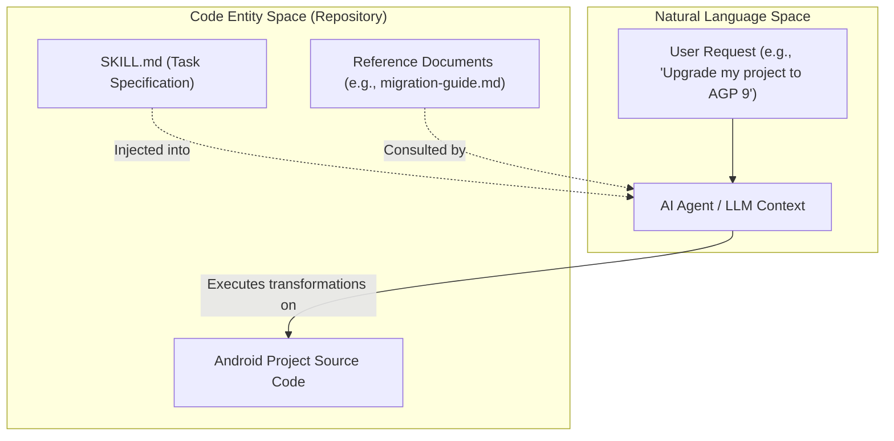
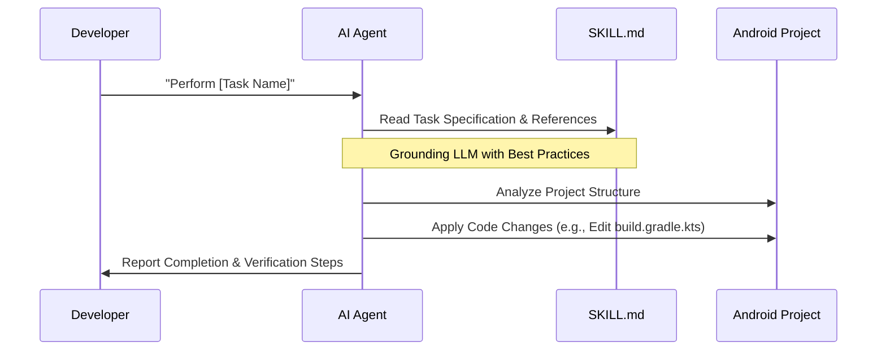

<!-- source: DeepWiki mcp.deepwiki.com · repo android/skills · page 1.1 Getting Started · fetched 2026-10-23 -->

# Getting Started

Relevant source files

The following files were used as context for generating this wiki page:

- [LICENSE.txt](LICENSE.txt)
- [README.md](README.md)

The Android Skills repository provides AI-optimized, modular instructions designed to ground Large Language Models (LLMs) in Android development best practices. By using the open-standard agent skills specification, these skills allow AI agents to execute complex migrations and optimizations—such as upgrading Gradle versions or migrating to Jetpack Compose—with high precision and adherence to official [developer.android.com](https://developer.android.com) guidance [README.md:3-5]().

## Understanding the SKILL.md Format

Android Skills are built upon the **open-standard agent skills** specification [README.md:7-9](). Each skill is encapsulated in a directory containing a `SKILL.md` file, which serves as the primary technical specification for the AI agent.

### Key Components of a Skill
*   **Task Specification**: A markdown-based definition of the goal the agent must achieve.
*   **Domain Grounding**: Specialized information that provides context beyond the LLM's base training data.
*   **Workflow Definition**: Step-by-step instructions that the agent should follow to complete the task.
*   **Reference Materials**: Supporting documents (often found in a `references/` sub-directory) that provide deep-dive technical details, API mappings, or code recipes.

### Skill Execution Flow
The following diagram illustrates how a `SKILL.md` file bridges the gap between a developer's natural language request and the execution of code transformations by an AI agent.

**AI Agent Skill Processing Flow**

Sources: [README.md:3-9]()

## Injecting Skills into an LLM Context

To use these skills, the contents of the relevant `SKILL.md` and its associated references must be provided to the LLM. The exact method of injection depends on the specific AI agent or IDE plugin being used [README.md:11-12]().

| Method | Implementation |
| :--- | :--- |
| **Manual Context** | Copying the text of `SKILL.md` into the system prompt or chat history. |
| **RAG (Retrieval)** | Indexing the `SKILL.md` files in a vector database for the agent to retrieve as needed. |
| **Tool/Plugin** | Using an agent that automatically detects `SKILL.md` files in the workspace to set its operational boundaries. |

**Data Flow: Skill Injection to Execution**

Sources: [README.md:3-9]()

## Contribution and Licensing

### Licensing
The Android Skills repository is licensed under the **Apache License 2.0** [README.md:24-28](). This allows for broad use, reproduction, and distribution of the skills, provided the terms of the license are met [LICENSE.txt:67-73]().

### Contribution Model
*   **Public Contributions**: Currently, public pull requests are not accepted [README.md:22]().
*   **Feedback & Requests**: Users are encouraged to submit GitHub issues to report bugs, provide feedback on existing skills, or request new skill domains [README.md:18-20]().
*   **Community Standards**: All interactions must follow [Google's Open Source Community Guidelines](https://opensource.google/conduct) [README.md:30-33]().

### Disclaimer
AI-generated code and transformations can contain errors. Users should always validate the output of an agent using the verification steps provided within each `SKILL.md` [README.md:14-16]().

Sources: [README.md:14-33](), [LICENSE.txt:1-130]()

---

