# Page: Overview

# Overview

<details>
<summary>Relevant source files</summary>

The following files were used as context for generating this wiki page:

- [LICENSE.txt](LICENSE.txt)
- [README.md](README.md)

</details>


The **Android Skills** repository is a collection of AI-optimized, modular instructions and resources designed to help Large Language Models (LLMs) and AI agents execute Android development tasks according to Google's best practices [README.md:1-5](). These skills follow the [open-standard agent skills](https://agentskills.io/home) specification, providing a structured way to ground AI agents in specialized Android domains [README.md:7-9]().

### Core Purpose
The repository serves as a bridge between high-level developer intent and the complex, evolving ecosystem of Android development. By providing "Skills" in a standardized `SKILL.md` format, it ensures that AI agents can perform migrations, optimizations, and architectural shifts (like Navigation 3 or Jetpack Compose adoption) with high precision and adherence to official guidance [README.md:3-5]().

### System Architecture: From Natural Language to Code Execution
The following diagram illustrates how the repository structures "Skills" to bridge the gap between a developer's natural language request and the actual code modifications performed by an AI agent.

**Skill Execution Flow**
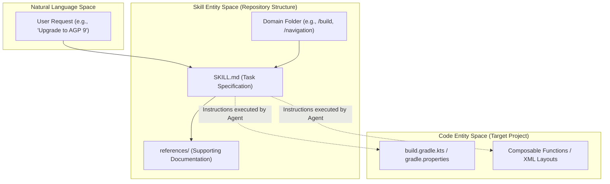
**Sources:** [README.md:1-9]().

---

## Key Concepts

### Agent Skills Specification
Android Skills are authored as `SKILL.md` files. These files act as technical specifications for specific tasks, such as upgrading the Android Gradle Plugin or migrating UI components. They are designed to be "injected" into an AI agent's context to provide the necessary constraints and steps for a workflow [README.md:7-12]().

### Domain-Driven Organization
Skills are organized into logical domains reflecting the Android development lifecycle:
*   **Build:** Automation and version upgrades (e.g., AGP 9).
*   **Jetpack Compose:** UI modernization and edge-to-edge implementation.
*   **Navigation:** State-driven navigation patterns (Navigation 3).
*   **Performance:** Code shrinking and R8 optimization.
*   **Play:** Integration with Google Play services and Billing.

### Repository Workflow
The repository is maintained through automated synchronization and release processes.

**Automation Overview**
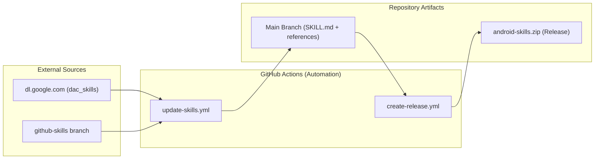
**Sources:** [README.md:1-5](), [LICENSE.txt:49-65]().

---

## Wiki Navigation

To explore the repository in depth, refer to the following sections:

### [Getting Started](#1.1)
Learn how to use these skills with your AI agent. This section covers the `SKILL.md` format, how to ground LLMs with these files, and the repository's licensing under Apache 2.0.
*   **Key Topics:** Open-standard agent skills, LLM context injection, [Apache License 2.0 [LICENSE.txt:1-132]()]().

### [Repository Structure & Skill Catalog](#1.2)
A detailed map of the repository's directory layout. Understand where specific skills live and how the `references/` folders provide deep technical grounding for the AI.
*   **Key Topics:** Directory conventions, Domain mapping (Build, Compose, System), Reference material structure.

### [2.0 - 6.0] Technical Domain Deep Dives
Detailed guides for specific skill sets:
*   **Build & Performance:** AGP upgrades and R8 analysis.
*   **UI & Navigation:** Jetpack Compose migration, Edge-to-Edge, and Navigation 3.
*   **Integrations:** Play Billing Library migrations.

### [Update Skills Workflow](#7.1)
For contributors and maintainers, this section explains the GitHub Actions that keep the skills updated and package them for release.

### [8.0 Glossary](#8.0)
Definitions of terms and code pointers for repository-specific jargon.

---
**Sources:** [README.md:1-33](), [LICENSE.txt:1-132]().

---

# Page: Getting Started

# Getting Started

<details>
<summary>Relevant source files</summary>

The following files were used as context for generating this wiki page:

- [LICENSE.txt](LICENSE.txt)
- [README.md](README.md)

</details>


The Android Skills repository provides AI-optimized, modular instructions designed to ground Large Language Models (LLMs) in Android development best practices. By using the open-standard agent skills specification, these skills allow AI agents to execute complex migrations and optimizations—such as upgrading Gradle versions or migrating to Jetpack Compose—with high precision and adherence to official [developer.android.com](https://developer.android.com) guidance [README.md:3-5]().

## Understanding the SKILL.md Format

Android Skills are built upon the **open-standard agent skills** specification [README.md:7-9](). Each skill is encapsulated in a directory containing a `SKILL.md` file, which serves as the primary technical specification for the AI agent.

### Key Components of a Skill
*   **Task Specification**: A markdown-based definition of the goal the agent must achieve.
*   **Domain Grounding**: Specialized information that provides context beyond the LLM's base training data.
*   **Workflow Definition**: Step-by-step instructions that the agent should follow to complete the task.
*   **Reference Materials**: Supporting documents (often found in a `references/` sub-directory) that provide deep-dive technical details, API mappings, or code recipes.

### Skill Execution Flow
The following diagram illustrates how a `SKILL.md` file bridges the gap between a developer's natural language request and the execution of code transformations by an AI agent.

**AI Agent Skill Processing Flow**
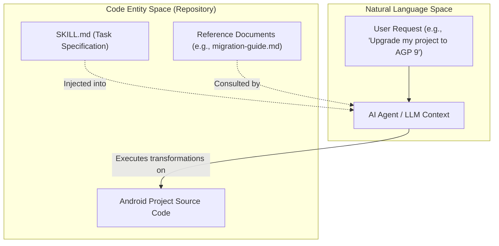
Sources: [README.md:3-9]()

## Injecting Skills into an LLM Context

To use these skills, the contents of the relevant `SKILL.md` and its associated references must be provided to the LLM. The exact method of injection depends on the specific AI agent or IDE plugin being used [README.md:11-12]().

| Method | Implementation |
| :--- | :--- |
| **Manual Context** | Copying the text of `SKILL.md` into the system prompt or chat history. |
| **RAG (Retrieval)** | Indexing the `SKILL.md` files in a vector database for the agent to retrieve as needed. |
| **Tool/Plugin** | Using an agent that automatically detects `SKILL.md` files in the workspace to set its operational boundaries. |

**Data Flow: Skill Injection to Execution**
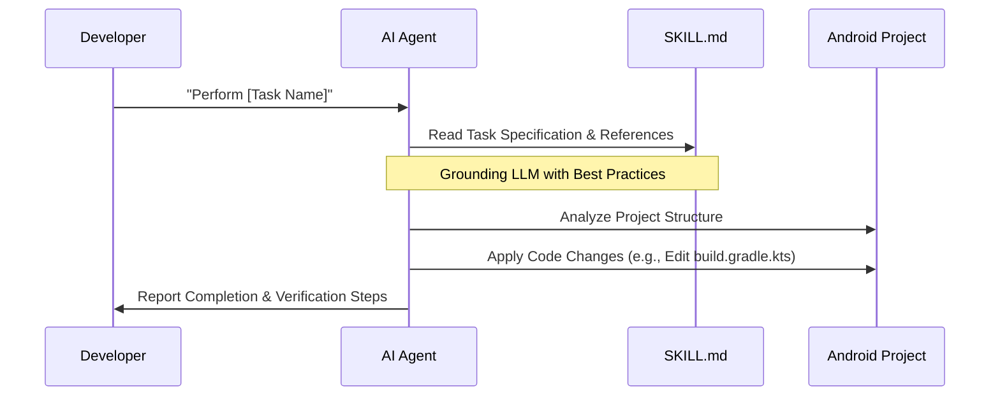
Sources: [README.md:3-9]()

## Contribution and Licensing

### Licensing
The Android Skills repository is licensed under the **Apache License 2.0** [README.md:24-28](). This allows for broad use, reproduction, and distribution of the skills, provided the terms of the license are met [LICENSE.txt:67-73]().

### Contribution Model
*   **Public Contributions**: Currently, public pull requests are not accepted [README.md:22]().
*   **Feedback & Requests**: Users are encouraged to submit GitHub issues to report bugs, provide feedback on existing skills, or request new skill domains [README.md:18-20]().
*   **Community Standards**: All interactions must follow [Google's Open Source Community Guidelines](https://opensource.google/conduct) [README.md:30-33]().

### Disclaimer
AI-generated code and transformations can contain errors. Users should always validate the output of an agent using the verification steps provided within each `SKILL.md` [README.md:14-16]().

Sources: [README.md:14-33](), [LICENSE.txt:1-130]()

---

# Page: Repository Structure & Skill Catalog

# Repository Structure & Skill Catalog

<details>
<summary>Relevant source files</summary>

The following files were used as context for generating this wiki page:

- [README.md](README.md)
- [build/agp/agp-9-upgrade/SKILL.md](build/agp/agp-9-upgrade/SKILL.md)
- [jetpack-compose/migration/migrate-xml-views-to-jetpack-compose/SKILL.md](jetpack-compose/migration/migrate-xml-views-to-jetpack-compose/SKILL.md)
- [navigation/navigation-3/SKILL.md](navigation/navigation-3/SKILL.md)
- [performance/r8-analyzer/SKILL.md](performance/r8-analyzer/SKILL.md)
- [play/play-billing-library-version-upgrade/SKILL.md](play/play-billing-library-version-upgrade/SKILL.md)
- [system/edge-to-edge/SKILL.md](system/edge-to-edge/SKILL.md)

</details>


This page provides a technical map of the Android Skills repository. It outlines the organizational hierarchy of skills by domain, explains the standardized directory layout, and details the internal structure of individual skill modules.

## Repository Overview

The repository is organized into domain-specific directories, each containing one or more "skills." A skill is a modular unit of AI-optimized instructions designed to guide an LLM through complex Android development tasks such as migrations, performance optimizations, or implementing new architectural patterns [README.md:3-9]().

### Domain Catalog

Skills are categorized into the following domains:

| Domain | Description | Key Skills |
| :--- | :--- | :--- |
| `build` | Automation and build system upgrades. | `agp-9-upgrade` |
| `jetpack-compose` | Modern UI development and migration from legacy Views. | `migrate-xml-views-to-jetpack-compose` |
| `navigation` | State-driven navigation and adaptive layouts. | `navigation-3` |
| `performance` | App size and runtime optimization. | `r8-analyzer` |
| `play` | Google Play services and Billing Library integrations. | `play-billing-library-version-upgrade` |
| `system` | OS-level integrations and modern Android standards. | `edge-to-edge` |

**Sources:** [build/agp/agp-9-upgrade/SKILL.md:2-4](), [jetpack-compose/migration/migrate-xml-views-to-jetpack-compose/SKILL.md:2-8](), [navigation/navigation-3/SKILL.md:2-7](), [performance/r8-analyzer/SKILL.md:2-6](), [play/play-billing-library-version-upgrade/SKILL.md:2-5](), [system/edge-to-edge/SKILL.md:2-6]()

---

## Skill Module Structure

Each skill resides in its own directory and follows a strict structural convention to ensure interoperability with AI agents.

### Directory Layout
A typical skill directory (e.g., `performance/r8-analyzer/`) contains:
1.  `SKILL.md`: The primary entry point containing the task specification, objective, and workflow [README.md:7-9]().
2.  `references/`: A subdirectory containing granular technical documentation, code snippets, and logic tables that the `SKILL.md` points to for specific implementation details [jetpack-compose/migration/migrate-xml-views-to-jetpack-compose/SKILL.md:52-59]().

### SKILL.md Anatomy
The `SKILL.md` file is structured into functional blocks:
*   **Frontmatter**: YAML metadata including `name`, `description`, and `keywords` [performance/r8-analyzer/SKILL.md:1-16]().
*   **Phases/Steps**: A deterministic sequence of actions (e.g., Discovery, Planning, Execution, Verification) [play/play-billing-library-version-upgrade/SKILL.md:20-85]().
*   **Guidelines/Mandatory Rules**: Constraints to ensure code quality and prevent common AI hallucinations [build/agp/agp-9-upgrade/SKILL.md:71-76](), [performance/r8-analyzer/SKILL.md:33-41]().

### Skill Data Flow
The following diagram illustrates how an AI agent traverses the skill structure to move from an initial user intent to a code-level change.

**Skill Execution and Reference Resolution**
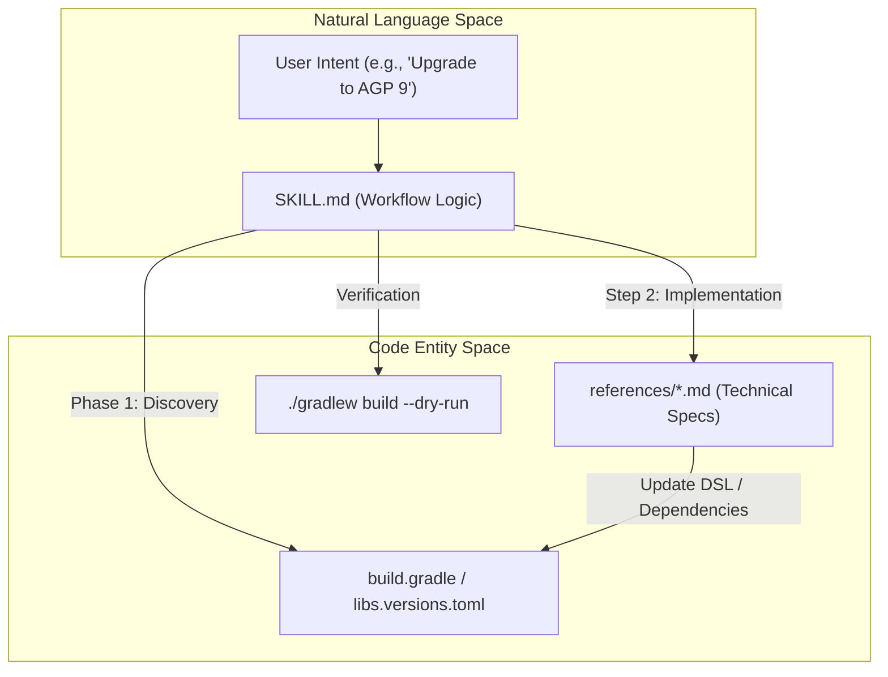
**Sources:** [build/agp/agp-9-upgrade/SKILL.md:22-31](), [build/agp/agp-9-upgrade/SKILL.md:78-85](), [play/play-billing-library-version-upgrade/SKILL.md:25-35]()

---

## Skill Catalog Detail

### Build Domain: AGP 9 Upgrade
Focuses on migrating projects from AGP 8 to AGP 9. It enforces a sequence that includes moving to built-in Kotlin support and updating the Android Gradle Plugin DSL [build/agp/agp-9-upgrade/SKILL.md:33-60]().

### Jetpack Compose: XML Migration
Provides a 10-step methodology to convert legacy XML layouts to declarative Compose components. It utilizes interoperability APIs like `ComposeView` and `AndroidView` to allow incremental adoption [jetpack-compose/migration/migrate-xml-views-to-jetpack-compose/SKILL.md:33-45]().

### Navigation Domain: Navigation 3
Covers the implementation of the state-driven Navigation 3 framework. It includes recipes for `NavKey`, `NavHost`, and `NavDisplay`, as well as complex patterns like multiple back stacks and adaptive scenes [navigation/navigation-3/SKILL.md:20-32](), [navigation/navigation-3/SKILL.md:47-82]().

### Performance Domain: R8 Analyzer
A specialized diagnostic skill that audits `proguard-rules.pro` and `build.gradle` files to identify redundant or overly broad keep rules using a predefined impact hierarchy [performance/r8-analyzer/SKILL.md:18-31]().

### System Domain: Edge-to-Edge
Guides the implementation of full-screen UIs that draw behind system bars. It details the usage of `enableEdgeToEdge()` in Activities and the application of `WindowInsets` via `Scaffold` or modifiers like `safeDrawingPadding()` [system/edge-to-edge/SKILL.md:24-35](), [system/edge-to-edge/SKILL.md:37-53]().

### Mapping System Concepts to Code Entities
This diagram bridges high-level system requirements (like Edge-to-Edge) to the specific code symbols and configurations required.

**Edge-to-Edge Implementation Mapping**
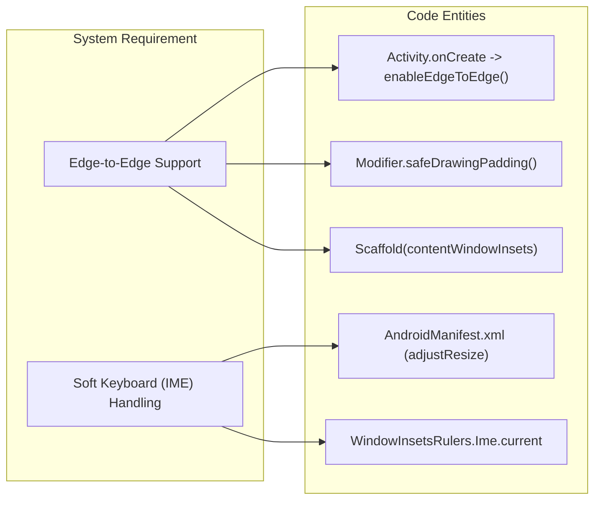
**Sources:** [system/edge-to-edge/SKILL.md:30-34](), [system/edge-to-edge/SKILL.md:37-53](), [system/edge-to-edge/SKILL.md:107-112](), [system/edge-to-edge/SKILL.md:122-132]()

---

# Page: Build Skills

# Build Skills

<details>
<summary>Relevant source files</summary>

The following files were used as context for generating this wiki page:

- [build/agp/agp-9-upgrade/SKILL.md](build/agp/agp-9-upgrade/SKILL.md)

</details>


The **Build Skills** section of the Android Skills repository provides automated workflows and guidance for modernizing Android build configurations. The primary focus of this domain is facilitating the transition to **Android Gradle Plugin (AGP) 9.0**, which introduces significant changes to how Kotlin is integrated, how the Gradle DSL is structured, and how annotation processing is handled.

The skills in this category are designed to be consumed by AI agents to perform complex refactoring tasks that ensure a project aligns with the latest Android build standards.

## AGP 9 Upgrade Overview

The `agp-9-upgrade` skill is the core component of this domain. It manages the transition from AGP 8.x to 9.x, focusing on five critical migration pillars. Before an agent initiates these steps, it must verify that the project has already utilized the **AGP Upgrade Assistant** in Android Studio to reach a baseline version of 9.0 [build/agp/agp-9-upgrade/SKILL.md:24-26]().

### The Five-Step Migration Workflow

The migration process is structured into a sequential pipeline to ensure build stability:

1.  **Built-in Kotlin Migration**: Moving away from external Kotlin Gradle plugin configurations to the integrated support provided by AGP 9 [build/agp/agp-9-upgrade/SKILL.md:37-39]().
2.  **DSL Refactoring**: Updating `build.gradle` files to use the new AGP 9 DSL, which deprecates several older configuration blocks [build/agp/agp-9-upgrade/SKILL.md:41-43]().
3.  **Annotation Processing**: Transitioning from `kapt` to `KSP` or `legacy-kapt`, ensuring KSP is at least version `2.3.6` [build/agp/agp-9-upgrade/SKILL.md:48-53]().
4.  **BuildConfig Handling**: Addressing changes in how custom `BuildConfig` fields are generated and accessed [build/agp/agp-9-upgrade/SKILL.md:55-58]().
5.  **Property Cleanup**: Removing deprecated flags from `gradle.properties`, such as `android.builtInKotlin` and `android.newDsl` [build/agp/agp-9-upgrade/SKILL.md:60-68]().

### Build Skill Architecture

The following diagram illustrates how the `agp-9-upgrade` skill maps its natural language instructions to the specific code entities and reference materials within the repository.

**Build Skill Entity Mapping**
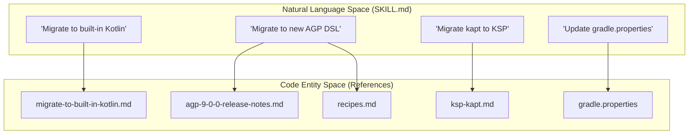
Sources: [build/agp/agp-9-upgrade/SKILL.md:37-68]()

## Verification and Constraints

The Build Skills enforce strict operational guidelines to ensure efficiency and correctness during the upgrade process. Agents are instructed to avoid time-consuming tasks like running `clean` during verification and are prohibited from using specific workarounds like `android.disallowKotlinSourceSets=false` [build/agp/agp-9-upgrade/SKILL.md:71-78]().

Success is measured by three primary technical signals:
1.  **IDE Sync**: Successful Gradle IDE synchronization.
2.  **Help Task**: Execution of `./gradlew help`.
3.  **Dry Run**: Execution of `./gradlew build --dry-run`.

**Build Verification Flow**
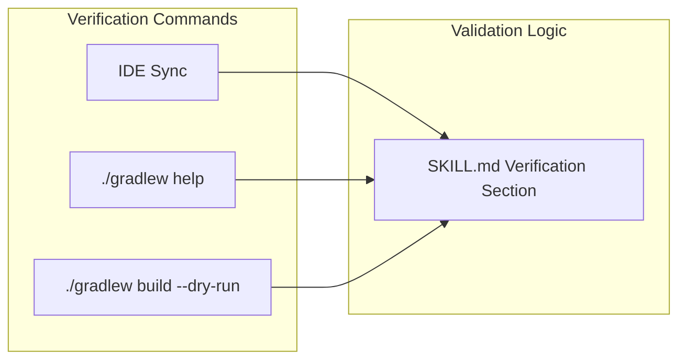
Sources: [build/agp/agp-9-upgrade/SKILL.md:80-84]()

## Detailed Skill Documentation

For a deeper dive into the specific implementation details and reference guides, visit the child pages below:

*   **[AGP 9 Upgrade Skill](#2.1)**: Detailed walkthrough of the `agp-9-upgrade` `SKILL.md`, including prerequisites, specific migration steps, and troubleshooting for tools like Paparazzi [build/agp/agp-9-upgrade/SKILL.md:88-89]().
*   **[AGP 9 Reference Materials](#2.2)**: A deep dive into the technical reference documents bundled with the skill, covering the new DSL, KSP migration, and Gradle recipes.

Sources:
- [build/agp/agp-9-upgrade/SKILL.md:1-89]()

---

# Page: AGP 9 Upgrade Skill

# AGP 9 Upgrade Skill

<details>
<summary>Relevant source files</summary>

The following files were used as context for generating this wiki page:

- [build/agp/agp-9-upgrade/SKILL.md](build/agp/agp-9-upgrade/SKILL.md)
- [build/agp/agp-9-upgrade/references/android/build/releases/agp-9-0-0-release-notes.md](build/agp/agp-9-upgrade/references/android/build/releases/agp-9-0-0-release-notes.md)
- [build/agp/agp-9-upgrade/references/recipes.md](build/agp/agp-9-upgrade/references/recipes.md)

</details>


The `agp-9-upgrade` skill provides a structured workflow for migrating Android projects to Android Gradle Plugin (AGP) version 9. This transition involves moving from deprecated internal DSL types to new public interfaces, adopting built-in Kotlin support, and updating annotation processing configurations.

## Prerequisites and Requirements

Before initiating the migration steps, the environment must meet specific version requirements to ensure compatibility with AGP 9.0.

### Version Compatibility Matrix
| Component | Minimum Version | Default/Recommended |
| :--- | :--- | :--- |
| **Gradle** | 9.1.0 | 9.1.0 |
| **SDK Build Tools** | 36.0.0 | 36.0.0 |
| **JDK** | 17 | 17 |
| **NDK** | N/A | 28.2.13676358 |
| **KSP** | 2.3.6 | 2.3.6+ |

Sources: [build/agp/agp-9-upgrade/references/android/build/releases/agp-9-0-0-release-notes.md:19-25](), [build/agp/agp-9-upgrade/SKILL.md:50-51]()

### Initial Validation
If the project's current AGP version is lower than 9, the migration must first be processed through the **Android Studio AGP Upgrade Assistant** to bridge the gap from AGP 8.x and preserve existing behaviors before applying the manual steps in this skill [build/agp/agp-9-upgrade/SKILL.md:24-26]().

## Migration Workflow

The migration is divided into five core steps to align the project with AGP 9 architecture.

### Step 1: Built-in Kotlin Migration
AGP 9 introduces built-in support for Kotlin, which is required because the legacy `org.jetbrains.kotlin.android` plugin is incompatible with the new AGP DSL [build/agp/agp-9-upgrade/references/android/build/releases/agp-9-0-0-release-notes.md:43-44]().

### Step 2: New AGP DSL Migration
AGP 9 removes access to old DSL types like `BaseExtension` and `applicationVariants`. Build logic must be refactored to use the `androidComponents` API [build/agp/agp-9-upgrade/references/android/build/releases/agp-9-0-0-release-notes.md:37-39]().

**DSL Logic Transformation**
| Old API (Deprecated/Removed) | New API (Replacement) |
| :--- | :--- |
| `applicationVariants` / `libraryVariants` | `androidComponents.onVariants` |
| `variantFilter` | `androidComponents.beforeVariants` |
| `sdkDirectory` / `ndkDirectory` | `androidComponents.sdkComponents` |
| `dexOptions` | Removed (Obsolete) |

Sources: [build/agp/agp-9-upgrade/references/android/build/releases/agp-9-0-0-release-notes.md:77-84]()

### Step 3: Annotation Processing (KSP/kapt)
Projects using KSP must upgrade to version `2.3.6` or higher [build/agp/agp-9-upgrade/SKILL.md:50-51](). For projects still using `kapt`, the skill directs users toward `legacy-kapt` or a full KSP migration [build/agp/agp-9-upgrade/SKILL.md:53]().

### Step 4: BuildConfig Configuration
Modules containing custom `BuildConfig` fields require specific handling under the new DSL. This often involves moving from direct DSL assignments to the `addCustomBuildConfigFields` recipe pattern [build/agp/agp-9-upgrade/references/recipes.md:26-28]().

### Step 5: `gradle.properties` Cleanup
Post-migration, legacy feature flags that are now default or removed in AGP 9 must be deleted from `gradle.properties` [build/agp/agp-9-upgrade/SKILL.md:62-68]():
1. `android.builtInKotlin`
2. `android.newDsl`
3. `android.uniquePackageNames`
4. `android.enableAppCompileTimeRClass`

## System Architecture and Data Flow

The following diagrams illustrate the transition from the legacy Gradle Extension model to the AGP 9 `androidComponents` architecture.

### DSL Transformation Mapping
This diagram bridges the natural language migration steps to the specific code entities in the AGP 9 API.

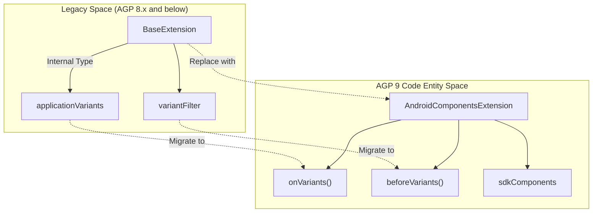
Sources: [build/agp/agp-9-upgrade/references/android/build/releases/agp-9-0-0-release-notes.md:77-82](), [build/agp/agp-9-upgrade/references/recipes.md:53-56]()

### Artifact Manipulation Flow
The following flow demonstrates how to perform common tasks (like renaming an APK) using the new `onVariants` lifecycle.

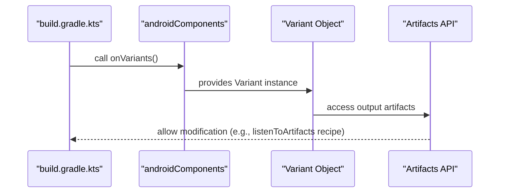
Sources: [build/agp/agp-9-upgrade/references/recipes.md:53-56](), [build/agp/agp-9-upgrade/references/android/build/releases/agp-9-0-0-release-notes.md:79]()

## Verification and Troubleshooting

### Verification Commands
After applying changes, execute the following commands in order to validate the build integrity. **Note:** Do not run the `clean` task as it is unnecessary for this verification [build/agp/agp-9-upgrade/SKILL.md:76]().

1. **IDE Sync:** Ensure Gradle sync completes without errors in Android Studio.
2. **Task Listing:** `./gradlew help` [build/agp/agp-9-upgrade/SKILL.md:83]()
3. **Dry Run:** `./gradlew build --dry-run` [build/agp/agp-9-upgrade/SKILL.md:84]()

### Troubleshooting Common Issues
*   **ClassCastException:** If the build logs show `cannot be cast to com.android.build.gradle.BaseExtension`, the project is still referencing internal legacy types that must be replaced with public interfaces [build/agp/agp-9-upgrade/references/android/build/releases/agp-9-0-0-release-notes.md:88-93]().
*   **Paparazzi:** Versions `v2.0.0-alpha04` and lower are incompatible with AGP 9. Upgrade Paparazzi to resolve build failures [build/agp/agp-9-upgrade/SKILL.md:88-89]().
*   **Kotlin Source Sets:** Never add `android.disallowKotlinSourceSets=false` to `gradle.properties` as a workaround [build/agp/agp-9-upgrade/SKILL.md:75]().

Sources: [build/agp/agp-9-upgrade/SKILL.md:75-89](), [build/agp/agp-9-upgrade/references/android/build/releases/agp-9-0-0-release-notes.md:88-93]()

---

# Page: AGP 9 Reference Materials

# AGP 9 Reference Materials

<details>
<summary>Relevant source files</summary>

The following files were used as context for generating this wiki page:

- [build/agp/agp-9-upgrade/references/android/build/migrate-to-built-in-kotlin.md](build/agp/agp-9-upgrade/references/android/build/migrate-to-built-in-kotlin.md)
- [build/agp/agp-9-upgrade/references/buildconfig.md](build/agp/agp-9-upgrade/references/buildconfig.md)
- [build/agp/agp-9-upgrade/references/ksp-kapt.md](build/agp/agp-9-upgrade/references/ksp-kapt.md)
- [build/agp/agp-9-upgrade/references/paparazzi-gradle-9.md](build/agp/agp-9-upgrade/references/paparazzi-gradle-9.md)
- [build/agp/agp-9-upgrade/references/recipes.md](build/agp/agp-9-upgrade/references/recipes.md)

</details>


This page provides a deep dive into the technical reference materials bundled with the AGP 9 upgrade skill. It covers the transition to built-in Kotlin support, the migration from `kapt` to KSP (or legacy-kapt), mandatory `BuildConfig` changes, Paparazzi compatibility workarounds, and the use of Gradle recipes for modernizing build logic.

## Built-in Kotlin Migration

Android Gradle Plugin 9.0 introduces built-in Kotlin support, enabled by default [build/agp/agp-9-upgrade/references/android/build/migrate-to-built-in-kotlin.md:1-2](). This eliminates the need for the `org.jetbrains.kotlin.android` plugin in standard Android modules [build/agp/agp-9-upgrade/references/android/build/migrate-to-built-in-kotlin.md:2-4]().

### Conflict Resolution
If the legacy plugin is not removed, Gradle will throw errors such as `Cannot add extension with name 'kotlin'` or explicitly state that the plugin is no longer required [build/agp/agp-9-upgrade/references/android/build/migrate-to-built-in-kotlin.md:32-39]().

### Migration Workflow
1.  **Remove Plugin:** Delete `id("org.jetbrains.kotlin.android")` or `alias(libs.plugins.kotlin.android)` from module-level and top-level build files [build/agp/agp-9-upgrade/references/android/build/migrate-to-built-in-kotlin.md:53-139]().
2.  **Update Version Catalog:** Remove the `kotlin-android` entry from `gradle/libs.versions.toml` [build/agp/agp-9-upgrade/references/android/build/migrate-to-built-in-kotlin.md:140-147]().
3.  **DSL Migration:** Move `android.kotlinOptions{}` to `kotlin.compilerOptions{}` [build/agp/agp-9-upgrade/references/android/build/migrate-to-built-in-kotlin.md:217-220]().

### Logic Flow: Built-in Kotlin Enforcement
The following diagram illustrates how AGP 9 handles Kotlin compilation compared to previous versions.

**AGP Kotlin Compilation Logic**
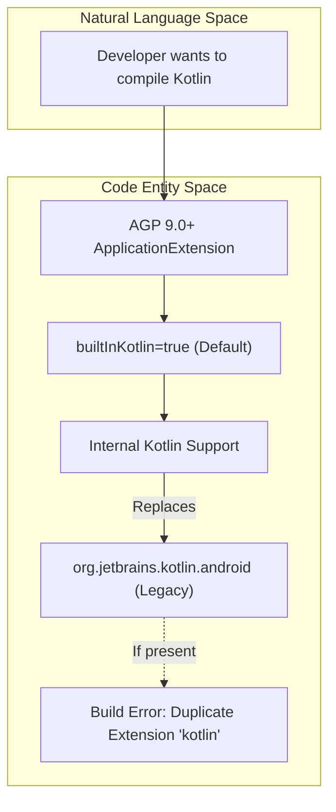
Sources: [build/agp/agp-9-upgrade/references/android/build/migrate-to-built-in-kotlin.md:1-40]()

## KSP and Kapt Migration

The `org.jetbrains.kotlin.kapt` plugin is incompatible with AGP 9's built-in Kotlin [build/agp/agp-9-upgrade/references/ksp-kapt.md:9-10](). Projects must either migrate to KSP or use a legacy bridge.

### Compatibility Check
To determine if a dependency supports KSP, developers must inspect the library JAR for the presence of:
`services/com.google.devtools.ksp.processing.SymbolProcessorProvider` [build/agp/agp-9-upgrade/references/ksp-kapt.md:14-18]().

### Migration Paths
*   **KSP Path:** Replace `kapt` configuration with `ksp` in dependencies.
*   **Legacy Path:** If a library is incompatible with KSP, apply the `com.android.legacy-kapt` plugin [build/agp/agp-9-upgrade/references/ksp-kapt.md:35-39](). This plugin must match the AGP version [build/agp/agp-9-upgrade/references/android/build/migrate-to-built-in-kotlin.md:154-156]().

Sources: [build/agp/agp-9-upgrade/references/ksp-kapt.md:1-39](), [build/agp/agp-9-upgrade/references/android/build/migrate-to-built-in-kotlin.md:148-170]()

## BuildConfig Changes

In AGP 9, `BuildConfig` generation is no longer implicit for modules containing custom fields.

### Implementation Steps
1.  **Enable Feature:** Set `buildConfig = true` within the `buildFeatures` block of the module [build/agp/agp-9-upgrade/references/buildconfig.md:4-12]().
2.  **Strict Typing:** For `String` types, the value must include literal escaped quotation marks (e.g., `value = "\"Some value\""`) [build/agp/agp-9-upgrade/references/buildconfig.md:43-54]().

**BuildConfig Configuration Mapping**
```mermaid
graph LR
    subgraph "Natural Language Space"
        A["Custom Field Requirement"]
    end

    subgraph "Code Entity Space"
        B["com.android.build.api.dsl.BuildFeatures"]
        C["buildConfig = true"]
        D["com.android.build.api.variant.BuildConfigField"]
        E["value = '\"quoted_string\"'"]
    end

    A --> B
    B --> C
    C --> D
    D --> E
```
Sources: [build/agp/agp-9-upgrade/references/buildconfig.md:1-54]()

## Paparazzi Compatibility

Paparazzi versions 2.0.0-alpha04 and lower use internal Gradle classes that are removed in Gradle 9 [build/agp/agp-9-upgrade/references/paparazzi-gradle-9.md:4-12]().

### Workaround
Until a compatible version is released, HTML test reports must be disabled for any module applying `app.cash.paparazzi` [build/agp/agp-9-upgrade/references/paparazzi-gradle-9.md:13-16]().

**Kotlin DSL Workaround:**
```kotlin
tasks.withType<Test>().configureEach {
  reports.html.required = false
}
```
[build/agp/agp-9-upgrade/references/paparazzi-gradle-9.md:18-23]()

## Gradle Recipes for New DSL

The removal of `applicationVariants` and `libraryVariants` requires a shift to the `AndroidComponentsExtension` API [build/agp/agp-9-upgrade/references/recipes.md:53-56]().

### Key Recipes
| Use-case | AGP 9 Replacement / Recipe |
| :--- | :--- |
| **Add BuildConfig Fields** | `addCustomBuildConfigFields` [build/agp/agp-9-upgrade/references/recipes.md:28]() |
| **Rename APK** | `listenToArtifacts` (using `onVariants`) [build/agp/agp-9-upgrade/references/recipes.md:29,54-56]() |

### Version Mapping
Recipes are maintained in specific branches of the `gradle-recipes` repository corresponding to AGP versions (e.g., `agp-9.0`, `agp-9.1`) [build/agp/agp-9-upgrade/references/recipes.md:16-20]().

Sources: [build/agp/agp-9-upgrade/references/recipes.md:1-59]()

---

# Page: Jetpack Compose Skills

# Jetpack Compose Skills

<details>
<summary>Relevant source files</summary>

The following files were used as context for generating this wiki page:

- [jetpack-compose/migration/migrate-xml-views-to-jetpack-compose/SKILL.md](jetpack-compose/migration/migrate-xml-views-to-jetpack-compose/SKILL.md)
- [system/edge-to-edge/SKILL.md](system/edge-to-edge/SKILL.md)

</details>


This section provides an overview of the skills available in the repository for developing, migrating, and optimizing Android applications using **Jetpack Compose**. These skills focus on transitioning from legacy View-based architectures to modern declarative UI and ensuring those UIs integrate correctly with system-level features like edge-to-edge display.

## Overview of Compose Skills

The repository currently categorizes Jetpack Compose expertise into two primary functional areas:

1.  **UI Migration**: A systematic approach to converting legacy XML layouts into Compose components while maintaining interoperability.
2.  **System Integration**: Implementing modern Android requirements, specifically edge-to-edge support and proper window inset handling.

### Skill Interconnectivity

The following diagram illustrates how these skills relate to the standard Android development lifecycle and the specific code entities involved.

**Compose Skill Landscape**

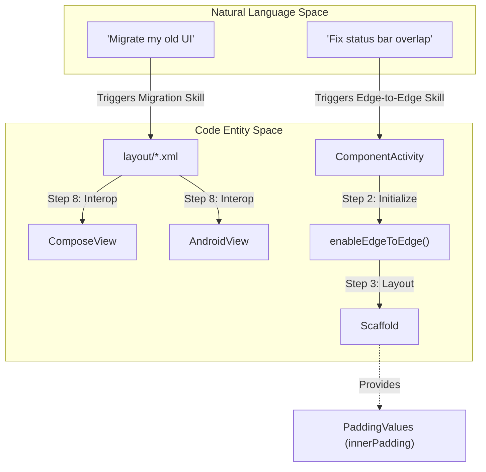

**Sources:**
* [jetpack-compose/migration/migrate-xml-views-to-jetpack-compose/SKILL.md:33-44]()
* [system/edge-to-edge/SKILL.md:30-35]()

---

## 3.1 Migrate XML Views to Jetpack Compose

The `migrate-xml-views-to-jetpack-compose` skill provides a 10-step structured workflow for converting legacy XML layouts into modern Compose code. It is designed to ensure visual parity and functional integrity through a "stable, safe, and visually consistent transition" [jetpack-compose/migration/migrate-xml-views-to-jetpack-compose/SKILL.md:22-24]().

### Key Workflow Phases
*   **Analysis & Planning**: Identifying the best XML candidates (e.g., simple leaf nodes or frequently updated screens) and performing a technical audit of the layout hierarchy [jetpack-compose/migration/migrate-xml-views-to-jetpack-compose/SKILL.md:48-66]().
*   **Environment Setup**: Configuring `build.gradle` or `libs.versions.toml` with the necessary Compose dependencies and compiler versions [jetpack-compose/migration/migrate-xml-views-to-jetpack-compose/SKILL.md:80-85]().
*   **Interoperability**: Using `ComposeView` to host Compose content within existing Views, or `AndroidView` to wrap legacy Views within a Compose hierarchy [jetpack-compose/migration/migrate-xml-views-to-jetpack-compose/SKILL.md:110-111]().
*   **Validation**: Utilizing **Compose Previews** and screenshot testing (via UI Automator or Espresso) to verify pixel-perfect parity before deleting the original XML [jetpack-compose/migration/migrate-xml-views-to-jetpack-compose/SKILL.md:113-123]().

For details, see [Migrate XML Views to Jetpack Compose](#3.1).

**Sources:**
* [jetpack-compose/migration/migrate-xml-views-to-jetpack-compose/SKILL.md:1-123]()

---

## 3.2 Edge-to-Edge Support Skill

The `edge-to-edge` skill focuses on making Compose applications adaptive to system bars (status and navigation bars). This is a requirement for apps targeting SDK 35 and later [system/edge-to-edge/SKILL.md:21-22]().

### Core Implementation Patterns
*   **Activation**: Calling `enableEdgeToEdge()` within `onCreate` before `setContent` [system/edge-to-edge/SKILL.md:32]().
*   **Inset Application**: Using `Scaffold` to receive `PaddingValues` (often named `innerPadding`) which are then applied to content to prevent UI elements from being obscured by system bars [system/edge-to-edge/SKILL.md:43-52]().
*   **IME Handling**: Managing the soft keyboard using `Modifier.imePadding()` or the more robust `Modifier.fitInside(WindowInsetsRulers.Ime.current)` to reduce jank [system/edge-to-edge/SKILL.md:107-113]().

The following diagram maps the high-level "Edge-to-Edge" concept to the specific modifiers and functions used in the codebase.

**Edge-to-Edge Technical Mapping**

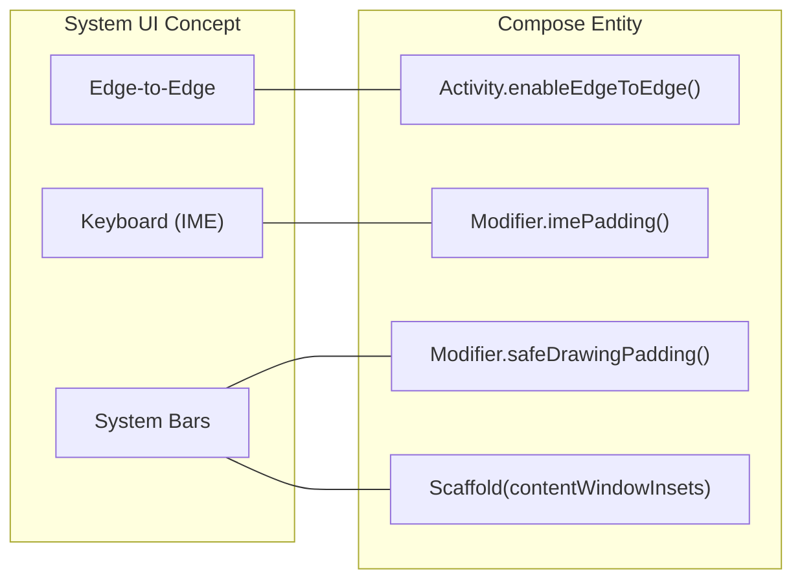

For details, see [Edge-to-Edge Support Skill](#3.2).

**Sources:**
* [system/edge-to-edge/SKILL.md:1-176]()

---

# Page: Migrate XML Views to Jetpack Compose

# Migrate XML Views to Jetpack Compose

<details>
<summary>Relevant source files</summary>

The following files were used as context for generating this wiki page:

- [jetpack-compose/migration/migrate-xml-views-to-jetpack-compose/SKILL.md](jetpack-compose/migration/migrate-xml-views-to-jetpack-compose/SKILL.md)
- [jetpack-compose/migration/migrate-xml-views-to-jetpack-compose/references/analysis-of-the-project-and-layout.md](jetpack-compose/migration/migrate-xml-views-to-jetpack-compose/references/analysis-of-the-project-and-layout.md)
- [jetpack-compose/migration/migrate-xml-views-to-jetpack-compose/references/identify-optimal-xml-candidate.md](jetpack-compose/migration/migrate-xml-views-to-jetpack-compose/references/identify-optimal-xml-candidate.md)
- [jetpack-compose/migration/migrate-xml-views-to-jetpack-compose/references/xml-layout-migration.md](jetpack-compose/migration/migrate-xml-views-to-jetpack-compose/references/xml-layout-migration.md)

</details>


This page provides a high-level guide to the structured workflow for migrating legacy Android XML layouts to Jetpack Compose. The process ensures a stable, safe, and visually consistent transition by following a 10-step methodology focused on incremental adoption and interoperability [jetpack-compose/migration/migrate-xml-views-to-jetpack-compose/SKILL.md:22-25]().

## Migration Workflow Overview

The migration process is designed to maintain pixel-perfect visual parity while converting imperative View-based UI into declarative Compose components.

### 10-Step Migration Process
1.  **Identify Candidate**: Select the optimal XML for migration based on complexity and hierarchy [jetpack-compose/migration/migrate-xml-views-to-jetpack-compose/SKILL.md:48-52]().
2.  **Analyze Project**: Perform a technical audit of the layout and project context [jetpack-compose/migration/migrate-xml-views-to-jetpack-compose/SKILL.md:54-59]().
3.  **Create Plan**: Generate a step-by-step migration strategy [jetpack-compose/migration/migrate-xml-views-to-jetpack-compose/SKILL.md:61-66]().
4.  **Capture UI**: Establish a visual baseline via screenshots or automated tests [jetpack-compose/migration/migrate-xml-views-to-jetpack-compose/SKILL.md:68-78]().
5.  **Setup Dependencies**: Configure `build.gradle` or `libs.versions.toml` for Compose [jetpack-compose/migration/migrate-xml-views-to-jetpack-compose/SKILL.md:80-85]().
6.  **Setup Theming**: Initialize Compose theming or migrate minimum required XML styles [jetpack-compose/migration/migrate-xml-views-to-jetpack-compose/SKILL.md:87-97]().
7.  **Migrate Layout**: Convert XML tags to `@Composable` functions [jetpack-compose/migration/migrate-xml-views-to-jetpack-compose/SKILL.md:99-104]().
8.  **Replace Usages**: Integrate the new component using interoperability APIs [jetpack-compose/migration/migrate-xml-views-to-jetpack-compose/SKILL.md:106-111]().
9.  **Validate**: Compare Compose Previews against the baseline screenshot [jetpack-compose/migration/migrate-xml-views-to-jetpack-compose/SKILL.md:113-118]().
10. **Cleanup**: Safely remove the legacy XML and associated tests [jetpack-compose/migration/migrate-xml-views-to-jetpack-compose/SKILL.md:120-123]().

**Sources:** [jetpack-compose/migration/migrate-xml-views-to-jetpack-compose/SKILL.md:33-44]()

## Candidate Identification & Analysis

Before writing code, the project must be audited to identify low-risk, high-impact migration targets. Ideal candidates are "leaf nodes" at the bottom of the UI tree with minimal external dependencies [jetpack-compose/migration/migrate-xml-views-to-jetpack-compose/references/identify-optimal-xml-candidate.md:9-13]().

### Analysis Checklist
*   **Project Health**: Ensure the project builds and syncs before starting [jetpack-compose/migration/migrate-xml-views-to-jetpack-compose/references/analysis-of-the-project-and-layout.md:1-5]().
*   **Theming Review**: Map `colors.xml`, `dimens.xml`, and `styles.xml` to Compose `MaterialTheme` or custom design system tokens [jetpack-compose/migration/migrate-xml-views-to-jetpack-compose/references/analysis-of-the-project-and-layout.md:15-23]().
*   **Architecture**: Identify state management (e.g., `ViewModel`, `LiveData`, `Flow`) to ensure the new Composable integrates correctly [jetpack-compose/migration/migrate-xml-views-to-jetpack-compose/references/analysis-of-the-project-and-layout.md:33-38]().

**Sources:** [jetpack-compose/migration/migrate-xml-views-to-jetpack-compose/references/identify-optimal-xml-candidate.md:1-21](), [jetpack-compose/migration/migrate-xml-views-to-jetpack-compose/references/analysis-of-the-project-and-layout.md:1-42]()

## Interoperability Strategy

Migration rarely happens all at once. The workflow utilizes specific APIs to bridge the gap between the legacy View system and Compose.

| Strategy | Tool/API | Usage Context |
| :--- | :--- | :--- |
| **Compose in Views** | `ComposeView` | Adding a new Compose component into an existing XML layout or Fragment. |
| **Views in Compose** | `AndroidView` | Hosting a legacy View (e.g., a specialized MapView) inside a new Composable. |

For detailed implementation patterns of these APIs, see [Compose Migration Reference Materials](#3.1.1).

**Sources:** [jetpack-compose/migration/migrate-xml-views-to-jetpack-compose/SKILL.md:110-111]()

## Visual Parity & Validation

A critical phase of the migration is ensuring the new Compose UI matches the legacy XML.

### Validation Workflow
1.  **Baseline**: Capture a screenshot of the original XML using **UI Automator** or **Espresso** [jetpack-compose/migration/migrate-xml-views-to-jetpack-compose/SKILL.md:76-77]().
2.  **Implementation**: Create the Composable with a `@Preview` [jetpack-compose/migration/migrate-xml-views-to-jetpack-compose/SKILL.md:103-104]().
3.  **Comparison**: Iteratively adjust `Modifier` attributes (padding, alignment, weight) until the Preview matches the baseline [jetpack-compose/migration/migrate-xml-views-to-jetpack-compose/SKILL.md:115-117]().

**Sources:** [jetpack-compose/migration/migrate-xml-views-to-jetpack-compose/SKILL.md:68-78](), [jetpack-compose/migration/migrate-xml-views-to-jetpack-compose/SKILL.md:113-118]()

## System Mapping: XML to Compose

The following diagram bridges XML concepts to their Compose counterparts used during migration.

### UI Entity Mapping
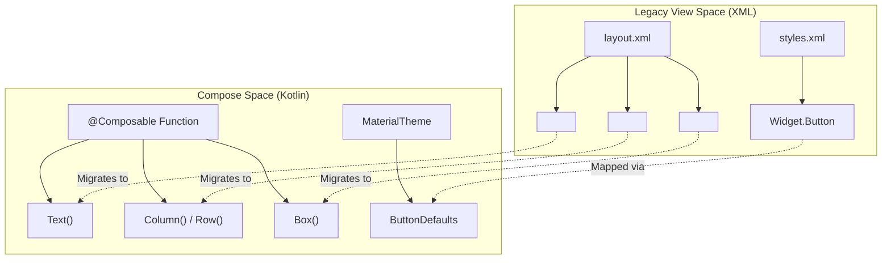
**Sources:** [jetpack-compose/migration/migrate-xml-views-to-jetpack-compose/references/xml-layout-migration.md:1-6](), [jetpack-compose/migration/migrate-xml-views-to-jetpack-compose/references/xml-layout-migration.md:41-68]()

### Migration Lifecycle
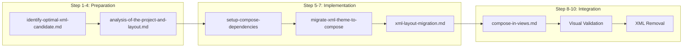
**Sources:** [jetpack-compose/migration/migrate-xml-views-to-jetpack-compose/SKILL.md:33-44]()

## Detailed Reference Materials
For specific implementation details, refer to the following child pages:
*   [Compose Migration Reference Materials](#3.1.1): Detailed guides on dependency setup, Material 3 theme migration, and technical documentation for `ComposeView` and `AndroidView` interoperability.

---

# Page: Compose Migration Reference Materials

# Compose Migration Reference Materials

<details>
<summary>Relevant source files</summary>

The following files were used as context for generating this wiki page:

- [jetpack-compose/migration/migrate-xml-views-to-jetpack-compose/references/android/develop/ui/compose/designsystems/migrate-xml-theme-to-compose.md](jetpack-compose/migration/migrate-xml-views-to-jetpack-compose/references/android/develop/ui/compose/designsystems/migrate-xml-theme-to-compose.md)
- [jetpack-compose/migration/migrate-xml-views-to-jetpack-compose/references/android/develop/ui/compose/migrate/interoperability-apis/compose-in-views.md](jetpack-compose/migration/migrate-xml-views-to-jetpack-compose/references/android/develop/ui/compose/migrate/interoperability-apis/compose-in-views.md)
- [jetpack-compose/migration/migrate-xml-views-to-jetpack-compose/references/android/develop/ui/compose/migrate/interoperability-apis/views-in-compose.md](jetpack-compose/migration/migrate-xml-views-to-jetpack-compose/references/android/develop/ui/compose/migrate/interoperability-apis/views-in-compose.md)
- [jetpack-compose/migration/migrate-xml-views-to-jetpack-compose/references/android/develop/ui/compose/setup-compose-dependencies-and-compiler.md](jetpack-compose/migration/migrate-xml-views-to-jetpack-compose/references/android/develop/ui/compose/setup-compose-dependencies-and-compiler.md)

</details>


This page provides technical reference materials for migrating an Android application from XML-based Views to Jetpack Compose. It covers the necessary dependency configurations, theme migration strategies to Material 3, and interoperability mechanisms for mixing Views and Compose within the same UI hierarchy.

## Dependency Setup and Compiler Configuration

To enable Jetpack Compose in an existing project, the build system must be configured to support the Compose Compiler and the required runtime libraries.

### Compose Compiler Gradle Plugin
Starting with Kotlin 2.0, the Compose Compiler is managed via a dedicated Gradle plugin [jetpack-compose/migration/migrate-xml-views-to-jetpack-compose/references/android/develop/ui/compose/setup-compose-dependencies-and-compiler.md:7-9]().

1.  **Plugin Declaration**: Add the plugin to the `libs.versions.toml` file or directly in the `build.gradle.kts` [jetpack-compose/migration/migrate-xml-views-to-jetpack-compose/references/android/develop/ui/compose/setup-compose-dependencies-and-compiler.md:22-26]().
2.  **Enable Build Features**: The `compose` flag must be enabled within the `android` block to enable Android Studio tooling support [jetpack-compose/migration/migrate-xml-views-to-jetpack-compose/references/android/develop/ui/compose/setup-compose-dependencies-and-compiler.md:86-101]().
3.  **Bill of Materials (BOM)**: Use the Compose BOM to manage library versions synchronously [jetpack-compose/migration/migrate-xml-views-to-jetpack-compose/references/android/develop/ui/compose/setup-compose-dependencies-and-compiler.md:149-152]().

### Core Dependencies
| Library Group | Purpose |
|---|---|
| `androidx.compose.ui:ui` | Main APIs for toolkit systems (input, measurement, layout) [jetpack-compose/migration/migrate-xml-views-to-jetpack-compose/references/android/develop/ui/compose/setup-compose-dependencies-and-compiler.md:160-160]() |
| `androidx.compose.material3:material3` | Material Design 3 components [jetpack-compose/migration/migrate-xml-views-to-jetpack-compose/references/android/develop/ui/compose/setup-compose-dependencies-and-compiler.md:155-155]() |
| `androidx.activity:activity-compose` | Integration with `ComponentActivity` for `setContent` [jetpack-compose/migration/migrate-xml-views-to-jetpack-compose/references/android/develop/ui/compose/setup-compose-dependencies-and-compiler.md:174-174]() |
| `androidx.compose.ui:ui-tooling-preview` | Android Studio Preview support [jetpack-compose/migration/migrate-xml-views-to-jetpack-compose/references/android/develop/ui/compose/setup-compose-dependencies-and-compiler.md:163-163]() |

**Sources:**
- [jetpack-compose/migration/migrate-xml-views-to-jetpack-compose/references/android/develop/ui/compose/setup-compose-dependencies-and-compiler.md:1-186]()

---

## Theme Migration to Material 3

Migrating from XML themes to Compose involves transitioning from named hex colors to semantic roles and replicating styles as Composable functions.

### Color Mapping
XML themes typically use hex-based naming (e.g., `colorPrimary`), whereas Material 3 in Compose uses semantic roles [jetpack-compose/migration/migrate-xml-views-to-jetpack-compose/references/android/develop/ui/compose/designsystems/migrate-xml-theme-to-compose.md:49-51]().

| XML Attribute | Material 3 Semantic Role (Compose) |
|---|---|
| `colorPrimary` | `primary` |
| `colorAccent` | `secondary` or `tertiary` |
| `android:colorBackground` | `background` |
| `colorSurface` | `surface` |
| `colorOutline` | `outline` |

### Typography and Shapes
Custom XML typography and shapes must be redefined as `Typography` and `Shapes` objects and provided to the `MaterialTheme` composable [jetpack-compose/migration/migrate-xml-views-to-jetpack-compose/references/android/develop/ui/compose/designsystems/migrate-xml-theme-to-compose.md:80-91]().

### Styles (styles.xml)
XML styles have no direct equivalent in Compose. Instead of replicating XML styles, create layered, reusable composable variations [jetpack-compose/migration/migrate-xml-views-to-jetpack-compose/references/android/develop/ui/compose/designsystems/migrate-xml-theme-to-compose.md:124-130]().
*   **Example**: Replace `<Button style="@style/MyPrimaryButton" />` with a custom `MyPrimaryButton()` composable [jetpack-compose/migration/migrate-xml-views-to-jetpack-compose/references/android/develop/ui/compose/designsystems/migrate-xml-theme-to-compose.md:132-135]().

**Sources:**
- [jetpack-compose/migration/migrate-xml-views-to-jetpack-compose/references/android/develop/ui/compose/designsystems/migrate-xml-theme-to-compose.md:1-151]()

---

## Interoperability: Compose in Views

To add Compose UI to an existing View-based design, use `ComposeView` or `ComponentActivity.setContent`.

### ComposeView Implementation
`ComposeView` is an Android `View` that can be included in XML layouts or instantiated programmatically [jetpack-compose/migration/migrate-xml-views-to-jetpack-compose/references/android/develop/ui/compose/migrate/interoperability-apis/compose-in-views.md:67-70]().

#### Data Flow: View to Compose
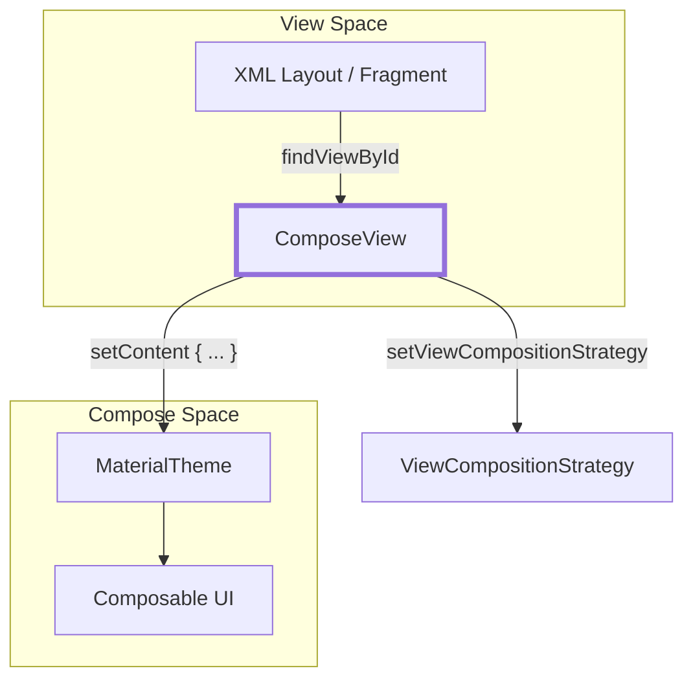

### ViewCompositionStrategy
Incremental migration requires explicit control over when the Composition is disposed to avoid state loss [jetpack-compose/migration/migrate-xml-views-to-jetpack-compose/references/android/develop/ui/compose/migrate/interoperability-apis/compose-in-views.md:41-49]().

| Strategy | Recommended Usage |
|---|---|
| `DisposeOnDetachedFromWindowOrReleasedFromPool` | **Default**. Mixed View/Compose screens or `RecyclerView` items [jetpack-compose/migration/migrate-xml-views-to-jetpack-compose/references/android/develop/ui/compose/migrate/interoperability-apis/compose-in-views.md:60-60](). |
| `DisposeOnViewTreeLifecycleDestroyed` | `ComposeView` in a Fragment's View [jetpack-compose/migration/migrate-xml-views-to-jetpack-compose/references/android/develop/ui/compose/migrate/interoperability-apis/compose-in-views.md:62-62](). |

**Sources:**
- [jetpack-compose/migration/migrate-xml-views-to-jetpack-compose/references/android/develop/ui/compose/migrate/interoperability-apis/compose-in-views.md:1-122]()

---

## Interoperability: Views in Compose

To include View-based elements (like `AdView` or custom legacy Views) in a Compose UI, use the `AndroidView` composable.

### AndroidView Implementation
`AndroidView` uses a `factory` lambda to instantiate the View and an `update` block for state-driven updates [jetpack-compose/migration/migrate-xml-views-to-jetpack-compose/references/android/develop/ui/compose/migrate/interoperability-apis/views-in-compose.md:7-13]().

#### Data Flow: Compose to View
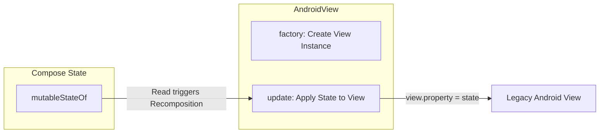

### Key APIs for View Interop
*   **`AndroidViewBinding`**: Used to embed XML layouts directly using generated binding classes [jetpack-compose/migration/migrate-xml-views-to-jetpack-compose/references/android/develop/ui/compose/migrate/interoperability-apis/views-in-compose.md:61-74]().
*   **`AndroidFragment`**: Specifically for adding a `Fragment` into a Compose hierarchy [jetpack-compose/migration/migrate-xml-views-to-jetpack-compose/references/android/develop/ui/compose/migrate/interoperability-apis/views-in-compose.md:118-125]().
*   **`CompositionLocal`**: Access framework types like `Context` via `LocalContext.current` or the current View via `LocalView.current` [jetpack-compose/migration/migrate-xml-views-to-jetpack-compose/references/android/develop/ui/compose/migrate/interoperability-apis/views-in-compose.md:155-167]().

### View Reuse in Lazy Lists
When using `AndroidView` inside a `LazyColumn` or `LazyRow`, use the overload with `onReset` to allow Compose to reuse the underlying `View` instance [jetpack-compose/migration/migrate-xml-views-to-jetpack-compose/references/android/develop/ui/compose/migrate/interoperability-apis/views-in-compose.md:80-89]().

**Sources:**
- [jetpack-compose/migration/migrate-xml-views-to-jetpack-compose/references/android/develop/ui/compose/migrate/interoperability-apis/views-in-compose.md:1-173]()

---

# Page: Edge-to-Edge Support Skill

# Edge-to-Edge Support Skill

<details>
<summary>Relevant source files</summary>

The following files were used as context for generating this wiki page:

- [system/edge-to-edge/SKILL.md](system/edge-to-edge/SKILL.md)

</details>


The Edge-to-Edge Support Skill provides a technical framework for migrating Jetpack Compose applications to a full-screen experience where the UI draws behind system bars (status and navigation bars). This guide covers enabling the feature at the Activity level, managing system insets using Scaffolds and modifiers, handling Input Method Editor (IME) interactions, and ensuring visual legibility across different Android versions.

## Prerequisites and Planning

Before implementing edge-to-edge support, the project must meet specific environment requirements:
*   **Jetpack Compose:** The project must be built using Jetpack Compose [system/edge-to-edge/SKILL.md:21-21]().
*   **SDK Target:** The project must target SDK 35 or later [system/edge-to-edge/SKILL.md:22-22]().

The planning phase involves auditing all `Activity` classes to identify those lacking edge-to-edge support, as well as scanning for components that require specific inset handling, such as Lists, Floating Action Buttons (FABs), and text input fields (`TextField`, `OutlinedTextField`, `BasicTextField`) [system/edge-to-edge/SKILL.md:26-28]().

## Enabling Edge-to-Edge

To enable the feature, the `enableEdgeToEdge()` function must be called within the `onCreate` method of each Activity before `setContent` [system/edge-to-edge/SKILL.md:32-32](). Additionally, to ensure proper keyboard behavior, the `AndroidManifest.xml` must specify `android:windowSoftInputMode="adjustResize"` for activities using a soft keyboard [system/edge-to-edge/SKILL.md:33-33]().

### Activity Initialization Flow
The following diagram illustrates the setup sequence within an Android Activity.

**Title: Edge-to-Edge Activity Setup**
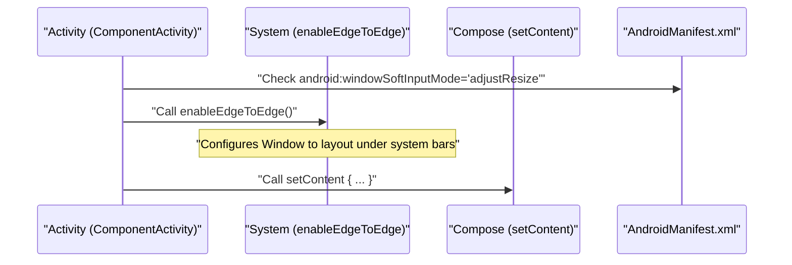
Sources: [system/edge-to-edge/SKILL.md:32-33]()

## Applying System Insets

Once edge-to-edge is enabled, the application must manually account for system bars to prevent UI elements from being obscured.

### Scaffold Integration
The preferred method for handling insets is using the `Scaffold` component. The `innerPadding` provided by the `Scaffold` content lambda accounts for system bars and internal components like TopAppBars or BottomAppBars [system/edge-to-edge/SKILL.md:40-45]().

### Inset Modifiers
For components outside of a `Scaffold`, specific modifiers are used:
*   `Modifier.safeDrawingPadding()`: Applies padding to avoid all system bars and the IME [system/edge-to-edge/SKILL.md:76-83]().
*   `Modifier.windowInsetsPadding(WindowInsets.safeDrawing)`: Provides granular control over specific insets [system/edge-to-edge/SKILL.md:76-76]().
*   `Modifier.fitInside(WindowInsetsRulers.SafeDrawing.current)`: Used for deeply nested components to align with rulers without excessive cumulative padding [system/edge-to-edge/SKILL.md:96-96]().

### Component Support Table
| Component Type | Inset Handling Strategy |
| :--- | :--- |
| **Material 3 Components** | Automatic handling for `TopAppBar`, `BottomAppBar`, `ModalBottomSheet`, `NavigationBar`, etc. [system/edge-to-edge/SKILL.md:59-71]() |
| **Material 2 Components** | Manual handling via `windowInsets` parameter (e.g., `TopAppBar(windowInsets = AppBarDefaults.topAppBarWindowInsets)`) [system/edge-to-edge/SKILL.md:72-73]() |
| **Adaptive Scaffolds** | `NavigationSuiteScaffold` manages its own components but does **not** propagate `PaddingValues`. Insets must be applied to individual inner screens [system/edge-to-edge/SKILL.md:105-105]() |

## IME (Keyboard) Handling

Handling the soft keyboard (IME) requires preventing the keyboard from overlapping input fields while avoiding "double padding" (where both the parent and child apply keyboard offsets).

### Recommended Patterns
1.  **WindowInsetsRulers (Preferred):** Using `Modifier.fitInside(WindowInsetsRulers.Ime.current)` reduces jank and avoids issues with unconsumed insets in the hierarchy [system/edge-to-edge/SKILL.md:110-110]().
2.  **imePadding:** Using `Modifier.imePadding()` before a `verticalScroll()` modifier [system/edge-to-edge/SKILL.md:111-111]().

### Inset Data Flow with Scaffold
This diagram maps the flow of inset data from the system through Compose entities.

**Title: Inset Data Flow and Entity Mapping**
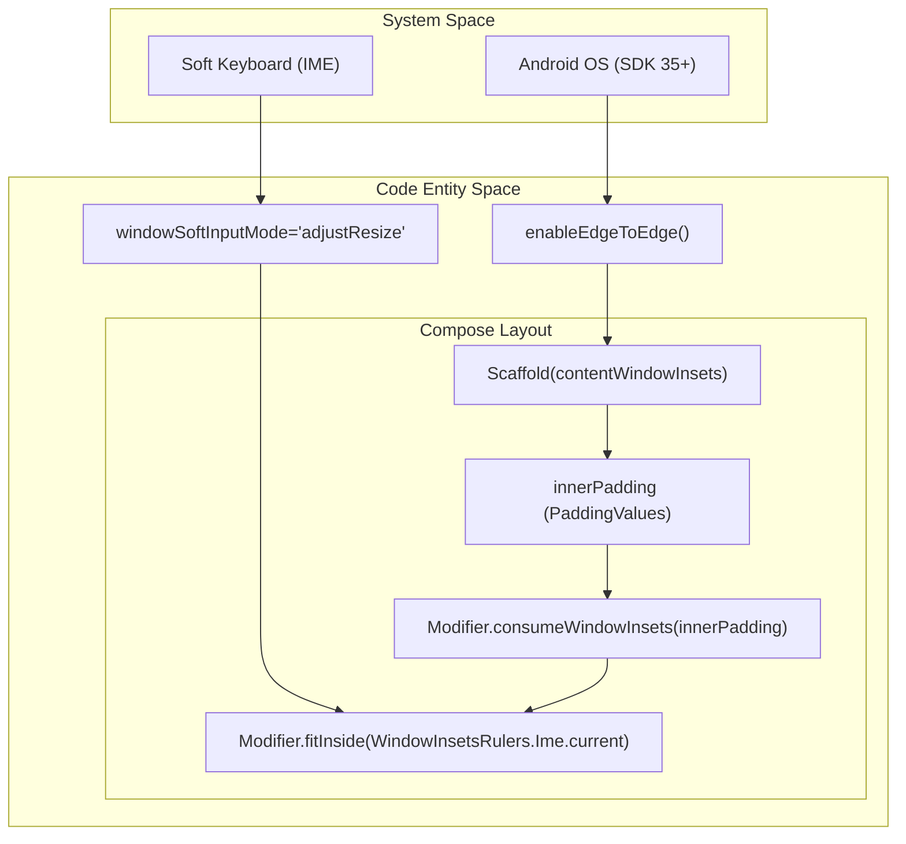
Sources: [system/edge-to-edge/SKILL.md:32-33](), [system/edge-to-edge/SKILL.md:124-153]()

## Lists and Scrolling Content

For scrollable lists, insets should be applied as `contentPadding` rather than standard `Modifier.padding`. This ensures that list items are padded at the start and end of the list, but the content still scrolls behind the system bars [system/edge-to-edge/SKILL.md:27-27]().

```kotlin
// Example: Applying insets to LazyColumn
LazyColumn(
    contentPadding = innerPadding, // Accounts for system bars
    modifier = Modifier.consumeWindowInsets(innerPadding)
) {
    // List items
}
```
Sources: [system/edge-to-edge/SKILL.md:46-52]()

## Full-Screen Dialogs

Standard dialogs do not automatically support edge-to-edge. To enable this, the `DialogProperties` must be configured with `usePlatformDefaultWidth = false`. Inside the dialog, a `Box` or similar container should use `Modifier.safeDrawingPadding()` to ensure content is not clipped by the display cutout or system bars [system/edge-to-edge/SKILL.md:225-236]().

## Legibility and Contrast

When the application draws behind system bars, legibility becomes a concern. 
*   **Navigation Bar Contrast:** On older Android versions (pre-API 29), the system might not automatically handle contrast. `enableEdgeToEdge` allows setting `navigationBarLightScrim` and `navigationBarDarkScrim` to ensure the navigation icons remain visible [system/edge-to-edge/SKILL.md:214-222]().
*   **Scrims:** For custom headers that need to match system bar heights, use `Modifier.windowInsetsTopHeight(WindowInsets.systemBars)` [system/edge-to-edge/SKILL.md:99-101]().

Sources: [system/edge-to-edge/SKILL.md:1-240]()

---

# Page: Navigation 3 Skills

# Navigation 3 Skills

<details>
<summary>Relevant source files</summary>

The following files were used as context for generating this wiki page:

- [navigation/navigation-3/SKILL.md](navigation/navigation-3/SKILL.md)
- [navigation/navigation-3/references/android/guide/navigation/navigation-3/index.md](navigation/navigation-3/references/android/guide/navigation/navigation-3/index.md)

</details>


This section provides an overview of **Navigation 3**, a state-driven navigation library designed specifically for Jetpack Compose. Unlike previous iterations of Jetpack Navigation that relied on a static navigation graph, Navigation 3 treats the back stack as a simple list of keys, offering full control over navigation state and enabling advanced adaptive layouts.

## Overview of Navigation 3

Navigation 3 shifts the mental model from "navigating through a graph" to "managing a list of states." Each entry on the back stack represents content the user has navigated to, and the UI automatically updates to reflect changes in this list.

Key benefits include:
*   **Full Back Stack Control**: Navigating is as simple as adding or removing items from a standard Kotlin `List` [navigation/navigation-3/references/android/guide/navigation/navigation-3/index.md:1-4]().
*   **Adaptive Layouts**: Support for displaying multiple destinations simultaneously (e.g., List-Detail) based on window size [navigation/navigation-3/references/android/guide/navigation/navigation-3/index.md:9-9]().
*   **State Retention**: Automatic scoping for items in the back stack, allowing state to be retained while an item is present [navigation/navigation-3/references/android/guide/navigation/navigation-3/index.md:8-8]().
*   **Simplified Compose Integration**: Designed from the ground up for Compose, removing the need for string-based route parsing in favor of type-safe keys [navigation/navigation-3/references/android/guide/navigation/navigation-3/index.md:28-30]().

### High-Level Architecture

The following diagram illustrates how the core components of Navigation 3 interact to transform a list of keys into a rendered UI.

**Navigation 3 State Flow**
```mermaid
graph TD
    subgraph "Natural Language Space"
        UserAction["User Clicks Button"]
        CurrentScreen["Current Screen Content"]
    end

    subgraph "Code Entity Space"
        BackStack["Back Stack (List of NavKey)"]
        NavKey["NavKey (Data Class)"]
        NavDisplay["NavDisplay (Composable)"]
        EntryProvider["EntryProvider (DSL/Lambda)"]
        NavEntry["NavEntry"]
        
        UserAction -->|push/pop| BackStack
        BackStack -->|contains| NavKey
        NavKey -->|resolved by| EntryProvider
        EntryProvider -->|creates| NavEntry
        NavEntry -->|rendered by| NavDisplay
        NavDisplay -->|updates| CurrentScreen
    end
```
Sources: [navigation/navigation-3/references/android/guide/navigation/navigation-3/index.md:12-19]()

---

## Core Concepts

The foundation of Navigation 3 rests on three primary pillars:
1.  **NavKey**: Unique identifiers (usually data classes) representing a destination [navigation/navigation-3/references/android/guide/navigation/navigation-3/index.md:14-15]().
2.  **Back Stack**: A state-managed list of `NavKey` objects that determines what is currently "active" in the app [navigation/navigation-3/references/android/guide/navigation/navigation-3/index.md:16-16]().
3.  **NavDisplay**: A composable that observes the back stack and resolves keys into UI content using an `entryProvider` [navigation/navigation-3/references/android/guide/navigation/navigation-3/index.md:17-18]().

For a deep dive into the architecture, lifecycles, and comparison with Navigation 2, see **[Navigation 3 Core Concepts](#4.1)**.

---

## Basic Patterns & Recipes

Navigation 3 provides a streamlined API for common tasks. Implementation typically involves defining a `NavHost` or `NavDisplay` and providing a mechanism to save the navigation state across process death.

**Basic Component Mapping**
| Concept | Code Entity | Purpose |
| :--- | :--- | :--- |
| **Destination ID** | `NavKey` | Type-safe data class representing a screen. |
| **UI Container** | `NavDisplay` | Composable that manages transitions and animations. |
| **Route Resolver** | `entryProvider` | DSL or lambda that maps a `NavKey` to a `NavEntry`. |
| **Persistence** | `rememberSaveable` | Ensures the back stack survives configuration changes. |

For implementation details on basic setup, animations, and argument passing, see **[Navigation 3 Recipes: Basic Patterns](#4.2)**.
Sources: [navigation/navigation-3/SKILL.md:51-57](), [navigation/navigation-3/SKILL.md:83-85]()

---

## Advanced Patterns

Beyond simple stacks, Navigation 3 supports complex application requirements:
*   **Conditional Navigation**: Implementing auth guards or onboarding flows by swapping back stacks based on app state [navigation/navigation-3/SKILL.md:91-93]().
*   **Multiple Back Stacks**: Managing independent navigation histories for bottom navigation tabs [navigation/navigation-3/SKILL.md:87-89]().
*   **Result Passing**: Returning data between destinations using event buses or shared state [navigation/navigation-3/SKILL.md:106-109]().
*   **Deep Linking**: Mapping external URIs to complex synthetic back stacks [navigation/navigation-3/SKILL.md:61-65]().

For detailed recipes on these patterns and DI integration with Hilt or Koin, see **[Navigation 3 Recipes: Advanced Patterns](#4.3)**.

---

## Adaptive Layouts & Scenes

One of the most powerful features of Navigation 3 is the **Scenes API**. This allows the UI to adapt based on the device's configuration (e.g., phone vs. tablet) by reading multiple entries from the back stack simultaneously.

**Scene Resolution Logic**
```mermaid
graph LR
    subgraph "Navigation State"
        BS["Back Stack: [ListKey, DetailKey]"]
    end

    subgraph "Scene Strategy"
        Compact["Compact Mode"]
        Expanded["Expanded Mode"]
    end

    BS --> Compact
    BS --> Expanded

    Compact -->|Show Top Only| DetailScreen["Detail Screen"]
    Expanded -->|Show Side-by-Side| ListDetail["List + Detail Pane"]
```
Sources: [navigation/navigation-3/references/android/guide/navigation/navigation-3/index.md:29-30](), [navigation/navigation-3/SKILL.md:75-76]()

Key adaptive patterns include:
*   **List-Detail**: Showing a list and its details side-by-side on large screens [navigation/navigation-3/SKILL.md:75-75]().
*   **Supporting Panes**: Displaying supplementary content in a secondary pane [navigation/navigation-3/SKILL.md:81-81]().
*   **Material 3 Adaptive**: Leveraging standard Material components with Navigation 3 [navigation/navigation-3/SKILL.md:78-81]().

For implementation guides on building responsive UIs, see **[Navigation 3 Recipes: Adaptive Layouts & Scenes](#4.4)**.

---

# Page: Navigation 3 Core Concepts

# Navigation 3 Core Concepts

<details>
<summary>Relevant source files</summary>

The following files were used as context for generating this wiki page:

- [navigation/navigation-3/SKILL.md](navigation/navigation-3/SKILL.md)
- [navigation/navigation-3/references/android/guide/navigation/navigation-3/index.md](navigation/navigation-3/references/android/guide/navigation/navigation-3/index.md)
- [navigation/navigation-3/references/android/guide/navigation/navigation-3/migration-guide.md](navigation/navigation-3/references/android/guide/navigation/navigation-3/migration-guide.md)
- [navigation/navigation-3/references/android/guide/navigation/type-safe-destinations.md](navigation/navigation-3/references/android/guide/navigation/type-safe-destinations.md)

</details>


Navigation 3 is a state-driven navigation library for Jetpack Compose that treats the back stack as a simple list of keys. Unlike Navigation 2, which relies on a rigid graph structure and a `NavController` to manage mutations, Navigation 3 provides full control over navigation state, allowing developers to manage the back stack using standard Kotlin collections and Compose state primitives.

## Architectural Overview

The architecture of Navigation 3 shifts from a "command-based" approach (calling `navigate()`) to a "state-based" approach (modifying a list).

### Core Components

| Component | Role | Code Entity |
| :--- | :--- | :--- |
| **NavKey** | A unique, serializable identifier for a destination. | `NavKey` |
| **Back Stack** | A `MutableList` or `State<List>` of `NavKey` objects representing the history. | `List<NavKey>` |
| **NavEntry** | A wrapper that associates a `NavKey` with a lifecycle, `ViewModelStore`, and saved state. | `NavEntry` |
| **Entry Provider** | A mapping function or DSL that resolves a `NavKey` into a `NavEntry`. | `entryProvider` |
| **NavDisplay** | The Composable component that observes the back stack and renders the active entries. | `NavDisplay` |

### Data Flow Diagram: From Key to Screen
The following diagram illustrates how a `NavKey` in a back stack is transformed into a rendered UI component.

```mermaid
graph TD
    subgraph "State Space"
        BS["Back Stack: List<NavKey>"]
        K1["NavKey (e.g., Profile(id=123))"]
    end

    subgraph "Logic Space (entryProvider)"
        EP["entryProvider DSL"]
        LK["localNavEntryProvider"]
    end

    subgraph "Container Space (NavDisplay)"
        ND["NavDisplay"]
        SS["Scene Strategy"]
    end

    BS -->|Contains| K1
    K1 -->|Resolved by| EP
    EP -->|Creates| NE["NavEntry<Profile>"]
    NE -->|Passed to| ND
    ND -->|Uses| SS
    SS -->|Renders| UI["Composable Content"]

    linkStyle default interpolate basis
```
**Sources:** [navigation/navigation-3/references/android/guide/navigation/navigation-3/index.md:1-21](), [navigation/navigation-3/references/android/guide/navigation/navigation-3/migration-guide.md:137-150]()

---

## The Back Stack as State

In Navigation 3, the back stack is no longer hidden inside a `NavController`. It is a piece of state that you own.

*   **Manual Control**: To navigate forward, you append a `NavKey` to your list. To go back, you remove the last item [navigation/navigation-3/references/android/guide/navigation/navigation-3/index.md:1-4]().
*   **Persistence**: By using `rememberSaveable` with a custom `NavKey` saver (often provided by `rememberNavBackStack`), the entire navigation history survives process death and configuration changes [navigation/navigation-3/references/android/guide/navigation/navigation-3/migration-guide.md:137-142]().
*   **Multiple Back Stacks**: Since the back stack is just a list, implementing multiple back stacks (e.g., for a Bottom Navigation Bar) involves maintaining multiple state lists and switching which one is passed to the `NavDisplay` [navigation/navigation-3/SKILL.md:87-89]().

**Sources:** [navigation/navigation-3/references/android/guide/navigation/navigation-3/index.md:1-11](), [navigation/navigation-3/SKILL.md:54-55]()

---

## NavEntry and Lifecycle

Every destination in the back stack is encapsulated in a `NavEntry`. This object provides the necessary "hooks" for modern Android development:

1.  **Lifecycle**: Each entry has its own `LifecycleOwner`, allowing `LaunchedEffect` and other lifecycle-aware components to work correctly within a destination [navigation/navigation-3/references/android/guide/navigation/navigation-3/index.md:6-10]().
2.  **ViewModel Storage**: A `NavEntry` provides a `ViewModelStore`. This ensures that ViewModels are scoped to the destination and are cleared only when the entry is permanently removed from the back stack [navigation/navigation-3/SKILL.md:100-104]().
3.  **Saved State**: Entries can save their own internal UI state independently of other entries in the stack.

**Sources:** [navigation/navigation-3/references/android/guide/navigation/navigation-3/index.md:6-10](), [navigation/navigation-3/references/android/guide/navigation/navigation-3/migration-guide.md:113-123]()

---

## Entry Provider DSL

The `entryProvider` is the bridge between your data models (`NavKey`) and your UI code. It is typically defined using a DSL that mirrors the `NavGraph` from Navigation 2 but without the routing logic.

### Implementation Mapping
This diagram shows how code entities are organized within the `entryProvider`.

```mermaid
graph LR
    subgraph "Navigation 3 DSL Entities"
        EP["entryProvider { ... }"]
        C["composable<Route>(...)"]
        D["dialog<Route>(...)"]
    end

    subgraph "Key Resolution"
        K["NavKey"]
        V["ViewModel"]
    end

    EP --> C
    EP --> D
    C -->|Provides| K
    C -->|Scopes| V
```

**Sources:** [navigation/navigation-3/references/android/guide/navigation/navigation-3/migration-guide.md:7-8](), [navigation/navigation-3/SKILL.md:55-55]()

---

## Scene Strategies and Adaptive Layouts

One of the primary advantages of Navigation 3 is the ability to display multiple destinations simultaneously. This is handled via **Scene Strategies**.

*   **NavDisplay**: The default container. It looks at the back stack and decides which entries to show based on the provided strategy [navigation/navigation-3/references/android/guide/navigation/navigation-3/index.md:17-19]().
*   **Adaptive Scenes**: You can create custom scenes that read multiple items from the back stack. For example, on a tablet, a `ListDetailScene` might render the second-to-last entry (the List) and the last entry (the Detail) side-by-side [navigation/navigation-3/SKILL.md:75-77]().
*   **Metadata**: Destinations can provide metadata to the `NavDisplay` to influence how they are rendered (e.g., specifying if a destination should be a dialog or a full-screen page) [navigation/navigation-3/references/android/guide/navigation/navigation-3/index.md:10-10]().

**Sources:** [navigation/navigation-3/references/android/guide/navigation/navigation-3/index.md:1-11](), [navigation/navigation-3/SKILL.md:78-82]()

---

## Comparison: Navigation 2 vs. Navigation 3

| Feature | Jetpack Navigation 2 | Navigation 3 |
| :--- | :--- | :--- |
| **Back Stack** | Managed internally by `NavController` | Managed by developer as a `List<NavKey>` |
| **Routing** | String-based or Type-safe (2.8+) | Strictly Type-safe via `NavKey` |
| **Graph** | Static `NavGraph` | Dynamic `entryProvider` |
| **Visibility** | Usually one destination at a time | Multiple destinations via Scene Strategies |
| **Animations** | Defined in `NavGraph` or `composable` | Defined in `NavDisplay` or Scene Strategy |

**Sources:** [navigation/navigation-3/references/android/guide/navigation/navigation-3/index.md:23-33](), [navigation/navigation-3/references/android/guide/navigation/navigation-3/migration-guide.md:1-9]()

---

# Page: Navigation 3 Recipes: Basic Patterns

# Navigation 3 Recipes: Basic Patterns

<details>
<summary>Relevant source files</summary>

The following files were used as context for generating this wiki page:

- [navigation/navigation-3/references/android/guide/navigation/navigation-3/recipes/animations.md](navigation/navigation-3/references/android/guide/navigation/navigation-3/recipes/animations.md)
- [navigation/navigation-3/references/android/guide/navigation/navigation-3/recipes/basic.md](navigation/navigation-3/references/android/guide/navigation/navigation-3/recipes/basic.md)
- [navigation/navigation-3/references/android/guide/navigation/navigation-3/recipes/basicdsl.md](navigation/navigation-3/references/android/guide/navigation/navigation-3/recipes/basicdsl.md)
- [navigation/navigation-3/references/android/guide/navigation/navigation-3/recipes/basicsaveable.md](navigation/navigation-3/references/android/guide/navigation/navigation-3/recipes/basicsaveable.md)
- [navigation/navigation-3/references/android/guide/navigation/navigation-3/recipes/common-ui.md](navigation/navigation-3/references/android/guide/navigation/navigation-3/recipes/common-ui.md)
- [navigation/navigation-3/references/android/guide/navigation/navigation-3/recipes/passingarguments.md](navigation/navigation-3/references/android/guide/navigation/navigation-3/recipes/passingarguments.md)

</details>


This page provides foundational implementation patterns for Navigation 3. It covers the transition from simple state management to robust, production-ready navigation structures including persistent back stacks, DSL-based configurations, argument passing via ViewModels, and custom transition animations.

## Basic Navigation Setup

The most fundamental implementation of Navigation 3 involves managing the back stack as a simple `MutableList` of objects and providing a mapping from those objects to Composables using `NavDisplay`.

### Implementation Details
*   **Back Stack**: Managed via `mutableStateListOf<Any>` [navigation/navigation-3/references/android/guide/navigation/navigation-3/recipes/basic.md:40-40]().
*   **Routes**: Defined as `data object` for static screens or `data class` for screens requiring parameters [navigation/navigation-3/references/android/guide/navigation/navigation-3/recipes/basic.md:49-51]().
*   **Navigation**: Performed by simply adding a new route instance to the back stack [navigation/navigation-3/references/android/guide/navigation/navigation-3/recipes/basic.md:68-70]().
*   **Back Handling**: Managed via the `onBack` lambda in `NavDisplay`, typically calling `removeLastOrNull()` on the back stack [navigation/navigation-3/references/android/guide/navigation/navigation-3/recipes/basic.md:63-63]().

### Data Flow: Basic State Navigation
The following diagram illustrates how a route object moves from the back stack through the `entryProvider` to become a rendered UI component.

| Entity | Role |
| :--- | :--- |
| `RouteA` / `RouteB` | Navigation keys (POJOs) representing destinations [navigation/navigation-3/references/android/guide/navigation/navigation-3/recipes/basic.md:49-51](). |
| `backStack` | A `SnapshotStateList` acting as the single source of truth for navigation state [navigation/navigation-3/references/android/guide/navigation/navigation-3/recipes/basic.md:59-59](). |
| `entryProvider` | A lambda that transforms a navigation key into a `NavEntry` [navigation/navigation-3/references/android/guide/navigation/navigation-3/recipes/basic.md:64-84](). |
| `NavDisplay` | The UI component that observes the back stack and renders the top entry [navigation/navigation-3/references/android/guide/navigation/navigation-3/recipes/basic.md:61-85](). |

**Sources:** [navigation/navigation-3/references/android/guide/navigation/navigation-3/recipes/basic.md:7-14]()

## DSL-Based Setup and Persistence

For more complex applications, Navigation 3 provides a Type-Safe DSL and mechanisms to ensure the navigation state survives configuration changes (like screen rotation).

### Persistent Back Stack
Using `rememberNavBackStack(initialKey)` creates a back stack that is saved via `SavedStateRegistry` [navigation/navigation-3/references/android/guide/navigation/navigation-3/recipes/basicdsl.md:9-9](). This requires:
1.  Routes to be `@Serializable` [navigation/navigation-3/references/android/guide/navigation/navigation-3/recipes/basicdsl.md:50-54]().
2.  Routes to implement the `NavKey` interface [navigation/navigation-3/references/android/guide/navigation/navigation-3/recipes/basicdsl.md:51-54]().

### Entry Provider DSL
Instead of a manual `when` block, the `entryProvider` block allows registering content for specific types using the `entry<T>` function [navigation/navigation-3/references/android/guide/navigation/navigation-3/recipes/basicdsl.md:11-11]().

```mermaid
graph TD
    subgraph "Navigation State"
        A["rememberNavBackStack(RouteA)"] --> B["backStack: SnapshotStateList<NavKey>"]
    end

    subgraph "DSL Configuration"
        C["entryProvider { ... }"]
        C --> D["entry<RouteA> { ... }"]
        C --> E["entry<RouteB> { key -> ... }"]
    end

    B -->|"current key"| C
    D -->|"renders"| F["ContentGreen"]
    E -->|"renders"| G["ContentBlue"]
    
    style A stroke-dasharray: 5 5
```

**Sources:** [navigation/navigation-3/references/android/guide/navigation/navigation-3/recipes/basicdsl.md:9-12](), [navigation/navigation-3/references/android/guide/navigation/navigation-3/recipes/basicdsl.md:62-81]()

## Passing Arguments to ViewModels

Navigation 3 integrates with `ViewModel` to allow passing navigation keys (arguments) directly into the `ViewModel` constructor, specifically when using Hilt.

### Key Components
*   **`rememberViewModelStoreNavEntryDecorator()`**: Must be added to `NavDisplay`'s `entryDecorators` [navigation/navigation-3/references/android/guide/navigation/navigation-3/recipes/passingarguments.md:13-13](). This ensures each unique `NavEntry` (based on its `contentKey`) gets its own `ViewModelStore`, preventing shared state between different instances of the same route [navigation/navigation-3/references/android/guide/navigation/navigation-3/recipes/passingarguments.md:101-108]().
*   **Assisted Injection**: Used to inject the `NavKey` into the `ViewModel` at runtime [navigation/navigation-3/references/android/guide/navigation/navigation-3/recipes/passingarguments.md:9-11]().

### Implementation Example (Hilt)
1.  **ViewModel**: Annotate constructor with `@AssistedInject` and the key with `@Assisted` [navigation/navigation-3/references/android/guide/navigation/navigation-3/recipes/passingarguments.md:127-129]().
2.  **Factory**: Define an `@AssistedFactory` interface [navigation/navigation-3/references/android/guide/navigation/navigation-3/recipes/passingarguments.md:131-134]().
3.  **Call Site**: Use `hiltViewModel` with a `creationCallback` [navigation/navigation-3/references/android/guide/navigation/navigation-3/recipes/passingarguments.md:100-112]().

**Sources:** [navigation/navigation-3/references/android/guide/navigation/navigation-3/recipes/passingarguments.md:7-14](), [navigation/navigation-3/references/android/guide/navigation/navigation-3/recipes/passingarguments.md:81-84]()

## Common UI Patterns: Bottom Navigation

Implementing bottom navigation with multiple back stacks requires a wrapper to manage the relationship between top-level tabs and their respective histories.

### `TopLevelBackStack` Strategy
This pattern involves a custom class that:
1.  Maintains a `Map` of back stacks (one per tab) [navigation/navigation-3/references/android/guide/navigation/navigation-3/recipes/common-ui.md:13-13]().
2.  Tracks the `topLevelKey` (active tab) [navigation/navigation-3/references/android/guide/navigation/navigation-3/recipes/common-ui.md:14-14]().
3.  Exposes a "flattened" back stack to `NavDisplay` [navigation/navigation-3/references/android/guide/navigation/navigation-3/recipes/common-ui.md:15-15]().

### UI Integration
The `Scaffold`'s `bottomBar` uses `NavigationBarItem` to trigger `topLevelBackStack.addTopLevel(route)`, while the `NavDisplay` in the content area observes the combined state [navigation/navigation-3/references/android/guide/navigation/navigation-3/recipes/common-ui.md:19-24]().

**Sources:** [navigation/navigation-3/references/android/guide/navigation/navigation-3/recipes/common-ui.md:9-30](), [navigation/navigation-3/references/android/guide/navigation/navigation-3/recipes/common-ui.md:96-143]()

## Animations and Transitions

Navigation 3 allows defining animations at both the global level (`NavDisplay`) and the individual destination level.

### Global Transitions
`NavDisplay` accepts three transition specs [navigation/navigation-3/references/android/guide/navigation/navigation-3/recipes/animations.md:7-7]():
*   `transitionSpec`: Forward navigation.
*   `popTransitionSpec`: Backward navigation.
*   `predictivePopTransitionSpec`: Predictive back gestures.

### Destination Overrides
Individual entries can override global defaults by providing `metadata` containing specific transition keys [navigation/navigation-3/references/android/guide/navigation/navigation-3/recipes/animations.md:11-11]().

| Transition Key | Purpose |
| :--- | :--- |
| `NavDisplay.TransitionKey` | Custom enter/exit for this specific route [navigation/navigation-3/references/android/guide/navigation/navigation-3/recipes/animations.md:84-84](). |
| `NavDisplay.PopTransitionKey` | Custom back animation for this specific route [navigation/navigation-3/references/android/guide/navigation/navigation-3/recipes/animations.md:92-92](). |
| `NavDisplay.PredictivePopTransitionKey` | Custom predictive back behavior [navigation/navigation-3/references/android/guide/navigation/navigation-3/recipes/animations.md:101-101](). |

### System Mapping: Animation Entities
```mermaid
graph LR
    subgraph "Compose Animation System"
        SA["slideInHorizontally"]
        SV["slideInVertically"]
        TW["tween(1000)"]
    end

    subgraph "Navigation 3 Metadata"
        TK["NavDisplay.TransitionKey"]
        PTK["NavDisplay.PopTransitionKey"]
    end

    subgraph "NavDisplay Configuration"
        ND["NavDisplay(transitionSpec, ...)"]
    end

    TK -->|"uses"| SV
    PTK -->|"uses"| SV
    ND -->|"defaults to"| SA
    TW -->|"configures"| SA
    TW -->|"configures"| SV
```

**Sources:** [navigation/navigation-3/references/android/guide/navigation/navigation-3/recipes/animations.md:7-11](), [navigation/navigation-3/references/android/guide/navigation/navigation-3/recipes/animations.md:81-108]()

---

# Page: Navigation 3 Recipes: Advanced Patterns

# Navigation 3 Recipes: Advanced Patterns

<details>
<summary>Relevant source files</summary>

The following files were used as context for generating this wiki page:

- [navigation/navigation-3/references/android/guide/navigation/navigation-3/recipes/bottomsheet.md](navigation/navigation-3/references/android/guide/navigation/navigation-3/recipes/bottomsheet.md)
- [navigation/navigation-3/references/android/guide/navigation/navigation-3/recipes/conditional.md](navigation/navigation-3/references/android/guide/navigation/navigation-3/recipes/conditional.md)
- [navigation/navigation-3/references/android/guide/navigation/navigation-3/recipes/deeplinks-advanced.md](navigation/navigation-3/references/android/guide/navigation/navigation-3/recipes/deeplinks-advanced.md)
- [navigation/navigation-3/references/android/guide/navigation/navigation-3/recipes/deeplinks-basic.md](navigation/navigation-3/references/android/guide/navigation/navigation-3/recipes/deeplinks-basic.md)
- [navigation/navigation-3/references/android/guide/navigation/navigation-3/recipes/dialog.md](navigation/navigation-3/references/android/guide/navigation/navigation-3/recipes/dialog.md)
- [navigation/navigation-3/references/android/guide/navigation/navigation-3/recipes/modular-hilt.md](navigation/navigation-3/references/android/guide/navigation/navigation-3/recipes/modular-hilt.md)
- [navigation/navigation-3/references/android/guide/navigation/navigation-3/recipes/modular-koin.md](navigation/navigation-3/references/android/guide/navigation/navigation-3/recipes/modular-koin.md)
- [navigation/navigation-3/references/android/guide/navigation/navigation-3/recipes/multiple-backstacks.md](navigation/navigation-3/references/android/guide/navigation/navigation-3/recipes/multiple-backstacks.md)
- [navigation/navigation-3/references/android/guide/navigation/navigation-3/recipes/results-event.md](navigation/navigation-3/references/android/guide/navigation/navigation-3/recipes/results-event.md)
- [navigation/navigation-3/references/android/guide/navigation/navigation-3/recipes/results-state.md](navigation/navigation-3/references/android/guide/navigation/navigation-3/recipes/results-state.md)

</details>


This page covers advanced implementation patterns for Navigation 3. Unlike basic navigation, these patterns involve state-driven logic for authentication, complex data flow between screens, managing multiple UI layers (dialogs/bottom sheets), and architecting multi-module applications with Dependency Injection.

## Conditional Navigation (Auth Guards)

Conditional navigation in Navigation 3 is implemented by centralizing redirection logic within a custom `Navigator` or a specialized `NavBackStack`. This pattern ensures that restricted destinations are protected by "guards" that intercept navigation attempts based on app state (e.g., `isLoggedIn`).

### Implementation Logic
1.  **Marker Interface/Property**: Use a property in the `NavKey` (often a sealed class) to identify restricted routes [navigation/navigation-3/references/android/guide/navigation/navigation-3/recipes/conditional.md:78-79]().
2.  **Redirection**: When `Navigator.navigate()` is called, the system checks the `requiresLogin` status. If the user is unauthenticated, it stores the intended destination and redirects the back stack to a `Login` route [navigation/navigation-3/references/android/guide/navigation/navigation-3/recipes/conditional.md:113-119]().
3.  **Resuming Navigation**: Upon successful login, the `Login` screen retrieves the `redirectToKey` and swaps itself for the original destination [navigation/navigation-3/references/android/guide/navigation/navigation-3/recipes/conditional.md:151-154]().

### Auth Guard Data Flow
The following diagram illustrates how the `Navigator` intercepts restricted keys.

**Navigation Interception Flow**
```mermaid
graph TD
    subgraph "Natural Language Space"
        UserAction["User clicks 'Profile'"]
        AuthCheck["Check if logged in"]
        Redirect["Show Login Screen"]
    end

    subgraph "Code Entity Space"
        ProfileKey["Profile : ConditionalNavKey(requiresLogin = true)"]
        Navigator["Navigator.navigate(Profile)"]
        BackStack["NavBackStack<ConditionalNavKey>"]
        LoginKey["Login(redirectToKey = Profile)"]
    end

    UserAction --> Navigator
    Navigator --> AuthCheck
    AuthCheck -- "isLoggedIn == false" --> LoginKey
    LoginKey --> BackStack
    AuthCheck -- "isLoggedIn == true" --> ProfileKey
    ProfileKey --> BackStack
```
Sources: [navigation/navigation-3/references/android/guide/navigation/navigation-3/recipes/conditional.md:84-119]()

---

## Returning Results

Navigation 3 supports two primary patterns for passing data back to a previous screen: **Event-based** (transient) and **State-based** (persistent).

### Event-Based Results
Uses a shared `ResultEventBus` to facilitate one-time communication.
*   **Producer**: Calls `resultBus.sendResult(data)` [navigation/navigation-3/references/android/guide/navigation/navigation-3/recipes/results-event.md:10-11]().
*   **Consumer**: Uses a `ResultEffect` composable to listen for the specific data type. The lambda triggers once when the result is received [navigation/navigation-3/references/android/guide/navigation/navigation-3/recipes/results-event.md:11-11]().

### State-Based Results
Uses a `ResultStore` to treat the result as persistent state that survives configuration changes.
*   **Producer**: Updates the store via `resultStore.setResult(data)` [navigation/navigation-3/references/android/guide/navigation/navigation-3/recipes/results-state.md:10-10]().
*   **Consumer**: Observes state via `resultStore.getResultState<T>()`. Recomposition occurs automatically when the value changes [navigation/navigation-3/references/android/guide/navigation/navigation-3/recipes/results-state.md:11-11]().

Sources: [navigation/navigation-3/references/android/guide/navigation/navigation-3/recipes/results-event.md:5-13](), [navigation/navigation-3/references/android/guide/navigation/navigation-3/recipes/results-state.md:5-13]()

---

## Multiple Back Stacks

Navigation 3 manages multiple back stacks by maintaining a map of `NavBackStack` instances, typically associated with top-level destinations (e.g., Bottom Navigation tabs).

| Feature | Implementation Detail |
| :--- | :--- |
| **State Storage** | A `Map<NavKey, NavBackStack<NavKey>>` holds the stacks for each top-level route [navigation/navigation-3/references/android/guide/navigation/navigation-3/recipes/multiple-backstacks.md:150-150](). |
| **State Retention** | Each stack uses `rememberSaveableStateHolderNavEntryDecorator` to preserve UI state (like scroll positions) when switching tabs [navigation/navigation-3/references/android/guide/navigation/navigation-3/recipes/multiple-backstacks.md:173-176](). |
| **Exit Pattern** | Implements "exit through home": navigating back from the root of a non-start tab redirects to the `startRoute` stack [navigation/navigation-3/references/android/guide/navigation/navigation-3/recipes/multiple-backstacks.md:64-65](). |

Sources: [navigation/navigation-3/references/android/guide/navigation/navigation-3/recipes/multiple-backstacks.md:5-21](), [navigation/navigation-3/references/android/guide/navigation/navigation-3/recipes/multiple-backstacks.md:147-176]()

---

## Dialogs and Bottom Sheets

Overlay destinations (Dialogs and Bottom Sheets) are implemented using `SceneStrategy`. This allows the `NavDisplay` to render the destination in a separate window or layer rather than as a full-screen replacement.

### Overlay Implementation Steps
1.  **Define Strategy**: Create an instance of `DialogSceneStrategy` or `BottomSheetSceneStrategy` and pass it to `NavDisplay` [navigation/navigation-3/references/android/guide/navigation/navigation-3/recipes/dialog.md:74-79](), [navigation/navigation-3/references/android/guide/navigation/navigation-3/recipes/bottomsheet.md:74-79]().
2.  **Attach Metadata**: In the `entryProvider`, use `metadata` to flag specific keys as overlays [navigation/navigation-3/references/android/guide/navigation/navigation-3/recipes/dialog.md:91-93]().

**Overlay Architecture**
```mermaid
graph LR
    subgraph "NavDisplay"
        direction TB
        Entries["List of NavEntry"]
        Strategies["SceneStrategies"]
    end

    subgraph "Scene Rendering"
        Default["DefaultScene (Full Screen)"]
        Dialog["DialogScene (Window Overlay)"]
        BS["BottomSheetScene (Modal)"]
    end

    Entries --> Strategies
    Strategies -- "Metadata: dialog()" --> Dialog
    Strategies -- "Metadata: bottomSheet()" --> BS
    Strategies -- "No Metadata" --> Default
```
Sources: [navigation/navigation-3/references/android/guide/navigation/navigation-3/recipes/dialog.md:7-17](), [navigation/navigation-3/references/android/guide/navigation/navigation-3/recipes/bottomsheet.md:7-17]()

---

## Deep Linking

Deep linking in Navigation 3 involves parsing an incoming `Intent` into a `NavKey` and optionally constructing a "synthetic" back stack to provide a proper "Up" navigation experience.

### Basic Deep Linking
*   **Pattern Matching**: A `DeepLinkMatcher` compares the `Intent.data` URI against a list of `DeepLinkPattern` objects [navigation/navigation-3/references/android/guide/navigation/navigation-3/recipes/deeplinks-basic.md:124-131]().
*   **Key Decoding**: If a match is found, a `KeyDecoder` (leveraging `kotlinx.serialization`) converts the URI path and query parameters into a typed `NavKey` [navigation/navigation-3/references/android/guide/navigation/navigation-3/recipes/deeplinks-basic.md:147-152]().

### Advanced Deep Linking
Advanced scenarios involve managing the **Task Stack**. When a deep link is triggered with `FLAG_ACTIVITY_NEW_TASK`, the app must manually build the back stack history (e.g., `Home -> Category -> Detail`) so that the back button does not immediately exit the app [navigation/navigation-3/references/android/guide/navigation/navigation-3/recipes/deeplinks-advanced.md:15-17]().

Sources: [navigation/navigation-3/references/android/guide/navigation/navigation-3/recipes/deeplinks-basic.md:121-153](), [navigation/navigation-3/references/android/guide/navigation/navigation-3/recipes/deeplinks-advanced.md:55-66]()

---

## DI Integration (Hilt & Koin)

Modular applications use Dependency Injection to decouple feature modules from the main `app` module.

### Hilt Pattern
*   **EntryProviderInstaller**: Feature modules provide a lambda that adds their entries to a `NavDisplay` [navigation/navigation-3/references/android/guide/navigation/navigation-3/recipes/modular-hilt.md:53-57]().
*   **Multibinding**: Feature modules use `@IntoSet` to contribute their installers to a `Set<EntryProviderInstaller>` [navigation/navigation-3/references/android/guide/navigation/navigation-3/recipes/modular-hilt.md:51-52]().
*   **App Module**: Injects the set and iterates through it inside the `entryProvider` DSL [navigation/navigation-3/references/android/guide/navigation/navigation-3/recipes/modular-hilt.md:113-115]().

### Koin Pattern
*   **Navigation DSL**: Uses the `navigation<T> { ... }` DSL within Koin modules to define entry providers [navigation/navigation-3/references/android/guide/navigation/navigation-3/recipes/modular-koin.md:47-47]().
*   **Scope Management**: Entries are typically defined within an `activityRetainedScope` to ensure navigation state persists through configuration changes [navigation/navigation-3/references/android/guide/navigation/navigation-3/recipes/modular-koin.md:46-48]().

Sources: [navigation/navigation-3/references/android/guide/navigation/navigation-3/recipes/modular-hilt.md:5-20](), [navigation/navigation-3/references/android/guide/navigation/navigation-3/recipes/modular-koin.md:5-18]()

---

# Page: Navigation 3 Recipes: Adaptive Layouts & Scenes

# Navigation 3 Recipes: Adaptive Layouts & Scenes

<details>
<summary>Relevant source files</summary>

The following files were used as context for generating this wiki page:

- [navigation/navigation-3/references/android/guide/navigation/navigation-3/recipes/material-listdetail.md](navigation/navigation-3/references/android/guide/navigation/navigation-3/recipes/material-listdetail.md)
- [navigation/navigation-3/references/android/guide/navigation/navigation-3/recipes/material-supportingpane.md](navigation/navigation-3/references/android/guide/navigation/navigation-3/recipes/material-supportingpane.md)
- [navigation/navigation-3/references/android/guide/navigation/navigation-3/recipes/scenes-listdetail.md](navigation/navigation-3/references/android/guide/navigation/navigation-3/recipes/scenes-listdetail.md)
- [navigation/navigation-3/references/android/guide/navigation/navigation-3/recipes/scenes-twopane.md](navigation/navigation-3/references/android/guide/navigation/navigation-3/recipes/scenes-twopane.md)

</details>


This page covers Navigation 3 recipes for building adaptive layouts that respond to different screen sizes, orientations, and form factors (like foldables). It details how to use the `SceneStrategy` API to implement custom multi-pane layouts and how to leverage Material 3 Adaptive integrations for standard patterns like List-Detail and Supporting Pane.

## Custom Scene-Based Adaptive Layouts

Navigation 3 uses the `SceneStrategy` to decide how to render the current back stack based on device configuration. Unlike traditional navigation where one route equals one screen, a `Scene` can compose multiple `NavEntry` objects into a single visual layout.

### List-Detail Scene Strategy

The List-Detail pattern displays a primary list and a secondary detail pane side-by-side on large screens, typically using a 40/60 split [navigation/navigation-3/references/android/guide/navigation/navigation-3/recipes/scenes-listdetail.md:58-62]().

**Implementation Logic:**
1.  **Breakpoint Check**: The strategy checks if the window width is at least `WIDTH_DP_MEDIUM_LOWER_BOUND` (600dp) [navigation/navigation-3/references/android/guide/navigation/navigation-3/recipes/scenes-listdetail.md:148-150]().
2.  **Metadata Identification**: It searches the back stack for entries tagged with `ListKey` and `DetailKey` [navigation/navigation-3/references/android/guide/navigation/navigation-3/recipes/scenes-listdetail.md:152-156]().
3.  **Scene Keying**: The `sceneKey` is derived from the `listEntry.contentKey`. This ensures that when the detail item changes, the scene itself remains stable, allowing the scene's internal `AnimatedContent` to handle the detail transition instead of the global `NavDisplay` [navigation/navigation-3/references/android/guide/navigation/navigation-3/recipes/scenes-listdetail.md:161-168]().

**Navigation Flow & Entities**

| Entity | Role | Source |
| :--- | :--- | :--- |
| `ListDetailSceneStrategy` | Determines if the 2-pane layout should be active. | [navigation/navigation-3/references/android/guide/navigation/navigation-3/recipes/scenes-listdetail.md:144]() |
| `ListDetailScene` | The `Scene` implementation that renders the `Row` layout. | [navigation/navigation-3/references/android/guide/navigation/navigation-3/recipes/scenes-listdetail.md:62]() |
| `LocalBackButtonVisibility` | `CompositionLocal` used to hide back buttons in the detail pane when side-by-side. | [navigation/navigation-3/references/android/guide/navigation/navigation-3/recipes/scenes-listdetail.md:122]() |

**Sources:** [navigation/navigation-3/references/android/guide/navigation/navigation-3/recipes/scenes-listdetail.md:5-115](), [navigation/navigation-3/references/android/guide/navigation/navigation-3/recipes/scenes-listdetail.md:144-171]()

### Two-Pane Scene Strategy

The Two-Pane recipe demonstrates a 50/50 split for two distinct destinations that are both present on the back stack [navigation/navigation-3/references/android/guide/navigation/navigation-3/recipes/scenes-twopane.md:37-42]().

**Key Characteristics:**
*   **Back Navigation**: Even though two entries are displayed, the `previousEntries` usually only drops the top-most entry. This prevents "double-popping" where adding one item forward would require two clicks to go back [navigation/navigation-3/references/android/guide/navigation/navigation-3/recipes/scenes-twopane.md:109-114]().
*   **Scene Key**: Uses a `Pair` of both entry keys to ensure the scene is recreated if either pane changes its primary identity [navigation/navigation-3/references/android/guide/navigation/navigation-3/recipes/scenes-twopane.md:105-107]().

**Sources:** [navigation/navigation-3/references/android/guide/navigation/navigation-3/recipes/scenes-twopane.md:37-66](), [navigation/navigation-3/references/android/guide/navigation/navigation-3/recipes/scenes-twopane.md:83-125]()

---

## Material 3 Adaptive Integration

For standard Material 3 patterns, Navigation 3 provides specialized strategies that wrap the Material 3 Adaptive library components.

### Material List-Detail

The `ListDetailSceneStrategy` from the Material 3 Adaptive library automatically adjusts between one, two, or three panes (List, Detail, and Extra) [navigation/navigation-3/references/android/guide/navigation/navigation-3/recipes/material-listdetail.md:13-18]().

**Pane Assignment via Metadata:**
*   `ListDetailSceneStrategy.listPane()`: Assigned to the primary list. Can include a `detailPlaceholder` for when no item is selected [navigation/navigation-3/references/android/guide/navigation/navigation-3/recipes/material-listdetail.md:103-108]().
*   `ListDetailSceneStrategy.detailPane()`: Assigned to the secondary content [navigation/navigation-3/references/android/guide/navigation/navigation-3/recipes/material-listdetail.md:119]().
*   `ListDetailSceneStrategy.extraPane()`: Assigned to tertiary content (e.g., a Profile view) [navigation/navigation-3/references/android/guide/navigation/navigation-3/recipes/material-listdetail.md:132]().

**Code Entity Mapping: Material List-Detail**

Title: Material List-Detail Data Flow
```mermaid
graph TD
    subgraph "Navigation State"
        A["NavBackStack (rememberNavBackStack)"] --> B["backStack.add(ConversationDetail)"]
    end

    subgraph "Adaptive Strategy"
        C["rememberListDetailSceneStrategy(directive)"]
        D["ListDetailSceneStrategy.listPane()"]
        E["ListDetailSceneStrategy.detailPane()"]
        F["ListDetailSceneStrategy.extraPane()"]
    end

    subgraph "UI Rendering"
        G["NavDisplay"]
        H["Pane 1: List"]
        I["Pane 2: Detail"]
        J["Pane 3: Extra"]
    end

    A -- "Provides State" --> G
    C -- "Injected into" --> G
    D -- "Metadata for" --> H
    E -- "Metadata for" --> I
    F -- "Metadata for" --> J
    G -- "Orchestrates" --> H
    G -- "Orchestrates" --> I
```
**Sources:** [navigation/navigation-3/references/android/guide/navigation/navigation-3/recipes/material-listdetail.md:9-21](), [navigation/navigation-3/references/android/guide/navigation/navigation-3/recipes/material-listdetail.md:96-137]()

### Material Supporting Pane

The `SupportingPaneSceneStrategy` is designed for layouts where a main content area is supplemented by an auxiliary pane (e.g., a video player with a list of related videos) [navigation/navigation-3/references/android/guide/navigation/navigation-3/recipes/material-supportingpane.md:3-18]().

**Back Navigation Customization:**
A key feature in this recipe is the use of `BackNavigationBehavior.PopUntilCurrentDestinationChange`. This ensures that pressing the back button dismisses the supporting pane (returning focus to the main pane) rather than navigating the entire app back immediately [navigation/navigation-3/references/android/guide/navigation/navigation-3/recipes/material-supportingpane.md:20-21](), [navigation/navigation-3/references/android/guide/navigation/navigation-3/recipes/material-supportingpane.md:101-104]().

**System Interaction Diagram**

Title: Supporting Pane Strategy Resolution
```mermaid
graph LR
    subgraph "Input State"
        BS["backStack: [MainVideo, RelatedVideos]"]
        WI["WindowAdaptiveInfo (currentWindowAdaptiveInfo)"]
    end

    subgraph "Logic: SupportingPaneSceneStrategy"
        CALC["calculateScene()"]
        META["Metadata Check: .mainPane() vs .supportingPane()"]
    end

    subgraph "Output: NavDisplay"
        SINGLE["Single Pane (Mobile)"]
        DUAL["Dual Pane (Tablet/Foldable)"]
    end

    WI -- "Provides Width/Fold State" --> CALC
    BS -- "Provides Entries" --> CALC
    CALC -- "Uses" --> META
    CALC -- "Width < 600dp" --> SINGLE
    CALC -- "Width >= 600dp" --> DUAL
```

**Sources:** [navigation/navigation-3/references/android/guide/navigation/navigation-3/recipes/material-supportingpane.md:9-22](), [navigation/navigation-3/references/android/guide/navigation/navigation-3/recipes/material-supportingpane.md:101-141]()

## Implementation Details

### Configuration Overrides
In adaptive layouts, default spacers between panes might need to be removed to match specific designs. This is achieved by copying the `PaneScaffoldDirective` [navigation/navigation-3/references/android/guide/navigation/navigation-3/recipes/material-listdetail.md:91-95]():

```kotlin
val directive = remember(windowAdaptiveInfo) {
    calculatePaneScaffoldDirective(windowAdaptiveInfo)
        .copy(horizontalPartitionSpacerSize = 0.dp)
}
```

### Strategy Selection
`NavDisplay` accepts a list of `sceneStrategies`. It evaluates them in order; the first strategy to return a non-null `Scene` is used to render the UI [navigation/navigation-3/references/android/guide/navigation/navigation-3/recipes/material-listdetail.md:101](), [navigation/navigation-3/references/android/guide/navigation/navigation-3/recipes/material-supportingpane.md:109]().

**Sources:** [navigation/navigation-3/references/android/guide/navigation/navigation-3/recipes/material-listdetail.md:89-97](), [navigation/navigation-3/references/android/guide/navigation/navigation-3/recipes/material-supportingpane.md:91-104]()

---

# Page: Performance Skills

# Performance Skills

<details>
<summary>Relevant source files</summary>

The following files were used as context for generating this wiki page:

- [performance/r8-analyzer/SKILL.md](performance/r8-analyzer/SKILL.md)

</details>


The Performance Skills domain focuses on optimizing Android applications for size and execution efficiency, primarily through advanced configuration of the R8 compiler and ProGuard rules. This section provides an automated, structured approach to auditing build configurations and shrinking the application footprint by identifying redundant or overly broad keep rules.

The primary tool in this domain is the `r8-analyzer` skill, which implements a systematic 9-phase pipeline to evaluate an application's shrinking configuration [performance/r8-analyzer/SKILL.md:18-31]().

### R8 Analyzer Skill

The `r8-analyzer` skill is designed to identify redundancies, broad package-wide rules, and rules that subsume library consumer keep rules [performance/r8-analyzer/SKILL.md:2-6](). It automates the process of auditing `build.gradle`, `build.gradle.kts`, and `gradle.properties` to ensure the R8 environment is correctly configured according to modern standards [performance/r8-analyzer/SKILL.md:21-21]().

Key features of the analyzer include:
*   **AGP Version Validation**: Recommending upgrades to AGP 9.0 to leverage built-in optimizations [performance/r8-analyzer/SKILL.md:22-22]().
*   **Redundancy Filtering**: Automatically identifying rules for libraries (e.g., AndroidX, Kotlin, Retrofit) that are already handled by consumer ProGuard rules [performance/r8-analyzer/SKILL.md:23-23]().
*   **Subsumption Analysis**: Detecting broad rules that unnecessarily cover code already protected by more specific rules [performance/r8-analyzer/SKILL.md:24-24]().
*   **Reflection Mapping**: Analyzing code for reflection usage to narrow down broad keep rules into surgical configurations [performance/r8-analyzer/SKILL.md:25-25]().

For a detailed walkthrough of the analysis phases and validation steps, see **[R8 Analyzer Skill](#5.1)**.

### R8 Analyzer Reference Materials

The effectiveness of the performance analysis relies on a set of reference documents that define the impact of various keep rules and catalog known redundancies in the Android ecosystem. These materials allow the AI agent to categorize rules by their "weight" and potential for optimization.

The reference set includes:
*   **Keep Rules Impact Hierarchy**: A classification system used to prioritize which rules have the highest impact on code shrinking [performance/r8-analyzer/SKILL.md:23-23]().
*   **Redundant Rules Catalog**: A list of common libraries that provide their own rules, making manual entries in the app's ProGuard file unnecessary [performance/r8-analyzer/SKILL.md:23-23]().
*   **Reflection Guide**: Technical documentation for narrowing broad keep rules by identifying specific reflection-based access patterns [performance/r8-analyzer/SKILL.md:25-25]().

For a deep dive into these reference catalogs and the impact hierarchy, see **[R8 Analyzer Reference Materials](#5.2)**.

### System Mapping: Skill to Codebase

The following diagrams illustrate how the `r8-analyzer` skill bridges the gap between natural language optimization requests and the specific build artifacts it inspects.

#### Workflow Entity Mapping
This diagram shows how the skill workflow steps interact with specific codebase entities.

```mermaid
graph TD
    subgraph "Natural Language Space"
        "Optimize App Size" --> "Analyze Rules"
        "Troubleshoot ProGuard" --> "Analyze Rules"
    end

    subgraph "Code Entity Space"
        "Analyze Rules" --> SKILL["SKILL.md"]
        SKILL -- "Step 2: Inspect" --> GRADLE["build.gradle / .kts"]
        SKILL -- "Step 2: Inspect" --> PROP["gradle.properties"]
        SKILL -- "Step 4: Audit" --> PROGUARD["proguard-rules.pro"]
        
        SKILL -- "Step 4a: Reference" --> RED_RULES["REDUNDANT-RULES.md"]
        SKILL -- "Step 4b: Reference" --> HIERARCHY["KEEP-RULES-IMPACT-HIERARCHY.md"]
        SKILL -- "Step 6: Reference" --> REFLECTION["REFLECTION-GUIDE.md"]
    end
```
**Sources:** [performance/r8-analyzer/SKILL.md:18-31]()

#### R8 Analysis Pipeline
This diagram traces the logic flow from environment detection to final reporting.

```mermaid
graph LR
    START["Environment Check"] --> AGP_VER{"AGP < 9.0?"}
    AGP_VER -- "Yes" --> SUGGEST_AGP["Suggest AGP 9.0"]
    AGP_VER -- "No" --> LIB_CHECK["Library Redundancy Check"]
    
    LIB_CHECK --> IMPACT["Impact Hierarchy Assessment"]
    IMPACT --> SUBSUMPTION["Subsumption Analysis"]
    SUBSUMPTION --> REFLECT["Reflection Analysis"]
    
    REFLECT --> REPORT["R8_Configuration_Analysis.md"]
    REPORT --> VALIDATE["UI Automator Validation"]
```
**Sources:** [performance/r8-analyzer/SKILL.md:20-31]()

### Performance Optimization Table

| Analysis Phase | Target Files | Reference Material | Goal |
| :--- | :--- | :--- | :--- |
| **Environment** | `gradle.properties`, `build.gradle` | `CONFIGURATION.md` | Ensure R8 is enabled and AGP is up to date. |
| **Library Audit** | `proguard-rules.pro` | `REDUNDANT-RULES.md` | Remove rules for libraries like Room, Gson, and Retrofit. |
| **Impact Analysis** | `proguard-rules.pro` | `KEEP-RULES-IMPACT-HIERARCHY.md` | Rank rules by their effect on code stripping. |
| **Refinement** | App Source Code | `REFLECTION-GUIDE.md` | Replace broad `-keep class pkg.**` with specific rules. |

**Sources:** [performance/r8-analyzer/SKILL.md:21-31]()

---

# Page: R8 Analyzer Skill

# R8 Analyzer Skill

<details>
<summary>Relevant source files</summary>

The following files were used as context for generating this wiki page:

- [performance/r8-analyzer/SKILL.md](performance/r8-analyzer/SKILL.md)
- [performance/r8-analyzer/references/CONFIGURATION.md](performance/r8-analyzer/references/CONFIGURATION.md)
- [performance/r8-analyzer/references/android/topic/performance/app-optimization/enable-app-optimization.md](performance/r8-analyzer/references/android/topic/performance/app-optimization/enable-app-optimization.md)

</details>


The **R8 Analyzer Skill** is a specialized diagnostic tool designed to optimize Android application size and performance by auditing R8/ProGuard configurations. It identifies redundant rules, overly broad package-level keep rules, and opportunities for narrowing reflection-based rules to ensure maximum code shrinking and obfuscation efficiency.

[performance/r8-analyzer/SKILL.md:2-6]()

## Analysis Pipeline

The skill follows an 8-phase pipeline to transition from environment validation to actionable reporting.

### 1. Environment & Configuration Validation
The analyzer first inspects the build environment to ensure R8 is configured for maximum utilization. This involves checking `build.gradle`, `build.gradle.kts`, and `gradle.properties`.

*   **Minification Check**: Verifies `isMinifyEnabled` and `isShrinkResources` are `true` in the `release` build type. [performance/r8-analyzer/references/CONFIGURATION.md:6-22]()
*   **ProGuard File Selection**: Ensures the project uses `proguard-android-optimize.txt` instead of the non-optimized variant. [performance/r8-analyzer/references/CONFIGURATION.md:8-9]()
*   **AGP Versioning**: 
    *   If AGP < 9.0, it suggests an upgrade to leverage built-in optimizations. [performance/r8-analyzer/SKILL.md:22-22]()
    *   If 8.6 < AGP < 9.0, it checks for `android.r8.optimizedResourceShrinking=true`. [performance/r8-analyzer/references/CONFIGURATION.md:41-44]()
*   **Full Mode**: Confirms `android.enableR8.fullMode=false` is not present for AGP 8.0+. [performance/r8-analyzer/references/CONFIGURATION.md:38-39]()

### 2. Redundancy & Impact Assessment
The analyzer evaluates existing `.pro` files against a library-specific catalog and an impact hierarchy.

*   **Library Filtering**: Rules targeting common libraries (AndroidX, Kotlin, Retrofit, etc.) are flagged for removal because these libraries provide their own consumer keep rules. [performance/r8-analyzer/SKILL.md:23-23]()
*   **Impact Hierarchy**: Remaining rules are categorized by their "breadth" (e.g., keeping an entire package vs. a single class). [performance/r8-analyzer/SKILL.md:23-23]()

### 3. Subsumption & Reflection Analysis
*   **Subsumption**: Identifies "broader" rules that render "narrower" rules redundant (e.g., a `-keep class com.example.**` subsumes `-keep class com.example.MyClass`). [performance/r8-analyzer/SKILL.md:24-24]()
*   **Reflection Deep-Dive**: For rules that cannot be removed, the analyzer examines adjacent code for `java.lang.reflect` or `Class.forName()` usage to suggest the narrowest possible rule. [performance/r8-analyzer/SKILL.md:25-25]()

### 4. Reporting & Validation
The final output is a structured report (`R8_Configuration_Analysis.md`) containing concise actions (Remove vs. Refine) ordered by their impact on the codebase. [performance/r8-analyzer/SKILL.md:20-29]()

**Sources:**
* [performance/r8-analyzer/SKILL.md:18-31]()
* [performance/r8-analyzer/references/CONFIGURATION.md:1-44]()
* [performance/r8-analyzer/references/android/topic/performance/app-optimization/enable-app-optimization.md:104-131]()

---

## Data Flow: From Natural Language to Code Entities

The following diagrams illustrate how the high-level optimization goals map to specific code entities and build configurations.

### Configuration Logic Mapping
This diagram bridges the developer's intent to optimize with the specific Gradle properties and DSL elements targeted by the skill.

```mermaid
graph TD
    subgraph "Natural Language Space (Intent)"
        A["'Optimize my app size'"]
        B["'Enable full R8 features'"]
        C["'Shrink resources'"]
    end

    subgraph "Code Entity Space (Implementation)"
        A --> D["isMinifyEnabled = true"]
        A --> E["proguard-android-optimize.txt"]
        B --> F["android.enableR8.fullMode=true"]
        C --> G["isShrinkResources = true"]
        C --> H["android.r8.optimizedResourceShrinking=true"]
    end

    subgraph "Files Targeted"
        D & E & G --- I["build.gradle.kts"]
        F & H --- J["gradle.properties"]
    end
```
**Sources:**
* [performance/r8-analyzer/references/CONFIGURATION.md:11-44]()
* [performance/r8-analyzer/references/android/topic/performance/app-optimization/enable-app-optimization.md:58-80]()

### Keep Rule Analysis Workflow
This diagram maps the analysis phases to the internal reference documents used to evaluate code.

```mermaid
graph LR
    subgraph "Phase"
        P1["Validation"]
        P2["Filtering"]
        P3["Refinement"]
    end

    subgraph "Code Entities & References"
        P1 --> REF1["CONFIGURATION.md"]
        P2 --> REF2["REDUNDANT-RULES.md"]
        P2 --> REF3["KEEP-RULES-IMPACT-HIERARCHY.md"]
        P3 --> REF4["REFLECTION-GUIDE.md"]
    end

    subgraph "Action"
        REF1 --> ACT1["Update AGP / Gradle Flags"]
        REF2 --> ACT2["Delete redundant library rules"]
        REF3 --> ACT3["Remove subsumed broad rules"]
        REF4 --> ACT4["Replace broad rules with specific class rules"]
    end
```
**Sources:**
* [performance/r8-analyzer/SKILL.md:20-29]()
* [performance/r8-analyzer/references/CONFIGURATION.md:1-4]()

---

## Technical Implementation Details

### AGP Version Checks
The analyzer applies different logic based on the detected Android Gradle Plugin version:

| AGP Version | Recommendation | Required Configuration |
| :--- | :--- | :--- |
| **< 8.0** | Upgrade to 9.0 | `android.enableR8.fullMode=true` |
| **8.0 - 8.6** | Upgrade to 9.0 | Full Mode enabled by default |
| **8.6 - 8.12** | Upgrade to 9.0 | `android.r8.optimizedResourceShrinking=true` |
| **>= 9.0** | None (Optimal) | No extra flags needed for resource shrinking |

**Sources:**
* [performance/r8-analyzer/SKILL.md:22-22]()
* [performance/r8-analyzer/references/CONFIGURATION.md:34-44]()
* [performance/r8-analyzer/references/android/topic/performance/app-optimization/enable-app-optimization.md:120-131]()

### UI Automator Validation
After suggesting changes to keep rules, the skill mandates a validation step using **UI Automator**. This is critical because R8 optimizations (like obfuscation and class merging) can break code that relies on implicit reflection or JNI transitions that aren't captured in static keep rules.

The developer is advised to:
1.  Identify packages affected by keep rule changes. [performance/r8-analyzer/SKILL.md:30-31]()
2.  Run UI Automator tests targeting those specific functional areas to detect `ClassNotFoundException` or `NoSuchMethodError` at runtime. [performance/r8-analyzer/SKILL.md:30-31]()

### Mandatory Constraints
To maintain the integrity of the codebase and the report, the skill follows these rules:
*   **No Direct Modification**: The analyzer never edits `.pro` files directly; it only provides instructions. [performance/r8-analyzer/SKILL.md:35-35]()
*   **Silence on Success**: If a specific category (e.g., redundant library rules) has no issues, that section is omitted from the report. [performance/r8-analyzer/SKILL.md:37-37]()
*   **No Internal Metadata**: The report must not mention the skill's internal files or exceptions. [performance/r8-analyzer/SKILL.md:38-41]()

**Sources:**
* [performance/r8-analyzer/SKILL.md:33-41]()

---

# Page: R8 Analyzer Reference Materials

# R8 Analyzer Reference Materials

<details>
<summary>Relevant source files</summary>

The following files were used as context for generating this wiki page:

- [performance/r8-analyzer/references/KEEP-RULES-IMPACT-HIERARCHY.md](performance/r8-analyzer/references/KEEP-RULES-IMPACT-HIERARCHY.md)
- [performance/r8-analyzer/references/REDUNDANT-RULES.md](performance/r8-analyzer/references/REDUNDANT-RULES.md)
- [performance/r8-analyzer/references/REFLECTION-GUIDE.md](performance/r8-analyzer/references/REFLECTION-GUIDE.md)

</details>


This page provides deep-dive reference materials for the R8 Analyzer skill. It covers the technical hierarchy of keep rule impacts, a catalog of redundant rules for common Android libraries, and a reflection guide for narrowing broad rules into optimization-friendly configurations.

## Keep Rules Impact Hierarchy

Keep rules are not equal in their impact on R8's ability to optimize code. The hierarchy below ranks rules from the most restrictive (worst for optimization) to the most granular (best for optimization).

### Impact Levels and Optimization Constraints

| Level | Rule Type | Optimization Impact | Recommended Action |
| :--- | :--- | :--- | :--- |
| 1 | Package-Wide Wildcards | Prevents all optimization in package and subpackages. | Refine to specific classes. |
| 2 | Inversion Operator (`!`) | Can unintentionally keep the entire app except one class. | Remove and use narrow rules. |
| 3 | Full Class & Members | Retains class and all members exactly as defined. | Use `-keepclassmembers` if possible. |
| 4 | Member Wildcards | Retains all members but may allow class shrinking. | Specify only required members. |
| 5 | Modifiers (Shrinking/Obfuscation) | Allows specific optimizations while keeping structure. | Use `allowobfuscation`, `allowshrinking`. |
| 6 | Specific Method | Keeps only the named method and the class. | Ideal for single entry points. |
| 7 | Class-Name Only | Only the name is kept; unused members are removed. | Best for simple reflection. |
| 8 | Conditional Rules | Triggers only if other members exist. | Most narrow and friendly to R8. |

### Rule Structure Data Flow

The following diagram illustrates how different keep rule specifications restrict the R8 optimization engine.

**Diagram: R8 Optimization Constraint Flow**
```mermaid
graph TD
    subgraph "Natural Language Space"
        A["'Keep everything in this package'"]
        B["'Keep this class but obfuscate it'"]
        C["'Keep this field only if the class is used'"]
    end

    subgraph "Code Entity Space: R8 Rules"
        A --> R1["-keep class com.example.** { *; }"]
        B --> R2["-keep,allowobfuscation class MyClass"]
        C --> R3["-keepclassmembers class MyClass { <fields>; }"]
    end

    subgraph "R8 Optimization Engine"
        R1 --> P1["Constraint: Total Block"]
        R2 --> P2["Constraint: Structure Only"]
        R3 --> P3["Constraint: Conditional Member"]
        
        P1 --> E1["No Shrinking / No Obfuscation / No Inlining"]
        P2 --> E2["No Shrinking / Obfuscation Allowed"]
        P3 --> E3["Shrink if Unused / Optimized if Not Accessed"]
    end
```

**Sources:**
- [performance/r8-analyzer/references/KEEP-RULES-IMPACT-HIERARCHY.md:4-13]()
- [performance/r8-analyzer/references/KEEP-RULES-IMPACT-HIERARCHY.md:18-29]()
- [performance/r8-analyzer/references/KEEP-RULES-IMPACT-HIERARCHY.md:48-54]()
- [performance/r8-analyzer/references/KEEP-RULES-IMPACT-HIERARCHY.md:77-83]()

---

## Redundant Rules Catalog

Modern Android development relies on "Consumer Keep Rules" bundled within AAR/JAR files. Manual rules for these libraries often conflict with or broaden the optimized rules provided by library authors.

### Common Redundancies by Library

| Library / Component | Redundant Rule Pattern | Reason for Redundancy |
| :--- | :--- | :--- |
| **Android Components** | `-keep class * extends android.app.Activity` | AAPT2 automatically generates rules from `AndroidManifest.xml`. |
| **AndroidX / Kotlin** | `-keep class androidx.** { *; }` | Official libraries bundle their own specific consumer rules. |
| **Gson** | `-keep class com.google.gson.internal.**` | Gson 2.11.0+ bundles rules; `@SerializedName` handles field retention. |
| **Retrofit** | `-keep class retrofit2.** { *; }` | Retrofit 2.9.0+ detects HTTP annotations (`@GET`, etc.) automatically. |
| **Coroutines** | `-keep class kotlinx.coroutines.**` | `kotlinx-coroutines-core` includes internal rules for continuations. |

### Global Optimization Kill-Switches
The following rules should be removed immediately as they disable R8 entirely:
- `-dontshrink` [performance/r8-analyzer/references/REDUNDANT-RULES.md:12-12]()
- `-dontobfuscate` [performance/r8-analyzer/references/REDUNDANT-RULES.md:13-13]()
- `-dontoptimize` [performance/r8-analyzer/references/REDUNDANT-RULES.md:14-14]()

**Sources:**
- [performance/r8-analyzer/references/REDUNDANT-RULES.md:21-36]()
- [performance/r8-analyzer/references/REDUNDANT-RULES.md:39-52]()
- [performance/r8-analyzer/references/REDUNDANT-RULES.md:56-107]()
- [performance/r8-analyzer/references/REDUNDANT-RULES.md:110-145]()
- [performance/r8-analyzer/references/REDUNDANT-RULES.md:149-180]()

---

## Reflection & Dynamic Loading Guide

When R8 cannot statically determine that a class or member is used (e.g., via reflection), a keep rule is required. The goal is to match the code pattern to the narrowest possible rule.

### Pattern Mapping: Code to Keep Rule

**Diagram: Reflection Pattern to Rule Mapping**
```mermaid
graph LR
    subgraph "Code Entity Space: Implementation Patterns"
        P1["Class.forName('com.pkg.Task')"]
        P2["val f = clazz.getDeclaredField('secret')"]
        P3["implements Parcelable"]
    end

    subgraph "R8 Analyzer: Suggested Rules"
        P1 --> R1["-keep class com.pkg.Task { <init>(); }"]
        P2 --> R2["-keepclassmembers class Clazz { private String secret; }"]
        P3 --> R3["-keepclassmembers class * implements Parcelable { static Creator CREATOR; }"]
    end

    R1 -.-> S1["Retains Constructor for newInstance()"]
    R2 -.-> S2["Prevents Field Renaming/Removal"]
    R3 -.-> S3["Retains Android IPC Creator"]
```

### Specific Reflection Scenarios

1.  **Classes Loaded by Name:** When using `Class.forName()`, the keep rule must include the parameterless constructor `();` to allow `newInstance()` calls. [performance/r8-analyzer/references/REFLECTION-GUIDE.md:4-21]()
2.  **Annotation-Based Reflection:** Instead of keeping all methods, keep only those annotated with a specific marker.
    - Rule: `-keepclassmembers class * { @com.example.MyAnnotation *; }` [performance/r8-analyzer/references/REFLECTION-GUIDE.md:54-60]()
3.  **Optional Dependencies:** If your code uses `try-catch` around `Class.forName()` to check for optional modules, you must `-keep` that class to prevent R8 from removing it during the build of the optional module itself. [performance/r8-analyzer/references/REFLECTION-GUIDE.md:62-80]()
4.  **Private Member Access:** When using `getDeclaredField` followed by `isAccessible = true`, the specific field name and type must be preserved. [performance/r8-analyzer/references/REFLECTION-GUIDE.md:81-100]()

**Sources:**
- [performance/r8-analyzer/references/REFLECTION-GUIDE.md:4-21]()
- [performance/r8-analyzer/references/REFLECTION-GUIDE.md:42-60]()
- [performance/r8-analyzer/references/REFLECTION-GUIDE.md:81-100]()
- [performance/r8-analyzer/references/REFLECTION-GUIDE.md:102-121]()

---

# Page: Play Billing Skills

# Play Billing Skills

<details>
<summary>Relevant source files</summary>

The following files were used as context for generating this wiki page:

- [play/play-billing-library-version-upgrade/SKILL.md](play/play-billing-library-version-upgrade/SKILL.md)

</details>


The **Play Billing Skills** domain provides a structured methodology for upgrading the Google Play Billing Library (PBL) in Android applications. This skill ensures that migrations from legacy versions to the latest stable release are handled with situational awareness, accounting for both explicit version declarations and "Effective Versions" indicated by deprecated API usage.

## Purpose and Scope

The primary objective of the Play Billing skills is to automate and standardize the migration of billing logic, which is often sensitive and prone to breaking changes. The skill covers:
*   **Discovery**: Identifying the baseline version through dependency analysis and source code scanning [play/play-billing-library-version-upgrade/SKILL.md:25-35]().
*   **Path Calculation**: Determining whether a **Direct Migration** or a **Stepped Migration** is required based on the version gap [play/play-billing-library-version-upgrade/SKILL.md:37-41]().
*   **Environment Alignment**: Ensuring `compileSdk`, Android Gradle Plugin (AGP), and Kotlin versions meet the requirements of the target PBL version [play/play-billing-library-version-upgrade/SKILL.md:59-63]().
*   **Refactoring**: Replacing deprecated classes and methods (e.g., transitioning from `SkuDetails` to `ProductDetails`) [play/play-billing-library-version-upgrade/SKILL.md:64-71]().

### From Natural Language Intent to Code Entities

The following diagram illustrates how the migration skill bridges high-level developer intents to specific code entities and files within the Android project.

**Play Billing Migration Mapping**
```mermaid
graph TD
    subgraph "Natural Language Space (Intent)"
        I1["'Upgrade Play Billing'"]
        I2["'Fix Deprecated SkuDetails'"]
    end

    subgraph "Skill Logic (SKILL.md)"
        P1["Phase 1: Discovery"]
        P2["Phase 3: Refactoring"]
    end

    subgraph "Code Entity Space (Project Files)"
        E1["com.android.billingclient:billing"]
        E2["SkuDetails"]
        E3["ProductDetails"]
        E4["querySkuDetailsAsync()"]
        E5["queryProductDetailsAsync()"]
        E6["build.gradle / libs.versions.toml"]
    end

    I1 --> P1
    I2 --> P2

    P1 -- "Locate Dependency" --> E1
    P1 -- "Update Version" --> E6
    P2 -- "Replace Class" --> E2
    P2 -- "Implement Class" --> E3
    P2 -- "Replace Method" --> E4
    P2 -- "Implement Method" --> E5

    E1 -. "defined in" .-> E6
```
Sources: [play/play-billing-library-version-upgrade/SKILL.md:27-34](), [play/play-billing-library-version-upgrade/SKILL.md:64-71]()

## Skill Components

The Play Billing upgrade process is divided into two primary areas: the execution logic and the reference data.

### Play Billing Library Version Upgrade Skill
This skill defines the operational phases of the upgrade. It prioritizes "Effective Version" detection—where the agent scans for deprecated artifacts like `SkuDetails` to determine the actual baseline, regardless of what the `build.gradle` file claims [play/play-billing-library-version-upgrade/SKILL.md:29-34](). It also enforces a **Stepped Migration** strategy if the project is more than two major versions behind the target [play/play-billing-library-version-upgrade/SKILL.md:39-41]().

For details, see [Play Billing Library Version Upgrade Skill](#6.1).

### Play Billing Migration Reference Materials
The reference materials provide the technical mapping required for the refactoring phase. This includes logic for replacing legacy APIs with their modern counterparts and a version-specific checklist to ensure no breaking changes are missed during the final validation [play/play-billing-library-version-upgrade/SKILL.md:80-84]().

For details, see [Play Billing Migration Reference Materials](#6.2).

## Migration Workflow Overview

The following diagram depicts the system flow from initial detection to the final build validation.

**PBL Upgrade Workflow**
```mermaid
flowchart TD
    Start["Start Upgrade"] --> Detect["Detect 'Effective Version' via SkuDetails/API scans"]
    Detect --> Path{"Gap > 2 Major Versions?"}
    
    Path -- "Yes" --> Stepped["Stepped Migration (e.g., v4 -> v6 -> v8)"]
    Path -- "No" --> Direct["Direct Migration to Target"]
    
    Stepped --> Align["Align SDK & Environment (compileSdk, AGP)"]
    Direct --> Align
    
    Align --> Refactor["Intent-based Refactoring (API Replacements)"]
    Refactor --> Verify["Final Validation Checklist (version-checklist.md)"]
    Verify --> Build["./gradlew clean assembleDebug"]
    Build --> End["Final Report & New Feature Suggestions"]
```
Sources: [play/play-billing-library-version-upgrade/SKILL.md:37-41](), [play/play-billing-library-version-upgrade/SKILL.md:59-63](), [play/play-billing-library-version-upgrade/SKILL.md:78-85]()

| Phase | Key Activity | File/Logic Reference |
| :--- | :--- | :--- |
| **Discovery** | Scan `build.gradle` and source for `SkuDetails` | [SKILL.md:27-34]() |
| **Alignment** | Update `compileSdk` and Kotlin versions | [SKILL.md:59-63]() |
| **Refactoring** | Apply API replacements (e.g., `queryProductDetailsAsync`) | [SKILL.md:64-71]() |
| **Validation** | Run `assembleDebug` and `test` tasks | [SKILL.md:83-84]() |

Sources: [play/play-billing-library-version-upgrade/SKILL.md:27-84]()

---

# Page: Play Billing Library Version Upgrade Skill

# Play Billing Library Version Upgrade Skill

<details>
<summary>Relevant source files</summary>

The following files were used as context for generating this wiki page:

- [play/play-billing-library-version-upgrade/SKILL.md](play/play-billing-library-version-upgrade/SKILL.md)
- [play/play-billing-library-version-upgrade/references/android/google/play/billing/release-notes.md](play/play-billing-library-version-upgrade/references/android/google/play/billing/release-notes.md)

</details>


The **Play Billing Library (PBL) Version Upgrade Skill** is designed to automate and guide the migration of Android projects from legacy Google Play Billing versions to the latest stable release. It focuses on maintaining functional parity while adopting modern API patterns, ensuring environment alignment (SDK/AGP), and validating the migration through a structured, multi-phase process.

## Phase 1: Discovery & Situational Awareness

The upgrade process begins by determining the "Effective Version" of the library currently in use. This is critical because the version declared in build files may not reflect the actual API patterns used in the source code.

### Version Detection Logic
1.  **Primary Check**: The system searches for `com.android.billingclient:billing` within `build.gradle`, `build.gradle.kts`, or `libs.versions.toml` [play/play-billing-library-version-upgrade/SKILL.md:27-27]().
2.  **Effective Version Fallback**: If a build fails or discrepancies exist, the system scans for deprecated artifacts. For example, the presence of `SkuDetails` indicates an **Effective Version** of PBL v7 or earlier, regardless of the version string [play/play-billing-library-version-upgrade/SKILL.md:30-34]().

### Migration Path Calculation
The skill determines the safest path to the target version based on the distance between the current and target major versions.

| Distance | Path Type | Description |
| :--- | :--- | :--- |
| $\le$ 2 Major Versions | **Direct** | Upgrade directly to the target version [play/play-billing-library-version-upgrade/SKILL.md:38-38](). |
| > 2 Major Versions | **Stepped** | Upgrade in increments of two major versions (e.g., v4 $\to$ v6 $\to$ v8) [play/play-billing-library-version-upgrade/SKILL.md:39-40](). |

**Sources:**
- [play/play-billing-library-version-upgrade/SKILL.md:25-42]()

## Phase 2: Implementation & Refactoring

The migration involves aligning the development environment and refactoring code based on the intent of the original implementation rather than simple string replacement.

### Environment Alignment
Before code changes, the environment must meet the requirements of the target PBL version. For example, PBL 8 requires `compileSdk 35` [play/play-billing-library-version-upgrade/SKILL.md:61-61](). The skill also verifies compatibility with the Android Gradle Plugin (AGP) and Kotlin versions [play/play-billing-library-version-upgrade/SKILL.md:62-62]().

### Intent-Based Refactoring Flow
The diagram below illustrates how the skill maps legacy code entities to modern equivalents.

**PBL Migration Mapping**
```mermaid
graph TD
    subgraph "Legacy Space (PBL v4/v5)"
        A["SkuDetails"]
        B["querySkuDetailsAsync()"]
        C["Sideloaded Retry Logic"]
    end

    subgraph "Modern Space (PBL v6+)"
        D["ProductDetails"]
        E["queryProductDetailsAsync()"]
        F["enableAutoServiceReconnection()"]
    end

    A -- "Refactor Intent" --> D
    B -- "API Replacement" --> E
    C -- "Library Native Feature" --> F
    
    style A stroke-dasharray: 5 5
    style B stroke-dasharray: 5 5
    style C stroke-dasharray: 5 5
```

**Sources:**
- [play/play-billing-library-version-upgrade/SKILL.md:59-71]()
- [play/play-billing-library-version-upgrade/SKILL.md:91-91]()

## Phase 3: Verification & Validation

Validation is performed sequentially for stepped migrations and concludes with a final comprehensive checklist.

### Stepped Migration Workflow
For stepped migrations, the system performs an intermediate build at every two-version jump to ensure stability.

**Sequential Verification Process**
```mermaid
graph LR
    V_Start["Effective Version"] --> Step_1["Upgrade +2 Versions"]
    Step_1 --> Build_Check["./gradlew assembleDebug"]
    Build_Check -- "Success" --> Target_Check{"Is Target?"}
    Target_Check -- "No" --> Step_1
    Target_Check -- "Yes" --> Final_Val["Final Validation"]
```

### Final Validation Checklist
The skill utilizes a version-specific checklist to ensure no deprecated patterns remain:
1.  **Structural Analysis**: Uses "Find in Files" to ensure all items in `references/version-checklist.md` are addressed [play/play-billing-library-version-upgrade/SKILL.md:81-82]().
2.  **Unit Testing**: Execution of `./gradlew test` [play/play-billing-library-version-upgrade/SKILL.md:83-83]().
3.  **Clean Build**: Final verification via `./gradlew clean assembleDebug` and `./gradlew build` [play/play-billing-library-version-upgrade/SKILL.md:84-84]().

**Sources:**
- [play/play-billing-library-version-upgrade/SKILL.md:72-85]()

## Release Highlights (PBL 8.x)

Recent updates integrated into this skill include support for external payments and link-based offers.

| Version | Key Feature / API Change |
| :--- | :--- |
| **8.3.0** | Added `BillingProgram.EXTERNAL_PAYMENTS` and `enableBillingProgram` for external flows [play/play-billing-library-version-upgrade/references/android/google/play/billing/release-notes.md:9-17](). |
| **8.2.0** | Introduced `launchExternalLink` and deprecated `enableExternalOffer` [play/play-billing-library-version-upgrade/references/android/google/play/billing/release-notes.md:35-44](). |
| **8.1.0** | Added `isSuspended()` to `Purchase` object and `setSubscriptionProductReplacementParams()` [play/play-billing-library-version-upgrade/references/android/google/play/billing/release-notes.md:55-74](). |

**Sources:**
- [play/play-billing-library-version-upgrade/references/android/google/play/billing/release-notes.md:3-80]()

---

# Page: Play Billing Migration Reference Materials

# Play Billing Migration Reference Materials

<details>
<summary>Relevant source files</summary>

The following files were used as context for generating this wiki page:

- [play/play-billing-library-version-upgrade/references/android/google/play/billing/release-notes.md](play/play-billing-library-version-upgrade/references/android/google/play/billing/release-notes.md)
- [play/play-billing-library-version-upgrade/references/migration-logic.md](play/play-billing-library-version-upgrade/references/migration-logic.md)
- [play/play-billing-library-version-upgrade/references/version-checklist.md](play/play-billing-library-version-upgrade/references/version-checklist.md)

</details>


This page provides technical reference materials for migrating the Google Play Billing Library (PBL) across major versions. It details the architectural shifts from legacy `SkuDetails` to modern `ProductDetails`, the transition to library-managed connections, and version-specific validation checklists.

## 1. Architectural Evolution: SkuDetails to ProductDetails

The most significant change in the Play Billing Library (starting with v5.0 and refined through v8.0) is the shift from a 1:1 SKU model to a "One Product, Multiple Offers" model.

### Data Model Mapping
In legacy versions, an ID mapped directly to a single price. In modern versions, a single `ProductDetails` object acts as a container for various pricing structures.

| Legacy Entity (`SkuDetails`) | Modern Entity (`ProductDetails`) | Description |
|:---|:---|:---|
| `getSku()` | `getProductId()` | The unique identifier for the product. |
| `getType()` | `getProductType()` | `INAPP` (one-time) or `SUBS` (subscription). |
| `getPrice()` | `SubscriptionOfferDetails` | For subscriptions, pricing is nested within base plans and offers. |
| `getFreeTrialPeriod()` | `PricingPhase` | Trials are now part of a list of pricing phases. |

### Querying Logic Comparison
The method for retrieving product information has shifted from returning a simple list to a result wrapper that includes a `BillingResult`.

**Legacy (v4 and below):**
Calls `querySkuDetailsAsync` and receives a `List<SkuDetails>`.

**Modern (v5 through v8):**
Calls `queryProductDetailsAsync`. In v8.0+, the callback signature requires a `QueryProductDetailsResult` object [play/play-billing-library-version-upgrade/references/migration-logic.md:21-29]().

### Product Query Data Flow
The following diagram illustrates the transition from the legacy query flow to the modern asynchronous result wrapper.

**Title: Billing Product Query Flow Transition**
```mermaid
graph TD
    subgraph "Legacy Space (v4.x and below)"
        A["BillingClient.querySkuDetailsAsync()"] --> B["SkuDetailsResponseListener"]
        B --> C["onSkuDetailsResponse(BillingResult, List<SkuDetails>)"]
    end

    subgraph "Modern Space (v5.x to v8.x)"
        D["BillingClient.queryProductDetailsAsync()"] --> E["ProductDetailsResponseListener"]
        E --> F["onProductDetailsResponse(BillingResult, List<ProductDetails>)"]
        
        subgraph "v8.0+ Refinement"
            G["QueryProductDetailsResult"]
            F -.->|"Refactored to"| G
            G --> H["result.getBillingResult()"]
            G --> I["result.getProductDetailsList()"]
        end
    end
```
**Sources:** [play/play-billing-library-version-upgrade/references/migration-logic.md:12-29](), [play/play-billing-library-version-upgrade/references/version-checklist.md:21-21](), [play/play-billing-library-version-upgrade/references/version-checklist.md:39-39]()

---

## 2. Connection Management (v8.0+ Reconnection Shift)

PBL 8.0 introduced a major shift in how the library handles service disconnections. Developers should no longer manually manage retry logic in `onServiceDisconnected`.

*   **Legacy Intent**: Developer-managed state with manual `startConnection()` calls or timers [play/play-billing-library-version-upgrade/references/migration-logic.md:5-6]().
*   **Modern Intent**: Library-managed state using `.enableAutoServiceReconnection()` in the `BillingClient.Builder` [play/play-billing-library-version-upgrade/references/migration-logic.md:9-10]().

**Title: Connection Lifecycle Management**
```mermaid
sequenceDiagram
    participant App as "App Code"
    participant BCB as "BillingClient.Builder"
    participant Lib as "Play Billing Library (v8.0+)"
    participant Play as "Google Play Store Service"

    App->>BCB: "newBuilder(context)"
    App->>BCB: "enableAutoServiceReconnection()"
    BCB->>App: "build()"
    App->>Lib: "startConnection(BillingClientStateListener)"
    Lib->>Play: "Bind Service"
    
    Note over Lib, Play: Service Interruption (e.g. Play Store Update)
    
    Play--xLib: "Disconnected"
    Lib->>App: "onServiceDisconnected() [Log/UI Only]"
    
    Note right of Lib: Library automatically attempts rebinding
    
    Lib->>Play: "Automatic Rebind"
    Play->>Lib: "Service Connected"
    Lib->>App: "onBillingSetupFinished(OK)"
```
**Sources:** [play/play-billing-library-version-upgrade/references/migration-logic.md:3-10](), [play/play-billing-library-version-upgrade/references/version-checklist.md:40-40]()

---

## 3. Subscription Modernization (v6.0 - v8.0)

Subscription handling has moved away from standalone SKUs toward complex "Base Plans" and "Offers."

### Key API Replacements
*   **Proration to Replacement**: `ProrationMode` (legacy) is replaced by `ReplacementMode` (modern) within `SubscriptionUpdateParams` [play/play-billing-library-version-upgrade/references/migration-logic.md:38-39]().
*   **Purchase Tokens**: When upgrading/downgrading, use `setOldPurchaseToken()` instead of the deprecated `setOldSkuPurchaseToken()` [play/play-billing-library-version-upgrade/references/version-checklist.md:33-33]().
*   **Installment Plans**: v7.0+ introduces `InstallmentPlanDetails` within `SubscriptionOfferDetails`. Apps supporting high-ticket items should check for these details to render installment UI [play/play-billing-library-version-upgrade/references/migration-logic.md:40-44]().

### Security and Pending Transactions
As of v8.0, the `enablePendingPurchases()` call is mandatory and must be configured with specific parameters:
1.  **Required**: `.enableOneTimeProducts()` must be called on the `PendingPurchaseParams` builder [play/play-billing-library-version-upgrade/references/migration-logic.md:59-60]().
2.  **Optional**: `.enablePrepaidPlans()` is required if the app supports top-up subscriptions [play/play-billing-library-version-upgrade/references/migration-logic.md:60-61]().

---

## 4. Version-Specific Validation Checklist

This checklist summarizes the critical technical requirements for each major version jump.

| Target Version | Key Requirements | File Reference |
|:---|:---|:---|
| **v2.0** | Call `acknowledgePurchase()` or `consumeAsync()` within 3 days. | [version-checklist.md:9]() |
| **v4.0** | Replace synchronous `queryPurchases()` with `queryPurchasesAsync()`. | [version-checklist.md:15]() |
| **v5.0** | Full swap from `SkuDetails` to `ProductDetails`. | [version-checklist.md:21]() |
| **v6.0** | Use `ReplacementMode` instead of `ProrationMode`. | [version-checklist.md:26]() |
| **v7.0** | Set `compileSdk` to 34+; use `enablePendingPurchases(PendingPurchaseParams)`. | [version-checklist.md:31-32]() |
| **v8.0** | Set `compileSdk` to 35; use `enableAutoServiceReconnection()`; `minSdkVersion` 23+. | [version-checklist.md:37-41]() |

**Sources:** [play/play-billing-library-version-upgrade/references/version-checklist.md:1-42]()

---

## 5. SDK & Environment Requirements

Migration to newer PBL versions requires corresponding updates to the Android build environment:

*   **PBL 7.0**: Requires `compileSdk 34` or higher [play/play-billing-library-version-upgrade/references/migration-logic.md:65]().
*   **PBL 8.0**: Requires `compileSdk 35` and `minSdkVersion 23` [play/play-billing-library-version-upgrade/references/migration-logic.md:66](), [play/play-billing-library-version-upgrade/references/version-checklist.md:41]().
*   **Kotlin**: Update `kotlin-stdlib` to at least `1.9.x` to support new library coroutine extensions [play/play-billing-library-version-upgrade/references/migration-logic.md:67]().

**Sources:** [play/play-billing-library-version-upgrade/references/migration-logic.md:64-68](), [play/play-billing-library-version-upgrade/references/version-checklist.md:37-41]()

---

# Page: Repository Automation & CI/CD

# Repository Automation & CI/CD

<details>
<summary>Relevant source files</summary>

The following files were used as context for generating this wiki page:

- [.github/workflows/create-release.yml](.github/workflows/create-release.yml)
- [.github/workflows/update-skills.yml](.github/workflows/update-skills.yml)

</details>


This section provides an overview of the automated processes that manage the lifecycle of the Android Skills repository. The repository utilizes GitHub Actions to maintain parity between internal Google skill sources and the public GitHub presence, as well as to facilitate the distribution of skill assets through formal releases.

## Automation Strategy

The repository automation is centered around two primary objectives:
1.  **Synchronization**: Ensuring the `main` branch reflects the latest validated skills from both the `github-skills` branch and external Google distribution points.
2.  **Distribution**: Providing a stable, packaged version of the skill catalog for consumption by AI agents and developers.

### Workflow Orchestration

The following diagram illustrates how the GitHub Actions workflows interact with the repository branches and external sources to maintain the skill catalog.

**CI/CD Data Flow & Entity Mapping**

```mermaid
graph TD
    subgraph "External Sources"
        DL["dl.google.com/dac/dac_skills.zip"]
    end

    subgraph "GitHub Repository Entities"
        Main["branch: main"]
        GH_Skills["branch: github-skills"]
        Bot["ADR_GITHUB_BOT_PAT (Secret)"]
    end

    subgraph "Workflows"
        Update["update-skills.yml"]
        Release["create-release.yml"]
    end

    DL -->|"curl -L -O"| Update
    GH_Skills -->|"git archive"| Update
    Bot -->|"token"| Update
    Update -->|"git push"| Main
    Main -->|"git archive --format=zip"| Release
    Release -->|"gh release create"| Artifacts["GitHub Release (android-skills.zip)"]
```

**Sources:**
- [.github/workflows/update-skills.yml:1-70]()
- [.github/workflows/create-release.yml:1-32]()

---

## Update Skills Workflow

The `Update Skills` workflow is the primary synchronization mechanism for the repository. It is designed to aggregate skills from multiple sources, reconcile them, and update the `main` branch with a timestamped commit.

Key responsibilities include:
*   **Workspace Sanitization**: Removing existing non-hidden directories to prevent stale files from persisting after a source update [.github/workflows/update-skills.yml:22-25]().
*   **Ingestion**: Fetching `dac_skills.zip` from Google's download servers and extracting the contents [.github/workflows/update-skills.yml:27-36]().
*   **Branch Merging**: Using `git archive` to overlay content from the `github-skills` branch onto the workspace without polluting the git index [.github/workflows/update-skills.yml:38-60]().
*   **Automated Commits**: Pushing updates back to `main` using the `android-devrel-github-bot` identity [.github/workflows/update-skills.yml:62-69]().

For details, see [Update Skills Workflow](#7.1).

**Sources:**
- [.github/workflows/update-skills.yml:22-25]()
- [.github/workflows/update-skills.yml:27-36]()
- [.github/workflows/update-skills.yml:38-60]()
- [.github/workflows/update-skills.yml:62-69]()

---

## Create Release Workflow

The `Create Release` workflow manages the manual packaging and publication of the skill catalog. This workflow is triggered via `workflow_dispatch`, allowing maintainers to specify a version tag.

The workflow performs the following steps:
1.  **Archiving**: It executes `git archive` to package the current state of the `main` branch into a file named `android-skills.zip` [.github/workflows/create-release.yml:23-25]().
2.  **Publication**: It utilizes the GitHub CLI (`gh`) to create a new release on GitHub, attaching the zip archive and applying the user-provided `tag_name` [.github/workflows/create-release.yml:27-31]().

For details, see [Create Release Workflow](#7.2).

**Sources:**
- [.github/workflows/create-release.yml:4-10]()
- [.github/workflows/create-release.yml:23-25]()
- [.github/workflows/create-release.yml:27-31]()

---

## Workflow Comparison

| Feature | Update Skills | Create Release |
| :--- | :--- | :--- |
| **Trigger** | Manual (`workflow_dispatch`) | Manual (`workflow_dispatch`) |
| **Primary Input** | `github-skills` branch & `dl.google.com` | `tag_name` (string) |
| **Target** | `main` branch | GitHub Releases |
| **Identity** | `ADR_GITHUB_BOT_PAT` | `GITHUB_TOKEN` |
| **Key Command** | `git push origin main` | `gh release create` |

**Sources:**
- [.github/workflows/update-skills.yml:4-20]()
- [.github/workflows/create-release.yml:4-31]()

---

# Page: Update Skills Workflow

# Update Skills Workflow

<details>
<summary>Relevant source files</summary>

The following files were used as context for generating this wiki page:

- [.github/workflows/update-skills.yml](.github/workflows/update-skills.yml)

</details>


The `Update Skills` workflow is the primary synchronization mechanism for the Android Skills repository. It automates the ingestion of skill data from external sources—specifically Google's internal Developer Android Center (DAC) and a specialized GitHub branch—to ensure the `main` branch remains the source of truth for AI-ready skill definitions.

### Workflow Purpose and Triggers

The workflow is defined in [.github/workflows/update-skills.yml:1-70](). It is designed to reconcile data from multiple origins into a single unified directory structure.

*   **Manual Trigger**: The workflow uses `workflow_dispatch`, allowing maintainers to trigger an update at any time via the GitHub Actions UI [.github/workflows/update-skills.yml:4]().
*   **Scheduled Trigger**: Although currently commented out, the infrastructure exists to run the update hourly via a cron job [.github/workflows/update-skills.yml:5-7]().
*   **Authentication**: It utilizes the `ADR_GITHUB_BOT_PAT` secret to perform administrative actions, such as pushing to the protected `main` branch [.github/workflows/update-skills.yml:20]().

---

### Data Flow and Workspace Preparation

The workflow follows a "clean slate" philosophy to ensure that no stale or deprecated skills persist in the repository if they have been removed from the source.

#### 1. Workspace Cleanup
After checking out the `main` branch, the runner executes a `find` command to delete all existing non-hidden directories in the root [.github/workflows/update-skills.yml:22-25](). This ensures that the final state of the repository exactly matches the union of the two ingestion sources.

#### 2. DAC Skills Ingestion
The first data source is a zip archive hosted on Google's infrastructure.
*   **Source**: `https://dl.google.com/dac/dac_skills.zip` [.github/workflows/update-skills.yml:29]().
*   **Process**: The workflow downloads the zip, extracts it to a `temp_extract` folder, and copies all top-level directories into the repository root [.github/workflows/update-skills.yml:30-35]().

#### 3. GitHub-Skills Branch Ingestion
The second source is the `github-skills` branch within the same repository. This branch is used for skills that are authored or maintained directly on GitHub rather than via internal Google systems.
*   **Process**: The workflow fetches the `github-skills` branch and uses `git archive` to export its contents into a `temp_skills` directory [.github/workflows/update-skills.yml:40-47]().
*   **Reconciliation**: The contents are then moved to the root, potentially overwriting directories of the same name from the DAC source, allowing GitHub-native content to take precedence or augment the catalog [.github/workflows/update-skills.yml:51-53]().

### Technical Implementation Diagram

The following diagram illustrates the transformation of the repository from a clean state to a populated state through the `update-skills` job.

**Update Skills Ingestion Pipeline**

```mermaid
graph TD
    subgraph "Source Space"
        DAC_ZIP["dl.google.com/dac/dac_skills.zip"]
        GH_BRANCH["github-skills branch"]
    end

    subgraph "Code Entity: update-skills.yml"
        CLEAN["Step: Delete existing non-hidden directories"]
        INGEST_DAC["Step: Download and Extract dac_skills"]
        INGEST_GH["Step: Copy contents of github-skills branch"]
        COMMIT["Step: Commit and push changes"]
    end

    subgraph "Workspace State"
        WS_EMPTY["Empty Root (excluding .git)"]
        WS_DAC["Populated with DAC Directories"]
        WS_FINAL["Unified Skills Catalog"]
    end

    CLEAN --> WS_EMPTY
    DAC_ZIP --> INGEST_DAC
    WS_EMPTY --> INGEST_DAC
    INGEST_DAC --> WS_DAC
    
    GH_BRANCH --> INGEST_GH
    WS_DAC --> INGEST_GH
    INGEST_GH --> WS_FINAL
    
    WS_FINAL --> COMMIT
    COMMIT -->|git push origin main| MAIN_HEAD["main branch"]
```

**Sources:**
- [.github/workflows/update-skills.yml:13-70]()

---

### Reconciliation and Commit Logic

The workflow uses a specific bot identity to maintain a clean audit log of automated updates.

| Configuration Item | Value |
| :--- | :--- |
| **Bot Username** | `android-devrel-github-bot` |
| **Bot Email** | `android-devrel-github-bot@users.noreply.github.com` |
| **Commit Message** | `Updates skills (YYYY-MM-DD HH:MM)` |

The commit step uses `git add -A` to capture all additions, modifications, and deletions [.github/workflows/update-skills.yml:66](). To prevent workflow failure when no changes are detected (e.g., the remote sources haven't changed), it appends `|| echo "No changes to commit"` to the commit command [.github/workflows/update-skills.yml:68]().

### Logic Flow: Branch Merging vs. Extraction

The workflow avoids a standard `git merge` to prevent complex merge conflicts or history pollution from the `github-skills` branch. Instead, it treats the branch as a data container.

**Extraction Logic**

```mermaid
graph TD
    subgraph "Natural Language: Update Strategy"
        START["Start Update"]
        FETCH["Fetch Remote Data"]
        OVERWRITE["Overwrite Local Files"]
        PUSH["Update Main Branch"]
    end

    subgraph "Code Entity: Shell Commands"
        CMD_FETCH["git fetch origin github-skills"]
        CMD_ARCHIVE["git archive github-skills | tar -x"]
        CMD_CP["cp -r temp_skills/[!.]*/ ."]
        CMD_PUSH["git push origin main"]
    end

    START --> CMD_FETCH
    FETCH --> CMD_FETCH
    CMD_FETCH --> CMD_ARCHIVE
    CMD_ARCHIVE --> CMD_CP
    OVERWRITE --> CMD_CP
    CMD_CP --> CMD_PUSH
    PUSH --> CMD_PUSH
```

**Sources:**
- [.github/workflows/update-skills.yml:38-60]()
- [.github/workflows/update-skills.yml:62-70]()

### Security and Permissions

The workflow requires elevated permissions to modify the repository content:
1.  **Job Permissions**: The workflow explicitly requests `contents: write` [.github/workflows/update-skills.yml:10]().
2.  **Secret Usage**: The `ADR_GITHUB_BOT_PAT` (Personal Access Token) is used during the checkout phase [.github/workflows/update-skills.yml:20](). This token must have sufficient scopes to bypass branch protection rules on `main` if they are enabled.

**Sources:**
- [.github/workflows/update-skills.yml:9-10]()
- [.github/workflows/update-skills.yml:16-21]()

---

# Page: Create Release Workflow

# Create Release Workflow

<details>
<summary>Relevant source files</summary>

The following files were used as context for generating this wiki page:

- [.github/workflows/create-release.yml](.github/workflows/create-release.yml)

</details>


The `Create Release` workflow is a GitHub Actions automation designed to package the repository's skills and reference materials into a distributable format and publish them as a formal GitHub Release. It is a manual process triggered by repository maintainers to snapshot the current state of the `main` branch.

### Workflow Purpose and Trigger
The workflow is defined in [.github/workflows/create-release.yml:1-1]() and is triggered via `workflow_dispatch` [.github/workflows/create-release.yml:4-4](). This manual trigger requires a single input: `tag_name` [.github/workflows/create-release.yml:6-9](). This input allows the operator to specify the version string (e.g., `v1.2.0`) for the new release.

### Permissions and Environment
To perform the release actions, the workflow requires `contents: write` permissions [.github/workflows/create-release.yml:11-12](). It executes on an `ubuntu-latest` runner [.github/workflows/create-release.yml:16-16]().

Sources: [.github/workflows/create-release.yml:1-16]()

---

### Implementation Details

The workflow consists of a single job, `create-release`, which executes three primary steps:

1.  **Checkout**: The workflow checks out the `main` branch specifically, ensuring that releases are always cut from the primary development line [.github/workflows/create-release.yml:18-21]().
2.  **Packaging**: It uses the `git archive` command to package the entire repository.
    *   **Format**: ZIP [.github/workflows/create-release.yml:25-25]().
    *   **Output Filename**: `android-skills.zip` [.github/workflows/create-release.yml:25-25]().
    *   **Source**: `HEAD` (the current state of the checked-out `main` branch) [.github/workflows/create-release.yml:25-25]().
3.  **Release Creation**: The workflow utilizes the GitHub CLI (`gh`) to create the release [.github/workflows/create-release.yml:27-31](). It authenticates using the standard `GITHUB_TOKEN` secret [.github/workflows/create-release.yml:29-29]().

#### Data Flow and CLI Command
The `gh release create` command uses the following parameters:
*   **Tag**: The `${{ inputs.tag_name }}` provided by the user [.github/workflows/create-release.yml:31-31]().
*   **Asset**: The `android-skills.zip` file created in the previous step [.github/workflows/create-release.yml:31-31]().
*   **Title**: Formatted as `"Release <tag_name>"` [.github/workflows/create-release.yml:31-31]().
*   **Notes**: A static string indicating a "Manual release of main branch contents." [.github/workflows/create-release.yml:31-31]().

**Release Generation Logic**
```mermaid
graph TD
    subgraph "Input Space"
        Input["tag_name (e.g. v1.0.0)"]
    end

    subgraph "Action Logic"
        Checkout["actions/checkout@v4 (ref: main)"]
        GitArchive["git archive --format=zip"]
        GH_CLI["gh release create"]
    end

    subgraph "Artifact Space"
        ZipFile["android-skills.zip"]
        GH_Release["GitHub Release Entry"]
    end

    Input --> GH_CLI
    Checkout --> GitArchive
    GitArchive --> ZipFile
    ZipFile --> GH_CLI
    GH_CLI --> GH_Release
```
Sources: [.github/workflows/create-release.yml:18-31]()

---

### Process Flow: From Dispatch to Release

The following diagram illustrates the relationship between the GitHub Actions YAML configuration and the resulting system entities.

**Workflow Entity Mapping**
```mermaid
sequenceDiagram
    participant User as "Maintainer (UI)"
    participant GHA as "create-release.yml"
    participant FS as "Runner File System"
    participant GH_API as "GitHub Release API"

    User->>GHA: workflow_dispatch (inputs.tag_name)
    Note over GHA: jobs.create-release.steps
    GHA->>FS: git archive --output=android-skills.zip HEAD
    Note right of FS: .github/workflows/create-release.yml:25
    FS-->>GHA: android-skills.zip
    GHA->>GH_API: gh release create ${{ inputs.tag_name }} android-skills.zip
    Note right of GH_API: .github/workflows/create-release.yml:31
    GH_API-->>User: New Release Created
```

### Key Components Summary

| Component | Code Reference | Description |
| :--- | :--- | :--- |
| **Manual Input** | `inputs.tag_name` | The version tag assigned to the release. |
| **Checkout Target** | `ref: main` | Ensures releases are strictly derived from the `main` branch. |
| **Archive Tool** | `git archive` | Generates a clean ZIP of the repository without `.git` metadata. |
| **Archive Name** | `android-skills.zip` | The standard distribution filename for the skill catalog. |
| **Release Tool** | `gh release create` | The GitHub CLI command used to upload assets and create the tag. |

Sources: [.github/workflows/create-release.yml:5-9](), [.github/workflows/create-release.yml:21-21](), [.github/workflows/create-release.yml:25-25](), [.github/workflows/create-release.yml:31-31]()

---

# Page: Glossary

# Glossary

<details>
<summary>Relevant source files</summary>

The following files were used as context for generating this wiki page:

- [.github/workflows/update-skills.yml](.github/workflows/update-skills.yml)
- [README.md](README.md)
- [build/agp/agp-9-upgrade/SKILL.md](build/agp/agp-9-upgrade/SKILL.md)
- [jetpack-compose/migration/migrate-xml-views-to-jetpack-compose/SKILL.md](jetpack-compose/migration/migrate-xml-views-to-jetpack-compose/SKILL.md)
- [navigation/navigation-3/SKILL.md](navigation/navigation-3/SKILL.md)
- [navigation/navigation-3/references/android/guide/navigation/navigation-3/index.md](navigation/navigation-3/references/android/guide/navigation/navigation-3/index.md)
- [navigation/navigation-3/references/android/guide/navigation/navigation-3/recipes/conditional.md](navigation/navigation-3/references/android/guide/navigation/navigation-3/recipes/conditional.md)
- [navigation/navigation-3/references/android/guide/navigation/navigation-3/recipes/results-event.md](navigation/navigation-3/references/android/guide/navigation/navigation-3/recipes/results-event.md)
- [navigation/navigation-3/references/android/guide/navigation/type-safe-destinations.md](navigation/navigation-3/references/android/guide/navigation/type-safe-destinations.md)
- [performance/r8-analyzer/SKILL.md](performance/r8-analyzer/SKILL.md)
- [play/play-billing-library-version-upgrade/SKILL.md](play/play-billing-library-version-upgrade/SKILL.md)
- [system/edge-to-edge/SKILL.md](system/edge-to-edge/SKILL.md)

</details>


This glossary defines codebase-specific terms, abbreviations, and domain concepts used throughout the Android Skills repository. It provides technical definitions and maps these concepts to their implementations in the repository's structure and automation scripts.

## Core Repository Concepts

The following terms define the structure and management of the "Skills" themselves.

| Term | Definition |
| :--- | :--- |
| **Skill** | A modular unit of AI-optimized instructions (contained in a `SKILL.md` file) designed to help LLMs execute specific Android development tasks following Google's best practices [README.md:3-9](). |
| **SKILL.md** | The entry point for a skill, following the [open-standard agent skills](https://agentskills.io/home) specification. It contains metadata (author, keywords) and a structured workflow [jetpack-compose/migration/migrate-xml-views-to-jetpack-compose/SKILL.md:1-20](). |
| **References** | Supporting documentation (often in a `references/` subdirectory) that provides the "grounding" data for a skill, such as API mappings, migration logic, or release notes [build/agp/agp-9-upgrade/SKILL.md:19-20](). |
| **dac_skills** | Skills data ingested from `dl.google.com/dac/dac_skills.zip`. This represents the "official" distribution of Android developer documentation optimized for AI [.github/workflows/update-skills.yml:29-31](). |
| **github-skills** | A specific branch in the repository used to store and reconcile community or GitHub-specific skill contributions before they are merged into `main` [.github/workflows/update-skills.yml:40-47](). |

**Sources:** [README.md:1-9](), [.github/workflows/update-skills.yml:27-61](), [jetpack-compose/migration/migrate-xml-views-to-jetpack-compose/SKILL.md:1-20]().

---

## Domain-Specific Jargon

### Build & Performance
*   **AGP 9**: The 9th major version of the Android Gradle Plugin, characterized by the move to built-in Kotlin support and a new DSL [build/agp/agp-9-upgrade/SKILL.md:2-15]().
*   **Effective Version**: A heuristic used during Play Billing migrations. It is the version where specific deprecated APIs (like `SkuDetails`) were last available, used to determine the migration baseline regardless of the version string in `build.gradle` [play/play-billing-library-version-upgrade/SKILL.md:31-35]().
*   **Keep Rule Impact Hierarchy**: A classification system used by the R8 Analyzer to prioritize the removal or narrowing of ProGuard/R8 rules based on their broadness (e.g., package-wide vs. class-specific) [performance/r8-analyzer/SKILL.md:23-29]().

### Navigation 3
*   **NavKey**: A unique identifier for a destination in Navigation 3. It is typically a `@Serializable` Kotlin object or data class [navigation/navigation-3/references/android/guide/navigation/navigation-3/index.md:14-15](), [navigation/navigation-3/references/android/guide/navigation/navigation-3/recipes/conditional.md:78-80]().
*   **NavDisplay**: The Compose component responsible for rendering the UI associated with the current back stack state [navigation/navigation-3/references/android/guide/navigation/navigation-3/index.md:17-18]().
*   **Scene**: A layout strategy in Navigation 3 that allows for adaptive UIs, such as displaying multiple destinations (List-Detail) simultaneously [navigation/navigation-3/references/android/guide/navigation/navigation-3/index.md:8-10]().

### UI & Compose
*   **Edge-to-Edge**: A UI configuration where the app draws behind system bars (status and navigation bars). It requires `enableEdgeToEdge()` and specific inset handling [system/edge-to-edge/SKILL.md:3-6]().
*   **IME (Input Method Editor)** : The soft keyboard. Skills focus on preventing the IME from obscuring input fields using `imePadding` or `fitInside` [system/edge-to-edge/SKILL.md:28-29]().

**Sources:** [build/agp/agp-9-upgrade/SKILL.md:1-15](), [play/play-billing-library-version-upgrade/SKILL.md:29-35](), [navigation/navigation-3/references/android/guide/navigation/navigation-3/index.md:1-21](), [system/edge-to-edge/SKILL.md:1-35]().

---

## Technical Mapping: Skill Structure

The following diagram illustrates how a "Skill" in the repository bridges the gap between a natural language request and the underlying code entities.

### Natural Language to Code Entity Space: Migration Skill
```mermaid
graph TD
    subgraph "Natural Language Space"
        UserReq["'Migrate my XML to Compose'"]
    end

    subgraph "Code Entity Space (Skill System)"
        SkillFile["SKILL.md (migrate-xml-views-to-jetpack-compose)"]
        Ref1["references/identify-optimal-xml-candidate.md"]
        Ref2["references/xml-layout-migration.md"]
        Step1["Step 1: Identify Candidate"]
        Step7["Step 7: Migrate Layout"]
    end

    UserReq --> SkillFile
    SkillFile --> Step1
    SkillFile --> Step7
    Step1 --> Ref1
    Step7 --> Ref2
```
**Sources:** [jetpack-compose/migration/migrate-xml-views-to-jetpack-compose/SKILL.md:1-102]().

---

## Technical Mapping: Automation Data Flow

The repository uses GitHub Actions to maintain the skill catalog. This diagram maps the automation names to the specific files and logic responsible for data reconciliation.

### Automation Logic and Data Flow
```mermaid
graph LR
    subgraph "External Sources"
        DL["dl.google.com/dac/dac_skills.zip"]
        GHB["branch: github-skills"]
    end

    subgraph "Update Skills Workflow (.github/workflows/update-skills.yml)"
        Clean["find . -mindepth 1 -maxdepth 1 -type d ! -name '.*' -exec rm -rf {} +"]
        Extract["unzip -o dac_skills.zip -d temp_extract"]
        Archive["git archive github-skills | tar -x -C temp_skills"]
        Commit["git commit -m 'Updates skills...'"]
    end

    DL --> Extract
    GHB --> Archive
    Extract --> Clean
    Archive --> Clean
    Clean --> Commit
    Commit --> Main["branch: main"]
```
**Sources:** [.github/workflows/update-skills.yml:22-69]().

---

## Reference Table: Navigation 3 Entities

Navigation 3 introduces specific types that are referenced throughout the recipes.

| Code Entity | Purpose | Reference File |
| :--- | :--- | :--- |
| `NavKey` | Interface for serializable navigation destinations. | [navigation/navigation-3/references/android/guide/navigation/navigation-3/recipes/conditional.md:79]() |
| `NavBackStack` | Manages the list of `NavKey` entries. | [navigation/navigation-3/references/android/guide/navigation/navigation-3/recipes/conditional.md:57]() |
| `entryProvider` | DSL for mapping `NavKey` types to Composable content. | [navigation/navigation-3/references/android/guide/navigation/navigation-3/recipes/conditional.md:124]() |
| `NavDisplay` | The UI host for the back stack. | [navigation/navigation-3/references/android/guide/navigation/navigation-3/recipes/conditional.md:121]() |
| `ResultEventBus` | A pattern for passing transient data between destinations. | [navigation/navigation-3/references/android/guide/navigation/navigation-3/recipes/results-event.md:9]() |

**Sources:** [navigation/navigation-3/references/android/guide/navigation/navigation-3/recipes/conditional.md:57-164](), [navigation/navigation-3/references/android/guide/navigation/navigation-3/recipes/results-event.md:1-15]().