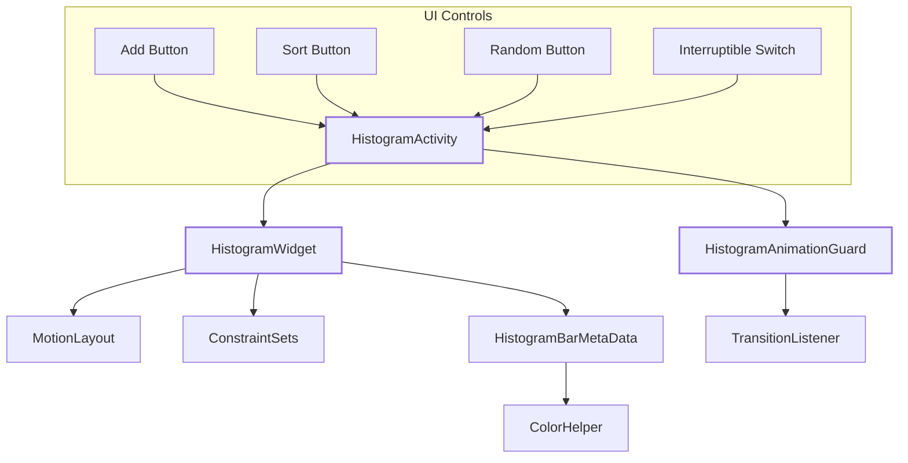
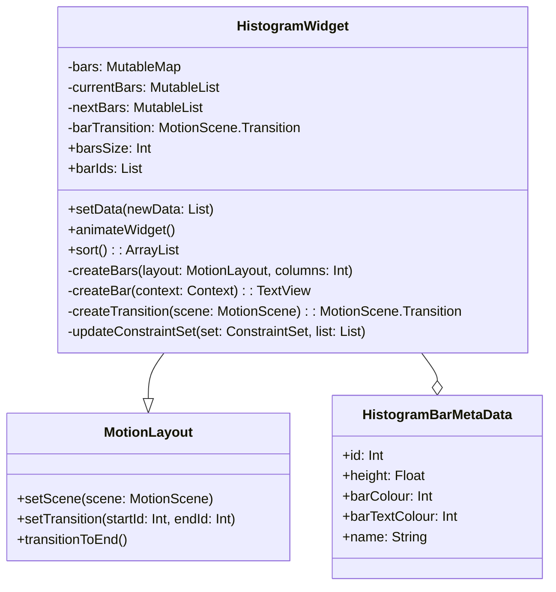
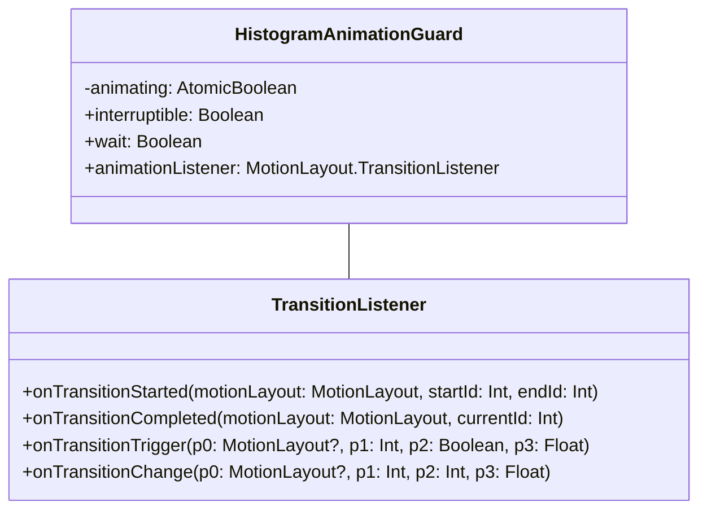
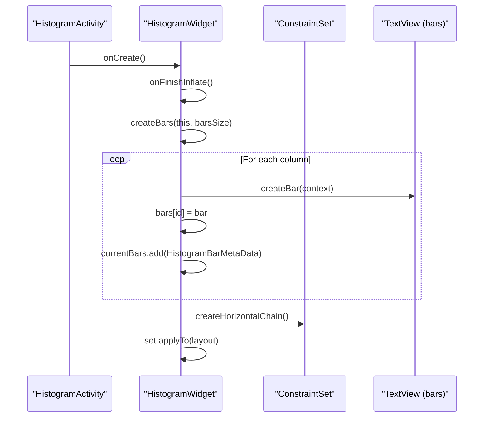
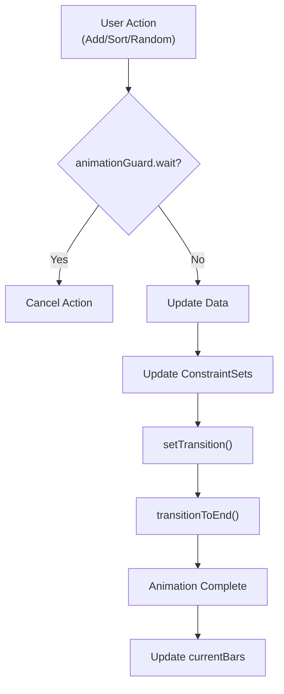

<!-- source: DeepWiki mcp.deepwiki.com · repo android/views-widgets-samples · page 3.4 Histogram Animation Demo · fetched 2026-10-23 -->

# Histogram Animation Demo

<details>
<summary>Relevant source files</summary>

The following files were used as context for generating this wiki page:

- [ConstraintLayoutExamples/motionlayout/src/main/AndroidManifest.xml](ConstraintLayoutExamples/motionlayout/src/main/AndroidManifest.xml)
- [ConstraintLayoutExamples/motionlayout/src/main/java/com/google/androidstudio/motionlayoutexample/MainActivity.kt](ConstraintLayoutExamples/motionlayout/src/main/java/com/google/androidstudio/motionlayoutexample/MainActivity.kt)
- [ConstraintLayoutExamples/motionlayout/src/main/java/com/google/androidstudio/motionlayoutexample/fragmentsdemo/FragmentExample2Activity.kt](ConstraintLayoutExamples/motionlayout/src/main/java/com/google/androidstudio/motionlayoutexample/fragmentsdemo/FragmentExample2Activity.kt)
- [ConstraintLayoutExamples/motionlayout/src/main/java/com/google/androidstudio/motionlayoutexample/fragmentsdemo/FragmentExampleActivity.kt](ConstraintLayoutExamples/motionlayout/src/main/java/com/google/androidstudio/motionlayoutexample/fragmentsdemo/FragmentExampleActivity.kt)
- [ConstraintLayoutExamples/motionlayout/src/main/java/com/google/androidstudio/motionlayoutexample/histogramdemo/ColorHelper.kt](ConstraintLayoutExamples/motionlayout/src/main/java/com/google/androidstudio/motionlayoutexample/histogramdemo/ColorHelper.kt)
- [ConstraintLayoutExamples/motionlayout/src/main/java/com/google/androidstudio/motionlayoutexample/histogramdemo/HistogramActivity.kt](ConstraintLayoutExamples/motionlayout/src/main/java/com/google/androidstudio/motionlayoutexample/histogramdemo/HistogramActivity.kt)
- [ConstraintLayoutExamples/motionlayout/src/main/java/com/google/androidstudio/motionlayoutexample/histogramdemo/HistogramAnimationGuard.kt](ConstraintLayoutExamples/motionlayout/src/main/java/com/google/androidstudio/motionlayoutexample/histogramdemo/HistogramAnimationGuard.kt)
- [ConstraintLayoutExamples/motionlayout/src/main/java/com/google/androidstudio/motionlayoutexample/histogramdemo/HistogramBarMetaData.kt](ConstraintLayoutExamples/motionlayout/src/main/java/com/google/androidstudio/motionlayoutexample/histogramdemo/HistogramBarMetaData.kt)
- [ConstraintLayoutExamples/motionlayout/src/main/java/com/google/androidstudio/motionlayoutexample/histogramdemo/HistogramWidget.kt](ConstraintLayoutExamples/motionlayout/src/main/java/com/google/androidstudio/motionlayoutexample/histogramdemo/HistogramWidget.kt)
- [ConstraintLayoutExamples/motionlayout/src/main/java/com/google/androidstudio/motionlayoutexample/histogramdemo/NonAnimatingHistogramWidget.kt](ConstraintLayoutExamples/motionlayout/src/main/java/com/google/androidstudio/motionlayoutexample/histogramdemo/NonAnimatingHistogramWidget.kt)
- [ConstraintLayoutExamples/motionlayout/src/main/res/layout/histogram_layout.xml](ConstraintLayoutExamples/motionlayout/src/main/res/layout/histogram_layout.xml)
- [ConstraintLayoutExamples/motionlayout/src/main/res/values/attrs.xml](ConstraintLayoutExamples/motionlayout/src/main/res/values/attrs.xml)

</details>


## Purpose and Scope

This document provides a comprehensive overview of the Histogram Animation Demo implementation in the Android Views and Widgets Samples repository. The demo showcases an advanced usage of MotionLayout to create programmatically-generated animated histograms with interactive controls. It demonstrates how to:

- Create dynamic UI elements programmatically with MotionLayout
- Build and animate ConstraintSets in code
- Implement controlled animation transitions
- Manage animation states and interruptions

This demo is specifically focused on creating histogram visualizations with animation capabilities. For information about other MotionLayout implementations, see [MotionLayout Basics and Integration](#3.1) or [Animation Scenes and Transitions](#3.2).

## System Overview

The Histogram Animation Demo provides a graph-like visualization with colored bars that can be dynamically generated, updated, and animated. The demo allows users to:

1. Generate random data sets
2. Sort the data
3. Control whether animations can be interrupted



Sources: [ConstraintLayoutExamples/motionlayout/src/main/java/com/google/androidstudio/motionlayoutexample/histogramdemo/HistogramActivity.kt:34-167](), [ConstraintLayoutExamples/motionlayout/src/main/java/com/google/androidstudio/motionlayoutexample/histogramdemo/HistogramWidget.kt:37-252](), [ConstraintLayoutExamples/motionlayout/src/main/java/com/google/androidstudio/motionlayoutexample/histogramdemo/HistogramAnimationGuard.kt:25-58]()

## Core Components

### HistogramWidget

At the heart of the demo is the `HistogramWidget` class, a custom view that extends `MotionLayout` to create a histogram with animation capabilities.



Sources: [ConstraintLayoutExamples/motionlayout/src/main/java/com/google/androidstudio/motionlayoutexample/histogramdemo/HistogramWidget.kt:37-252](), [ConstraintLayoutExamples/motionlayout/src/main/java/com/google/androidstudio/motionlayoutexample/histogramdemo/HistogramBarMetaData.kt:31-73]()

### HistogramAnimationGuard

The `HistogramAnimationGuard` class provides a mechanism to control when animations can be triggered, preventing unwanted interruptions during animation.



Sources: [ConstraintLayoutExamples/motionlayout/src/main/java/com/google/androidstudio/motionlayoutexample/histogramdemo/HistogramAnimationGuard.kt:25-58]()

## Implementation Details

### Dynamic Bar Creation

The `HistogramWidget` programmatically creates bars for the histogram at runtime, setting up initial constraints and appearances:

1. Each bar is a `TextView` with a colored background.
2. Views are arranged in a horizontal chain using `ConstraintSet.createHorizontalChain()`.
3. Each bar has a unique ID generated via `ViewGroup.generateViewId()`.



Sources: [ConstraintLayoutExamples/motionlayout/src/main/java/com/google/androidstudio/motionlayoutexample/histogramdemo/HistogramWidget.kt:133-233]()

### Programmatic MotionLayout Transitions

Unlike typical MotionLayout implementations that use XML-defined transitions, this example creates transitions entirely in code:

1. Creates a new `MotionScene` in the `onFinishInflate()` method
2. Builds a transition using `TransitionBuilder.buildTransition()`
3. Sets up start and end `ConstraintSet` objects
4. Applies the motion scene to the widget with `setScene(scene)`

This approach allows for completely dynamic transitions based on runtime data.

Sources: [ConstraintLayoutExamples/motionlayout/src/main/java/com/google/androidstudio/motionlayoutexample/histogramdemo/HistogramWidget.kt:89-101](), [ConstraintLayoutExamples/motionlayout/src/main/java/com/google/androidstudio/motionlayoutexample/histogramdemo/HistogramWidget.kt:107-120]()

### Animation Flow

The animation flow involves updating constraint sets and triggering transitions:



Sources: [ConstraintLayoutExamples/motionlayout/src/main/java/com/google/androidstudio/motionlayoutexample/histogramdemo/HistogramActivity.kt:60-83](), [ConstraintLayoutExamples/motionlayout/src/main/java/com/google/androidstudio/motionlayoutexample/histogramdemo/HistogramWidget.kt:160-170]()

## Key Features

### Data Management

The widget maintains two sets of data:
- `currentBars`: Represents the current state of bars
- `nextBars`: Represents the target state to which animation should transition

When animation completes, `currentBars` is updated to match `nextBars`, ensuring the system tracks the current state accurately.

Sources: [ConstraintLayoutExamples/motionlayout/src/main/java/com/google/androidstudio/motionlayoutexample/histogramdemo/HistogramWidget.kt:125-131](), [ConstraintLayoutExamples/motionlayout/src/main/java/com/google/androidstudio/motionlayoutexample/histogramdemo/HistogramWidget.kt:167-170]()

### Bar Visualization

Each bar in the histogram is represented by:
- A `TextView` for visual display and text labeling
- A `HistogramBarMetaData` object containing:
  - View ID
  - Height value (0-1)
  - Bar color
  - Text color
  - Label text

The appearance of each bar is controlled by updating constraint attributes:

```
set.constrainHeight(view.id, height)
set.setColorValue(view.id, "BackgroundColor", metadata.barColour)
```

Sources: [ConstraintLayoutExamples/motionlayout/src/main/java/com/google/androidstudio/motionlayoutexample/histogramdemo/HistogramBarMetaData.kt:31-73](), [ConstraintLayoutExamples/motionlayout/src/main/java/com/google/androidstudio/motionlayoutexample/histogramdemo/HistogramWidget.kt:138-154]()

### Animation Control

The demo provides a switch to toggle whether animations can be interrupted. This is managed by the `HistogramAnimationGuard` class:

1. When `interruptible` is `false`, new animations cannot start until the current animation completes
2. When `interruptible` is `true`, new animations can start at any time, interrupting current animations
3. The guard uses a `TransitionListener` to track animation state

Currently, the sort functionality is not interruptible, as noted in the comment on line 142 of `HistogramActivity.kt`:

```
/* TODO: The current histogram widget does not support interruptible sort to 
   keep it short. This can be a fun exercise to implement yourself. */
```

Sources: [ConstraintLayoutExamples/motionlayout/src/main/java/com/google/androidstudio/motionlayoutexample/histogramdemo/HistogramAnimationGuard.kt:25-58](), [ConstraintLayoutExamples/motionlayout/src/main/java/com/google/androidstudio/motionlayoutexample/histogramdemo/HistogramActivity.kt:139-155]()

## User Interface

The UI layout provides:

1. A coordinate system with X and Y axes
2. A histogram display area
3. Control buttons:
   - Add: Generates random data
   - Sort: Sorts the data by height
   - Random: Combines add and sort operations
4. Toggle switch for interruptible animations

| Control | Function |
|---------|----------|
| Add (+) | Adds random data to histogram |
| Sort () | Sorts bars by height value |
| Random (?) | Adds random data and sorts it |
| Interruptible Animation Switch | Toggles whether animations can be interrupted |

Sources: [ConstraintLayoutExamples/motionlayout/src/main/res/layout/histogram_layout.xml:17-120]()

## State Persistence

The demo implements state persistence to handle configuration changes (like rotation):

1. Uses `onSaveInstanceState()` to save the current bar data
2. Restores saved data in `restoreView()` when activity is recreated
3. Adapts saved view IDs to match newly created views using `HistogramBarMetaData` copy constructor

Sources: [ConstraintLayoutExamples/motionlayout/src/main/java/com/google/androidstudio/motionlayoutexample/histogramdemo/HistogramActivity.kt:105-137]()

## Technical Implementation Notes

### Custom Attributes

The `HistogramWidget` supports XML configuration through custom attributes:
- `app:columns`: Number of bars in the histogram
- `app:leftMarginDp`: Left margin for bars in dp

These are defined in `attrs.xml` and processed in the widget's constructor.

Sources: [ConstraintLayoutExamples/motionlayout/src/main/res/values/attrs.xml:1-7](), [ConstraintLayoutExamples/motionlayout/src/main/java/com/google/androidstudio/motionlayoutexample/histogramdemo/HistogramWidget.kt:72-86]()

### Color Handling

The `ColorHelper` utility class provides methods for color manipulation:
- `getNextColor()`: Generates gradient color variations
- `getContrastColor()`: Creates a contrasting color for text

Sources: [ConstraintLayoutExamples/motionlayout/src/main/java/com/google/androidstudio/motionlayoutexample/histogramdemo/ColorHelper.kt:22-66]()

## Usage Example

Using this component in a layout:

```xml
<com.google.androidstudio.motionlayoutexample.histogramdemo.HistogramWidget
    android:id="@+id/histogram"
    android:layout_width="0dp"
    android:layout_height="0dp"
    app:leftMarginDp="10"
    app:columns="9"
    app:layout_constraintStart_toEndOf="@id/y_axis"
    app:layout_constraintEnd_toEndOf="parent"
    app:layout_constraintTop_toTopOf="parent"
    app:layout_constraintBottom_toTopOf="@id/x_axis" />
```

Controlling the widget from code:

```kotlin
// Generate and set random data
val barDataList = ArrayList<HistogramBarMetaData>()
// Populate with data...
histogramWidget.setData(barDataList)

// Animate to the new state
histogramWidget.animateWidget()

// Sort and animate
val sortedBars = histogramWidget.sort()
histogramWidget.animateWidget()
```

Sources: [ConstraintLayoutExamples/motionlayout/src/main/res/layout/histogram_layout.xml:48-61](), [ConstraintLayoutExamples/motionlayout/src/main/java/com/google/androidstudio/motionlayoutexample/histogramdemo/HistogramActivity.kt:60-83]()

## Summary

The Histogram Animation Demo showcases advanced techniques for creating dynamic, animated UI components with MotionLayout. By programmatically generating transitions and manipulating ConstraintSets, it demonstrates how MotionLayout can be used for data visualization beyond typical UI animations. The implementation handles animation interruption control, state persistence, and provides a clean API for data updates and transitions.

---

