# Page: Android Views and Widgets Samples - Overview

# Android Views and Widgets Samples - Overview

<details>
<summary>Relevant source files</summary>

The following files were used as context for generating this wiki page:

- [.gitignore](.gitignore)
- [CONTRIBUTING.md](CONTRIBUTING.md)
- [ConstraintLayoutExamples/README.md](ConstraintLayoutExamples/README.md)
- [LICENSE](LICENSE)
- [README.md](README.md)

</details>


## Purpose and Scope

This repository contains a collection of individual Android Studio projects that demonstrate various Android UI components, specifically focusing on views and widgets. Each project is self-contained and showcases specific implementation techniques, design patterns, and best practices for working with Android's UI framework.

The repository serves as a reference resource for developers looking to implement and understand different Android UI components through practical examples rather than theoretical explanations.

**Important Note**: This repository is being migrated to the new [platform-samples repository](https://github.com/android/platform-samples). Migrated samples can be found in the [user-interface section](https://github.com/android/platform-samples/tree/main/samples/user-interface).

Sources: [README.md:1-11]()

## Repository Structure

The repository is organized into several major systems, each demonstrating different UI components and patterns.

### Repository Architecture

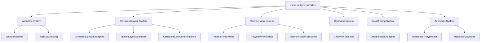

Sources: Repository diagrams provided in the prompt, [README.md:7-11]()

## Major Systems Overview

### UI Component Relationships

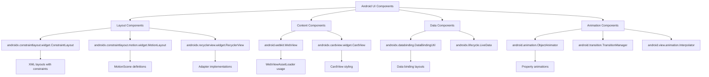

Sources: Repository diagrams provided in the prompt

## WebView System

The WebView system is the most prominent component in the repository. It demonstrates how to integrate web content within Android applications using:

- `WebViewAssetLoader` for securely loading local HTML, JavaScript, and CSS assets
- JavaScript interface implementation with `@JavascriptInterface` annotations for two-way communication
- Support for dark mode through CSS variables and theme detection
- Proper handling of window insets for edge-to-edge displays

The implementation focuses on displaying weather information with location selection capabilities and data sharing features.

Sources: Repository diagrams provided in the prompt

## ConstraintLayout and MotionLayout System

The ConstraintLayout system demonstrates advanced layout techniques and animations. It includes a comprehensive set of examples:

| Category | Example | Key Components |
|----------|---------|----------------|
| Basic Motion | Basic transitions | `MotionLayout`, `ConstraintSet`, start/end states |
| Custom Attributes | Animating properties | `CustomAttribute`, attribute modification |
| Image Effects | Filter transitions | `ImageFilterView`, saturation/contrast controls |
| Keyframe Animations | Position control | `KeyPosition`, `KeyAttribute`, `KeyCycle` |
| Layout Integration | CoordinatorLayout | `CoordinatorLayout`, `AppBarLayout` integration |
| Custom Components | DrawerLayout | Custom drawer implementations |
| ViewPager | Page transitions | ViewPager with synchronized animations |
| Complex Motion | Multi-element coordination | Coordinated element animations |

Sources: [ConstraintLayoutExamples/README.md:9-57]()

## RecyclerView System

The RecyclerView system showcases different implementation approaches:

- Simple implementations with basic adapters
- Kotlin implementations with MVVM architecture
- Custom animations with specialized `ItemAnimator` classes
- Various `LayoutManager` configurations

The Kotlin implementation is the most extensive, featuring a flower catalog with add/remove functionality, detail views, and proper separation of concerns.

Sources: Repository diagrams provided in the prompt

## Additional UI Components

### CardView System
Demonstrates card-based UI implementations with proper styling and integration with other components.

### Data Binding System
Showcases the Android Data Binding library with:
- List and RecyclerView integration
- MVVM architecture implementation
- Observable data patterns

### Animation System
Features interpolator implementations and transition animations:
- Custom `Interpolator` classes
- Transition animations using the Transitions framework
- Property animations with `ObjectAnimator`

Sources: Repository diagrams provided in the prompt

## Technical Requirements

- Android Studio 3.3 or higher
- Constraint Layout library 2.0.0-alpha5 or higher (for ConstraintLayout examples)
- AndroidX libraries

Sources: [ConstraintLayoutExamples/README.md:15-18]()

## Using These Samples

Each sample is a standalone Android Studio project. To use them:

1. Clone the repository
2. Open the specific sample in Android Studio
3. Build and run on an emulator or device
4. Examine the code to understand implementation details

For ConstraintLayout examples, the samples are best understood by viewing the constraints in the Design mode of the layout editor.

Sources: [ConstraintLayoutExamples/README.md:20-24]()

## Contributing

Contributions to this repository are welcome. See the [contributing guidelines](CONTRIBUTING.md) for details on:
- Contributor License Agreement requirements
- Code review process
- Community guidelines

Sources: [CONTRIBUTING.md:1-28]()

## License

This repository is licensed under the Apache License, Version 2.0. See the [LICENSE](LICENSE) file for complete terms.

Sources: [LICENSE:1-191]()

---

# Page: WebView System

# WebView System

<details>
<summary>Relevant source files</summary>

The following files were used as context for generating this wiki page:

- [WebView/.gitignore](WebView/.gitignore)
- [WebView/README.md](WebView/README.md)
- [WebView/app/.gitignore](WebView/app/.gitignore)
- [WebView/app/proguard-rules.pro](WebView/app/proguard-rules.pro)
- [WebView/app/src/main/assets/index.html](WebView/app/src/main/assets/index.html)
- [WebView/app/src/main/assets/main.js](WebView/app/src/main/assets/main.js)
- [WebView/app/src/main/java/com/android/samples/webviewdemo/MainActivity.kt](WebView/app/src/main/java/com/android/samples/webviewdemo/MainActivity.kt)
- [WebView/app/src/main/res/drawable-v24/ic_launcher_foreground.xml](WebView/app/src/main/res/drawable-v24/ic_launcher_foreground.xml)
- [WebView/app/src/main/res/drawable/ic_launcher_background.xml](WebView/app/src/main/res/drawable/ic_launcher_background.xml)
- [WebView/app/src/main/res/values/strings.xml](WebView/app/src/main/res/values/strings.xml)
- [WebView/sampleData/weather.json](WebView/sampleData/weather.json)

</details>


## Overview and Purpose

The WebView System is a demonstration of best practices for embedding web content in Android applications using the AndroidX WebKit API. This system showcases a weather information application that implements secure loading of local assets, bidirectional communication between JavaScript and Android code, and responsive design with proper dark mode support.

For detailed implementation specifics, see [WebView Implementation](#2.1) and [WebView Testing](#2.2). For styling-related information, refer to [WebView Styling and Theming](#2.3).

## System Architecture

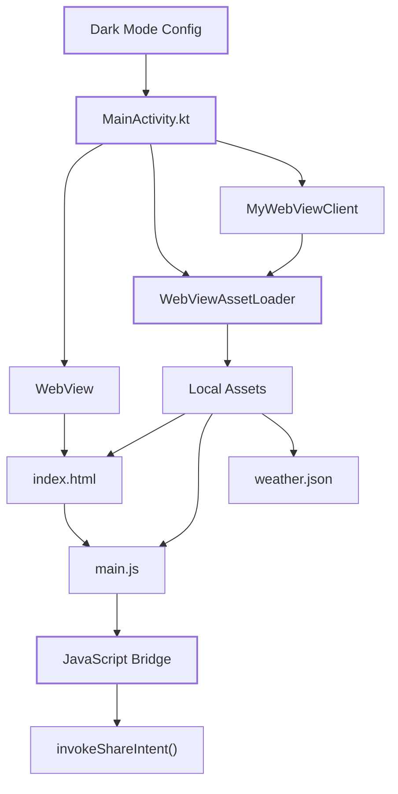

**Diagram: WebView System Architecture**

Sources: [WebView/app/src/main/java/com/android/samples/webviewdemo/MainActivity.kt:36-151]()

## Key Components

### 1. WebViewAssetLoader

The WebViewAssetLoader securely serves local content to the WebView through HTTPS URLs, maintaining compliance with the Same-Origin policy.

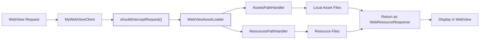

**Diagram: Asset Loading Process**

Sources: [WebView/app/src/main/java/com/android/samples/webviewdemo/MainActivity.kt:104-125](), [WebView/app/src/main/java/com/android/samples/webviewdemo/MainActivity.kt:38-46]()

The implementation configures a custom domain and path handlers:

```kotlin
val assetLoader = WebViewAssetLoader.Builder()
    .setDomain("raw.githubusercontent.com")
    .addPathHandler(
        "/views-widgets-samples/assets/",
        WebViewAssetLoader.AssetsPathHandler(this)
    )
    .addPathHandler(
        "/views-widgets-samples/res/",
        WebViewAssetLoader.ResourcesPathHandler(this)
    )
    .build()
```

This setup allows loading local files through URLs like `https://raw.githubusercontent.com/views-widgets-samples/assets/index.html`, which maintains web security standards while serving local content.

Sources: [WebView/app/src/main/java/com/android/samples/webviewdemo/MainActivity.kt:115-125]()

### 2. JavaScript Bridge

The system implements a JavaScript bridge that enables two-way communication between the Android application and web content.

| Direction | Mechanism | Purpose |
|-----------|-----------|---------|
| JavaScript to Android | `jsObject.postMessage()` | Share weather information via Android's native sharing mechanism |
| Android to JavaScript | JavaScript function calls | Update UI elements with data or trigger actions |

In the JavaScript side, the system uses `postMessage()` to communicate with Android:

```javascript
function sendAndroidMessage() {
    jsObject.postMessage("The weather in " + `${document.getElementById("title").innerText}` + " today is " +
    `${document.getElementById("shortDescription").innerText} `);
}
```

On the Android side, this message is received and processed by the `invokeShareIntent()` method.

Sources: [WebView/app/src/main/java/com/android/samples/webviewdemo/MainActivity.kt:143-147](), [WebView/app/src/main/assets/main.js:16-23]()

### 3. Dark Mode Support

The WebView System includes proper dark mode support that respects the system theme settings:

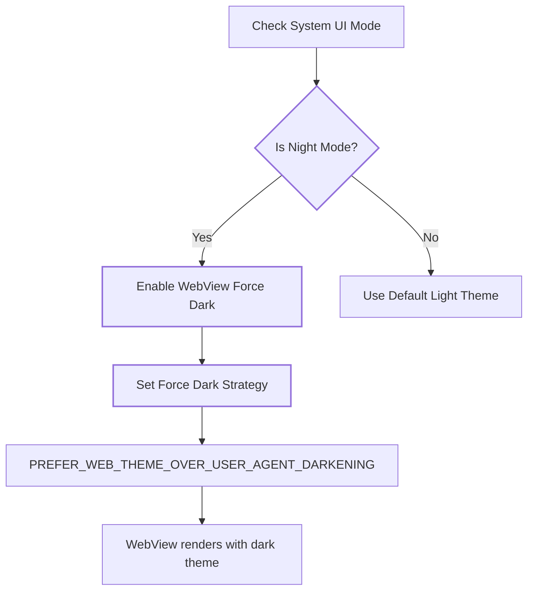

**Diagram: Dark Mode Configuration Flow**

The implementation detects the current UI mode and applies appropriate dark mode settings to the WebView when needed:

```kotlin
if (nightModeFlag == Configuration.UI_MODE_NIGHT_YES) {
    // Switch WebView to dark mode
    if (WebViewFeature.isFeatureSupported(WebViewFeature.FORCE_DARK)) {
        WebSettingsCompat.setForceDark(
            binding.webview.settings,
            WebSettingsCompat.FORCE_DARK_ON
        )
    }
    
    if (WebViewFeature.isFeatureSupported(WebViewFeature.FORCE_DARK_STRATEGY)) {
        WebSettingsCompat.setForceDarkStrategy(
            binding.webview.settings,
            DARK_STRATEGY_PREFER_WEB_THEME_OVER_USER_AGENT_DARKENING
        )
    }
}
```

The HTML also specifies a `color-scheme` meta tag to support this behavior:

```html
<meta name="color-scheme" content="dark light">
```

Sources: [WebView/app/src/main/java/com/android/samples/webviewdemo/MainActivity.kt:67-102](), [WebView/app/src/main/assets/index.html:20]()

## Data Flow

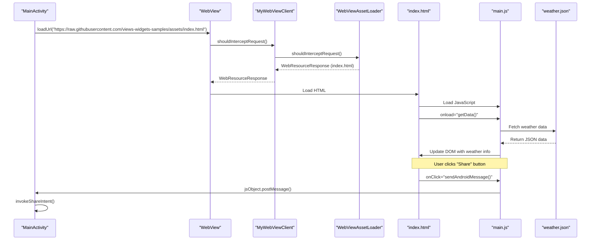

**Diagram: WebView System Data Flow**

Sources: [WebView/app/src/main/java/com/android/samples/webviewdemo/MainActivity.kt:150](), [WebView/app/src/main/assets/index.html:23-35](), [WebView/app/src/main/assets/main.js:16-56]()

## Content Structure

The WebView System displays weather information for different locations:

| Component | Description | Implementation |
|-----------|-------------|----------------|
| Location Selector | Dropdown menu to select different cities | HTML `<select>` element in index.html |
| Weather Display | Shows current temperature and conditions | HTML elements updated by JavaScript |
| Weather Icons | Visual representation of weather conditions | Local drawable resources accessed via WebViewAssetLoader |
| Share Button | Triggers native Android sharing | JavaScript to Android bridge |

The content is structured in HTML, with styling applied from CSS and behavior implemented in JavaScript:

```
index.html
└── Loads and uses:
    ├── style.css (styling)
    ├── main.js (functionality)
    │   └── Fetches data from:
    │       └── weather.json (sample data)
    └── Images from:
        └── Android drawable resources
```

Sources: [WebView/app/src/main/assets/index.html:17-36](), [WebView/app/src/main/assets/main.js:26-56](), [WebView/sampleData/weather.json:1-26]()

## Security Considerations

The WebView System implements several security best practices:

1. **Local Asset Access**: Uses WebViewAssetLoader to securely access local assets without exposing them directly
2. **JavaScript Enable**: Only enables JavaScript for the specific domain needed
3. **Debugging Configuration**: Only enables WebView debugging for debug builds
4. **Origin Rules**: Specifies allowed origin rules for JavaScript communication

```kotlin
// Setup debugging only for debug builds
if (applicationInfo.flags and ApplicationInfo.FLAG_DEBUGGABLE != 0) {
    WebView.setWebContentsDebuggingEnabled(true)
}

// Enable JavaScript
binding.webview.settings.javaScriptEnabled = true
```

Sources: [WebView/app/src/main/java/com/android/samples/webviewdemo/MainActivity.kt:134-139]()

## Integration Points

The WebView System demonstrates integration with the following Android components:

1. **Sharing Functionality**: Invokes native Android sharing via Intent
2. **UI Mode Detector**: Responds to system dark/light theme changes
3. **WebView Configuration**: Configures WebView with proper settings for performance and security

```kotlin
// Invokes native android sharing
private fun invokeShareIntent(message: String) {
    val sendIntent: Intent = Intent().apply {
        action = Intent.ACTION_SEND
        putExtra(Intent.EXTRA_TEXT, message)
        type = "text/plain"
    }
    val shareIntent = Intent.createChooser(sendIntent, null)
    startActivity(this@MainActivity, shareIntent, null)
}
```

Sources: [WebView/app/src/main/java/com/android/samples/webviewdemo/MainActivity.kt:49-57]()

## Summary

The WebView System provides a comprehensive demonstration of best practices for embedding web content in Android applications. It showcases:

1. Secure loading of local assets using WebViewAssetLoader
2. Two-way communication between JavaScript and Android
3. Proper dark mode support and responsive design
4. Accessing local resources from web content
5. Integration with native Android functionality (sharing)

This sample serves as a reference implementation for Android developers who need to embed web content in their applications while maintaining security, proper theming, and native integration.

Sources: [WebView/app/src/main/java/com/android/samples/webviewdemo/MainActivity.kt:17-151](), [WebView/README.md:1-28]()

---

# Page: WebView Implementation

# WebView Implementation

<details>
<summary>Relevant source files</summary>

The following files were used as context for generating this wiki page:

- [WebView/app/src/main/assets/index.html](WebView/app/src/main/assets/index.html)
- [WebView/app/src/main/assets/main.js](WebView/app/src/main/assets/main.js)
- [WebView/app/src/main/java/com/android/samples/webviewdemo/MainActivity.kt](WebView/app/src/main/java/com/android/samples/webviewdemo/MainActivity.kt)
- [WebView/app/src/main/res/layout/activity_main.xml](WebView/app/src/main/res/layout/activity_main.xml)
- [WebView/app/src/main/res/values/strings.xml](WebView/app/src/main/res/values/strings.xml)
- [WebView/build.gradle](WebView/build.gradle)
- [WebView/gradle/wrapper/gradle-wrapper.properties](WebView/gradle/wrapper/gradle-wrapper.properties)
- [WebView/sampleData/weather.json](WebView/sampleData/weather.json)

</details>


## Purpose and Scope

This document examines the implementation of WebView in the Android Views and Widgets Samples repository, focusing on how to properly integrate web content with Android applications. The implementation demonstrates best practices for loading local assets securely, facilitating JavaScript-Android communication, supporting dark mode, and configuring WebView for development. For information about testing WebView components, see [WebView Testing](#2.2), and for styling details, see [WebView Styling and Theming](#2.3).

## Architecture Overview

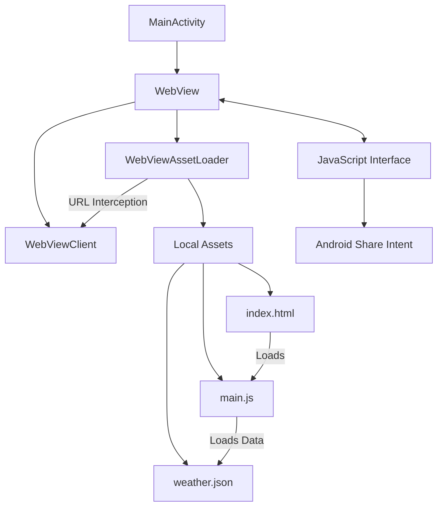

Sources: [WebView/app/src/main/java/com/android/samples/webviewdemo/MainActivity.kt:36-151](), [WebView/app/src/main/assets/index.html:16-36](), [WebView/app/src/main/assets/main.js:16-56]()

The WebView implementation showcases a weather application that loads local HTML, JavaScript, and CSS assets while also fetching remote JSON data. The architecture enables two-way communication between web content and native Android code, with proper handling of dark mode and security considerations.

## WebView Configuration

The WebView is configured in the `MainActivity` with several key settings:

### WebViewAssetLoader Setup

The WebViewAssetLoader acts as a bridge between the Android filesystem and web content, allowing local assets to be loaded securely via HTTPS:

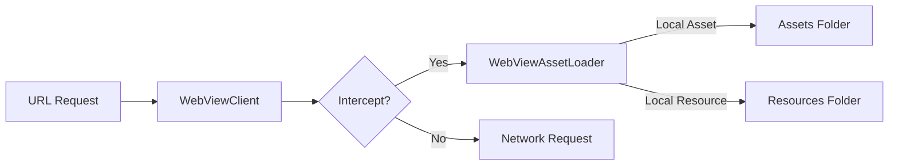

Sources: [WebView/app/src/main/java/com/android/samples/webviewdemo/MainActivity.kt:104-125](), [WebView/app/src/main/java/com/android/samples/webviewdemo/MainActivity.kt:38-46]()

The WebViewAssetLoader is configured with:

- Custom domain: `raw.githubusercontent.com`
- Asset path handler: Maps `/views-widgets-samples/assets/` to local assets
- Resource path handler: Maps `/views-widgets-samples/res/` to app resources

This configuration allows the web content to access local files using URL patterns that don't conflict with real web addresses, maintaining security while supporting the same-origin policy.

### WebView Client Implementation

A custom WebViewClient intercepts resource requests and redirects them to local assets when appropriate:

```kotlin
private class MyWebViewClient(private val assetLoader: WebViewAssetLoader) :
    WebViewClientCompat() {
    override fun shouldInterceptRequest(
        view: WebView,
        request: WebResourceRequest
    ): WebResourceResponse? {
        return assetLoader.shouldInterceptRequest(request.url)
    }
}
```

Sources: [WebView/app/src/main/java/com/android/samples/webviewdemo/MainActivity.kt:38-46](), [WebView/app/src/main/java/com/android/samples/webviewdemo/MainActivity.kt:128]()

### JavaScript and Debugging

JavaScript is enabled in the WebView, and debugging is configured to support Chrome DevTools for WebViews in debug builds:

```kotlin
// Enable Javascript
binding.webview.settings.javaScriptEnabled = true

// Setup debugging
if (applicationInfo.flags and ApplicationInfo.FLAG_DEBUGGABLE != 0) {
    WebView.setWebContentsDebuggingEnabled(true)
}
```

Sources: [WebView/app/src/main/java/com/android/samples/webviewdemo/MainActivity.kt:134-139]()

## JavaScript Bridge Implementation

The implementation provides communication between JavaScript and Android through a JavaScript interface object:

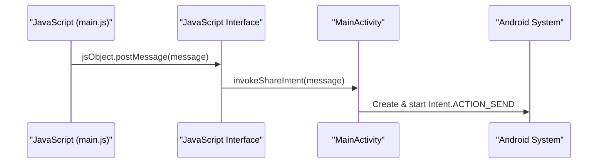

Sources: [WebView/app/src/main/java/com/android/samples/webviewdemo/MainActivity.kt:49-57](), [WebView/app/src/main/java/com/android/samples/webviewdemo/MainActivity.kt:142-147](), [WebView/app/src/main/assets/main.js:16-23]()

The JavaScript interface is created in `MainActivity` and injected into the WebView. When a user clicks the "Share" button in the weather app, JavaScript calls the interface to trigger an Android share intent with weather information.

## Dark Mode Support

The implementation includes comprehensive dark mode support, detecting system appearance settings and adjusting the WebView's rendering accordingly:

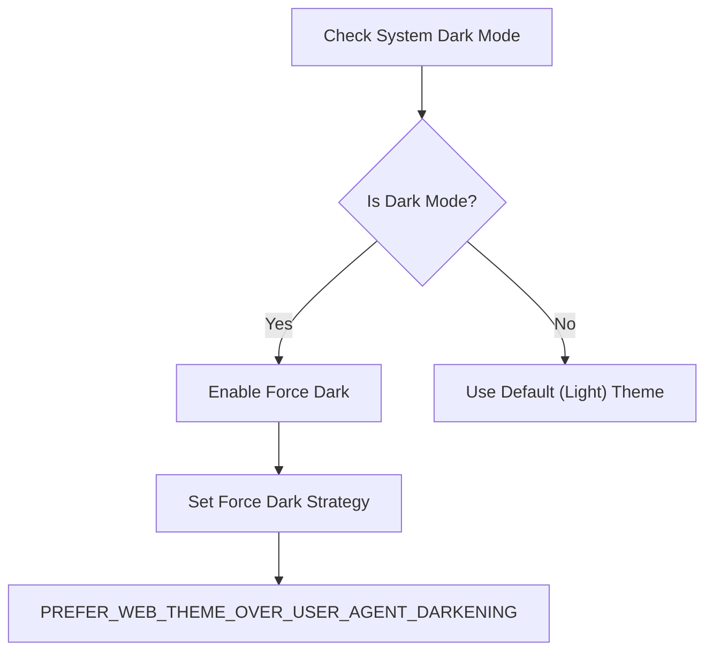

Sources: [WebView/app/src/main/java/com/android/samples/webviewdemo/MainActivity.kt:67-102]()

Key aspects of the dark mode implementation:

1. Checks the system's UI mode using `Configuration.UI_MODE_NIGHT_MASK`
2. If dark mode is enabled:
   - Sets force dark mode on the WebView using `WebSettingsCompat.setForceDark()`
   - Configures the dark mode strategy to prefer web theme over user agent darkening
3. The HTML includes a meta tag to support color scheme detection: `<meta name="color-scheme" content="dark light">`

This ensures a consistent experience that respects both the system's appearance settings and the web content's theming capabilities.

## Asset Loading and Data Flow

The WebView demo includes a complete end-to-end implementation of local and remote asset loading:

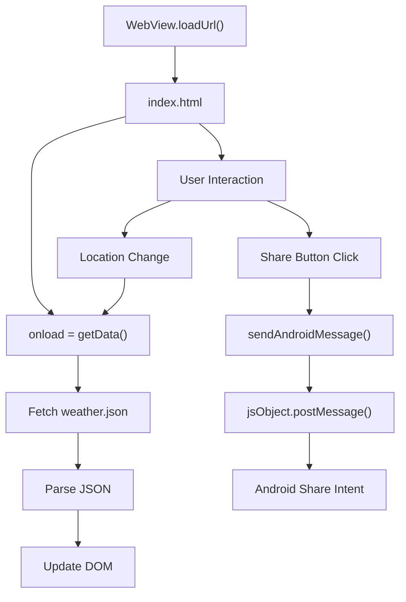

Sources: [WebView/app/src/main/java/com/android/samples/webviewdemo/MainActivity.kt:150](), [WebView/app/src/main/assets/index.html:23-35](), [WebView/app/src/main/assets/main.js:16-56]()

The key components in this flow:

1. MainActivity loads the initial URL: `https://raw.githubusercontent.com/views-widgets-samples/assets/index.html`
2. WebViewClient intercepts this request and maps it to the local asset
3. HTML loads, and the `getData()` JavaScript function executes
4. The function fetches weather data from a remote JSON file
5. DOM is updated with weather information
6. User can select different locations or share the weather information

## HTML and JavaScript Implementation

### HTML Structure

The HTML implementation provides a simple weather application interface with:

- Location selector dropdown
- Weather information display (temperature, description)
- Share button that communicates with Android

Sources: [WebView/app/src/main/assets/index.html:16-36]()

### JavaScript Functionality

The JavaScript implementation handles:

1. Loading and parsing weather data
2. Updating the UI based on selected location
3. Communicating with Android through the JavaScript interface

Key functions:

- `getData()`: Fetches weather data and updates the UI
- `sendAndroidMessage()`: Creates a message with current weather data and sends it to Android
- `getIcon()`: Maps weather descriptions to appropriate icons

Sources: [WebView/app/src/main/assets/main.js:16-56]()

## WebView Layout Integration

The WebView is integrated into the Android UI through a simple layout file:

```xml
<FrameLayout xmlns:android="http://schemas.android.com/apk/res/android"
    android:layout_width="fill_parent"
    android:layout_height="fill_parent"
    xmlns:tools="http://schemas.android.com/tools"
    tools:context=".MainActivity">

    <WebView
        android:id="@+id/webview"
        android:layout_width="match_parent"
        android:layout_height="match_parent" />
</FrameLayout>
```

Sources: [WebView/app/src/main/res/layout/activity_main.xml:18-28]()

## Dependencies

The implementation relies on several key dependencies:

- androidx.webkit:webkit - Provides WebViewAssetLoader and other WebView extensions
- Kotlin standard library - For Kotlin language support

Sources: [WebView/build.gradle:17-53]()

## Summary

The WebView implementation demonstrates best practices for integrating web content with Android applications, including:

1. Secure loading of local assets using WebViewAssetLoader
2. Proper JavaScript-to-Android communication
3. Comprehensive dark mode support
4. WebView debugging setup
5. Handling of local and remote resources

This implementation serves as a reference for developers looking to integrate web content into their Android applications while maintaining security and providing a seamless user experience.

---

# Page: WebView Styling and Theming

# WebView Styling and Theming

<details>
<summary>Relevant source files</summary>

The following files were used as context for generating this wiki page:

- [WebView/app/src/main/AndroidManifest.xml](WebView/app/src/main/AndroidManifest.xml)
- [WebView/app/src/main/assets/style.css](WebView/app/src/main/assets/style.css)
- [WebView/app/src/main/res/drawable-v24/partly_cloudy.png](WebView/app/src/main/res/drawable-v24/partly_cloudy.png)
- [WebView/app/src/main/res/drawable-v24/rain.png](WebView/app/src/main/res/drawable-v24/rain.png)
- [WebView/app/src/main/res/drawable-v24/sunny.png](WebView/app/src/main/res/drawable-v24/sunny.png)
- [WebView/app/src/main/res/values-night/colors.xml](WebView/app/src/main/res/values-night/colors.xml)
- [WebView/app/src/main/res/values/colors.xml](WebView/app/src/main/res/values/colors.xml)
- [WebView/app/src/main/res/values/styles.xml](WebView/app/src/main/res/values/styles.xml)

</details>


## Purpose and Scope

This document explains the styling and theming implementation for WebView in the views-widgets-samples repository. It covers how CSS styling is applied to WebView content, how dark mode is supported, and how Android themes integrate with WebView styling. For information about the basic WebView implementation and JavaScript bridging, see [WebView Implementation](#2.1). For testing approaches for WebView components, see [WebView Testing](#2.2).

## WebView Styling Architecture

The WebView demo application implements a responsive design that adapts to both light and dark themes while maintaining visual consistency with the Android application's theme. The styling system consists of two main components:

1. **Android Theme** - Defines the native UI appearance using Material Design themes
2. **WebView CSS** - Styles the web content loaded into the WebView component

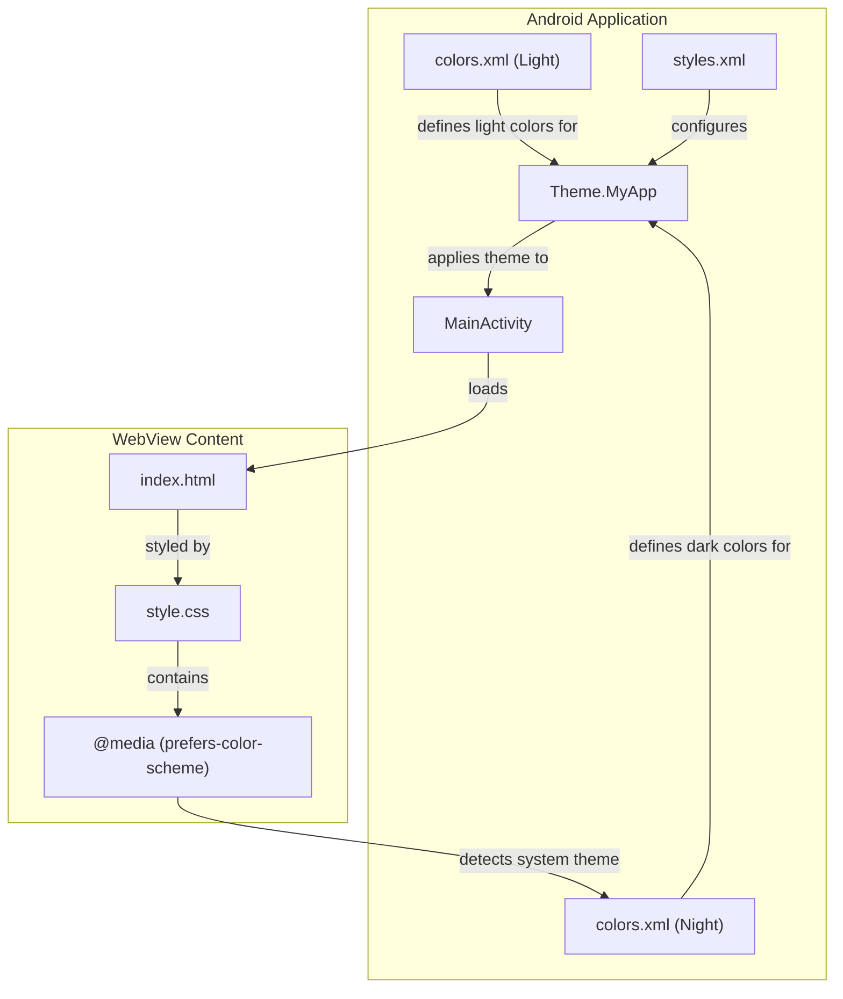

Sources: [WebView/app/src/main/res/values/styles.xml:19-25](), [WebView/app/src/main/res/values/colors.xml:18-22](), [WebView/app/src/main/res/values-night/colors.xml:18-22](), [WebView/app/src/main/assets/style.css:16-101]()

## CSS Styling Implementation

The WebView demo uses a single CSS file (`style.css`) to style all HTML content. The CSS defines styles for basic elements and custom classes used in the weather application UI.

### Key Styling Elements

The CSS includes styling for:

| Element/Class | Purpose | CSS Properties |
|---------------|---------|----------------|
| `body` | Main background | Background color |
| `h1, h2` | Headings | Text alignment, color |
| `p`, `label` | Text content | Font family, size |
| `.button` | Interactive buttons | Colors, border-radius, padding |
| `.center` | Centered elements | Margin, display, width |
| `.icon`, `.currentTemp` | Weather display | Width, margins, floating |
| `.shortDescription`, `.longDescription` | Weather information | Positioning, padding |

The styling provides a clean, readable interface for displaying weather information with appropriate spacing and visual hierarchy.

```mermaid
classDiagram
    class "WebView CSS Structure" {
        +Base Elements
        +UI Components
        +Layout Classes
        +Dark Mode Support
    }
    
    class "Base Elements" {
        +body
        +h1, h2
        +p
        +label
        +img
    }
    
    class "UI Components" {
        +.button
        +.share
    }
    
    class "Layout Classes" {
        +.center
        +.icon
        +.currentTemp
        +.shortDescription
        +.longDescription
        +.day
    }
    
    class "Dark Mode Support" {
        +@media (prefers-color-scheme: dark)
    }
    
    "WebView CSS Structure" --> "Base Elements"
    "WebView CSS Structure" --> "UI Components"
    "WebView CSS Structure" --> "Layout Classes"
    "WebView CSS Structure" --> "Dark Mode Support"
```

Sources: [WebView/app/src/main/assets/style.css:16-88]()

## Dark Mode Support

One of the key features of the WebView styling system is its support for dark mode. The implementation follows a two-pronged approach:

1. **Native Android UI** - Uses `values-night/colors.xml` to define dark theme colors
2. **WebView Content** - Uses CSS media queries to detect and apply dark theme

### CSS Dark Mode Implementation

The CSS file implements dark mode support through a media query that detects the system's color scheme preference:

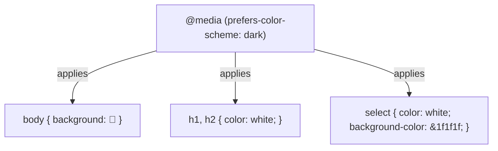

When the system is in dark mode, the WebView content automatically adjusts its background color, text colors, and form elements to match the darker palette.

Sources: [WebView/app/src/main/assets/style.css:89-101]()

### Android Theme Integration

The application uses Material Design's DayNight theme to automatically switch between light and dark themes based on system settings:

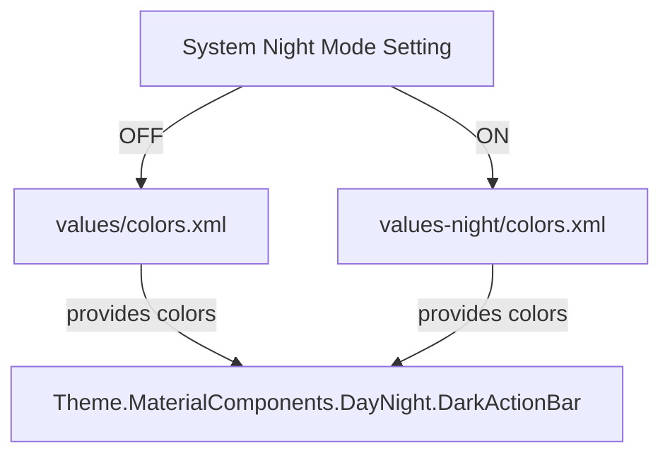

The theme defined in `styles.xml` references color resources that change depending on whether the device is in light or dark mode.

Sources: [WebView/app/src/main/res/values/styles.xml:19-25](), [WebView/app/src/main/res/values/colors.xml:18-22](), [WebView/app/src/main/res/values-night/colors.xml:18-22]()

## Responsive Design Elements

The styling in the WebView demo implements responsive design principles to ensure the content looks good on different screen sizes and orientations.

### Key Responsive Techniques

1. **Percentage-based widths** - Many elements use percentage widths (e.g., `.center { width: 50%; }`)
2. **Flexible positioning** - Using relative positioning to maintain layout relationships
3. **Adaptable spacing** - Using percentage margins to scale spacing with screen size

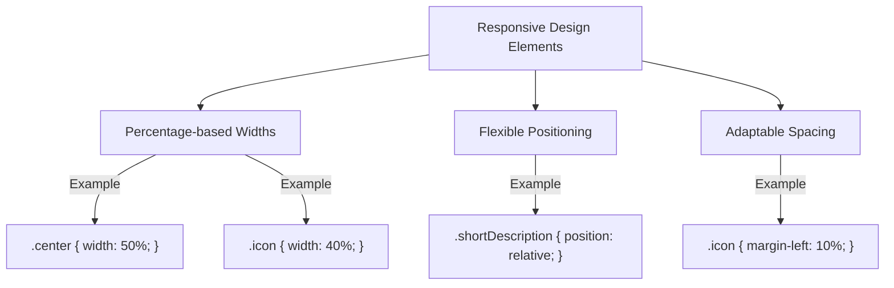

Sources: [WebView/app/src/main/assets/style.css:58-88]()

## Button Styling

The application includes custom button styling that maintains visual consistency with Material Design principles while adapting to the WebView context.

### Button Style Components

The `.button` class defines a Material-inspired button with:

- Teal background color (`#03DAC6`) matching the app's accent color
- Rounded corners with 8px border-radius
- Proper padding and text styling
- Active state changes (slight position shift on click)

This styling ensures that interactive elements in the WebView match the look and feel of native Android buttons.

Sources: [WebView/app/src/main/assets/style.css:36-54](), [WebView/app/src/main/res/values/colors.xml:21]()

## Image Handling

The WebView styling includes specific handling for images to ensure they display properly:

1. **Rounded corners** - All images have a slight border radius (4px)
2. **Proper padding** - 5px padding provides visual spacing
3. **Weather icons** - Specialized positioning for weather condition icons

The application includes specific image assets for different weather conditions (sunny, rainy, partly cloudy) that are styled consistently through the CSS.

Sources: [WebView/app/src/main/assets/style.css:32-35](), [WebView/app/src/main/res/drawable-v24/sunny.png](), [WebView/app/src/main/res/drawable-v24/rain.png](), [WebView/app/src/main/res/drawable-v24/partly_cloudy.png]()

## Best Practices Demonstrated

The WebView styling and theming implementation demonstrates several best practices:

1. **Theme consistency** - Maintaining visual consistency between native UI and web content
2. **Dark mode support** - Properly handling light and dark themes in both contexts
3. **Responsive design** - Using flexible layouts that adapt to different screen sizes
4. **Material Design principles** - Following Material Design guidelines for colors, typography, and component styling
5. **Clean CSS organization** - Logically organizing CSS with clear component separation

These practices ensure a seamless user experience that feels native and responds appropriately to system settings and user preferences.

---

# Page: ConstraintLayout and MotionLayout System

# ConstraintLayout and MotionLayout System

<details>
<summary>Relevant source files</summary>

The following files were used as context for generating this wiki page:

- [ConstraintLayoutExamples/build.gradle](ConstraintLayoutExamples/build.gradle)
- [ConstraintLayoutExamples/motionlayoutintegrations/src/main/AndroidManifest.xml](ConstraintLayoutExamples/motionlayoutintegrations/src/main/AndroidManifest.xml)
- [ConstraintLayoutExamples/motionlayoutintegrations/src/main/java/com/example/androidstudio/motionlayoutintegrations/CollapsingToolbar.kt](ConstraintLayoutExamples/motionlayoutintegrations/src/main/java/com/example/androidstudio/motionlayoutintegrations/CollapsingToolbar.kt)
- [ConstraintLayoutExamples/motionlayoutintegrations/src/main/java/com/example/androidstudio/motionlayoutintegrations/Entrance.kt](ConstraintLayoutExamples/motionlayoutintegrations/src/main/java/com/example/androidstudio/motionlayoutintegrations/Entrance.kt)
- [ConstraintLayoutExamples/motionlayoutintegrations/src/main/java/com/example/androidstudio/motionlayoutintegrations/MainActivity.kt](ConstraintLayoutExamples/motionlayoutintegrations/src/main/java/com/example/androidstudio/motionlayoutintegrations/MainActivity.kt)
- [ConstraintLayoutExamples/motionlayoutintegrations/src/main/java/com/example/androidstudio/motionlayoutintegrations/ViewPagerIntegration.kt](ConstraintLayoutExamples/motionlayoutintegrations/src/main/java/com/example/androidstudio/motionlayoutintegrations/ViewPagerIntegration.kt)
- [ConstraintLayoutExamples/motionlayoutintegrations/src/main/res/layout/activity_view_pager_integration.xml](ConstraintLayoutExamples/motionlayoutintegrations/src/main/res/layout/activity_view_pager_integration.xml)

</details>


## Purpose and Scope

This document provides a comprehensive overview of the ConstraintLayout and MotionLayout system within the Android Views and Widgets Samples. It focuses on advanced layout techniques and animations using MotionLayout, which is an extension of ConstraintLayout. The system demonstrates sophisticated animation patterns, integration with other Android components, and proper handling of system UI elements.

For information about general Android Views and Widgets, see [Android Views and Widgets Samples - Overview](#1).

## System Architecture

The ConstraintLayout and MotionLayout system consists of several key components that work together to create fluid animations and responsive layouts.

### System Components

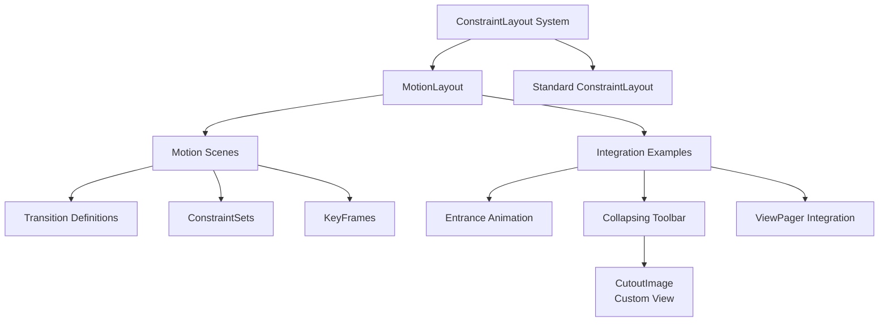

Sources:
- [ConstraintLayoutExamples/build.gradle:25-37]()
- [ConstraintLayoutExamples/motionlayoutintegrations/src/main/AndroidManifest.xml:28-48]()
- [ConstraintLayoutExamples/motionlayoutintegrations/src/main/java/com/example/androidstudio/motionlayoutintegrations/MainActivity.kt:26-48]()

### Integration Patterns

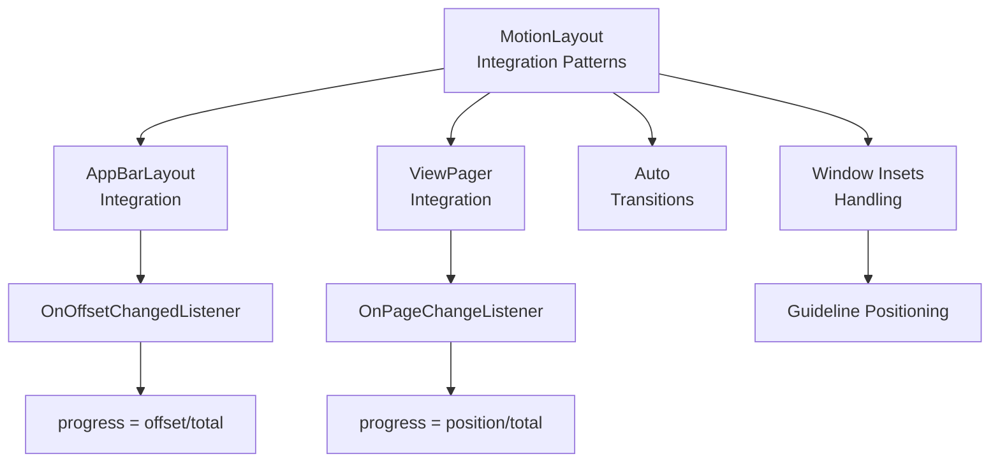

The diagram shows how MotionLayout integrates with other Android components through listeners and progress calculation.

Sources:
- [ConstraintLayoutExamples/motionlayoutintegrations/src/main/java/com/example/androidstudio/motionlayoutintegrations/CollapsingToolbar.kt:51-58]()
- [ConstraintLayoutExamples/motionlayoutintegrations/src/main/java/com/example/androidstudio/motionlayoutintegrations/ViewPagerIntegration.kt:52-69]()

## Key Examples

The system includes three main examples demonstrating different aspects of MotionLayout.

### Entrance Animation

The Entrance animation example shows how to create an engaging application launch animation using MotionLayout's auto-transition capability.

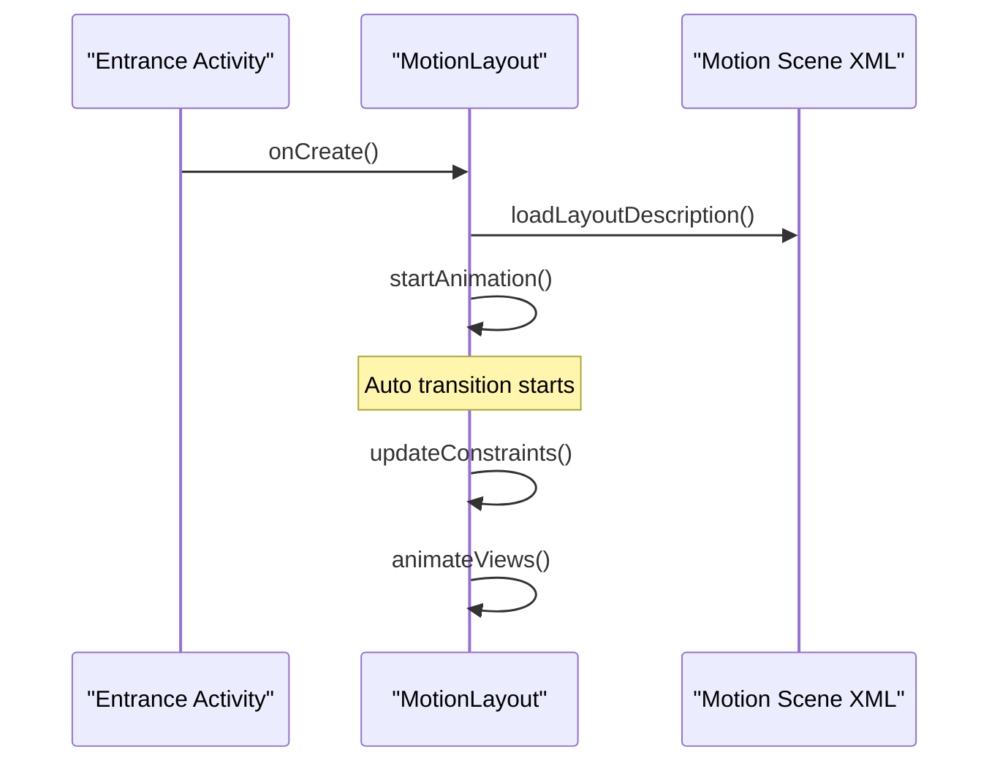

The implementation is minimalist, with most of the animation logic defined declaratively in the motion scene XML. The `Entrance` class simply inflates the layout that contains the MotionLayout.

Sources:
- [ConstraintLayoutExamples/motionlayoutintegrations/src/main/java/com/example/androidstudio/motionlayoutintegrations/Entrance.kt:23-35]()

### Collapsing Toolbar

The Collapsing Toolbar example demonstrates a sophisticated implementation of the Material Design collapsing toolbar pattern using MotionLayout. It features edge-to-edge display with proper handling of window insets.

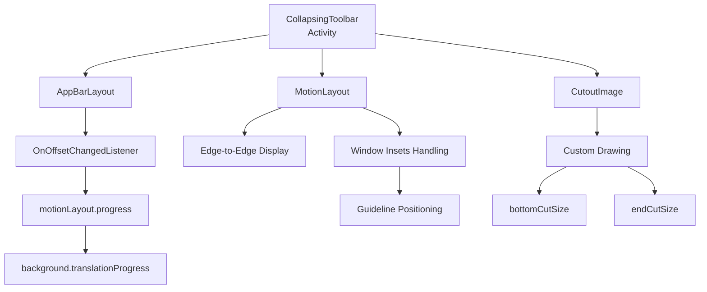

Key features of the Collapsing Toolbar implementation:

1. **AppBarLayout Integration**: Uses `OnOffsetChangedListener` to synchronize scroll position with MotionLayout progress
2. **Edge-to-Edge UI**: Extends content under the status bar with proper inset handling
3. **Custom View Animation**: The `CutoutImage` class demonstrates how to create custom views that work with MotionLayout

The implementation uses the following pattern for converting AppBarLayout scrolling to MotionLayout progress:

```kotlin
val listener = AppBarLayout.OnOffsetChangedListener { appBar, verticalOffset ->
    // convert offset into % scrolled
    val seekPosition = -verticalOffset / appBar.totalScrollRange.toFloat()
    // inform both MotionLayout and CutoutImage of the progress
    binding.motionLayout.progress = seekPosition
    binding.background.translationProgress = (100 * seekPosition).toInt()
}
```

Window insets are handled by adjusting guidelines in the ConstraintSets:

```kotlin
ViewCompat.setOnApplyWindowInsetsListener(binding.motionLayout) { _, insets: WindowInsetsCompat ->
    // resize the motionLayout in collapsed state to add the needed inset height
    val insetTopHeight = insets.systemWindowInsetTop
    binding.motionLayout.minimumHeight = desiredToolbarHeight + insetTopHeight
    
    // modify ConstraintSets to account for insets
    val endConstraintSet = binding.motionLayout.getConstraintSet(R.id.collapsed)
    endConstraintSet.setGuidelineEnd(R.id.inset, desiredToolbarHeight)
    endConstraintSet.setGuidelineEnd(R.id.collapsed_top, desiredToolbarHeight + insetTopHeight)
    
    insets
}
```

Sources:
- [ConstraintLayoutExamples/motionlayoutintegrations/src/main/java/com/example/androidstudio/motionlayoutintegrations/CollapsingToolbar.kt:40-96]()
- [ConstraintLayoutExamples/motionlayoutintegrations/src/main/java/com/example/androidstudio/motionlayoutintegrations/CollapsingToolbar.kt:108-234]()

### ViewPager Integration

The ViewPager Integration example shows how to synchronize MotionLayout animations with ViewPager swiping gestures, creating smooth transitions between pages.

```mermaid
sequenceDiagram
    participant VP as "ViewPager"
    participant PC as "PageChangeListener"
    participant ML as "MotionLayout"
    
    VP->>PC: onPageScrolled(position, offset)
    PC->>PC: calculate normalized progress
    Note over PC: progress = (position + offset) / (count - 1)
    PC->>ML: setProgress(progress)
    ML->>ML: animate UI elements
```

The key implementation pattern is converting ViewPager position and offset to normalized MotionLayout progress:

```kotlin
binding.pager.addOnPageChangeListener(object : ViewPager.OnPageChangeListener {
    override fun onPageScrolled(position: Int, positionOffset: Float, positionOffsetPixels: Int) {
        // calculate the swipe progress to a percent between 0f and 1f
        val progress = (position + positionOffset) / (adapter.count - 1)
        // ask MotionLayout to snap to the current progress
        binding.motionLayout.progress = progress
    }
    // other methods omitted
})
```

This integration allows the MotionLayout animation to precisely track user swipe gestures in the ViewPager.

Sources:
- [ConstraintLayoutExamples/motionlayoutintegrations/src/main/java/com/example/androidstudio/motionlayoutintegrations/ViewPagerIntegration.kt:34-71]()
- [ConstraintLayoutExamples/motionlayoutintegrations/src/main/res/layout/activity_view_pager_integration.xml:26-48]()

## Custom View Integration with MotionLayout

The `CutoutImage` class in the Collapsing Toolbar example demonstrates how to create custom views that integrate with MotionLayout animations.

```mermaid
graph TD
    A["CutoutImage<br>Custom View"] --> B["Animatable Properties"]
    B --> C["bottomCutSize"]
    B --> D["endCutSize"]
    B --> E["translationProgress"]
    
    A --> F["Custom Drawing"]
    F --> G["Draw Bottom Circle"]
    F --> H["Draw End Circle"]
    
    A --> I["Matrix Transformation"]
    I --> J["Scale Image"]
    I --> K["Translate Based on Progress"]
    
    L["MotionLayout"] --> |"animate properties"| B
```

Key aspects of the `CutoutImage` implementation:

1. **Animatable Properties**: The class exposes properties that can be animated by MotionLayout
   - `bottomCutSize`: Controls the size of the circular cutout at the bottom
   - `endCutSize`: Controls the size of the circular cutout at the end
   - `translationProgress`: Controls the vertical translation of the image

2. **Custom Drawing**: The `onDraw` method draws circular cutouts based on the current property values

3. **Property Invalidation**: When animated properties change, the view invalidates itself to trigger redrawing

The properties are implemented with custom getters and setters:

```kotlin
var bottomCutSize: Float
    get() = _bottomCutSize
    set(value) {
        _bottomCutSize = value
        invalidate()
    }
```

This allows MotionLayout to animate the property values, causing the view to redraw with the new values.

Sources:
- [ConstraintLayoutExamples/motionlayoutintegrations/src/main/java/com/example/androidstudio/motionlayoutintegrations/CollapsingToolbar.kt:108-234]()

## Integration Patterns and Best Practices

Based on the examples in this system, several patterns and best practices for using MotionLayout emerge:

### MotionLayout Integration Patterns

```mermaid
graph TD
    A["MotionLayout<br>Integration Patterns"] --> B["Convert Component State<br>to MotionLayout Progress"]
    A --> C["Runtime Constraint<br>Modification"]
    A --> D["Custom Property<br>Animation"]
    
    B --> E["AppBarLayout:<br>-offset / totalRange"]
    B --> F["ViewPager:<br>(position + offset) / (count - 1)"]
    
    C --> G["Modify ConstraintSets<br>at Runtime"]
    C --> H["Adjust for System Insets"]
    
    D --> I["Expose Custom Properties<br>with Setters"]
    D --> J["Trigger invalidate()<br>When Properties Change"]
```

### Best Practices Table

| Pattern | Implementation | When to Use |
|---------|----------------|-------------|
| Component Integration | Convert component state to normalized progress (0.0-1.0) | When synchronizing MotionLayout with scrollable components |
| Window Inset Handling | Adjust guidelines in ConstraintSets based on insets | For edge-to-edge UIs that extend under system bars |
| Custom View Animation | Expose properties with setters that trigger invalidation | For complex custom views that need to be animated |
| Auto Transitions | Define `autoTransition="animateToEnd"` in motion scene | For entrance animations that play automatically |

Sources:
- [ConstraintLayoutExamples/motionlayoutintegrations/src/main/java/com/example/androidstudio/motionlayoutintegrations/CollapsingToolbar.kt:51-82]()
- [ConstraintLayoutExamples/motionlayoutintegrations/src/main/java/com/example/androidstudio/motionlayoutintegrations/ViewPagerIntegration.kt:52-69]()

## Summary

The ConstraintLayout and MotionLayout System in this repository demonstrates advanced UI animation techniques using MotionLayout. Through three main examples - Entrance Animation, Collapsing Toolbar, and ViewPager Integration - the system showcases how to create complex, interactive animations with minimal code.

Key takeaways:
1. MotionLayout extends ConstraintLayout to add animation capabilities
2. Motion scenes define transitions between constraint sets
3. MotionLayout can be synchronized with other components like AppBarLayout and ViewPager
4. Custom views can expose properties for MotionLayout to animate
5. Runtime modification of constraints allows for proper handling of window insets

These examples provide reusable patterns that can be applied to a wide range of Android UI development scenarios.

Sources:
- [ConstraintLayoutExamples/motionlayoutintegrations/src/main/java/com/example/androidstudio/motionlayoutintegrations/MainActivity.kt:26-48]()
- [ConstraintLayoutExamples/motionlayoutintegrations/src/main/java/com/example/androidstudio/motionlayoutintegrations/Entrance.kt:23-35]()
- [ConstraintLayoutExamples/motionlayoutintegrations/src/main/java/com/example/androidstudio/motionlayoutintegrations/CollapsingToolbar.kt:40-234]()
- [ConstraintLayoutExamples/motionlayoutintegrations/src/main/java/com/example/androidstudio/motionlayoutintegrations/ViewPagerIntegration.kt:34-127]()

---

# Page: MotionLayout Basics and Integration

# MotionLayout Basics and Integration

<details>
<summary>Relevant source files</summary>

The following files were used as context for generating this wiki page:

- [ConstraintLayoutExamples/motionlayout/src/main/java/com/google/androidstudio/motionlayoutexample/viewpagerdemo/ViewPagerActivity.kt](ConstraintLayoutExamples/motionlayout/src/main/java/com/google/androidstudio/motionlayoutexample/viewpagerdemo/ViewPagerActivity.kt)
- [ConstraintLayoutExamples/motionlayoutintegrations/src/main/AndroidManifest.xml](ConstraintLayoutExamples/motionlayoutintegrations/src/main/AndroidManifest.xml)
- [ConstraintLayoutExamples/motionlayoutintegrations/src/main/java/com/example/androidstudio/motionlayoutintegrations/MainActivity.kt](ConstraintLayoutExamples/motionlayoutintegrations/src/main/java/com/example/androidstudio/motionlayoutintegrations/MainActivity.kt)
- [ConstraintLayoutExamples/motionlayoutintegrations/src/main/java/com/example/androidstudio/motionlayoutintegrations/ViewPagerIntegration.kt](ConstraintLayoutExamples/motionlayoutintegrations/src/main/java/com/example/androidstudio/motionlayoutintegrations/ViewPagerIntegration.kt)
- [ConstraintLayoutExamples/motionlayoutintegrations/src/main/res/drawable/collapsing.png](ConstraintLayoutExamples/motionlayoutintegrations/src/main/res/drawable/collapsing.png)
- [ConstraintLayoutExamples/motionlayoutintegrations/src/main/res/drawable/entrance.png](ConstraintLayoutExamples/motionlayoutintegrations/src/main/res/drawable/entrance.png)
- [ConstraintLayoutExamples/motionlayoutintegrations/src/main/res/layout/activity_main.xml](ConstraintLayoutExamples/motionlayoutintegrations/src/main/res/layout/activity_main.xml)
- [ConstraintLayoutExamples/motionlayoutintegrations/src/main/res/layout/activity_view_pager_integration.xml](ConstraintLayoutExamples/motionlayoutintegrations/src/main/res/layout/activity_view_pager_integration.xml)
- [ConstraintLayoutExamples/motionlayoutintegrations/src/main/res/values/strings.xml](ConstraintLayoutExamples/motionlayoutintegrations/src/main/res/values/strings.xml)

</details>


This page provides an introduction to MotionLayout and explains how it can be integrated with other Android UI components. MotionLayout is a powerful layout type in the ConstraintLayout library that helps create complex animations and transitions. For detailed information about animation scenes and transitions, see [Animation Scenes and Transitions](#3.2). For advanced MotionLayout use cases like collapsing toolbars, see [Advanced MotionLayout: Collapsing Toolbar](#3.3).

## What is MotionLayout?

MotionLayout is a subclass of ConstraintLayout that provides a declarative way to create rich motion and animations. It enables you to build fluid UI transitions by defining start and end constraint states with keyframes in between.

```mermaid
graph TD
    A["ConstraintLayout"] --> B["MotionLayout"]
    B --> C["XML Components"]
    C --> D["MotionScene File"]
    D --> E["ConstraintSets"]
    D --> F["Transitions"]
    F --> G["KeyFrames"]
    F --> H["OnSwipe/OnClick Handlers"]
    B --> I["Java/Kotlin Interface"]
    I --> J["progress Property"]
    I --> K["transitionToStart()/transitionToEnd()"]
    I --> L["setTransition()"]
```

Sources: [ConstraintLayoutExamples/motionlayoutintegrations/src/main/res/layout/activity_view_pager_integration.xml:26-48]()

## Key Components of MotionLayout

MotionLayout relies on several key components to define and control animations:

1. **MotionLayout**: The actual ViewGroup container that extends ConstraintLayout
2. **MotionScene**: An XML file that defines all animation-related information
3. **ConstraintSets**: Define the start and end states of your views
4. **Transitions**: Define how to animate between constraint sets
5. **KeyFrames**: Allow for fine-grained control over animation paths

```mermaid
graph TB
    subgraph "Layout XML"
        A["androidx.constraintlayout.motion.widget.MotionLayout"]
        B["app:layoutDescription=@xml/scene_file"]
    end

    subgraph "MotionScene XML"
        C["Transition"]
        D["ConstraintSet (start)"]
        E["ConstraintSet (end)"]
        F["KeyFrames (optional)"]
        G["OnSwipe/OnClick Handlers"]
    end

    A --> B
    B --> C
    C --> D
    C --> E
    C --> F
    C --> G
```

Sources: [ConstraintLayoutExamples/motionlayoutintegrations/src/main/res/layout/activity_view_pager_integration.xml:26-48]()

## Integration Patterns

MotionLayout can be integrated with various Android components to create rich, interactive UIs. The sample project demonstrates three primary integration patterns:

1. **ViewPager Integration**: Synchronizing ViewPager swipes with MotionLayout animations
2. **Entrance Animations**: Complex entrance animations when a screen is loaded
3. **Collapsing Toolbar**: Implementation of a collapsing toolbar using MotionLayout

```mermaid
graph LR
    A["MotionLayout"] --- B["ViewPager"]
    A --- C["Activity Transitions"]
    A --- D["Toolbar Behaviors"]
    A --- E["RecyclerView"]
    A --- F["Other UI Components"]
    
    B --> G["Synchronized Scrolling"]
    B --> H["Tab Animations"]
    
    C --> I["Entrance Animations"]
    C --> J["Exit Animations"]
    
    D --> K["Collapsing Toolbar"]
    D --> L["Edge-to-Edge Display"]
```

Sources: [ConstraintLayoutExamples/motionlayoutintegrations/src/main/java/com/example/androidstudio/motionlayoutintegrations/MainActivity.kt:35-46]()

## ViewPager Integration Example

The most detailed integration example shows how to synchronize a ViewPager's swipe gestures with a MotionLayout animation. This creates a dynamic header that responds to the user's swipe between tabs.

### Implementation Overview

```mermaid
sequenceDiagram
    participant User
    participant ViewPager
    participant OnPageChangeListener
    participant MotionLayout
    
    User->>ViewPager: Swipes between pages
    ViewPager->>OnPageChangeListener: onPageScrolled(position, offset)
    OnPageChangeListener->>OnPageChangeListener: Calculate progress value
    OnPageChangeListener->>MotionLayout: Set progress property
    MotionLayout->>User: Updates animation state
```

Sources: [ConstraintLayoutExamples/motionlayoutintegrations/src/main/java/com/example/androidstudio/motionlayoutintegrations/ViewPagerIntegration.kt:52-69]()

### Code Structure

The key components involved in the ViewPager integration are:

1. **LinearLayout**: Root container with vertical orientation
2. **MotionLayout**: Container for animated elements
3. **TabLayout**: Tab navigation control
4. **ViewPager**: Swipeable content container
5. **OnPageChangeListener**: Listener that calculates animation progress

The integration works by:

1. Setting up a ViewPager with fragments and TabLayout
2. Adding a PageChangeListener to the ViewPager
3. Converting the page position and offset to a normalized progress value (0.0-1.0)
4. Setting this progress value on the MotionLayout

```mermaid
graph TD
    A["LinearLayout"] --> B["MotionLayout"]
    A --> C["TabLayout"]
    A --> D["ViewPager"]
    
    B --> E["animation_background"]
    B --> F["animated_elements"]
    
    D --> G["Page1"]
    D --> H["Page2"]
    D --> I["Page3"]
    
    J["ViewPager.OnPageChangeListener"] -- "Calculates progress" --> B
    D -- "Triggers" --> J
```

Sources: [ConstraintLayoutExamples/motionlayoutintegrations/src/main/java/com/example/androidstudio/motionlayoutintegrations/ViewPagerIntegration.kt:34-70](), [ConstraintLayoutExamples/motionlayoutintegrations/src/main/res/layout/activity_view_pager_integration.xml:18-61]()

### Implementing the ViewPager Connection

The critical part of the integration is the OnPageChangeListener implementation that synchronizes the ViewPager's scroll state with the MotionLayout's animation progress:

In the `ViewPagerIntegration.kt` file, a page change listener is attached to the ViewPager:

```kotlin
binding.pager.addOnPageChangeListener(object : ViewPager.OnPageChangeListener {
    override fun onPageScrolled(position: Int, positionOffset: Float, positionOffsetPixels: Int) {
        // calculate the swipe progress to a percent between 0f and 1f, where 0f is the
        // first tab and 1f is the last tab
        val progress = (position + positionOffset) / (adapter.count - 1)
        // ask MotionLayout to snap to the current progress
        binding.motionLayout.progress = progress
    }
    
    // Other methods omitted for brevity
})
```

This elegant approach allows the MotionLayout animation to be directly driven by the user's swipe gestures.

Sources: [ConstraintLayoutExamples/motionlayoutintegrations/src/main/java/com/example/androidstudio/motionlayoutintegrations/ViewPagerIntegration.kt:52-69]()

## Integration with Other Components

The samples repository also includes examples of other integration patterns:

### Entrance Animation

The Entrance example demonstrates how to create a complex entrance animation when entering a screen. This uses MotionLayout's auto-transition capability to automatically start the animation when the layout is displayed.

### Collapsing Toolbar

The Collapsing Toolbar example shows how to implement a collapsing toolbar pattern with edge-to-edge display support using MotionLayout. This provides a modern UI pattern that gracefully handles window insets.

## Summary of Integration Approaches

| Integration Pattern | Key Mechanism | Use Case |
|---------------------|---------------|----------|
| ViewPager | `OnPageChangeListener` calculates progress value | Tab navigation with synchronized animations |
| Entrance Animation | Auto-transition and `transitionToEnd()` | Welcoming animations on screen entry |
| Collapsing Toolbar | OnSwipe handler in MotionScene | Responsive toolbar that collapses on scroll |

Sources: [ConstraintLayoutExamples/motionlayoutintegrations/src/main/java/com/example/androidstudio/motionlayoutintegrations/MainActivity.kt:27-47](), [ConstraintLayoutExamples/motionlayoutintegrations/src/main/res/values/strings.xml:22-24]()

## Best Practices for MotionLayout Integration

When integrating MotionLayout with other components:

1. **Separation of concerns**: Use MotionLayout for animation only, not for business logic
2. **Progress property**: Use the progress property to programmatically control animations
3. **MotionScene organization**: Keep MotionScene files well-organized for complex animations
4. **Performance**: Be mindful of animation complexity on lower-end devices
5. **Testing**: Test animations on various device sizes and orientations

Sources: [ConstraintLayoutExamples/motionlayoutintegrations/src/main/java/com/example/androidstudio/motionlayoutintegrations/ViewPagerIntegration.kt:34-70]()

---

# Page: Animation Scenes and Transitions

# Animation Scenes and Transitions

<details>
<summary>Relevant source files</summary>

The following files were used as context for generating this wiki page:

- [ConstraintLayoutExamples/motionlayout/src/main/res/layout/motion_23_parallax.xml](ConstraintLayoutExamples/motionlayout/src/main/res/layout/motion_23_parallax.xml)
- [ConstraintLayoutExamples/motionlayout/src/main/res/xml/scene_17.xml](ConstraintLayoutExamples/motionlayout/src/main/res/xml/scene_17.xml)
- [ConstraintLayoutExamples/motionlayout/src/main/res/xml/scene_18.xml](ConstraintLayoutExamples/motionlayout/src/main/res/xml/scene_18.xml)
- [ConstraintLayoutExamples/motionlayout/src/main/res/xml/scene_19.xml](ConstraintLayoutExamples/motionlayout/src/main/res/xml/scene_19.xml)
- [ConstraintLayoutExamples/motionlayout/src/main/res/xml/scene_23.xml](ConstraintLayoutExamples/motionlayout/src/main/res/xml/scene_23.xml)
- [ConstraintLayoutExamples/motionlayout/src/main/res/xml/scene_25.xml](ConstraintLayoutExamples/motionlayout/src/main/res/xml/scene_25.xml)
- [ConstraintLayoutExamples/motionlayoutintegrations/README.md](ConstraintLayoutExamples/motionlayoutintegrations/README.md)
- [ConstraintLayoutExamples/motionlayoutintegrations/src/main/res/drawable-xxxhdpi/star_parallax.jpg](ConstraintLayoutExamples/motionlayoutintegrations/src/main/res/drawable-xxxhdpi/star_parallax.jpg)
- [ConstraintLayoutExamples/motionlayoutintegrations/src/main/res/layout/activity_collapsing_toolbar.xml](ConstraintLayoutExamples/motionlayoutintegrations/src/main/res/layout/activity_collapsing_toolbar.xml)
- [ConstraintLayoutExamples/motionlayoutintegrations/src/main/res/layout/activity_entrance.xml](ConstraintLayoutExamples/motionlayoutintegrations/src/main/res/layout/activity_entrance.xml)
- [ConstraintLayoutExamples/motionlayoutintegrations/src/main/res/xml/activity_collapsing_toolbar_scene.xml](ConstraintLayoutExamples/motionlayoutintegrations/src/main/res/xml/activity_collapsing_toolbar_scene.xml)
- [ConstraintLayoutExamples/motionlayoutintegrations/src/main/res/xml/activity_entrance_scene.xml](ConstraintLayoutExamples/motionlayoutintegrations/src/main/res/xml/activity_entrance_scene.xml)
- [ConstraintLayoutExamples/motionlayoutintegrations/src/main/res/xml/activity_view_pager_integration_scene.xml](ConstraintLayoutExamples/motionlayoutintegrations/src/main/res/xml/activity_view_pager_integration_scene.xml)

</details>


This page provides a technical overview of MotionScene files and how they define animations in MotionLayout. It covers the structure of animation scenes, transitions between constraint sets, and how to use various features like KeyFrames to create complex animations in Android applications.

For information about MotionLayout basics and integration with other components, see [MotionLayout Basics and Integration](#3.1). For advanced MotionLayout examples like the Collapsing Toolbar, see [Advanced MotionLayout: Collapsing Toolbar](#3.3).

## MotionScene Overview

A MotionScene is an XML resource that defines animations in MotionLayout by describing the start and end states (ConstraintSets) and how to transition between them. MotionScenes separate the animation logic from the layout, providing a clear structure for complex animations.

```mermaid
graph TD
    MS["MotionScene"] --> CS1["ConstraintSets"]
    MS --> TR["Transitions"]
    MS --> DF["Default values"]
    
    CS1 --> CS_START["start ConstraintSet"]
    CS1 --> CS_END["end ConstraintSet"]
    CS1 --> CS_CUSTOM["custom ConstraintSets"]
    
    TR --> TR_PROPS["Properties<br>(duration, interpolator)"]
    TR --> KF["KeyFrameSets"]
    TR --> TG["Triggers<br>(OnSwipe, OnClick)"]
    
    KF --> KP["KeyPosition"]
    KF --> KA["KeyAttribute"]
    KF --> KT["KeyTrigger"]
    KF --> KC["KeyCycle"]
```

Sources:
- [ConstraintLayoutExamples/motionlayoutintegrations/src/main/res/xml/activity_entrance_scene.xml:18-276]()
- [ConstraintLayoutExamples/motionlayoutintegrations/src/main/res/xml/activity_collapsing_toolbar_scene.xml:18-217]()

## ConstraintSets: Defining Animation States

ConstraintSets define the visual state of views at specific points in an animation. Each MotionScene typically contains at least two ConstraintSets: a starting state and an ending state. You can also define intermediate states for more complex animations.

### Core Components of a ConstraintSet

```mermaid
graph TD
    CS["ConstraintSet"] --> C1["Constraint (View 1)"]
    CS --> C2["Constraint (View 2)"]
    CS --> C3["Constraint (View n)"]
    
    C1 --> P1["Layout Properties<br>(width, height, margins)"]
    C1 --> P2["Constraint Properties<br>(constraintTop, constraintStart, etc.)"]
    C1 --> P3["Visual Properties<br>(alpha, rotation, scale)"]
    C1 --> P4["CustomAttributes"]
```

In the entrance animation example, multiple ConstraintSets define different stages of the animation:

```xml
<ConstraintSet android:id="@+id/initial">
    <!-- Initial invisible state -->
</ConstraintSet>

<ConstraintSet android:id="@+id/empty">
    <!-- Empty state with background translationY -->
</ConstraintSet>

<ConstraintSet android:id="@+id/first_half" motion:deriveConstraintsFrom="@+id/empty">
    <!-- First animation phase using derived constraints -->
</ConstraintSet>

<!-- More constraint sets for subsequent animation phases -->
```

The `deriveConstraintsFrom` attribute is used to inherit constraints from another ConstraintSet, allowing you to specify only the changes needed for the next animation phase.

Sources:
- [ConstraintLayoutExamples/motionlayoutintegrations/src/main/res/xml/activity_entrance_scene.xml:33-201]()
- [ConstraintLayoutExamples/motionlayoutintegrations/README.md:36-43]()

## Transitions: Animating Between States

Transitions define how to animate from one ConstraintSet to another. They specify properties such as duration, interpolation, and triggers for the animation.

### Transition Structure

```mermaid
graph TD
    TR["Transition"] --> CS_START["constraintSetStart"]
    TR --> CS_END["constraintSetEnd"]
    TR --> PROPS["Properties<br>(duration, interpolator)"]
    TR --> TRIGGERS["Triggers<br>(onClick, onSwipe)"]
    TR --> KFS["KeyFrameSet"]
    
    KFS --> KP["KeyPosition"]
    KFS --> KA["KeyAttribute"]
    KFS --> KT["KeyTrigger"]
    
    KP --> POS_PROPS["framePosition, percentX/Y"]
    KA --> ATTR_PROPS["framePosition, alpha, rotation, etc."]
    KT --> TRIG_PROPS["framePosition, onCross actions"]
```

### Auto Transitions

MotionLayout supports automatic progression through a sequence of transitions using the `autoTransition` attribute:

```xml
<Transition
    motion:constraintSetStart="@+id/initial"
    motion:constraintSetEnd="@+id/empty"
    motion:motionInterpolator="linear"
    motion:autoTransition="animateToEnd"
    motion:duration="200" />
```

The entrance animation example uses chained auto transitions to create a complex animation sequence:

```mermaid
flowchart LR
    Initial["Initial State"] -->|"autoTransition=animateToEnd"| Empty["Empty State"]
    Empty -->|"autoTransition=animateToEnd"| FirstHalf["First Half State"]
    FirstHalf -->|"autoTransition=animateToEnd"| MiddleAnimations["Middle Animations State"]
    MiddleAnimations -->|"autoTransition=animateToEnd"| SecondHalf["Second Half State"]
```

Sources:
- [ConstraintLayoutExamples/motionlayoutintegrations/src/main/res/xml/activity_entrance_scene.xml:204-275]()
- [ConstraintLayoutExamples/motionlayoutintegrations/README.md:30-43]()

## KeyFrames: Controlling Animation Details

KeyFrames define specific points in an animation transition to precisely control motion paths, attributes, or trigger events. They are grouped in a `KeyFrameSet` within a transition.

### Types of KeyFrames

1. **KeyPosition**: Controls the motion path of a view during animation
2. **KeyAttribute**: Modifies view attributes at specific points in the animation
3. **KeyTrigger**: Executes actions when animation crosses specific points
4. **KeyCycle**: Creates oscillatory motion effects

Example of KeyFrameSet from the entrance animation:

```xml
<KeyFrameSet>
    <KeyAttribute
        motion:motionTarget="@+id/spacemoji_text"
        motion:framePosition="20"
        android:alpha="1" />

    <KeyAttribute
        motion:motionTarget="@+id/spacemoji_subtext"
        motion:framePosition="80"
        android:alpha="0" />
</KeyFrameSet>
```

In this example, `spacemoji_text` becomes fully visible at 20% of the animation, while `spacemoji_subtext` starts fading out at 80%.

### Visual Representation of KeyFrames in Animation

```mermaid
graph LR
    Start["Start State<br>(0%)"] --- KP1["KeyFrame<br>(20%)"] --- KP2["KeyFrame<br>(50%)"] --- KP3["KeyFrame<br>(80%)"] --- End["End State<br>(100%)"]
    
    subgraph "Animation Timeline"
        Start
        KP1
        KP2
        KP3
        End
    end
```

Sources:
- [ConstraintLayoutExamples/motionlayoutintegrations/src/main/res/xml/activity_entrance_scene.xml:224-236]()
- [ConstraintLayoutExamples/motionlayoutintegrations/src/main/res/xml/activity_entrance_scene.xml:244-274]()
- [ConstraintLayoutExamples/motionlayoutintegrations/src/main/res/xml/activity_collapsing_toolbar_scene.xml:25-105]()

## KeyPositions: Controlling Motion Paths

KeyPosition elements are particularly powerful for creating natural motion. They allow you to control the path a view takes as it moves between start and end positions.

```mermaid
graph LR
    Start["Start Position"] --- |"Linear (default)"| End["End Position"]
    
    Start2["Start Position"] --- |"With KeyPosition<br>framePosition=50<br>percentY=0.3"| Mid["Intermediate<br>Position"] --- End2["End Position"]
    
    subgraph "Default Motion"
        Start
        End
    end
    
    subgraph "Custom Path Motion"
        Start2
        Mid
        End2
    end
```

Example from ViewPager integration:

```xml
<KeyPosition
    motion:motionTarget="@+id/ship_emoji"
    motion:keyPositionType="parentRelative"
    motion:framePosition="25"
    motion:percentY=".6" />
```

This creates a curved path by positioning the view at 60% of the Y-axis height when the animation is at 25%.

Sources:
- [ConstraintLayoutExamples/motionlayoutintegrations/src/main/res/xml/activity_view_pager_integration_scene.xml:27-32]()
- [ConstraintLayoutExamples/motionlayoutintegrations/src/main/res/xml/activity_entrance_scene.xml:245-269]()

## Custom Attributes Animation

MotionLayout can animate custom attributes of views through the `CustomAttribute` element. This is useful for animating properties not directly supported by MotionLayout.

In the collapsing toolbar example, custom attributes are used to animate the `bottomCutSize` and `endCutSize` of a custom view:

```xml
<KeyAttribute
    app:motionTarget="@id/background"
    app:framePosition="60">
    <CustomAttribute app:attributeName="bottomCutSize" app:customDimension="0dp" />
</KeyAttribute>
```

Sources:
- [ConstraintLayoutExamples/motionlayoutintegrations/src/main/res/xml/activity_collapsing_toolbar_scene.xml:88-92]()
- [ConstraintLayoutExamples/motionlayoutintegrations/src/main/res/xml/activity_collapsing_toolbar_scene.xml:147-149]()

## Connecting MotionLayout to MotionScene

To use a MotionScene, your layout must be a `MotionLayout` and reference the MotionScene XML file using the `layoutDescription` attribute:

```xml
<androidx.constraintlayout.motion.widget.MotionLayout
    android:id="@+id/motion_layout"
    android:layout_width="match_parent"
    android:layout_height="match_parent"
    app:layoutDescription="@xml/activity_entrance_scene">
    
    <!-- Child views here -->
    
</androidx.constraintlayout.motion.widget.MotionLayout>
```

Sources:
- [ConstraintLayoutExamples/motionlayoutintegrations/src/main/res/layout/activity_entrance.xml:18-26]()
- [ConstraintLayoutExamples/motionlayoutintegrations/src/main/res/layout/activity_collapsing_toolbar.xml:40-46]()

## Complex Animation Example: Entrance Animation

The entrance animation demonstrates how to use multiple constraint sets with auto transitions to create a seamless animation sequence.

```mermaid
sequenceDiagram
    participant initial as "Initial State"
    participant empty as "Empty State"
    participant firstHalf as "First Half"
    participant middle as "Middle Animations"
    participant secondHalf as "Second Half"
    
    Note over initial: Background alpha=0
    
    initial->>empty: transition 200ms
    Note over empty: Background translationY=100px
    
    empty->>firstHalf: transition 500ms 
    Note over firstHalf: Background positioned with bias
    
    firstHalf->>middle: transition 300ms
    Note over middle: Text appears<br>Cards prepared off-screen
    
    middle->>secondHalf: transition 7000ms
    Note over secondHalf: Cards animate in one by one
```

The animation uses:
- 5 constraint sets to define different states
- 4 transitions that automatically chain together
- KeyAttributes to control alpha values
- KeyPositions to control animation paths

Sources:
- [ConstraintLayoutExamples/motionlayoutintegrations/src/main/res/xml/activity_entrance_scene.xml:33-275]()
- [ConstraintLayoutExamples/motionlayoutintegrations/README.md:27-48]()

## Integration with User Input

MotionLayout can be driven by user input like swipes using the `OnSwipe` tag:

```xml
<Transition
    motion:constraintSetEnd="@+id/end"
    motion:constraintSetStart="@+id/start">
    <OnSwipe
        motion:dragDirection="dragUp"
        motion:touchAnchorId="@+id/motionLayout"
        motion:touchAnchorSide="bottom" />
</Transition>
```

This is commonly used in UI patterns like collapsible headers and bottom sheets.

Sources:
- [ConstraintLayoutExamples/motionlayout/src/main/res/xml/scene_17.xml:24-27]()
- [ConstraintLayoutExamples/motionlayout/src/main/res/xml/scene_18.xml:24-27]()

## KeyTriggers for Action-Based Events

KeyTrigger elements allow you to call methods on views when the animation passes a specific point:

```xml
<KeyTrigger
    motion:framePosition="10"
    motion:motionTarget="@id/fab"
    motion:onPositiveCross="show" />
```

This triggers the `show()` method on a FloatingActionButton when the animation passes the 10% mark in the forward direction.

Sources:
- [ConstraintLayoutExamples/motionlayout/src/main/res/xml/scene_25.xml:34-37]()
- [ConstraintLayoutExamples/motionlayout/src/main/res/xml/scene_25.xml:43-46]()

## Motion Editor Integration

Android Studio 4.0+ includes a Motion Editor for visually creating and editing MotionScenes. This makes it easier to design complex animations without manually editing XML.

As noted in the entrance animation scene:

```xml
<!-- This animation uses a series of autoprogress between different ConstraintSet to build
keyframes of the animation.

As the animation plays, MotionLayout will display each ConstraintSet in turn.

The structure of this animation is best viewed and edited in the Motion
Editor in Android Studio
-->
```

Sources:
- [ConstraintLayoutExamples/motionlayoutintegrations/src/main/res/xml/activity_entrance_scene.xml:22-32]()
- [ConstraintLayoutExamples/motionlayoutintegrations/README.md:6-8]()

## Common Animation Patterns

### 1. Coordinated Animations with External Components

MotionLayout can be integrated with scrolling components like NestedScrollView:

```mermaid
graph TD
    ML["MotionLayout"] -->|"Contains"| CDL["CoordinatorLayout"]
    CDL -->|"Contains"| NSV["NestedScrollView"]
    CDL -->|"Contains"| ABL["AppBarLayout"]
    ABL -->|"Contains"| MLA["MotionLayout<br>with app:layout_scrollFlags"]
    
    NSV -->|"Scroll events"| ABL
    ABL -->|"app:layout_behavior"| NSV
```

### 2. Progress-Based Animations

Animations can be driven by external progress values, such as from ViewPager:

```mermaid
graph LR
    VP["ViewPager"] -->|"Page scroll progress"| ML["MotionLayout"]
    ML -->|"setProgress()"| MS["MotionScene Transition"]
```

Sources:
- [ConstraintLayoutExamples/motionlayoutintegrations/src/main/res/layout/activity_collapsing_toolbar.xml:21-33]()
- [ConstraintLayoutExamples/motionlayout/src/main/res/layout/motion_23_parallax.xml:1-16]()

## Best Practices

1. **Separate concerns**: Keep layout structure in the layout XML and animation logic in the MotionScene XML.

2. **Use derived ConstraintSets**: For complex animations with multiple states, use `deriveConstraintsFrom` to inherit constraints and only specify the changes.

3. **Understand KeyFrames**: Use KeyFrames to control the details of an animation, particularly to create natural motion paths.

4. **Break down complex animations**: Divide complex animations into smaller transitions with `autoTransition` to chain them together.

5. **Use the Motion Editor**: Take advantage of Android Studio's Motion Editor for visual design and debugging of animations.

Sources:
- [ConstraintLayoutExamples/motionlayoutintegrations/README.md:36-42]()
- [ConstraintLayoutExamples/motionlayoutintegrations/src/main/res/xml/activity_entrance_scene.xml:56-57]()
- [ConstraintLayoutExamples/motionlayoutintegrations/src/main/res/xml/activity_entrance_scene.xml:204-276]()

## Related Resources

For more details on specific animation techniques, see:
- [MotionLayout Basics and Integration](#3.1) for fundamental concepts
- [Advanced MotionLayout: Collapsing Toolbar](#3.3) for a complete example of an advanced animation
- [Animation Systems](#5.1) for other animation approaches in Android

---

# Page: Advanced MotionLayout: Collapsing Toolbar

# Advanced MotionLayout: Collapsing Toolbar

<details>
<summary>Relevant source files</summary>

The following files were used as context for generating this wiki page:

- [ConstraintLayoutExamples/build.gradle](ConstraintLayoutExamples/build.gradle)
- [ConstraintLayoutExamples/motionlayoutintegrations/src/main/AndroidManifest.xml](ConstraintLayoutExamples/motionlayoutintegrations/src/main/AndroidManifest.xml)
- [ConstraintLayoutExamples/motionlayoutintegrations/src/main/java/com/example/androidstudio/motionlayoutintegrations/CollapsingToolbar.kt](ConstraintLayoutExamples/motionlayoutintegrations/src/main/java/com/example/androidstudio/motionlayoutintegrations/CollapsingToolbar.kt)
- [ConstraintLayoutExamples/motionlayoutintegrations/src/main/java/com/example/androidstudio/motionlayoutintegrations/Entrance.kt](ConstraintLayoutExamples/motionlayoutintegrations/src/main/java/com/example/androidstudio/motionlayoutintegrations/Entrance.kt)
- [ConstraintLayoutExamples/motionlayoutintegrations/src/main/java/com/example/androidstudio/motionlayoutintegrations/MainActivity.kt](ConstraintLayoutExamples/motionlayoutintegrations/src/main/java/com/example/androidstudio/motionlayoutintegrations/MainActivity.kt)
- [ConstraintLayoutExamples/motionlayoutintegrations/src/main/java/com/example/androidstudio/motionlayoutintegrations/ViewPagerIntegration.kt](ConstraintLayoutExamples/motionlayoutintegrations/src/main/java/com/example/androidstudio/motionlayoutintegrations/ViewPagerIntegration.kt)
- [ConstraintLayoutExamples/motionlayoutintegrations/src/main/res/layout/activity_view_pager_integration.xml](ConstraintLayoutExamples/motionlayoutintegrations/src/main/res/layout/activity_view_pager_integration.xml)

</details>


## Purpose and Scope

This document provides a technical explanation of the Collapsing Toolbar implementation using MotionLayout in the Android Views and Widgets samples repository. It covers how to create a collapsing toolbar that properly handles edge-to-edge display with system insets, and demonstrates the integration of MotionLayout with AppBarLayout and custom views. This page focuses specifically on the advanced collapsing toolbar implementation, not on basic MotionLayout concepts (for those basics, see [MotionLayout Basics and Integration](#3.1)).

## System Overview

The Collapsing Toolbar system demonstrates how to use MotionLayout to create a modern, animated toolbar that collapses during scrolling. Unlike traditional approaches using CollapsingToolbarLayout, this implementation leverages MotionLayout's animation capabilities while correctly handling system insets for edge-to-edge display.

### Architecture Diagram

```mermaid
graph TB
    subgraph "CollapsingToolbar Activity"
        A["CollapsingToolbar.kt"] --> B["onCreate()"]
        B --> C["goEdgeToEdge()"]
        B --> D["AppBarLayout.OnOffsetChangedListener"]
        B --> E["OnApplyWindowInsetsListener"]
    end
    
    subgraph "Layout Elements"
        F["activity_collapsing_toolbar.xml"] --> G["AppBarLayout"]
        F --> H["MotionLayout"]
        F --> I["CutoutImage"]
        F --> J["RecyclerView/Content"]
    end
    
    subgraph "Motion Components"
        K["MotionLayout"] --> L["collapsed ConstraintSet"]
        K --> M["expanded ConstraintSet"]
        K --> N["Transition"]
    end
    
    D --"Controls"--> K
    E --"Updates"--> L
    I --"Animated by"--> K
```

Sources: [ConstraintLayoutExamples/motionlayoutintegrations/src/main/java/com/example/androidstudio/motionlayoutintegrations/CollapsingToolbar.kt:40-96]()

## Key Components

### CollapsingToolbar Activity

The `CollapsingToolbar` activity serves as the main controller for the implementation. It configures the edge-to-edge display, connects the AppBarLayout's scroll events to the MotionLayout animations, and handles system window insets.

```mermaid
flowchart LR
    A["AppBarLayout\nscroll events"] -->|"OnOffsetChangedListener"| B["MotionLayout\nprogress"]
    B -->|"progress update"| C["CutoutImage\ntranslationProgress"]
    D["Window Insets"] -->|"OnApplyWindowInsetsListener"| E["Update ConstraintSets\nfor inset handling"]
```

Sources: [ConstraintLayoutExamples/motionlayoutintegrations/src/main/java/com/example/androidstudio/motionlayoutintegrations/CollapsingToolbar.kt:40-83]()

### Implementation Details

#### Edge-to-Edge Display

The implementation goes "edge-to-edge" by:
1. Making the status bar transparent
2. Setting system UI flags for fullscreen layout
3. Properly handling window insets to ensure content isn't hidden behind system bars

```kotlin
private fun Window.goEdgeToEdge() {
    if (Build.VERSION.SDK_INT >= Build.VERSION_CODES.LOLLIPOP) {
        addFlags(WindowManager.LayoutParams.FLAG_DRAWS_SYSTEM_BAR_BACKGROUNDS)
        statusBarColor = Color.TRANSPARENT
    }
    decorView.systemUiVisibility = View.SYSTEM_UI_FLAG_LAYOUT_FULLSCREEN
}
```

Sources: [ConstraintLayoutExamples/motionlayoutintegrations/src/main/java/com/example/androidstudio/motionlayoutintegrations/CollapsingToolbar.kt:88-95]()

#### AppBarLayout Integration

The collapsing behavior is synchronized with scroll events using an `AppBarLayout.OnOffsetChangedListener`. This listener:
1. Converts the vertical offset into a progress value between 0 and 1
2. Updates the MotionLayout's progress to match
3. Also updates the `CutoutImage`'s `translationProgress` to sync all animations

```kotlin
val listener = AppBarLayout.OnOffsetChangedListener { appBar, verticalOffset ->
    // convert offset into % scrolled
    val seekPosition = -verticalOffset / appBar.totalScrollRange.toFloat()
    // inform both both MotionLayout and CutoutImage of the animation progress.
    binding.motionLayout.progress = seekPosition
    binding.background.translationProgress = (100 * seekPosition).toInt()
}
binding.appbarLayout.addOnOffsetChangedListener(listener)
```

Sources: [ConstraintLayoutExamples/motionlayoutintegrations/src/main/java/com/example/androidstudio/motionlayoutintegrations/CollapsingToolbar.kt:51-58]()

#### Window Insets Handling

A critical aspect of modern Android UI is properly handling system insets (areas occupied by the status bar, navigation bar, etc.). The implementation uses `setOnApplyWindowInsetsListener` to:

1. Resize the MotionLayout to account for the inset height
2. Update guidelines in the collapsed and expanded ConstraintSets to properly position UI elements

```mermaid
graph TD
    A["Window Insets"] --> B["OnApplyWindowInsetsListener"]
    B --> C["Set MotionLayout minimum height\nto include inset height"]
    B --> D["Update guideline positions\nin both ConstraintSets"]
    D --> E["R.id.inset guideline"]
    D --> F["R.id.collapsed_top guideline"]
```

Sources: [ConstraintLayoutExamples/motionlayoutintegrations/src/main/java/com/example/androidstudio/motionlayoutintegrations/CollapsingToolbar.kt:65-82]()

### CutoutImage Custom View

A distinctive feature of this implementation is the `CutoutImage` custom view that displays circular cutouts on an image, controlled by MotionLayout animation.

#### CutoutImage Architecture

```mermaid
classDiagram
    class CutoutImage {
        -RectF scratchRect
        -Float _bottomCutSize
        -Float _endCutSize
        -Int translationProgress
        -Paint painter
        -Paint grayPainter
        +getBottomCutSize() Float
        +setBottomCutSize(value Float) void
        +getEndCutSize() Float
        +setEndCutSize(value Float) void
        +setTranslationProgress(value Int) void
        -dpToF(value Int) Float
        +onDraw(canvas Canvas) void
    }
    
    AppCompatImageView <|-- CutoutImage
```

Sources: [ConstraintLayoutExamples/motionlayoutintegrations/src/main/java/com/example/androidstudio/motionlayoutintegrations/CollapsingToolbar.kt:108-234]()

The `CutoutImage` uses three key properties that can be animated by MotionLayout:

1. `bottomCutSize`: Controls the diameter of the circular cutout at the bottom of the image
2. `endCutSize`: Controls the diameter of the circular cutout at the end (right side) of the image
3. `translationProgress`: Controls the vertical translation of the background image

These properties can be directly manipulated in XML using MotionLayout's property set mechanism and custom attributes.

#### Image Translation

The `translationProgress` property uses a matrix transformation to scroll the background image as the animation progresses:

```kotlin
var translationProgress: Int = 0
    set(value) {
        field = value
        val matrix = imageMatrix
        val imageWidth = drawable.intrinsicWidth.toFloat()
        val scaleFactor = width.toFloat() / imageWidth
        matrix.setScale(scaleFactor, scaleFactor)
        matrix.postTranslate(0f, -100f + value)
        imageMatrix = matrix
    }
```

Sources: [ConstraintLayoutExamples/motionlayoutintegrations/src/main/java/com/example/androidstudio/motionlayoutintegrations/CollapsingToolbar.kt:150-159]()

#### Drawing Custom Cutouts

The `onDraw` method renders the image with circular cutouts:

```kotlin
override fun onDraw(canvas: Canvas?) {
    // let the parent draw the bitmap
    super.onDraw(canvas)

    // draw the bottom circle at the correct position and size
    canvas?.drawCircle(
        width.toFloat() / 2, // midpoint of view
        height.toFloat(), // bottom of view
        _bottomCutSize / 2, // radius from diameter
        painter
    )

    // draw the end circle at the correct position and size
    val margin = dpToF(16)
    canvas?.drawCircle(
        width - margin, // end of view, with custom margin applied
        2 * height.toFloat() / 3, // 2/3 down on view
        _endCutSize / 2, // radius from diameter
        painter
    )
    
    // add a 1px gray line for visual division
    canvas?.drawLine(
        width - margin - _endCutSize / 2,
        height.toFloat(),
        width.toFloat(),
        height.toFloat(),
        grayPainter
    )
}
```

Sources: [ConstraintLayoutExamples/motionlayoutintegrations/src/main/java/com/example/androidstudio/motionlayoutintegrations/CollapsingToolbar.kt:201-233]()

## Data Flow During Scrolling

The following diagram illustrates the data flow that occurs when a user scrolls the content:

```mermaid
sequenceDiagram
    participant User
    participant AppBarLayout
    participant CollapsingToolbar
    participant MotionLayout
    participant CutoutImage
    
    User->>AppBarLayout: Scrolls content
    AppBarLayout->>CollapsingToolbar: OnOffsetChangedListener triggered
    CollapsingToolbar->>MotionLayout: Update progress value
    CollapsingToolbar->>CutoutImage: Update translationProgress
    MotionLayout-->>CutoutImage: Update cutout sizes (via custom attributes)
    MotionLayout->>User: Animated toolbar state visible
```

Sources: [ConstraintLayoutExamples/motionlayoutintegrations/src/main/java/com/example/androidstudio/motionlayoutintegrations/CollapsingToolbar.kt:51-58]()

## Implementation Techniques

### 1. Registering with the Activity Lifecycle

The activity uses ViewBinding to access views and sets up listeners that coordinate the animation:

```kotlin
override fun onCreate(savedInstanceState: Bundle?) {
    super.onCreate(savedInstanceState)

    window.goEdgeToEdge()

    val binding = ActivityCollapsingToolbarBinding.inflate(layoutInflater)
    setContentView(binding.root)
    
    // Set up AppBarLayout listener and Window Insets listener...
}
```

Sources: [ConstraintLayoutExamples/motionlayoutintegrations/src/main/java/com/example/androidstudio/motionlayoutintegrations/CollapsingToolbar.kt:42-48]()

### 2. Guideline Manipulation for Insets

A key technique in this implementation is the dynamic adjustment of guidelines in ConstraintSets to account for system insets:

```kotlin
val endConstraintSet = binding.motionLayout.getConstraintSet(R.id.collapsed)
// this guideline is the bottom of the inset area
endConstraintSet.setGuidelineEnd(R.id.inset, desiredToolbarHeight)
// this guideline is the top of the inset area (top of screen)
endConstraintSet.setGuidelineEnd(R.id.collapsed_top, desiredToolbarHeight + insetTopHeight)

// set the guideline for the start constraint set as well
val startConstraintSet = binding.motionLayout.getConstraintSet(R.id.expanded)
startConstraintSet.setGuidelineBegin(R.id.collapsed_top, insetTopHeight)
```

Sources: [ConstraintLayoutExamples/motionlayoutintegrations/src/main/java/com/example/androidstudio/motionlayoutintegrations/CollapsingToolbar.kt:71-79]()

## Configuration in AndroidManifest.xml

The `CollapsingToolbar` activity uses the Material Components theme without an action bar to allow for the custom toolbar implementation:

```xml
<activity android:name=".CollapsingToolbar"
    android:exported="true"
    android:theme="@style/Theme.MaterialComponents.DayNight.NoActionBar"
/>
```

Sources: [ConstraintLayoutExamples/motionlayoutintegrations/src/main/AndroidManifest.xml:36-39]()

## Summary

The Collapsing Toolbar implementation demonstrates how to:

1. Create a modern, animated toolbar using MotionLayout instead of the traditional CollapsingToolbarLayout
2. Properly handle window insets for edge-to-edge display
3. Synchronize MotionLayout animations with AppBarLayout scrolling
4. Implement a custom view (CutoutImage) that can be animated by MotionLayout
5. Use guidelines in ConstraintSets to adapt layouts for different device configurations and system UI states

This approach offers more flexibility and animation possibilities compared to the standard CollapsingToolbarLayout, while still properly handling modern Android UI requirements like edge-to-edge display.

---

# Page: Histogram Animation Demo

# Histogram Animation Demo

<details>
<summary>Relevant source files</summary>

The following files were used as context for generating this wiki page:

- [ConstraintLayoutExamples/motionlayout/src/main/AndroidManifest.xml](ConstraintLayoutExamples/motionlayout/src/main/AndroidManifest.xml)
- [ConstraintLayoutExamples/motionlayout/src/main/java/com/google/androidstudio/motionlayoutexample/MainActivity.kt](ConstraintLayoutExamples/motionlayout/src/main/java/com/google/androidstudio/motionlayoutexample/MainActivity.kt)
- [ConstraintLayoutExamples/motionlayout/src/main/java/com/google/androidstudio/motionlayoutexample/fragmentsdemo/FragmentExample2Activity.kt](ConstraintLayoutExamples/motionlayout/src/main/java/com/google/androidstudio/motionlayoutexample/fragmentsdemo/FragmentExample2Activity.kt)
- [ConstraintLayoutExamples/motionlayout/src/main/java/com/google/androidstudio/motionlayoutexample/fragmentsdemo/FragmentExampleActivity.kt](ConstraintLayoutExamples/motionlayout/src/main/java/com/google/androidstudio/motionlayoutexample/fragmentsdemo/FragmentExampleActivity.kt)
- [ConstraintLayoutExamples/motionlayout/src/main/java/com/google/androidstudio/motionlayoutexample/histogramdemo/ColorHelper.kt](ConstraintLayoutExamples/motionlayout/src/main/java/com/google/androidstudio/motionlayoutexample/histogramdemo/ColorHelper.kt)
- [ConstraintLayoutExamples/motionlayout/src/main/java/com/google/androidstudio/motionlayoutexample/histogramdemo/HistogramActivity.kt](ConstraintLayoutExamples/motionlayout/src/main/java/com/google/androidstudio/motionlayoutexample/histogramdemo/HistogramActivity.kt)
- [ConstraintLayoutExamples/motionlayout/src/main/java/com/google/androidstudio/motionlayoutexample/histogramdemo/HistogramAnimationGuard.kt](ConstraintLayoutExamples/motionlayout/src/main/java/com/google/androidstudio/motionlayoutexample/histogramdemo/HistogramAnimationGuard.kt)
- [ConstraintLayoutExamples/motionlayout/src/main/java/com/google/androidstudio/motionlayoutexample/histogramdemo/HistogramBarMetaData.kt](ConstraintLayoutExamples/motionlayout/src/main/java/com/google/androidstudio/motionlayoutexample/histogramdemo/HistogramBarMetaData.kt)
- [ConstraintLayoutExamples/motionlayout/src/main/java/com/google/androidstudio/motionlayoutexample/histogramdemo/HistogramWidget.kt](ConstraintLayoutExamples/motionlayout/src/main/java/com/google/androidstudio/motionlayoutexample/histogramdemo/HistogramWidget.kt)
- [ConstraintLayoutExamples/motionlayout/src/main/java/com/google/androidstudio/motionlayoutexample/histogramdemo/NonAnimatingHistogramWidget.kt](ConstraintLayoutExamples/motionlayout/src/main/java/com/google/androidstudio/motionlayoutexample/histogramdemo/NonAnimatingHistogramWidget.kt)
- [ConstraintLayoutExamples/motionlayout/src/main/res/layout/histogram_layout.xml](ConstraintLayoutExamples/motionlayout/src/main/res/layout/histogram_layout.xml)
- [ConstraintLayoutExamples/motionlayout/src/main/res/values/attrs.xml](ConstraintLayoutExamples/motionlayout/src/main/res/values/attrs.xml)

</details>


## Purpose and Scope

This document provides a comprehensive overview of the Histogram Animation Demo implementation in the Android Views and Widgets Samples repository. The demo showcases an advanced usage of MotionLayout to create programmatically-generated animated histograms with interactive controls. It demonstrates how to:

- Create dynamic UI elements programmatically with MotionLayout
- Build and animate ConstraintSets in code
- Implement controlled animation transitions
- Manage animation states and interruptions

This demo is specifically focused on creating histogram visualizations with animation capabilities. For information about other MotionLayout implementations, see [MotionLayout Basics and Integration](#3.1) or [Animation Scenes and Transitions](#3.2).

## System Overview

The Histogram Animation Demo provides a graph-like visualization with colored bars that can be dynamically generated, updated, and animated. The demo allows users to:

1. Generate random data sets
2. Sort the data
3. Control whether animations can be interrupted

```mermaid
graph TD
    A["HistogramActivity"] --> B["HistogramWidget"]
    A --> C["HistogramAnimationGuard"]
    B --> D["MotionLayout"]
    B --> E["ConstraintSets"]
    B --> F["HistogramBarMetaData"]
    C --> G["TransitionListener"]
    F --> H["ColorHelper"]

    subgraph "UI Controls"
        I["Add Button"] --> A
        J["Sort Button"] --> A
        K["Random Button"] --> A
        L["Interruptible Switch"] --> A
    end

    style A stroke-width:2px
    style B stroke-width:2px
    style C stroke-width:2px
```

Sources: [ConstraintLayoutExamples/motionlayout/src/main/java/com/google/androidstudio/motionlayoutexample/histogramdemo/HistogramActivity.kt:34-167](), [ConstraintLayoutExamples/motionlayout/src/main/java/com/google/androidstudio/motionlayoutexample/histogramdemo/HistogramWidget.kt:37-252](), [ConstraintLayoutExamples/motionlayout/src/main/java/com/google/androidstudio/motionlayoutexample/histogramdemo/HistogramAnimationGuard.kt:25-58]()

## Core Components

### HistogramWidget

At the heart of the demo is the `HistogramWidget` class, a custom view that extends `MotionLayout` to create a histogram with animation capabilities.

```mermaid
classDiagram
    class HistogramWidget {
        -bars: MutableMap<Int, TextView>
        -currentBars: MutableList<HistogramBarMetaData>
        -nextBars: MutableList<HistogramBarMetaData>
        -barTransition: MotionScene.Transition
        +barsSize: Int
        +barIds: List<Int>
        +setData(newData: List<HistogramBarMetaData>)
        +animateWidget()
        +sort(): ArrayList<HistogramBarMetaData>
        -createBars(layout: MotionLayout, columns: Int)
        -createBar(context: Context): TextView
        -createTransition(scene: MotionScene): MotionScene.Transition
        -updateConstraintSet(set: ConstraintSet, list: List<HistogramBarMetaData>)
    }
    
    class MotionLayout {
        +setScene(scene: MotionScene)
        +setTransition(startId: Int, endId: Int)
        +transitionToEnd()
    }
    
    class HistogramBarMetaData {
        +id: Int
        +height: Float
        +barColour: Int
        +barTextColour: Int
        +name: String
    }
    
    HistogramWidget --|> MotionLayout
    HistogramWidget --o HistogramBarMetaData
```

Sources: [ConstraintLayoutExamples/motionlayout/src/main/java/com/google/androidstudio/motionlayoutexample/histogramdemo/HistogramWidget.kt:37-252](), [ConstraintLayoutExamples/motionlayout/src/main/java/com/google/androidstudio/motionlayoutexample/histogramdemo/HistogramBarMetaData.kt:31-73]()

### HistogramAnimationGuard

The `HistogramAnimationGuard` class provides a mechanism to control when animations can be triggered, preventing unwanted interruptions during animation.

```mermaid
classDiagram
    class HistogramAnimationGuard {
        -animating: AtomicBoolean
        +interruptible: Boolean
        +wait: Boolean
        +animationListener: MotionLayout.TransitionListener
    }
    
    class TransitionListener {
        +onTransitionStarted(motionLayout: MotionLayout, startId: Int, endId: Int)
        +onTransitionCompleted(motionLayout: MotionLayout, currentId: Int)
        +onTransitionTrigger(p0: MotionLayout?, p1: Int, p2: Boolean, p3: Float)
        +onTransitionChange(p0: MotionLayout?, p1: Int, p2: Int, p3: Float)
    }
    
    HistogramAnimationGuard -- TransitionListener
```

Sources: [ConstraintLayoutExamples/motionlayout/src/main/java/com/google/androidstudio/motionlayoutexample/histogramdemo/HistogramAnimationGuard.kt:25-58]()

## Implementation Details

### Dynamic Bar Creation

The `HistogramWidget` programmatically creates bars for the histogram at runtime, setting up initial constraints and appearances:

1. Each bar is a `TextView` with a colored background.
2. Views are arranged in a horizontal chain using `ConstraintSet.createHorizontalChain()`.
3. Each bar has a unique ID generated via `ViewGroup.generateViewId()`.

```mermaid
sequenceDiagram
    participant HA as "HistogramActivity"
    participant HW as "HistogramWidget"
    participant CS as "ConstraintSet"
    participant TV as "TextView (bars)"
    
    HA->>HW: onCreate()
    HW->>HW: onFinishInflate()
    HW->>HW: createBars(this, barsSize)
    loop For each column
        HW->>TV: createBar(context)
        HW->>HW: bars[id] = bar
        HW->>HW: currentBars.add(HistogramBarMetaData)
    end
    HW->>CS: createHorizontalChain()
    HW->>HW: set.applyTo(layout)
```

Sources: [ConstraintLayoutExamples/motionlayout/src/main/java/com/google/androidstudio/motionlayoutexample/histogramdemo/HistogramWidget.kt:133-233]()

### Programmatic MotionLayout Transitions

Unlike typical MotionLayout implementations that use XML-defined transitions, this example creates transitions entirely in code:

1. Creates a new `MotionScene` in the `onFinishInflate()` method
2. Builds a transition using `TransitionBuilder.buildTransition()`
3. Sets up start and end `ConstraintSet` objects
4. Applies the motion scene to the widget with `setScene(scene)`

This approach allows for completely dynamic transitions based on runtime data.

Sources: [ConstraintLayoutExamples/motionlayout/src/main/java/com/google/androidstudio/motionlayoutexample/histogramdemo/HistogramWidget.kt:89-101](), [ConstraintLayoutExamples/motionlayout/src/main/java/com/google/androidstudio/motionlayoutexample/histogramdemo/HistogramWidget.kt:107-120]()

### Animation Flow

The animation flow involves updating constraint sets and triggering transitions:

```mermaid
flowchart TD
    A["User Action\n(Add/Sort/Random)"] --> B{"animationGuard.wait?"}
    B -->|"Yes"| C["Cancel Action"]
    B -->|"No"| D["Update Data"]
    D --> E["Update ConstraintSets"]
    E --> F["setTransition()"]
    F --> G["transitionToEnd()"]
    G --> H["Animation Complete"]
    H --> I["Update currentBars"]
```

Sources: [ConstraintLayoutExamples/motionlayout/src/main/java/com/google/androidstudio/motionlayoutexample/histogramdemo/HistogramActivity.kt:60-83](), [ConstraintLayoutExamples/motionlayout/src/main/java/com/google/androidstudio/motionlayoutexample/histogramdemo/HistogramWidget.kt:160-170]()

## Key Features

### Data Management

The widget maintains two sets of data:
- `currentBars`: Represents the current state of bars
- `nextBars`: Represents the target state to which animation should transition

When animation completes, `currentBars` is updated to match `nextBars`, ensuring the system tracks the current state accurately.

Sources: [ConstraintLayoutExamples/motionlayout/src/main/java/com/google/androidstudio/motionlayoutexample/histogramdemo/HistogramWidget.kt:125-131](), [ConstraintLayoutExamples/motionlayout/src/main/java/com/google/androidstudio/motionlayoutexample/histogramdemo/HistogramWidget.kt:167-170]()

### Bar Visualization

Each bar in the histogram is represented by:
- A `TextView` for visual display and text labeling
- A `HistogramBarMetaData` object containing:
  - View ID
  - Height value (0-1)
  - Bar color
  - Text color
  - Label text

The appearance of each bar is controlled by updating constraint attributes:

```
set.constrainHeight(view.id, height)
set.setColorValue(view.id, "BackgroundColor", metadata.barColour)
```

Sources: [ConstraintLayoutExamples/motionlayout/src/main/java/com/google/androidstudio/motionlayoutexample/histogramdemo/HistogramBarMetaData.kt:31-73](), [ConstraintLayoutExamples/motionlayout/src/main/java/com/google/androidstudio/motionlayoutexample/histogramdemo/HistogramWidget.kt:138-154]()

### Animation Control

The demo provides a switch to toggle whether animations can be interrupted. This is managed by the `HistogramAnimationGuard` class:

1. When `interruptible` is `false`, new animations cannot start until the current animation completes
2. When `interruptible` is `true`, new animations can start at any time, interrupting current animations
3. The guard uses a `TransitionListener` to track animation state

Currently, the sort functionality is not interruptible, as noted in the comment on line 142 of `HistogramActivity.kt`:

```
/* TODO: The current histogram widget does not support interruptible sort to 
   keep it short. This can be a fun exercise to implement yourself. */
```

Sources: [ConstraintLayoutExamples/motionlayout/src/main/java/com/google/androidstudio/motionlayoutexample/histogramdemo/HistogramAnimationGuard.kt:25-58](), [ConstraintLayoutExamples/motionlayout/src/main/java/com/google/androidstudio/motionlayoutexample/histogramdemo/HistogramActivity.kt:139-155]()

## User Interface

The UI layout provides:

1. A coordinate system with X and Y axes
2. A histogram display area
3. Control buttons:
   - Add: Generates random data
   - Sort: Sorts the data by height
   - Random: Combines add and sort operations
4. Toggle switch for interruptible animations

| Control | Function |
|---------|----------|
| Add (+) | Adds random data to histogram |
| Sort () | Sorts bars by height value |
| Random (?) | Adds random data and sorts it |
| Interruptible Animation Switch | Toggles whether animations can be interrupted |

Sources: [ConstraintLayoutExamples/motionlayout/src/main/res/layout/histogram_layout.xml:17-120]()

## State Persistence

The demo implements state persistence to handle configuration changes (like rotation):

1. Uses `onSaveInstanceState()` to save the current bar data
2. Restores saved data in `restoreView()` when activity is recreated
3. Adapts saved view IDs to match newly created views using `HistogramBarMetaData` copy constructor

Sources: [ConstraintLayoutExamples/motionlayout/src/main/java/com/google/androidstudio/motionlayoutexample/histogramdemo/HistogramActivity.kt:105-137]()

## Technical Implementation Notes

### Custom Attributes

The `HistogramWidget` supports XML configuration through custom attributes:
- `app:columns`: Number of bars in the histogram
- `app:leftMarginDp`: Left margin for bars in dp

These are defined in `attrs.xml` and processed in the widget's constructor.

Sources: [ConstraintLayoutExamples/motionlayout/src/main/res/values/attrs.xml:1-7](), [ConstraintLayoutExamples/motionlayout/src/main/java/com/google/androidstudio/motionlayoutexample/histogramdemo/HistogramWidget.kt:72-86]()

### Color Handling

The `ColorHelper` utility class provides methods for color manipulation:
- `getNextColor()`: Generates gradient color variations
- `getContrastColor()`: Creates a contrasting color for text

Sources: [ConstraintLayoutExamples/motionlayout/src/main/java/com/google/androidstudio/motionlayoutexample/histogramdemo/ColorHelper.kt:22-66]()

## Usage Example

Using this component in a layout:

```xml
<com.google.androidstudio.motionlayoutexample.histogramdemo.HistogramWidget
    android:id="@+id/histogram"
    android:layout_width="0dp"
    android:layout_height="0dp"
    app:leftMarginDp="10"
    app:columns="9"
    app:layout_constraintStart_toEndOf="@id/y_axis"
    app:layout_constraintEnd_toEndOf="parent"
    app:layout_constraintTop_toTopOf="parent"
    app:layout_constraintBottom_toTopOf="@id/x_axis" />
```

Controlling the widget from code:

```kotlin
// Generate and set random data
val barDataList = ArrayList<HistogramBarMetaData>()
// Populate with data...
histogramWidget.setData(barDataList)

// Animate to the new state
histogramWidget.animateWidget()

// Sort and animate
val sortedBars = histogramWidget.sort()
histogramWidget.animateWidget()
```

Sources: [ConstraintLayoutExamples/motionlayout/src/main/res/layout/histogram_layout.xml:48-61](), [ConstraintLayoutExamples/motionlayout/src/main/java/com/google/androidstudio/motionlayoutexample/histogramdemo/HistogramActivity.kt:60-83]()

## Summary

The Histogram Animation Demo showcases advanced techniques for creating dynamic, animated UI components with MotionLayout. By programmatically generating transitions and manipulating ConstraintSets, it demonstrates how MotionLayout can be used for data visualization beyond typical UI animations. The implementation handles animation interruption control, state persistence, and provides a clean API for data updates and transitions.

---

# Page: RecyclerView System

# RecyclerView System

<details>
<summary>Relevant source files</summary>

The following files were used as context for generating this wiki page:

- [RecyclerViewKotlin/.google/packaging.yaml](RecyclerViewKotlin/.google/packaging.yaml)
- [RecyclerViewKotlin/README.md](RecyclerViewKotlin/README.md)
- [RecyclerViewKotlin/app/build.gradle](RecyclerViewKotlin/app/build.gradle)
- [RecyclerViewKotlin/app/src/main/java/com/example/recyclersample/flowerList/FlowersListActivity.kt](RecyclerViewKotlin/app/src/main/java/com/example/recyclersample/flowerList/FlowersListActivity.kt)
- [RecyclerViewKotlin/app/src/main/java/com/example/recyclersample/flowerList/FlowersListViewModel.kt](RecyclerViewKotlin/app/src/main/java/com/example/recyclersample/flowerList/FlowersListViewModel.kt)
- [RecyclerViewKotlin/app/src/main/res/drawable/ic_add_black_24dp.xml](RecyclerViewKotlin/app/src/main/res/drawable/ic_add_black_24dp.xml)
- [RecyclerViewKotlin/app/src/main/res/layout/activity_main.xml](RecyclerViewKotlin/app/src/main/res/layout/activity_main.xml)
- [RecyclerViewKotlin/app/src/main/res/layout/add_flower_layout.xml](RecyclerViewKotlin/app/src/main/res/layout/add_flower_layout.xml)
- [RecyclerViewKotlin/app/src/main/res/layout/flower_detail_activity.xml](RecyclerViewKotlin/app/src/main/res/layout/flower_detail_activity.xml)
- [RecyclerViewKotlin/app/src/main/res/mipmap-anydpi-v26/ic_launcher_round.xml](RecyclerViewKotlin/app/src/main/res/mipmap-anydpi-v26/ic_launcher_round.xml)
- [RecyclerViewSimple/.gitignore](RecyclerViewSimple/.gitignore)
- [RecyclerViewSimple/app/.gitignore](RecyclerViewSimple/app/.gitignore)
- [RecyclerViewSimple/app/build.gradle](RecyclerViewSimple/app/build.gradle)
- [RecyclerViewSimple/build.gradle](RecyclerViewSimple/build.gradle)
- [RecyclerViewSimple/gradle.properties](RecyclerViewSimple/gradle.properties)

</details>


This document provides an overview of the RecyclerView system implementations in the Android Views and Widgets Samples repository. It covers the architecture, key components, and features demonstrated in both the Kotlin and Simple implementations of RecyclerView.

## Purpose and Scope

The RecyclerView system demonstrates efficient list rendering using RecyclerView, a flexible view for providing a limited window into a large data set. The samples showcase different implementation approaches ranging from simple to more complex patterns, including:

- Basic RecyclerView implementation with adapters
- Advanced patterns with ListAdapter, DiffUtil, and ViewHolders
- Integration with MVVM architecture
- Headers and multiple view types
- Handling item clicks and navigation

For animation-specific RecyclerView implementations, see [RecyclerView Animations](#4.3).

## System Overview

### RecyclerView System Architecture

```mermaid
graph TD
    A["RecyclerView System"] --> B["RecyclerViewKotlin"]
    A --> C["RecyclerViewSimple"]
    
    B --> D["Flowers Catalog App"]
    D --> E["FlowersListActivity"]
    D --> F["FlowersListViewModel"]
    D --> G["FlowersAdapter"]
    D --> H["HeaderAdapter"]
    D --> I["Data Source"]
    D --> J["Detail View"]
    D --> K["Add Flower View"]
    
    C --> L["Basic List Implementation"]
    
    E --> G
    E --> H
    F --> I
    E --> F
```

Sources: 
- [RecyclerViewKotlin/README.md]()
- [RecyclerViewKotlin/.google/packaging.yaml]()
- [RecyclerViewKotlin/app/src/main/java/com/example/recyclersample/flowerList/FlowersListActivity.kt]()

## Key Implementations

The repository contains two main RecyclerView implementations:

| Implementation | Complexity | Key Features |
|----------------|------------|--------------|
| RecyclerViewKotlin | Intermediate | ListAdapter, DiffUtil, Headers, MVVM, Detail Views |
| RecyclerViewSimple | Basic | Simple adapter pattern, Linear layout |

Sources:
- [RecyclerViewKotlin/README.md:4-6]()
- [RecyclerViewKotlin/.google/packaging.yaml:13]()

## RecyclerViewKotlin Implementation

The RecyclerViewKotlin sample demonstrates a more advanced implementation with a Flowers Catalog application using MVVM architecture.

### Component Architecture

```mermaid
graph TD
    A["FlowersListActivity"] --> B["RecyclerView"]
    A --> C["FlowersListViewModel"]
    
    B --> D["ConcatAdapter"]
    D --> E["HeaderAdapter"]
    D --> F["FlowersAdapter"]
    
    C --> G["DataSource"]
    C --"observe"--> F
    C --"update count"--> E
    
    F --"click"--> H["FlowerDetailActivity"]
    A --"FAB click"--> I["AddFlowerActivity"]
    I --"result"--> C
    
    G --"LiveData"--> C
```

Sources:
- [RecyclerViewKotlin/app/src/main/java/com/example/recyclersample/flowerList/FlowersListActivity.kt:36-93]()
- [RecyclerViewKotlin/app/src/main/java/com/example/recyclersample/flowerList/FlowersListViewModel.kt:26-46]()

### Key Components

#### 1. FlowersListActivity

The main activity serves as the entry point for the application and orchestrates the following responsibilities:

- Setting up the RecyclerView with appropriate adapters
- Observing the LiveData from the ViewModel
- Handling FAB clicks to add new flowers
- Managing navigation to detail views

Key implementation details:

```
- Uses ConcatAdapter to combine HeaderAdapter and FlowersAdapter
- Observes flowersLiveData to update the UI when data changes
- Implements click handling for list items and FAB
```

Sources:
- [RecyclerViewKotlin/app/src/main/java/com/example/recyclersample/flowerList/FlowersListActivity.kt:36-93]()
- [RecyclerViewKotlin/app/src/main/res/layout/activity_main.xml:19-23]()

#### 2. FlowersListViewModel

The ViewModel follows MVVM architecture principles by:

- Maintaining a LiveData object containing the flower list
- Handling business logic for adding new flowers
- Acting as the interface between UI and data

Implementation:

```
- Uses LiveData to expose the list of flowers
- Provides insertFlower method to add new flowers
- Uses ViewModelProvider.Factory for initialization
```

Sources:
- [RecyclerViewKotlin/app/src/main/java/com/example/recyclersample/flowerList/FlowersListViewModel.kt:26-46]()

#### 3. Adapters

The sample demonstrates two adapters working together:

**HeaderAdapter**: Displays the count of flowers at the top of the list

**FlowersAdapter**: Handles the actual list of flowers using ListAdapter and DiffUtil for efficient updates

Sources:
- [RecyclerViewKotlin/app/src/main/java/com/example/recyclersample/flowerList/FlowersListActivity.kt:46-50]()

#### 4. Supporting Components

**Add Flower UI**: Allows users to add new flowers to the list via a dedicated activity

**Detail View**: Shows detailed information about a selected flower

Sources:
- [RecyclerViewKotlin/app/src/main/res/layout/add_flower_layout.xml]()
- [RecyclerViewKotlin/app/src/main/res/layout/flower_detail_activity.xml]()

## RecyclerViewSimple Implementation

The RecyclerViewSimple sample provides a basic implementation of RecyclerView that demonstrates:

- Setting up a simple RecyclerView with a LinearLayoutManager
- Basic adapter implementation
- Minimal setup without MVVM or other architectural patterns

Sources:
- [RecyclerViewSimple/app/build.gradle:51-52]()

## Key RecyclerView Concepts Demonstrated

### 1. Efficient List Rendering

The samples demonstrate how RecyclerView efficiently displays large datasets by:

- Recycling views that are no longer visible
- Only creating new ViewHolders when necessary
- Using a limited window into a large dataset

### 2. ListAdapter and DiffUtil

The RecyclerViewKotlin sample showcases:

- Using ListAdapter for more efficient list updates
- DiffUtil for calculating differences between lists
- Proper update animations with minimal resource usage

Sources:
- [RecyclerViewKotlin/README.md:15-17]()

### 3. Layout Management

The samples demonstrate:

- LinearLayoutManager for vertical list display
- Integration with ConstraintLayout for item layouts

Sources:
- [RecyclerViewKotlin/README.md:12-13]()
- [RecyclerViewKotlin/app/src/main/res/layout/activity_main.xml:23]()

### 4. ViewHolder Pattern

Both samples implement the ViewHolder pattern to:

- Cache view references for better performance
- Separate view binding logic from adapter logic
- Enable clean click handling

Sources:
- [RecyclerViewKotlin/README.md:17-18]()
- [RecyclerViewKotlin/.google/packaging.yaml:18]()

### 5. ConcatAdapter

The RecyclerViewKotlin sample demonstrates:

- Using ConcatAdapter to combine multiple adapters
- Displaying different view types (header and content) sequentially
- Maintaining separation of concerns between different adapter types

Sources:
- [RecyclerViewKotlin/app/src/main/java/com/example/recyclersample/flowerList/FlowersListActivity.kt:50]()

## Integration with Other Components

### 1. MVVM Architecture

The RecyclerViewKotlin sample integrates RecyclerView with:

- ViewModel to separate business logic
- LiveData for observable data changes
- Repository pattern via DataSource

Sources:
- [RecyclerViewKotlin/app/build.gradle:64-65]()
- [RecyclerViewKotlin/app/src/main/java/com/example/recyclersample/flowerList/FlowersListViewModel.kt]()

### 2. Material Design

The samples integrate with Material Design components including:

- FloatingActionButton for adding new items
- Material buttons and text fields
- Material text styles

Sources:
- [RecyclerViewKotlin/app/build.gradle:61-62]()
- [RecyclerViewKotlin/app/src/main/res/layout/activity_main.xml:25-33]()
- [RecyclerViewKotlin/app/src/main/res/layout/add_flower_layout.xml:32-45]()

### 3. Navigation Flow

The RecyclerViewKotlin sample demonstrates:

- Navigation from list to detail view
- Returning data from add screen to list
- Proper activity lifecycle handling

Sources:
- [RecyclerViewKotlin/app/src/main/java/com/example/recyclersample/flowerList/FlowersListActivity.kt:69-93]()

## Build Configuration

Both implementations include appropriate build dependencies:

```
- RecyclerView: androidx.recyclerview:recyclerview
- LiveData: androidx.lifecycle:lifecycle-livedata-ktx (Kotlin only)
- Material: com.google.android.material:material (Kotlin only)
```

Sources:
- [RecyclerViewKotlin/app/build.gradle:58-65]()
- [RecyclerViewSimple/app/build.gradle:51-52]()

---

# Page: RecyclerView in Kotlin

# RecyclerView in Kotlin

<details>
<summary>Relevant source files</summary>

The following files were used as context for generating this wiki page:

- [RecyclerViewKotlin/.google/packaging.yaml](RecyclerViewKotlin/.google/packaging.yaml)
- [RecyclerViewKotlin/README.md](RecyclerViewKotlin/README.md)
- [RecyclerViewKotlin/app/.gitignore](RecyclerViewKotlin/app/.gitignore)
- [RecyclerViewKotlin/app/build.gradle](RecyclerViewKotlin/app/build.gradle)
- [RecyclerViewKotlin/app/src/main/java/com/example/recyclersample/addFlower/AddFlowerActivity.kt](RecyclerViewKotlin/app/src/main/java/com/example/recyclersample/addFlower/AddFlowerActivity.kt)
- [RecyclerViewKotlin/app/src/main/java/com/example/recyclersample/data/DataSource.kt](RecyclerViewKotlin/app/src/main/java/com/example/recyclersample/data/DataSource.kt)
- [RecyclerViewKotlin/app/src/main/java/com/example/recyclersample/data/Flower.kt](RecyclerViewKotlin/app/src/main/java/com/example/recyclersample/data/Flower.kt)
- [RecyclerViewKotlin/app/src/main/java/com/example/recyclersample/data/Flowers.kt](RecyclerViewKotlin/app/src/main/java/com/example/recyclersample/data/Flowers.kt)
- [RecyclerViewKotlin/app/src/main/java/com/example/recyclersample/flowerDetail/FlowerDetailActivity.kt](RecyclerViewKotlin/app/src/main/java/com/example/recyclersample/flowerDetail/FlowerDetailActivity.kt)
- [RecyclerViewKotlin/app/src/main/java/com/example/recyclersample/flowerDetail/FlowerDetailViewModel.kt](RecyclerViewKotlin/app/src/main/java/com/example/recyclersample/flowerDetail/FlowerDetailViewModel.kt)
- [RecyclerViewKotlin/app/src/main/java/com/example/recyclersample/flowerList/FlowersAdapter.kt](RecyclerViewKotlin/app/src/main/java/com/example/recyclersample/flowerList/FlowersAdapter.kt)
- [RecyclerViewKotlin/app/src/main/java/com/example/recyclersample/flowerList/FlowersListActivity.kt](RecyclerViewKotlin/app/src/main/java/com/example/recyclersample/flowerList/FlowersListActivity.kt)
- [RecyclerViewKotlin/app/src/main/java/com/example/recyclersample/flowerList/FlowersListViewModel.kt](RecyclerViewKotlin/app/src/main/java/com/example/recyclersample/flowerList/FlowersListViewModel.kt)
- [RecyclerViewKotlin/app/src/main/res/drawable/ic_add_black_24dp.xml](RecyclerViewKotlin/app/src/main/res/drawable/ic_add_black_24dp.xml)
- [RecyclerViewKotlin/app/src/main/res/layout/activity_main.xml](RecyclerViewKotlin/app/src/main/res/layout/activity_main.xml)
- [RecyclerViewKotlin/app/src/main/res/layout/add_flower_layout.xml](RecyclerViewKotlin/app/src/main/res/layout/add_flower_layout.xml)
- [RecyclerViewKotlin/app/src/main/res/layout/flower_detail_activity.xml](RecyclerViewKotlin/app/src/main/res/layout/flower_detail_activity.xml)
- [RecyclerViewKotlin/app/src/main/res/layout/flower_item.xml](RecyclerViewKotlin/app/src/main/res/layout/flower_item.xml)
- [RecyclerViewKotlin/app/src/main/res/mipmap-anydpi-v26/ic_launcher_round.xml](RecyclerViewKotlin/app/src/main/res/mipmap-anydpi-v26/ic_launcher_round.xml)
- [RecyclerViewKotlin/app/src/main/res/values/strings.xml](RecyclerViewKotlin/app/src/main/res/values/strings.xml)
- [RecyclerViewKotlin/build.gradle](RecyclerViewKotlin/build.gradle)
- [RecyclerViewKotlin/gradle.properties](RecyclerViewKotlin/gradle.properties)

</details>


## Purpose and Scope

This document provides a detailed explanation of the Kotlin implementation of RecyclerView within the android/views-widgets-samples repository. It covers the MVVM architecture, adapters, view holders, and data handling patterns used in the RecyclerView Kotlin sample. For information about simple RecyclerView implementations, see [Simple RecyclerView Implementation](#4.2). For RecyclerView animations, see [RecyclerView Animations](#4.3).

## Overview

The RecyclerView Kotlin sample demonstrates a flower catalog application that efficiently displays a list of flowers using RecyclerView. It showcases proper implementation of ListAdapter with DiffUtil for efficient updates, header integration using ConcatAdapter, MVVM architecture with ViewModels, and click handlers for list items.

Sources: [RecyclerViewKotlin/README.md:1-25](), [RecyclerViewKotlin/.google/packaging.yaml:1-20]()

## Architecture

The sample follows the MVVM (Model-View-ViewModel) architecture pattern for separation of concerns and maintainable code organization.

```mermaid
flowchart TD
    subgraph "View Layer"
        A["FlowersListActivity"] --> B["FlowersAdapter"]
        A --> C["HeaderAdapter"]
        A --> D["FAB (Add Flower)"]
        E["FlowerDetailActivity"] --> F["Remove Flower Button"]
        G["AddFlowerActivity"] --> H["TextInputEditText Fields"]
    end
    
    subgraph "ViewModel Layer"
        I["FlowersListViewModel"] --> J["flowersLiveData"]
        I --> K["insertFlower()"]
        L["FlowerDetailViewModel"] --> M["getFlowerForId()"]
        L --> N["removeFlower()"]
    end
    
    subgraph "Model Layer"
        O["DataSource"] --> P["getFlowerList()"]
        O --> Q["addFlower()"]
        O --> R["removeFlower()"]
        O --> S["getFlowerForId()"]
        T["Flower Data Class"]
    end
    
    A --> I
    E --> L
    I --> O
    L --> O
    B --> T
```

Sources: [RecyclerViewKotlin/app/src/main/java/com/example/recyclersample/flowerList/FlowersListActivity.kt:1-94](), [RecyclerViewKotlin/app/src/main/java/com/example/recyclersample/flowerList/FlowersListViewModel.kt:1-59](), [RecyclerViewKotlin/app/src/main/java/com/example/recyclersample/data/DataSource.kt:1-79]()

## Key Components

### Data Model

The sample uses a simple `Flower` data class to represent each item in the RecyclerView.

```mermaid
classDiagram
    class Flower {
        +Long id
        +String name
        +Int? image
        +String description
    }
```

Sources: [RecyclerViewKotlin/app/src/main/java/com/example/recyclersample/data/Flower.kt:1-27]()

### Data Source

The `DataSource` class manages the list of flowers and provides methods to access and modify the data. It uses `LiveData` to notify observers when the data changes.

| Method | Purpose |
|--------|---------|
| `getFlowerList()` | Returns LiveData containing the list of flowers |
| `addFlower(flower: Flower)` | Adds a new flower to the list |
| `removeFlower(flower: Flower)` | Removes a flower from the list |
| `getFlowerForId(id: Long)` | Returns a flower by its ID |
| `getRandomFlowerImageAsset()` | Returns a random flower image resource ID |

Sources: [RecyclerViewKotlin/app/src/main/java/com/example/recyclersample/data/DataSource.kt:1-79](), [RecyclerViewKotlin/app/src/main/java/com/example/recyclersample/data/Flowers.kt:1-92]()

### ViewModels

The application uses two ViewModels to handle business logic and maintain UI state across configuration changes:

1. **FlowersListViewModel**: Manages the list of flowers
   - Holds `flowersLiveData` for observing the flower list
   - Provides `insertFlower()` to add new flowers

2. **FlowerDetailViewModel**: Handles operations for flower details
   - Provides `getFlowerForId()` to retrieve a specific flower
   - Provides `removeFlower()` to delete a flower

Both ViewModels use `ViewModelProvider.Factory` to initialize with the `DataSource`.

Sources: [RecyclerViewKotlin/app/src/main/java/com/example/recyclersample/flowerList/FlowersListViewModel.kt:1-59](), [RecyclerViewKotlin/app/src/main/java/com/example/recyclersample/flowerDetail/FlowerDetailViewModel.kt:1-49]()

## RecyclerView Implementation

### Adapters

The application uses two adapters working together with `ConcatAdapter`:

```mermaid
flowchart TB
    A["ConcatAdapter"] --> B["HeaderAdapter"]
    A --> C["FlowersAdapter"]
    
    subgraph "HeaderAdapter"
        B --> D["Header ViewHolder"]
        D --> E["Displays flower count"]
    end
    
    subgraph "FlowersAdapter extends ListAdapter"
        C --> F["FlowerViewHolder"]
        F --> G["Displays flower item"]
        F --> H["Handles click events"]
        C --> I["FlowerDiffCallback"]
        I --> J["Efficient list updates"]
    end
```

1. **FlowersAdapter**: Extends `ListAdapter` for efficient updates
   - Uses `DiffUtil.ItemCallback` to detect changes
   - Implements `ViewHolder` pattern
   - Handles item click events

2. **HeaderAdapter**: Displays the count of flowers at the top of the list

Sources: [RecyclerViewKotlin/app/src/main/java/com/example/recyclersample/flowerList/FlowersAdapter.kt:1-84](), [RecyclerViewKotlin/app/src/main/java/com/example/recyclersample/flowerList/FlowersListActivity.kt:48-50]()

### ListAdapter and DiffUtil

The `FlowersAdapter` extends `ListAdapter` and uses `DiffUtil.ItemCallback` to efficiently update the RecyclerView when the data changes:

```
FlowerDiffCallback : DiffUtil.ItemCallback<Flower> {
    - areItemsTheSame(oldItem, newItem): Checks if items have the same identity
    - areContentsTheSame(oldItem, newItem): Checks if items have the same data
}
```

This approach provides several benefits:
- Calculates differences between lists on a background thread
- Only updates items that have changed
- Applies appropriate animations to item changes

Sources: [RecyclerViewKotlin/app/src/main/java/com/example/recyclersample/flowerList/FlowersAdapter.kt:76-84]()

### ViewHolder Pattern

The `FlowerViewHolder` inner class handles:
- Binding data to views
- Setting up click listeners
- Caching view references for better performance

```
FlowerViewHolder:
    - Holds references to views (flowerTextView, flowerImageView)
    - Initializes click listeners
    - Binds flower data to views in bind(flower) method
```

Sources: [RecyclerViewKotlin/app/src/main/java/com/example/recyclersample/flowerList/FlowersAdapter.kt:34-59]()

### ConcatAdapter for Headers

The sample uses `ConcatAdapter` to combine multiple adapters in a single RecyclerView:

```
val headerAdapter = HeaderAdapter()
val flowersAdapter = FlowersAdapter { flower -> adapterOnClick(flower) }
val concatAdapter = ConcatAdapter(headerAdapter, flowersAdapter)
recyclerView.adapter = concatAdapter
```

This approach allows adding headers, footers, or other special items to a RecyclerView without complicating the main adapter logic.

Sources: [RecyclerViewKotlin/app/src/main/java/com/example/recyclersample/flowerList/FlowersListActivity.kt:48-53]()

## User Interaction Flow

The sample demonstrates a complete user interaction flow for RecyclerView:

```mermaid
flowchart TD
    A["FlowersListActivity"] --> B["View flower list"]
    A --> C["Add new flower (FAB)"]
    B --> D["Click on flower item"]
    
    C --> E["AddFlowerActivity"]
    E --> F["Enter flower details"]
    F --> G["Click 'Done'"]
    G --> H["Return to FlowersListActivity"]
    H --> I["Insert flower via ViewModel"]
    I --> J["DataSource adds flower"]
    J --> K["LiveData updates"]
    K --> L["ListAdapter receives new list"]
    L --> M["DiffUtil calculates changes"]
    M --> N["RecyclerView updates"]
    
    D --> O["FlowerDetailActivity"]
    O --> P["View flower details"]
    P --> Q["Remove flower button"]
    Q --> R["ViewModel removes flower"]
    R --> S["Return to FlowersListActivity"]
    S --> T["List updates with flower removed"]
```

Sources: [RecyclerViewKotlin/app/src/main/java/com/example/recyclersample/flowerList/FlowersListActivity.kt:62-93](), [RecyclerViewKotlin/app/src/main/java/com/example/recyclersample/addFlower/AddFlowerActivity.kt:1-63](), [RecyclerViewKotlin/app/src/main/java/com/example/recyclersample/flowerDetail/FlowerDetailActivity.kt:1-72]()

## Layout Implementation

The RecyclerView is implemented with a LinearLayoutManager and a FloatingActionButton for adding new flowers:

```xml
<androidx.recyclerview.widget.RecyclerView
    android:id="@+id/recycler_view"
    android:layout_width="match_parent"
    android:layout_height="match_parent"
    app:layoutManager="LinearLayoutManager"/>

<com.google.android.material.floatingactionbutton.FloatingActionButton
    android:id="@+id/fab"
    android:layout_width="wrap_content"
    android:layout_height="wrap_content"
    android:layout_margin="16dp"
    android:contentDescription="@string/fab_content_description"
    android:src="@drawable/ic_add_black_24dp"
    app:layout_constraintBottom_toBottomOf="parent"
    app:layout_constraintEnd_toEndOf="parent"/>
```

Individual flower items use a simple layout with an image and text:

| Layout File | Purpose |
|-------------|---------|
| activity_main.xml | Main screen with RecyclerView and FAB |
| flower_item.xml | Individual flower item in the list |
| add_flower_layout.xml | Form for adding new flowers |
| flower_detail_activity.xml | Screen showing detailed flower information |

Sources: [RecyclerViewKotlin/app/src/main/res/layout/activity_main.xml:1-35](), [RecyclerViewKotlin/app/src/main/res/layout/flower_item.xml:1-42](), [RecyclerViewKotlin/app/src/main/res/layout/add_flower_layout.xml:1-70](), [RecyclerViewKotlin/app/src/main/res/layout/flower_detail_activity.xml:1-53]()

## Key Implementation Aspects

### LiveData Integration

The sample demonstrates proper integration with LiveData for reactive UI updates:

```kotlin
flowersListViewModel.flowersLiveData.observe(this, {
    it?.let {
        flowersAdapter.submitList(it as MutableList<Flower>)
        headerAdapter.updateFlowerCount(it.size)
    }
})
```

When the flower list changes:
1. LiveData notifies its observers
2. The adapter receives the new list via `submitList()`
3. DiffUtil calculates the differences between old and new lists
4. RecyclerView efficiently updates only the changed items

Sources: [RecyclerViewKotlin/app/src/main/java/com/example/recyclersample/flowerList/FlowersListActivity.kt:55-60]()

### Activity-ViewModel Communication

The sample follows best practices for communication between Activities and ViewModels:

1. Activities observe LiveData from ViewModels
2. Activities call ViewModel methods to update data
3. ViewModels interact with the data source
4. Data changes propagate back to the UI through LiveData

This pattern ensures separation of concerns and makes the code more testable and maintainable.

Sources: [RecyclerViewKotlin/app/src/main/java/com/example/recyclersample/flowerList/FlowersListActivity.kt:38-66](), [RecyclerViewKotlin/app/src/main/java/com/example/recyclersample/flowerList/FlowersListViewModel.kt:26-45]()

## Summary

The RecyclerView Kotlin sample demonstrates:

1. Efficient list management with ListAdapter and DiffUtil
2. MVVM architecture with clear separation of concerns
3. Proper LiveData integration for reactive UI updates
4. Multiple adapters working together with ConcatAdapter
5. ViewHolder pattern for optimal performance
6. Handler for item click events
7. Complete user flow for viewing, adding, and removing items

This implementation serves as a model for building performant, maintainable list-based UIs in Android applications using Kotlin and modern Android architecture components.

---

# Page: Simple RecyclerView Implementation

# Simple RecyclerView Implementation

<details>
<summary>Relevant source files</summary>

The following files were used as context for generating this wiki page:

- [RecyclerViewSimple/.gitignore](RecyclerViewSimple/.gitignore)
- [RecyclerViewSimple/app/.gitignore](RecyclerViewSimple/app/.gitignore)
- [RecyclerViewSimple/app/build.gradle](RecyclerViewSimple/app/build.gradle)
- [RecyclerViewSimple/app/src/main/AndroidManifest.xml](RecyclerViewSimple/app/src/main/AndroidManifest.xml)
- [RecyclerViewSimple/app/src/main/java/com/example/recyclersample/Datasource.kt](RecyclerViewSimple/app/src/main/java/com/example/recyclersample/Datasource.kt)
- [RecyclerViewSimple/app/src/main/java/com/example/recyclersample/FlowerAdapter.kt](RecyclerViewSimple/app/src/main/java/com/example/recyclersample/FlowerAdapter.kt)
- [RecyclerViewSimple/app/src/main/java/com/example/recyclersample/MainActivity.kt](RecyclerViewSimple/app/src/main/java/com/example/recyclersample/MainActivity.kt)
- [RecyclerViewSimple/app/src/main/res/drawable-v24/ic_launcher_foreground.xml](RecyclerViewSimple/app/src/main/res/drawable-v24/ic_launcher_foreground.xml)
- [RecyclerViewSimple/app/src/main/res/drawable/ic_launcher_background.xml](RecyclerViewSimple/app/src/main/res/drawable/ic_launcher_background.xml)
- [RecyclerViewSimple/app/src/main/res/layout/activity_main.xml](RecyclerViewSimple/app/src/main/res/layout/activity_main.xml)
- [RecyclerViewSimple/app/src/main/res/layout/flower_item.xml](RecyclerViewSimple/app/src/main/res/layout/flower_item.xml)
- [RecyclerViewSimple/app/src/main/res/mipmap-anydpi-v26/ic_launcher.xml](RecyclerViewSimple/app/src/main/res/mipmap-anydpi-v26/ic_launcher.xml)
- [RecyclerViewSimple/app/src/main/res/values/strings.xml](RecyclerViewSimple/app/src/main/res/values/strings.xml)
- [RecyclerViewSimple/build.gradle](RecyclerViewSimple/build.gradle)
- [RecyclerViewSimple/gradle.properties](RecyclerViewSimple/gradle.properties)

</details>


## Introduction

This document explains the basic implementation of RecyclerView in Android using Kotlin, as demonstrated in the RecyclerViewSimple sample app. It covers the fundamental components needed to create a simple, functioning RecyclerView that displays a list of items.

This page focuses on the straightforward implementation without advanced features like item animations, item decorations, or complex data handling. For more advanced RecyclerView implementations, see [RecyclerView in Kotlin](#4.1) or [RecyclerView Animations](#4.3).

## Architecture Overview

The Simple RecyclerView implementation follows a clean, straightforward architecture with minimal components:

```mermaid
graph TD
    A["MainActivity"] --> B["RecyclerView"]
    A --> C["Datasource"]
    C --> D["String Resources"]
    B --> E["FlowerAdapter"]
    E --> F["FlowerViewHolder"]
    E --> G["flower_item.xml"]
    F --> G
```

Sources:
[app/src/main/java/com/example/recyclersample/MainActivity.kt]()
[app/src/main/java/com/example/recyclersample/Datasource.kt]()
[app/src/main/java/com/example/recyclersample/FlowerAdapter.kt]()
[app/src/main/res/layout/activity_main.xml]()
[app/src/main/res/layout/flower_item.xml]()
[app/src/main/res/values/strings.xml]()

## Key Components

### 1. Data Source

The sample app uses a simple `Datasource` class to retrieve flower names from string resources:

```mermaid
classDiagram
    class "Datasource" {
        +context: Context
        +getFlowerList(): Array~String~
    }
```

The `Datasource` class has a single method `getFlowerList()` that retrieves a string array from resources.

Sources: 
[app/src/main/java/com/example/recyclersample/Datasource.kt]()
[app/src/main/res/values/strings.xml:21-35]()

### 2. Adapter and ViewHolder

The `FlowerAdapter` class connects the data to the RecyclerView:

```mermaid
classDiagram
    class "FlowerAdapter" {
        +flowerList: Array~String~
        +onCreateViewHolder(): FlowerViewHolder
        +onBindViewHolder(): void
        +getItemCount(): Int
    }
    
    class "FlowerViewHolder" {
        -flowerTextView: TextView
        +bind(word: String): void
    }
    
    "FlowerAdapter" *-- "FlowerViewHolder" : contains
```

The `FlowerAdapter`:
- Extends `RecyclerView.Adapter` with `FlowerViewHolder` as its view holder type
- Contains the `FlowerViewHolder` as an inner class
- Implements three required methods:
  - `onCreateViewHolder`: Creates new ViewHolder instances
  - `onBindViewHolder`: Binds data to ViewHolder at a specific position
  - `getItemCount`: Returns the total number of items

Sources:
[app/src/main/java/com/example/recyclersample/FlowerAdapter.kt:25-54]()

### 3. MainActivity Setup

The `MainActivity` initializes and connects the components:

```mermaid
sequenceDiagram
    participant "MainActivity" as M
    participant "Datasource" as D
    participant "FlowerAdapter" as A
    participant "RecyclerView" as R
    
    M->>D: getFlowerList()
    D-->>M: Array<String>
    M->>A: create(flowerList)
    M->>R: setAdapter(FlowerAdapter)
```

The initialization follows these steps:
1. Retrieve data from `Datasource`
2. Initialize the adapter with the data
3. Set the adapter on the RecyclerView

Sources:
[app/src/main/java/com/example/recyclersample/MainActivity.kt:23-34]()

### 4. Layouts

#### RecyclerView Layout

The main activity layout contains a RecyclerView that uses a `LinearLayoutManager`:

```xml
<androidx.recyclerview.widget.RecyclerView
    android:id="@+id/recycler_view"
    android:layout_width="match_parent"
    android:layout_height="match_parent"
    app:layoutManager="LinearLayoutManager" />
```

Note that the `layoutManager` is set directly in XML with the `app:layoutManager` attribute.

#### Item Layout

Each item in the RecyclerView uses a simple layout with a TextView:

```xml
<FrameLayout>
    <TextView
        android:id="@+id/flower_text"
        android:layout_width="wrap_content"
        android:layout_height="wrap_content"
        android:textSize="50dp" />
</FrameLayout>
```

Sources:
[app/src/main/res/layout/activity_main.xml:22-26]()
[app/src/main/res/layout/flower_item.xml:17-28]()

## Implementation Details

### Data Structure

The sample uses a string array resource to store the flower names:

```xml
<string-array name="flower_array">
    <item>Lily</item>
    <item>Poppy</item>
    <item>Sunflower</item>
    <!-- more flowers... -->
</string-array>
```

The `Datasource` class provides access to this data:

```kotlin
class Datasource(val context: Context) {
    fun getFlowerList(): Array<String> {
        return context.resources.getStringArray(R.array.flower_array)
    }
}
```

Sources:
[app/src/main/res/values/strings.xml:21-35]()
[app/src/main/java/com/example/recyclersample/Datasource.kt:21-26]()

### Adapter Implementation

The `FlowerAdapter` class follows the standard RecyclerView adapter pattern:

1. **ViewHolder Definition**: Holds references to views for efficient recycling
2. **Creating ViewHolders**: Inflates the item layout and creates new ViewHolder instances
3. **Binding Data**: Binds data from the dataset to the ViewHolder's views
4. **Count Reporting**: Provides the total count of items

Key methods:

- `onCreateViewHolder`: Creates a new ViewHolder by inflating the item layout
- `onBindViewHolder`: Updates a ViewHolder with data at the given position
- `getItemCount`: Returns the size of the data list

The `bind` method in the ViewHolder sets the text of the TextView to the current flower name.

Sources:
[app/src/main/java/com/example/recyclersample/FlowerAdapter.kt:25-54]()

### RecyclerView Initialization

In `MainActivity`, the RecyclerView is initialized in the `onCreate` method:

```kotlin
override fun onCreate(savedInstanceState: Bundle?) {
    super.onCreate(savedInstanceState)
    setContentView(R.layout.activity_main)

    // Retrieves data from datasource
    val flowerList = Datasource(this).getFlowerList()

    val recyclerView: RecyclerView = findViewById(R.id.recycler_view)
    recyclerView.adapter = FlowerAdapter(flowerList)
}
```

This simple initialization:
1. Gets the flower list from the `Datasource`
2. Finds the RecyclerView by ID
3. Sets the adapter with the flower list

No additional configuration is needed because the `LinearLayoutManager` is already specified in the XML layout.

Sources:
[app/src/main/java/com/example/recyclersample/MainActivity.kt:23-34]()

## Data Flow

The data flow in the RecyclerView implementation follows this pattern:

```mermaid
flowchart TD
    A["strings.xml\n(flower_array)"] --> B["Datasource.getFlowerList()"]
    B --> C["MainActivity\nflowerList variable"]
    C --> D["FlowerAdapter\nconstructor"]
    D --> E["FlowerAdapter.onBindViewHolder()"]
    E --> F["FlowerViewHolder.bind()"]
    F --> G["TextView\ndisplays flower name"]
```

Sources:
[app/src/main/res/values/strings.xml:21-35]()
[app/src/main/java/com/example/recyclersample/Datasource.kt:21-26]()
[app/src/main/java/com/example/recyclersample/MainActivity.kt:23-34]()
[app/src/main/java/com/example/recyclersample/FlowerAdapter.kt:25-54]()

## Implementation Summary

This simple RecyclerView implementation demonstrates the minimum components required for a working RecyclerView:

| Component | Purpose |
|-----------|---------|
| `MainActivity` | Initializes the RecyclerView and connects components |
| `Datasource` | Provides data for the adapter |
| `FlowerAdapter` | Connects data to the RecyclerView |
| `FlowerViewHolder` | Holds references to views in each item |
| `activity_main.xml` | Contains the RecyclerView with a layout manager |
| `flower_item.xml` | Defines the layout for each item |
| `strings.xml` | Stores the array of flower names |

The implementation follows the standard Android architecture pattern for list displays, with clean separation between data, adapter, and view components.

Sources:
[app/src/main/java/com/example/recyclersample/MainActivity.kt]()
[app/src/main/java/com/example/recyclersample/Datasource.kt]()
[app/src/main/java/com/example/recyclersample/FlowerAdapter.kt]()
[app/src/main/res/layout/activity_main.xml]()
[app/src/main/res/layout/flower_item.xml]()
[app/src/main/res/values/strings.xml]()

---

# Page: RecyclerView Animations

# RecyclerView Animations

<details>
<summary>Relevant source files</summary>

The following files were used as context for generating this wiki page:

- [RecyclerViewAnimations/app/build.gradle](RecyclerViewAnimations/app/build.gradle)
- [RecyclerViewAnimations/app/src/main/java/examples/android/com/recyclerviewanimations/MainActivity.java](RecyclerViewAnimations/app/src/main/java/examples/android/com/recyclerviewanimations/MainActivity.java)
- [RecyclerViewAnimations/app/src/main/res/layout/activity_main.xml](RecyclerViewAnimations/app/src/main/res/layout/activity_main.xml)
- [RecyclerViewAnimations/build.gradle](RecyclerViewAnimations/build.gradle)
- [RecyclerViewAnimations/gradle.properties](RecyclerViewAnimations/gradle.properties)
- [RecyclerViewAnimations/gradle/wrapper/gradle-wrapper.properties](RecyclerViewAnimations/gradle/wrapper/gradle-wrapper.properties)

</details>


## Purpose and Scope

This document explains the RecyclerView Animations system, a demonstration of how to implement and customize animations for RecyclerView operations in Android. It focuses on:

- Custom item animations for add, remove, and change operations
- Implementing predictive animations in RecyclerView
- Creating sophisticated, interruptible animations for item changes

For general information about RecyclerView implementation, see [RecyclerView in Kotlin](#4.1) or [Simple RecyclerView Implementation](#4.2).

## System Overview

The RecyclerView Animations system demonstrates different types of animations that can occur when manipulating items in a RecyclerView, along with how to customize these animations for a more polished user experience.

### Architecture Diagram

```mermaid
graph TD
    A["MainActivity"] --> B["RecyclerView"]
    A --> C["UI Controls"]
    
    B --> D["MyLinearLayoutManager"]
    B --> E["RVAdapter"]
    B --> F["ItemAnimator"]
    
    F -->|Default| G["DefaultItemAnimator"]
    F -->|Custom| H["MyChangeAnimator"]
    
    C --> I["Operation Selection<br>(Add/Delete/Change)"]
    C --> J["Animation Options<br>(Predictive/Custom)"]
    
    E --> K["Item Operations"]
    
    style A stroke-width:2px
    style B stroke-width:2px
    style H stroke-width:2px
```

Sources: [RecyclerViewAnimations/app/src/main/java/examples/android/com/recyclerviewanimations/MainActivity.java:48-479]()

## Key Components

### Main Activity and UI

The main activity sets up the RecyclerView and provides UI controls for demonstrating different animation types:

- A RecyclerView displaying colored items with hex values
- Radio buttons to select operations (Add, Delete, Change)
- Checkboxes to toggle animation options:
  - Predictive Animations
  - Custom Animator

### Animation Types and Controls

```mermaid
flowchart TD
    A["User Interaction"] --> B{"Operation Type"}
    B -->|"Delete"| C["Item Removal Animation"]
    B -->|"Add"| D["Item Addition Animation"]
    B -->|"Change"| E["Item Change Animation"]
    
    E --> F{"Custom Animator?"}
    F -->|"Yes"| G["MyChangeAnimator<br>(Color fade + Text rotation)"]
    F -->|"No"| H["DefaultItemAnimator<br>(Simple cross-fade)"]
    
    I["Predictive Animation Toggle"] --> J["Control layout predictions<br>during animations"]
```

Sources: 
- [RecyclerViewAnimations/app/src/main/res/layout/activity_main.xml:28-77]()
- [RecyclerViewAnimations/app/src/main/java/examples/android/com/recyclerviewanimations/MainActivity.java:58-74]()

## RecyclerView Adapter

The `RVAdapter` class manages a list of color values and handles three main operations:

| Operation | Method | Description |
|-----------|--------|-------------|
| Delete | `deleteItem()` | Removes an item at the clicked position |
| Add | `addItem()` | Inserts a newly generated colored item at the clicked position |
| Change | `changeItem()` | Replaces the color of an item at the clicked position |

Each operation triggers a corresponding notification method (`notifyItemRemoved()`, `notifyItemInserted()`, or `notifyItemChanged()`), which in turn activates the appropriate animation.

Sources: [RecyclerViewAnimations/app/src/main/java/examples/android/com/recyclerviewanimations/MainActivity.java:82-166]()

## Predictive Animations

The sample demonstrates predictive animations with a custom `LinearLayoutManager`:

```mermaid
flowchart TD
    A["RecyclerView Layout Process"] --> B{"Predictive Animations<br>Enabled?"}
    B -->|"Yes"| C["Calculate post-operation<br>layout state"]
    B -->|"No"| D["Skip prediction"]
    
    C --> E["Animate between pre-operation<br>and post-operation states"]
    D --> F["Simpler animations without<br>layout predictions"]
    
    G["MyLinearLayoutManager"] -->|"Controls"| B
```

Sources: [RecyclerViewAnimations/app/src/main/java/examples/android/com/recyclerviewanimations/MainActivity.java:173-182]()

When predictive animations are enabled, the RecyclerView calculates item positions before and after an operation, creating smoother transitions as items move to their final positions. This is particularly noticeable during add and remove operations, where surrounding items need to reposition themselves.

## Custom Change Animation Implementation

The most sophisticated part of this sample is the custom `MyChangeAnimator`, which demonstrates how to create complex animations when an item's content changes.

### Change Animation Process

```mermaid
sequenceDiagram
    participant A as "User"
    participant B as "RVAdapter"
    participant C as "MyChangeAnimator"
    participant D as "ViewHolder"
    
    A->>B: Click item (Change operation)
    B->>B: Generate new color
    B->>B: notifyItemChanged()
    B->>C: animateChange()
    
    Note over C,D: Animation Phase 1
    C->>D: Fade background to black
    C->>D: Rotate old text outward (0° to 90°)
    
    Note over C,D: Transition Point
    C->>D: Switch text content
    
    Note over C,D: Animation Phase 2  
    C->>D: Fade background from black to new color
    C->>D: Rotate new text inward (-90° to 0°)
```

Sources: [RecyclerViewAnimations/app/src/main/java/examples/android/com/recyclerviewanimations/MainActivity.java:192-462]()

### Change Animation Components

The custom change animation consists of several coordinated parts:

1. **Color Transition**:
   - Fade from the old color to black
   - Fade from black to the new color

2. **Text Rotation**:
   - Rotate the old text from 0° to 90° (becoming perpendicular to the user)
   - Switch the text content when it's not visible to the user
   - Rotate the new text from -90° to 0°

3. **Animation Interruption Handling**:
   - Detects if a new change animation starts while one is in progress
   - Determines which phase is currently running
   - Cancels the current animation
   - Starts a new animation from the appropriate mid-point

Sources: [RecyclerViewAnimations/app/src/main/java/examples/android/com/recyclerviewanimations/MainActivity.java:273-432]()

## Change Animation Technical Details

### Custom ItemHolderInfo Class

The `ColorTextInfo` class extends `ItemHolderInfo` to store the state of items before and after changes:

```
ColorTextInfo {
    int color;       // Background color
    String text;     // Text content
}
```

This information is recorded in `recordPreLayoutInformation()` and `recordPostLayoutInformation()` methods.

### Animation State Management

The `AnimatorInfo` class stores references to all animators involved in a change animation:

```
AnimatorInfo {
    Animator overallAnim;           // The overall choreographed animation
    ObjectAnimator fadeToBlackAnim; // First phase color animation
    ObjectAnimator fadeFromBlackAnim; // Second phase color animation
    ObjectAnimator oldTextRotator;  // First phase text rotation
    ObjectAnimator newTextRotator;  // Second phase text rotation
}
```

These references allow the system to:
1. Track running animations per ViewHolder
2. Cancel animations when a new change occurs
3. Calculate the appropriate starting point for new animations

Sources: [RecyclerViewAnimations/app/src/main/java/examples/android/com/recyclerviewanimations/MainActivity.java:247-270]()

## Implementation Considerations

When implementing custom RecyclerView animations, consider:

1. **Performance**: Complex animations can impact performance, especially on older devices
2. **Animation Duration**: Keep animations brief to avoid delaying user interaction
3. **Interruption Handling**: Users may trigger multiple changes rapidly
4. **Resource Usage**: Animation objects should be properly managed to avoid memory leaks

## Resource Cleanup

The `MyChangeAnimator` implementation properly cleans up animation resources:

- `endAnimation()`: Cancels animations for a specific ViewHolder
- `isRunning()`: Checks if any animations are still in progress
- `endAnimations()`: Cancels all running animations

Sources: [RecyclerViewAnimations/app/src/main/java/examples/android/com/recyclerviewanimations/MainActivity.java:434-461]()

## Integration with RecyclerView

The custom animator is applied to the RecyclerView through the `setItemAnimator()` method, toggled by a checkbox in the UI:

```java
mRecyclerView.setItemAnimator(isChecked ? mChangeAnimator : mDefaultItemAnimator);
```

This allows switching between the default cross-fade animation and the custom animation at runtime.

Sources: [RecyclerViewAnimations/app/src/main/java/examples/android/com/recyclerviewanimations/MainActivity.java:69-74]()

---

# Page: Additional UI Components

# Additional UI Components

<details>
<summary>Relevant source files</summary>

The following files were used as context for generating this wiki page:

- [AnimationsInterpolatorPlayground/build.gradle](AnimationsInterpolatorPlayground/build.gradle)
- [AnimationsInterpolatorPlayground/gradle/wrapper/gradle-wrapper.properties](AnimationsInterpolatorPlayground/gradle/wrapper/gradle-wrapper.properties)
- [CardView/Application/build.gradle](CardView/Application/build.gradle)
- [CardView/gradle/wrapper/gradle-wrapper.properties](CardView/gradle/wrapper/gradle-wrapper.properties)
- [CardViewKotlin/build.gradle](CardViewKotlin/build.gradle)
- [CardViewKotlin/gradle/wrapper/gradle-wrapper.properties](CardViewKotlin/gradle/wrapper/gradle-wrapper.properties)
- [DataBindingDataBoundList/app/build.gradle](DataBindingDataBoundList/app/build.gradle)
- [DataBindingDataBoundList/build.gradle](DataBindingDataBoundList/build.gradle)
- [DataBindingDataBoundList/gradle.properties](DataBindingDataBoundList/gradle.properties)
- [DataBindingDataBoundList/gradle/wrapper/gradle-wrapper.properties](DataBindingDataBoundList/gradle/wrapper/gradle-wrapper.properties)
- [ViewPager2/.gitignore](ViewPager2/.gitignore)
- [ViewPager2/.google/packaging.yaml](ViewPager2/.google/packaging.yaml)
- [ViewPager2/README.md](ViewPager2/README.md)
- [ViewPager2/app/.gitignore](ViewPager2/app/.gitignore)
- [ViewPager2/app/proguard-rules.pro](ViewPager2/app/proguard-rules.pro)
- [ViewPager2/app/src/androidTest/java/androidx/viewpager2/integration/testapp/test/MarginPageTransformerTest.kt](ViewPager2/app/src/androidTest/java/androidx/viewpager2/integration/testapp/test/MarginPageTransformerTest.kt)
- [ViewPager2/app/src/androidTest/java/androidx/viewpager2/integration/testapp/test/MutableCollectionBaseTest.kt](ViewPager2/app/src/androidTest/java/androidx/viewpager2/integration/testapp/test/MutableCollectionBaseTest.kt)
- [ViewPager2/app/src/androidTest/java/androidx/viewpager2/integration/testapp/test/MutableCollectionFragmentTest.kt](ViewPager2/app/src/androidTest/java/androidx/viewpager2/integration/testapp/test/MutableCollectionFragmentTest.kt)

</details>


This page provides documentation for the additional UI components and patterns demonstrated in the Android Views and Widgets Samples repository beyond the main systems. These components enhance the Android user interface by providing animations, data management, and page navigation capabilities. For information about core layout systems, see [ConstraintLayout and MotionLayout System](#3), and for information about list displays, see [RecyclerView System](#4).

## Overview of Additional UI Components

The Android Views and Widgets Samples repository demonstrates several additional UI components that complement the core layout and list systems:

```mermaid
graph TD
    A["Additional UI Components"] --> B["Animation Systems"]
    A --> C["Data Binding"]
    A --> D["ViewPager2"]
    
    B --> B1["Interpolator Playground"]
    B --> B2["Simple Transitions"]
    
    C --> C1["Data Bound List"]
    C --> C2["Data Binding with RecyclerView"]
    
    D --> D1["ViewPager2 with Views"]
    D --> D2["ViewPager2 with Fragments"]
    D --> D3["Mutable Collections"]
    D --> D4["TabLayout Integration"]
    D --> D5["Page Transformations"]
```

Sources: 
- [ViewPager2/README.md:1-96]()
- [AnimationsInterpolatorPlayground/build.gradle:1-26]()
- [DataBindingDataBoundList/build.gradle:1-42]()

## Animation Systems

The Animation Systems in the repository demonstrate different ways to add motion and visual dynamics to your Android applications.

### Interpolator Playground

The Interpolator Playground allows developers to experiment with different animation interpolators, which control the rate of change of an animation property over time.

```mermaid
graph LR
    A["Interpolator Playground"] --> B["Animation Property"]
    A --> C["Interpolation Functions"]
    A --> D["Visual Feedback"]
    
    C --> C1["Linear"]
    C --> C2["Accelerate"]
    C --> C3["Decelerate"]
    C --> C4["AccelerateDecelerate"]
    C --> C5["Bounce"]
    C --> C6["Overshoot"]
```

Sources:
- [AnimationsInterpolatorPlayground/build.gradle:1-26]()
- [AnimationsInterpolatorPlayground/gradle/wrapper/gradle-wrapper.properties:1-7]()

## Data Binding System

The Data Binding system demonstrates how to connect UI components in layouts with data sources using a declarative format rather than programmatically.

### Data Bound List

This sample demonstrates data binding with a simple list view, enabling automatic synchronization between the data model and UI elements.

```mermaid
graph TD
    A["Data Bound List"] --> B["ViewModel"]
    A --> C["XML Layout with Binding Expressions"]
    A --> D["Observable Data Model"]
    
    B --> E["UI Logic"]
    C --> F["View Binding"]
    D --> G["Data Changes"]
    
    F -.-> G
    G -.-> F
```

Sources:
- [DataBindingDataBoundList/build.gradle:1-42]()
- [DataBindingDataBoundList/app/build.gradle:1-42]()
- [DataBindingDataBoundList/gradle.properties:1-33]()

### Technical Implementation

Data binding requires enabling the feature in the module's build.gradle file. This is demonstrated in the sample code:

```
android {
    buildFeatures.dataBinding = true
    // other configurations...
}
```

This configuration can be found in [DataBindingDataBoundList/app/build.gradle:22]().

## ViewPager2

ViewPager2 is the replacement for the original ViewPager component, addressing many limitations of the original implementation and adding new features.

```mermaid
graph TD
    A["ViewPager2"] --> B["Pages Container"]
    A --> C["Navigation"]
    A --> D["Adapter"]
    
    B --> B1["Fragment-Based Pages"]
    B --> B2["View-Based Pages"]
    
    C --> C1["TabLayout Integration"]
    C --> C2["Page Transformations"]
    
    D --> D1["RecyclerView.Adapter"]
    D --> D2["FragmentStateAdapter"]
```

Sources:
- [ViewPager2/README.md:1-96]()
- [ViewPager2/.google/packaging.yaml:1-19]()

### Key Features and Capabilities

The ViewPager2 component offers several improvements over the original ViewPager:

| Feature | Description |
|---------|-------------|
| Right-to-Left Support | Native support for RTL layouts |
| Vertical Orientation | Ability to swipe vertically in addition to horizontally |
| Modifiable Collections | Support for dynamic changes to the underlying collection |
| Fragment State Management | Improved state management for Fragment-based pages |
| TabLayout Integration | Integration with TabLayout via TabLayoutMediator |

### Implementation Approaches

ViewPager2 supports two primary implementation approaches:

1. **View-based Pages**: Using a standard RecyclerView.Adapter to provide View items as pages.
2. **Fragment-based Pages**: Using FragmentStateAdapter to provide Fragment instances as pages, with built-in lifecycle management.

```mermaid
classDiagram
    class "ViewPager2" {
        +setAdapter()
        +setOrientation()
        +setOffscreenPageLimit()
        +registerOnPageChangeCallback()
    }
    
    class "RecyclerView.Adapter" {
        +getItemCount()
        +onCreateViewHolder()
        +onBindViewHolder()
    }
    
    class "FragmentStateAdapter" {
        +getItemCount()
        +createFragment()
    }
    
    class "TabLayoutMediator" {
        +attach()
    }
    
    "ViewPager2" --> "RecyclerView.Adapter"
    "ViewPager2" --> "FragmentStateAdapter"
    "TabLayoutMediator" --> "ViewPager2"
    "FragmentStateAdapter" --|> "RecyclerView.Adapter"
```

Sources:
- [ViewPager2/README.md:21-79]()
- [ViewPager2/.google/packaging.yaml:13-17]()

### Mutable Collections

One of the significant features of ViewPager2 is its support for mutable collections, allowing dynamic changes to the pages while maintaining proper state.

```mermaid
sequenceDiagram
    participant App as "Application Logic"
    participant Adapter as "ViewPager2 Adapter"
    participant ViewPager as "ViewPager2"
    
    App->>Adapter: modifyDataSet()
    Adapter->>Adapter: updateInternalData()
    Adapter->>ViewPager: notifyDataSetChanged()
    Note over Adapter,ViewPager: For better animations
    Adapter->>ViewPager: notifyItemChanged/Inserted/Removed()
    ViewPager->>ViewPager: updateCurrentItem()
    ViewPager->>ViewPager: animatePageTransition()
```

The repository includes two examples of mutable collections:
- Mutable Collection with Views
- Mutable Collection with Fragments, which demonstrates state preservation

Sources:
- [ViewPager2/README.md:13-16]()
- [ViewPager2/app/src/androidTest/java/androidx/viewpager2/integration/testapp/test/MutableCollectionBaseTest.kt:1-126]()

### TabLayout Integration

ViewPager2 can be integrated with TabLayout to provide tab-based navigation between pages:

```mermaid
graph TD
    A["TabLayoutMediator"] --> B["ViewPager2"]
    A --> C["TabLayout"]
    
    A --> D["OnConfigureTabCallback"]
    D --> E["configureTab()"]
    
    B --> F["Page Content"]
    C --> G["Tab Indicators"]
    
    E -.-> G
    G -.-> F
```

This integration is achieved through the TabLayoutMediator class, which connects the ViewPager2 with a TabLayout and synchronizes their states.

Sources:
- [ViewPager2/README.md:58-70]()

### Page Transformations

ViewPager2 supports page transformations to add visual effects during page transitions. The MarginPageTransformer is specifically highlighted in the test files:

```mermaid
graph LR
    A["Page Transformation"] --> B["MarginPageTransformer"]
    A --> C["Custom Transformers"]
    
    B --> D["transformPage()"]
    C --> D
    
    D --> E["Page Visual Effects"]
    E --> E1["Translation"]
    E --> E2["Scale"]
    E --> E3["Alpha"]
    E --> E4["Rotation"]
```

Sources:
- [ViewPager2/app/src/androidTest/java/androidx/viewpager2/integration/testapp/test/MarginPageTransformerTest.kt:1-177]()

### Testing ViewPager2

The repository includes comprehensive testing approaches for ViewPager2:

| Testing Approach | Description |
|------------------|-------------|
| UI Tests | Performing swipes or calling setCurrentItem programmatically |
| Idle Monitoring | Using IdlingResource or CountDownLatch to wait for transitions |
| Custom Actions | Espresso extensions for ViewPager2-specific actions |

Sources:
- [ViewPager2/README.md:73-92]()

## Component Integration

These additional UI components can be integrated with each other and with the core UI systems (ConstraintLayout, RecyclerView) to create comprehensive user interfaces:

```mermaid
graph TD
    A["Android Application"] --> B["Layout Structure"]
    A --> C["Data Management"]
    A --> D["Navigation"]
    A --> E["Animation"]
    
    B --> B1["ConstraintLayout"]
    B --> B2["MotionLayout"]
    
    C --> C1["Data Binding"]
    C --> C2["RecyclerView Adapters"]
    
    D --> D1["ViewPager2"]
    D --> D2["TabLayout"]
    
    E --> E1["Interpolators"]
    E --> E2["Transitions"]
    E --> E3["Page Transformations"]
    
    B1 --> F["UI Components"]
    B2 --> F
    C1 --> F
    C2 --> F
    D1 --> F
    D2 --> F
    E1 --> F
    E2 --> F
    E3 --> F
```

Sources:
- [ViewPager2/README.md:1-96]()
- [AnimationsInterpolatorPlayground/build.gradle:1-26]()
- [DataBindingDataBoundList/build.gradle:1-42]()

## Summary

The additional UI components covered in this page provide essential tools for creating rich, interactive Android user interfaces:

1. **Animation Systems** offer ways to add motion and dynamic visual effects to your applications
2. **Data Binding** simplifies the process of connecting UI elements with data sources
3. **ViewPager2** enables swipeable navigation between views or fragments with advanced features

These components can be used independently or combined with other UI systems to create comprehensive user experiences.

---

# Page: Animation Systems

# Animation Systems

<details>
<summary>Relevant source files</summary>

The following files were used as context for generating this wiki page:

- [AnimationsInterpolatorPlayground/build.gradle](AnimationsInterpolatorPlayground/build.gradle)
- [AnimationsInterpolatorPlayground/gradle/wrapper/gradle-wrapper.properties](AnimationsInterpolatorPlayground/gradle/wrapper/gradle-wrapper.properties)
- [CardView/Application/build.gradle](CardView/Application/build.gradle)
- [CardView/gradle/wrapper/gradle-wrapper.properties](CardView/gradle/wrapper/gradle-wrapper.properties)
- [CardViewKotlin/build.gradle](CardViewKotlin/build.gradle)
- [CardViewKotlin/gradle/wrapper/gradle-wrapper.properties](CardViewKotlin/gradle/wrapper/gradle-wrapper.properties)
- [SimpleTransition/app/build.gradle](SimpleTransition/app/build.gradle)
- [SimpleTransition/app/src/main/java/com/android/example/simpletransition/MainActivity.java](SimpleTransition/app/src/main/java/com/android/example/simpletransition/MainActivity.java)
- [SimpleTransition/build.gradle](SimpleTransition/build.gradle)
- [SimpleTransition/gradle.properties](SimpleTransition/gradle.properties)
- [SimpleTransition/gradle/wrapper/gradle-wrapper.properties](SimpleTransition/gradle/wrapper/gradle-wrapper.properties)

</details>


## Purpose and Scope

This document covers the animation systems demonstrated in the Android Views and Widgets Samples repository. It focuses on two main animation examples: Simple Transition and Interpolator Playground. These samples illustrate how to implement smooth, visually appealing transitions and animations in Android applications using the AndroidX Transition framework and animation interpolators.

For information about MotionLayout animations, see [ConstraintLayout and MotionLayout System](#3).

## Animation Systems Overview

The repository includes two primary animation demonstration applications:

1. **Simple Transition** - Demonstrates the AndroidX Transition framework for animating changes to view layouts
2. **Interpolator Playground** - Showcases various animation interpolators that control the rate of change in animations

```mermaid
graph TD
    A["Animation Systems"] --> B["Simple Transition"]
    A --> C["Interpolator Playground"]
    
    B --> D["TransitionManager"]
    B --> E["TransitionSet"]
    B --> F["ChangeBounds"]
    
    C --> G["Animation Interpolators"]
    G --> H["LinearInterpolator"]
    G --> I["AccelerateInterpolator"]
    G --> J["DecelerateInterpolator"]
    G --> K["AccelerateDecelerateInterpolator"]
    G --> L["Custom Interpolators"]
```

**Diagram: Animation Systems Components**

Sources: [SimpleTransition/app/src/main/java/com/android/example/simpletransition/MainActivity.java:1-140]()

## Simple Transition

The Simple Transition example demonstrates how to use the AndroidX Transition framework to animate layout changes between different UI states. It specifically showcases:

1. Basic transitions using `TransitionManager.beginDelayedTransition()`
2. Custom staggered transitions with `TransitionSet` and time delays
3. Target-specific transitions that only affect certain views

### Architecture and Implementation

The Simple Transition demo uses a straightforward architecture centered around the `MainActivity` class:

```mermaid
classDiagram
    class MainActivity {
        -CheckBox mStaggerCB
        -Button mFirstButton
        -Button mSecondButton
        -Button mThirdButton
        -Button mFourthButton
        -ViewGroup mSceneRoot
        -TransitionSet mStaggeredTransition
        +onCreate(Bundle)
        -alignButtons(boolean, boolean)
        +onClick(View)
    }
    
    MainActivity --> "1" TransitionSet : creates
    MainActivity --> "4" ChangeBounds : creates
    
    class TransitionSet {
        +addTransition(Transition)
    }
    
    class ChangeBounds {
        +addTarget(View)
        +setStartDelay(long)
    }
    
    TransitionSet --> "1..*" ChangeBounds : contains
```

**Diagram: Simple Transition Class Structure**

Sources: [SimpleTransition/app/src/main/java/com/android/example/simpletransition/MainActivity.java:40-74]()

### Key Transition Components

1. **TransitionManager**: Coordinates transitions between UI states
2. **TransitionSet**: Groups multiple transitions together
3. **ChangeBounds**: Animates changes in view dimensions and positions

When a transition is triggered, the system captures the start and end states of views, then creates an animation to smoothly transition between them.

### Implementation Details

The Simple Transition example demonstrates two types of transitions:

1. **Standard Transition**: A basic transition where all views animate simultaneously
2. **Staggered Transition**: A custom transition where multiple views animate with a time offset

#### Setting Up Staggered Transitions

The staggered transition effect is created by:
1. Creating a `TransitionSet` to group multiple transitions
2. Adding multiple `ChangeBounds` transitions with different targets
3. Setting different start delays for each transition

```java
mStaggeredTransition = new TransitionSet();
Transition first = new ChangeBounds();
Transition second = new ChangeBounds();
Transition third = new ChangeBounds();
Transition fourth = new ChangeBounds();

first.addTarget(mFirstButton);
second.setStartDelay(50).addTarget(mSecondButton);
third.setStartDelay(100).addTarget(mThirdButton);
fourth.setStartDelay(150).addTarget(mFourthButton);

mStaggeredTransition.addTransition(first).addTransition(second)
    .addTransition(third).addTransition(fourth);
```

Sources: [SimpleTransition/app/src/main/java/com/android/example/simpletransition/MainActivity.java:59-73]()

#### Triggering Transitions

Transitions are triggered in the `alignButtons()` method when the user clicks a position button:

```java
// Trigger a transition to run after the next layout pass
if (mStaggerCB.isChecked()) {
    TransitionManager.beginDelayedTransition(mSceneRoot, mStaggeredTransition);
} else {
    TransitionManager.beginDelayedTransition(mSceneRoot);
}
```

Sources: [SimpleTransition/app/src/main/java/com/android/example/simpletransition/MainActivity.java:80-84]()

### Transition Flow

The transition flow in the application follows this sequence:

```mermaid
sequenceDiagram
    participant U as "User"
    participant M as "MainActivity"
    participant TM as "TransitionManager"
    participant V as "View Layout"
    
    U->>M: Click position button
    M->>M: alignButtons(boolean, boolean)
    alt Staggered transition checked
        M->>TM: beginDelayedTransition(sceneRoot, staggeredTransition)
    else Regular transition
        M->>TM: beginDelayedTransition(sceneRoot)
    end
    M->>V: Change layout parameters
    TM->>V: Capture start state
    V->>V: Layout pass
    TM->>V: Capture end state
    TM->>V: Create and run animations
```

**Diagram: Transition Flow Sequence**

Sources: [SimpleTransition/app/src/main/java/com/android/example/simpletransition/MainActivity.java:76-119](), [SimpleTransition/app/src/main/java/com/android/example/simpletransition/MainActivity.java:121-139]()

## Interpolator Playground

The Interpolator Playground demonstrates different animation interpolators available in Android. Interpolators control the rate of change of an animation parameter over time, giving animations different feels like acceleration, deceleration, or bouncing.

### Key Interpolators in Android

| Interpolator | Effect |
|--------------|--------|
| LinearInterpolator | Constant rate of change |
| AccelerateInterpolator | Animation starts slowly and accelerates |
| DecelerateInterpolator | Animation starts quickly and decelerates |
| AccelerateDecelerateInterpolator | Animation starts slowly, accelerates in the middle, then slows down |
| AnticipateInterpolator | Starts backward then flings forward |
| OvershootInterpolator | Goes past the final position and comes back |
| AnticipateOvershootInterpolator | Combines anticipate and overshoot effects |
| BounceInterpolator | Bounces at the end of the animation |

### Integration with Animation Systems

Interpolators can be applied to various animation systems in Android:

```mermaid
graph TD
    A["Animation Types"] --> B["View Animation"]
    A --> C["Property Animation"]
    A --> D["Transition Framework"]
    
    E["Interpolators"] --> B
    E --> C
    E --> D
    
    E --> F["Controls animation timing"]
    E --> G["Creates realistic motion"]
    E --> H["Improves user experience"]
```

**Diagram: Interpolators in Animation Systems**

Sources: [SimpleTransition/app/build.gradle:23-24]()

## Dependencies and Integration

The animation systems rely on specific AndroidX libraries:

* **androidx.transition:transition** - Used for the Transition framework components
* **androidx.appcompat:appcompat** - Provides compatibility support for animations across different Android versions

The SimpleTransition example requires:

```gradle
dependencies {
    implementation 'androidx.appcompat:appcompat:1.1.0'
    implementation 'androidx.transition:transition:1.1.0'
}
```

Sources: [SimpleTransition/app/build.gradle:22-25]()

## Conclusion

The animation systems demonstrated in this repository showcase different approaches to creating smooth, visually appealing transitions in Android applications:

1. The **Simple Transition** example demonstrates the power of the AndroidX Transition framework for creating layout transitions with minimal code.

2. The **Interpolator Playground** demonstrates how different interpolators can give animations distinct characteristics and feelings.

Together, these examples provide developers with tools to enhance user experience through fluid animations and transitions, making UI changes more intuitive and engaging.

---

# Page: Data Binding

# Data Binding

<details>
<summary>Relevant source files</summary>

The following files were used as context for generating this wiki page:

- [DataBindingDataBoundList/app/build.gradle](DataBindingDataBoundList/app/build.gradle)
- [DataBindingDataBoundList/build.gradle](DataBindingDataBoundList/build.gradle)
- [DataBindingDataBoundList/gradle.properties](DataBindingDataBoundList/gradle.properties)
- [DataBindingDataBoundList/gradle/wrapper/gradle-wrapper.properties](DataBindingDataBoundList/gradle/wrapper/gradle-wrapper.properties)
- [DataBindingDataBoundRecyclerView/build.gradle](DataBindingDataBoundRecyclerView/build.gradle)
- [DataBindingDataBoundRecyclerView/gradle/wrapper/gradle-wrapper.properties](DataBindingDataBoundRecyclerView/gradle/wrapper/gradle-wrapper.properties)

</details>


## Purpose and Scope

This document explains the Data Binding implementation in the Android Views and Widgets Samples repository. Data Binding is a support library that allows you to bind UI components in your layouts to data sources in your app using a declarative format rather than programmatically.

The repository contains two primary examples demonstrating Data Binding:
1. Data Binding with a simple List view
2. Data Binding with RecyclerView

For information about animation systems that may complement Data Binding implementations, see [Animation Systems](#5.1). For details about ViewPager2 which can also be used with Data Binding, see [ViewPager2](#5.3).

## Overview of Data Binding in Android

Data Binding eliminates the need for repetitive `findViewById()` calls and simplifies the process of updating UI elements when the underlying data changes.

### Data Binding Architecture

```mermaid
graph TB
    A["Data Sources"]
    B["ViewModel"]
    C["Binding Classes<br>(Auto-generated)"]
    D["XML Layouts<br>with Binding Expressions"]
    E["UI Components"]
    
    A -->|"provides data"| B
    B -->|"exposes observable data"| C
    C -->|"binds data to"| E
    D -->|"generates"| C
    E -->|"updates"| B
```

Sources: [DataBindingDataBoundList/app/build.gradle:22-22]()

## Key Components in the Repository Examples

The repository demonstrates Data Binding through two main example projects:

### 1. DataBindingDataBoundList

This example shows basic Data Binding with a standard list implementation. It demonstrates how to bind list data to UI components without using RecyclerView.

### 2. DataBindingDataBoundRecyclerView

This more advanced example illustrates Data Binding integration with RecyclerView, showcasing efficient binding for scrollable lists.

### Project Structure Comparison

```mermaid
graph TB
    subgraph "DataBindingDataBoundList"
        A1["XML Layouts<br>with &lt;layout&gt; tag"]
        B1["Data Model Classes"]
        C1["UI Controllers<br>(Activities/Fragments)"]
        D1["Generated Binding Classes"]
        
        A1 -->|"generates"| D1
        B1 -->|"bound to"| D1
        D1 -->|"used by"| C1
    end
    
    subgraph "DataBindingDataBoundRecyclerView"
        A2["XML Layouts<br>with &lt;layout&gt; tag"]
        B2["Data Model Classes"]
        C2["UI Controllers"]
        D2["Generated Binding Classes"]
        E2["RecyclerView.Adapter"]
        F2["ViewHolder with Binding"]
        
        A2 -->|"generates"| D2
        B2 -->|"bound to"| D2
        D2 -->|"used by"| C2
        E2 -->|"creates"| F2
        F2 -->|"holds"| D2
    end
```

Sources: [DataBindingDataBoundList/app/build.gradle:22-22]()

## Data Binding Configuration

To enable Data Binding in an Android project, you need to configure your build.gradle file to include Data Binding support.

```
android {
    ...
    buildFeatures.dataBinding = true
    ...
}
```

This configuration is present in both example projects.

Sources: [DataBindingDataBoundList/app/build.gradle:22-22]()

## Data Binding Implementation Flow

### Typical Implementation Process

```mermaid
flowchart TD
    A["1. Enable Data Binding<br>in build.gradle"] -->
    B["2. Create layout with<br>&lt;layout&gt; tag"]
    B --> C["3. Add data elements<br>and binding expressions"]
    C --> D["4. Build project to<br>generate binding classes"]
    D --> E["5. Use binding in<br>Activity/Fragment"]
    E --> F["6. Update data to<br>refresh UI automatically"]
```

Sources: [DataBindingDataBoundList/app/build.gradle:22-22]()

## Data Binding with ListView

The DataBindingDataBoundList example demonstrates how to implement Data Binding with a traditional ListView.

### Data Flow in DataBindingDataBoundList

```mermaid
sequenceDiagram
    participant A as "Activity"
    participant B as "Generated Binding Class"
    participant C as "Data Model"
    participant D as "ListView"
    
    A->>B: inflate()
    A->>C: create/load data
    A->>B: setVariable(dataModel)
    B->>D: update UI elements
    C-->>B: notify property changes
    B-->>D: update affected UI elements
```

Sources: [DataBindingDataBoundList/app/build.gradle:17-41]()

## Data Binding with RecyclerView

The DataBindingDataBoundRecyclerView example shows a more advanced implementation using RecyclerView, which is optimized for displaying large datasets.

### Components Interaction in DataBindingDataBoundRecyclerView

```mermaid
graph TD
    A["RecyclerView"] -->|"uses"| B["Adapter"]
    B -->|"creates"| C["ViewHolder"]
    C -->|"contains"| D["Item Binding"]
    E["Data Model"] -->|"bound to"| D
    F["Observable Fields/Properties"] -->|"trigger updates in"| D
    D -->|"updates"| G["UI Components"]
```

Sources: [DataBindingDataBoundRecyclerView/build.gradle:17-37]()

## Data Binding Expression Types

Android Data Binding supports various expression types in layout files. Here's a summary of what you can typically expect to see in the examples:

| Expression Type | Example Syntax | Purpose |
|-----------------|----------------|---------|
| Property Reference | `@{user.name}` | Bind UI element to a property |
| Method Reference | `@{userHandler.onClickFriend}` | Bind UI element to a method |
| Observable Fields | `ObservableField<Type>` | Fields that notify when they change |
| Two-way Binding | `@={viewModel.property}` | Data flows in both directions |
| Expression Operations | `@{firstName + " " + lastName}` | Combine or transform data |
| Collection Binding | `@{users[index].name}` | Bind to collection items |

Sources: [DataBindingDataBoundList/app/build.gradle:22-22]()

## Implementation Patterns in the Examples

### Observable Data Pattern

```mermaid
classDiagram
    class BaseObservable {
        +notifyPropertyChanged(fieldId)
        +notifyChange()
    }
    
    class ObservableField~T~ {
        -T mValue
        +get()
        +set(value)
    }
    
    class DataModel {
        +ObservableField~String~ name
        +ObservableField~Int~ age
        +ObservableField~Boolean~ isActive
    }
    
    BaseObservable <|-- DataModel
    DataModel *-- ObservableField
```

Sources: [DataBindingDataBoundList/app/build.gradle:17-41]()

### RecyclerView Binding Pattern

```mermaid
classDiagram
    class RecyclerView.Adapter {
        +onCreateViewHolder()
        +onBindViewHolder()
        +getItemCount()
    }
    
    class RecyclerView.ViewHolder {
        +itemView: View
    }
    
    class BindingViewHolder {
        +binding: ViewDataBinding
    }
    
    class DataBoundAdapter {
        +onCreateViewHolder()
        +onBindViewHolder(holder, position)
        +getItemCount()
        -bindItem(binding, item)
    }
    
    RecyclerView.Adapter <|-- DataBoundAdapter
    RecyclerView.ViewHolder <|-- BindingViewHolder
    DataBoundAdapter ..> BindingViewHolder : creates
```

Sources: [DataBindingDataBoundRecyclerView/build.gradle:17-37]()

## Key Benefits of Data Binding Demonstrated

1. **Elimination of boilerplate code**: No more repeated `findViewById()` calls
2. **Type safety**: Compile-time checking for binding expressions
3. **Performance optimizations**: Data Binding library uses efficient binding mechanisms
4. **Automatic UI updates**: Changes to data automatically reflect in the UI
5. **Better separation of concerns**: Clear distinction between UI and data logic

## Build System Integration

Both examples use Gradle build configurations to enable and support Data Binding:

| Project | Gradle Version | Data Binding Configuration |
|---------|---------------|----------------------------|
| DataBindingDataBoundList | 6.7.1 | `buildFeatures.dataBinding = true` |
| DataBindingDataBoundRecyclerView | 6.7.1 | Same as above |

Sources: 
- [DataBindingDataBoundList/gradle/wrapper/gradle-wrapper.properties:1-6]()
- [DataBindingDataBoundRecyclerView/gradle/wrapper/gradle-wrapper.properties:17-23]()
- [DataBindingDataBoundList/app/build.gradle:22-22]()

## Best Practices Demonstrated

1. **Using the proper binding adapters**: Creating custom binding adapters for complex view binding
2. **Avoiding memory leaks**: Proper handling of lifecycle events
3. **Binding adapters for resource binding**: Using binding adapters to bind resources like strings and drawables
4. **Efficient RecyclerView binding**: Optimizing binding for RecyclerView items
5. **Observable data models**: Using observable fields or BaseObservable for automatic UI updates

## Compatibility and Dependencies

The Data Binding examples in the repository are configured with the following compatibility settings:

- Minimum SDK: API 14
- Target SDK: API 28
- AppCompat dependency: 'com.android.support:appcompat-v7:28.0.0'

Sources: [DataBindingDataBoundList/app/build.gradle:23-28](), [DataBindingDataBoundList/app/build.gradle:40-40]()

## Conclusion

The Data Binding examples in the Android Views and Widgets Samples repository demonstrate both basic and advanced usage of the Data Binding library. From simple ListView implementations to more complex RecyclerView bindings, these examples showcase how to leverage Data Binding for cleaner, more maintainable, and more efficient UI code.

---

# Page: ViewPager2

# ViewPager2

<details>
<summary>Relevant source files</summary>

The following files were used as context for generating this wiki page:

- [ViewPager2/.gitignore](ViewPager2/.gitignore)
- [ViewPager2/.google/packaging.yaml](ViewPager2/.google/packaging.yaml)
- [ViewPager2/README.md](ViewPager2/README.md)
- [ViewPager2/app/.gitignore](ViewPager2/app/.gitignore)
- [ViewPager2/app/proguard-rules.pro](ViewPager2/app/proguard-rules.pro)
- [ViewPager2/app/src/androidTest/java/androidx/viewpager2/integration/testapp/test/MarginPageTransformerTest.kt](ViewPager2/app/src/androidTest/java/androidx/viewpager2/integration/testapp/test/MarginPageTransformerTest.kt)
- [ViewPager2/app/src/androidTest/java/androidx/viewpager2/integration/testapp/test/MutableCollectionBaseTest.kt](ViewPager2/app/src/androidTest/java/androidx/viewpager2/integration/testapp/test/MutableCollectionBaseTest.kt)
- [ViewPager2/app/src/androidTest/java/androidx/viewpager2/integration/testapp/test/MutableCollectionFragmentTest.kt](ViewPager2/app/src/androidTest/java/androidx/viewpager2/integration/testapp/test/MutableCollectionFragmentTest.kt)

</details>


## Overview

ViewPager2 is a UI component that allows users to swipe left and right (or up and down) through pages of content. It serves as the replacement for the original ViewPager, addressing several limitations and adding new features. This document explains how to use ViewPager2 in the Android Views and Widgets Samples repository, covering implementation patterns for both View-based and Fragment-based paging, collection modifications, and integration with other UI components like TabLayout.

Sources: [ViewPager2/README.md:1-9]()

## ViewPager2 vs Original ViewPager

ViewPager2 addresses several pain points from the original ViewPager component:

- Support for right-to-left (RTL) layouts
- Vertical orientation capabilities
- Modifiable collections with proper state management
- Built on RecyclerView for improved performance and features

### Architecture Diagram

```mermaid
graph TD
    subgraph "ViewPager2 System"
        VP2["ViewPager2 Widget"] --> RV["RecyclerView"]
        VP2 --> OSPL["OffscreenPageLimit"]
        VP2 --> ORI["Orientation (H/V)"]
        VP2 --> PTR["PageTransformer"]
        VP2 --> OPCB["OnPageChangeCallback"]
    end

    subgraph "Adapter Options"
        RVA["RecyclerView.Adapter"] --> VP2
        FSA["FragmentStateAdapter"] --> VP2
        SA["StatefulAdapter"] --> VP2
    end

    subgraph "Related Components"
        TLM["TabLayoutMediator"] --> VP2
        TLM --> TL["TabLayout"]
    end
```

Sources: [ViewPager2/README.md:7-9](), [ViewPager2/.google/packaging.yaml:13-17]()

## Implementation Approaches

ViewPager2 supports two main implementation approaches: using Views as pages or using Fragments as pages. Each has its own use cases and setup requirements.

### ViewPager2 with Views

For simple page content without complex lifecycle needs:

1. Create a RecyclerView.Adapter implementation
2. Inflate layouts with `match_parent` for both width and height
3. Bind data to your views in the adapter's onBindViewHolder method

```mermaid
classDiagram
    class ViewPager2 {
        +setAdapter(RecyclerView.Adapter)
        +setOrientation(int)
        +setCurrentItem(int, boolean)
        +registerOnPageChangeCallback(OnPageChangeCallback)
    }
    
    class RecyclerViewAdapter {
        +onCreateViewHolder()
        +onBindViewHolder()
        +getItemCount()
    }
    
    ViewPager2 --> RecyclerViewAdapter: uses
```

Sources: [ViewPager2/README.md:23-36]()

### ViewPager2 with Fragments

For pages requiring lifecycle management and/or complex state:

1. Create a FragmentStateAdapter implementation
2. Override getItem() to return appropriate Fragment instances
3. Implement fragment lifecycle methods as needed

```mermaid
classDiagram
    class ViewPager2 {
        +setAdapter(RecyclerView.Adapter)
        +setOrientation(int)
        +setCurrentItem(int, boolean)
    }
    
    class FragmentStateAdapter {
        +getItem(int): Fragment
        +getItemCount(): int
        +containsItem(long): boolean
    }
    
    class StatefulAdapter {
        <<interface>>
    }
    
    class Fragment {
        +onCreateView()
        +onSaveInstanceState()
    }
    
    ViewPager2 --> FragmentStateAdapter: uses
    FragmentStateAdapter --|> RecyclerView.Adapter: extends
    FragmentStateAdapter ..|> StatefulAdapter: implements
    FragmentStateAdapter --> Fragment: creates
```

Sources: [ViewPager2/README.md:39-53](), [ViewPager2/.google/packaging.yaml:14-16]()

## Working with Mutable Collections

ViewPager2 provides improved support for adapters with changing data. The samples demonstrate how to:

1. Add items to the collection
2. Remove items from the collection
3. Update existing items
4. Keep state across collection changes

The implementation demonstrates proper state handling when:
- New pages are inserted
- Existing pages are removed
- The current page is modified

Sources: [ViewPager2/README.md:15-16](), [ViewPager2/app/src/androidTest/java/androidx/viewpager2/integration/testapp/test/MutableCollectionBaseTest.kt:32-97]()

## Integration with TabLayout

TabLayout integration is implemented differently in ViewPager2 compared to the original ViewPager:

1. Create a TabLayoutMediator instance
2. Provide an implementation of OnConfigureTabCallback
3. Call attach() method after setting the ViewPager2's adapter

```mermaid
sequenceDiagram
    participant A as "Activity"
    participant VP as "ViewPager2"
    participant TLM as "TabLayoutMediator"
    participant TL as "TabLayout"
    participant ADP as "Adapter"
    
    A->>VP: setAdapter(adapter)
    A->>TLM: new TabLayoutMediator(tabLayout, viewPager, callback)
    A->>TLM: attach()
    TLM->>VP: registerOnPageChangeCallback
    TLM->>TL: setupWithViewPager
    TLM->>ADP: getItemCount()
    loop for each tab
        TLM->>TL: newTab()
        TLM->>callback: onConfigureTab(tab, position)
        TLM->>TL: addTab(tab)
    end
```

Sources: [ViewPager2/README.md:58-68]()

## Page Transformations

ViewPager2 supports page transformations to create visual effects during page transitions:

### MarginPageTransformer

Adds margins between pages, creating a preview of adjacent pages:

```mermaid
graph LR
    subgraph "ViewPager2"
        P1["Previous Page"] --- M1["Margin"] --- CP["Current Page"] --- M2["Margin"] --- P2["Next Page"]
    end
```

Sources: [ViewPager2/app/src/androidTest/java/androidx/viewpager2/integration/testapp/test/MarginPageTransformerTest.kt:44-177]()

## Testing ViewPager2

The sample project demonstrates several approaches to testing ViewPager2:

1. UI testing by performing swipes on the ViewPager element
2. Programmatic testing by calling setCurrentItem directly
3. Waiting for transitions using:
   - IdlingResource for idle scroll state
   - CountDownLatch to track transition completion

Key test utilities include:
- ViewPagerIdleWatcher
- ViewInteractions
- ViewPagerActions

Sources: [ViewPager2/README.md:73-92]()

## Configuring ViewPager2 Properties

ViewPager2 exposes several properties that control its behavior:

| Property | Description | Default |
|----------|-------------|---------|
| orientation | Controls swipe direction (horizontal/vertical) | ORIENTATION_HORIZONTAL |
| offscreenPageLimit | Number of pages to keep in memory on each side | 1 |
| userInputEnabled | Whether user can swipe between pages | true |
| clipToPadding | Whether page content is clipped to padding | true |
| clipChildren | Whether children are clipped to view bounds | true |

```mermaid
graph TD
    subgraph "ViewPager2 Orientation Options"
        H["ORIENTATION_HORIZONTAL"] --> VP2["ViewPager2"]
        V["ORIENTATION_VERTICAL"] --> VP2
    end
    
    subgraph "ViewPager2 Callback System"
        VP2 --> CB["OnPageChangeCallback"]
        CB --> PS["onPageScrolled(position, offset, offsetPixels)"]
        CB --> PSS["onPageScrollStateChanged(state)"]
        CB --> PS2["onPageSelected(position)"]
    end
```

Sources: [ViewPager2/app/src/androidTest/java/androidx/viewpager2/integration/testapp/test/MarginPageTransformerTest.kt:31-32](), [ViewPager2/app/src/androidTest/java/androidx/viewpager2/integration/testapp/test/MarginPageTransformerTest.kt:95-126]()

## Sample Applications

The ViewPager2 sample demonstrates five main use cases:

1. **ViewPager2 with Views**: Simple implementation using Views as pages
2. **ViewPager2 with Fragments**: Implementation using Fragments for better lifecycle management
3. **ViewPager2 with Mutable Collection (Views)**: Demonstrates adapter mutations with View-based pages
4. **ViewPager2 with Mutable Collection (Fragments)**: Demonstrates adapter mutations with Fragment-based pages
5. **ViewPager2 with TabLayout**: Shows integration with TabLayout for paginated navigation

Sources: [ViewPager2/README.md:11-18]()

---

# Page: Build Configuration and Infrastructure

# Build Configuration and Infrastructure

<details>
<summary>Relevant source files</summary>

The following files were used as context for generating this wiki page:

- [ConstraintLayoutExamples/gradle/wrapper/gradle-wrapper.jar](ConstraintLayoutExamples/gradle/wrapper/gradle-wrapper.jar)
- [ConstraintLayoutExamples/gradle/wrapper/gradle-wrapper.properties](ConstraintLayoutExamples/gradle/wrapper/gradle-wrapper.properties)
- [ConstraintLayoutExamples/gradlew](ConstraintLayoutExamples/gradlew)
- [ConstraintLayoutExamples/gradlew.bat](ConstraintLayoutExamples/gradlew.bat)
- [ConstraintLayoutExamples/motionlayoutintegrations/build.gradle](ConstraintLayoutExamples/motionlayoutintegrations/build.gradle)
- [ConstraintLayoutExamples/motionlayoutintegrations/src/main/res/drawable/circle_glow.png](ConstraintLayoutExamples/motionlayoutintegrations/src/main/res/drawable/circle_glow.png)
- [ConstraintLayoutExamples/motionlayoutintegrations/src/main/res/drawable/inner_glow.png](ConstraintLayoutExamples/motionlayoutintegrations/src/main/res/drawable/inner_glow.png)
- [ConstraintLayoutExamples/motionlayoutintegrations/src/main/res/layout/lots_of_cards.xml](ConstraintLayoutExamples/motionlayoutintegrations/src/main/res/layout/lots_of_cards.xml)
- [ConstraintLayoutExamples/motionlayoutintegrations/src/main/res/values/attrs.xml](ConstraintLayoutExamples/motionlayoutintegrations/src/main/res/values/attrs.xml)
- [RecyclerViewSimple/.gitignore](RecyclerViewSimple/.gitignore)
- [RecyclerViewSimple/app/.gitignore](RecyclerViewSimple/app/.gitignore)
- [RecyclerViewSimple/app/build.gradle](RecyclerViewSimple/app/build.gradle)
- [RecyclerViewSimple/build.gradle](RecyclerViewSimple/build.gradle)
- [RecyclerViewSimple/gradle.properties](RecyclerViewSimple/gradle.properties)

</details>


This document explains the build system configuration and infrastructure used throughout the Android Views and Widgets Samples repository. It covers the Gradle build system, project structure, and configuration patterns that ensure consistent builds across all sample projects in the repository.

For information about specific UI component implementations, refer to their respective pages such as [WebView System](#2) or [RecyclerView System](#4).

## Gradle Wrapper System

The repository uses the Gradle Wrapper to ensure consistent builds across different development environments by packaging a specific version of Gradle with the project.

```mermaid
graph TD
    A["gradlew/gradlew.bat"] --> |"Executes"| B["GradleWrapperMain"]
    B --> |"Loads"| C["gradle-wrapper.jar"]
    C --> |"Reads"| D["gradle-wrapper.properties"]
    D --> |"Specifies"| E["Gradle 6.7.1 Distribution"]
    E --> |"Downloads if needed"| F["Local Gradle Cache"]
    F --> |"Runs"| G["Gradle Build Process"]
    G --> |"Produces"| H["Build Artifacts (APKs)"]
```

Diagram: Gradle Wrapper Execution Flow

Sources:
- [ConstraintLayoutExamples/gradle/wrapper/gradle-wrapper.properties:17-22]()
- [ConstraintLayoutExamples/gradle/wrapper/gradle-wrapper.jar]()
- [ConstraintLayoutExamples/gradlew:1-172]()
- [ConstraintLayoutExamples/gradlew.bat:1-84]()

The Gradle Wrapper consists of:

1. **Shell Scripts**:
   - `gradlew` - Unix/Linux/macOS shell script
   - `gradlew.bat` - Windows batch script

2. **Wrapper JAR**:
   - `gradle/wrapper/gradle-wrapper.jar` - Contains wrapper implementation code

3. **Properties Configuration**:
   - `gradle/wrapper/gradle-wrapper.properties` - Defines Gradle version and download settings

Key configuration in `gradle-wrapper.properties`:

```
distributionBase=GRADLE_USER_HOME
distributionPath=wrapper/dists
zipStoreBase=GRADLE_USER_HOME
zipStorePath=wrapper/dists
distributionUrl=https\://services.gradle.org/distributions/gradle-6.7.1-all.zip
```

## Project Build Structure

The repository contains multiple sample projects, each demonstrating a specific UI component or pattern. All samples follow a similar build architecture pattern.

```mermaid
graph TD
    A["Android Views Widgets Samples"] --> B["ConstraintLayoutExamples"]
    A --> C["RecyclerViewSimple"]
    A --> D["Other Sample Projects"]
    
    B --> E["build.gradle (root)"]
    B --> F["motionlayoutintegrations/"]
    F --> G["motionlayoutintegrations/build.gradle"]
    
    C --> H["build.gradle (root)"]
    C --> I["app/"]
    I --> J["app/build.gradle"]
    
    B --> K["gradle.properties"]
    C --> L["gradle.properties"]
    
    B --> M["gradle/wrapper/"]
    C --> N["gradle/wrapper/"]
```

Diagram: Project File Structure

Sources:
- [ConstraintLayoutExamples/motionlayoutintegrations/build.gradle:1-60]()
- [RecyclerViewSimple/build.gradle:1-38]()
- [RecyclerViewSimple/app/build.gradle:1-53]()
- [RecyclerViewSimple/gradle.properties:1-17]()

## Build Configuration Components

### Build Script Hierarchy

The build configuration follows a hierarchical structure with well-defined responsibilities at each level.

```mermaid
graph TD
    A["settings.gradle"] --> |"Defines project structure"| B["Root build.gradle"]
    B --> |"Project-wide configuration"| C["Module build.gradle"]
    D["gradle.properties"] --> |"Global properties"| B
    D --> |"Global properties"| C
    E["local.properties"] --> |"Local SDK path"| B
    E --> |"Local SDK path"| C
```

Diagram: Build Script Hierarchy

Sources:
- [RecyclerViewSimple/build.gradle:17-37]()
- [RecyclerViewSimple/app/build.gradle:17-52]()
- [RecyclerViewSimple/gradle.properties:1-17]()

### Root Build Script

The root `build.gradle` file defines configuration shared across all modules in a sample project:

1. **Dependency Versions**: Defines version constants for libraries
2. **Repository Configuration**: Configures Maven repositories
3. **Gradle Plugin Versions**: Declares versions of build plugins 

Example structure:

```
buildscript {
    ext.kotlin_version = '1.4.0'
    repositories {
        google()
        jcenter()
    }
    dependencies {
        classpath 'com.android.tools.build:gradle:4.0.1'
        classpath "org.jetbrains.kotlin:kotlin-gradle-plugin:$kotlin_version"
    }
}

allprojects {
    repositories {
        google()
        jcenter()
    }
}
```

Sources:
- [RecyclerViewSimple/build.gradle:17-37]()
- [ConstraintLayoutExamples/motionlayoutintegrations/build.gradle:17-59]()

### Module Build Scripts

Module `build.gradle` files contain:

1. **Plugin Applications**: Android, Kotlin plugins
2. **Android Configuration**: SDK versions, application ID, etc.
3. **Dependencies**: Libraries and frameworks
4. **Build Types**: Debug/release configuration

```mermaid
graph TD
    A["Module build.gradle"] --> B["apply plugin: blocks"]
    A --> C["android { } block"]
    A --> D["dependencies { } block"]
    
    B --> B1["com.android.application"]
    B --> B2["kotlin-android"]
    
    C --> C1["compileSdkVersion"]
    C --> C2["defaultConfig { }"]
    C --> C3["buildTypes { }"]
    C --> C4["buildFeatures { }"]
    
    C2 --> C21["applicationId"]
    C2 --> C22["minSdkVersion"]
    C2 --> C23["targetSdkVersion"]
    
    C3 --> C31["debug { }"]
    C3 --> C32["release { }"]
    
    D --> D1["implementation"]
    D --> D2["testImplementation"]
    D --> D3["androidTestImplementation"]
```

Diagram: Module Build Script Structure

Sources:
- [RecyclerViewSimple/app/build.gradle:17-52]()
- [ConstraintLayoutExamples/motionlayoutintegrations/build.gradle:17-59]()

## Common Build Configurations

### Android Block Configuration

The `android` block contains the core Android-specific build configuration:

```
android {
    compileSdkVersion 30
    
    defaultConfig {
        applicationId "com.example.recyclersample"
        minSdkVersion 21
        targetSdkVersion 30
        versionCode 1
        versionName "1.0"
        testInstrumentationRunner "androidx.test.runner.AndroidJUnitRunner"
    }
    
    buildTypes {
        release {
            minifyEnabled false
            proguardFiles getDefaultProguardFile('proguard-android-optimize.txt'), 'proguard-rules.pro'
        }
    }
    
    buildFeatures {
        viewBinding = true
    }
}
```

Sources:
- [RecyclerViewSimple/app/build.gradle:21-39]()
- [ConstraintLayoutExamples/motionlayoutintegrations/build.gradle:21-45]()

### Dependency Management

Dependencies are declared in the `dependencies` block, using different configurations based on their scope:

| Configuration | Purpose | Example |
|---------------|---------|---------|
| `implementation` | Runtime and compile-time | `implementation 'androidx.appcompat:appcompat:1.1.0'` |
| `testImplementation` | Unit tests only | `testImplementation 'junit:junit:4.12'` |
| `androidTestImplementation` | Instrumentation tests only | `androidTestImplementation 'androidx.test.espresso:espresso-core:3.2.0'` |

Example:

```
dependencies {
    implementation "org.jetbrains.kotlin:kotlin-stdlib-jdk7:$kotlin_version"
    implementation 'androidx.appcompat:appcompat:1.1.0'
    implementation 'androidx.core:core-ktx:1.3.0'
    implementation 'androidx.constraintlayout:constraintlayout:2.0.1'
    implementation 'androidx.recyclerview:recyclerview:1.1.0'
    
    testImplementation 'junit:junit:4.12'
    androidTestImplementation 'androidx.test.ext:junit:1.1.1'
    androidTestImplementation 'androidx.test.espresso:espresso-core:3.2.0'
}
```

Sources:
- [RecyclerViewSimple/app/build.gradle:42-52]()
- [ConstraintLayoutExamples/motionlayoutintegrations/build.gradle:48-59]()

### Global Properties

The `gradle.properties` file defines properties that affect the entire build:

```
# JVM memory settings for Gradle daemon
org.gradle.jvmargs=-Xmx1536m

# AndroidX settings
android.useAndroidX=true
android.enableJetifier=false

# Kotlin code style
kotlin.code.style=official
```

Sources:
- [RecyclerViewSimple/gradle.properties:1-17]()

## Build Process Flow

The build process follows a defined flow from configuration to final artifacts:

```mermaid
graph TD
    A["Developer runs gradlew command"] --> B["Gradle Initialization Phase"]
    B --> C["Gradle Configuration Phase"]
    C --> D["Gradle Execution Phase"]
    
    B --> B1["Reads settings.gradle"]
    B --> B2["Determines projects to include"]
    
    C --> C1["Evaluates build.gradle files"]
    C --> C2["Creates task graph"]
    C --> C3["Resolves dependencies"]
    
    D --> D1["Compiles Kotlin/Java"]
    D --> D2["Processes resources"]
    D --> D3["Merges AndroidManifest.xml"]
    D --> D4["Generates R.java"]
    D --> D5["Compiles AIDL files"]
    D --> D6["Packages APK"]
    D --> D7["Signs APK"]
    
    D7 --> E["Final APK Artifacts"]
```

Diagram: Gradle Build Process

Sources:
- [ConstraintLayoutExamples/gradlew:1-172]()
- [RecyclerViewSimple/app/build.gradle:17-52]()

## Common Build Tasks

The repository uses standard Gradle tasks for building and testing:

| Task | Description |
|------|-------------|
| `./gradlew assemble` | Assembles all variants of the app |
| `./gradlew assembleDebug` | Assembles the debug variant |
| `./gradlew installDebug` | Installs the debug variant on a connected device |
| `./gradlew test` | Runs unit tests |
| `./gradlew connectedAndroidTest` | Runs instrumentation tests on a connected device |
| `./gradlew clean` | Deletes build directories |

Sources:
- [ConstraintLayoutExamples/gradlew:1-172]()
- [ConstraintLayoutExamples/gradlew.bat:1-84]()

## Feature-Specific Configuration

### ViewBinding

Some samples enable ViewBinding for type-safe view access:

```
android {
    buildFeatures {
        viewBinding = true
    }
}
```

Sources:
- [ConstraintLayoutExamples/motionlayoutintegrations/build.gradle:42-44]()

### ProGuard Configuration

ProGuard rules can be configured for code shrinking in release builds:

```
android {
    buildTypes {
        release {
            minifyEnabled true
            proguardFiles getDefaultProguardFile('proguard-android-optimize.txt'), 'proguard-rules.pro'
        }
    }
}
```

Sources:
- [ConstraintLayoutExamples/motionlayoutintegrations/build.gradle:35-39]()

## Build System Integration with Android Studio

The build system is fully integrated with Android Studio's UI, allowing developers to:

1. Run configurations through the Run menu
2. View Gradle tasks in the Gradle tool window
3. Modify build.gradle files with code completion support
4. Sync project with Gradle files to apply changes

```mermaid
graph LR
    A["Android Studio"] --> B["Gradle Sync"]
    B --> C["Project Models"]
    A --> D["Run/Debug Configurations"]
    D --> E["Gradle Tasks"]
    E --> F["Build Artifacts"]
    A --> G["Build Variants Tool Window"]
    G --> H["Select Build Type/Flavor"]
```

Diagram: Android Studio Build Integration

Sources:
- [RecyclerViewSimple/app/build.gradle:1-53]()
- [RecyclerViewSimple/build.gradle:1-38]()

## Version Management

The repository manages versions in several ways:

1. **Gradle Version**: Controlled by gradle-wrapper.properties
2. **Plugin Versions**: Defined in root build.gradle
3. **Library Versions**: Either with explicit versions or with variables 
4. **SDK Versions**: Defined in module build.gradle files

Example of variable-based version management:

```
buildscript {
    ext.kotlin_version = '1.4.0'
    ext.appCompatVersion = '1.1.0'
    // Other version definitions
    
    dependencies {
        classpath "org.jetbrains.kotlin:kotlin-gradle-plugin:$kotlin_version"
        // Other classpath dependencies
    }
}
```

Sources:
- [RecyclerViewSimple/build.gradle:18]()
- [ConstraintLayoutExamples/gradle/wrapper/gradle-wrapper.properties:17-22]()