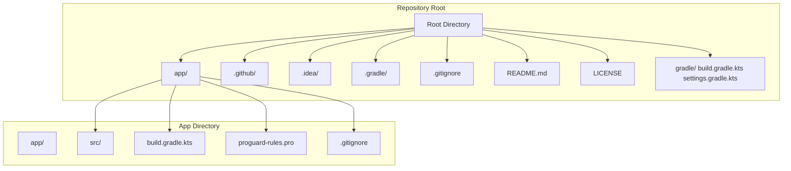
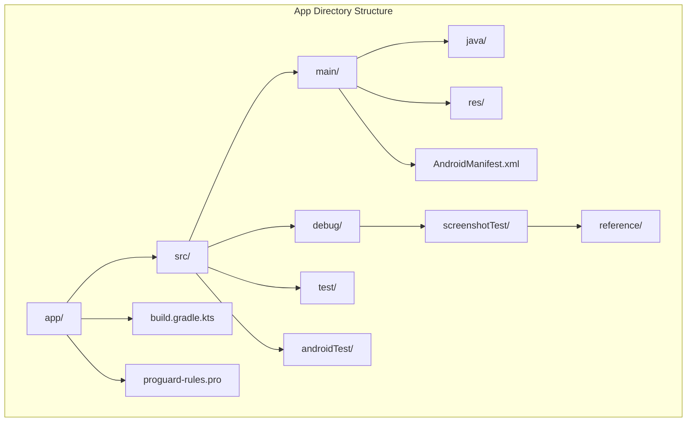
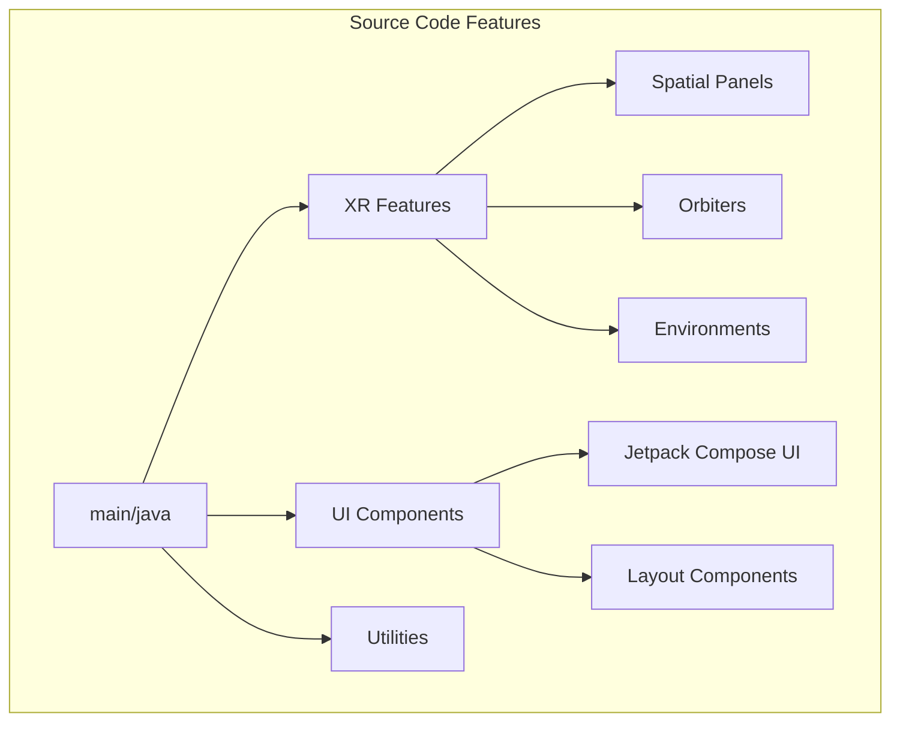
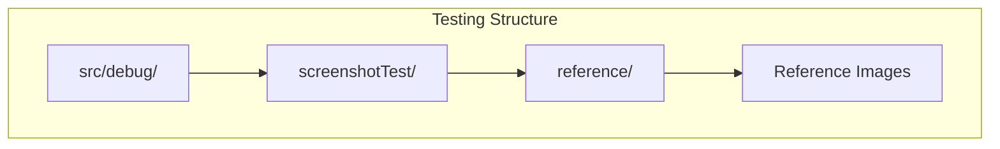

<!-- source: DeepWiki mcp.deepwiki.com · repo android/xr-samples · page 1.1 Repository Structure · fetched 2026-10-23 -->

# Repository Structure

Relevant source files

The following files were used as context for generating this wiki page:

- [.gitignore](.gitignore)
- [README.md](README.md)
- [app/.gitignore](app/.gitignore)

This document provides a comprehensive overview of the Android XR Samples repository organization and its key files. It serves as a map to help developers navigate the codebase efficiently. For information about building and running the application, see [Getting Started](#2), and for details about the application architecture, see [Application Architecture](#3).

## Repository Overview

The Android XR Samples repository follows a standard Android project structure, with specific organization for XR-related features. Below is a high-level visualization of the repository structure:

Sources: [.gitignore](), [README.md](), [app/.gitignore]()

## Main Directory Structure

The repository follows a standard Android project organization with the following key directories:

| Directory | Purpose |
|-----------|---------|
| `app/` | Contains the main application code and resources |
| `.github/` | GitHub-specific files for issues and pull requests |
| `.idea/` | IntelliJ IDEA/Android Studio configuration files |
| `gradle/` | Gradle wrapper files and configurations |

Sources: [.gitignore](), [README.md]()

## App Directory Organization

The `app/` directory contains the core application code and follows the standard Android application structure:

Sources: [app/.gitignore]()

## Key Files and Their Purposes

The repository contains several important files that configure and define the application:

| File | Purpose |
|------|---------|
| `app/build.gradle.kts` | Configures application build settings, dependencies, and SDK versions |
| `app/proguard-rules.pro` | Defines code shrinking and obfuscation rules for release builds |
| `README.md` | Provides an overview of the project, features, and development environment |
| `LICENSE` | Contains the Apache License (Version 2.0) terms for the project |
| `.gitignore` | Specifies files and directories to be excluded from version control |

Sources: [.gitignore](), [README.md]()

## Source Code Organization

The source code is organized to separate different aspects of the XR application. The main features demonstrated in the code include:

Sources: [README.md]()

## Build Configuration

The application uses Gradle for its build system, with the main configuration in `app/build.gradle.kts`. This file defines:

- Application ID
- Target and minimum SDK versions
- Dependencies on ARCore, SceneCore, and Jetpack Compose
- Build variants and types
- Signing configurations
- Test configurations

The project also includes ProGuard rules for code optimization during release builds.

Sources: [README.md]()

## Testing Resources

The repository includes support for screenshot testing, which helps maintain UI consistency:

The screenshot test infrastructure is contained in the debug build variant, with reference images stored in the reference directory. This allows developers to compare UI changes against baseline images.

Sources: [app/.gitignore]()

## Version Control Configuration

The repository uses Git for version control, with specific exclusion patterns defined in `.gitignore` files:

| Excluded Items | Reason |
|----------------|--------|
| Build outputs (*.apk, *.dex, *.class) | Generated files, not part of source code |
| Build directories (bin/, gen/, out/, build) | Generated during build process |
| Local configuration (local.properties) | Contains developer-specific settings |
| IDE files (*.iml, most .idea/ content) | IDE-specific, not relevant to all developers |
| Gradle cache (.gradle) | Local cache, regenerated as needed |
| System files (.DS_Store) | OS-specific files |
| Kotlin compiler files (.kotlin) | Generated during compilation |

This configuration ensures only relevant source code and configuration files are tracked in version control.

Sources: [.gitignore](), [app/.gitignore]()

## Documentation Resources

The repository includes documentation resources that provide context and usage information:

- `README.md`: Provides an overview of features, development environment, and additional resources
- URL references to Android XR documentation on developer.android.com
- License information

These documentation resources help developers understand the purpose and usage of the sample code.

Sources: [README.md]()

## GitHub Configuration

The `.github/` directory likely contains templates for issues and pull requests to standardize contributions to the repository. This includes:

- Issue templates that guide users in reporting bugs or requesting features
- Pull request templates that ensure proper documentation and testing of changes

These templates help maintain code quality and consistency across contributions.

Sources: [.gitignore]()

---

