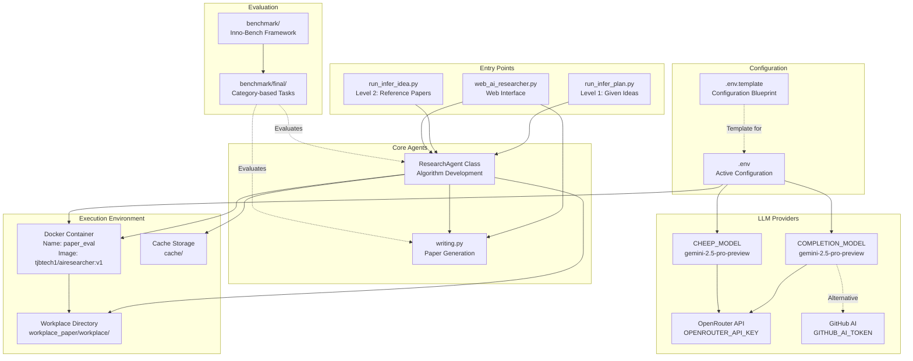
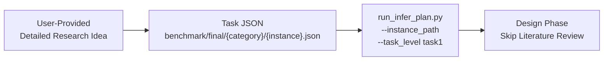
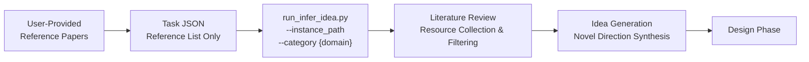
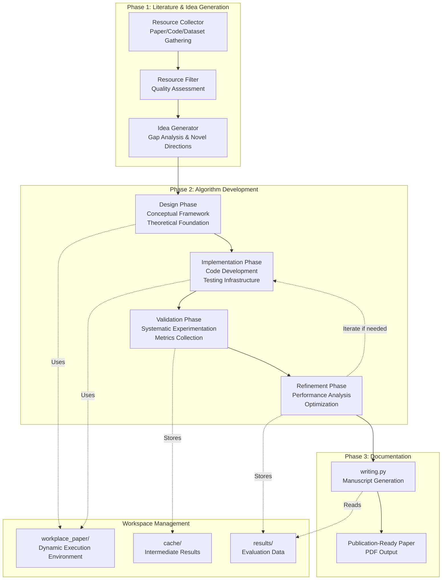

<!-- source: DeepWiki mcp.deepwiki.com · repo HKUDS/AI-Researcher · page 1 Overview · fetched 2026-11-09 -->

# Overview

<details>
<summary>Relevant source files</summary>

The following files were used as context for generating this wiki page:

- [README.md](README.md)
- [assets/AI-Researcher-Framework.pdf](assets/AI-Researcher-Framework.pdf)
- [assets/AI-Researcher-Framework.png](assets/AI-Researcher-Framework.png)

</details>


This document provides a comprehensive introduction to the AI-Researcher system, its architecture, capabilities, and operational workflow. It serves as the entry point for understanding how AI-Researcher automates the complete scientific research lifecycle from initial concept to published manuscript.

For detailed information about specific components, see:
- System architecture and pipeline details: [System Architecture](#2)
- Configuration and deployment: [Configuration & Deployment](#4)
- Research agent implementation: [Research Agent](#3.1)
- Benchmark evaluation framework: [Benchmark System](#3.3)

---

## What is AI-Researcher?

AI-Researcher is an autonomous scientific innovation platform that automates the complete research lifecycle. The system processes research inputs—either detailed ideas or reference papers—and produces full research outputs including novel algorithms, experimental validation, and publication-ready manuscripts.

The platform operates through three primary execution modes:

1. **Level 1 Tasks**: User provides detailed research idea via [`run_infer_plan.py`](research_agent/run_infer_plan.py:1-1167)
2. **Level 2 Tasks**: User provides reference papers; system generates ideas via [`run_infer_idea.py`](research_agent/run_infer_idea.py:1-1157)
3. **Web Interface**: Browser-based interaction via [`web_ai_researcher.py`](web_ai_researcher.py:1-500)

**Sources:** [README.md:1-87](), [README.md:929-984]()

---

## System Capabilities

AI-Researcher delivers six core research functions through integrated AI agents:

| Capability | Description | Implementation Phase |
|------------|-------------|---------------------|
| **Literature Review** | Comprehensive analysis and synthesis of existing research | Phase 1: Idea Generation |
| **Idea Generation** | Systematic formulation of novel research directions | Phase 1: Idea Generation |
| **Algorithm Design** | Conceptual development and theoretical foundations | Phase 2: Development |
| **Algorithm Implementation** | Transform designs into functional code | Phase 2: Development |
| **Algorithm Validation** | Automated testing, experimentation, and optimization | Phase 2: Development |
| **Manuscript Creation** | Generate publication-ready academic papers | Phase 3: Documentation |

The system has been evaluated across 14 benchmark tasks spanning:
- **Diffusion & Flow Models**: 4 benchmarks (consistency flow matching, rectified flows, immiscible diffusion, MMDiT transformers)
- **Graph Neural Networks**: 9 benchmarks (multi-task prompting, sparse transformers, energy-constrained diffusion, fractional dynamics, generalization studies, structure learning, spectral filtering, universal principles, instruction tuning)
- **Reasoning Tasks**: 1 benchmark (analogical prompting)

**Sources:** [README.md:46-56](), [README.md:959-970]()

---

## System Architecture

### Primary Components



**Architecture Overview**

The system architecture consists of four primary layers:

1. **Entry Points Layer**: Three execution modes provide flexibility in how users interact with the system. The web GUI ([`web_ai_researcher.py`](web_ai_researcher.py:1-500)) offers the most accessible interface, while command-line scripts provide programmatic control.

2. **Agent Layer**: The `ResearchAgent` class orchestrates algorithm development, while [`writing.py`](paper_agent/writing.py:1-800) handles manuscript generation. These agents coordinate to execute the complete research pipeline.

3. **Infrastructure Layer**: Docker containerization ensures reproducible execution environments. The container named `paper_eval` (configurable via `CONTAINER_NAME` in `.env`) isolates research workspaces and manages dependencies.

4. **Integration Layer**: LLM providers are accessed through a dual-model strategy—`COMPLETION_MODEL` for complex reasoning and `CHEEP_MODEL` for cost-effective operations—both configurable in [`.env`](.env.template:164-167).

**Sources:** [README.md:988-1027](), [.env.template:159-210](), [README.md:138-149]()

---

## Input Modalities

AI-Researcher accepts research input at two distinct task levels, each designed for different use cases:

### Level 1: Detailed Idea Description



At Level 1, users provide comprehensive descriptions of their research ideas including:
- Proposed model architecture and methodology
- Core techniques and algorithms to implement
- Key parameters and constraints
- Step-by-step integration requirements
- Expected performance characteristics

The system bypasses literature review and proceeds directly to algorithm design and implementation.

**Command Example:**
```bash
python run_infer_plan.py \
  --instance_path ../benchmark/final/vq/one_layer_vq.json \
  --task_level task1 \
  --model gemini-2.5-pro-preview
```

### Level 2: Reference-Based Ideation



At Level 2, users provide only reference papers (typically 5-15 papers). The system:
1. Collects and analyzes provided references
2. Filters for quality and relevance
3. Autonomously generates novel research directions
4. Proceeds with complete algorithm development

**Command Example:**
```bash
python run_infer_idea.py \
  --instance_path ../benchmark/final/gnn/allinone.json \
  --category gnn \
  --model gemini-2.5-pro-preview
```

**Sources:** [README.md:36-43](), [README.md:986-1027]()

---

## Research Execution Pipeline

### Three-Phase Workflow



**Phase Descriptions:**

**Phase 1** (Level 2 Only): Autonomous literature review through resource collection from academic databases (arXiv, IEEE, ACM), code repositories (GitHub, Hugging Face), and dataset sources. The Resource Filter evaluates quality based on citation metrics and relevance. The Idea Generator identifies research gaps and formulates novel directions.

**Phase 2** (All Tasks): Core research automation cycle:
- **Design**: Establishes theoretical foundations and conceptual framework
- **Implementation**: Develops functional code with testing infrastructure  
- **Validation**: Executes systematic experiments and collects performance metrics
- **Refinement**: Analyzes results, identifies optimizations, iterates as needed

**Phase 3** (All Tasks): The [`writing.py`](paper_agent/writing.py:1-800) script generates full academic manuscripts by synthesizing all research outputs—motivation, methodology, experimental results, and analysis—into publication-ready format.

**Sources:** [README.md:929-956]()

---

## Key Technical Components

### Containerized Execution

The system executes within Docker containers for reproducibility and isolation:

```bash
# Container Configuration (from .env.template)
DOCKER_WORKPLACE_NAME=workplace_paper
BASE_IMAGES=tjbtech1/airesearcher:v1
CONTAINER_NAME=paper_eval
GPUS='"device=0"'  # GPU allocation
PLATFORM=linux/amd64
```

The Docker image [`tjbtech1/airesearcher:v1`](README.md:142) provides a complete research environment with all dependencies pre-installed. Users can pull the image directly or build from the provided [`Dockerfile`](docker/Dockerfile:1-100).

### LLM Integration Strategy

AI-Researcher employs a dual-model architecture for cost optimization:

| Model Type | Purpose | Configuration Variable | Default Value |
|------------|---------|------------------------|---------------|
| Completion Model | Complex reasoning, design decisions | `COMPLETION_MODEL` | `openrouter/google/gemini-2.5-pro-preview-05-20` |
| Cheap Model | Routine operations, simple tasks | `CHEEP_MODEL` | `openrouter/google/gemini-2.5-pro-preview-05-20` |

Both models route through OpenRouter API (`OPENROUTER_API_KEY`, `OPENROUTER_API_BASE`) with GitHub AI as an alternative provider (`GITHUB_AI_TOKEN`).

### Workspace Organization

```
workplace_paper/               # Main workplace directory
└── workplace/                 # Execution workspace
    ├── {category}/           # Research domain
    │   └── {instance_id}/    # Specific task
    │       ├── code/         # Algorithm implementation
    │       ├── results/      # Experimental outputs
    │       └── logs/         # Execution logs
cache/                        # Intermediate computation cache
results/                      # Aggregated evaluation data
```

The workspace structure isolates each research task within its own directory tree, preventing cross-contamination while enabling systematic organization of outputs.

**Sources:** [.env.template:159-210](), [README.md:138-156]()

---

## Benchmark Evaluation Framework

The Inno-Bench evaluation system compares AI-generated research against expert-level ground truth across multiple dimensions:

| Evaluation Dimension | Description |
|---------------------|-------------|
| **Novelty** | Innovation and uniqueness of the research contribution |
| **Experimental Rigor** | Comprehensiveness and design quality of experiments |
| **Theoretical Foundation** | Strength of mathematical and conceptual basis |
| **Result Analysis** | Depth and accuracy of interpretation |
| **Writing Quality** | Clarity, coherence, and structure of documentation |

Benchmark tasks are organized hierarchically:

```
benchmark/
└── final/
    ├── diffu_flow/          # Diffusion & Flow Models (4 tasks)
    │   ├── con_flowmatching.json
    │   ├── i_rect_flow.json
    │   ├── immiscible_diffusion.json
    │   └── mmdit.json
    ├── gnn/                 # Graph Neural Networks (9 tasks)
    │   ├── allinone.json
    │   ├── exphormer.json
    │   ├── gnn_difformer.json
    │   ├── gnn_fractional.json
    │   ├── gnn_generalization.json
    │   ├── gnn_nodeformer.json
    │   ├── gnn_poly_gcl.json
    │   ├── gnn_universal.json
    │   └── graphgpt.json
    └── reasoning/           # Reasoning Tasks (1 task)
        └── analog_reasoner.json
```

Each JSON file contains task specifications including reference papers, evaluation criteria, and ground truth comparisons. The benchmark framework is fully open-source, with collection methodology and processing code available in the [`benchmark_collection/`](benchmark_collection) directory.

**Sources:** [README.md:959-970](), [README.md:1047-1052]()

---

## Deployment Options

### Command-Line Execution

Research agents can be invoked directly via Python scripts:

```bash
# Level 1: Given detailed idea
python research_agent/run_infer_plan.py \
  --instance_path ./benchmark/final/vq/one_layer_vq.json \
  --container_name paper_eval \
  --task_level task1 \
  --model gemini-2.5-pro-preview \
  --workplace_name workplace \
  --cache_path cache \
  --port 7020 \
  --max_iter_times 0 \
  --category vq

# Level 2: Reference papers only
python research_agent/run_infer_idea.py \
  --instance_path ./benchmark/final/gnn/allinone.json \
  --container_name paper_eval \
  --model gemini-2.5-pro-preview \
  --workplace_name workplace \
  --cache_path cache \
  --port 7020 \
  --max_iter_times 0 \
  --category gnn
```

### Web Interface

The Gradio-based web interface ([`web_ai_researcher.py`](web_ai_researcher.py:1-500)) provides a browser-based alternative:

```bash
python web_ai_researcher.py
# Launches server on http://localhost:7860
```

The web GUI enables:
- Configuration of environment variables through UI
- Selection of benchmark examples
- Real-time monitoring of research progress
- Interactive parameter adjustment

**Sources:** [README.md:212-231](), [README.md:986-1027]()

---

## Community and Support

AI-Researcher is developed and maintained by the HKUDS research group. Community resources include:

- **Slack Workspace**: Technical discussions, architecture, development
- **Discord Server**: General questions, feedback, community discussions
- **GitHub Issues**: Bug reports, feature requests, development tracking
- **Documentation Site**: Comprehensive guides at https://autoresearcher.github.io/docs

The project is actively developed with regular updates and community contributions welcomed.

**Sources:** [README.md:1060-1069](), [README.md:14-24]()

---

## Next Steps

For detailed information about specific components and usage:

- **System Architecture Details**: See [System Architecture](#2) for pipeline implementation
- **Research Agent Deep Dive**: See [Research Agent](#3.1) for execution flow and parameters
- **Configuration Guide**: See [Environment Configuration](#4.1) for setup instructions
- **Benchmark Tasks**: See [Benchmark Tasks & Domains](#5) for evaluation framework details
- **Usage Examples**: See [Usage Guide](#6) for step-by-step tutorials

**Sources:** [README.md:89-105]()

---

