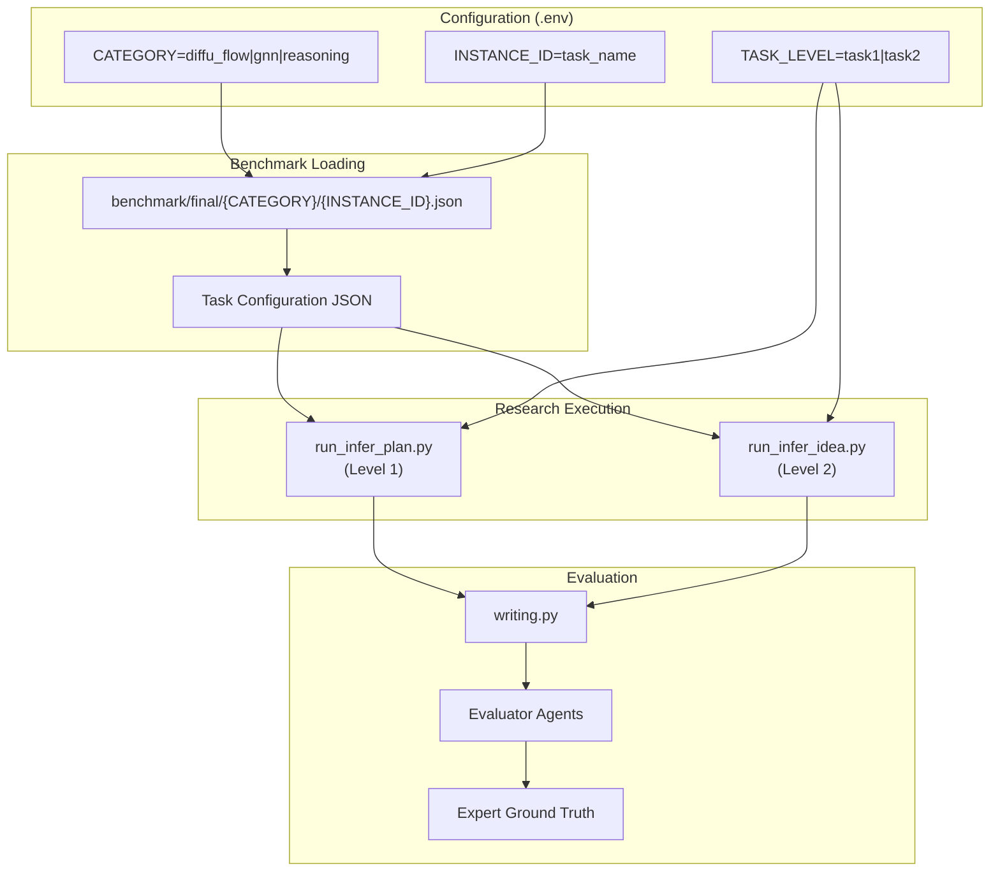
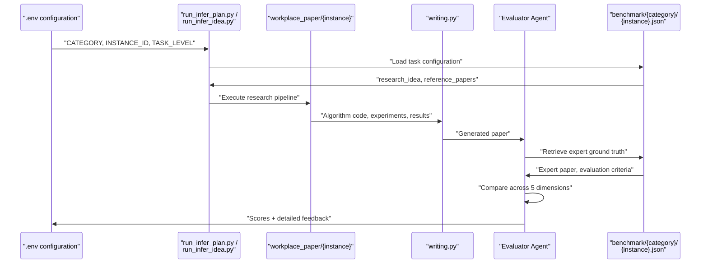
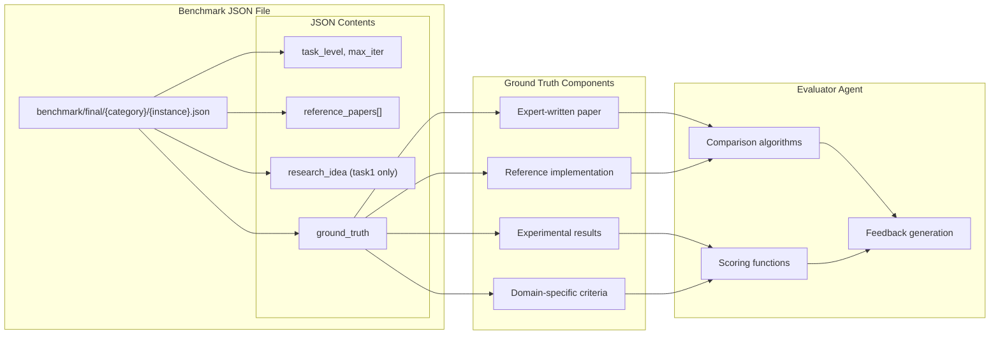

<!-- source: DeepWiki mcp.deepwiki.com · repo HKUDS/AI-Researcher · page 3.3 Benchmark System (Inno-Bench) · fetched 2026-11-09 -->

# Benchmark System (Inno-Bench)

<details>
<summary>Relevant source files</summary>

The following files were used as context for generating this wiki page:

- [README.md](README.md)
- [benchmark/README.md](benchmark/README.md)

</details>


Inno-Bench is an evaluation framework that compares AI-generated research outputs against expert-level ground truth papers. The system evaluates research quality across five dimensions: novelty, experimental comprehensiveness, theoretical foundation, result analysis, and writing quality. Benchmark tasks are organized into domain-specific categories with hierarchical JSON configuration files that define task parameters, reference papers, and evaluation criteria.

For specific domain benchmarks, see [Diffusion & Flow Matching](#5.1), [Graph Neural Networks](#5.2), and [Reasoning](#5.3). For usage instructions, see [Usage Guide](#6).
</thinking>

**Sources:** [README.md:951-962](), [benchmark/README.md:1]()

## Directory Structure and Task Organization

### Benchmark File Hierarchy

The benchmark system uses a hierarchical directory structure under `benchmark/final/` with JSON configuration files defining individual tasks:

```
benchmark/final/
├── diffu_flow/
│   ├── con_flowmatching.json
│   ├── i_rect_flow.json
│   ├── immiscible_diffusion.json
│   └── mmdit.json
├── gnn/
│   ├── allinone.json
│   ├── exphormer.json
│   ├── gnn_difformer.json
│   ├── gnn_fractional.json
│   ├── gnn_generalization.json
│   ├── gnn_nodeformer.json
│   ├── gnn_poly_gcl.json
│   ├── gnn_universal.json
│   └── graphgpt.json
└── reasoning/
    └── analog_reasoner.json
```

### Integration with Research Agents



**Sources:** [README.md:185-199](), [README.md:989-1018]()

## JSON Configuration Format

Each benchmark task is defined by a JSON file containing task parameters, reference papers, research ideas, and evaluation ground truth.

### Task JSON Structure

Typical benchmark JSON files contain the following key sections:

| Field | Description |
|-------|-------------|
| `task_level` | Either `task1` (detailed idea provided) or `task2` (generate idea from references) |
| `reference_papers` | List of paper titles and citations that form the research context |
| `research_idea` | Detailed description of the proposed method (for task1 only) |
| `ground_truth` | Expert-written paper content used for evaluation |
| `evaluation_criteria` | Specific metrics and benchmarks for this domain |

### Example Configuration Loading

The research agent scripts load benchmark configurations using the `--instance_path` parameter:

```bash
python run_infer_plan.py \
    --instance_path ../benchmark/final/${category}/${instance_id}.json \
    --task_level task1
```

This loads the JSON file specified by `CATEGORY` and `INSTANCE_ID` environment variables and extracts the task configuration, reference papers, and evaluation criteria.

**Sources:** [README.md:995-999](), [README.md:1014-1018]()

## Task Level System

### Two-Tier Task Hierarchy

The benchmark system defines two task levels that correspond to different research automation scenarios:

| Task Level | Entry Point | Input Requirements | Execution Flow |
|------------|-------------|-------------------|----------------|
| `task1` | `run_infer_plan.py` | Research idea + reference papers in JSON | Design → Implementation → Validation → Refinement |
| `task2` | `run_infer_idea.py` | Reference papers only in JSON | Resource Collection → Idea Generation → Design → Implementation → Validation |

### Configuration Parameters

The task level is specified via environment variables and command-line arguments:

```bash
# Level 1 execution
export TASK_LEVEL=task1
python run_infer_plan.py --instance_path benchmark/final/vq/one_layer_vq.json --task_level task1

# Level 2 execution  
python run_infer_idea.py --instance_path benchmark/final/vq/one_layer_vq.json
```

### Evaluation Differences

- **Task 1**: Evaluates implementation quality against provided idea specifications. Focuses on code correctness, experimental design, and result interpretation.
- **Task 2**: Evaluates complete research cycle including idea originality. Assesses novelty of generated ideas, resource selection quality, and end-to-end execution.

**Sources:** [README.md:32-43](), [README.md:989-1018](), [README.md:196-199]()

## Domain Coverage

### Research Categories

The benchmark system covers three major research domains with 14 total task instances:

| Category | Task Count | Domain Focus |
|----------|------------|--------------|
| `diffu_flow` | 4 | Diffusion models, flow matching, generative modeling |
| `gnn` | 9 | Graph neural networks, graph learning, network analysis |
| `reasoning` | 1 | LLM reasoning enhancement, prompting techniques |

### Category-to-File Mapping

```mermaid
graph TB
    subgraph "Environment Configuration"
        CATEGORY["CATEGORY env variable"]
        INSTANCE_ID["INSTANCE_ID env variable"]
    end
    
    subgraph "benchmark/final/"
        diffu_flow["diffu_flow/"]
        gnn_dir["gnn/"]
        reasoning_dir["reasoning/"]
    end
    
    subgraph "Diffusion & Flow Tasks"
        con_flow["con_flowmatching.json"]
        i_rect["i_rect_flow.json"]
        immis["immiscible_diffusion.json"]
        mmdit["mmdit.json"]
    end
    
    subgraph "GNN Tasks"
        allinone["allinone.json"]
        exphormer["exphormer.json"]
        difformer["gnn_difformer.json"]
        fractional["gnn_fractional.json"]
        generalization["gnn_generalization.json"]
        nodeformer["gnn_nodeformer.json"]
        polygcl["gnn_poly_gcl.json"]
        universal["gnn_universal.json"]
        graphgpt["graphgpt.json"]
    end
    
    subgraph "Reasoning Tasks"
        analog["analog_reasoner.json"]
    end
    
    CATEGORY -->|"diffu_flow"| diffu_flow
    CATEGORY -->|"gnn"| gnn_dir
    CATEGORY -->|"reasoning"| reasoning_dir
    
    diffu_flow --> con_flow
    diffu_flow --> i_rect
    diffu_flow --> immis
    diffu_flow --> mmdit
    
    gnn_dir --> allinone
    gnn_dir --> exphormer
    gnn_dir --> difformer
    gnn_dir --> fractional
    gnn_dir --> generalization
    gnn_dir --> nodeformer
    gnn_dir --> polygcl
    gnn_dir --> universal
    gnn_dir --> graphgpt
    
    reasoning_dir --> analog
    
    INSTANCE_ID -->|selects| con_flow
    INSTANCE_ID -->|selects| allinone
    INSTANCE_ID -->|selects| analog
```



**Sources:** [README.md:186-194](), [README.md:1002-1007](), [README.md:1023-1026]()

## Evaluation Methodology

### Five-Dimensional Assessment Framework

The evaluation system assesses AI-generated research across five independent dimensions:

| Dimension | Evaluation Criteria |
|-----------|-------------------|
| **Novelty** | Innovation level, uniqueness of approach, advancement beyond existing work |
| **Experimental Comprehensiveness** | Experimental design quality, dataset coverage, ablation studies, statistical rigor |
| **Theoretical Foundation** | Mathematical correctness, theoretical justification, formal analysis depth |
| **Result Analysis** | Interpretation quality, insight depth, comparison with baselines, discussion thoroughness |
| **Writing Quality** | Clarity, structure, coherence, technical precision, reproducibility |

### Evaluation Pipeline



**Sources:** [README.md:960](), [README.md:989-1044]()

## Integration with Research Agents

### Command-Line Interface

Benchmark tasks are executed by passing the JSON configuration path to research agent scripts:

#### Task Level 1 (Given Idea)
```bash
# From research_agent/run_infer_level_1.sh
export CATEGORY=vq
export INSTANCE_ID=one_layer_vq
export TASK_LEVEL=task1

python run_infer_plan.py \
    --instance_path ../benchmark/final/${CATEGORY}/${INSTANCE_ID}.json \
    --container_name paper_eval \
    --task_level ${TASK_LEVEL} \
    --model ${COMPLETION_MODEL} \
    --workplace_name workplace \
    --cache_path cache \
    --port 12372 \
    --max_iter_times 0 \
    --category ${CATEGORY}
```

#### Task Level 2 (Generate Idea)
```bash
# From research_agent/run_infer_level_2.sh
export CATEGORY=gnn
export INSTANCE_ID=gnn_nodeformer

python run_infer_idea.py \
    --instance_path ../benchmark/final/${CATEGORY}/${INSTANCE_ID}.json \
    --container_name paper_eval \
    --model ${COMPLETION_MODEL} \
    --workplace_name workplace \
    --cache_path cache \
    --port 12372 \
    --max_iter_times 0 \
    --category ${CATEGORY}
```

### Environment Variables

| Variable | Purpose | Example Values |
|----------|---------|----------------|
| `CATEGORY` | Selects domain subdirectory under `benchmark/final/` | `diffu_flow`, `gnn`, `reasoning` |
| `INSTANCE_ID` | Selects specific JSON file (without .json extension) | `con_flowmatching`, `gnn_nodeformer`, `analog_reasoner` |
| `TASK_LEVEL` | Determines execution path and evaluation criteria | `task1`, `task2` |
| `MAX_ITER_TIMES` | Controls refinement iteration limit | `0` (single pass), positive integers |

**Sources:** [README.md:989-1027](), [README.md:185-201]()

## Expert Ground Truth

### Ground Truth Data Structure

Each benchmark JSON file contains an expert-level ground truth section that serves as the evaluation baseline:



### Ground Truth Source Criteria

Expert ground truth papers are selected based on:

- **Peer Review**: Published in top-tier conferences/journals
- **Citation Impact**: High citation count indicating community validation
- **Reproducibility**: Code and data availability for verification
- **Methodological Rigor**: Clear experimental design and thorough evaluation

**Sources:** [README.md:954](), [README.md:958]()

## Open Source Methodology

Inno-Bench provides full transparency in benchmark construction and evaluation processes:

- **Dataset Access**: Complete processed datasets available in [benchmark/](benchmark)
- **Collection Pipeline**: Full data collection methodology in [benchmark_collection/](benchmark_collection)
- **Processing Code**: Open-source implementation of all processing steps
- **Evaluation Scripts**: Transparent evaluation algorithms and metrics

This open-source approach enables community customization and domain-specific benchmark construction while maintaining evaluation integrity.

**Sources:** [README.md:958](), [README.md:1041-1044]()

---

