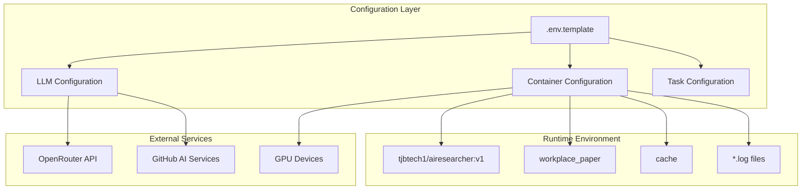
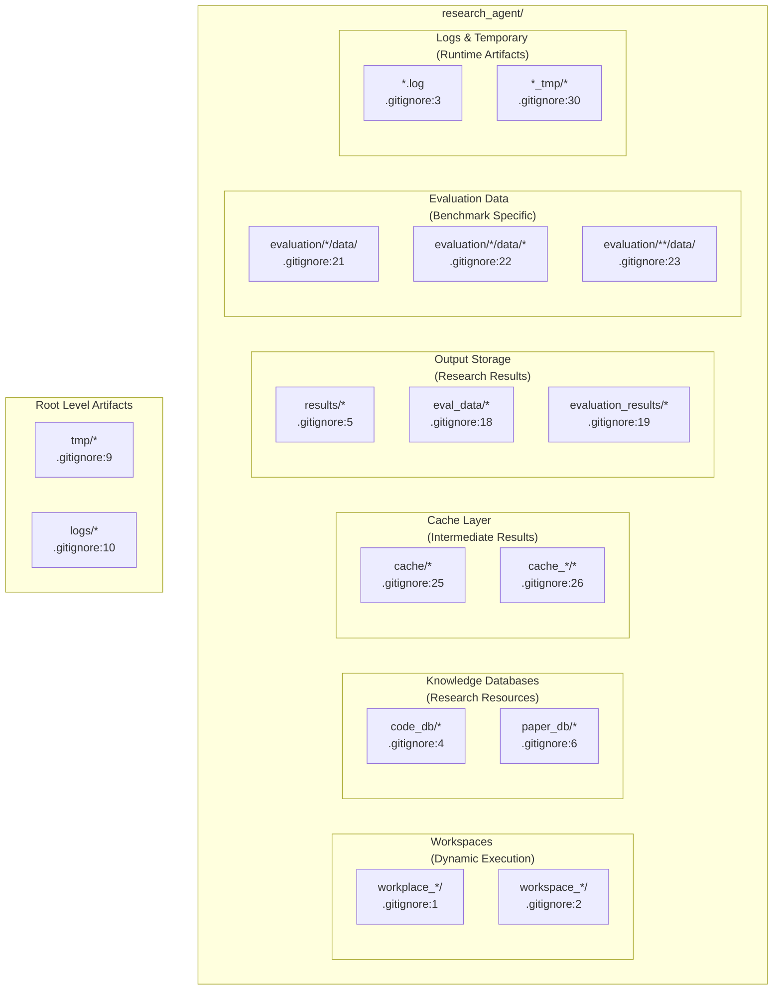
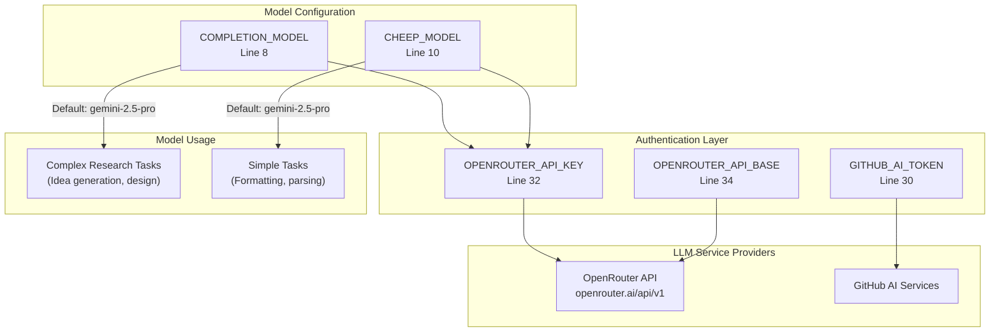
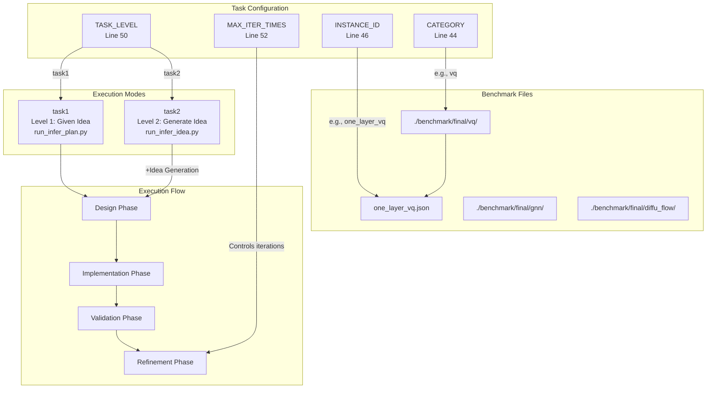
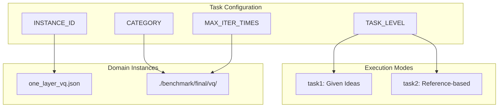
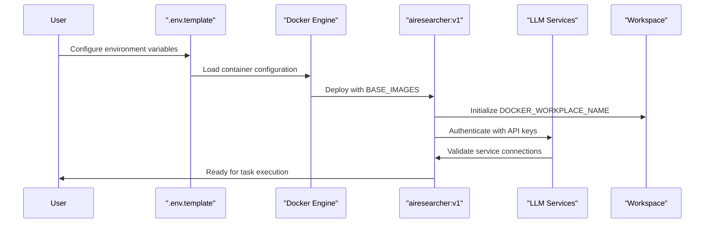

<!-- source: DeepWiki mcp.deepwiki.com · repo HKUDS/AI-Researcher · page 4 Configuration & Deployment · fetched 2026-11-09 -->

# Configuration & Deployment

<details>
<summary>Relevant source files</summary>

The following files were used as context for generating this wiki page:

- [.env.template](.env.template)
- [.gitignore](.gitignore)
- [README.md](README.md)

</details>


## Overview

This page documents the configuration and deployment architecture of the AI-Researcher system, covering environment setup, Docker containerization, and the deployment workflow required to run research agents and benchmark evaluations.

The configuration system follows a three-layer architecture: container orchestration (Docker), LLM service integration (OpenRouter/GitHub AI), and task execution parameters. All configuration is centralized in `.env` files that are generated from the `.env.template` blueprint and excluded from version control for security.

For specific environment variable configurations, see page 4.1 (Environment Configuration). For Docker container setup and GPU management, see page 4.2 (Docker Containerization). For LLM provider integration details, see page 4.3 (LLM Integration).

**Sources:** [.env.template:1-53](), [.gitignore:28-32](), [README.md:109-210]()
</old_str>

<old_str>
## Container Configuration Parameters

The container configuration section ([.env.template:2-26]()) defines Docker deployment parameters, resource allocation, and workspace organization.

### Container Configuration Keys

| Configuration Key | Line | Purpose | Default Value | Valid Options |
|------------------|------|---------|---------------|---------------|
| `DOCKER_WORKPLACE_NAME` | 4 | Host directory for workplace mount | `workplace_paper` | Any valid directory name |
| `BASE_IMAGES` | 6 | Docker image to use | `tjbtech1/airesearcher:v1` | Docker image tag |
| `COMPLETION_MODEL` | 8 | Primary LLM model name | `openrouter/google/gemini-2.5-pro-preview-05-20` | LiteLLM model identifier |
| `CHEEP_MODEL` | 10 | Cost-optimized model name | `openrouter/google/gemini-2.5-pro-preview-05-20` | LiteLLM model identifier |
| `GPUS` | 16 | GPU device allocation | `"device=0"` | `"device=0"`, `"device=0,1"`, `"all"`, `None` |
| `CONTAINER_NAME` | 18 | Container instance identifier | `paper_eval` | Unique container name |
| `WORKPLACE_NAME` | 20 | Internal workplace directory | `workplace` | Directory name |
| `CACHE_PATH` | 22 | Cache directory path | `cache` | Directory path |
| `PORT` | 24 | Service port binding | `7020` | Valid port number |
| `PLATFORM` | 26 | Target architecture | `linux/amd64` | Docker platform string |

The `COMPLETION_MODEL` and `CHEEP_MODEL` follow LiteLLM naming conventions. Both default to Gemini 2.5 Pro via OpenRouter, but can be configured independently for cost optimization. See [LiteLLM documentation](https://docs.litellm.ai/docs) for model identifier formats.

**Sources:** [.env.template:2-26](), [README.md:155-183]()

### GPU Allocation Patterns

The `GPUS` parameter supports multiple allocation strategies:

```bash
# Single GPU (first device)
GPUS='"device=0"'

# Multiple specific GPUs
GPUS='"device=0,1"'

# All available GPUs
GPUS='"all"'

# CPU-only mode
GPUS=None
```

Note the nested quoting structure: the outer single quotes protect the inner double quotes from shell interpretation. This pattern is used in shell scripts like [research_agent/run_infer_level_1.sh]() and [research_agent/run_infer_level_2.sh]().

**Sources:** [.env.template:11-16](), [README.md:991-1027]()
</old_str>
<new_str>
## Configuration Architecture

The AI-Researcher system uses a layered configuration approach managed through environment variables. The configuration blueprint is provided in `.env.template`, which users customize into `.env` files that are git-ignored to prevent credential exposure.

### Configuration Template Structure

The `.env.template` file organizes configuration into three sections marked by comment headers:

1. **Container Configuration** ([.env.template:2-26]()) - Docker, GPU, and workspace settings
2. **LLM Configuration** ([.env.template:28-34]()) - API keys and model endpoints
3. **Task Configuration** ([.env.template:36-52]()) - Benchmark task parameters

### Configuration System Components



```mermaid
graph TB
    subgraph ConfigFiles["Configuration Files"]
        ENV_TEMPLATE[".env.template<br/>(Blueprint)"]
        ENV_FILE[".env<br/>(User Customized)"]
        GITIGNORE[".gitignore<br/>(Excludes .env)"]
    end
    
    subgraph ContainerConfig["Container Configuration<br/>(Lines 2-26)"]
        DOCKER_WORKPLACE_NAME["DOCKER_WORKPLACE_NAME"]
        BASE_IMAGES["BASE_IMAGES"]
        COMPLETION_MODEL["COMPLETION_MODEL"]
        CHEEP_MODEL["CHEEP_MODEL"]
        GPUS["GPUS"]
        CONTAINER_NAME["CONTAINER_NAME"]
        WORKPLACE_NAME["WORKPLACE_NAME"]
        CACHE_PATH["CACHE_PATH"]
        PORT["PORT"]
        PLATFORM["PLATFORM"]
    end
    
    subgraph LLMConfig["LLM Configuration<br/>(Lines 28-34)"]
        GITHUB_AI_TOKEN["GITHUB_AI_TOKEN"]
        OPENROUTER_API_KEY["OPENROUTER_API_KEY"]
        OPENROUTER_API_BASE["OPENROUTER_API_BASE"]
    end
    
    subgraph TaskConfig["Task Configuration<br/>(Lines 36-52)"]
        CATEGORY["CATEGORY"]
        INSTANCE_ID["INSTANCE_ID"]
        TASK_LEVEL["TASK_LEVEL"]
        MAX_ITER_TIMES["MAX_ITER_TIMES"]
    end
    
    ENV_TEMPLATE -.->|"Template for"| ENV_FILE
    GITIGNORE -.->|"Excludes"| ENV_FILE
    
    ENV_FILE --> DOCKER_WORKPLACE_NAME
    ENV_FILE --> BASE_IMAGES
    ENV_FILE --> COMPLETION_MODEL
    ENV_FILE --> CHEEP_MODEL
    ENV_FILE --> GPUS
    ENV_FILE --> CONTAINER_NAME
    ENV_FILE --> WORKPLACE_NAME
    ENV_FILE --> CACHE_PATH
    ENV_FILE --> PORT
    ENV_FILE --> PLATFORM
    
    ENV_FILE --> GITHUB_AI_TOKEN
    ENV_FILE --> OPENROUTER_API_KEY
    ENV_FILE --> OPENROUTER_API_BASE
    
    ENV_FILE --> CATEGORY
    ENV_FILE --> INSTANCE_ID
    ENV_FILE --> TASK_LEVEL
    ENV_FILE --> MAX_ITER_TIMES
```

**Sources:** [.env.template:1-53](), [.gitignore:28-32]()

## Security and Credential Management

The configuration system implements security through git-ignore patterns that prevent credential exposure:

| File/Pattern | Purpose | Git Status |
|-------------|---------|-----------|
| `.env.template` | Configuration blueprint with placeholder values | Committed |
| `.env` | Actual configuration with real API keys | **Ignored** ([.gitignore:32]()) |
| `research_agent/.env` | Research agent specific config | **Ignored** ([.gitignore:28]()) |

The `.env` files contain sensitive credentials including:
- `OPENROUTER_API_KEY` - OpenRouter API authentication
- `GITHUB_AI_TOKEN` - GitHub AI service authentication

These files must never be committed to version control. The template provides placeholder values (e.g., `your_openrouter_api_key`, `your_github_ai_token`) that users replace with actual credentials.

**Sources:** [.env.template:30-32](), [.gitignore:28-32]()

## Configuration Architecture Overview

The AI-Researcher system uses a layered configuration approach that separates container orchestration, LLM service integration, and task execution parameters. The primary configuration is managed through environment variables defined in the `.env.template` file.

### Configuration System Components



**Sources:** [.env.template:1-53]()

## Runtime File System Organization

The deployment creates a structured file system with separated workspaces, caches, and output directories. All runtime artifacts are excluded from version control via patterns in [.gitignore:1-31]().

### Directory Structure and Artifact Management



### Gitignore Pattern Mapping

| Pattern | Line | Purpose | Created By |
|---------|------|---------|-----------|
| `research_agent/workplace_*/` | 1 | Dynamic workspaces (Level 1/2 tasks) | Research agents during execution |
| `research_agent/workspace_*/` | 2 | Alternative workspace directories | Research agents (legacy pattern) |
| `research_agent/*.log` | 3 | Runtime log files | Logging system |
| `research_agent/code_db/*` | 4 | Code repository database | Resource collector |
| `research_agent/results/*` | 5 | Experiment results and outputs | Validation/refinement agents |
| `research_agent/paper_db/*` | 6 | Paper metadata database | Resource collector |
| `research_agent/eval_data/*` | 18 | Evaluation dataset storage | Benchmark system |
| `research_agent/evaluation_results/*` | 19 | Benchmark evaluation results | Evaluator agents |
| `research_agent/cache/*` | 25 | General cache directory | Multiple components |
| `research_agent/cache_*/*` | 26 | Named cache directories | Multiple components |
| `research_agent/.env` | 28 | Configured environment file | User setup |
| `research_agent/*_tmp/*` | 30 | Temporary directories | Various agents |

The `workplace_*` pattern matches directories created based on the `DOCKER_WORKPLACE_NAME` environment variable. For example, with `DOCKER_WORKPLACE_NAME=workplace_paper`, the system creates `research_agent/workplace_paper/` which is ignored by pattern on line 1.

**Sources:** [.gitignore:1-31](), [.env.template:4-22]()

## LLM Integration Configuration

The LLM configuration section ([.env.template:28-34]()) defines authentication and endpoint settings for external language model services. The system supports multiple providers through a dual-token approach.

### LLM Configuration Parameters

| Configuration Key | Line | Purpose | Default/Example Value |
|------------------|------|---------|---------------------|
| `GITHUB_AI_TOKEN` | 30 | GitHub AI services authentication | `your_github_ai_token` |
| `OPENROUTER_API_KEY` | 32 | OpenRouter API authentication | `your_openrouter_api_key` |
| `OPENROUTER_API_BASE` | 34 | OpenRouter API endpoint URL | `https://openrouter.ai/api/v1` |

### Dual-Model Strategy

The system implements a dual-model strategy for cost optimization:



Both models default to `openrouter/google/gemini-2.5-pro-preview-05-20` but can be configured independently. The system uses the `COMPLETION_MODEL` for complex reasoning tasks (idea generation, algorithm design) and the `CHEEP_MODEL` for simpler operations (text formatting, data extraction).

### Provider Configuration Examples

**OpenRouter (Default):**
```bash
COMPLETION_MODEL=openrouter/google/gemini-2.5-pro-preview-05-20
CHEEP_MODEL=openrouter/google/gemini-2.5-pro-preview-05-20
OPENROUTER_API_KEY=sk-or-v1-xxxxx
OPENROUTER_API_BASE=https://openrouter.ai/api/v1
```

**Alternative Providers via LiteLLM:**
```bash
# Claude via OpenRouter
COMPLETION_MODEL=openrouter/anthropic/claude-3-5-sonnet-20241022
CHEEP_MODEL=openrouter/anthropic/claude-3-5-haiku-20241022

# OpenAI Direct
COMPLETION_MODEL=gpt-4
CHEEP_MODEL=gpt-3.5-turbo
```

The model identifier format follows the LiteLLM convention: `provider/model-name`. For detailed provider support, see https://docs.litellm.ai/docs/.

**Sources:** [.env.template:7-10](), [.env.template:28-34](), [README.md:155-183](), [README.md:998-1021]()

## Task Configuration Parameters

The task configuration section ([.env.template:36-52]()) defines benchmark task selection and execution parameters. These settings determine which research problem to solve and how the agent should approach it.

### Task Configuration Keys

| Configuration Key | Line | Purpose | Example Value | Valid Options |
|------------------|------|---------|---------------|---------------|
| `CATEGORY` | 44 | Research domain category | `vq` | `diffu_flow`, `gnn`, `reasoning`, `recommendation`, `vq` |
| `INSTANCE_ID` | 46 | Specific benchmark instance | `one_layer_vq` | JSON filename without extension |
| `TASK_LEVEL` | 50 | Task complexity level | `task1` | `task1` (given idea), `task2` (generate idea) |
| `MAX_ITER_TIMES` | 52 | Maximum refinement iterations | `0` | Non-negative integer |

### Research Domain Categories

The `CATEGORY` parameter maps to benchmark directories under `./benchmark/final/`:

| Category Value | Domain | Benchmark Count | Directory |
|---------------|--------|-----------------|-----------|
| `diffu_flow` | Diffusion & Flow Matching | 4 benchmarks | `./benchmark/final/diffu_flow/` |
| `gnn` | Graph Neural Networks | 9 benchmarks | `./benchmark/final/gnn/` |
| `reasoning` | Reasoning Tasks | 1 benchmark | `./benchmark/final/reasoning/` |
| `recommendation` | Recommendation Systems | Multiple | `./benchmark/final/recommendation/` |
| `vq` | Vector Quantization | Multiple | `./benchmark/final/vq/` |

### Task Level Execution Modes



**Task Level 1 (task1):** User provides detailed research idea. Agent executes Design → Implementation → Validation → Refinement. Launched via `run_infer_plan.py`.

**Task Level 2 (task2):** User provides reference papers. Agent generates idea, then executes full pipeline. Launched via `run_infer_idea.py`.

### Instance Resolution

The system resolves benchmark instances using this pattern:
```
./benchmark/final/{CATEGORY}/{INSTANCE_ID}.json
```

Example configurations:
```bash
# Vector quantization task
CATEGORY=vq
INSTANCE_ID=one_layer_vq
# Resolves to: ./benchmark/final/vq/one_layer_vq.json

# GNN task
CATEGORY=gnn
INSTANCE_ID=gnn_nodeformer
# Resolves to: ./benchmark/final/gnn/gnn_nodeformer.json
```

### Refinement Iteration Control

The `MAX_ITER_TIMES` parameter controls the refinement phase iterations:
- `0` - Single execution, no iterative refinement
- `N > 0` - Allow up to N refinement cycles based on validation results

Setting this to 0 is common for initial evaluation, while non-zero values enable iterative improvement loops.

**Sources:** [.env.template:36-52](), [README.md:36-43](), [README.md:991-1027]()

## Task Execution Configuration

The system supports multi-domain research tasks with configurable execution parameters. Task configuration determines the research domain, specific problem instance, and execution mode.

### Research Domain Configuration

| Domain Category | Description | Benchmark Path |
|----------------|-------------|----------------|
| `diffu_flow` | Diffusion and flow matching tasks | `./benchmark/final/diffu_flow` |
| `gnn` | Graph neural network tasks | `./benchmark/final/gnn` |
| `reasoning` | Reasoning and logic tasks | `./benchmark/final/reasoning` |
| `recommendation` | Recommendation system tasks | `./benchmark/final/recommendation` |
| `vq` | Vector quantization tasks | `./benchmark/final/vq` |

### Task Execution Parameters



**Sources:** [.env.template:36-52]()

## Configuration Workflow

The deployment process follows a structured workflow that initializes the environment, provisions resources, and configures service integrations before task execution.

### Deployment Process Flow



The configuration system ensures proper resource allocation, service authentication, and workspace initialization before research task execution begins.

**Sources:** [.env.template:1-53](), [.gitignore:1-31]()

---

