# Page: Overview

# Overview

<details>
<summary>Relevant source files</summary>

The following files were used as context for generating this wiki page:

- [README.md](README.md)
- [assets/AI-Researcher-Framework.pdf](assets/AI-Researcher-Framework.pdf)
- [assets/AI-Researcher-Framework.png](assets/AI-Researcher-Framework.png)

</details>


This document provides a comprehensive introduction to the AI-Researcher system, its architecture, capabilities, and operational workflow. It serves as the entry point for understanding how AI-Researcher automates the complete scientific research lifecycle from initial concept to published manuscript.

For detailed information about specific components, see:
- System architecture and pipeline details: [System Architecture](#2)
- Configuration and deployment: [Configuration & Deployment](#4)
- Research agent implementation: [Research Agent](#3.1)
- Benchmark evaluation framework: [Benchmark System](#3.3)

---

## What is AI-Researcher?

AI-Researcher is an autonomous scientific innovation platform that automates the complete research lifecycle. The system processes research inputs—either detailed ideas or reference papers—and produces full research outputs including novel algorithms, experimental validation, and publication-ready manuscripts.

The platform operates through three primary execution modes:

1. **Level 1 Tasks**: User provides detailed research idea via [`run_infer_plan.py`](research_agent/run_infer_plan.py:1-1167)
2. **Level 2 Tasks**: User provides reference papers; system generates ideas via [`run_infer_idea.py`](research_agent/run_infer_idea.py:1-1157)
3. **Web Interface**: Browser-based interaction via [`web_ai_researcher.py`](web_ai_researcher.py:1-500)

**Sources:** [README.md:1-87](), [README.md:929-984]()

---

## System Capabilities

AI-Researcher delivers six core research functions through integrated AI agents:

| Capability | Description | Implementation Phase |
|------------|-------------|---------------------|
| **Literature Review** | Comprehensive analysis and synthesis of existing research | Phase 1: Idea Generation |
| **Idea Generation** | Systematic formulation of novel research directions | Phase 1: Idea Generation |
| **Algorithm Design** | Conceptual development and theoretical foundations | Phase 2: Development |
| **Algorithm Implementation** | Transform designs into functional code | Phase 2: Development |
| **Algorithm Validation** | Automated testing, experimentation, and optimization | Phase 2: Development |
| **Manuscript Creation** | Generate publication-ready academic papers | Phase 3: Documentation |

The system has been evaluated across 14 benchmark tasks spanning:
- **Diffusion & Flow Models**: 4 benchmarks (consistency flow matching, rectified flows, immiscible diffusion, MMDiT transformers)
- **Graph Neural Networks**: 9 benchmarks (multi-task prompting, sparse transformers, energy-constrained diffusion, fractional dynamics, generalization studies, structure learning, spectral filtering, universal principles, instruction tuning)
- **Reasoning Tasks**: 1 benchmark (analogical prompting)

**Sources:** [README.md:46-56](), [README.md:959-970]()

---

## System Architecture

### Primary Components

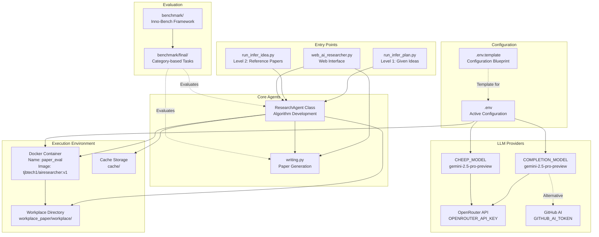

**Architecture Overview**

The system architecture consists of four primary layers:

1. **Entry Points Layer**: Three execution modes provide flexibility in how users interact with the system. The web GUI ([`web_ai_researcher.py`](web_ai_researcher.py:1-500)) offers the most accessible interface, while command-line scripts provide programmatic control.

2. **Agent Layer**: The `ResearchAgent` class orchestrates algorithm development, while [`writing.py`](paper_agent/writing.py:1-800) handles manuscript generation. These agents coordinate to execute the complete research pipeline.

3. **Infrastructure Layer**: Docker containerization ensures reproducible execution environments. The container named `paper_eval` (configurable via `CONTAINER_NAME` in `.env`) isolates research workspaces and manages dependencies.

4. **Integration Layer**: LLM providers are accessed through a dual-model strategy—`COMPLETION_MODEL` for complex reasoning and `CHEEP_MODEL` for cost-effective operations—both configurable in [`.env`](.env.template:164-167).

**Sources:** [README.md:988-1027](), [.env.template:159-210](), [README.md:138-149]()

---

## Input Modalities

AI-Researcher accepts research input at two distinct task levels, each designed for different use cases:

### Level 1: Detailed Idea Description

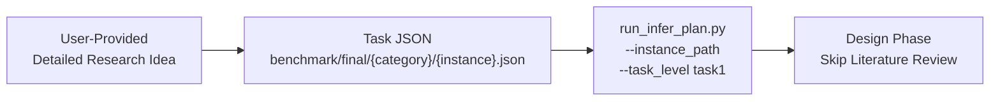

At Level 1, users provide comprehensive descriptions of their research ideas including:
- Proposed model architecture and methodology
- Core techniques and algorithms to implement
- Key parameters and constraints
- Step-by-step integration requirements
- Expected performance characteristics

The system bypasses literature review and proceeds directly to algorithm design and implementation.

**Command Example:**
```bash
python run_infer_plan.py \
  --instance_path ../benchmark/final/vq/one_layer_vq.json \
  --task_level task1 \
  --model gemini-2.5-pro-preview
```

### Level 2: Reference-Based Ideation

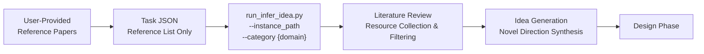

At Level 2, users provide only reference papers (typically 5-15 papers). The system:
1. Collects and analyzes provided references
2. Filters for quality and relevance
3. Autonomously generates novel research directions
4. Proceeds with complete algorithm development

**Command Example:**
```bash
python run_infer_idea.py \
  --instance_path ../benchmark/final/gnn/allinone.json \
  --category gnn \
  --model gemini-2.5-pro-preview
```

**Sources:** [README.md:36-43](), [README.md:986-1027]()

---

## Research Execution Pipeline

### Three-Phase Workflow

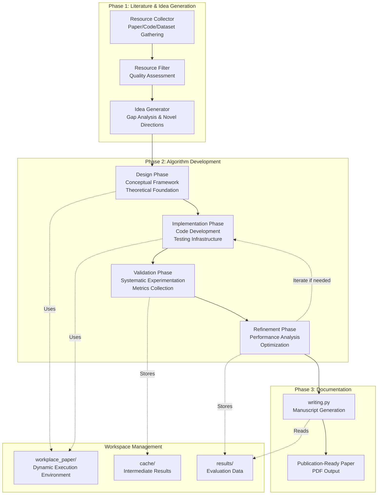

**Phase Descriptions:**

**Phase 1** (Level 2 Only): Autonomous literature review through resource collection from academic databases (arXiv, IEEE, ACM), code repositories (GitHub, Hugging Face), and dataset sources. The Resource Filter evaluates quality based on citation metrics and relevance. The Idea Generator identifies research gaps and formulates novel directions.

**Phase 2** (All Tasks): Core research automation cycle:
- **Design**: Establishes theoretical foundations and conceptual framework
- **Implementation**: Develops functional code with testing infrastructure  
- **Validation**: Executes systematic experiments and collects performance metrics
- **Refinement**: Analyzes results, identifies optimizations, iterates as needed

**Phase 3** (All Tasks): The [`writing.py`](paper_agent/writing.py:1-800) script generates full academic manuscripts by synthesizing all research outputs—motivation, methodology, experimental results, and analysis—into publication-ready format.

**Sources:** [README.md:929-956]()

---

## Key Technical Components

### Containerized Execution

The system executes within Docker containers for reproducibility and isolation:

```bash
# Container Configuration (from .env.template)
DOCKER_WORKPLACE_NAME=workplace_paper
BASE_IMAGES=tjbtech1/airesearcher:v1
CONTAINER_NAME=paper_eval
GPUS='"device=0"'  # GPU allocation
PLATFORM=linux/amd64
```

The Docker image [`tjbtech1/airesearcher:v1`](README.md:142) provides a complete research environment with all dependencies pre-installed. Users can pull the image directly or build from the provided [`Dockerfile`](docker/Dockerfile:1-100).

### LLM Integration Strategy

AI-Researcher employs a dual-model architecture for cost optimization:

| Model Type | Purpose | Configuration Variable | Default Value |
|------------|---------|------------------------|---------------|
| Completion Model | Complex reasoning, design decisions | `COMPLETION_MODEL` | `openrouter/google/gemini-2.5-pro-preview-05-20` |
| Cheap Model | Routine operations, simple tasks | `CHEEP_MODEL` | `openrouter/google/gemini-2.5-pro-preview-05-20` |

Both models route through OpenRouter API (`OPENROUTER_API_KEY`, `OPENROUTER_API_BASE`) with GitHub AI as an alternative provider (`GITHUB_AI_TOKEN`).

### Workspace Organization

```
workplace_paper/               # Main workplace directory
└── workplace/                 # Execution workspace
    ├── {category}/           # Research domain
    │   └── {instance_id}/    # Specific task
    │       ├── code/         # Algorithm implementation
    │       ├── results/      # Experimental outputs
    │       └── logs/         # Execution logs
cache/                        # Intermediate computation cache
results/                      # Aggregated evaluation data
```

The workspace structure isolates each research task within its own directory tree, preventing cross-contamination while enabling systematic organization of outputs.

**Sources:** [.env.template:159-210](), [README.md:138-156]()

---

## Benchmark Evaluation Framework

The Inno-Bench evaluation system compares AI-generated research against expert-level ground truth across multiple dimensions:

| Evaluation Dimension | Description |
|---------------------|-------------|
| **Novelty** | Innovation and uniqueness of the research contribution |
| **Experimental Rigor** | Comprehensiveness and design quality of experiments |
| **Theoretical Foundation** | Strength of mathematical and conceptual basis |
| **Result Analysis** | Depth and accuracy of interpretation |
| **Writing Quality** | Clarity, coherence, and structure of documentation |

Benchmark tasks are organized hierarchically:

```
benchmark/
└── final/
    ├── diffu_flow/          # Diffusion & Flow Models (4 tasks)
    │   ├── con_flowmatching.json
    │   ├── i_rect_flow.json
    │   ├── immiscible_diffusion.json
    │   └── mmdit.json
    ├── gnn/                 # Graph Neural Networks (9 tasks)
    │   ├── allinone.json
    │   ├── exphormer.json
    │   ├── gnn_difformer.json
    │   ├── gnn_fractional.json
    │   ├── gnn_generalization.json
    │   ├── gnn_nodeformer.json
    │   ├── gnn_poly_gcl.json
    │   ├── gnn_universal.json
    │   └── graphgpt.json
    └── reasoning/           # Reasoning Tasks (1 task)
        └── analog_reasoner.json
```

Each JSON file contains task specifications including reference papers, evaluation criteria, and ground truth comparisons. The benchmark framework is fully open-source, with collection methodology and processing code available in the [`benchmark_collection/`](benchmark_collection) directory.

**Sources:** [README.md:959-970](), [README.md:1047-1052]()

---

## Deployment Options

### Command-Line Execution

Research agents can be invoked directly via Python scripts:

```bash
# Level 1: Given detailed idea
python research_agent/run_infer_plan.py \
  --instance_path ./benchmark/final/vq/one_layer_vq.json \
  --container_name paper_eval \
  --task_level task1 \
  --model gemini-2.5-pro-preview \
  --workplace_name workplace \
  --cache_path cache \
  --port 7020 \
  --max_iter_times 0 \
  --category vq

# Level 2: Reference papers only
python research_agent/run_infer_idea.py \
  --instance_path ./benchmark/final/gnn/allinone.json \
  --container_name paper_eval \
  --model gemini-2.5-pro-preview \
  --workplace_name workplace \
  --cache_path cache \
  --port 7020 \
  --max_iter_times 0 \
  --category gnn
```

### Web Interface

The Gradio-based web interface ([`web_ai_researcher.py`](web_ai_researcher.py:1-500)) provides a browser-based alternative:

```bash
python web_ai_researcher.py
# Launches server on http://localhost:7860
```

The web GUI enables:
- Configuration of environment variables through UI
- Selection of benchmark examples
- Real-time monitoring of research progress
- Interactive parameter adjustment

**Sources:** [README.md:212-231](), [README.md:986-1027]()

---

## Community and Support

AI-Researcher is developed and maintained by the HKUDS research group. Community resources include:

- **Slack Workspace**: Technical discussions, architecture, development
- **Discord Server**: General questions, feedback, community discussions
- **GitHub Issues**: Bug reports, feature requests, development tracking
- **Documentation Site**: Comprehensive guides at https://autoresearcher.github.io/docs

The project is actively developed with regular updates and community contributions welcomed.

**Sources:** [README.md:1060-1069](), [README.md:14-24]()

---

## Next Steps

For detailed information about specific components and usage:

- **System Architecture Details**: See [System Architecture](#2) for pipeline implementation
- **Research Agent Deep Dive**: See [Research Agent](#3.1) for execution flow and parameters
- **Configuration Guide**: See [Environment Configuration](#4.1) for setup instructions
- **Benchmark Tasks**: See [Benchmark Tasks & Domains](#5) for evaluation framework details
- **Usage Examples**: See [Usage Guide](#6) for step-by-step tutorials

**Sources:** [README.md:89-105]()

---

# Page: System Architecture

# System Architecture

<details>
<summary>Relevant source files</summary>

The following files were used as context for generating this wiki page:

- [README.md](README.md)
- [assets/AI-Researcher-Framework.pdf](assets/AI-Researcher-Framework.pdf)
- [assets/AI-Researcher-Framework.png](assets/AI-Researcher-Framework.png)

</details>


## Purpose and Scope

This document describes the overall architecture of the AI-Researcher system, detailing the core components, their interactions, and the technical implementation that enables autonomous scientific research. The system provides end-to-end research automation from literature review through algorithm implementation to academic paper generation.

For specific workflow details, see [Research Workflow](#2.1). For agent implementation patterns, see [Agent Framework](#2.2).

## High-Level Architecture Overview

The AI-Researcher system implements a modular, containerized architecture that automates the complete scientific research lifecycle. The core orchestration is handled by the `MetaChain` class [research_agent/inno/core.py:79-664](), which coordinates specialized agents, manages LLM communications, and executes research workflows through Docker containers.

### Overall System Architecture

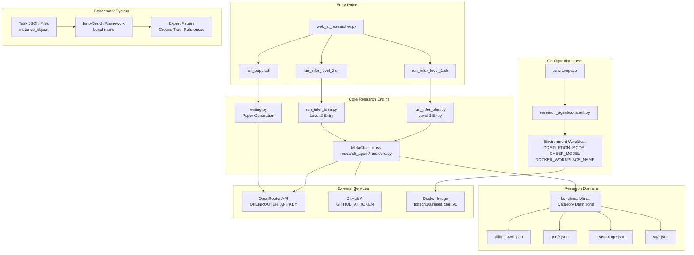

Sources: [README.md:108-210](), [research_agent/inno/core.py:79-664](), [research_agent/run_infer_plan.py:1-100](), [research_agent/run_infer_idea.py:1-100](), [paper_agent/writing.py:1-50](), [.env.template:151-210]()

### Three-Phase Research Pipeline

The system orchestrates research through three distinct phases:

| Phase | Components | Key Functions |
|-------|------------|---------------|
| **Literature Review & Idea Generation** | Resource Collector, Resource Filter, Idea Generator | Automated literature collection, quality assessment, novel concept generation |
| **Algorithm Design & Implementation** | Design Agent, Implementation Agent, Validation Agent | Conceptual development, code implementation, experimental validation |
| **Paper Writing** | Paper Agent | Academic manuscript generation, structured writing, citation management |

Sources: [README.md:42-49](), [README.md:924-947]()

## Core Components

### MetaChain Orchestration System

The `MetaChain` class serves as the central execution engine that coordinates all research activities, manages agent interactions, and handles language model communications.

### MetaChain Class Architecture

The `MetaChain` class serves as the central orchestration engine, managing agent execution loops, tool calling, and LLM communication. It implements three execution modes: synchronous, asynchronous, and streaming.

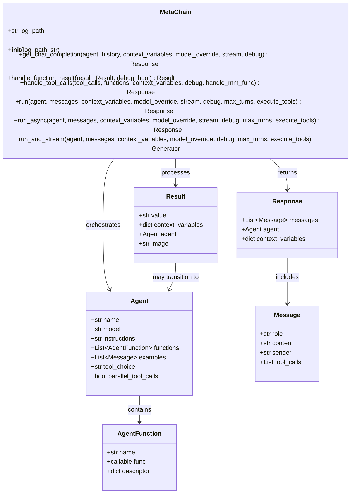

**Key Methods:**
- `get_chat_completion()`: Invokes LLM with retry logic [research_agent/inno/core.py:93-142]()
- `handle_tool_calls()`: Executes agent functions in Docker container [research_agent/inno/core.py:162-248]()
- `handle_function_result()`: Processes function results and manages agent transitions [research_agent/inno/core.py:144-160]()
- `run()`: Synchronous execution loop with turn limits [research_agent/inno/core.py:250-340]()

Sources: [research_agent/inno/core.py:79-664](), [research_agent/inno/types.py:1-100]()

### Research Agent Framework

The research agent framework provides specialized agents for different research tasks, each with domain-specific capabilities and tool functions.

### Agent Execution Flow

This diagram illustrates the execution flow from script invocation through `MetaChain` orchestration to tool execution in the Docker container.

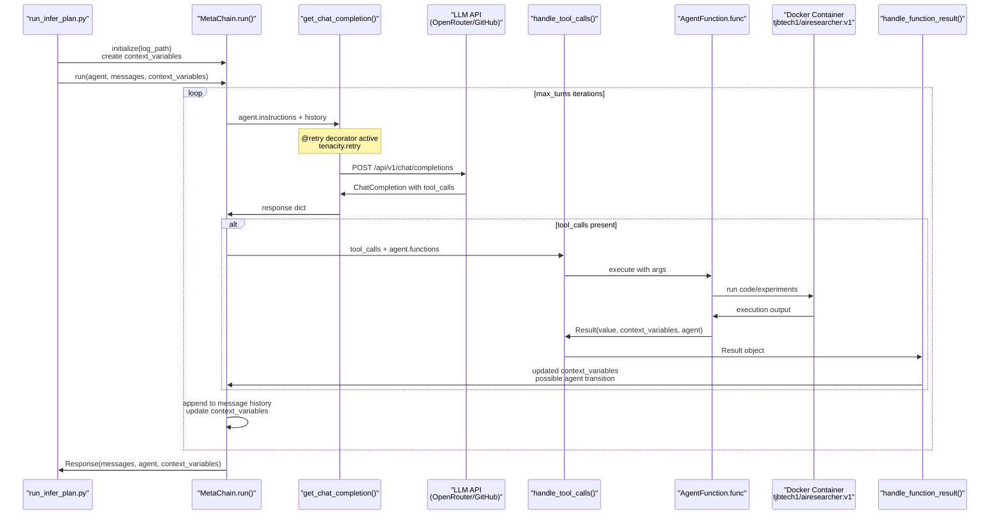

**Key Components:**
- `run_infer_plan.py`: Level 1 task entry point [research_agent/run_infer_plan.py:1-150]()
- `MetaChain.run()`: Main execution loop [research_agent/inno/core.py:250-340]()
- `get_chat_completion()`: LLM invocation with retry [research_agent/inno/core.py:93-142]()
- `handle_tool_calls()`: Tool execution dispatcher [research_agent/inno/core.py:162-248]()
- `AgentFunction`: Callable wrapper for tools [research_agent/inno/types.py:1-50]()

Sources: [research_agent/run_infer_plan.py:1-150](), [research_agent/inno/core.py:79-664](), [research_agent/inno/types.py:1-100]()

### Configuration and Environment Management

The system uses a hierarchical configuration approach with environment variables, constants, and runtime parameters.

### Configuration Architecture

The configuration system uses environment variables defined in `.env.template` and accessed via `os.environ` throughout the codebase. The `research_agent/constant.py` module centralizes configuration constants.

```mermaid
graph TD
    subgraph "Configuration Files"
        EnvTemplate[".env.template<br/>Configuration Blueprint"]
        EnvFile[".env<br/>(git-ignored)"]
        ConstantsModule["research_agent/constant.py<br/>Configuration Constants"]
        SetupCfg["setup.cfg<br/>Package Config"]
    end
    
    subgraph "Container Configuration"
        DockerWorkplace["DOCKER_WORKPLACE_NAME<br/>Default: workplace_paper"]
        BaseImages["BASE_IMAGES<br/>tjbtech1/airesearcher:v1"]
        ContainerName["CONTAINER_NAME<br/>Default: paper_eval"]
        GPUs["GPUS<br/>device=0 | all | None"]
        Port["PORT<br/>Default: 7020"]
        Platform["PLATFORM<br/>linux/amd64"]
    end
    
    subgraph "LLM Configuration"
        CompletionModel["COMPLETION_MODEL<br/>openrouter/google/gemini-2.5-pro"]
        CheepModel["CHEEP_MODEL<br/>openrouter/google/gemini-2.5-pro"]
        OpenRouterKey["OPENROUTER_API_KEY"]
        OpenRouterBase["OPENROUTER_API_BASE<br/>https://openrouter.ai/api/v1"]
        GitHubToken["GITHUB_AI_TOKEN"]
    end
    
    subgraph "Task Configuration"
        Category["CATEGORY<br/>diffu_flow|gnn|reasoning|vq"]
        InstanceID["INSTANCE_ID<br/>JSON filename"]
        TaskLevel["TASK_LEVEL<br/>task1|task2"]
        MaxIterTimes["MAX_ITER_TIMES<br/>Iteration limit"]
        WorkplaceName["WORKPLACE_NAME<br/>Default: workplace"]
        CachePath["CACHE_PATH<br/>Default: cache"]
    end
    
    subgraph "Runtime Access"
        OsEnviron["os.environ.get()"]
        RunScripts["run_infer_*.sh"]
        WebGUI["web_ai_researcher.py"]
    end
    
    EnvTemplate -.->|template for| EnvFile
    EnvFile --> OsEnviron
    ConstantsModule --> OsEnviron
    
    OsEnviron --> DockerWorkplace
    OsEnviron --> BaseImages
    OsEnviron --> ContainerName
    OsEnviron --> GPUs
    OsEnviron --> Port
    OsEnviron --> Platform
    
    OsEnviron --> CompletionModel
    OsEnviron --> CheepModel
    OsEnviron --> OpenRouterKey
    OsEnviron --> OpenRouterBase
    OsEnviron --> GitHubToken
    
    OsEnviron --> Category
    OsEnviron --> InstanceID
    OsEnviron --> TaskLevel
    OsEnviron --> MaxIterTimes
    OsEnviron --> WorkplaceName
    OsEnviron --> CachePath
    
    RunScripts --> OsEnviron
    WebGUI --> OsEnviron
```

**Configuration Flow:**
1. User copies `.env.template` to `.env` [.env.template:151-210]()
2. Sets API keys and task parameters in `.env`
3. Scripts read via `os.environ.get()` in `constant.py` [research_agent/constant.py:1-50]()
4. Configuration propagates to `MetaChain`, Docker container, and LLM clients

Sources: [.env.template:151-210](), [research_agent/constant.py:1-50](), [setup.cfg:1-85](), [research_agent/run_infer_level_1.sh:1-20]()

### Research Domain Architecture

The system supports multiple research domains, each with specialized benchmark tasks and evaluation criteria.

### Domain and Task Structure

The benchmark system organizes tasks by research domain, with each task defined as a JSON file in `benchmark/final/{category}/{instance_id}.json`. These JSON files specify the task description, reference papers, and evaluation criteria.

```mermaid
graph TB
    subgraph "Benchmark Directory Structure"
        BenchmarkRoot["benchmark/final/"]
        Categories["Category Directories"]
        TaskJSONs["Task JSON Files"]
    end
    
    subgraph "Research Domains"
        DiffuFlow["diffu_flow/<br/>4 tasks"]
        GNN["gnn/<br/>9 tasks"]
        Reasoning["reasoning/<br/>1 task"]
        VQ["vq/<br/>3 tasks"]
    end
    
    subgraph "Diffusion & Flow Tasks"
        CF["con_flowmatching.json<br/>Consistency Flow Matching"]
        IRF["i_rect_flow.json<br/>Improved Rectified Flow"]
        ID["immiscible_diffusion.json<br/>Immiscible Diffusion"]
        MMDIT["mmdit.json<br/>MMDiT Transformers"]
    end
    
    subgraph "GNN Tasks"
        AIO["allinone.json<br/>Multi-task Prompting"]
        EXP["exphormer.json<br/>Sparse Transformers"]
        DIF["gnn_difformer.json<br/>Energy Diffusion"]
        FRAC["gnn_fractional.json<br/>Fractional Dynamics"]
        GEN["gnn_generalization.json<br/>Generalization Study"]
        NODE["gnn_nodeformer.json<br/>Structure Learning"]
        POLY["gnn_poly_gcl.json<br/>Spectral Filters"]
        UNIV["gnn_universal.json<br/>Universal Principles"]
        GRAPH["graphgpt.json<br/>Instruction Tuning"]
    end
    
    subgraph "Reasoning Tasks"
        ANALOG["analog_reasoner.json<br/>Analogical Prompting"]
    end
    
    subgraph "Vector Quantization Tasks"
        OneLayer["one_layer_vq.json"]
        RotatedVQ["rotated_vq.json"]
        FSQ["fsq.json"]
    end
    
    BenchmarkRoot --> Categories
    Categories --> DiffuFlow
    Categories --> GNN
    Categories --> Reasoning
    Categories --> VQ
    
    DiffuFlow --> CF
    DiffuFlow --> IRF
    DiffuFlow --> ID
    DiffuFlow --> MMDIT
    
    GNN --> AIO
    GNN --> EXP
    GNN --> DIF
    GNN --> FRAC
    GNN --> GEN
    GNN --> NODE
    GNN --> POLY
    GNN --> UNIV
    GNN --> GRAPH
    
    Reasoning --> ANALOG
    
    VQ --> OneLayer
    VQ --> RotatedVQ
    VQ --> FSQ
```

**Task Configuration:**
- `CATEGORY`: Directory name under `benchmark/final/` [.env.template:194]()
- `INSTANCE_ID`: JSON filename without extension [.env.template:202]()
- Task JSON contains: research description, reference papers, evaluation criteria
- Scripts load tasks via `--instance_path ../benchmark/final/${category}/${instance_id}.json`

Sources: [.env.template:194-203](), [benchmark/final/diffu_flow/](), [benchmark/final/gnn/](), [benchmark/final/reasoning/](), [benchmark/final/vq/](), [research_agent/run_infer_plan.py:50-70]()

### Benchmark Evaluation System (Inno-Bench)

The Inno-Bench system provides comprehensive evaluation of research outputs across multiple dimensions.

### Evaluation Framework Architecture

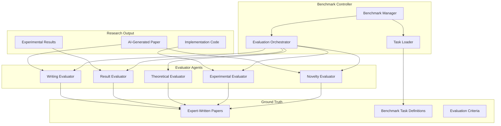

Sources: [README.md:951-962](), [benchmark/]()

## System Execution Flow

### Complete Research Lifecycle

The system follows a well-defined execution flow from task initiation through paper generation.

### End-to-End Research Workflow

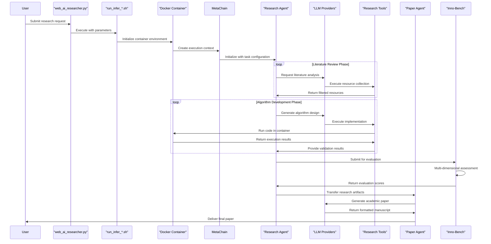

Sources: [web_ai_researcher.py:1-50](), [research_agent/run_infer_plan.py:1-50](), [research_agent/run_infer_idea.py:1-50]()

### Task Execution Modes

The system supports two primary execution modes based on input complexity.

| Mode | Script | Input | Process |
|------|---------|-------|---------|
| **Level 1** | `run_infer_level_1.sh` → `run_infer_plan.py` | Detailed research idea description | Direct implementation and validation |
| **Level 2** | `run_infer_level_2.sh` → `run_infer_idea.py` | Reference papers only | Idea generation → implementation → validation |

Sources: [README.md:982-1019](), [research_agent/run_infer_plan.py:1-50](), [research_agent/run_infer_idea.py:1-50]()

## Language Model Integration Layer

The system integrates with multiple LLM providers through a unified interface that handles authentication, rate limiting, and model-specific formatting.

### LLM Provider Architecture

The system supports multiple LLM providers through a unified interface in `MetaChain.get_chat_completion()`. Provider selection is controlled via `COMPLETION_MODEL` and `CHEEP_MODEL` environment variables.

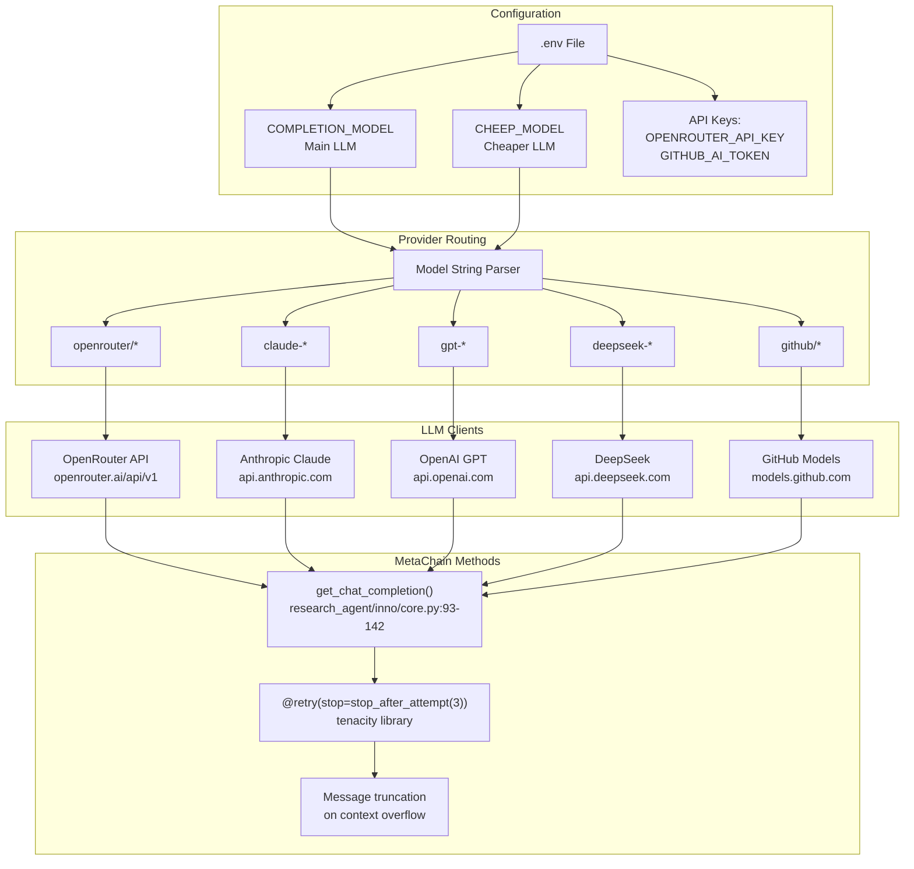

**LLM Integration Details:**
- Model strings follow pattern: `provider/model-name` (e.g., `openrouter/google/gemini-2.5-pro`)
- `get_chat_completion()` uses retry decorator for transient failures [research_agent/inno/core.py:40-62]()
- API authentication via environment variables in `.env` [.env.template:177-191]()
- Context overflow triggers message truncation [research_agent/inno/core.py:413-554]()
- Default models specified in `.env.template`: Gemini 2.5 Pro via OpenRouter [.env.template:165-167]()

Sources: [.env.template:165-191](), [research_agent/inno/core.py:40-142](), [research_agent/inno/core.py:413-554]()

### Tool Calling and Function Execution

The system implements a sophisticated tool calling mechanism that allows agents to execute specialized research functions.

### Tool Calling and Execution Architecture

The tool calling system enables agents to execute specialized functions through the `AgentFunction` class. The `MetaChain.handle_tool_calls()` method orchestrates parallel or sequential execution of tools returned by the LLM.

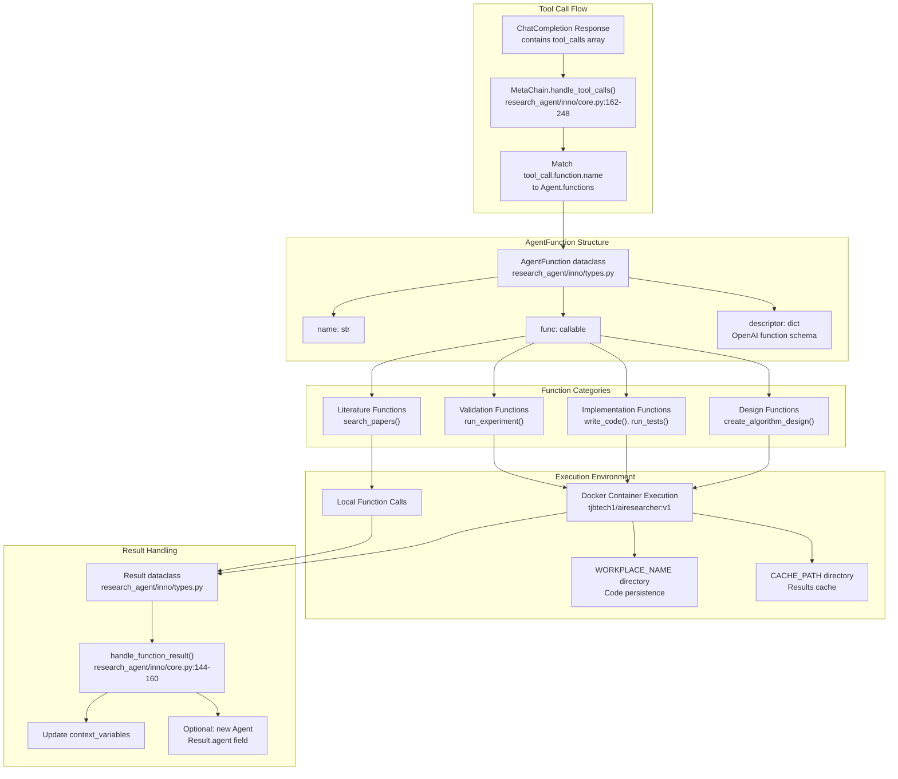

**Tool Call Mechanism:**
1. LLM returns `tool_calls` array in ChatCompletion response
2. `handle_tool_calls()` iterates over calls, looks up functions in `Agent.functions` [research_agent/inno/core.py:162-248]()
3. Each `AgentFunction.func` is invoked with parsed arguments
4. Functions execute in Docker container (implementation/validation) or locally (literature search)
5. Returns `Result(value, context_variables, agent)` [research_agent/inno/types.py:50-80]()
6. `handle_function_result()` processes result, may transition to new agent [research_agent/inno/core.py:144-160]()

**Key Data Structures:**
- `AgentFunction`: Wrapper for callable with OpenAI function schema [research_agent/inno/types.py:20-40]()
- `Result`: Return value with optional agent transition [research_agent/inno/types.py:50-80]()
- `context_variables`: Dict persisted across agent calls, contains workspace paths

Sources: [research_agent/inno/core.py:144-248](), [research_agent/inno/types.py:1-100]()

## Containerization and Deployment

The system uses Docker containerization to provide consistent execution environments across different platforms and to isolate research processes.

### Docker Container Architecture

The system uses Docker containers to provide isolated execution environments for code implementation and experiments. The container image `tjbtech1/airesearcher:v1` includes Python dependencies and research tools.

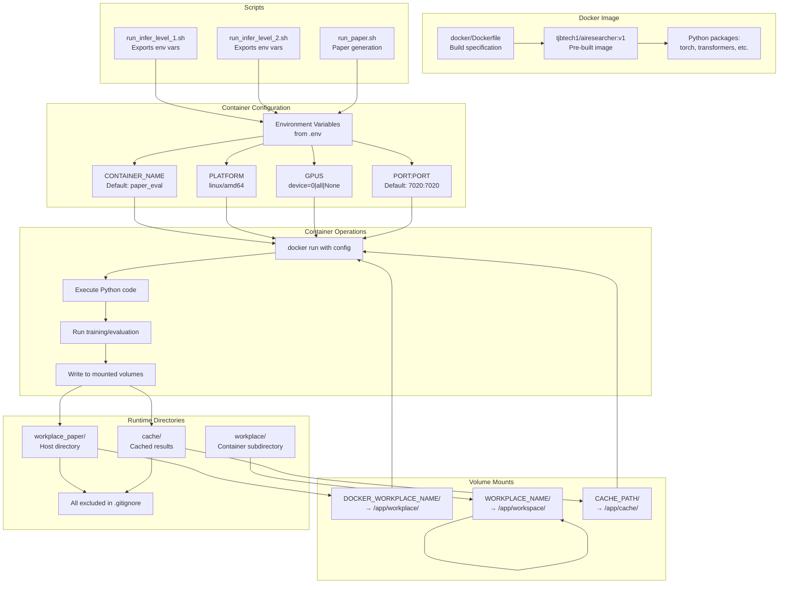

**Container Lifecycle:**
1. Scripts export environment variables from `.env` [research_agent/run_infer_level_1.sh:1-20]()
2. `MetaChain` creates Docker container with mounted volumes
3. Agent functions execute code inside container via `docker exec`
4. Results persisted to mounted volumes (`workplace_paper/`, `cache/`)
5. Container cleaned up after execution (or persisted with `CONTAINER_NAME`)

**Key Configuration:**
- Image: `tjbtech1/airesearcher:v1` [.env.template:163]()
- GPU allocation: `GPUS='"device=0"'` for first GPU [.env.template:173]()
- Workplace mount: `DOCKER_WORKPLACE_NAME` → container `/app/workplace/` [.env.template:161]()
- Platform: `linux/amd64` for cross-platform compatibility [.env.template:183]()

Sources: [docker/Dockerfile:1-100](), [.env.template:161-183](), [README.md:137-149](), [.gitignore:1-50]()

### Paper Generation Pipeline

The paper writing system operates as a separate component that processes research artifacts to generate academic manuscripts.

### Paper Writing Agent Architecture

The paper writing agent (`paper_agent/writing.py`) generates academic manuscripts from research artifacts produced by the research agent. It uses LLM-based hierarchical generation to produce structured papers.

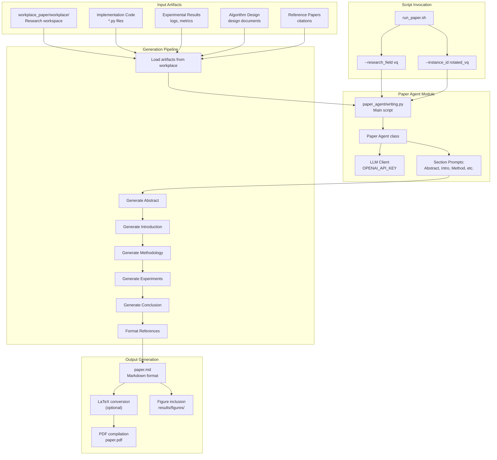

**Paper Generation Process:**
1. `run_paper.sh` invokes `writing.py` with research field and instance ID [paper_agent/run_paper.sh:1-20]()
2. Script loads artifacts from `workplace_paper/workplace/` directory
3. Paper Agent generates each section using LLM with section-specific prompts
4. Hierarchical generation: Abstract → Intro → Method → Experiments → Conclusion
5. Citations formatted from reference papers in workspace
6. Output saved as `paper.md` and optionally compiled to `paper.pdf`

**Key Parameters:**
- `--research_field`: Category (e.g., `vq`, `gnn`) [paper_agent/writing.py:20-40]()
- `--instance_id`: Task identifier (e.g., `rotated_vq`) [paper_agent/writing.py:20-40]()
- `OPENAI_API_KEY`: API key for LLM [paper_agent/run_paper.sh:5]()

Sources: [paper_agent/writing.py:1-100](), [paper_agent/run_paper.sh:1-20](), [README.md:1030-1045]()

## Error Handling and Resilience

The system implements comprehensive error handling and retry mechanisms to ensure reliable operation across distributed components.

### Error Handling Architecture

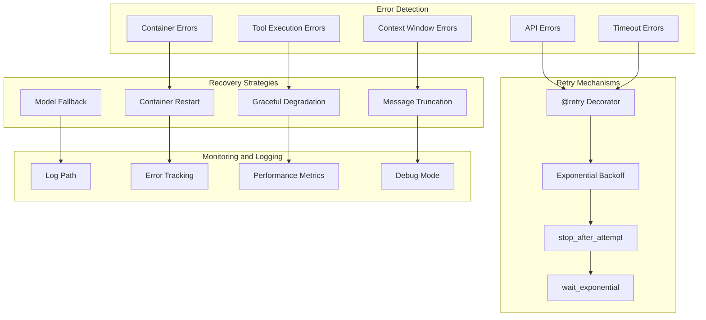

Sources: [research_agent/inno/core.py:40-62](), [research_agent/inno/core.py:413-554]()

### Web Interface Integration

The `web_ai_researcher.py` provides a Gradio-based web interface that integrates all system components into a user-friendly interface.

### Web Interface Architecture

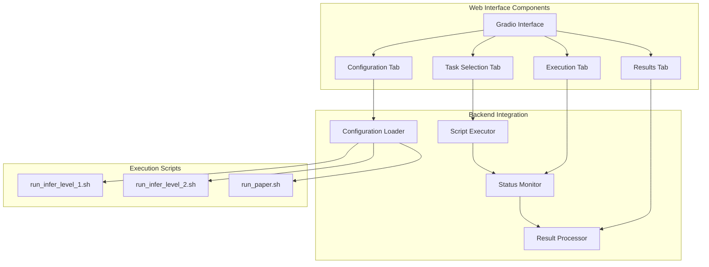

Sources: [web_ai_researcher.py:1-50](), [README.md:204-222]()

## Execution Modes and Task Levels

The AI-Researcher system supports two task levels and three execution modes to accommodate different research workflows and interaction patterns.

### Task Levels

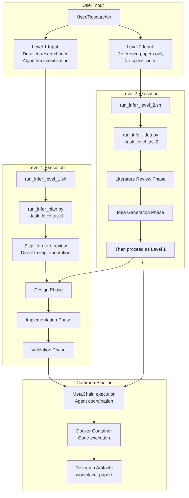

**Level 1 (Detailed Idea) [README.md:38-40]():**
- User provides: Detailed research idea, algorithm description, implementation requirements
- Script: `run_infer_level_1.sh` → `run_infer_plan.py` [research_agent/run_infer_level_1.sh:1-20]()
- Process: Direct to Design → Implementation → Validation phases
- Use case: Researcher has specific idea to implement and validate

**Level 2 (Reference Papers) [README.md:41-43]():**
- User provides: List of reference papers, general research direction
- Script: `run_infer_level_2.sh` → `run_infer_idea.py` [research_agent/run_infer_level_2.sh:1-20]()
- Process: Literature Review → Idea Generation → then Level 1 pipeline
- Use case: Researcher wants system to generate novel research directions

### MetaChain Execution Modes

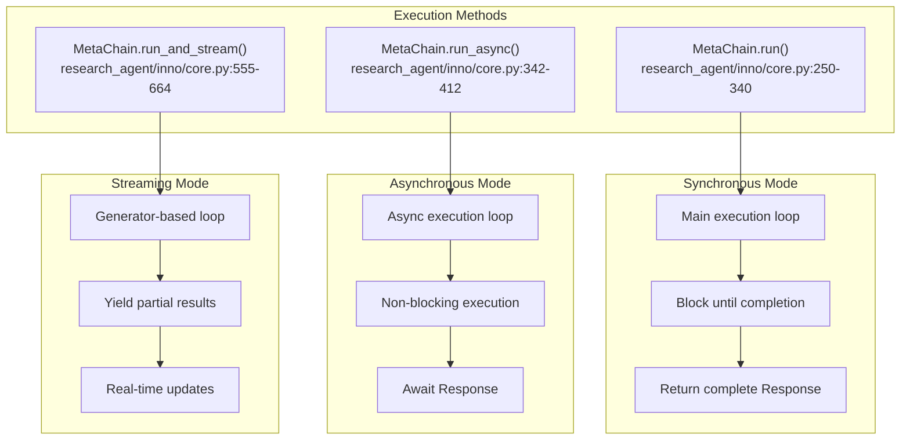

**Synchronous Execution (`run()`):**
- Default mode for research tasks
- Blocks until completion
- Returns complete `Response` object [research_agent/inno/core.py:250-340]()
- Used by: `run_infer_plan.py`, `run_infer_idea.py`

**Asynchronous Execution (`run_async()`):**
- Non-blocking execution using `asyncio`
- Enables concurrent research tasks
- Returns awaitable `Response` [research_agent/inno/core.py:342-412]()
- Use case: Running multiple experiments in parallel

**Streaming Execution (`run_and_stream()`):**
- Generator-based execution
- Yields partial results in real-time
- Enables live progress updates [research_agent/inno/core.py:555-664]()
- Used by: `web_ai_researcher.py` for interactive UI updates

Sources: [README.md:36-43](), [README.md:983-1027](), [research_agent/inno/core.py:250-664](), [research_agent/run_infer_level_1.sh:1-20](), [research_agent/run_infer_level_2.sh:1-20]()

## Error Handling and Resilience

The system includes robust error handling and retry mechanisms to ensure reliability.

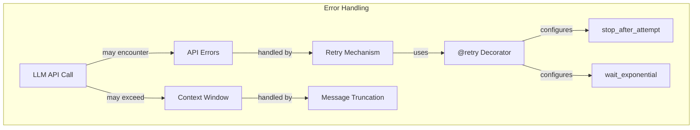

Sources: [research_agent/inno/core.py:40-62](), [research_agent/inno/core.py:413-554]()

Key error handling features:

1. **Retry Logic**: Exponential backoff for transient errors
2. **Error Classification**: Intelligent handling of different error types
3. **Context Management**: Adaptive truncation of messages when context limits are exceeded
4. **Recovery Mechanisms**: Ability to resume processing after errors

---

# Page: Research Framework Concepts

# Research Framework Concepts

<details>
<summary>Relevant source files</summary>

The following files were used as context for generating this wiki page:

- [assets/AI-Researcher-Framework.pdf](assets/AI-Researcher-Framework.pdf)
- [assets/AI-Researcher-Framework.png](assets/AI-Researcher-Framework.png)

</details>


## Purpose and Scope

This document explains the conceptual framework underlying the AI-Researcher system, including the two-level task abstraction model, the three-phase research pipeline, and the principles governing resource management, iterative refinement, and evaluation. 

For specific implementation details of the research agents, see [Research Agent](#3.1). For the complete workflow execution sequence, see [Research Workflow](#2.2). For benchmark evaluation specifics, see [Benchmark System](#3.3).

**Sources:** High-level system architecture diagrams, README.md

## Conceptual Overview

The AI-Researcher framework is built on the principle of **autonomous end-to-end research execution**, transforming either user-provided ideas or reference papers into complete research artifacts including implementations, experiments, and publication-ready manuscripts. The framework abstracts the research process into clearly defined phases that mirror human research methodology while leveraging AI capabilities for acceleration and automation.

```mermaid
graph TB
    subgraph "Task Abstraction Layer"
        L1["Level 1 Task<br/>(run_infer_idea.py)"]
        L2["Level 2 Task<br/>(run_infer_plan.py)"]
    end
    
    subgraph "Research Pipeline"
        P1["Phase 1: Literature & Idea Generation<br/>(Level 2 only)"]
        P2["Phase 2: Algorithm Development<br/>(Both levels)"]
        P3["Phase 3: Documentation<br/>(Both levels)"]
    end
    
    subgraph "Resource Management"
        COLLECT["Resource Collector<br/>Papers, Code, Datasets"]
        FILTER["Resource Filter<br/>Quality Assessment"]
        CACHE["Cache Layer<br/>workplace_paper/cache"]
    end
    
    subgraph "Execution Context"
        WORKPLACE["Workplace<br/>workplace_paper/workplace"]
        DOCKER["Docker Container<br/>tjbtech1/airesearcher:v1"]
    end
    
    subgraph "Evaluation Framework"
        BENCH["Inno-Bench<br/>benchmark/"]
        METRICS["Multi-dimensional Metrics<br/>Novelty, Rigor, Theory"]
    end
    
    L1 --> P2
    L2 --> P1
    P1 --> P2
    P2 --> P3
    
    P1 -.->|Uses| COLLECT
    P1 -.->|Uses| FILTER
    
    COLLECT --> CACHE
    FILTER --> CACHE
    
    P2 -.->|Executes in| WORKPLACE
    WORKPLACE -.->|Isolated by| DOCKER
    
    P3 --> BENCH
    BENCH --> METRICS
```

**Diagram: AI-Researcher Conceptual Framework**

The framework distinguishes between two task complexity levels, processes research through three distinct phases, manages resources through collection and caching mechanisms, provides isolated execution environments, and evaluates outputs against expert-level benchmarks.

**Sources:** run_infer_plan.py, run_infer_idea.py, README.md, .env.template

## Two-Level Task Abstraction

The AI-Researcher framework supports two levels of task abstraction, each representing different starting points in the research process:

### Level 1: Idea-Driven Research

**Entry Point:** User provides a detailed research idea or concept  
**Execution Script:** `run_infer_idea.py`  
**Pipeline Entry:** Phase 2 (Algorithm Development)

Level 1 tasks assume the research direction is already determined. The system bypasses literature review and idea generation, proceeding directly to algorithm design, implementation, validation, and refinement. This mode is suitable when:

- The research direction has been pre-determined through manual literature review
- The user has domain expertise and wants to accelerate implementation
- The focus is on rapid prototyping of a specific concept

### Level 2: Reference-Driven Research

**Entry Point:** User provides reference papers  
**Execution Script:** `run_infer_plan.py`  
**Pipeline Entry:** Phase 1 (Literature & Idea Generation)

Level 2 tasks perform autonomous research direction discovery. The system:

1. Collects relevant papers, code repositories, and datasets
2. Filters resources for quality and relevance
3. Analyzes research gaps and trends
4. Generates novel research directions
5. Proceeds to full algorithm development

This mode represents the most autonomous operation, suitable when:

- Exploring new research domains without predetermined direction
- Seeking novel combinations of existing techniques
- Requiring comprehensive literature synthesis

**Configuration:**

| Parameter | Level 1 | Level 2 |
|-----------|---------|---------|
| `TASK_LEVEL` | `task1` | `task2` |
| Entry Script | `run_infer_idea.py` | `run_infer_plan.py` |
| Literature Phase | Skipped | Executed |
| Initial Input | Detailed idea text | Reference paper paths |

**Sources:** run_infer_plan.py, run_infer_idea.py, .env.template, README.md

## Three-Phase Research Pipeline

The research pipeline consists of three sequential phases that transform inputs into complete research outputs:

```mermaid
graph TB
    subgraph "Phase 1: Literature & Idea Generation"
        RC["Resource Collection<br/>Multi-source Gathering"]
        RF["Resource Filtering<br/>Quality & Relevance Scoring"]
        IG["Idea Generation<br/>Gap Analysis & Synthesis"]
    end
    
    subgraph "Phase 2: Algorithm Development"
        DESIGN["Design Agent<br/>Conceptual Framework"]
        IMPL["Implementation Agent<br/>Code Development"]
        VALID["Validation Agent<br/>Experimentation"]
        REFINE["Refinement Agent<br/>Optimization"]
    end
    
    subgraph "Phase 3: Documentation"
        WRITER["Paper Writing Agent<br/>writing.py"]
        SECTIONS["Section Generation<br/>Abstract, Intro, Methods, Exp"]
    end
    
    INPUT1["Level 2 Input<br/>Reference Papers"] --> RC
    RC --> RF
    RF --> IG
    
    INPUT2["Level 1 Input<br/>Detailed Idea"] --> DESIGN
    IG --> DESIGN
    
    DESIGN --> IMPL
    IMPL --> VALID
    VALID --> REFINE
    REFINE -.->|Iterative Feedback| IMPL
    
    REFINE --> WRITER
    WRITER --> SECTIONS
    
    SECTIONS --> OUTPUT["Research Paper<br/>Full Manuscript"]
```

**Diagram: Three-Phase Research Pipeline with Agent Coordination**

**Sources:** README.md, writing.py, run_infer_plan.py, run_infer_idea.py

### Phase 1: Literature & Idea Generation

**Active for:** Level 2 tasks only  
**Primary Goal:** Transform reference papers into novel research directions

**Key Operations:**

1. **Resource Collection:** Gathers papers, code repositories, and datasets from multiple sources relevant to the reference papers
2. **Resource Filtering:** Applies quality assessment criteria to prioritize high-impact resources
3. **Idea Generation:** Performs gap analysis, identifies trends, and synthesizes novel research directions

This phase produces a **research proposal** containing:
- Identified research gaps
- Proposed novel approach
- Theoretical justification
- Expected contributions

**Sources:** README.md, run_infer_plan.py

### Phase 2: Algorithm Development

**Active for:** Both Level 1 and Level 2 tasks  
**Primary Goal:** Transform research ideas into validated implementations

**Four-Stage Iterative Cycle:**

| Stage | Agent | Input | Output |
|-------|-------|-------|--------|
| **Design** | Design Agent | Research idea/proposal | Conceptual framework, theoretical foundation, algorithm pseudocode |
| **Implementation** | Implementation Agent | Design specifications | Working code, test infrastructure, documentation |
| **Validation** | Validation Agent | Implementation | Experimental results, performance metrics, comparative analysis |
| **Refinement** | Refinement Agent | Validation results | Optimization recommendations, hyperparameter tuning, ablation studies |

**Iterative Refinement Loop:**

The validation-to-implementation feedback loop enables continuous improvement. The refinement agent analyzes validation results and either:
- Returns to implementation with specific optimization directives
- Proceeds to paper writing if results meet quality thresholds

The iteration count is controlled by the `MAX_ITER` configuration parameter (default: 0, meaning one complete cycle without iteration).

**Workspace Isolation:**

All algorithm development occurs within isolated workspaces:
- `workplace_paper/workplace/` for code development
- `cache/` for intermediate results and resource storage

**Sources:** README.md, .env.template, .gitignore

### Phase 3: Documentation

**Active for:** Both Level 1 and Level 2 tasks  
**Primary Goal:** Generate publication-ready manuscripts

**Script:** `writing.py`

The paper writing agent synthesizes all outputs from Phase 2 into a structured academic paper:

1. **Abstract:** Research motivation, approach, and key results
2. **Introduction:** Background, problem statement, and contributions
3. **Related Work:** Literature review and positioning
4. **Methodology:** Detailed algorithm description and theoretical analysis
5. **Experiments:** Experimental setup, results, and analysis
6. **Conclusion:** Summary and future work

The agent generates LaTeX source code, processes figures and tables, and produces a complete manuscript.

**Sources:** writing.py, README.md

## Resource Management Architecture

The framework implements a sophisticated resource management system to support efficient research execution:

```mermaid
graph TB
    subgraph "Resource Sources"
        PAPERS["Academic Papers<br/>PDF, arXiv"]
        CODE["Code Repositories<br/>GitHub, GitLab"]
        DATASETS["Datasets<br/>Public Archives"]
    end
    
    subgraph "Collection Layer"
        COLLECTOR["Resource Collector<br/>Multi-source API Integration"]
        METADATA["Metadata Extraction<br/>Title, Authors, Citations"]
    end
    
    subgraph "Filtering Layer"
        RELEVANCE["Relevance Scoring<br/>Semantic Similarity"]
        QUALITY["Quality Assessment<br/>Impact Factor, Citations"]
        RECENCY["Recency Weighting<br/>Publication Date"]
    end
    
    subgraph "Storage Layer"
        CACHE["Cache Directory<br/>cache/"]
        PAPER_DB["Paper Database<br/>paper_db/"]
        CODE_DB["Code Database<br/>code_db/"]
    end
    
    subgraph "Access Layer"
        RETRIEVAL["Context-aware Retrieval<br/>Query-based Access"]
        RANKING["Dynamic Ranking<br/>Phase-specific Priorities"]
    end
    
    PAPERS --> COLLECTOR
    CODE --> COLLECTOR
    DATASETS --> COLLECTOR
    
    COLLECTOR --> METADATA
    METADATA --> RELEVANCE
    METADATA --> QUALITY
    METADATA --> RECENCY
    
    RELEVANCE --> CACHE
    QUALITY --> PAPER_DB
    RECENCY --> CODE_DB
    
    CACHE --> RETRIEVAL
    PAPER_DB --> RETRIEVAL
    CODE_DB --> RETRIEVAL
    
    RETRIEVAL --> RANKING
```

**Diagram: Resource Management Architecture**

**Key Principles:**

1. **Multi-source Integration:** Aggregates resources from diverse sources to ensure comprehensive coverage
2. **Quality-first Filtering:** Prioritizes high-impact resources to reduce noise in AI analysis
3. **Persistent Caching:** Stores processed resources to avoid redundant API calls and processing
4. **Context-aware Retrieval:** Adapts resource selection based on current research phase needs

**Storage Locations:**

- `cache/`: Temporary storage for intermediate processing results
- `paper_db/`: Persistent paper metadata and content
- `code_db/`: Code repository metadata and snippets

All storage directories are excluded from version control via `.gitignore` to maintain repository cleanliness.

**Sources:** .gitignore, .env.template, README.md

## Iterative Refinement Mechanism

The framework implements a feedback-driven refinement loop within Phase 2 (Algorithm Development) that mirrors the human research process of experimentation, analysis, and optimization:

```mermaid
graph TB
    START["Implementation Ready<br/>Working Code + Tests"]
    
    VALIDATE["Validation Agent<br/>Run Experiments"]
    METRICS["Collect Metrics<br/>Performance, Accuracy, Efficiency"]
    ANALYZE["Analyze Results<br/>Compare to Baselines"]
    
    DECISION{"Results Meet<br/>Quality Threshold?"}
    
    REFINE["Refinement Agent<br/>Generate Optimization Plan"]
    OPTIMIZE["Optimization Directives<br/>Hyperparameters, Architecture, Training"]
    
    REIMPL["Implementation Agent<br/>Apply Optimizations"]
    
    COMPLETE["Proceed to Phase 3<br/>Paper Writing"]
    
    START --> VALIDATE
    VALIDATE --> METRICS
    METRICS --> ANALYZE
    ANALYZE --> DECISION
    
    DECISION -->|No, Iterations Remaining| REFINE
    REFINE --> OPTIMIZE
    OPTIMIZE --> REIMPL
    REIMPL --> VALIDATE
    
    DECISION -->|Yes or Max Iterations Reached| COMPLETE
```

**Diagram: Iterative Refinement Loop**

**Iteration Control:**

The `MAX_ITER` parameter in `.env` configuration controls the refinement cycle:

| MAX_ITER | Behavior |
|----------|----------|
| 0 | Single pass (Design → Implement → Validate → Refine → Complete) |
| N > 0 | Up to N refinement cycles before proceeding to documentation |
| -1 | Iterate until quality threshold met (not recommended for production) |

**Refinement Strategies:**

The refinement agent employs multiple optimization strategies:

1. **Hyperparameter Tuning:** Learning rates, batch sizes, regularization
2. **Architecture Modifications:** Layer configurations, attention mechanisms, skip connections
3. **Training Procedure Changes:** Loss functions, optimization algorithms, scheduling
4. **Data Augmentation:** Preprocessing, augmentation strategies, sampling techniques
5. **Ablation Studies:** Component importance analysis

**Sources:** .env.template, README.md

## Evaluation Framework

The framework evaluates research outputs through the **Inno-Bench** system, which compares AI-generated research against expert-level ground truth across multiple dimensions:

```mermaid
graph TB
    subgraph "AI-Generated Research"
        AI_IDEA["Research Idea<br/>Novel Direction"]
        AI_IMPL["Implementation<br/>Code & Experiments"]
        AI_PAPER["Research Paper<br/>Full Manuscript"]
    end
    
    subgraph "Expert Ground Truth"
        EXPERT_IDEA["Published Paper<br/>Peer-reviewed Research"]
        EXPERT_IMPL["Reference Implementation<br/>Official Codebase"]
        EXPERT_METRICS["Reported Results<br/>Benchmark Performance"]
    end
    
    subgraph "Evaluation Dimensions"
        NOV["Novelty<br/>Innovation Assessment"]
        THEO["Theoretical Foundation<br/>Mathematical Rigor"]
        EXP["Experimental Rigor<br/>Comprehensiveness"]
        RES["Result Analysis<br/>Interpretation Quality"]
        WRITE["Writing Quality<br/>Clarity & Structure"]
    end
    
    subgraph "Benchmark Categories"
        DIFFU["Diffusion & Flow<br/>4 benchmarks"]
        GNN["Graph Neural Networks<br/>9 benchmarks"]
        REASON["Reasoning<br/>1 benchmark"]
    end
    
    AI_IDEA -.->|Compare| NOV
    AI_IMPL -.->|Compare| EXP
    AI_IMPL -.->|Compare| THEO
    AI_PAPER -.->|Compare| RES
    AI_PAPER -.->|Compare| WRITE
    
    EXPERT_IDEA -.->|Reference| NOV
    EXPERT_IMPL -.->|Reference| EXP
    EXPERT_IMPL -.->|Reference| THEO
    EXPERT_METRICS -.->|Reference| RES
    
    NOV --> DIFFU
    THEO --> GNN
    EXP --> REASON
```

**Diagram: Evaluation Framework Structure**

**Multi-dimensional Assessment:**

| Dimension | Focus | Evaluation Criteria |
|-----------|-------|---------------------|
| **Novelty** | Innovation degree | Originality of approach, differentiation from existing work |
| **Theoretical Foundation** | Mathematical rigor | Formal definitions, proofs, theoretical guarantees |
| **Experimental Rigor** | Comprehensiveness | Dataset diversity, baseline comparisons, ablation studies |
| **Result Analysis** | Interpretation quality | Insight depth, failure case analysis, limitations discussion |
| **Writing Quality** | Clarity & structure | Logical flow, technical precision, reproducibility details |

**Benchmark Coverage:**

The framework is evaluated across 14 expert-curated benchmarks spanning three major research domains:

- **Diffusion & Flow Models** (4 tasks): Generative modeling for images/videos
- **Graph Neural Networks** (9 tasks): Graph representation learning with diverse architectures
- **Reasoning** (1 task): LLM reasoning enhancement

For detailed benchmark specifications, see [Benchmark System](#3.3) and domain-specific pages ([Diffusion & Flow](#5.1), [Graph Neural Networks](#5.2), [Reasoning](#5.3)).

**Sources:** benchmark/README.md, README.md

## Code-Concept Mapping

The following table maps high-level framework concepts to specific code entities:

| Concept | Code Entity | File Location | Description |
|---------|-------------|---------------|-------------|
| **Level 1 Task** | `run_infer_idea.py` | [run_infer_idea.py:1-500]() | Entry point for idea-driven research |
| **Level 2 Task** | `run_infer_plan.py` | [run_infer_plan.py:1-500]() | Entry point for reference-driven research |
| **Paper Writing** | `writing.py` | [writing.py:1-500]() | Manuscript generation agent |
| **Web Interface** | `web_ai_researcher.py` | [web_ai_researcher.py:1-500]() | GUI for system interaction |
| **Workspace Root** | `workplace_paper/workplace` | Directory | Isolated algorithm development environment |
| **Cache Storage** | `cache/` | Directory | Resource and intermediate result storage |
| **Paper Database** | `paper_db/` | Directory | Academic paper metadata storage |
| **Code Database** | `code_db/` | Directory | Code repository metadata storage |
| **Benchmark Root** | `benchmark/` | Directory | Inno-Bench evaluation framework |
| **Container Config** | `.env` | [.env:1-50]() | System configuration parameters |
| **Task Category** | `TASK_CATEGORY` | [.env:15-15]() | Research domain selection (diffu_flow, gnn, reasoning) |
| **Task Instance** | `TASK_INSTANCE` | [.env:16-16]() | Specific benchmark task identifier |
| **Task Level** | `TASK_LEVEL` | [.env:17-17]() | Abstraction level (task1/task2) |
| **Max Iterations** | `MAX_ITER` | [.env:18-18]() | Refinement cycle limit |
| **Completion Model** | `COMPLETION_MODEL` | [.env:5-5]() | Primary LLM for generation (gemini-2.5-pro-preview) |
| **Cheap Model** | `CHEEP_MODEL` | [.env:10-10]() | Cost-optimized LLM for lightweight tasks |

**Sources:** run_infer_plan.py, run_infer_idea.py, writing.py, web_ai_researcher.py, .env.template, .gitignore

## Framework Design Principles

The AI-Researcher framework is built on several core design principles:

### 1. Phase Separation

Each research phase operates independently with clear inputs and outputs, enabling:
- Parallel development and testing of phase-specific improvements
- Easy substitution of alternative implementations (e.g., different idea generation strategies)
- Clear debugging boundaries when issues arise

### 2. Resource Efficiency

The framework minimizes computational waste through:
- Persistent caching of collected resources
- Dual-model LLM strategy (expensive models for critical tasks, cheap models for routine operations)
- Iteration limits to prevent runaway experimentation

### 3. Reproducibility

Docker containerization ensures consistent execution environments:
- Fixed base image (`tjbtech1/airesearcher:v1`)
- Isolated workspaces prevent cross-contamination
- Configuration-as-code via `.env` files

### 4. Extensibility

The modular architecture supports extension:
- New benchmark tasks can be added to `benchmark/` without code changes
- Alternative LLM providers integrate through configuration
- Custom agents can be injected into the pipeline

### 5. Evaluation-Driven

The Inno-Bench framework provides objective quality assessment:
- Multi-dimensional evaluation prevents gaming single metrics
- Expert ground truth comparison ensures research-grade standards
- Category-specific benchmarks reflect domain requirements

**Sources:** README.md, .env.template, benchmark/README.md, docker-compose.yaml

## Configuration-Driven Behavior

The framework's behavior is extensively controlled through `.env` configuration, enabling deployment flexibility without code modification:

```mermaid
graph TB
    ENV["Environment Configuration<br/>.env file"]
    
    subgraph "Container Configuration"
        DOCKER_CFG["DOCKER_NAME<br/>DOCKER_PLATFORM<br/>DOCKER_IMAGE"]
        GPU_CFG["GPU_ID<br/>Device Allocation"]
        PORT_CFG["PORT<br/>Network Exposure"]
    end
    
    subgraph "LLM Configuration"
        COMP_CFG["COMPLETION_MODEL<br/>High-quality Generation"]
        CHEAP_CFG["CHEEP_MODEL<br/>Cost Optimization"]
        API_CFG["OPENROUTER_KEY<br/>GITHUB_TOKEN"]
    end
    
    subgraph "Task Configuration"
        CAT_CFG["TASK_CATEGORY<br/>Domain Selection"]
        INST_CFG["TASK_INSTANCE<br/>Benchmark Task"]
        LVL_CFG["TASK_LEVEL<br/>task1 vs task2"]
        ITER_CFG["MAX_ITER<br/>Refinement Cycles"]
    end
    
    subgraph "Workspace Configuration"
        WORK_CFG["WORKPLACE<br/>Code Development Path"]
        CACHE_CFG["Cache Directories<br/>Resource Storage"]
    end
    
    ENV --> DOCKER_CFG
    ENV --> GPU_CFG
    ENV --> PORT_CFG
    
    ENV --> COMP_CFG
    ENV --> CHEAP_CFG
    ENV --> API_CFG
    
    ENV --> CAT_CFG
    ENV --> INST_CFG
    ENV --> LVL_CFG
    ENV --> ITER_CFG
    
    ENV --> WORK_CFG
    ENV --> CACHE_CFG
    
    DOCKER_CFG --> RUNTIME["Runtime Execution<br/>Docker Container"]
    GPU_CFG --> RUNTIME
    PORT_CFG --> RUNTIME
    
    COMP_CFG --> AGENTS["Research Agents<br/>Generation Logic"]
    CHEAP_CFG --> AGENTS
    API_CFG --> AGENTS
    
    CAT_CFG --> PIPELINE["Research Pipeline<br/>Phase Execution"]
    INST_CFG --> PIPELINE
    LVL_CFG --> PIPELINE
    ITER_CFG --> PIPELINE
    
    WORK_CFG --> STORAGE["Storage Management<br/>File Organization"]
    CACHE_CFG --> STORAGE
```

**Diagram: Configuration-Driven Framework Behavior**

This configuration architecture enables:

- **Multi-tenancy:** Run multiple research tasks with different configurations simultaneously
- **A/B Testing:** Compare different LLM models or hyperparameters
- **Resource Management:** Allocate GPU resources per-task
- **Cost Optimization:** Switch between high-quality and cheap models based on budget

For detailed configuration parameters, see [Environment Configuration](#4.1).

**Sources:** .env.template, README.md

## Summary

The AI-Researcher framework implements a comprehensive conceptual model for autonomous research that:

1. **Abstracts task complexity** through two levels (idea-driven vs. reference-driven)
2. **Structures research** into three sequential phases (literature/idea generation, algorithm development, documentation)
3. **Manages resources** through collection, filtering, caching, and retrieval mechanisms
4. **Enables iteration** through validation-refinement feedback loops
5. **Evaluates quality** against expert benchmarks across multiple dimensions
6. **Configures behavior** through environment variables for deployment flexibility

This conceptual foundation supports the complete research automation capability while maintaining modularity, reproducibility, and extensibility.

**Sources:** README.md, .env.template, run_infer_plan.py, run_infer_idea.py, writing.py, benchmark/README.md

---

# Page: Research Workflow

# Research Workflow

<details>
<summary>Relevant source files</summary>

The following files were used as context for generating this wiki page:

- [README.md](README.md)
- [assets/AI-Researcher-Framework.pdf](assets/AI-Researcher-Framework.pdf)
- [assets/researchagent.svg](assets/researchagent.svg)

</details>


This document describes the three-phase research lifecycle that forms the core of the AI-Researcher system's autonomous scientific discovery capabilities. It covers the sequential workflow from initial literature analysis through algorithm development to final paper generation, including the orchestration between different agent components and execution modes.

For information about the individual agent components, see [Agent Framework](#2.2). For details on specific benchmark tasks and domains, see [Benchmark Tasks & Domains](#5). For configuration and deployment specifics, see [Configuration & Deployment](#4).

## Overview

The AI-Researcher system executes a three-phase research workflow that processes research tasks from literature analysis through implementation to paper generation. The workflow operates in two modes based on task level configuration: Level 1 (idea-provided) and Level 2 (reference-based autonomous research).

### Three-Phase Research Pipeline

**Workflow execution flow with code entry points**

```mermaid
graph TD
    subgraph "Entry Points"
        L1_SH["run_infer_level_1.sh"]
        L2_SH["run_infer_level_2.sh"]
        PAPER_SH["run_paper.sh"]
    end
    
    subgraph "Python Executables"
        L1_PY["run_infer_plan.py"]
        L2_PY["run_infer_idea.py"]
        WRITE_PY["writing.py"]
    end
    
    subgraph "Phase 1: Literature & Idea Generation"
        COLLECT["Resource Collection"]
        FILTER["Quality Filtering"]
        IDEAGEN["Idea Generation"]
    end
    
    subgraph "Phase 2: Implementation"
        DESIGN["Design"]
        IMPL["Implementation"]
        VALID["Validation"]
        REFINE["Refinement"]
    end
    
    subgraph "Phase 3: Paper Writing"
        WRITER["Writer Agent"]
    end
    
    L1_SH --> L1_PY
    L2_SH --> L2_PY
    PAPER_SH --> WRITE_PY
    
    L1_PY --> DESIGN
    L2_PY --> COLLECT
    
    COLLECT --> FILTER
    FILTER --> IDEAGEN
    IDEAGEN --> DESIGN
    
    DESIGN --> IMPL
    IMPL --> VALID
    VALID --> REFINE
    REFINE -.iterate.-> IMPL
    REFINE --> WRITER
    
    WRITER --> WRITE_PY
```

**Sources:** [README.md:932-947](), [research_agent/run_infer_level_1.sh:986-1004](), [research_agent/run_infer_level_2.sh:1009-1024](), [paper_agent/run_paper.sh:1028-1042]()

### Task Level Configuration

The workflow diverges at the entry point based on the `TASK_LEVEL` environment variable:

| Task Level | Entry Script | Python Executable | Starting Phase | User Input |
|------------|--------------|-------------------|----------------|------------|
| `task1` | `run_infer_level_1.sh` | `run_infer_plan.py` | Phase 2 (Design) | Detailed idea + references |
| `task2` | `run_infer_level_2.sh` | `run_infer_idea.py` | Phase 1 (Collection) | Reference papers only |

**Sources:** [README.md:33-39](), [README.md:986-1024]()

## Phase 1: Literature Review & Idea Generation

Phase 1 executes only for Level 2 tasks (`task2`), activated when users provide reference papers without detailed ideas. The phase consists of three sequential operations: resource collection, quality filtering, and idea generation. Level 1 tasks bypass this phase entirely.

### Execution Trigger

**Phase 1 activation logic**

```mermaid
graph TD
    ENV_LOAD["Load .env configuration"]
    TASK_CHECK{"TASK_LEVEL=?"}
    TASK1_FLOW["run_infer_plan.py"]
    TASK2_FLOW["run_infer_idea.py"]
    PHASE1["Phase 1: Literature & Idea"]
    PHASE2["Phase 2: Implementation"]
    
    ENV_LOAD --> TASK_CHECK
    TASK_CHECK -->|"task1"| TASK1_FLOW
    TASK_CHECK -->|"task2"| TASK2_FLOW
    
    TASK1_FLOW --> PHASE2
    TASK2_FLOW --> PHASE1
    PHASE1 --> PHASE2
```

**Sources:** [README.md:33-39](), [README.md:986-1024]()

### Resource Collection Pipeline

The resource collector gathers materials from academic databases and code repositories. Quality filtering applies citation count, code maintenance status, and dataset completeness metrics to select high-impact resources.

**Data sources and filtering workflow**

```mermaid
graph LR
    subgraph "Academic Sources"
        ARXIV["arXiv API"]
        IEEE["IEEE Xplore"]
        ACM["ACM Library"]
        SCHOLAR["Google Scholar"]
    end
    
    subgraph "Code Sources"
        GITHUB["GitHub Repos"]
        HF["Hugging Face"]
    end
    
    subgraph "Processing"
        COLLECTOR["Resource Collector"]
        FILTER["Quality Filter"]
    end
    
    subgraph "Metrics"
        CITATIONS["Citation Count"]
        MAINT["Code Maintenance"]
        COMPLETE["Data Completeness"]
    end
    
    subgraph "Output"
        PAPERS["Filtered Papers"]
        CODE["Code Repos"]
        DATA["Datasets"]
    end
    
    ARXIV --> COLLECTOR
    IEEE --> COLLECTOR
    ACM --> COLLECTOR
    SCHOLAR --> COLLECTOR
    GITHUB --> COLLECTOR
    HF --> COLLECTOR
    
    COLLECTOR --> FILTER
    
    FILTER --> CITATIONS
    FILTER --> MAINT
    FILTER --> COMPLETE
    
    CITATIONS --> PAPERS
    MAINT --> CODE
    COMPLETE --> DATA
```

**Sources:** [README.md:933-936]()

### Idea Generation Component

The idea generator analyzes filtered resources to identify methodological limitations and formulate novel research directions. This component outputs structured research concepts that feed into Phase 2's design stage.

| Component | Input | Output | Purpose |
|-----------|-------|--------|---------|
| Resource Collector | Reference papers (user-provided) | Raw materials from databases | Systematic gathering |
| Resource Filter | Raw materials | Curated high-impact resources | Quality evaluation |
| Idea Generator | Curated resources | Research concepts and directions | Novel direction formulation |

**Sources:** [README.md:933-938]()

## Phase 2: Algorithm Design & Implementation

Phase 2 executes for both task levels, implementing a four-stage cycle: Design → Implementation → Validation → Refinement. This phase runs inside Docker containers with GPU allocation managed by the `GPUS` environment variable.

### Development Cycle Stages

**Four-stage iterative cycle**

```mermaid
graph TD
    DESIGN["Design Phase"]
    IMPL["Implementation Phase"]
    VALID["Validation Phase"]
    REFINE["Refinement Phase"]
    
    subgraph "Docker Container"
        CONTAINER["tjbtech1/airesearcher:v1"]
        WORKPLACE["Workplace Directory"]
        GPU["GPU Resources"]
    end
    
    DESIGN --> IMPL
    IMPL --> VALID
    VALID --> REFINE
    REFINE -.MAX_ITER_TIMES.-> IMPL
    
    IMPL --> CONTAINER
    CONTAINER --> WORKPLACE
    CONTAINER --> GPU
```

| Stage | Activities | Output |
|-------|-----------|--------|
| Design | Conceptual development, theoretical foundations, implementation strategy | Algorithm design specification |
| Implementation | Functional module development, testing environment setup, infrastructure configuration | Executable code |
| Validation | Systematic experimentation, metrics collection, findings documentation | Performance metrics |
| Refinement | Improvement identification, code optimization, enhancement implementation | Optimized implementation |

**Sources:** [README.md:939-947]()

### Container Configuration and Execution

Both `run_infer_plan.py` (Level 1) and `run_infer_idea.py` (Level 2) spawn Docker containers using configuration from shell script environment variables.

**Environment variable propagation to container execution**

```mermaid
graph TD
    subgraph "Shell Script Variables"
        BASE_IMG["BASE_IMAGES"]
        GPUS_VAR["GPUS"]
        WORKPLACE_VAR["DOCKER_WORKPLACE_NAME"]
        PORT_VAR["PORT"]
        MODEL_VAR["COMPLETION_MODEL"]
        CATEGORY_VAR["category"]
        INSTANCE_VAR["instance_id"]
    end
    
    subgraph "Python Script Parameters"
        INSTANCE_PATH["--instance_path"]
        CONTAINER_NAME["--container_name"]
        MODEL_PARAM["--model"]
        WORKPLACE_PARAM["--workplace_name"]
        CACHE_PARAM["--cache_path"]
        PORT_PARAM["--port"]
        ITER_PARAM["--max_iter_times"]
        CAT_PARAM["--category"]
    end
    
    subgraph "Container Runtime"
        DOCKER["Docker Container"]
        MOUNTED_WP["Mounted Workplace"]
        ALLOCATED_GPU["Allocated GPU"]
    end
    
    BASE_IMG --> DOCKER
    GPUS_VAR --> ALLOCATED_GPU
    WORKPLACE_VAR --> MOUNTED_WP
    
    CATEGORY_VAR --> INSTANCE_PATH
    INSTANCE_VAR --> INSTANCE_PATH
    MODEL_VAR --> MODEL_PARAM
    
    INSTANCE_PATH --> DOCKER
    MODEL_PARAM --> DOCKER
    WORKPLACE_PARAM --> MOUNTED_WP
    PORT_PARAM --> DOCKER
```

**Sources:** [research_agent/run_infer_level_1.sh:986-1004](), [research_agent/run_infer_level_2.sh:1009-1024]()

### Iteration Control

The refinement loop executes up to `MAX_ITER_TIMES` iterations, defaulting to 0 (no refinement) as shown in the example scripts. Each iteration returns to the implementation stage.

```bash
# From run_infer_level_1.sh
python run_infer_plan.py \
  --instance_path ../benchmark/final/${category}/${instance_id}.json \
  --max_iter_times 0 \
  --category ${category}
```

**Sources:** [research_agent/run_infer_level_1.sh:1004](), [research_agent/run_infer_level_2.sh:1023]()

### GPU Resource Allocation

The `GPUS` variable accepts multiple formats:

| GPUS Value | Allocation |
|------------|------------|
| `'"device=0"'` | Single GPU (device 0) |
| `'"device=0,1"'` | Multiple GPUs (devices 0 and 1) |
| `'"all"'` | All available GPUs |
| `None` | CPU-only execution |

**Sources:** [README.md:165-169]()

## Phase 3: Paper Writing

Phase 3 executes after Phase 2 completion, invoking `writing.py` to generate publication-ready academic papers. The Writer Agent reads research outputs from the workplace directory and synthesizes them into structured manuscripts.

### Paper Generation Script

The paper agent executes independently via `run_paper.sh`, which sets environment variables and calls `writing.py` with research field and instance parameters.

**Paper generation execution flow**

```mermaid
graph LR
    subgraph "Shell Script"
        RUN_PAPER["run_paper.sh"]
        API_KEY["OPENAI_API_KEY"]
        FIELD_VAR["research_field"]
        INST_VAR["instance_id"]
    end
    
    subgraph "Python Executable"
        WRITING_PY["writing.py"]
        FIELD_ARG["--research_field"]
        INST_ARG["--instance_id"]
    end
    
    subgraph "Input Sources"
        WORKPLACE["Workplace Directory"]
        RESULTS["Validation Results"]
        CODE["Implementation Code"]
    end
    
    subgraph "Output"
        PDF["paper.pdf"]
    end
    
    RUN_PAPER --> API_KEY
    RUN_PAPER --> FIELD_VAR
    RUN_PAPER --> INST_VAR
    
    API_KEY --> WRITING_PY
    FIELD_VAR --> FIELD_ARG
    INST_VAR --> INST_ARG
    
    FIELD_ARG --> WRITING_PY
    INST_ARG --> WRITING_PY
    
    WORKPLACE --> WRITING_PY
    RESULTS --> WRITING_PY
    CODE --> WRITING_PY
    
    WRITING_PY --> PDF
```

**Sources:** [paper_agent/run_paper.sh:1028-1042]()

### Configuration Parameters

```bash
# From run_paper.sh
export OPENAI_API_KEY=sk-SKlupNntta4WPmvDCRo7uuPbYGwOnUQcb25Twn8c718tPpXN

research_field=vq
instance_id=rotated_vq

python path/to/AI-Researcher/paper_agent/writing.py \
  --research_field ${research_field} \
  --instance_id ${instance_id}
```

| Parameter | Purpose | Valid Values |
|-----------|---------|--------------|
| `--research_field` | Research category specification | `vq`, `gnn`, `reasoning`, `recommendation`, `diffu_flow` |
| `--instance_id` | Task instance identifier | Matches instance filename (e.g., `rotated_vq`, `one_layer_vq`) |
| `OPENAI_API_KEY` | LLM API authentication | API key string |

**Sources:** [paper_agent/run_paper.sh:1035-1041]()

### Writer Agent Output

The Writer Agent generates a hierarchically structured manuscript integrating:
- Research motivation and problem statement
- Algorithm design and theoretical foundations
- Implementation details
- Experimental results and analysis
- Conclusions and future work

Output location: `{workplace_directory}/{research_field}/{instance_id}/paper.pdf`

**Sources:** [README.md:949-950]()

## Workflow Orchestration

The complete research workflow is orchestrated through configuration-driven execution that coordinates between phases and manages resource allocation across the containerized environment.

### Configuration-Driven Execution

```mermaid
graph TD
    subgraph "Configuration Layer"
        ENV_TEMPLATE[".env.template"]
        CATEGORY["CATEGORY<br/>diffu_flow, gnn, reasoning, recommendation"]
        INSTANCE["INSTANCE_ID<br/>Specific task identifier"]
        TASK_LEVEL["TASK_LEVEL<br/>task1, task2"]
    end
    
    subgraph "Execution Coordination"
        L1_EXEC["Level 1 Execution<br/>run_infer_plan.py"]
        L2_EXEC["Level 2 Execution<br/>run_infer_idea.py"]
        PAPER_EXEC["Paper Generation<br/>writing.py"]
    end
    
    subgraph "Resource Allocation"
        CONTAINER["Container Management<br/>CONTAINER_NAME"]
        GPU_ALLOC["GPU Allocation<br/>GPUS parameter"]
        WORKSPACE["Workspace Management<br/>WORKPLACE_NAME"]
    end
    
    ENV_TEMPLATE --> CATEGORY
    ENV_TEMPLATE --> INSTANCE
    ENV_TEMPLATE --> TASK_LEVEL
    
    CATEGORY --> L1_EXEC
    CATEGORY --> L2_EXEC
    INSTANCE --> L1_EXEC
    INSTANCE --> L2_EXEC
    TASK_LEVEL --> L1_EXEC
    
    L1_EXEC --> CONTAINER
    L2_EXEC --> CONTAINER
    PAPER_EXEC --> WORKSPACE
    
    CONTAINER --> GPU_ALLOC
    CONTAINER --> WORKSPACE
    
    style ENV_TEMPLATE fill:#e1f5fe
    style L1_EXEC fill:#f3e5f5
    style PAPER_EXEC fill:#e8f5e8
```

**Sources:** [README.md:147-202](), [research_agent/run_infer_level_1.sh:995-999](), [research_agent/run_infer_level_2.sh:1014-1018]()

### Execution Flow Control

The workflow execution follows a controlled sequence with proper phase transitions and resource management:

```mermaid
sequenceDiagram
    participant User
    participant Config as Configuration
    participant L1 as run_infer_plan.py
    participant L2 as run_infer_idea.py
    participant Container as Docker Container
    participant Writer as writing.py
    
    User->>Config: Load .env.template
    Config->>Config: Set CATEGORY, INSTANCE_ID, TASK_LEVEL
    
    alt Level 1 Task
        Config->>L1: Execute with detailed idea
        L1->>Container: Spawn with BASE_IMAGES
        Container->>Container: Algorithm development cycle
        Container->>L1: Research results
    else Level 2 Task
        Config->>L2: Execute with reference papers
        L2->>Container: Spawn with BASE_IMAGES
        Container->>Container: Idea generation + development
        Container->>L2: Research results
    end
    
    L1->>Writer: Research output
    L2->>Writer: Research output
    Writer->>Writer: Generate academic paper
    Writer->>User: Final manuscript
```

**Sources:** [research_agent/run_infer_level_1.sh:986-999](), [research_agent/run_infer_level_2.sh:1005-1018](), [paper_agent/run_paper.sh:1026-1036]()

---

# Page: Agent Framework

# Agent Framework

<details>
<summary>Relevant source files</summary>

The following files were used as context for generating this wiki page:

- [README.md](README.md)
- [assets/AI-Researcher-Framework.pdf](assets/AI-Researcher-Framework.pdf)
- [assets/researchagent.svg](assets/researchagent.svg)

</details>


## Purpose and Scope

This document describes the multi-agent architecture that powers the AI-Researcher system. It explains how specialized agents coordinate to perform autonomous scientific research, from literature review through implementation to publication. This framework orchestrates the three-phase research pipeline by decomposing complex research tasks into manageable agent responsibilities.

**Related Pages:**
- For conceptual framework details, see [Research Framework Concepts](#2.1)
- For workflow execution details, see [Research Workflow](#2.2)  
- For Research Agent implementation, see [Research Agent](#3.1)
- For Paper Writing Agent implementation, see [Paper Writing Agent](#3.2)

**Sources:** [README.md:1-1170]()

---

## Multi-Agent Architecture Overview

The AI-Researcher system employs a **hierarchical multi-agent architecture** where specialized agents handle distinct phases of the research lifecycle. The framework coordinates five primary agent categories across three research phases, with each agent maintaining specific responsibilities and inter-agent communication protocols.

### Agent Type Taxonomy

```mermaid
graph TB
    subgraph "Research Agent System"
        RA["Research Agent<br/>(run_infer_plan.py<br/>run_infer_idea.py)"]
    end
    
    subgraph "Phase 1: Literature & Ideation"
        RC["Resource Collector<br/>Agent"]
        RF["Resource Filter<br/>Agent"]
        IG["Idea Generator<br/>Agent"]
    end
    
    subgraph "Phase 2: Algorithm Development"
        DA["Design Agent"]
        IA["Implementation Agent"]
        VA["Validation Agent"]
        RA_REFINE["Refinement Agent"]
    end
    
    subgraph "Phase 3: Documentation"
        WA["Paper Writing Agent<br/>(writing.py)"]
    end
    
    subgraph "Evaluation & Support"
        EA["Evaluator Agents"]
    end
    
    RA --> RC
    RC --> RF
    RF --> IG
    IG --> DA
    
    DA --> IA
    IA --> VA
    VA --> RA_REFINE
    RA_REFINE -.->|"Iteration"| IA
    
    RA_REFINE --> WA
    
    EA -.->|"Quality Assessment"| RC
    EA -.->|"Quality Assessment"| RF
    EA -.->|"Performance Metrics"| VA
    EA -.->|"Content Evaluation"| WA
```

**Sources:** [README.md:27-56](), [README.md:935-956]()

---

## Agent Execution Modes

The system supports two execution modes determined by input type, with different agent activation patterns:

| Execution Mode | Entry Point | Phase 1 Agents | Phase 2 Agents | Phase 3 Agents | Input Requirements |
|----------------|-------------|----------------|----------------|----------------|-------------------|
| **Level 1** | `run_infer_plan.py` | Inactive | Active | Active | Detailed research idea provided |
| **Level 2** | `run_infer_idea.py` | Active | Active | Active | Reference papers only |

### Mode Selection Logic

```mermaid
graph LR
    INPUT["User Input"]
    
    L1_CHECK{"Detailed Idea<br/>Provided?"}
    L2_CHECK{"Reference Papers<br/>Only?"}
    
    L1_EXEC["Level 1 Execution<br/>run_infer_plan.py"]
    L2_EXEC["Level 2 Execution<br/>run_infer_idea.py"]
    
    P1["Phase 1 Agents:<br/>RC, RF, IG"]
    P2["Phase 2 Agents:<br/>DA, IA, VA, RA"]
    P3["Phase 3 Agents:<br/>WA"]
    
    INPUT --> L1_CHECK
    L1_CHECK -->|"Yes"| L1_EXEC
    L1_CHECK -->|"No"| L2_CHECK
    L2_CHECK -->|"Yes"| L2_EXEC
    
    L1_EXEC --> P2
    L2_EXEC --> P1
    P1 --> P2
    P2 --> P3
    
    style P1 fill:#f9f9f9
    style P2 fill:#f9f9f9
    style P3 fill:#f9f9f9
```

**Sources:** [README.md:38-43](), [README.md:990-1027]()

---

## Phase 1: Literature & Idea Generation Agents

Phase 1 agents activate only for Level 2 tasks where users provide reference papers without specific research ideas. These agents perform autonomous literature review and ideation.

### Resource Collector Agent

**Purpose:** Systematically gathers research materials from multiple scientific repositories and platforms.

**Key Responsibilities:**
- Query academic databases (arXiv, IEEE Xplore, ACM Digital Library, Google Scholar)
- Collect code repositories from GitHub and Hugging Face
- Identify relevant datasets across scientific domains
- Aggregate papers, code, and data into structured collections

**Output Artifacts:**
- Comprehensive paper collections with metadata
- Code repository references
- Dataset inventory

```mermaid
graph TB
    RC["Resource Collector"]
    
    subgraph "Data Sources"
        ARXIV["arXiv API"]
        IEEE["IEEE Xplore"]
        ACM["ACM Digital Library"]
        GS["Google Scholar"]
        GH["GitHub"]
        HF["Hugging Face"]
    end
    
    subgraph "Collection Pipeline"
        QUERY["Query Generation"]
        FETCH["Data Fetching"]
        PARSE["Metadata Parsing"]
        STORE["Storage Layer<br/>(paper_db, code_db)"]
    end
    
    RC --> QUERY
    
    QUERY --> ARXIV
    QUERY --> IEEE
    QUERY --> ACM
    QUERY --> GS
    QUERY --> GH
    QUERY --> HF
    
    ARXIV --> FETCH
    IEEE --> FETCH
    ACM --> FETCH
    GS --> FETCH
    GH --> FETCH
    HF --> FETCH
    
    FETCH --> PARSE
    PARSE --> STORE
```

**Sources:** [README.md:936-938]()

---

### Resource Filter Agent

**Purpose:** Evaluates collected resources for quality and relevance, selecting high-impact materials for further analysis.

**Key Responsibilities:**
- Assess paper quality via citation metrics
- Evaluate code repository maintenance status
- Verify dataset completeness and documentation
- Score relevance to research domain
- Filter low-quality or irrelevant resources

**Evaluation Criteria:**

| Resource Type | Quality Metrics | Relevance Metrics |
|---------------|----------------|-------------------|
| **Papers** | Citation count, venue tier, recency | Domain match, methodology alignment |
| **Code** | Stars, commits, maintenance activity | Implementation completeness, documentation |
| **Datasets** | Size, documentation quality | Domain applicability, benchmark status |

**Output Artifacts:**
- Curated high-quality paper set
- Validated code repositories
- Benchmark-quality datasets

**Sources:** [README.md:938-939]()

---

### Idea Generator Agent

**Purpose:** Analyzes curated resources to formulate novel research directions by identifying gaps and emerging trends.

**Key Responsibilities:**
- Analyze methodological limitations in existing work
- Map emerging technological trends
- Identify unexplored research territories
- Synthesize novel research directions
- Generate detailed research proposals

**Analysis Pipeline:**

```mermaid
graph TB
    IG["Idea Generator"]
    
    subgraph "Input Analysis"
        PAPERS["Filtered Papers"]
        CODE["Code Repositories"]
        DATA["Datasets"]
    end
    
    subgraph "Gap Identification"
        LIMIT["Limitation Analysis"]
        TREND["Trend Mapping"]
        UNEXPLORED["Unexplored Territory<br/>Detection"]
    end
    
    subgraph "Synthesis"
        COMBINE["Cross-Domain<br/>Synthesis"]
        NOVEL["Novel Direction<br/>Formulation"]
        VALIDATE["Feasibility<br/>Assessment"]
    end
    
    OUTPUT["Research Proposal<br/>(feeds to Design Agent)"]
    
    PAPERS --> LIMIT
    CODE --> TREND
    DATA --> UNEXPLORED
    
    LIMIT --> COMBINE
    TREND --> COMBINE
    UNEXPLORED --> COMBINE
    
    COMBINE --> NOVEL
    NOVEL --> VALIDATE
    VALIDATE --> OUTPUT
```

**Output Artifacts:**
- Research proposals with identified gaps
- Methodological innovation suggestions
- Feasibility assessments

**Sources:** [README.md:940-941]()

---

## Phase 2: Algorithm Development Agents

Phase 2 agents execute for both Level 1 and Level 2 tasks, implementing an iterative design-implement-validate-refine cycle.

### Design Agent

**Purpose:** Transforms research ideas into concrete algorithmic designs with theoretical foundations.

**Key Responsibilities:**
- Develop conceptual frameworks
- Establish theoretical foundations
- Define algorithmic structure
- Plan implementation strategy
- Specify component interfaces

**Design Process:**

```mermaid
graph TB
    DA["Design Agent"]
    
    subgraph "Input"
        IDEA["Research Idea<br/>(from IG or User)"]
        REF["Reference Papers"]
    end
    
    subgraph "Design Activities"
        CONCEPT["Conceptual<br/>Development"]
        THEORY["Theoretical<br/>Foundation"]
        ARCH["Algorithm<br/>Architecture"]
        STRATEGY["Implementation<br/>Strategy"]
    end
    
    subgraph "Artifacts"
        SPEC["Design Specification"]
        INTERFACE["Component Interfaces"]
        THEORY_DOC["Theoretical Documentation"]
    end
    
    IDEA --> CONCEPT
    REF --> THEORY
    
    CONCEPT --> ARCH
    THEORY --> ARCH
    ARCH --> STRATEGY
    
    STRATEGY --> SPEC
    STRATEGY --> INTERFACE
    THEORY --> THEORY_DOC
    
    SPEC --> NEXT["Implementation Agent"]
    INTERFACE --> NEXT
    THEORY_DOC --> NEXT
```

**Output Artifacts:**
- Design specifications
- Component interface definitions
- Theoretical documentation
- Implementation roadmap

**Sources:** [README.md:944](), [README.md:944-945]()

---

### Implementation Agent

**Purpose:** Translates design specifications into functional code with comprehensive testing infrastructure.

**Key Responsibilities:**
- Develop functional modules based on specifications
- Create testing infrastructure
- Implement unit and integration tests
- Document code with inline comments
- Manage dependencies and environment setup

**Implementation Environment:**

| Component | Location | Purpose |
|-----------|----------|---------|
| **Workplace** | `workplace_paper/workplace/` | Isolated execution environment |
| **Docker Container** | `paper_eval` | Standardized runtime environment |
| **Cache** | `cache/` | Intermediate results storage |
| **Code Base** | `code_db/` | Implemented modules |

**Code Generation Pipeline:**

```mermaid
graph LR
    IA["Implementation Agent"]
    
    SPEC["Design Specification"]
    
    subgraph "Code Generation"
        MODULE["Module Development"]
        TEST["Test Infrastructure"]
        DOC["Code Documentation"]
    end
    
    subgraph "Environment Management"
        DOCKER["Docker Container<br/>(paper_eval)"]
        WORKPLACE["Workplace Directory<br/>(workplace_paper)"]
        DEPS["Dependency Management"]
    end
    
    subgraph "Outputs"
        CODE["Functional Code"]
        TESTS["Test Suite"]
        README["Implementation Docs"]
    end
    
    SPEC --> MODULE
    MODULE --> TEST
    TEST --> DOC
    
    MODULE --> DOCKER
    DOCKER --> WORKPLACE
    WORKPLACE --> DEPS
    
    DOC --> CODE
    DOC --> TESTS
    DOC --> README
```

**Sources:** [README.md:946-947](), [README.md:160-183]()

---

### Validation Agent

**Purpose:** Executes systematic experimentation to evaluate algorithm performance and collect metrics.

**Key Responsibilities:**
- Design experimental protocols
- Execute comprehensive test suites
- Collect performance metrics
- Document experimental results
- Verify implementation correctness
- Generate performance reports

**Validation Workflow:**

```mermaid
graph TB
    VA["Validation Agent"]
    
    subgraph "Experimental Design"
        PROTOCOL["Experiment Protocol"]
        BASELINE["Baseline Selection"]
        METRICS["Metric Definition"]
    end
    
    subgraph "Execution Environment"
        CONTAINER["Docker Container"]
        GPU["GPU Allocation<br/>(GPUS config)"]
        CACHE["Cache Layer<br/>(cache)"]
    end
    
    subgraph "Execution"
        RUN["Experiment Execution"]
        COLLECT["Metric Collection"]
        LOG["Result Logging"]
    end
    
    subgraph "Analysis"
        COMPARE["Baseline Comparison"]
        STAT["Statistical Analysis"]
        REPORT["Performance Report"]
    end
    
    PROTOCOL --> RUN
    BASELINE --> RUN
    METRICS --> COLLECT
    
    RUN --> CONTAINER
    CONTAINER --> GPU
    GPU --> CACHE
    
    RUN --> COLLECT
    COLLECT --> LOG
    
    LOG --> COMPARE
    COMPARE --> STAT
    STAT --> REPORT
    
    REPORT --> NEXT["Refinement Agent"]
```

**Metrics Storage:**
- Results directory: `results/`
- Evaluation data: `eval_data/`
- Logs: `*.log` files in workspace

**Sources:** [README.md:948-949]()

---

### Refinement Agent

**Purpose:** Analyzes validation results to identify improvements and orchestrates iterative optimization.

**Key Responsibilities:**
- Analyze performance bottlenecks
- Identify optimization opportunities
- Plan strategic improvements
- Optimize code efficiency
- Implement enhancements
- Determine iteration completion

**Refinement Loop:**

```mermaid
graph TB
    RA["Refinement Agent"]
    
    subgraph "Analysis"
        RESULTS["Validation Results"]
        BOTTLENECK["Bottleneck<br/>Identification"]
        OPPORTUNITIES["Optimization<br/>Opportunities"]
    end
    
    subgraph "Planning"
        STRATEGY["Improvement Strategy"]
        PRIORITY["Priority Assignment"]
        FEASIBILITY["Feasibility Check"]
    end
    
    subgraph "Decision"
        ITERATE{"Need More<br/>Iterations?"}
        MAX_CHECK{"Max Iterations<br/>Reached?"}
    end
    
    subgraph "Actions"
        ENHANCE["Implement<br/>Enhancements"]
        FINALIZE["Finalize Results"]
    end
    
    RESULTS --> BOTTLENECK
    BOTTLENECK --> OPPORTUNITIES
    OPPORTUNITIES --> STRATEGY
    
    STRATEGY --> PRIORITY
    PRIORITY --> FEASIBILITY
    
    FEASIBILITY --> ITERATE
    ITERATE -->|"Yes"| MAX_CHECK
    MAX_CHECK -->|"No"| ENHANCE
    MAX_CHECK -->|"Yes"| FINALIZE
    ITERATE -->|"No"| FINALIZE
    
    ENHANCE --> BACK["Implementation Agent"]
    FINALIZE --> NEXT["Paper Writing Agent"]
```

**Iteration Control:**
- Maximum iterations: `MAX_ITER_TIMES` environment variable
- Default: 0 (no iterations)
- Iteration tracking: Stored in cache layer

**Sources:** [README.md:950-951](), [README.md:209]()

---

## Phase 3: Documentation Agent

### Paper Writing Agent

**Purpose:** Synthesizes all research outputs into publication-ready academic manuscripts.

**Key Responsibilities:**
- Integrate research ideas and motivations
- Document algorithm frameworks
- Present validation results
- Generate literature review
- Format manuscript to academic standards
- Create figures and tables

**Code Entity:** `writing.py` in `paper_agent/` directory

**Writing Pipeline:**

```mermaid
graph TB
    WA["Paper Writing Agent<br/>(writing.py)"]
    
    subgraph "Input Collection"
        IDEA["Research Idea"]
        DESIGN["Design Documentation"]
        CODE["Implementation"]
        RESULTS["Validation Results"]
        REFS["Reference Papers"]
    end
    
    subgraph "Content Generation"
        INTRO["Introduction<br/>Generation"]
        METHOD["Methodology<br/>Documentation"]
        EXP["Experimental<br/>Section"]
        DISCUSS["Discussion &<br/>Analysis"]
        CONCLUDE["Conclusion"]
    end
    
    subgraph "Document Assembly"
        STRUCTURE["Document Structure"]
        FORMAT["Academic Formatting"]
        FIGURES["Figure Generation"]
        REFS_FORMAT["Reference Formatting"]
    end
    
    OUTPUT["Academic Paper<br/>(paper.pdf)"]
    
    IDEA --> INTRO
    REFS --> INTRO
    DESIGN --> METHOD
    CODE --> METHOD
    RESULTS --> EXP
    RESULTS --> DISCUSS
    
    INTRO --> STRUCTURE
    METHOD --> STRUCTURE
    EXP --> STRUCTURE
    DISCUSS --> STRUCTURE
    CONCLUDE --> STRUCTURE
    
    STRUCTURE --> FORMAT
    FORMAT --> FIGURES
    FIGURES --> REFS_FORMAT
    REFS_FORMAT --> OUTPUT
```

**Execution Command:**
```bash
python writing.py --research_field <category> --instance_id <instance>
```

**Output Artifacts:**
- Full-length academic paper (PDF format)
- LaTeX source files
- Generated figures and tables

**Sources:** [README.md:952-954](), [README.md:1030-1045]()

---

## Agent Coordination Mechanisms

### Communication Architecture

Agents communicate through a **shared workspace architecture** using file-based message passing and structured data exchange.

```mermaid
graph TB
    subgraph "Agent Communication Layer"
        P1A["Phase 1 Agents"]
        P2A["Phase 2 Agents"]
        P3A["Phase 3 Agents"]
    end
    
    subgraph "Shared Workspace"
        WORKPLACE["workplace_paper/workplace/"]
        CACHE["cache/"]
        DB_CODE["code_db/"]
        DB_PAPER["paper_db/"]
        RESULTS["results/"]
    end
    
    subgraph "Communication Protocols"
        FILES["File-based<br/>Message Passing"]
        STRUCT["Structured Data<br/>Exchange (JSON)"]
        ARTIFACTS["Artifact Sharing"]
    end
    
    P1A -->|"Write"| WORKPLACE
    P1A -->|"Write"| DB_PAPER
    
    P2A -->|"Read"| DB_PAPER
    P2A -->|"Write"| WORKPLACE
    P2A -->|"Write"| CACHE
    P2A -->|"Write"| DB_CODE
    P2A -->|"Write"| RESULTS
    
    P3A -->|"Read"| WORKPLACE
    P3A -->|"Read"| CACHE
    P3A -->|"Read"| DB_CODE
    P3A -->|"Read"| RESULTS
    
    WORKPLACE --> FILES
    CACHE --> STRUCT
    DB_CODE --> ARTIFACTS
    DB_PAPER --> ARTIFACTS
    RESULTS --> ARTIFACTS
```

**Sources:** [README.md:160-183]()

---

### State Management

Each agent maintains execution state through the workspace and cache layers:

| State Component | Storage Location | Purpose |
|-----------------|------------------|---------|
| **Execution Context** | `workplace_paper/workplace/` | Current agent working directory |
| **Intermediate Results** | `cache/` | Cached computations and partial outputs |
| **Knowledge Base** | `paper_db/`, `code_db/` | Persistent knowledge storage |
| **Final Outputs** | `results/`, `eval_data/` | Completed agent outputs |
| **Logs** | `*.log` files | Execution traces and debugging info |

**Sources:** [README.md:160-183]()

---

### Orchestration Flow

The Research Agent serves as the primary orchestrator, coordinating agent execution based on task level:

```mermaid
graph TB
    subgraph "Orchestration Entry Points"
        L1["run_infer_plan.py<br/>(Level 1)"]
        L2["run_infer_idea.py<br/>(Level 2)"]
    end
    
    subgraph "Configuration"
        ENV[".env Configuration"]
        DOCKER_CFG["Docker Config"]
        LLM_CFG["LLM Config"]
        TASK_CFG["Task Config"]
    end
    
    subgraph "Agent Orchestration"
        SEQUENCE["Sequential Execution"]
        ITERATE["Iteration Control"]
        ERROR["Error Handling"]
    end
    
    subgraph "Execution Monitoring"
        LOGS["Log Collection"]
        METRICS["Metric Tracking"]
        STATE["State Persistence"]
    end
    
    L1 --> ENV
    L2 --> ENV
    
    ENV --> DOCKER_CFG
    ENV --> LLM_CFG
    ENV --> TASK_CFG
    
    DOCKER_CFG --> SEQUENCE
    LLM_CFG --> SEQUENCE
    TASK_CFG --> SEQUENCE
    
    SEQUENCE --> ITERATE
    ITERATE --> ERROR
    
    SEQUENCE --> LOGS
    ITERATE --> METRICS
    ERROR --> STATE
```

**Configuration Parameters:**

| Parameter | Environment Variable | Purpose |
|-----------|---------------------|---------|
| **Container** | `CONTAINER_NAME` | Docker container identifier |
| **Workplace** | `WORKPLACE_NAME` | Agent workspace directory |
| **Cache** | `CACHE_PATH` | Cache storage location |
| **Port** | `PORT` | API/communication port |
| **GPU** | `GPUS` | GPU allocation for agents |
| **Model** | `COMPLETION_MODEL`, `CHEEP_MODEL` | LLM providers for agents |
| **Iterations** | `MAX_ITER_TIMES` | Refinement iteration limit |

**Sources:** [README.md:158-210](), [README.md:990-1027]()

---

## Agent-LLM Integration

All agents leverage Large Language Models (LLMs) for intelligent decision-making through a **dual-model strategy**:

### Model Assignment Strategy

```mermaid
graph TB
    subgraph "Agent Categories"
        HIGH_COMPLEXITY["High-Complexity Agents<br/>(Design, Idea Generation,<br/>Paper Writing)"]
        LOW_COMPLEXITY["Low-Complexity Agents<br/>(Resource Collection,<br/>Simple Validation)"]
    end
    
    subgraph "LLM Configuration"
        COMPLETION["Completion Model<br/>(COMPLETION_MODEL)<br/>gemini-2.5-pro-preview"]
        CHEAP["Cheap Model<br/>(CHEEP_MODEL)<br/>gemini-2.5-pro-preview"]
    end
    
    subgraph "API Providers"
        OR["OpenRouter API<br/>(OPENROUTER_API_KEY)"]
        GH["GitHub AI<br/>(GITHUB_AI_TOKEN)"]
    end
    
    HIGH_COMPLEXITY --> COMPLETION
    LOW_COMPLEXITY --> CHEAP
    
    COMPLETION --> OR
    CHEAP --> OR
    
    COMPLETION -.->|"Alternative"| GH
```

**Model Configuration:**
- **Completion Model:** High-capability model for complex reasoning tasks
- **Cheap Model:** Cost-optimized model for routine operations
- **Default:** Both use `gemini-2.5-pro-preview` via OpenRouter
- **Alternative:** GitHub AI services as backup provider

**Sources:** [README.md:165-191]()

---

## Evaluator Agents

**Evaluator Agents** provide quality assessment across multiple dimensions, supporting other agents with feedback signals.

### Evaluation Dimensions

| Dimension | Purpose | Target Agents |
|-----------|---------|---------------|
| **Novelty** | Innovation assessment | Idea Generator, Design Agent |
| **Experimental Rigor** | Comprehensiveness evaluation | Validation Agent |
| **Theoretical Foundation** | Mathematical strength verification | Design Agent |
| **Result Analysis** | Interpretation quality | Validation Agent, Refinement Agent |
| **Writing Quality** | Clarity and structure assessment | Paper Writing Agent |

### Evaluation Architecture

```mermaid
graph TB
    subgraph "Evaluator Agents"
        EA["Evaluator Agents"]
        NOV["Novelty Evaluator"]
        EXP["Experimental<br/>Evaluator"]
        THEO["Theoretical<br/>Evaluator"]
        RES["Result Evaluator"]
        WRITE["Writing Evaluator"]
    end
    
    subgraph "Target Agents"
        IG["Idea Generator"]
        DA["Design Agent"]
        VA["Validation Agent"]
        RA["Refinement Agent"]
        WA["Paper Writing Agent"]
    end
    
    subgraph "Benchmark Integration"
        BENCH["Inno-Bench<br/>Framework"]
        GT["Ground Truth<br/>Comparison"]
    end
    
    EA --> NOV
    EA --> EXP
    EA --> THEO
    EA --> RES
    EA --> WRITE
    
    NOV --> IG
    NOV --> DA
    EXP --> VA
    THEO --> DA
    RES --> VA
    RES --> RA
    WRITE --> WA
    
    EA --> BENCH
    BENCH --> GT
```

**Sources:** [README.md:959-969]()

---

## Agent Execution Examples

### Level 1 Task Execution (Given Idea)

**Entry Point:** `run_infer_plan.py`

**Parameters:**
- `--instance_path`: Path to task specification JSON
- `--container_name`: Docker container identifier
- `--task_level`: Task level (task1 for Level 1)
- `--model`: Completion model identifier
- `--workplace_name`: Workspace directory name
- `--cache_path`: Cache storage path
- `--port`: Communication port
- `--max_iter_times`: Maximum refinement iterations
- `--category`: Research domain category

**Agent Activation:** Phase 2 + Phase 3 agents only

**Sources:** [README.md:990-1008]()

---

### Level 2 Task Execution (Reference-Based)

**Entry Point:** `run_infer_idea.py`

**Parameters:**
- `--instance_path`: Path to reference papers specification
- `--container_name`: Docker container identifier
- `--model`: Completion model identifier
- `--workplace_name`: Workspace directory name
- `--cache_path`: Cache storage path
- `--port`: Communication port
- `--max_iter_times`: Maximum refinement iterations
- `--category`: Research domain category

**Agent Activation:** Phase 1 + Phase 2 + Phase 3 agents

**Sources:** [README.md:1010-1027]()

---

## Summary

The AI-Researcher agent framework implements a sophisticated multi-agent system that decomposes autonomous research into specialized agent responsibilities:

- **Phase 1 Agents** (Resource Collector, Resource Filter, Idea Generator) handle literature review and ideation
- **Phase 2 Agents** (Design, Implementation, Validation, Refinement) execute iterative algorithm development
- **Phase 3 Agents** (Paper Writing) synthesize outputs into publications
- **Evaluator Agents** provide quality assessment throughout the pipeline

Agents coordinate through shared workspace architecture with file-based communication, orchestrated by Research Agent entry points (`run_infer_plan.py`, `run_infer_idea.py`) based on task level. This modular design enables flexible, autonomous execution of the complete research lifecycle.

**Sources:** [README.md:1-1170]()

---

# Page: Core Components

# Core Components

<details>
<summary>Relevant source files</summary>

The following files were used as context for generating this wiki page:

- [README.md](README.md)
- [benchmark/README.md](benchmark/README.md)

</details>


This document provides an overview of the three primary system components that comprise the AI-Researcher platform: the Research Agent, the Paper Writing Agent, and the Benchmark Evaluation Framework (Inno-Bench). These components work together to automate the complete research lifecycle from ideation through implementation to evaluation and publication.

For detailed implementation information about each component, see:
- Research Agent implementation details: [Research Agent](#3.1)
- Paper Writing Agent implementation details: [Paper Writing Agent](#3.2)
- Benchmark evaluation details: [Benchmark System (Inno-Bench)](#3.3)

For information about the overall system architecture and workflow, see [System Architecture](#2). For configuration and deployment details, see [Configuration & Deployment](#4).

---

## System Component Architecture

The AI-Researcher platform consists of three main components that operate sequentially in the research automation pipeline. Each component is implemented as a separate subsystem with distinct entry points and execution models.

```mermaid
graph TB
    subgraph "Component 1: Research Agent"
        L1["Level 1: Given Ideas<br/>run_infer_plan.py"]
        L2["Level 2: Reference-Based<br/>run_infer_idea.py"]
        RC["Resource Collector"]
        IG["Idea Generator"]
        IMPL["Implementation Loop"]
    end
    
    subgraph "Component 2: Paper Writing Agent"
        WRITER["writing.py"]
        LATEX["LaTeX Generation"]
        PDF["PDF Compilation"]
    end
    
    subgraph "Component 3: Benchmark System"
        BENCH["Inno-Bench Framework"]
        TASKS["benchmark/final/<category>/*.json"]
        EVAL["Evaluation Agents"]
    end
    
    subgraph "Shared Infrastructure"
        DOCKER["Docker Container<br/>tjbtech1/airesearcher:v1"]
        WORKPLACE["workplace_paper/workplace/"]
        CACHE["cache/"]
        MODELS["LLM Integration<br/>COMPLETION_MODEL<br/>CHEEP_MODEL"]
    end
    
    L1 --> IMPL
    L2 --> RC
    RC --> IG
    IG --> IMPL
    
    IMPL --> WRITER
    WRITER --> LATEX
    LATEX --> PDF
    
    TASKS -.->"|Input|" L1
    TASKS -.->"|Input|" L2
    PDF -.->"|Output|" EVAL
    
    L1 -.-> DOCKER
    L2 -.-> DOCKER
    IMPL -.-> WORKPLACE
    IMPL -.-> CACHE
    WRITER -.-> MODELS
    IMPL -.-> MODELS
```

**Sources:** [README.md:27-56](), [README.md:932-984](), [README.md:987-1027]()

---

## Component File Structure

The following table maps each core component to its implementation files and key execution entry points:

| Component | Primary Files | Entry Points | Configuration |
|-----------|--------------|--------------|---------------|
| **Research Agent** | `research_agent/run_infer_plan.py`<br/>`research_agent/run_infer_idea.py` | `python run_infer_plan.py --instance_path ...`<br/>`python run_infer_idea.py --instance_path ...` | `COMPLETION_MODEL`<br/>`CHEEP_MODEL`<br/>`GPUS`<br/>`DOCKER_WORKPLACE_NAME` |
| **Paper Writing Agent** | `paper_agent/writing.py` | `python writing.py --research_field ... --instance_id ...` | `OPENAI_API_KEY` |
| **Benchmark System** | `benchmark/final/<category>/*.json`<br/>`benchmark/README.md` | N/A (Data files) | `CATEGORY`<br/>`INSTANCE_ID`<br/>`TASK_LEVEL` |

**Sources:** [README.md:987-1027](), [README.md:1029-1045](), [README.md:1047-1052]()

---

## Component Interaction Flow

The three components operate in a sequential pipeline, with data flowing from benchmark specifications through research execution to paper generation. The following diagram shows the concrete file paths and execution flow:

```mermaid
sequenceDiagram
    participant User
    participant Benchmark as "benchmark/final/<category>/<instance_id>.json"
    participant ResearchAgent as "run_infer_plan.py / run_infer_idea.py"
    participant Docker as "Docker Container<br/>tjbtech1/airesearcher:v1"
    participant Workplace as "workplace_paper/workplace/"
    participant PaperAgent as "writing.py"
    participant Output as "Generated Paper PDF"
    
    User->>Benchmark: Select task instance
    Benchmark->>ResearchAgent: Load task specification<br/>(idea, references, datasets)
    ResearchAgent->>Docker: Create execution environment<br/>(port, GPU allocation)
    Docker->>Workplace: Initialize workspace<br/>(code, experiments)
    
    loop "Design → Implement → Validate → Refine"
        ResearchAgent->>Docker: Execute development cycle
        Docker->>Workplace: Store artifacts<br/>(code, logs, results)
    end
    
    ResearchAgent->>Workplace: Finalize research outputs
    User->>PaperAgent: Invoke paper generation<br/>(--research_field, --instance_id)
    PaperAgent->>Workplace: Read research artifacts
    PaperAgent->>Output: Generate LaTeX → PDF
    Output->>User: Completed paper
```

**Sources:** [README.md:987-1027](), [README.md:1029-1045]()

---

## Research Agent Component

The Research Agent automates the algorithm development lifecycle from initial concept through validated implementation. It operates in two modes corresponding to different task levels.

### Execution Modes

**Mode 1: Given Ideas (Level 1 Tasks)**
- **Entry Point:** `run_infer_plan.py`
- **Input:** Detailed research idea specification from benchmark JSON
- **Process:** Skips literature review, directly implements provided algorithm design
- **Output:** Implemented algorithm with experimental validation

**Mode 2: Reference-Based (Level 2 Tasks)**
- **Entry Point:** `run_infer_idea.py`
- **Input:** List of reference papers
- **Process:** Performs literature review, generates novel ideas, then implements
- **Output:** Novel research direction + implementation + validation

```mermaid
graph LR
    subgraph "run_infer_plan.py (Level 1)"
        JSON1["benchmark JSON<br/>with detailed idea"]
        DESIGN1["Design Phase"]
        IMPL1["Implementation Phase"]
        VALID1["Validation Phase"]
        REFINE1["Refinement Phase"]
    end
    
    subgraph "run_infer_idea.py (Level 2)"
        JSON2["benchmark JSON<br/>with references"]
        COLLECT["Resource Collection"]
        FILTER["Resource Filtering"]
        IDEAGEN["Idea Generation"]
        DESIGN2["Design Phase"]
        IMPL2["Implementation Phase"]
        VALID2["Validation Phase"]
        REFINE2["Refinement Phase"]
    end
    
    JSON1 --> DESIGN1
    DESIGN1 --> IMPL1
    IMPL1 --> VALID1
    VALID1 --> REFINE1
    REFINE1 -.->"|iterate|" IMPL1
    
    JSON2 --> COLLECT
    COLLECT --> FILTER
    FILTER --> IDEAGEN
    IDEAGEN --> DESIGN2
    DESIGN2 --> IMPL2
    IMPL2 --> VALID2
    VALID2 --> REFINE2
    REFINE2 -.->"|iterate|" IMPL2
```

### Key Parameters

| Parameter | Purpose | Example Values |
|-----------|---------|----------------|
| `--instance_path` | Path to benchmark task JSON | `../benchmark/final/vq/one_layer_vq.json` |
| `--container_name` | Docker container identifier | `paper_eval` |
| `--task_level` | Task complexity level (Level 1 only) | `task1`, `task2` |
| `--model` | Completion model name | `claude-3-5-sonnet-20241022`<br/>`openrouter/google/gemini-2.5-pro-preview-05-20` |
| `--workplace_name` | Workspace directory name | `workplace` |
| `--cache_path` | Cache directory for artifacts | `cache` |
| `--port` | Container port binding | `12372`, `7020` |
| `--max_iter_times` | Maximum refinement iterations | `0` (unlimited) |
| `--category` | Research domain category | `vq`, `gnn`, `diffu_flow`, `reasoning` |

**Sources:** [README.md:987-1027](), [README.md:156-210]()

---

## Paper Writing Agent Component

The Paper Writing Agent transforms completed research artifacts into publication-ready academic manuscripts. It operates after the Research Agent completes its development cycle.

### Execution Specification

**Entry Point:** `paper_agent/writing.py`

**Command Structure:**
```bash
python writing.py --research_field <category> --instance_id <instance_id>
```

**Input Sources:**
- Research artifacts from `workplace_paper/workplace/<instance_id>/`
- Experimental results and logs
- Code implementations
- Validation metrics

**Output:**
- Complete LaTeX source files
- Compiled PDF manuscript
- Structured sections: Abstract, Introduction, Methodology, Experiments, Results, Conclusion

### Required Environment Variables

| Variable | Purpose | Example |
|----------|---------|---------|
| `OPENAI_API_KEY` | API authentication for LLM | `sk-...` |

**Sources:** [README.md:1029-1045]()

---

## Benchmark System Component

The Benchmark System (Inno-Bench) provides standardized evaluation tasks with expert-level ground truth for assessing AI-Researcher capabilities across multiple research domains.

### Data Structure

**Location:** `benchmark/final/<category>/<instance_id>.json`

**Supported Categories:**
- `diffu_flow` - Diffusion and flow matching models (4 tasks)
- `gnn` - Graph neural networks (9 tasks)
- `reasoning` - LLM reasoning enhancement (1 task)
- `vq` - Vector quantization methods
- `recommendation` - Recommendation systems

### Benchmark JSON Schema

Each benchmark task is defined in a JSON file containing:

```
{
  "task_description": "<detailed algorithm specification>",
  "reference_papers": ["<paper1>", "<paper2>", ...],
  "datasets": ["<dataset1>", "<dataset2>", ...],
  "evaluation_metrics": ["<metric1>", "<metric2>", ...],
  "ground_truth": "<expert implementation reference>"
}
```

### Task Levels

| Level | Description | Idea Source | Evaluation Focus |
|-------|-------------|-------------|------------------|
| **task1** | Given detailed ideas | User/benchmark provides complete algorithm specification | Implementation quality, experimental rigor, result analysis |
| **task2** | Reference-based ideation | System generates novel ideas from papers | Novelty, theoretical foundation, comprehensiveness, writing quality |

**Sources:** [README.md:959-970](), [benchmark/README.md:1](), [README.md:156-210]()

---

## Component Dependencies

The following diagram illustrates how the three core components depend on shared infrastructure and each other:

```mermaid
graph TB
    subgraph "Core Components"
        RA["Research Agent<br/>run_infer_plan.py<br/>run_infer_idea.py"]
        PWA["Paper Writing Agent<br/>writing.py"]
        BS["Benchmark System<br/>benchmark/final/"]
    end
    
    subgraph "Infrastructure Layer"
        DOCKER["Docker Runtime<br/>tjbtech1/airesearcher:v1"]
        FS["File System<br/>workplace_paper/<br/>cache/"]
        LLM["LLM Providers<br/>OpenRouter<br/>GitHub AI"]
    end
    
    subgraph "Configuration"
        ENV[".env<br/>COMPLETION_MODEL<br/>CHEEP_MODEL<br/>GPUS<br/>OPENAI_API_KEY"]
    end
    
    BS -->|"task spec"| RA
    RA -->|"research artifacts"| PWA
    
    RA --> DOCKER
    RA --> FS
    RA --> LLM
    
    PWA --> FS
    PWA --> LLM
    
    ENV --> RA
    ENV --> PWA
    ENV --> DOCKER
```

**Sources:** [README.md:156-210](), [README.md:987-1045]()

---

## Execution Environment

All components execute within a containerized Docker environment that provides:

- **Base Image:** `tjbtech1/airesearcher:v1`
- **Platform:** `linux/amd64`
- **GPU Access:** Configurable via `GPUS` environment variable
  - `'"device=0"'` - Single GPU
  - `'"device=0,1"'` - Multiple GPUs
  - `'"all"'` - All available GPUs
  - `None` - CPU-only execution
- **Network:** Exposed port (default 7020 or 12372)
- **Volumes:** Mounted workspace and cache directories

**Sources:** [README.md:137-149](), [README.md:156-183]()

---

## Data Flow Summary

The complete data flow through all three components:

1. **Input Stage:** User selects benchmark task from `benchmark/final/<category>/<instance_id>.json`
2. **Research Stage:** Research Agent (`run_infer_plan.py` or `run_infer_idea.py`) executes in Docker container, writing artifacts to `workplace_paper/workplace/`
3. **Writing Stage:** Paper Writing Agent (`writing.py`) reads artifacts from workspace and generates PDF manuscript
4. **Evaluation Stage:** Benchmark framework compares generated paper against expert ground truth across multiple dimensions

**Sources:** [README.md:27-84](), [README.md:932-984](), [README.md:987-1052]()

---

# Page: Research Agent

# Research Agent

<details>
<summary>Relevant source files</summary>

The following files were used as context for generating this wiki page:

- [.env.template](.env.template)
- [.gitignore](.gitignore)
- [README.md](README.md)
- [assets/researchagent.svg](assets/researchagent.svg)

</details>


## Purpose and Scope

The Research Agent is the core autonomous research component of the AI-Researcher system, responsible for conducting end-to-end scientific research from idea conception to algorithm implementation and validation. This document covers the Research Agent's architecture, task execution capabilities, workflow processes, and integration patterns.

For information about paper generation after research completion, see [Paper Writing Agent](#3.2). For details about the evaluation framework, see [Benchmark Suite (Inno-Bench)](#3.3).

## Architecture Overview

The Research Agent operates as a containerized system that orchestrates the complete research lifecycle through three primary phases: Literature Review & Idea Generation, Algorithm Design & Implementation, and Validation & Refinement.

### Research Agent System Architecture

```mermaid
graph TB
    subgraph "Input Layer"
        L1["Level 1 Tasks<br/>run_infer_plan.py"]
        L2["Level 2 Tasks<br/>run_infer_idea.py"]
    end
    
    subgraph "Research Agent Core"
        RC["Resource Collector"]
        RF["Resource Filter"] 
        IG["Idea Generator"]
        AD["Algorithm Designer"]
        IMPL["Implementation Engine"]
        VAL["Validation Engine"]
    end
    
    subgraph "Container Environment"
        DOCKER["Docker Container<br/>tjbtech1/airesearcher:v1"]
        WORKPLACE["Workplace Directory<br/>workplace_*"]
        CACHE["Cache System<br/>cache_*"]
    end
    
    subgraph "External Resources"
        LLM["LLM Providers<br/>COMPLETION_MODEL<br/>CHEEP_MODEL"]
        BENCHMARK["Benchmark Data<br/>../benchmark/final/"]
        GITHUB["GitHub Repositories"]
        ARXIV["Academic Databases"]
    end
    
    L1 --> RC
    L2 --> IG
    
    RC --> RF
    RF --> IG
    IG --> AD
    AD --> IMPL
    IMPL --> VAL
    VAL --> AD
    
    RC --> GITHUB
    RC --> ARXIV
    
    L1 --> DOCKER
    L2 --> DOCKER
    DOCKER --> WORKPLACE
    DOCKER --> CACHE
    
    AD --> LLM
    IMPL --> LLM
    VAL --> LLM
```

Sources: [README.md:32-36](), [README.md:925-947](), [README.md:983-1019]()

## Task Execution Models

The Research Agent supports two distinct task execution models, each designed for different research scenarios and user expertise levels.

### Level 1 Tasks: Detailed Idea Description

Level 1 tasks accept comprehensive research idea descriptions from users and focus on implementation strategy development and experimental validation.

**Execution Command Structure:**
```bash
python run_infer_plan.py --instance_path ../benchmark/final/${category}/${instance_id}.json \
    --container_name paper_eval --task_level task1 --model $COMPLETION_MODEL \
    --workplace_name workplace --cache_path cache --port 12372 \
    --max_iter_times 0 --category ${category}
```

**Key Parameters:**
- `instance_path`: Path to task configuration JSON
- `task_level`: Set to `task1` for Level 1 execution
- `model`: Primary LLM model for research operations
- `workplace_name`: Container workspace directory
- `max_iter_times`: Maximum refinement iterations

### Level 2 Tasks: Reference-Based Ideation

Level 2 tasks generate novel research ideas from provided reference papers and proceed with full research implementation.

**Execution Command Structure:**
```bash
python run_infer_idea.py --instance_path ../benchmark/final/${category}/${instance_id}.json \
    --container_name paper_eval --model $COMPLETION_MODEL \
    --workplace_name workplace --cache_path cache --port 12372 \
    --max_iter_times 0 --category ${category}
```

**Key Differences:**
- Uses `run_infer_idea.py` instead of `run_infer_plan.py`
- No `task_level` parameter (defaults to idea generation mode)
- Focuses on novel concept development from reference materials

Sources: [README.md:983-1000](), [README.md:1002-1019]()

### Research Agent Workflow Process

```mermaid
sequenceDiagram
    participant User
    participant L1 as "run_infer_plan.py"
    participant L2 as "run_infer_idea.py"
    participant RC as "Resource Collector"
    participant IG as "Idea Generator"
    participant AD as "Algorithm Designer"
    participant IE as "Implementation Engine"
    participant VE as "Validation Engine"
    participant Container as "Docker Container"
    
    alt Level 1 Task Flow
        User->>L1: Detailed idea description
        L1->>Container: Initialize workspace
        L1->>RC: Collect relevant resources
        RC->>AD: Filtered research materials
        AD->>IE: Design specifications
        IE->>VE: Implementation code
        VE->>AD: Validation results
        AD->>L1: Refined algorithm
    else Level 2 Task Flow
        User->>L2: Reference papers only
        L2->>Container: Initialize workspace
        L2->>RC: Analyze reference papers
        RC->>IG: Research context
        IG->>AD: Novel research idea
        AD->>IE: Design specifications
        IE->>VE: Implementation code
        VE->>AD: Validation results
        AD->>L2: Complete research output
    end
```

Sources: [README.md:925-947]()

## Core Research Components

### Resource Collector

The Resource Collector systematically gathers research materials from multiple sources including academic databases, code repositories, and datasets.

**Data Sources:**
- arXiv, IEEE Xplore, ACM Digital Library, Google Scholar
- GitHub repositories and Hugging Face models
- Open datasets across scientific domains

**Quality Metrics:**
- Citation count analysis
- Code maintenance status
- Data completeness assessment
- Relevance scoring

### Resource Filter

Evaluates collected materials using quality metrics and relevance assessment to select high-impact resources for research development.

**Filtering Criteria:**
- Publication venue impact factors
- Repository maintenance activity
- Dataset usage statistics
- Technical relevance alignment

### Idea Generator

Formulates novel research directions through comprehensive analysis of filtered resources, identifying methodological limitations and emerging technological trends.

**Generation Process:**
- Gap analysis in current methodologies
- Trend mapping across research domains
- Novel combination identification
- Feasibility assessment

Sources: [README.md:927-933]()

## Algorithm Development Pipeline

The Research Agent implements a four-phase algorithm development cycle designed for iterative improvement and validation.

### Development Phase Architecture

```mermaid
graph LR
    subgraph "Design Phase"
        CD["Conceptual Development"]
        TF["Theoretical Foundation"]
        IS["Implementation Strategy"]
    end
    
    subgraph "Implementation Phase"
        FM["Functional Modules"]
        TE["Testing Environment"]
        II["Infrastructure Implementation"]
    end
    
    subgraph "Validation Phase"
        SE["Systematic Experimentation"]
        MC["Metrics Collection"]
        DF["Documentation of Findings"]
    end
    
    subgraph "Refinement Phase"
        IA["Improvement Analysis"]
        CO["Code Optimization"]
        EI["Enhancement Implementation"]
    end
    
    CD --> FM
    TF --> TE
    IS --> II
    
    FM --> SE
    TE --> MC
    II --> DF
    
    SE --> IA
    MC --> CO
    DF --> EI
    
    IA --> CD
    CO --> TF
    EI --> IS
```

Sources: [README.md:934-943]()

## Configuration and Environment Setup

### Container Configuration

The Research Agent operates within a Docker container environment with specific GPU and resource configurations.

**Core Environment Variables:**
- `DOCKER_WORKPLACE_NAME`: Container workspace identifier
- `BASE_IMAGES`: Docker image specification (`tjbtech1/airesearcher:v1`)
- `COMPLETION_MODEL`: Primary LLM model endpoint
- `CHEEP_MODEL`: Secondary/fallback LLM model
- `GPUS`: GPU device allocation specification
- `CONTAINER_NAME`: Container instance identifier

**Resource Allocation:**
- `GPUS='"device=0,1"'`: Multi-GPU allocation
- `PORT`: Container communication port (default: 12372)
- `WORKPLACE_NAME`: Workspace directory name
- `CACHE_PATH`: Caching directory path

### Model Configuration

The Research Agent supports multiple LLM providers through standardized model configuration.

**Supported Models:**
- Claude models: `claude-3-5-sonnet-20241022`, `claude-3-5-haiku-20241022`
- OpenRouter models: `openrouter/google/gemini-2.5-pro-preview-05-20`
- OpenAI models and other compatible providers

**Configuration Pattern:**
```bash
export COMPLETION_MODEL=claude-3-5-sonnet-20241022
export CHEEP_MODEL=claude-3-5-haiku-20241022
```

Sources: [README.md:986-1000](), [README.md:1005-1019]()

## Task Categories and Benchmarks

The Research Agent processes tasks across multiple research domains, each with specialized benchmark configurations.

### Supported Research Categories

| Category | Directory Path | Focus Area |
|----------|----------------|------------|
| `diffu_flow` | `../benchmark/final/diffu_flow/` | Diffusion & Flow Matching |
| `gnn` | `../benchmark/final/gnn/` | Graph Neural Networks |
| `reasoning` | `../benchmark/final/reasoning/` | Reasoning Systems |
| `recommendation` | `../benchmark/final/recommendation/` | Recommendation Systems |
| `vq` | `../benchmark/final/vq/` | Vector Quantization |

### Instance Configuration

Each research task is defined by a JSON configuration file containing:
- Task specification and constraints
- Reference paper lists
- Evaluation criteria
- Expected output formats

**Configuration Path Pattern:**
```
../benchmark/final/${category}/${instance_id}.json
```

Sources: [README.md:995-996](), [README.md:1014-1015]()

## Integration Points

### Paper Writing Agent Integration

Upon completion of the research phase, the Research Agent outputs can be processed by the Paper Writing Agent for manuscript generation.

**Integration Workflow:**
1. Research Agent completes algorithm development and validation
2. Results stored in workspace directory structure
3. Paper Writing Agent accesses research outputs
4. Automated manuscript generation initiated

### Benchmark System Integration

The Research Agent operates within the Inno-Bench evaluation framework, receiving task specifications and submitting results for comprehensive assessment.

**Evaluation Dimensions:**
- Novelty assessment
- Experimental comprehensiveness
- Theoretical foundation strength
- Result analysis depth
- Implementation quality

Sources: [README.md:1021-1037](), [README.md:951-961]()

---

# Page: Paper Writing Agent

# Paper Writing Agent

<details>
<summary>Relevant source files</summary>

The following files were used as context for generating this wiki page:

- [.gitignore](.gitignore)
- [README.md](README.md)

</details>


The Paper Writing Agent (`writing.py`) is the automated academic manuscript generation component of the AI-Researcher system. It transforms research outputs from the Research Agent—including algorithmic implementations, experimental results, and validation data—into complete, publication-ready academic papers. The agent implements a hierarchical writing approach that systematically generates structured manuscripts with standard academic sections.

For information about the research pipeline that precedes paper generation, see [Research Agent](#3.1). For details on the overall system architecture, see [System Architecture](#2).

Sources: [README.md:944-946](), [README.md:1029-1045]()
</thinking>

## Core Implementation

The Paper Writing Agent is implemented as a standalone Python script that processes structured research workspace data to generate academic manuscripts.

### Main Script

The primary entry point is [`paper_agent/writing.py`](), which orchestrates the paper generation process. The script accepts research field and instance identifiers to locate and process the corresponding research outputs.

Sources: [README.md:1036]()

## Execution Flow

### Paper Generation Pipeline

```mermaid
graph TB
    subgraph "Input Sources"
        WORKPLACE["workplace_paper/workplace/<br/>instance_id/"]
        RESULTS["research_agent/results/"]
        CODE["research_agent/code_db/"]
        CACHE["research_agent/cache/"]
    end
    
    subgraph "writing.py Execution"
        CLI["Command Line Args<br/>--research_field<br/>--instance_id"]
        ENV["Environment Variables<br/>OPENAI_API_KEY"]
        WRITING["writing.py"]
    end
    
    subgraph "LLM Integration"
        PROMPT["Hierarchical Prompting"]
        LLM_API["OpenAI API"]
        SECTIONS["Section Generation"]
    end
    
    subgraph "Output Artifacts"
        PDF["paper.pdf"]
        TEX["paper.tex"]
        FIGS["figures/"]
    end
    
    WORKPLACE --> WRITING
    RESULTS --> WRITING
    CODE --> WRITING
    CACHE --> WRITING
    
    CLI --> WRITING
    ENV --> WRITING
    
    WRITING --> PROMPT
    PROMPT --> LLM_API
    LLM_API --> SECTIONS
    
    SECTIONS --> PDF
    SECTIONS --> TEX
    SECTIONS --> FIGS
```

Sources: [README.md:1029-1045](), [.gitignore:1-32]()

### Integration with Research Agent Workspace

The Paper Writing Agent reads from the Research Agent's workspace structure:

```mermaid
graph TB
    subgraph "Research Agent Workspace Structure"
        WP["workplace_paper/<br/>DOCKER_WORKPLACE_NAME"]
        WP_INST["workplace/<br/>instance_id/"]
        WP_CODE["*.py implementation files"]
        WP_DATA["experimental_data/"]
        WP_LOGS["*.log execution logs"]
        
        WP --> WP_INST
        WP_INST --> WP_CODE
        WP_INST --> WP_DATA
        WP_INST --> WP_LOGS
    end
    
    subgraph "Paper Agent Process"
        LOAD["Load Research Outputs"]
        PARSE["Parse Implementation<br/>and Results"]
        GEN["Generate Paper Sections"]
        FORMAT["Format LaTeX/PDF"]
    end
    
    subgraph "Output Location"
        OUT_DIR["paper_agent/output/"]
        PAPER_PDF["instance_id/paper.pdf"]
        PAPER_TEX["instance_id/paper.tex"]
    end
    
    WP_CODE --> LOAD
    WP_DATA --> LOAD
    WP_LOGS --> LOAD
    
    LOAD --> PARSE
    PARSE --> GEN
    GEN --> FORMAT
    
    FORMAT --> OUT_DIR
    OUT_DIR --> PAPER_PDF
    OUT_DIR --> PAPER_TEX
```

Sources: [.gitignore:1-6](), [README.md:161](), [README.md:1033-1036]()

## Input Specifications

### Command Line Parameters

The Paper Writing Agent accepts the following command line arguments:

| Parameter | Type | Required | Description | Example Values |
|-----------|------|----------|-------------|----------------|
| `--research_field` | String | Yes | Research domain category from benchmark | `vq`, `gnn`, `reasoning`, `diffu_flow`, `recommendation` |
| `--instance_id` | String | Yes | Specific research instance identifier | `one_layer_vq`, `rotated_vq`, `gnn_nodeformer` |

Sources: [README.md:1033-1036]()

### Environment Variables

| Variable | Purpose | Required |
|----------|---------|----------|
| `OPENAI_API_KEY` | Authentication for LLM provider API | Yes |

Sources: [README.md:1030]()

### Workspace Data Sources

The agent reads from Research Agent output directories:

| Data Source | Location Pattern | Content |
|-------------|------------------|---------|
| Implementation Code | `workplace_paper/workplace/{instance_id}/*.py` | Algorithm implementations |
| Experimental Results | `research_agent/results/{instance_id}/` | Performance metrics and logs |
| Validation Data | `research_agent/eval_data/{instance_id}/` | Evaluation outputs |
| Execution Logs | `workplace_paper/workplace/{instance_id}/*.log` | Runtime information |

Sources: [.gitignore:1-18](), [README.md:161-177]()

## Paper Generation Process

### Sequential Execution Flow

```mermaid
sequenceDiagram
    participant USER as User
    participant SHELL as run_paper.sh
    participant WRITING as writing.py
    participant FS as File System
    participant LLM as OpenAI API
    
    USER->>SHELL: "Execute run_paper.sh"
    SHELL->>SHELL: "Set OPENAI_API_KEY"
    SHELL->>SHELL: "Set research_field, instance_id"
    SHELL->>WRITING: "python writing.py --research_field --instance_id"
    
    WRITING->>FS: "Load workplace_paper/workplace/{instance_id}/"
    FS->>WRITING: "Implementation code (.py files)"
    
    WRITING->>FS: "Load research_agent/results/{instance_id}/"
    FS->>WRITING: "Experimental results and metrics"
    
    WRITING->>FS: "Load research_agent/eval_data/{instance_id}/"
    FS->>WRITING: "Validation data"
    
    loop "Hierarchical Section Generation"
        WRITING->>LLM: "Generate section with research context"
        LLM->>WRITING: "Section content (Abstract/Intro/Methods/etc.)"
    end
    
    WRITING->>FS: "Write paper.tex"
    WRITING->>FS: "Compile paper.pdf"
    WRITING->>FS: "Generate figures/"
    
    FS->>USER: "Complete paper artifacts"
```

Sources: [README.md:1025-1045](), [.gitignore:1-32]()

### Hierarchical Writing Methodology

The agent implements a hierarchical writing approach that generates academic papers through structured prompting:

1. **Data Aggregation**: Collects implementation code, experimental results, and validation metrics from workspace directories
2. **Context Preparation**: Structures research outputs into LLM-readable format with research field and instance context
3. **Section-by-Section Generation**: Generates standard academic sections (Abstract, Introduction, Related Work, Methodology, Experiments, Results, Conclusion) using hierarchical prompting
4. **Content Integration**: Combines generated sections with proper academic formatting and cross-references
5. **LaTeX Compilation**: Produces formatted `.tex` source and compiles to PDF
6. **Figure Generation**: Creates visualizations from experimental data

This approach ensures "polished manuscripts with precision and clarity" by leveraging LLM capabilities with structured research context.

Sources: [README.md:944-946]()

## Usage Guide

### Shell Script Execution

The recommended approach is to use the provided shell script [`paper_agent/run_paper.sh`]():

```bash
#!/bin/bash

cd path/to/AI-Researcher/paper_agent

export OPENAI_API_KEY=sk-your_api_key_here

research_field=vq
instance_id=rotated_vq

python path/to/AI-Researcher/paper_agent/writing.py \
    --research_field ${research_field} \
    --instance_id ${instance_id}
```

Sources: [README.md:1025-1036]()

### Direct Python Execution

Alternatively, execute `writing.py` directly:

```bash
cd AI-Researcher/paper_agent

export OPENAI_API_KEY=your_api_key

python writing.py \
    --research_field gnn \
    --instance_id gnn_nodeformer
```

### Example Invocations

| Research Field | Instance ID | Description |
|----------------|-------------|-------------|
| `vq` | `rotated_vq` | Vector quantization with rotation transformation |
| `vq` | `one_layer_vq` | Single-layer VQ-VAE implementation |
| `gnn` | `gnn_nodeformer` | NodeFormer scalable structure learning |
| `gnn` | `gnn_difformer` | DIFFormer energy-constrained diffusion |
| `diffu_flow` | `con_flowmatching` | Consistency flow matching |
| `reasoning` | `analog_reasoner` | Analogical prompting for LLMs |

Sources: [README.md:1033-1036](), [README.md:194-208]()

## System Integration

### Research Agent Coupling

The Paper Writing Agent operates on Research Agent outputs through directory-based data exchange:

**Input Dependencies:**
- [`workplace_paper/workplace/{instance_id}/`]() - Research workspace containing implementation code
- [`research_agent/results/{instance_id}/`]() - Experimental validation data and performance metrics
- [`research_agent/eval_data/{instance_id}/`]() - Evaluation outputs and analysis
- [`research_agent/cache/`]() - Cached intermediate results (if applicable)

**Data Flow:**
1. Research Agent completes execution via `run_infer_plan.py` or `run_infer_idea.py`
2. Outputs written to workspace directories (`workplace_*/`, `workspace_*/`)
3. Results stored in `results/`, `eval_data/` directories
4. Paper Writing Agent reads these structured outputs
5. Generates manuscript integrating all research artifacts

Sources: [.gitignore:1-27](), [README.md:991-1027]()

### LLM Provider Configuration

The agent currently integrates with OpenAI API for content generation:

**Authentication:**
- Requires `OPENAI_API_KEY` environment variable
- API key used for all LLM interactions during paper generation

**Extension Points:**
The architecture is designed to support additional LLM providers following the pattern used in the Research Agent, which supports:
- OpenRouter (`OPENROUTER_API_KEY`, `OPENROUTER_API_BASE`)
- GitHub AI (`GITHUB_AI_TOKEN`)
- Multiple model configurations (`COMPLETION_MODEL`, `CHEEP_MODEL`)

Sources: [README.md:1030](), [README.md:186-191]()

## Output Artifacts

### Generated Paper Components

The Paper Writing Agent produces comprehensive academic manuscripts including:

- **Complete PDF Document**: Publication-ready academic paper
- **LaTeX Source**: Editable manuscript source files  
- **Integrated Figures**: Generated visualizations and result charts
- **Structured Content**: Standard academic sections (Abstract, Introduction, Methodology, Experiments, Results, Conclusion)
- **References**: Properly formatted citation integration

### Quality Standards

The generated papers maintain academic quality through:

- **Standard Formatting**: Adherence to academic paper conventions
- **Coherent Structure**: Logical flow from motivation to conclusions
- **Experimental Integration**: Comprehensive inclusion of validation results
- **Technical Accuracy**: Precise representation of algorithmic contributions

Sources: [README.md:944-946]()

---

# Page: Benchmark System (Inno-Bench)

# Benchmark System (Inno-Bench)

<details>
<summary>Relevant source files</summary>

The following files were used as context for generating this wiki page:

- [README.md](README.md)
- [benchmark/README.md](benchmark/README.md)

</details>


Inno-Bench is an evaluation framework that compares AI-generated research outputs against expert-level ground truth papers. The system evaluates research quality across five dimensions: novelty, experimental comprehensiveness, theoretical foundation, result analysis, and writing quality. Benchmark tasks are organized into domain-specific categories with hierarchical JSON configuration files that define task parameters, reference papers, and evaluation criteria.

For specific domain benchmarks, see [Diffusion & Flow Matching](#5.1), [Graph Neural Networks](#5.2), and [Reasoning](#5.3). For usage instructions, see [Usage Guide](#6).
</thinking>

**Sources:** [README.md:951-962](), [benchmark/README.md:1]()

## Directory Structure and Task Organization

### Benchmark File Hierarchy

The benchmark system uses a hierarchical directory structure under `benchmark/final/` with JSON configuration files defining individual tasks:

```
benchmark/final/
├── diffu_flow/
│   ├── con_flowmatching.json
│   ├── i_rect_flow.json
│   ├── immiscible_diffusion.json
│   └── mmdit.json
├── gnn/
│   ├── allinone.json
│   ├── exphormer.json
│   ├── gnn_difformer.json
│   ├── gnn_fractional.json
│   ├── gnn_generalization.json
│   ├── gnn_nodeformer.json
│   ├── gnn_poly_gcl.json
│   ├── gnn_universal.json
│   └── graphgpt.json
└── reasoning/
    └── analog_reasoner.json
```

### Integration with Research Agents

```mermaid
graph TB
    subgraph "Configuration (.env)"
        CATEGORY["CATEGORY=diffu_flow|gnn|reasoning"]
        INSTANCE_ID["INSTANCE_ID=task_name"]
        TASK_LEVEL["TASK_LEVEL=task1|task2"]
    end
    
    subgraph "Benchmark Loading"
        PATH["benchmark/final/{CATEGORY}/{INSTANCE_ID}.json"]
        JSON["Task Configuration JSON"]
    end
    
    subgraph "Research Execution"
        run_infer_plan["run_infer_plan.py<br/>(Level 1)"]
        run_infer_idea["run_infer_idea.py<br/>(Level 2)"]
    end
    
    subgraph "Evaluation"
        writing_py["writing.py"]
        evaluator["Evaluator Agents"]
        ground_truth["Expert Ground Truth"]
    end
    
    CATEGORY --> PATH
    INSTANCE_ID --> PATH
    PATH --> JSON
    
    JSON --> run_infer_plan
    JSON --> run_infer_idea
    TASK_LEVEL --> run_infer_plan
    TASK_LEVEL --> run_infer_idea
    
    run_infer_plan --> writing_py
    run_infer_idea --> writing_py
    writing_py --> evaluator
    evaluator --> ground_truth
```

**Sources:** [README.md:185-199](), [README.md:989-1018]()

## JSON Configuration Format

Each benchmark task is defined by a JSON file containing task parameters, reference papers, research ideas, and evaluation ground truth.

### Task JSON Structure

Typical benchmark JSON files contain the following key sections:

| Field | Description |
|-------|-------------|
| `task_level` | Either `task1` (detailed idea provided) or `task2` (generate idea from references) |
| `reference_papers` | List of paper titles and citations that form the research context |
| `research_idea` | Detailed description of the proposed method (for task1 only) |
| `ground_truth` | Expert-written paper content used for evaluation |
| `evaluation_criteria` | Specific metrics and benchmarks for this domain |

### Example Configuration Loading

The research agent scripts load benchmark configurations using the `--instance_path` parameter:

```bash
python run_infer_plan.py \
    --instance_path ../benchmark/final/${category}/${instance_id}.json \
    --task_level task1
```

This loads the JSON file specified by `CATEGORY` and `INSTANCE_ID` environment variables and extracts the task configuration, reference papers, and evaluation criteria.

**Sources:** [README.md:995-999](), [README.md:1014-1018]()

## Task Level System

### Two-Tier Task Hierarchy

The benchmark system defines two task levels that correspond to different research automation scenarios:

| Task Level | Entry Point | Input Requirements | Execution Flow |
|------------|-------------|-------------------|----------------|
| `task1` | `run_infer_plan.py` | Research idea + reference papers in JSON | Design → Implementation → Validation → Refinement |
| `task2` | `run_infer_idea.py` | Reference papers only in JSON | Resource Collection → Idea Generation → Design → Implementation → Validation |

### Configuration Parameters

The task level is specified via environment variables and command-line arguments:

```bash
# Level 1 execution
export TASK_LEVEL=task1
python run_infer_plan.py --instance_path benchmark/final/vq/one_layer_vq.json --task_level task1

# Level 2 execution  
python run_infer_idea.py --instance_path benchmark/final/vq/one_layer_vq.json
```

### Evaluation Differences

- **Task 1**: Evaluates implementation quality against provided idea specifications. Focuses on code correctness, experimental design, and result interpretation.
- **Task 2**: Evaluates complete research cycle including idea originality. Assesses novelty of generated ideas, resource selection quality, and end-to-end execution.

**Sources:** [README.md:32-43](), [README.md:989-1018](), [README.md:196-199]()

## Domain Coverage

### Research Categories

The benchmark system covers three major research domains with 14 total task instances:

| Category | Task Count | Domain Focus |
|----------|------------|--------------|
| `diffu_flow` | 4 | Diffusion models, flow matching, generative modeling |
| `gnn` | 9 | Graph neural networks, graph learning, network analysis |
| `reasoning` | 1 | LLM reasoning enhancement, prompting techniques |

### Category-to-File Mapping

```mermaid
graph TB
    subgraph "Environment Configuration"
        CATEGORY["CATEGORY env variable"]
        INSTANCE_ID["INSTANCE_ID env variable"]
    end
    
    subgraph "benchmark/final/"
        diffu_flow["diffu_flow/"]
        gnn_dir["gnn/"]
        reasoning_dir["reasoning/"]
    end
    
    subgraph "Diffusion & Flow Tasks"
        con_flow["con_flowmatching.json"]
        i_rect["i_rect_flow.json"]
        immis["immiscible_diffusion.json"]
        mmdit["mmdit.json"]
    end
    
    subgraph "GNN Tasks"
        allinone["allinone.json"]
        exphormer["exphormer.json"]
        difformer["gnn_difformer.json"]
        fractional["gnn_fractional.json"]
        generalization["gnn_generalization.json"]
        nodeformer["gnn_nodeformer.json"]
        polygcl["gnn_poly_gcl.json"]
        universal["gnn_universal.json"]
        graphgpt["graphgpt.json"]
    end
    
    subgraph "Reasoning Tasks"
        analog["analog_reasoner.json"]
    end
    
    CATEGORY -->|"diffu_flow"| diffu_flow
    CATEGORY -->|"gnn"| gnn_dir
    CATEGORY -->|"reasoning"| reasoning_dir
    
    diffu_flow --> con_flow
    diffu_flow --> i_rect
    diffu_flow --> immis
    diffu_flow --> mmdit
    
    gnn_dir --> allinone
    gnn_dir --> exphormer
    gnn_dir --> difformer
    gnn_dir --> fractional
    gnn_dir --> generalization
    gnn_dir --> nodeformer
    gnn_dir --> polygcl
    gnn_dir --> universal
    gnn_dir --> graphgpt
    
    reasoning_dir --> analog
    
    INSTANCE_ID -->|selects| con_flow
    INSTANCE_ID -->|selects| allinone
    INSTANCE_ID -->|selects| analog
```

**Sources:** [README.md:186-194](), [README.md:1002-1007](), [README.md:1023-1026]()

## Evaluation Methodology

### Five-Dimensional Assessment Framework

The evaluation system assesses AI-generated research across five independent dimensions:

| Dimension | Evaluation Criteria |
|-----------|-------------------|
| **Novelty** | Innovation level, uniqueness of approach, advancement beyond existing work |
| **Experimental Comprehensiveness** | Experimental design quality, dataset coverage, ablation studies, statistical rigor |
| **Theoretical Foundation** | Mathematical correctness, theoretical justification, formal analysis depth |
| **Result Analysis** | Interpretation quality, insight depth, comparison with baselines, discussion thoroughness |
| **Writing Quality** | Clarity, structure, coherence, technical precision, reproducibility |

### Evaluation Pipeline

```mermaid
sequenceDiagram
    participant config as ".env configuration"
    participant run_infer as "run_infer_plan.py /<br/>run_infer_idea.py"
    participant workplace as "workplace_paper/{instance}"
    participant writing as "writing.py"
    participant evaluator as "Evaluator Agent"
    participant ground_truth as "benchmark/{category}/<br/>{instance}.json"
    
    config->>run_infer: "CATEGORY, INSTANCE_ID, TASK_LEVEL"
    run_infer->>ground_truth: "Load task configuration"
    ground_truth->>run_infer: "research_idea, reference_papers"
    run_infer->>workplace: "Execute research pipeline"
    workplace->>writing: "Algorithm code, experiments, results"
    writing->>evaluator: "Generated paper"
    evaluator->>ground_truth: "Retrieve expert ground truth"
    ground_truth->>evaluator: "Expert paper, evaluation criteria"
    evaluator->>evaluator: "Compare across 5 dimensions"
    evaluator->>config: "Scores + detailed feedback"
```

**Sources:** [README.md:960](), [README.md:989-1044]()

## Integration with Research Agents

### Command-Line Interface

Benchmark tasks are executed by passing the JSON configuration path to research agent scripts:

#### Task Level 1 (Given Idea)
```bash
# From research_agent/run_infer_level_1.sh
export CATEGORY=vq
export INSTANCE_ID=one_layer_vq
export TASK_LEVEL=task1

python run_infer_plan.py \
    --instance_path ../benchmark/final/${CATEGORY}/${INSTANCE_ID}.json \
    --container_name paper_eval \
    --task_level ${TASK_LEVEL} \
    --model ${COMPLETION_MODEL} \
    --workplace_name workplace \
    --cache_path cache \
    --port 12372 \
    --max_iter_times 0 \
    --category ${CATEGORY}
```

#### Task Level 2 (Generate Idea)
```bash
# From research_agent/run_infer_level_2.sh
export CATEGORY=gnn
export INSTANCE_ID=gnn_nodeformer

python run_infer_idea.py \
    --instance_path ../benchmark/final/${CATEGORY}/${INSTANCE_ID}.json \
    --container_name paper_eval \
    --model ${COMPLETION_MODEL} \
    --workplace_name workplace \
    --cache_path cache \
    --port 12372 \
    --max_iter_times 0 \
    --category ${CATEGORY}
```

### Environment Variables

| Variable | Purpose | Example Values |
|----------|---------|----------------|
| `CATEGORY` | Selects domain subdirectory under `benchmark/final/` | `diffu_flow`, `gnn`, `reasoning` |
| `INSTANCE_ID` | Selects specific JSON file (without .json extension) | `con_flowmatching`, `gnn_nodeformer`, `analog_reasoner` |
| `TASK_LEVEL` | Determines execution path and evaluation criteria | `task1`, `task2` |
| `MAX_ITER_TIMES` | Controls refinement iteration limit | `0` (single pass), positive integers |

**Sources:** [README.md:989-1027](), [README.md:185-201]()

## Expert Ground Truth

### Ground Truth Data Structure

Each benchmark JSON file contains an expert-level ground truth section that serves as the evaluation baseline:

```mermaid
graph LR
    subgraph "Benchmark JSON File"
        json_struct["benchmark/final/{category}/{instance}.json"]
        
        subgraph "JSON Contents"
            task_config["task_level, max_iter"]
            references["reference_papers[]"]
            idea_desc["research_idea (task1 only)"]
            ground_truth["ground_truth"]
        end
    end
    
    subgraph "Ground Truth Components"
        expert_paper["Expert-written paper"]
        code_impl["Reference implementation"]
        exp_results["Experimental results"]
        eval_criteria["Domain-specific criteria"]
    end
    
    subgraph "Evaluator Agent"
        compare["Comparison algorithms"]
        scoring["Scoring functions"]
        feedback_gen["Feedback generation"]
    end
    
    json_struct --> task_config
    json_struct --> references
    json_struct --> idea_desc
    json_struct --> ground_truth
    
    ground_truth --> expert_paper
    ground_truth --> code_impl
    ground_truth --> exp_results
    ground_truth --> eval_criteria
    
    expert_paper --> compare
    code_impl --> compare
    exp_results --> scoring
    eval_criteria --> scoring
    
    compare --> feedback_gen
    scoring --> feedback_gen
```

### Ground Truth Source Criteria

Expert ground truth papers are selected based on:

- **Peer Review**: Published in top-tier conferences/journals
- **Citation Impact**: High citation count indicating community validation
- **Reproducibility**: Code and data availability for verification
- **Methodological Rigor**: Clear experimental design and thorough evaluation

**Sources:** [README.md:954](), [README.md:958]()

## Open Source Methodology

Inno-Bench provides full transparency in benchmark construction and evaluation processes:

- **Dataset Access**: Complete processed datasets available in [benchmark/](benchmark)
- **Collection Pipeline**: Full data collection methodology in [benchmark_collection/](benchmark_collection)
- **Processing Code**: Open-source implementation of all processing steps
- **Evaluation Scripts**: Transparent evaluation algorithms and metrics

This open-source approach enables community customization and domain-specific benchmark construction while maintaining evaluation integrity.

**Sources:** [README.md:958](), [README.md:1041-1044]()

---

# Page: Configuration & Deployment

# Configuration & Deployment

<details>
<summary>Relevant source files</summary>

The following files were used as context for generating this wiki page:

- [.env.template](.env.template)
- [.gitignore](.gitignore)
- [README.md](README.md)

</details>


## Overview

This page documents the configuration and deployment architecture of the AI-Researcher system, covering environment setup, Docker containerization, and the deployment workflow required to run research agents and benchmark evaluations.

The configuration system follows a three-layer architecture: container orchestration (Docker), LLM service integration (OpenRouter/GitHub AI), and task execution parameters. All configuration is centralized in `.env` files that are generated from the `.env.template` blueprint and excluded from version control for security.

For specific environment variable configurations, see page 4.1 (Environment Configuration). For Docker container setup and GPU management, see page 4.2 (Docker Containerization). For LLM provider integration details, see page 4.3 (LLM Integration).

**Sources:** [.env.template:1-53](), [.gitignore:28-32](), [README.md:109-210]()
</old_str>

<old_str>
## Container Configuration Parameters

The container configuration section ([.env.template:2-26]()) defines Docker deployment parameters, resource allocation, and workspace organization.

### Container Configuration Keys

| Configuration Key | Line | Purpose | Default Value | Valid Options |
|------------------|------|---------|---------------|---------------|
| `DOCKER_WORKPLACE_NAME` | 4 | Host directory for workplace mount | `workplace_paper` | Any valid directory name |
| `BASE_IMAGES` | 6 | Docker image to use | `tjbtech1/airesearcher:v1` | Docker image tag |
| `COMPLETION_MODEL` | 8 | Primary LLM model name | `openrouter/google/gemini-2.5-pro-preview-05-20` | LiteLLM model identifier |
| `CHEEP_MODEL` | 10 | Cost-optimized model name | `openrouter/google/gemini-2.5-pro-preview-05-20` | LiteLLM model identifier |
| `GPUS` | 16 | GPU device allocation | `"device=0"` | `"device=0"`, `"device=0,1"`, `"all"`, `None` |
| `CONTAINER_NAME` | 18 | Container instance identifier | `paper_eval` | Unique container name |
| `WORKPLACE_NAME` | 20 | Internal workplace directory | `workplace` | Directory name |
| `CACHE_PATH` | 22 | Cache directory path | `cache` | Directory path |
| `PORT` | 24 | Service port binding | `7020` | Valid port number |
| `PLATFORM` | 26 | Target architecture | `linux/amd64` | Docker platform string |

The `COMPLETION_MODEL` and `CHEEP_MODEL` follow LiteLLM naming conventions. Both default to Gemini 2.5 Pro via OpenRouter, but can be configured independently for cost optimization. See [LiteLLM documentation](https://docs.litellm.ai/docs) for model identifier formats.

**Sources:** [.env.template:2-26](), [README.md:155-183]()

### GPU Allocation Patterns

The `GPUS` parameter supports multiple allocation strategies:

```bash
# Single GPU (first device)
GPUS='"device=0"'

# Multiple specific GPUs
GPUS='"device=0,1"'

# All available GPUs
GPUS='"all"'

# CPU-only mode
GPUS=None
```

Note the nested quoting structure: the outer single quotes protect the inner double quotes from shell interpretation. This pattern is used in shell scripts like [research_agent/run_infer_level_1.sh]() and [research_agent/run_infer_level_2.sh]().

**Sources:** [.env.template:11-16](), [README.md:991-1027]()
</old_str>
<new_str>
## Configuration Architecture

The AI-Researcher system uses a layered configuration approach managed through environment variables. The configuration blueprint is provided in `.env.template`, which users customize into `.env` files that are git-ignored to prevent credential exposure.

### Configuration Template Structure

The `.env.template` file organizes configuration into three sections marked by comment headers:

1. **Container Configuration** ([.env.template:2-26]()) - Docker, GPU, and workspace settings
2. **LLM Configuration** ([.env.template:28-34]()) - API keys and model endpoints
3. **Task Configuration** ([.env.template:36-52]()) - Benchmark task parameters

### Configuration System Components

```mermaid
graph TB
    subgraph ConfigFiles["Configuration Files"]
        ENV_TEMPLATE[".env.template<br/>(Blueprint)"]
        ENV_FILE[".env<br/>(User Customized)"]
        GITIGNORE[".gitignore<br/>(Excludes .env)"]
    end
    
    subgraph ContainerConfig["Container Configuration<br/>(Lines 2-26)"]
        DOCKER_WORKPLACE_NAME["DOCKER_WORKPLACE_NAME"]
        BASE_IMAGES["BASE_IMAGES"]
        COMPLETION_MODEL["COMPLETION_MODEL"]
        CHEEP_MODEL["CHEEP_MODEL"]
        GPUS["GPUS"]
        CONTAINER_NAME["CONTAINER_NAME"]
        WORKPLACE_NAME["WORKPLACE_NAME"]
        CACHE_PATH["CACHE_PATH"]
        PORT["PORT"]
        PLATFORM["PLATFORM"]
    end
    
    subgraph LLMConfig["LLM Configuration<br/>(Lines 28-34)"]
        GITHUB_AI_TOKEN["GITHUB_AI_TOKEN"]
        OPENROUTER_API_KEY["OPENROUTER_API_KEY"]
        OPENROUTER_API_BASE["OPENROUTER_API_BASE"]
    end
    
    subgraph TaskConfig["Task Configuration<br/>(Lines 36-52)"]
        CATEGORY["CATEGORY"]
        INSTANCE_ID["INSTANCE_ID"]
        TASK_LEVEL["TASK_LEVEL"]
        MAX_ITER_TIMES["MAX_ITER_TIMES"]
    end
    
    ENV_TEMPLATE -.->|"Template for"| ENV_FILE
    GITIGNORE -.->|"Excludes"| ENV_FILE
    
    ENV_FILE --> DOCKER_WORKPLACE_NAME
    ENV_FILE --> BASE_IMAGES
    ENV_FILE --> COMPLETION_MODEL
    ENV_FILE --> CHEEP_MODEL
    ENV_FILE --> GPUS
    ENV_FILE --> CONTAINER_NAME
    ENV_FILE --> WORKPLACE_NAME
    ENV_FILE --> CACHE_PATH
    ENV_FILE --> PORT
    ENV_FILE --> PLATFORM
    
    ENV_FILE --> GITHUB_AI_TOKEN
    ENV_FILE --> OPENROUTER_API_KEY
    ENV_FILE --> OPENROUTER_API_BASE
    
    ENV_FILE --> CATEGORY
    ENV_FILE --> INSTANCE_ID
    ENV_FILE --> TASK_LEVEL
    ENV_FILE --> MAX_ITER_TIMES
```

**Sources:** [.env.template:1-53](), [.gitignore:28-32]()

## Security and Credential Management

The configuration system implements security through git-ignore patterns that prevent credential exposure:

| File/Pattern | Purpose | Git Status |
|-------------|---------|-----------|
| `.env.template` | Configuration blueprint with placeholder values | Committed |
| `.env` | Actual configuration with real API keys | **Ignored** ([.gitignore:32]()) |
| `research_agent/.env` | Research agent specific config | **Ignored** ([.gitignore:28]()) |

The `.env` files contain sensitive credentials including:
- `OPENROUTER_API_KEY` - OpenRouter API authentication
- `GITHUB_AI_TOKEN` - GitHub AI service authentication

These files must never be committed to version control. The template provides placeholder values (e.g., `your_openrouter_api_key`, `your_github_ai_token`) that users replace with actual credentials.

**Sources:** [.env.template:30-32](), [.gitignore:28-32]()

## Configuration Architecture Overview

The AI-Researcher system uses a layered configuration approach that separates container orchestration, LLM service integration, and task execution parameters. The primary configuration is managed through environment variables defined in the `.env.template` file.

### Configuration System Components

```mermaid
graph TB
    subgraph "Configuration Layer"
        ENV[".env.template"]
        DOCKER_CONFIG["Container Configuration"]
        LLM_CONFIG["LLM Configuration"] 
        TASK_CONFIG["Task Configuration"]
    end
    
    subgraph "Runtime Environment"
        BASE_IMAGE["tjbtech1/airesearcher:v1"]
        WORKPLACE["workplace_paper"]
        CACHE["cache"]
        LOGS["*.log files"]
    end
    
    subgraph "External Services"
        OPENROUTER["OpenRouter API"]
        GITHUB_AI["GitHub AI Services"]
        GPU_DEVICES["GPU Devices"]
    end
    
    ENV --> DOCKER_CONFIG
    ENV --> LLM_CONFIG
    ENV --> TASK_CONFIG
    
    DOCKER_CONFIG --> BASE_IMAGE
    DOCKER_CONFIG --> WORKPLACE
    DOCKER_CONFIG --> CACHE
    DOCKER_CONFIG --> LOGS
    
    LLM_CONFIG --> OPENROUTER
    LLM_CONFIG --> GITHUB_AI
    
    DOCKER_CONFIG --> GPU_DEVICES
```

**Sources:** [.env.template:1-53]()

## Runtime File System Organization

The deployment creates a structured file system with separated workspaces, caches, and output directories. All runtime artifacts are excluded from version control via patterns in [.gitignore:1-31]().

### Directory Structure and Artifact Management

```mermaid
graph TB
    subgraph ResearchAgent["research_agent/"]
        subgraph Workspaces["Workspaces<br/>(Dynamic Execution)"]
            WORKPLACE["workplace_*/<br/>.gitignore:1"]
            WORKSPACE["workspace_*/<br/>.gitignore:2"]
        end
        
        subgraph KnowledgeDBs["Knowledge Databases<br/>(Research Resources)"]
            CODE_DB["code_db/*<br/>.gitignore:4"]
            PAPER_DB["paper_db/*<br/>.gitignore:6"]
        end
        
        subgraph CacheDirs["Cache Layer<br/>(Intermediate Results)"]
            CACHE["cache/*<br/>.gitignore:25"]
            CACHE_MULTI["cache_*/*<br/>.gitignore:26"]
        end
        
        subgraph OutputDirs["Output Storage<br/>(Research Results)"]
            RESULTS["results/*<br/>.gitignore:5"]
            EVAL_DATA["eval_data/*<br/>.gitignore:18"]
            EVAL_RESULTS["evaluation_results/*<br/>.gitignore:19"]
        end
        
        subgraph EvaluationData["Evaluation Data<br/>(Benchmark Specific)"]
            EVAL_DOMAIN_1["evaluation/*/data/<br/>.gitignore:21"]
            EVAL_DOMAIN_2["evaluation/*/data/*<br/>.gitignore:22"]
            EVAL_DOMAIN_3["evaluation/**/data/<br/>.gitignore:23"]
        end
        
        subgraph LogsTemp["Logs & Temporary<br/>(Runtime Artifacts)"]
            LOGS["*.log<br/>.gitignore:3"]
            TMP_DIRS["*_tmp/*<br/>.gitignore:30"]
        end
    end
    
    subgraph RootLevel["Root Level Artifacts"]
        ROOT_TMP["tmp/*<br/>.gitignore:9"]
        ROOT_LOGS["logs/*<br/>.gitignore:10"]
    end
```

### Gitignore Pattern Mapping

| Pattern | Line | Purpose | Created By |
|---------|------|---------|-----------|
| `research_agent/workplace_*/` | 1 | Dynamic workspaces (Level 1/2 tasks) | Research agents during execution |
| `research_agent/workspace_*/` | 2 | Alternative workspace directories | Research agents (legacy pattern) |
| `research_agent/*.log` | 3 | Runtime log files | Logging system |
| `research_agent/code_db/*` | 4 | Code repository database | Resource collector |
| `research_agent/results/*` | 5 | Experiment results and outputs | Validation/refinement agents |
| `research_agent/paper_db/*` | 6 | Paper metadata database | Resource collector |
| `research_agent/eval_data/*` | 18 | Evaluation dataset storage | Benchmark system |
| `research_agent/evaluation_results/*` | 19 | Benchmark evaluation results | Evaluator agents |
| `research_agent/cache/*` | 25 | General cache directory | Multiple components |
| `research_agent/cache_*/*` | 26 | Named cache directories | Multiple components |
| `research_agent/.env` | 28 | Configured environment file | User setup |
| `research_agent/*_tmp/*` | 30 | Temporary directories | Various agents |

The `workplace_*` pattern matches directories created based on the `DOCKER_WORKPLACE_NAME` environment variable. For example, with `DOCKER_WORKPLACE_NAME=workplace_paper`, the system creates `research_agent/workplace_paper/` which is ignored by pattern on line 1.

**Sources:** [.gitignore:1-31](), [.env.template:4-22]()

## LLM Integration Configuration

The LLM configuration section ([.env.template:28-34]()) defines authentication and endpoint settings for external language model services. The system supports multiple providers through a dual-token approach.

### LLM Configuration Parameters

| Configuration Key | Line | Purpose | Default/Example Value |
|------------------|------|---------|---------------------|
| `GITHUB_AI_TOKEN` | 30 | GitHub AI services authentication | `your_github_ai_token` |
| `OPENROUTER_API_KEY` | 32 | OpenRouter API authentication | `your_openrouter_api_key` |
| `OPENROUTER_API_BASE` | 34 | OpenRouter API endpoint URL | `https://openrouter.ai/api/v1` |

### Dual-Model Strategy

The system implements a dual-model strategy for cost optimization:

```mermaid
graph TB
    subgraph ModelConfig["Model Configuration"]
        COMPLETION_MODEL["COMPLETION_MODEL<br/>Line 8"]
        CHEEP_MODEL["CHEEP_MODEL<br/>Line 10"]
    end
    
    subgraph Authentication["Authentication Layer"]
        OPENROUTER_API_KEY["OPENROUTER_API_KEY<br/>Line 32"]
        OPENROUTER_API_BASE["OPENROUTER_API_BASE<br/>Line 34"]
        GITHUB_AI_TOKEN["GITHUB_AI_TOKEN<br/>Line 30"]
    end
    
    subgraph Providers["LLM Service Providers"]
        OPENROUTER["OpenRouter API<br/>openrouter.ai/api/v1"]
        GITHUB_AI["GitHub AI Services"]
    end
    
    subgraph ModelTypes["Model Usage"]
        COMPLEX_TASKS["Complex Research Tasks<br/>(Idea generation, design)"]
        SIMPLE_TASKS["Simple Tasks<br/>(Formatting, parsing)"]
    end
    
    COMPLETION_MODEL -->|"Default: gemini-2.5-pro"| COMPLEX_TASKS
    CHEEP_MODEL -->|"Default: gemini-2.5-pro"| SIMPLE_TASKS
    
    COMPLETION_MODEL --> OPENROUTER_API_KEY
    CHEEP_MODEL --> OPENROUTER_API_KEY
    
    OPENROUTER_API_KEY --> OPENROUTER
    OPENROUTER_API_BASE --> OPENROUTER
    GITHUB_AI_TOKEN --> GITHUB_AI
```

Both models default to `openrouter/google/gemini-2.5-pro-preview-05-20` but can be configured independently. The system uses the `COMPLETION_MODEL` for complex reasoning tasks (idea generation, algorithm design) and the `CHEEP_MODEL` for simpler operations (text formatting, data extraction).

### Provider Configuration Examples

**OpenRouter (Default):**
```bash
COMPLETION_MODEL=openrouter/google/gemini-2.5-pro-preview-05-20
CHEEP_MODEL=openrouter/google/gemini-2.5-pro-preview-05-20
OPENROUTER_API_KEY=sk-or-v1-xxxxx
OPENROUTER_API_BASE=https://openrouter.ai/api/v1
```

**Alternative Providers via LiteLLM:**
```bash
# Claude via OpenRouter
COMPLETION_MODEL=openrouter/anthropic/claude-3-5-sonnet-20241022
CHEEP_MODEL=openrouter/anthropic/claude-3-5-haiku-20241022

# OpenAI Direct
COMPLETION_MODEL=gpt-4
CHEEP_MODEL=gpt-3.5-turbo
```

The model identifier format follows the LiteLLM convention: `provider/model-name`. For detailed provider support, see https://docs.litellm.ai/docs/.

**Sources:** [.env.template:7-10](), [.env.template:28-34](), [README.md:155-183](), [README.md:998-1021]()

## Task Configuration Parameters

The task configuration section ([.env.template:36-52]()) defines benchmark task selection and execution parameters. These settings determine which research problem to solve and how the agent should approach it.

### Task Configuration Keys

| Configuration Key | Line | Purpose | Example Value | Valid Options |
|------------------|------|---------|---------------|---------------|
| `CATEGORY` | 44 | Research domain category | `vq` | `diffu_flow`, `gnn`, `reasoning`, `recommendation`, `vq` |
| `INSTANCE_ID` | 46 | Specific benchmark instance | `one_layer_vq` | JSON filename without extension |
| `TASK_LEVEL` | 50 | Task complexity level | `task1` | `task1` (given idea), `task2` (generate idea) |
| `MAX_ITER_TIMES` | 52 | Maximum refinement iterations | `0` | Non-negative integer |

### Research Domain Categories

The `CATEGORY` parameter maps to benchmark directories under `./benchmark/final/`:

| Category Value | Domain | Benchmark Count | Directory |
|---------------|--------|-----------------|-----------|
| `diffu_flow` | Diffusion & Flow Matching | 4 benchmarks | `./benchmark/final/diffu_flow/` |
| `gnn` | Graph Neural Networks | 9 benchmarks | `./benchmark/final/gnn/` |
| `reasoning` | Reasoning Tasks | 1 benchmark | `./benchmark/final/reasoning/` |
| `recommendation` | Recommendation Systems | Multiple | `./benchmark/final/recommendation/` |
| `vq` | Vector Quantization | Multiple | `./benchmark/final/vq/` |

### Task Level Execution Modes

```mermaid
graph TB
    subgraph TaskConfig["Task Configuration<br/>(Lines 36-52)"]
        CATEGORY["CATEGORY<br/>Line 44"]
        INSTANCE_ID["INSTANCE_ID<br/>Line 46"]
        TASK_LEVEL["TASK_LEVEL<br/>Line 50"]
        MAX_ITER_TIMES["MAX_ITER_TIMES<br/>Line 52"]
    end
    
    subgraph ExecutionModes["Execution Modes"]
        TASK1["task1<br/>Level 1: Given Idea<br/>run_infer_plan.py"]
        TASK2["task2<br/>Level 2: Generate Idea<br/>run_infer_idea.py"]
    end
    
    subgraph BenchmarkFiles["Benchmark Files"]
        VQ_DIR["./benchmark/final/vq/"]
        INSTANCE_FILE["one_layer_vq.json"]
        GNN_DIR["./benchmark/final/gnn/"]
        DIFFU_DIR["./benchmark/final/diffu_flow/"]
    end
    
    subgraph ExecutionFlow["Execution Flow"]
        DESIGN["Design Phase"]
        IMPL["Implementation Phase"]
        VALID["Validation Phase"]
        REFINE["Refinement Phase"]
    end
    
    CATEGORY -->|"e.g., vq"| VQ_DIR
    INSTANCE_ID -->|"e.g., one_layer_vq"| INSTANCE_FILE
    VQ_DIR --> INSTANCE_FILE
    
    TASK_LEVEL -->|"task1"| TASK1
    TASK_LEVEL -->|"task2"| TASK2
    
    TASK1 --> DESIGN
    TASK2 -->|"+Idea Generation"| DESIGN
    
    DESIGN --> IMPL
    IMPL --> VALID
    VALID --> REFINE
    MAX_ITER_TIMES -->|"Controls iterations"| REFINE
```

**Task Level 1 (task1):** User provides detailed research idea. Agent executes Design → Implementation → Validation → Refinement. Launched via `run_infer_plan.py`.

**Task Level 2 (task2):** User provides reference papers. Agent generates idea, then executes full pipeline. Launched via `run_infer_idea.py`.

### Instance Resolution

The system resolves benchmark instances using this pattern:
```
./benchmark/final/{CATEGORY}/{INSTANCE_ID}.json
```

Example configurations:
```bash
# Vector quantization task
CATEGORY=vq
INSTANCE_ID=one_layer_vq
# Resolves to: ./benchmark/final/vq/one_layer_vq.json

# GNN task
CATEGORY=gnn
INSTANCE_ID=gnn_nodeformer
# Resolves to: ./benchmark/final/gnn/gnn_nodeformer.json
```

### Refinement Iteration Control

The `MAX_ITER_TIMES` parameter controls the refinement phase iterations:
- `0` - Single execution, no iterative refinement
- `N > 0` - Allow up to N refinement cycles based on validation results

Setting this to 0 is common for initial evaluation, while non-zero values enable iterative improvement loops.

**Sources:** [.env.template:36-52](), [README.md:36-43](), [README.md:991-1027]()

## Task Execution Configuration

The system supports multi-domain research tasks with configurable execution parameters. Task configuration determines the research domain, specific problem instance, and execution mode.

### Research Domain Configuration

| Domain Category | Description | Benchmark Path |
|----------------|-------------|----------------|
| `diffu_flow` | Diffusion and flow matching tasks | `./benchmark/final/diffu_flow` |
| `gnn` | Graph neural network tasks | `./benchmark/final/gnn` |
| `reasoning` | Reasoning and logic tasks | `./benchmark/final/reasoning` |
| `recommendation` | Recommendation system tasks | `./benchmark/final/recommendation` |
| `vq` | Vector quantization tasks | `./benchmark/final/vq` |

### Task Execution Parameters

```mermaid
graph TB
    subgraph "Task Configuration"
        CATEGORY["CATEGORY"]
        INSTANCE_ID["INSTANCE_ID"]
        TASK_LEVEL["TASK_LEVEL"]
        MAX_ITER["MAX_ITER_TIMES"]
    end
    
    subgraph "Execution Modes"
        TASK1["task1: Given Ideas"]
        TASK2["task2: Reference-based"]
    end
    
    subgraph "Domain Instances"
        VQ_INSTANCE["one_layer_vq.json"]
        BENCHMARK_PATH["./benchmark/final/vq/"]
    end
    
    CATEGORY --> BENCHMARK_PATH
    INSTANCE_ID --> VQ_INSTANCE
    TASK_LEVEL --> TASK1
    TASK_LEVEL --> TASK2
    MAX_ITER --> BENCHMARK_PATH
```

**Sources:** [.env.template:36-52]()

## Configuration Workflow

The deployment process follows a structured workflow that initializes the environment, provisions resources, and configures service integrations before task execution.

### Deployment Process Flow

```mermaid
sequenceDiagram
    participant User
    participant ENV as ".env.template"
    participant Docker as "Docker Engine"
    participant Container as "airesearcher:v1"
    participant LLM as "LLM Services"
    participant Workspace as "Workspace"
    
    User->>ENV: Configure environment variables
    ENV->>Docker: Load container configuration
    Docker->>Container: Deploy with BASE_IMAGES
    Container->>Workspace: Initialize DOCKER_WORKPLACE_NAME
    Container->>LLM: Authenticate with API keys
    LLM->>Container: Validate service connections
    Container->>User: Ready for task execution
```

The configuration system ensures proper resource allocation, service authentication, and workspace initialization before research task execution begins.

**Sources:** [.env.template:1-53](), [.gitignore:1-31]()

---

# Page: Environment Configuration

# Environment Configuration

<details>
<summary>Relevant source files</summary>

The following files were used as context for generating this wiki page:

- [.env.template](.env.template)

</details>


## Purpose and Scope

This document provides comprehensive guidance for configuring the AI-Researcher system through environment variables, LLM provider settings, and task-specific parameters. The configuration system controls container deployment, model selection, GPU allocation, and research task execution parameters.

For information about Docker containerization and deployment, see [Docker Containerization](#4.2). For LLM provider integration details, see [LLM Integration](#4.3).

## Configuration Architecture

The AI-Researcher system uses a centralized environment configuration approach through the `.env.template` file, which defines three primary configuration domains:

```mermaid
graph TB
    subgraph "Configuration Domains"
        CONTAINER["Container Configuration<br/>DOCKER_WORKPLACE_NAME<br/>BASE_IMAGES<br/>GPUS<br/>PORT"]
        LLM["LLM Configuration<br/>COMPLETION_MODEL<br/>CHEEP_MODEL<br/>API_KEYS"]
        TASK["Task Configuration<br/>CATEGORY<br/>INSTANCE_ID<br/>TASK_LEVEL"]
    end
    
    subgraph "Runtime Components"
        DOCKER_RUNTIME["Docker Runtime<br/>tjbtech1/airesearcher:v1"]
        MODEL_PROVIDERS["Model Providers<br/>OpenRouter<br/>GitHub AI"]
        BENCHMARK_TASKS["Benchmark Tasks<br/>diffu_flow<br/>gnn<br/>reasoning<br/>recommendation"]
    end
    
    CONTAINER --> DOCKER_RUNTIME
    LLM --> MODEL_PROVIDERS
    TASK --> BENCHMARK_TASKS
    
    ENV_FILE[".env.template"] --> CONTAINER
    ENV_FILE --> LLM
    ENV_FILE --> TASK
```

**Configuration Flow and System Integration**

```mermaid
sequenceDiagram
    participant ENV as ".env.template"
    participant RUNTIME as "Runtime System"
    participant DOCKER as "Docker Container"
    participant LLM as "LLM Services"
    participant BENCHMARK as "Benchmark Suite"
    
    ENV->>RUNTIME: "Load configuration variables"
    RUNTIME->>DOCKER: "Initialize container with DOCKER_WORKPLACE_NAME, BASE_IMAGES, GPUS"
    RUNTIME->>LLM: "Configure models with COMPLETION_MODEL, OPENROUTER_API_KEY"
    RUNTIME->>BENCHMARK: "Set task parameters with CATEGORY, INSTANCE_ID, TASK_LEVEL"
    
    DOCKER->>RUNTIME: "Container ready on PORT"
    LLM->>RUNTIME: "Models initialized"
    BENCHMARK->>RUNTIME: "Task configuration loaded"
    RUNTIME->>ENV: "System ready for execution"
```

Sources: [.env.template:1-53]()

## Container Configuration

The container configuration section manages Docker deployment parameters, resource allocation, and workspace setup.

| Variable | Purpose | Example Values | Description |
|----------|---------|----------------|-------------|
| `DOCKER_WORKPLACE_NAME` | Container workspace identifier | `workplace_paper` | Name of the working directory inside container |
| `BASE_IMAGES` | Docker base image | `tjbtech1/airesearcher:v1` | Pre-built container image with dependencies |
| `GPUS` | GPU allocation specification | `"device=0"`, `"device=0,1"`, `"all"`, `None` | Controls GPU access for computational tasks |
| `CONTAINER_NAME` | Docker container identifier | `paper_eval` | Unique name for the running container instance |
| `WORKPLACE_NAME` | Host workspace directory | `workplace` | Local directory mounted to container |
| `CACHE_PATH` | Cache storage location | `cache` | Directory for storing temporary and cached data |
| `PORT` | Container port mapping | `7020` | Port for accessing container services |
| `PLATFORM` | Target platform architecture | `linux/amd64` | Container platform specification |

### GPU Configuration Patterns

The `GPUS` variable supports multiple allocation strategies:

- **Single GPU**: `"device=0"` - Allocates the first available GPU
- **Multiple GPUs**: `"device=0,1"` - Allocates specific GPU devices  
- **All GPUs**: `"all"` - Allocates all available GPU resources
- **No GPU**: `None` - CPU-only execution mode

Sources: [.env.template:2-26]()

## LLM Configuration

The LLM configuration section manages API credentials and model selection for the research agents.

| Variable | Purpose | Configuration Details |
|----------|---------|----------------------|
| `COMPLETION_MODEL` | Primary model for complex reasoning tasks | Uses LiteLLM format: `openrouter/google/gemini-2.5-pro-preview-05-20` |
| `CHEEP_MODEL` | Cost-efficient model for basic operations | Same format as completion model |
| `GITHUB_AI_TOKEN` | GitHub AI services authentication | Required for GitHub-based AI features |
| `OPENROUTER_API_KEY` | OpenRouter service access key | Authentication for OpenRouter model access |
| `OPENROUTER_API_BASE` | OpenRouter API endpoint | Default: `https://openrouter.ai/api/v1` |

### Model Selection Strategy

The system employs a dual-model approach:
- **Completion Model**: High-capability model for research-intensive tasks
- **Cheap Model**: Cost-optimized model for routine operations

Both models follow the LiteLLM naming convention, enabling integration with multiple providers through a unified interface.

Sources: [.env.template:28-34]()

## Task Configuration

The task configuration section defines research domain parameters and execution settings for benchmark tasks.

| Variable | Purpose | Available Options | Description |
|----------|---------|-------------------|-------------|
| `CATEGORY` | Research domain selection | `diffu_flow`, `gnn`, `reasoning`, `recommendation`, `vq` | Maps to benchmark directory structure |
| `INSTANCE_ID` | Specific task instance | `one_layer_vq` | References JSON configuration file |
| `TASK_LEVEL` | Task complexity level | `task1`, `task2` | Corresponds to Level 1 and Level 2 execution modes |
| `MAX_ITER_TIMES` | Maximum iteration limit | `0` (unlimited), positive integers | Controls research iteration cycles |

### Task Hierarchy Structure

```mermaid
graph TD
    BENCHMARK["./benchmark/final/"]
    
    BENCHMARK --> DIFFU["diffu_flow/"]
    BENCHMARK --> GNN["gnn/"]
    BENCHMARK --> REASON["reasoning/"]
    BENCHMARK --> REC["recommendation/"]
    BENCHMARK --> VQ["vq/"]
    
    VQ --> INSTANCE["one_layer_vq.json"]
    GNN --> POLY["poly_gcl.json"]
    DIFFU --> FLOW["consistency_flow.json"]
    
    INSTANCE --> TASK1["task1<br/>(Level 1: Given Ideas)"]
    INSTANCE --> TASK2["task2<br/>(Level 2: Reference-based)"]
```

### Category-Instance Mapping

Each `CATEGORY` corresponds to a directory under `./benchmark/final/`, and each `INSTANCE_ID` references a specific JSON configuration file within that category:

- **Category Path**: `./benchmark/final/{CATEGORY}/`
- **Instance File**: `./benchmark/final/{CATEGORY}/{INSTANCE_ID}.json`
- **Task Levels**: `task1` (detailed ideas), `task2` (reference-based ideation)

Sources: [.env.template:36-52]()

## Configuration Validation and Dependencies

The environment configuration system requires specific variable dependencies and validation patterns:

### Required Variables
- **Container**: `DOCKER_WORKPLACE_NAME`, `BASE_IMAGES`, `CONTAINER_NAME`
- **LLM**: At least one of `GITHUB_AI_TOKEN` or `OPENROUTER_API_KEY` must be configured
- **Task**: `CATEGORY`, `INSTANCE_ID`, `TASK_LEVEL` must form a valid benchmark path

### Optional Variables
- `GPUS` (defaults to no GPU if not specified)
- `MAX_ITER_TIMES` (defaults to unlimited iterations)
- `CACHE_PATH` (defaults to standard cache location)

### Configuration File Template

The `.env.template` file serves as the authoritative configuration template. To use the system:

1. Copy `.env.template` to `.env`
2. Replace placeholder values with actual credentials and preferences
3. Ensure the specified `CATEGORY`/`INSTANCE_ID` combination exists in the benchmark directory
4. Verify GPU availability matches the `GPUS` specification

Sources: [.env.template:1-53]()

---

# Page: Docker Containerization

# Docker Containerization

<details>
<summary>Relevant source files</summary>

The following files were used as context for generating this wiki page:

- [.env.template](.env.template)
- [.gitignore](.gitignore)
- [README.md](README.md)

</details>


## Purpose and Scope

This document covers the Docker containerization implementation for the AI-Researcher system, including container configuration, GPU setup, volume management, and deployment parameters. The containerization layer provides isolated execution environments for research tasks while maintaining access to computational resources and persistent storage.

For environment variable configuration details, see [Environment Configuration](#4.1). For LLM provider integration within containers, see [LLM Integration](#4.3).

## Container Architecture Overview

The AI-Researcher system uses a containerized architecture with dedicated workspaces and GPU access for computational research tasks.

**Container Architecture and Configuration Flow**
```mermaid
graph TB
    subgraph "Configuration Layer"
        ENV_TEMPLATE[".env.template"]
        DOCKER_CONFIG["Docker Configuration"]
        GPU_CONFIG["GPU Configuration"]
        WORKSPACE_CONFIG["Workspace Configuration"]
    end
    
    subgraph "Container Runtime"
        BASE_IMAGE["tjbtech1/airesearcher:v1"]
        CONTAINER["Container Instance"]
        WORKPLACE["workplace_paper"]
        CACHE["cache"]
    end
    
    subgraph "Host System"
        GPU_DEVICE["GPU Device"]
        HOST_PORTS["Host Ports"]
        HOST_VOLUMES["Host Volumes"]
    end
    
    ENV_TEMPLATE --> DOCKER_CONFIG
    ENV_TEMPLATE --> GPU_CONFIG
    ENV_TEMPLATE --> WORKSPACE_CONFIG
    
    DOCKER_CONFIG --> BASE_IMAGE
    BASE_IMAGE --> CONTAINER
    
    GPU_CONFIG --> GPU_DEVICE
    GPU_DEVICE --> CONTAINER
    
    WORKSPACE_CONFIG --> WORKPLACE
    WORKSPACE_CONFIG --> CACHE
    WORKPLACE --> CONTAINER
    CACHE --> CONTAINER
    
    CONTAINER --> HOST_PORTS
    CONTAINER --> HOST_VOLUMES
```

Sources: [.env.template:2-26]()

## Base Image Configuration

The system uses a pre-built Docker image that contains the necessary research environment and dependencies.

### Base Image Specification

The primary container image is defined in the configuration:

| Configuration Parameter | Value | Purpose |
|------------------------|-------|---------|
| `BASE_IMAGES` | `tjbtech1/airesearcher:v1` | Core research environment image |
| `PLATFORM` | `linux/amd64` | Target platform architecture |
| `CONTAINER_NAME` | `paper_eval` | Container instance identifier |

The base image `tjbtech1/airesearcher:v1` provides the complete research environment including Python dependencies, ML frameworks, and research tools necessary for autonomous research execution.

Sources: [.env.template:5-6](), [.env.template:18](), [.env.template:26]()

## GPU Configuration

The system supports flexible GPU allocation for computational research tasks through Docker's GPU runtime.

### GPU Allocation Options

The `GPUS` parameter supports multiple allocation strategies:

| GPU Configuration | Value | Description |
|------------------|-------|-------------|
| Single GPU | `"device=0"` | Allocates first GPU device |
| Multiple GPUs | `"device=0,1"` | Allocates specific GPU devices |
| All GPUs | `"all"` | Allocates all available GPUs |
| No GPU | `None` | CPU-only execution |

**GPU Configuration Flow**
```mermaid
graph LR
    subgraph "GPU Configuration"
        GPUS_ENV["GPUS environment variable"]
        DEVICE_SINGLE['"device=0"']
        DEVICE_MULTI['"device=0,1"']
        DEVICE_ALL['"all"']
        DEVICE_NONE["None"]
    end
    
    subgraph "Docker Runtime"
        GPU_RUNTIME["Docker GPU Runtime"]
        CONTAINER_GPU["Container GPU Access"]
    end
    
    subgraph "Research Tasks"
        ML_TRAINING["ML Model Training"]
        INFERENCE["Model Inference"]
        EVALUATION["Benchmark Evaluation"]
    end
    
    GPUS_ENV --> DEVICE_SINGLE
    GPUS_ENV --> DEVICE_MULTI
    GPUS_ENV --> DEVICE_ALL
    GPUS_ENV --> DEVICE_NONE
    
    DEVICE_SINGLE --> GPU_RUNTIME
    DEVICE_MULTI --> GPU_RUNTIME
    DEVICE_ALL --> GPU_RUNTIME
    
    GPU_RUNTIME --> CONTAINER_GPU
    CONTAINER_GPU --> ML_TRAINING
    CONTAINER_GPU --> INFERENCE
    CONTAINER_GPU --> EVALUATION
```

The default configuration allocates the first GPU device: `GPUS='"device=0"'`

Sources: [.env.template:11-16]()

## Workspace and Volume Management

The containerization system manages persistent storage through workspace directories and cache volumes.

### Workspace Directory Structure

| Directory Type | Configuration Variable | Purpose |
|---------------|----------------------|---------|
| Docker Workplace | `DOCKER_WORKPLACE_NAME=workplace_paper` | Primary container workspace |
| General Workplace | `WORKPLACE_NAME=workplace` | Secondary workspace directory |
| Cache Directory | `CACHE_PATH=cache` | Persistent cache storage |

### Excluded Directories

The system excludes several directories from version control to maintain clean repository state:

- Workspace directories: `workplace_*/`, `workspace_*/`
- Log files: `*.log`
- Cache directories: `cache/*`, `cache_*/*`
- Temporary directories: `*_tmp/*`
- Evaluation data: `eval_data/*`, `evaluation_results/*`

These exclusions ensure that runtime artifacts and large datasets remain local to each deployment instance.

Sources: [.env.template:4](), [.env.template:20](), [.env.template:22](), [.gitignore:1-31]()

## Port and Network Configuration

The container exposes services through configurable port mapping for external access.

### Network Configuration

| Parameter | Default Value | Purpose |
|-----------|---------------|---------|
| `PORT` | `7020` | Primary service port |
| Host Binding | Configurable | External access port |

The port configuration enables access to web interfaces and API endpoints running within the container environment.

Sources: [.env.template:24]()

## Container Lifecycle Management

The system manages container lifecycle through configuration-driven deployment and workspace persistence.

**Container Lifecycle and Data Flow**
```mermaid
graph TD
    subgraph "Container Initialization"
        LOAD_CONFIG["Load .env.template"]
        CREATE_WORKSPACE["Create Workspace Directories"]
        MOUNT_VOLUMES["Mount Host Volumes"]
        ALLOCATE_GPU["Allocate GPU Resources"]
    end
    
    subgraph "Runtime Execution"
        START_CONTAINER["Start Container"]
        LOAD_MODELS["Load ML Models"]
        EXEC_RESEARCH["Execute Research Tasks"]
        PERSIST_RESULTS["Persist Results"]
    end
    
    subgraph "Data Persistence"
        WORKPLACE_DATA["workplace_paper/"]
        CACHE_DATA["cache/"]
        LOG_FILES["*.log files"]
        RESULTS_DATA["results/"]
    end
    
    LOAD_CONFIG --> CREATE_WORKSPACE
    CREATE_WORKSPACE --> MOUNT_VOLUMES
    MOUNT_VOLUMES --> ALLOCATE_GPU
    ALLOCATE_GPU --> START_CONTAINER
    
    START_CONTAINER --> LOAD_MODELS
    LOAD_MODELS --> EXEC_RESEARCH
    EXEC_RESEARCH --> PERSIST_RESULTS
    
    PERSIST_RESULTS --> WORKPLACE_DATA
    PERSIST_RESULTS --> CACHE_DATA
    PERSIST_RESULTS --> LOG_FILES
    PERSIST_RESULTS --> RESULTS_DATA
```

### Environment Variables Integration

The container runtime integrates with environment variables for:

- LLM API configurations (`GITHUB_AI_TOKEN`, `OPENROUTER_API_KEY`)
- Task parameters (`CATEGORY`, `INSTANCE_ID`, `TASK_LEVEL`)
- Runtime limits (`MAX_ITER_TIMES`)

This configuration approach ensures containers can be deployed with different research parameters while maintaining consistent base functionality.

Sources: [.env.template:29-52](), [.gitignore:1-31]()

## Platform and Deployment Considerations

The system targets Linux AMD64 architecture for consistent deployment across research infrastructure.

### Platform Specification

The `PLATFORM=linux/amd64` configuration ensures compatibility with:
- Standard research computing environments
- Cloud computing platforms
- GPU-enabled infrastructure
- Container orchestration systems

### Resource Requirements

The containerized environment requires:
- CUDA-compatible GPU drivers (for GPU configurations)
- Sufficient disk space for workspace directories and cache
- Network access for LLM API communications
- Memory allocation for ML model loading and inference

Sources: [.env.template:26]()

---

# Page: LLM Integration

# LLM Integration

<details>
<summary>Relevant source files</summary>

The following files were used as context for generating this wiki page:

- [.env.template](.env.template)
- [README.md](README.md)

</details>


## Purpose and Scope

This document describes the Large Language Model (LLM) integration architecture within the AI-Researcher system. It covers the dual-model strategy, provider configuration, API key management, and how LLMs are invoked throughout the research pipeline. For information about how these LLMs are used in specific research workflows, see [Research Agent](#3.1) and [Paper Writing Agent](#3.2). For overall environment configuration, see [Environment Configuration](#4.1).

**Sources:** [.env.template:1-53](), [README.md:1-1101]()

---

## Dual-Model Strategy

The AI-Researcher system employs a **dual-model architecture** that designates two distinct LLM roles to optimize both performance and cost:

| Model Type | Configuration Variable | Purpose | Typical Use Cases |
|------------|----------------------|---------|-------------------|
| **Completion Model** | `COMPLETION_MODEL` | High-capability model for complex reasoning and generation tasks | Algorithm design, paper writing, complex code generation, research idea synthesis |
| **Cheap Model** | `CHEEP_MODEL` | Cost-effective model for simpler tasks | Routine operations, simple queries, validation checks, code formatting |

This strategy enables intelligent cost management by routing computationally expensive operations to premium models while handling routine tasks with more economical alternatives. Both models default to `openrouter/google/gemini-2.5-pro-preview-05-20` in the template configuration, but can be independently configured for different providers and model variants.

**Sources:** [.env.template:7-10](), [README.md:163-167]()

---

## Provider Architecture

### Provider Integration Model

```mermaid
graph TB
    subgraph "AI-Researcher System"
        RA["Research Agent<br/>(run_infer_plan.py, run_infer_idea.py)"]
        PA["Paper Writing Agent<br/>(writing.py)"]
    end
    
    subgraph "Model Configuration Layer"
        COMP["COMPLETION_MODEL<br/>Environment Variable"]
        CHEAP["CHEEP_MODEL<br/>Environment Variable"]
    end
    
    subgraph "Authentication"
        OR_KEY["OPENROUTER_API_KEY"]
        OR_BASE["OPENROUTER_API_BASE"]
        GH_TOKEN["GITHUB_AI_TOKEN"]
    end
    
    subgraph "Provider Layer"
        OR["OpenRouter API<br/>https://openrouter.ai/api/v1"]
        GH["GitHub AI Services"]
    end
    
    subgraph "Model Backends"
        GEMINI["Gemini 2.5 Pro"]
        CLAUDE["Claude Models"]
        GPT["OpenAI GPT Models"]
        DEEPSEEK["Deepseek Models"]
        OTHER["Other LLM Providers"]
    end
    
    RA --> COMP
    RA --> CHEAP
    PA --> COMP
    
    COMP --> OR_KEY
    COMP --> OR_BASE
    COMP --> GH_TOKEN
    CHEAP --> OR_KEY
    CHEAP --> GH_TOKEN
    
    OR_KEY --> OR
    OR_BASE --> OR
    GH_TOKEN --> GH
    
    OR --> GEMINI
    OR --> CLAUDE
    OR --> GPT
    OR --> DEEPSEEK
    OR --> OTHER
    
    GH --> GEMINI
    GH --> GPT
```

**Sources:** [.env.template:7-10](), [.env.template:28-34](), [README.md:185-191]()

---

## Configuration Parameters

### Environment Variables

The LLM integration is configured through environment variables defined in `.env` (generated from `.env.template`):

#### Model Selection

```bash
# Completion model name, configuration details see: https://docs.litellm.ai/docs/
COMPLETION_MODEL=openrouter/google/gemini-2.5-pro-preview-05-20

# Cheep model name, configuration details see: https://docs.litellm.ai/docs/
CHEEP_MODEL=openrouter/google/gemini-2.5-pro-preview-05-20
```

The model names follow the **LiteLLM** convention (referenced at [.env.template:7]()), which uses the format `provider/model-name`. This allows seamless swapping between providers without code changes.

**Sources:** [.env.template:7-10]()

#### Authentication Configuration

```bash
# github ai token of the research agent
GITHUB_AI_TOKEN=your_github_ai_token

# openrouter api key of the research agent
OPENROUTER_API_KEY=your_openrouter_api_key

# openrouter api base url of the research agent
OPENROUTER_API_BASE=https://openrouter.ai/api/v1
```

**Authentication Requirements:**
- **OpenRouter**: Requires `OPENROUTER_API_KEY` for access to multi-provider models
- **GitHub AI**: Requires `GITHUB_AI_TOKEN` for GitHub-hosted AI services
- Both credentials can be configured simultaneously for provider redundancy

**Sources:** [.env.template:28-34](), [README.md:185-191]()

---

## Provider Options

### OpenRouter Integration

**OpenRouter** serves as the primary LLM gateway, providing unified access to multiple model providers through a single API:

- **Base URL**: `https://openrouter.ai/api/v1` (configurable via `OPENROUTER_API_BASE`)
- **Authentication**: API key authentication via `OPENROUTER_API_KEY`
- **Supported Models**: Gemini, Claude, GPT-4, Deepseek, and numerous other providers
- **Default Configuration**: Both completion and cheap models default to Gemini 2.5 Pro via OpenRouter

**Advantages:**
- Single API key for multiple model providers
- Automatic failover and load balancing
- Cost tracking and usage analytics
- Consistent API interface regardless of backend model

**Sources:** [.env.template:31-34](), [README.md:188-191]()

### GitHub AI Integration

**GitHub AI Services** provides an alternative LLM access pathway:

- **Authentication**: Token-based authentication via `GITHUB_AI_TOKEN`
- **Use Case**: Alternative provider when OpenRouter is unavailable or for specific model access
- **Configuration**: Set model names without the `openrouter/` prefix when using GitHub AI

**Sources:** [.env.template:29-30]()

---

## Model Selection Matrix

### Supported Model Configurations

The following table shows common model configurations referenced in the codebase:

| Model Provider | Model Name | Configuration String | Use Cases |
|----------------|------------|---------------------|-----------|
| **Gemini 2.5 Pro** (via OpenRouter) | gemini-2.5-pro-preview-05-20 | `openrouter/google/gemini-2.5-pro-preview-05-20` | Default for both completion and cheap |
| **Claude 3.5 Sonnet** | claude-3-5-sonnet-20241022 | `claude-3-5-sonnet-20241022` | High-capability completion model |
| **Claude 3.5 Haiku** | claude-3-5-haiku-20241022 | `claude-3-5-haiku-20241022` | Cost-effective cheap model |
| **GPT-4** (via OpenRouter) | gpt-4 | `openrouter/openai/gpt-4` | Alternative completion model |
| **Deepseek** (via OpenRouter) | deepseek-chat | `openrouter/deepseek/deepseek-chat` | Cost-effective alternative |

**Model Selection Guidelines:**
1. For **completion models**: Prioritize reasoning capability and generation quality
2. For **cheap models**: Balance cost efficiency with adequate performance for routine tasks
3. **Cross-provider redundancy**: Configure both OpenRouter and GitHub AI credentials to ensure availability

**Sources:** [.env.template:7-10](), [README.md:163-167](), [README.md:999-1001](), [README.md:1017-1020]()

---

## Configuration Workflow

### Model Configuration Flow

```mermaid
graph TB
    subgraph "Configuration Files"
        TEMPLATE[".env.template<br/>Template with defaults"]
        ENVFILE[".env<br/>User-specific configuration"]
    end
    
    subgraph "Configuration Loading"
        DOCKER["Docker Container<br/>Environment injection"]
        SCRIPTS["Shell Scripts<br/>(run_infer_level_1.sh, run_infer_level_2.sh)"]
    end
    
    subgraph "Runtime Variables"
        COMP_VAR["COMPLETION_MODEL"]
        CHEAP_VAR["CHEEP_MODEL"]
        KEY_VAR["OPENROUTER_API_KEY"]
        TOKEN_VAR["GITHUB_AI_TOKEN"]
    end
    
    subgraph "Application Layer"
        INFER_PLAN["run_infer_plan.py<br/>--model parameter"]
        INFER_IDEA["run_infer_idea.py<br/>--model parameter"]
        WRITING["writing.py<br/>Paper generation"]
    end
    
    TEMPLATE -.->|"User customizes"| ENVFILE
    
    ENVFILE --> DOCKER
    ENVFILE --> SCRIPTS
    
    DOCKER --> COMP_VAR
    DOCKER --> CHEAP_VAR
    DOCKER --> KEY_VAR
    DOCKER --> TOKEN_VAR
    
    SCRIPTS --> COMP_VAR
    SCRIPTS --> CHEAP_VAR
    
    COMP_VAR --> INFER_PLAN
    COMP_VAR --> INFER_IDEA
    COMP_VAR --> WRITING
    
    CHEAP_VAR --> INFER_PLAN
    CHEAP_VAR --> INFER_IDEA
    
    KEY_VAR --> INFER_PLAN
    KEY_VAR --> INFER_IDEA
    KEY_VAR --> WRITING
    
    TOKEN_VAR --> INFER_PLAN
    TOKEN_VAR --> INFER_IDEA
```

**Sources:** [.env.template:1-53](), [README.md:990-1027]()

---

## Shell Script Configuration Examples

### Level 1 Task Configuration (Given Ideas)

The completion and cheap models are configured through environment variables in shell scripts that invoke the research agent:

```bash
# From run_infer_level_1.sh
export COMPLETION_MODEL=claude-3-5-sonnet-20241022
export CHEEP_MODEL=claude-3-5-haiku-20241022

python run_infer_plan.py \
    --instance_path ../benchmark/final/${category}/${instance_id}.json \
    --model $COMPLETION_MODEL \
    --task_level task1
```

In this configuration:
- `COMPLETION_MODEL` is passed to `run_infer_plan.py` via the `--model` parameter
- `CHEEP_MODEL` is available as an environment variable for cost-optimized operations
- The script sets these before invoking the Python entry point

**Sources:** [README.md:990-1008]()

### Level 2 Task Configuration (Reference-Based)

```bash
# From run_infer_level_2.sh
export COMPLETION_MODEL=claude-3-5-sonnet-20241022
export CHEEP_MODEL=claude-3-5-haiku-20241022

python run_infer_idea.py \
    --instance_path ../benchmark/final/${category}/${instance_id}.json \
    --model $COMPLETION_MODEL
```

The same pattern applies for Level 2 tasks where the system generates research ideas from reference papers.

**Sources:** [README.md:1010-1027]()

### Paper Writing Agent Configuration

```bash
# From run_paper.sh
export OPENAI_API_KEY=sk-...

python writing.py \
    --research_field ${research_field} \
    --instance_id ${instance_id}
```

The paper writing agent uses `OPENAI_API_KEY` for authentication, demonstrating the flexibility of the configuration system to support different credential naming schemes.

**Sources:** [README.md:1031-1045]()

---

## Integration Points in Research Pipeline

### LLM Usage Mapping

```mermaid
graph TB
    subgraph "Phase 1: Literature & Idea Generation"
        RC["Resource Collector<br/>Uses: CHEEP_MODEL"]
        RF["Resource Filter<br/>Uses: COMPLETION_MODEL"]
        IG["Idea Generator<br/>Uses: COMPLETION_MODEL"]
    end
    
    subgraph "Phase 2: Algorithm Development"
        DESIGN["Design Phase<br/>Uses: COMPLETION_MODEL"]
        IMPL["Implementation Phase<br/>Uses: COMPLETION_MODEL"]
        VALID["Validation Phase<br/>Uses: CHEEP_MODEL"]
        REFINE["Refinement Phase<br/>Uses: COMPLETION_MODEL"]
    end
    
    subgraph "Phase 3: Documentation"
        WRITER["Paper Writing Agent<br/>Uses: COMPLETION_MODEL"]
    end
    
    subgraph "Model Assignment Strategy"
        COMPLEX["Complex reasoning,<br/>generation, synthesis"]
        ROUTINE["Routine operations,<br/>validation, formatting"]
    end
    
    RC --> ROUTINE
    RF --> COMPLEX
    IG --> COMPLEX
    DESIGN --> COMPLEX
    IMPL --> COMPLEX
    VALID --> ROUTINE
    REFINE --> COMPLEX
    WRITER --> COMPLEX
    
    COMPLEX -.->|"Allocated to"| COMPLETION_MODEL
    ROUTINE -.->|"Allocated to"| CHEEP_MODEL
    
    COMPLETION_MODEL["COMPLETION_MODEL<br/>High-capability tasks"]
    CHEEP_MODEL["CHEEP_MODEL<br/>Cost-efficient tasks"]
```

**Model Assignment Rationale:**

1. **COMPLETION_MODEL** (High-capability) tasks:
   - Research direction synthesis and gap analysis
   - Algorithm conceptual design and theoretical foundation
   - Complex code generation and implementation
   - Result interpretation and insight extraction
   - Academic paper composition and structuring

2. **CHEEP_MODEL** (Cost-efficient) tasks:
   - Initial resource collection and scanning
   - Experimental validation and test execution
   - Code formatting and style checking
   - Simple query responses and confirmations

**Sources:** [README.md:933-956]()

---

## Model Swapping and Provider Failover

### Switching Providers

To change model providers, update the model configuration variables in `.env`:

**Example: Switching from OpenRouter to Direct Provider**

```bash
# Original (via OpenRouter)
COMPLETION_MODEL=openrouter/google/gemini-2.5-pro-preview-05-20
OPENROUTER_API_KEY=your_openrouter_key

# Switch to Claude directly
COMPLETION_MODEL=claude-3-5-sonnet-20241022
# Remove openrouter/ prefix for direct provider access
```

**Example: Mixed Provider Strategy**

```bash
# Use Claude for completion (direct access)
COMPLETION_MODEL=claude-3-5-sonnet-20241022

# Use Gemini via OpenRouter for cheap operations
CHEEP_MODEL=openrouter/google/gemini-2.5-pro-preview-05-20
OPENROUTER_API_KEY=your_openrouter_key
```

### Provider Selection Decision Matrix

| Consideration | OpenRouter | Direct Provider (Claude, OpenAI, etc.) |
|--------------|------------|----------------------------------------|
| **Setup Complexity** | Single API key for multiple models | Separate keys per provider |
| **Model Availability** | Broad selection across providers | Limited to provider's models |
| **Cost Management** | Unified billing and tracking | Separate billing per provider |
| **Latency** | Additional routing overhead | Direct connection |
| **Failover** | Built-in provider redundancy | Manual configuration required |
| **Rate Limits** | Shared across OpenRouter | Provider-specific limits |

**Sources:** [.env.template:7-10](), [.env.template:28-34]()

---

## Docker Container Model Configuration

The Docker containerization system inherits model configuration from environment variables:

```bash
# From .env.template - Container configuration section
DOCKER_WORKPLACE_NAME=workplace_paper
BASE_IMAGES=tjbtech1/airesearcher:v1
COMPLETION_MODEL=openrouter/google/gemini-2.5-pro-preview-05-20
CHEEP_MODEL=openrouter/google/gemini-2.5-pro-preview-05-20
```

The Docker container (`BASE_IMAGES=tjbtech1/airesearcher:v1`) receives these variables at runtime, ensuring consistent model configuration across isolated execution environments.

**Container-Level Model Access:**
- Models are accessed from within the container via injected environment variables
- API credentials are securely passed without hardcoding
- Container isolation prevents credential leakage across experiments

**Sources:** [.env.template:2-10](), [README.md:137-149]()

---

## LiteLLM Integration

The AI-Researcher system leverages **LiteLLM** as the underlying abstraction layer for multi-provider LLM access. This is referenced in the configuration comments:

```bash
# completion model name, configuration details see: https://docs.litellm.ai/docs/
COMPLETION_MODEL=openrouter/google/gemini-2.5-pro-preview-05-20
```

**LiteLLM Benefits:**
- **Unified Interface**: Consistent API regardless of backend provider
- **Provider Abstraction**: Change providers without code modifications
- **Format Standardization**: Automatic conversion between provider-specific formats
- **Error Handling**: Standardized error responses across providers

**Model Naming Convention:**
- Format: `provider/organization/model-name` or `model-name` for direct access
- Examples:
  - `openrouter/google/gemini-2.5-pro-preview-05-20` (via OpenRouter)
  - `claude-3-5-sonnet-20241022` (direct access)
  - `openrouter/openai/gpt-4` (GPT-4 via OpenRouter)

**Sources:** [.env.template:7-10]()

---

## Security Considerations

### Credential Management

1. **Git Exclusion**: The `.env` file is excluded from version control via `.gitignore` to prevent credential leakage
2. **Template Pattern**: `.env.template` provides a safe blueprint with placeholder values
3. **User Responsibility**: Users must populate actual credentials in their local `.env` file

### Best Practices

| Practice | Implementation |
|----------|----------------|
| **Never commit credentials** | Keep `.env` in `.gitignore` |
| **Use environment-specific files** | Maintain separate `.env` files for dev/staging/prod |
| **Rotate keys regularly** | Update API keys periodically |
| **Minimize token scope** | Use provider-specific scoping when available |
| **Monitor usage** | Track API calls through provider dashboards |

**Sources:** [.env.template:1-53]()

---

## Command-Line Model Override

Both research agent entry points support model specification via command-line arguments:

```bash
# run_infer_plan.py for Level 1 tasks
python run_infer_plan.py \
    --instance_path ../benchmark/final/${category}/${instance_id}.json \
    --model $COMPLETION_MODEL \
    --task_level task1

# run_infer_idea.py for Level 2 tasks  
python run_infer_idea.py \
    --instance_path ../benchmark/final/${category}/${instance_id}.json \
    --model $COMPLETION_MODEL
```

The `--model` parameter allows runtime override of the `COMPLETION_MODEL` environment variable, providing flexibility for experimentation with different models without modifying configuration files.

**Sources:** [README.md:990-1027]()

---

## Troubleshooting

### Common Configuration Issues

| Issue | Symptom | Solution |
|-------|---------|----------|
| **Missing API Key** | Authentication errors on LLM calls | Verify `OPENROUTER_API_KEY` or `GITHUB_AI_TOKEN` is set in `.env` |
| **Invalid Model Name** | Model not found errors | Check model name format follows LiteLLM convention |
| **Base URL Misconfiguration** | Connection timeouts | Verify `OPENROUTER_API_BASE` is set to `https://openrouter.ai/api/v1` |
| **Provider Rate Limits** | 429 Too Many Requests errors | Implement backoff or switch to alternative provider |
| **Cost Overruns** | Unexpected API charges | Review `CHEEP_MODEL` usage and optimize task routing |

### Validation Steps

1. **Test API Connectivity**: Verify credentials work with a simple API call
2. **Check Model Availability**: Confirm selected models are accessible through your provider
3. **Monitor First Request**: Observe initial LLM invocation for authentication issues
4. **Review Logs**: Check application logs for model initialization messages

**Sources:** [.env.template:1-53](), [README.md:153-210]()

---

# Page: Benchmark Tasks & Domains

# Benchmark Tasks & Domains

<details>
<summary>Relevant source files</summary>

The following files were used as context for generating this wiki page:

- [README.md](README.md)
- [benchmark/README.md](benchmark/README.md)

</details>


## Overview

The AI-Researcher benchmark system, Inno-Bench, provides systematic evaluation across 16+ research tasks organized into 5 distinct research domains. Each domain represents a different area of machine learning research and contains multiple benchmark instances with expert-written ground truth papers.

The benchmark system is configured through the `CATEGORY` parameter in [.env.template:37-46](), which determines which research domain to evaluate. This page documents the task organization, domain structure, and configuration mechanisms.

For detailed information about specific research domains, see: [Diffusion & Flow Matching](#5.1), [Graph Neural Networks](#5.2), [Reasoning](#5.3), [Recommendation Systems](#5.4), and [Vector Quantization](#5.5). For information about the evaluation framework, see page 3.3.

## Benchmark Configuration System

The benchmark system is configured through environment variables that specify the domain, task instance, and execution level. The primary configuration parameters are defined in [.env.template:36-52]().

**Category Configuration**

The `CATEGORY` environment variable determines which research domain to execute:
- `diffu_flow` - Diffusion and flow matching models (4 tasks)
- `gnn` - Graph neural networks (10 tasks)
- `reasoning` - Analogical reasoning tasks (1 task)
- `recommendation` - Recommendation systems (1 task)
- `vq` - Vector quantization methods (2+ tasks)

**Task Instance Selection Diagram**

```mermaid
graph TB
    ENV[".env.template"]
    
    subgraph "Configuration Parameters"
        CATEGORY["CATEGORY<br/>diffu_flow|gnn|reasoning|recommendation|vq"]
        INSTANCE["INSTANCE_ID<br/>specific task identifier"]
        LEVEL["TASK_LEVEL<br/>task1|task2"]
    end
    
    subgraph "Domain Categories"
        DF["diffu_flow<br/>./benchmark/final/diffu_flow/"]
        GNN["gnn<br/>./benchmark/final/gnn/"]
        REASON["reasoning<br/>./benchmark/final/reasoning/"]
        REC["recommendation<br/>./benchmark/final/recommendation/"]
        VQ["vq<br/>./benchmark/final/vq/"]
    end
    
    subgraph "Task Instances"
        DF_TASKS["con_flowmatching.json<br/>i_rect_flow.json<br/>immiscible_diffusion.json<br/>mmdit.json"]
        GNN_TASKS["allinone.json<br/>exphormer.json<br/>gnn_difformer.json<br/>gnn_fractional.json<br/>..."]
        REASON_TASKS["analog_reasoner.json"]
        REC_TASKS["categorical_rec.json"]
        VQ_TASKS["one_layer_vq.json<br/>rotation_vq.json"]
    end
    
    ENV --> CATEGORY
    ENV --> INSTANCE
    ENV --> LEVEL
    
    CATEGORY --> DF
    CATEGORY --> GNN
    CATEGORY --> REASON
    CATEGORY --> REC
    CATEGORY --> VQ
    
    DF --> DF_TASKS
    GNN --> GNN_TASKS
    REASON --> REASON_TASKS
    REC --> REC_TASKS
    VQ --> VQ_TASKS
```

Sources: [.env.template:36-52](), [README.md:190-207]()

## Domain Distribution and Task Counts

The benchmark contains 16+ tasks distributed across 5 research domains. Each domain tests different aspects of autonomous research capabilities.

| Domain | Task Count | Directory Path | Example Instance IDs |
|--------|-----------|----------------|---------------------|
| **Diffusion & Flow** | 4 | `./benchmark/final/diffu_flow/` | `con_flowmatching`, `i_rect_flow`, `immiscible_diffusion`, `mmdit` |
| **Graph Neural Networks** | 10 | `./benchmark/final/gnn/` | `allinone`, `exphormer`, `gnn_difformer`, `gnn_fractional`, `gnn_generalization`, `gnn_nodeformer`, `gnn_poly_gcl`, `gnn_universal`, `graphgpt` |
| **Reasoning** | 1 | `./benchmark/final/reasoning/` | `analog_reasoner` |
| **Recommendation** | 1 | `./benchmark/final/recommendation/` | `categorical_rec` |
| **Vector Quantization** | 2+ | `./benchmark/final/vq/` | `one_layer_vq`, `rotation_vq` |

**Benchmark Task Distribution Diagram**

```mermaid
graph TB
    subgraph "benchmark/final/"
        subgraph "diffu_flow/ [4 tasks]"
            DF1["con_flowmatching.json"]
            DF2["i_rect_flow.json"]
            DF3["immiscible_diffusion.json"]
            DF4["mmdit.json"]
        end
        
        subgraph "gnn/ [10 tasks]"
            G1["allinone.json"]
            G2["exphormer.json"]
            G3["gnn_difformer.json"]
            G4["gnn_fractional.json"]
            G5["gnn_generalization.json"]
            G6["gnn_nodeformer.json"]
            G7["gnn_poly_gcl.json"]
            G8["gnn_universal.json"]
            G9["graphgpt.json"]
            G10["[additional tasks]"]
        end
        
        subgraph "reasoning/ [1 task]"
            R1["analog_reasoner.json"]
        end
        
        subgraph "recommendation/ [1 task]"
            REC1["categorical_rec.json"]
        end
        
        subgraph "vq/ [2+ tasks]"
            VQ1["one_layer_vq.json"]
            VQ2["rotation_vq.json"]
        end
    end
    
    ENV_CATEGORY["CATEGORY env variable"]
    ENV_INSTANCE["INSTANCE_ID env variable"]
    
    ENV_CATEGORY -.selects domain.-> diffu_flow
    ENV_INSTANCE -.selects task file.-> DF1
```

Sources: [.env.template:37-46](), [README.md:1000-1024]()

## Task Execution Levels

Each benchmark task supports two execution levels configured via the `TASK_LEVEL` environment variable in [.env.template:47-50]():

**Level 1 (task1): Direct Implementation**
- User provides detailed research idea and implementation specifications
- System bypasses literature review and idea generation phases
- Executes design, implementation, validation, and refinement phases
- Entry point: `research_agent/run_infer_level_1.sh` or `research_agent/run_infer_plan.py`

**Level 2 (task2): Full Autonomous Pipeline**
- User provides only reference papers without specific ideas
- System performs complete research cycle: literature review → idea generation → implementation → validation
- Tests full autonomous research capabilities
- Entry point: `research_agent/run_infer_level_2.sh` or `research_agent/run_infer_idea.py`

**Task Level Execution Flow**

```mermaid
graph TB
    CONFIG[".env: TASK_LEVEL"]
    
    subgraph "task1 Pipeline"
        T1_INPUT["User Idea + References"]
        T1_DESIGN["Design Phase"]
        T1_IMPL["Implementation Phase"]
        T1_VAL["Validation Phase"]
        T1_OUTPUT["Research Output"]
        
        T1_INPUT --> T1_DESIGN
        T1_DESIGN --> T1_IMPL
        T1_IMPL --> T1_VAL
        T1_VAL --> T1_OUTPUT
    end
    
    subgraph "task2 Pipeline"
        T2_INPUT["Reference Papers Only"]
        T2_LIT["Literature Review"]
        T2_IDEA["Idea Generation"]
        T2_DESIGN["Design Phase"]
        T2_IMPL["Implementation Phase"]
        T2_VAL["Validation Phase"]
        T2_OUTPUT["Research Output"]
        
        T2_INPUT --> T2_LIT
        T2_LIT --> T2_IDEA
        T2_IDEA --> T2_DESIGN
        T2_DESIGN --> T2_IMPL
        T2_IMPL --> T2_VAL
        T2_VAL --> T2_OUTPUT
    end
    
    CONFIG -.task1.-> T1_INPUT
    CONFIG -.task2.-> T2_INPUT
```

Sources: [.env.template:47-50](), [README.md:988-1024]()

## Benchmark Task Execution Workflow

The benchmark system integrates with the AI-Researcher's core components to provide systematic evaluation of research outputs across all supported domains.

```mermaid
sequenceDiagram
    participant RA as "ResearchAgent"
    participant BC as "BenchmarkController"
    participant EA as "EvaluatorAgent"
    participant GT as "GroundTruthDB"
    participant RS as "ResultsSystem"
    
    RA->>BC: "Submit research output for evaluation"
    BC->>BC: "Identify domain and task category"
    BC->>EA: "Initialize domain-specific evaluators"
    
    loop "Multi-Dimensional Assessment"
        EA->>GT: "Retrieve expert ground truth"
        GT->>EA: "Domain-specific reference standards"
        EA->>EA: "Perform comparative analysis"
    end
    
    EA->>BC: "Return evaluation scores"
    BC->>RS: "Aggregate and weight scores"
    RS->>RA: "Comprehensive evaluation report"
```

**Benchmark Execution Sequence**

Sources: [benchmark/README.md:1]()

The benchmark tasks serve as the foundation for validating AI-Researcher's autonomous research capabilities, ensuring that generated research meets rigorous academic standards across diverse scientific domains. Each domain contains carefully curated tasks that represent current research frontiers and methodological challenges in their respective fields.

---

# Page: Diffusion & Flow Matching

# Diffusion & Flow Matching

<details>
<summary>Relevant source files</summary>

The following files were used as context for generating this wiki page:

- [benchmark/final/diffu_flow/con_flowmatching.json](benchmark/final/diffu_flow/con_flowmatching.json)
- [benchmark/final/diffu_flow/i_rect_flow.json](benchmark/final/diffu_flow/i_rect_flow.json)
- [benchmark/final/diffu_flow/immiscible_diffusion.json](benchmark/final/diffu_flow/immiscible_diffusion.json)
- [benchmark/final/diffu_flow/mmdit.json](benchmark/final/diffu_flow/mmdit.json)

</details>


This document covers the diffusion and flow matching benchmark tasks available in the AI-Researcher system. These tasks evaluate autonomous research capabilities in generative modeling, specifically focusing on diffusion models, flow matching techniques, and related optimization approaches.

For graph-related generative models, see [Graph Neural Networks](#5.2). For general reasoning about generative processes, see [Reasoning](#5.3).

## Domain Overview

The diffusion and flow matching domain encompasses research tasks related to probabilistic generative models that transform noise distributions into data distributions through learned trajectories. The AI-Researcher system includes four primary benchmark tasks in this domain, each targeting different aspects of generative modeling research.

**Sources:** [`benchmark/final/diffu_flow/`]()

## Benchmark Task Architecture

The diffusion and flow matching tasks are organized as JSON configuration files within the benchmark system, each containing comprehensive metadata, source paper analysis, and task specifications.

```mermaid
graph TB
    subgraph "Diffusion & Flow Matching Domain"
        CF["con_flowmatching.json<br/>Consistency Flow Matching"]
        IRF["i_rect_flow.json<br/>Improved Rectified Flow"]
        ID["immiscible_diffusion.json<br/>Immiscible Diffusion"]
        MMDIT["mmdit.json<br/>Rectified Flow Transformers"]
    end
    
    subgraph "Task Structure"
        META["Metadata<br/>authors, year, citations"]
        TARGET["Target Research<br/>Objective Definition"]
        SOURCES["Source Papers<br/>Reference Analysis"]
        TASKS["Task Definitions<br/>task1: Implementation<br/>task2: Problem Analysis"]
    end
    
    subgraph "Evaluation Framework"
        BENCH["Benchmark Controller"]
        EVAL["Multi-dimensional Assessment"]
        METRICS["Novelty, Comprehensiveness<br/>Theoretical Foundation"]
    end
    
    CF --> META
    IRF --> META
    ID --> META
    MMDIT --> META
    
    META --> TARGET
    TARGET --> SOURCES
    SOURCES --> TASKS
    
    TASKS --> BENCH
    BENCH --> EVAL
    EVAL --> METRICS
```

**Sources:** [`benchmark/final/diffu_flow/con_flowmatching.json:1-91`](), [`benchmark/final/diffu_flow/i_rect_flow.json:1-103`](), [`benchmark/final/diffu_flow/immiscible_diffusion.json:1-79`](), [`benchmark/final/diffu_flow/mmdit.json:1-117`]()

## Task Categories

### Consistency Flow Matching

**Instance ID:** `con_flowmatching`
**Target:** "Consistency Flow Matching: Defining Straight Flows with Velocity Consistency"

This task focuses on enforcing self-consistency in velocity fields for flow matching models. The approach directly defines straight flows from different time points to the same endpoint while imposing velocity constraints.

| Attribute | Details |
|-----------|---------|
| Authors | Ling Yang, Zixiang Zhang, Zhilong Zhang, et al. |
| Year | 2024 |
| Citations | 5 |
| URL | http://arxiv.org/abs/2407.02398v1 |

**Key Technical Components:**
- Velocity consistency loss with exponential moving average
- Multi-segment training for enhanced expressiveness
- Straight flow definition with endpoint constraints
- 4.4x faster convergence than consistency models

**Sources:** [`benchmark/final/diffu_flow/con_flowmatching.json:14-23`](), [`benchmark/final/diffu_flow/con_flowmatching.json:89-90`]()

### Improved Rectified Flow

**Instance ID:** `i_rect_flow`
**Target:** "Improving the Training of Rectified Flows"

This task targets optimization of rectified flow training through enhanced techniques that reduce the number of function evaluations (NFEs) while maintaining generation quality.

| Attribute | Details |
|-----------|---------|
| Authors | Sangyun Lee, Zinan Lin, Giulia Fanti |
| Year | 2024 |
| Citations | 7 |
| URL | http://arxiv.org/abs/2405.20320v2 |

**Key Technical Components:**
- U-shaped timestep distribution for focused training
- LPIPS-Huber premetric for perceptual quality
- Single-iteration Reflow algorithm optimization
- 75% FID improvement in 1 NFE setting on CIFAR-10

**Sources:** [`benchmark/final/diffu_flow/i_rect_flow.json:8-17`](), [`benchmark/final/diffu_flow/i_rect_flow.json:101-102`]()

### Immiscible Diffusion

**Instance ID:** `immiscible_diffusion`
**Target:** "Immiscible Diffusion: Accelerating Diffusion Training with Noise Assignment"

This task addresses suboptimal noise-data mapping in diffusion training through physics-inspired assignment strategies that minimize image-noise pair distances.

| Attribute | Details |
|-----------|---------|
| Authors | Yiheng Li, Heyang Jiang, Akio Kodaira, et al. |
| Year | 2024 |
| Citations | 2 |
| URL | http://arxiv.org/abs/2406.12303v2 |

**Key Technical Components:**
- Assignment-then-diffusion training strategy
- Hungarian method for optimal noise-image pairing
- Quantization for computational efficiency
- 3x faster training for Consistency Models on CIFAR

**Sources:** [`benchmark/final/diffu_flow/immiscible_diffusion.json:10-20`](), [`benchmark/final/diffu_flow/immiscible_diffusion.json:77-78`]()

### Rectified Flow Transformers (MMDiT)

**Instance ID:** `mmdit`
**Target:** "Scaling Rectified Flow Transformers for High-Resolution Image Synthesis"

This task focuses on transformer-based architectures for text-to-image generation using rectified flow, with emphasis on scaling and multimodal information flow.

| Attribute | Details |
|-----------|---------|
| Authors | Patrick Esser, Sumith Kulal, Andreas Blattmann, et al. |
| Year | 2024 |
| Citations | 450 |
| Venue | International Conference on Machine Learning |

**Key Technical Components:**
- Bidirectional text-image transformer architecture
- Perceptually-biased noise sampling techniques
- Separate modality weights for improved comprehension
- Predictable scaling laws correlation

**Sources:** [`benchmark/final/diffu_flow/mmdit.json:23-31`](), [`benchmark/final/diffu_flow/mmdit.json:115-116`]()

## Task Implementation Framework

Each benchmark task provides two primary evaluation components accessible through standardized JSON fields:

```mermaid
graph LR
    subgraph "Task Definition Structure"
        TASK1["task1<br/>Implementation Guide"]
        TASK2["task2<br/>Problem Analysis"]
    end
    
    subgraph "Implementation Components"
        ARCH["Architecture Specifications"]
        ALGO["Core Algorithms"]
        PARAMS["Key Parameters"]
        STEPS["Step-by-step Procedures"]
    end
    
    subgraph "Analysis Components"
        DOMAIN["Problem Domain"]
        LIMITS["Current Limitations"]
        CHALLENGES["Core Challenges"]
        OBJECTIVES["Research Objectives"]
    end
    
    TASK1 --> ARCH
    TASK1 --> ALGO
    TASK1 --> PARAMS
    TASK1 --> STEPS
    
    TASK2 --> DOMAIN
    TASK2 --> LIMITS
    TASK2 --> CHALLENGES
    TASK2 --> OBJECTIVES
```

**Sources:** [`benchmark/final/diffu_flow/con_flowmatching.json:89-91`](), [`benchmark/final/diffu_flow/i_rect_flow.json:101-103`](), [`benchmark/final/diffu_flow/immiscible_diffusion.json:77-79`](), [`benchmark/final/diffu_flow/mmdit.json:115-117`]()

## Source Paper Analysis

Each task includes comprehensive analysis of foundational papers through the `source_papers` field, categorizing references by their methodological contribution:

| Reference Type | Purpose | Example Usage |
|---------------|---------|---------------|
| `methodological` | Core algorithmic foundations | Flow matching frameworks, diffusion model architectures |
| `conceptual` | Theoretical background | Consistency model principles, generative modeling concepts |
| `component` | Specific technical elements | Rectified flow trajectories, optimal transport methods |
| `critical components` | Essential implementation details | Training procedures, loss functions |

The ranking system (1-9) indicates relative importance to the research contribution, with detailed justification and usage descriptions for each reference.

**Sources:** [`benchmark/final/diffu_flow/con_flowmatching.json:24-88`](), [`benchmark/final/diffu_flow/i_rect_flow.json:18-100`](), [`benchmark/final/diffu_flow/immiscible_diffusion.json:21-76`](), [`benchmark/final/diffu_flow/mmdit.json:32-114`]()

## Evaluation Integration

The diffusion and flow matching tasks integrate with the broader AI-Researcher evaluation framework through the Inno-Bench system. Each task's `instance_id` serves as a unique identifier for automated evaluation routing.

**Common Evaluation Metrics:**
- Novelty assessment of proposed methodologies
- Experimental comprehensiveness and validation
- Theoretical foundation strength
- Implementation quality and reproducibility
- Performance improvements over baseline methods

Tasks are selected through the `topic` and `field` selectors, both set to `"selected"` for active evaluation within the benchmark suite.

**Sources:** [`benchmark/final/diffu_flow/con_flowmatching.json:21-22`](), [`benchmark/final/diffu_flow/i_rect_flow.json:15-16`](), [`benchmark/final/diffu_flow/immiscible_diffusion.json:18-19`](), [`benchmark/final/diffu_flow/mmdit.json:29-30`]()

---

# Page: Consistency Flow Matching

# Consistency Flow Matching

<details>
<summary>Relevant source files</summary>

The following files were used as context for generating this wiki page:

- [benchmark/final/diffu_flow/con_flowmatching.json](benchmark/final/diffu_flow/con_flowmatching.json)

</details>


## Purpose and Scope

This document details the **Consistency Flow Matching** benchmark task within the AI-Researcher evaluation framework. This task evaluates the system's ability to understand, implement, and advance generative modeling techniques that define straight probability flows between noise and data distributions using velocity consistency constraints.

For other diffusion and flow matching benchmarks, see [Improved Rectified Flows](#5.1.2), [Immiscible Diffusion](#5.1.3), and [MMDiT Transformers](#5.1.4). For the broader context of flow-based generative models, see [Diffusion & Flow Matching](#5.1).

**Sources:** [benchmark/final/diffu_flow/con_flowmatching.json:1-23]()

---

## Overview

Consistency Flow Matching (Consistency-FM) is a novel flow matching methodology introduced by Yang et al. (2024) that explicitly enforces self-consistency in the velocity field of probability flows. The approach addresses key limitations in existing flow matching and rectified flow methods by directly defining straight flows from different time points to the same endpoint, with imposed constraints on velocity values.

### Key Innovation

The fundamental innovation lies in the velocity consistency principle: instead of relying on iterative rectification or computationally expensive optimal transport solutions, Consistency-FM ensures that the learned velocity field produces straight trajectories by enforcing consistency constraints during training.

### Performance Characteristics

According to the benchmark specification, Consistency-FM demonstrates:
- **4.4x faster convergence** compared to consistency models
- **1.7x faster convergence** compared to rectified flow models
- Improved generation quality at equivalent sampling budgets
- Better trade-off between sampling quality and computational efficiency

**Sources:** [benchmark/final/diffu_flow/con_flowmatching.json:16-23]()

---

## Theoretical Foundation

### Flow Matching Framework

Consistency-FM builds upon the foundational Flow Matching (FM) framework, which defines probability paths via Ordinary Differential Equations (ODEs) to transform between noise and data samples. The approach integrates concepts from three primary methodological foundations:

| Foundation | Contribution | Integration in Consistency-FM |
|-----------|--------------|-------------------------------|
| Flow Matching | Core framework for implicit learning of vector fields via conditional probability paths | Primary methodology guiding model development |
| Consistency Models | One-step generation with consistency functions for noise-to-data mapping | Adapted to velocity consistency rather than sample consistency |
| Rectified Flow | Trajectory straightening and rewiring for enhanced expressiveness | Informs multi-segment training approach |

**Sources:** [benchmark/final/diffu_flow/con_flowmatching.json:24-51]()

### Velocity Consistency Principle

The core mathematical formulation enforces self-consistency through a specialized loss function. The velocity field $v_θ(t, x)$ must satisfy consistency constraints such that flows starting from different times converge to the same endpoint with aligned velocity predictions.

```mermaid
graph TB
    subgraph "Velocity Consistency Framework"
        NOISE["Noise Distribution<br/>p₀(x₀)"]
        T1["Time t<br/>State x_t"]
        T2["Time t+Δt<br/>State x_{t+Δt}"]
        END["Data Distribution<br/>p₁(x₁)"]
        
        VF1["Velocity Field<br/>v_θ(t, x_t)"]
        VF2["Velocity Field<br/>v_θ(t+Δt, x_{t+Δt})"]
        
        CONS["Consistency Constraint<br/>f_θ(t, x_t) = f_θ(t+Δt, x_{t+Δt})"]
        
        LOSS["Velocity Consistency Loss<br/>L_θ"]
    end
    
    NOISE --> T1
    T1 --> VF1
    T1 --> T2
    T2 --> VF2
    T2 --> END
    
    VF1 --> CONS
    VF2 --> CONS
    CONS --> LOSS
    
    VF1 -.->|"Straight Flow"| END
```

**Diagram: Velocity Consistency Enforcement Mechanism**

The consistency function is defined as:

$$f_θ(t, x_t) = x_t + (1 - t) v_θ(t, x_t)$$

This formulation ensures that predictions at different time points along a trajectory agree on the final endpoint, eliminating the need for iterative refinement.

**Sources:** [benchmark/final/diffu_flow/con_flowmatching.json:89-90]()

### Multi-Segment Training Approach

To enhance model expressiveness while maintaining straight flow properties, Consistency-FM employs a multi-segment training strategy. This approach divides the time interval into $k$ segments, allowing the model to capture complex distributions more effectively than single-segment methods.

```mermaid
graph LR
    subgraph "Multi-Segment Architecture"
        X0["x₀<br/>(Noise)"]
        X1["x_{1/k}"]
        X2["x_{2/k}"]
        XK["x₁<br/>(Data)"]
        
        V1["v₁_θ(t, x)<br/>Segment 1<br/>[0, 1/k]"]
        V2["v₂_θ(t, x)<br/>Segment 2<br/>[1/k, 2/k]"]
        VK["v_k_θ(t, x)<br/>Segment k<br/>[(k-1)/k, 1]"]
    end
    
    X0 -->|"Δt v₁"| V1
    V1 --> X1
    X1 -->|"Δt v₂"| V2
    V2 --> X2
    X2 -->|"..."| XK
    XK --> VK
```

**Diagram: Multi-Segment Flow Architecture**

Each segment $i$ defines a velocity field $v^i_θ(t, x)$ valid over interval $[i/k, (i+1)/k]$. During sampling, the Euler method performs iterative updates:

$$x_{t + Δt} = x_t + Δt \cdot v^i(t, x_t)$$

where $t ∈ [i/k, (i+1)/k - Δt]$.

**Sources:** [benchmark/final/diffu_flow/con_flowmatching.json:89-90]()

---

## Implementation Specification

### Architecture Configuration

The neural network architecture for parameterizing the velocity field follows these specifications:

```mermaid
graph TB
    subgraph "Velocity Field Network: v_θ(t, x)"
        INPUT["Input Layer<br/>State: x_t<br/>Time: t"]
        
        subgraph "Network Backbone"
            FF1["Feedforward/Conv Layers<br/>Non-linear Activations<br/>(ReLU, Tanh)"]
            FF2["Hidden Layers<br/>Continuous Functions"]
            OUT["Output Layer<br/>Velocity Field"]
        end
        
        EMA["Exponential Moving Average<br/>Decay: 0.999<br/>Training Stabilization"]
    end
    
    INPUT --> FF1
    FF1 --> FF2
    FF2 --> OUT
    OUT -.->|"Weight Updates"| EMA
```

**Diagram: Neural Network Architecture for Velocity Field Parameterization**

**Network Specifications:**
- **Architecture Types:** Feedforward networks or convolutional networks suitable for continuous function approximation
- **Activation Functions:** ReLU, Tanh for non-linearity
- **Normalization:** Exponential Moving Average (EMA) with decay rate ~0.999 for training stability

**Sources:** [benchmark/final/diffu_flow/con_flowmatching.json:89-90]()

### Loss Function Definition

The implementation employs a composite loss function with two components:

| Loss Component | Mathematical Form | Purpose | Weight |
|---------------|-------------------|---------|---------|
| Consistency Loss | $\|\| f_θ(t, x_t) - f_θ(t+Δt, x_{t+Δt}) \|\|^2_2$ | Endpoint alignment | 1.0 |
| Velocity Consistency | $\|\| v_θ(t, x_t) - v_θ(t+Δt, x_{t+Δt}) \|\|^2_2$ | Velocity field smoothness | α (tunable) |

**Complete Loss Formulation:**

$$L_θ = E_{t \sim U} E_{x_t, x_{t+Δt}} \left[ \|\| f_θ(t, x_t) - f_θ(t+Δt, x_{t+Δt}) \|\|^2_2 + α \|\| v_θ(t, x_t) - v_θ(t+Δt, x_{t+Δt}) \|\|^2_2 \right]$$

where:
- $t$ is sampled from uniform distribution $U$
- $α$ is determined through cross-validation
- $f_θ(t, x_t) = x_t + (1 - t) v_θ(t, x_t)$

**Sources:** [benchmark/final/diffu_flow/con_flowmatching.json:89-90]()

### Training Procedure

```mermaid
graph TB
    subgraph "Training Pipeline"
        INIT["Initialize Network v_θ<br/>Optimizer: Adam<br/>LR: 2×10⁻⁴<br/>Batch Size: 512"]
        
        SAMPLE["Sample x₀ ~ p₀<br/>(Noise Distribution)"]
        
        SEGMENT["Define Time Segments<br/>Intervals: [i/k, (i+1)/k]<br/>k = number of segments"]
        
        COMPUTE["Compute Velocity Fields<br/>Iteratively per Segment<br/>Sample t ~ U[i/k, (i+1)/k]"]
        
        LOSS["Calculate Loss<br/>L_θ = Consistency + α·Velocity"]
        
        UPDATE["Update Parameters<br/>Backpropagation<br/>EMA Weight Update"]
        
        CONVERGE{{"Convergence<br/>Check"}}
        
        DONE["Training Complete<br/>4.4x faster than<br/>Consistency Models"]
    end
    
    INIT --> SAMPLE
    SAMPLE --> SEGMENT
    SEGMENT --> COMPUTE
    COMPUTE --> LOSS
    LOSS --> UPDATE
    UPDATE --> CONVERGE
    CONVERGE -->|"Not Converged"| SAMPLE
    CONVERGE -->|"Converged"| DONE
```

**Diagram: Training Procedure Flow**

**Key Implementation Details:**
1. **Optimizer Configuration:**
   - Algorithm: Adam
   - Learning rate: $2 \times 10^{-4}$
   - Batch size: 512 (for CIFAR-10 baseline)

2. **Time Sampling:**
   - Distribution: Uniform over segment intervals
   - Ensures balanced training across trajectory

3. **Segment Configuration:**
   - Start with fewer segments (k=1)
   - Gradually increase to capture complex distributions
   - Empirically validate through experiments

4. **Stability Mechanisms:**
   - EMA decay rate: 0.999
   - Monitor convergence rates
   - Adjust based on stability observations

**Sources:** [benchmark/final/diffu_flow/con_flowmatching.json:89-90]()

### Sampling Process

The sampling process supports both single-step and multi-step generation:

**Single-Step Generation:**
$$x_{1/k} = x_0 + \frac{1}{k} v^1_θ(0, x_0)$$

**Multi-Step Generation (Euler Method):**
$$x_{i/k} = x_{(i-1)/k} + \frac{1}{k} v^i_θ\left(\frac{i-1}{k}, x_{(i-1)/k}\right)$$

```mermaid
graph LR
    subgraph "Sampling Workflow"
        NOISE["Sample x₀ ~ p₀"]
        
        subgraph "Iterative Updates"
            STEP1["x₁ = x₀ + Δt·v₁(t₀, x₀)"]
            STEP2["x₂ = x₁ + Δt·v₂(t₁, x₁)"]
            STEPK["x_k = x_{k-1} + Δt·v_k(t_{k-1}, x_{k-1})"]
        end
        
        SAMPLE["Generated Sample<br/>High Quality<br/>Fewer NFEs"]
    end
    
    NOISE --> STEP1
    STEP1 --> STEP2
    STEP2 -->|"..."| STEPK
    STEPK --> SAMPLE
```

**Diagram: Sampling Process with Euler Integration**

**ODE Solver Selection:**
- Primary method: Euler's method for computational efficiency
- Update rule applied during both training and sampling
- Trade-off analysis between sampling efficiency and quality

**Sources:** [benchmark/final/diffu_flow/con_flowmatching.json:89-90]()

---

## Benchmark Task Configuration

### Task Structure in Codebase

```mermaid
graph TB
    subgraph "Benchmark Configuration: con_flowmatching.json"
        META["Metadata<br/>instance_id: con_flowmatching<br/>venue: arXiv.org<br/>year: 2024<br/>citations: 5"]
        
        AUTHORS["Authors<br/>Yang et al.<br/>11 contributors"]
        
        ABSTRACT["Abstract<br/>Problem Definition<br/>Methodology Overview"]
        
        SOURCES["source_papers[]<br/>7 foundational references<br/>Ranked by importance"]
        
        TASK1["task1 Field<br/>Implementation Instructions<br/>Step-by-step guidance"]
        
        TASK2["task2 Field<br/>Research Objectives<br/>Problem formulation"]
        
        URL["url: arxiv.org/abs/2407.02398v1<br/>GitHub: YangLing0818/consistency_flow_matching"]
    end
    
    META --> AUTHORS
    META --> ABSTRACT
    ABSTRACT --> SOURCES
    SOURCES --> TASK1
    SOURCES --> TASK2
    META --> URL
```

**Diagram: JSON Structure for Benchmark Task con_flowmatching**

### Task Definitions

The benchmark includes two evaluation levels:

| Task Level | Field | Purpose | Content Type |
|-----------|-------|---------|--------------|
| **Task 1** | `task1` | Implementation guidance | Detailed step-by-step instructions for reproducing methodology |
| **Task 2** | `task2` | Research objectives | Problem formulation, limitations, challenges, and contributions |

**Sources:** [benchmark/final/diffu_flow/con_flowmatching.json:89-91]()

### Source Paper Dependencies

The benchmark specifies 7 foundational references ranked by methodological importance:

```mermaid
graph TB
    subgraph "Source Paper Hierarchy"
        CFM["Consistency-FM<br/>Target Methodology"]
        
        RANK1["Rank 1: Flow Matching<br/>Type: methodological<br/>Foundational framework"]
        RANK2["Rank 2: Consistency Models<br/>Type: conceptual<br/>One-step generation"]
        RANK3["Rank 3: Rectified Flow<br/>Type: critical component<br/>Trajectory straightening"]
        RANK4["Rank 4: DDPM<br/>Type: conceptual<br/>Diffusion context"]
        RANK5["Rank 5: Optimal FM<br/>Type: methodological<br/>One-step learning"]
        RANK6["Rank 6: Score-based Training<br/>Type: methodological<br/>Training principles"]
        RANK7["Rank 7: Rectified Flow Transfer<br/>Type: component<br/>Straight path framework"]
    end
    
    RANK1 --> CFM
    RANK2 --> CFM
    RANK3 --> CFM
    RANK4 --> CFM
    RANK5 --> CFM
    RANK6 --> CFM
    RANK7 --> CFM
```

**Diagram: Dependency Graph of Source Papers**

**Key Dependencies:**
1. **Flow Matching for Generative Modeling** (Rank 1): Core methodology framework
2. **Consistency Models** (Rank 2): Velocity consistency adaptation
3. **Rectified Flow** (Rank 3): Multi-segment training approach
4. **Denoising Diffusion Probabilistic Models** (Rank 4): Generative model context
5. **Optimal Flow Matching** (Rank 5): One-step learning insights
6. **Maximum Likelihood Training** (Rank 6): Training methodology
7. **Flow Straight and Fast** (Rank 7): Rectified flow framework

**Sources:** [benchmark/final/diffu_flow/con_flowmatching.json:24-88]()

---

## Research Objectives and Contributions

### Problem Domain

The research addresses generative modeling in the continuous normalizing flows domain, specifically targeting:

1. **Primary Task:** Generating high-quality samples from noise distributions through straight probability flows
2. **Application Domain:** Image synthesis with reduced number of function evaluations (NFEs)
3. **Computational Target:** Efficient one-step or few-step generation

**Sources:** [benchmark/final/diffu_flow/con_flowmatching.json:90-91]()

### Limitations in Existing Approaches

The benchmark identifies four critical limitations that motivated this research:

| Limitation | Description | Impact |
|-----------|-------------|---------|
| **Quality-Efficiency Trade-off** | Existing methods struggle to balance sample quality with computational cost | Suboptimal deployment for real-time applications |
| **Accumulated Errors** | Iterative rectification introduces compounding errors | Degraded sample quality after multiple iterations |
| **Computational Complexity** | Optimal transport requires expensive optimization per training batch | Slow training convergence |
| **Trajectory Straightness** | Flow trajectories deviate from straight paths over time | Increased NFEs required for high-quality generation |

**Sources:** [benchmark/final/diffu_flow/con_flowmatching.json:90-91]()

### Core Research Challenges

```mermaid
graph TB
    subgraph "Research Challenges"
        C1["Challenge 1<br/>Eliminate Iterative<br/>Rectification Errors"]
        C2["Challenge 2<br/>Reduce Optimal<br/>Transport Complexity"]
        C3["Challenge 3<br/>Ensure Straight<br/>Flow Consistency"]
        C4["Challenge 4<br/>Enhance Model<br/>Expressiveness"]
        
        S1["Solution: Direct<br/>Velocity Consistency<br/>Constraints"]
        S2["Solution: One-shot<br/>Training Without<br/>OT Per Batch"]
        S3["Solution: Self-consistency<br/>in Velocity Field<br/>Enforcement"]
        S4["Solution: Multi-segment<br/>Training Approach"]
    end
    
    C1 --> S1
    C2 --> S2
    C3 --> S3
    C4 --> S4
    
    S1 -.->|"Enables"| S3
    S2 -.->|"Supports"| S4
```

**Diagram: Challenges and Solutions Mapping**

**Sources:** [benchmark/final/diffu_flow/con_flowmatching.json:90-91]()

### Key Objectives and Contributions

The benchmark specifies the following evaluation objectives:

1. **Primary Objective:** Propose Consistency-FM method that enforces self-consistency in velocity fields for defining straight flows effectively

2. **Secondary Objective:** Enhance model expressiveness through multi-segment training approach

3. **Theoretical Contribution:** Provide mathematical foundations for velocity consistency principle in flow matching

4. **Practical Contribution:** Demonstrate faster training convergence (4.4x vs consistency models, 1.7x vs rectified flows) with improved sample quality

5. **Methodological Advancement:** Eliminate dependency on iterative processes and batch-wise optimal transport optimization

**Sources:** [benchmark/final/diffu_flow/con_flowmatching.json:90-91]()

---

## Performance Considerations

### Hyperparameter Tuning Guidelines

The implementation specification provides the following tuning recommendations:

| Parameter | Recommended Range | Tuning Strategy |
|-----------|------------------|-----------------|
| Learning Rate | ~$2 \times 10^{-4}$ | Standard for Adam optimizer |
| Batch Size | 512 (CIFAR-10 baseline) | Adjust based on GPU memory |
| EMA Decay | 0.999 | Monitor training stability |
| Segments (k) | Start with 1, increase gradually | Empirical validation per dataset |
| α (velocity weight) | Cross-validation | Balance consistency components |
| Δt (time step) | Dataset-dependent | Trade-off speed vs. quality |

### Convergence Monitoring

**Key Metrics:**
- Training loss convergence rate
- Sample quality at fixed NFE budgets
- Velocity field smoothness measures
- Endpoint prediction consistency

**Optimization Strategy:**
1. Start with fewer segments to establish baseline
2. Gradually increase segment count
3. Monitor quality-speed trade-off
4. Validate through comprehensive experiments
5. Adjust hyperparameters based on empirical results

**Sources:** [benchmark/final/diffu_flow/con_flowmatching.json:89-90]()

---

## Integration with AI-Researcher System

### Benchmark Evaluation Context

Within the AI-Researcher platform, this benchmark task evaluates the system's capability to:

1. **Understand** the theoretical foundations of velocity consistency in flow matching
2. **Implement** the multi-segment training architecture with proper loss formulation
3. **Optimize** hyperparameters for convergence and quality trade-offs
4. **Validate** performance against established baselines (consistency models, rectified flows)
5. **Document** the methodology in publication-quality format

### Task Execution

The benchmark is accessed through:
- **Category:** `diffu_flow` (diffusion and flow matching domain)
- **Instance ID:** `con_flowmatching`
- **Configuration File:** [benchmark/final/diffu_flow/con_flowmatching.json:14]()
- **Reference URL:** http://arxiv.org/abs/2407.02398v1
- **Code Repository:** https://github.com/YangLing0818/consistency_flow_matching

For information on running this benchmark through the AI-Researcher system, see [Level 1 Tasks](#6.2) and [Level 2 Tasks](#6.3).

**Sources:** [benchmark/final/diffu_flow/con_flowmatching.json:1-91]()

---

# Page: Improved Rectified Flows

# Improved Rectified Flows

<details>
<summary>Relevant source files</summary>

The following files were used as context for generating this wiki page:

- [benchmark/final/diffu_flow/i_rect_flow.json](benchmark/final/diffu_flow/i_rect_flow.json)

</details>


## Purpose and Scope

This page documents the **Improved Rectified Flows** benchmark task within the AI-Researcher evaluation framework. This benchmark evaluates the system's ability to understand and implement advanced training techniques for rectified flow models, specifically focusing on achieving competitive performance with minimal function evaluations (NFEs). The benchmark is based on research that demonstrates single-iteration Reflow training can achieve near-straight trajectories, eliminating the need for multiple refinement iterations.

For information about other diffusion/flow benchmarks, see [Consistency Flow Matching](#5.1.1), [Immiscible Diffusion](#5.1.3), and [MMDiT Transformers](#5.1.4). For the broader context of diffusion model benchmarks, see [Diffusion & Flow Matching](#5.1).

**Sources:** [benchmark/final/diffu_flow/i_rect_flow.json:1-17]()

---

## Research Context

### Problem Statement

Diffusion models require expensive numerical integration of generative ODEs for sampling. While rectified flows iteratively learn smooth ODE paths less susceptible to truncation error, they still require relatively large numbers of function evaluations. The benchmark evaluates whether AI-Researcher can identify and implement improved training techniques that allow rectified flows to compete with knowledge distillation methods even in low NFE settings.

### Key Research Insight

The central insight is that under realistic settings, **a single iteration of the Reflow algorithm is sufficient to learn nearly straight trajectories**. This contradicts the current practice of using multiple Reflow iterations, enabling significant computational savings.

### Performance Targets

The benchmark expects implementations to achieve:
- Up to 75% FID improvement over 2-rectified flow in 1 NFE setting on CIFAR-10
- Performance exceeding consistency distillation and progressive distillation in both one-step and two-step settings on ImageNet 64×64
- Competitive performance with improved consistency training (iCT) in FID metrics

**Sources:** [benchmark/final/diffu_flow/i_rect_flow.json:10-17]()

---

## Benchmark Task Structure

```mermaid
graph TB
    subgraph "Benchmark Definition"
        BID["i_rect_flow<br/>instance_id"]
        AUTHORS["Authors:<br/>Sangyun Lee, Zinan Lin, Giulia Fanti"]
        VENUE["arXiv 2024<br/>7 citations"]
    end
    
    subgraph "Task Components"
        TASK1["task1<br/>Implementation Details"]
        TASK2["task2<br/>Research Objectives"]
    end
    
    subgraph "task1 Structure"
        T1_TASK["Primary Task:<br/>Image Generation with Low NFE"]
        T1_TECH["Core Techniques:<br/>Rectified Flows + Innovations"]
        T1_COMP["Major Components:<br/>Reflow, U-shaped, LPIPS-Huber"]
        T1_IMPL["Implementation Specs:<br/>Parameters, Training"]
        T1_STEPS["Step-by-Step Interaction:<br/>Training Pipeline"]
        T1_CRIT["Critical Details:<br/>Optimizations"]
    end
    
    subgraph "task2 Structure"
        T2_DOMAIN["Problem Domain:<br/>Efficient Diffusion Sampling"]
        T2_LIMIT["Current Limitations:<br/>Multiple Iterations Required"]
        T2_CHAL["Core Challenges:<br/>Reducing NFEs"]
        T2_OBJ["Key Objectives:<br/>Compete with Distillation"]
    end
    
    BID --> TASK1
    BID --> TASK2
    
    TASK1 --> T1_TASK
    TASK1 --> T1_TECH
    TASK1 --> T1_COMP
    TASK1 --> T1_IMPL
    TASK1 --> T1_STEPS
    TASK1 --> T1_CRIT
    
    TASK2 --> T2_DOMAIN
    TASK2 --> T2_LIMIT
    TASK2 --> T2_CHAL
    TASK2 --> T2_OBJ
```

**Benchmark Task Organization**

The benchmark is structured in two complementary tasks that evaluate different aspects of research capability:

| Task | Purpose | Evaluation Focus |
|------|---------|------------------|
| **task1** | Implementation proficiency | Technical execution, algorithmic understanding, parameter tuning |
| **task2** | Research insight | Problem formulation, innovation recognition, objective clarity |

**Sources:** [benchmark/final/diffu_flow/i_rect_flow.json:101-103]()

---

## Core Technical Innovations

### Innovation Overview

The benchmark evaluates understanding of two key innovations that enable one-round rectified flow training:

```mermaid
graph LR
    subgraph "Traditional Rectified Flow"
        TRAD_REFLOW["Multiple Reflow Iterations"]
        TRAD_UNIFORM["Uniform Timestep Distribution"]
        TRAD_LOSS["Standard L2 Loss"]
    end
    
    subgraph "Improved Rectified Flow"
        IMP_REFLOW["Single Reflow Iteration"]
        IMP_USHAPED["U-shaped Timestep Distribution"]
        IMP_LPIPS["LPIPS-Huber Loss"]
    end
    
    TRAD_REFLOW -.->|"Inefficient<br/>Multiple Passes"| IMP_REFLOW
    TRAD_UNIFORM -.->|"Focus on<br/>Challenging Intervals"| IMP_USHAPED
    TRAD_LOSS -.->|"Perceptual<br/>Quality"| IMP_LPIPS
    
    IMP_REFLOW --> RESULT["Up to 75% FID<br/>Improvement"]
    IMP_USHAPED --> RESULT
    IMP_LPIPS --> RESULT
```

**Sources:** [benchmark/final/diffu_flow/i_rect_flow.json:101]()

### U-Shaped Timestep Distribution

The U-shaped timestep distribution emphasizes training on challenging intervals where model performance is typically lower, improving robustness across the entire trajectory.

**Mathematical Specification:**

The distribution is defined as:

```
p_t(u) ∝ exp(au) + exp(-au)  for u ∈ [0, 1]
```

With the parameter `a = 4`, this creates emphasis on both ends of the timestep range (near 0 and near 1), where diffusion models typically struggle.

**Implementation Requirements:**
- Sample timesteps from U-shaped distribution during training
- Focus computational resources on difficult timestep regions
- Maintain smooth interpolation across the trajectory

**Sources:** [benchmark/final/diffu_flow/i_rect_flow.json:101]()

### LPIPS-Huber Loss Function

The LPIPS-Huber loss combines perceptual similarity metrics with robust regression to enhance image quality.

**Component Functions:**

| Loss Component | Purpose | Mathematical Form |
|----------------|---------|-------------------|
| **LPIPS** | Perceptual similarity | Learned feature distance in pretrained networks |
| **Pseudo-Huber** | Robust regression | Smoothly handles outliers, stable gradients |

**Purpose:** The LPIPS component captures perceptual quality that correlates better with human perception than pixel-wise losses, while the Huber component provides robust training dynamics.

**Critical Implementation Detail:** The loss function must be implemented according to the specific forms provided in the research paper, as variations significantly impact training stability and output quality.

**Sources:** [benchmark/final/diffu_flow/i_rect_flow.json:101]()

---

## Training Methodology

### Rectified Flow Training Pipeline

```mermaid
graph TB
    subgraph "Initialization"
        PRETRAIN["Pre-trained<br/>Diffusion Model"]
        SYNTH["Generate Synthetic<br/>(x, z) Pairs"]
    end
    
    subgraph "Training Phase"
        INIT_FLOW["Initialize<br/>Rectified Flow"]
        USHAPED["U-shaped Timestep<br/>Sampling"]
        FORWARD["Forward Pass<br/>Trajectory Prediction"]
        LOSS["LPIPS-Huber<br/>Loss Computation"]
        BACKPROP["Backpropagation<br/>Adam Optimizer"]
        EMA["EMA Update<br/>decay=0.9999"]
    end
    
    subgraph "Reflow Procedure"
        SINGLE["Single Reflow<br/>Iteration"]
        REFINE["Trajectory<br/>Refinement"]
    end
    
    subgraph "Output"
        MODEL["Trained Rectified<br/>Flow Model"]
        EVAL["Low NFE<br/>Sampling"]
    end
    
    PRETRAIN --> SYNTH
    SYNTH --> INIT_FLOW
    
    INIT_FLOW --> USHAPED
    USHAPED --> FORWARD
    FORWARD --> LOSS
    LOSS --> BACKPROP
    BACKPROP --> EMA
    EMA -.->|"Next Batch"| USHAPED
    
    EMA --> SINGLE
    SINGLE --> REFINE
    REFINE --> MODEL
    
    MODEL --> EVAL
```

**Training Pipeline Components**

**Sources:** [benchmark/final/diffu_flow/i_rect_flow.json:101]()

### Training Hyperparameters

The benchmark specifies critical hyperparameters that must be correctly implemented:

| Parameter | Value | Purpose |
|-----------|-------|---------|
| **Learning Rate** | 0.0002 | CIFAR-10 optimization rate |
| **Batch Size** | 512 | Training batch size |
| **Optimizer** | Adam | State-of-the-art adaptive learning |
| **EMA Decay** | 0.9999 | Exponential moving average stabilization |
| **Timestep Distribution** | U-shaped (a=4) | Focus on challenging intervals |

**Critical Implementation Note:** The learning rate and batch size significantly affect convergence rates. The EMA strategy with high decay (0.9999) is essential for training stability.

**Sources:** [benchmark/final/diffu_flow/i_rect_flow.json:101]()

---

## Component Interactions

### Step-by-Step Training Flow

```mermaid
sequenceDiagram
    participant PM as "Pre-trained<br/>Model"
    participant DG as "Data<br/>Generator"
    participant RF as "Rectified<br/>Flow"
    participant TS as "U-shaped<br/>Sampler"
    participant LF as "LPIPS-Huber<br/>Loss"
    participant OPT as "Adam<br/>Optimizer"
    participant EMA as "EMA<br/>Module"
    
    PM->>DG: Generate initial pairs
    DG->>RF: Synthetic (x, z) data
    
    loop Training Iteration
        RF->>TS: Request timestep
        TS->>RF: Sample from U-shaped
        RF->>RF: Forward pass prediction
        RF->>LF: Compute loss
        LF->>OPT: Gradient signal
        OPT->>RF: Update parameters
        RF->>EMA: Current weights
        EMA->>RF: Stabilized weights
    end
    
    RF->>RF: Single Reflow iteration
    RF->>PM: Refined model
```

**Interaction Sequence**

1. **Initialization:** Pre-trained diffusion model generates synthetic (x, z) pairs representing data and noise
2. **Training Loop:** 
   - Rectified flow requests timesteps from U-shaped sampler
   - Forward pass predicts trajectories
   - LPIPS-Huber loss computes perceptual quality
   - Adam optimizer updates parameters
   - EMA module stabilizes training
3. **Refinement:** Single Reflow iteration refines trajectories based on first-round training
4. **Output:** Trained model ready for low NFE sampling

**Sources:** [benchmark/final/diffu_flow/i_rect_flow.json:101]()

---

## Task 1: Implementation Requirements

### Primary Task Specification

**Task:** Generate high-quality images using a generative model optimized for low function evaluation settings.

The benchmark evaluates whether the AI-Researcher system can correctly implement:
- Rectified flow model architecture
- Reflow training algorithm
- U-shaped timestep distribution sampling
- LPIPS-Huber loss computation
- Proper training loop with EMA

**Sources:** [benchmark/final/diffu_flow/i_rect_flow.json:101]()

### Major Component Functions

```mermaid
graph TB
    subgraph "Component Architecture"
        RF["Rectified Flows<br/>Smooth ODE Transitions"]
        RA["Reflow Algorithm<br/>Trajectory Refinement"]
        USD["U-shaped Distribution<br/>Challenging Timesteps"]
        LHL["LPIPS-Huber Loss<br/>Perceptual Quality"]
    end
    
    subgraph "Component Functions"
        RF_FUNC["Reduce truncation errors<br/>Learn smooth paths"]
        RA_FUNC["Iterative refinement<br/>Single-pass optimization"]
        USD_FUNC["Focus on difficult regions<br/>Improve robustness"]
        LHL_FUNC["Enhance perceptual quality<br/>Stable training dynamics"]
    end
    
    RF --> RF_FUNC
    RA --> RA_FUNC
    USD --> USD_FUNC
    LHL --> LHL_FUNC
    
    RF_FUNC --> OUTPUT["High-quality image<br/>generation with<br/>minimal NFEs"]
    RA_FUNC --> OUTPUT
    USD_FUNC --> OUTPUT
    LHL_FUNC --> OUTPUT
```

**Component Purpose Table**

| Component | Purpose | Function |
|-----------|---------|----------|
| **Rectified Flows** | Base generative framework | Smoothly transition between distributions via learned ODEs, reducing truncation errors |
| **Reflow Algorithm** | Trajectory optimization | Recursively improve output quality by refining trajectories based on pre-trained flows |
| **U-shaped Timestep Distribution** | Training focus | Emphasize timesteps with expected lower performance, improving overall robustness |
| **LPIPS-Huber Loss** | Quality metric | Focus on perceptual similarity to enhance generated image quality vs. traditional metrics |

**Sources:** [benchmark/final/diffu_flow/i_rect_flow.json:101]()

### Input/Output Specifications

**Model Input:**
- Pairs of images `(x, z)` where:
  - `x`: Sample from target data distribution
  - `z`: Associated noise sample
- Timestep `t` sampled from U-shaped distribution

**Model Output:**
- Generated image samples from learned distribution
- Trajectory predictions for ODE integration

**Data Flow:**
```
Pre-trained model → (x, z) pairs → Rectified flow training → 
Reflow refinement → Low NFE sampling → Generated images
```

**Sources:** [benchmark/final/diffu_flow/i_rect_flow.json:101]()

### Critical Implementation Details

The benchmark emphasizes several critical implementation aspects:

1. **Learning Rate Configuration:** Must be set to 0.0002 for CIFAR-10, with appropriate adjustments for other datasets affecting convergence rates

2. **Batch Size Optimization:** 512-batch training provides optimal convergence, balancing memory and gradient quality

3. **Pre-trained Initialization:** Initialization with pre-trained diffusion models significantly affects downstream performance; proper weight transfer is essential

4. **Computational Trade-offs:** Preprocessing overhead for synthetic pair generation is offset by gains in output quality; this upfront cost is acceptable

5. **EMA Stabilization:** Adam optimizer with EMA (decay=0.9999) is crucial for stable training dynamics

6. **Single-Iteration Emphasis:** Unlike traditional approaches requiring multiple Reflow iterations, the improved method requires only one refinement pass

**Sources:** [benchmark/final/diffu_flow/i_rect_flow.json:101]()

---

## Task 2: Research Objectives

### Problem Domain

**Primary Domain:** Efficient sampling from diffusion models for high-quality image and video generation while minimizing computational costs.

The benchmark evaluates whether AI-Researcher can articulate:
- The computational challenges in diffusion model sampling
- Trade-offs between quality and efficiency
- The role of rectified flows in addressing these challenges

**Sources:** [benchmark/final/diffu_flow/i_rect_flow.json:102-103]()

### Current Limitations Analysis

```mermaid
graph TB
    subgraph "Existing Approaches"
        KD["Knowledge Distillation<br/>Methods"]
        PREV_RF["Previous Rectified<br/>Flow Implementations"]
    end
    
    subgraph "Identified Limitations"
        MULTI_ITER["Multiple Iterations<br/>Required"]
        COMP_COST["High Computational<br/>Expense"]
        QUALITY_DEG["Potential Quality<br/>Degradation"]
        INEFFICIENT["Training<br/>Inefficiencies"]
    end
    
    subgraph "Impact"
        SLOW["Slow Sampling<br/>Process"]
        EXPENSIVE["Resource-Intensive<br/>Training"]
        PRACTICAL["Limited Practical<br/>Deployment"]
    end
    
    KD --> MULTI_ITER
    KD --> QUALITY_DEG
    PREV_RF --> MULTI_ITER
    PREV_RF --> INEFFICIENT
    
    MULTI_ITER --> COMP_COST
    QUALITY_DEG --> COMP_COST
    INEFFICIENT --> COMP_COST
    
    COMP_COST --> SLOW
    COMP_COST --> EXPENSIVE
    SLOW --> PRACTICAL
    EXPENSIVE --> PRACTICAL
```

**Limitation Categories**

| Limitation Type | Description | Impact |
|-----------------|-------------|--------|
| **Multiple Iterations** | Both distillation and previous rectified flows require multiple passes to achieve satisfactory performance | Increased computational time and resources |
| **Computational Expense** | Extensive iterations lead to high computational costs | Limits scalability and practical deployment |
| **Quality Degradation** | Some fast sampling methods sacrifice sample quality | Trade-off between speed and output fidelity |
| **Training Inefficiencies** | Traditional techniques require extensive computational resources and time | Slows research iteration and deployment |

**Sources:** [benchmark/final/diffu_flow/i_rect_flow.json:102-103]()

### Core Research Challenges

The benchmark evaluates understanding of three core challenges:

1. **Reducing Function Evaluations:** Minimize the number of NFEs required for effective sampling while maintaining quality standards

2. **Training Efficiency:** Address inefficiencies in rectified flow training that necessitate extensive computational resources and time

3. **Competitive Performance:** Achieve performance comparable to or exceeding knowledge distillation methods without their computational overhead

**Challenge Resolution Strategy:**
- Demonstrate that single-iteration Reflow is sufficient for nearly straight trajectories
- Introduce U-shaped timestep distribution for focused training
- Leverage LPIPS-Huber loss for perceptual quality enhancement
- Prove competitive performance in low NFE settings

**Sources:** [benchmark/final/diffu_flow/i_rect_flow.json:102-103]()

### Key Objectives and Contributions

```mermaid
graph LR
    subgraph "Research Objectives"
        OBJ1["Introduce Improved<br/>Training Techniques"]
        OBJ2["Compete with<br/>Distillation Methods"]
        OBJ3["Achieve Low NFE<br/>Performance"]
        OBJ4["Eliminate Multiple<br/>Iterations"]
        OBJ5["Streamline Training<br/>and Sampling"]
    end
    
    subgraph "Intended Contributions"
        CONT1["U-shaped Timestep<br/>Distribution"]
        CONT2["LPIPS-Huber<br/>Loss Function"]
        CONT3["Single-Iteration<br/>Sufficiency Proof"]
        CONT4["75% FID<br/>Improvement"]
        CONT5["SOTA Comparison<br/>on ImageNet"]
    end
    
    OBJ1 --> CONT1
    OBJ1 --> CONT2
    OBJ4 --> CONT3
    OBJ3 --> CONT4
    OBJ2 --> CONT5
    
    CONT1 --> IMPACT["Overcome existing<br/>limitations in efficient<br/>generative modeling"]
    CONT2 --> IMPACT
    CONT3 --> IMPACT
    CONT4 --> IMPACT
    CONT5 --> IMPACT
```

**Primary Objectives:**

1. **Improved Training Techniques:** Introduce novel techniques enabling rectified flows to compete with state-of-the-art distillation methods, particularly in low NFE scenarios

2. **Performance Without Excessive Iterations:** Demonstrate significant performance improvements without requiring multiple Reflow iterations, streamlining training and sampling processes

3. **Computational Efficiency:** Achieve competitive results with reduced computational overhead compared to traditional approaches

4. **Practical Deployment:** Enable practical deployment of high-quality generative models in resource-constrained settings

**Expected Contributions:**

- **Theoretical:** Proof that single-iteration Reflow is sufficient for nearly straight trajectories
- **Methodological:** U-shaped timestep distribution and LPIPS-Huber loss as reusable techniques
- **Empirical:** Demonstrated 75% FID improvement and competitive performance against distillation methods

**Sources:** [benchmark/final/diffu_flow/i_rect_flow.json:102-103]()

---

## Source Paper References

### Foundational Works

The benchmark references nine key source papers that informed the research:

| Rank | Reference | Type | Role |
|------|-----------|------|------|
| 1 | Denoising diffusion probabilistic models | Conceptual | Foundational insights into diffusion for generative tasks, low NFE benchmarks |
| 2 | Rectified flow: A marginal preserving approach to optimal transport | Methodological | Core methodological foundation for rectified flows |
| 3 | Improved techniques for training consistency models | Conceptual | Critiques on efficiency, informed single-iteration argument |
| 4 | Fast sampling of diffusion models with exponential integrator | Component | Efficiency standards for comparative validation |
| 5 | Neural ordinary differential equations | Methodological | ODE principles for smoothing and learning in neural frameworks |

**Sources:** [benchmark/final/diffu_flow/i_rect_flow.json:18-99]()

### Comparative Works

| Rank | Reference | Type | Role |
|------|-----------|------|------|
| 6 | Progressive distillation for fast sampling | Component | Distillation context for competitive analysis |
| 7 | Score-based generative modeling through SDEs | Conceptual | Gradient estimation for theoretical grounding |
| 8 | Flow Straight and Fast | Component | Trajectory straightening, direct predecessor |
| 9 | Consistency models | Conceptual | Knowledge distillation methodologies backdrop |

These references establish the research context and competitive landscape against which the improved rectified flow techniques are evaluated.

**Sources:** [benchmark/final/diffu_flow/i_rect_flow.json:18-99]()

---

## Evaluation Criteria

### Benchmark Assessment Dimensions

The AI-Researcher system's performance on this benchmark is evaluated across multiple dimensions:

| Dimension | Assessment Focus |
|-----------|-----------------|
| **Technical Accuracy** | Correct implementation of U-shaped distribution, LPIPS-Huber loss, single-iteration Reflow |
| **Algorithmic Understanding** | Grasp of why single iteration suffices, role of each component |
| **Parameter Tuning** | Appropriate learning rates, batch sizes, EMA decay settings |
| **Research Insight** | Identification of core problem, limitations, and innovation rationale |
| **Performance Claims** | Accurate representation of expected improvements (75% FID gain, etc.) |
| **Efficiency Analysis** | Understanding of NFE reduction and computational trade-offs |

### Success Metrics

**Implementation Quality (Task 1):**
- Correct mathematical specification of U-shaped distribution
- Proper LPIPS-Huber loss formulation
- Accurate training pipeline implementation
- Appropriate hyperparameter selection

**Research Comprehension (Task 2):**
- Clear problem formulation
- Accurate limitation identification
- Coherent challenge description
- Well-articulated objectives and contributions

**Sources:** [benchmark/final/diffu_flow/i_rect_flow.json:1-103]()

---

## Metadata and Attribution

**Benchmark Instance ID:** `i_rect_flow`

**Source Publication:**
- **Authors:** Sangyun Lee, Zinan Lin, Giulia Fanti
- **Year:** 2024
- **Venue:** arXiv.org
- **Citations:** 7 (as of evaluation)
- **URL:** http://arxiv.org/abs/2405.20320v2
- **Code:** https://github.com/sangyun884/rfpp

**Research Classification:**
- **Topic:** selected
- **Field:** selected
- **Target:** Improving the Training of Rectified Flows

**Sources:** [benchmark/final/diffu_flow/i_rect_flow.json:1-17]()

---

# Page: Immiscible Diffusion

# Immiscible Diffusion

<details>
<summary>Relevant source files</summary>

The following files were used as context for generating this wiki page:

- [benchmark/final/diffu_flow/immiscible_diffusion.json](benchmark/final/diffu_flow/immiscible_diffusion.json)

</details>


## Purpose and Scope

This page documents the Immiscible Diffusion benchmark task within the AI-Researcher evaluation framework. Immiscible Diffusion addresses the problem of suboptimal noise-data mapping in diffusion model training by employing a physics-inspired assignment strategy that makes noise-image pairs distinguishable, analogous to immiscibility in molecular physics. The benchmark evaluates the AI-Researcher system's ability to implement and optimize this acceleration technique, which achieves up to 3x faster training for diffusion models including Consistency Models, DDIM, and Stable Diffusion.

For other diffusion and flow matching benchmarks, see [Consistency Flow Matching](#5.1.1), [Improved Rectified Flows](#5.1.2), and [MMDiT Transformers](#5.1.4). For the broader diffusion benchmark category, see [Diffusion & Flow Matching](#5.1).

**Sources:** [benchmark/final/diffu_flow/immiscible_diffusion.json:1-79]()

## Problem Formulation

Current diffusion model training methods diffuse each image across the entire noise space, creating a mixture of all images at every point in the noise layer. This random mixture complicates the optimization of the denoising function, leading to slow training convergence and requiring extensive computational resources.

### Training Bottleneck

The core inefficiency stems from the **miscibility issue** in noisy diffusion steps:

| Issue | Description | Impact |
|-------|-------------|--------|
| Random noise-data mapping | Each image can be paired with any noise vector | Optimization difficulty |
| Complete mixture | All images mixed at every noise layer point | Slow convergence |
| Undifferentiated assignment | No preference for nearby noise assignments | Suboptimal training efficiency |

The Immiscible Diffusion approach draws inspiration from physics, where immiscibility means that mixing of molecular sources remains distinguishable due to intermolecular forces. By applying this concept, the method aims to make image-noise mappings more structured and distinguishable.

**Sources:** [benchmark/final/diffu_flow/immiscible_diffusion.json:13-79]()

## Core Methodology: Assignment-then-Diffusion

Immiscible Diffusion introduces an **assignment-then-diffusion training strategy** that enforces structure on noise-data mappings before diffusion occurs. The approach consists of two sequential stages executed within each training mini-batch.

```mermaid
graph TB
    subgraph "Standard Diffusion Training"
        STD_IMG["Image Batch<br/>x_b"]
        STD_NOISE["Random Noise<br/>n_rand_b"]
        STD_PAIR["Random Pairing<br/>(miscible)"]
        STD_DIFFUSE["Diffusion Process<br/>x_t = √α x + √(1-α) n"]
        STD_TRAIN["Train Denoising<br/>Network"]
        
        STD_IMG --> STD_PAIR
        STD_NOISE --> STD_PAIR
        STD_PAIR --> STD_DIFFUSE
        STD_DIFFUSE --> STD_TRAIN
    end
    
    subgraph "Immiscible Diffusion Training"
        IMM_IMG["Image Batch<br/>x_b"]
        IMM_NOISE["Random Noise<br/>n_rand_b"]
        IMM_QUANT["Quantization<br/>fp32 → fp16"]
        IMM_DIST["L2 Distance<br/>Computation"]
        IMM_ASSIGN["Linear Assignment<br/>(Hungarian Method)"]
        IMM_REORDER["Noise Reordering<br/>(immiscible)"]
        IMM_DIFFUSE["Diffusion Process<br/>x_t = √α x + √(1-α) n_assigned"]
        IMM_TRAIN["Train Denoising<br/>Network"]
        
        IMM_IMG --> IMM_QUANT
        IMM_NOISE --> IMM_QUANT
        IMM_QUANT --> IMM_DIST
        IMM_DIST --> IMM_ASSIGN
        IMM_ASSIGN --> IMM_REORDER
        IMM_REORDER --> IMM_DIFFUSE
        IMM_DIFFUSE --> IMM_TRAIN
    end
```

**Diagram: Standard vs. Immiscible Diffusion Training Pipeline**

The assignment step acts analogously to external forces in physics, expelling the diffuse-able areas of images and mitigating inherent training difficulties. Each image is preferably projected to nearby noise vectors, while preserving the overall Gaussian distribution of noise.

**Sources:** [benchmark/final/diffu_flow/immiscible_diffusion.json:13-79]()

## Technical Implementation

### Batch-wise Linear Assignment Algorithm

The core innovation uses the **Hungarian method** to solve the linear assignment problem within each mini-batch, minimizing total image-noise pair distance.

#### Algorithm Parameters

| Parameter | Type | Description |
|-----------|------|-------------|
| `x_b` | Tensor | Batch of images, shape `[batch_size, channels, height, width]` |
| `n_rand_b` | Tensor | Batch of random Gaussian noise, same shape as `x_b` |
| `t_b` | Tensor | Sampled diffusion timesteps, shape `[batch_size]` |
| `α` | Schedule | Diffusion schedule (noise level at each timestep) |
| Distance metric | L2 | Euclidean distance for image-noise pairing |

#### Assignment Process

```mermaid
graph LR
    subgraph "Input Preparation"
        BATCH_IMG["x_b<br/>[B, C, H, W]"]
        BATCH_NOISE["n_rand_b<br/>[B, C, H, W]"]
    end
    
    subgraph "Quantization Stage"
        QUANT_OP["torch.float16<br/>conversion"]
        BATCH_IMG_Q["x_b_fp16"]
        BATCH_NOISE_Q["n_rand_b_fp16"]
    end
    
    subgraph "Distance Computation"
        FLATTEN["Flatten to<br/>[B, C*H*W]"]
        PAIRWISE["Pairwise L2<br/>Distance Matrix"]
        DIST_MAT["D[i,j] = ||x_i - n_j||_2"]
    end
    
    subgraph "Linear Assignment"
        HUNGARIAN["Hungarian<br/>Algorithm"]
        ASSIGN_MAT["Assignment<br/>Matrix A"]
        MINIMIZE["argmin Σ D[i,j] * A[i,j]"]
    end
    
    subgraph "Noise Reordering"
        PERMUTE["Reorder noise<br/>n_assigned"]
        RESTORE["Restore to<br/>fp32"]
    end
    
    BATCH_IMG --> QUANT_OP
    BATCH_NOISE --> QUANT_OP
    QUANT_OP --> BATCH_IMG_Q
    QUANT_OP --> BATCH_NOISE_Q
    
    BATCH_IMG_Q --> FLATTEN
    BATCH_NOISE_Q --> FLATTEN
    FLATTEN --> PAIRWISE
    PAIRWISE --> DIST_MAT
    
    DIST_MAT --> HUNGARIAN
    HUNGARIAN --> ASSIGN_MAT
    ASSIGN_MAT --> MINIMIZE
    
    MINIMIZE --> PERMUTE
    PERMUTE --> RESTORE
    RESTORE --> OUTPUT["x_t,b<br/>Diffused Images"]
```

**Diagram: Batch-wise Linear Assignment Pipeline**

The assignment operation takes approximately **22.8 ms** for a batch size of 1024, which is negligible compared to the overall training time. The optimization problem solved is:

```
min Σ_(i,j) D[i,j] * A[i,j]
subject to: Σ_j A[i,j] = 1 for all i
            Σ_i A[i,j] = 1 for all j
            A[i,j] ∈ {0, 1}
```

Where `D[i,j]` is the L2 distance between image `i` and noise `j`, and `A[i,j]` is the binary assignment matrix.

**Sources:** [benchmark/final/diffu_flow/immiscible_diffusion.json:77-78]()

### Quantization for Efficiency

Quantization reduces computational overhead without compromising the Gaussian distribution of noise:

| Aspect | Implementation | Benefit |
|--------|----------------|---------|
| Precision reduction | fp32 → fp16 | 2x memory reduction |
| Application scope | Input representations only | Minimal accuracy impact |
| Network training | Remains in fp32 | No learning interference |
| Distribution preservation | Gaussian properties maintained | Mathematical validity |

The quantization is applied specifically before distance computation and assignment, then restored to fp32 for the actual diffusion and training steps. This ensures efficiency during the assignment operation while maintaining precision where it matters most.

**Sources:** [benchmark/final/diffu_flow/immiscible_diffusion.json:77-78]()

## Benchmark Specification

### Task Definition

The Immiscible Diffusion benchmark is identified as `instance_id: "immiscible_diffusion"` within the `diffu_flow` category. The benchmark evaluates two task levels:

#### Task 1: Implementation Task

Task 1 requires implementing the complete assignment-then-diffusion methodology for accelerating diffusion model training. The task specification includes:

```mermaid
graph TB
    subgraph "Implementation Requirements"
        GOAL["Accelerate Diffusion<br/>Training 3x"]
        
        subgraph "Core Components"
            ASSIGN["Batch-wise Linear<br/>Assignment"]
            QUANT["Quantization<br/>Strategy"]
            INTEGRATION["Model Integration"]
        end
        
        subgraph "Technical Details"
            HUNGARIAN["Hungarian Method<br/>Implementation"]
            L2_DIST["L2 Distance<br/>Computation"]
            FP16["fp16 Conversion<br/>Logic"]
            GAUSSIAN["Gaussian Distribution<br/>Preservation"]
        end
        
        subgraph "Validation"
            CIFAR["CIFAR-10/100<br/>Experiments"]
            CELEBA["CelebA<br/>Experiments"]
            IMAGENET["ImageNet<br/>Experiments"]
            SPEED["Training Speed<br/>Measurement"]
            QUALITY["Image Quality<br/>Metrics (FID)"]
        end
    end
    
    GOAL --> ASSIGN
    GOAL --> QUANT
    GOAL --> INTEGRATION
    
    ASSIGN --> HUNGARIAN
    ASSIGN --> L2_DIST
    QUANT --> FP16
    INTEGRATION --> GAUSSIAN
    
    HUNGARIAN --> CIFAR
    L2_DIST --> CELEBA
    FP16 --> IMAGENET
    GAUSSIAN --> SPEED
    SPEED --> QUALITY
```

**Diagram: Task 1 Implementation Requirements**

The implementation must support multiple diffusion model architectures:
- Unconditional Consistency Models
- DDIM (Denoising Diffusion Implicit Models)
- Stable Diffusion
- Class-conditional training
- Fine-tuning scenarios

**Critical implementation requirements:**
1. Single-line code modification for existing diffusion training loops
2. Batch size scalability (benchmarked at 1024)
3. Minimal overhead (<25ms per batch for assignment)
4. Compatibility with standard diffusion schedules
5. Preservation of Gaussian noise distribution

**Sources:** [benchmark/final/diffu_flow/immiscible_diffusion.json:77-78]()

#### Task 2: Research Direction Task

Task 2 focuses on the conceptual understanding and novel research directions:

| Research Objective | Description |
|-------------------|-------------|
| Problem domain | Enhancing training efficiency of diffusion models for image generation |
| Current limitations | Suboptimal noise-data mapping causing slow convergence |
| Core challenges | Miscibility issue making image-noise mixtures indistinguishable |
| Key contributions | Physics-inspired assignment strategy, minimal code changes, 3x speedup |

The task requires identifying:
1. Why current noise-data mapping is suboptimal
2. How immiscibility concepts from physics can be applied
3. What computational optimizations enable practical deployment
4. How to maintain mathematical properties (Gaussian distribution) while improving efficiency

**Sources:** [benchmark/final/diffu_flow/immiscible_diffusion.json:78-79]()

### Source Papers and References

The benchmark is based on the paper "Immiscible Diffusion: Accelerating Diffusion Training with Noise Assignment" (2024) by Yiheng Li et al., published on arXiv with 2 citations as of the benchmark creation date.

#### Key Reference Papers

| Reference | Type | Role in Research |
|-----------|------|------------------|
| Denoising diffusion probabilistic models | Methodological | Foundational denoising processes and architecture |
| Generative adversarial nets | Methodological | Generative modeling concepts for model design |
| Image-noise Optimal Transport in Generative Models | Methodological | Optimal transport framework for immiscibility concept |
| Improving consistency models with generator-induced coupling | Component | Generator behavior insights for efficacy enhancements |
| Conditional Wasserstein distances with applications in Bayesian OT flow matching | Component | Distance evaluation framework for image-noise mapping |
| ImageNet: A large-scale hierarchical image database | Conceptual | Benchmark dataset for result comparison |

**Sources:** [benchmark/final/diffu_flow/immiscible_diffusion.json:21-76]()

## Evaluation Dimensions

The Immiscible Diffusion benchmark evaluates AI-Researcher outputs across multiple dimensions consistent with the Inno-Bench framework:

```mermaid
graph LR
    subgraph "Evaluation Dimensions"
        NOVELTY["Novelty<br/>Physics-inspired mapping"]
        RIGOR["Experimental Rigor<br/>Multi-dataset validation"]
        THEORY["Theoretical Foundation<br/>Optimal transport theory"]
        RESULTS["Result Analysis<br/>Speed-quality tradeoff"]
        WRITING["Writing Quality<br/>Technical clarity"]
    end
    
    subgraph "Novelty Assessment"
        CONCEPT["Assignment strategy<br/>originality"]
        PHYSICS["Cross-domain<br/>inspiration"]
        SIMPLICITY["Implementation<br/>elegance"]
    end
    
    subgraph "Rigor Assessment"
        DATASETS["CIFAR/CelebA/<br/>ImageNet coverage"]
        MODELS["Multiple diffusion<br/>architectures"]
        METRICS["FID/speed/<br/>convergence"]
        ABLATION["Quantization/<br/>batch size studies"]
    end
    
    NOVELTY --> CONCEPT
    NOVELTY --> PHYSICS
    NOVELTY --> SIMPLICITY
    
    RIGOR --> DATASETS
    RIGOR --> MODELS
    RIGOR --> METRICS
    RIGOR --> ABLATION
```

**Diagram: Benchmark Evaluation Dimensions**

### Performance Expectations

| Metric | Target | Baseline |
|--------|--------|----------|
| Training speedup | 3x | 1x (standard diffusion) |
| FID score | Maintained or improved | Baseline model performance |
| Assignment overhead | <25ms per batch (1024 images) | N/A |
| Memory overhead | Minimal (quantization used) | N/A |
| Code modification | Single line | Multiple module changes |

The benchmark evaluates whether the AI-Researcher can:
1. Identify the miscibility problem in current diffusion training
2. Devise an assignment strategy inspired by physics principles
3. Implement efficient linear assignment using Hungarian algorithm
4. Apply quantization optimizations without compromising results
5. Validate across multiple datasets and model architectures
6. Analyze the speed-quality tradeoff comprehensively

**Sources:** [benchmark/final/diffu_flow/immiscible_diffusion.json:1-79]()

## Integration with AI-Researcher System

The Immiscible Diffusion benchmark integrates into the AI-Researcher evaluation framework through the benchmark system architecture:

```mermaid
graph TB
    subgraph "Benchmark System"
        BENCH_ROOT["benchmark/final/<br/>diffu_flow/"]
        JSON_FILE["immiscible_diffusion.json"]
    end
    
    subgraph "Task Configuration"
        INSTANCE_ID["instance_id:<br/>immiscible_diffusion"]
        CATEGORY["category:<br/>diffu_flow"]
        TASK1_SPEC["task1:<br/>Implementation details"]
        TASK2_SPEC["task2:<br/>Research direction"]
    end
    
    subgraph "Research Agent Execution"
        RUN_INFER_PLAN["run_infer_plan.py"]
        RUN_INFER_IDEA["run_infer_idea.py"]
        LEVEL1["Level 1:<br/>Given detailed idea"]
        LEVEL2["Level 2:<br/>From reference papers"]
    end
    
    subgraph "Evaluation Framework"
        EXPERT_TRUTH["Expert Ground Truth:<br/>Li et al. 2024 paper"]
        COMPARE["Comparison Metrics"]
        SCORE["Innovation Score"]
    end
    
    BENCH_ROOT --> JSON_FILE
    JSON_FILE --> INSTANCE_ID
    JSON_FILE --> TASK1_SPEC
    JSON_FILE --> TASK2_SPEC
    
    INSTANCE_ID --> RUN_INFER_PLAN
    INSTANCE_ID --> RUN_INFER_IDEA
    
    RUN_INFER_PLAN --> LEVEL1
    RUN_INFER_IDEA --> LEVEL2
    
    LEVEL1 --> COMPARE
    LEVEL2 --> COMPARE
    EXPERT_TRUTH --> COMPARE
    COMPARE --> SCORE
```

**Diagram: Benchmark Integration Architecture**

The benchmark JSON file specifies:
- **Instance ID**: Unique identifier for task selection
- **Source papers**: Reference papers with rank and justification
- **Task specifications**: Detailed implementation and research direction requirements
- **Metadata**: Authors, venue, citations, abstract, URL

When the AI-Researcher system executes this benchmark, it reads the JSON specification and generates research outputs that are compared against the expert ground truth (the original Li et al. 2024 paper) across the evaluation dimensions defined by Inno-Bench.

**Sources:** [benchmark/final/diffu_flow/immiscible_diffusion.json:1-79]()

## Key Implementation Insights

### Critical Success Factors

The benchmark highlights several critical factors for successful implementation:

1. **Minimal Invasiveness**: The approach requires only one line of code change to existing diffusion training loops, making it highly practical for adoption.

2. **Computational Efficiency**: The 22.8ms overhead for batch size 1024 is negligible relative to the 3x speedup achieved in overall training time.

3. **Distribution Preservation**: Despite the assignment strategy, the method maintains Gaussian noise distribution properties, ensuring mathematical validity.

4. **Scalability**: The approach has been validated across multiple scales:
   - Datasets: CIFAR-10/100, CelebA, ImageNet
   - Models: Consistency Models, DDIM, Stable Diffusion
   - Tasks: Unconditional, class-conditional, fine-tuning

5. **Physics-Inspired Design**: The cross-domain inspiration from molecular immiscibility provides both intuitive understanding and theoretical grounding.

### Implementation Challenges

The benchmark implicitly tests the AI-Researcher's ability to address:

| Challenge | Solution Required |
|-----------|-------------------|
| High-dimensional assignment | Quantization to reduce complexity |
| Batch size scalability | Efficient Hungarian algorithm implementation |
| Gaussian preservation | Careful noise reordering that maintains statistics |
| Multiple model support | Generic implementation independent of architecture |
| Computational overhead | Optimized distance computation and assignment |

**Sources:** [benchmark/final/diffu_flow/immiscible_diffusion.json:77-79]()

---

# Page: MMDiT Transformers

# MMDiT Transformers

<details>
<summary>Relevant source files</summary>

The following files were used as context for generating this wiki page:

- [benchmark/final/diffu_flow/mmdit.json](benchmark/final/diffu_flow/mmdit.json)

</details>


## Purpose and Scope

This document details the MMDiT (Multimodal Diffusion Transformer) benchmark task within the AI-Researcher evaluation framework. The benchmark evaluates techniques for scaling rectified flow transformers to achieve high-resolution text-to-image synthesis. This task focuses on architectural innovations that enable separate modality-specific processing and bidirectional information flow between text and image representations.

For other diffusion/flow benchmarks, see [Consistency Flow Matching](#5.1.1), [Improved Rectified Flows](#5.1.2), and [Immiscible Diffusion](#5.1.3). For the overall benchmark framework, see [Benchmark System (Inno-Bench)](#3.3).

**Sources:** [benchmark/final/diffu_flow/mmdit.json:1-117]()

---

## Research Problem Overview

The MMDiT benchmark addresses the challenge of scaling generative models for high-resolution image synthesis while maintaining computational efficiency and output quality. The core research problems include:

| Challenge | Description | Proposed Solution |
|-----------|-------------|-------------------|
| **Computational Inefficiency** | Slow sampling processes during inference limit practical deployment | Rectified flow framework with straight-path trajectories |
| **Sampling Artifacts** | Suboptimal forward processes connecting data to noise produce visual artifacts | Improved noise sampling techniques biased toward perceptually relevant scales |
| **Multimodal Integration** | Difficulty effectively combining text and image information | Transformer architecture with separate modality weights and bidirectional flow |
| **Scalability** | Unpredictable performance as model size increases | Predictable scaling trends correlating validation loss to generation quality |

The research demonstrates that architectures with modality-specific parameters and improved noise samplers can achieve state-of-the-art text-to-image synthesis performance while following predictable scaling laws.

**Sources:** [benchmark/final/diffu_flow/mmdit.json:116]()

---

## Core Methodological Components

### Rectified Flow Framework

The MMDiT approach builds on **rectified flow**, a generative modeling framework that connects data distribution and noise using straight-line trajectories rather than curved diffusion paths. This formulation simplifies the generation process by learning a direct mapping between noise and data points.

Key properties:
- **Straight-path trajectories**: Reduces error accumulation during sampling
- **Continuous time representation**: Model parameters optimized via rectified flow-specific loss functions
- **Efficient inference**: Fewer function evaluations (NFEs) required compared to traditional diffusion models

### Transformer Architecture with Modality Separation

The core architectural innovation introduces **separate weights for text and image modalities** within the transformer, enabling specialized processing for each domain:

```mermaid
graph TB
    subgraph InputLayer["Input Processing"]
        TextInput["Text Input<br/>(Text Prompts)"]
        ImageInput["Image Input<br/>(Noisy Images)"]
        TextEncoder["Text Encoder<br/>(Pretrained)"]
        Autoencoder["Autoencoder<br/>(Pretrained VAE)"]
    end
    
    subgraph TransformerCore["MMDiT Transformer Core"]
        TextWeights["Text Modality Weights<br/>(Separate Parameters)"]
        ImageWeights["Image Modality Weights<br/>(Separate Parameters)"]
        ModulatedAttn["Modulated Attention<br/>(Bidirectional Flow)"]
        FFN["Feed-Forward Blocks<br/>(Per Modality)"]
    end
    
    subgraph OutputLayer["Output Generation"]
        Decoder["Image Decoder<br/>(VAE Decoder)"]
        HighResImage["High-Resolution Image"]
    end
    
    TextInput --> TextEncoder
    ImageInput --> Autoencoder
    
    TextEncoder --> TextWeights
    Autoencoder --> ImageWeights
    
    TextWeights --> ModulatedAttn
    ImageWeights --> ModulatedAttn
    
    ModulatedAttn --> FFN
    FFN --> Decoder
    Decoder --> HighResImage
    
    ModulatedAttn -.->|"Bidirectional<br/>Information Exchange"| ModulatedAttn
```

**Diagram: MMDiT Architecture with Modality-Specific Processing**

The architecture uses:
- **Hidden size**: `64 * depth` where `depth` is the model depth parameter
- **Attention heads**: Equal to `depth`
- **Masked attention**: Applied during training for efficiency
- **Modulated attention mechanism**: Enables bidirectional information flow between text and image tokens

**Sources:** [benchmark/final/diffu_flow/mmdit.json:115]()

---

## Noise Sampling Strategy

A critical innovation in the MMDiT approach is the development of improved noise samplers tailored for rectified flow training. These samplers bias the sampling distribution toward perceptually relevant scales to maximize learning efficacy.

### Sampling Techniques

The benchmark evaluates two primary noise sampling strategies:

1. **Logit-Normal Sampling**
   - Uses a logit-normal distribution to weight timesteps
   - Parameters: mean `m` and scale `s`
   - Prioritizes intermediate timesteps over endpoints
   - Concentrates training on perceptually important noise scales

2. **Mode Sampling**
   - Discrete sampling strategy focusing on specific modes
   - Complements logit-normal for improved coverage

### Implementation

```mermaid
graph LR
    subgraph NoiseGeneration["Noise Generation Process"]
        TimestepDist["Timestep Distribution<br/>(Logit-Normal)"]
        MeanParam["Mean Parameter: m"]
        ScaleParam["Scale Parameter: s"]
        IntermediateBias["Intermediate Timestep<br/>Bias"]
    end
    
    subgraph TrainingLoop["Training Integration"]
        NoiseSampler["Noise Sampler"]
        RectifiedFlow["Rectified Flow Model"]
        LossFunction["Loss Function<br/>(RF-Specific)"]
    end
    
    MeanParam --> TimestepDist
    ScaleParam --> TimestepDist
    TimestepDist --> IntermediateBias
    IntermediateBias --> NoiseSampler
    
    NoiseSampler --> RectifiedFlow
    RectifiedFlow --> LossFunction
    LossFunction -.->|"Backpropagation"| RectifiedFlow
```

**Diagram: Noise Sampling Pipeline for Rectified Flow Training**

The noise sampling process generates training data by:
1. Sampling timesteps from the configured distribution (logit-normal)
2. Applying bias toward intermediate scales
3. Generating noise-data pairs for rectified flow training
4. Computing loss to optimize the straight-path mapping

**Sources:** [benchmark/final/diffu_flow/mmdit.json:115]()

---

## Training Configuration

### Hyperparameters

The benchmark specifies standard training configurations for reproducibility:

| Parameter | Value | Purpose |
|-----------|-------|---------|
| **Batch Size** | 1024 | Large batches for stable gradient estimates |
| **Learning Rate** | 0.0001 | Conservative rate for large-scale training |
| **Hidden Size** | `64 * depth` | Scales with model depth |
| **Attention Heads** | Equal to `depth` | Matches architectural depth |
| **Precision** | Mixed-precision | Efficiency without sacrificing quality |

### Training Procedure

The training workflow follows these stages:

1. **Data Preprocessing**
   - Clean and encode images using pretrained autoencoder
   - Encode text prompts with pretrained text encoders

2. **Noise Sampler Implementation**
   - Configure logit-normal sampler with efficient marker parameters
   - Generate intermediate training data for rectified flow

3. **Rectified Flow Training**
   - Learn straight-path mapping from noise to data
   - Optimize using rectified flow-specific loss function

4. **Joint Transformer Training**
   - Refine joint representations of text and image data
   - Enable bidirectional information flow through modulated attention

5. **Inference**
   - Sample initial noise
   - Apply trained transformer model
   - Generate high-resolution images from text prompts

**Sources:** [benchmark/final/diffu_flow/mmdit.json:115]()

---

## Evaluation Framework

### Metrics and Validation

The benchmark employs multiple evaluation dimensions to assess model performance:

```mermaid
graph TB
    subgraph EvaluationMetrics["Evaluation Metrics"]
        FID["FID Score<br/>(Fréchet Inception Distance)"]
        CLIP["CLIP Score<br/>(Text-Image Alignment)"]
        ValLoss["Validation Loss<br/>(Training Convergence)"]
        HumanEval["Human Preference<br/>(Quality Assessment)"]
    end
    
    subgraph CriticalAspects["Critical Assessment Dimensions"]
        Typography["Typography Quality"]
        TextComp["Text Comprehension"]
        ImageQuality["Image Quality"]
        ScalingTrends["Scaling Predictability"]
    end
    
    FID --> ImageQuality
    CLIP --> TextComp
    ValLoss --> ScalingTrends
    HumanEval --> Typography
    HumanEval --> TextComp
    
    ImageQuality -.->|"Correlates with"| ValLoss
    TextComp -.->|"Correlates with"| ValLoss
```

**Diagram: Evaluation Framework for MMDiT Performance**

### Implementation Details for Replication

Critical implementation considerations for achieving reported results:

1. **Strict Evaluation Procedure**
   - Monitor FID and CLIP scores during training
   - Track validation loss to assess convergence
   - Refine training loop based on metric trends

2. **Mixed-Precision Training**
   - Enable efficiency without quality degradation
   - Essential for large-scale model training

3. **Augmentation Strategies**
   - Use clustered sample precomputation
   - Minimize computational overhead

4. **Dynamic Hyperparameter Adjustment**
   - Adjust batch sizes based on transformer depth
   - Scale learning rates to maintain training integrity
   - Essential for large-scale settings

**Sources:** [benchmark/final/diffu_flow/mmdit.json:115]()

---

## Benchmark Task Structure

### Task Levels

The MMDiT benchmark in AI-Researcher supports two execution levels:

**Task 1: Implementation from Detailed Concept**
- Input: Detailed research idea describing the MMDiT approach
- Output: Working implementation of the scaled rectified flow transformer
- Focus: Algorithm implementation, transformer architecture, noise sampling

**Task 2: Idea Generation from References**
- Input: Reference papers on diffusion models, rectified flows, and transformers
- Output: Novel research directions for improving scalable text-to-image synthesis
- Focus: Identifying limitations and proposing architectural/training innovations

### Benchmark Data Structure

The benchmark task is defined in the configuration file with the following structure:

```mermaid
graph TB
    subgraph BenchmarkDefinition["MMDiT Benchmark Definition"]
        InstanceID["instance_id: 'mmdit'"]
        Target["target: 'Scaling Rectified Flow<br/>Transformers for High-Resolution<br/>Image Synthesis'"]
        Category["Category: 'diffu_flow'"]
    end
    
    subgraph SourcePapers["Reference Papers (9 papers)"]
        DDPM["Denoising Diffusion<br/>Probabilistic Models<br/>(Rank 1, Methodological)"]
        ImprovedDDPM["Improved DDPM<br/>(Rank 2, Methodological)"]
        LatentDiffusion["High-Resolution Image<br/>Synthesis with LDMs<br/>(Rank 3, Component)"]
        FlowMatching["Flow Matching for<br/>Generative Modeling<br/>(Rank 6, Component)"]
        RectifiedFlow["Flow Straight and Fast:<br/>Rectified Flow<br/>(Rank 8, Component)"]
    end
    
    subgraph TaskDefinitions["Task Specifications"]
        Task1Desc["Task 1: Full Implementation<br/>Details and Methodology"]
        Task2Desc["Task 2: Research Problem<br/>and Key Objectives"]
    end
    
    subgraph Metadata["Benchmark Metadata"]
        Authors["Authors: 19 researchers"]
        Year["Year: 2024"]
        Venue["Venue: ICML"]
        Citations["Citations: 450"]
    end
    
    InstanceID --> Target
    Target --> Category
    
    DDPM --> Task1Desc
    FlowMatching --> Task1Desc
    RectifiedFlow --> Task1Desc
    
    Task1Desc --> TaskExecution
    Task2Desc --> TaskExecution
    
    TaskExecution["AI-Researcher Task Execution"]
```

**Diagram: MMDiT Benchmark Structure in Inno-Bench Framework**

### Key Source Papers

The benchmark references 9 foundational papers organized by importance:

| Rank | Paper | Type | Role |
|------|-------|------|------|
| 1 | Denoising Diffusion Probabilistic Models | Methodological | Core diffusion framework foundation |
| 2 | Improved Denoising Diffusion Probabilistic Models | Methodological | Enhanced diffusion techniques |
| 3 | High-Resolution Image Synthesis with Latent Diffusion Models | Component | Latent space + transformer architecture |
| 4 | Align Your Latents: High-Resolution Video Synthesis | Component | Enhanced noise sampling techniques |
| 5 | Improving Image Generation with Better Captions | Component | Text conditioning improvements |
| 6 | Flow Matching for Generative Modeling | Component | Flow matching objectives |
| 7 | Scaling Laws for Neural Language Models | Conceptual | Model scaling principles |
| 8 | Flow Straight and Fast: Learning with Rectified Flow | Component | Rectified flow framework |
| 9 | Direct Preference Optimization | Component | Human feedback optimization |

**Sources:** [benchmark/final/diffu_flow/mmdit.json:32-114]()

---

## Publication Metadata

The benchmark is based on the paper "Scaling Rectified Flow Transformers for High-Resolution Image Synthesis" published at ICML 2024:

- **Authors**: 19 researchers (Patrick Esser, Sumith Kulal, Andreas Blattmann, et al.)
- **Year**: 2024
- **Venue**: International Conference on Machine Learning
- **Citations**: 450 (as of evaluation)
- **URL**: http://arxiv.org/abs/2403.03206v1

The paper demonstrates that rectified flow transformers with modality-specific weights can outperform state-of-the-art models while following predictable scaling trends. The authors committed to making experimental data, code, and model weights publicly available.

**Sources:** [benchmark/final/diffu_flow/mmdit.json:1-31]()

---

## Integration with AI-Researcher

The MMDiT benchmark integrates with the AI-Researcher system through the standard benchmark evaluation framework. When executed, the system:

1. Loads task definition from `benchmark/final/diffu_flow/mmdit.json`
2. Provides reference papers and task descriptions to research agents
3. Evaluates generated implementations against expert ground truth
4. Assesses outputs across multiple dimensions (novelty, experimental rigor, theoretical foundation)

For details on running this benchmark, see [Level 1 Tasks](#6.2) and [Level 2 Tasks](#6.3). For the broader context of diffusion/flow benchmarks, see [Diffusion & Flow Matching](#5.1).

**Sources:** [benchmark/final/diffu_flow/mmdit.json:1-117]()

---

# Page: Graph Neural Networks

# Graph Neural Networks

<details>
<summary>Relevant source files</summary>

The following files were used as context for generating this wiki page:

- [benchmark/final/gnn/allinone.json](benchmark/final/gnn/allinone.json)
- [benchmark/final/gnn/exphormer.json](benchmark/final/gnn/exphormer.json)
- [benchmark/final/gnn/gnn_difformer.json](benchmark/final/gnn/gnn_difformer.json)
- [benchmark/final/gnn/gnn_fractional.json](benchmark/final/gnn/gnn_fractional.json)
- [benchmark/final/gnn/gnn_generalization.json](benchmark/final/gnn/gnn_generalization.json)
- [benchmark/final/gnn/gnn_nodeformer.json](benchmark/final/gnn/gnn_nodeformer.json)
- [benchmark/final/gnn/gnn_poly_gcl.json](benchmark/final/gnn/gnn_poly_gcl.json)
- [benchmark/final/gnn/gnn_universal.json](benchmark/final/gnn/gnn_universal.json)
- [benchmark/final/gnn/graphgpt.json](benchmark/final/gnn/graphgpt.json)

</details>


## Purpose and Scope

This section provides an overview of the Graph Neural Network (GNN) benchmark suite within the AI-Researcher evaluation framework (Inno-Bench). The GNN category represents the largest benchmark collection in the system, comprising 9 distinct research challenges that span scalability, theoretical foundations, learning paradigms, and integration with large language models.

These benchmarks evaluate the AI-Researcher system's ability to autonomously develop novel GNN architectures and methodologies across diverse problem domains. Each benchmark compares AI-generated approaches against expert-level ground truth from published research papers.

For information about specific GNN benchmarks, see the subsections [5.2.1](#5.2.1) through [5.2.9](#5.2.9). For benchmarks in other domains, see [Diffusion & Flow Matching](#5.1) and [Reasoning](#5.3).

---

## Benchmark Collection Architecture

The GNN benchmark suite is organized within the repository under `benchmark/final/gnn/`, with each benchmark defined as a JSON configuration file that specifies the research target, evaluation criteria, and implementation requirements.

**GNN Benchmark Taxonomy**

```mermaid
graph TB
    GNN["GNN Benchmark Suite<br/>benchmark/final/gnn/"]
    
    subgraph Scalability["Scalability & Efficiency"]
        EXPHORMER["exphormer.json<br/>Sparse Transformers<br/>Linear Complexity"]
        NODEFORMER["gnn_nodeformer.json<br/>Structure Learning<br/>Scalable Graph Learning"]
    end
    
    subgraph Theory["Theoretical Foundations"]
        FROND["gnn_fractional.json<br/>Fractional Calculus<br/>Non-Markovian Dynamics"]
        UNIVERSAL["gnn_universal.json<br/>Universal Principles<br/>Infinite Depth"]
        GENERAL["gnn_generalization.json<br/>Generalization Study<br/>GNN vs MLP"]
    end
    
    subgraph Learning["Learning Paradigms"]
        ALLINONE["allinone.json<br/>Multi-task Prompting<br/>Meta-Learning"]
        POLYGCL["gnn_poly_gcl.json<br/>Contrastive Learning<br/>Spectral Filtering"]
    end
    
    subgraph Advanced["Advanced Architectures"]
        DIFFORMER["gnn_difformer.json<br/>Energy Diffusion<br/>Non-IID Data"]
    end
    
    subgraph Integration["LLM Integration"]
        GRAPHGPT["graphgpt.json<br/>Instruction Tuning<br/>Zero-shot Learning"]
    end
    
    GNN --> Scalability
    GNN --> Theory
    GNN --> Learning
    GNN --> Advanced
    GNN --> Integration
```

**Sources:** [benchmark/final/gnn/exphormer.json:1-87](), [benchmark/final/gnn/gnn_nodeformer.json:1-155](), [benchmark/final/gnn/gnn_fractional.json:1-157](), [benchmark/final/gnn/gnn_universal.json:1-147](), [benchmark/final/gnn/gnn_generalization.json:1-198](), [benchmark/final/gnn/allinone.json:1-96](), [benchmark/final/gnn/gnn_poly_gcl.json:1-143](), [benchmark/final/gnn/gnn_difformer.json:1-191](), [benchmark/final/gnn/graphgpt.json:1-99]()

---

## Research Challenge Domains

The nine GNN benchmarks address five major research challenge domains, each testing different aspects of autonomous scientific innovation:

| Domain | Benchmarks | Core Challenges | Key Techniques |
|--------|-----------|-----------------|----------------|
| **Scalability & Efficiency** | Exphormer, NodeFormer | Quadratic complexity, large graphs (>2M nodes) | Sparse attention, kernelized operators |
| **Theoretical Foundations** | FROND, Universal Learning, Generalization | Oversmoothing, convergence, intrinsic capabilities | Fractional derivatives, graph filters, NTK analysis |
| **Learning Paradigms** | All-in-One, PolyGCL | Multi-task adaptation, heterophily | Prompt tuning, spectral polynomial filters |
| **Advanced Architectures** | DIFFormer | Non-IID data, energy constraints | Diffusion processes, progressive information flow |
| **LLM Integration** | GraphGPT | Graph-language alignment, zero-shot transfer | Instruction tuning, dual-stage adaptation |

**Sources:** [benchmark/final/gnn/exphormer.json:78-87](), [benchmark/final/gnn/gnn_nodeformer.json:150-155](), [benchmark/final/gnn/gnn_fractional.json:151-157](), [benchmark/final/gnn/gnn_universal.json:141-147](), [benchmark/final/gnn/gnn_generalization.json:192-198](), [benchmark/final/gnn/allinone.json:88-96](), [benchmark/final/gnn/gnn_poly_gcl.json:137-143](), [benchmark/final/gnn/gnn_difformer.json:185-191](), [benchmark/final/gnn/graphgpt.json:90-99]()

---

## Benchmark JSON Structure

Each GNN benchmark is defined using a standardized JSON schema that specifies the research target, implementation requirements, and evaluation criteria:

**Benchmark Configuration Schema**

```mermaid
graph LR
    JSON["Benchmark JSON File<br/>*.json"]
    
    META["Metadata Block"]
    PAPERS["source_papers Array"]
    TASKS["Task Definitions"]
    
    JSON --> META
    JSON --> PAPERS
    JSON --> TASKS
    
    META --> TARGET["target: Paper Title"]
    META --> INSTANCE["instance_id: Unique ID"]
    META --> AUTHORS["authors: Author List"]
    META --> YEAR["year: Publication Year"]
    META --> URL["url: ArXiv Link"]
    META --> ABSTRACT["abstract: Paper Summary"]
    META --> CITATIONS["citations: Citation Count"]
    
    PAPERS --> REF["reference: Paper Title"]
    PAPERS --> RANK["rank: Importance"]
    PAPERS --> TYPE["type: Relationship"]
    PAPERS --> JUST["justification: Usage"]
    
    TASKS --> TASK1["task1: Implementation Guide"]
    TASKS --> TASK2["task2: Problem Description"]
```

**Sources:** [benchmark/final/gnn/allinone.json:1-96](), [benchmark/final/gnn/exphormer.json:1-87](), [benchmark/final/gnn/gnn_difformer.json:1-191]()

### Key JSON Fields

The benchmark JSON files contain the following critical fields:

- **`target`**: The full title of the research paper being benchmarked
- **`instance_id`**: A unique identifier used throughout the system (e.g., `allinone`, `exphormer`, `gnn_difformer`)
- **`source_papers`**: A ranked list of influential papers with justification for their relevance
- **`task1`**: Detailed implementation instructions for reproducing the methodology
- **`task2`**: Problem domain description and research motivations
- **`abstract`**: The original paper's abstract
- **`citations`**: Citation count indicating research impact
- **`field`**: Research field categorization (typically `graph_neural_networks`)

**Sources:** [benchmark/final/gnn/allinone.json:2-3](), [benchmark/final/gnn/exphormer.json:2-3](), [benchmark/final/gnn/gnn_nodeformer.json:2-3]()

---

## Scalability Challenges

Two benchmarks focus on addressing the computational complexity barriers that limit GNN application to large-scale graphs:

### Exphormer: Sparse Transformers

**Instance ID:** `exphormer`

Addresses the quadratic complexity bottleneck in graph transformers through sparse attention mechanisms based on expander graphs and virtual global nodes. The benchmark tests the system's ability to design architectures with linear complexity O(N) while maintaining competitive accuracy.

**Key Technical Components:**
- Expander graph construction for sparse connectivity
- Virtual global node mechanisms
- Linear complexity attention with O(N) scaling
- Integration with GraphGPS framework

**Sources:** [benchmark/final/gnn/exphormer.json:2-3](), [benchmark/final/gnn/exphormer.json:78-87](), [benchmark/final/gnn/exphormer.json:85-86]()

### NodeFormer: Structure Learning

**Instance ID:** `gnn_nodeformer`

Evaluates scalable graph structure learning using kernelized Gumbel-Softmax operators for learning latent graph structures from large, potentially fully-connected graphs. Tests handling graphs with up to 2M nodes.

**Key Technical Components:**
- Kernelized Gumbel-Softmax operator for discrete structure learning
- All-pair message passing with linear complexity
- Transformer-style architecture for node classification
- Differentiable graph structure optimization

**Sources:** [benchmark/final/gnn/gnn_nodeformer.json:2-3](), [benchmark/final/gnn/gnn_nodeformer.json:150-155](), [benchmark/final/gnn/gnn_nodeformer.json:153-154]()

---

## Theoretical Foundations

Three benchmarks examine fundamental theoretical questions about GNN behavior, convergence, and generalization:

### FROND: Fractional-Order Dynamics

**Instance ID:** `gnn_fractional`

Tests the integration of fractional calculus (Caputo fractional derivatives) into GNNs to capture long-term dependencies and non-Markovian processes. Evaluates whether the system can move beyond traditional integer-order differential equations.

**Key Technical Components:**
- Caputo fractional derivative: `D^β_t X(t)` where `0 < β ≤ 1`
- Non-local feature update mechanisms with memory effects
- Predictor-corrector numerical methods for discretization
- Oversmoothing mitigation through fractional dynamics

**Sources:** [benchmark/final/gnn/gnn_fractional.json:2-3](), [benchmark/final/gnn/gnn_fractional.json:151-157](), [benchmark/final/gnn/gnn_fractional.json:155-156]()

### Universal Learning Principles

**Instance ID:** `gnn_universal`

Establishes criteria for graph filter convergence under infinite-depth scenarios and develops a scalable regularized learning principle for designing infinitely deep GNNs.

**Key Technical Components:**
- Power series graph filters with convergence guarantees
- Exponentially decaying aggregation weights
- Lipschitz continuity constraints for stability
- Adaptive Power GNN (APGNN) architecture

**Sources:** [benchmark/final/gnn/gnn_universal.json:2-3](), [benchmark/final/gnn/gnn_universal.json:141-147](), [benchmark/final/gnn/gnn_universal.json:145-146]()

### Generalization Study

**Instance ID:** `gnn_generalization`

Investigates the intrinsic generalization capabilities of GNNs versus MLPs by introducing P(ropagational)MLP, which uses MLP architecture during training but adopts GNN message passing during testing.

**Key Technical Components:**
- P(ropagational)MLP architecture bridging GNN and MLP
- Neural Tangent Kernel (NTK) analysis at infinite width
- Extrapolation behavior on out-of-distribution samples
- Theoretical generalization bounds

**Sources:** [benchmark/final/gnn/gnn_generalization.json:2-3](), [benchmark/final/gnn/gnn_generalization.json:192-198](), [benchmark/final/gnn/gnn_generalization.json:196-197]()

---

## Learning Paradigm Innovations

Two benchmarks explore novel learning strategies for GNNs:

### All-in-One: Multi-task Prompting

**Instance ID:** `allinone`

Tests the system's ability to develop unified prompting frameworks that bridge pre-training and diverse downstream tasks (node-level, edge-level, graph-level) using meta-learning strategies.

**Key Technical Components:**
- Prompt graph design with learnable tokens
- Token structure and inserting patterns
- Meta-learning for prompt initialization
- Task reformulation to graph-level format

**Sources:** [benchmark/final/gnn/allinone.json:2-3](), [benchmark/final/gnn/allinone.json:88-96](), [benchmark/final/gnn/allinone.json:94-95]()

### PolyGCL: Spectral Contrastive Learning

**Instance ID:** `gnn_poly_gcl`

Evaluates graph contrastive learning with learnable spectral polynomial filters that can adapt to both homophilic and heterophilic graphs by incorporating high-pass information.

**Key Technical Components:**
- Chebyshev polynomial filters for spectral filtering
- Low-pass and high-pass view generation
- Linear combination of spectral views
- Binary Cross-Entropy (BCE) contrastive loss

**Sources:** [benchmark/final/gnn/gnn_poly_gcl.json:2-3](), [benchmark/final/gnn/gnn_poly_gcl.json:137-143](), [benchmark/final/gnn/gnn_poly_gcl.json:141-142]()

---

## Advanced Architectural Innovations

### DIFFormer: Energy-Constrained Diffusion

**Instance ID:** `gnn_difformer`

Challenges the system to develop diffusion-based transformers that encode batches of instances with complex inter-dependencies, suitable for non-IID data scenarios.

**Key Technical Components:**
- Energy-constrained diffusion modeled as PDE
- Explicit Euler scheme for numerical solutions
- Adaptive diffusivity functions based on energy minimization
- All-pair feature propagation among instances

**Technical Architecture:**

```mermaid
graph TB
    INPUT["Input Instances<br/>N × D Matrix"]
    
    INIT["Instance Initialization<br/>Z(0) = X"]
    
    ENERGY["Energy Function<br/>E(Z,k;δ) = ||Z-Z(k)||²_F + λΣδ(||zi-zj||²)"]
    
    DIFFUSIVITY["Diffusivity Computation<br/>S(k) = f(Z(k),W)"]
    
    DIFFUSION["Diffusion Update<br/>Z(k+1) = Z(k) + τS(k)(Z(k)-Z̄)"]
    
    LAYERS["K Propagation Layers<br/>Iterative Refinement"]
    
    OUTPUT["Output Embeddings<br/>Final Representations"]
    
    INPUT --> INIT
    INIT --> ENERGY
    ENERGY --> DIFFUSIVITY
    DIFFUSIVITY --> DIFFUSION
    DIFFUSION --> LAYERS
    LAYERS -->|Iterate K times| DIFFUSIVITY
    LAYERS --> OUTPUT
```

**Sources:** [benchmark/final/gnn/gnn_difformer.json:2-3](), [benchmark/final/gnn/gnn_difformer.json:185-191](), [benchmark/final/gnn/gnn_difformer.json:189-190]()

---

## LLM-GNN Integration

### GraphGPT: Instruction Tuning

**Instance ID:** `graphgpt`

Tests the frontier of GNN research by evaluating the system's ability to integrate large language models with graph structural knowledge through instruction tuning for zero-shot generalization.

**Dual-Stage Training Pipeline:**

```mermaid
graph TB
    subgraph Stage1["Self-Supervised Instruction Tuning"]
        GRAPH1["Graph Structure<br/>Unlabeled Data"]
        GNN1["GNN Encoder<br/>Structure Encoding"]
        TEXT1["Text Encoder<br/>BERT/Transformer"]
        ALIGN1["Alignment Projector<br/>Linear Layer"]
        LLM1["LLM Backbone<br/>Frozen Parameters"]
        SELF["Self-Supervised Loss<br/>Graph Matching Tasks"]
        
        GRAPH1 --> GNN1
        GRAPH1 --> TEXT1
        GNN1 --> ALIGN1
        TEXT1 --> ALIGN1
        ALIGN1 --> LLM1
        LLM1 --> SELF
    end
    
    subgraph Stage2["Task-Specific Instruction Tuning"]
        GRAPH2["Labeled Graph Data<br/>Task-Specific"]
        GNN2["GNN Encoder<br/>Fixed Parameters"]
        TEXT2["Text Encoder<br/>Fixed Parameters"]
        ALIGN2["Alignment Projector<br/>Trainable"]
        LLM2["LLM Backbone<br/>Trainable Parameters"]
        TASK["Task Loss<br/>Classification/Prediction"]
        
        GRAPH2 --> GNN2
        GRAPH2 --> TEXT2
        GNN2 --> ALIGN2
        TEXT2 --> ALIGN2
        ALIGN2 --> LLM2
        LLM2 --> TASK
    end
    
    Stage1 --> Stage2
```

**Key Technical Components:**
- Text-graph grounding component for modality alignment
- Dual-stage instruction tuning (self-supervised + task-specific)
- Lightweight graph-text alignment projector
- Chain-of-Thought (CoT) distillation for reasoning

**Sources:** [benchmark/final/gnn/graphgpt.json:2-3](), [benchmark/final/gnn/graphgpt.json:90-99](), [benchmark/final/gnn/graphgpt.json:97-98]()

---

## Evaluation Methodology

All GNN benchmarks share a common evaluation framework that assesses AI-generated research across multiple dimensions:

### Task Definitions

Each benchmark provides two complementary task definitions:

**Task 1: Implementation Instructions (`task1` field)**
- Detailed step-by-step methodology for reproducing the research
- Core techniques and algorithms with specific parameter settings
- Component interactions and data flow specifications
- Critical implementation details affecting performance

**Task 2: Problem Context (`task2` field)**
- Primary research problem and domain
- Current limitations motivating the work
- Core challenges to overcome
- Key objectives and intended contributions

**Sources:** [benchmark/final/gnn/allinone.json:94-96](), [benchmark/final/gnn/exphormer.json:85-87](), [benchmark/final/gnn/gnn_difformer.json:189-191]()

### Source Paper Analysis

Each benchmark includes a ranked list of influential source papers with:
- **Rank**: Importance level (1 = most influential)
- **Type**: Relationship category (methodological, conceptual, component)
- **Justification**: Explanation of how the paper influenced the research
- **Usage**: Specific ways the paper was utilized

This structure helps the AI-Researcher system understand the research lineage and methodological foundations.

**Sources:** [benchmark/final/gnn/allinone.json:4-77](), [benchmark/final/gnn/exphormer.json:4-68](), [benchmark/final/gnn/gnn_nodeformer.json:4-141]()

---

## Common Technical Patterns

Across the nine GNN benchmarks, several common technical patterns and architectural principles emerge:

| Pattern | Benchmarks | Purpose |
|---------|-----------|---------|
| **Message Passing** | All benchmarks | Information propagation between graph nodes |
| **Attention Mechanisms** | Exphormer, NodeFormer, DIFFormer | Adaptive neighbor weighting |
| **Spectral Filtering** | PolyGCL, Universal Learning | Frequency-domain feature processing |
| **Differentiable Optimization** | NodeFormer, All-in-One | Learning discrete structures end-to-end |
| **Energy/Loss Functions** | DIFFormer, PolyGCL | Constraining representations to desired properties |
| **Multi-layer Aggregation** | FROND, Universal Learning | Capturing long-range dependencies |
| **Self-supervised Learning** | PolyGCL, GraphGPT | Pre-training without labels |

**Sources:** [benchmark/final/gnn/exphormer.json:85-86](), [benchmark/final/gnn/gnn_poly_gcl.json:141-142](), [benchmark/final/gnn/gnn_universal.json:145-146]()

---

## Integration with Research Agent

The GNN benchmarks are processed by the AI-Researcher system's research agent through a standardized evaluation pipeline:

**Research Agent Workflow for GNN Benchmarks**

```mermaid
graph TB
    CONFIG["Benchmark Config<br/>benchmark/final/gnn/*.json"]
    
    AGENT["Research Agent<br/>run_infer_plan.py<br/>run_infer_idea.py"]
    
    subgraph Processing["Task Processing"]
        TASK1["task1 Analysis<br/>Implementation Extraction"]
        TASK2["task2 Analysis<br/>Problem Understanding"]
        PAPERS["Source Papers<br/>Literature Context"]
    end
    
    subgraph Generation["Code Generation"]
        DESIGN["Design Phase<br/>Algorithm Development"]
        IMPL["Implementation Phase<br/>Code Writing"]
        VALID["Validation Phase<br/>Testing"]
    end
    
    subgraph Evaluation["Evaluation"]
        METRICS["Performance Metrics<br/>Accuracy, Efficiency"]
        NOVELTY["Novelty Assessment<br/>Innovation Scoring"]
        THEORY["Theoretical Foundation<br/>Rigor Evaluation"]
    end
    
    CONFIG --> AGENT
    AGENT --> TASK1
    AGENT --> TASK2
    AGENT --> PAPERS
    
    TASK1 --> DESIGN
    TASK2 --> DESIGN
    PAPERS --> DESIGN
    
    DESIGN --> IMPL
    IMPL --> VALID
    VALID --> METRICS
    VALID --> NOVELTY
    VALID --> THEORY
```

**Sources:** [benchmark/final/gnn/allinone.json:1-96](), [benchmark/final/gnn/exphormer.json:1-87]()

The research agent uses the `instance_id` field to identify benchmarks and the `task1`/`task2` fields to guide autonomous research development. The system compares its generated solutions against the ground truth methodology described in the benchmark papers.

---

## Benchmark Statistics

Summary statistics across the nine GNN benchmarks:

| Metric | Value |
|--------|-------|
| Total Benchmarks | 9 |
| Average Citation Count | ~67 citations (median) |
| Publication Years | 2023-2024 |
| Total Source Papers Referenced | 139 unique papers |
| Average Source Papers per Benchmark | ~15 references |
| Primary Venues | ICML, ICLR, NeurIPS, KDD |

**Citation Distribution:**
- High Impact (>100 citations): DIFFormer (102), NodeFormer (227)
- Medium Impact (50-100 citations): Exphormer (70), All-in-One (86), Generalization Study (70)
- Emerging Research (<50 citations): FROND (3), PolyGCL (11), Universal Learning (0), GraphGPT (0)

**Sources:** [benchmark/final/gnn/gnn_difformer.json:188](), [benchmark/final/gnn/gnn_nodeformer.json:152](), [benchmark/final/gnn/exphormer.json:82](), [benchmark/final/gnn/allinone.json:91](), [benchmark/final/gnn/gnn_generalization.json:195](), [benchmark/final/gnn/gnn_fractional.json:154](), [benchmark/final/gnn/gnn_poly_gcl.json:140](), [benchmark/final/gnn/gnn_universal.json:142](), [benchmark/final/gnn/graphgpt.json:94]()

---

## Research Frontiers Covered

The GNN benchmark suite comprehensively covers current research frontiers in graph neural networks:

### Computational Challenges
- **Scalability**: Reducing complexity from O(N²) to O(N) for large graphs
- **Memory Efficiency**: Handling graphs with millions of nodes
- **Training Speed**: Efficient optimization algorithms

### Theoretical Understanding
- **Convergence**: Guarantees for deep and infinite-depth networks
- **Generalization**: Understanding why GNNs outperform MLPs
- **Expressivity**: Theoretical limits and capabilities

### Practical Applications
- **Heterophily**: Handling graphs where connected nodes are dissimilar
- **Multi-task Learning**: Adapting to diverse downstream tasks
- **Zero-shot Learning**: Generalizing to unseen graph structures

### Emerging Paradigms
- **Fractional Calculus**: Non-Markovian dynamics and memory effects
- **Energy-based Models**: Constrained diffusion processes
- **LLM Integration**: Combining language understanding with graph structure

**Sources:** [benchmark/final/gnn/exphormer.json:78-87](), [benchmark/final/gnn/gnn_fractional.json:151-157](), [benchmark/final/gnn/gnn_difformer.json:185-191](), [benchmark/final/gnn/graphgpt.json:90-99]()

---

# Page: Multi-task Prompting (All-in-One)

# Multi-task Prompting (All-in-One)

<details>
<summary>Relevant source files</summary>

The following files were used as context for generating this wiki page:

- [benchmark/final/gnn/allinone.json](benchmark/final/gnn/allinone.json)

</details>


## Purpose and Scope

This document details the **All-in-One** benchmark task within the AI-Researcher evaluation framework, which assesses the system's capability to develop multi-task prompting methods for Graph Neural Networks (GNNs). The benchmark evaluates approaches that bridge the gap between pre-trained GNN models and diverse downstream graph tasks (node-level, edge-level, and graph-level) through unified prompting strategies inspired by natural language processing techniques.

For other GNN-related benchmarks, see [Graph Neural Networks](#5.2). For the overall benchmark evaluation framework, see [Benchmark System (Inno-Bench)](#3.3).

**Sources:** [benchmark/final/gnn/allinone.json:1-96]()

## Research Problem Overview

### Problem Domain

The All-in-One benchmark addresses a fundamental challenge in graph neural network research: the incompatibility between pre-training objectives and diverse downstream graph tasks. Traditional "pre-training and fine-tuning" workflows often result in **negative transfer**, where the pre-trained model performs poorly on target tasks due to misalignment between pretext tasks and application requirements.

The research tackles three primary challenges:

1. **Task Diversity Gap**: GNN tasks span node classification, edge prediction, and graph classification—each requiring different model outputs and optimization objectives
2. **Pre-training Incompatibility**: Binary edge prediction (common pre-training task) is structurally incompatible with node-level or graph-level downstream tasks
3. **Prompt Design Complexity**: Unlike text-based prompting in NLP, graph prompting must account for complex structural relationships and variable graph topologies

**Sources:** [benchmark/final/gnn/allinone.json:88-96]()

### Theoretical Foundation

```mermaid
graph TB
    subgraph "NLP Prompting Paradigm"
        NLP_PT["Pre-trained LM"]
        NLP_PROMPT["Text Prompts<br/>(Token Sequences)"]
        NLP_TASK["Unified Task Format"]
    end
    
    subgraph "Graph Prompting Challenge"
        GNN_PT["Pre-trained GNN"]
        GRAPH_STRUCT["Graph Structure<br/>(Nodes & Edges)"]
        NODE_TASK["Node-level Tasks"]
        EDGE_TASK["Edge-level Tasks"]
        GRAPH_TASK["Graph-level Tasks"]
    end
    
    subgraph "All-in-One Solution"
        PROMPT_GRAPH["Prompt Graph G_p<br/>(P tokens + structure)"]
        TASK_REFORM["Task Reformulation<br/>(τ-hop induced graphs)"]
        META_LEARN["Meta-learning<br/>(Prompt Initialization)"]
        UNIFIED["Unified Graph-level<br/>Task Format"]
    end
    
    NLP_PT --> NLP_PROMPT
    NLP_PROMPT --> NLP_TASK
    
    GNN_PT --> GRAPH_STRUCT
    GRAPH_STRUCT --> NODE_TASK
    GRAPH_STRUCT --> EDGE_TASK
    GRAPH_STRUCT --> GRAPH_TASK
    
    NODE_TASK --> TASK_REFORM
    EDGE_TASK --> TASK_REFORM
    GRAPH_TASK --> UNIFIED
    TASK_REFORM --> UNIFIED
    
    GNN_PT --> PROMPT_GRAPH
    PROMPT_GRAPH --> UNIFIED
    META_LEARN --> PROMPT_GRAPH
    
    NLP_PROMPT -.->|"Inspiration"| PROMPT_GRAPH
```

**Diagram: Conceptual Bridge from NLP Prompting to Graph Multi-task Framework**

The methodology adapts three key concepts from NLP prompting:
- **Prompt Tokens**: Learnable token sequences inserted into the input
- **Token Structure**: Relationships between prompt tokens
- **Inserting Patterns**: Methods for integrating prompts with original data

**Sources:** [benchmark/final/gnn/allinone.json:4-76]()

## Methodology Architecture

### Three-Component Framework

```mermaid
graph TB
    subgraph "Input Processing"
        ORIG_GRAPH["Original Graph G<br/>(V nodes, E edges, X features)"]
        TASK_TYPE["Task Type<br/>(node/edge/graph)"]
    end
    
    subgraph "Component 1: Prompt Graph Design"
        PROMPT_TOKENS["Prompt Tokens P<br/>|P| << N learnable vectors"]
        TOKEN_STRUCT["Token Structure<br/>(connections between tokens)"]
        INSERT_PATTERN["Inserting Pattern<br/>(integration function)"]
        
        PROMPT_TOKENS --> PROMPT_GRAPH_GP["Prompt Graph G_p"]
        TOKEN_STRUCT --> PROMPT_GRAPH_GP
        INSERT_PATTERN --> PROMPT_GRAPH_GP
    end
    
    subgraph "Component 2: Task Reformulation"
        NODE_TO_GRAPH["Node Task → τ-hop Induced Graph"]
        EDGE_TO_GRAPH["Edge Task → τ-hop Induced Graph"]
        GRAPH_KEEP["Graph Task → Keep Original"]
        
        REFORMED_GRAPH["Reformed Graph-level Task"]
    end
    
    subgraph "Component 3: Meta-Learning"
        META_INIT["Meta-learning Initialization"]
        TASK_BATCH["Multi-task Batch<br/>(support + query sets)"]
        ADAPT_PROMPT["Adaptive Prompt Update"]
    end
    
    subgraph "GNN Processing"
        MERGED_GRAPH["Merged Graph<br/>(G + G_p)"]
        PRETRAINED_GNN["Pre-trained GNN Encoder"]
        TASK_HEAD["Task-specific Head"]
    end
    
    ORIG_GRAPH --> NODE_TO_GRAPH
    ORIG_GRAPH --> EDGE_TO_GRAPH
    ORIG_GRAPH --> GRAPH_KEEP
    TASK_TYPE --> NODE_TO_GRAPH
    TASK_TYPE --> EDGE_TO_GRAPH
    
    NODE_TO_GRAPH --> REFORMED_GRAPH
    EDGE_TO_GRAPH --> REFORMED_GRAPH
    GRAPH_KEEP --> REFORMED_GRAPH
    
    REFORMED_GRAPH --> MERGED_GRAPH
    PROMPT_GRAPH_GP --> MERGED_GRAPH
    
    META_INIT --> PROMPT_TOKENS
    TASK_BATCH --> META_INIT
    ADAPT_PROMPT --> PROMPT_TOKENS
    
    MERGED_GRAPH --> PRETRAINED_GNN
    PRETRAINED_GNN --> TASK_HEAD
    TASK_HEAD --> OUTPUT["Task Predictions"]
```

**Diagram: All-in-One Multi-task Prompting Pipeline**

**Sources:** [benchmark/final/gnn/allinone.json:94-95]()

## Prompt Graph Design

### Component Structure

The prompt graph `G_p = (P, E_p, X_p)` consists of three learnable components that modify the original graph without altering the pre-trained GNN architecture.

#### Prompt Tokens

Prompt tokens are learnable node feature vectors added to the graph:

| Parameter | Description | Typical Value | Constraint |
|-----------|-------------|---------------|------------|
| `P` | Set of prompt tokens | 10 tokens | \|P\| << N (much smaller than node count) |
| `X_p` | Token feature vectors | Same dimension as node features | Initialized randomly or via meta-learning |
| Optimization | Updated via backpropagation | Adam optimizer | Learning rate: 0.001 |

The small size of the prompt set ensures computational efficiency and prevents overfitting to specific graph structures.

**Sources:** [benchmark/final/gnn/allinone.json:94]()

#### Token Structure

Token structure defines connections `E_p` between prompt tokens, enabling information flow within the prompt graph:

**Method 1: Tunable Binary Connections**
```
E_p = {(p_i, p_j) | A_ij = 1, where A is learnable adjacency matrix}
```

**Method 2: Dot-Product Threshold**
```
E_p = {(p_i, p_j) | x_i^T · x_j > θ, where θ is threshold}
```

The second method reduces parameters by computing connections dynamically from token features, pruning weak relationships to maintain sparsity.

**Sources:** [benchmark/final/gnn/allinone.json:94]()

#### Inserting Patterns

The inserting function `φ: G × G_p → G'` merges prompt tokens into the original graph:

**Pattern 1: Feature Addition**
```
For each node v ∈ V:
  x_v' = x_v + Σ_{p∈P} α_vp · x_p
  where α_vp is learned attention weight
```

**Pattern 2: Structural Augmentation**
```
G' = (V ∪ P, E ∪ E_p ∪ E_cross, X ∪ X_p)
where E_cross connects original nodes to prompt tokens
```

The choice of pattern depends on whether the downstream task requires explicit structural modifications or feature-space adjustments.

**Sources:** [benchmark/final/gnn/allinone.json:94]()

### Prompt Design Trade-offs

```mermaid
graph LR
    subgraph "Design Choices"
        SMALL_P["Small |P|<br/>(e.g., 10 tokens)"]
        LARGE_P["Large |P|<br/>(e.g., 100 tokens)"]
        
        BINARY_STRUCT["Binary Structure<br/>(sparse connections)"]
        DENSE_STRUCT["Dense Structure<br/>(full connections)"]
        
        FEATURE_INSERT["Feature Insertion<br/>(additive)"]
        STRUCT_INSERT["Structural Insertion<br/>(augmentative)"]
    end
    
    subgraph "Impacts"
        EFFICIENCY["Computational Efficiency"]
        EXPRESSIVENESS["Model Expressiveness"]
        GENERALIZATION["Cross-task Generalization"]
        OVERFITTING["Overfitting Risk"]
    end
    
    SMALL_P -->|"Improves"| EFFICIENCY
    SMALL_P -->|"Reduces"| EXPRESSIVENESS
    SMALL_P -->|"Enhances"| GENERALIZATION
    
    LARGE_P -->|"Increases"| EXPRESSIVENESS
    LARGE_P -->|"Raises"| OVERFITTING
    
    BINARY_STRUCT -->|"Maintains"| EFFICIENCY
    DENSE_STRUCT -->|"Increases"| EXPRESSIVENESS
    
    FEATURE_INSERT -->|"Preserves"| EFFICIENCY
    STRUCT_INSERT -->|"Modifies"| EXPRESSIVENESS
```

**Diagram: Prompt Design Trade-off Analysis**

**Sources:** [benchmark/final/gnn/allinone.json:94]()

## Task Reformulation Strategy

### Induced Graph Construction

To unify diverse graph tasks into a single graph-level format, the methodology constructs τ-hop induced subgraphs centered on target entities:

**Node-level Task Reformulation:**
```
For node classification on node v:
  1. Extract τ-hop neighborhood: N_τ(v) = {u | dist(u,v) ≤ τ}
  2. Create induced subgraph: G_v = (N_τ(v), E_v, X_v)
  3. Apply graph-level classification head to G_v
```

**Edge-level Task Reformulation:**
```
For edge prediction on edge (u,v):
  1. Extract τ-hop neighborhoods: N_τ(u) ∪ N_τ(v)
  2. Create induced subgraph: G_uv connecting both neighborhoods
  3. Apply graph-level classification head to G_uv
```

**Graph-level Tasks:**
Maintain original graph structure without modification.

### Parameter Configuration

| Parameter | Description | Typical Values | Impact |
|-----------|-------------|----------------|--------|
| `τ` | Neighborhood hop distance | 1-3 | Controls subgraph size and receptive field |
| Subgraph size | Number of nodes in induced graph | 10-100 | Affects computational cost |
| Overlap handling | How to manage overlapping subgraphs | Batch independently | Enables parallel processing |

Setting `τ = 1` captures immediate neighbors (first-order connections), while `τ = 2` includes second-order relationships. Larger values increase computational cost but may capture more relevant context.

**Sources:** [benchmark/final/gnn/allinone.json:94]()

### Task Reformulation Pipeline

```mermaid
graph TB
    subgraph "Original Task Formats"
        NODE_CLASS["Node Classification<br/>Input: node v<br/>Output: class label"]
        EDGE_PRED["Edge Prediction<br/>Input: node pair (u,v)<br/>Output: edge probability"]
        GRAPH_CLASS["Graph Classification<br/>Input: graph G<br/>Output: graph label"]
    end
    
    subgraph "Reformulation Process"
        EXTRACT_NEIGHBORHOOD["Extract τ-hop Neighborhood<br/>N_τ(v) or N_τ(u) ∪ N_τ(v)"]
        BUILD_SUBGRAPH["Build Induced Subgraph<br/>G_induced = (V_sub, E_sub, X_sub)"]
        APPLY_PROMPT["Apply Prompt Graph<br/>G' = φ(G_induced, G_p)"]
    end
    
    subgraph "Unified Format"
        GRAPH_LEVEL_TASK["Graph-level Task<br/>Input: subgraph G'<br/>Output: label"]
        GNN_ENCODER["Pre-trained GNN<br/>Processes G' → embedding"]
        READOUT["Graph Readout<br/>(sum/mean/max pooling)"]
        CLASSIFIER["Classification Head<br/>MLP or linear layer"]
    end
    
    NODE_CLASS --> EXTRACT_NEIGHBORHOOD
    EDGE_PRED --> EXTRACT_NEIGHBORHOOD
    GRAPH_CLASS --> APPLY_PROMPT
    
    EXTRACT_NEIGHBORHOOD --> BUILD_SUBGRAPH
    BUILD_SUBGRAPH --> APPLY_PROMPT
    
    APPLY_PROMPT --> GRAPH_LEVEL_TASK
    GRAPH_LEVEL_TASK --> GNN_ENCODER
    GNN_ENCODER --> READOUT
    READOUT --> CLASSIFIER
    CLASSIFIER --> PREDICTIONS["Unified Predictions"]
```

**Diagram: Task Reformulation to Unified Graph-level Format**

**Sources:** [benchmark/final/gnn/allinone.json:94-95]()

## Meta-Learning Integration

### Objective and Strategy

The meta-learning component addresses the challenge of finding effective prompt initializations that generalize across multiple graph tasks. Unlike task-specific fine-tuning, meta-learning discovers initialization parameters that enable rapid adaptation to new tasks with minimal examples.

**Meta-Learning Objective:**
```
min_θ Σ_T∈Tasks L_T(θ')
where θ' = θ - α∇_θ L_T^support(θ)
```

The objective optimizes for prompt parameters `θ` that, after one or few gradient steps on a task's support set, perform well on the task's query set.

### Meta-Learning Algorithm Structure

```mermaid
graph TB
    subgraph "Meta-Training Phase"
        TASK_SAMPLE["Sample Task Batch<br/>{T_1, T_2, ..., T_k}"]
        INIT_PROMPT["Initialize Prompt θ<br/>(random or learned)"]
        
        subgraph "Inner Loop (Per Task)"
            SUPPORT_SET["Support Set<br/>Few labeled examples"]
            ADAPT_STEP["Adaptation Step<br/>θ_i' = θ - α∇L_support(θ)"]
            QUERY_SET["Query Set<br/>Evaluation examples"]
            TASK_LOSS["Compute L_query(θ_i')"]
        end
        
        META_UPDATE["Meta-Update<br/>θ ← θ - β∇_θ Σ L_query(θ_i')"]
    end
    
    subgraph "Meta-Testing Phase"
        NEW_TASK["New Downstream Task"]
        ADAPTED_PROMPT["Adapt Prompt<br/>θ* = θ - α∇L_support(θ)"]
        FINAL_PRED["Final Predictions"]
    end
    
    TASK_SAMPLE --> INIT_PROMPT
    INIT_PROMPT --> SUPPORT_SET
    SUPPORT_SET --> ADAPT_STEP
    ADAPT_STEP --> QUERY_SET
    QUERY_SET --> TASK_LOSS
    TASK_LOSS --> META_UPDATE
    META_UPDATE -.->|"Iterate"| TASK_SAMPLE
    
    META_UPDATE --> NEW_TASK
    NEW_TASK --> ADAPTED_PROMPT
    ADAPTED_PROMPT --> FINAL_PRED
```

**Diagram: Meta-Learning Training and Deployment Pipeline**

### Hyperparameter Configuration

| Parameter | Description | Typical Value | Purpose |
|-----------|-------------|---------------|---------|
| `α` | Inner loop learning rate | 0.01 | Controls task-specific adaptation speed |
| `β` | Meta learning rate | 0.001 | Controls meta-parameter update magnitude |
| Support set size | Training examples per task | 5-20 samples | Determines few-shot capability |
| Query set size | Evaluation examples per task | 15-50 samples | Measures generalization |
| Task batch size `k` | Number of tasks per meta-batch | 4-16 tasks | Balances diversity and efficiency |

**Sources:** [benchmark/final/gnn/allinone.json:94]()

## Implementation Specifications

### Core Algorithm Flow

The complete implementation follows this sequence:

**Step 1: Graph Preprocessing**
```
Input: Original graph G = (V, E, X), task type
Process:
  - Normalize node features X
  - Apply task reformulation (if node/edge task)
  - Extract induced subgraphs with τ-hop neighborhoods
Output: Reformed graph G_reformed
```

**Step 2: Prompt Graph Construction**
```
Initialize:
  - Prompt tokens P with |P| = 10
  - Token features X_p ∈ R^{|P| × d} (d = feature dimension)
  - Token structure E_p (binary or threshold-based)
Process:
  - If meta-learned: Load θ_meta as initialization
  - Else: Random initialization with Xavier/Kaiming
Output: Prompt graph G_p = (P, E_p, X_p)
```

**Step 3: Graph Merging**
```
Input: G_reformed, G_p, inserting pattern φ
Process:
  - Apply φ to merge graphs: G' = φ(G_reformed, G_p)
  - Maintain node feature dimensions
  - Create cross-connections between original and prompt nodes
Output: Augmented graph G'
```

**Step 4: GNN Forward Pass**
```
Input: G', pre-trained GNN encoder
Process:
  - Pass G' through L-layer GNN
  - Apply message passing: h^(l+1) = σ(Â h^(l) W^(l))
  - Readout graph representation: h_G = READOUT({h_v | v ∈ V})
Output: Graph embedding h_G
```

**Step 5: Task Prediction**
```
Input: h_G, task-specific head
Process:
  - Apply classifier: y_pred = softmax(W_task h_G + b_task)
Output: Predictions y_pred
```

### Critical Implementation Details

**1. Computational Efficiency**
- Prompt token count must satisfy `|P| << |V|` to avoid memory overhead
- Use sparse attention mechanisms for token structure computation
- Batch multiple induced subgraphs for parallel processing

**2. Initialization Strategies**
- Poor prompt initialization significantly degrades performance
- Meta-learning provides robust initialization across tasks
- Alternative: Pre-train prompts on auxiliary graph tasks

**3. Integration with Pre-trained Models**
- Freeze pre-trained GNN parameters during prompt tuning
- Only update prompt parameters `θ = {X_p, E_p, φ_params}`
- Prevents catastrophic forgetting of pre-trained knowledge

**Sources:** [benchmark/final/gnn/allinone.json:94]()

### Input/Output Specifications

| Component | Input Format | Output Format | Dimensions |
|-----------|--------------|---------------|------------|
| **Original Graph** | Node features: `X ∈ R^{N×d}`<br/>Adjacency: `A ∈ {0,1}^{N×N}` | - | N nodes, d features |
| **Prompt Tokens** | Learned vectors: `X_p ∈ R^{|P|×d}` | - | |P| tokens (e.g., 10) |
| **Reformed Graph** | Induced subgraphs: `{G_1, G_2, ...}` | - | Variable size per task |
| **GNN Encoder** | Augmented graph `G'` | Node embeddings: `H ∈ R^{N×h}` | h = hidden dimension |
| **Readout Layer** | Node embeddings `H` | Graph embedding: `h_G ∈ R^h` | Single vector |
| **Classifier** | Graph embedding `h_G` | Probabilities: `y ∈ R^C` | C classes |

**Sources:** [benchmark/final/gnn/allinone.json:94]()

## Benchmark Configuration

### Task Definition Structure

The benchmark is defined in the configuration file with the following structure:

```mermaid
graph TB
    subgraph "allinone.json Configuration"
        TARGET["target:<br/>All in One: Multi-task Prompting for GNNs"]
        INSTANCE["instance_id: allinone"]
        
        subgraph "Source Papers"
            P1["Prompt Tuning for GNNs<br/>(rank 1, methodological)"]
            P2["Few-shot Learners<br/>(rank 2, conceptual)"]
            P3["Pre-training GNN Strategies<br/>(rank 3, methodological)"]
            P4["Graph Attention Networks<br/>(rank 4, methodological)"]
            P5["GCN Semi-supervised<br/>(rank 5, methodological)"]
            P6["Graph Contrastive Learning<br/>(rank 6, methodological)"]
            P7["Pre-trained LM Few-shot<br/>(rank 7, conceptual)"]
            P8["Graph Pre-training & Prompting<br/>(rank 8, component)"]
        end
        
        META["Metadata:<br/>authors, year, venue, citations"]
        TASKS["Task Definitions:<br/>task1 (implementation)<br/>task2 (research objectives)"]
    end
    
    TARGET --> INSTANCE
    INSTANCE --> P1
    INSTANCE --> P2
    INSTANCE --> P3
    INSTANCE --> P4
    INSTANCE --> P5
    INSTANCE --> P6
    INSTANCE --> P7
    INSTANCE --> P8
    INSTANCE --> META
    INSTANCE --> TASKS
    
    P1 -.->|"Primary methodology"| TASKS
    P2 -.->|"Conceptual inspiration"| TASKS
```

**Diagram: Benchmark Configuration Structure in allinone.json**

### Reference Paper Hierarchy

The benchmark defines 8 source papers ranked by relevance:

| Rank | Reference | Type | Role |
|------|-----------|------|------|
| 1 | Prompt Tuning for Graph Neural Networks | Methodological | Foundational prompt tuning principles for GNNs |
| 2 | Language models are few-shot learners | Conceptual | Inspiration for few-shot learning adaptation |
| 3 | Strategies For Pre-training GNNs | Methodological | Pre-training strategies integration |
| 4 | Graph Attention Networks | Methodological | Graph learning mechanisms |
| 5 | Semi-supervised classification with GCN | Methodological | Semi-supervised learning foundation |
| 6 | Graph contrastive learning with augmentations | Methodological | Contrastive learning methods |
| 7 | Making Pre-trained LMs Better Few-shot Learners | Conceptual | Few-shot prompting strategies |
| 8 | Graph pre-training and prompt tuning | Component | Direct integration strategy |

**Sources:** [benchmark/final/gnn/allinone.json:4-76]()

### Task Level Definitions

The benchmark specifies two task levels for AI-Researcher evaluation:

**Task 1: Implementation Focus (Level 1)**
- **Objective**: Implement the complete multi-task prompting methodology
- **Requirements**:
  - Prompt graph design with learnable tokens, structure, and inserting patterns
  - Task reformulation to graph-level format using τ-hop neighborhoods
  - Meta-learning integration for adaptive prompt initialization
- **Key Parameters**:
  - Prompt token count: `|P| = 10`
  - Neighborhood size: `τ = 1` (immediate neighbors)
  - Learning rate: `0.001` with Adam optimizer
- **Expected Outputs**: Model predictions for node/edge/graph classification tasks

**Task 2: Research Objectives (Level 2)**
- **Problem Domain**: Multi-task learning for diverse graph tasks
- **Core Challenges**:
  - Bridging gap between pre-training and downstream tasks
  - Designing effective graph prompting mechanisms
  - Learning robust prompt initializations
- **Intended Contributions**:
  - Unified prompting framework for graph tasks
  - Task reformulation strategy for compatibility
  - Meta-learning for multi-task generalization

**Sources:** [benchmark/final/gnn/allinone.json:94-96]()

## Evaluation Framework

### Publication Metadata

| Attribute | Value |
|-----------|-------|
| **Authors** | Xiangguo Sun, Hong Cheng, Jia Li, Bo Liu, Jihong Guan |
| **Year** | 2023 |
| **Venue** | Knowledge Discovery and Data Mining (KDD) |
| **Citations** | 86 |
| **URL** | http://arxiv.org/abs/2307.01504v2 |
| **Field** | Graph Neural Networks |
| **Topic** | Graph Neural Networks for NLP |

**Sources:** [benchmark/final/gnn/allinone.json:78-93]()

### Evaluation Dimensions

The AI-Researcher system evaluates generated research against expert-level implementations across five dimensions:

1. **Novelty**: Innovation in prompt design and multi-task adaptation strategies
2. **Experimental Rigor**: Comprehensiveness of task reformulation and meta-learning evaluation
3. **Theoretical Foundation**: Mathematical grounding of prompt graphs and meta-optimization
4. **Result Analysis**: Quality of performance analysis across diverse graph tasks
5. **Writing Quality**: Clarity and structure of technical exposition

For detailed information about the evaluation framework, see [Benchmark System (Inno-Bench)](#3.3).

**Sources:** [benchmark/final/gnn/allinone.json:1-96]()

### Key Innovation Assessment Criteria

The benchmark specifically evaluates AI-Researcher's ability to:

- **Unify Task Formats**: Successfully reformulate node/edge/graph tasks into unified format
- **Design Effective Prompts**: Create prompt graphs that enhance pre-trained model performance
- **Implement Meta-Learning**: Apply meta-learning for robust cross-task generalization
- **Bridge NLP Concepts**: Adapt NLP prompting principles to graph-structured data
- **Maintain Efficiency**: Keep computational overhead minimal (|P| << N constraint)

**Sources:** [benchmark/final/gnn/allinone.json:88-96]()

---

# Page: Sparse Transformers (Exphormer)

# Sparse Transformers (Exphormer)

<details>
<summary>Relevant source files</summary>

The following files were used as context for generating this wiki page:

- [benchmark/final/gnn/exphormer.json](benchmark/final/gnn/exphormer.json)

</details>


## Purpose and Scope

This page documents the **Exphormer** benchmark task within the AI-Researcher system's Graph Neural Networks evaluation suite. Exphormer ("Expander + Transformer") is a scalable sparse graph transformer architecture that achieves linear computational complexity while maintaining competitive accuracy with traditional message-passing networks. This benchmark evaluates the system's ability to reproduce and understand sparse attention mechanisms for graph learning tasks.

For other GNN benchmarks, see [Graph Neural Networks](#5.2). For structure learning approaches, see [Structure Learning (NodeFormer)](#5.2.6).

**Sources:** [benchmark/final/gnn/exphormer.json:1-87]()

---

## Overview

Exphormer addresses a fundamental scalability challenge in graph transformers: traditional transformer architectures have quadratic complexity in the number of nodes, making them impractical for large graphs. The architecture introduces a sparse attention framework based on three key mechanisms:

1. **Expander Graph Edges**: Provide sparse but effective long-range connectivity
2. **Virtual Global Nodes**: Enable global information aggregation with linear complexity
3. **Local Neighborhood Edges**: Preserve local graph structure

This sparse attention design achieves **O(n)** complexity (linear in graph size) while allowing the model to capture both local and global graph properties.

**Key Innovation**: The use of expander graphs—mathematical structures with provable spectral expansion, pseudorandomness, and sparsity properties—ensures efficient information propagation across the entire graph with minimal edges.

**Sources:** [benchmark/final/gnn/exphormer.json:78-87]()

---

## Benchmark Configuration

### Task Metadata

The Exphormer benchmark is defined in the AI-Researcher system with the following configuration:

| Property | Value |
|----------|-------|
| **Instance ID** | `exphormer` |
| **Category** | Graph Neural Networks (`gnn`) |
| **Target Paper** | "Exphormer: Sparse Transformers for Graphs" |
| **Authors** | Hamed Shirzad, Ameya Velingker, Balaji Venkatachalam, Danica J. Sutherland, Ali Kemal Sinop |
| **Year** | 2023 |
| **Venue** | International Conference on Machine Learning (ICML) |
| **Citations** | 70 |
| **Topic** | Graph Transformers |
| **Field** | Graph Neural Networks |

**Sources:** [benchmark/final/gnn/exphormer.json:2-84]()

### Foundational References

The benchmark tracks seven key reference papers that inform the Exphormer architecture:

```mermaid
graph TB
    subgraph "Foundational Papers"
        TRANSFORMER["Attention is all you need<br/>Rank 1: Methodological"]
        GRAPHGPS["GraphGPS<br/>Rank 2: Methodological"]
        GAT["Graph Attention Networks<br/>Rank 3: Methodological"]
        PERFORMER["Performer<br/>Rank 4: Methodological"]
        BIGBIRD["Big Bird<br/>Rank 5: Conceptual"]
        EXPRESSIVE["How powerful are GNNs?<br/>Rank 6: Conceptual"]
        BENCHMARK["Long Range Graph Benchmark<br/>Rank 7: Conceptual"]
    end
    
    subgraph "Exphormer Architecture"
        SPARSE["Sparse Attention<br/>Mechanism"]
        GLOBAL["Virtual Global<br/>Nodes"]
        EXPANDER["Expander Graph<br/>Construction"]
        LOCAL["Local Neighborhood<br/>Attention"]
    end
    
    TRANSFORMER --> SPARSE
    GRAPHGPS --> SPARSE
    GRAPHGPS --> GLOBAL
    GAT --> LOCAL
    PERFORMER --> SPARSE
    BIGBIRD --> SPARSE
    EXPRESSIVE --> SPARSE
    
    SPARSE --> EXPANDER
    SPARSE --> GLOBAL
    SPARSE --> LOCAL
    
    style TRANSFORMER fill:#f9f9f9
    style GRAPHGPS fill:#f9f9f9
```

**Sources:** [benchmark/final/gnn/exphormer.json:4-67]()

---

## Technical Architecture

### Three-Component Sparse Attention

Exphormer constructs an interaction graph **H** that combines three types of edges to achieve sparse yet effective attention:

```mermaid
graph TB
    subgraph "Input Graph G"
        INPUT["Node Features X<br/>Adjacency Matrix A"]
    end
    
    subgraph "Edge Type 1: Expander Graph"
        EXP_CONST["Random d-Regular<br/>Expander Construction"]
        EXP_EDGES["Sparse Long-Range<br/>Connections"]
        EXP_PROP["Spectral Expansion<br/>Properties"]
    end
    
    subgraph "Edge Type 2: Global Nodes"
        VIRT_NODES["k Virtual Nodes<br/>V1, V2, ..., Vk"]
        GLOBAL_CONNECT["Fully Connected<br/>to All Nodes"]
        GLOBAL_AGG["Global Information<br/>Aggregation"]
    end
    
    subgraph "Edge Type 3: Local Edges"
        LOCAL_ADJ["Original Graph<br/>Adjacency"]
        LOCAL_STRUCT["Local Structure<br/>Preservation"]
    end
    
    subgraph "Interaction Graph H"
        COMBINED["Combined Edge Set<br/>E(H) = E_exp ∪ E_global ∪ E_local"]
    end
    
    subgraph "Transformer Layers"
        ATTENTION["Sparse Attention<br/>on Graph H"]
        FFN["Feed-Forward<br/>Network"]
        OUTPUT["Node/Graph<br/>Embeddings"]
    end
    
    INPUT --> EXP_CONST
    INPUT --> VIRT_NODES
    INPUT --> LOCAL_ADJ
    
    EXP_CONST --> EXP_EDGES
    EXP_EDGES --> EXP_PROP
    VIRT_NODES --> GLOBAL_CONNECT
    GLOBAL_CONNECT --> GLOBAL_AGG
    LOCAL_ADJ --> LOCAL_STRUCT
    
    EXP_PROP --> COMBINED
    GLOBAL_AGG --> COMBINED
    LOCAL_STRUCT --> COMBINED
    
    COMBINED --> ATTENTION
    ATTENTION --> FFN
    FFN --> OUTPUT
```

**Sources:** [benchmark/final/gnn/exphormer.json:85-86]()

### Expander Graph Construction

Expander graphs are the mathematical foundation of Exphormer's scalability. The construction process:

1. **d-Regular Graph Generation**: Create a random d-regular graph using permutation-based methods
2. **Degree Parameter d**: Typically ranges from 6 to 22, tuned via linear search
3. **Mathematical Properties**:
   - **Spectral Expansion**: Eigenvalue gap ensures rapid information mixing
   - **Pseudorandomness**: Uniform-like connectivity despite sparsity
   - **Linear Sparsity**: Only O(nd) edges for n nodes

The expander graph provides long-range connectivity with provably good mixing properties, allowing distant nodes to exchange information through short paths without dense all-to-all attention.

**Sources:** [benchmark/final/gnn/exphormer.json:85-86]()

### Virtual Global Nodes

Virtual global nodes serve as information hubs:

- **Quantity**: 1 to 6 nodes (k parameter)
- **Connectivity**: Each virtual node connects to all n graph nodes
- **Function**: 
  - Aggregate global graph information
  - Serve as universal function approximators
  - Enable O(nk) global attention instead of O(n²)
- **Complexity**: With k << n, maintains linear overall complexity

**Sources:** [benchmark/final/gnn/exphormer.json:85-86]()

---

## Implementation Specifications

### Task Definition

The benchmark defines two task levels based on the AI-Researcher framework:

#### Task 1: Implementation Details

**Primary Task**: Implement the Exphormer sparse graph transformer for:
- Node classification
- Graph classification
- Representation learning on large graphs

**Core Algorithms**:
1. Sparse attention mechanism using expander graphs and global nodes
2. Graph construction combining three edge types
3. Linear complexity attention calculations

**Sources:** [benchmark/final/gnn/exphormer.json:85]()

#### Task 2: Research Problem

**Problem Domain**: Scalability and effectiveness of graph transformers for large-scale graph learning tasks.

**Current Limitations**:
- Existing graph transformers have quadratic complexity O(n²) in node count
- Limited applicability to large datasets due to computational constraints
- Often fail to match message-passing network accuracy

**Research Objectives**:
- Develop sparse attention framework with O(n) complexity
- Maintain competitive accuracy with message-passing networks
- Enable transformer application to graphs larger than previously feasible

**Sources:** [benchmark/final/gnn/exphormer.json:86]()

---

## Key Parameters and Hyperparameters

### Model Configuration

The implementation requires careful tuning of the following parameters:

| Parameter | Typical Range | Purpose |
|-----------|---------------|---------|
| **Number of Layers** | 3-7 | Depth of transformer stack |
| **Hidden Dimension** | 32-128 | Node representation size |
| **Number of Heads** | 4-8 | Multi-head attention parallelism |
| **Dropout Rate** | 0.1-0.3 | Regularization to prevent overfitting |
| **Expander Degree (d)** | 6-22 | Edges per node in expander graph |
| **Virtual Nodes (k)** | 1-6 | Number of global attention hubs |

### Input/Output Specifications

**Input Format**:
- Node feature matrix **X** ∈ ℝ^(n×d_in)
- Adjacency matrix **A** ∈ {0,1}^(n×n) (can be sparse)

**Output Format**:
- Node embeddings for node-level tasks
- Graph embeddings for graph-level tasks

**Sources:** [benchmark/final/gnn/exphormer.json:85]()

---

## Processing Pipeline

The following diagram illustrates the step-by-step execution flow of Exphormer:

```mermaid
graph TB
    START["Input: Graph G = V, E<br/>Node Features X"]
    
    subgraph "Step 1-2: Graph Construction"
        STEP1["Generate Local Edges<br/>from Adjacency Matrix A"]
        STEP2["Construct d-Regular<br/>Expander Graph"]
    end
    
    subgraph "Step 3-4: Global Node Setup"
        STEP3["Add k Virtual<br/>Global Nodes"]
        STEP4["Connect Global Nodes<br/>to All Graph Nodes"]
    end
    
    subgraph "Step 5: Interaction Graph"
        STEP5["Combine Edge Types<br/>H = Local ∪ Expander ∪ Global"]
    end
    
    subgraph "Step 6: Attention Mechanism"
        STEP6A["Compute Attention Scores<br/>Using Graph H"]
        STEP6B["Apply Sparse Attention<br/>Only on Defined Edges"]
        STEP6C["Aggregate Information<br/>from Neighbors in H"]
    end
    
    subgraph "Step 7: Post-Processing"
        STEP7A["Feed-Forward Network<br/>with ReLU Activation"]
        STEP7B["Layer Normalization<br/>and Residual Connection"]
    end
    
    OUTPUT["Output: Node/Graph<br/>Embeddings"]
    
    START --> STEP1
    STEP1 --> STEP2
    STEP2 --> STEP3
    STEP3 --> STEP4
    STEP4 --> STEP5
    STEP5 --> STEP6A
    STEP6A --> STEP6B
    STEP6B --> STEP6C
    STEP6C --> STEP7A
    STEP7A --> STEP7B
    STEP7B --> OUTPUT
```

**Sources:** [benchmark/final/gnn/exphormer.json:85]()

---

## Critical Implementation Considerations

### Memory Management

1. **Batch Size Constraints**: Must fit within GPU memory limits
2. **Sparse Representation**: Use sparse tensor formats for adjacency matrices
3. **Edge Feature Handling**: Efficiently manage edge attributes for local neighborhood edges

### Parameter Tuning

1. **Number of Heads and Hidden Dimension**: Significantly affect performance; require careful tuning
2. **Expander Degree**: Determined through linear search based on dataset characteristics
3. **Virtual Node Count**: Balance between global information capacity and computational cost

### Structural Considerations

1. **Positional Encodings**: Essential for maintaining node order and graph structure
2. **Edge Feature Integration**: Enhance expressivity by incorporating edge attributes
3. **d-Regular Graph Quality**: Ensure proper expander graph construction using validated methods

**Sources:** [benchmark/final/gnn/exphormer.json:85]()

---

## Integration with GraphGPS Framework

Exphormer is designed to integrate with the **GraphGPS** (Graph GPS: A General Framework for Scalable Graph Transformers) framework, which provides:

- **Modular Architecture**: Combines local message passing with global attention
- **Scalable Design**: Support for different attention mechanisms
- **Hybrid Approach**: Integrates GNN layers with transformer layers

The integration allows Exphormer's sparse attention to replace dense attention in GraphGPS while maintaining compatibility with the framework's other components.

**Sources:** [benchmark/final/gnn/exphormer.json:15-22]()

---

## Theoretical Properties

### Complexity Analysis

| Component | Complexity | Explanation |
|-----------|------------|-------------|
| **Expander Edges** | O(nd) | d-regular graph with n nodes |
| **Global Nodes** | O(nk) | k global nodes × n regular nodes |
| **Local Edges** | O(m) | m edges in original graph |
| **Total Complexity** | **O(n + m)** | Linear in graph size |

This contrasts with dense transformers which require O(n²) complexity.

### Provable Properties

1. **Spectral Expansion**: Guarantees rapid information propagation across the graph
2. **Universal Approximation**: Virtual global nodes provide universal approximation capability
3. **Expressivity**: Maintains expressive power competitive with message-passing networks

**Sources:** [benchmark/final/gnn/exphormer.json:78-86]()

---

## Benchmark Task Files

The Exphormer benchmark is configured through the following file structure in the AI-Researcher system:

```
benchmark/final/gnn/
└── exphormer.json          # Complete benchmark configuration
    ├── target              # Paper title and identifier
    ├── source_papers[]     # Foundational references with rankings
    ├── authors[]           # Paper authors
    ├── abstract            # Research problem description
    ├── task1              # Implementation specifications
    └── task2              # Research objectives and motivations
```

**Benchmark Instance ID**: `exphormer`  
**Category**: `gnn` (Graph Neural Networks)

This configuration file is processed by the AI-Researcher system to:
1. Extract research objectives from `task2`
2. Implement the methodology described in `task1`
3. Evaluate results against expert-level implementations
4. Generate research papers documenting the approach

**Sources:** [benchmark/final/gnn/exphormer.json:1-87]()

---

## Related Benchmarks

Within the Graph Neural Networks category, Exphormer complements other scalability-focused benchmarks:

- **[NodeFormer](#5.2.6)**: Alternative approach to structure learning without expander graphs
- **[Universal Learning Principles](#5.2.8)**: Theoretical foundations for infinite-depth GNNs
- **[DIFFormer](#5.2.3)**: Energy-constrained diffusion for non-IID data

All share the goal of improving GNN scalability while addressing different aspects of the problem (structure learning, theoretical convergence, data distribution).

**Sources:** [benchmark/final/gnn/exphormer.json:1-87]()

---

# Page: Energy Constrained Diffusion (DIFFormer)

# Energy Constrained Diffusion (DIFFormer)

<details>
<summary>Relevant source files</summary>

The following files were used as context for generating this wiki page:

- [benchmark/final/gnn/gnn_difformer.json](benchmark/final/gnn/gnn_difformer.json)

</details>


## Purpose and Scope

This page documents the DIFFormer benchmark task, which evaluates AI-Researcher's capability to generate research on energy-constrained diffusion models for graph learning. DIFFormer addresses the problem of learning instance representations from non-IID data by modeling complex inter-dependencies through a diffusion process constrained by an energy minimization objective.

The benchmark is located at [benchmark/final/gnn/gnn_difformer.json]() and belongs to the Graph Neural Networks category. For other GNN scalability approaches, see [Sparse Transformers (Exphormer)](#5.2.2) and [Structure Learning (NodeFormer)](#5.2.6). For alternative temporal modeling, see [Fractional-Order Dynamics (FROND)](#5.2.4).

**Sources:** [benchmark/final/gnn/gnn_difformer.json:1-191]()

## Conceptual Overview

DIFFormer introduces a general-purpose encoder that models real-world data generation as a diffusion process over batches of instances. Unlike traditional IID assumptions, this approach explicitly models inter-dependencies by encoding instances into evolutionary states that progressively incorporate information from other instances through their interactions.

The key innovation is constraining the diffusion process with a principled energy function that characterizes global consistency of instance representations over latent structures. This energy-constrained formulation provides closed-form optimal estimates for pairwise diffusion strength, enabling efficient all-pair feature propagation.

### Key Characteristics

| Aspect | Description |
|--------|-------------|
| **Primary Task** | Learning representations from non-IID data with complex inter-dependencies |
| **Core Mechanism** | Energy-constrained diffusion process modeled as PDE |
| **Architecture Type** | Diffusion-based Transformer (DIFFormer) |
| **Complexity** | Linear complexity (simple version) or quadratic (advanced version) |
| **Applications** | Node classification, semi-supervised learning, spatial-temporal prediction |

**Sources:** [benchmark/final/gnn/gnn_difformer.json:187-191]()

## Mathematical Framework

### Diffusion Process Formulation

```mermaid
graph TB
    subgraph "Diffusion Evolution"
        X0["Initial Representations<br/>X⁽⁰⁾ ∈ ℝᴺˣᴰ"]
        PDE["Diffusion PDE<br/>∂Z/∂t = S(t)Z(t)"]
        EULER["Explicit Euler Scheme<br/>Z⁽ᵏ⁺¹⁾ = Z⁽ᵏ⁾ + τS⁽ᵏ⁾Z⁽ᵏ⁾"]
        ZK["Updated States<br/>Z⁽ᴷ⁾"]
    end
    
    subgraph "Energy Constraint"
        ENERGY["Energy Function<br/>E(Z,k;δ) = ||Z-Z⁽ᵏ⁾||²_F + λΣδ(||zi-zj||²)"]
        OPTIMAL["Optimal Diffusivity<br/>Closed-form S*(k)"]
        DESCENT["Energy Descent<br/>Criterion"]
    end
    
    X0 --> PDE
    PDE --> EULER
    EULER --> ZK
    
    ENERGY --> OPTIMAL
    OPTIMAL --> PDE
    ZK -.->|"Feedback"| ENERGY
    ENERGY --> DESCENT
    
    style ENERGY fill:#f9f9f9
    style PDE fill:#f9f9f9
```

**Diagram: Energy-Constrained Diffusion Formulation**

The diffusion process evolves instance representations Z through K layers, where each update incorporates information from all other instances weighted by the diffusivity matrix S(k). The energy function constrains this evolution to maintain global consistency.

**Sources:** [benchmark/final/gnn/gnn_difformer.json:189-190]()

## Core Technical Components

### Energy Function Design

The energy function E(Z, k; δ) serves as the regularization mechanism that guides the diffusion process toward geometrically consistent representations:

```
E(Z, k; δ) = ||Z - Z⁽ᵏ⁾||²_F + λ Σᵢⱼ δ(||zi - zj||²_2)
```

| Component | Role | Properties |
|-----------|------|------------|
| **Fidelity Term** `||Z - Z⁽ᵏ⁾||²_F` | Maintains consistency with current states | Frobenius norm ensures stability |
| **Regularization Term** `λ Σ δ(||zi - zj||²)` | Enforces geometric structure | δ is non-decreasing, concave function |
| **λ Parameter** | Balances fidelity vs regularization | Controls strength of structural constraints |

The energy function provides theoretical guarantees for optimal diffusivity estimation through descent criteria, ensuring the diffusion process converges to low-energy embeddings.

**Sources:** [benchmark/final/gnn/gnn_difformer.json:189-190]()

### Diffusivity Function

The diffusivity function f determines the strength of information flow between instance pairs:

```mermaid
graph LR
    subgraph "Diffusivity Computation"
        Z["Current States<br/>Z⁽ᵏ⁾"]
        DIST["Pairwise Distances<br/>||zi - zj||²"]
        F["Diffusivity Function<br/>f(||zi - zj||²)"]
        S["Diffusivity Matrix<br/>S⁽ᵏ⁾"]
    end
    
    subgraph "Function Variants"
        LINEAR["Linear: f(x) = -x"]
        LOGISTIC["Logistic: f(x) = σ(θx)"]
        CUSTOM["Learnable: Neural Network"]
    end
    
    Z --> DIST
    DIST --> F
    F --> S
    
    LINEAR -.->|"Simple DIFFormer"| F
    LOGISTIC -.->|"Advanced DIFFormer"| F
    CUSTOM -.->|"Complex Structures"| F
    
    S --> UPDATE["State Update<br/>Z⁽ᵏ⁺¹⁾ = Z⁽ᵏ⁾ + τS⁽ᵏ⁾Z⁽ᵏ⁾"]
```

**Diagram: Diffusivity Function and State Update Pipeline**

The choice of diffusivity function critically affects the model's capacity:
- **Linear formulation**: Provides simple, efficient computation with O(N) complexity
- **Logistic/Neural formulations**: Enable learning of complex non-linear dependencies

**Sources:** [benchmark/final/gnn/gnn_difformer.json:189-190]()

## Architecture Variants

DIFFormer has two instantiations optimized for different scenarios:

### Simple DIFFormer (Linear Complexity)

```mermaid
graph TB
    subgraph "Simple DIFFormer Pipeline"
        INPUT["Input Batch<br/>N instances × D features"]
        INIT["Initialize<br/>Z⁽⁰⁾ = X"]
        
        subgraph "Diffusion Layers (K iterations)"
            COMPUTE_S["Compute S⁽ᵏ⁾<br/>Linear diffusivity"]
            PROPAGATE["Propagate<br/>Z⁽ᵏ⁺¹⁾ = Z⁽ᵏ⁾ + τS⁽ᵏ⁾Z⁽ᵏ⁾"]
        end
        
        OUTPUT_LAYER["Output Layer<br/>Classification/Prediction"]
        LOGITS["Logits"]
    end
    
    INPUT --> INIT
    INIT --> COMPUTE_S
    COMPUTE_S --> PROPAGATE
    PROPAGATE -.->|"K times"| COMPUTE_S
    PROPAGATE --> OUTPUT_LAYER
    OUTPUT_LAYER --> LOGITS
    
    NOTE["Complexity: O(NKD)<br/>Suitable for large N"]
    PROPAGATE -.-> NOTE
```

**Diagram: Simple DIFFormer Architecture**

**Key Properties:**
- **Complexity**: O(NKD) - linear in number of instances
- **Target**: Prohibitively large instance numbers (N > 100K)
- **Diffusivity**: Simple linear function of pairwise distances
- **Trade-off**: Reduced expressiveness for computational efficiency

### Advanced DIFFormer (Complex Structure Learning)

```mermaid
graph TB
    subgraph "Advanced DIFFormer Pipeline"
        INPUT2["Input Batch<br/>N instances × D features"]
        INIT2["Initialize<br/>Z⁽⁰⁾ = X"]
        
        subgraph "Enhanced Diffusion Layers"
            ATTENTION["Attention Mechanism<br/>Query-Key-Value"]
            DIFF_LEARN["Learnable Diffusivity<br/>Neural Network f"]
            ADAPTIVE["Adaptive Propagation<br/>Instance-specific weights"]
        end
        
        MLP["MLP Output Head"]
        PRED["Predictions"]
    end
    
    INPUT2 --> INIT2
    INIT2 --> ATTENTION
    ATTENTION --> DIFF_LEARN
    DIFF_LEARN --> ADAPTIVE
    ADAPTIVE -.->|"K layers"| ATTENTION
    ADAPTIVE --> MLP
    MLP --> PRED
    
    NOTE2["Complexity: O(N²KD)<br/>Rich structure learning"]
    DIFF_LEARN -.-> NOTE2
```

**Diagram: Advanced DIFFormer Architecture**

**Key Properties:**
- **Complexity**: O(N²KD) - quadratic in number of instances
- **Target**: Complex inter-instance relationships
- **Diffusivity**: Learnable non-linear function (e.g., logistic, neural)
- **Trade-off**: Higher computational cost for better representation capacity

**Sources:** [benchmark/final/gnn/gnn_difformer.json:187-190]()

## Implementation Parameters

The DIFFormer implementation requires careful configuration of the following parameters:

### Core Hyperparameters

| Parameter | Symbol | Type | Typical Range | Role |
|-----------|--------|------|---------------|------|
| **Step Size** | τ | float | (0, 1) | Controls diffusion update magnitude |
| **Layer Number** | K | int | 2-10 | Number of diffusion propagation steps |
| **Regularization Weight** | λ | float | 0.01-1.0 | Balances energy function terms |
| **Input Dimension** | D | int | Dataset-specific | Feature dimension |
| **Batch Size** | N | int | Dataset-specific | Number of instances per batch |

### Input/Output Specifications

```mermaid
graph LR
    subgraph "Data Flow"
        IN["Input Matrix<br/>X ∈ ℝᴺˣᴰ<br/>N instances, D features"]
        MODEL["DIFFormer<br/>K diffusion layers<br/>τ step size<br/>λ regularization"]
        OUT["Output Matrix<br/>Z⁽ᴷ⁾ ∈ ℝᴺˣᴰ'<br/>Updated representations"]
        LOGITS["Logits<br/>ℝᴺˣᶜ<br/>C classes"]
    end
    
    IN --> MODEL
    MODEL --> OUT
    OUT --> LOGITS
    
    PARAMS["Critical Parameters:<br/>• τ ∈ (0,1): smaller values → deeper layers needed<br/>• K: trades depth vs computation<br/>• λ: larger values → stronger geometric constraints<br/>• f choice: linear vs learnable"]
    
    MODEL -.-> PARAMS
```

**Diagram: DIFFormer Input/Output Pipeline with Parameter Dependencies**

### Performance-Critical Details

The following implementation details significantly affect model performance:

1. **Step Size Selection**: Smaller τ values provide more stable training but require deeper networks (larger K) to achieve sufficient information propagation
2. **Diffusivity Function Choice**: Linear formulations (simple DIFFormer) offer O(N) complexity but limited expressiveness; learnable formulations (advanced DIFFormer) capture complex dependencies at O(N²) cost
3. **Energy Function Parameterization**: The concave function δ must be carefully chosen to ensure theoretical guarantees hold
4. **Optimization**: Learning rate scheduling and early stopping are critical for convergence, especially on large-scale datasets

**Sources:** [benchmark/final/gnn/gnn_difformer.json:189-190]()

## Benchmark Configuration

### Task Structure

The DIFFormer benchmark is configured in [benchmark/final/gnn/gnn_difformer.json]() with the following structure:

```mermaid
graph TB
    subgraph "Benchmark Metadata"
        TARGET["target:<br/>DIFFormer: Scalable Graph Transformers<br/>Induced by Energy Constrained Diffusion"]
        INSTANCE["instance_id:<br/>gnn_difformer"]
        AUTHORS["authors: Wu, Yang, Zhao,<br/>He, Wipf, Yan"]
        YEAR["year: 2023"]
        CITE["citations: 102"]
    end
    
    subgraph "Source Papers (19 references)"
        RANK1["Rank 1: Diffusion-convolutional<br/>neural networks<br/>Type: methodological"]
        RANK2["Rank 2: Semi-supervised GCN<br/>Type: methodological"]
        RANK3["Rank 3: Manifold regularization<br/>Type: conceptual"]
        RANK19["Rank 19: NodeFormer<br/>Type: conceptual/component"]
        MORE["... (15 more references)"]
    end
    
    subgraph "Task Definitions"
        TASK1["task1: Implementation<br/>• Diffusion PDE formulation<br/>• Energy function design<br/>• Diffusivity computation<br/>• K-layer propagation"]
        TASK2["task2: Research Direction<br/>• Non-IID data challenges<br/>• Scalability issues<br/>• Energy minimization approach<br/>• Theoretical contributions"]
    end
    
    TARGET --> TASK1
    TARGET --> TASK2
    
    RANK1 -.->|"Informs"| TASK1
    RANK2 -.->|"Informs"| TASK1
    RANK3 -.->|"Informs"| TASK2
    RANK19 -.->|"Benchmark"| TASK1
```

**Diagram: DIFFormer Benchmark Task Structure in gnn_difformer.json**

### Evaluation Dimensions

The benchmark evaluates AI-generated research along multiple dimensions:

| Dimension | Focus Area | Key Criteria |
|-----------|------------|--------------|
| **Novelty** | Innovation in energy-constrained diffusion | Originality of energy function design, diffusivity formulation |
| **Theoretical Foundation** | Mathematical rigor | Correctness of PDE formulation, energy descent proofs |
| **Experimental Rigor** | Implementation completeness | Proper hyperparameter selection (τ, K, λ), ablation studies |
| **Result Analysis** | Performance interpretation | Scalability analysis, complexity comparisons |
| **Writing Quality** | Technical communication | Clarity of diffusion process explanation, notation consistency |

**Sources:** [benchmark/final/gnn/gnn_difformer.json:1-191]()

## Research Context

### Foundational References

The DIFFormer benchmark draws from 19 source papers spanning methodological, conceptual, and component-level contributions:

**Top Methodological Papers:**
1. **Diffusion-convolutional neural networks** (Rank 1): Foundational GNN architecture connecting to diffusion processes
2. **Semi-supervised classification with graph convolutional networks** (Rank 2): Framework for graph-based semi-supervised learning
3. **Artificial neural networks for solving ODEs/PDEs** (Rank 5): Techniques for characterizing diffusion processes

**Key Conceptual Papers:**
1. **Manifold regularization** (Rank 3): Geometric framework for learning from unlabeled data
2. **Geometric deep learning** (Rank 4): Importance of geometric priors in model design
3. **Do transformers perform bad for graph representation?** (Rank 14): Validation of transformer efficacy for graphs

**Component Benchmarks:**
1. **NodeFormer** (Rank 19): Scalable graph structure learning baseline
2. **Scaling GNNs with approximate PageRank** (Rank 6): Scalability techniques for large graphs

**Sources:** [benchmark/final/gnn/gnn_difformer.json:4-175]()

### Core Research Challenges

The benchmark addresses fundamental limitations in existing graph learning approaches:

```mermaid
graph TB
    subgraph "Existing Limitations"
        IID["IID Assumption<br/>Invalid for real-world data"]
        SCALE["Scalability Issues<br/>Quadratic complexity in N"]
        STRUCT["Structure-Geometry Gap<br/>Observed ≠ underlying relationships"]
        DOF["Limited Degrees of Freedom<br/>Cannot encode all pair interactions"]
    end
    
    subgraph "DIFFormer Solutions"
        DIFFUSION["Explicit Non-IID Modeling<br/>Through diffusion interactions"]
        LINEAR["Linear Complexity Variant<br/>O(NKD) for large datasets"]
        ENERGY["Energy-Constrained Learning<br/>Bridges structure and geometry"]
        ADAPTIVE["Adaptive Diffusivity<br/>Learns optimal pair interactions"]
    end
    
    IID --> DIFFUSION
    SCALE --> LINEAR
    STRUCT --> ENERGY
    DOF --> ADAPTIVE
    
    CONTRIB["Key Contributions:<br/>1. Principled energy function<br/>2. Closed-form diffusivity estimates<br/>3. Theoretical unification of existing models<br/>4. Scalable instantiations"]
    
    DIFFUSION -.-> CONTRIB
    LINEAR -.-> CONTRIB
    ENERGY -.-> CONTRIB
    ADAPTIVE -.-> CONTRIB
```

**Diagram: Research Challenges and DIFFormer Contributions**

### Intended Contributions

The DIFFormer paper makes the following key contributions that the benchmark evaluates:

1. **Theoretical Framework**: Principled energy minimization process for uncovering data dependencies with rigorous mathematical guarantees
2. **Optimal Diffusivity**: Closed-form estimates for pairwise diffusion strength that unify existing GNN architectures
3. **Scalable Architecture**: Two instantiations balancing expressiveness and efficiency for diverse dataset sizes
4. **General-Purpose Encoder**: Wide applicability as backbone for node classification, semi-supervised learning, and spatial-temporal prediction

**Sources:** [benchmark/final/gnn/gnn_difformer.json:190-191]()

## Applications and Use Cases

DIFFormer serves as a general-purpose encoder backbone for multiple learning scenarios:

| Application Domain | Task Description | Key Benefit |
|-------------------|------------------|-------------|
| **Node Classification** | Large-scale graph node labeling | Linear complexity enables processing 100K+ nodes |
| **Semi-supervised Image Classification** | Learning from partially labeled images | Energy constraint exploits unlabeled data geometry |
| **Semi-supervised Text Classification** | Document categorization with few labels | Diffusion captures semantic relationships |
| **Spatial-Temporal Dynamics** | Forecasting evolving systems | Progressive information incorporation models temporal evolution |

The energy-constrained diffusion framework naturally handles scenarios where instance relationships are complex, incomplete, or noisy—common characteristics of real-world datasets that violate standard IID assumptions.

**Sources:** [benchmark/final/gnn/gnn_difformer.json:187-191]()

---

# Page: Fractional-Order Dynamics (FROND)

# Fractional-Order Dynamics (FROND)

<details>
<summary>Relevant source files</summary>

The following files were used as context for generating this wiki page:

- [benchmark/final/gnn/gnn_fractional.json](benchmark/final/gnn/gnn_fractional.json)

</details>


## Purpose and Scope

This document describes the FROND (FRactional-Order graph Neural Dynamical network) benchmark task within the AI-Researcher evaluation framework. FROND represents a novel continuous Graph Neural Network (GNN) architecture that employs fractional calculus—specifically Caputo fractional derivatives—to capture long-term dependencies and non-local interactions in graph representation learning. Unlike traditional continuous GNNs that rely on integer-order differential equations with Markovian update mechanisms, FROND leverages the memory effects of fractional-order dynamics to mitigate oversmoothing and enhance node classification performance.

This page covers the theoretical foundations, technical components, implementation specifications, and benchmark configuration for the FROND task. For information about other GNN benchmarks, see [Multi-task Prompting](#5.2.1), [Sparse Transformers](#5.2.2), and [Energy Constrained Diffusion](#5.2.3). For the broader GNN research domain overview, see [Graph Neural Networks](#5.2).

**Sources:** [benchmark/final/gnn/gnn_fractional.json:1-157]()

## Overview

FROND extends continuous GNN frameworks by replacing integer-order ordinary differential equations (ODEs) with fractional-order differential equations (FODEs). The core innovation lies in using the Caputo fractional derivative to enable non-local feature updates that incorporate the entire history of previous states, moving beyond the memoryless Markovian assumptions of conventional GNN architectures.

### Key Characteristics

| Aspect | Traditional Continuous GNNs | FROND Framework |
|--------|---------------------------|-----------------|
| **Differential Equation** | Integer-order ODEs | Fractional-order ODEs (FODEs) |
| **Update Mechanism** | Markovian (memoryless) | Non-Markovian (memory effects) |
| **Derivative Type** | Standard first-order derivative | Caputo fractional derivative |
| **Temporal Dependencies** | Local (current state only) | Long-term (historical states) |
| **Oversmoothing Mitigation** | Limited by architecture depth | Analytically mitigated through memory |
| **Fractional Order (β)** | β = 1 (standard case) | 0 < β ≤ 1 (tunable) |

**Sources:** [benchmark/final/gnn/gnn_fractional.json:1-13](), [benchmark/final/gnn/gnn_fractional.json:152-156]()

## FROND Architecture

```mermaid
graph TB
    subgraph "Input Layer"
        X0["Initial Features X(0)<br/>Node feature matrix"]
        G["Graph Structure<br/>Adjacency/edge information"]
    end
    
    subgraph "Fractional Dynamics Core"
        CAPUTO["Caputo Fractional Derivative<br/>D^β_t X(t)"]
        OPERATOR["Dynamic Operator F(W, X(t))<br/>Graph convolution/attention"]
        FODE["Fractional ODE<br/>D^β_t X(t) = F(W, X(t))"]
    end
    
    subgraph "Numerical Solver"
        PREDICTOR["Basic Predictor<br/>Feature estimation"]
        CORRECTOR["Corrector Step<br/>Refinement"]
        SHORTMEM["Short Memory Principle<br/>Computational efficiency"]
    end
    
    subgraph "Temporal Evolution"
        T0["Time t=0"]
        T1["Time t=1"]
        TN["Time t=T"]
        DISCRETE["Discretized Steps<br/>Iterative updates"]
    end
    
    subgraph "Output Layer"
        DECODER["Learnable Decoder<br/>Final transformation"]
        EMBED["Node Embeddings<br/>Classification/prediction"]
    end
    
    X0 --> CAPUTO
    G --> OPERATOR
    
    CAPUTO --> FODE
    OPERATOR --> FODE
    
    FODE --> PREDICTOR
    PREDICTOR --> CORRECTOR
    CORRECTOR --> SHORTMEM
    
    SHORTMEM --> T0
    T0 --> T1
    T1 --> TN
    TN --> DISCRETE
    
    DISCRETE --> DECODER
    DECODER --> EMBED
    
    FODE -.->|Memory effects<br/>Historical states| CAPUTO
```

**Diagram: FROND Framework Architecture**

This diagram illustrates the complete FROND processing pipeline, from initial node features through fractional-order dynamics to final embeddings.

**Sources:** [benchmark/final/gnn/gnn_fractional.json:155]()

## Technical Foundation

### Fractional Calculus Background

Fractional calculus extends classical calculus to non-integer orders of differentiation and integration. While integer-order derivatives capture local rate of change, fractional derivatives possess non-local properties that encode memory effects across the entire function history.

The Caputo fractional derivative of order β ∈ (0, 1] for a function X(t) is defined mathematically as:

```
D^β_t X(t) = (1/Γ(1-β)) ∫[0 to t] (t-s)^(-β) X'(s) ds
```

Where Γ is the Gamma function. This formulation reveals that the fractional derivative at time t depends on the integral of the first derivative X'(s) weighted by the kernel (t-s)^(-β) over the entire interval [0, t].

**Key Properties:**
- **Non-locality**: The derivative at time t depends on all previous values, not just the current state
- **Memory effects**: Past states contribute to current dynamics with power-law decay
- **Generalization**: When β = 1, the Caputo derivative reduces to the standard first-order derivative
- **Initial conditions**: Requires X^(⌈β⌉-1)(0) = X as the initial condition

**Sources:** [benchmark/final/gnn/gnn_fractional.json:23-30]()

### Caputo Fractional Derivative in FROND

In the FROND framework, the Caputo fractional derivative replaces the standard time derivative in continuous GNN formulations:

**Standard Continuous GNN:**
```
dX(t)/dt = F(W, X(t))
```

**FROND Fractional Formulation:**
```
D^β_t X(t) = F(W, X(t))
```

Where:
- **X(t)**: Node feature matrix at time t
- **β**: Fractional order parameter (0 < β ≤ 1)
- **F(W, X(t))**: Dynamic operator defining graph information propagation
- **W**: Learnable parameters

This formulation enables feature updates that incorporate the entire trajectory of past states, creating a non-Markovian update process that captures long-term dependencies in graph data.

**Sources:** [benchmark/final/gnn/gnn_fractional.json:155]()

### Non-Markovian Random Walk Interpretation

FROND provides a theoretical interpretation of node feature updates from a non-Markovian random walk perspective, particularly when the dynamic operator F governs a diffusion process on the graph. 

In traditional GNNs, message passing follows Markovian random walks where the next state depends only on the current state. FROND's fractional dynamics enable:

1. **Long-range memory**: Nodes retain information about distant historical states
2. **Subdiffusive behavior**: Feature propagation can exhibit anomalous diffusion patterns characterized by power-law waiting times
3. **Oversmoothing mitigation**: Memory effects prevent complete feature homogenization by preserving historical distinctions

The framework analytically demonstrates that oversmoothing can be mitigated through these memory-dependent dynamics, as the fractional order β controls the strength of historical influence.

**Sources:** [benchmark/final/gnn/gnn_fractional.json:152-156]()

## Core Components

```mermaid
graph TB
    subgraph "Component Hierarchy"
        FROND["FROND Framework"]
        
        subgraph "Component 1: Caputo Derivative"
            CAP_DEF["Definition<br/>Integral formulation"]
            CAP_PARAM["Parameter β<br/>0 < β ≤ 1"]
            CAP_INIT["Initial Condition<br/>X^(⌈β⌉-1)(0) = X"]
        end
        
        subgraph "Component 2: Dynamic Operator F"
            OP_GRAND["FROND-G variant<br/>Based on GRAND"]
            OP_ATT["FROND-A variant<br/>Attention mechanisms"]
            OP_GRAPH["Graph Operations<br/>Message passing"]
        end
        
        subgraph "Component 3: Numerical Solvers"
            SOLVER_BASIC["Basic Predictor<br/>First-order approximation"]
            SOLVER_PC["Predictor-Corrector<br/>Higher accuracy"]
            SOLVER_SHORT["Short Memory<br/>Efficiency optimization"]
        end
    end
    
    FROND --> CAP_DEF
    FROND --> OP_GRAND
    FROND --> SOLVER_BASIC
    
    CAP_DEF --> CAP_PARAM
    CAP_DEF --> CAP_INIT
    
    OP_GRAND -.->|Alternative| OP_ATT
    OP_GRAND --> OP_GRAPH
    OP_ATT --> OP_GRAPH
    
    SOLVER_BASIC -.->|Upgrade| SOLVER_PC
    SOLVER_PC --> SOLVER_SHORT
```

**Diagram: FROND Core Component Structure**

**Sources:** [benchmark/final/gnn/gnn_fractional.json:155]()

### Component 1: Caputo Fractional Derivative

The Caputo derivative is the fundamental component enabling memory effects in FROND.

**Implementation Specifications:**

| Parameter | Description | Configuration |
|-----------|-------------|---------------|
| **β (Beta)** | Fractional order | 0 < β ≤ 1, dataset-dependent tuning |
| **Initial Condition** | Starting state | X^(⌈β⌉-1)(0) = X (feature matrix) |
| **Gamma Function** | Normalization | Γ(1-β) in denominator |
| **Integration Kernel** | Weighting function | (t-s)^(-β) for power-law memory |

**Critical Implementation Details:**
- **Smaller β values** enhance memory effects but require more iterations for convergence
- **β = 1** reduces to standard first-order derivative (integer-order GNN)
- **β < 1** introduces subdiffusive dynamics with long-term memory
- Hyperparameter tuning for β is crucial and should be based on graph characteristics (e.g., diameter, clustering coefficient)

**Sources:** [benchmark/final/gnn/gnn_fractional.json:155]()

### Component 2: Dynamic Operator F

The dynamic operator F(W, X(t)) defines how information propagates across the graph at each time step. FROND supports multiple operator variants:

**FROND-G (GRAND-based):**
- Extends GRAND (Graph Random Neural Network) architecture
- Uses graph diffusion operators
- Suitable for homophilic graphs

**FROND-A (Attention-based):**
- Incorporates attention mechanisms
- Enables adaptive neighbor weighting
- Better for heterophilic graphs

**General Form:**
```
F(W, X(t)) = σ(A · X(t) · W)
```

Where:
- **A**: Graph structure (adjacency matrix or learned attention weights)
- **W**: Learnable parameters
- **σ**: Activation function

The operator must be defined with learnable parameters to enable end-to-end training through backpropagation.

**Sources:** [benchmark/final/gnn/gnn_fractional.json:155]()

### Component 3: Numerical Solvers

Since fractional differential equations cannot be solved analytically in most cases, FROND employs numerical methods for time discretization.

**Basic Predictor Method:**
- First-order approximation of the fractional derivative
- Computationally efficient but lower accuracy
- Suitable for initial prototyping

**Predictor-Corrector Method:**
- Two-stage process: prediction followed by correction
- Higher accuracy at the cost of increased computation
- Recommended for production use

**Short Memory Principle:**
- Truncates the memory effect after a fixed window
- Dramatically reduces computational complexity from O(T²) to O(T·L) where L is the memory length
- Essential for large T (many time steps)

**Discretization Process:**
```
Time: 0 = t₀ < t₁ < ... < tₙ = T
At each step tₙ₊₁:
  1. Predict X̃(tₙ₊₁) using previous values
  2. Correct X(tₙ₊₁) using F(W, X̃(tₙ₊₁))
  3. Apply short memory truncation if n > L
```

**Sources:** [benchmark/final/gnn/gnn_fractional.json:155]()

## Implementation Workflow

```mermaid
graph TB
    START["Start: Initialize X(0)"]
    
    subgraph "Initialization"
        INIT_FEAT["Set initial features X(0)"]
        INIT_BETA["Configure β parameter"]
        INIT_TIME["Set time horizon T"]
        INIT_PARAMS["Initialize W parameters"]
    end
    
    subgraph "Iterative Update Loop"
        TIMESTEP["For t = t₀ to T"]
        COMPUTE_F["Compute F(W, X(t))"]
        APPLY_CAPUTO["Apply Caputo derivative D^β_t"]
        PREDICT["Predict X(t+Δt)"]
        CORRECT["Correct with F(W, X̃(t+Δt))"]
        UPDATE_STATE["Update X(t+Δt)"]
    end
    
    subgraph "Memory Management"
        CHECK_MEM["Check memory length"]
        TRUNCATE["Apply short memory if t > L"]
        STORE_HISTORY["Store state for memory kernel"]
    end
    
    subgraph "Output Generation"
        FINAL_STATE["Extract X(T)"]
        DECODE["Apply learnable decoder"]
        EMBED["Generate node embeddings"]
    end
    
    START --> INIT_FEAT
    INIT_FEAT --> INIT_BETA
    INIT_BETA --> INIT_TIME
    INIT_TIME --> INIT_PARAMS
    
    INIT_PARAMS --> TIMESTEP
    TIMESTEP --> COMPUTE_F
    COMPUTE_F --> APPLY_CAPUTO
    APPLY_CAPUTO --> PREDICT
    PREDICT --> CORRECT
    CORRECT --> UPDATE_STATE
    
    UPDATE_STATE --> CHECK_MEM
    CHECK_MEM --> TRUNCATE
    TRUNCATE --> STORE_HISTORY
    
    STORE_HISTORY --> TIMESTEP
    
    TIMESTEP -.->|Loop complete| FINAL_STATE
    FINAL_STATE --> DECODE
    DECODE --> EMBED
    EMBED --> END["End: Node predictions"]
```

**Diagram: FROND Operation Flow**

This diagram illustrates the step-by-step execution of FROND, showing how components interact during the feature update process.

**Sources:** [benchmark/final/gnn/gnn_fractional.json:155]()

## Hyperparameters and Configuration

### Critical Hyperparameters

| Hyperparameter | Symbol | Range | Impact | Tuning Strategy |
|----------------|--------|-------|--------|-----------------|
| **Fractional Order** | β | (0, 1] | Controls memory strength; smaller values = stronger long-term effects | Grid search or Bayesian optimization based on validation performance |
| **Time Horizon** | T | Positive real | Total evolution time; larger values = deeper effective layers | Balance between performance and computational cost |
| **Time Step Size** | Δt | Positive real | Discretization granularity; smaller = more accurate but expensive | Set based on T and desired number of steps (e.g., T/100) |
| **Memory Length** | L | Positive integer | Short memory window length | Set to balance accuracy vs. efficiency (typical: 50-200) |
| **Learning Rate** | η | Positive real | Parameter update rate | Standard schedule (e.g., 0.01 with decay) |

### Input Specifications

**Required Inputs:**
- **Node Feature Matrix X**: Shape (N, d) where N = number of nodes, d = feature dimension
- **Graph Structure**: Adjacency matrix A or edge list E
- **Initial Condition**: X(0) = X
- **Fractional Order**: β value selected through hyperparameter search

**Optional Inputs:**
- **Node Labels**: For supervised tasks (node classification)
- **Edge Features**: Can be incorporated into dynamic operator F
- **Train/Validation/Test Split**: For proper evaluation

### Output Specifications

**Primary Outputs:**
- **Node Embeddings**: Refined feature representations X(T) of shape (N, d')
- **Predictions**: Task-specific outputs (e.g., class probabilities for classification)

**Intermediate Outputs (for analysis):**
- **Trajectory**: {X(t₀), X(t₁), ..., X(T)} showing feature evolution
- **Memory Kernels**: Weights showing historical influence at each step

**Sources:** [benchmark/final/gnn/gnn_fractional.json:155]()

## Benchmark Configuration

### Task Definition in Evaluation Framework

```mermaid
graph TB
    subgraph "Benchmark JSON Structure"
        ROOT["gnn_fractional.json"]
        
        subgraph "Metadata"
            TARGET["target:<br/>Paper title"]
            INSTANCE["instance_id:<br/>gnn_fractional"]
            AUTHORS["authors:<br/>8 researchers"]
            YEAR["year: 2024"]
            URL["url: arxiv.org"]
            CITATION["citation: 3"]
        end
        
        subgraph "Reference Papers"
            PAPERS["source_papers:<br/>15 references"]
            NEURAL_ODE["Neural ODEs<br/>rank: 1<br/>methodological"]
            GNN_REVIEW["GNN Review<br/>rank: 2<br/>conceptual"]
            FRAC_DIFF["Fractional Diff Eqs<br/>rank: 3<br/>methodological"]
        end
        
        subgraph "Research Tasks"
            TASK1["task1:<br/>Implementation details"]
            TASK2["task2:<br/>Research objectives"]
            
            TECH_COMPONENTS["Technical components:<br/>Caputo derivative,<br/>Dynamic operator F,<br/>Numerical solvers"]
            
            PROBLEM_DOMAIN["Problem domain:<br/>Graph representation<br/>learning enhancement"]
        end
        
        subgraph "Evaluation Context"
            ABSTRACT["abstract:<br/>Method description"]
            KEY_CONTRIB["Key contributions:<br/>Non-Markovian updates,<br/>Oversmoothing mitigation"]
        end
    end
    
    ROOT --> TARGET
    ROOT --> INSTANCE
    ROOT --> AUTHORS
    ROOT --> YEAR
    ROOT --> URL
    ROOT --> CITATION
    
    ROOT --> PAPERS
    PAPERS --> NEURAL_ODE
    PAPERS --> GNN_REVIEW
    PAPERS --> FRAC_DIFF
    
    ROOT --> TASK1
    ROOT --> TASK2
    TASK1 --> TECH_COMPONENTS
    TASK2 --> PROBLEM_DOMAIN
    
    ROOT --> ABSTRACT
    ABSTRACT --> KEY_CONTRIB
```

**Diagram: Benchmark Configuration Structure**

This diagram maps the JSON structure in `gnn_fractional.json` to show how the benchmark task is defined in the evaluation framework.

**Sources:** [benchmark/final/gnn/gnn_fractional.json:1-157]()

### Benchmark Metadata

The FROND benchmark is configured with the following metadata:

**Paper Information:**
- **Target Paper**: "Unleashing the Potential of Fractional Calculus in Graph Neural Networks with FROND"
- **Authors**: Qiyu Kang, Kai Zhao, Qinxu Ding, Feng Ji, Xuhao Li, Wenfei Liang, Yang Song, Wee Peng Tay
- **Publication Year**: 2024
- **Citation Count**: 3
- **URL**: http://arxiv.org/abs/2404.17099v1
- **Code Repository**: https://github.com/zknus/ICLR2024-FROND

**Sources:** [benchmark/final/gnn/gnn_fractional.json:141-154]()

### Reference Paper Taxonomy

The benchmark references 15 foundational papers categorized by their contribution type:

**Methodological Papers (Direct Technical Influence):**

| Rank | Reference | Type | Key Contribution to FROND |
|------|-----------|------|---------------------------|
| 1 | Neural Ordinary Differential Equations | methodological | Foundational framework for continuous GNN dynamics |
| 3 | Fractional Differential Equations: An Introduction | methodological | Caputo derivative definitions and properties |
| 9 | Graph Convolutional Networks | methodological | Basis for graph convolution operations |
| 10 | Extensions of Neural Networks via Fractional Calculus | methodological | Integration of fractional calculus with neural architectures |

**Conceptual Papers (Problem Motivation):**

| Rank | Reference | Type | Key Contribution to FROND |
|------|-----------|------|---------------------------|
| 2 | Graph Neural Networks: A Review of Methods and Applications | conceptual | Context on existing GNN methodologies |
| 4 | Graph Neural Networks: Challenges and Future Directions | conceptual | Oversmoothing problem identification |
| 5 | Understanding Fractional Dynamics in Networked Systems | conceptual | FROND framework introduction |

**Component Papers (Technical Building Blocks):**

| Rank | Reference | Type | Key Contribution to FROND |
|------|-----------|------|---------------------------|
| 6 | Graph Shift Operators and Deep Learning | component | Mathematical basis for graph operators |
| 8 | Graph Neural Networks for Node Classification | component | Evaluation metrics and performance standards |
| 11 | Graph Neural Diffusion | component | Diffusion process design for feature updates |

**Sources:** [benchmark/final/gnn/gnn_fractional.json:4-140]()

### Task Specifications

**Task 1: Implementation Details**

The benchmark's `task1` field provides comprehensive implementation guidance covering:

1. **Primary Task**: Graph representation learning with focus on node classification and oversmoothing mitigation using fractional-order differential equations

2. **Core Techniques**:
   - Caputo Fractional Derivative for memory effects
   - Dynamic Operator F for graph information propagation
   - Predictor-Corrector Numerical Methods for time discretization

3. **Component Functions**: Detailed role definitions for each technical component

4. **Implementation Specifications**: Hyperparameter settings, initialization procedures, and optimization strategies

5. **Operational Workflow**: Step-by-step interaction between components

6. **Performance-Critical Details**: Choice of β, numerical solver efficiency, and convergence considerations

**Task 2: Research Objectives**

The `task2` field outlines the research context:

1. **Problem Domain**: Enhancing GNN representation learning through fractional calculus integration

2. **Existing Limitations**:
   - Integer-order models lack long-term memory
   - Oversmoothing in deep architectures
   - Inadequate handling of hierarchical/fractal graph structures

3. **Core Challenges**:
   - Memory representation in feature updates
   - Oversmoothing mitigation
   - Long-term dependency modeling

4. **Key Objectives**:
   - Generalize continuous GNNs with non-local fractional derivatives
   - Provide non-Markovian interpretation of feature updates
   - Demonstrate robustness and compatibility with existing GNN architectures

**Sources:** [benchmark/final/gnn/gnn_fractional.json:155-157]()

## Research Contributions and Innovations

### Problems Addressed

FROND tackles several fundamental limitations in existing GNN architectures:

**1. Markovian Update Limitation**
- **Problem**: Traditional GNNs use memoryless update mechanisms where X(t+1) depends only on X(t)
- **Solution**: Fractional derivatives enable non-Markovian updates incorporating entire feature history
- **Impact**: Captures complex temporal patterns and long-range dependencies

**2. Oversmoothing in Deep GNNs**
- **Problem**: Node features become indistinguishable as depth increases
- **Solution**: Memory effects preserve historical distinctions between nodes
- **Impact**: Enables deeper models without feature homogenization

**3. Local Interaction Bias**
- **Problem**: Standard derivatives capture only local rate of change
- **Solution**: Non-local fractional derivatives enable long-range information flow
- **Impact**: Better modeling of global graph structure

**4. Fractal/Hierarchical Structure Representation**
- **Problem**: Integer-order models struggle with self-similar or hierarchical data
- **Solution**: Fractional dynamics naturally model power-law behaviors
- **Impact**: Enhanced performance on complex graph topologies

**Sources:** [benchmark/final/gnn/gnn_fractional.json:157]()

### Key Innovations

**1. Fractional-Order GNN Framework**
- First systematic integration of fractional calculus into continuous GNN architectures
- Generalizes existing continuous GNN models (GRAND, GraphCON, etc.)
- Provides theoretical foundation for non-Markovian graph learning

**2. Non-Markovian Random Walk Interpretation**
- Novel perspective connecting fractional dynamics to graph random walks
- Analytical demonstration of oversmoothing mitigation
- Theoretical grounding for empirical performance improvements

**3. Flexible Architecture Compatibility**
- Framework works as an extension to existing integer-order continuous GNNs
- Compatible with various dynamic operators (diffusion, attention, etc.)
- Enables fractional adaptations of established models

**4. Computational Efficiency Techniques**
- Short memory principle for tractable computation
- Efficient numerical solvers balancing accuracy and speed
- Scalable to large graphs with appropriate hyperparameter selection

**Sources:** [benchmark/final/gnn/gnn_fractional.json:152-157]()

## Comparison: Integer-Order vs. Fractional-Order GNNs

```mermaid
graph TB
    subgraph "Integer-Order GNNs"
        INT_EQ["dX/dt = F(W, X(t))"]
        INT_MEM["Markovian:<br/>No memory"]
        INT_UPDATE["X(t+1) = X(t) + Δt·F"]
        INT_SMOOTH["Oversmoothing:<br/>Feature convergence"]
        INT_DEPTH["Limited depth:<br/>~2-10 layers"]
    end
    
    subgraph "Fractional-Order GNNs (FROND)"
        FRAC_EQ["D^β_t X(t) = F(W, X(t))"]
        FRAC_MEM["Non-Markovian:<br/>Memory effects"]
        FRAC_UPDATE["X(t+1) depends on<br/>entire history"]
        FRAC_SMOOTH["Oversmoothing:<br/>Mitigated by memory"]
        FRAC_DEPTH["Greater depth:<br/>Memory preserves info"]
    end
    
    subgraph "Shared Components"
        OPERATOR["Dynamic Operator F"]
        GRAPH["Graph Structure A"]
        TASK["Node Classification"]
    end
    
    INT_EQ --> INT_MEM
    INT_MEM --> INT_UPDATE
    INT_UPDATE --> INT_SMOOTH
    INT_SMOOTH --> INT_DEPTH
    
    FRAC_EQ --> FRAC_MEM
    FRAC_MEM --> FRAC_UPDATE
    FRAC_UPDATE --> FRAC_SMOOTH
    FRAC_SMOOTH --> FRAC_DEPTH
    
    INT_EQ -.->|β=1| FRAC_EQ
    
    OPERATOR --> INT_EQ
    OPERATOR --> FRAC_EQ
    GRAPH --> OPERATOR
    INT_DEPTH --> TASK
    FRAC_DEPTH --> TASK
```

**Diagram: Comparison of Integer-Order and Fractional-Order GNN Dynamics**

**Sources:** [benchmark/final/gnn/gnn_fractional.json:152-157]()

## Performance Implications

### Critical Implementation Factors

**1. Fractional Order (β) Selection**
- **Small β (0.3-0.6)**: Strong memory effects, suitable for graphs with long-range dependencies
- **Medium β (0.6-0.8)**: Balanced memory, general-purpose choice
- **Large β (0.8-1.0)**: Weak memory, approaches integer-order behavior
- **Tuning method**: Grid search or Bayesian optimization on validation set

**2. Numerical Solver Efficiency**
- **Basic predictor**: Fast but lower accuracy, O(N·d·T)
- **Predictor-corrector**: Higher accuracy but 2x computation
- **Short memory**: Essential for large T; reduces complexity from O(T²) to O(T·L)
- **Memory length L**: Typical values 50-200; larger L = better accuracy but slower

**3. Time Discretization**
- **Number of steps**: More steps = better approximation but slower
- **Convergence**: Requires sufficient steps for features to stabilize
- **Computational budget**: Trade-off between accuracy and runtime
- **Recommended**: Start with T=10, Δt=0.1 (100 steps) and adjust based on convergence

**4. Initial Conditions**
- **Feature initialization**: Standard techniques (Xavier, He initialization)
- **Fractional condition**: X^(⌈β⌉-1)(0) = X must be satisfied
- **Impact**: Poor initialization can slow convergence or cause instability

**Sources:** [benchmark/final/gnn/gnn_fractional.json:155]()

### Computational Complexity

| Component | Complexity | Notes |
|-----------|------------|-------|
| **Caputo Derivative (per step)** | O(T) | Without short memory optimization |
| **Caputo Derivative (optimized)** | O(L) | With short memory window L |
| **Dynamic Operator F** | O(N·d·k) | N nodes, d features, k neighbors |
| **Numerical Solver (basic)** | O(N·d·T) | T time steps |
| **Numerical Solver (P-C)** | O(2·N·d·T) | Predictor + corrector |
| **Total Training (per epoch)** | O(N·d·T·L) | Dominated by memory effects |
| **Memory Usage** | O(N·d·L) | Store L previous states |

**Sources:** [benchmark/final/gnn/gnn_fractional.json:155]()

## Evaluation Context

Within the AI-Researcher benchmark system, the FROND task evaluates the system's ability to:

1. **Understand advanced mathematical concepts**: Fractional calculus, non-local operators, memory effects
2. **Integrate interdisciplinary knowledge**: Combining differential equations with graph learning
3. **Design novel architectures**: Creating frameworks that generalize existing methods
4. **Implement complex algorithms**: Numerical methods for fractional ODEs
5. **Optimize hyperparameters**: Balancing accuracy, efficiency, and performance
6. **Conduct rigorous experimentation**: Comparing fractional adaptations across multiple base models
7. **Write clear technical documentation**: Explaining sophisticated mathematical frameworks

The benchmark compares AI-generated research against the expert-level FROND paper across dimensions including novelty, experimental rigor, theoretical foundation, result analysis, and writing quality.

**Sources:** [benchmark/final/gnn/gnn_fractional.json:1-157]()

---

**Document Summary**: This page documented the FROND benchmark task, covering its theoretical foundations in fractional calculus, core technical components (Caputo derivative, dynamic operator, numerical solvers), implementation specifications, benchmark configuration, and research contributions. The framework extends continuous GNNs by replacing integer-order ODEs with fractional-order ODEs to enable non-Markovian updates with memory effects, addressing oversmoothing and capturing long-term dependencies in graph representation learning.

---

# Page: Generalization Study

# Generalization Study

<details>
<summary>Relevant source files</summary>

The following files were used as context for generating this wiki page:

- [benchmark/final/gnn/gnn_generalization.json](benchmark/final/gnn/gnn_generalization.json)

</details>


## Purpose and Scope

This page documents the **Generalization Study** benchmark task within the Graph Neural Networks domain of the Inno-Bench evaluation framework. This benchmark evaluates AI-Researcher's ability to reproduce research investigating why Graph Neural Networks (GNNs) exhibit superior generalization capabilities compared to Multi-Layer Perceptrons (MLPs) in node-level prediction tasks.

The benchmark is based on the paper "Graph Neural Networks are Inherently Good Generalizers: Insights by Bridging GNNs and Multi-Layer Perceptrons" (Yang et al., 2023), which introduces the Propagational MLP (PMLP) architecture as an analytical tool to isolate and understand the intrinsic generalization properties of GNN architectures.

For information about other GNN benchmarks, see:
- Multi-task adaptation: [Multi-task Prompting](#5.2.1)
- Scalability approaches: [Sparse Transformers](#5.2.2) and [Structure Learning](#5.2.6)
- Theoretical foundations: [Fractional-Order Dynamics](#5.2.4) and [Universal Learning Principles](#5.2.8)
- Learning paradigms: [Spectral Polynomial Filtering](#5.2.7)
- LLM integration: [Graph Instruction Tuning](#5.2.9)

For the overall benchmark system architecture, see [Benchmark System (Inno-Bench)](#3.3).

**Sources:** [benchmark/final/gnn/gnn_generalization.json:1-198]()

## Benchmark Overview

The `gnn_generalization` benchmark task challenges the conventional wisdom that GNNs' superiority stems primarily from their advanced expressivity. Instead, this research pinpoints the major source of GNNs' performance gains to their **intrinsic generalization capability** rather than representational power alone.

### Target Research Paper

| Property | Value |
|----------|-------|
| **Instance ID** | `gnn_generalization` |
| **Target Paper** | Graph Neural Networks are Inherently Good Generalizers: Insights by Bridging GNNs and Multi-Layer Perceptrons |
| **Authors** | Chenxiao Yang, Qitian Wu, Jiahua Wang, Junchi Yan |
| **Year** | 2023 |
| **Citation Count** | 70 |
| **URL** | https://arxiv.org/abs/2212.09034 |
| **Primary Domain** | Graph Neural Networks (node-level prediction) |

### Key Research Contribution

The research introduces an intermediate model class called **Propagational MLP (PMLP)**, which is identical to standard MLP during training but adopts GNN's message-passing architecture during testing. The surprising finding is that PMLPs consistently perform on par with (or even exceed) their GNN counterparts while being significantly more efficient in training.

**Sources:** [benchmark/final/gnn/gnn_generalization.json:1-7, 186-198]()

## Core Methodology: PMLP Architecture

### Architectural Comparison

The PMLP architecture reveals the essential difference between MLPs and GNNs by decoupling training dynamics from inference behavior. The following diagram illustrates the architectural relationships:

```mermaid
graph TB
    subgraph "Standard MLP"
        MLP_IN["Input Features<br/>Node Features X"]
        MLP_FF1["Feed-Forward Layer 1<br/>Linear + Activation"]
        MLP_FF2["Feed-Forward Layer 2<br/>Linear + Activation"]
        MLP_OUT["Output Layer<br/>Node Predictions"]
    end
    
    subgraph "Standard GNN"
        GNN_IN["Input Features<br/>Node Features X + Graph A"]
        GNN_MP1["Message Passing 1<br/>Aggregate Neighbors"]
        GNN_FF1["Feed-Forward Layer 1<br/>Linear + Activation"]
        GNN_MP2["Message Passing 2<br/>Aggregate Neighbors"]
        GNN_FF2["Feed-Forward Layer 2<br/>Linear + Activation"]
        GNN_OUT["Output Layer<br/>Node Predictions"]
    end
    
    subgraph "Propagational MLP (PMLP)"
        PMLP_TRAIN["Training Phase<br/>Standard MLP Training"]
        PMLP_TEST["Testing Phase<br/>GNN Architecture"]
        PMLP_INSIGHT["Key Insight:<br/>Training as MLP<br/>Testing as GNN"]
    end
    
    MLP_IN --> MLP_FF1
    MLP_FF1 --> MLP_FF2
    MLP_FF2 --> MLP_OUT
    
    GNN_IN --> GNN_MP1
    GNN_MP1 --> GNN_FF1
    GNN_FF1 --> GNN_MP2
    GNN_MP2 --> GNN_FF2
    GNN_FF2 --> GNN_OUT
    
    PMLP_TRAIN --> PMLP_TEST
    PMLP_TEST --> PMLP_INSIGHT
    
    MLP_OUT -.->|"Training Behavior"| PMLP_TRAIN
    GNN_OUT -.->|"Testing Behavior"| PMLP_TEST
    
    PMLP_INSIGHT -.->|"Reveals Generalization<br/>Comes from Architecture"| GNN_FF1
```

**Sources:** [benchmark/final/gnn/gnn_generalization.json:192-198]()

### Training vs Testing Phase Differences

The PMLP methodology exploits a critical distinction between training and testing phases:

```mermaid
graph LR
    subgraph "Training Phase"
        TR_DATA["Training Nodes<br/>Labeled Data"]
        TR_MLP["MLP Architecture<br/>No Message Passing"]
        TR_OPT["Adam Optimizer<br/>Standard Backprop"]
        TR_LOSS["Training Loss<br/>Cross-Entropy/MSE"]
    end
    
    subgraph "Testing Phase"
        TE_DATA["Test Nodes<br/>Unseen During Training"]
        TE_GNN["GNN Architecture<br/>With Message Passing"]
        TE_INF["Inference<br/>Forward Pass Only"]
        TE_PRED["Test Predictions<br/>Node Classifications"]
    end
    
    subgraph "Key Parameters"
        PARAM_FF["FF Layers: 2<br/>Hidden Size: 64"]
        PARAM_ADJ["Adjacency Matrix A<br/>Normalized"]
        PARAM_MP["MP Operations<br/>Neighbor Aggregation"]
    end
    
    TR_DATA --> TR_MLP
    TR_MLP --> TR_OPT
    TR_OPT --> TR_LOSS
    
    TR_LOSS -.->|"Learned Weights"| TE_GNN
    
    TE_DATA --> TE_GNN
    TE_GNN --> TE_INF
    TE_INF --> TE_PRED
    
    PARAM_FF -.->|"Architecture Config"| TR_MLP
    PARAM_ADJ -.->|"Graph Structure"| TE_GNN
    PARAM_MP -.->|"Aggregation Function"| TE_GNN
```

**Sources:** [benchmark/final/gnn/gnn_generalization.json:196-197]()

## Theoretical Framework

### Neural Tangent Kernel Analysis

The research employs Neural Tangent Kernel (NTK) theory to analyze the generalization behavior at the infinite-width limit. The essential difference between MLP and PMLP lies in the **NTK feature map in the post-training stage**.

| Theoretical Component | Description | Role in Analysis |
|-----------------------|-------------|------------------|
| **NTK Feature Map** | Kernel representation at infinite width | Captures generalization differences between MLP and PMLP |
| **Inductive Bias** | Implicit architectural preferences | GNN architecture provides relational inductive bias |
| **Overparameterization** | Network width approaching infinity | Enables NTK-based theoretical analysis |
| **Extrapolation Behavior** | Out-of-distribution generalization | Tests architectural advantages on OOD samples |

### Generalization Capabilities

The benchmark evaluates two key aspects of generalization:

1. **In-Distribution Generalization**: Performance on test nodes within the training data distribution
2. **Extrapolation Capability**: Behavior on extremely out-of-distribution samples

The research finds that while GNNs/PMLPs struggle with non-linear function extrapolation for extremely OOD samples, they demonstrate **greater potential to generalize to testing samples near the training data range** as natural advantages of GNN architectures.

**Sources:** [benchmark/final/gnn/gnn_generalization.json:24-30, 96-121]()

## Source Papers and Knowledge Graph

The benchmark task synthesizes insights from 20 foundational papers spanning multiple research areas. The following diagram maps the knowledge dependencies:

```mermaid
graph TB
    subgraph "Theoretical Foundations"
        TH1["Overparameterized Networks<br/>rank: 1"]
        TH2["NTK Inductive Bias<br/>rank: 3"]
        TH3["NTK Generalization<br/>rank: 13"]
        TH4["Fine-grained Analysis<br/>rank: 11"]
    end
    
    subgraph "Graph Convolution Methods"
        GC1["Graph Convolution Semi-supervised<br/>rank: 2"]
        GC2["Effects of Graph Convolutions<br/>rank: 9"]
        GC3["Graph Convolutional Networks<br/>rank: 12"]
    end
    
    subgraph "Architecture Design"
        AD1["Extrapolation: FF to GNN<br/>rank: 4"]
        AD2["Deeper GNNs<br/>rank: 5"]
        AD3["GNN Expressive Power<br/>rank: 6"]
        AD4["Jumping Knowledge Networks<br/>rank: 7"]
        AD5["Bidirectional Propagation<br/>rank: 10"]
    end
    
    subgraph "Conceptual Framework"
        CF1["Relational Inductive Biases<br/>rank: 8"]
        CF2["Deep Learning on Graphs Survey<br/>rank: 14"]
        CF3["Representation Learning<br/>rank: 18"]
    end
    
    subgraph "Scalability & Efficiency"
        SC1["Adaptive Universal PageRank<br/>rank: 15"]
        SC2["Scalable Induction<br/>rank: 16"]
        SC3["Neural Message Passing<br/>rank: 17"]
        SC4["Message Passing Survey<br/>rank: 20"]
    end
    
    subgraph "Optimization"
        OP1["Adaptive Methods<br/>rank: 19"]
    end
    
    TH1 --> TH4
    TH2 --> TH3
    
    GC1 --> GC2
    GC2 --> GC3
    
    AD1 --> AD2
    AD2 --> AD3
    AD3 --> AD4
    AD4 --> AD5
    
    CF1 --> CF2
    CF2 --> CF3
    
    SC1 --> SC2
    SC2 --> SC3
    SC3 --> SC4
    
    TH1 -.->|"Informs"| AD3
    TH2 -.->|"Analyzes"| CF1
    GC1 -.->|"Improves"| AD2
    AD1 -.->|"Extends"| TH3
    CF1 -.->|"Underpins"| GC3
    SC2 -.->|"Applies"| AD5
    OP1 -.->|"Optimizes"| AD2
```

### Source Paper Categories

The 20 source papers are organized into six categories based on their primary contribution:

| Category | Paper Count | Example Papers | Research Focus |
|----------|-------------|----------------|----------------|
| **Methodological** | 6 | Overparameterized learning (rank 1), GCN (rank 12) | Foundational methods and training techniques |
| **Conceptual** | 6 | Relational inductive biases (rank 8), Survey (rank 14) | Theoretical frameworks and broad perspectives |
| **Component** | 7 | Graph convolution (rank 2), Jumping knowledge (rank 7) | Specific architectural components and techniques |
| **Critical Components** | 1 | Effects of graph convolutions (rank 9) | Essential building blocks |

**Sources:** [benchmark/final/gnn/gnn_generalization.json:4-184]()

## Task Specifications

### Task 1: Implementation Task

The Level 1 task requires implementing the PMLP architecture with the following specifications:

#### Core Algorithm Components

```mermaid
graph TB
    subgraph "Task1 Implementation Pipeline"
        SPEC["Task Specification<br/>Node-level Prediction"]
        ARCH["Architecture Components"]
        TRAIN["Training Protocol"]
        TEST["Testing Protocol"]
        VALID["Validation"]
    end
    
    subgraph "Architecture Details"
        MLP_BACK["MLP Backbone<br/>2 FF Layers, Hidden Size 64"]
        MP_LAYER["Message Passing Layers<br/>Inserted Between FF Layers"]
        ADAM["Adam Optimizer<br/>Standard Config"]
    end
    
    subgraph "Data Configuration"
        SPLIT["Train/Test Split<br/>Test Nodes Unseen"]
        FEAT["Node Features<br/>Input X"]
        ADJ["Adjacency Matrix<br/>Normalized A"]
    end
    
    subgraph "Critical Parameters"
        BATCH["Batch Size<br/>Efficient Processing"]
        LR["Learning Rate<br/>Adaptive"]
        EARLY["Early Stopping<br/>Validation-based"]
    end
    
    SPEC --> ARCH
    ARCH --> TRAIN
    TRAIN --> TEST
    TEST --> VALID
    
    ARCH --> MLP_BACK
    ARCH --> MP_LAYER
    ARCH --> ADAM
    
    TRAIN --> SPLIT
    TRAIN --> FEAT
    TEST --> ADJ
    
    TRAIN --> BATCH
    TRAIN --> LR
    TRAIN --> EARLY
```

#### Implementation Steps

| Step | Phase | Action | Key Parameters |
|------|-------|--------|----------------|
| 1 | Data Preparation | Structure data as graph with nodes and edges | Graph structure, node features |
| 2 | MLP Training | Train MLP using standard methods | Batch size, learning rate, early stopping |
| 3 | Architecture Switch | Define message passing schema for testing | Normalized adjacency matrix |
| 4 | Testing with GNN | Insert MP operations before FF layers | Neighbor aggregation function |
| 5 | Prediction | Apply linear classifier/softmax | Output node predictions |

#### Critical Implementation Details

- **Scalability**: Ensure efficient batching during training for larger datasets
- **Validation**: Test on multiple benchmark datasets to ensure robustness
- **Over-smoothing**: Models deeper than 2 layers may require residual connections
- **Adjacency Matrix**: Use normalized adjacency for stable message passing

**Sources:** [benchmark/final/gnn/gnn_generalization.json:196-197]()

### Task 2: Research Problem Formulation

The Level 2 task focuses on understanding and formulating the research problem:

#### Primary Research Task

Understanding the generalization capabilities of GNNs compared to MLPs in node-level prediction tasks within graph structures.

#### Existing Gaps

| Gap Area | Description | Research Need |
|----------|-------------|---------------|
| **Generalization vs Expressivity** | Prior work focused on representational power | Need to isolate generalization properties |
| **Architectural Comparison** | Limited understanding of MLP vs GNN differences | Systematic analysis of intrinsic capabilities |
| **Theoretical Foundation** | Unclear why GNNs generalize better | Formal theoretical framework (NTK analysis) |

#### Core Research Challenges

1. **Elucidating Generalization Sources**: Identify underlying reasons for GNNs' superior generalization
2. **Architectural Analysis**: Pinpoint key architectural features that facilitate better performance
3. **MLP Limitations**: Address why MLPs underperform on graph-structured data

#### Key Objectives

| Objective | Contribution Type | Impact |
|-----------|-------------------|--------|
| **Bridge GNN-MLP Gap** | Intermediate model class (PMLP) | Analytical tool for dissecting GNN properties |
| **Theoretical Insights** | NTK-based analysis at infinite width | Formal understanding of generalization |
| **Practical Implications** | Efficient training strategies | More robust graph representation learning |

**Sources:** [benchmark/final/gnn/gnn_generalization.json:198]()

## Evaluation Dimensions

The Inno-Bench framework evaluates AI-generated research on this task across multiple dimensions:

### Performance Metrics

| Dimension | Evaluation Criteria | Expected Outcomes |
|-----------|---------------------|-------------------|
| **Novelty** | Introduction of PMLP as analytical tool | Novel architectural insight |
| **Experimental Rigor** | Comprehensive benchmarking across datasets | Validation on multiple graph types |
| **Theoretical Foundation** | NTK-based analysis at infinite width | Formal mathematical framework |
| **Result Analysis** | Generalization vs expressivity insights | Clear interpretation of findings |
| **Writing Quality** | Clarity in presenting architectural differences | Accessible technical exposition |

### Benchmark Comparison

The evaluation compares AI-generated implementations and analyses against the expert-level ground truth from the original 2023 paper (70 citations). Key comparison points include:

1. **Architectural Correctness**: Proper implementation of PMLP training/testing distinction
2. **Theoretical Depth**: Use of NTK theory for generalization analysis
3. **Experimental Coverage**: Testing across diverse graph datasets and node prediction tasks
4. **Insight Quality**: Clear articulation of why generalization matters more than expressivity

**Sources:** [benchmark/final/gnn/gnn_generalization.json:1-7, 192-198]()

## Integration with AI-Researcher System

The `gnn_generalization` benchmark task integrates with the broader AI-Researcher system as follows:

```mermaid
graph TB
    subgraph "Research Agent Execution"
        AGENT["Research Agent<br/>run_infer_plan.py / run_infer_idea.py"]
        LEVEL["Task Level Selection<br/>task1: Implementation<br/>task2: Problem Formulation"]
        CONFIG["Task Configuration<br/>category=gnn<br/>instance_id=gnn_generalization"]
    end
    
    subgraph "Benchmark Evaluation"
        BENCH["Inno-Bench Framework<br/>benchmark/final/gnn/"]
        TASK_DEF["gnn_generalization.json<br/>Target Paper + Source Papers"]
        EVAL["Evaluation Pipeline<br/>Compare vs Ground Truth"]
    end
    
    subgraph "Execution Artifacts"
        WORKPLACE["Workplace Directory<br/>workplace_paper/workplace/"]
        CODE["Generated Code<br/>PMLP Implementation"]
        PAPER["Generated Paper<br/>Research Analysis"]
        RESULTS["Evaluation Results<br/>Performance Metrics"]
    end
    
    subgraph "LLM Integration"
        COMP["Completion Model<br/>gemini-2.5-pro-preview"]
        PROMPT["Prompts<br/>Task1/Task2 Instructions"]
    end
    
    AGENT --> LEVEL
    LEVEL --> CONFIG
    CONFIG --> BENCH
    
    BENCH --> TASK_DEF
    TASK_DEF --> EVAL
    
    AGENT --> COMP
    COMP --> PROMPT
    PROMPT --> CODE
    PROMPT --> PAPER
    
    CODE --> WORKPLACE
    PAPER --> WORKPLACE
    WORKPLACE --> RESULTS
    
    RESULTS --> EVAL
```

### Configuration Parameters

To run this benchmark task, configure the following parameters in the `.env` file:

| Parameter | Value | Purpose |
|-----------|-------|---------|
| `CATEGORY` | `gnn` | Specifies Graph Neural Network domain |
| `INSTANCE_ID` | `gnn_generalization` | Selects this specific benchmark |
| `TASK_LEVEL` | `task1` or `task2` | Chooses implementation vs formulation |
| `MAX_ITER` | `0` or positive integer | Controls refinement iterations |

**Sources:** [benchmark/final/gnn/gnn_generalization.json:1-7]()

---

# Page: Structure Learning (NodeFormer)

# Structure Learning (NodeFormer)

<details>
<summary>Relevant source files</summary>

The following files were used as context for generating this wiki page:

- [benchmark/final/gnn/gnn_nodeformer.json](benchmark/final/gnn/gnn_nodeformer.json)

</details>


## Purpose and Scope

This document describes the **NodeFormer benchmark task** within the AI-Researcher evaluation framework, which focuses on scalable graph structure learning for node classification. NodeFormer addresses fundamental limitations in Graph Neural Networks (GNNs) by introducing a kernelized Gumbel-Softmax operator that enables efficient all-pair message passing with linear computational complexity.

This benchmark evaluates the AI-Researcher system's ability to understand and implement novel graph structure learning techniques that overcome traditional GNN bottlenecks including over-squashing, heterophily, long-range dependencies, and edge incompleteness. For other GNN benchmarks, see [Multi-task Prompting](#5.2.1), [Sparse Transformers](#5.2.2), or [Fractional-Order Dynamics](#5.2.4).

**Sources:** [benchmark/final/gnn/gnn_nodeformer.json:1-155]()

## Overview

NodeFormer is a Transformer-style network designed for node classification on large graphs (up to 2M nodes). Unlike traditional GNNs that rely on fixed graph topology, NodeFormer learns latent graph structures in a differentiable manner, enabling it to handle scenarios where input graphs are incomplete or entirely absent.

### Key Innovation

The core contribution is an **all-pair message passing scheme** that propagates node signals between arbitrary node pairs with **O(N) complexity** rather than the typical O(N²) complexity of attention mechanisms. This is achieved through a kernelized approximation of the Gumbel-Softmax operator.

### Target Research Domain

```mermaid
graph TB
    subgraph "Research Context"
        PROBLEM[Node Classification<br/>Large-Scale Graphs]
        LIMITS[GNN Limitations]
        OVERSQ[Over-squashing]
        HETERO[Heterophily]
        LONGRANGE[Long-range Dependencies]
        INCOMPLETE[Edge Incompleteness]
        ABSENT[Missing Graphs]
    end
    
    subgraph "NodeFormer Solution"
        NODEFORMER[NodeFormer Architecture]
        KERNEL[Kernelized Gumbel-Softmax]
        ALLPAIR[All-pair Message Passing]
        LATENT[Latent Structure Learning]
    end
    
    subgraph "Benchmark Task"
        TASK[gnn_nodeformer.json]
        INSTANCE["instance_id: gnn_nodeformer"]
        TARGET["Target Paper:<br/>Wu et al. 2023"]
    end
    
    PROBLEM --> LIMITS
    LIMITS --> OVERSQ
    LIMITS --> HETERO
    LIMITS --> LONGRANGE
    LIMITS --> INCOMPLETE
    LIMITS --> ABSENT
    
    OVERSQ --> NODEFORMER
    HETERO --> NODEFORMER
    LONGRANGE --> NODEFORMER
    INCOMPLETE --> NODEFORMER
    ABSENT --> NODEFORMER
    
    NODEFORMER --> KERNEL
    NODEFORMER --> ALLPAIR
    NODEFORMER --> LATENT
    
    KERNEL --> TASK
    ALLPAIR --> TASK
    LATENT --> TASK
    TASK --> INSTANCE
    TASK --> TARGET
```

**Sources:** [benchmark/final/gnn/gnn_nodeformer.json:2-3](), [benchmark/final/gnn/gnn_nodeformer.json:151-155]()

## Problem Formulation

### Challenges Addressed

NodeFormer tackles several interconnected challenges that limit traditional GNN performance:

| Challenge | Description | Impact on GNNs |
|-----------|-------------|----------------|
| **Over-squashing** | Information bottleneck when aggregating long-range dependencies | Poor propagation of distant node information |
| **Heterophily** | Nodes with different labels are connected | Violates homophily assumption of standard GNNs |
| **Long-range Dependencies** | Inability to capture relationships beyond k-hop neighborhoods | Limited receptive field |
| **Edge Incompleteness** | Missing or noisy edges in observed graph | Suboptimal message passing topology |
| **Absent Graphs** | No input graph structure available | Traditional GNNs cannot operate |

### Limitations of Existing Approaches

Traditional graph structure learning methods face a fundamental scalability barrier: learning adaptive topology for message passing requires computing relationships between all node pairs, resulting in **O(N²) complexity**. This makes them impractical for graphs with millions of nodes.

**Sources:** [benchmark/final/gnn/gnn_nodeformer.json:151-155]()

## Technical Architecture

### Core Components

```mermaid
graph TB
    subgraph "Input Layer"
        FEATURES["Node Features X ∈ R^(N×D)"]
        ADJ["Optional: Adjacency Matrix A"]
    end
    
    subgraph "Kernelized Gumbel-Softmax Operator"
        RANDOM["Random Feature Mapping φ(·)"]
        KERNEL["Kernel Approximation K(x_u, x_v)"]
        GUMBEL["Gumbel Noise Sampling"]
        SOFTMAX["Temperature-scaled Softmax τ"]
        PROB["Edge Probability Distribution"]
    end
    
    subgraph "Message Passing Layer"
        NEIGHBOR["Neighbor Sampling<br/>Based on Learned Probabilities"]
        AGGREGATE["Message Aggregation<br/>with Attention"]
        RELBIAS["Relational Bias (Optional)<br/>Using Observed Edges"]
    end
    
    subgraph "Output Layer"
        UPDATE["Node Embedding Update"]
        CLASSIFY["Classification Head"]
        LOSS["Combined Loss Function"]
    end
    
    subgraph "Loss Components"
        SUPLOSS["Supervised Classification Loss"]
        EDGELOSS["Edge Regularization Loss<br/>(if A available)"]
    end
    
    FEATURES --> RANDOM
    FEATURES --> RELBIAS
    ADJ --> RELBIAS
    
    RANDOM --> KERNEL
    KERNEL --> GUMBEL
    GUMBEL --> SOFTMAX
    SOFTMAX --> PROB
    
    PROB --> NEIGHBOR
    NEIGHBOR --> AGGREGATE
    RELBIAS --> AGGREGATE
    
    AGGREGATE --> UPDATE
    UPDATE --> CLASSIFY
    CLASSIFY --> LOSS
    
    LOSS --> SUPLOSS
    LOSS --> EDGELOSS
```

**Sources:** [benchmark/final/gnn/gnn_nodeformer.json:153-154]()

### Kernelized Gumbel-Softmax Operator

The kernelized Gumbel-Softmax operator is the key innovation enabling scalable structure learning. It consists of three main mechanisms:

#### 1. Kernel Approximation

Rather than computing exact attention weights between all node pairs, NodeFormer uses random feature mapping to approximate the kernel function:

- Maps node features to a higher-dimensional random feature space using φ(·)
- Approximates similarity K(x_u, x_v) ≈ φ(x_u)^T φ(x_v)
- Reduces complexity from O(N²) to O(N×M) where M is the random feature dimension

#### 2. Gumbel-Softmax Differentiability

The Gumbel-Softmax trick enables gradient-based learning of discrete graph structures:

- Samples Gumbel noise to introduce stochasticity in edge selection
- Applies temperature-controlled softmax to maintain differentiability
- Allows end-to-end training while approximating categorical distributions

#### 3. Temperature Parameter τ

The temperature parameter controls the trade-off between discrete and continuous edge distributions:

- Typical range: **τ ∈ [0.25, 0.4]** during training
- Lower temperatures produce sharper, more discrete distributions
- Higher temperatures enable smoother gradients during early training

**Sources:** [benchmark/final/gnn/gnn_nodeformer.json:153-154]()

## Implementation Details

### Component Configuration

The following table summarizes the critical hyperparameters and their roles:

| Component | Parameter | Value Range | Purpose |
|-----------|-----------|-------------|---------|
| **Gumbel-Softmax** | Temperature τ | 0.25 - 0.4 | Controls discreteness of learned edges |
| **Node Features** | Dimension D | Problem-specific | Input feature vector size |
| **Random Features** | Dimension M | Tunable | Kernel approximation quality |
| **Neighbor Sampling** | K iterations | Configurable | Number of message passing rounds |
| **Relational Bias** | Activation | Sigmoid | Weight adjustment for observed edges |

### Message Passing Workflow

```mermaid
graph TB
    subgraph "Iteration k"
        INPUT_k["Node Embeddings H^(k) ∈ R^(N×D)"]
        KERNEL_k["Apply Kernelized Operator"]
        PROB_k["Generate Edge Probabilities P^(k)"]
        SAMPLE_k["Sample Neighbors"]
        AGG_k["Aggregate Messages"]
        UPDATE_k["Update Embeddings H^(k+1)"]
    end
    
    subgraph "Optional: With Observed Edges"
        OBS["Observed Adjacency A"]
        BIAS["Compute Relational Bias"]
        WEIGHT["Adjust Message Weights"]
    end
    
    INPUT_k --> KERNEL_k
    KERNEL_k --> PROB_k
    PROB_k --> SAMPLE_k
    SAMPLE_k --> AGG_k
    AGG_k --> UPDATE_k
    
    OBS --> BIAS
    BIAS --> WEIGHT
    WEIGHT --> AGG_k
    
    UPDATE_k --> NEXT["Next Iteration k+1<br/>or Final Output"]
```

**Sources:** [benchmark/final/gnn/gnn_nodeformer.json:153-154]()

### Step-by-Step Execution

1. **Initialization**
   - Input: Node embedding matrix X ∈ R^(N×D)
   - Optional: Adjacency matrix A for relational bias

2. **Structure Learning (per layer)**
   - Apply kernelized Gumbel-Softmax to current embeddings
   - Generate probability distribution over potential edges
   - Sample neighbors for each node based on probabilities

3. **Message Passing**
   - For each node, aggregate information from sampled neighbors
   - Apply attention mechanism to weight neighbor contributions
   - Optionally incorporate relational bias from observed edges

4. **Embedding Update**
   - Update node representations using aggregated messages
   - Apply non-linear transformation (typically MLP)
   - Prepare for next iteration or final classification

5. **Loss Computation**
   - Compute supervised classification loss on node labels
   - If edges available: Add edge regularization loss
   - Backpropagate gradients through differentiable structure

**Sources:** [benchmark/final/gnn/gnn_nodeformer.json:153-154]()

## Loss Functions

### Combined Objective

NodeFormer optimizes a combined loss function that balances classification accuracy with structure learning quality:

```mermaid
graph LR
    subgraph "Loss Components"
        TOTAL["Total Loss L_total"]
        SUP["L_supervised<br/>Cross-entropy on node labels"]
        EDGE["L_edge<br/>Regularization on learned edges"]
    end
    
    subgraph "Weighting"
        LAMBDA["Hyperparameter λ<br/>Controls edge loss importance"]
    end
    
    SUP --> TOTAL
    EDGE --> TOTAL
    LAMBDA --> EDGE
    
    TOTAL --> OPTIM["Gradient Descent<br/>Update Parameters"]
```

### Supervised Classification Loss

Standard cross-entropy loss on labeled nodes:
- Measures prediction accuracy on training nodes
- Primary optimization objective for node classification task

### Edge Regularization Loss

When observed edges are available:
- Encourages learned edge probabilities to align with observed structure
- Prevents the model from deviating too far from known connectivity
- Combines categorical edge probabilities with supervision signal

**Sources:** [benchmark/final/gnn/gnn_nodeformer.json:153-154]()

## Critical Implementation Considerations

### Performance Factors

Several implementation details significantly affect NodeFormer's performance:

1. **Temperature Tuning**
   - Most critical hyperparameter for balancing discrete structure learning
   - Too low: Training instability, gradient issues
   - Too high: Overly smooth distributions, poor discrete approximation

2. **Batch Size for Large Graphs**
   - Must balance memory constraints with computational efficiency
   - Large-scale graphs (2M nodes) require careful memory management
   - Mini-batch sampling strategies may be necessary

3. **Random Feature Dimensionality**
   - Controls quality of kernel approximation
   - Higher dimensions: Better approximation, more computation
   - Lower dimensions: Faster computation, potential accuracy loss

4. **Regularization Techniques**
   - Dropout prevents overfitting on node features
   - Edge-level regularization improves generalization
   - Critical for handling graphs with varying structures

**Sources:** [benchmark/final/gnn/gnn_nodeformer.json:153-154]()

## Benchmark Task Structure

### JSON Configuration

```mermaid
graph TB
    subgraph "Benchmark Specification"
        JSON["gnn_nodeformer.json"]
        
        subgraph "Metadata"
            INSTANCE["instance_id: gnn_nodeformer"]
            TARGET["target: NodeFormer paper title"]
            AUTHORS["authors: Wu et al."]
            YEAR["year: 2023"]
            CITATION["citation: 227"]
        end
        
        subgraph "Source Papers"
            PAPERS["source_papers array"]
            P1["Rank 1: GNN bottleneck"]
            P2["Rank 2: GCN foundations"]
            P3["Rank 3: Gumbel-Softmax"]
            PMORE["Ranks 4-15: Related work"]
        end
        
        subgraph "Task Specifications"
            TASK1["task1: Implementation details"]
            TASK2["task2: Problem formulation"]
            ABSTRACT["abstract: Paper summary"]
        end
    end
    
    JSON --> INSTANCE
    JSON --> TARGET
    JSON --> AUTHORS
    JSON --> YEAR
    JSON --> CITATION
    
    JSON --> PAPERS
    PAPERS --> P1
    PAPERS --> P2
    PAPERS --> P3
    PAPERS --> PMORE
    
    JSON --> TASK1
    JSON --> TASK2
    JSON --> ABSTRACT
```

**Sources:** [benchmark/final/gnn/gnn_nodeformer.json:1-155]()

### Source Paper Dependencies

NodeFormer builds on 15 key reference papers, ranked by importance:

| Rank | Paper | Type | Role |
|------|-------|------|------|
| 1 | GNN Bottleneck | Methodological, Conceptual | Establishes foundational constraints to overcome |
| 2 | Semi-supervised GCN | Methodological | Informs network architecture design |
| 3 | Gumbel-Softmax | Methodological | Core technique for discrete optimization |
| 4 | Learning Discrete Structures | Methodological | Structure learning component development |
| 5 | MixHop | Component | Higher-order message passing techniques |
| 6 | Graph Attention Networks | Component | Attention mechanism foundations |
| 7-15 | Various | Mixed | Geometric learning, robustness, non-homophily |

**Sources:** [benchmark/final/gnn/gnn_nodeformer.json:4-141]()

## Task Levels

### Task 1: Implementation Details

The `task1` field provides concrete implementation guidance for reproducing NodeFormer:

**Scope:**
- Detailed component specifications (operator parameters, architectures)
- Input/output formats for each module
- Step-by-step algorithmic workflow
- Critical hyperparameters affecting performance

**Key Focus Areas:**
1. Kernelized Gumbel-Softmax operator configuration
2. Node feature representation requirements
3. Message passing with optional relational bias
4. Loss function composition and weighting

**Sources:** [benchmark/final/gnn/gnn_nodeformer.json:153-154]()

### Task 2: Problem Formulation

The `task2` field articulates the research motivation and contributions:

**Primary Task:**
- Node classification in large-scale graphs (up to 2M nodes)
- Efficient graph structure learning with message passing

**Motivating Limitations:**
- Over-squashing in standard GNNs
- Heterophily handling difficulties
- Long-range dependency challenges
- Incomplete or absent graph structures
- Quadratic complexity barriers

**Core Objectives:**
- Achieve linear O(N) complexity for structure learning
- Enable message passing across arbitrary node pairs
- Support scenarios without pre-specified input graphs
- Improve node-level prediction performance
- Address fundamental GNN architectural limitations

**Sources:** [benchmark/final/gnn/gnn_nodeformer.json:153-155]()

## Scalability Characteristics

### Computational Complexity

NodeFormer's efficiency derives from its linear complexity profile:

```mermaid
graph LR
    subgraph "Traditional Attention"
        TRAD_INPUT["N nodes"]
        TRAD_COMP["O(N²) pairwise computations"]
        TRAD_LIMIT["Impractical for N > 100K"]
    end
    
    subgraph "NodeFormer"
        NF_INPUT["N nodes"]
        NF_KERNEL["Kernelized approximation"]
        NF_COMP["O(N×M) complexity M << N"]
        NF_SCALE["Scales to N = 2M+"]
    end
    
    TRAD_INPUT --> TRAD_COMP
    TRAD_COMP --> TRAD_LIMIT
    
    NF_INPUT --> NF_KERNEL
    NF_KERNEL --> NF_COMP
    NF_COMP --> NF_SCALE
```

### Memory Requirements

- **Node embeddings:** O(N×D) for feature dimension D
- **Random features:** O(N×M) for kernel approximation dimension M
- **Edge probabilities:** Sparse representation, O(N×k) for k sampled neighbors
- **Total:** Linear in number of nodes, enabling large-scale deployment

**Sources:** [benchmark/final/gnn/gnn_nodeformer.json:151-155]()

## Evaluation Context

### Within Inno-Bench

NodeFormer represents one of nine GNN benchmarks in the AI-Researcher evaluation framework. It specifically tests:

1. **Structure Learning Capability**
   - Can the AI system understand and implement learnable graph topology?
   - Does it grasp the kernelized approximation technique?

2. **Scalability Awareness**
   - Does the implementation achieve linear complexity?
   - Are memory-efficient data structures used?

3. **Theoretical Grounding**
   - Understanding of Gumbel-Softmax for discrete optimization
   - Kernel approximation theory for efficient computation

4. **Practical Implementation**
   - Correct hyperparameter ranges (especially temperature)
   - Proper loss function composition
   - Handling of optional relational bias

### Comparison with Other GNN Benchmarks

NodeFormer complements other GNN tasks in the benchmark suite:
- Unlike [Exphormer](#5.2.2), which uses sparse attention with fixed topology
- Unlike [FROND](#5.2.4), which focuses on temporal dynamics
- Unlike [GraphGPT](#5.2.9), which integrates with LLMs for instruction tuning

**Sources:** [benchmark/final/gnn/gnn_nodeformer.json:1-155]()

## Summary

NodeFormer addresses critical scalability and flexibility limitations in graph neural networks through a novel kernelized Gumbel-Softmax operator. By reducing computational complexity from quadratic to linear while maintaining differentiable structure learning, it enables practical deployment on graphs with millions of nodes.

The benchmark task evaluates whether AI-Researcher can:
1. Understand the theoretical foundations (kernel approximation, Gumbel-Softmax)
2. Implement the core algorithmic components correctly
3. Configure critical hyperparameters appropriately
4. Handle both complete and incomplete graph scenarios

This represents a significant challenge in automated research, as it requires synthesizing insights from differentiable discrete optimization, kernel methods, and graph neural network design.

**Sources:** [benchmark/final/gnn/gnn_nodeformer.json:1-155]()

---

# Page: Spectral Polynomial Filtering (PolyGCL)

# Spectral Polynomial Filtering (PolyGCL)

<details>
<summary>Relevant source files</summary>

The following files were used as context for generating this wiki page:

- [benchmark/final/gnn/gnn_poly_gcl.json](benchmark/final/gnn/gnn_poly_gcl.json)

</details>


## Purpose and Scope

This page documents the **PolyGCL** benchmark task within the AI-Researcher evaluation framework. PolyGCL addresses Graph Contrastive Learning (GCL) using learnable spectral polynomial filters to enable effective self-supervised representation learning on both homophilic and heterophilic graphs. The benchmark evaluates AI-Researcher's ability to design contrastive learning systems that adaptively capture low-frequency and high-frequency spectral information through polynomial filter approximation.

For other GNN benchmarks focused on different aspects:
- For multi-task adaptation, see [Multi-task Prompting (All-in-One)](#5.2.1)
- For sparse attention mechanisms, see [Sparse Transformers (Exphormer)](#5.2.2)
- For non-Markovian dynamics, see [Energy Constrained Diffusion (DIFFormer)](#5.2.3)
- For long-term dependencies, see [Fractional-Order Dynamics (FROND)](#5.2.4)
- For theoretical foundations, see [Universal Learning Principles](#5.2.8)

---

## Research Problem Context

### Motivation and Limitations of Existing Approaches

Traditional Graph Contrastive Learning methods exhibit inherent smoothness characteristics due to:

1. **Low-pass GNN encoders**: Standard message-passing architectures perform implicit low-pass filtering
2. **Homophily assumption**: Learning objectives assume connected nodes share similar representations
3. **Heterophilic failure**: Methods underperform when connected nodes belong to different classes

The research challenges the assumption that homophily is necessary for effective graph learning and investigates whether spectral polynomial filters—which excel in supervised settings—can be adapted for unsupervised contrastive learning.

### Core Research Objectives

| Objective | Description |
|-----------|-------------|
| **Spectral Integration** | Incorporate learnable polynomial filters into contrastive learning framework |
| **Heterophily Support** | Introduce high-pass information to capture heterophilic graph characteristics |
| **Theoretical Foundation** | Prove necessity of high-frequency information for heterophilic settings |
| **Unified Framework** | Achieve superior performance across varying homophily levels |

**Sources:** [benchmark/final/gnn/gnn_poly_gcl.json:1-143]()

---

## Benchmark Task Configuration

### Task Metadata

```
Instance ID: gnn_poly_gcl
Category: gnn
Target Paper: PolyGCL GRAPH CONTRASTIVE LEARNING via Learnable Spectral Polynomial Filters
Authors: Jingyu Chen, Runlin Lei, Zhewei Wei (2024)
Citations: 11
URL: https://openreview.net/forum?id=y21ZO6M86t
```

### Evaluation Dimensions

The benchmark assesses AI-generated research across:
- **Novelty**: Innovation in combining spectral filtering with contrastive learning
- **Theoretical Rigor**: Mathematical foundation for high-pass/low-pass decomposition
- **Experimental Comprehensiveness**: Validation on both homophilic and heterophilic graphs
- **Implementation Quality**: Polynomial filter constraints and optimization strategies

**Sources:** [benchmark/final/gnn/gnn_poly_gcl.json:132-141]()

---

## Technical Architecture

### System Overview

```mermaid
graph TB
    subgraph "Input"
        X["Node Features (X)"]
        A["Adjacency Matrix (A)"]
    end
    
    subgraph "Polynomial Encoder"
        CHEBY["Chebyshev Polynomial<br/>Filter (K=10)"]
        LPF["Low-Pass Filter<br/>(Monotonic Decreasing)"]
        HPF["High-Pass Filter<br/>(Non-negative)"]
    end
    
    subgraph "Embedding Generation"
        ZL["Low-Pass Embedding (Z_L)<br/>D=512"]
        ZH["High-Pass Embedding (Z_H)<br/>D=512"]
        COMB["Linear Combination<br/>Z = α·Z_L + β·Z_H"]
    end
    
    subgraph "Contrastive Learning"
        SHUFFLE["Negative Sampling<br/>(Feature Shuffling)"]
        POOL["Mean Pooling<br/>Global Summary (g)"]
        DISC["Discriminator<br/>(Weight Matrix W)"]
        BCE["BCE Loss<br/>(Mutual Info Maximization)"]
    end
    
    X --> CHEBY
    A --> CHEBY
    
    CHEBY --> LPF
    CHEBY --> HPF
    
    LPF --> ZL
    HPF --> ZH
    
    ZL --> COMB
    ZH --> COMB
    
    COMB --> POOL
    POOL --> DISC
    
    ZL --> SHUFFLE
    ZH --> SHUFFLE
    SHUFFLE --> DISC
    
    DISC --> BCE
    
    style COMB fill:#f9f9f9
    style BCE fill:#f9f9f9
```

**Diagram: PolyGCL Architecture from Input to Loss Computation**

The architecture implements a dual-view spectral filtering approach where polynomial filters decompose graph signals into low-frequency (homophilic) and high-frequency (heterophilic) components, which are then combined and optimized through contrastive learning.

**Sources:** [benchmark/final/gnn/gnn_poly_gcl.json:141-142]()

---

## Core Components

### 1. Polynomial Encoder

The polynomial encoder generates spectral views using Chebyshev polynomial approximation of graph filters.

#### Functional Specification

| Parameter | Value | Purpose |
|-----------|-------|---------|
| `K` (polynomial order) | 10 | Controls filter expressiveness and computational cost |
| `D` (output dimension) | 512 | Embedding dimensionality |
| Input | `X` (features), `A` (adjacency) | Raw graph data |
| Output | `Z_L`, `Z_H` | Low-pass and high-pass embeddings |

#### Filter Constraints

```
Low-Pass Filter (Z_L):
  - Constraint: Monotonically decreasing with frequency
  - Purpose: Captures smooth homophilic patterns
  - Spectral response: Passes low frequencies, attenuates high frequencies

High-Pass Filter (Z_H):
  - Constraint: Non-negative coefficients
  - Purpose: Captures heterophilic distinctions
  - Spectral response: Attenuates low frequencies, passes high frequencies
```

**Implementation Critical**: The constraints ensure physically meaningful filters—low-pass must decrease monotonically to prevent amplifying high-frequency noise, while high-pass must remain non-negative to avoid destructive interference in heterophilic signal capture.

**Sources:** [benchmark/final/gnn/gnn_poly_gcl.json:141]()

---

### 2. Linear Combination Module

Adaptively mixes low-pass and high-pass representations to produce final node embeddings.

```mermaid
graph LR
    ZL["Z_L<br/>(Low-Pass)"]
    ZH["Z_H<br/>(High-Pass)"]
    ALPHA["α (learnable)"]
    BETA["β (learnable)"]
    CONSTRAINT["Constraint:<br/>α + β = 1"]
    Z["Final Embedding<br/>Z = α·Z_L + β·Z_H"]
    
    ZL --> Z
    ZH --> Z
    ALPHA --> Z
    BETA --> Z
    CONSTRAINT -.->|enforced| ALPHA
    CONSTRAINT -.->|enforced| BETA
    
    style CONSTRAINT fill:#f9f9f9
```

**Diagram: Linear Combination with Learnable Coefficients**

#### Mathematical Formulation

```
Z = α · Z_L + β · Z_H

where:
  α, β ∈ ℝ (learnable parameters)
  α + β = 1 (normalization constraint)
```

The learnable coefficients enable the model to adapt to different graph homophily levels:
- **High α**: Emphasizes low-pass view (homophilic graphs)
- **High β**: Emphasizes high-pass view (heterophilic graphs)
- **Balanced**: Equal contribution for mixed homophily

**Sources:** [benchmark/final/gnn/gnn_poly_gcl.json:141]()

---

### 3. Discriminator and Contrastive Loss

The discriminator evaluates similarity between node embeddings and graph-level summaries to enable contrastive learning.

#### Architecture

```mermaid
graph TB
    subgraph "Positive Pairs"
        ZL_POS["Z_L (positive)"]
        ZH_POS["Z_H (positive)"]
        G_POS["g = Mean(Z)<br/>(global summary)"]
    end
    
    subgraph "Negative Pairs"
        ZL_NEG["Z̃_L (shuffled)"]
        ZH_NEG["Z̃_H (shuffled)"]
    end
    
    subgraph "Discriminator"
        W["Weight Matrix W"]
        SIG["Sigmoid Activation"]
    end
    
    subgraph "Loss"
        BCE["Binary Cross-Entropy Loss<br/>Maximize MI(Z; g)"]
    end
    
    ZL_POS --> W
    ZH_POS --> W
    G_POS --> W
    
    ZL_NEG --> W
    ZH_NEG --> W
    
    W --> SIG
    SIG --> BCE
    
    style BCE fill:#f9f9f9
```

**Diagram: Discriminator Architecture for Contrastive Learning**

#### Negative Sampling Strategy

```
Negative Generation:
  1. Shuffle node features to break graph structure
  2. Generate corrupted embeddings Z̃_L and Z̃_H
  3. Preserve spectral filtering but destroy node-graph correspondence

Critical Constraint:
  - Avoid excessive perturbations to maintain meaningful spectral information
  - Shuffling provides structural corruption without losing frequency characteristics
```

#### Loss Function

The Binary Cross-Entropy loss maximizes mutual information between node embeddings and the graph summary:

```
L_BCE = -E[(log D(Z_L, g) + log D(Z_H, g))] 
        -E[(log(1 - D(Z̃_L, g)) + log(1 - D(Z̃_H, g)))]

where:
  D(·,·) is the discriminator output (similarity score)
  Z_L, Z_H are positive embeddings
  Z̃_L, Z̃_H are negative embeddings
  g is the mean-pooled graph summary
```

**Sources:** [benchmark/final/gnn/gnn_poly_gcl.json:141]()

---

## Implementation Pipeline

### End-to-End Execution Flow

```mermaid
graph TB
    START["Input: Node Features X,<br/>Adjacency Matrix A"]
    
    subgraph "Step 1: Spectral Filtering"
        POLY["Apply Chebyshev Polynomial<br/>with order K=10"]
        SPLIT["Generate Z_L and Z_H<br/>with filter constraints"]
    end
    
    subgraph "Step 2: Representation Combination"
        COMBINE["Compute Z = α·Z_L + β·Z_H<br/>with α + β = 1"]
    end
    
    subgraph "Step 3: Contrastive Pair Generation"
        POSITIVE["Positive pairs:<br/>Z_L, Z_H with graph"]
        NEGATIVE["Negative pairs:<br/>Shuffle features → Z̃_L, Z̃_H"]
        SUMMARY["Global summary:<br/>g = Mean(Z)"]
    end
    
    subgraph "Step 4: Similarity Computation"
        DISCRIM["Discriminator evaluates<br/>D(Z, g) for all pairs"]
    end
    
    subgraph "Step 5: Optimization"
        LOSS["Compute BCE loss"]
        UPDATE["Update encoder weights,<br/>filter coefficients, α, β"]
    end
    
    END["Output: Learned embeddings<br/>for downstream tasks"]
    
    START --> POLY
    POLY --> SPLIT
    SPLIT --> COMBINE
    
    COMBINE --> POSITIVE
    COMBINE --> NEGATIVE
    COMBINE --> SUMMARY
    
    POSITIVE --> DISCRIM
    NEGATIVE --> DISCRIM
    SUMMARY --> DISCRIM
    
    DISCRIM --> LOSS
    LOSS --> UPDATE
    UPDATE -.->|iterate| POLY
    
    UPDATE --> END
    
    style START fill:#f9f9f9
    style END fill:#f9f9f9
```

**Diagram: Complete Execution Pipeline from Input to Learned Embeddings**

### Critical Implementation Details

| Aspect | Specification | Rationale |
|--------|---------------|-----------|
| **Polynomial Order** | K = 10 | Balance between filter expressiveness and computational efficiency |
| **Coefficient Initialization** | α, β near 0.5 | Start with balanced contribution; adapt during training |
| **Early Stopping** | Validation-based | Prevent overfitting while ensuring convergence |
| **Constraint Enforcement** | Projection after each update | Maintain monotonicity (low-pass) and non-negativity (high-pass) |
| **Perturbation Control** | Feature shuffling only | Preserve spectral structure while breaking node-graph correlation |

**Sources:** [benchmark/final/gnn/gnn_poly_gcl.json:141]()

---

## Theoretical Foundation

### Spectral Perspective on Homophily and Heterophily

The research provides theoretical justification for incorporating high-frequency information:

#### Homophilic Graphs

```
Characteristic: Connected nodes share similar labels
Spectral signature: Energy concentrated in low frequencies
Optimal filter: Low-pass (attenuate high frequencies)
GCL paradigm: Traditional methods work well
```

#### Heterophilic Graphs

```
Characteristic: Connected nodes have different labels
Spectral signature: Energy distributed across frequencies, including high bands
Optimal filter: Combination of low-pass and high-pass
GCL paradigm: Traditional methods fail; high-pass information necessary
```

### Theoretical Proof Outline

The benchmark includes proof that PolyGCL outperforms traditional GCL paradigms:

1. **Low-pass limitation**: Pure low-pass filtering cannot distinguish heterophilic patterns
2. **High-pass necessity**: High-frequency components capture class boundaries in heterophilic settings
3. **Adaptive combination**: Linear combination with learned α, β optimally balances frequency content
4. **Performance guarantee**: Theoretical bound on representation quality across homophily spectrum

**Sources:** [benchmark/final/gnn/gnn_poly_gcl.json:142]()

---

## Source Paper References

### Foundational Works

The benchmark builds on 14 key research papers spanning multiple areas:

```mermaid
graph TB
    subgraph "Spectral GNN Foundations"
        REF1["Adaptive Universal PageRank GNN<br/>(Rank 1: Learnable polynomial filters)"]
        REF9["Bernstein Approximation<br/>(Rank 9: Spectral filter learning)"]
    end
    
    subgraph "Heterophily Analysis"
        REF2["EvenNet<br/>(Rank 2: High-frequency for heterophily)"]
        REF8["Beyond Low-Frequency<br/>(Rank 8: High-frequency importance)"]
        REF10["Node Distinguishability<br/>(Rank 10: Homophily principles)"]
        REF11["Is Homophily Necessary?<br/>(Rank 11: Challenging assumptions)"]
    end
    
    subgraph "Contrastive Learning"
        REF3["Mutual Information Maximization<br/>(Rank 3: MI estimation framework)"]
        REF5["SimCLR<br/>(Rank 5: Contrastive learning principles)"]
        REF6["Multi-view on Graphs<br/>(Rank 6: Multiple perspectives)"]
        REF14["Spectral Contrastive Loss<br/>(Rank 14: Provable guarantees)"]
    end
    
    subgraph "Graph Structure Theory"
        REF7["Stochastic Block Models<br/>(Rank 7: Homophily/heterophily theory)"]
        REF12["Simple Unsupervised Learning<br/>(Rank 12: Self-supervised methods)"]
        REF13["Single-pass Contrastive<br/>(Rank 13: Versatile application)"]
    end
    
    subgraph "Adversarial Framework"
        REF4["GANs<br/>(Rank 4: Adversarial principles)"]
    end
    
    REF1 -.->|"inspires"| POLYGCL["PolyGCL"]
    REF2 -.->|"informs"| POLYGCL
    REF3 -.->|"framework"| POLYGCL
    REF5 -.->|"principles"| POLYGCL
    REF6 -.->|"architecture"| POLYGCL
    
    style POLYGCL fill:#f9f9f9
```

**Diagram: Key Research Influences on PolyGCL Design**

### Reference Usage Patterns

| Reference Type | Count | Purpose |
|----------------|-------|---------|
| **Methodological** | 8 | Direct technical contributions (polynomial filters, contrastive learning, MI) |
| **Conceptual** | 6 | Theoretical foundations (homophily, heterophily, graph structure) |

**Sources:** [benchmark/final/gnn/gnn_poly_gcl.json:4-131]()

---

## Evaluation Methodology

### Experimental Validation Strategy

The benchmark evaluates AI-generated research on:

#### 1. Synthetic Datasets

```
Purpose: Controlled validation of theoretical predictions
Variables: Homophily ratio (0.0 to 1.0)
Metrics: Representation quality across homophily spectrum
Expected outcome: Consistent performance across all homophily levels
```

#### 2. Real-World Datasets

```
Categories:
  - Homophilic graphs (citation networks, social networks)
  - Heterophilic graphs (webpage networks, Wikipedia networks)
  
Metrics:
  - Node classification accuracy
  - Clustering quality
  - Embedding discriminability
```

#### 3. Ablation Studies

| Component | Ablation | Expected Impact |
|-----------|----------|-----------------|
| **High-pass filter** | Remove (α=1, β=0) | Degradation on heterophilic graphs |
| **Low-pass filter** | Remove (α=0, β=1) | Degradation on homophilic graphs |
| **Polynomial order K** | Vary K ∈ {2,5,10,15} | Performance vs. complexity tradeoff |
| **Filter constraints** | Remove constraints | Unstable training, degraded performance |

**Sources:** [benchmark/final/gnn/gnn_poly_gcl.json:141-142]()

---

## Performance Considerations

### Computational Complexity

```
Polynomial Filtering:
  - Time: O(K · |E| · D) per layer
    where K = polynomial order
          |E| = number of edges
          D = embedding dimension
  
  - Space: O(|V| · D) for embeddings
    where |V| = number of nodes

Contrastive Learning:
  - Time: O(|V| · D) for discriminator
  - Space: O(|V| · D) for positive/negative pairs

Overall:
  - Linear in graph size |E|
  - Linear in embedding dimension D
  - Linear in polynomial order K
```

### Optimization Best Practices

| Practice | Recommendation | Rationale |
|----------|----------------|-----------|
| **Learning rate** | Start conservative (1e-4) | Polynomial coefficients sensitive to updates |
| **Batch size** | Graph-dependent | Full-batch for small graphs, mini-batch for large |
| **Epochs** | 200-500 with early stopping | Allow convergence without overfitting |
| **Warmup** | 10-20 epochs for α, β | Stabilize filter coefficient learning |
| **Regularization** | L2 on encoder weights | Prevent overfitting to training graph |

### Hyperparameter Sensitivity

```
High sensitivity:
  - Polynomial order K (directly affects expressiveness)
  - Coefficient initialization (influences convergence)

Medium sensitivity:
  - Learning rate (standard tuning needed)
  - Embedding dimension D (performance vs. efficiency)

Low sensitivity:
  - Batch size (for reasonably-sized graphs)
  - Negative sampling strategy (shuffling is robust)
```

**Sources:** [benchmark/final/gnn/gnn_poly_gcl.json:141]()

---

## Integration with AI-Researcher

### Task Configuration

When AI-Researcher evaluates this benchmark, it uses the configuration:

```json
{
  "instance_id": "gnn_poly_gcl",
  "category": "gnn",
  "target": "PolyGCL GRAPH CONTRASTIVE LEARNING via Learnable Spectral Polynomial Filters"
}
```

The system must generate research that addresses the core objectives specified in `task1` and `task2` fields of the benchmark specification.

### Evaluation Criteria

AI-Researcher's output is compared against expert ground truth across:

1. **Novelty**: Does the approach introduce learnable spectral filters for contrastive learning?
2. **Theoretical Foundation**: Is the necessity of high-frequency information proven?
3. **Implementation Correctness**: Are polynomial filters and constraints properly implemented?
4. **Experimental Rigor**: Are both homophilic and heterophilic graphs evaluated?
5. **Result Interpretation**: Are performance differences explained through spectral lens?

**Sources:** [benchmark/final/gnn/gnn_poly_gcl.json:1-143]()

---

## Summary

PolyGCL represents a significant advancement in graph contrastive learning by:

- **Addressing Heterophily**: Introducing high-pass spectral filters to capture heterophilic patterns
- **Theoretical Rigor**: Proving necessity of high-frequency information through spectral analysis
- **Unified Framework**: Achieving strong performance across varying homophily levels
- **Learnable Adaptation**: Using polynomial filters with learnable coefficients to adapt to graph characteristics

The benchmark challenges AI-Researcher to synthesize insights from spectral graph theory, contrastive learning, and graph structure analysis to design a unified self-supervised learning framework that works across diverse graph types.

**Sources:** [benchmark/final/gnn/gnn_poly_gcl.json:1-143]()

---

# Page: Universal Learning Principles

# Universal Learning Principles

<details>
<summary>Relevant source files</summary>

The following files were used as context for generating this wiki page:

- [benchmark/final/gnn/gnn_universal.json](benchmark/final/gnn/gnn_universal.json)

</details>


## Purpose and Scope

This document describes the Universal Learning Principle benchmark task (`gnn_universal`) which evaluates AI-generated research on achieving convergence and stability in infinite-depth Graph Neural Networks (GNNs). The benchmark is based on the paper "Towards the Universal Learning Principle for Graph Neural Networks" and focuses on establishing theoretical criteria for graph filters formed by power series that can guide the design of arbitrarily deep GNNs.

For other GNN benchmarks focusing on different aspects, see [Multi-task Prompting](#5.2.1), [Sparse Transformers](#5.2.2), [Spectral Polynomial Filtering](#5.2.7), or [Graph Instruction Tuning](#5.2.9).

**Sources:** [benchmark/final/gnn/gnn_universal.json:1-146]()

## Universal Learning Principle Overview

The Universal Learning Principle addresses a fundamental challenge in GNN design: how to construct graph filters that remain convergent and stable as network depth approaches infinity. While existing GNNs employ various propagation mechanisms (message passing, spectral filtering, personalized PageRank), few provide theoretical guarantees about their behavior in infinite-depth scenarios.

The principle establishes a scalable regularized learning framework that:
- Provides theoretical criteria for convergence of power series graph filters
- Enables seamless extension to infinite-depth networks
- Maintains stability through controlled coefficient decay
- Prevents over-smoothing through Lipschitz continuity constraints

### Research Problem Domain

```mermaid
graph TB
    subgraph "Problem Space"
        DEPTH["Infinite-Depth<br/>GNN Design"]
        CONV["Convergence<br/>Guarantees"]
        STAB["Stability<br/>Control"]
        SMOOTH["Over-smoothing<br/>Prevention"]
    end
    
    subgraph "Existing Limitations"
        NO_THEORY["No Universal<br/>Principle"]
        FILTER_LIMIT["Ad-hoc Filter<br/>Design"]
        NO_GUARANTEE["No Convergence<br/>Guarantee"]
        DEPTH_LIMIT["Depth-Limited<br/>Architectures"]
    end
    
    subgraph "Universal Learning Principle"
        POWER_SERIES["Power Series<br/>Graph Filters"]
        CRITERION["Convergence<br/>Criterion"]
        REGULARIZE["Regularized<br/>Learning"]
        FRAMEWORK["Scalable<br/>Framework"]
    end
    
    DEPTH --> NO_THEORY
    CONV --> NO_GUARANTEE
    STAB --> FILTER_LIMIT
    SMOOTH --> DEPTH_LIMIT
    
    NO_THEORY --> POWER_SERIES
    NO_GUARANTEE --> CRITERION
    FILTER_LIMIT --> REGULARIZE
    DEPTH_LIMIT --> FRAMEWORK
```

**Diagram: Universal Learning Principle Problem Formulation**

**Sources:** [benchmark/final/gnn/gnn_universal.json:142-146]()

## Theoretical Framework

### Power Series Graph Filters

The core mathematical foundation defines graph filters as power series expansions over the normalized adjacency matrix. Given a graph with adjacency matrix $A$ and degree matrix $D$, the normalized adjacency matrix is:

$$\tilde{A} = D^{-1/2}AD^{-1/2}$$

The graph filter is specified as a power series:

$$g_{K,P}(L) = \sum_{k=0}^{K} \beta_k \alpha^k \tilde{A}^{kP}$$

where:
- $K$ is the polynomial order (typically set to 10)
- $P$ is the hop order for neighbor aggregation
- $\beta_k$ are learnable coefficients with $|\beta_k| \leq 1$
- $\alpha$ is the decay rate with $0 < \alpha < 1$

### Convergence Criteria

For the graph filter to converge as $K \to \infty$, the following criterion must be satisfied:

$$\sum_{k=0}^{\infty} |\beta_k| \leq M$$

where $M$ is a finite bound. This ensures that the series converges absolutely. The regularization constraint:

$$\|\beta\|_1 \leq M$$

is enforced during training to maintain convergence properties.

### Stability Through Lipschitz Continuity

The framework guarantees stability by ensuring Lipschitz continuity of the graph filter. The decay rate $\alpha$ controls the exponential decrease in coefficient magnitude, emphasizing lower-order neighbors while preventing instability from high-order propagation.

**Sources:** [benchmark/final/gnn/gnn_universal.json:145:1-58]()

## APGNN Model Architecture

The Adaptive Power GNN (APGNN) instantiates the universal learning principle as a concrete deep learning architecture capable of infinite-depth extension.

### Architectural Components

```mermaid
graph TB
    subgraph "Input Processing"
        INPUT["Node Features<br/>X ∈ R^(n×d)"]
        ADJ["Normalized Adjacency<br/>Ã = D^(-1/2)AD^(-1/2)"]
    end
    
    subgraph "Feature Extraction"
        MLP["Multi-Layer Perceptron<br/>Feature Extractor"]
    end
    
    subgraph "Graph Filter: g_{K,P}(L)"
        COEFF["Learnable Coefficients<br/>β_k with |β_k| ≤ 1"]
        DECAY["Exponential Decay<br/>α^k with 0 < α < 1"]
        POWER["P-hop Powers<br/>Ã^(kP)"]
        SERIES["Power Series Sum<br/>Σ β_k α^k Ã^(kP)"]
    end
    
    subgraph "Aggregation"
        WEIGHT["Weighted Aggregation<br/>Emphasizes Lower-Order"]
        EMBED["Node Embeddings<br/>Z ∈ R^(n×c)"]
    end
    
    subgraph "Output"
        CLASSIFY["Node Classification<br/>Predicted Classes"]
    end
    
    INPUT --> MLP
    ADJ --> POWER
    
    MLP --> SERIES
    
    COEFF --> SERIES
    DECAY --> SERIES
    POWER --> SERIES
    
    SERIES --> WEIGHT
    WEIGHT --> EMBED
    EMBED --> CLASSIFY
```

**Diagram: APGNN Architecture Pipeline**

### Filter Design Mechanism

The graph filter design follows these key principles:

| Component | Specification | Purpose |
|-----------|--------------|---------|
| **Polynomial Order K** | Typically 10 | Controls depth of neighbor aggregation |
| **Hop Order P** | Tunable (≥1) | Balances performance and stability |
| **Decay Rate α** | Range [0.1, 0.9], optimal ~0.7 | Ensures convergence, emphasizes local neighbors |
| **Coefficient Bound** | $\|\beta_k\| \leq 1$ | Prevents divergence |
| **Norm Constraint** | $\|\beta\|_1 \leq M$ | Guarantees absolute convergence |

### Feature Extraction and Processing

The feature extraction mechanism employs an MLP to process raw node features before applying the graph filter:

1. **Input**: Node feature matrix $X \in \mathbb{R}^{n \times d}$ where $n$ is number of nodes and $d$ is feature dimensionality
2. **MLP Processing**: Transforms features into intermediate representation
3. **Graph Filtering**: Applies power series filter with adaptive weights
4. **Aggregation**: Combines multi-order neighbor information with exponential decay
5. **Output**: Node embeddings $Z \in \mathbb{R}^{n \times c}$ where $c$ is number of classes

**Sources:** [benchmark/final/gnn/gnn_universal.json:145:7-58]()

## Benchmark Task Specification

The `gnn_universal` benchmark evaluates AI-generated research on implementing and extending the universal learning principle for GNNs.

### Task Instance Configuration

```mermaid
graph TB
    subgraph "benchmark/final/gnn/gnn_universal.json"
        INSTANCE["instance_id:<br/>gnn_universal"]
        TARGET["target:<br/>Towards the Universal Learning Principle"]
        TASK1["task1:<br/>Implementation Details"]
        TASK2["task2:<br/>Research Problem Definition"]
    end
    
    subgraph "Task 1: Implementation Objective"
        OBJ["Node Classification<br/>on Graph Data"]
        TECH["Core Techniques"]
        COMP["Technical Components"]
        PARAM["Key Parameters"]
        STEPS["Step-by-Step<br/>Implementation"]
    end
    
    subgraph "Task 2: Research Objectives"
        DOMAIN["Problem Domain:<br/>Infinite-Depth GNNs"]
        LIMIT["Current Limitations"]
        CHALLENGE["Core Challenges"]
        CONTRIB["Key Contributions"]
    end
    
    INSTANCE --> TASK1
    INSTANCE --> TASK2
    
    TASK1 --> OBJ
    TASK1 --> TECH
    TASK1 --> COMP
    TASK1 --> PARAM
    TASK1 --> STEPS
    
    TASK2 --> DOMAIN
    TASK2 --> LIMIT
    TASK2 --> CHALLENGE
    TASK2 --> CONTRIB
```

**Diagram: Benchmark Task Structure**

### Task 1: Implementation Requirements

The implementation task (`task1`) requires researchers to develop a node classification system following these specifications:

**Core Techniques:**
- **Model Type**: Graph neural network with adaptive power series filters
- **Optimization Method**: Regularized learning with Lipschitz continuity constraints
- **Data Processing**: Normalized adjacency matrix construction and feature representation

**Technical Components:**
- **Graph Filter**: $g_{K,P}(L) = \sum_{k=0}^{K} \beta_k \alpha^k \tilde{A}^{kP}$ with constrained coefficients
- **Feature Extractor**: Multi-layer perceptron for node feature processing
- **Aggregation**: Exponentially weighted combination of multi-hop neighbor information

**Critical Parameters:**

| Parameter | Range | Default/Optimal | Constraint |
|-----------|-------|----------------|------------|
| K (polynomial order) | 5-20 | 10 | Balances depth vs. computation |
| P (hop order) | 1-5 | 1+ | Higher P requires stability tuning |
| α (decay rate) | 0.1-0.9 | ~0.7 | Must satisfy 0 < α < 1 |
| M (norm bound) | Positive real | Task-dependent | Controls convergence rate |

**Implementation Steps:**

1. **Adjacency Normalization**: Construct $\tilde{A} = D^{-1/2}AD^{-1/2}$ from graph adjacency matrix
2. **Filter Construction**: Implement power series expansion with learnable coefficients
3. **Feature Processing**: Pass node features through MLP feature extractor
4. **Graph Convolution**: Apply filter to extract multi-hop neighbor information
5. **Weighted Aggregation**: Combine results using exponential decay weights
6. **Classification**: Generate node-level predictions
7. **Constraint Enforcement**: Ensure $\|\beta\|_1 \leq M$ during training

**Sources:** [benchmark/final/gnn/gnn_universal.json:145:1-145]()

### Task 2: Research Problem Definition

The research task (`task2`) establishes the problem domain and objectives:

**Primary Task Domain:**
Design of graph neural networks with guaranteed convergence and stability under infinite-depth scenarios.

**Current Limitations:**
- Inability of existing graph filters to guarantee convergence as depth approaches infinity
- Lack of general principle for constructing stable deep GNN architectures
- Ad-hoc filter designs without theoretical foundations

**Core Challenges:**
1. Ensuring graph filters maintain stability in infinitely deep architectures
2. Devising robust framework for filter design guidance
3. Preventing over-smoothing while enabling deep propagation
4. Providing theoretical guarantees for generalization

**Key Objectives and Contributions:**

| Objective | Description |
|-----------|-------------|
| **Universal Principle** | Theoretical guidance for constructing deep GNNs |
| **Adaptive Framework** | New GNN architecture with adaptive filtering |
| **Generalization Analysis** | Theoretical foundations via uniform convergence |
| **Infinite-Depth Extension** | Seamless extension to arbitrary depth |

**Sources:** [benchmark/final/gnn/gnn_universal.json:146:1-4]()

## Source Paper Context

### Reference Papers and Influences

The benchmark draws on 14 foundational papers spanning GNN architectures, spectral methods, and theoretical foundations:

**Key Methodological Influences:**

```mermaid
graph TB
    subgraph "Foundational GCN Work"
        GCN["Semi-supervised classification<br/>with GCNs<br/>(Rank 1)"]
        SPECTRAL["Convolutional neural networks<br/>on graphs with fast localized<br/>spectral filtering<br/>(Rank 4)"]
    end
    
    subgraph "Propagation Mechanisms"
        PPNP["Predict then propagate:<br/>GNNs meet personalized<br/>pagerank<br/>(Rank 2)"]
        ADAPTIVE["Adaptive universal<br/>generalized pagerank<br/>(Rank 5)"]
        KHOP["How powerful are k-hop<br/>message passing GNNs<br/>(Rank 6)"]
    end
    
    subgraph "Theoretical Foundations"
        THEORY["Learning theory can explain<br/>generalization in GNNs<br/>(Rank 3)"]
        DEEPER["Towards deeper<br/>graph neural networks<br/>(Rank 7)"]
        POWER["How powerful are<br/>graph neural networks?<br/>(Rank 8)"]
    end
    
    subgraph "APGNN Design"
        FILTER["Graph Filter Design:<br/>Power series with<br/>exponential decay"]
        CONV["Convergence Criterion:<br/>||β||_1 ≤ M"]
        PROP["Propagation:<br/>Multi-hop adaptive<br/>aggregation"]
    end
    
    GCN --> FILTER
    SPECTRAL --> FILTER
    
    PPNP --> PROP
    ADAPTIVE --> PROP
    KHOP --> PROP
    
    THEORY --> CONV
    DEEPER --> CONV
    POWER --> CONV
    
    FILTER --> APGNN["APGNN<br/>Architecture"]
    CONV --> APGNN
    PROP --> APGNN
```

**Diagram: Source Paper Influence on APGNN Design**

**Methodological Papers:**
1. **GCN Framework** (Rank 1): Established foundational convolutional operations on graphs
2. **Personalized PageRank** (Rank 2): Introduced flexible propagation with edge weighting
3. **Spectral Filtering** (Rank 4): Provided polynomial graph filter theoretical underpinnings
4. **Generalized PageRank** (Rank 5): Informed adaptive learnable filter design

**Conceptual Papers:**
1. **Generalization Theory** (Rank 3): Guided convergence property establishment
2. **K-hop Message Passing** (Rank 6): Shaped understanding of neighbor information impact
3. **Deeper GNNs** (Rank 7): Addressed convergence and stability concerns
4. **GNN Power** (Rank 8): Influenced depth and propagation design strategy

**Sources:** [benchmark/final/gnn/gnn_universal.json:4-130]()

## Evaluation Context

### Paper Metadata

| Field | Value |
|-------|-------|
| **Authors** | Foping Chen, Junhong Zhang, Guangfei Liang, Richard Yi Da Xu, Zhihui Lai |
| **Year** | 2024 |
| **URL** | https://openreview.net/pdf?id=Aarj9MrG8Y |
| **Citations** | 0 (as of benchmark creation) |
| **Topic** | low_rate |
| **Field** | low_rate |

### Abstract Summary

The paper establishes a criterion for graph filters formed by power series and develops a scalable regularized learning principle to guide infinite-depth GNN design. The APGNN model employs exponentially decaying weights to aggregate multi-order graph information, enabling seamless extension to infinite depth. Generalization analysis via uniform convergence provides theoretical upper bounds, and experimental results demonstrate superior performance against state-of-the-art GNNs.

**Sources:** [benchmark/final/gnn/gnn_universal.json:132-145]()

## Related Benchmarks

The `gnn_universal` benchmark complements other GNN evaluation tasks:

| Benchmark | Focus | Relationship |
|-----------|-------|--------------|
| [Spectral Polynomial Filtering](#5.2.7) | Learnable spectral filters | Alternative filtering approach |
| [Sparse Transformers](#5.2.2) | Scalability via sparsity | Different scalability strategy |
| [Energy Constrained Diffusion](#5.2.3) | Non-Markovian processes | Complementary temporal modeling |
| [Fractional-Order Dynamics](#5.2.4) | Long-term dependencies | Related theoretical framework |
| [Generalization Study](#5.2.5) | GNN vs MLP comparison | Theoretical generalization focus |

The universal learning principle provides a theoretical foundation that can potentially inform design choices across all these architectural variations.

**Sources:** [benchmark/final/gnn/gnn_universal.json:1-146]()

---

# Page: Graph Instruction Tuning (GraphGPT)

# Graph Instruction Tuning (GraphGPT)

<details>
<summary>Relevant source files</summary>

The following files were used as context for generating this wiki page:

- [benchmark/final/gnn/graphgpt.json](benchmark/final/gnn/graphgpt.json)

</details>


## Purpose and Scope

This document describes the GraphGPT benchmark task within the AI-Researcher evaluation framework. GraphGPT represents a frontier approach for integrating Large Language Models (LLMs) with graph structural knowledge through instruction tuning, enabling zero-shot generalization across diverse graph learning tasks. This benchmark evaluates the AI-Researcher system's capability to understand and reproduce complex multi-modal architectures that bridge graph neural networks and language models.

For other GNN-related benchmarks, see [Graph Neural Networks](#5.2). For general instruction tuning and reasoning approaches, see [Reasoning](#5.3).

**Sources:** [benchmark/final/gnn/graphgpt.json:1-99]()

---

## Overview

GraphGPT addresses a fundamental challenge in graph learning: achieving effective generalization in zero-shot scenarios without relying on task-specific labeled data. Traditional Graph Neural Networks (GNNs) with self-supervised learning require fine-tuning on downstream tasks, limiting their adaptability when labeled data is scarce. GraphGPT overcomes this by creating a graph-oriented LLM capable of understanding complex graph structures through a dual-stage instruction tuning paradigm.

The framework integrates three key innovations:
1. **Text-Graph Grounding**: Links textual information with graph structural representations
2. **Dual-Stage Instruction Tuning**: Self-supervised pre-training followed by task-specific adaptation
3. **Lightweight Alignment Projector**: Bridges graph tokens with text tokens in the LLM's embedding space

**Primary Research Objectives:**
- Improve generalization capabilities of graph models in zero-shot learning scenarios
- Achieve effective alignment between graph structural information and language representations
- Guide LLMs to understand complex graph structures
- Enhance step-by-step reasoning abilities for complex graph learning tasks

**Sources:** [benchmark/final/gnn/graphgpt.json:88-98]()

---

## Framework Architecture

### High-Level System Design

```mermaid
graph TB
    subgraph "Input Layer"
        GRAPH["Graph Structure<br/>(Adjacency Matrix A,<br/>Feature Matrix X)"]
        TEXT["Node Text<br/>(Descriptions)"]
    end
    
    subgraph "Encoding Layer"
        GNN["GNN Encoder<br/>(GCN/GTN)<br/>l layers, ReLU"]
        BERT["Text Encoder<br/>(BERT-based)<br/>Transformer"]
    end
    
    subgraph "Alignment Layer"
        PROJECTOR["Graph-Text Alignment Projector<br/>(Linear Layer)<br/>Projects graph tokens to text space"]
        NORMALIZE["Normalization<br/>(Output alignment)"]
    end
    
    subgraph "LLM Layer"
        LLM["Large Language Model<br/>(Pre-trained Transformer)<br/>Instruction Processing"]
    end
    
    subgraph "Instruction Tuning Stages"
        SSL["Self-Supervised Instruction Tuning<br/>(Unlabeled graph structures)"]
        TASK["Task-Specific Instruction Tuning<br/>(Labeled data)"]
        COT["Chain-of-Thought Distillation<br/>(Enhanced reasoning)"]
    end
    
    GRAPH --> GNN
    TEXT --> BERT
    
    GNN --> PROJECTOR
    BERT --> PROJECTOR
    
    PROJECTOR --> NORMALIZE
    NORMALIZE --> LLM
    
    LLM --> SSL
    SSL --> TASK
    TASK --> COT
    
    COT --> OUTPUT["Graph Learning Predictions<br/>(Zero-shot/Supervised)"]
    
    style PROJECTOR fill:#f9f9f9
    style LLM fill:#f9f9f9
```

**Architecture Overview:**

The GraphGPT framework processes graph data through a multi-stage pipeline. The encoding layer independently processes graph structure (via GNN) and node text (via BERT), producing rich representations. The alignment layer uses a lightweight linear projector to map graph representations into the LLM's text embedding space, enabling the language model to "understand" graph structure as if it were text. The instruction tuning stages progressively enhance the model's capabilities, starting with self-supervised learning on unlabeled graphs, advancing to task-specific adaptation, and culminating in chain-of-thought reasoning enhancement.

**Sources:** [benchmark/final/gnn/graphgpt.json:1-99]()

---

### Component Interaction Flow

```mermaid
graph LR
    subgraph "Graph Processing Pipeline"
        A_MATRIX["adjacency_matrix"]
        X_MATRIX["feature_matrix"]
        GNN_ENCODE["gnn_encoder.forward()"]
        GRAPH_REPR["graph_representations"]
    end
    
    subgraph "Text Processing Pipeline"
        NODE_TEXT["node_text_descriptions"]
        TEXT_ENCODE["text_encoder.encode()"]
        TEXT_REPR["text_representations"]
    end
    
    subgraph "Alignment & Fusion"
        LINEAR_PROJ["alignment_projector.linear()"]
        NORM_LAYER["normalize_outputs()"]
        GRAPH_TOKENS["aligned_graph_tokens"]
    end
    
    subgraph "Instruction Construction"
        PROMPT_GEN["generate_prompts()"]
        GRAPH_INST["graph_instructions"]
        HUMAN_Q["human_questions"]
    end
    
    subgraph "LLM Processing"
        LLM_FORWARD["llm.forward()"]
        PARAM_UPDATE["update_parameters()"]
        PREDICTIONS["task_predictions"]
    end
    
    A_MATRIX --> GNN_ENCODE
    X_MATRIX --> GNN_ENCODE
    GNN_ENCODE --> GRAPH_REPR
    
    NODE_TEXT --> TEXT_ENCODE
    TEXT_ENCODE --> TEXT_REPR
    
    GRAPH_REPR --> LINEAR_PROJ
    TEXT_REPR --> LINEAR_PROJ
    LINEAR_PROJ --> NORM_LAYER
    NORM_LAYER --> GRAPH_TOKENS
    
    GRAPH_TOKENS --> PROMPT_GEN
    PROMPT_GEN --> GRAPH_INST
    GRAPH_INST --> HUMAN_Q
    
    HUMAN_Q --> LLM_FORWARD
    LLM_FORWARD --> PARAM_UPDATE
    PARAM_UPDATE --> PREDICTIONS
    
    style LINEAR_PROJ fill:#f9f9f9
    style LLM_FORWARD fill:#f9f9f9
```

**Component Interaction:**

This diagram illustrates the concrete data flow and function calls within the GraphGPT framework. Graph structure (adjacency and feature matrices) flows through the GNN encoder, while node text descriptions are processed by the text encoder. Both streams converge at the alignment projector, which performs a linear transformation and normalization to produce aligned graph tokens. These tokens are integrated into instruction prompts with human-readable questions, which are then processed by the LLM to generate predictions. During training, the system selectively updates parameters based on the tuning stage.

**Sources:** [benchmark/final/gnn/graphgpt.json:97]()

---

## Core Components

### GNN Encoder

The GNN encoder extracts structural features from graph data using message-passing architectures. The encoder supports multiple backbone architectures:

| Component | Specification |
|-----------|---------------|
| **Architecture Options** | Graph Convolutional Network (GCN) or Graph Transformer Networks (GTN) |
| **Number of Layers** | Variable (parameter: `l`) |
| **Learning Rate** | 2e-3 (typical) |
| **Activation Function** | ReLU |
| **Input** | Adjacency matrix `A` and feature matrix `X` |
| **Output** | Encoded graph representation (node embeddings) |

**Functionality:**

The GNN encoder performs recursive message passing and aggregation to capture graph topology and node features. Each layer aggregates information from neighboring nodes, allowing the model to learn representations that encode both local neighborhood structure and global graph properties. The choice between GCN and GTN depends on the complexity of the graph structure and the need for attention-based aggregation.

**Key Parameters:**
- **Number of layers (`l`)**: Controls the receptive field; deeper networks capture longer-range dependencies
- **Hidden dimensions**: Typically aligned with the text encoder's output dimension to facilitate alignment
- **Dropout rate**: Regularization to prevent overfitting during training

**Sources:** [benchmark/final/gnn/graphgpt.json:97]()

---

### Text Encoder

The text encoder processes node-associated textual information using pre-trained transformer models:

| Component | Specification |
|-----------|---------------|
| **Base Model** | BERT or similar transformer architecture |
| **Input** | Text descriptions associated with graph nodes |
| **Processing** | Bidirectional self-attention over token sequences |
| **Output** | Normalized text representations (embeddings) |
| **Parameter Handling** | Typically frozen during graph-specific training |

**Integration with Graph Structure:**

Each node in the graph has associated textual attributes (e.g., paper titles, node descriptions). The text encoder transforms these descriptions into dense vector representations that capture semantic meaning. These representations are crucial for grounding graph structure in natural language space, enabling the LLM to understand graph data through linguistic context.

**Implementation Considerations:**
- Text representations must be normalized to match the scale of graph representations
- Pre-trained weights from BERT provide strong semantic understanding without graph-specific training
- Token-level embeddings can be aggregated (e.g., using [CLS] token or mean pooling) to obtain node-level representations

**Sources:** [benchmark/final/gnn/graphgpt.json:51-57]()

---

### Lightweight Graph-Text Alignment Projector

The alignment projector bridges the modality gap between graph structural representations and text embeddings:

```mermaid
graph LR
    GRAPH_EMB["Graph Embeddings<br/>(from GNN)<br/>dim: d_graph"]
    LINEAR["Linear Projection Layer<br/>weight matrix W<br/>d_graph → d_text"]
    TEXT_EMB["Text Embeddings<br/>(from BERT)<br/>dim: d_text"]
    ALIGNED["Aligned Graph Tokens<br/>dim: d_text"]
    
    GRAPH_EMB --> LINEAR
    LINEAR --> ALIGNED
    TEXT_EMB -.->|"alignment target"| LINEAR
    
    style LINEAR fill:#f9f9f9
```

**Technical Specifications:**

| Aspect | Details |
|--------|---------|
| **Architecture** | Single linear layer (simple and lightweight) |
| **Input Dimension** | Graph embedding dimension from GNN encoder |
| **Output Dimension** | Text embedding dimension (matches LLM input) |
| **Training Strategy** | Updated during task-specific tuning, frozen in self-supervised stage |
| **Parameter Count** | Minimal compared to GNN and LLM parameters |

**Purpose and Design Rationale:**

The lightweight design ensures computational efficiency while achieving effective alignment. A simple linear transformation is sufficient because:
1. Both GNN and text encoders produce semantically rich representations
2. The alignment task is primarily about scaling and rotation in embedding space
3. More complex projectors (e.g., MLPs) risk overfitting and increase computational cost

The projector's output consists of "graph tokens" that can be seamlessly integrated into the LLM's input sequence alongside text tokens, enabling the language model to process graph structure as naturally as it processes text.

**Sources:** [benchmark/final/gnn/graphgpt.json:97]()

---

## Dual-Stage Instruction Tuning

### Self-Supervised Instruction Tuning Stage

The first stage leverages unlabeled graph structures to create instructions for the LLM:

```mermaid
graph TB
    UNLABELED["Unlabeled Graph Dataset<br/>(No task labels)"]
    GRAPH_MATCH["Graph Matching Tasks<br/>(Self-supervised objective)"]
    
    subgraph "Instruction Generation"
        GEN_PROMPT["Generate Prompts<br/>(Graph structure + question)"]
        GRAPH_TOKEN["Include Graph Tokens<br/>(Aligned representations)"]
        HUMAN_Q["Human-readable Questions<br/>(Template-based)"]
    end
    
    subgraph "LLM Training"
        LLM_PROC["LLM Processing<br/>(Forward pass)"]
        LOSS_COMPUTE["Compute Loss<br/>(Self-supervised signal)"]
        UPDATE["Update LLM Parameters<br/>(Gradient descent)"]
    end
    
    UNLABELED --> GRAPH_MATCH
    GRAPH_MATCH --> GEN_PROMPT
    GEN_PROMPT --> GRAPH_TOKEN
    GRAPH_TOKEN --> HUMAN_Q
    HUMAN_Q --> LLM_PROC
    LLM_PROC --> LOSS_COMPUTE
    LOSS_COMPUTE --> UPDATE
    
    style GEN_PROMPT fill:#f9f9f9
    style LLM_PROC fill:#f9f9f9
```

**Self-Supervised Objectives:**

The framework generates instruction tuning tasks from unlabeled graphs without requiring explicit labels. Common self-supervised tasks include:

1. **Graph Matching**: Given two graph representations, determine if they correspond to the same graph (with/without augmentations)
2. **Structural Prediction**: Predict missing edges or node properties based on graph context
3. **Subgraph Reasoning**: Answer questions about subgraph properties using structural information

**Training Configuration:**

| Parameter | Specification |
|-----------|---------------|
| **Parameters Updated** | LLM parameters (full or LoRA), alignment projector frozen |
| **Data Source** | Unlabeled graphs across diverse domains |
| **Objective** | Cross-entropy loss on self-supervised tasks |
| **Benefit** | General graph understanding without task-specific bias |

**Sources:** [benchmark/final/gnn/graphgpt.json:97-98]()

---

### Task-Specific Instruction Tuning Stage

The second stage fine-tunes the model on labeled data for specific graph learning tasks:

```mermaid
graph TB
    LABELED["Labeled Graph Dataset<br/>(Task-specific labels)"]
    
    subgraph "Task Adaptation"
        TASK_PROMPT["Generate Task Prompts<br/>(Graph + task question)"]
        GRAPH_INST["Include Graph Instructions<br/>(Aligned tokens + context)"]
        LABEL_TARGET["Ground Truth Labels<br/>(Supervision signal)"]
    end
    
    subgraph "Selective Fine-Tuning"
        LLM_FWD["LLM Forward Pass<br/>(With aligned graph tokens)"]
        COMPUTE_LOSS["Task-Specific Loss<br/>(Classification/Regression)"]
        UPDATE_PROJ["Update Alignment Projector<br/>(Primary update target)"]
        FREEZE_OTHERS["Freeze Other Components<br/>(GNN, Text Encoder)"]
    end
    
    LABELED --> TASK_PROMPT
    TASK_PROMPT --> GRAPH_INST
    GRAPH_INST --> LABEL_TARGET
    LABEL_TARGET --> LLM_FWD
    LLM_FWD --> COMPUTE_LOSS
    COMPUTE_LOSS --> UPDATE_PROJ
    COMPUTE_LOSS --> FREEZE_OTHERS
    
    style UPDATE_PROJ fill:#f9f9f9
    style LLM_FWD fill:#f9f9f9
```

**Task-Specific Adaptation Strategy:**

During this stage, the model learns to apply its general graph understanding to specific downstream tasks. Key characteristics:

| Aspect | Strategy |
|--------|----------|
| **Primary Update Target** | Alignment projector parameters |
| **LLM Parameters** | Typically frozen or updated with very small learning rate |
| **GNN & Text Encoder** | Frozen to preserve learned representations |
| **Batch Size Management** | Carefully controlled to avoid memory overflow |
| **Learning Rate** | Smaller than self-supervised stage to prevent catastrophic forgetting |
| **Warmup Ratio** | Applied to stabilize training |

**Supported Task Types:**
- Node classification (e.g., paper categorization)
- Link prediction (e.g., citation prediction)
- Graph-level classification (e.g., molecular property prediction)
- Zero-shot generalization to unseen task types

**Sources:** [benchmark/final/gnn/graphgpt.json:97]()

---

### Chain-of-Thought (CoT) Distillation

The final enhancement incorporates step-by-step reasoning capabilities:

```mermaid
graph LR
    POWERFUL_LLM["Powerful LLM<br/>(Teacher Model)<br/>e.g., GPT-4"]
    REASONING_GEN["Generate Reasoning Prompts<br/>(Step-by-step explanations)"]
    COT_DATA["CoT Training Data<br/>(Graph + reasoning steps)"]
    
    STUDENT_LLM["Student LLM<br/>(GraphGPT Model)"]
    DISTILL_TRAIN["Distillation Training<br/>(Mimic teacher reasoning)"]
    ENHANCED["Enhanced Reasoning<br/>(Improved predictions)"]
    
    POWERFUL_LLM --> REASONING_GEN
    REASONING_GEN --> COT_DATA
    COT_DATA --> DISTILL_TRAIN
    DISTILL_TRAIN --> STUDENT_LLM
    STUDENT_LLM --> ENHANCED
    
    style DISTILL_TRAIN fill:#f9f9f9
```

**CoT Integration:**

Chain-of-Thought distillation enhances the model's logical reasoning for complex graph tasks by:

1. **Generating CoT Exemplars**: Using a powerful teacher LLM to generate step-by-step reasoning for graph problems
2. **Creating Reasoning Prompts**: Structuring prompts that include intermediate reasoning steps, not just final answers
3. **Distillation Training**: Training the student model (GraphGPT) to reproduce the teacher's reasoning patterns
4. **Improved Logical Flow**: Enhancing the model's ability to explain predictions and handle multi-step reasoning tasks

**Benefits:**
- Better interpretability of model predictions
- Improved performance on complex reasoning tasks
- Enhanced zero-shot generalization through learned reasoning patterns
- Ability to generate explanations for graph predictions

**Sources:** [benchmark/final/gnn/graphgpt.json:97]()

---

## Benchmark Integration

### Evaluation within AI-Researcher

GraphGPT serves as a benchmark task within the Inno-Bench evaluation framework, testing the AI-Researcher system's ability to understand and reproduce complex multi-modal architectures:

| Benchmark Attribute | Value |
|---------------------|-------|
| **Instance ID** | `graphgpt` |
| **Category** | `gnn` (Graph Neural Networks) |
| **Target Paper** | "GraphGPT: Graph Instruction Tuning for Large Language Models" |
| **Authors** | Jiabin Tang, Yuhao Yang, Wei Wei, Lei Shi, Lixin Su, Suqi Cheng, Dawei Yin, Chao Huang |
| **Publication Year** | 2023 |
| **Venue** | ACM SIGIR Conference |
| **Citations** | 0 (as of benchmark creation) |
| **Field** | `preselected` |

**Evaluation Dimensions:**

The AI-Researcher system is evaluated on its ability to:
1. **Understand Multi-Modal Integration**: Comprehend how graph and text modalities are bridged
2. **Implement Dual-Stage Training**: Reproduce the self-supervised and task-specific tuning paradigm
3. **Design Alignment Mechanisms**: Create appropriate projector architectures
4. **Apply CoT Techniques**: Integrate reasoning enhancement strategies
5. **Achieve Generalization**: Demonstrate zero-shot capabilities across diverse graph tasks

**Sources:** [benchmark/final/gnn/graphgpt.json:1-99]()

---

### Reference Paper Dependencies

GraphGPT builds upon foundational work across multiple research areas:

```mermaid
graph TB
    GRAPHGPT["GraphGPT Framework<br/>(Target Paper)"]
    
    subgraph "Foundational Methods"
        GNN_REVIEW["GNN Review<br/>(Methodological)<br/>Rank 1"]
        GCN["GCN Semi-Supervised<br/>(Methodological)<br/>Rank 3"]
    end
    
    subgraph "Self-Supervised Learning"
        DGI["Deep Graph Infomax<br/>(Component)<br/>Rank 2"]
        GPT_GNN["GPT-GNN<br/>(Conceptual)<br/>Rank 8"]
    end
    
    subgraph "Attention Mechanisms"
        TRANSFORMER["Attention is All You Need<br/>(Methodological)<br/>Rank 4"]
        GAT["Graph Attention Networks<br/>(Component)<br/>Rank 5"]
    end
    
    subgraph "Language Models"
        BERT["BERT Pre-training<br/>(Methodological)<br/>Rank 6"]
        CLIP["CLIP Vision-Language<br/>(Conceptual)<br/>Rank 7"]
    end
    
    GNN_REVIEW --> GRAPHGPT
    GCN --> GRAPHGPT
    DGI --> GRAPHGPT
    GPT_GNN --> GRAPHGPT
    TRANSFORMER --> GRAPHGPT
    GAT --> GRAPHGPT
    BERT --> GRAPHGPT
    CLIP --> GRAPHGPT
    
    style GRAPHGPT fill:#f9f9f9
```

**Reference Paper Roles:**

The benchmark includes 8 source papers that inform different aspects of the GraphGPT framework:

1. **GNN Review (Rank 1)**: Provides foundational GNN concepts and methodologies
2. **Deep Graph Infomax (Rank 2)**: Self-supervised learning technique incorporated into instruction tuning
3. **GCN Semi-Supervised (Rank 3)**: Feature representation concepts adapted for zero-shot learning
4. **Attention is All You Need (Rank 4)**: Self-attention mechanisms for capturing graph dependencies
5. **Graph Attention Networks (Rank 5)**: Graph-specific attention for information aggregation
6. **BERT Pre-training (Rank 6)**: Text encoding architecture for text-graph alignment
7. **CLIP Vision-Language (Rank 7)**: Inspiration for self-supervised instruction tuning design
8. **GPT-GNN (Rank 8)**: Conceptual basis for integrating generative aspects

These papers are classified by type:
- **Methodological**: Core techniques directly used in the framework
- **Component**: Specific algorithmic components integrated into the system
- **Conceptual**: High-level ideas that inspired design decisions

**Sources:** [benchmark/final/gnn/graphgpt.json:4-76]()

---

## Implementation Guidelines

### Critical Implementation Details

Based on the benchmark task specifications, implementing GraphGPT requires attention to several critical details:

| Implementation Aspect | Specification |
|----------------------|---------------|
| **Parameter Initialization** | GNN and text encoder parameters must be properly initialized; representations normalized |
| **Batch Size Management** | Careful control needed to avoid memory overflow during LLM tuning |
| **Learning Rate Strategy** | Monitor learning rates and warmup ratios for training stability, especially for alignment projector |
| **Component Freezing** | Selective parameter updates based on tuning stage (self-supervised vs. task-specific) |
| **Memory Optimization** | Consider gradient checkpointing for large graphs and LLMs |
| **Evaluation Protocol** | Assess both accuracy and generalization across different datasets and tasks |

**Training Workflow:**

1. **Pre-process Graph Data**: Convert graphs into adjacency and feature matrices; prepare node text descriptions
2. **Initialize Encoders**: Load pre-trained GNN and BERT weights; initialize alignment projector
3. **Self-Supervised Stage**: Train on unlabeled graphs with graph matching tasks; update LLM parameters
4. **Task-Specific Stage**: Fine-tune on labeled data; primarily update alignment projector
5. **CoT Enhancement**: Generate reasoning data using teacher model; distill into student model
6. **Evaluation**: Test on zero-shot tasks and measure generalization capabilities

**Sources:** [benchmark/final/gnn/graphgpt.json:97]()

---

## Research Objectives and Challenges

### Primary Research Goals

The GraphGPT benchmark evaluates the AI-Researcher system's understanding of four key research objectives:

1. **Generalization in Zero-Shot Scenarios**: Ability to perform graph learning tasks without task-specific training data
2. **Graph-Language Alignment**: Effective bridging of graph structural information with language representations
3. **Complex Structure Understanding**: Guiding LLMs to comprehend intricate graph topologies and relationships
4. **Enhanced Reasoning**: Incorporating step-by-step reasoning capabilities for complex graph learning tasks

**Challenges Addressed:**

| Challenge | Approach in GraphGPT |
|-----------|---------------------|
| **Limited Labeled Data** | Self-supervised instruction tuning on unlabeled graphs |
| **Modality Gap** | Lightweight alignment projector for graph-text bridging |
| **Task Specificity** | Dual-stage tuning: general pre-training + task adaptation |
| **Reasoning Complexity** | Chain-of-thought distillation from powerful teacher models |
| **Scalability** | Lightweight projector minimizes additional parameters |

**Expected Outcomes:**

The benchmark expects AI-generated research to:
- Demonstrate superior generalization in both supervised and zero-shot graph learning tasks
- Surpass existing benchmarks in graph-language integration
- Provide clear implementation methodology for reproducibility
- Show theoretical understanding of why instruction tuning enhances graph model capabilities

**Sources:** [benchmark/final/gnn/graphgpt.json:98]()

---

## Benchmark Configuration

### Task Execution Parameters

When the AI-Researcher system processes the GraphGPT benchmark, it uses the following configuration:

```
Instance ID: graphgpt
Category: gnn
Field: preselected
Task Level: Available for both task1 (implementation) and task2 (ideation)
```

**Task 1 (Implementation)**: The system must implement the core methodology, including GNN encoder, text encoder, alignment projector, dual-stage instruction tuning, and CoT distillation.

**Task 2 (Ideation)**: The system must understand the research objectives, identify limitations of existing approaches, articulate core challenges, and propose novel extensions or improvements.

**Evaluation Criteria**: The generated research is compared against the expert-level ground truth paper across multiple dimensions including novelty, experimental rigor, theoretical foundation, result analysis, and writing quality.

**Sources:** [benchmark/final/gnn/graphgpt.json:1-99]()

---

# Page: Reasoning

# Reasoning

<details>
<summary>Relevant source files</summary>

The following files were used as context for generating this wiki page:

- [benchmark/final/reasoning/analog_reasoner.json](benchmark/final/reasoning/analog_reasoner.json)

</details>


This page provides an overview of the reasoning domain within the AI-Researcher benchmark suite (Inno-Bench). The reasoning domain evaluates AI systems' capabilities in enhancing Large Language Model (LLM) reasoning through analogical prompting techniques. This domain focuses on testing the ability to self-generate relevant exemplars and knowledge without requiring manually labeled examples, thereby improving reasoning performance across mathematical problem solving, code generation, and logical reasoning tasks.

For information about other benchmark domains, see [Diffusion & Flow Matching](#5.1) and [Graph Neural Networks](#5.2).

## Domain Overview

The reasoning domain in the AI-Researcher system contains one primary benchmark task:

**Analogical Reasoner** (`analog_reasoner`) - Evaluates the implementation of analogical prompting for LLMs, which enables self-generation of relevant exemplars to enhance reasoning without labeled examples.

### Reasoning Domain Architecture

```mermaid
graph TB
    subgraph benchmark_structure["Benchmark Structure"]
        BENCH_DIR["benchmark/final/reasoning/"]
        ANALOG_JSON["analog_reasoner.json"]
    end
    
    subgraph task_configuration["Task Configuration Schema"]
        METADATA["metadata<br/>(authors, year, venue, citations)"]
        TARGET["target<br/>(target paper title)"]
        SOURCE_PAPERS["source_papers[]<br/>(reference papers with rankings)"]
        TASK1["task1<br/>(implementation methodology)"]
        TASK2["task2<br/>(problem domain analysis)"]
    end
    
    subgraph execution_pipeline["Execution Pipeline"]
        LOADER["Task Loader"]
        RESEARCH_AGENT["Research Agent<br/>(run_infer_plan.py / run_infer_idea.py)"]
        LLM_INTEGRATION["LLM Provider<br/>(OpenRouter API)"]
        EVALUATOR["Inno-Bench Evaluator"]
    end
    
    BENCH_DIR --> ANALOG_JSON
    ANALOG_JSON --> METADATA
    ANALOG_JSON --> TARGET
    ANALOG_JSON --> SOURCE_PAPERS
    ANALOG_JSON --> TASK1
    ANALOG_JSON --> TASK2
    
    TASK1 --> LOADER
    TASK2 --> LOADER
    LOADER --> RESEARCH_AGENT
    RESEARCH_AGENT --> LLM_INTEGRATION
    LLM_INTEGRATION --> EVALUATOR
```

**Sources:** [benchmark/final/reasoning/analog_reasoner.json:1-81]()

## Analogical Reasoner Benchmark

The `analog_reasoner` benchmark evaluates the system's ability to implement and reproduce the analogical prompting methodology from "Large Language Models as Analogical Reasoners" (Yasunaga et al., 2023). This task tests whether the AI-Researcher system can autonomously implement a prompting technique that enables LLMs to self-generate relevant exemplars for problem-solving.

### Benchmark Metadata

| Field | Value |
|-------|-------|
| **Instance ID** | `analog_reasoner` |
| **Target Paper** | "Large Language Models as Analogical Reasoners" |
| **Authors** | Michihiro Yasunaga, Xinyun Chen, Yujia Li, Panupong Pasupat, Jure Leskovec, Percy Liang, Ed H. Chi, Denny Zhou |
| **Year** | 2023 |
| **Venue** | International Conference on Learning Representations |
| **Citations** | 50 |
| **URL** | http://arxiv.org/abs/2310.01714v3 |

**Sources:** [benchmark/final/reasoning/analog_reasoner.json:2-19]()

### Problem Domain

The benchmark addresses the following research challenges:

**Primary Task**: Enhance reasoning capabilities of LLMs by developing a prompting method that leverages analogical reasoning to self-generate relevant exemplars.

**Current Limitations**: 
- Few-shot chain-of-thought (CoT) prompting requires costly labeled exemplars
- Zero-shot CoT methods lack specificity for complex tasks
- Manual exemplar curation is time-consuming and not scalable

**Research Objectives**:
- Develop automated exemplar generation without manual labeling
- Create tailored, task-specific reasoning guidance
- Enable LLMs to draw from relevant past experiences (analogical reasoning)
- Improve performance on mathematical problem solving (GSM8K, MATH), code generation (Codeforces), and reasoning tasks (BIG-Bench)

**Sources:** [benchmark/final/reasoning/analog_reasoner.json:80]()

### Referenced Source Papers

The benchmark configuration includes six key reference papers that inform the methodology:

| Rank | Reference | Type | Usage |
|------|-----------|------|-------|
| 1 | "Language models are few-shot learners" | Methodological | Foundational work for few-shot learning |
| 2 | "Chain of thought prompting elicits reasoning in large language models" | Methodological | Informed limitations of existing prompting |
| 3 | "Execution-guided neural program synthesis" | Methodological | In-context learning abilities |
| 4 | "Teaching large language models to self-debug" | Methodological | Self-generation techniques |
| 5 | "Program synthesis with large language models" | Conceptual | Reasoning processes for program-related tasks |
| 6 | "Palm 2 technical report" | Methodological | Performance benchmarking |

**Sources:** [benchmark/final/reasoning/analog_reasoner.json:23-77]()

### Task Specifications

The benchmark defines two task levels:

**Task 1 (Implementation)**: Provides detailed implementation methodology including prompt construction, parameter configuration, and component interactions. This specification guides the Research Agent in implementing the analogical prompting approach.

**Task 2 (Research Analysis)**: Describes the problem domain, limitations of existing approaches, core challenges, and research objectives. This helps the system understand the research context and innovation.

For detailed implementation specifications, see [Analogical Prompting](#5.3.1).

**Sources:** [benchmark/final/reasoning/analog_reasoner.json:79-80]()

## Reasoning Task Execution

The analogical reasoner benchmark integrates with the AI-Researcher execution pipeline through the Research Agent system. The execution flow demonstrates how task configurations drive autonomous research implementation.

### Execution Workflow

```mermaid
graph TB
    subgraph task_selection["Task Selection"]
        ENV_CONFIG[".env Configuration<br/>CATEGORY=reasoning<br/>INSTANCE_ID=analog_reasoner<br/>TASK_LEVEL=task1/task2"]
    end
    
    subgraph task_loading["Task Loading"]
        TASK_LOADER["Load Task Configuration"]
        JSON_PARSE["Parse analog_reasoner.json"]
        EXTRACT_SPECS["Extract task1/task2 specifications"]
    end
    
    subgraph research_execution["Research Agent Execution"]
        RUN_INFER_PLAN["run_infer_plan.py<br/>(Level 1: Given Idea)"]
        RUN_INFER_IDEA["run_infer_idea.py<br/>(Level 2: From References)"]
        PHASE_DESIGN["Design Phase"]
        PHASE_IMPL["Implementation Phase"]
        PHASE_VALID["Validation Phase"]
        PHASE_REFINE["Refinement Phase"]
    end
    
    subgraph llm_interaction["LLM Integration"]
        COMPLETION_MODEL["Completion Model<br/>(gemini-2.5-pro-preview)"]
        CHEAP_MODEL["Cheap Model<br/>(gemini-2.5-pro-preview)"]
        OPENROUTER["OpenRouter API"]
    end
    
    subgraph evaluation["Evaluation"]
        INNO_BENCH["Inno-Bench Evaluator"]
        METRICS["Novelty, Experimental Rigor,<br/>Theoretical Foundation,<br/>Result Analysis, Writing Quality"]
    end
    
    ENV_CONFIG --> TASK_LOADER
    TASK_LOADER --> JSON_PARSE
    JSON_PARSE --> EXTRACT_SPECS
    
    EXTRACT_SPECS --> RUN_INFER_PLAN
    EXTRACT_SPECS --> RUN_INFER_IDEA
    
    RUN_INFER_PLAN --> PHASE_DESIGN
    RUN_INFER_IDEA --> PHASE_DESIGN
    PHASE_DESIGN --> PHASE_IMPL
    PHASE_IMPL --> PHASE_VALID
    PHASE_VALID --> PHASE_REFINE
    
    PHASE_DESIGN --> COMPLETION_MODEL
    PHASE_IMPL --> CHEAP_MODEL
    PHASE_VALID --> COMPLETION_MODEL
    
    COMPLETION_MODEL --> OPENROUTER
    CHEAP_MODEL --> OPENROUTER
    
    PHASE_REFINE --> INNO_BENCH
    INNO_BENCH --> METRICS
```

**Sources:** [benchmark/final/reasoning/analog_reasoner.json:1-81](), `.env.template` (referenced in system architecture)

### Research Agent Integration

The Research Agent processes the analogical reasoner task through two entry points:

**Level 1 (Given Idea)**: The `run_infer_plan.py` script receives the `task1` field from `analog_reasoner.json`, which contains detailed implementation instructions. The agent uses this specification to guide the design and implementation phases.

**Level 2 (From References)**: The `run_infer_idea.py` script uses the `task2` field to understand the research problem domain. It analyzes the `source_papers` array to identify methodological foundations and develops novel approaches based on the research context.

Both execution paths proceed through the four-phase algorithm development cycle (Design → Implementation → Validation → Refinement) as described in the system architecture.

**Sources:** [benchmark/final/reasoning/analog_reasoner.json:79-80](), README documentation

## Configuration Integration

The reasoning benchmark integrates with the AI-Researcher configuration system through environment variables that specify task selection and execution parameters.

### Environment Configuration

To execute the analogical reasoner benchmark, the `.env` file must specify:

```
CATEGORY=reasoning
INSTANCE_ID=analog_reasoner
TASK_LEVEL=task1  # or task2
```

The `CATEGORY` value maps to the directory path `benchmark/final/reasoning/`, while `INSTANCE_ID` selects the specific JSON configuration file (`analog_reasoner.json`).

### Docker Workspace Integration

During execution, the system creates workspace directories:

- `workplace_paper/workplace/` - Main execution workspace
- `cache/` - Intermediate result caching

These directories are excluded from version control via `.gitignore` patterns: `workplace_*`, `workspace_*`, and `cache/`.

**Sources:** [benchmark/final/reasoning/analog_reasoner.json:12](), `.env.template`, `.gitignore` patterns

## JSON Configuration Schema

The reasoning benchmark follows a standardized JSON configuration schema defined in `analog_reasoner.json`:

### Top-Level Fields

| Field | Type | Description |
|-------|------|-------------|
| `instance_id` | string | Unique identifier (`analog_reasoner`) |
| `authors` | array[string] | List of paper authors (8 authors) |
| `year` | integer | Publication year (2023) |
| `url` | string | ArXiv paper URL |
| `abstract` | string | Complete paper abstract |
| `venue` | string | Publication venue |
| `venue_source` | string | Venue information source |
| `venue_lookup_time` | string | ISO timestamp of venue lookup |
| `citations` | integer | Citation count (50) |
| `topic` | string | Research topic classification |
| `field` | string | Research field classification |
| `target` | string | Target paper title |
| `source_papers` | array[object] | Referenced papers (6 papers) |
| `task1` | string | Implementation methodology specification |
| `task2` | string | Problem domain and research objectives |

**Sources:** [benchmark/final/reasoning/analog_reasoner.json:1-81]()

### Source Papers Schema

Each entry in the `source_papers` array contains:

| Field | Type | Description |
|-------|------|-------------|
| `reference` | string | Paper title |
| `rank` | integer | Priority ranking (1-6) |
| `type` | array[string] | Paper type (methodological/conceptual) |
| `justification` | string | Explanation of relevance |
| `usage` | string | How the paper was used |

**Sources:** [benchmark/final/reasoning/analog_reasoner.json:23-77]()

## Evaluation Metrics

The reasoning domain evaluates several key dimensions:

- **Methodological Implementation**: Accuracy of algorithm implementation according to paper specifications
- **Reasoning Quality**: Sophistication and correctness of generated reasoning chains
- **Computational Efficiency**: Inference computation requirements relative to performance gains
- **Generalization**: Ability to transfer reasoning patterns across different problem types
- **Innovation**: Novel insights or improvements over baseline approaches

**Sources:** [benchmark/final/reasoning/analog_reasoner.json:79-81](), [benchmark/final/reasoning/self_discover.json:108-110]()

---

# Page: Analogical Prompting

# Analogical Prompting

<details>
<summary>Relevant source files</summary>

The following files were used as context for generating this wiki page:

- [benchmark/final/reasoning/analog_reasoner.json](benchmark/final/reasoning/analog_reasoner.json)

</details>


## Purpose and Scope

This document details the **Analogical Prompting** benchmark within the AI-Researcher evaluation framework. This benchmark evaluates the system's ability to replicate research on enhancing large language model (LLM) reasoning through self-generated exemplars, as introduced by Yasunaga et al. (2023). The approach enables LLMs to autonomously generate relevant past problem examples before solving new problems, eliminating the need for manually labeled demonstrations.

For information about other reasoning benchmarks, see [Reasoning](#5.3). For the broader benchmark evaluation framework, see [Benchmark System (Inno-Bench)](#3.3).

**Sources:** [benchmark/final/reasoning/analog_reasoner.json:1-81]()

---

## Overview

Analogical prompting is a prompting technique inspired by human analogical reasoning, where individuals draw upon relevant past experiences to tackle novel problems. Unlike traditional chain-of-thought (CoT) prompting that requires labeled exemplars, or zero-shot CoT that uses generic prompts like "Let's think step by step", analogical prompting instructs the LLM to **self-generate** relevant problem examples and knowledge before proceeding with the solution.

The benchmark evaluates AI-Researcher's capability to reproduce this research methodology, including the prompt engineering strategy, experimental validation across multiple reasoning tasks (mathematical problem solving, code generation, logical reasoning), and comparative analysis against baseline approaches.

### Key Research Contributions

The paper addressed by this benchmark introduces several innovations:

| Contribution | Description |
|-------------|-------------|
| **Autonomous Exemplar Generation** | LLMs generate their own relevant examples instead of requiring manual curation |
| **Problem-Adaptive Knowledge** | Generated exemplars are tailored to each specific problem |
| **Multi-Domain Validation** | Demonstrated across GSM8K, MATH, Codeforces, and BIG-Bench tasks |
| **Superior Performance** | Outperforms both 0-shot CoT and manual few-shot CoT methods |

**Sources:** [benchmark/final/reasoning/analog_reasoner.json:15-41]()

---

## Benchmark Specification

The analogical prompting benchmark is defined in the Inno-Bench framework under the `reasoning` category with instance identifier `analog_reasoner`.

### Metadata Structure

```mermaid
graph TB
    subgraph "Benchmark File Structure"
        JSON["analog_reasoner.json"]
        META["Metadata Section"]
        SOURCE["Source Papers Section"]
        TASKS["Task Definitions"]
    end
    
    subgraph "Metadata Fields"
        AUTHORS["authors<br/>(8 researchers)"]
        VENUE["venue: ICLR 2023"]
        URL["url: arxiv.org/abs/2310.01714v3"]
        CITATIONS["citations: 50"]
        ABSTRACT["abstract"]
    end
    
    subgraph "Source Paper Analysis"
        REF1["Few-shot learners<br/>rank: 1, methodological"]
        REF2["Chain of thought prompting<br/>rank: 2, methodological"]
        REF3["Execution-guided synthesis<br/>rank: 3, methodological"]
        REF4["Self-debug<br/>rank: 4, methodological"]
        REF5["Program synthesis<br/>rank: 5, conceptual"]
        REF6["PaLM 2<br/>rank: 6, methodological"]
    end
    
    subgraph "Task Definitions"
        TASK1["task1: Implementation Details<br/>Step-by-step implementation guide"]
        TASK2["task2: Research Context<br/>Problem domain & limitations"]
    end
    
    JSON --> META
    JSON --> SOURCE
    JSON --> TASKS
    
    META --> AUTHORS
    META --> VENUE
    META --> URL
    META --> CITATIONS
    META --> ABSTRACT
    
    SOURCE --> REF1
    SOURCE --> REF2
    SOURCE --> REF3
    SOURCE --> REF4
    SOURCE --> REF5
    SOURCE --> REF6
    
    TASKS --> TASK1
    TASKS --> TASK2
```

**Benchmark Identification:**
- **instance_id:** `analog_reasoner`
- **category:** `reasoning`
- **File path:** `benchmark/final/reasoning/analog_reasoner.json`

**Sources:** [benchmark/final/reasoning/analog_reasoner.json:1-22]()

---

## Research Context and Motivation

### Problem Domain

The benchmark addresses the challenge of **enhancing LLM reasoning capabilities** through improved prompting strategies. Traditional approaches face significant limitations:

| Approach | Limitation |
|----------|-----------|
| **Few-shot CoT** | Requires costly manual labeling of reasoning exemplars |
| **Zero-shot CoT** | Uses generic prompts that lack problem-specific guidance |
| **Retrieved Examples** | Depends on external retrieval systems and example databases |

### Core Research Challenges

The researchers aimed to overcome four key challenges:

1. **Automated Exemplar Generation:** Eliminate the need for manual labeling while maintaining exemplar quality
2. **Problem Adaptation:** Ensure generated exemplars are specifically relevant to each input problem
3. **Diversity in Examples:** Generate distinct, non-repetitive exemplars that cover different reasoning strategies
4. **Cross-Domain Effectiveness:** Demonstrate effectiveness across mathematical reasoning, code generation, and logical tasks

**Sources:** [benchmark/final/reasoning/analog_reasoner.json:80]()

---

## Technical Approach

### Analogical Prompting Workflow

The analogical prompting method follows a structured three-stage process:

```mermaid
graph TB
    subgraph "Stage 1: Problem Analysis"
        INPUT["Input Problem<br/>(e.g., math problem, coding task)"]
        ANALYSIS["Problem Understanding<br/>Identify key concepts & structure"]
    end
    
    subgraph "Stage 2: Self-Generation"
        EXEMPLAR_GEN["Exemplar Generation<br/>Recall 3-5 relevant problems"]
        EXEMPLAR_DESC["Exemplar Description<br/>Describe each problem"]
        EXEMPLAR_SOLVE["Exemplar Solutions<br/>Explain solution approach"]
        KNOWLEDGE_GEN["Knowledge Generation (optional)<br/>High-level concepts & tutorial"]
    end
    
    subgraph "Stage 3: Problem Solving"
        APPLY["Apply Analogical Reasoning<br/>Leverage generated exemplars"]
        SOLVE["Solve Original Problem<br/>Step-by-step reasoning"]
        OUTPUT["Final Answer<br/>Formatted solution"]
    end
    
    INPUT --> ANALYSIS
    ANALYSIS --> EXEMPLAR_GEN
    EXEMPLAR_GEN --> EXEMPLAR_DESC
    EXEMPLAR_DESC --> EXEMPLAR_SOLVE
    EXEMPLAR_SOLVE --> KNOWLEDGE_GEN
    KNOWLEDGE_GEN --> APPLY
    APPLY --> SOLVE
    SOLVE --> OUTPUT
    
    EXEMPLAR_GEN -.->|"K exemplars"| EXEMPLAR_DESC
    KNOWLEDGE_GEN -.->|"Optional for<br/>complex tasks"| APPLY
```

### Prompt Structure Components

The method constructs prompts with the following structured sections:

**1. Problem Statement Section**
```
# Problem: [insert specific problem]
```

**2. Exemplar Generation Section**
```
# Relevant Problems: Recall three relevant and distinct problems. For each problem, describe the problem and explain the solution.
```

**3. Knowledge Generation Section (Optional)**
```
# Provide a tutorial: Identify core concepts in the problem and provide a tutorial.
```

**4. Solution Section**
```
# Solve the initial problem: [restate problem]
```

**Sources:** [benchmark/final/reasoning/analog_reasoner.json:79]()

---

## Implementation Specifications

### Parameter Configuration

The benchmark implementation requires specific parameter settings for optimal performance:

| Parameter | Value | Justification |
|-----------|-------|---------------|
| **K (exemplars)** | 3-5 | Empirical observations show this range yields best performance |
| **Temperature** | ~0.7 | Balances creativity in exemplar generation with solution accuracy |
| **Exemplar Diversity** | Required | Prevents repetitive patterns that mislead problem-solving |
| **Model Strength** | Stronger preferred | Larger, more capable models perform better with analogical prompting |

### Input/Output Specifications

**Input Format:**
- Well-structured prompt following the template above
- Clear problem statement with all necessary context
- Instructions for exemplar generation (number, diversity requirement)

**Output Format:**
- Generated exemplars with descriptions and solutions
- Rationale for solving the original problem
- Final answer in standardized format: `The answer is \boxed{x}`

### Component Interactions

The implementation involves several interacting components:

```mermaid
graph LR
    subgraph "Prompt Construction Layer"
        BUILDER["Prompt Builder"]
        TEMPLATE["Template Manager"]
    end
    
    subgraph "LLM Execution Layer"
        LLM["Large Language Model<br/>(e.g., Gemini 2.5 Pro)"]
        CONTEXT["Context Window"]
    end
    
    subgraph "Generation Control"
        EXEMPLAR_CTRL["Exemplar Generator<br/>Ensures K distinct examples"]
        KNOWLEDGE_CTRL["Knowledge Generator<br/>Extracts high-level concepts"]
        SOLVER["Solution Generator<br/>Applies analogical reasoning"]
    end
    
    subgraph "Quality Assurance"
        RELEVANCE["Relevance Checker<br/>Validate exemplar quality"]
        DIVERSITY["Diversity Validator<br/>Ensure distinct examples"]
    end
    
    TEMPLATE --> BUILDER
    BUILDER --> LLM
    LLM --> CONTEXT
    
    CONTEXT --> EXEMPLAR_CTRL
    EXEMPLAR_CTRL --> KNOWLEDGE_CTRL
    KNOWLEDGE_CTRL --> SOLVER
    
    EXEMPLAR_CTRL -.->|"Monitor"| RELEVANCE
    EXEMPLAR_CTRL -.->|"Monitor"| DIVERSITY
    
    RELEVANCE -.->|"Feedback"| EXEMPLAR_CTRL
    DIVERSITY -.->|"Feedback"| EXEMPLAR_CTRL
```

**Sources:** [benchmark/final/reasoning/analog_reasoner.json:79]()

---

## Implementation in AI-Researcher

### Benchmark Task Definitions

The analogical prompting benchmark defines two evaluation tasks that AI-Researcher must reproduce:

#### Task 1: Implementation Reproduction

**Objective:** Implement the complete analogical prompting methodology with all technical specifications.

**Key Implementation Steps:**

1. **Task Specification:** Define problem type (math, code, logic)
2. **Prompt Construction:** Build structured prompts with all required sections
3. **Parameter Configuration:** Set K=3-5 exemplars, temperature~0.7
4. **Execution:** Process through LLM with proper context management
5. **Validation:** Ensure exemplar quality, diversity, and solution accuracy

The system must demonstrate proper interaction between:
- Problem analysis → Exemplar generation → Knowledge extraction → Solution derivation
- Quality monitoring throughout the generation pipeline
- Alignment of generated knowledge with exemplar content

#### Task 2: Research Contextualization

**Objective:** Understand and document the research problem, limitations in prior work, challenges addressed, and key contributions.

**Required Analysis:**

| Component | Description |
|-----------|-------------|
| **Problem Domain** | Enhancing LLM reasoning via self-generated exemplars for problem-solving |
| **Prior Limitations** | Costly labeled exemplars (few-shot CoT), generic prompts (zero-shot CoT) |
| **Core Challenges** | Automatic tailored exemplar generation without manual labeling |
| **Key Contributions** | Autonomous exemplar creation, problem-adaptive knowledge, multi-domain validation |

**Sources:** [benchmark/final/reasoning/analog_reasoner.json:79-80]()

---

## Evaluation Methodology

### Benchmark Testing Domains

The analogical prompting benchmark evaluates performance across multiple reasoning-intensive domains:

```mermaid
graph TB
    subgraph "Mathematical Reasoning"
        GSM8K["GSM8K Dataset<br/>Grade school math problems"]
        MATH["MATH Dataset<br/>Competition-level problems"]
    end
    
    subgraph "Code Generation"
        CODEFORCES["Codeforces<br/>Programming challenges"]
    end
    
    subgraph "General Reasoning"
        BIGBENCH["BIG-Bench Tasks<br/>Diverse reasoning scenarios"]
    end
    
    BENCHMARK["Analogical Prompting<br/>Benchmark"]
    
    BENCHMARK --> GSM8K
    BENCHMARK --> MATH
    BENCHMARK --> CODEFORCES
    BENCHMARK --> BIGBENCH
    
    GSM8K --> METRICS["Performance Metrics"]
    MATH --> METRICS
    CODEFORCES --> METRICS
    BIGBENCH --> METRICS
    
    METRICS --> COMPARISON["Baseline Comparisons<br/>vs 0-shot CoT<br/>vs Manual Few-shot CoT"]
```

### Baseline Comparisons

The benchmark requires comparing analogical prompting against established baselines:

| Baseline | Description | Expected Relationship |
|----------|-------------|----------------------|
| **0-shot CoT** | Generic "Let's think step by step" prompting | Analogical prompting should outperform |
| **Manual Few-shot CoT** | Hand-crafted exemplars with reasoning chains | Analogical prompting should match or exceed |

### Quality Dimensions

AI-Researcher's implementation is evaluated on:

1. **Exemplar Relevance:** Generated examples must be contextually appropriate to the input problem
2. **Exemplar Diversity:** K generated exemplars must be distinct in approach and structure
3. **Knowledge Quality:** Optional tutorial content must accurately identify core concepts
4. **Solution Accuracy:** Final answers must be correct across test domains
5. **Reasoning Clarity:** Step-by-step rationale must be logically coherent

**Sources:** [benchmark/final/reasoning/analog_reasoner.json:15-41]()

---

## Reference Papers and Context

The benchmark is grounded in a structured analysis of foundational and related work:

### Primary Source Paper

**"Large Language Models as Analogical Reasoners"**
- **Authors:** Yasunaga, Chen, Li, Pasupat, Leskovec, Liang, Chi, Zhou
- **Venue:** International Conference on Learning Representations (ICLR) 2023
- **Citations:** 50
- **URL:** http://arxiv.org/abs/2310.01714v3

### Foundational References

The benchmark incorporates insights from six key reference papers, ranked by influence:

1. **"Language models are few-shot learners"** (Rank 1, Methodological)
   - Establishes foundation for few-shot learning in LLMs
   - Informs understanding of prompting strategy optimization

2. **"Chain of thought prompting elicits reasoning in large language models"** (Rank 2, Methodological)
   - Identifies limitations in existing CoT methods
   - Motivates need for automated exemplar generation

3. **"Execution-guided neural program synthesis"** (Rank 3, Methodological)
   - Explores in-context learning in neural architectures
   - Inspires self-guided reasoning processes

4. **"Teaching large language models to self-debug"** (Rank 4, Methodological)
   - Demonstrates self-generation techniques
   - Influences integration of adaptive response generation

5. **"Program synthesis with large language models"** (Rank 5, Conceptual)
   - Highlights reasoning processes for program tasks
   - Conceptualizes analogical reasoning applications

6. **"PaLM 2 technical report"** (Rank 6, Methodological)
   - Provides empirical evaluation metrics
   - Enables benchmarking against established techniques

**Sources:** [benchmark/final/reasoning/analog_reasoner.json:23-78]()

---

## Integration with AI-Researcher Framework

### Benchmark File Location

```
benchmark/
└── final/
    └── reasoning/
        └── analog_reasoner.json  ← Benchmark specification
```

### Execution Context

When AI-Researcher processes this benchmark, it:

1. **Loads Benchmark Definition:** Reads `analog_reasoner.json` to understand task requirements
2. **Analyzes Research Context:** Studies the abstract, source papers, and task definitions
3. **Plans Implementation:** Designs the analogical prompting system based on task1 specifications
4. **Implements Solution:** Develops code to construct prompts and execute the methodology
5. **Validates Approach:** Tests implementation against specified domains (GSM8K, MATH, etc.)
6. **Documents Research:** Generates paper explaining the approach, experiments, and results

### Cross-System Dependencies

The analogical prompting benchmark interacts with other AI-Researcher components:

```mermaid
graph TB
    subgraph "Benchmark System"
        ANALOG["analog_reasoner.json<br/>Benchmark Definition"]
    end
    
    subgraph "Research Agent"
        PLAN["run_infer_plan.py<br/>Research Planning"]
        IDEA["run_infer_idea.py<br/>Idea Generation"]
        DESIGN["Design Agent<br/>System Architecture"]
        IMPL["Implementation Agent<br/>Code Development"]
    end
    
    subgraph "LLM Integration"
        COMPLETION["Completion Model<br/>Gemini 2.5 Pro"]
        PROMPT["Prompt Construction<br/>Template Management"]
    end
    
    subgraph "Evaluation"
        TEST["Test Execution<br/>GSM8K, MATH, etc."]
        METRICS["Performance Metrics<br/>Accuracy, Diversity"]
        COMPARE["Baseline Comparison<br/>CoT methods"]
    end
    
    ANALOG --> PLAN
    ANALOG --> IDEA
    
    PLAN --> DESIGN
    IDEA --> DESIGN
    DESIGN --> IMPL
    
    IMPL --> PROMPT
    PROMPT --> COMPLETION
    
    COMPLETION --> TEST
    TEST --> METRICS
    METRICS --> COMPARE
    
    COMPARE -.->|"Results feed<br/>paper writing"| PAPER["Paper Writing Agent"]
```

**Sources:** [benchmark/final/reasoning/analog_reasoner.json:1-81]()

---

## Summary

The Analogical Prompting benchmark evaluates AI-Researcher's capability to reproduce cutting-edge research in LLM reasoning enhancement. The benchmark requires implementing a novel prompting methodology that enables autonomous exemplar generation, demonstrating the approach across multiple reasoning domains, and comparing against established baselines. Success on this benchmark validates the system's ability to understand, implement, and document sophisticated prompting strategies that advance the state-of-the-art in AI reasoning capabilities.

For related benchmarks in the reasoning category, see [Reasoning](#5.3). For the complete benchmark taxonomy, see [Benchmark System (Inno-Bench)](#3.3).

**Sources:** [benchmark/final/reasoning/analog_reasoner.json:1-81]()

---

# Page: Usage Guide

# Usage Guide

<details>
<summary>Relevant source files</summary>

The following files were used as context for generating this wiki page:

- [.env.template](.env.template)
- [README.md](README.md)

</details>


## Purpose and Scope

This document provides comprehensive guidance for using the AI-Researcher system in practice. It covers the essential usage patterns, configuration requirements, and execution modes available to users conducting automated scientific research. 

For detailed installation procedures, see [Installation & Setup](#6.1). For task-specific execution guides, see [Level 1 Tasks (Given Ideas)](#6.2) and [Level 2 Tasks (Reference-based)](#6.3). For web-based interaction, see [Web Interface](#6.4).

## Usage Patterns Overview

The AI-Researcher system supports three primary usage patterns, each designed for different user preferences and research scenarios:

### Interactive Web Interface
The web-based interface provides a user-friendly graphical environment for configuring and executing research tasks through `web_ai_researcher.py`.

### Command-Line Execution
Direct command-line execution offers programmatic control over research workflows through shell scripts and Python modules.

### Containerized Research Environment
Docker-based execution ensures consistent research environments with GPU support and isolated workspaces.

## Research Input Modes

AI-Researcher accepts research inputs at two distinct levels, each targeting different stages of research conceptualization:

```mermaid
graph TD
    USER["User Input"] --> L1["Level 1: Detailed Ideas"]
    USER --> L2["Level 2: Reference Papers"]
    
    L1 --> L1_PROC["run_infer_plan.py"]
    L2 --> L2_PROC["run_infer_idea.py"]
    
    L1_PROC --> RESEARCH["Research Execution"]
    L2_PROC --> IDEA_GEN["Idea Generation"]
    IDEA_GEN --> RESEARCH
    
    RESEARCH --> PAPER_AGENT["writing.py"]
    PAPER_AGENT --> OUTPUT["Academic Paper"]
    
    subgraph "Configuration Layer"
        ENV[".env.template"]
        DOCKER["Docker Container"]
        BENCH["Benchmark Tasks"]
    end
    
    ENV --> L1_PROC
    ENV --> L2_PROC
    DOCKER --> RESEARCH
    BENCH --> L1_PROC
    BENCH --> L2_PROC
```

Sources: [README.md:32-36](), [README.md:983-1000](), [README.md:1002-1019]()

### Level 1: Detailed Idea Processing

Level 1 tasks accept comprehensive research idea descriptions and focus on implementation and validation. Users provide specific methodological details, implementation requirements, and expected outcomes.

### Level 2: Reference-Based Ideation

Level 2 tasks accept collections of reference papers without predefined ideas. The system analyzes provided references to generate novel research concepts and implement them autonomously.

## System Execution Flow

The following diagram illustrates the complete execution flow from user input to final output, highlighting key code entities and their interactions:

```mermaid
graph TD
    subgraph "Input Processing"
        WEB_GUI["web_ai_researcher.py"] --> CONFIG_SETUP["Environment Configuration"]
        CLI_L1["run_infer_level_1.sh"] --> CONFIG_SETUP
        CLI_L2["run_infer_level_2.sh"] --> CONFIG_SETUP
    end
    
    subgraph "Configuration Management"
        CONFIG_SETUP --> ENV_VARS[".env Configuration"]
        ENV_VARS --> DOCKER_CONFIG["Docker Container Setup"]
        ENV_VARS --> LLM_CONFIG["LLM Provider Configuration"]
        ENV_VARS --> TASK_CONFIG["Task Parameter Setup"]
    end
    
    subgraph "Research Execution"
        DOCKER_CONFIG --> CONTAINER["Docker Container"]
        CONTAINER --> RESEARCH_AGENT["Research Agent Process"]
        
        TASK_CONFIG --> RUN_PLAN["run_infer_plan.py"]
        TASK_CONFIG --> RUN_IDEA["run_infer_idea.py"]
        
        RUN_PLAN --> RESEARCH_AGENT
        RUN_IDEA --> RESEARCH_AGENT
        
        LLM_CONFIG --> RESEARCH_AGENT
    end
    
    subgraph "Output Generation"
        RESEARCH_AGENT --> WORKSPACE["Workplace Directory"]
        WORKSPACE --> PAPER_WRITING["writing.py"]
        PAPER_WRITING --> FINAL_PAPER["Academic Paper PDF"]
        WORKSPACE --> CODE_OUTPUT["Implementation Code"]
    end
    
    subgraph "Benchmark Integration"
        BENCHMARK_DATA["benchmark/final/*/"]
        BENCHMARK_DATA --> RUN_PLAN
        BENCHMARK_DATA --> RUN_IDEA
    end
```

Sources: [README.md:206-210](), [README.md:983-1000](), [README.md:1002-1019](), [README.md:1023-1037]()

## Configuration Architecture

The system's configuration architecture relies on environment variables and containerization to manage complex research environments:

| Configuration Component | File/Location | Purpose |
|-------------------------|---------------|---------|
| Environment Template | `.env.template` | Master configuration template |
| Container Settings | `DOCKER_WORKPLACE_NAME`, `BASE_IMAGES` | Docker environment setup |
| LLM Configuration | `COMPLETION_MODEL`, `OPENROUTER_API_KEY` | Language model integration |
| Task Parameters | `CATEGORY`, `INSTANCE_ID`, `TASK_LEVEL` | Research task specification |
| GPU Configuration | `GPUS` | Hardware resource allocation |

### Essential Configuration Variables

```bash
# Container Configuration
DOCKER_WORKPLACE_NAME=workplace_paper
BASE_IMAGES=tjbtech1/airesearcher:v1
CONTAINER_NAME=paper_eval
GPUS='"device=0,1"'

# LLM Configuration  
COMPLETION_MODEL=openrouter/google/gemini-2.5-pro-preview-05-20
OPENROUTER_API_KEY=your_openrouter_api_key

# Task Configuration
CATEGORY=vq
INSTANCE_ID=one_layer_vq
TASK_LEVEL=task1
```

Sources: [README.md:147-202]()

## Execution Environments

### Web Interface Execution

The web interface provides a unified entry point for all research operations:

```bash
python web_ai_researcher.py
```

This launches a Gradio-based interface that handles configuration management, task execution, and output visualization in a single environment.

### Command-Line Execution

#### Level 1 Research Tasks

Execute research with detailed ideas using the Level 1 workflow:

```bash
# From research_agent directory
./run_infer_level_1.sh
```

This script invokes `run_infer_plan.py` with benchmark task specifications and container orchestration.

#### Level 2 Research Tasks

Execute reference-based research using the Level 2 workflow:

```bash
# From research_agent directory  
./run_infer_level_2.sh
```

This script invokes `run_infer_idea.py` for automated idea generation from reference materials.

#### Paper Generation

Generate academic papers from completed research:

```bash
# From paper_agent directory
./run_paper.sh
```

This script executes `writing.py` to transform research outputs into formatted academic papers.

Sources: [README.md:983-1000](), [README.md:1002-1019](), [README.md:1023-1037]()

## Input and Output Specifications

### Input Requirements

| Input Type | Level 1 | Level 2 |
|------------|---------|---------|
| Primary Input | Detailed idea description | Reference paper collection |
| Format | Structured text with implementation details | List of academic paper titles/references |
| Benchmark Integration | JSON task specification from `benchmark/final/` | JSON task specification from `benchmark/final/` |
| Configuration | `.env` file with task parameters | `.env` file with task parameters |

### Output Formats

The system generates multiple output artifacts:

```mermaid
graph LR
    subgraph "Research Outputs"
        WORKSPACE["Workplace Directory"]
        CODE["Implementation Code"]
        RESULTS["Experimental Results"]
        LOGS["Execution Logs"]
    end
    
    subgraph "Paper Outputs"
        PAPER_PDF["Academic Paper PDF"]
        PAPER_TEX["LaTeX Source"]
        FIGURES["Generated Figures"]
    end
    
    WORKSPACE --> CODE
    WORKSPACE --> RESULTS
    WORKSPACE --> LOGS
    
    PAPER_WRITING["writing.py"] --> PAPER_PDF
    PAPER_WRITING --> PAPER_TEX
    PAPER_WRITING --> FIGURES
    
    WORKSPACE --> PAPER_WRITING
```

Sources: [README.md:316-328](), [README.md:414-427]()

## Integration Patterns

### LLM Provider Integration

The system supports multiple LLM providers through a unified configuration interface:

- **OpenRouter**: Multi-model access through `OPENROUTER_API_KEY`
- **Claude**: Direct integration via API keys
- **OpenAI**: Standard OpenAI API integration
- **GitHub AI**: Integration through `GITHUB_AI_TOKEN`

### Benchmark Integration

Research tasks integrate with the benchmark suite through standardized JSON specifications located in `benchmark/final/`. Each category contains task definitions that specify:

- Research domain (`diffu_flow`, `gnn`, `reasoning`, `recommendation`)
- Task instance identifiers
- Input specifications and expected outputs
- Evaluation criteria

### Container Orchestration

Docker containers provide isolated research environments with:

- GPU access configuration through `GPUS` parameter
- Workspace persistence via volume mounting
- Base image specification (`tjbtech1/airesearcher:v1`)
- Port mapping for service access

Sources: [README.md:147-202](), [README.md:1041-1044]()

---

# Page: Installation & Setup

# Installation & Setup

<details>
<summary>Relevant source files</summary>

The following files were used as context for generating this wiki page:

- [.env.template](.env.template)
- [README.md](README.md)

</details>


This page provides step-by-step instructions for installing AI-Researcher dependencies, configuring the Docker execution environment, and preparing the system for running research tasks. The installation process involves setting up a Python environment, preparing Docker containers, and configuring API keys and system parameters.

For information about running Level 1 tasks (with provided ideas), see page 6.2. For information about running Level 2 tasks (reference-based ideation), see page 6.3.

## Prerequisites

Before installation, ensure the following requirements are met:

| Requirement | Version/Specification | Purpose |
|-------------|----------------------|---------|
| Operating System | Linux (recommended) or macOS | Host environment |
| Python | 3.11 | Core runtime |
| Docker | Latest stable | Container execution |
| GPU (optional) | CUDA-compatible | Accelerated computation |
| Internet | Stable connection | API access and package downloads |

**Sources:** [README.md:110-146]()

## Installation Workflow Overview

```mermaid
flowchart TB
    Start["Installation Start"]
    
    subgraph "Phase 1: Python Environment"
        InstallUV["Install uv Package Manager"]
        CloneRepo["Clone Repository<br/>git clone https://github.com/HKUDS/AI-Researcher.git"]
        CreateVenv["Create Virtual Environment<br/>uv venv --python 3.11"]
        ActivateVenv["Activate Environment<br/>source ./.venv/bin/activate"]
        InstallDeps["Install Dependencies<br/>uv pip install -e ."]
        InstallPlaywright["Install Playwright Browsers<br/>playwright install"]
    end
    
    subgraph "Phase 2: Docker Setup"
        DockerChoice{"Docker Image<br/>Source"}
        PullImage["Pull Pre-built Image<br/>docker pull tjbtech1/airesearcher:v1"]
        BuildImage["Build from Dockerfile<br/>cd ./docker && docker build -t tjbtech1/airesearcher:v1 ."]
        VerifyImage["Verify Docker Image<br/>docker images | grep airesearcher"]
    end
    
    subgraph "Phase 3: Configuration"
        CopyEnv["Copy Template<br/>cp .env.template .env"]
        EditEnv["Configure .env File"]
        SetAPIKeys["Set API Keys:<br/>OPENROUTER_API_KEY<br/>GITHUB_AI_TOKEN"]
        SetTask["Set Task Parameters:<br/>CATEGORY<br/>INSTANCE_ID<br/>TASK_LEVEL"]
    end
    
    Complete["Installation Complete"]
    
    Start --> InstallUV
    InstallUV --> CloneRepo
    CloneRepo --> CreateVenv
    CreateVenv --> ActivateVenv
    ActivateVenv --> InstallDeps
    InstallDeps --> InstallPlaywright
    
    InstallPlaywright --> DockerChoice
    DockerChoice -->|"Pre-built"| PullImage
    DockerChoice -->|"Custom Build"| BuildImage
    PullImage --> VerifyImage
    BuildImage --> VerifyImage
    
    VerifyImage --> CopyEnv
    CopyEnv --> EditEnv
    EditEnv --> SetAPIKeys
    SetAPIKeys --> SetTask
    
    SetTask --> Complete
```

**Sources:** [README.md:110-208]()

## Python Environment Setup

### Method 1: Using uv (Recommended)

The `uv` package manager provides significantly faster dependency resolution and installation compared to traditional tools like pip or conda.

**Installation Steps:**

1. **Install uv package manager:**
```bash
curl -LsSf https://astral.sh/uv/install.sh | sh
source ~/.bashrc
```

2. **Clone the repository:**
```bash
git clone https://github.com/HKUDS/AI-Researcher.git
cd AI-Researcher
```

3. **Create and activate virtual environment:**
```bash
uv venv --python 3.11
source ./.venv/bin/activate
```

4. **Install project dependencies:**
```bash
uv pip install -e .
```

This installs the package defined in `setup.py` or `pyproject.toml` in editable mode (`-e` flag), allowing code modifications without reinstallation.

5. **Install Playwright browsers:**
```bash
playwright install
```

Playwright is required for the resource collection agent to scrape academic papers from web sources like arXiv, Google Scholar, and IEEE Xplore.

**Sources:** [README.md:117-135]()

### Method 2: Using Conda (Alternative)

While not explicitly documented in the repository, standard conda installation is supported:

```bash
conda create -n airesearcher python=3.11
conda activate airesearcher
pip install -e .
playwright install
```

**Sources:** [README.md:116]()

## Docker Environment Setup

AI-Researcher executes research tasks within isolated Docker containers to ensure reproducibility and environment consistency. The system uses the base image specified in `BASE_IMAGES` environment variable, defaulting to `tjbtech1/airesearcher:v1`.

### Container Architecture

```mermaid
flowchart TB
    Host["Host System<br/>.env configuration"]
    
    subgraph Docker["Docker Container: CONTAINER_NAME"]
        Runtime["Python Runtime<br/>Python 3.11"]
        Workspace["Workspace Directory<br/>DOCKER_WORKPLACE_NAME/WORKPLACE_NAME"]
        Cache["Cache Directory<br/>CACHE_PATH"]
        Agents["Research Agents<br/>run_infer_plan.py<br/>run_infer_idea.py"]
    end
    
    GPU["GPU Devices<br/>Controlled by GPUS"]
    Network["Network Port<br/>PORT mapping"]
    
    Host -->|"Environment Variables"| Docker
    Host -->|"Volume Mount"| Workspace
    Host -->|"Volume Mount"| Cache
    GPU -->|"Device Access"| Docker
    Network -->|"API Access"| Docker
    
    Agents -->|"Writes to"| Workspace
    Agents -->|"Reads/Writes"| Cache
```

**Sources:** [.env.template:2-26](), [README.md:138-149]()

### Pulling Pre-built Image

The fastest setup method uses the pre-built Docker image:

```bash
docker pull tjbtech1/airesearcher:v1
```

This image contains:
- Python 3.11 runtime environment
- PyTorch, TensorFlow, and common ML frameworks
- System libraries for scientific computing
- Dependencies for research agent execution
- Tools for code generation and testing

**Sources:** [README.md:139-143](), [.env.template:6]()

### Building Custom Image

For custom modifications or to verify the build process, construct the image from the provided Dockerfile:

```bash
cd ./docker
docker build -t tjbtech1/airesearcher:v1 .
```

The Dockerfile location: [docker/Dockerfile]()

Custom builds allow you to:
- Modify base dependencies
- Add domain-specific libraries
- Customize Python package versions
- Optimize for specific hardware

**Sources:** [README.md:145-149]()

### Verification

Verify the Docker image is available:

```bash
docker images | grep airesearcher
```

Expected output:
```
tjbtech1/airesearcher    v1    <image_id>    <created_time>    <size>
```

The image ID should appear in the output, confirming successful pull or build.

## Environment Configuration

All system configuration is centralized in the `.env` file, which controls container settings, LLM providers, and task parameters. This file is loaded by research agent scripts (`run_infer_plan.py`, `run_infer_idea.py`) and paper writing scripts (`writing.py`).

### Configuration File Structure

The `.env.template` file [.env.template:1-53]() defines three configuration sections:

```mermaid
flowchart TB
    EnvFile[".env Configuration File"]
    
    subgraph Section1["Container Configuration (lines 2-26)"]
        DOCKER_WORKPLACE["DOCKER_WORKPLACE_NAME<br/>Container workspace identifier"]
        BASE_IMAGES["BASE_IMAGES<br/>Docker image name"]
        COMPLETION_MODEL["COMPLETION_MODEL<br/>Primary LLM"]
        CHEEP_MODEL["CHEEP_MODEL<br/>Secondary LLM"]
        GPUS_VAR["GPUS<br/>GPU allocation"]
        CONTAINER_NAME["CONTAINER_NAME<br/>Container instance name"]
        WORKPLACE_NAME["WORKPLACE_NAME<br/>Host workspace directory"]
        CACHE_PATH["CACHE_PATH<br/>LLM cache directory"]
        PORT_VAR["PORT<br/>Network port"]
        PLATFORM_VAR["PLATFORM<br/>Target architecture"]
    end
    
    subgraph Section2["LLM Configuration (lines 28-34)"]
        GITHUB_AI["GITHUB_AI_TOKEN<br/>GitHub AI API key"]
        OPENROUTER_KEY["OPENROUTER_API_KEY<br/>OpenRouter API key"]
        OPENROUTER_BASE["OPENROUTER_API_BASE<br/>API base URL"]
    end
    
    subgraph Section3["Task Configuration (lines 36-52)"]
        CATEGORY_VAR["CATEGORY<br/>Research domain"]
        INSTANCE_ID["INSTANCE_ID<br/>Benchmark task"]
        TASK_LEVEL["TASK_LEVEL<br/>Execution mode"]
        MAX_ITER["MAX_ITER_TIMES<br/>Refinement iterations"]
    end
    
    EnvFile --> Section1
    EnvFile --> Section2
    EnvFile --> Section3
    
    Section1 -->|"Used by"| RunScripts["run_infer_plan.py<br/>run_infer_idea.py"]
    Section2 -->|"Used by"| LLMClients["LLM client initialization"]
    Section3 -->|"Used by"| TaskLoaders["Benchmark task loading"]
```

**Sources:** [.env.template:1-53]()

### Step-by-Step Configuration

1. **Create configuration file:**
```bash
cp .env.template .env
```

2. **Edit container configuration** [.env.template:2-26]():

| Parameter | Description | Example Value | Notes | Source Line |
|-----------|-------------|---------------|-------|-------------|
| `DOCKER_WORKPLACE_NAME` | Container workspace identifier | `workplace_paper` | Internal container path prefix | [.env.template:4]() |
| `BASE_IMAGES` | Docker base image | `tjbtech1/airesearcher:v1` | Must match pulled/built image | [.env.template:6]() |
| `COMPLETION_MODEL` | Primary LLM for complex tasks | `openrouter/google/gemini-2.5-pro-preview-05-20` | LiteLLM format, used in `run_infer_plan.py` | [.env.template:8]() |
| `CHEEP_MODEL` | Secondary LLM for simple tasks | `openrouter/google/gemini-2.5-pro-preview-05-20` | LiteLLM format, cost optimization | [.env.template:10]() |
| `GPUS` | GPU allocation | `"device=0"` or `"device=0,1"` or `"all"` or `None` | Quote marks required for non-None values | [.env.template:16]() |
| `CONTAINER_NAME` | Container instance name | `paper_eval` | Must be unique per instance | [.env.template:18]() |
| `WORKPLACE_NAME` | Host workspace directory | `workplace` | Stores code, logs, results | [.env.template:20]() |
| `CACHE_PATH` | Cache directory path | `cache` | Stores LLM response cache for reuse | [.env.template:22]() |
| `PORT` | Container port mapping | `7020` | Must be available on host, used for agent API | [.env.template:24]() |
| `PLATFORM` | Target platform | `linux/amd64` | Container architecture specification | [.env.template:26]() |

3. **Configure LLM providers** [.env.template:28-34]():

```bash
# GitHub AI (alternative LLM provider)
GITHUB_AI_TOKEN=your_github_ai_token

# OpenRouter (primary LLM aggregator)
OPENROUTER_API_KEY=your_openrouter_api_key
OPENROUTER_API_BASE=https://openrouter.ai/api/v1
```

**Obtaining API Keys:**

- **OpenRouter API Key**: 
  1. Register at https://openrouter.ai
  2. Navigate to API Keys section in dashboard
  3. Create new API key and copy to `.env`
  4. Ensure account has sufficient credits for LLM usage
  
- **GitHub AI Token**: 
  1. Go to GitHub Settings → Developer settings → Personal access tokens
  2. Generate new token with AI/Copilot permissions
  3. Copy token to `.env` file
  4. Used as fallback LLM provider when OpenRouter is unavailable

4. **Set task parameters** [.env.template:36-52]():

| Parameter | Valid Values | Purpose | Script Usage |
|-----------|--------------|---------|--------------|
| `CATEGORY` | `diffu_flow`, `gnn`, `reasoning`, `recommendation`, `vq` | Research domain selection | Determines benchmark path: `./benchmark/final/${CATEGORY}/` |
| `INSTANCE_ID` | Any valid instance name | Specific benchmark task identifier | Loads task file: `${CATEGORY}/${INSTANCE_ID}.json` |
| `TASK_LEVEL` | `task1`, `task2` | Execution mode | `task1` → `run_infer_plan.py`, `task2` → `run_infer_idea.py` |
| `MAX_ITER_TIMES` | Integer ≥ 0 | Maximum refinement iterations | Controls validation-refinement loop cycles |

**Task Level Details:**
- **`task1`**: Level 1 execution [.env.template:50]()
  - Uses `run_infer_plan.py` script
  - Detailed idea and references provided in benchmark JSON
  - Bypasses literature review and idea generation phases
  - Directly proceeds to design → implementation → validation → refinement
  
- **`task2`**: Level 2 execution [.env.template:50]()
  - Uses `run_infer_idea.py` script
  - Only reference papers provided in benchmark JSON
  - Performs full autonomous pipeline including resource collection, filtering, and idea generation
  - Then proceeds to design → implementation → validation → refinement

**Valid CATEGORY values correspond to subdirectories in** `./benchmark/final/`:
- `diffu_flow`: Diffusion and flow matching benchmarks
- `gnn`: Graph neural network benchmarks
- `reasoning`: LLM reasoning benchmarks
- `recommendation`: Recommender system benchmarks
- `vq`: Vector quantization benchmarks

**Sources:** [.env.template:36-52](), [README.md:36-42]()

## GPU Configuration

The `GPUS` parameter controls GPU allocation for containerized execution. Proper configuration is critical for performance.

### GPU Allocation Options

```mermaid
flowchart TB
    GPUConfig["GPUS Configuration"]
    
    SingleGPU["Single GPU<br/>GPUS='\"device=0\"'"]
    MultiGPU["Multiple GPUs<br/>GPUS='\"device=0,1\"'"]
    AllGPU["All GPUs<br/>GPUS='\"all\"'"]
    NoGPU["CPU Only<br/>GPUS=None"]
    
    SingleGPU --> Use1["Uses first GPU<br/>Suitable for most tasks"]
    MultiGPU --> Use2["Uses specified GPUs<br/>Parallel execution"]
    AllGPU --> Use3["Uses all available GPUs<br/>Maximum parallelism"]
    NoGPU --> Use4["CPU execution only<br/>Slower, no CUDA required"]
    
    GPUConfig --> SingleGPU
    GPUConfig --> MultiGPU
    GPUConfig --> AllGPU
    GPUConfig --> NoGPU
```

**Important Notes:**
- The value must be enclosed in **double quotes wrapped in single quotes**: `'"device=0"'`
- For multiple GPUs, use comma separation without spaces: `'"device=0,1"'`
- Setting `GPUS=None` disables GPU usage entirely (useful for testing)

**Sources:** [.env.template:11-16](), [README.md:165-170]()

## LLM Model Configuration

AI-Researcher supports multiple LLM providers through the LiteLLM abstraction layer. Model names follow the LiteLLM naming convention.

### Model Naming Format

```
<provider>/<organization>/<model-name>
```

**Examples:**
- `openrouter/google/gemini-2.5-pro-preview-05-20`
- `openrouter/anthropic/claude-3-5-sonnet-20241022`
- `openrouter/deepseek/deepseek-chat`

### Configuration Mapping

```mermaid
flowchart TB
    subgraph "Environment Variables"
        COMP["COMPLETION_MODEL"]
        CHEAP["CHEEP_MODEL"]
        OR_KEY["OPENROUTER_API_KEY"]
        GH_KEY["GITHUB_AI_TOKEN"]
    end
    
    subgraph "Runtime Usage"
        Complex["Complex Tasks<br/>Idea Generation<br/>Code Generation<br/>Analysis"]
        Simple["Simple Tasks<br/>Code Refinement<br/>Format Conversion<br/>Basic Queries"]
    end
    
    subgraph "LLM Providers"
        OpenRouter["OpenRouter API<br/>openrouter.ai/api/v1"]
        GitHub["GitHub AI<br/>Alternative Provider"]
    end
    
    COMP --> Complex
    CHEAP --> Simple
    OR_KEY --> OpenRouter
    GH_KEY --> GitHub
    
    Complex --> OpenRouter
    Simple --> OpenRouter
    Complex -.-> GitHub
    Simple -.-> GitHub
```

**Cost Optimization Strategy:**
- `COMPLETION_MODEL`: Used for complex reasoning tasks (idea generation, algorithm design)
- `CHEEP_MODEL`: Used for simpler tasks (code formatting, basic validation)
- Both can point to the same model for consistency, or different models for cost optimization

**Sources:** [.env.template:7-10](), [.env.template:28-34](), [README.md:161-164]()

## Configuration Validation

### Validation Checklist

Before running AI-Researcher, verify the following:

**File System:**
- [ ] `.env` file exists in repository root
- [ ] Benchmark task file exists: `./benchmark/final/${CATEGORY}/${INSTANCE_ID}.json`
- [ ] `WORKPLACE_NAME` directory has write permissions (or will be created automatically)
- [ ] `CACHE_PATH` directory has write permissions (or will be created automatically)

**Docker:**
- [ ] Docker daemon is running: `docker ps`
- [ ] `BASE_IMAGES` matches available image: `docker images | grep airesearcher`
- [ ] `PORT` is available: `netstat -tuln | grep ${PORT}` (should return empty)
- [ ] GPU access configured if using GPUs: `docker run --rm --gpus all nvidia/cuda:11.0-base nvidia-smi`

**API Configuration:**
- [ ] `OPENROUTER_API_KEY` is set (not `your_openrouter_api_key`)
- [ ] `GITHUB_AI_TOKEN` is set (not `your_github_ai_token`)
- [ ] API keys have sufficient credits/quota

**Task Configuration:**
- [ ] `CATEGORY` is one of: `diffu_flow`, `gnn`, `reasoning`, `recommendation`, `vq`
- [ ] `INSTANCE_ID` matches a filename (without `.json` extension) in `./benchmark/final/${CATEGORY}/`
- [ ] `TASK_LEVEL` is either `task1` or `task2`
- [ ] `GPUS` value is properly quoted if not `None` (e.g., `'"device=0"'`)

### Configuration Test Script

Create a validation script to test your configuration:

```bash
#!/bin/bash
# validate_config.sh

# Load environment variables
if [ ! -f .env ]; then
    echo "❌ .env file not found"
    exit 1
fi
source .env

# Verify key variables are set
echo "=== Configuration Summary ==="
echo "Base Image: $BASE_IMAGES"
echo "Completion Model: $COMPLETION_MODEL"
echo "Cheap Model: $CHEEP_MODEL"
echo "GPU Config: $GPUS"
echo "Category: $CATEGORY"
echo "Instance: $INSTANCE_ID"
echo "Task Level: $TASK_LEVEL"
echo ""

# Check Docker image
echo "=== Docker Validation ==="
if docker images | grep -q "airesearcher"; then
    echo "✓ Docker image found"
else
    echo "❌ Docker image not found. Run: docker pull $BASE_IMAGES"
    exit 1
fi

# Check benchmark file
echo ""
echo "=== Benchmark Validation ==="
BENCHMARK_FILE="./benchmark/final/${CATEGORY}/${INSTANCE_ID}.json"
if [ -f "$BENCHMARK_FILE" ]; then
    echo "✓ Benchmark file exists: $BENCHMARK_FILE"
else
    echo "❌ Benchmark file not found: $BENCHMARK_FILE"
    exit 1
fi

# Check API keys
echo ""
echo "=== API Key Validation ==="
if [ "$OPENROUTER_API_KEY" = "your_openrouter_api_key" ]; then
    echo "⚠️  OpenRouter API key not set"
else
    echo "✓ OpenRouter API key configured"
fi

if [ "$GITHUB_AI_TOKEN" = "your_github_ai_token" ]; then
    echo "⚠️  GitHub AI token not set"
else
    echo "✓ GitHub AI token configured"
fi

echo ""
echo "=== Validation Complete ==="
```

Make the script executable and run it:

```bash
chmod +x validate_config.sh
./validate_config.sh
```

### Manual Environment Variable Test

Test configuration loading directly:

```bash
# Load environment variables
set -a
source .env
set +a

# Verify critical variables
echo "Base Image: $BASE_IMAGES"
echo "Completion Model: $COMPLETION_MODEL"
echo "GPU Config: $GPUS"
echo "Category: $CATEGORY"
echo "Instance: $INSTANCE_ID"

# Check if benchmark file exists
ls -la "./benchmark/final/${CATEGORY}/${INSTANCE_ID}.json"

# Check Docker image
docker images | grep airesearcher
```

**Sources:** [.env.template:1-53](), [README.md:155-210]()

## Directory Structure After Installation

After successful installation and configuration, the repository structure should contain:

```
AI-Researcher/
├── .env                          # Your configuration file (created from template)
├── .env.template                 # Configuration template
├── .venv/                        # Python virtual environment (created by uv)
│   ├── bin/                      # Executables (python, pip, playwright)
│   └── lib/                      # Installed packages
├── benchmark/                    # Benchmark tasks and evaluation data
│   ├── final/                    # Production benchmark tasks
│   │   ├── diffu_flow/          # Diffusion/flow matching benchmarks
│   │   │   ├── con_flowmatching.json
│   │   │   ├── i_rect_flow.json
│   │   │   ├── immiscible_diffusion.json
│   │   │   └── mmdit.json
│   │   ├── gnn/                 # Graph neural network benchmarks
│   │   │   ├── allinone.json
│   │   │   ├── exphormer.json
│   │   │   ├── gnn_difformer.json
│   │   │   └── ...
│   │   ├── reasoning/           # Reasoning benchmarks
│   │   │   └── analog_reasoner.json
│   │   ├── recommendation/      # Recommender system benchmarks
│   │   └── vq/                  # Vector quantization benchmarks
│   │       └── one_layer_vq.json
│   └── README.md                # Benchmark documentation
├── docker/                       # Docker configuration
│   └── Dockerfile               # Base image definition
├── research_agent/               # Research agent implementation
│   ├── run_infer_plan.py        # Level 1 task execution (task1)
│   ├── run_infer_idea.py        # Level 2 task execution (task2)
│   ├── run_infer_level_1.sh     # Example Level 1 launch script
│   └── run_infer_level_2.sh     # Example Level 2 launch script
├── paper_agent/                  # Paper writing agent
│   ├── writing.py               # Main paper generation script
│   └── run_paper.sh             # Example paper generation script
├── web_ai_researcher.py          # Web GUI entry point (Gradio-based)
├── workplace/                    # Execution workspace (created on first run)
│   └── ${INSTANCE_ID}/          # Task-specific workspace directories
├── cache/                        # LLM response cache (created on first run)
│   └── *.cache                  # Cached LLM responses
├── setup.py                      # Package installation configuration
└── README.md                     # Main documentation
```

**Key Directories:**
- **`benchmark/final/`**: Contains JSON task definitions for all benchmark categories
- **`research_agent/`**: Core research automation scripts (`run_infer_plan.py`, `run_infer_idea.py`)
- **`paper_agent/`**: Paper writing automation (`writing.py`)
- **`workplace/`**: Runtime directory containing generated code, logs, and experiment results
- **`cache/`**: LLM response cache for improved performance and reduced API costs

**Sources:** [README.md:126-149](), [.env.template:4-22]()

## Next Steps

After completing installation and setup:

1. **For Level 1 Tasks (with provided ideas)**: Proceed to page 6.2
   - Execute research with detailed idea descriptions already provided
   - Uses `run_infer_plan.py` script
   - Bypasses literature review and idea generation

2. **For Level 2 Tasks (reference-based ideation)**: Proceed to page 6.3
   - Execute research starting from reference papers only
   - Uses `run_infer_idea.py` script
   - Includes full pipeline with autonomous idea generation

3. **For Web Interface usage**: See page 6.4
   - Launch Gradio-based web GUI with `web_ai_researcher.py`
   - Configure and run experiments through browser interface
   - Monitor progress in real-time

4. **For paper writing after research completion**: See page 3.2
   - Generate publication-ready manuscripts with `writing.py`
   - Integrates research outputs into structured academic papers

**Sources:** [README.md:212-228](), [README.md:989-1027]()

## Troubleshooting Common Issues

| Issue | Symptom | Solution |
|-------|---------|----------|
| Docker image not found | `Error: No such image: tjbtech1/airesearcher:v1` | Run `docker pull tjbtech1/airesearcher:v1` or build from Dockerfile |
| GPU allocation error | Container fails with CUDA errors | Verify NVIDIA Docker runtime: `docker run --rm --gpus all nvidia/cuda:11.0-base nvidia-smi` |
| Port already in use | Container start fails with port conflict | Change `PORT` in `.env` to an available port (e.g., 7021) |
| API authentication failure | LLM calls return 401/403 errors | Verify API keys are valid and have sufficient credits |
| Invalid instance ID | File not found error | Check that `./benchmark/final/${CATEGORY}/${INSTANCE_ID}.json` exists |
| Playwright installation fails | Browser download errors | Run with sudo: `sudo playwright install` or check internet connectivity |
| Permission denied on workplace | Cannot create files in workspace | Ensure workspace directories have write permissions: `chmod -R u+w workplace cache` |

**Sources:** [README.md:110-208](), [.env.template:1-53]()

---

# Page: Level 1 Tasks (Given Ideas)

# Level 1 Tasks (Given Ideas)

<details>
<summary>Relevant source files</summary>

The following files were used as context for generating this wiki page:

- [.env.template](.env.template)
- [README.md](README.md)

</details>


## Purpose and Scope

This document describes how to execute **Level 1 Tasks** in the AI-Researcher system, where users provide a detailed research idea along with reference papers. Level 1 tasks bypass the autonomous literature review and idea generation phases, proceeding directly to algorithm design, implementation, validation, and refinement. This mode is optimal when researchers have a specific methodology in mind and want AI-Researcher to focus on implementation and experimental validation.

For autonomous research starting from reference papers only, see [Level 2 Tasks (Reference-based)](#6.3). For initial system setup, see [Installation & Setup](#6.1).

---

## Level 1 Task Characteristics

Level 1 tasks are distinguished by the following properties:

| Characteristic | Description |
|---------------|-------------|
| **Input Requirements** | Detailed research idea description + reference papers |
| **Autonomous Phases** | Design → Implementation → Validation → Refinement |
| **Skipped Phases** | Resource Collection, Resource Filtering, Idea Generation |
| **Primary Use Case** | Implementing and validating a specific algorithmic concept |
| **Configuration Flag** | `TASK_LEVEL=task1` |
| **Entry Point** | `run_infer_plan.py` |

The system assumes the user has already:
- Identified the research problem
- Formulated a novel approach
- Gathered relevant reference literature
- Specified implementation details

Sources: [README.md:35-39](), [.env.template:47-50]()

---

## System Architecture for Level 1 Tasks

```mermaid
graph TB
    subgraph "User Input"
        Idea["Detailed Research Idea<br/>(JSON format)"]
        Refs["Reference Papers<br/>(titles, authors)"]
    end
    
    subgraph "Configuration"
        EnvFile[".env Configuration<br/>TASK_LEVEL=task1"]
        InstanceFile["Instance JSON<br/>benchmark/final/{category}/{instance_id}.json"]
    end
    
    subgraph "Entry Point"
        RunInferPlan["run_infer_plan.py<br/>--task_level task1"]
    end
    
    subgraph "Research Pipeline Phases"
        DesignPhase["Design Phase<br/>Conceptual Development"]
        ImplPhase["Implementation Phase<br/>Code Generation"]
        ValidPhase["Validation Phase<br/>Experimentation"]
        RefinePhase["Refinement Phase<br/>Iterative Optimization"]
    end
    
    subgraph "Execution Environment"
        DockerContainer["Docker Container<br/>BASE_IMAGES image"]
        Workplace["WORKPLACE_NAME directory<br/>Code & Results"]
        Cache["CACHE_PATH<br/>Temporary Storage"]
    end
    
    subgraph "LLM Services"
        CompletionModel["COMPLETION_MODEL<br/>Primary inference"]
        CheepModel["CHEEP_MODEL<br/>Low-cost tasks"]
    end
    
    Idea --> InstanceFile
    Refs --> InstanceFile
    EnvFile --> RunInferPlan
    InstanceFile --> RunInferPlan
    
    RunInferPlan --> DesignPhase
    DesignPhase --> ImplPhase
    ImplPhase --> ValidPhase
    ValidPhase --> RefinePhase
    RefinePhase -.MAX_ITER_TIMES.-> ImplPhase
    
    RunInferPlan --> DockerContainer
    DockerContainer --> Workplace
    DockerContainer --> Cache
    
    DesignPhase --> CompletionModel
    ImplPhase --> CompletionModel
    ValidPhase --> CompletionModel
    RefinePhase --> CheepModel
    
    style RunInferPlan fill:#f9f9f9
    style DockerContainer fill:#f9f9f9
```

**Level 1 Task Execution Flow**: User-provided ideas bypass autonomous discovery phases and enter directly at the Design Phase. The system executes within an isolated Docker container, using configured LLM services for code generation and analysis.

Sources: [README.md:988-1005](), [.env.template:1-53]()

---

## Configuration Requirements

### Environment Variables

Level 1 tasks require specific configuration in the `.env` file or environment variables:

| Parameter | Required Value | Purpose |
|-----------|---------------|---------|
| `TASK_LEVEL` | `task1` | Activates Level 1 mode |
| `CATEGORY` | `diffu_flow`, `gnn`, `reasoning`, `recommendation`, or `vq` | Task domain |
| `INSTANCE_ID` | e.g., `one_layer_vq` | Specific task identifier |
| `COMPLETION_MODEL` | LLM identifier | Primary model for code generation |
| `CHEEP_MODEL` | LLM identifier | Cost-effective model for auxiliary tasks |
| `BASE_IMAGES` | `tjbtech1/airesearcher:v1` | Docker base image |
| `GPUS` | `"device=0"`, `"device=0,1"`, `"all"`, or `None` | GPU allocation |
| `MAX_ITER_TIMES` | Integer ≥ 0 | Maximum refinement iterations |

### Example Configuration

```bash
# Task Configuration
CATEGORY=vq
INSTANCE_ID=one_layer_vq
TASK_LEVEL=task1
MAX_ITER_TIMES=0

# LLM Configuration
COMPLETION_MODEL=openrouter/google/gemini-2.5-pro-preview-05-20
CHEEP_MODEL=openrouter/google/gemini-2.5-pro-preview-05-20
OPENROUTER_API_KEY=your_openrouter_api_key

# Container Configuration
BASE_IMAGES=tjbtech1/airesearcher:v1
GPUS='"device=0"'
DOCKER_WORKPLACE_NAME=workplace_paper
```

Sources: [.env.template:36-53](), [README.md:155-207]()

---

## Input Format: Instance JSON Structure

```mermaid
graph LR
    subgraph "Instance JSON File"
        Location["benchmark/final/{category}/{instance_id}.json"]
        
        subgraph "Required Fields"
            IdeaDesc["idea_description<br/>(detailed methodology)"]
            RefPapers["reference_papers<br/>(array of objects)"]
            TaskInfo["task_information<br/>(metadata)"]
        end
        
        subgraph "Reference Paper Object"
            Title["title: string"]
            Authors["authors: string"]
            Venue["venue: string (optional)"]
        end
        
        subgraph "Task Information"
            Category["category: string"]
            Domain["domain: string"]
            Difficulty["difficulty: string"]
        end
    end
    
    Location --> IdeaDesc
    Location --> RefPapers
    Location --> TaskInfo
    
    RefPapers --> Title
    RefPapers --> Authors
    RefPapers --> Venue
    
    TaskInfo --> Category
    TaskInfo --> Domain
    TaskInfo --> Difficulty
    
    style Location fill:#f9f9f9
```

**Instance JSON Structure**: The input file must contain a detailed idea description, reference papers array, and task metadata.

### Idea Description Components

The `idea_description` field should include:

1. **Problem Statement**: What task the model addresses
2. **Core Techniques**: Algorithms and methodologies employed
3. **Component Purposes**: Function of each major technical component
4. **Implementation Details**: Key parameters, input/output specifications, constraints
5. **Integration Steps**: Step-by-step interaction of components
6. **Critical Details**: Performance-affecting implementation specifics

### Example Instance JSON

```json
{
  "idea_description": [
    "The proposed model designed in this paper is designed to improve the performance of Vector Quantized Variational AutoEncoders (VQ-VAEs)...",
    "The core methodologies utilized include:",
    "- Rotation and Rescaling Transformation: A linear transformation...",
    "Implementation details for each component:",
    "- Key Parameters: Codebook size should be configured based on dataset complexity..."
  ],
  "reference_papers": [
    {
      "title": "Neural discrete representation learning",
      "authors": "van den Oord et al."
    },
    {
      "title": "Straightening out the straight-through estimator",
      "authors": "Ramapuram et al."
    }
  ],
  "task_information": {
    "category": "vq",
    "domain": "Computer Vision",
    "difficulty": "medium"
  }
}
```

Sources: [README.md:237-297]()

---

## Execution Process

### Phase-by-Phase Workflow

```mermaid
stateDiagram-v2
    [*] --> LoadConfig: Load .env + Instance JSON
    LoadConfig --> InitContainer: Create Docker Container
    InitContainer --> DesignPhase: task_level=task1
    
    state DesignPhase {
        [*] --> ParseIdea: Parse idea_description
        ParseIdea --> FormulateStrategy: Develop implementation plan
        FormulateStrategy --> DefineArchitecture: Define code structure
        DefineArchitecture --> [*]
    }
    
    state ImplPhase {
        [*] --> GenerateCode: LLM-driven code generation
        GenerateCode --> SetupEnv: Configure dependencies
        SetupEnv --> CreateTests: Generate test cases
        CreateTests --> [*]
    }
    
    state ValidPhase {
        [*] --> RunExperiments: Execute in container
        RunExperiments --> CollectMetrics: Performance analysis
        CollectMetrics --> LogResults: Store outputs
        LogResults --> [*]
    }
    
    state RefinePhase {
        [*] --> AnalyzePerf: Evaluate results
        AnalyzePerf --> IdentifyIssues: Detect bottlenecks
        IdentifyIssues --> DecideIteration: Check MAX_ITER_TIMES
        DecideIteration --> [*]
    }
    
    DesignPhase --> ImplPhase: Design Complete
    ImplPhase --> ValidPhase: Code Ready
    ValidPhase --> RefinePhase: Experiments Complete
    
    RefinePhase --> ImplPhase: iteration < MAX_ITER_TIMES
    RefinePhase --> WritePaper: iteration >= MAX_ITER_TIMES
    
    WritePaper --> [*]: Final Output
```

**Level 1 Execution State Machine**: The system progresses through four phases with optional iterative refinement controlled by `MAX_ITER_TIMES`.

### Phase Details

#### 1. Design Phase
- Parses the detailed idea description
- Identifies core algorithms and data structures
- Plans module architecture and interfaces
- Defines experimental validation strategy

**Key LLM Role**: Translate conceptual methodology into implementable design

#### 2. Implementation Phase
- Generates Python code based on design specifications
- Creates necessary data processing pipelines
- Implements model architectures and training loops
- Sets up logging and monitoring infrastructure

**Key LLM Role**: Code generation using `COMPLETION_MODEL`

#### 3. Validation Phase
- Executes experiments within Docker container
- Runs training and evaluation procedures
- Collects performance metrics (accuracy, loss, etc.)
- Generates visualizations and logs

**Container Role**: Isolated execution environment with GPU access

#### 4. Refinement Phase
- Analyzes validation results
- Identifies optimization opportunities
- Decides whether to iterate based on `MAX_ITER_TIMES`
- Plans next iteration improvements if needed

**Key LLM Role**: Performance analysis using `CHEEP_MODEL`

Sources: [README.md:939-952]()

---

## Command-Line Execution

### Primary Execution Script

The main entry point for Level 1 tasks is [research_agent/run_infer_plan.py]():

```bash
python run_infer_plan.py \
  --instance_path ../benchmark/final/${category}/${instance_id}.json \
  --container_name paper_eval \
  --task_level task1 \
  --model $COMPLETION_MODEL \
  --workplace_name workplace \
  --cache_path cache \
  --port 12372 \
  --max_iter_times 0 \
  --category ${category}
```

### Parameter Reference

| Parameter | Type | Description |
|-----------|------|-------------|
| `--instance_path` | Path | JSON file containing idea and references |
| `--container_name` | String | Docker container identifier |
| `--task_level` | String | Must be `task1` for Level 1 |
| `--model` | String | LLM identifier (overrides env var) |
| `--workplace_name` | String | Directory for code and results |
| `--cache_path` | String | Temporary storage directory |
| `--port` | Integer | Container port mapping |
| `--max_iter_times` | Integer | Maximum refinement iterations |
| `--category` | String | Task category for organization |

### Shell Script Wrapper

The recommended approach uses [research_agent/run_infer_level_1.sh]():

```bash
#!/bin/bash
current_dir=$(dirname "$(readlink -f "$0")")
cd $current_dir

export DOCKER_WORKPLACE_NAME=workplace_paper
export BASE_IMAGES=tjbtech1/airesearcher:v1
export COMPLETION_MODEL=claude-3-5-sonnet-20241022
export CHEEP_MODEL=claude-3-5-haiku-20241022

category=vq
instance_id=one_layer_vq
export GPUS='"device=0,1"'

python run_infer_plan.py \
  --instance_path ../benchmark/final/${category}/${instance_id}.json \
  --container_name paper_eval \
  --task_level task1 \
  --model $COMPLETION_MODEL \
  --workplace_name workplace \
  --cache_path cache \
  --port 12372 \
  --max_iter_times 0 \
  --category ${category}
```

Sources: [README.md:988-1005]()

---

## Output Structure

### Workspace Organization

```mermaid
graph TB
    subgraph "Workplace Directory"
        Root["workplace/"]
        
        subgraph "Category Structure"
            Category["vq/ (or gnn/, diffu_flow/, etc.)"]
            Instance["one_layer_vq/"]
        end
        
        subgraph "Implementation Files"
            Code["*.py<br/>Generated code modules"]
            Config["config.yaml<br/>Experiment configuration"]
            Reqs["requirements.txt<br/>Dependencies"]
        end
        
        subgraph "Experimental Outputs"
            Logs["logs/<br/>Training logs"]
            Checkpoints["checkpoints/<br/>Model weights"]
            Results["results/<br/>Metrics and plots"]
        end
        
        subgraph "Documentation"
            Readme["README.md<br/>Implementation guide"]
            Notes["notes.txt<br/>Development notes"]
        end
    end
    
    Root --> Category
    Category --> Instance
    Instance --> Code
    Instance --> Config
    Instance --> Reqs
    Instance --> Logs
    Instance --> Checkpoints
    Instance --> Results
    Instance --> Readme
    Instance --> Notes
    
    style Root fill:#f9f9f9
    style Instance fill:#f9f9f9
```

**Output Directory Structure**: All generated artifacts are organized hierarchically by category and instance ID.

### Typical File Contents

| File/Directory | Contents |
|----------------|----------|
| `model.py` | Main model architecture implementation |
| `train.py` | Training loop and optimization logic |
| `data.py` | Dataset loading and preprocessing |
| `utils.py` | Helper functions and utilities |
| `config.yaml` | Hyperparameters and experiment settings |
| `logs/` | Training curves, loss values, metrics over time |
| `checkpoints/` | Saved model states at various epochs |
| `results/` | Final evaluation metrics, plots, tables |
| `README.md` | Generated documentation of the implementation |

Sources: [README.md:323-334]()

---

## Docker Container Integration

### Container Lifecycle

```mermaid
sequenceDiagram
    participant User
    participant Script as run_infer_plan.py
    participant Docker
    participant Container
    participant GPU
    
    User->>Script: Execute with --task_level task1
    Script->>Docker: Pull BASE_IMAGES if needed
    Docker->>Docker: Verify image availability
    
    Script->>Docker: Create container with GPUS config
    Docker->>Container: Start with mounted volumes
    Container->>GPU: Allocate GPU resources
    
    Script->>Container: Copy instance JSON
    Script->>Container: Install dependencies
    
    loop Design → Implement → Validate → Refine
        Script->>Container: Execute phase logic
        Container->>GPU: Run computations
        Container-->>Script: Return phase results
    end
    
    Script->>Container: Collect outputs
    Container-->>Script: Export workplace directory
    
    Script->>Docker: Stop container
    Docker->>Container: Cleanup resources
```

**Container Lifecycle Sequence**: The Docker container is created, executes the research pipeline, and is cleaned up after completion.

### Volume Mounts

The system mounts several directories between host and container:

| Host Path | Container Path | Purpose |
|-----------|----------------|---------|
| `workplace/` | `/workspace/workplace/` | Code and results persistence |
| `cache/` | `/workspace/cache/` | Temporary files and downloads |
| Instance JSON | `/workspace/instance.json` | Input specification |

### GPU Configuration

GPU allocation is controlled by the `GPUS` environment variable:

```bash
# Single GPU
GPUS='"device=0"'

# Multiple GPUs
GPUS='"device=0,1,2,3"'

# All available GPUs
GPUS='"all"'

# CPU-only mode
GPUS=None
```

Sources: [.env.template:11-16](), [README.md:135-147]()

---

## Complete Example: Vector Quantization Task

### Task Definition

This example demonstrates implementing a rotation-based vector quantization approach for VQ-VAEs.

**Instance File**: `benchmark/final/vq/one_layer_vq.json`

### Step 1: Configure Environment

Create `.env` file:

```bash
# Task Configuration
CATEGORY=vq
INSTANCE_ID=one_layer_vq
TASK_LEVEL=task1
MAX_ITER_TIMES=0

# LLM Configuration
COMPLETION_MODEL=openrouter/google/gemini-2.5-pro-preview-05-20
CHEEP_MODEL=openrouter/google/gemini-2.5-pro-preview-05-20
OPENROUTER_API_KEY=sk-or-v1-your-key-here
OPENROUTER_API_BASE=https://openrouter.ai/api/v1

# Container Configuration
BASE_IMAGES=tjbtech1/airesearcher:v1
GPUS='"device=0"'
DOCKER_WORKPLACE_NAME=workplace_paper
WORKPLACE_NAME=workplace
CACHE_PATH=cache
PORT=7020
PLATFORM=linux/amd64
```

### Step 2: Prepare Instance JSON

The instance JSON contains the detailed idea:

```json
{
  "idea_description": [
    "The proposed model is designed to improve Vector Quantized Variational AutoEncoders by addressing gradient propagation issues.",
    "Core methodologies include:",
    "- Rotation and Rescaling Transformation: Linear transformation aligning encoder output with codebook vectors",
    "- Gradient Propagation Method: Ensures gradients flow while preserving angle with codebook",
    "Implementation details:",
    "- Codebook size: 1024 or 8192 based on dataset complexity",
    "- Commitment loss coefficient β: range [0.25, 2]",
    "Step-by-step integration:",
    "1. Encode input to continuous representation",
    "2. Find nearest codebook vector",
    "3. Compute rotation matrix for alignment",
    "4. Apply transformation for decoder input",
    "..."
  ],
  "reference_papers": [
    {"title": "Neural discrete representation learning", "authors": "van den Oord et al."},
    {"title": "Straightening out the straight-through estimator", "authors": "Ramapuram et al."}
  ]
}
```

### Step 3: Execute Research Pipeline

```bash
cd research_agent
bash run_infer_level_1.sh
```

This executes:
1. **Design Phase**: Plans VQ-VAE architecture with rotation mechanism
2. **Implementation Phase**: Generates Python code for model, training, evaluation
3. **Validation Phase**: Runs experiments on configured dataset
4. **Refinement Phase**: Analyzes results (no iterations if `MAX_ITER_TIMES=0`)

### Step 4: Review Outputs

Generated workspace structure:

```
workplace/
└── vq/
    └── one_layer_vq/
        ├── model.py              # VQ-VAE with rotation quantizer
        ├── train.py              # Training script
        ├── data.py               # Dataset loaders
        ├── config.yaml           # Hyperparameters
        ├── logs/
        │   └── training.log      # Training progress
        ├── checkpoints/
        │   └── best_model.pt     # Saved weights
        └── results/
            ├── metrics.json      # Final performance
            └── reconstruction.png # Visualizations
```

### Expected Outputs

- Implemented VQ-VAE model with rotation-based quantization
- Training logs showing convergence
- Evaluation metrics (reconstruction error, codebook utilization)
- Visualization of reconstructed samples

Sources: [README.md:235-334]()

---

## Comparison: Level 1 vs Level 2

```mermaid
graph TB
    subgraph "Level 1: Given Ideas"
        L1Input["User Input:<br/>Detailed Idea + References"]
        L1Skip["SKIP:<br/>Literature Review<br/>Idea Generation"]
        L1Start["START: Design Phase"]
        L1Phases["Design → Implement<br/>→ Validate → Refine"]
        L1Output["Output:<br/>Implementation + Results"]
        
        L1Input --> L1Skip
        L1Skip --> L1Start
        L1Start --> L1Phases
        L1Phases --> L1Output
    end
    
    subgraph "Level 2: Reference-based"
        L2Input["User Input:<br/>Reference Papers Only"]
        L2Full["EXECUTE:<br/>Resource Collection<br/>Resource Filtering<br/>Idea Generation"]
        L2Start["START: Design Phase"]
        L2Phases["Design → Implement<br/>→ Validate → Refine"]
        L2Output["Output:<br/>Novel Idea + Implementation"]
        
        L2Input --> L2Full
        L2Full --> L2Start
        L2Start --> L2Phases
        L2Phases --> L2Output
    end
    
    style L1Skip fill:#f9f9f9
    style L2Full fill:#f9f9f9
```

**Task Level Comparison**: Level 1 skips autonomous discovery phases, while Level 2 executes the full research pipeline.

| Aspect | Level 1 (task1) | Level 2 (task2) |
|--------|-----------------|-----------------|
| **User Input** | Detailed methodology + references | References only |
| **Autonomy Level** | Implementation-focused | End-to-end research |
| **Resource Collection** | ❌ Skipped | ✅ Executed |
| **Idea Generation** | ❌ Skipped | ✅ Executed |
| **Design Phase** | ✅ Executed | ✅ Executed |
| **Implementation** | ✅ Executed | ✅ Executed |
| **Entry Script** | `run_infer_plan.py` | `run_infer_idea.py` |
| **Typical Use Case** | Testing specific algorithms | Exploratory research |
| **Time to Complete** | Shorter (fewer phases) | Longer (full pipeline) |

Sources: [README.md:33-40](), [README.md:988-1024]()

---

## Troubleshooting

### Common Issues

| Issue | Possible Cause | Solution |
|-------|---------------|----------|
| Container fails to start | Docker image not pulled | Run `docker pull tjbtech1/airesearcher:v1` |
| GPU not detected | Incorrect `GPUS` configuration | Verify GPU availability with `nvidia-smi` |
| LLM API errors | Invalid API key | Check `OPENROUTER_API_KEY` or `GITHUB_AI_TOKEN` |
| Instance not found | Wrong path or ID | Verify file exists at `benchmark/final/{category}/{instance_id}.json` |
| Permission denied | Volume mount issues | Ensure workplace and cache directories are writable |
| Out of memory | Insufficient GPU memory | Reduce batch size in generated config or use CPU mode |

### Debugging Commands

```bash
# Verify Docker image
docker images | grep airesearcher

# Check container status
docker ps -a | grep paper_eval

# Inspect container logs
docker logs paper_eval

# Access container shell
docker exec -it paper_eval /bin/bash

# Verify GPU access in container
docker exec paper_eval nvidia-smi

# Check workplace contents
ls -la workplace/${CATEGORY}/${INSTANCE_ID}/
```

### Configuration Validation

Before execution, verify:

1. ✅ `.env` file exists with `TASK_LEVEL=task1`
2. ✅ Instance JSON exists and is valid
3. ✅ Docker daemon is running
4. ✅ GPU drivers installed (if using GPU)
5. ✅ LLM API credentials are valid
6. ✅ Sufficient disk space in workplace and cache directories

Sources: [README.md:135-147](), [.env.template:1-53]()

---

## Performance Considerations

### Iteration Count

The `MAX_ITER_TIMES` parameter controls refinement iterations:

- `MAX_ITER_TIMES=0`: Single-pass execution (fastest)
- `MAX_ITER_TIMES=1`: One refinement cycle (balanced)
- `MAX_ITER_TIMES=3+`: Multiple refinements (highest quality)

**Trade-off**: More iterations improve result quality but increase execution time and LLM API costs.

### GPU Utilization

Optimal GPU configuration depends on task complexity:

| Task Type | Recommended GPU Config | Rationale |
|-----------|------------------------|-----------|
| Small models (< 10M params) | Single GPU | Sufficient capacity |
| Medium models (10M-100M) | Single high-memory GPU | Fits in VRAM |
| Large models (> 100M) | Multiple GPUs | Distributed training |
| CPU-compatible tasks | `GPUS=None` | Cost savings |

### LLM Model Selection

Balance cost and capability:

```bash
# High-capability (expensive)
COMPLETION_MODEL=claude-3-5-sonnet-20241022

# Medium-capability (balanced)
COMPLETION_MODEL=openrouter/google/gemini-2.5-pro-preview-05-20

# Cost-effective (cheaper)
COMPLETION_MODEL=openrouter/deepseek/deepseek-chat
```

Use `COMPLETION_MODEL` for critical code generation, `CHEEP_MODEL` for analysis tasks.

Sources: [.env.template:7-10](), [README.md:995-1003]()

---

# Page: Level 2 Tasks (Reference-based)

# Level 2 Tasks (Reference-based)

<details>
<summary>Relevant source files</summary>

The following files were used as context for generating this wiki page:

- [.env.template](.env.template)
- [README.md](README.md)

</details>


## Purpose and Scope

This document provides technical guidance for executing Level 2 tasks in the AI-Researcher system, where users provide only reference papers without a detailed research idea. The system autonomously generates novel research directions from these references and implements them through the full research pipeline.

For running tasks with pre-defined research ideas, see [Level 1 Tasks (Given Ideas)](#6.2). For general installation and setup instructions, see [Installation & Setup](#6.1). For understanding the underlying research workflow, see [Research Workflow](#2.2).

## Level 2 Task Workflow Overview

Level 2 tasks represent the most autonomous mode of operation in AI-Researcher. Unlike Level 1 tasks that skip the literature review phase, Level 2 tasks execute the complete three-phase research pipeline including automated idea generation.

```mermaid
graph TB
    subgraph "User Input"
        REF_PAPERS["Reference Papers<br/>(JSON specification)"]
    end
    
    subgraph "Phase 1: Automated Idea Generation"
        COLLECTOR["Resource Collector<br/>Papers, Code, Datasets"]
        FILTER["Resource Filter<br/>Quality Assessment"]
        GENERATOR["Idea Generator<br/>Novel Direction Synthesis"]
    end
    
    subgraph "Phase 2: Algorithm Development"
        DESIGN["Design Phase<br/>Conceptual Development"]
        IMPL["Implementation Phase<br/>Code Generation"]
        VALID["Validation Phase<br/>Experimentation"]
        REFINE["Refinement Phase<br/>Optimization Loop"]
    end
    
    subgraph "Phase 3: Documentation"
        WRITER["Paper Writing Agent<br/>Manuscript Generation"]
    end
    
    subgraph "Output Artifacts"
        WORKPLACE["Workplace Directory<br/>Code & Experiments"]
        PAPER["Generated Paper<br/>Full Manuscript"]
        RESULTS["Results Storage<br/>Metrics & Analysis"]
    end
    
    REF_PAPERS --> COLLECTOR
    COLLECTOR --> FILTER
    FILTER --> GENERATOR
    GENERATOR --> DESIGN
    
    DESIGN --> IMPL
    IMPL --> VALID
    VALID --> REFINE
    REFINE -.->|"Iterate"| IMPL
    
    REFINE --> WRITER
    
    DESIGN --> WORKPLACE
    IMPL --> WORKPLACE
    VALID --> RESULTS
    WRITER --> PAPER
```

**Sources:** [README.md:36-43](), [README.md:933-955]()

## Configuration Requirements

Level 2 tasks require specific configuration in the `.env` file that differs from Level 1 tasks. The critical distinction is the absence of `TASK_LEVEL` specification, as Level 2 tasks automatically determine the appropriate execution path.

### Required Environment Variables

| Variable | Purpose | Level 2 Configuration |
|----------|---------|----------------------|
| `DOCKER_WORKPLACE_NAME` | Workspace directory name | `workplace_paper` |
| `BASE_IMAGES` | Docker image for execution environment | `tjbtech1/airesearcher:v1` |
| `COMPLETION_MODEL` | Primary LLM for complex operations | `openrouter/google/gemini-2.5-pro-preview-05-20` |
| `CHEEP_MODEL` | Secondary LLM for simple operations | `openrouter/google/gemini-2.5-pro-preview-05-20` |
| `GPUS` | GPU allocation | `"device=0"`, `"device=0,1"`, `"all"`, or `None` |
| `CONTAINER_NAME` | Docker container identifier | `paper_eval` |
| `WORKPLACE_NAME` | Internal workplace directory | `workplace` |
| `CACHE_PATH` | Cache directory for intermediate results | `cache` |
| `PORT` | API service port | `7020` |
| `CATEGORY` | Research domain category | `diffu_flow`, `gnn`, `reasoning`, `vq`, etc. |
| `INSTANCE_ID` | Specific benchmark instance | e.g., `one_layer_vq` |
| `OPENROUTER_API_KEY` | API key for OpenRouter | Required for LLM access |
| `MAX_ITER_TIMES` | Maximum refinement iterations | `0` (auto-determine) or positive integer |

**Sources:** [.env.template:1-53](), [README.md:156-210]()

### Configuration-to-Code Mapping

```mermaid
graph TB
    subgraph "Environment Variables"
        ENV_CAT["CATEGORY<br/>Research Domain"]
        ENV_INST["INSTANCE_ID<br/>Benchmark Instance"]
        ENV_WORK["DOCKER_WORKPLACE_NAME<br/>Workspace Root"]
        ENV_MODEL["COMPLETION_MODEL<br/>Primary LLM"]
        ENV_GPU["GPUS<br/>Hardware Allocation"]
    end
    
    subgraph "File System Paths"
        BENCH_PATH["./benchmark/final/{CATEGORY}/{INSTANCE_ID}.json"]
        WORK_PATH["{DOCKER_WORKPLACE_NAME}/{WORKPLACE_NAME}"]
        CACHE_PATH_FS["cache/"]
    end
    
    subgraph "Python Entry Point"
        RUN_IDEA["run_infer_idea.py"]
        ARG_INST["--instance_path"]
        ARG_MODEL["--model"]
        ARG_WORK["--workplace_name"]
        ARG_CACHE["--cache_path"]
        ARG_CONTAINER["--container_name"]
        ARG_PORT["--port"]
        ARG_CATEGORY["--category"]
        ARG_MAX_ITER["--max_iter_times"]
    end
    
    subgraph "Docker Container"
        CONTAINER["Docker Container<br/>{CONTAINER_NAME}"]
        VOLUME_WORK["Volume: {DOCKER_WORKPLACE_NAME}"]
        VOLUME_CACHE["Volume: cache"]
        GPU_MOUNT["GPU: {GPUS}"]
    end
    
    ENV_CAT --> BENCH_PATH
    ENV_INST --> BENCH_PATH
    ENV_CAT --> ARG_CATEGORY
    
    BENCH_PATH --> ARG_INST
    ENV_MODEL --> ARG_MODEL
    ENV_WORK --> WORK_PATH
    WORK_PATH --> ARG_WORK
    CACHE_PATH_FS --> ARG_CACHE
    
    RUN_IDEA --> CONTAINER
    ARG_WORK --> VOLUME_WORK
    ARG_CACHE --> VOLUME_CACHE
    ENV_GPU --> GPU_MOUNT
    
    VOLUME_WORK --> CONTAINER
    VOLUME_CACHE --> CONTAINER
    GPU_MOUNT --> CONTAINER
```

**Sources:** [README.md:1010-1027](), [.env.template:36-53]()

## Running Level 2 Tasks

### Command-Line Execution

Level 2 tasks are executed via the `run_infer_idea.py` script, which orchestrates the complete research pipeline including idea generation. The script is typically invoked through a shell wrapper for convenience.

**Script Template:**
```bash
#!/bin/bash
current_dir=$(dirname "$(readlink -f "$0")")
cd $current_dir

export DOCKER_WORKPLACE_NAME=workplace_paper
export BASE_IMAGES=tjbtech1/airesearcher:v1
export COMPLETION_MODEL=openrouter/google/gemini-2.5-pro-preview-05-20
export CHEEP_MODEL=openrouter/google/gemini-2.5-pro-preview-05-20

category=vq
instance_id=one_layer_vq
export GPUS='"device=0,1"'

python run_infer_idea.py \
    --instance_path ../benchmark/final/${category}/${instance_id}.json \
    --container_name paper_eval \
    --model $COMPLETION_MODEL \
    --workplace_name workplace \
    --cache_path cache \
    --port 12372 \
    --max_iter_times 0 \
    --category ${category}
```

**Sources:** [README.md:1010-1027]()

### Execution Parameters

| Parameter | Required | Description | Example Values |
|-----------|----------|-------------|----------------|
| `--instance_path` | Yes | Path to benchmark JSON defining reference papers | `../benchmark/final/vq/one_layer_vq.json` |
| `--container_name` | Yes | Name for Docker container instance | `paper_eval` |
| `--model` | Yes | LLM model identifier for primary operations | `openrouter/google/gemini-2.5-pro-preview-05-20` |
| `--workplace_name` | Yes | Subdirectory name within Docker workplace | `workplace` |
| `--cache_path` | Yes | Directory for caching intermediate results | `cache` |
| `--port` | Yes | Port for container API service | `12372`, `7020` |
| `--max_iter_times` | Yes | Maximum iterations for refinement loop | `0` (unlimited), `1`, `2`, etc. |
| `--category` | Yes | Research domain category | `vq`, `gnn`, `diffu_flow`, `reasoning` |

**Note:** Unlike Level 1 tasks, Level 2 tasks do **not** accept `--task_level` parameter, as they automatically execute the full pipeline including idea generation.

**Sources:** [README.md:1010-1027]()

## Input Specification Format

Level 2 tasks require a JSON specification file that defines the reference papers and metadata. This file is located in the benchmark directory structure: `./benchmark/final/{CATEGORY}/{INSTANCE_ID}.json`.

### JSON Structure

The input JSON must contain a reference paper list without a detailed idea specification. The system uses these references to autonomously generate research directions.

**Example Structure:**
```json
{
  "instance_id": "one_layer_vq",
  "category": "vq",
  "reference_papers": [
    {
      "title": "Neural discrete representation learning",
      "authors": ["van den Oord, Aaron", "Vinyals, Oriol", "Kavukcuoglu, Koray"],
      "year": 2017,
      "venue": "NeurIPS",
      "url": "https://arxiv.org/abs/1711.00937"
    },
    {
      "title": "Straightening out the straight-through estimator",
      "authors": ["Yin, Mingzhang", "Zhou, Mingyuan"],
      "year": 2023,
      "venue": "ICML"
    }
  ],
  "task_description": "Generate innovative ideas from reference papers in vector quantization",
  "metadata": {
    "domain": "generative_modeling",
    "difficulty": "medium"
  }
}
```

**Key Differences from Level 1:**
- No `detailed_idea` field with implementation steps
- No `core_techniques` specification
- Minimal `task_description` (general guidance only)
- System autonomously fills these gaps through Phase 1

**Sources:** [README.md:240-320](), [README.md:400-418]()

## Execution Pipeline Details

### Phase 1: Literature Review & Idea Generation

This phase is unique to Level 2 tasks and executes before algorithm development begins.

```mermaid
graph TB
    subgraph "Input Processing"
        JSON_INPUT["Benchmark JSON<br/>Reference Papers List"]
        PARSE["Parse Papers<br/>Extract Metadata"]
    end
    
    subgraph "Resource Collection"
        COLLECTOR_AGENT["Resource Collector Agent"]
        ARXIV["ArXiv Search<br/>Related Papers"]
        GITHUB["GitHub Search<br/>Code Repositories"]
        DATASETS["Dataset Search<br/>Benchmark Data"]
    end
    
    subgraph "Quality Filtering"
        FILTER_AGENT["Resource Filter Agent"]
        CITE_METRIC["Citation Metrics<br/>Impact Assessment"]
        CODE_QUALITY["Code Quality<br/>Maintenance Check"]
        DATA_COMPLETE["Data Completeness<br/>Benchmark Validation"]
    end
    
    subgraph "Idea Generation"
        GENERATOR_AGENT["Idea Generator Agent"]
        GAP_ANALYSIS["Gap Analysis<br/>Identify Limitations"]
        TREND_MAP["Trend Mapping<br/>Emerging Directions"]
        NOVEL_SYNTH["Novel Synthesis<br/>Combine Insights"]
    end
    
    subgraph "Output"
        IDEA_SPEC["Generated Idea Specification"]
        TECH_DETAIL["Technical Details<br/>Implementation Plan"]
    end
    
    JSON_INPUT --> PARSE
    PARSE --> COLLECTOR_AGENT
    
    COLLECTOR_AGENT --> ARXIV
    COLLECTOR_AGENT --> GITHUB
    COLLECTOR_AGENT --> DATASETS
    
    ARXIV --> FILTER_AGENT
    GITHUB --> FILTER_AGENT
    DATASETS --> FILTER_AGENT
    
    FILTER_AGENT --> CITE_METRIC
    FILTER_AGENT --> CODE_QUALITY
    FILTER_AGENT --> DATA_COMPLETE
    
    CITE_METRIC --> GENERATOR_AGENT
    CODE_QUALITY --> GENERATOR_AGENT
    DATA_COMPLETE --> GENERATOR_AGENT
    
    GENERATOR_AGENT --> GAP_ANALYSIS
    GENERATOR_AGENT --> TREND_MAP
    GENERATOR_AGENT --> NOVEL_SYNTH
    
    GAP_ANALYSIS --> IDEA_SPEC
    TREND_MAP --> IDEA_SPEC
    NOVEL_SYNTH --> IDEA_SPEC
    
    IDEA_SPEC --> TECH_DETAIL
```

**Sources:** [README.md:933-955]()

### Phase 2: Algorithm Development

After Phase 1 generates a detailed idea specification, execution continues identically to Level 1 tasks through the four-stage development cycle: Design → Implementation → Validation → Refinement.

**Key Agent Interactions:**

1. **Design Agent:** Receives generated idea specification and creates conceptual framework
2. **Implementation Agent:** Transforms design into executable code within Docker container
3. **Validation Agent:** Runs experiments using GPU resources specified in `GPUS` configuration
4. **Refinement Agent:** Analyzes results and iterates up to `MAX_ITER_TIMES` iterations

For detailed information on this phase, see [Research Agent](#3.1).

**Sources:** [README.md:942-951]()

### Phase 3: Paper Writing

The paper writing phase is invoked after successful completion of algorithm development. This phase is identical for both Level 1 and Level 2 tasks.

**Invocation:**
```bash
python paper_agent/writing.py \
    --research_field ${category} \
    --instance_id ${instance_id}
```

For detailed information, see [Paper Writing Agent](#3.2).

**Sources:** [README.md:1031-1045]()

## Output Artifacts

Level 2 task execution produces a comprehensive set of output artifacts organized in the workspace directory structure.

### Directory Structure

```
{DOCKER_WORKPLACE_NAME}/{WORKPLACE_NAME}/
├── {category}/
│   └── {instance_id}/
│       ├── code/
│       │   ├── main.py           # Generated implementation
│       │   ├── model.py          # Model definitions
│       │   ├── train.py          # Training scripts
│       │   └── test.py           # Testing scripts
│       ├── experiments/
│       │   ├── exp_001/          # Experiment runs
│       │   ├── exp_002/
│       │   └── results.json      # Aggregated results
│       ├── idea_generation/
│       │   ├── collected_papers.json
│       │   ├── filtered_resources.json
│       │   └── generated_idea.json
│       ├── logs/
│       │   ├── design.log
│       │   ├── implementation.log
│       │   ├── validation.log
│       │   └── refinement.log
│       └── paper/
│           ├── paper.pdf         # Generated manuscript
│           ├── paper.tex         # LaTeX source
│           └── figures/          # Generated figures
```

**Sources:** [.env.template:19-22]()

### Artifact Types

| Artifact Category | File Location | Description |
|------------------|---------------|-------------|
| **Generated Idea** | `idea_generation/generated_idea.json` | Complete idea specification synthesized from references |
| **Collected Resources** | `idea_generation/collected_papers.json` | Papers, code repos, datasets found during collection |
| **Filtered Resources** | `idea_generation/filtered_resources.json` | High-quality resources after filtering |
| **Implementation Code** | `code/*.py` | Complete codebase for proposed method |
| **Experiment Results** | `experiments/results.json` | Performance metrics and analysis |
| **Execution Logs** | `logs/*.log` | Detailed logs from each agent phase |
| **Generated Paper** | `paper/paper.pdf` | Full-length academic manuscript |
| **LaTeX Source** | `paper/paper.tex` | Editable manuscript source |

**Sources:** [README.md:322-337](), [README.md:420-436]()

## Level 1 vs Level 2 Comparison

Understanding the differences between Level 1 and Level 2 tasks helps users select the appropriate execution mode for their research needs.

```mermaid
graph TB
    subgraph "Level 1: Given Ideas"
        L1_INPUT["User Input<br/>Detailed Idea + References"]
        L1_SKIP["SKIP Phase 1<br/>No Idea Generation"]
        L1_DESIGN["Phase 2: Algorithm Development<br/>Design → Implement → Validate → Refine"]
        L1_PAPER["Phase 3: Paper Writing"]
        L1_OUTPUT["Output: Code + Paper"]
        
        L1_INPUT --> L1_SKIP
        L1_SKIP --> L1_DESIGN
        L1_DESIGN --> L1_PAPER
        L1_PAPER --> L1_OUTPUT
    end
    
    subgraph "Level 2: Reference-based"
        L2_INPUT["User Input<br/>References Only"]
        L2_PHASE1["Phase 1: Idea Generation<br/>Collect → Filter → Generate"]
        L2_DESIGN["Phase 2: Algorithm Development<br/>Design → Implement → Validate → Refine"]
        L2_PAPER["Phase 3: Paper Writing"]
        L2_OUTPUT["Output: Idea + Code + Paper"]
        
        L2_INPUT --> L2_PHASE1
        L2_PHASE1 --> L2_DESIGN
        L2_DESIGN --> L2_PAPER
        L2_PAPER --> L2_OUTPUT
    end
```

### Detailed Comparison Table

| Aspect | Level 1 Tasks | Level 2 Tasks |
|--------|---------------|---------------|
| **Entry Point** | `run_infer_plan.py` | `run_infer_idea.py` |
| **Task Level Param** | `--task_level task1` | No task level parameter |
| **Input Requirements** | Detailed idea description + references | References only |
| **Phase 1 Execution** | Skipped | Full execution (Collect → Filter → Generate) |
| **Idea Specification** | User-provided | AI-generated |
| **Execution Time** | Shorter (skips Phase 1) | Longer (includes Phase 1) |
| **User Expertise Required** | High (must formulate idea) | Low (minimal domain knowledge) |
| **Autonomy Level** | Semi-autonomous | Fully autonomous |
| **Output Artifacts** | Code + Paper | Idea + Code + Paper |
| **Best Use Case** | Testing specific implementations | Exploratory research |

**Sources:** [README.md:36-43](), [README.md:990-1027]()

### Execution Command Comparison

**Level 1:**
```bash
python run_infer_plan.py \
    --instance_path ../benchmark/final/${category}/${instance_id}.json \
    --task_level task1 \
    --model $COMPLETION_MODEL \
    # ... other parameters
```

**Level 2:**
```bash
python run_infer_idea.py \
    --instance_path ../benchmark/final/${category}/${instance_id}.json \
    --model $COMPLETION_MODEL \
    # ... other parameters (no task_level)
```

**Sources:** [README.md:990-1027]()

## Execution Monitoring and Debugging

### Log Files

Level 2 tasks generate comprehensive logs throughout execution, particularly important for monitoring the idea generation phase.

**Phase 1 Logs:**
- `logs/resource_collection.log` - Papers, code, datasets discovered
- `logs/resource_filtering.log` - Quality assessment decisions
- `logs/idea_generation.log` - Idea synthesis process

**Phase 2 Logs:**
- `logs/design.log` - Conceptual development
- `logs/implementation.log` - Code generation
- `logs/validation.log` - Experiment execution
- `logs/refinement.log` - Optimization iterations

**Sources:** [.env.template:19-22]()

### Docker Container Inspection

Monitor running containers:
```bash
# List running containers
docker ps

# View container logs
docker logs paper_eval

# Execute commands in container
docker exec -it paper_eval /bin/bash
```

### Common Issues

| Issue | Symptom | Resolution |
|-------|---------|-----------|
| **Insufficient References** | Idea generation fails early | Provide at least 3-5 high-quality reference papers |
| **API Rate Limiting** | Slow or failed LLM calls | Configure `CHEEP_MODEL` for less critical operations |
| **GPU Out of Memory** | Validation crashes | Reduce batch size or use `GPUS=None` for CPU-only |
| **Port Conflicts** | Container fails to start | Change `PORT` to available port number |
| **Cache Corruption** | Inconsistent results | Clear `cache/` directory before execution |

**Sources:** [.env.template:1-53]()

## Best Practices

### Reference Paper Selection

For optimal idea generation in Level 2 tasks:

1. **Diversity:** Include papers from different years and venues
2. **Quality:** Select highly-cited or recent impactful papers
3. **Coverage:** Mix foundational papers with recent advances
4. **Relevance:** Ensure papers are within the same research domain
5. **Quantity:** Provide 5-10 references (minimum 3, maximum 20)

### Resource Allocation

**GPU Configuration:**
- Small models (image classification): `GPUS='"device=0"'`
- Medium models (NLP, GNN): `GPUS='"device=0,1"'`
- Large models (diffusion, LLM): `GPUS='"all"'`
- CPU-only testing: `GPUS=None`

**Iteration Limits:**
- Initial runs: `MAX_ITER_TIMES=0` (unlimited, auto-terminate)
- Time-constrained: `MAX_ITER_TIMES=2` (2 refinement cycles)
- Quick testing: `MAX_ITER_TIMES=1` (single refinement)

**Sources:** [.env.template:11-16](), [.env.template:51-52]()

### Cost Optimization

Level 2 tasks consume more LLM API calls due to Phase 1. Optimize costs:

1. **Dual-Model Strategy:** Use expensive model for idea generation, cheap model for routine tasks
2. **Cache Utilization:** Enable caching to avoid redundant API calls
3. **Batch Processing:** Run multiple instances with shared cache
4. **Provider Selection:** Compare pricing between OpenRouter, GitHub AI, etc.

**Sources:** [.env.template:7-10](), [.env.template:28-34]()

---

# Page: Web Interface

# Web Interface

<details>
<summary>Relevant source files</summary>

The following files were used as context for generating this wiki page:

- [README.md](README.md)
- [assets/webgui/image-20250606135137558.png](assets/webgui/image-20250606135137558.png)
- [assets/webgui/image-20250606135325373.png](assets/webgui/image-20250606135325373.png)
- [assets/webgui/image-20250606135507970.png](assets/webgui/image-20250606135507970.png)

</details>


## Purpose and Scope

This document describes the web-based graphical user interface (GUI) for the AI-Researcher platform. The web interface provides a user-friendly way to configure, launch, and monitor research experiments without requiring direct command-line interaction. It is built using Gradio and serves as the primary interactive frontend for the system.

For information about the underlying research agents that the web interface controls, see [Research Agent](#3.1). For backend configuration details, see [Environment Configuration](#4.1). For command-line execution methods, see [Level 1 Tasks](#6.2) and [Level 2 Tasks](#6.3).

## System Architecture

The web interface acts as a frontend layer that wraps the core research agent functionality, providing visual controls for configuration and execution monitoring.

```mermaid
graph TB
    subgraph "Web Interface Layer"
        WEBPY["web_ai_researcher.py<br/>Main Web Application"]
        GRADIO["Gradio Framework<br/>UI Components"]
    end
    
    subgraph "Configuration Interface"
        ENVTAB["Environment Variables Tab<br/>Configuration Editor"]
        APICFG["API Key Configuration<br/>OPENROUTER_API_KEY<br/>GITHUB_AI_TOKEN"]
        DOCKERCFG["Docker Configuration<br/>BASE_IMAGES<br/>CONTAINER_NAME<br/>GPUS"]
        TASKCFG["Task Configuration<br/>CATEGORY<br/>INSTANCE_ID<br/>TASK_LEVEL"]
    end
    
    subgraph "Execution Interface"
        MAINTAB["Main Execution Tab<br/>Research Control"]
        EXAMPLESEL["Example Selector<br/>Predefined Scenarios"]
        RUNBTN["Run Button<br/>Launch Research Agent"]
        OUTPUT["Output Display<br/>Real-time Progress"]
    end
    
    subgraph "Backend Integration"
        ENVFILE[".env File<br/>Configuration Persistence"]
        DOCKER["Docker Container<br/>paper_eval"]
        AGENT["Research Agent<br/>run_infer_plan.py<br/>run_infer_idea.py"]
    end
    
    WEBPY --> GRADIO
    GRADIO --> ENVTAB
    GRADIO --> MAINTAB
    
    ENVTAB --> APICFG
    ENVTAB --> DOCKERCFG
    ENVTAB --> TASKCFG
    
    MAINTAB --> EXAMPLESEL
    MAINTAB --> RUNBTN
    MAINTAB --> OUTPUT
    
    ENVTAB -.->|"Writes"| ENVFILE
    RUNBTN -.->|"Triggers"| DOCKER
    DOCKER --> AGENT
    AGENT -.->|"Status Updates"| OUTPUT
```

**Sources:** [README.md:212-228]()

## Launching the Web Interface

### Basic Startup

The web interface is launched through a single Python script:

```bash
python web_ai_researcher.py
```

This command starts a local Gradio server that provides the web UI, typically accessible at `http://localhost:7860` (or the next available port).

### Prerequisites

Before launching, ensure:
- All dependencies are installed (see [Installation & Setup](#6.1))
- Docker daemon is running for research agent execution
- Required Docker image is available: `tjbtech1/airesearcher:v1`

**Sources:** [README.md:212-218]()

## Interface Components

### Main Execution Tab

The primary interface for running research experiments consists of:

```mermaid
graph LR
    subgraph "Main Tab Layout"
        PROMPT["Prompt Input<br/>Research Idea/Papers"]
        REFS["Reference Papers<br/>Upload/List"]
        PARAMS["Run Parameters<br/>Quick Settings"]
        EXAMPLES["Example Dropdown<br/>Predefined Tasks"]
        EXECUTE["Execute Button<br/>Start Research"]
        CONSOLE["Output Console<br/>Live Logs"]
    end
    
    EXAMPLES -.->|"Populates"| PROMPT
    EXAMPLES -.->|"Populates"| REFS
    PROMPT --> EXECUTE
    REFS --> EXECUTE
    PARAMS --> EXECUTE
    EXECUTE --> CONSOLE
```

**Key Elements:**

| Component | Function | Data Flow |
|-----------|----------|-----------|
| **Prompt Input** | Accept research idea description or reference paper request | User → System |
| **Reference Papers** | List or upload related papers for Level 2 tasks | User → System |
| **Example Selector** | Pre-populate interface with benchmark task configurations | Dropdown → Form Fields |
| **Execute Button** | Trigger research agent execution with current configuration | Form → Backend |
| **Output Console** | Display real-time execution logs and status updates | Backend → User |

**Sources:** [README.md:220-228](), [assets/webgui/image-20250606135137558.png:1-1]()

### Configuration Tab

The environment variables tab provides a structured interface for system configuration:

```mermaid
graph TB
    subgraph "Configuration Categories"
        CONTAINER["Container Settings"]
        LLM["LLM Configuration"]
        TASK["Task Selection"]
    end
    
    subgraph "Container Settings"
        WORKPLACE["DOCKER_WORKPLACE_NAME<br/>workplace_paper"]
        BASEIMG["BASE_IMAGES<br/>tjbtech1/airesearcher:v1"]
        GPU["GPUS<br/>device selection"]
        PORT["PORT<br/>7020"]
    end
    
    subgraph "LLM Configuration"
        COMPMODEL["COMPLETION_MODEL<br/>gemini-2.5-pro-preview"]
        CHEAPMODEL["CHEEP_MODEL<br/>gemini-2.5-pro-preview"]
        ORKEY["OPENROUTER_API_KEY<br/>API Authentication"]
        GHTOKEN["GITHUB_AI_TOKEN<br/>Alternative Provider"]
    end
    
    subgraph "Task Selection"
        CAT["CATEGORY<br/>vq/gnn/reasoning/etc"]
        INST["INSTANCE_ID<br/>Specific Benchmark"]
        LEVEL["TASK_LEVEL<br/>task1/task2"]
    end
    
    CONTAINER --> WORKPLACE
    CONTAINER --> BASEIMG
    CONTAINER --> GPU
    CONTAINER --> PORT
    
    LLM --> COMPMODEL
    LLM --> CHEAPMODEL
    LLM --> ORKEY
    LLM --> GHTOKEN
    
    TASK --> CAT
    TASK --> INST
    TASK --> LEVEL
```

**Configuration Workflow:**

1. **Navigate to Configuration Tab** - Access environment settings editor
2. **Edit Required Fields** - Modify API keys, model selections, and task parameters
3. **Save Configuration** - Persist settings to `.env` file
4. **Validate Settings** - System checks for required fields (API keys, valid paths)
5. **Return to Main Tab** - Saved configuration applies to subsequent executions

**Sources:** [README.md:222-224](), [README.md:156-210]()

## Configuration Management

### Environment Variable Mapping

The web interface provides form fields that correspond directly to `.env` file variables:

| UI Field | Environment Variable | Purpose | Example Value |
|----------|---------------------|---------|---------------|
| Completion Model | `COMPLETION_MODEL` | Primary LLM for research tasks | `openrouter/google/gemini-2.5-pro-preview-05-20` |
| Cheap Model | `CHEEP_MODEL` | Cost-optimized LLM for auxiliary tasks | `openrouter/google/gemini-2.5-pro-preview-05-20` |
| OpenRouter Key | `OPENROUTER_API_KEY` | API authentication token | `sk-or-v1-...` |
| GPU Selection | `GPUS` | GPU device allocation | `"device=0"`, `"all"`, `None` |
| Category | `CATEGORY` | Research domain | `vq`, `gnn`, `diffu_flow`, `reasoning` |
| Instance ID | `INSTANCE_ID` | Specific benchmark task | `one_layer_vq`, `gnn_nodeformer` |
| Task Level | `TASK_LEVEL` | Input complexity level | `task1`, `task2` |

### Persistence Mechanism

```mermaid
graph LR
    WEBFORM["Web Form<br/>User Input"]
    VALIDATE["Validation Layer<br/>Check Required Fields"]
    ENVFILE[".env File<br/>Persistent Storage"]
    RELOAD["Configuration Reload<br/>Apply Settings"]
    DOCKER["Docker Launch<br/>Container Creation"]
    
    WEBFORM --> VALIDATE
    VALIDATE -->|"Valid"| ENVFILE
    VALIDATE -->|"Invalid"| ERROR["Error Display<br/>Missing Fields"]
    ENVFILE --> RELOAD
    RELOAD --> DOCKER
```

When configuration is saved:
1. Form values are validated for completeness (required fields: API keys)
2. Values are written to `.env` file in the project root
3. System reloads configuration for subsequent executions
4. Docker containers launched with `--env-file .env` inherit settings

**Sources:** [README.md:153-210]()

## Running Research Tasks

### Example Selection Workflow

The interface provides predefined examples corresponding to benchmark tasks:

```mermaid
graph TB
    DROPDOWN["Example Dropdown<br/>Select Benchmark"]
    POPULATE["Auto-populate Fields<br/>Prompt + References"]
    REVIEW["Review Configuration<br/>Verify Parameters"]
    EXECUTE["Execute Research<br/>Launch Agent"]
    MONITOR["Monitor Progress<br/>View Logs"]
    RESULTS["View Results<br/>Papers + Code"]
    
    DROPDOWN --> POPULATE
    POPULATE --> REVIEW
    REVIEW --> EXECUTE
    EXECUTE --> MONITOR
    MONITOR --> RESULTS
    
    RESULTS -.->|"Successful"| DOWNLOAD["Download Artifacts"]
    RESULTS -.->|"Failed"| DEBUG["Review Logs"]
```

**Available Example Categories:**
- **Vector Quantized (VQ)**: Discrete representation learning tasks
- **Graph Neural Networks (GNN)**: Graph learning benchmarks
- **Diffusion/Flow Models**: Generative modeling tasks
- **Reasoning**: LLM reasoning enhancement tasks
- **Recommendation**: Collaborative filtering systems

**Sources:** [README.md:226-228](), [README.md:234-831]()

### Execution Flow

When the "Run" button is clicked:

```mermaid
sequenceDiagram
    participant User
    participant WebUI as web_ai_researcher.py
    participant Config as .env File
    participant Docker as Docker Daemon
    participant Agent as Research Agent
    participant Output as Output Console
    
    User->>WebUI: Click Execute Button
    WebUI->>Config: Read Configuration
    Config-->>WebUI: Return Settings
    WebUI->>Docker: docker run --env-file .env
    Docker->>Agent: Start run_infer_plan.py or run_infer_idea.py
    
    loop Research Execution
        Agent->>Agent: Execute Research Phases
        Agent->>Output: Stream Progress Logs
        Output-->>User: Display Updates
    end
    
    Agent->>Docker: Complete Execution
    Docker->>WebUI: Return Exit Status
    WebUI->>User: Display Completion
    WebUI->>User: Show Results Path
```

**Execution Parameters:**

The web interface automatically constructs command-line arguments based on form inputs:
- Task level determines script: `run_infer_plan.py` (Level 1) or `run_infer_idea.py` (Level 2)
- Category and instance ID specify benchmark location: `./benchmark/final/{CATEGORY}/{INSTANCE_ID}.json`
- Docker configuration controls resource allocation and workspace paths

**Sources:** [README.md:212-218]()

## Output and Monitoring

### Real-time Progress Display

The output console provides live streaming of research agent execution:

**Log Categories:**
- **Phase Indicators**: "Starting Literature Review", "Beginning Algorithm Design", etc.
- **LLM Interactions**: API calls, token counts, model responses
- **File Operations**: Code generation, paper writing, result storage
- **Validation Steps**: Experiment execution, metric computation
- **Error Messages**: Failures, retries, debugging information

### Result Locations

Upon completion, the interface displays paths to generated artifacts:

| Artifact Type | Default Location | Contents |
|---------------|------------------|----------|
| **Workspace** | `workplace_paper/workplace/` | Generated code, experiments, intermediate files |
| **Research Paper** | `workplace_paper/workplace/{task_name}/paper.pdf` | Full-length academic manuscript |
| **Code Repository** | `workplace_paper/workplace/{task_name}/project/` | Implementation code and tests |
| **Evaluation Data** | `workplace_paper/workplace/{task_name}/results/` | Experimental metrics and visualizations |

**Sources:** [README.md:160-181]()

## Integration with Backend Systems

### Docker Container Management

The web interface abstracts Docker complexity but relies on container execution:

```mermaid
graph TB
    subgraph "Web Interface Layer"
        WEBUI["web_ai_researcher.py"]
    end
    
    subgraph "Container Orchestration"
        DOCKERCMD["docker run Command<br/>Container Creation"]
        ENVMOUNT["--env-file .env<br/>Configuration Injection"]
        VOLMOUNT["-v workplace_paper<br/>Volume Mounting"]
        GPUPASS["--gpus device=0<br/>GPU Passthrough"]
    end
    
    subgraph "Container Runtime"
        CONTAINER["Container: paper_eval<br/>Image: tjbtech1/airesearcher:v1"]
        PYTHONENV["Python Environment<br/>Dependencies"]
        AGENT["Research Agent<br/>Script Execution"]
    end
    
    subgraph "Persistent Storage"
        WORKPLACE["Host: workplace_paper/<br/>Container: /workspace"]
        CACHE["Host: cache/<br/>Container: /cache"]
    end
    
    WEBUI --> DOCKERCMD
    DOCKERCMD --> ENVMOUNT
    DOCKERCMD --> VOLMOUNT
    DOCKERCMD --> GPUPASS
    
    ENVMOUNT --> CONTAINER
    VOLMOUNT --> WORKPLACE
    VOLMOUNT --> CACHE
    GPUPASS --> CONTAINER
    
    CONTAINER --> PYTHONENV
    PYTHONENV --> AGENT
    
    AGENT -.->|"Reads/Writes"| WORKPLACE
    AGENT -.->|"Caches"| CACHE
```

**Container Configuration:**
- **Base Image**: `tjbtech1/airesearcher:v1` (contains all dependencies)
- **Container Name**: `paper_eval` (configurable via `CONTAINER_NAME`)
- **Network Port**: 7020 exposed for potential API access
- **Platform**: `linux/amd64` for compatibility
- **Volumes**: Mounted for data persistence between runs

**Sources:** [README.md:137-149](), [README.md:159-183]()

### LLM Provider Integration

The web interface configures LLM access for the research agent:

```mermaid
graph LR
    subgraph "Configuration"
        WEBUI["Web UI Config<br/>API Keys + Models"]
        ENVFILE[".env File<br/>Credentials"]
    end
    
    subgraph "Research Agent"
        AGENT["Agent Code<br/>LLM Client"]
        COMPAPI["Completion Model<br/>Complex Reasoning"]
        CHEAPAPI["Cheap Model<br/>Simple Tasks"]
    end
    
    subgraph "Providers"
        OPENROUTER["OpenRouter API<br/>openrouter.ai/api/v1"]
        GITHUBAI["GitHub AI<br/>models.github.com"]
    end
    
    WEBUI --> ENVFILE
    ENVFILE --> AGENT
    
    AGENT --> COMPAPI
    AGENT --> CHEAPAPI
    
    COMPAPI -.->|"Default"| OPENROUTER
    CHEAPAPI -.->|"Default"| OPENROUTER
    COMPAPI -.->|"Fallback"| GITHUBAI
    CHEAPAPI -.->|"Fallback"| GITHUBAI
```

**Dual-Model Strategy:**
- **Completion Model**: Used for critical research tasks (idea generation, algorithm design, paper writing)
- **Cheap Model**: Used for auxiliary tasks (code formatting, simple queries, validation checks)

Both models default to `gemini-2.5-pro-preview` but can be configured independently for cost optimization.

**Sources:** [README.md:185-191]()

## Troubleshooting

### Common Issues

| Issue | Symptom | Solution |
|-------|---------|----------|
| **Missing API Key** | Error on execution: "OPENROUTER_API_KEY not set" | Configure API key in Configuration Tab |
| **Docker Not Running** | Error: "Cannot connect to Docker daemon" | Start Docker Desktop or `systemd` service |
| **Port Conflict** | Web UI fails to launch | Kill process on port 7860 or configure alternative port |
| **GPU Not Available** | Warning: "CUDA not available" | Set `GPUS=None` for CPU-only execution |
| **Invalid Category** | Error: "Category not found" | Use valid category: `vq`, `gnn`, `diffu_flow`, `reasoning` |

### Debug Mode

The web interface inherits logging from the research agent. To increase verbosity:
1. Check console output where `python web_ai_researcher.py` was launched
2. Review Docker logs: `docker logs paper_eval`
3. Examine agent logs in workspace: `workplace_paper/workplace/*.log`

**Sources:** [README.md:156-210]()

## Advanced Usage

### Custom Task Configuration

While examples provide quick-start configurations, advanced users can:
1. Manually edit `.env` file for fine-grained control
2. Point to custom benchmark JSON files via `INSTANCE_ID`
3. Modify `MAX_ITER_TIMES` to control research iteration limits
4. Adjust model parameters through environment variables

### Batch Execution

The web interface is designed for interactive single-task execution. For batch processing multiple benchmarks:
- Use command-line scripts directly ([Level 1 Tasks](#6.2), [Level 2 Tasks](#6.3))
- Implement wrapper scripts that call research agents programmatically
- Leverage Docker container reusability for parallel execution

**Sources:** [README.md:194-209]()

---

# Page: Community & Support

# Community & Support

<details>
<summary>Relevant source files</summary>

The following files were used as context for generating this wiki page:

- [Communication.md](Communication.md)

</details>


This page provides information about community resources, support channels, and how to engage with the HKUDS research group for assistance with the AI-Researcher system. For technical documentation about system usage, see [Usage Guide](#6). For installation procedures, see [Installation & Setup](#6.1).

## Overview

The AI-Researcher project maintains multiple communication channels for users to seek help, discuss research ideas, and collaborate with the development team. The primary support infrastructure is maintained by the HKUDS (Hong Kong University Data Science) research group.

## Communication Channels

### Official Discussion Groups

The HKUDS research group provides two primary communication platforms for real-time discussion and support:

| Platform | Purpose | Access Method |
|----------|---------|---------------|
| WeChat | Chinese-language community discussions, quick help, announcements | QR code in Communication.md |
| Feishu (Lark) | Team collaboration, structured discussions, file sharing | QR code in Communication.md |

Both platforms offer direct access to the development team and the broader research community. Users can join by scanning QR codes provided in [Communication.md:1-7]().

**Sources:** Communication.md

### GitHub Repository

The primary codebase and issue tracking system is hosted at:
```
https://github.com/HKUDS/AI-Researcher
```

The GitHub repository serves as the authoritative source for:
- Source code and documentation
- Issue reporting and bug tracking
- Feature requests and enhancement proposals
- Release notes and version history
- Community contributions via pull requests

## Support Resource Topology

```mermaid
graph TB
    subgraph "User Needs"
        INSTALL["Installation Issues<br/>.env configuration<br/>Docker setup"]
        USAGE["Usage Questions<br/>Task execution<br/>Parameter tuning"]
        BUG["Bug Reports<br/>Error messages<br/>Unexpected behavior"]
        RESEARCH["Research Discussion<br/>Benchmark tasks<br/>Novel ideas"]
        CONTRIB["Contributions<br/>Code changes<br/>Documentation"]
    end
    
    subgraph "Support Channels"
        WECHAT["WeChat Group<br/>Real-time chat<br/>Quick questions"]
        FEISHU["Feishu Group<br/>Structured discussion<br/>File sharing"]
        GITHUB["GitHub Issues<br/>github.com/HKUDS/AI-Researcher<br/>Bug tracking"]
        WIKI["Documentation Wiki<br/>Pages 1-7<br/>Technical reference"]
    end
    
    subgraph "Code Resources"
        ENV_TEMPLATE[".env.template<br/>Configuration template"]
        README["README.md<br/>Quick start guide"]
        RUN_INFER_PLAN["run_infer_plan.py<br/>Level 1 execution"]
        RUN_INFER_IDEA["run_infer_idea.py<br/>Level 2 execution"]
        WRITING["writing.py<br/>Paper generation"]
        BENCHMARK["benchmark/<br/>Evaluation framework"]
    end
    
    INSTALL --> WECHAT
    INSTALL --> WIKI
    INSTALL -.-> ENV_TEMPLATE
    INSTALL -.-> README
    
    USAGE --> WECHAT
    USAGE --> FEISHU
    USAGE --> WIKI
    USAGE -.-> RUN_INFER_PLAN
    USAGE -.-> RUN_INFER_IDEA
    
    BUG --> GITHUB
    BUG --> WECHAT
    BUG -.-> RUN_INFER_PLAN
    BUG -.-> RUN_INFER_IDEA
    BUG -.-> WRITING
    
    RESEARCH --> FEISHU
    RESEARCH --> WECHAT
    RESEARCH -.-> BENCHMARK
    
    CONTRIB --> GITHUB
    CONTRIB --> FEISHU
    
    WIKI --> README
    WIKI --> ENV_TEMPLATE
```

**Sources:** Communication.md, README.md (inferred from system architecture)

## Getting Help

### Documentation Resources

The system provides comprehensive documentation across multiple wiki pages:

| Topic | Wiki Page | Purpose |
|-------|-----------|---------|
| System Overview | [Overview](#1) | High-level capabilities and architecture |
| Installation | [Installation & Setup](#6.1) | Docker setup, API configuration |
| Configuration | [Environment Configuration](#4.1) | `.env` parameters, LLM settings |
| Level 1 Tasks | [Level 1 Tasks](#6.2) | Running tasks with given ideas |
| Level 2 Tasks | [Level 2 Tasks](#6.3) | Reference-based idea generation |
| Web Interface | [Web Interface](#6.4) | GUI-based operation |
| Benchmarks | [Benchmark System](#3.3) | Evaluation framework usage |

### Common Support Scenarios

#### Installation and Configuration Issues

For problems related to environment setup:

1. Review [.env.template:1-end]() for complete configuration options
2. Check Docker container status and logs
3. Verify API keys for OpenRouter or GitHub AI
4. Consult [Environment Configuration](#4.1) for detailed parameter descriptions
5. Post in WeChat/Feishu group for quick assistance

#### Execution Errors

For errors during research task execution:

1. Check log files generated in the workspace directory
2. Verify task configuration parameters in `.env`
3. Review [Research Agent](#3.1) documentation for expected behavior
4. For Level 1 tasks, examine [run_infer_plan.py:1-end]() execution flow
5. For Level 2 tasks, examine [run_infer_idea.py:1-end]() execution flow
6. Report persistent issues on GitHub with error logs

#### Benchmark Evaluation Questions

For questions about benchmark tasks or evaluation:

1. Review [Benchmark System](#3.3) for framework overview
2. Check specific task documentation:
   - [Diffusion & Flow Matching](#5.1) for generative model tasks
   - [Graph Neural Networks](#5.2) for GNN tasks
   - [Reasoning](#5.3) for LLM reasoning tasks
3. Examine benchmark JSON files in `benchmark/` directory
4. Discuss novel research directions in Feishu group

**Sources:** README.md, .env.template, Communication.md

## Issue Resolution Workflow

```mermaid
graph TB
    START["User Encounters Issue"]
    
    subgraph "Self-Service Diagnosis"
        CHECK_DOCS["Check Wiki Documentation<br/>Pages 1-7"]
        CHECK_ENV["Review .env Configuration<br/>.env.template"]
        CHECK_LOGS["Examine Log Files<br/>workplace_*/*.log"]
        CHECK_README["Consult README.md<br/>Quick start guide"]
    end
    
    subgraph "Community Support"
        WECHAT_POST["Post in WeChat Group<br/>Quick questions"]
        FEISHU_POST["Post in Feishu Group<br/>Detailed discussions"]
    end
    
    subgraph "Official Channels"
        GITHUB_SEARCH["Search GitHub Issues<br/>github.com/HKUDS/AI-Researcher/issues"]
        GITHUB_CREATE["Create GitHub Issue<br/>Bug report template"]
    end
    
    subgraph "Resolution Resources"
        CODE_FIX["Code-level Fix<br/>Modify .py files"]
        CONFIG_FIX["Configuration Fix<br/>Update .env"]
        WORKAROUND["Workaround Solution<br/>Alternative approach"]
        UPSTREAM_FIX["Development Fix<br/>Pull request merged"]
    end
    
    START --> CHECK_DOCS
    CHECK_DOCS --> CHECK_ENV
    CHECK_ENV --> CHECK_LOGS
    CHECK_LOGS --> CHECK_README
    
    CHECK_README --> SOLVED1{"Resolved?"}
    SOLVED1 -->|Yes| END1["Issue Resolved"]
    SOLVED1 -->|No| WECHAT_POST
    
    WECHAT_POST --> SOLVED2{"Resolved?"}
    SOLVED2 -->|Yes| END2["Issue Resolved"]
    SOLVED2 -->|Complex| FEISHU_POST
    SOLVED2 -->|Bug| GITHUB_SEARCH
    
    FEISHU_POST --> SOLVED3{"Resolved?"}
    SOLVED3 -->|Yes| END3["Issue Resolved"]
    SOLVED3 -->|No| GITHUB_SEARCH
    
    GITHUB_SEARCH --> EXISTS{"Issue<br/>Exists?"}
    EXISTS -->|Yes| SUBSCRIBE["Subscribe to Issue<br/>Track progress"]
    EXISTS -->|No| GITHUB_CREATE
    
    GITHUB_CREATE --> TRIAGE["Development Team<br/>Triage and response"]
    
    TRIAGE --> CODE_FIX
    TRIAGE --> CONFIG_FIX
    TRIAGE --> WORKAROUND
    TRIAGE --> UPSTREAM_FIX
    
    CODE_FIX --> END4["Issue Resolved"]
    CONFIG_FIX --> END5["Issue Resolved"]
    WORKAROUND --> END6["Issue Resolved"]
    UPSTREAM_FIX --> END7["Issue Resolved"]
    SUBSCRIBE --> END8["Wait for Fix"]
```

**Sources:** Communication.md, README.md

## Contributing to AI-Researcher

The AI-Researcher project welcomes contributions from the research community. Contributions can take several forms:

### Types of Contributions

| Contribution Type | Description | Process |
|------------------|-------------|---------|
| Bug Fixes | Correct errors in existing code | GitHub pull request |
| Feature Enhancements | Add new capabilities to existing components | Discuss in Feishu → GitHub PR |
| New Benchmarks | Add evaluation tasks to `benchmark/` | Feishu discussion → JSON file |
| Documentation | Improve wiki pages or README | GitHub pull request |
| Research Extensions | Novel research ideas or implementations | Feishu research discussion |

### Contribution Workflow

For code contributions:

1. **Fork** the repository at `https://github.com/HKUDS/AI-Researcher`
2. **Set up** development environment following [Installation & Setup](#6.1)
3. **Discuss** major changes in Feishu group before implementation
4. **Implement** changes with clear code comments
5. **Test** modifications using existing benchmarks
6. **Submit** pull request with detailed description
7. **Respond** to code review feedback

For new benchmark tasks:

1. Study existing benchmark JSON files in `benchmark/` directory
2. Define task following structure of similar benchmarks
3. Create ground truth implementation with documentation
4. Discuss benchmark design in Feishu group
5. Submit JSON file and supporting materials via GitHub

**Sources:** README.md, Communication.md

## Community Engagement Model

```mermaid
graph TB
    subgraph "User Roles"
        RESEARCHER["Research User<br/>Running experiments<br/>Generating papers"]
        DEVELOPER["Developer<br/>Contributing code<br/>Fixing bugs"]
        EVALUATOR["Benchmark User<br/>Evaluating AI research<br/>Comparing methods"]
    end
    
    subgraph "Engagement Activities"
        RUN_TASKS["Execute Research Tasks<br/>run_infer_plan.py<br/>run_infer_idea.py"]
        EVAL_BENCH["Run Benchmarks<br/>benchmark/*.json"]
        DISCUSS["Discuss Results<br/>WeChat/Feishu"]
        REPORT["Report Issues<br/>GitHub Issues"]
        CONTRIBUTE["Submit Code<br/>Pull Requests"]
        SHARE["Share Research<br/>Papers generated"]
    end
    
    subgraph "Development Resources"
        CODEBASE["AI-Researcher Codebase<br/>github.com/HKUDS/AI-Researcher"]
        WIKI_DOCS["Wiki Documentation<br/>Pages 1-7"]
        BENCH_SYSTEM["Inno-Bench Framework<br/>benchmark/"]
        ENV_CONFIG[".env Configuration<br/>.env.template"]
    end
    
    subgraph "Support Ecosystem"
        HKUDS["HKUDS Research Group<br/>Development Team"]
        COMMUNITY["User Community<br/>WeChat + Feishu"]
    end
    
    RESEARCHER --> RUN_TASKS
    RESEARCHER --> EVAL_BENCH
    RESEARCHER --> DISCUSS
    RESEARCHER --> SHARE
    
    DEVELOPER --> CONTRIBUTE
    DEVELOPER --> REPORT
    DEVELOPER --> DISCUSS
    
    EVALUATOR --> EVAL_BENCH
    EVALUATOR --> DISCUSS
    EVALUATOR --> REPORT
    
    RUN_TASKS -.-> CODEBASE
    RUN_TASKS -.-> ENV_CONFIG
    
    EVAL_BENCH -.-> BENCH_SYSTEM
    EVAL_BENCH -.-> WIKI_DOCS
    
    CONTRIBUTE --> CODEBASE
    REPORT --> CODEBASE
    
    DISCUSS --> COMMUNITY
    SHARE --> COMMUNITY
    
    COMMUNITY --> HKUDS
    CODEBASE --> HKUDS
```

**Sources:** Communication.md, README.md

## Research Group Information

### HKUDS (Hong Kong University Data Science)

The AI-Researcher project is developed and maintained by the HKUDS research group. The group focuses on:

- **Autonomous Research Systems**: AI agents for scientific discovery
- **Graph Neural Networks**: Advanced architectures and learning paradigms
- **Generative Modeling**: Diffusion models and flow-based generation
- **Large Language Models**: Reasoning enhancement and instruction tuning

### Academic Context

The AI-Researcher system is part of ongoing research into autonomous scientific innovation. The Inno-Bench evaluation framework represents a significant contribution to measuring AI research capabilities across multiple domains (see [Benchmark System](#3.3)).

Publications and research outputs generated using AI-Researcher should acknowledge the HKUDS research group and cite relevant benchmark tasks from [Benchmark Tasks & Domains](#5).

### Joining the Research Community

To engage with the HKUDS research community:

1. **Join Discussion Groups**: Scan QR codes in [Communication.md:5]() to access WeChat and Feishu groups
2. **Follow GitHub Repository**: Star and watch the repository for updates
3. **Participate in Discussions**: Share research ideas and results in Feishu
4. **Contribute Benchmarks**: Propose new evaluation tasks for Inno-Bench
5. **Collaborate on Research**: Discuss potential research collaborations with the team

**Sources:** Communication.md, README.md

## Quick Reference: Support Contact Matrix

| Issue Type | Primary Channel | Secondary Channel | Response Time |
|------------|----------------|-------------------|---------------|
| Installation Help | WeChat Group | [Installation & Setup](#6.1) | < 24 hours |
| Configuration Questions | WeChat Group | [Environment Configuration](#4.1) | < 24 hours |
| Usage Questions | Feishu Group | [Usage Guide](#6) | < 48 hours |
| Bug Reports | GitHub Issues | WeChat Group | Varies |
| Feature Requests | Feishu Group | GitHub Issues | Discussion-based |
| Research Collaboration | Feishu Group | HKUDS Team | Discussion-based |
| Benchmark Questions | Feishu Group | [Benchmark System](#3.3) | < 48 hours |

**Note**: Response times are approximate and depend on community activity and issue complexity. Critical bugs affecting system stability receive priority attention.

**Sources:** Communication.md

## Additional Resources

### External Links

- **GitHub Repository**: https://github.com/HKUDS/AI-Researcher
- **HKUDS Profile**: https://github.com/HKUDS/.github/blob/main/profile/QR.png (QR codes)
- **Docker Image**: tjbtech1/airesearcher:v1

### Related Documentation

- [Overview](#1) - System introduction and capabilities
- [System Architecture](#2) - Technical architecture overview
- [Usage Guide](#6) - Practical usage instructions
- [Benchmark Tasks & Domains](#5) - Research domain coverage

**Sources:** Communication.md, README.md, .env.template