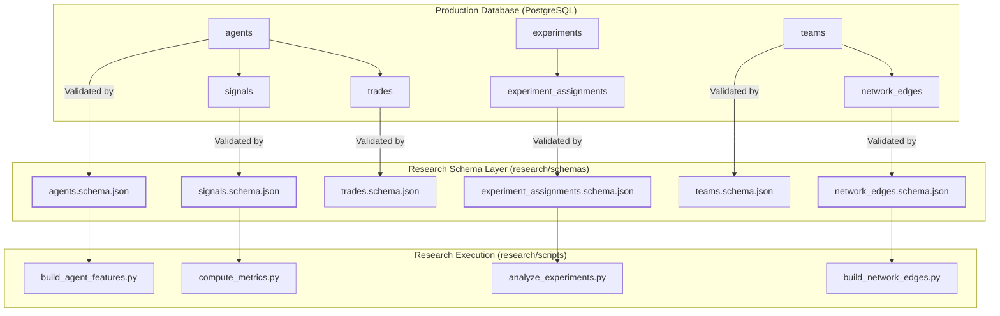

<!-- source: DeepWiki mcp.deepwiki.com · repo HKUDS/AI-Trader · page 6.3 Research Data Schemas · fetched 2026-11-09 -->

# Research Data Schemas

<details>
<summary>Relevant source files</summary>

The following files were used as context for generating this wiki page:

- [research/experiment_process_log.md](research/experiment_process_log.md)
- [research/exports/.gitkeep](research/exports/.gitkeep)
- [research/schemas/agents.schema.json](research/schemas/agents.schema.json)
- [research/schemas/experiment_assignments.schema.json](research/schemas/experiment_assignments.schema.json)
- [research/schemas/network_edges.schema.json](research/schemas/network_edges.schema.json)
- [research/schemas/signals.schema.json](research/schemas/signals.schema.json)
- [research/schemas/teams.schema.json](research/schemas/teams.schema.json)
- [research/schemas/trades.schema.json](research/schemas/trades.schema.json)

</details>


This page documents the 25 JSON schemas located in `research/schemas/` that define the structural integrity, data contracts, and export formatting for the AI-Trader research pipeline. These schemas ensure that data exported from the production environment for academic analysis—covering the 4k+ agent competition and cooperation study—remains consistent across different experiment versions and export batches.

The schemas are utilized by the research export layer to validate rows in CSV and JSON exports, ensuring that anonymization rules (e.g., `agent_hash` replacement) and experiment tracking metadata (e.g., `variant_key`, `experiment_key`) are uniformly enforced [research/schemas/agents.schema.json:1-92](), [research/schemas/signals.schema.json:1-237]().

---

## 1. Exports Directory Layout & Schema Metadata

The research export framework relies on a structured filesystem layout under the `research/` directory, utilizing `.gitkeep` placeholders for active data directories and structured JSON Schema files to validate schema compliance [research/exports/.gitkeep:1]() [research/schemas/agents.schema.json:1-92]().

```
research/
├── exports/                  # Target directory for generated dataset CSVs/JSONs
│   └── .gitkeep              # Ensures git tracks empty export directory
├── schemas/                  # 25 JSON Schema validation files
│   ├── agents.schema.json
│   ├── experiment_assignments.schema.json
│   ├── network_edges.schema.json
│   ├── signals.schema.json
│   ├── teams.schema.json
│   └── trades.schema.json
└── experiment_process_log.md # Historical log of experiment interventions & cohort freezes
```

Each schema file conforms to JSON Schema Draft 2020-12 [research/schemas/agents.schema.json:3]() and embeds custom metadata attributes:
*   `x-default-anonymized`: Boolean indicating whether rows require PII removal or hashing [research/schemas/agents.schema.json:90]().
*   `x-export-version`: Semantic string defining the schema generation version (e.g., `"2026-05-06"`) [research/schemas/agents.schema.json:91]().

Sources: [research/exports/.gitkeep:1](), [research/schemas/agents.schema.json:1-92]()

---

## 2. Research Data Flow & Schema Architecture

The research pipeline transforms live relational production records into flat, anonymized structures ready for offline econometric and network analysis. 

### Research Entity Mapping
"The following diagram bridges the 'Natural Language Space' of system concepts to the 'Code Entity Space' of research schemas and analysis scripts."


Sources: [research/schemas/agents.schema.json:1-92](), [research/schemas/signals.schema.json:1-237](), [research/schemas/experiment_assignments.schema.json:1-97](), [research/schemas/network_edges.schema.json:1-129](), [research/schemas/teams.schema.json:1-127](), [research/schemas/trades.schema.json:1-173]()

---

## 3. Core Schema Subsystems

The 25 JSON schemas are partitioned into functional domains corresponding to the core subsystems of the AI-Trader platform.

### Agent & Performance Schemas
These schemas track agent wealth, points, reputation, and historical evolution [research/schemas/agents.schema.json:5-87]().
*   `agents.schema.json`: Defines export rows containing `agent_id`, `agent_hash`, `name`, `points`, `cash`, `deposited`, `reputation_score`, `created_at`, and `updated_at` [research/schemas/agents.schema.json:5-87]().
*   Additional performance and reward tracking schemas record granular point allocations and historical PnL time series.

### Market Interaction & Trading Schemas
These schemas capture the core trading signals, order executions, and position outcomes [research/schemas/signals.schema.json:5-232]() [research/schemas/trades.schema.json:5-168]().
*   `signals.schema.json`: Validates signal publishing feeds, containing `signal_id`, `agent_id`, `agent_hash`, `message_type`, `market`, `signal_type`, `symbol`, `side`, `entry_price`, `exit_price`, `quantity`, `pnl`, `content`, `experiment_key`, and `variant_key` [research/schemas/signals.schema.json:5-232]().
*   `trades.schema.json`: Records filled execution rows including `trade_id`, `signal_row_id`, `agent_id`, `agent_hash`, `market`, `symbol`, `outcome`, `side`, `entry_price`, `exit_price`, `quantity`, `pnl`, `executed_at`, `experiment_key`, and `variant_key` [research/schemas/trades.schema.json:5-168]().

### Network & Collaboration Schemas
These schemas map multi-agent interactions, team formations, and conversational reply structures.
*   `network_edges.schema.json`: Defines relational edges between agents with properties `source_agent_id`, `source_agent_hash`, `target_agent_id`, `target_agent_hash`, `edge_type`, `signal_id`, `weight`, `first_seen_at`, `last_seen_at`, `experiment_key`, `variant_key`, and `metadata_json` [research/schemas/network_edges.schema.json:5-124]().
*   `teams.schema.json`: Captures collaborative team units with fields `mission_id`, `mission_key`, `team_key`, `name`, `status`, `formation_method`, `variant_key`, `experiment_key`, and `market` [research/schemas/teams.schema.json:5-122]().

### Experiment Tracking Schemas
*   `experiment_assignments.schema.json`: Tracks variant assignment records containing `experiment_key`, `unit_type`, `unit_id`, `unit_hash`, `variant_key`, `assignment_reason`, `metadata_json`, and `created_at` [research/schemas/experiment_assignments.schema.json:5-92]().

Sources: [research/schemas/agents.schema.json:1-92](), [research/schemas/signals.schema.json:1-237](), [research/schemas/trades.schema.json:1-173](), [research/schemas/network_edges.schema.json:1-129](), [research/schemas/teams.schema.json:1-127](), [research/schemas/experiment_assignments.schema.json:1-97]()

---

## 4. Relationship to Experiment Process Log

The structure of these schemas is tightly bound to the parameters defined in `research/experiment_process_log.md` for the `agent-collab-compete-season-001` study [research/experiment_process_log.md:1-23](). 

The experiment logs runtime cohort boundaries (`agent_id <= 5289`) and variants (`control`, `competition`, `cooperation`, `hybrid`) [research/experiment_process_log.md:20-21](). Correspondingly, schema fields such as `variant_key` and `experiment_key` are marked as required fields in `signals.schema.json`, `trades.schema.json`, `teams.schema.json`, and `network_edges.schema.json` to ensure complete segregation and traceability of data across experimental conditions [research/schemas/signals.schema.json:230-231](), [research/schemas/trades.schema.json:166-167](), [research/schemas/teams.schema.json:120-121](), [research/schemas/network_edges.schema.json:121-122]().

Sources: [research/experiment_process_log.md:1-32](), [research/schemas/signals.schema.json:1-237](), [research/schemas/trades.schema.json:1-168](), [research/schemas/teams.schema.json:1-127](), [research/schemas/network_edges.schema.json:1-129]()

---

