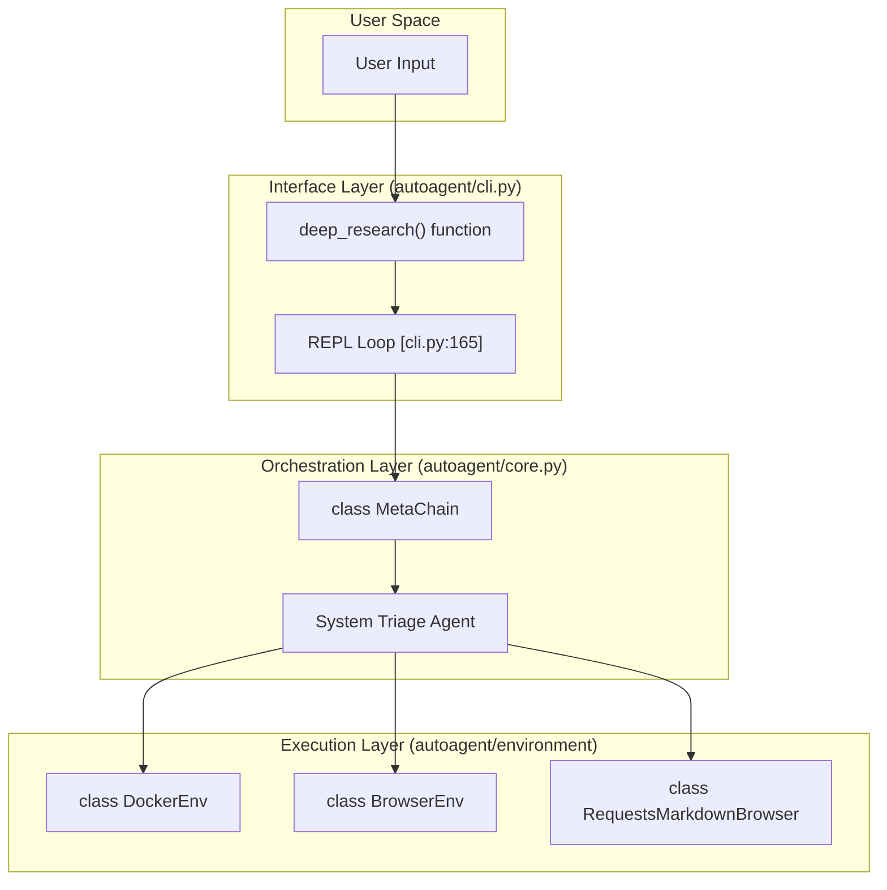
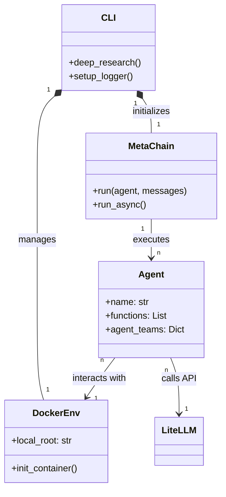

<!-- source: DeepWiki mcp.deepwiki.com · repo HKUDS/Auto-Deep-Research · page 2 System Architecture · fetched 2026-11-09 -->

# System Architecture

Relevant source files

The following files were used as context for generating this wiki page:

- [.env.template](.env.template)
- [README.md](README.md)
- [assets/logo.jpg](assets/logo.jpg)
- [autoagent/__init__.py](autoagent/__init__.py)
- [autoagent/agents/__init__.py](autoagent/agents/__init__.py)
- [autoagent/types.py](autoagent/types.py)

This document provides a high-level technical overview of the Auto-Deep-Research system architecture. It explains how the CLI, MetaChain core, agent system, and environment layer interact to provide a fully-automated research assistant.

## High-Level Architecture Overview

Auto-Deep-Research is built on the **AutoAgent** framework [README.md:25-26](). The system separates concerns into a layered architecture: a user-facing CLI, a containerized execution environment, a multi-agent orchestration core, and a universal LLM integration layer.

### System Components Bridge

The following diagram bridges the conceptual "Natural Language Space" (user intent) to the "Code Entity Space" (specific classes and files).

Sources: [autoagent/cli.py:45-215](), [autoagent/core.py:1-20](), [autoagent/types.py:10-21]()

---

## Core Subsystems

### 1. CLI System
The CLI is the entry point, managed primarily in `autoagent/cli.py`. It handles workspace initialization, port management for the Docker container, and the main interaction loop where users can @mention specific agents [autoagent/cli.py:173-180]().

For details, see [CLI System](#2.1).

### 2. Docker Environment
To ensure safety and reproducibility, all code execution and web browsing occur within a containerized environment. This is managed by `DockerEnv` and configured via `DockerConfig` [autoagent/cli.py:53-70](). The system automatically detects machine architecture to pull the correct base image [README.md:99-102]().

For details, see [Docker Environment](#2.2).

### 3. Agent System & MetaChain Core
The heart of the system is the **MetaChain** execution loop [autoagent/core.py:1-10](). It orchestrates transitions between different specialized agents:
*   **System Triage Agent**: The central router.
*   **Web Surfer**: For browser automation.
*   **Programming Agent**: For data analysis and code execution.
*   **File Surfer**: For local document inspection.

Agents are defined using the `Agent` Pydantic model [autoagent/types.py:10-20]() and registered via a global `registry` [autoagent/agents/__init__.py:27-28]().

For details, see [Agent System](#2.3).

---

## Data Flow & Entity Relationships

This diagram illustrates how code entities (classes and functions) relate to the physical infrastructure (Docker/LLM).

Sources: [autoagent/cli.py:144-166](), [autoagent/types.py:10-20](), [autoagent/core.py:1-10]()

---

## LLM Integration Layer

Auto-Deep-Research uses `litellm` to provide universal support for providers like Anthropic, OpenAI, DeepSeek, and Gemini [README.md:119-130](). It handles the nuances between:
*   **Function-Calling Models**: Native tool use (e.g., Claude 3.5 Sonnet).
*   **Non-Function-Calling Models**: Fallback logic for models like DeepSeek-R1 that require manual parsing of tool calls [README.md:31]().

Configuration is driven by environment variables defined in `.env` [.env.template:1-9]().

Sources: [README.md:126-222](), [.env.template:1-9](), [autoagent/types.py:1-2]()

---

## System Workflow Summary

1.  **Initialization**: The CLI loads `.env`, starts the Docker container via `DockerEnv`, and initializes the `MetaChain` [autoagent/cli.py:109-142]().
2.  **Triage**: User input is sent to the `MetaChain.run()` method with the `System Triage Agent` as the starting point.
3.  **Handoff**: Based on the query, the Triage agent uses `transfer_to_...` functions to hand off control to specialized agents (e.g., `Web Surfer`) [autoagent/types.py:19]().
4.  **Execution**: Specialized agents interact with the `DockerEnv` or `BrowserEnv` to gather data or run code.
5.  **Response**: Results are aggregated and returned to the user via the CLI REPL [autoagent/cli.py:190-206]().

Sources: [autoagent/cli.py:45-215](), [autoagent/core.py:1-20](), [autoagent/agents/__init__.py:60-64]()

---

