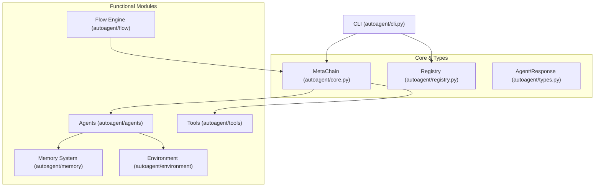
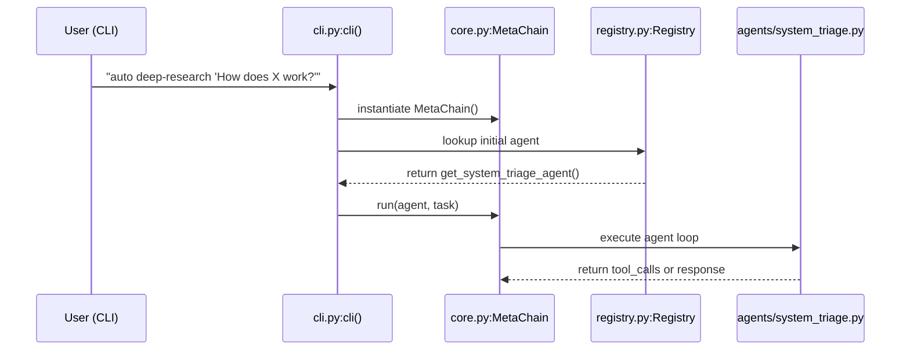

<!-- source: DeepWiki mcp.deepwiki.com · repo HKUDS/Auto-Deep-Research · page 5 Developer Guide · fetched 2026-11-09 -->

# Developer Guide

Relevant source files

The following files were used as context for generating this wiki page:

- [MANIFEST.in](MANIFEST.in)
- [autoagent/__init__.py](autoagent/__init__.py)
- [autoagent/agents/__init__.py](autoagent/agents/__init__.py)
- [setup.cfg](setup.cfg)

This guide is intended for developers who want to contribute to or extend Auto-Deep-Research. It covers the high-level codebase organization, development environment setup, and the extensible systems for tools, memory, and flow orchestration.

## Package Structure

Auto-Deep-Research is organized into a modular structure where the `autoagent` directory contains the core logic, while top-level configuration files manage dependencies and entry points.

### Codebase Entity Mapping

The following diagram maps high-level system components to their specific code entities within the `autoagent` package.

Sources: [autoagent/__init__.py:1-9](), [setup.cfg:73-75](), [autoagent/agents/__init__.py:25-64]()

For a detailed breakdown of every module and their specific responsibilities, see **[Package Structure](#5.1)**.

## Development Environment

The project requires Python >= 3.10 and uses `setup.cfg` for dependency management. Development is supported by `pre-commit` hooks and `autopep8` for code consistency.

### Dependency and Build Specification

| Component | Entity / Requirement |
|-----------|----------------------|
| Python Version | `>= 3.10` |
| Entry Point | `auto = autoagent.cli:cli` |
| Formatter | `autopep8` (max_line_length = 120) |
| Core Dependencies | `openai`, `litellm`, `chromadb`, `playwright`, `tree_sitter` |

Sources: [setup.cfg:16-65](), [setup.cfg:71-71](), [setup.cfg:73-81]()

For instructions on setting up your local environment, running tests with `pytest`, and configuring pre-commit hooks, see **[Development Environment](#5.2)**.

## Extending the System

The framework is designed for extensibility through a central `Registry` pattern. Developers can add new capabilities without modifying the core execution loop.

### Extension Points

*   **Tools**: Use the `@register_tool` or `@register_plugin_tool` decorators to add new functions to the agent's toolkit.
*   **Agents**: Register new agent creation functions to the `registry` to make them available for handoffs.
*   **Workflows**: Define new `EventGroup` or `BaseEvent` logic within the flow engine to create custom research sequences.

Sources: [autoagent/agents/__init__.py:29-58](), [autoagent/registry.py:1-20]() (implied by registry usage)

For a step-by-step guide on adding new components, see **[Extending the System](#5.3)**.

## Subsystem Overviews

### Tool System
The tool system provides the interface between the LLM and the external world. It includes specialized toolsets for web browsing (`web_tools`), terminal execution (`terminal_tools`), and RAG-based code analysis (`rag_code`).
For details, see **[Tool System](#5.4)**.

### Memory System
Auto-Deep-Research utilizes a multi-modal memory system. This includes a RAG memory powered by `ChromaDB` for document retrieval and a specialized code memory that uses `tree_sitter` for parsing code structures.
For details, see **[Memory System](#5.5)**.

### Flow Engine
The Flow Engine is an asynchronous orchestration layer located in `autoagent/flow/`. It manages complex task sequences using an event-driven architecture, supporting dynamic branching via `ReturnBehavior` (e.g., `GOTO`, `ABORT`).
For details, see **[Flow Engine](#5.6)**.

## System Flow: From CLI to Execution

The following diagram bridges the "Natural Language Space" (User Input) to the "Code Entity Space" (Internal Classes).

Sources: [autoagent/cli.py:1-20](), [autoagent/core.py:1-30](), [autoagent/agents/__init__.py:57-64]()

## Conclusion

This guide provides the high-level map of the Auto-Deep-Research codebase. By leveraging the `MetaChain` core and the `Registry` system, developers can build sophisticated research agents with custom tools and orchestrated workflows. For deep dives into specific implementations, please follow the links to the child pages.

---

