# Page: Overview

# Overview

<details>
<summary>Relevant source files</summary>

The following files were used as context for generating this wiki page:

- [.env.template](.env.template)
- [Communication.md](Communication.md)
- [README.md](README.md)
- [assets/QR.png](assets/QR.png)
- [assets/logo.jpg](assets/logo.jpg)

</details>


Auto-Deep-Research is an open-source and cost-efficient alternative to OpenAI's Deep Research, built on the **AutoAgent** framework (previously known as MetaChain). This document provides a high-level introduction to the system's purpose, architecture, and core capabilities.

## Purpose and Scope

Auto-Deep-Research is designed to be a fully-automated personal AI assistant that delivers high performance on complex tasks (as evidenced by its performance on the GAIA Benchmark). Unlike proprietary services with high monthly subscriptions, it follows a pay-as-you-go model using your own LLM API keys.

The system provides a "One-Click Launch" experience via a simple CLI command, handling the complexities of environment containerization, tool registration, and agent orchestration automatically.

Sources: [README.md:25-35](), [README.md:68-80]()

## High-Level System Architecture

The architecture bridges high-level user intent ("Natural Language Space") with low-level execution ("Code Entity Space") by routing tasks through a specialized agent system into a sandboxed Docker environment.

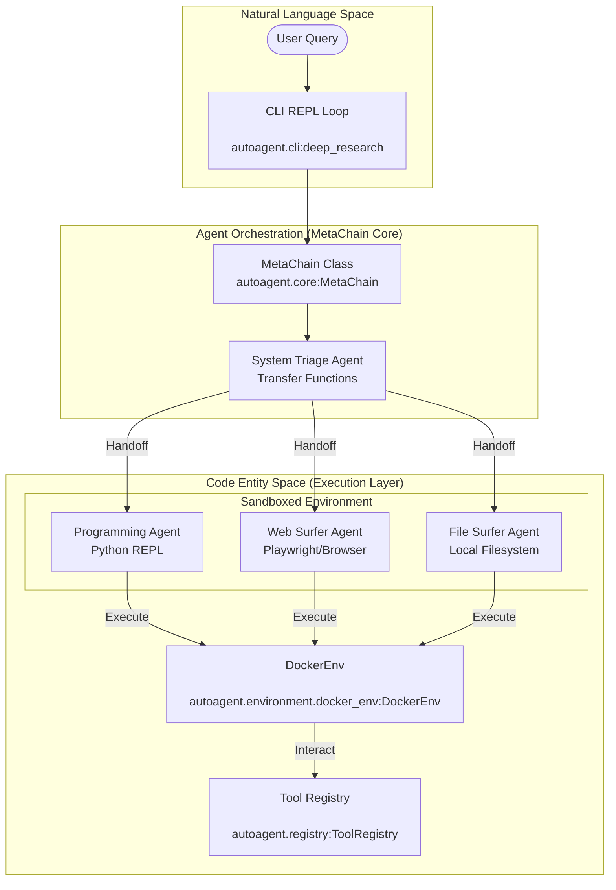

**Architecture Overview: From Intent to Execution**

Sources: [README.md:113-121](), [README.md:25-35]()

## Key Features

*   **Universal LLM Support**: Integrates with OpenAI, Anthropic, DeepSeek, Gemini, Groq, and more via LiteLLM.
*   **Interaction Flexibility**: Automatically detects and handles both **function-calling** and **non-function-calling** (ReAct style) LLMs.
*   **Secure Sandboxing**: Uses Docker to isolate code execution and file manipulation, preventing side effects on the host system.
*   **Multi-Modal Research**: Combines web browsing, terminal execution, and file processing to solve multi-step research problems.

For a detailed breakdown of these capabilities, see [Key Features](#1.2).

Sources: [README.md:27-35](), [README.md:113-121]()

## System Workflow

The following diagram illustrates how the system initializes and processes a research task, mapping CLI components to the underlying environment management.

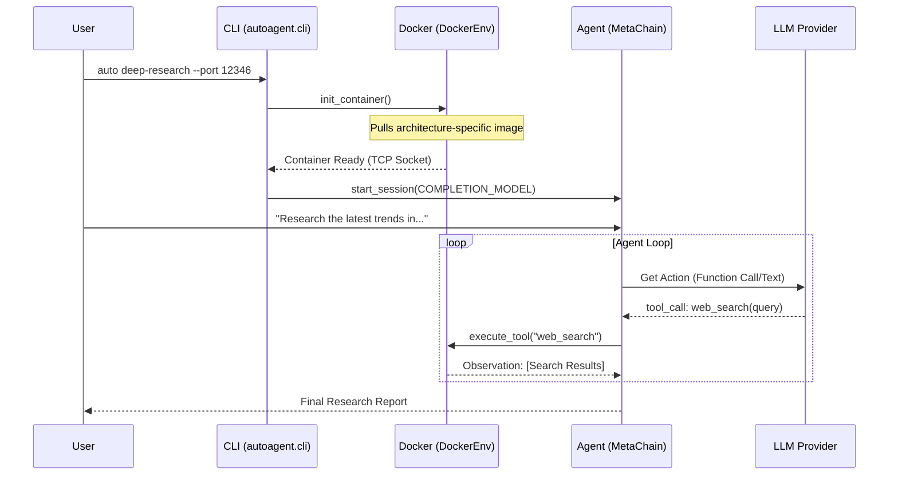

**Operational Workflow: Initialization and Execution Loop**

Sources: [README.md:99-101](), [README.md:113-121]()

## LLM Provider Integration

The system is highly configurable via environment variables, supporting a wide array of providers. It uses a specific logic to determine if a model supports native function calling or requires a text-based fallback.

| Provider | Key Variable | Support Type |
| :--- | :--- | :--- |
| **Anthropic** | `ANTHROPIC_API_KEY` | Native Function Calling |
| **OpenAI** | `OPENAI_API_KEY` | Native Function Calling |
| **DeepSeek** | `DEEPSEEK_API_KEY` | Non-Function Calling (via OpenRouter/API) |
| **Google** | `GEMINI_API_KEY` | Native Function Calling |

For configuration details and a full list of providers, see [Supported LLM Providers](#1.3).

Sources: [.env.template:1-9](), [README.md:124-150]()

## Navigation

*   **[Installation & Setup](#1.1)**: Guide for setting up Python 3.10, Docker, and API keys.
*   **[Key Features](#1.2)**: Deep dive into performance, file handling, and browsing.
*   **[Supported LLM Providers](#1.3)**: How to configure specific models and the `FN_CALL` flag.

Sources: [README.md:49-62]()

---

# Page: Installation & Setup

# Installation & Setup

<details>
<summary>Relevant source files</summary>

The following files were used as context for generating this wiki page:

- [.env.template](.env.template)
- [MANIFEST.in](MANIFEST.in)
- [README.md](README.md)
- [assets/logo.jpg](assets/logo.jpg)
- [pyproject.toml](pyproject.toml)
- [setup.cfg](setup.cfg)

</details>


This document provides a comprehensive guide for installing and configuring Auto-Deep-Research, an open-source alternative to OpenAI's Deep Research based on the AutoAgent framework. This page covers the prerequisites, installation process, configuration of API keys, and launching the system.

## Prerequisites

Before installing Auto-Deep-Research, ensure your system meets the following requirements:

- **Python 3.10** or higher [setup.cfg:71-71]()
- **Docker**: Used to containerize the agent-interactive environment [README.md:99-101]()
- **Git**: For cloning the repository
- **Internet connection**: For downloading packages, Docker images, and accessing LLM APIs

### Installation Workflow

The following diagram illustrates the setup process from environment creation to the first launch.

**Setup Flow: From Source to Execution**
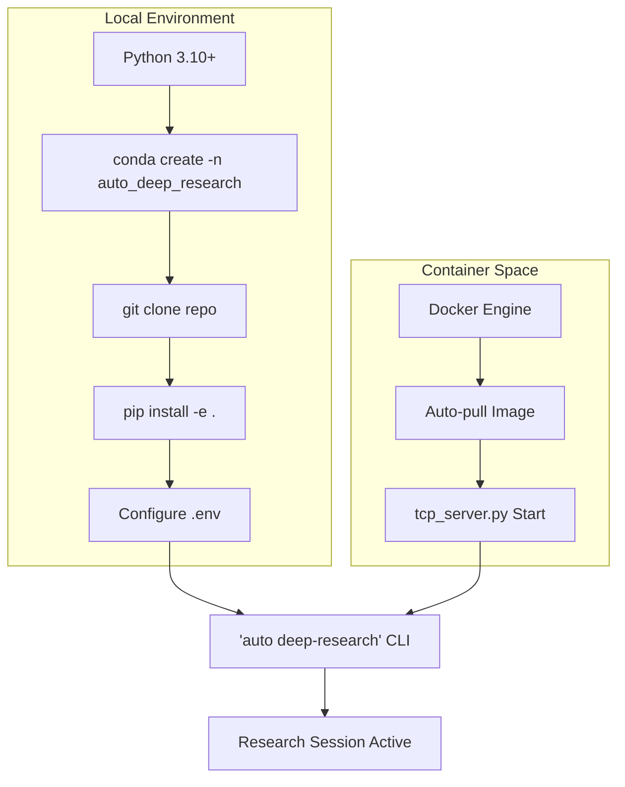
Sources: [README.md:87-101](), [setup.cfg:71-71]()

## Installation Process

### Python Environment Setup
Auto-Deep-Research requires Python 3.10. It is recommended to use Conda for environment isolation:

```bash
conda create -n auto_deep_research python=3.10
conda activate auto_deep_research
```

### Package Installation
Clone the repository and install the package in editable mode. This registers the `auto` command defined in the entry points [setup.cfg:73-75]().

```bash
git clone https://github.com/HKUDS/Auto-Deep-Research.git
cd Auto-Deep-Research
pip install -e .
```

The installation process pulls core dependencies including `litellm` for LLM abstraction, `playwright` for web browsing, and `chromadb` for vector memory [setup.cfg:16-65]().

Sources: [README.md:87-97](), [setup.cfg:1-81]()

### Docker Environment
The system uses Docker to provide a safe, isolated execution environment for agents (e.g., the Programming Agent). You do not need to manually pull images; the system automatically detects your machine architecture and pulls the appropriate pre-built image [README.md:99-101]().

## Configuration

Configuration is primarily handled through a `.env` file and command-line arguments.

### API Keys Setup
Copy the template file and populate it with your provider keys:

```bash
cp .env.template .env
```

**Supported Provider Keys in `.env`:**
| Variable | Purpose |
| :--- | :--- |
| `OPENAI_API_KEY` | For GPT-4o and other OpenAI models |
| `ANTHROPIC_API_KEY` | For Claude 3.5 Sonnet (Default model) |
| `DEEPSEEK_API_KEY` | For DeepSeek-V3/R1 |
| `GEMINI_API_KEY` | For Google Gemini models |
| `HUGGINGFACE_API_KEY` | For HF Inference API |
| `GROQ_API_KEY` | For Groq-hosted Llama/DeepSeek models |

Sources: [.env.template:1-8](), [README.md:103-107]()

### CLI Configuration Options
The `auto deep-research` command supports several environment variables and flags to customize the execution:

*   `COMPLETION_MODEL`: The model name (e.g., `gpt-4o`, `claude-3-5-sonnet-20241022`). Defaults to Claude 3.5 Sonnet [README.md:119-119]().
*   `--port`: Port for the Docker container communication (default: `12346`) [README.md:118-118]().
*   `--container_name`: Name of the sandbox container (default: `deepresearch`) [README.md:117-117]().
*   `API_BASE_URL`: Custom endpoint for OpenAI-compatible APIs [README.md:121-121]().

## System Launch

### Initializing the System
When you run the launch command, the `autoagent.cli:cli` function is invoked [setup.cfg:75-75]().

**Component Association: CLI to Code Entities**
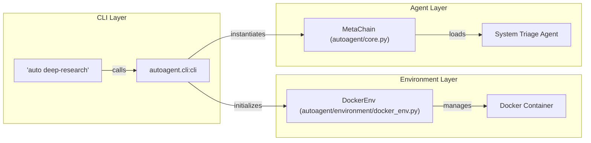
Sources: [setup.cfg:73-75](), [README.md:111-120]()

### Launch Examples

**Standard Launch (Claude 3.5 Sonnet):**
```bash
auto deep-research
```

**OpenAI Launch (GPT-4o):**
```bash
OPENAI_API_KEY=sk-... COMPLETION_MODEL=gpt-4o auto deep-research
```

**DeepSeek-R1 via OpenRouter:**
```bash
OPENROUTER_API_KEY=sk-... COMPLETION_MODEL=openrouter/deepseek/deepseek-r1 auto deep-research
```

Sources: [README.md:139-140](), [README.md:149-149](), [README.md:244-244]()

## Troubleshooting

1.  **Docker Daemon**: Ensure Docker is running (`docker ps`). If the command fails to pull the image, check your internet connection and Docker disk space.
2.  **API Errors**: Verify that the `COMPLETION_MODEL` string matches the [LiteLLM](https://github.com/BerriAI/litellm) naming convention [README.md:119-119]().
3.  **Port Conflict**: If port `12346` is occupied, use `--port <new_port>` to specify an available one [README.md:118-118]().

---

# Page: Key Features

# Key Features

<details>
<summary>Relevant source files</summary>

The following files were used as context for generating this wiki page:

- [.env.template](.env.template)
- [README.md](README.md)
- [assets/logo.jpg](assets/logo.jpg)
- [autoagent/fn_call_converter.py](autoagent/fn_call_converter.py)
- [constant.py](constant.py)

</details>


This page documents the technical features that enable Auto-Deep-Research to function as a high-performance, cost-effective AI research assistant. It details the implementation of LLM support, interaction models, file handling, and the architecture that supports its benchmark-leading performance.

## High Performance & GAIA Benchmark
Auto-Deep-Research is built on the MetaChain framework and is designed for high-stakes reasoning tasks. It delivers state-of-the-art performance on the **GAIA (General AI Assistants) Benchmark**, ranking as a top open-source method [README.md:21-29](). The system achieves this by orchestrating specialized agents (Web, File, and Programming) to decompose complex queries into executable steps [README.md:25-27]().

## Universal LLM Support
The system integrates with a vast array of providers through `litellm`. Configuration is managed via the `.env` file and the `COMPLETION_MODEL` environment variable [constant.py:48-56]().

| Provider | Environment Variable | Implementation Note |
| :--- | :--- | :--- |
| **Anthropic** | `ANTHROPIC_API_KEY` | Default: `claude-3-5-sonnet-20241022` [README.md:119]() |
| **OpenAI** | `OPENAI_API_KEY` | Supports GPT-4o, o1-mini [constant.py:62-64]() |
| **DeepSeek** | `DEEPSEEK_API_KEY` | Supports `deepseek-chat` and `deepseek-reasoner` [constant.py:62-65]() |
| **Google** | `GEMINI_API_KEY` | Native Gemini support via LiteLLM [README.md:164]() |
| **OpenRouter** | `OPENROUTER_API_KEY` | Recommended for DeepSeek-R1 access [README.md:154-161]() |

**Sources:** [README.md:124-175](), [constant.py:48-56](), [.env.template:1-8]()

## Flexible Interaction: Function Calling vs. Prompting
Auto-Deep-Research distinguishes between models that support native tool use and those that require text-based instruction. This logic is centralized in `constant.py`.

### Logic Flow for Interaction Selection
The system automatically determines the interaction mode based on the `COMPLETION_MODEL` string.

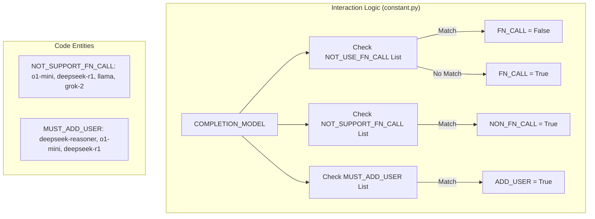

### Non-Function Calling Fallback
For models like `deepseek-r1` or `llama`, the `FunctionCallingConverter` in `autoagent/fn_call_converter.py` wraps tools in a specialized XML-like prompt format [autoagent/fn_call_converter.py:35-58]().
- **System Suffix**: Appends instructions for `<function=...>` and `<parameter=...>` tags [autoagent/fn_call_converter.py:42-49]().
- **Few-Shot Examples**: Injects a multi-turn example of a coding task using `execute_bash` and `str_replace_editor` to guide the model [autoagent/fn_call_converter.py:63-205]().

**Sources:** [constant.py:61-86](), [autoagent/fn_call_converter.py:35-60](), [autoagent/fn_call_converter.py:63-205]()

## File Handling & Workspace
The system utilizes a Docker-based workspace to ensure safe and isolated file interactions.

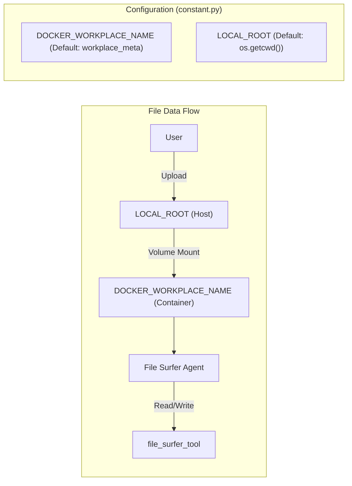

- **Persistence**: Files uploaded to the workspace are accessible across agent handoffs (e.g., the Web Surfer can download a paper, and the Programming Agent can analyze it) [README.md:31-34]().
- **Architecture Awareness**: The system automatically pulls the correct Docker image (`tjbtech1/metachain:latest` for ARM or `tjbtech1/metachain:amd64_latest` for x86) based on the host machine's architecture [constant.py:37-46]().

**Sources:** [constant.py:25-28](), [constant.py:37-46](), [README.md:101]()

## Cost-Efficiency
Unlike proprietary services with flat monthly fees, Auto-Deep-Research uses a **pay-as-you-go** model.
- **Direct API Usage**: Users connect their own keys (OpenAI, Anthropic, etc.), paying only for the tokens consumed during research [README.md:30-32]().
- **Model Optimization**: The system allows switching to cheaper models (e.g., `claude-3-5-haiku` or `deepseek-chat`) for less complex sub-tasks to minimize costs [constant.py:48](), [README.md:149-152]().

**Sources:** [README.md:30-32](), [constant.py:48-65]()

---

# Page: Supported LLM Providers

# Supported LLM Providers

<details>
<summary>Relevant source files</summary>

The following files were used as context for generating this wiki page:

- [.env.template](.env.template)
- [README.md](README.md)
- [assets/logo.jpg](assets/logo.jpg)
- [constant.py](constant.py)

</details>


This page provides a technical deep dive into how Auto-Deep-Research integrates with various Large Language Model (LLM) providers. It details the configuration logic, the role of environment variables, and how the system dynamically adapts to different model capabilities like function calling.

## Provider Integration Architecture

Auto-Deep-Research utilizes **LiteLLM** as a translation layer to interface with multiple providers. The system state and model behavior are governed by constants defined in `constant.py` which are initialized from environment variables.

### LLM Configuration Data Flow

The following diagram shows how configuration moves from the environment into the core execution logic.

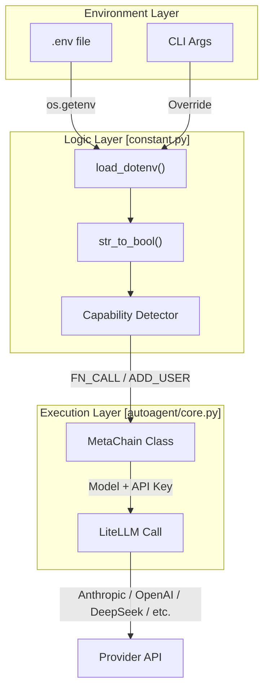

Sources: [constant.py:1-22](), [constant.py:48-85](), [README.md:113-123]()

## Supported Providers and Environment Variables

To enable a provider, the corresponding API key must be defined in the `.env` file. The system checks these variables at runtime to authenticate requests via LiteLLM.

| Provider | Environment Variable | Default/Example Model |
| :--- | :--- | :--- |
| **Anthropic** | `ANTHROPIC_API_KEY` | `claude-3-5-sonnet-20241022` |
| **OpenAI** | `OPENAI_API_KEY` | `gpt-4o`, `o1-mini` |
| **DeepSeek** | `DEEPSEEK_API_KEY` | `deepseek-chat`, `deepseek-reasoner` |
| **Google** | `GEMINI_API_KEY` | `gemini/gemini-1.5-pro` |
| **HuggingFace** | `HUGGINGFACE_API_KEY` | `huggingface/meta-llama/Llama-3.3-70B` |
| **Groq** | `GROQ_API_KEY` | `groq/llama-3.3-70b-versatile` |
| **Mistral** | `MISTRAL_API_KEY` | `mistral/mistral-large-latest` |
| **OpenRouter** | `OPENROUTER_API_KEY` | `openrouter/anthropic/claude-3.5-sonnet` |

Sources: [.env.template:1-8](), [README.md:128-252]()

## Model Capability Classification

The system performs automatic feature detection based on the `COMPLETION_MODEL` string. This logic is centralized in `constant.py` to ensure consistent behavior across different agents.

### Function Calling (`FN_CALL`)
The `FN_CALL` flag determines if the agent uses native tool-calling schemas or falls back to text-based prompting. 
- **Auto-Enable**: If `FN_CALL` is not explicitly set in `.env`, it defaults to `True` [constant.py:74-75]().
- **Auto-Disable**: It is set to `False` if the model name contains strings in `NOT_USE_FN_CALL` (e.g., `deepseek-chat`, `llama`, `grok-2`) [constant.py:64-79]().

### User Message Requirement (`ADD_USER`)
Some reasoning models (like `o1` or `deepseek-r1`) require a specific message structure where the conversation must start with or include a "user" role message rather than just a "system" prompt.
- **Logic**: If the model is in `MUST_ADD_USER`, the `ADD_USER` flag is set to `True` [constant.py:62-72]().

### Implementation Mapping

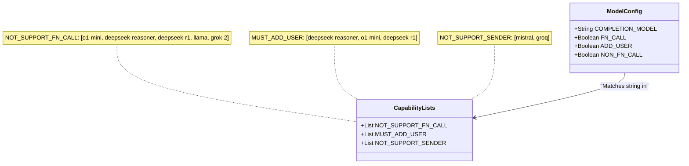

Sources: [constant.py:61-86]()

## Configuration via CLI

While `.env` provides persistence, the `auto deep-research` command allows for dynamic overrides.

- **Custom Model**: `COMPLETION_MODEL=gpt-4o auto deep-research`
- **Custom Endpoint**: Use `API_BASE_URL` to point to local vLLM or Ollama instances: `API_BASE_URL=http://localhost:8000/v1 COMPLETION_MODEL=openai/my-model auto deep-research`.
- **Force Function Calling**: Set `FN_CALL=True` or `FN_CALL=False` to override the automatic detection logic.

Sources: [constant.py:55-56](), [README.md:113-123]()

## Provider-Specific Implementation Details

### DeepSeek and OpenRouter
For `deepseek-r1`, the documentation recommends using **OpenRouter** as the provider for better reliability and performance compared to the direct API [README.md:225-226](). 

### Mistral and Groq
These providers are flagged in `NOT_SUPPORT_SENDER`, which informs the internal message formatting logic to strip specific metadata fields that cause API errors on these platforms [constant.py:61]().

### Default Model
If no model is specified, the system defaults to `claude-3-5-haiku-20241022` [constant.py:48](). This ensures an out-of-the-box experience with a high-performance, tool-capable model.

Sources: [constant.py:48](), [constant.py:61](), [README.md:225-226]()

---

# Page: System Architecture

# System Architecture

<details>
<summary>Relevant source files</summary>

The following files were used as context for generating this wiki page:

- [.env.template](.env.template)
- [README.md](README.md)
- [assets/logo.jpg](assets/logo.jpg)
- [autoagent/__init__.py](autoagent/__init__.py)
- [autoagent/agents/__init__.py](autoagent/agents/__init__.py)
- [autoagent/types.py](autoagent/types.py)

</details>


This document provides a high-level technical overview of the Auto-Deep-Research system architecture. It explains how the CLI, MetaChain core, agent system, and environment layer interact to provide a fully-automated research assistant.

## High-Level Architecture Overview

Auto-Deep-Research is built on the **AutoAgent** framework [README.md:25-26](). The system separates concerns into a layered architecture: a user-facing CLI, a containerized execution environment, a multi-agent orchestration core, and a universal LLM integration layer.

### System Components Bridge

The following diagram bridges the conceptual "Natural Language Space" (user intent) to the "Code Entity Space" (specific classes and files).

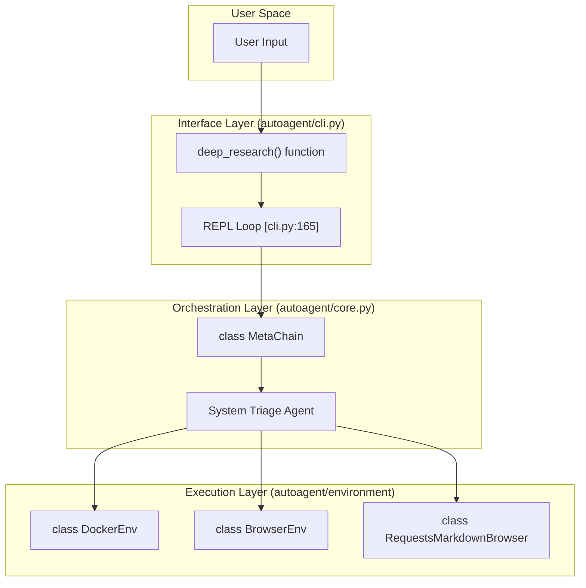

Sources: [autoagent/cli.py:45-215](), [autoagent/core.py:1-20](), [autoagent/types.py:10-21]()

---

## Core Subsystems

### 1. CLI System
The CLI is the entry point, managed primarily in `autoagent/cli.py`. It handles workspace initialization, port management for the Docker container, and the main interaction loop where users can @mention specific agents [autoagent/cli.py:173-180]().

For details, see [CLI System](#2.1).

### 2. Docker Environment
To ensure safety and reproducibility, all code execution and web browsing occur within a containerized environment. This is managed by `DockerEnv` and configured via `DockerConfig` [autoagent/cli.py:53-70](). The system automatically detects machine architecture to pull the correct base image [README.md:99-102]().

For details, see [Docker Environment](#2.2).

### 3. Agent System & MetaChain Core
The heart of the system is the **MetaChain** execution loop [autoagent/core.py:1-10](). It orchestrates transitions between different specialized agents:
*   **System Triage Agent**: The central router.
*   **Web Surfer**: For browser automation.
*   **Programming Agent**: For data analysis and code execution.
*   **File Surfer**: For local document inspection.

Agents are defined using the `Agent` Pydantic model [autoagent/types.py:10-20]() and registered via a global `registry` [autoagent/agents/__init__.py:27-28]().

For details, see [Agent System](#2.3).

---

## Data Flow & Entity Relationships

This diagram illustrates how code entities (classes and functions) relate to the physical infrastructure (Docker/LLM).

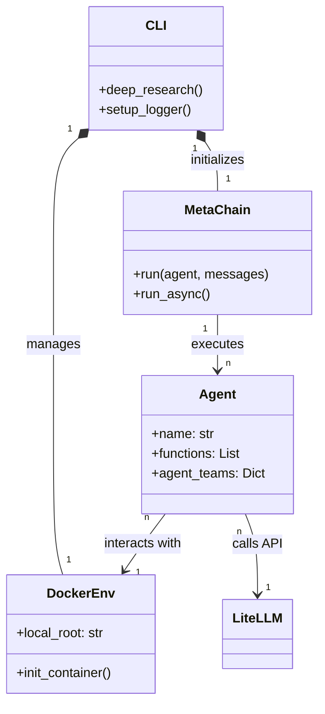

Sources: [autoagent/cli.py:144-166](), [autoagent/types.py:10-20](), [autoagent/core.py:1-10]()

---

## LLM Integration Layer

Auto-Deep-Research uses `litellm` to provide universal support for providers like Anthropic, OpenAI, DeepSeek, and Gemini [README.md:119-130](). It handles the nuances between:
*   **Function-Calling Models**: Native tool use (e.g., Claude 3.5 Sonnet).
*   **Non-Function-Calling Models**: Fallback logic for models like DeepSeek-R1 that require manual parsing of tool calls [README.md:31]().

Configuration is driven by environment variables defined in `.env` [.env.template:1-9]().

Sources: [README.md:126-222](), [.env.template:1-9](), [autoagent/types.py:1-2]()

---

## System Workflow Summary

1.  **Initialization**: The CLI loads `.env`, starts the Docker container via `DockerEnv`, and initializes the `MetaChain` [autoagent/cli.py:109-142]().
2.  **Triage**: User input is sent to the `MetaChain.run()` method with the `System Triage Agent` as the starting point.
3.  **Handoff**: Based on the query, the Triage agent uses `transfer_to_...` functions to hand off control to specialized agents (e.g., `Web Surfer`) [autoagent/types.py:19]().
4.  **Execution**: Specialized agents interact with the `DockerEnv` or `BrowserEnv` to gather data or run code.
5.  **Response**: Results are aggregated and returned to the user via the CLI REPL [autoagent/cli.py:190-206]().

Sources: [autoagent/cli.py:45-215](), [autoagent/core.py:1-20](), [autoagent/agents/__init__.py:60-64]()

---

# Page: CLI System

# CLI System

<details>
<summary>Relevant source files</summary>

The following files were used as context for generating this wiki page:

- [autoagent/cli.py](autoagent/cli.py)
- [autoagent/util.py](autoagent/util.py)
- [setup.cfg](setup.cfg)

</details>


The CLI System serves as the primary interface for users to interact with Auto-Deep-Research. It handles command-line argument parsing, Docker environment setup, agent initialization, and interactive user sessions. This page details the architecture, workflow, and implementation of the command-line interface system.

For information about the Docker environment managed by the CLI, see [Docker Environment](#2.2).

## Architecture

The CLI system is built using the `click` Python library [setup.cfg:28-28]() and follows a hierarchical command structure. It integrates with Docker to create containerized environments and initializes the necessary components for the research agent.

### Component Structure

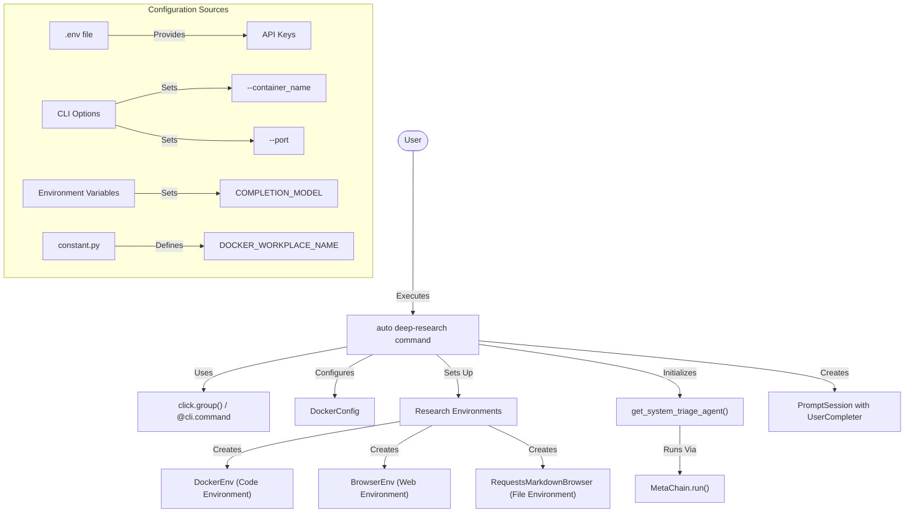

Sources: [autoagent/cli.py:45-48](), [autoagent/cli.py:109-113](), [autoagent/cli.py:78-84](), [autoagent/cli.py:86-98](), [autoagent/cli.py:164-164](), [constant.py:28-28]()

### Command Flow

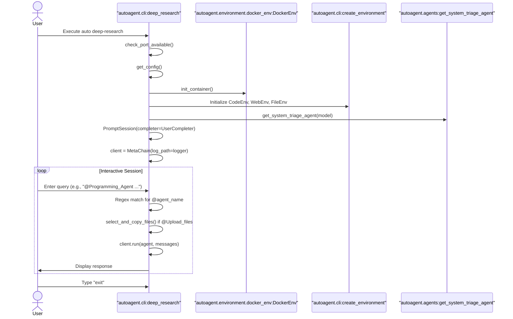

Sources: [autoagent/cli.py:112-214](), [autoagent/cli.py:32-44](), [autoagent/cli.py:53-85](), [autoagent/cli.py:86-98](), [autoagent/cli.py:146-164]()

## Implementation Details

### CLI Command Structure

The CLI system is defined in `autoagent/cli.py` using the `click` library. The entry point is mapped to the `auto` command in `setup.cfg`.

- **Main Group**: `cli()` defines the base command [autoagent/cli.py:45-48]().
- **Subcommand**: `deep-research` handles the primary research loop [autoagent/cli.py:109-112]().
- **Entry Point**: `auto = autoagent.cli:cli` [setup.cfg:75-75]().

Sources: [autoagent/cli.py:45-112](), [setup.cfg:73-75]()

### Docker Configuration and Port Management

The CLI manages Docker containers by ensuring unique port allocation. It uses `filelock` to prevent race conditions when multiple instances attempt to bind to the same port.

```python
# Port availability check implementation
def check_port_available(port):
    with socket.socket(socket.AF_INET, socket.SOCK_STREAM) as s:
        try:
            s.setsockopt(socket.SOL_SOCKET, socket.SO_REUSEADDR, 1)
            s.bind(('0.0.0.0', port))
            s.close()
            return True
        except socket.error:
            return False
```

The `get_config` function uses a lock file `.port_lock` and creates indicator files like `.port_12346` to track usage [autoagent/cli.py:64-74]().

Sources: [autoagent/cli.py:32-44](), [autoagent/cli.py:53-85]()

### Environment Setup

The `create_environment` function initializes the three-pillar environment required for deep research:

1.  **Code Environment**: `DockerEnv` handles container lifecycle and code execution [autoagent/cli.py:92-93]().
2.  **Web Environment**: `BrowserEnv` manages web browsing capabilities [autoagent/cli.py:95-95]().
3.  **File Environment**: `RequestsMarkdownBrowser` provides a high-level interface for reading local files and downloads as markdown [autoagent/cli.py:96-96]().

Sources: [autoagent/cli.py:86-98]()

### User Interaction System

The interactive REPL loop uses `prompt_toolkit` for advanced features like tab-completion and agent mentions.

- **Agent Mentions**: The `UserCompleter` class (sourced from `autoagent.util`) allows users to type `@` to see a list of available agents [autoagent/cli.py:159-163]().
- **Special Commands**:
    - `@Upload_files`: Triggers `select_and_copy_files()` to move local files into the Docker workspace [autoagent/cli.py:177-186]().
    - `exit`: Breaks the REPL loop [autoagent/cli.py:171-176]().
- **Context Variables**: The `context_variables` dictionary stores references to `code_env`, `web_env`, and `file_env`, which are passed into the `MetaChain` during execution [autoagent/cli.py:140-140]().

Sources: [autoagent/cli.py:158-214](), [autoagent/cli.py:140-140](), [autoagent/util.py:15-15]()

## Command Line Usage

### Basic Command Structure

```bash
auto deep-research [OPTIONS]
```

| Option | Description | Default Value |
|--------|-------------|---------------|
| `--container_name` | Name for the research Docker container | `deepresearch` |
| `--port` | Communication port for the container | `12346` |

Sources: [autoagent/cli.py:109-112]()

### Environment Configuration

The CLI relies on `constant.py` for default model selection and workplace naming.

- **Model**: `COMPLETION_MODEL` (defaulting to Claude 3.5 Sonnet) [constant.py:28-28]().
- **Workplace**: `DOCKER_WORKPLACE_NAME` (defaulting to `workspace`) [constant.py:21-21]().

Sources: [constant.py:21-28]()

## Internal Workflow

1.  **Initialization**: `deep_research` starts by displaying a salmon-colored logo and a version table [autoagent/cli.py:104-106]().
2.  **Config Resolution**: `get_config` determines the `local_root` path (e.g., `workspace_meta_showcase/showcase_deepresearch`) [autoagent/cli.py:75-76]().
3.  **Logger Setup**: `LoggerManager` is initialized with a `MetaChainLogger` [autoagent/cli.py:130-131]().
4.  **Agent Discovery**: The CLI discovers agents by inspecting the `agent_teams` attribute of the `system_triage_agent` [autoagent/cli.py:151-152]().
5.  **Execution**: User queries are passed to `client.run()`, which manages the `MetaChain` loop [autoagent/cli.py:214-214]().

Sources: [autoagent/cli.py:53-214]()

---

# Page: Docker Environment

# Docker Environment

<details>
<summary>Relevant source files</summary>

The following files were used as context for generating this wiki page:

- [autoagent/environment/__init__.py](autoagent/environment/__init__.py)
- [autoagent/environment/docker_env.py](autoagent/environment/docker_env.py)
- [autoagent/environment/local_env.py](autoagent/environment/local_env.py)
- [autoagent/environment/shutdown_listener.py](autoagent/environment/shutdown_listener.py)
- [autoagent/environment/tcp_server.py](autoagent/environment/tcp_server.py)
- [autoagent/environment/tenacity_stop.py](autoagent/environment/tenacity_stop.py)
- [autoagent/environment/utils.py](autoagent/environment/utils.py)

</details>


This page documents the Docker containerization system used in Auto-Deep-Research. The Docker environment provides isolated execution environments for the research agent, enabling secure execution of code, web browsing, and file operations.

For information about how the CLI system interacts with Docker, see [CLI System](2.1). For details on the agent system running within the Docker container, see [Agent System](2.3).

## Architecture Overview

The Docker environment in Auto-Deep-Research serves as a containerized execution environment for the research agent. It provides an isolated space where code can be executed safely, files can be managed, and web resources can be accessed without risking the host system.

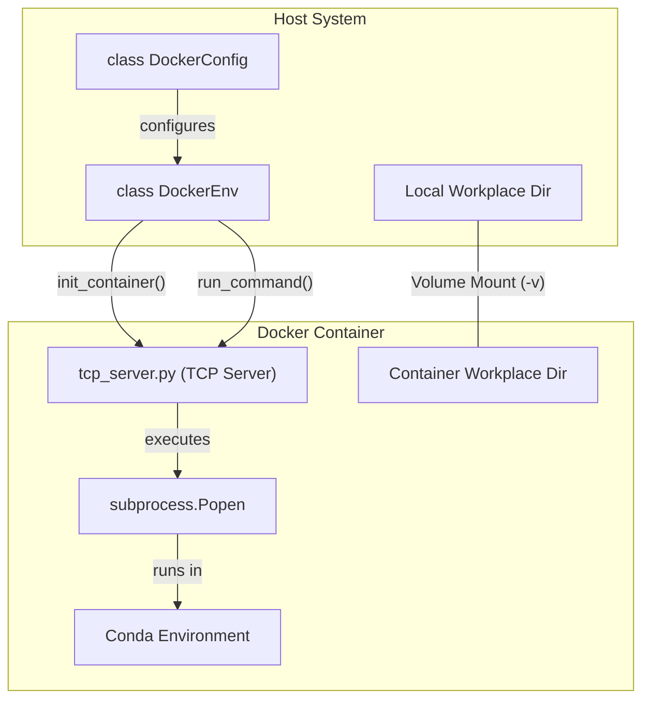

Sources: [autoagent/environment/docker_env.py:17-44](), [autoagent/environment/docker_env.py:108-114](), [autoagent/environment/tcp_server.py:12-43]().

## Docker Configuration

The Docker environment is configured through the `DockerConfig` dataclass, which specifies container settings including name, port, and workplace directory.

| Configuration Parameter | Description | Default Value |
|------------------------|-------------|---------------|
| `container_name` | Name of the Docker container | Required |
| `workplace_name` | Name of the workspace directory | Required |
| `communication_port` | Port used for TCP communication | Required |
| `conda_path` | Path to conda in the container | Required |
| `local_root` | Local directory where workplace is created | `os.getcwd()` |
| `git_clone` | Whether to clone MetaChain into the workplace | `False` |
| `setup_package` | Optional package to extract into the workplace | `None` |

These settings define how the Docker container is created and how it communicates with the host system.

Sources: [autoagent/environment/docker_env.py:17-28]().

## Container Lifecycle Management

The `DockerEnv` class manages the entire lifecycle of the Docker container, including initialization, command execution, and termination.

### Container Initialization

When `init_container` is called, the system performs the following sequence:
1. **Directory Setup**: Creates the `local_workplace` and ensures `tcp_server.py` is present [autoagent/environment/docker_env.py:48-60]().
2. **Repository Setup**: If `git_clone` is True, it clones the MetaChain repository and sets up the specified branch [autoagent/environment/docker_env.py:64-90]().
3. **Container Check**: Checks if a container with `container_name` already exists [autoagent/environment/docker_env.py:46-47]().
4. **Execution**: If the container is missing, it runs `docker run` with the `BASE_IMAGES` constant, mounting the workplace and starting the `tcp_server.py` [autoagent/environment/docker_env.py:108-114]().

### Command Execution via TCP

Commands are not executed via `docker exec` for every call. Instead, they are sent to a persistent TCP server running inside the container to maintain session state and improve performance.

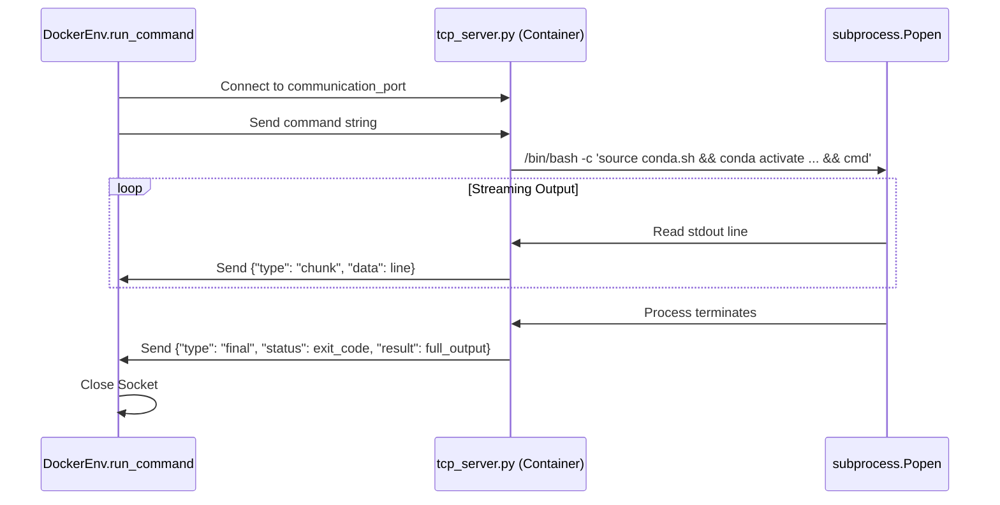

Sources: [autoagent/environment/docker_env.py:154-209](), [autoagent/environment/tcp_server.py:31-63]().

## Communication Protocol

The Docker environment uses a JSON-based protocol over a TCP socket.

*   **Request**: A raw string containing the shell command to execute [autoagent/environment/tcp_server.py:36]().
*   **Chunk Response**: `{"type": "chunk", "data": "..."}` used for real-time streaming of stdout/stderr [autoagent/environment/tcp_server.py:51-55]().
*   **Final Response**: `{"type": "final", "status": int, "result": "..."}` contains the exit code and the full accumulated output [autoagent/environment/tcp_server.py:58-63]().

The server listens on `0.0.0.0` inside the container and binds to the `communication_port` specified in `DockerConfig` [autoagent/environment/tcp_server.py:16-18]().

## Workplace Synchronization

The `local_workplace` on the host is mounted to `docker_workplace` (usually `/{workplace_name}`) inside the container [autoagent/environment/docker_env.py:35-37](). This allows:
1. **Persistence**: Files created by the agent persist on the host after the container stops.
2. **Tool Access**: Tools like the `File Surfer Agent` can interact with the same files visible to the user.
3. **MetaChain Installation**: The `setup_metachain` utility installs the core library in editable mode (`pip install -e .`) within the container's workplace [autoagent/environment/utils.py:4-16]().

## Local Environment Fallback

While Docker is the primary execution target, the codebase provides a `LocalEnv` class in `autoagent/environment/local_env.py`. This class mimics the `DockerEnv` interface but runs commands directly on the host machine using `subprocess.Popen` [autoagent/environment/local_env.py:65-82](). It includes logic to automatically find `conda.sh` across different operating systems (Windows, Linux, MacOS) to ensure the environment can be activated [autoagent/environment/local_env.py:13-64]().

## Shutdown Handling

To ensure clean exits, the environment includes a `shutdown_listener.py`.
- **`should_exit()`**: Monitors for signals like `SIGINT` or `SIGTERM` [autoagent/environment/shutdown_listener.py:40-42]().
- **`stop_if_should_exit`**: A custom `tenacity` stop condition used to abort retries if the system is shutting down [autoagent/environment/tenacity_stop.py:7-11]().

Sources: [autoagent/environment/shutdown_listener.py:1-66](), [autoagent/environment/tenacity_stop.py:1-12]().

## Summary of Key Entities

| Code Entity | File Path | Role |
|-------------|-----------|------|
| `DockerConfig` | `autoagent/environment/docker_env.py` | Data structure for container parameters. |
| `DockerEnv` | `autoagent/environment/docker_env.py` | Orchestrates container lifecycle and TCP communication. |
| `tcp_server.py` | `autoagent/environment/tcp_server.py` | Script running inside the container to execute commands. |
| `LocalEnv` | `autoagent/environment/local_env.py` | Alternative environment for host-direct execution. |
| `setup_metachain` | `autoagent/environment/utils.py` | Bootstraps the agent code within the container. |

Sources: [autoagent/environment/docker_env.py:1-300](), [autoagent/environment/local_env.py:1-88](), [autoagent/environment/tcp_server.py:1-80]().

---

# Page: Agent System

# Agent System

<details>
<summary>Relevant source files</summary>

The following files were used as context for generating this wiki page:

- [autoagent/core.py](autoagent/core.py)
- [autoagent/registry.py](autoagent/registry.py)
- [autoagent/types.py](autoagent/types.py)

</details>


The Agent System is the cognitive core of Auto-Deep-Research, providing the intelligence that powers the platform's research capabilities. This system organizes and orchestrates various specialized agents to process user queries, execute research tasks, and generate comprehensive outputs via a "MetaChain" execution loop.

## System Architecture

The Agent System follows a modular, hierarchical architecture that enables complex research workflows through agent specialization and collaboration.

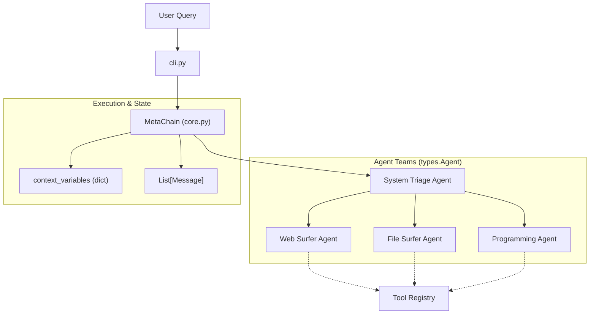

Sources: [autoagent/core.py:58-68](), [autoagent/types.py:10-20](), [autoagent/registry.py:48-63]()

### MetaChain Core Engine
The `MetaChain` class in `autoagent/core.py` serves as the central orchestrator. It manages the loop of sending prompts to LLMs, parsing tool calls, executing those tools, and feeding results back into the conversation history. It handles the transition between agents (handoffs) by detecting when a tool returns a new `Agent` instance.

For a deep dive into the execution loop and retry logic, see [MetaChain Core Engine](#2.3.1).

Sources: [autoagent/core.py:58-85](), [autoagent/types.py:28-42]()

## Core Type Definitions

The system relies on three primary data structures defined in `autoagent/types.py` to maintain consistency across different LLM providers and tool executions.

| Class | Purpose | Key Attributes |
|:---|:---|:---|
| `Agent` | Defines an autonomous entity with a specific role. | `name`, `model`, `instructions`, `functions` (tools), `agent_teams` |
| `Response` | The final output of a `MetaChain.run` execution. | `messages` (history), `agent` (active agent), `context_variables` |
| `Result` | The return value from a tool/function call. | `value` (string result), `agent` (for handoffs), `context_variables` |

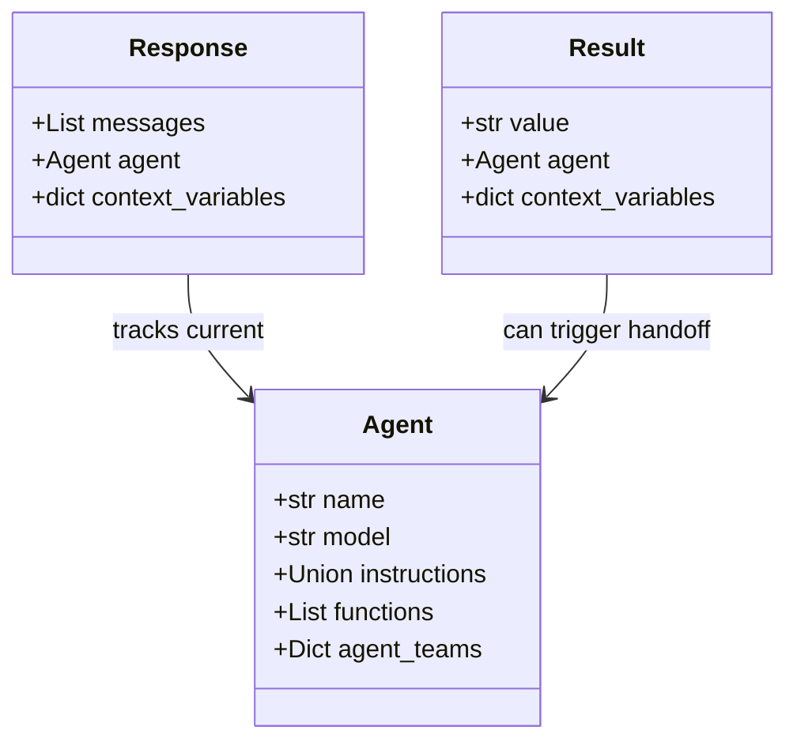

Sources: [autoagent/types.py:10-42]()

## Agent Registration and Discovery

The system employs a `Registry` pattern to manage tools and agents. This allows the system to dynamically discover capabilities and provide them to the LLM as functional tools.

*   **`Registry` Class**: A singleton that stores mappings for `tools`, `agents`, and `workflows`. [autoagent/registry.py:48-68]()
*   **Registration Decorator**: The `@register` (aliased as `@register_tool` or `@register_agent` in other files) decorator extracts function metadata, including docstrings and type hints, to generate JSON schemas for LLM function calling. [autoagent/registry.py:70-137]()
*   **Output Truncation**: The registry automatically wraps tool outputs with `truncate_output` to ensure tokens do not exceed `MAX_OUTPUT_LENGTH` (default 12,000). [autoagent/registry.py:7-24]()

Sources: [autoagent/registry.py:48-137]()

## System Agents

Auto-Deep-Research utilizes a "Hub-and-Spoke" model for agent coordination, centered around the **System Triage Agent**.

1.  **System Triage Agent**: Acts as the router. It analyzes the user's request and "transfers" the conversation to a specialized agent.
2.  **Specialized Agents**:
    *   **Web Surfer**: Optimized for search and browser navigation.
    *   **File Surfer**: Specialized in reading and organizing local workspace files.
    *   **Programming Agent**: Focused on writing and executing Python code in the Docker environment.

For details on how these agents are prompted and how handoffs work, see [System Agents](#2.3.2).

## Agent Execution Workflow

When a query is processed, the `MetaChain` executes a loop that bridges the high-level instructions with low-level code execution:

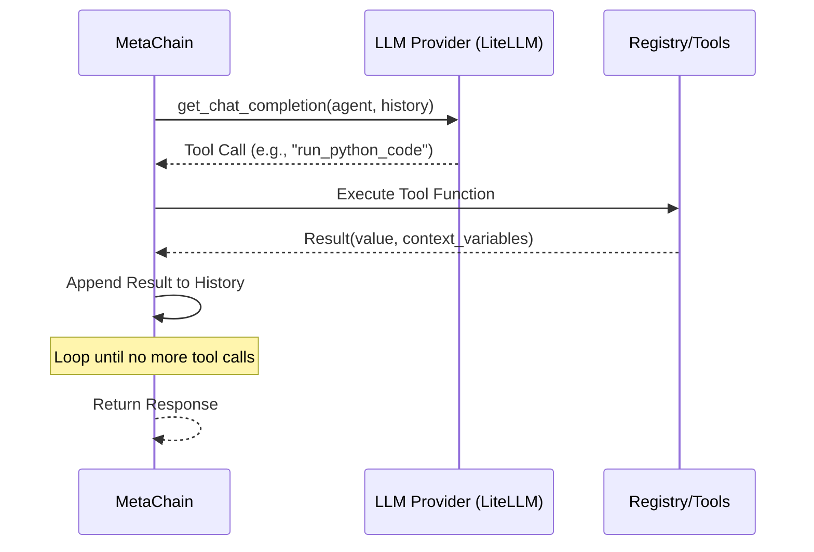

The system supports both standard **Function Calling** (via `litellm`) and a **Non-Function Calling fallback** for models that do not natively support structured tool use. In fallback mode, the system injects tool descriptions into the system prompt and parses the LLM's text output into tool calls.

Sources: [autoagent/core.py:106-163](), [autoagent/core.py:195-215]()

---

# Page: MetaChain Core Engine

# MetaChain Core Engine

<details>
<summary>Relevant source files</summary>

The following files were used as context for generating this wiki page:

- [autoagent/core.py](autoagent/core.py)
- [autoagent/fn_call_converter.py](autoagent/fn_call_converter.py)
- [autoagent/main.py](autoagent/main.py)
- [autoagent/types.py](autoagent/types.py)

</details>


The **MetaChain Core Engine** is the central orchestration component of the Auto-Deep-Research system. Implemented primarily via the `MetaChain` class in `autoagent/core.py`, it manages the lifecycle of agent interactions, including message history maintenance, tool execution, agent handoffs, and LLM communication. It serves as the runtime that executes the "reasoning loop" for all agents in the system.

Sources: [autoagent/core.py:58-68](), [autoagent/types.py:10-26]()

## Core Execution Methods

The `MetaChain` class provides three primary entry points for executing an agent's logic. These methods handle the transition from a user query to a final `Response` object.

| Method | Type | Description |
| :--- | :--- | :--- |
| `run` | Synchronous | The standard execution loop. It blocks until the agent completes its task or reaches the `max_turns` limit. |
| `run_async` | Asynchronous | The async version of `run`, utilizing `litellm.acompletion` for non-blocking I/O. |
| `run_and_stream` | Streaming | Provides a generator that yields partial responses and tool call updates in real-time. |

### The Reasoning Loop (`run`/`run_async`)
The core logic follows a continuous loop:
1. **Completion**: Call the LLM using `get_chat_completion` to get the next `Message`.
2. **Processing**: Append the message to the history.
3. **Tool Handling**: If the message contains `tool_calls`, iterate through them and execute the corresponding functions.
4. **Handoff**: If a tool returns an `Agent` object instead of a string, the active agent is swapped (handoff).
5. **Termination**: Stop if there are no tool calls or if the `max_turns` limit is reached.

Sources: [autoagent/core.py:284-330](), [autoagent/core.py:340-390]()

## Implementation Architecture

The following diagram illustrates the relationship between the `MetaChain` engine and the data entities defined in `types.py`.

### MetaChain Entity Relationship
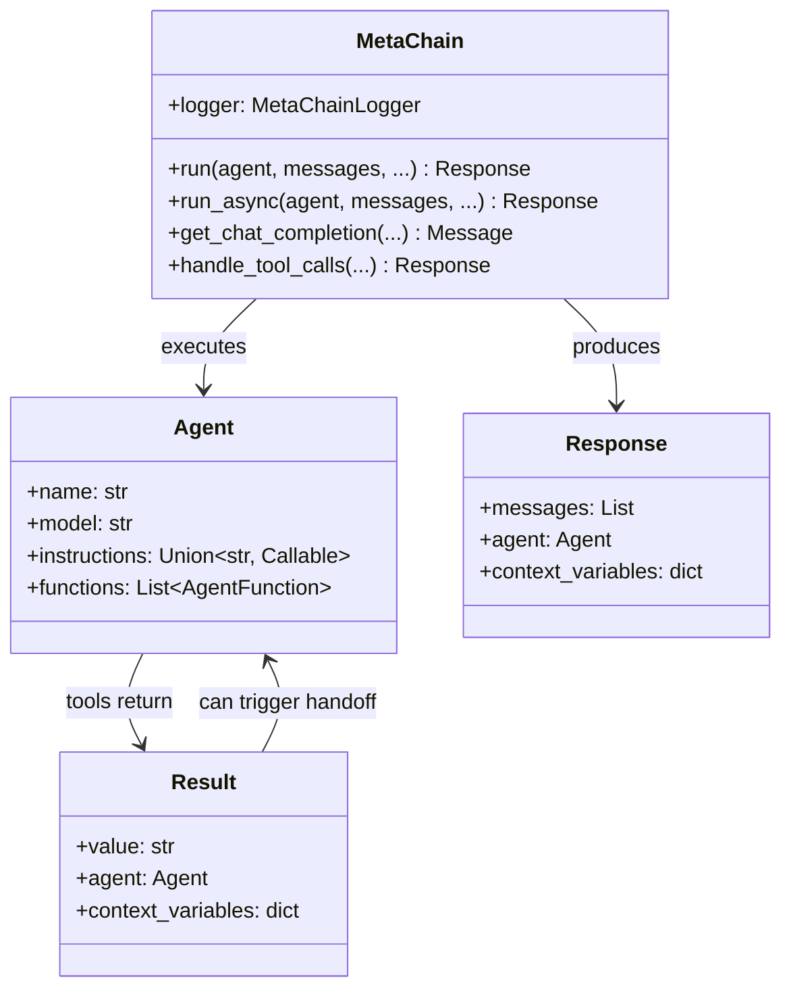
Sources: [autoagent/core.py:58-85](), [autoagent/types.py:10-42]()

## Tool Call Handling & Agent Handoff

When the LLM triggers a tool call, `MetaChain` looks up the function in the `Agent.functions` list. 

### Execution Flow
1. **Function Lookup**: Matches the tool name to the function in the agent's registry [autoagent/core.py:214-220]().
2. **Argument Parsing**: Decodes JSON arguments provided by the LLM [autoagent/core.py:221-224]().
3. **Context Injection**: If the function signature includes `context_variables`, the engine injects the current state [autoagent/core.py:228-232]().
4. **Result Processing**:
    - If the function returns a `str`, it is wrapped in a `Result` [autoagent/core.py:246-248]().
    - If it returns an `Agent`, it signals a **Handoff**, and the `active_agent` is updated [autoagent/core.py:249-251]().
    - If it returns a `Result` object, the engine merges its `context_variables` into the global state [autoagent/core.py:252-258]().

### Handoff Mechanism
Handoffs occur when a tool (often a "transfer" function) returns a new `Agent` instance. The `MetaChain` loop detects this change in the `active_agent` variable and continues the next iteration of the loop using the new agent's instructions and toolset.

Sources: [autoagent/core.py:210-265](), [autoagent/types.py:7-18]()

## Non-Function-Calling Fallback

For models that do not natively support OpenAI-style function calling (e.g., certain versions of DeepSeek or smaller open-source models), `MetaChain` implements a fallback mechanism.

1. **Flag Check**: Triggered when `FN_CALL` is set to `False` in the environment [autoagent/core.py:106-132]().
2. **Prompt Injection**: Uses `convert_tools_to_description` to transform JSON tool definitions into a natural language system prompt suffix [autoagent/core.py:136-137]().
3. **Template**: The `SYSTEM_PROMPT_SUFFIX_TEMPLATE` instructs the model to output tool calls in a specific XML-like format: `<function=...> <parameter=...>...</parameter> </function>` [autoagent/fn_call_converter.py:35-58]().
4. **Conversion**: After receiving the raw text response, `convert_non_fncall_messages_to_fncall_messages` parses the XML back into standard `ChatCompletionMessageToolCall` objects so the rest of the engine remains agnostic to the model's capabilities [autoagent/core.py:161-163]().

Sources: [autoagent/core.py:133-165](), [autoagent/fn_call_converter.py:1-58]()

## Error Retry Logic

`MetaChain` utilizes the `tenacity` library to handle transient API failures and network issues.

### Retry Strategy
The `get_chat_completion` method is decorated with a retry policy:
- **Max Attempts**: 4 [autoagent/core.py:72]().
- **Wait Time**: Exponential backoff (min 4s, max 60s) [autoagent/core.py:73]().
- **Retry Condition**: Defined in `should_retry_error`, which filters for `APIError`, `RemoteProtocolError`, `ConnectError`, and specific substrings like "timeout" or "connection error" [autoagent/core.py:38-54]().

### MetaChain Reasoning Loop Sequence
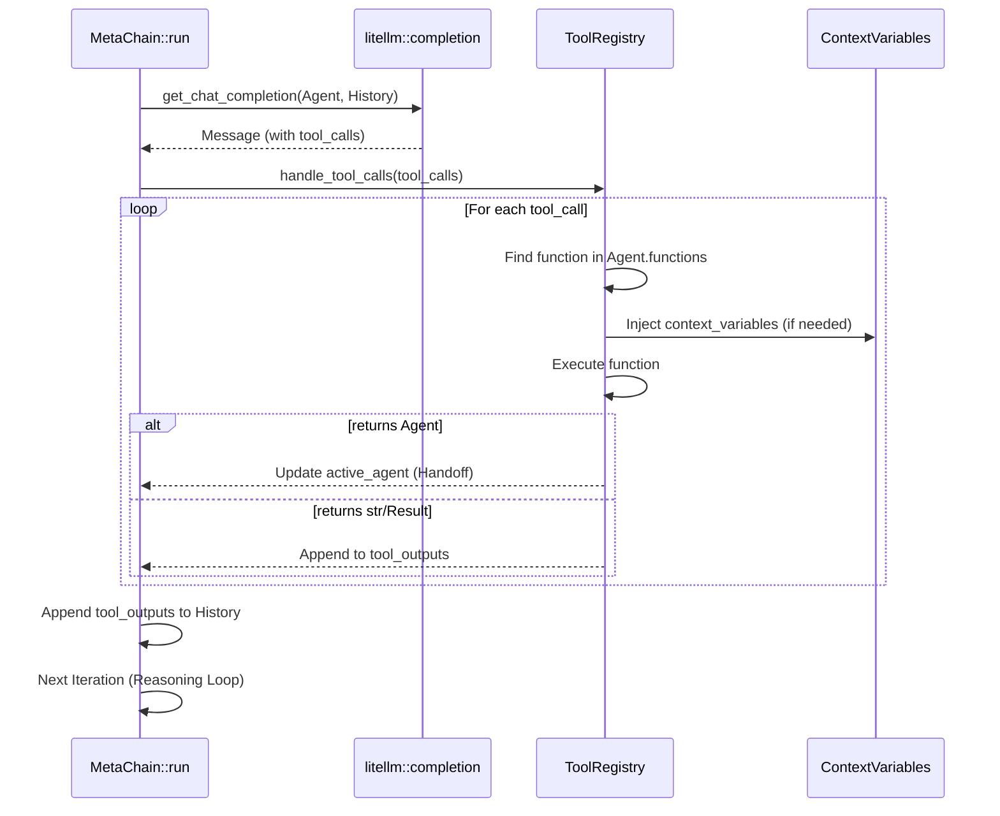
Sources: [autoagent/core.py:71-85](), [autoagent/core.py:210-265](), [autoagent/core.py:340-390]()

## Logger Integration
The engine uses a `LoggerManager` to retrieve a `MetaChainLogger`. Every step of the execution—including instructions, tool calls, tool results, and agent handoffs—is logged. If a log path is not provided, it defaults to a standard output logger.

Sources: [autoagent/core.py:56-68](), [autoagent/logger.py:21-25]()

---

# Page: System Agents

# System Agents

<details>
<summary>Relevant source files</summary>

The following files were used as context for generating this wiki page:

- [autoagent/agents/system_agent/filesurfer_agent.py](autoagent/agents/system_agent/filesurfer_agent.py)
- [autoagent/agents/system_agent/programming_agent.py](autoagent/agents/system_agent/programming_agent.py)
- [autoagent/agents/system_agent/system_triage_agent.py](autoagent/agents/system_agent/system_triage_agent.py)
- [autoagent/agents/system_agent/websurfer_agent.py](autoagent/agents/system_agent/websurfer_agent.py)

</details>


System Agents are the specialized workers within the Auto-Deep-Research ecosystem. The architecture employs a **hub-and-spoke model** where a central "Triage Agent" coordinates tasks and delegates them to specialized agents with distinct environmental access and toolsets. This separation of concerns allows for robust handling of diverse research tasks including web navigation, file manipulation, and complex code execution.

### Agent Handoff Mechanism

The system uses a "Transfer Function" pattern to move the conversation state between agents. When an agent determines that a task (or sub-task) requires the capabilities of another agent, it calls a specific transfer function that returns a `Result` object containing the target `Agent` instance [autoagent/agents/system_agent/system_triage_agent.py:39-54]().

**Agent Routing Architecture**

| From Agent | To Agent | Transfer Function | Purpose |
| :--- | :--- | :--- | :--- |
| **System Triage Agent** | Web Surfer Agent | `transfer_to_websurfer_agent` | Navigate the internet or search for info. |
| **System Triage Agent** | File Surfer Agent | `transfer_to_filesurfer_agent` | Read/Analyze local files in the workspace. |
| **System Triage Agent** | Coding Agent | `transfer_to_coding_agent` | Execute code, solve math, or process data. |
| **Any Sub-Agent** | System Triage Agent | `transfer_back_to_triage_agent` | Return control after task completion/failure. |

**Sources:** [autoagent/agents/system_agent/system_triage_agent.py:39-64](), [autoagent/types.py:1-10]()

---

### 1. System Triage Agent
The `System Triage Agent` acts as the central router and supervisor. It does not perform domain-specific tasks like browsing or coding directly; instead, it analyzes the user's request and the current context to decide which specialized agent is best suited for the next step [autoagent/agents/system_agent/system_triage_agent.py:11-12]().

*   **Implementation**: Defined in `get_system_triage_agent` [autoagent/agents/system_agent/system_triage_agent.py:8]().
*   **Key Responsibility**: Orchestrate the workflow and determine when a case is fully resolved via `case_resolved` or `case_not_resolved` tools [autoagent/agents/system_agent/system_triage_agent.py:30-35]().
*   **Data Flow**: It receives a `task_status` from sub-agents and provides a `sub_task_description` when delegating [autoagent/agents/system_agent/system_triage_agent.py:39-54]().

**Triage Routing Logic**
Title: System Triage Hub-and-Spoke Routing
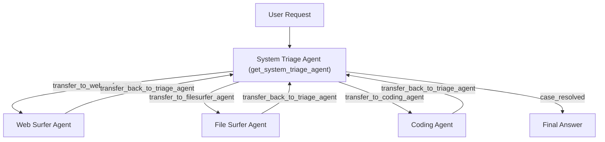
**Sources:** [autoagent/agents/system_agent/system_triage_agent.py:8-64](), [autoagent/tools/inner.py:6-6]()

---

### 2. Web Surfer Agent
The `Web Surfer Agent` is responsible for all external network interactions and browser automation. It operates within a `BrowserEnv` and uses a set of tools to interact with web pages as a human would [autoagent/agents/system_agent/websurfer_agent.py:13-15]().

*   **Implementation**: Defined in `get_websurfer_agent` [autoagent/agents/system_agent/websurfer_agent.py:8]().
*   **Capabilities**: Search, URL visitation, clicking, scrolling, and inputting text [autoagent/agents/system_agent/websurfer_agent.py:24]().
*   **Special Handling**: 
    *   **Markdown Conversion**: Uses `get_page_markdown` to parse complex sites (YouTube, Wikipedia) into readable text [autoagent/agents/system_agent/websurfer_agent.py:19]().
    *   **Downloads**: Files downloaded (e.g., PDFs) are saved to a specific directory (`/downloads`). The agent cannot read these files itself; it must transfer back to Triage to trigger the File Surfer [autoagent/agents/system_agent/websurfer_agent.py:19]().
    *   **Multimodal**: Uses `handle_mm_func` to process screenshots of the current page state [autoagent/agents/system_agent/websurfer_agent.py:11-12]().

**Sources:** [autoagent/agents/system_agent/websurfer_agent.py:8-33]()

---

### 3. File Surfer Agent
The `File Surfer Agent` manages local file interactions within the Docker workspace. It is optimized for reading, navigating, and answering questions about document-style files [autoagent/agents/system_agent/filesurfer_agent.py:18-22]().

*   **Implementation**: Defined in `get_filesurfer_agent` [autoagent/agents/system_agent/filesurfer_agent.py:9]().
*   **Environment**: Uses `RequestsMarkdownBrowser` (aliased as `file_env`) to treat local files like browsable pages [autoagent/agents/system_agent/filesurfer_agent.py:15]().
*   **Supported Formats**: Handles `.html`, `.pdf`, `.docx`, `.pptx`, `.xlsx`, and standard text files [autoagent/agents/system_agent/filesurfer_agent.py:23]().
*   **Tools**: Includes `open_local_file`, `page_up_markdown`, `page_down_markdown`, and `visual_question_answering` for images [autoagent/agents/system_agent/filesurfer_agent.py:33]().

**Sources:** [autoagent/agents/system_agent/filesurfer_agent.py:9-42]()

---

### 4. Programming Agent (Coding Agent)
The `Coding Agent` is the computational engine of the system. It writes and executes code to solve complex problems, perform data analysis, or automate repetitive tasks [autoagent/agents/system_agent/programming_agent.py:63-65]().

*   **Implementation**: Defined in `get_coding_agent` [autoagent/agents/system_agent/programming_agent.py:59-61]().
*   **Execution Environment**: Typically runs within a `DockerEnv` for secure code execution [autoagent/agents/system_agent/programming_agent.py:63]().
*   **Key Tools**:
    *   `run_python`: The primary method for executing Python scripts [autoagent/agents/system_agent/programming_agent.py:70]().
    *   `execute_command`: Used for shell commands, installing dependencies (pip), or running non-Python code [autoagent/agents/system_agent/programming_agent.py:79]().
    *   `create_file` / `write_file`: For persistent code generation [autoagent/agents/system_agent/programming_agent.py:69]().
*   **Pagination**: If terminal output is voluminous, it uses `terminal_page_up/down` to navigate the output buffer [autoagent/agents/system_agent/programming_agent.py:80]().

**Agent Capability to Code Entity Mapping**
Title: Agent Implementation and Tool Mapping
```mermaid
classDiagram
    class Agent {
        +String name
        +List functions
        +Callable instructions
    }

    class SystemTriageAgent {
        +get_system_triage_agent()
        +transfer_to_websurfer_agent()
        +transfer_to_filesurfer_agent()
        +transfer_to_coding_agent()
    }

    class WebSurferAgent {
        +get_websurfer_agent()
        +visit_url()
        +web_search()
        +get_page_markdown()
    }

    class FileSurferAgent {
        +get_filesurfer_agent()
        +open_local_file()
        +visual_question_answering()
    }

    class CodingAgent {
        +get_coding_agent()
        +run_python()
        +execute_command()
        +gen_code_tree_structure()
    }

    Agent <|-- SystemTriageAgent
    Agent <|-- WebSurferAgent
    Agent <|-- FileSurferAgent
    Agent <|-- CodingAgent
```

**Sources:** [autoagent/agents/system_agent/programming_agent.py:1-98](), [autoagent/types.py:1-5]()

---

# Page: Configuration

# Configuration

<details>
<summary>Relevant source files</summary>

The following files were used as context for generating this wiki page:

- [.env.template](.env.template)
- [README.md](README.md)
- [assets/logo.jpg](assets/logo.jpg)
- [constant.py](constant.py)

</details>


This page provides a comprehensive overview of the configuration system in Auto-Deep-Research, explaining how to customize and configure the system to your needs. It covers environment variables, command-line options, and constant definitions that control the behavior of the system.

For specific information about using different LLM providers, see [Supported LLM Providers](#1.3). For information about the CLI system, see [CLI System](#2.1).

## Configuration System Overview

Auto-Deep-Research uses a layered configuration approach that combines environment variables, command-line options, and predefined constants. This design allows for flexibility while maintaining sensible defaults for quick deployment.

### Configuration Flow Diagram
"Configuration Data Flow"
```mermaid
flowchart TD
    User["User"] -->|"Sets"| EnvVars[".env File"]
    User -->|"Provides"| CLIOptions["Command-line Options"]
    
    EnvVars -->|"Loaded by"| DotEnv["load_dotenv()"]
    DotEnv -->|"Populates"| OSEnvVars["OS Environment Variables"]
    
    OSEnvVars -->|"Read by"| ConstantPy["constant.py"]
    CLIOptions -->|"Overrides"| OSEnvVars
    
    ConstantPy -->|"Defines"| DefaultValues["Default Values"]
    ConstantPy -->|"Defines"| ModelConfig["Model Configuration Logic"]
    
    subgraph "Configuration Processing"
        OSEnvVars
        DefaultValues
        ModelConfig
    end
    
    ModelConfig -->|"Determines"| FunctionCallSupport["Function Call Support"]
    ModelConfig -->|"Determines"| UserAddition["User Message Addition"]
    
    DefaultValues -->|"Provides"| SystemDefaults["System Defaults:
    - Docker image
    - Debug settings
    - Model choices"]
    
    EnvVars -->|"Provides"| APIKeys["API Keys for LLM Providers"]
    
    APIKeys --> DeployedSystem["Deployed Auto-Deep-Research System"]
    SystemDefaults --> DeployedSystem
    FunctionCallSupport --> DeployedSystem
    UserAddition --> DeployedSystem
```
Sources: [constant.py:1-91](), [.env.template:1-9](), [README.md:102-121]()

## Environment Variables Configuration

Environment variables are the primary method for configuring API keys and basic system behavior. These are typically set in a `.env` file that follows the structure of the provided `.env.template`.

For details, see [Environment Variables](#3.1).

### API Keys Configuration

You need to set API keys for the LLM providers you intend to use. Each provider has its own environment variable:

| Environment Variable | Purpose | Required |
|---------------------|---------|----------|
| `OPENAI_API_KEY` | Authenticate with OpenAI API | Optional |
| `ANTHROPIC_API_KEY` | Authenticate with Anthropic API | Optional |
| `DEEPSEEK_API_KEY` | Authenticate with DeepSeek API | Optional |
| `GEMINI_API_KEY` | Authenticate with Google's Gemini API | Optional |
| `HUGGINGFACE_API_KEY` | Authenticate with Hugging Face API | Optional |
| `GROQ_API_KEY` | Authenticate with Groq API | Optional |
| `XAI_API_KEY` | Authenticate with xAI API | Optional |

### System Behavior Configuration

In addition to API keys, you can configure various system behaviors through environment variables:

| Environment Variable | Default | Purpose |
|---------------------|---------|---------|
| `DEBUG` | `False` | Enable debug mode for detailed logs |
| `COMPLETION_MODEL` | `claude-3-5-haiku-20241022` | The LLM model to use |
| `EMBEDDING_MODEL` | `text-embedding-3-small` | Model for text embeddings |
| `API_BASE_URL` | `None` | Custom base URL for API |
| `FN_CALL` | Auto-detected | Whether to use function calling |
| `DOCKER_WORKPLACE_NAME` | `workplace_meta` | Name of the Docker workspace directory |

Sources: [.env.template:1-9](), [constant.py:24-57](), [README.md:111-121]()

## Constants and Default Configuration

The system defines various constants and default configurations in `constant.py`. These constants determine the default behavior of the system when not explicitly configured through environment variables or command-line options.

For details, see [Constants & Defaults](#3.2).

### Platform-Specific Configuration

The system automatically detects the platform architecture via `get_architecture()` and selects the appropriate Docker image for the execution environment.

### Model-Specific Logic Mapping
"Model Capability Mapping Logic"
```mermaid
flowchart TD
    Model["COMPLETION_MODEL"] --> FnCallCheck{"FN_CALL set?"}
    
    FnCallCheck -->|"No"| AutoDetect["Auto-detect via lists"]
    AutoDetect --> CheckList{"In NOT_USE_FN_CALL?"}
    CheckList -->|"Yes"| DisableFn["FN_CALL = False"]
    CheckList -->|"No"| EnableFn["FN_CALL = True"]
    
    Model --> UserCheck{"In MUST_ADD_USER?"}
    UserCheck -->|"Yes"| AddUser["ADD_USER = True"]
    UserCheck -->|"No"| NoAddUser["ADD_USER = False"]

    subgraph "Code Entities in constant.py"
        NOT_SUPPORT_FN_CALL["NOT_SUPPORT_FN_CALL"]
        NOT_USE_FN_CALL["NOT_USE_FN_CALL"]
        MUST_ADD_USER["MUST_ADD_USER"]
    end
```
Sources: [constant.py:37-46](), [constant.py:61-85]()

## CLI Options

Auto-Deep-Research provides command-line options for the `auto deep-research` command to configure the runtime environment without modifying persistent configuration files. These options interact directly with the Docker and workspace management layers.

For details, see [CLI Options](#3.3).

### Common CLI Parameters

| Option | Default | Description |
|--------|---------|-------------|
| `--container_name` | `deepresearch` | The name of the Docker container instance. |
| `--port` | `12346` | The host port mapped to the container's internal service. |

Sources: [README.md:113-118]()

## Putting It All Together

The configuration system in Auto-Deep-Research provides a flexible, layered approach. By combining environment variables, command-line options, and intelligent defaults, the system aims to provide a "zero configuration" experience while allowing for detailed customization when needed.

"System Configuration Lifecycle"
```mermaid
flowchart TD
    Start["Launch auto deep-research"] --> EnvVars["Load .env via load_dotenv()"]
    EnvVars --> CLI["Parse CLI Arguments"]
    CLI --> Constants["Apply constant.py logic"]
    
    Constants --> ModelSpecific["Determine FN_CALL / ADD_USER"]
    ModelSpecific --> DockerConfig["Initialize DockerEnv with port/name"]
    DockerConfig --> LaunchSystem["Launch MetaChain Core"]
```
Sources: [constant.py:5-22](), [constant.py:48-85](), [README.md:111-121]()

---

# Page: Environment Variables

# Environment Variables

<details>
<summary>Relevant source files</summary>

The following files were used as context for generating this wiki page:

- [.env.template](.env.template)
- [.gitignore](.gitignore)
- [README.md](README.md)
- [assets/logo.jpg](assets/logo.jpg)
- [constant.py](constant.py)

</details>


This document details all environment variables used to configure Auto-Deep-Research, including API keys for LLM providers, system settings, and Docker configuration options. For information about command-line options, see [CLI Options](#3.3), and for constants and default values, see [Constants & Defaults](#3.2).

## Overview

Auto-Deep-Research uses environment variables to configure its behavior without requiring code changes. These variables are typically set in a `.env` file in the root directory of the project or passed directly when executing the `auto deep-research` command. The system employs `dotenv` to load these variables into the environment.

Title: Environment Variable Data Flow
```mermaid
flowchart TD
    subgraph "Environment Variable Sources"
        A[".env file"] -->|Loaded by| D["dotenv.load_dotenv()"]
        B["Command-line exports"] -->|Override| D
        C["System environment"] -->|Fallback| D
    end
    
    D -->|Configures| E["Auto-Deep-Research System"]
    
    E -->|Affects| F["API Configuration"]
    E -->|Affects| G["Docker Environment"]
    E -->|Affects| H["LLM Selection"]
    E -->|Affects| I["Debug & Logging"]
    E -->|Affects| J["Function Calling Behavior"]
```

Sources: [constant.py:1-5](), [.env.template:1-9]()

## API Keys

Auto-Deep-Research supports multiple LLM providers through API keys defined in environment variables. None of these are strictly required - you only need to provide keys for the LLM providers you intend to use.

| Environment Variable | Purpose | Required |
|---------------------|---------|----------|
| `OPENAI_API_KEY` | API key for OpenAI models (GPT-4o, etc.) | Optional |
| `ANTHROPIC_API_KEY` | API key for Anthropic models (Claude) | Optional |
| `DEEPSEEK_API_KEY` | API key for DeepSeek models | Optional |
| `GEMINI_API_KEY` | API key for Google's Gemini models | Optional |
| `HUGGINGFACE_API_KEY` | API key for Hugging Face models | Optional |
| `GROQ_API_KEY` | API key for Groq hosted models | Optional |
| `XAI_API_KEY` | API key for X.AI (Grok) models | Optional |

### API Key Configuration

Creating a `.env` file based on the template:

```text
# Example .env file with API keys
OPENAI_API_KEY=sk-xxxxxxxxxxxx
ANTHROPIC_API_KEY=sk-ant-xxxxxxxxxxxx
DEEPSEEK_API_KEY=xxxxxxxxxxxx
# Add other keys as needed
```

Sources: [.env.template:1-9](), [README.md:105-108]()

## LLM Configuration Variables

These variables control which LLM is used and how it interacts with the system.

| Environment Variable | Purpose | Default Value |
|---------------------|---------|---------------|
| `COMPLETION_MODEL` | Specifies which LLM model to use | `claude-3-5-haiku-20241022` |
| `EMBEDDING_MODEL` | Model used for text embeddings | `text-embedding-3-small` |
| `API_BASE_URL` | Custom API base URL for LLM provider | `None` |
| `FN_CALL` | Controls function calling capability | Auto-detected based on model |
| `ADD_USER` | Controls if user messages need special formatting | Auto-detected based on model |

### Model Selection and Function Calling Logic

The system includes logic to automatically determine whether to use function calling (`FN_CALL`) or standard text-based interaction (`NON_FN_CALL`) based on the model name.

Title: Function Calling Detection Logic
```mermaid
flowchart TD
    A["Environment Setup"] -->|"Load"| B["COMPLETION_MODEL"]
    B -->|"Check"| C{"Is FN_CALL set in .env?"}
    
    C -->|"Yes"| D["Use explicit FN_CALL setting"]
    C -->|"No"| E{"Is model in NOT_USE_FN_CALL list?"}
    
    E -->|"Yes"| F["Disable function calling\n(FN_CALL=False)"]
    E -->|"No"| G["Enable function calling\n(FN_CALL=True)"]
    
    H["NOT_USE_FN_CALL Models:\n- deepseek-chat\n- o1-mini\n- deepseek-reasoner\n- deepseek-r1\n- llama\n- grok-2"] -->|"Referenced by"| E
    
    I["Check model for\nNON_FN_CALL flag"] -->|"Used for"| J["Internal behavior\nmodifications"]
```

Sources: [constant.py:48-85](), [README.md:119-122]()

## Docker Environment Variables

These variables configure the Docker container used by Auto-Deep-Research to execute tools and browse the web.

| Environment Variable | Purpose | Default Value |
|---------------------|---------|---------------|
| `DOCKER_WORKPLACE_NAME` | Directory name for mounted workspace | `workplace_meta` |
| `BASE_IMAGES` | Docker image to use for the container | Auto-detected based on architecture |
| `LOCAL_ROOT` | Root directory for the local workspace | `os.getcwd()` |

### Architecture Detection Flow

The `get_architecture()` function in `constant.py` determines the appropriate Docker image if `BASE_IMAGES` is not manually specified.

Title: Docker Image Architecture Detection
```mermaid
flowchart TD
    A["Start constant.py"] -->|"Check"| B{"Is BASE_IMAGES\nenvironment variable set?"}
    
    B -->|"Yes"| C["Use specified BASE_IMAGES value"]
    B -->|"No"| D["Call get_architecture()"]
    
    D -->|"x86/AMD64"| E["Use tjbtech1/metachain:amd64_latest"]
    D -->|"ARM/M1/M2"| F["Use tjbtech1/metachain:latest"]
    D -->|"Other"| G["Use tjbtech1/metachain:latest"]
    
    E --> H["Set BASE_IMAGES"]
    F --> H
    G --> H
    C --> I["Configure DockerConfig"]
    H --> I
```

Sources: [constant.py:25-46](), [README.md:99-101]()

## Debug and Logging Variables

These variables control debugging and logging behavior.

| Environment Variable | Purpose | Default Value |
|---------------------|---------|---------------|
| `DEBUG` | Enable debug mode for verbose logs | `False` |
| `DEFAULT_LOG` | Enable default logging | `False` |
| `LOG_PATH` | Custom path for log files | `None` |
| `EVAL_MODE` | Enable evaluation mode (disables standard logs) | `False` |

Sources: [constant.py:30-34](), [constant.py:88-90](), [README.md:120]()

## Special Handling Variables

### User Message Formatting (`ADD_USER`)

Some models (like DeepSeek Reasoner or OpenAI o1) require specific message structures. The system automatically detects these requirements.

Title: User Message Requirement Detection
```mermaid
flowchart TD
    A["Environment Setup"] -->|"Load"| B["COMPLETION_MODEL"]
    B -->|"Check"| C{"Is ADD_USER set in .env?"}
    
    C -->|"Yes"| D["Use explicit ADD_USER setting"]
    C -->|"No"| E{"Does model name contain\nany string from MUST_ADD_USER?"}
    
    E -->|"Yes"| F["Enable ADD_USER\n(ADD_USER=True)"]
    E -->|"No"| G["Disable ADD_USER\n(ADD_USER=False)"]
    
    H["MUST_ADD_USER Models:\n- deepseek-reasoner\n- o1-mini\n- deepseek-r1"] -->|"Referenced by"| E
```

Sources: [constant.py:57-72]()

## Working with Environment Variables

### Setting Variables for Different LLM Providers

#### Anthropic (Default)
```bash
# In .env file
ANTHROPIC_API_KEY=your_anthropic_api_key

# Run command
auto deep-research 
```

#### OpenAI
```bash
# In .env file
OPENAI_API_KEY=your_openai_api_key

# Run command
COMPLETION_MODEL=gpt-4o auto deep-research
```

#### Custom API Endpoints (e.g., vLLM or OpenRouter)
```bash
# In .env file
OPENAI_API_KEY=your_api_key

# Run command
COMPLETION_MODEL=openai/deepseek/deepseek-r1 API_BASE_URL=https://openrouter.ai/api/v1 auto deep-research
```

Sources: [README.md:128-222]()

## Relationship to System Components

Environment variables influence multiple components across the codebase.

Title: Configuration Impact on Code Entities
```mermaid
flowchart TD
    subgraph "Environment Variables"
        A1["API Keys\n(OPENAI_API_KEY, etc.)"]
        A2["COMPLETION_MODEL"]
        A3["BASE_IMAGES"]
        A4["DEBUG"]
        A5["FN_CALL"]
    end
    
    subgraph "Code Entity Space"
        B1["LiteLLM Interface\n(litellm library)"]
        B2["DockerConfig\n(autoagent/environment/docker_env.py)"]
        B3["MetaChain Core\n(autoagent/core.py)"]
        B4["CLI REPL\n(autoagent/cli.py)"]
    end
    
    A1 -->|"Authenticates"| B1
    A2 -->|"Determines provider in"| B1
    A2 -->|"Influences logic in"| B3
    A3 -->|"Sets image for"| B2
    A4 -->|"Enables verbose logs in"| B4
    A5 -->|"Determines interaction style in"| B3
```

Sources: [README.md:111-222](), [constant.py:1-91]()

---

# Page: Constants & Defaults

# Constants & Defaults

<details>
<summary>Relevant source files</summary>

The following files were used as context for generating this wiki page:

- [MANIFEST.in](MANIFEST.in)
- [constant.py](constant.py)

</details>


This page details the technical constants, default configurations, and automated environment detection logic defined in `constant.py`. These settings govern the core behavior of the MetaChain engine, Docker orchestration, and LLM interaction strategies.

## Overview of Configuration Logic

The configuration system in `constant.py` acts as the central source of truth for the application. It performs three primary roles:
1.  **Environment Loading**: Sanitizes and loads variables from `.env` files using `python-dotenv`.
2.  **Hardware Abstraction**: Detects system architecture to select compatible Docker images.
3.  **Model Capability Mapping**: Automatically adjusts agent behavior (e.g., enabling/disabling function calling) based on the string name of the `COMPLETION_MODEL`.

```mermaid
graph TD
    subgraph "Input Space"
        ENV[".env File"]
        SYS["System Platform"]
    end

    subgraph "Code Entity Space: constant.py"
        S2B["str_to_bool()"]
        GA["get_architecture()"]
        MAP["Capability Mapping Logic"]
    end

    subgraph "System State"
        DOCKER["Docker Configuration"]
        LLM["LLM Strategy (FN_CALL/ADD_USER)"]
        DEBUG["Logging & Debug State"]
    end

    ENV -->|"os.getenv"| S2B
    S2B -->|"Sets"| DEBUG
    SYS -->|"platform.machine()"| GA
    GA -->|"Sets"| DOCKER
    S2B -->|"Overrides"| MAP
    MAP -->|"Sets"| LLM
```
Sources: [constant.py:1-22](), [constant.py:37-46]()

## Environment & Docker Constants

The system defines the execution context for the Docker-based research environment.

| Constant | Code Reference | Default / Logic | Description |
| :--- | :--- | :--- | :--- |
| `DOCKER_WORKPLACE_NAME` | [constant.py:25]() | `'workplace_meta'` | The default name for the Docker container and volume. |
| `LOCAL_ROOT` | [constant.py:28]() | `os.getcwd()` | The host directory mounted into the container. |
| `BASE_IMAGES` | [constant.py:35-46]() | *Dynamic* | Detected via `get_architecture()`. |

### Architecture Detection
The `get_architecture()` function ensures that the correct Docker image manifest is pulled based on the host CPU [constant.py:37-44]().

*   **x86_64 / amd64**: Returns `tjbtech1/metachain:amd64_latest` [constant.py:39-40]().
*   **ARM (Apple Silicon/Raspberry Pi)**: Returns `tjbtech1/metachain:latest` [constant.py:41-42]().

Sources: [constant.py:25-46]()

## Model Capability Mapping

The system categorizes LLMs into capability groups to handle API variations automatically. This is crucial for models like `DeepSeek-R1` or `O1-mini` which have restricted schemas.

### Key Capability Lists
*   **`NOT_SUPPORT_SENDER`**: Models that do not accept a `sender` field in message payloads (e.g., Mistral, Groq) [constant.py:61]().
*   **`MUST_ADD_USER`**: Models that require at least one user message or specific formatting (e.g., `deepseek-reasoner`, `o1-mini`) [constant.py:62]().
*   **`NOT_SUPPORT_FN_CALL`**: Models that lack native tool-calling schemas [constant.py:64]().
*   **`NOT_USE_FN_CALL`**: A superset including `deepseek-chat` and all models in `NOT_SUPPORT_FN_CALL` [constant.py:65]().

### Automated Flag Resolution
The system resolves three boolean flags that dictate how `MetaChain` interacts with the LLM provider:

1.  **`ADD_USER`**: If `True`, the system ensures user-role messages are injected as required by models in `MUST_ADD_USER` [constant.py:67-72]().
2.  **`FN_CALL`**: If `True`, the agent uses native JSON tool schemas. If the model is found in `NOT_USE_FN_CALL`, this defaults to `False` [constant.py:74-79]().
3.  **`NON_FN_CALL`**: Specifically identifies models that require the "ReAct" or "String-based" prompting fallback because they cannot process function objects at all [constant.py:81-85]().

```mermaid
flowchart LR
    subgraph "Model Selection"
        CM["COMPLETION_MODEL"]
    end

    subgraph "Logic Gates in constant.py"
        CheckFN{"In NOT_USE_FN_CALL?"}
        CheckUser{"In MUST_ADD_USER?"}
        CheckNonFN{"In NOT_SUPPORT_FN_CALL?"}
    end

    subgraph "Resolved Constants"
        FNC["FN_CALL (bool)"]
        AU["ADD_USER (bool)"]
        NFNC["NON_FN_CALL (bool)"]
    end

    CM --> CheckFN
    CM --> CheckUser
    CM --> CheckNonFN

    CheckFN -- "Yes" --> FNC_F["FN_CALL = False"]
    CheckUser -- "Yes" --> AU_T["ADD_USER = True"]
    CheckNonFN -- "Yes" --> NFNC_T["NON_FN_CALL = True"]
```
Sources: [constant.py:61-85]()

## Global Defaults

The following table summarizes secondary constants used for internal state management and logging.

| Constant | Code Reference | Default | Purpose |
| :--- | :--- | :--- | :--- |
| `COMPLETION_MODEL` | [constant.py:48]() | `claude-3-5-haiku-20241022` | The primary LLM used by agents. |
| `EMBEDDING_MODEL` | [constant.py:49]() | `text-embedding-3-small` | Used for RAG and memory vectorization. |
| `MC_MODE` | [constant.py:51]() | `True` | MetaChain Mode: Enables the core agentic loop. |
| `DEBUG` | [constant.py:30]() | `False` | Increases log verbosity. |
| `EVAL_MODE` | [constant.py:34]() | `False` | When `True`, `DEFAULT_LOG` is forced to `False` [constant.py:88-89](). |

### String to Boolean Utility
The `str_to_bool` function [constant.py:6-22]() provides robust parsing for environment variables. It maps truthy strings like `'yes'`, `'1'`, and `'on'` to `True`, and falsy strings like `'no'`, `'0'`, and `'off'` to `False`. By default, if a value is provided but not recognized, it returns `True` [constant.py:22]().

Sources: [constant.py:6-22](), [constant.py:30-51](), [constant.py:88-89]()

---

# Page: CLI Options

# CLI Options

<details>
<summary>Relevant source files</summary>

The following files were used as context for generating this wiki page:

- [.env.template](.env.template)
- [README.md](README.md)
- [assets/logo.jpg](assets/logo.jpg)
- [autoagent/cli.py](autoagent/cli.py)

</details>


This page documents all available command-line options for the `auto deep-research` command and explains their implementation details, data flow, and interaction with the Docker and workspace configuration.

## Core CLI Command Structure

The CLI is built using the `click` library [autoagent/cli.py:45-48](). The primary entry point for the deep research functionality is the `deep-research` command [autoagent/cli.py:109]().

```mermaid
graph TD
    subgraph "CLI Entry Points"
        A["auto deep-research"]
    end

    subgraph "Command Arguments (click.option)"
        B["--container_name (default: 'deepresearch')"]
        C["--port (default: 12346)"]
    end

    subgraph "Environment Variable Overrides"
        D["COMPLETION_MODEL"]
        E["API_BASE_URL"]
        F["FN_CALL"]
        G["DEBUG"]
    end

    A --> B
    A --> C
    A --> D
    A --> E
    A --> F
    A --> G
```

Sources: [autoagent/cli.py:109-112](), [README.md:113-122]()

## Available CLI Options

### Command-Line Arguments
These are passed directly to the `deep_research` function in `autoagent/cli.py`.

| Option | Type | Default | Description |
| :--- | :--- | :--- | :--- |
| `--container_name` | `str` | `deepresearch` | Unique identifier for the Docker container and local workspace directory [autoagent/cli.py:110](). |
| `--port` | `int` | `12346` | The base TCP port for communication with the `DockerEnv` [autoagent/cli.py:111](). |

### Environment Configuration
While not direct CLI flags, these variables are checked during the execution of the `deep-research` command:

| Variable | Source | Role |
| :--- | :--- | :--- |
| `COMPLETION_MODEL` | `constant.py` | Sets the LLM model (e.g., `claude-3-5-sonnet-20241022`) [autoagent/cli.py:117](). |
| `API_BASE_URL` | `.env` | Custom endpoint for LLM providers [README.md:121](). |
| `FN_CALL` | `.env` | Force enables/disables function calling mode [README.md:122](). |

Sources: [autoagent/cli.py:109-117](), [README.md:113-122]()

## Implementation: Port and Workspace Management

The `get_config` function [autoagent/cli.py:53-85]() processes the CLI options to initialize a `DockerConfig` object. This process includes automated port conflict resolution and workspace directory creation.

### Port Selection Logic
If the specified `--port` is occupied, the system uses a file-locking mechanism to find and reserve the next available port [autoagent/cli.py:63-74]().

```mermaid
sequenceDiagram
    participant CLI as "deep_research()"
    participant GC as "get_config()"
    participant CPA as "check_port_available()"
    participant FS as "File System (.port_lock)"

    CLI->>GC: Pass container_name, port
    GC->>FS: Acquire FileLock
    loop While Port Occupied
        GC->>CPA: Bind '0.0.0.0':port
        CPA-->>GC: socket.error (False)
        GC->>GC: port += 1
    end
    GC->>FS: Write ".port_{port}"
    GC->>FS: Release Lock
    GC-->>CLI: Return DockerConfig
```

Sources: [autoagent/cli.py:32-44](), [autoagent/cli.py:53-85]()

### Workspace Interaction
The `--container_name` option determines the local filesystem path where research data is stored.
*   **Path Template**: `workspace_meta_showcase/showcase_{container_name}` [autoagent/cli.py:75]().
*   **Action**: The directory is created automatically via `os.makedirs(local_root, exist_ok=True)` [autoagent/cli.py:76]().

Sources: [autoagent/cli.py:75-76]()

## Environment Initialization Flow

Once the CLI options are processed into a `DockerConfig`, the system invokes `create_environment` [autoagent/cli.py:86-98]() to instantiate the three core execution layers.

```mermaid
flowchart TD
    subgraph "Natural Language Space"
        UserCmd["'auto deep-research --container_name res_1'"]
    end

    subgraph "Code Entity Space"
        DConfig["DockerConfig Object"]
        DEnv["DockerEnv Class"]
        BEnv["BrowserEnv Class"]
        RM_Browser["RequestsMarkdownBrowser Class"]
    end

    UserCmd -->|"Parses args"| DConfig
    DConfig -->|"Initializes"| DEnv
    DConfig -->|"Sets local_root"| BEnv
    DConfig -->|"Sets downloads_folder"| RM_Browser

    DEnv -->|"calls"| InitCont["init_container()"]
    InitCont -->|"Starts"| DockerCont["Docker Container"]
```

Sources: [autoagent/cli.py:86-98](), [autoagent/cli.py:127-134]()

## Data Flow: CLI to MetaChain

The CLI options eventually populate the `context_variables` dictionary, which is passed to the `MetaChain` execution loop [autoagent/cli.py:140-164]().

1.  **Model Selection**: The `COMPLETION_MODEL` (retrieved from constants or env) is passed to `get_system_triage_agent(model)` [autoagent/cli.py:146]().
2.  **Context Assembly**: The `code_env`, `web_env`, and `file_env` (configured via CLI `--port` and `--container_name`) are stored in `context_variables` [autoagent/cli.py:140]().
3.  **REPL Execution**: The `MetaChain` client uses these variables to manage agent handoffs and tool executions [autoagent/cli.py:164-171]().

```mermaid
graph LR
    subgraph "CLI Inputs"
        CN["--container_name"]
        P["--port"]
        M["COMPLETION_MODEL"]
    end

    subgraph "System State"
        CV["context_variables"]
        STA["system_triage_agent"]
    end

    subgraph "Execution"
        MC["MetaChain.run()"]
    end

    CN --> CV
    P --> CV
    M --> STA
    CV --> MC
    STA --> MC
```

Sources: [autoagent/cli.py:140-164](), [autoagent/cli.py:117]()

---

# Page: User Guide

# User Guide

<details>
<summary>Relevant source files</summary>

The following files were used as context for generating this wiki page:

- [.env.template](.env.template)
- [README.md](README.md)
- [assets/logo.jpg](assets/logo.jpg)
- [autoagent/cli.py](autoagent/cli.py)

</details>


This guide provides practical instructions for using Auto-Deep-Research, a cost-effective open-source alternative to OpenAI's Deep Research. It covers installation, session management, file handling, and LLM provider configuration.

## System Overview

Auto-Deep-Research is a command-line tool that provides a fully-automated AI assistant for research tasks. It operates within a containerized environment to ensure safety and reproducibility.

### High-Level Interaction Flow
The following diagram bridges the User's Natural Language Space with the System's Code Entity Space, showing how CLI commands trigger specific class instances and environment setups.

```mermaid
graph TD
    User["User"] -- "auto deep-research" --> CLI["autoagent/cli.py: deep_research()"]
    CLI -- "Initialize" --> DConfig["DockerConfig [autoagent/environment/docker_env.py]"]
    DConfig -- "Create" --> DEnv["DockerEnv [autoagent/environment/docker_env.py]"]
    
    subgraph "Environment Layer [autoagent/cli.py: create_environment]"
        DEnv["code_env: DockerEnv"]
        BEnv["web_env: BrowserEnv"]
        FEnv["file_env: RequestsMarkdownBrowser"]
    end
    
    CLI -- "Instantiate" --> MC["MetaChain Core [autoagent/core.py]"]
    CLI -- "Route" --> Triage["system_triage_agent [autoagent/agents/__init__.py]"]
    
    Triage -- "Task Handoff" --> SubAgents["Agent Teams: Web/File/Program/Triage"]
    MC -- "Execution Loop" --> SubAgents
    
    User -- "@Upload_files" --> FileUtil["select_and_copy_files [autoagent/file_select.py]"]
```

Sources: [autoagent/cli.py:112-140](), [autoagent/cli.py:86-98](), [README.md:25-35]()

---

## 4.1 Getting Started
Launch your first research session by following these steps:

1.  **Installation**: Clone the repository and install the package in a Python 3.10 environment. [README.md:91-97]()
2.  **Environment Setup**: Configure your `.env` file with at least one supported LLM API key. [.env.template:1-8]()
3.  **Docker**: Ensure Docker is running; the system will automatically pull the necessary images based on your architecture. [README.md:101-102]()
4.  **Launch**: Run `auto deep-research` to enter the interactive REPL. [autoagent/cli.py:109-112]()

For a detailed step-by-step walkthrough, see **[Getting Started](#4.1)**.

---

## 4.2 Working with Files
Auto-Deep-Research allows for deep data interaction by managing local files within the research environment.

*   **Uploading**: Use the `@Upload_files` mention in the CLI to trigger the `select_and_copy_files` utility. [autoagent/cli.py:153-170]()
*   **Storage**: Files are moved into the `files` subdirectory within the `local_root` workspace. [autoagent/cli.py:75-84]()
*   **Processing**: The `File Surfer Agent` and `Programming Agent` can then read, analyze, or execute code against these files. [autoagent/cli.py:134-140]()

For details on supported formats and advanced file handling, see **[Working with Files](#4.2)**.

---

## 4.3 Selecting LLM Providers
The system is designed for universal LLM support via `litellm`.

### Configuration Matrix
| Provider | Key Variable | Model String Example |
| :--- | :--- | :--- |
| **Anthropic** | `ANTHROPIC_API_KEY` | `claude-3-5-sonnet-20241022` |
| **OpenAI** | `OPENAI_API_KEY` | `gpt-4o` |
| **DeepSeek** | `DEEPSEEK_API_KEY` | `deepseek/deepseek-chat` |
| **OpenRouter** | `OPENROUTER_API_KEY` | `openrouter/deepseek/deepseek-r1` |

### Provider Logic Flow
The system dynamically adjusts behavior (like function calling) based on the selected provider.

```mermaid
graph LR
    ModelVar["COMPLETION_MODEL [constant.py]"] --> Selector["Model Selection"]
    Selector --> FN_Check{"FN_CALL set? [README.md]"}
    
    FN_Check -- "No" --> AutoDetect["Auto-detect via model name"]
    FN_Check -- "Yes" --> ForceMode["Force Function Calling mode"]
    
    AutoDetect --> Mode["Execution Mode"]
    ForceMode --> Mode
    
    Mode --> ToolUse["Tool Registry Interaction"]
```

For instructions on configuring custom endpoints and understanding the `FN_CALL` flag, see **[Selecting LLM Providers](#4.3)**.

Sources: [README.md:113-123](), [constant.py:28-28](), [autoagent/cli.py:117-117]()

---

## Troubleshooting & Help
*   **Port Management**: If the default port `12346` is busy, the system uses a `filelock` mechanism to find and reserve the next available port. [autoagent/cli.py:63-74]()
*   **Workspace**: Local logs and research data are stored in `workspace_meta_showcase/showcase_[container_name]`. [autoagent/cli.py:75-76]()
*   **Debug Mode**: Set `DEBUG=True` in your environment to see detailed execution logs. [README.md:120-120]()

Sources: [autoagent/cli.py:32-44](), [autoagent/cli.py:63-85]()

---

# Page: Getting Started

# Getting Started

<details>
<summary>Relevant source files</summary>

The following files were used as context for generating this wiki page:

- [.env.template](.env.template)
- [README.md](README.md)
- [assets/logo.jpg](assets/logo.jpg)
- [autoagent/cli.py](autoagent/cli.py)
- [constant.py](constant.py)

</details>


This guide provides step-by-step instructions to set up and launch your first research session with Auto-Deep-Research. Auto-Deep-Research is an open-source alternative to OpenAI's Deep Research built on the `MetaChain` framework, providing a fully automated and cost-effective personal AI assistant.

## Prerequisites

Before getting started, ensure you have the following installed:

1.  **Python 3.10**: Required for compatibility with the core engine and dependencies [README.md:92-93]().
2.  **Docker**: Essential for containerizing the agent-interactive execution environment [README.md:99-101]().
3.  **Conda**: Recommended for environment isolation [README.md:92-93]().
4.  **API Key(s)**: At least one key for supported providers (Anthropic, OpenAI, DeepSeek, etc.) [.env.template:1-9]().

Sources: [README.md:86-101](), [.env.template:1-9]()

## Installation

Follow these steps to install the package and its dependencies:

1.  **Create and activate the environment**:
    ```bash
    conda create -n auto_deep_research python=3.10
    conda activate auto_deep_research
    ```
2.  **Clone and install**:
    ```bash
    git clone https://github.com/HKUDS/Auto-Deep-Research.git
    cd Auto-Deep-Research
    pip install -e .
    ```

The system uses `DockerEnv` to manage the sandbox. You do not need to manually pull images; the system detects your hardware architecture via `get_architecture()` in `constant.py` and pulls the appropriate image (e.g., `tjbtech1/metachain:amd64_latest` or `tjbtech1/metachain:latest`) [constant.py:37-46]().

Sources: [README.md:89-97](), [constant.py:37-46]()

## Configuration (.env)

The system relies on environment variables defined in a `.env` file.

1.  Copy the template: `cp .env.template .env`.
2.  Fill in your primary model keys.
3.  (Optional) Set `COMPLETION_MODEL` to override the default `claude-3-5-haiku-20241022` [constant.py:48-48]().

| Variable | Role | File Reference |
| :--- | :--- | :--- |
| `ANTHROPIC_API_KEY` | Key for Claude models | [.env.template:4-4]() |
| `OPENAI_API_KEY` | Key for GPT models | [.env.template:2-2]() |
| `COMPLETION_MODEL` | Primary LLM identifier | [constant.py:48-48]() |
| `FN_CALL` | Toggle for tool-use mode | [constant.py:55-55]() |

Sources: [.env.template:1-9](), [constant.py:48-86]()

## Launching the Session

The entry point is the `auto deep-research` command defined in `autoagent/cli.py`.

### System Initialization Flow
The following diagram maps the CLI startup sequence to the underlying code entities.

```mermaid
sequenceDiagram
    participant U as "User"
    participant CLI as "cli.py:deep_research"
    participant DC as "DockerConfig"
    participant DE as "DockerEnv"
    participant MC as "MetaChain"
    participant TA as "SystemTriageAgent"

    U->>CLI: "auto deep-research"
    CLI->>CLI: get_config() [cli.py:53]
    CLI->>DC: Instantiate DockerConfig [cli.py:78]
    CLI->>DE: init_container() [cli.py:93]
    Note over DE: Pulls tjbtech1/metachain image
    CLI->>TA: get_system_triage_agent(model) [cli.py:146]
    CLI->>MC: client = MetaChain() [cli.py:164]
    CLI->>U: session.prompt() (REPL Loop) [cli.py:167]
```
Sources: [autoagent/cli.py:53-167](), [autoagent/environment/docker_env.py:1-20]()

### Running your first query
When the CLI starts, it initializes three environments: `DockerEnv` (code), `BrowserEnv` (web), and `RequestsMarkdownBrowser` (files) [autoagent/cli.py:92-96]().

1.  **Start the CLI**:
    ```bash
    auto deep-research --container_name my_session --port 12346
    ```
2.  **Interact**:
    *   **Direct Query**: "Research the impact of Llama-3 on open-source AI."
    *   **Agent Mention**: Use `@Programming_Agent` to force code execution [autoagent/cli.py:169-170]().
    *   **File Upload**: Use `@Upload_files` to trigger the `select_and_copy_files` utility [autoagent/cli.py:153]().

### Natural Language to Code Entity Mapping
This diagram shows how user input is routed through the system classes.

```mermaid
graph TD
    UserQuery["User Input: 'Research X'"] --> REPL["cli.py: REPL Loop"]
    REPL --> MetaChainRun["MetaChain.run() [autoagent/core.py]"]
    MetaChainRun --> Triage["SystemTriageAgent [autoagent/agents/sys_agent.py]"]
    
    subgraph "Execution Layer"
        Triage --> |"Handoff"| WebAgent["WebSurferAgent"]
        Triage --> |"Handoff"| ProgAgent["ProgrammingAgent"]
    end

    WebAgent --> |"Tool Call"| Browser["BrowserEnv [autoagent/environment/browser_env.py]"]
    ProgAgent --> |"Tool Call"| Docker["DockerEnv [autoagent/environment/docker_env.py]"]
```
Sources: [autoagent/cli.py:146-164](), [autoagent/core.py:1-50](), [autoagent/agents/sys_agent.py:1-20]()

## Common CLI Options

| Option | Description | Default |
| :--- | :--- | :--- |
| `--container_name` | The name for the Docker sandbox | `deepresearch` |
| `--port` | The communication port for the Docker TCP server | `12346` |

The system uses a `filelock` mechanism on `.port_lock` to ensure that if you run multiple sessions, they increment the port automatically to avoid collisions [autoagent/cli.py:63-74]().

Sources: [autoagent/cli.py:110-112](), [autoagent/cli.py:63-74]()

---

# Page: Working with Files

# Working with Files

<details>
<summary>Relevant source files</summary>

The following files were used as context for generating this wiki page:

- [autoagent/environment/browser_cookies.py](autoagent/environment/browser_cookies.py)
- [autoagent/environment/cookie_json/README.md](autoagent/environment/cookie_json/README.md)
- [autoagent/environment/cookies_data.py](autoagent/environment/cookies_data.py)
- [autoagent/file_select.py](autoagent/file_select.py)
- [autoagent/tools/file_surfer_tool.py](autoagent/tools/file_surfer_tool.py)

</details>


This document explains how to upload, process, and manage files within the Auto-Deep-Research environment. The system provides specialized utilities for file selection, a virtual agent for uploads, and a "File Surfer" toolset for browsing local content.

## File System Architecture

The research environment operates across a host-container boundary. Files are physically stored on the host but mapped into the Docker container via volume mounts to allow agents to interact with them.

```mermaid
graph TD
    subgraph "Host System"
        User["User"]
        LocalFiles["Local Files"]
        Workspace["Workspace Directory"]
        LocalWorkplace["Local Workplace Path"]
        FilesDir["files/ folder"]
    end
    
    subgraph "Docker Container"
        DockerWorkplace["/workspace/ (Mount Point)"]
        DockerFilesDir["/workspace/files/"]
        FileSurfer["File Surfer Tool"]
        CodeEnv["Programming Agent (Bash/Python)"]
    end
    
    User -- "@Upload_files" --> LocalFiles
    LocalFiles -- "select_and_copy_files()" --> FilesDir
    FilesDir -- "Volume Mount" --> DockerFilesDir
    
    FileSurfer -- "open_local_file()" --> DockerFilesDir
    CodeEnv -- "File I/O" --> DockerFilesDir
```

Sources: [autoagent/file_select.py:7-49](), [autoagent/tools/file_surfer_tool.py:66-86]()

## File Upload via `Upload_files`

The system provides a virtual agent trigger `@Upload_files` in the CLI. When this is detected, the system pauses the LLM interaction and launches a local GUI for file selection.

### The `file_select` Utility
The `select_and_copy_files` function uses `tkinter` to open a native file explorer. It supports various file types including PDFs, Docx, Zip, and Txt files.

- **Implementation**: It creates a hidden `tk.Tk()` root and calls `filedialog.askopenfilenames` [autoagent/file_select.py:9-13]().
- **Data Flow**: Selected files are copied using `shutil.copy2` to the `dest_dir` (the local workplace path) [autoagent/file_select.py:40-44]().
- **CLI Integration**: The `autoagent/cli.py` intercepts the `@Upload_files` string and executes this utility before continuing the research loop.

Sources: [autoagent/file_select.py:1-50](), [autoagent/cli.py:207-212]()

## File Surfer Toolset

Once files are in the workspace, the `File Surfer Agent` uses specialized tools defined in `file_surfer_tool.py` to inspect them. This agent acts like a "text-based browser" for local files.

### Key Functions
- **`open_local_file`**: Converts a Docker-relative path to a local path and loads it into a `RequestsMarkdownBrowser` instance [autoagent/tools/file_surfer_tool.py:66-86]().
- **Navigation**: Tools like `page_up_markdown` [autoagent/tools/file_surfer_tool.py:88-101]() and `page_down_markdown` [autoagent/tools/file_surfer_tool.py:103-116]() allow the agent to paginate through large documents.
- **Search**: `find_on_page_ctrl_f` [autoagent/tools/file_surfer_tool.py:118-134]() and `find_next` [autoagent/tools/file_surfer_tool.py:136-149]() provide keyword search capabilities within the current file.

Sources: [autoagent/tools/file_surfer_tool.py:66-149]()

## Authenticated Sessions via Browser Cookies

For web-based research that requires authentication (e.g., GitHub, ResearchGate, Nature), the system supports importing browser cookies.

### Cookie Management Workflow
1. **Export**: Users use a Chrome extension ("Export cookie JSON file for Puppeteer") to save cookies as JSON [autoagent/environment/cookie_json/README.md:7-14]().
2. **Processing**: The `convert_cookies_to_python()` function in `browser_cookies.py` reads all JSON files from the `cookie_json` directory [autoagent/environment/browser_cookies.py:12-30]().
3. **Storage**: It generates a `cookies_data.py` file containing a `COOKIES_LIST` [autoagent/environment/browser_cookies.py:32-38]().
4. **Usage**: These cookies are injected into the `RequestsMarkdownBrowser` to maintain sessions during web surfing.

| Recommended Websites for Cookies |
|----------------------------------|
| github.com                       |
| nature.com                       |
| researchgate.net                 |
| archive.org                      |
| ncbi.nlm.nih.gov                 |

Sources: [autoagent/environment/browser_cookies.py:12-39](), [autoagent/environment/cookie_json/README.md:22-37]()

## Supported File Formats

The system is designed to handle both structured and unstructured data:

- **Documents**: `.pdf`, `.docx`, `.txt`, `.md`
- **Data**: `.csv`, `.json`
- **Archives**: `.zip` (can be extracted via Programming Agent)
- **Media**: The system includes utilities for image encoding and video/audio processing (via `faster_whisper` and `moviepy`) though these are typically handled by specialized tools [autoagent/tools/file_surfer_tool.py:151-185]().

## Technical Implementation Summary

| Component | Code Entity | Role |
|-----------|-------------|------|
| **Upload Utility** | `select_and_copy_files` | GUI-based file transfer to workspace [autoagent/file_select.py:7]() |
| **Local Browser** | `RequestsMarkdownBrowser` | Renders file content into markdown for LLM consumption [autoagent/tools/file_surfer_tool.py:1]() |
| **Path Mapping** | `_convert_docker_to_local` | Translates container paths to host paths for file I/O [autoagent/tools/file_surfer_tool.py:80]() |
| **Cookie Converter** | `convert_cookies_to_python` | Serializes JSON cookies into Python lists [autoagent/environment/browser_cookies.py:12]() |

Sources: [autoagent/file_select.py:7](), [autoagent/tools/file_surfer_tool.py:1-80](), [autoagent/environment/browser_cookies.py:12]()

---

# Page: Selecting LLM Providers

# Selecting LLM Providers

<details>
<summary>Relevant source files</summary>

The following files were used as context for generating this wiki page:

- [.env.template](.env.template)
- [README.md](README.md)
- [assets/logo.jpg](assets/logo.jpg)
- [autoagent/fn_call_converter.py](autoagent/fn_call_converter.py)
- [constant.py](constant.py)

</details>


This document provides technical instructions for choosing and configuring different Large Language Model (LLM) providers within Auto-Deep-Research. It details the implementation of provider selection, the logic behind the `FN_CALL` flag, and the configuration of custom endpoints.

## Purpose and Scope

Auto-Deep-Research is designed to be provider-agnostic, utilizing the [LiteLLM](https://github.com/BerriAI/litellm) library to interface with various AI services [README.md:119-121](). This page explains how the system resolves model capabilities—specifically function calling—and how users can override defaults via environment variables like `COMPLETION_MODEL`, `API_BASE_URL`, and `FN_CALL`.

## LLM Provider Selection Architecture

The following diagram illustrates how the system processes user input and environment variables to initialize the LLM interface.

### LLM Initialization Data Flow
```mermaid
graph TD
    subgraph "Configuration Layer"
        ENV[".env File / Shell Env"]
        CONST["constant.py"]
    end

    subgraph "Selection Logic"
        MODEL_VAR["COMPLETION_MODEL"]
        BASE_URL["API_BASE_URL"]
        FN_FLAG["FN_CALL Flag"]
    end

    subgraph "Execution Core"
        LITELLM["LiteLLM Interface"]
        CONVERTER["autoagent/fn_call_converter.py"]
    end

    ENV -->|Provides| MODEL_VAR
    ENV -->|Provides| BASE_URL
    ENV -->|Provides| FN_FLAG
    
    MODEL_VAR --> CONST
    FN_FLAG --> CONST
    
    CONST -->|Determines Capability| LITELLM
    CONST -->|Triggers Fallback| CONVERTER
    
    LITELLM -->|API Request| Provider["LLM Provider (Anthropic/OpenAI/etc.)"]
```
Sources: [constant.py:48-56](), [autoagent/fn_call_converter.py:1-7](), [README.md:119-124]()

## Function Calling and Fallback Logic

A critical component of Auto-Deep-Research is the `FN_CALL` flag. While many modern models support native tool use (function calling), several high-performance reasoning models (like DeepSeek-R1 or OpenAI o1-mini) do not, or have unstable implementations for complex agentic loops.

### Automatic Capability Detection
The system automatically determines if a model should use function calling by checking the `COMPLETION_MODEL` against internal blacklists in `constant.py`.

*   **`NOT_SUPPORT_FN_CALL`**: Models that physically lack the API for function calling [constant.py:64-64]().
*   **`NOT_USE_FN_CALL`**: Models where function calling is disabled by default for stability (e.g., `deepseek-chat`) [constant.py:65-65]().

### FN_CALL Logic Implementation
```mermaid
flowchart TD
    A["Load COMPLETION_MODEL"] --> B{"Is FN_CALL set in .env?"}
    B -- "Yes" --> C["Use User Value"]
    B -- "No" --> D["Set FN_CALL = True (Default)"]
    D --> E{"Is model in NOT_USE_FN_CALL?"}
    E -- "Yes" --> F["Set FN_CALL = False"]
    E -- "No" --> G["Keep FN_CALL = True"]
    
    F --> H{"Is model in NOT_SUPPORT_FN_CALL?"}
    H -- "Yes" --> I["Set NON_FN_CALL = True"]
    H -- "No" --> J["Set NON_FN_CALL = False"]
```
Sources: [constant.py:74-85]()

### Non-Function Calling Converter
When `FN_CALL` is `False`, the system utilizes `autoagent/fn_call_converter.py` to wrap tool definitions into a system prompt suffix [autoagent/fn_call_converter.py:35-58](). This forces the model to output a specific XML-like format:
*   `<function=example_function_name>` [autoagent/fn_call_converter.py:42-42]()
*   `<parameter=name>value</parameter>` [autoagent/fn_call_converter.py:43-43]()

## Provider Configuration Guide

### API Key Setup
API keys must be defined in the `.env` file. The system looks for specific environment variable names based on the provider.

| Provider | Environment Variable | Default Model Example |
| :--- | :--- | :--- |
| Anthropic | `ANTHROPIC_API_KEY` | `claude-3-5-sonnet-20241022` |
| OpenAI | `OPENAI_API_KEY` | `gpt-4o` |
| DeepSeek | `DEEPSEEK_API_KEY` | `deepseek-chat` |
| Gemini | `GEMINI_API_KEY` | `gemini/gemini-2.0-flash` |
| Groq | `GROQ_API_KEY` | `groq/deepseek-r1-distill-llama-70b` |
| OpenRouter | `OPENROUTER_API_KEY` | `openrouter/deepseek/deepseek-r1` |

Sources: [.env.template:1-9](), [README.md:128-252]()

### Using Custom Endpoints (API_BASE_URL)
For local deployments (vLLM, Ollama) or OpenAI-compatible proxies (Grok, OpenRouter), use the `API_BASE_URL` variable.

**Example: Configuring x.ai (Grok)**
```bash
OPENAI_API_KEY=your_xai_key \
API_BASE_URL=https://api.x.ai/v1 \
COMPLETION_MODEL=openai/grok-2-latest \
auto deep-research
```
Sources: [README.md:210-222](), [constant.py:56-56]()

### Using OpenRouter for DeepSeek-R1
DeepSeek-R1 is highly recommended for its reasoning capabilities but often requires a proxy like OpenRouter for high availability.

1. Set `OPENROUTER_API_KEY` in `.env` [README.md:224-230]().
2. Run with the OpenRouter model identifier:
   ```bash
   COMPLETION_MODEL=openrouter/deepseek/deepseek-r1 auto deep-research
   ```
   *Note: The system will automatically detect `deepseek-r1` in the string and set `FN_CALL=False` and `ADD_USER=True`* [constant.py:62-79]().

## Special Model Handling
Certain models require specific message formatting adjustments, managed in `constant.py`:

*   **`MUST_ADD_USER`**: Models like `deepseek-reasoner` and `o1-mini` require the conversation to start or end with a user message [constant.py:62-62]().
*   **`NOT_SUPPORT_SENDER`**: Models from Mistral or Groq that may not support the `sender` field in message metadata [constant.py:61-61]().

Sources: [constant.py:61-72]()

---

# Page: Developer Guide

# Developer Guide

<details>
<summary>Relevant source files</summary>

The following files were used as context for generating this wiki page:

- [MANIFEST.in](MANIFEST.in)
- [autoagent/__init__.py](autoagent/__init__.py)
- [autoagent/agents/__init__.py](autoagent/agents/__init__.py)
- [setup.cfg](setup.cfg)

</details>


This guide is intended for developers who want to contribute to or extend Auto-Deep-Research. It covers the high-level codebase organization, development environment setup, and the extensible systems for tools, memory, and flow orchestration.

## Package Structure

Auto-Deep-Research is organized into a modular structure where the `autoagent` directory contains the core logic, while top-level configuration files manage dependencies and entry points.

### Codebase Entity Mapping

The following diagram maps high-level system components to their specific code entities within the `autoagent` package.

```mermaid
graph TD
    subgraph "Core & Types"
        MetaChain["MetaChain (autoagent/core.py)"]
        Registry["Registry (autoagent/registry.py)"]
        Types["Agent/Response (autoagent/types.py)"]
    end

    subgraph "Functional Modules"
        Agents["Agents (autoagent/agents)"]
        Tools["Tools (autoagent/tools)"]
        Flow["Flow Engine (autoagent/flow)"]
        Memory["Memory System (autoagent/memory)"]
        Env["Environment (autoagent/environment)"]
    end

    CLI["CLI (autoagent/cli.py)"] --> MetaChain
    CLI --> Registry
    MetaChain --> Agents
    MetaChain --> Tools
    Agents --> Env
    Agents --> Memory
    Flow --> MetaChain
```

Sources: [autoagent/__init__.py:1-9](), [setup.cfg:73-75](), [autoagent/agents/__init__.py:25-64]()

For a detailed breakdown of every module and their specific responsibilities, see **[Package Structure](#5.1)**.

## Development Environment

The project requires Python >= 3.10 and uses `setup.cfg` for dependency management. Development is supported by `pre-commit` hooks and `autopep8` for code consistency.

### Dependency and Build Specification

| Component | Entity / Requirement |
|-----------|----------------------|
| Python Version | `>= 3.10` |
| Entry Point | `auto = autoagent.cli:cli` |
| Formatter | `autopep8` (max_line_length = 120) |
| Core Dependencies | `openai`, `litellm`, `chromadb`, `playwright`, `tree_sitter` |

Sources: [setup.cfg:16-65](), [setup.cfg:71-71](), [setup.cfg:73-81]()

For instructions on setting up your local environment, running tests with `pytest`, and configuring pre-commit hooks, see **[Development Environment](#5.2)**.

## Extending the System

The framework is designed for extensibility through a central `Registry` pattern. Developers can add new capabilities without modifying the core execution loop.

### Extension Points

*   **Tools**: Use the `@register_tool` or `@register_plugin_tool` decorators to add new functions to the agent's toolkit.
*   **Agents**: Register new agent creation functions to the `registry` to make them available for handoffs.
*   **Workflows**: Define new `EventGroup` or `BaseEvent` logic within the flow engine to create custom research sequences.

Sources: [autoagent/agents/__init__.py:29-58](), [autoagent/registry.py:1-20]() (implied by registry usage)

For a step-by-step guide on adding new components, see **[Extending the System](#5.3)**.

## Subsystem Overviews

### Tool System
The tool system provides the interface between the LLM and the external world. It includes specialized toolsets for web browsing (`web_tools`), terminal execution (`terminal_tools`), and RAG-based code analysis (`rag_code`).
For details, see **[Tool System](#5.4)**.

### Memory System
Auto-Deep-Research utilizes a multi-modal memory system. This includes a RAG memory powered by `ChromaDB` for document retrieval and a specialized code memory that uses `tree_sitter` for parsing code structures.
For details, see **[Memory System](#5.5)**.

### Flow Engine
The Flow Engine is an asynchronous orchestration layer located in `autoagent/flow/`. It manages complex task sequences using an event-driven architecture, supporting dynamic branching via `ReturnBehavior` (e.g., `GOTO`, `ABORT`).
For details, see **[Flow Engine](#5.6)**.

## System Flow: From CLI to Execution

The following diagram bridges the "Natural Language Space" (User Input) to the "Code Entity Space" (Internal Classes).

```mermaid
sequenceDiagram
    participant U as User (CLI)
    participant C as cli.py:cli()
    participant M as core.py:MetaChain
    participant R as registry.py:Registry
    participant A as agents/system_triage.py

    U->>C: "auto deep-research 'How does X work?'"
    C->>M: instantiate MetaChain()
    C->>R: lookup initial agent
    R-->>C: return get_system_triage_agent()
    C->>M: run(agent, task)
    M->>A: execute agent loop
    A-->>M: return tool_calls or response
```

Sources: [autoagent/cli.py:1-20](), [autoagent/core.py:1-30](), [autoagent/agents/__init__.py:57-64]()

## Conclusion

This guide provides the high-level map of the Auto-Deep-Research codebase. By leveraging the `MetaChain` core and the `Registry` system, developers can build sophisticated research agents with custom tools and orchestrated workflows. For deep dives into specific implementations, please follow the links to the child pages.

---

# Page: Package Structure

# Package Structure

<details>
<summary>Relevant source files</summary>

The following files were used as context for generating this wiki page:

- [autoagent/__init__.py](autoagent/__init__.py)
- [autoagent/agents/__init__.py](autoagent/agents/__init__.py)
- [autoagent/io_utils.py](autoagent/io_utils.py)
- [autoagent/logger.py](autoagent/logger.py)
- [autoagent/registry.py](autoagent/registry.py)
- [autoagent/repl/__init__.py](autoagent/repl/__init__.py)
- [autoagent/repl/repl.py](autoagent/repl/repl.py)
- [autoagent/types.py](autoagent/types.py)

</details>


This document provides a detailed overview of the Auto-Deep-Research package organization, code components, and their relationships. It is intended for developers who want to understand the system architecture, navigate the codebase effectively, or extend the system with new capabilities.

## Package Configuration

Auto-Deep-Research is distributed as a Python package named `auto-deep-research` with its core functionality residing in the `autoagent` namespace package.

```mermaid
graph TD
    SetupCfg["setup.cfg"] -->|Defines| PackageMeta["Package metadata:
    name = auto-deep-research
    version = 0.1.3"]
    
    SetupCfg -->|Registers| EntryPoint["CLI entry point:
    auto = autoagent.cli:cli"]
    
    SetupCfg -->|Includes| Packages["Package namespace:
    autoagent*"]
    
    ManifestIn["MANIFEST.in"] -->|Includes| Files["Additional files:
    - autoagent/* (recursive)
    - constant.py"]
```

Sources: [setup.cfg:1-12](), [MANIFEST.in:1-4]()

## Core Modules and Components

The `autoagent` directory contains the engine and framework logic. Unlike the high-level logic found in `agents/` or `tools/`, these core files define the execution protocols and data structures.

### MetaChain Core (`autoagent/core.py`)
The `MetaChain` class is the central orchestration engine. It manages the conversation loop, handles tool execution, and manages agent handoffs (swarming). It provides both synchronous `run` and asynchronous `run_and_stream` methods.

### Type Definitions (`autoagent/types.py`)
This module defines the core Pydantic models used throughout the system:
*   `Agent`: Defines an agent's `name`, `model`, `instructions`, and available `functions` [autoagent/types.py:10-19]().
*   `Response`: The object returned by `MetaChain.run`, containing the final `messages`, the active `agent`, and `context_variables` [autoagent/types.py:22-25]().
*   `Result`: Used by agent functions to return values, switch agents, or update context [autoagent/types.py:28-42]().

### Registry System (`autoagent/registry.py`)
The `Registry` class implements a singleton pattern to track all available tools, agents, and workflows [autoagent/registry.py:48-63]().
*   **Decorators**: Use `@registry.register(type="tool", ...)` to add capabilities to the system [autoagent/registry.py:70-137]().
*   **Output Truncation**: Automatically handles long tool outputs via `truncate_output` to prevent context window overflow [autoagent/registry.py:19-24]().

### Logging and I/O (`autoagent/logger.py` & `autoagent/io_utils.py`)
*   `MetaChainLogger`: Provides rich-formatted console output and file logging for tool executions and assistant messages [autoagent/logger.py:9-137]().
*   `io_utils.py`: Contains utility functions for file MD5 hashing, YAML/JSON reading, and folder compression [autoagent/io_utils.py:7-47]().

## Directory Structure

The codebase is organized into functional subdirectories that separate the "brain" (agents), "hands" (tools), and "world" (environment).

```mermaid
graph TD
    subgraph "autoagent/ (Core Framework)"
        Core["core.py (MetaChain Engine)"]
        Types["types.py (Data Models)"]
        Reg["registry.py (Component Registry)"]
        Flow["flow/ (Async Event Engine)"]
    end

    subgraph "Capabilities"
        Agents["agents/ (Specialized Personas)"]
        Tools["tools/ (Function Library)"]
        Env["environment/ (Docker/Browser/Files)"]
        Mem["memory/ (RAG & Vector DB)"]
    end

    Core --> Reg
    Core --> Types
    Reg --> Agents
    Reg --> Tools
    Agents --> Env
    Agents --> Mem
    Flow --> Core
```

Sources: [autoagent/__init__.py:1-10](), [autoagent/agents/__init__.py:29-64]()

### Subdirectory Roles

| Directory | Purpose | Key Components |
|:---|:---|:---|
| `autoagent/agents/` | Implementation of specialized agents (WebSurfer, FileSurfer, etc.) | Recursive importer [autoagent/agents/__init__.py:29-58]() |
| `autoagent/environment/` | Execution contexts for the agents | Docker containers, Browser instances |
| `autoagent/tools/` | Atomic functions that agents can call | Search, Terminal, File Ops |
| `autoagent/memory/` | Persistence and retrieval systems | ChromaDB, RAG logic, Code Trees |
| `autoagent/flow/` | Asynchronous event-driven orchestration | `EventEngineCls`, `BaseEvent` |
| `autoagent/repl/` | Interactive CLI loop for testing | `run_demo_loop` [autoagent/repl/repl.py:60-88]() |

## Data Flow: From Request to Execution

This diagram bridges the Natural Language Space (User Input) to the Code Entity Space (Classes and Functions).

```mermaid
graph TD
    UserInput["'Search for AI news'"] --> REPL["repl.py: run_demo_loop()"]
    REPL --> MC_Run["core.py: MetaChain.run()"]
    
    subgraph "Execution Loop"
        MC_Run --> GetAgent["types.py: Agent(instructions, functions)"]
        GetAgent --> LLM["litellm: ChatCompletion"]
        LLM --> ToolCall["litellm.types: ChatCompletionMessageToolCall"]
    end
    
    ToolCall --> RegLookup["registry.py: Registry.tools"]
    RegLookup --> ExecTool["Tool Function (e.g., web_search)"]
    ExecTool --> Log["logger.py: MetaChainLogger.pretty_print_messages()"]
    Log --> UserOutput["Console Output (Rich formatted)"]
```

Sources: [autoagent/repl/repl.py:73-87](), [autoagent/core.py:1-10](), [autoagent/registry.py:140-142](), [autoagent/logger.py:114-137]()

## Implementation Details: Agent Discovery

The `autoagent.agents` module uses a recursive import mechanism to ensure all agents decorated with the registry are loaded into the system memory automatically upon initialization.

```python
# autoagent/agents/__init__.py
def import_agents_recursively(base_dir: str, base_package: str):
    for root, dirs, files in os.walk(base_dir):
        for file in files:
            if file.endswith('.py') and not file.startswith('__'):
                # build the module path and importlib.import_module(module_path)
```

Sources: [autoagent/agents/__init__.py:29-58]()

## Conclusion

The Auto-Deep-Research package follows a well-organized modular structure that separates concerns between user interface, agent logic, execution environments, and utility tools. The `MetaChain` core acts as the glue, while the `Registry` provides a unified way to extend the system's capabilities without modifying the core engine.

---

# Page: Development Environment

# Development Environment

<details>
<summary>Relevant source files</summary>

The following files were used as context for generating this wiki page:

- [.gitignore](.gitignore)
- [MANIFEST.in](MANIFEST.in)
- [pyproject.toml](pyproject.toml)
- [setup.cfg](setup.cfg)

</details>


This page provides comprehensive guidelines for setting up a development environment for contributing to the Auto-Deep-Research project. It covers Python version requirements, dependency management via `setup.cfg`, pre-commit hooks, code formatting standards, and testing procedures.

## Prerequisites

Before setting up the development environment, ensure your system meets the following requirements:

- **Python**: Version 3.10 or higher [setup.cfg:71-71]()
- **Docker**: Required for the execution environment [autoagent/environment/docker_env.py:17-30]()
- **Git**: For version control and managing pre-commit hooks

```mermaid
graph TD
    subgraph "Development Prerequisites"
        P1["Python >= 3.10"]
        P2["Docker Engine"]
        P3["Git"]
        P4["pip / setuptools"]
    end
    
    subgraph "Core Dependencies"
        D1["openai >= 1.52.0"]
        D2["litellm == 1.55.0"]
        D3["playwright == 1.39.0"]
        D4["tree_sitter == 0.23.1"]
    end
    
    P1 --> DEV["Development Environment"]
    P2 --> DEV
    P3 --> DEV
    D1 -.-> DEV
    D2 -.-> DEV
```
**Title: Development Environment Prerequisites**

Sources: [setup.cfg:16-71](), [pyproject.toml:1-3]()

## Installation and Dependency Management

The project uses `setup.cfg` and `pyproject.toml` for declarative configuration and build instructions.

### 1. Development Install
To set up the environment for active development, use an editable install. This allows changes in the `autoagent/` directory to take effect immediately without re-installing the package.

```bash
# From the repository root
pip install -e .
```

### 2. Dependency Specification
Dependencies are strictly managed in `setup.cfg`. Key libraries include:
*   **Agent Core**: `instructor`, `pydantic`, `tenacity` [setup.cfg:23-57]()
*   **Environment**: `browsergym`, `playwright`, `Flask` [setup.cfg:26-47]()
*   **Analysis/RAG**: `chromadb`, `sentence_transformers`, `beautifulsoup4` [setup.cfg:25-65]()
*   **CLI/UI**: `click`, `rich`, `prompt_toolkit`, `inquirer` [setup.cfg:28-55]()

### 3. Entry Points
The `auto` command is registered as a console script pointing to the `cli` function in `autoagent/cli.py` [setup.cfg:73-75]().

Sources: [setup.cfg:10-75](), [pyproject.toml:1-3]()

## Code Quality and Formatting

The project enforces strict coding standards using `autopep8` and `pre-commit` hooks to ensure consistency across the codebase.

### Autopep8 Configuration
The project follows a 120-character line limit and uses aggressive formatting settings defined in `setup.cfg`:
*   `max_line_length = 120` [setup.cfg:77-77]()
*   `aggressive = 3` (Maximum level of non-manual formatting) [setup.cfg:81-81]()
*   `in-place = true` [setup.cfg:79-79]()

### Pre-commit Hooks
The `pre-commit` package is included in `install_requires` [setup.cfg:22-22](). Developers should initialize hooks to automatically run formatters and linters before every commit:

```bash
pre-commit install
```

```mermaid
flowchart LR
    subgraph "Local Development"
        Code["Edit Code"] --> Format["autopep8 --aggressive"]
    end
    
    subgraph "Git Workflow"
        Format --> Commit["git commit"]
        Commit --> Hook["pre-commit hook"]
        Hook -->|Success| Push["git push"]
        Hook -->|Failure| Code
    end
```
**Title: Formatting and Commit Workflow**

Sources: [setup.cfg:76-81](), [setup.cfg:22-22]()

## Testing with Pytest

The project uses `pytest` for automated testing [setup.cfg:19-19](). 

### Running Tests
To run the test suite:
```bash
pytest
```

### Test Environment Isolation
The `.gitignore` file ensures that development artifacts do not interfere with the repository state. Key ignored patterns include:
*   `workplace_*/` and `workspace_*/`: Temporary agent execution directories [/.gitignore:1-2]()
*   `code_db/*`: Local vector databases [/.gitignore:4-4]()
*   `*.log` and `logs/*`: Execution logs [/.gitignore:3-9]()
*   `.env`: Local environment secrets [/.gitignore:25-25]()

Sources: [setup.cfg:19-19](), [/.gitignore:1-33]()

## Docker Development Integration

The `DockerEnv` class is the primary interface for managing the execution environment during development.

### Implementation Details
The `DockerEnv` class in `autoagent/environment/docker_env.py` handles the lifecycle of the container where tools are executed. It interacts with the Docker daemon to initialize containers and set up communication via a TCP socket [autoagent/environment/docker_env.py:17-152]().

### Communication Protocol
The host communicates with the container using a custom TCP server. The `run_command` method serializes commands and sends them to the container's port [autoagent/environment/docker_env.py:154-209]().

```mermaid
sequenceDiagram
    participant Dev as Developer/CLI
    participant DEnv as autoagent.environment.DockerEnv
    participant TCP as Container TCP Server
    
    Dev->>DEnv: run_command("ls -la")
    DEnv->>DEnv: _connect_to_socket()
    DEnv->>TCP: Send command payload (JSON)
    TCP->>TCP: Execute in Shell
    TCP-->>DEnv: Return Result JSON
    DEnv-->>Dev: Return dict with 'result'
```
**Title: Docker Command Execution Flow**

Sources: [autoagent/environment/docker_env.py:17-209](), [setup.cfg:32-32]()

## Contributing Guidelines

1.  **Branching**: Create feature branches from `main`.
2.  **Formatting**: Ensure all files are formatted with `autopep8` as per `setup.cfg` [setup.cfg:76-81]().
3.  **Dependencies**: If adding a new dependency, update `install_requires` in `setup.cfg` [setup.cfg:16-65]().
4.  **Manifest**: Ensure any new non-python files (like templates or configs) are included in `MANIFEST.in` [MANIFEST.in:1-4]().
5.  **Cleanliness**: Verify that new temporary files are covered by `.gitignore` to prevent accidental commits of logs or workspaces [/.gitignore:1-33]().

Sources: [setup.cfg:1-81](), [MANIFEST.in:1-4](), [/.gitignore:1-33]()

---

# Page: Extending the System

# Extending the System

<details>
<summary>Relevant source files</summary>

The following files were used as context for generating this wiki page:

- [autoagent/registry.py](autoagent/registry.py)
- [autoagent/tools/__init__.py](autoagent/tools/__init__.py)
- [autoagent/tools/dummy_tool.py](autoagent/tools/dummy_tool.py)
- [autoagent/tools/inner.py](autoagent/tools/inner.py)
- [autoagent/tools/tool_utils.py](autoagent/tools/tool_utils.py)
- [autoagent/workflows/__init__.py](autoagent/workflows/__init__.py)

</details>


This page provides technical documentation on how to extend Auto-Deep-Research with new capabilities. The system is designed with extensibility in mind, allowing developers to add new tools, agents, and workflows through a centralized registration system.

## Extension Registry System

The core of the extension mechanism is the `Registry` class, which manages tools, agents, and workflows. It uses decorators to automatically collect and metadata-tag functions for use by the LLM agents.

```mermaid
graph TD
    subgraph "Code Entity Space"
        Reg["Registry Class"]
        RT["@register_tool"]
        RPT["@register_plugin_tool"]
        RA["@register_agent"]
        RW["@register_workflow"]
    end

    subgraph "Natural Language Space"
        TI["tools_info (FunctionInfo)"]
        AI["agents_info (FunctionInfo)"]
        WI["workflows_info (FunctionInfo)"]
    end

    RT -->|Stores in| Reg
    RPT -->|Wraps & Stores| Reg
    RA -->|Stores in| Reg
    RW -->|Stores in| Reg

    Reg -->|Generates| TI
    Reg -->|Generates| AI
    Reg -->|Generates| WI

    TI -->|Provides| "LLM Tool Definitions"
    AI -->|Provides| "Agent Descriptions"
```

Sources: [autoagent/registry.py:48-63](), [autoagent/registry.py:70-137]()

## Registering New Tools

Tools are the primary way agents interact with the environment. There are two main registration decorators: `@register_tool` and `@register_plugin_tool`.

### Tool Types and Decorators

| Decorator | Use Case | Key Features |
| :--- | :--- | :--- |
| `@register_tool` | Internal system tools. | Direct registration of the function. [autoagent/registry.py:70-87]() |
| `@register_plugin_tool` | User-defined or external tools. | Automatically wraps output with `truncate_output` to prevent context window overflow. [autoagent/registry.py:88-95]() |

### Implementation Details
When a tool is registered, the system uses `inspect` to extract:
*   **Function Signature**: Arguments and return types. [autoagent/registry.py:104-105]()
*   **Docstrings**: Used as the tool description for the LLM. [autoagent/registry.py:106]()
*   **Source Code**: The actual function body is stored in `FunctionInfo`. [autoagent/registry.py:109-114]()

### Example: Creating a Plugin Tool
To add a tool, create a file in `autoagent/tools/` and use the decorator:

```python
from autoagent.registry import register_plugin_tool

@register_plugin_tool("my_custom_tool")
def my_custom_tool(query: str, context_variables: dict):
    """
    Detailed description for the LLM.
    Args:
        query: The search string.
    """
    # Implementation logic
    return "Result string"
```
Sources: [autoagent/tools/dummy_tool.py:5-40](), [autoagent/registry.py:122-131]()

## Creating New Agents

Agents are registered similarly to tools but are stored in the `agents` registry. The system performs recursive discovery of agents in the `autoagent/agents/` directory.

### Agent Discovery Data Flow

```mermaid
flowchart LR
    subgraph "File System"
        Dir["autoagent/agents/"]
        Mod["agent_module.py"]
    end

    subgraph "Registry Logic"
        Import["import_agents_recursively"]
        Register["registry.register('agent')"]
    end

    subgraph "Execution Core"
        MetaChain["MetaChain Core"]
    end

    Dir --> Mod
    Mod --> Import
    Import --> Register
    Register -->|Available to| MetaChain
```

Sources: [autoagent/registry.py:52-59](), [autoagent/registry.py:144-145]()

## Adding Workflows

Workflows represent complex, multi-step event-driven processes managed by the `Flow Engine`. They are registered using the `workflow` type in the registry.

*   **Recursive Import**: Workflows are automatically loaded from the `autoagent/workflows/` directory. [autoagent/workflows/__init__.py:5-34]()
*   **Registry Storage**: They are stored in `self._registry["workflows"]`. [autoagent/registry.py:55]()
*   **Metadata**: Workflow metadata is accessible via `workflows_info`. [autoagent/registry.py:176-177]()

## Output Management and Truncation

To ensure stability, the system enforces limits on tool outputs. If a tool registered via `@register_plugin_tool` returns a string exceeding `MAX_OUTPUT_LENGTH` (12,000 tokens), it is truncated.

*   **Tokenization**: Uses `tiktoken` for accurate gpt-4o token counting. [autoagent/registry.py:9-18]()
*   **Truncation Warning**: Appends a `[TOOL WARNING]` suggesting the user save output to the `workplace/` directory instead of returning it directly. [autoagent/registry.py:19-24]()
*   **Terminal Truncation**: A specialized utility `truncate_by_tokens` in `tool_utils.py` saves overflow content to a file in the Docker workplace and provides the file path to the agent. [autoagent/tools/tool_utils.py:6-23]()

Sources: [autoagent/registry.py:7-24](), [autoagent/tools/tool_utils.py:6-23]()

## Best Practices for Extensions

1.  **Context Variables**: Always include `context_variables` in tool arguments if you need access to the `DockerEnv` (passed as `code_env`). [autoagent/tools/dummy_tool.py:6-33]()
2.  **Return Types**: Tools can return a `str`, an `Agent` (for handoffs), or a `Result` object (to update context variables). [autoagent/tools/dummy_tool.py:18-36]()
3.  **Naming**: Ensure the registration name (e.g., `@register_tool("name")`) matches the function name for consistency in logs. [autoagent/tools/dummy_tool.py:5-6]()
4.  **Documentation**: Write clear docstrings as they are the primary "UI" for the LLM to understand how to use your extension. [autoagent/tools/inner.py:4-12]()

Sources: [autoagent/registry.py:106-127](), [autoagent/tools/dummy_tool.py:18-36]()

---

# Page: Tool System

# Tool System

<details>
<summary>Relevant source files</summary>

The following files were used as context for generating this wiki page:

- [autoagent/tools/file_surfer_tool.py](autoagent/tools/file_surfer_tool.py)
- [autoagent/tools/md_obs.py](autoagent/tools/md_obs.py)
- [autoagent/tools/rag_code.py](autoagent/tools/rag_code.py)
- [autoagent/tools/rag_tools.py](autoagent/tools/rag_tools.py)
- [autoagent/tools/terminal_tools.py](autoagent/tools/terminal_tools.py)
- [autoagent/tools/web_tools.py](autoagent/tools/web_tools.py)

</details>


The Tool System in Auto-Deep-Research provides a robust library of capabilities that allow agents to interact with the external world, including web browsing, terminal execution, file manipulation, and knowledge retrieval via RAG. Tools are managed through a central registry pattern, enabling seamless integration into the MetaChain execution loop.

## Tool Registry Pattern

The system employs a decorator-based registry pattern to expose Python functions as tools to LLM agents. This decoupling allows developers to define tools in specialized modules while making them globally discoverable by the agent system.

*   **`@register_tool`**: Registers a function as a standard tool available to agents [autoagent/registry.py:1-10]().
*   **`@register_plugin_tool`**: Specifically used for tools intended to be used as plugins in complex workflows [autoagent/tools/rag_tools.py:19-20]().
*   **Context Injection**: Many tools use the `context_variables` argument to access shared state, such as environment instances (`file_env`, `code_env`, `memo`) [autoagent/tools/file_surfer_tool.py:74-75]().

### Data Flow: Tool Execution
The following diagram illustrates how a natural language request is transformed into a tool call and executed within the system.

**Natural Language to Tool Execution Flow**
```mermaid
graph TD
    subgraph "Natural Language Space"
        UserQuery["'Find the main function in the code'"]
    end

    subgraph "Code Entity Space"
        Agent["MetaChain Agent"]
        Registry["Tool Registry (@register_tool)"]
        ToolFunc["code_rag(query_text, context_variables)"]
        Env["LocalEnv / DockerEnv"]
    end

    UserQuery --> Agent
    Agent -- "Search Registry" --> Registry
    Registry -- "Invoke" --> ToolFunc
    ToolFunc -- "Access Workspace" --> Env
    Env -- "Return File Content" --> ToolFunc
    ToolFunc -- "Return String Result" --> Agent
```
Sources: [autoagent/tools/rag_code.py:7-16](), [autoagent/registry.py:1-10](), [autoagent/core.py:100-150]()

---

## Web Surfer Tools (`web_tools.py`)

The web tools leverage `browsergym` and `BrowserEnv` to provide high-level browser automation. Observations are converted into a simplified "Accessibility Tree" or Markdown format to save tokens while preserving structural information.

| Tool Name | Description | Key Code Entity |
| :--- | :--- | :--- |
| `search` | Performs a Google search and navigates to the results page. | `search()` [autoagent/tools/web_tools.py:214]() |
| `click` | Clicks an element identified by its `bid` (Browsergym ID). | `click()` [autoagent/tools/web_tools.py:157]() |
| `type_text` | Types text into a specific input field. | `type_text()` [autoagent/tools/web_tools.py:238]() |
| `scroll` | Scrolls the page in a specified direction. | `scroll()` [autoagent/tools/web_tools.py:311]() |

### Observation Processing
The system uses `flatten_md_axtree_to_str` to convert the browser's DOM/Accessibility tree into a readable format for the LLM [autoagent/tools/md_obs.py:3-22](). This includes filtering visible elements and mapping them to `bid` attributes for subsequent interaction [autoagent/tools/web_tools.py:134-139]().

Sources: [autoagent/tools/web_tools.py:1-152](), [autoagent/tools/md_obs.py:1-150]()

---

## Terminal Tools (`terminal_tools.py`)

Terminal tools allow agents to execute shell commands within a controlled environment (usually a Docker container).

*   **Output Management**: Large terminal outputs are handled by a virtual browser (`RequestsMarkdownBrowser`) that paginates the text [autoagent/tools/terminal_tools.py:22-47]().
*   **Pagination Tools**:
    *   `terminal_page_up`: Scrolls up in the command output [autoagent/tools/terminal_tools.py:67-71]().
    *   `terminal_page_down`: Scrolls down [autoagent/tools/terminal_tools.py:80-84]().
    *   `terminal_page_to`: Jumps to a specific page, useful for skipping long progress bars [autoagent/tools/terminal_tools.py:92-97]().
*   **Execution Wrappers**: The `@process_terminal_response` decorator captures `stdout`, `stderr`, and exit status, formatting them into a consistent string for the agent [autoagent/tools/terminal_tools.py:141-155]().

Sources: [autoagent/tools/terminal_tools.py:1-160]()

---

## File Surfer Tool (`file_surfer_tool.py`)

This tool provides a text-based interface for browsing and reading local files. It is primarily used by the `File Surfer Agent`.

*   **`open_local_file`**: Loads a file into the `file_env` (a `RequestsMarkdownBrowser` instance) and returns the first viewport of text [autoagent/tools/file_surfer_tool.py:66-84]().
*   **Navigation**: Includes `page_up_markdown`, `page_down_markdown`, and `find_on_page_ctrl_f` (regex/string search) [autoagent/tools/file_surfer_tool.py:88-134]().
*   **Multimodal Support**: Includes an `_encode_image` utility to process visual data within files if the model supports it [autoagent/tools/file_surfer_tool.py:151-185]().

Sources: [autoagent/tools/file_surfer_tool.py:1-150]()

---

## RAG Tools (`rag_tools.py` & `rag_code.py`)

Retrieval-Augmented Generation tools enable searching through large document sets or codebases.

### Code RAG
The `code_rag` tool indexes the project directory using `CodeMemory`. It performs token-based chunking and utilizes a `CodeReranker` (typically `gpt-4o`) to ensure the most relevant code snippets are returned [autoagent/tools/rag_code.py:7-29]().

### Document RAG
General document RAG involves two primary steps:
1.  **`save_raw_docs_to_vector_db`**: Converts PDF, Docx, or TXT files into chunks (default 4096 tokens) and stores them in a ChromaDB-backed `Memory` [autoagent/tools/rag_tools.py:19-34]().
2.  **`query_db`**: Performs semantic search against a named collection to retrieve relevant text [autoagent/tools/rag_tools.py:121-139]().

**RAG System Architecture**
```mermaid
graph LR
    subgraph "Input Layer"
        Files["PDF/Docx/Code"]
        Query["User Query"]
    end

    subgraph "Processing Layer"
        MD["MarkdownConverter"]
        Chunker["chunking_by_token_size"]
        Embed["text-embedding-3-small"]
    end

    subgraph "Storage & Retrieval"
        DB[("ChromaDB (Memory)")]
        Rerank["CodeReranker (GPT-4o)"]
    end

    Files --> MD --> Chunker --> Embed --> DB
    Query --> Embed
    DB -- "Top K Results" --> Rerank
    Rerank -- "Context" --> Agent["Agent Response"]
```
Sources: [autoagent/tools/rag_tools.py:85-116](), [autoagent/tools/rag_code.py:17-29](), [autoagent/memory/rag_memory.py:1-20]()

Sources: [autoagent/tools/rag_tools.py:1-140](), [autoagent/tools/rag_code.py:1-30]()

---

# Page: Memory System

# Memory System

<details>
<summary>Relevant source files</summary>

The following files were used as context for generating this wiki page:

- [autoagent/memory/__init__.py](autoagent/memory/__init__.py)
- [autoagent/memory/code_memory.py](autoagent/memory/code_memory.py)
- [autoagent/memory/code_tree/code_parser.py](autoagent/memory/code_tree/code_parser.py)
- [autoagent/memory/codetree_memory.py](autoagent/memory/codetree_memory.py)
- [autoagent/memory/paper_memory.py](autoagent/memory/paper_memory.py)
- [autoagent/memory/rag_memory.py](autoagent/memory/rag_memory.py)
- [autoagent/memory/tool_memory.py](autoagent/memory/tool_memory.py)
- [autoagent/memory/utils.py](autoagent/memory/utils.py)

</details>


The Memory System in Auto-Deep-Research provides a robust Retrieval-Augmented Generation (RAG) infrastructure. It is designed to manage diverse data types, including raw source code, technical papers, and tool documentation, using vector databases for semantic search and LLM-based reranking for precision.

## Core RAG Infrastructure

The foundation of the memory system is the `Memory` class, which interfaces with **ChromaDB** to provide persistent vector storage and retrieval capabilities.

### The Memory Class
The `Memory` class handles the lifecycle of vector collections, including initialization, embedding generation, and querying [autoagent/memory/rag_memory.py:14-30](). It supports both OpenAI embeddings (e.g., `text-embedding-3-small`) and local SentenceTransformer models [autoagent/memory/rag_memory.py:38-43]().

Key methods include:
*   `add_query`: Encodes and inserts documents into a specified collection with metadata like timestamps [autoagent/memory/rag_memory.py:45-85]().
*   `query`: Performs a vector similarity search and returns the top-$k$ results [autoagent/memory/rag_memory.py:87-115]().
*   `delete`/`reset`: Manages collection cleanup and database resets [autoagent/memory/rag_memory.py:147-172]().

### Reranking Mechanism
To improve retrieval quality, the system employs a `Reranker` abstract base class [autoagent/memory/rag_memory.py:174-179](). Subclasses implement specific logic to take raw vector search results and re-order them using an LLM to ensure the most contextually relevant information is presented to the agent.

**Sources:** [autoagent/memory/rag_memory.py:14-179]()

---

## Code Memory and Parsing

The system implements specialized memory for codebases, allowing agents to "understand" project structures and locate specific definitions.

### CodeTreeMemory and Tree-Sitter
The `CodeTreeMemory` class uses the **Tree-sitter** library to parse source code into an Abstract Syntax Tree (AST). This allows the system to extract specific code entities like `class_definition` and `function_definition` rather than treating code as raw text [autoagent/memory/codetree_memory.py:33-37]().

### Data Flow: Code to Vector Space
1.  **Parsing**: `CodeParser` walks the directory and uses `tree-sitter` to extract snippets [autoagent/memory/code_tree/code_parser.py:19-77]().
2.  **Embedding**: Snippets are converted to vectors via `OpenAI` embeddings [autoagent/memory/codetree_memory.py:43-50]().
3.  **Storage**: Snippets, metadata (filename, language), and embeddings are stored in ChromaDB [autoagent/memory/codetree_memory.py:61-66]().

**Code Entity Mapping Diagram**
```mermaid
graph TD
    subgraph "Natural Language Space"
        UserQuery["User Query: 'How is BaseAgent defined?'"]
    end

    subgraph "Code Entity Space"
        CodeParser_Instance["CodeParser (tree-sitter)"]
        Snippet_Obj["Snippet (id, filename, content)"]
        Chroma_DB[(".code_tree (ChromaDB)")]
    end

    UserQuery -->|query_code| CodeTreeMemory_Query["CodeTreeMemory.query_code()"]
    CodeParser_Instance -->|parse_directory| Snippet_Obj
    Snippet_Obj -->|to_dataframe_row| Chroma_DB
    CodeTreeMemory_Query -->|vector_search| Chroma_DB
    Chroma_DB -->|return| Result["File: BaseAgent.py, Content: class BaseAgent..."]
```
**Sources:** [autoagent/memory/codetree_memory.py:11-88](), [autoagent/memory/code_tree/code_parser.py:8-123]()

---

## Specialized Memory Modules

### Paper Memory (TextMemory)
The `TextMemory` class is optimized for long-form documents like research papers. It utilizes a token-based chunking utility to split large texts into manageable segments while maintaining context through overlaps [autoagent/memory/paper_memory.py:10-26]().
*   **Chunking**: Uses `chunking_by_token_size` with a default `max_token_size` of 4096 tokens [autoagent/memory/paper_memory.py:31]().
*   **Batching**: Supports batch insertion to handle large documents efficiently [autoagent/memory/paper_memory.py:45-54]().

### Tool Memory
`ToolMemory` manages documentation for available APIs and tools. It stores tool definitions (Name, Description, Details) in a structured format within the vector DB [autoagent/memory/tool_memory.py:12-28]().
*   **ToolReranker**: A specialized reranker that uses an LLM to select the top 5 most relevant APIs based on a `RerankResult` Pydantic schema [autoagent/memory/tool_memory.py:83-123]().

**Tool Retrieval Workflow**
```mermaid
graph LR
    subgraph "Tool System"
        DF["Pandas DataFrame (Tool Docs)"]
        TM["ToolMemory.add_dataframe()"]
    end

    subgraph "Retrieval Loop"
        Search["ToolMemory.query_table()"]
        Rerank["ToolReranker.rerank()"]
    end

    DF --> TM
    TM -->|Vector Storage| Search
    Search -->|Top K Results| Rerank
    Rerank -->|Formatted String| Agent["MetaChain Agent"]
```
**Sources:** [autoagent/memory/paper_memory.py:10-81](), [autoagent/memory/tool_memory.py:12-164]()

---

## Utility Functions

The memory system relies on `autoagent/memory/utils.py` for text processing:
*   **Tiktoken Integration**: Uses `tiktoken` for accurate token counting and encoding/decoding [autoagent/memory/utils.py:4-17]().
*   **Sliding Window Chunking**: The `chunking_by_token_size` function implements a sliding window with configurable `overlap_token_size` (default 128) to ensure semantic continuity across chunks [autoagent/memory/utils.py:18-36]().

| Function | Purpose | Default Model |
| :--- | :--- | :--- |
| `encode_string_by_tiktoken` | Converts text to token IDs | `gpt-4o` |
| `decode_tokens_by_tiktoken` | Converts token IDs back to text | `gpt-4o` |
| `chunking_by_token_size` | Slices text into overlapping chunks | `gpt-4o` |

**Sources:** [autoagent/memory/utils.py:1-36]()

---

# Page: Flow Engine

# Flow Engine

<details>
<summary>Relevant source files</summary>

The following files were used as context for generating this wiki page:

- [autoagent/flow/__init__.py](autoagent/flow/__init__.py)
- [autoagent/flow/broker.py](autoagent/flow/broker.py)
- [autoagent/flow/core.py](autoagent/flow/core.py)
- [autoagent/flow/dynamic.py](autoagent/flow/dynamic.py)
- [autoagent/flow/types.py](autoagent/flow/types.py)
- [autoagent/flow/utils.py](autoagent/flow/utils.py)

</details>


The **Flow Engine** is an asynchronous event orchestration system located in `autoagent/flow/`. It provides a structured framework for defining complex, multi-step agentic workflows where events trigger based on the completion of other events or groups of events. It supports dynamic branching, re-triggering logic, and asynchronous task management.

## Core Architecture

The system is built around an event-driven model where `BaseEvent` objects represent units of work (coroutine functions), and `EventEngineCls` manages the lifecycle and execution of these units.

### Key Classes and Data Structures

| Class | Description |
| :--- | :--- |
| `EventEngineCls` | The main orchestrator that manages event registration, group listening, and execution flow. |
| `BaseEvent` | A wrapper around an asynchronous function (`EventFunction`). It holds unique identifiers based on the function's source code. |
| `EventGroup` | Defines a collection of events that a downstream event is "listening" to. |
| `EventInput` | The data structure passed to an event, containing results from the triggering group and metadata. |
| `ReturnBehavior` | An Enum defining how the engine should handle an event's return value (`DISPATCH`, `GOTO`, `ABORT`, `INPUT`). |

### Event Engine Entities
The following diagram maps the logical flow components to their implementation classes.

```mermaid
graph TD
    subgraph "Flow Engine Core"
        Engine["EventEngineCls (autoagent/flow/core.py)"]
        Broker["BaseBroker (autoagent/flow/broker.py)"]
    end

    subgraph "Execution Entities"
        Event["BaseEvent (autoagent/flow/types.py)"]
        Group["EventGroup (autoagent/flow/types.py)"]
        Input["EventInput (autoagent/flow/types.py)"]
    end

    Engine -->|"manages"| Event
    Engine -->|"uses"| Broker
    Event -->|"belongs to"| Group
    Group -->|"triggers"| Event
    Event -->|"receives"| Input
```
Sources: [autoagent/flow/core.py:17-21](), [autoagent/flow/types.py:15-100](), [autoagent/flow/broker.py:6-12]()

---

## Event Registration and Listening

Events are created from coroutine functions using `make_event`. The engine uses a decorator pattern, `listen_group`, to establish dependencies between events.

### Mechanism
1.  **Event Creation**: `make_event` validates that the input is a coroutine and generates a unique ID based on the function's MD5 hash [autoagent/flow/core.py:30-39]().
2.  **Dependency Definition**: `listen_group` takes a list of `BaseEvent` markers. The decorated event will only execute once the markers in that group have completed [autoagent/flow/core.py:41-78]().
3.  **Retrigger Logic**: The `retrigger_type` (either `"all"` or `"any"`) determines if the downstream event should fire every time a parent finishes or only when the entire group is ready [autoagent/flow/core.py:45-68]().

### Event Dependency Mapping
This diagram shows how code-level functions are transformed into a directed graph of events.

```mermaid
graph LR
    subgraph "Natural Language Space"
        Step1["Step 1: Fetch Data"]
        Step2["Step 2: Process Data"]
    end

    subgraph "Code Entity Space"
        Func1["fetch_data_func (EventFunction)"]
        Func2["process_data_func (EventFunction)"]
        
        Event1["BaseEvent: ID(MD5(fetch_data_func))"]
        Event2["BaseEvent: ID(MD5(process_data_func))"]
        
        Decorator["listen_group([Event1])"]
    end

    Step1 -.-> Func1
    Step2 -.-> Func2
    Func1 --> Event1
    Func2 --> Event2
    Event1 --> Decorator
    Decorator --> Event2
```
Sources: [autoagent/flow/core.py:30-78](), [autoagent/flow/types.py:84-99](), [autoagent/flow/utils.py:47-48]()

---

## Execution Loop: `invoke_event`

The `invoke_event` method in `EventEngineCls` is the primary entry point for starting a workflow. It manages an internal queue of events and an asynchronous task set.

### Workflow Execution Steps
1.  **Queue Initialization**: The starting event and its input are added to a `queue` [autoagent/flow/core.py:91]().
2.  **Task Spawning**: The engine pulls events from the queue and wraps them in `asyncio.create_task` using the `run_event` helper [autoagent/flow/core.py:160-164]().
3.  **Solo Execution**: `current_event.solo_run` is called to execute the underlying `EventFunction` [autoagent/flow/core.py:96]().
4.  **Result Dispatching**:
    *   If the result is a standard object, the engine searches `__event_maps` for downstream events listening to the current event's ID [autoagent/flow/core.py:116-120]().
    *   It checks if the entire `EventGroup` requirements are met (context coverage) before adding the next event to the queue [autoagent/flow/core.py:121-151]().
5.  **Special Behaviors**: If the function returns a `_SpecialEventReturn`, the engine modifies its traversal [autoagent/flow/core.py:101-114]().

Sources: [autoagent/flow/core.py:83-165](), [autoagent/flow/types.py:109-112]()

---

## Dynamic Flows and Branching

The engine supports non-linear execution through `ReturnBehavior`. This allows agents to skip steps or jump to specific parts of the workflow dynamically.

### Return Behaviors
Defined in `autoagent/flow/types.py` and implemented via helper functions in `autoagent/flow/dynamic.py`:

*   **`GOTO`**: Triggered by `goto_events(group_markers, any_return)`. It forces the engine to immediately queue specific events, bypassing the standard dependency graph [autoagent/flow/dynamic.py:9-14]().
*   **`ABORT`**: Triggered by `abort_this()`. It stops the current branch of execution without triggering downstream listeners [autoagent/flow/dynamic.py:17-18]().
*   **`DISPATCH`**: The default behavior where the engine follows the `listen_group` definitions [autoagent/flow/types.py:16]().

Sources: [autoagent/flow/types.py:15-20](), [autoagent/flow/dynamic.py:1-19](), [autoagent/flow/core.py:102-114]()

---

## Broker Pattern

The `BaseBroker` class in `autoagent/flow/broker.py` provides an abstraction for task persistence and external callbacks. While the `default_drive` uses a basic broker, this can be extended to support:
*   Appending tasks to a persistent database [autoagent/flow/broker.py:7-8]().
*   Handling callbacks after a run is completed to notify external systems [autoagent/flow/broker.py:10-11]().

Sources: [autoagent/flow/broker.py:6-12](), [autoagent/flow/core.py:18-20]()

---

## Concrete Example: Math Solver Workflow

In a typical implementation (like a math solver), the flow engine orchestrates the following logic:

1.  **Initialization**: An `EventEngineCls` instance is created.
2.  **Event Definition**:
    *   `solve_problem`: An event that attempts to solve a math query.
    *   `verify_solution`: An event decorated with `@engine.listen_group([solve_problem])`.
3.  **Execution**:
    *   `solve_problem` runs and returns a result.
    *   The engine sees `verify_solution` is listening to `solve_problem`.
    *   The engine packages the result into an `EventInput` and queues `verify_solution`.
    *   If `verify_solution` finds an error, it can use `goto_events([solve_problem])` to retry the calculation with feedback.

```mermaid
sequenceDiagram
    participant E as EventEngineCls
    participant S as solve_problem (BaseEvent)
    participant V as verify_solution (BaseEvent)

    E->>S: solo_run(input)
    S-->>E: return "Solution: 42"
    Note over E: Check listeners for solve_problem
    E->>V: solo_run(EventInput(results={"solve_problem": "42"}))
    V-->>E: _SpecialEventReturn(GOTO, [solve_problem])
    Note over E: Dynamic Jump
    E->>S: solo_run(retry_input)
```
Sources: [autoagent/flow/core.py:93-112](), [autoagent/flow/dynamic.py:9-14](), [autoagent/flow/types.py:44-52]()

---

# Page: Glossary

# Glossary

<details>
<summary>Relevant source files</summary>

The following files were used as context for generating this wiki page:

- [.env.template](.env.template)
- [README.md](README.md)
- [assets/logo.jpg](assets/logo.jpg)
- [autoagent/core.py](autoagent/core.py)
- [autoagent/environment/browser_env.py](autoagent/environment/browser_env.py)
- [autoagent/environment/docker_env.py](autoagent/environment/docker_env.py)
- [autoagent/flow/core.py](autoagent/flow/core.py)
- [autoagent/fn_call_converter.py](autoagent/fn_call_converter.py)
- [autoagent/memory/rag_memory.py](autoagent/memory/rag_memory.py)
- [autoagent/registry.py](autoagent/registry.py)
- [autoagent/types.py](autoagent/types.py)
- [constant.py](constant.py)

</details>


This page provides definitions and implementation details for codebase-specific terms, jargon, and architectural concepts used in Auto-Deep-Research.

## Core System Terms

### MetaChain
The central execution engine of the Auto-Deep-Research framework. It manages the agentic loop, handles tool calls, and orchestrates state transitions between different agents. It is designed to be provider-agnostic, utilizing `litellm` for completions.
*   **Implementation**: Defined in `MetaChain` class [autoagent/core.py:58-59]().
*   **Key Function**: `run()` (and `run_async`) which iterates through the `Agent` responses and executes tool calls until a final response is reached or a handoff occurs [autoagent/core.py:210-230]().

### Agent
A specialized LLM configuration that includes a specific system prompt (`instructions`), a set of available `functions` (tools), and a target `model`.
*   **Implementation**: Defined as a Pydantic model in `Agent` [autoagent/types.py:10-19]().
*   **Attributes**: Includes `tool_choice` and `parallel_tool_calls` to control LLM behavior [autoagent/types.py:15-16]().

### Handoff (Transfer)
The mechanism by which one agent "transfers" control to another. This is implemented by an agent function returning another `Agent` instance. The `MetaChain` detects this return type and updates the active agent in the loop.
*   **Logic**: Handled within the tool execution logic of `MetaChain` [autoagent/core.py:255-265]().

### Registry
A singleton system used to track and retrieve all available tools, agents, and workflows. It uses decorators to catalog functions and their metadata (docstrings, arguments).
*   **Implementation**: `Registry` class [autoagent/registry.py:48-68]().
*   **Decorators**: `@register("tool")`, `@register("agent")`, etc. [autoagent/registry.py:70-73]().

---

## Environment & Infrastructure

### DockerEnv
The abstraction layer for managing the containerized execution environment. It ensures that all code execution and file manipulations happen in a sandboxed Docker container rather than the host machine.
*   **Implementation**: `DockerEnv` class [autoagent/environment/docker_env.py:30-44]().
*   **Workplace**: The `local_workplace` on the host is mounted to `docker_workplace` inside the container [autoagent/environment/docker_env.py:110-111]().

### TCP Server (`tcp_server.py`)
A script that runs inside the Docker container to listen for commands from the host via a TCP socket. This allows the `DockerEnv` to execute shell commands and manage files within the sandbox.
*   **Source**: Downloaded automatically during container initialization [autoagent/environment/docker_env.py:50-60]().

### BrowserEnv
A gymnasium-based environment that uses Playwright and `browsergym` to allow agents to interact with the web. It handles navigation, element interaction, and markdown conversion of web pages.
*   **Implementation**: `autoagent/environment/browser_env.py` [autoagent/environment/browser_env.py:1-40]().

---

## LLM Interaction Modes

### FN_CALL (Function Calling)
A boolean flag indicating if the system should use the LLM provider's native function-calling API (e.g., OpenAI's `tools`).
*   **Configuration**: Set in `constant.py` based on model support [constant.py:55-79]().

### NON_FN_CALL (Non-Function Calling Fallback)
A mode for models that do not natively support function calling (e.g., DeepSeek-R1, O1-mini). In this mode, `MetaChain` injects a specific XML-like prompt format into the system message to instruct the model on how to call tools.
*   **Logic**: Uses `convert_tools_to_description` and `SYSTEM_PROMPT_SUFFIX_TEMPLATE` [autoagent/fn_call_converter.py:35-58]().
*   **Parsing**: The response is parsed back into standard `tool_calls` objects via `convert_non_fncall_messages_to_fncall_messages` [autoagent/core.py:161-162]().

---

## Architecture Diagrams

### From Natural Language to Code Entities: Execution Flow
The following diagram bridges the user's intent to the specific code classes and functions responsible for execution.

```mermaid
graph TD
    User["User Input (CLI)"] --> CLI["cli.py: run_deep_research()"]
    CLI --> MC["MetaChain (autoagent/core.py)"]
    MC --> AgentObj["Agent (autoagent/types.py)"]
    
    subgraph "Tool Execution Loop"
        AgentObj -- "Completion Request" --> LLM["litellm.completion()"]
        LLM -- "Tool Call" --> Registry["Registry (autoagent/registry.py)"]
        Registry -- "Lookup" --> ToolFunc["Registered Function (@register_tool)"]
        ToolFunc -- "If Code/Shell" --> DEnv["DockerEnv (autoagent/environment/docker_env.py)"]
        ToolFunc -- "If Web" --> BEnv["BrowserEnv (autoagent/environment/browser_env.py)"]
    end
    
    DEnv -- "Socket Send" --> TCPServer["tcp_server.py (Inside Container)"]
    BEnv -- "Playwright" --> Chromium["Headless Browser"]
```
**Sources**: [autoagent/core.py:58-100](), [autoagent/registry.py:48-73](), [autoagent/environment/docker_env.py:108-115](), [autoagent/environment/browser_env.py:59-90]().

### Memory and State Management
This diagram shows how different memory types are associated with specific code entities.

```mermaid
graph LR
    subgraph "Memory Systems"
        RAG["RAG Memory (chromadb)"] --- MemoryClass["Memory (autoagent/memory/rag_memory.py)"]
        CtxVars["Context Variables (dict)"] --- RespClass["Response (autoagent/types.py)"]
    end

    subgraph "Data Flow"
        MC["MetaChain.run()"] --> |"Updates"| CtxVars
        MC --> |"Queries/Adds"| MemoryClass
    end

    subgraph "Storage"
        MemoryClass --> DB[".sa/ (Persistent Storage)"]
    end
```
**Sources**: [autoagent/memory/rag_memory.py:14-36](), [autoagent/types.py:22-26](), [autoagent/core.py:210-220]().

---

## Technical Terms Table

| Term | Definition | Code Pointer |
| :--- | :--- | :--- |
| **Context Variables** | A dictionary passed between agent functions to maintain state across different agents. | `autoagent/types.py:25` |
| **System Triage** | The primary agent responsible for routing the user request to specialized agents (File/Web/Program). | `autoagent/agents/system_agents.py` |
| **Result** | The return type of an agent function, containing the string value and optional agent handoff. | `autoagent/types.py:28-42` |
| **Stop Words** | Sequences used in `NON_FN_CALL` mode to stop generation after a tool call is detected. | `autoagent/fn_call_converter.py:60` |
| **Tiktoken** | Used for calculating token counts and truncating tool outputs to prevent context overflow. | `autoagent/registry.py:9-24` |
| **Base Images** | The Docker images used for the sandbox, selected based on machine architecture (AMD64 vs ARM). | `constant.py:37-46` |

**Sources**: [autoagent/types.py:25](), [autoagent/types.py:28-42](), [autoagent/fn_call_converter.py:60](), [autoagent/registry.py:9-24](), [constant.py:37-46]().