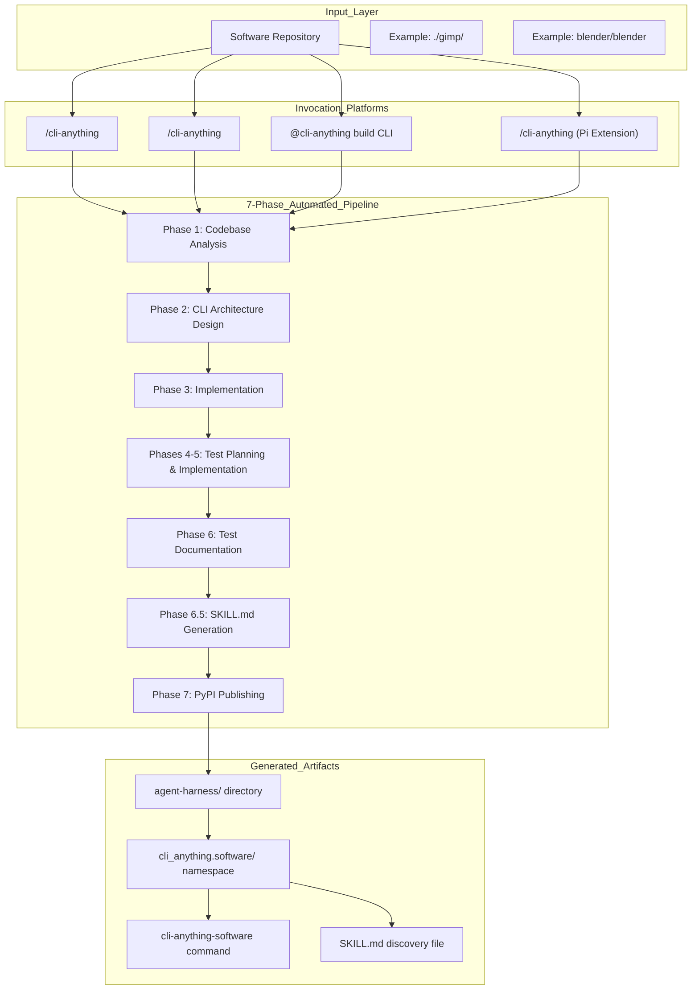
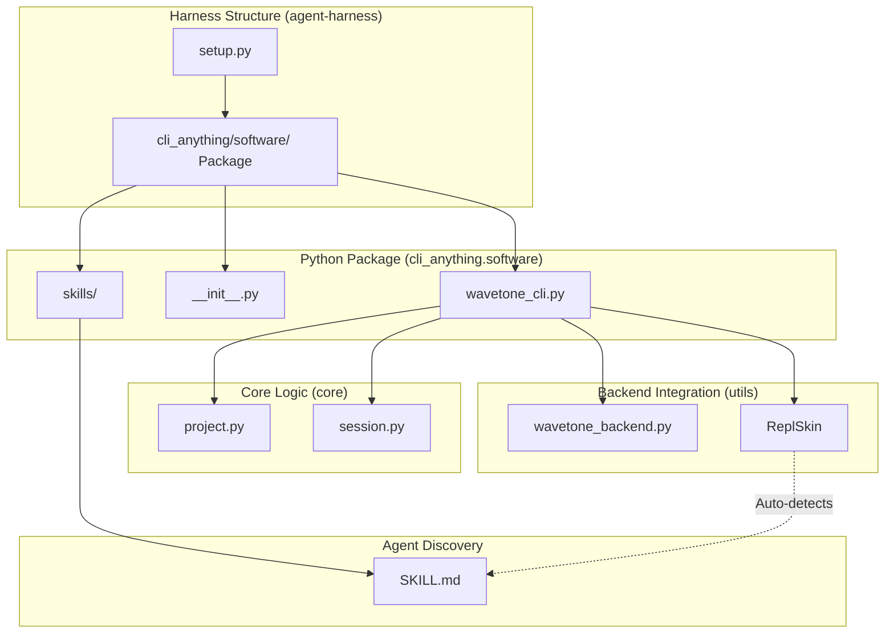

<!-- source: DeepWiki mcp.deepwiki.com · repo HKUDS/CLI-Anything · page 1.1 What is CLI-Anything · fetched 2026-11-09 -->

# What is CLI-Anything

Relevant source files

The following files were used as context for generating this wiki page:

- [.gitignore](.gitignore)
- [README.md](README.md)
- [README_CN.md](README_CN.md)
- [README_JA.md](README_JA.md)
- [cli-anything-plugin/HARNESS.md](cli-anything-plugin/HARNESS.md)
- [cli-anything-plugin/README.md](cli-anything-plugin/README.md)
- [cli-anything-plugin/guides/filter-translation.md](cli-anything-plugin/guides/filter-translation.md)
- [cli-anything-plugin/guides/mcp-backend.md](cli-anything-plugin/guides/mcp-backend.md)
- [cli-anything-plugin/guides/pypi-publishing.md](cli-anything-plugin/guides/pypi-publishing.md)
- [cli-anything-plugin/guides/session-locking.md](cli-anything-plugin/guides/session-locking.md)
- [cli-anything-plugin/guides/skill-generation.md](cli-anything-plugin/guides/skill-generation.md)
- [cli-anything-plugin/guides/timecode-precision.md](cli-anything-plugin/guides/timecode-precision.md)
- [cli-anything-plugin/repl_skin.py](cli-anything-plugin/repl_skin.py)
- [skills/cli-anything-wavetone/SKILL.md](skills/cli-anything-wavetone/SKILL.md)
- [wavetone/agent-harness/cli_anything/wavetone/README.md](wavetone/agent-harness/cli_anything/wavetone/README.md)
- [wavetone/agent-harness/cli_anything/wavetone/core/audio.py](wavetone/agent-harness/cli_anything/wavetone/core/audio.py)
- [wavetone/agent-harness/cli_anything/wavetone/core/project.py](wavetone/agent-harness/cli_anything/wavetone/core/project.py)
- [wavetone/agent-harness/cli_anything/wavetone/core/session.py](wavetone/agent-harness/cli_anything/wavetone/core/session.py)
- [wavetone/agent-harness/cli_anything/wavetone/tests/TEST.md](wavetone/agent-harness/cli_anything/wavetone/tests/TEST.md)
- [wavetone/agent-harness/cli_anything/wavetone/tests/test_core.py](wavetone/agent-harness/cli_anything/wavetone/tests/test_core.py)
- [wavetone/agent-harness/cli_anything/wavetone/tests/test_full_e2e.py](wavetone/agent-harness/cli_anything/wavetone/tests/test_full_e2e.py)
- [wavetone/agent-harness/cli_anything/wavetone/utils/repl_skin.py](wavetone/agent-harness/cli_anything/wavetone/utils/repl_skin.py)
- [wavetone/agent-harness/cli_anything/wavetone/utils/wavetone_backend.py](wavetone/agent-harness/cli_anything/wavetone/utils/wavetone_backend.py)
- [wavetone/agent-harness/cli_anything/wavetone/wavetone_cli.py](wavetone/agent-harness/cli_anything/wavetone/wavetone_cli.py)
- [wavetone/agent-harness/setup.py](wavetone/agent-harness/setup.py)

## Purpose and Scope

This page explains the fundamental concept of CLI-Anything: an automated system that transforms GUI applications and software repositories into command-line interfaces (CLIs) that AI agents can control programmatically. CLI-Anything bridges the gap between software designed for human GUI interaction and AI agents that require structured, programmatic interfaces.

The core mission is to make all software "agent-native" by providing a universal, self-describing, and deterministic interface that LLMs can manipulate without the overhead of computer vision or complex UI automation.

Sources: [README.md:1-28](), [README_CN.md:40-55]()

## The Fundamental Concept

CLI-Anything is a code generation system that accepts a software codebase (local path or GitHub URL) as input and produces a production-grade CLI harness as output. 

The core transformation is:
`Source Code Repository → 7-Phase Automated Analysis & Generation → cli-anything-<software> CLI`

When an AI agent invokes CLI-Anything, the system performs automated codebase analysis, designs a CLI architecture, implements the interface using the `Click` framework, generates comprehensive tests, and produces an installable Python package. The resulting CLI provides agents with structured JSON output, stateful session management, and direct integration with the real software backend—not a reimplementation.

Sources: [README.md:12-38](), [cli-anything-plugin/HARNESS.md:1-24](), [cli-anything-plugin/README.md:9-19]()

## The Transformation Flow

The following diagram illustrates how CLI-Anything transforms a software repository into an agent-controllable CLI across different platforms, following the standardized 7-phase methodology.

**Diagram: CLI-Anything Generation Pipeline**

Sources: [README.md:37-47](), [README_CN.md:90-125](), [cli-anything-plugin/HARNESS.md:10-108](), [cli-anything-plugin/README.md:60-81]()

## Generated Code Architecture

CLI-Anything produces a standard directory structure within an `agent-harness/` folder. The following diagram maps conceptual components to specific code entities and patterns defined in the `HARNESS.md` methodology.

**Diagram: Generated CLI Architecture Mapping**

**Key Code Entities:**

| Entity | Primary Functionality | Code Reference |
|--------|-----------------------|----------------|
| `setup.py` | Configures PEP 420 namespace and `console_scripts`. | [wavetone/agent-harness/setup.py:1-25]() |
| `wavetone_cli.py` | Click-based entry point; handles REPL and subcommands. | [wavetone/agent-harness/cli_anything/wavetone/wavetone_cli.py:67-85]() |
| `ReplSkin` | Unified UX for REPL, status reporting, and banner display. | [wavetone/agent-harness/cli_anything/wavetone/utils/repl_skin.py:1-40]() |
| `_locked_save_json` | Pattern for atomic, thread-safe session persistence. | [cli-anything-plugin/guides/session-locking.md:9-37]() |
| `wavetone_backend.py` | Subprocess wrapper for the authentic software binary. | [wavetone/agent-harness/cli_anything/wavetone/utils/wavetone_backend.py:1-50]() |
| `SKILL.md` | YAML-based metadata for AI agent discovery and instruction. | [skills/cli-anything-wavetone/SKILL.md:1-20]() |

Sources: [cli-anything-plugin/HARNESS.md:49-108](), [cli-anything-plugin/guides/session-locking.md:14-37](), [wavetone/agent-harness/cli_anything/wavetone/wavetone_cli.py:1-120]()

## Platform Integration Methods

CLI-Anything is distributed across multiple AI agent platforms. Each platform utilizes a specific configuration to trigger the 7-phase methodology.

| Platform | Integration Method | Setup File / Command |
|----------|-------------------|----------------------|
| **Claude Code** | Marketplace Plugin | `/plugin marketplace add HKUDS/CLI-Anything` [README.md:72-74]() |
| **OpenCode** | Command Scripts | `~/.config/opencode/commands/` [README_CN.md:172-173]() |
| **OpenClaw** | Native Skill | `~/.openclaw/skills/cli-anything/SKILL.md` [README_CN.md:243-244]() |
| **Qodercli** | Local Plugin | `setup-qodercli.sh` [README_CN.md:215-217]() |
| **Pi Coding Agent**| Extension | `.pi-extension/cli-anything/install.sh` [.pi-extension/cli-anything/README.md:15-18]() |

Sources: [README.md:118-121](), [README_CN.md:156-255](), [.pi-extension/cli-anything/README.md:7-12]()

## Agent-Native Interface Characteristics

The generated CLIs are designed specifically for AI consumption:

1. **Structured Output (`--json`)**: Every command supports machine-readable JSON output to eliminate parsing errors. [cli-anything-plugin/HARNESS.md:44-48]()
2. **Self-Describing**: Built-in `--help` flags and `SKILL.md` files allow agents to discover capabilities dynamically. [cli-anything-plugin/guides/skill-generation.md:9-14]()
3. **Stateful Session Management**: Includes undo/redo and project persistence using locked JSON saves. [cli-anything-plugin/HARNESS.md:69-73](), [cli-anything-plugin/guides/session-locking.md:1-8]()
4. **REPL Mode**: A default interactive mode that provides persistent context for multi-step agent workflows. [cli-anything-plugin/HARNESS.md:27-30]()
5. **Authentic Backend Integration**: CLIs wrap the actual software (e.g., `libreoffice --headless`, GIMP Script-Fu) rather than reimplementing logic. [cli-anything-plugin/HARNESS.md:54-66]()
6. **Unified Branding**: The `ReplSkin` class ensures consistent banners, status icons, and progress bars across all harnesses. [wavetone/agent-harness/cli_anything/wavetone/utils/repl_skin.py:1-60]()

Sources: [README.md:96-111](), [cli-anything-plugin/HARNESS.md:25-48](), [cli-anything-plugin/guides/skill-generation.md:1-7]()

---

