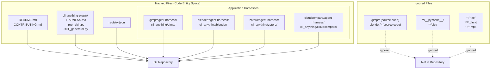
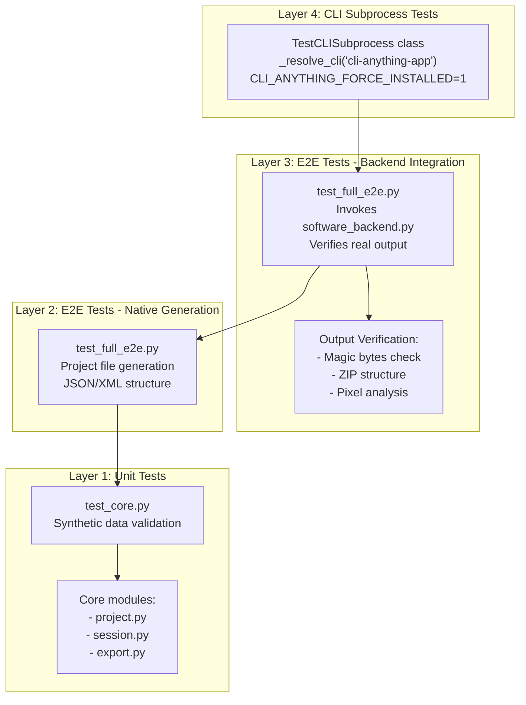
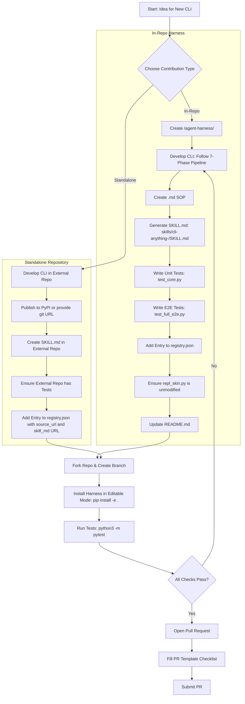

<!-- source: DeepWiki mcp.deepwiki.com · repo HKUDS/CLI-Anything · page 9 Development Guide · fetched 2026-11-09 -->

# Development Guide

Relevant source files

The following files were used as context for generating this wiki page:

- [.github/ISSUE_TEMPLATE/bug_report.yml](.github/ISSUE_TEMPLATE/bug_report.yml)
- [.github/ISSUE_TEMPLATE/cli-wishlist.yml](.github/ISSUE_TEMPLATE/cli-wishlist.yml)
- [.github/ISSUE_TEMPLATE/config.yml](.github/ISSUE_TEMPLATE/config.yml)
- [.github/ISSUE_TEMPLATE/contributor-signup.yml](.github/ISSUE_TEMPLATE/contributor-signup.yml)
- [.github/ISSUE_TEMPLATE/feature_request.yml](.github/ISSUE_TEMPLATE/feature_request.yml)
- [.github/PULL_REQUEST_TEMPLATE.md](.github/PULL_REQUEST_TEMPLATE.md)
- [CONTRIBUTING.md](CONTRIBUTING.md)

This document provides technical guidance for developers who want to contribute to CLI-Anything, understand its internal architecture, or extend the system to support new applications. It covers repository organization, testing methodologies, code patterns, and contribution workflows.

For end-user installation and usage, see [Getting Started](#2). For details on the 7-phase generation pipeline, see [The 7-Phase Generation Pipeline](#4). For architecture of generated CLIs, see [Generated CLI Architecture](#5).

---

## Repository Organization and Tracking Strategy

CLI-Anything uses a selective tracking strategy to maintain a clean repository focused on the generation plugin and the generated harness code, while excluding temporary build artifacts and large binary files. For details, see [Repository Structure](#9.1).

### .gitignore Strategy

The repository tracks only three categories of files:

1.  **Plugin infrastructure**: `cli-anything-plugin/` containing the generation pipeline, [cli-anything-plugin/HARNESS.md](), and [cli-anything-plugin/skill_generator.py]().
2.  **Generated harnesses**: `*/agent-harness/` subdirectories for each supported application.
3.  **Documentation assets**: `README.md`, `assets/`, and `registry.json`.

All other files are ignored, including software source code directories, build artifacts, test outputs, and generated media files. This is strictly enforced via a complex `.gitignore` that uses a "deny-all, allow-select" pattern.

**Sources**: [.gitignore:1-189](), [CONTRIBUTING.md:15-23]()

**Diagram: Repository Tracking Strategy**

Sources: [.gitignore:1-152](), [CONTRIBUTING.md:15-23]()

### Standard Harness Directory Structure

Each `agent-harness/` directory follows a consistent layout defined in the [cli-anything-plugin/README.md]() methodology section. For details, see [Repository Structure](#9.1).

The namespace package approach (`cli_anything.<software>`) prevents name collisions and allows all CLIs to coexist in a single Python environment. This is configured in `setup.py` using `find_namespace_packages(include=["cli_anything.*"])` and requires that the top-level `cli_anything/` directory contains **no** `__init__.py` file.

**Sources**: [CONTRIBUTING.md:15-23]()

---

## Testing Strategy and Best Practices

CLI-Anything employs a rigorous 4-layer testing pyramid. All tests must pass with a 100% pass rate before a harness is considered complete. For details, see [Testing Strategy and Best Practices](#9.2).

### The Four-Layer Testing Pyramid

**Diagram: Four-Layer Testing Pyramid**

Sources: [CONTRIBUTING.md:19]()

### Zero Compromise Dependencies Principle

The "Zero Compromise Dependencies" principle means tests fail hard (not skip) when backends are missing. Developers should never implement "graceful degradation" for core backend functionality; if the software isn't there, the CLI should raise a `RuntimeError` with installation instructions. The `_resolve_cli` pattern ensures that even in development, the CLI behaves as it would when globally installed.

**Sources**: [CONTRIBUTING.md:19]()

---

## Common Patterns and Conventions

All generated harnesses follow consistent patterns to ensure predictability. For details, see [Common Patterns and Conventions](#9.3).

### ReplSkin and SKILL.md

All CLIs use the unified `repl_skin.py` utility for a consistent REPL experience. `ReplSkin` auto-detects `skills/SKILL.md` inside the package directory and displays its path in the banner for AI agents.

The `SKILL.md` is generated by `skill_generator.py`, which extracts metadata from `setup.py`, `cli.py`, and `README.md` during Phase 6.5. All SKILL.md files are unified under the top-level `skills/` directory for discovery.

**Sources**: [CONTRIBUTING.md:22-23]()

### Session Management and JSON Output

Stateful sessions are managed with undo/redo capabilities. All CLI commands must support the `--json` flag for machine-readable output, ensuring they are "agent-native" and easily parsable by LLMs.

**Sources**: [.github/PULL_REQUEST_TEMPLATE.md:56]()

---

## Contributing New Application Harnesses

Adding a new CLI harness is the most impactful contribution. For a step-by-step guide, see [Contributing New Application Harnesses](#9.4).

### Contribution Requirements

Before submitting a Pull Request, ensure the following are in place (as per the [PULL_REQUEST_TEMPLATE.md]()):
1.  **`<SOFTWARE>.md`**: The analysis SOP document at `<software>/agent-harness/<SOFTWARE>.md`.
2.  **`SKILL.md`**: The AI-discoverable skill definition at `skills/cli-anything-<software>/SKILL.md`, and the packaged compatibility copy at `cli_anything/<software>/skills/SKILL.md`.
3.  **Tests**: Both `test_core.py` (unit) and `test_full_e2e.py` (E2E) must pass.
4.  **`registry.json`**: An entry for the new software for the [CLI-Hub](https://hkuds.github.io/CLI-Anything).
5.  **`repl_skin.py`**: An unmodified copy from the plugin in `utils/`.

**Sources**: [CONTRIBUTING.md:1-23](), [.github/PULL_REQUEST_TEMPLATE.md:20-32]()

### Submission Process

The contribution process is guided by the `CONTRIBUTING.md` and the issue templates. New contributors are encouraged to sign up via the `contributor-signup.yml` issue template to contribute a new CLI harness as their first contribution.

1.  **Fork the repo** and create a branch.
2.  **Follow the 7-phase pipeline** described in the methodology.
3.  **Ensure the package follows the PEP 420 namespace convention**.
4.  **Verify installation** with `pip install -e .` and run tests.
5.  **Open a Pull Request** using the provided template, ensuring all checklist items are addressed.

**Sources**: [CONTRIBUTING.md:1-34](), [.github/PULL_REQUEST_TEMPLATE.md:20-32](), [.github/ISSUE_TEMPLATE/contributor-signup.yml:1-63]()

**Diagram: New CLI Contribution Workflow**

Sources: [CONTRIBUTING.md:1-34](), [.github/PULL_REQUEST_TEMPLATE.md:20-43]()

---

