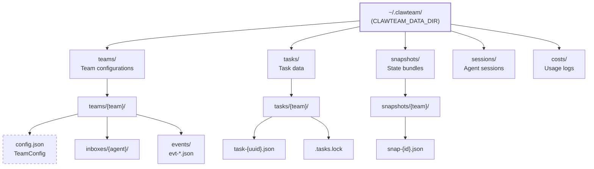
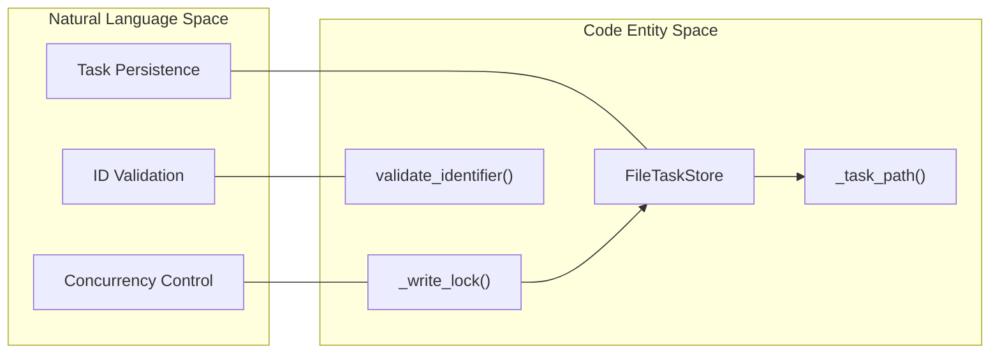
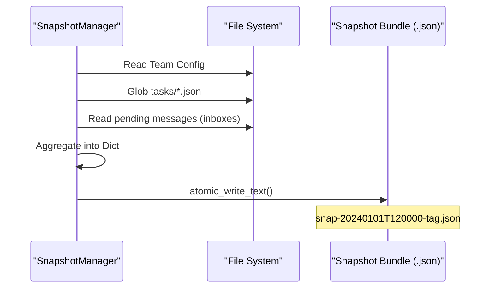

<!-- source: DeepWiki mcp.deepwiki.com · repo HKUDS/ClawTeam · page 11.1 Storage Layer · fetched 2026-11-09 -->

# Storage Layer

Relevant source files

The following files were used as context for generating this wiki page:

- [clawteam/store/__init__.py](clawteam/store/__init__.py)
- [clawteam/store/base.py](clawteam/store/base.py)
- [clawteam/store/file.py](clawteam/store/file.py)
- [clawteam/team/__init__.py](clawteam/team/__init__.py)
- [clawteam/team/mailbox.py](clawteam/team/mailbox.py)
- [clawteam/team/manager.py](clawteam/team/manager.py)
- [clawteam/team/snapshot.py](clawteam/team/snapshot.py)
- [clawteam/transport/p2p.py](clawteam/transport/p2p.py)
- [tests/test_snapshots.py](tests/test_snapshots.py)
- [tests/test_store.py](tests/test_store.py)

This document describes ClawTeam's storage architecture, focusing on the file-based storage implementation and state persistence mechanisms. The Storage Layer is responsible for persisting all team state, task data, messages, configuration, and workspace metadata to disk in a structured, queryable format.

---

## Overview

ClawTeam uses a **file-based storage architecture** where all persistent state resides in a single data directory (default: `~/.clawteam/`). This design prioritizes zero dependencies, human-readable JSON storage, and simplicity for single-machine or shared-filesystem deployments.

The storage layer is partitioned into several specialized subdirectories, each managed by specific code entities:
- **Teams**: Managed by `TeamManager` [clawteam/team/manager.py:50-51]()
- **Tasks**: Managed by `FileTaskStore` [clawteam/store/file.py:45-52]()
- **Mailboxes**: Managed by `MailboxManager` [clawteam/team/mailbox.py:32-39]()
- **Snapshots**: Managed by `SnapshotManager` [clawteam/team/snapshot.py:109-114]()

**Sources:** [clawteam/team/manager.py:14-25](), [clawteam/store/file.py:45-52](), [clawteam/team/mailbox.py:32-39]()

---

## Data Directory Structure

The root data directory location is determined by `get_data_dir()`. Within this root, the system organizes data by team and functional category.

| Path | Code Entity / Function | Purpose |
|------|------------------------|---------|
| `teams/{team}/config.json` | `_config_path()` | Team metadata and member list [clawteam/team/manager.py:24-25]() |
| `teams/{team}/inboxes/{agent}/` | `TeamManager.resolve_inbox()` | Recipient message queue [clawteam/team/mailbox.py:95]() |
| `teams/{team}/events/` | `MailboxManager._log_event()` | Immutable message history [clawteam/team/mailbox.py:48-52]() |
| `tasks/{team}/task-{id}.json` | `_task_path()` | Task state and dependencies [clawteam/store/file.py:33-34]() |
| `snapshots/{team}/snap-{id}.json` | `_snapshots_root()` | Full team state checkpoints [clawteam/team/snapshot.py:30-33]() |

**Sources:** [clawteam/team/manager.py:14-25](), [clawteam/store/file.py:24-34](), [clawteam/team/snapshot.py:30-33](), [clawteam/team/mailbox.py:45-47]()

---

## Task Persistence and Concurrency

The `FileTaskStore` implements the `BaseTaskStore` interface, storing each task as an individual JSON file.

### Concurrency Control
To prevent data corruption during concurrent access (e.g., two agents attempting to claim the same task), `FileTaskStore` utilizes an advisory locking mechanism on a hidden file `.tasks.lock`.

- **Windows**: Uses `msvcrt.locking` [clawteam/store/file.py:59-63]()
- **Unix**: Uses `fcntl.flock` [clawteam/store/file.py:65]()

### Code Entity Association
The following diagram bridges the logical storage concepts to the implementation classes and their specific file-handling methods.

**Sources:** [clawteam/store/file.py:45-76](), [clawteam/store/file.py:33-34](), [clawteam/paths.py:1-20]()

---

## Message Storage (Mailboxes)

Messages are persisted as JSON files within the recipient's inbox directory.

- **Atomic Delivery**: Messages are written to a `.tmp` file and then renamed to ensure agents never read a partial message [clawteam/team/mailbox.py:38-39]().
- **Naming Convention**: Files follow the pattern `msg-{timestamp}-{uuid}.json` [clawteam/team/mailbox.py:36]().
- **Event Log**: Every message sent is also logged to an immutable `events/` directory for historical auditing, even after the original message is consumed from the inbox [clawteam/team/mailbox.py:48-60]().

**Sources:** [clawteam/team/mailbox.py:32-60]()

---

## State Snapshots

The `SnapshotManager` provides a "checkpoint/restore" capability by bundling all disparate storage files into a single JSON bundle.

### Capture Scope
A snapshot bundle includes:
1. **Team Config**: From `teams/{team}/config.json` [clawteam/team/snapshot.py:131]()
2. **Tasks**: All `task-*.json` files [clawteam/team/snapshot.py:133-136]()
3. **Events**: Historical message logs [clawteam/team/snapshot.py:137]()
4. **Sessions & Costs**: Usage and state tracking [clawteam/team/snapshot.py:138-145]()
5. **Inboxes**: Pending (unconsumed) messages [clawteam/team/snapshot.py:148-156]()

### Snapshot Data Flow

**Sources:** [clawteam/team/snapshot.py:123-183]()

---

## Data Integrity and Safety

ClawTeam employs several strategies to ensure storage integrity:

1. **Atomic Writes**: Core managers use a pattern of writing to a temporary file and using `os.replace()` to overwrite the target path [clawteam/team/manager.py:42-47](), [clawteam/team/mailbox.py:53-59]().
2. **Path Validation**: The `ensure_within_root` and `validate_identifier` utilities prevent directory traversal attacks and ensure data stays within the designated `CLAWTEAM_DATA_DIR` [clawteam/paths.py:1-20]().
3. **Advisory Locking**: Cross-process synchronization for task updates using platform-specific file locks [clawteam/store/file.py:54-76]().

**Sources:** [clawteam/paths.py:1-20](), [clawteam/store/file.py:54-76](), [clawteam/team/manager.py:39-47]()

---

