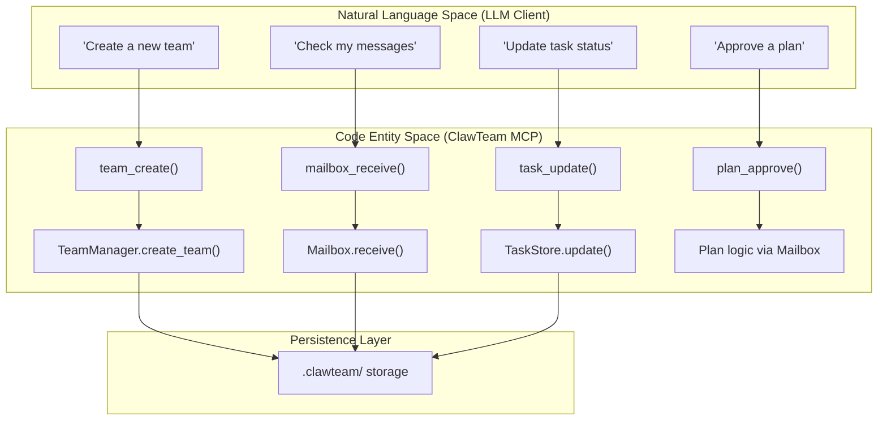
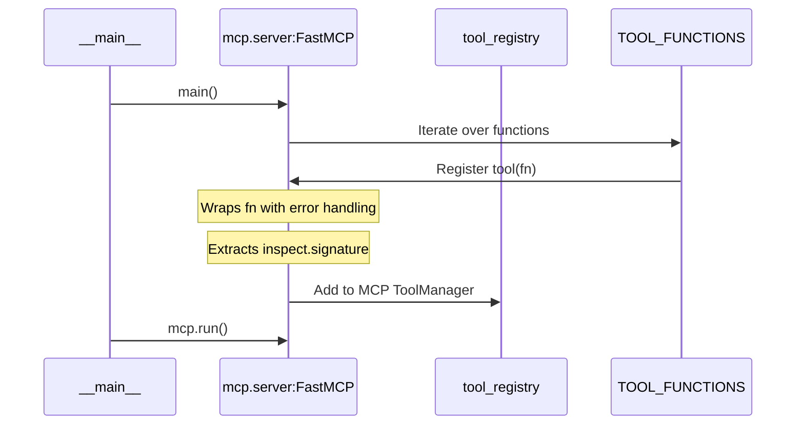

<!-- source: DeepWiki mcp.deepwiki.com · repo HKUDS/ClawTeam · page 11.5 MCP Server · fetched 2026-11-09 -->

# MCP Server

<details>
<summary>Relevant source files</summary>

The following files were used as context for generating this wiki page:

- [clawteam/mcp/__init__.py](clawteam/mcp/__init__.py)
- [clawteam/mcp/__main__.py](clawteam/mcp/__main__.py)
- [clawteam/mcp/server.py](clawteam/mcp/server.py)
- [clawteam/mcp/tools/__init__.py](clawteam/mcp/tools/__init__.py)
- [clawteam/mcp/tools/mailbox.py](clawteam/mcp/tools/mailbox.py)
- [clawteam/mcp/tools/task.py](clawteam/mcp/tools/task.py)
- [clawteam/mcp/tools/team.py](clawteam/mcp/tools/team.py)
- [tests/test_mcp_server.py](tests/test_mcp_server.py)
- [tests/test_mcp_tools.py](tests/test_mcp_tools.py)

</details>


The ClawTeam MCP Server implements the [Model Context Protocol (MCP)](https://modelcontextprotocol.io) to expose ClawTeam's multi-agent coordination capabilities to external LLM clients (such as Claude Desktop or IDE extensions). It acts as a bridge between the Natural Language Space of a model and the Code Entity Space of the ClawTeam framework, allowing models to programmatically manage teams, tasks, and communications.

## Architecture Overview

The MCP integration is built using the `FastMCP` framework [clawteam/mcp/server.py:8-13](). It dynamically registers a suite of tool functions that wrap the core logic of the `TeamManager`, `TaskStore`, and `Mailbox` components.

### Data Flow

When an MCP client invokes a tool, the following flow occurs:
1.  The `FastMCP` server receives the JSON-RPC request.
2.  The request is routed to a wrapped tool function in `clawteam.mcp.tools` [clawteam/mcp/server.py:16-25]().
3.  The tool function interacts with the underlying storage and management classes (e.g., `TeamManager`) [clawteam/mcp/tools/team.py:6-11]().
4.  Results are serialized into JSON-friendly payloads using `to_payload` helpers [clawteam/mcp/helpers.py:7-7]().
5.  Errors are translated into MCP-compliant exception formats [clawteam/mcp/server.py:19-22]().

### Natural Language to Code Entity Mapping

The following diagram illustrates how high-level agent actions are mapped to specific Python entities within the codebase.

**Figure 1: MCP Tool Mapping**

Sources: [clawteam/mcp/tools/team.py:25-35](), [clawteam/mcp/tools/mailbox.py:75-77](), [clawteam/mcp/tools/task.py:65-80](), [clawteam/mcp/tools/plan.py:12-16]()

## Tool Registry

The server exports a comprehensive set of tools defined in `TOOL_FUNCTIONS` [clawteam/mcp/tools/__init__.py:28-55](). These are grouped by the functional domain they manage.

### Team Management
Tools for lifecycle and membership management.
*   `team_list`: Discovers existing teams [clawteam/mcp/tools/team.py:9-11]().
*   `team_create`: Initializes a team with a leader and workspace [clawteam/mcp/tools/team.py:25-43]().
*   `team_member_add`: Registers new agents to an existing team [clawteam/mcp/tools/team.py:46-62]().

### Task Coordination
Tools for managing the shared task board.
*   `task_create`: Adds new tasks with optional dependencies (`blocks`/`blocked_by`) [clawteam/mcp/tools/task.py:41-62]().
*   `task_update`: Modifies status, ownership, or metadata [clawteam/mcp/tools/task.py:65-98]().
*   `task_list`: Filters tasks by status or owner [clawteam/mcp/tools/task.py:9-25]().

### Communication (Mailbox)
Tools for inter-agent messaging.
*   `mailbox_send`: Sends a targeted message to an agent's inbox [clawteam/mcp/tools/mailbox.py:9-52]().
*   `mailbox_receive`: Consumes pending messages [clawteam/mcp/tools/mailbox.py:75-77]().
*   `mailbox_broadcast`: Sends a message to all team members [clawteam/mcp/tools/mailbox.py:55-72]().

### Plan & Workspace
*   `plan_submit` / `plan_approve`: Implements the formal proposal workflow [clawteam/mcp/tools/plan.py:12-16]().
*   `workspace_agent_diff`: Provides visibility into the filesystem changes made by specific agents [clawteam/mcp/tools/workspace.py:22-22]().

## Implementation Details

### Tool Registration
The server iterates through `TOOL_FUNCTIONS` and applies a `_tool` decorator. This decorator ensures that:
1.  The function signature is preserved for MCP metadata [clawteam/mcp/server.py:24-24]().
2.  Docstrings are extracted to serve as tool descriptions for the LLM [tests/test_mcp_server.py:24-29]().
3.  Exceptions are caught and sanitized [clawteam/mcp/server.py:19-22]().

**Figure 2: Server Initialization Sequence**

Sources: [clawteam/mcp/server.py:1-33](), [tests/test_mcp_server.py:14-29]()

### Error Handling
The server uses `translate_error` to convert internal Python exceptions (like `ValueError` or `KeyError`) into meaningful messages that an LLM can use to self-correct [clawteam/mcp/server.py:10-22](). For example, if a tool attempts to update a task locked by another agent, the error message specifically mentions the lock conflict [tests/test_mcp_tools.py:87-95]().

### Serialization
Since MCP requires JSON responses, the `to_payload` helper handles the conversion of Pydantic models (used internally by ClawTeam) into dictionaries. It specifically respects Pydantic aliases (e.g., converting `lead_agent_id` to `leadAgentId`) to maintain a consistent camelCase API for the client [tests/test_mcp_tools.py:29-33]().

## Running the Server

The server can be started via the module entry point:
```bash
python -m clawteam.mcp
```
[clawteam/mcp/__main__.py:1-4]()

It utilizes standard input/output (stdio) by default for MCP communication, making it compatible with most MCP hosts.

Sources:
* [clawteam/mcp/server.py:1-33]()
* [clawteam/mcp/tools/__init__.py:1-57]()
* [clawteam/mcp/tools/team.py:1-63]()
* [clawteam/mcp/tools/task.py:1-100]()
* [clawteam/mcp/tools/mailbox.py:1-89]()
* [tests/test_mcp_server.py:1-30]()
* [tests/test_mcp_tools.py:1-163]()

---

