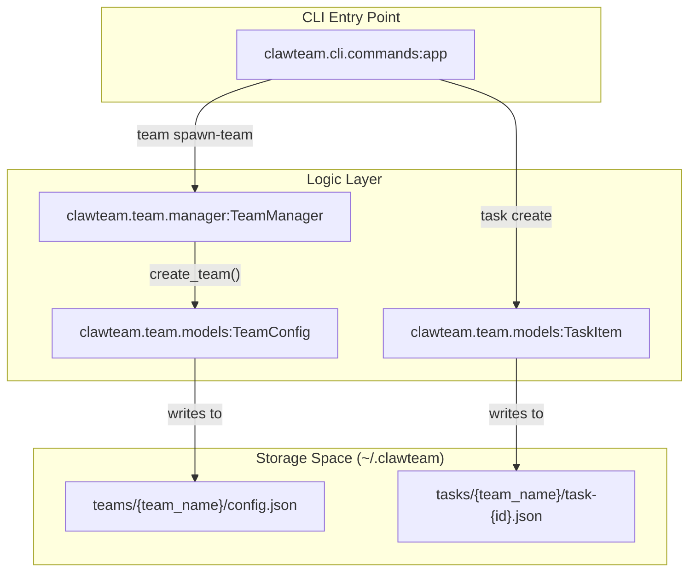
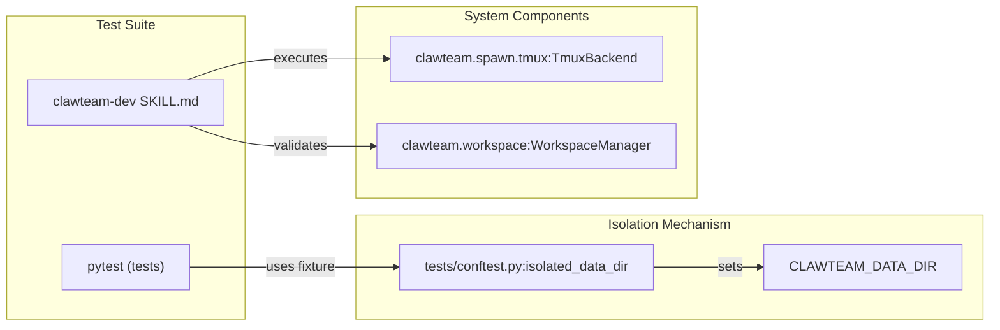

<!-- source: DeepWiki mcp.deepwiki.com · repo HKUDS/ClawTeam · page 15 Testing and Development · fetched 2026-11-09 -->

# Testing and Development

<details>
<summary>Relevant source files</summary>

The following files were used as context for generating this wiki page:

- [.agents/skills/clawteam-dev/SKILL.md](.agents/skills/clawteam-dev/SKILL.md)
- [.agents/skills/clawteam-dev/scripts/bootstrap_clawteam_dev.sh](.agents/skills/clawteam-dev/scripts/bootstrap_clawteam_dev.sh)
- [.agents/skills/clawteam-dev/scripts/link_local_clawteam_skills.sh](.agents/skills/clawteam-dev/scripts/link_local_clawteam_skills.sh)
- [clawteam/__init__.py](clawteam/__init__.py)
- [pyproject.toml](pyproject.toml)
- [tests/__init__.py](tests/__init__.py)
- [tests/conftest.py](tests/conftest.py)
- [tests/test_manager.py](tests/test_manager.py)
- [tests/test_models.py](tests/test_models.py)
- [tests/test_templates.py](tests/test_templates.py)

</details>


This page documents ClawTeam's testing approach, development setup, and contribution guidelines. The primary testing methodology emphasizes end-to-end (E2E) validation that exercises the complete agent coordination lifecycle. For detailed E2E test procedures, see [End-to-End Testing](#15.1). For planned features and architectural evolution, see [Roadmap](#15.2).

## Testing Philosophy

ClawTeam's testing strategy emphasizes end-to-end validation over unit tests. This approach is justified because:

1.  **Integration is the complexity**: The core value of ClawTeam lies in coordinating multiple agents with isolated workspaces, dependency resolution, and asynchronous messaging. These interactions cannot be meaningfully validated with unit tests alone.
2.  **Real agent processes**: Tests often spawn actual agent processes (e.g., `claude` or `codex`) in `tmux` sessions with git worktree isolation, validating the complete execution environment [.agents/skills/clawteam-dev/SKILL.md:88-94]().
3.  **Full lifecycle coverage**: A single E2E test validates team creation, task dependencies, agent spawning, coordination, completion detection, and cleanup in sequence [.agents/skills/clawteam-dev/SKILL.md:99-105]().

While E2E tests are preferred for workflow validation, the codebase includes a comprehensive suite of unit tests for core models and logic, located in the `tests/` directory [pyproject.toml:73-75]().

**Sources:** [.agents/skills/clawteam-dev/SKILL.md:1-17](), [pyproject.toml:73-75]()

---

## Development Setup

### Prerequisites

*   **Python**: >= 3.10 [pyproject.toml:6]()
*   **uv**: Recommended for environment management [.agents/skills/clawteam-dev/scripts/bootstrap_clawteam_dev.sh:13-16]()
*   **tmux**: Required for agent isolation via the default spawn backend [.agents/skills/clawteam-dev/SKILL.md:91]()
*   **git**: Required for workspace worktree management [.agents/skills/clawteam-dev/SKILL.md:93]()

### Local Development Bootstrap

The repository provides a bootstrap script to standardize the development environment. This script creates a fixed virtual environment, installs the package in editable mode with dev dependencies, and sets up a `clawteam` shell function [.agents/skills/clawteam-dev/SKILL.md:19-44]().

```bash
# Run the bootstrap script
bash .agents/skills/clawteam-dev/scripts/bootstrap_clawteam_dev.sh

# Refresh your shell
source ~/.bashrc

# Verify the development build
clawteam --version
```

### Fast Validation

For rapid feedback during development, use `ruff` for linting and `pytest` for targeted tests [.agents/skills/clawteam-dev/SKILL.md:71-78]().

```bash
# Linting
ruff check clawteam/ tests/

# Targeted testing
pytest tests/test_models.py -q
```

**Sources:** [pyproject.toml:6-34](), [.agents/skills/clawteam-dev/SKILL.md:19-86](), [.agents/skills/clawteam-dev/scripts/bootstrap_clawteam_dev.sh:1-58]()

---

## Code Entity Space Mapping

The following diagrams bridge the gap between high-level system concepts and the specific code entities that implement them.

### Team and Task Lifecycle Entities

This diagram maps the lifecycle operations to the classes and storage locations in the codebase.



**Sources:** [clawteam/team/manager.py:5-11](), [clawteam/team/models.py:5-13](), [tests/test_manager.py:10-30](), [tests/test_models.py:17-50]()

### Testing Infrastructure

This diagram illustrates how the test suite interacts with the system components.



**Sources:** [tests/conftest.py:10-19](), [.agents/skills/clawteam-dev/SKILL.md:64-70](), [pyproject.toml:31-34]()

---

## Unit Testing Coverage

The unit test suite covers the fundamental data structures and logic components:

| Test File | Coverage Area | Key Classes Tested |
|-----------|---------------|-------------------|
| `tests/test_models.py` | Pydantic data models, serialization, and aliases | `TaskItem`, `TeamMember`, `TeamConfig`, `TeamMessage` |
| `tests/test_manager.py` | Team lifecycle, member management, and directory setup | `TeamManager` |
| `tests/test_templates.py` | Template loading, variable substitution, and builtin templates | `TemplateDef`, `AgentDef`, `TaskDef` |
| `tests/conftest.py` | Global test fixtures and environment isolation | `isolated_data_dir` |

### Environment Isolation
To prevent tests from affecting the user's real configuration, `tests/conftest.py` uses an autouse fixture to redirect `CLAWTEAM_DATA_DIR` and `HOME` to a temporary directory [tests/conftest.py:10-19]().

**Sources:** [tests/test_models.py:1-15](), [tests/test_manager.py:1-8](), [tests/test_templates.py:1-13](), [tests/conftest.py:1-19]()

---

## End-to-End Testing Suite

The primary E2E validation is driven by the `clawteam-dev` skill. This suite exercises the full multi-agent workflow, from team initialization to task completion and cleanup.

### Local Smoke Test
A typical smoke test involves spawning a leader and a worker to verify the communication and task unblocking logic [.agents/skills/clawteam-dev/SKILL.md:95-105]():

1.  **Spawn Team**: `clawteam team spawn-team dev-smoke`
2.  **Create Task**: `clawteam task create dev-smoke "Smoke test worker" -o worker1`
3.  **Spawn Agent**: `clawteam spawn --team dev-smoke --agent-name worker1`
4.  **Monitor**: `clawteam board show dev-smoke`
5.  **Wait**: `clawteam task wait dev-smoke --timeout 300`

For detailed explanation of the E2E test suite, test procedures, and validation coverage, see [End-to-End Testing](#15.1).

**Sources:** [.agents/skills/clawteam-dev/SKILL.md:95-114]()

---

## Contribution Guidelines

### Repository Structure
*   `clawteam/`: Core package source code [pyproject.toml:56]().
*   `tests/`: Unit and integration tests [pyproject.toml:74]().
*   `skills/`: Reusable agent skills included with the package.
*   `scripts/`: Utility scripts for development and linking skills [.agents/skills/clawteam-dev/SKILL.md:27, 55]().

### Development Rules
*   **Prefer CLI**: Use `clawteam` commands rather than editing JSON state files directly [.agents/skills/clawteam-dev/SKILL.md:129]().
*   **Small Teams**: When testing coordination, start with one leader and one worker [.agents/skills/clawteam-dev/SKILL.md:132]().
*   **Cleanup**: Always use `clawteam team cleanup <name>` to remove worktrees and tmux sessions [.agents/skills/clawteam-dev/SKILL.md:120-123]().

For planned features and architectural evolution, see [Roadmap](#15.2).

**Sources:** [.agents/skills/clawteam-dev/SKILL.md:127-134](), [pyproject.toml:42-63]()

---

