# Page: Overview

# Overview

<details>
<summary>Relevant source files</summary>

The following files were used as context for generating this wiki page:

- [README.md](README.md)
- [clawteam/__init__.py](clawteam/__init__.py)
- [docs/skills/clawteam/SKILL.md](docs/skills/clawteam/SKILL.md)
- [docs/skills/clawteam/references/cli-reference.md](docs/skills/clawteam/references/cli-reference.md)
- [pyproject.toml](pyproject.toml)
- [scripts/clawteam_local_install](scripts/clawteam_local_install)
- [scripts/install_clawteam.sh](scripts/install_clawteam.sh)
- [skills/clawteam/SKILL.md](skills/clawteam/SKILL.md)
- [skills/clawteam/references/cli-reference.md](skills/clawteam/references/cli-reference.md)

</details>


This page introduces ClawTeam, explaining what it is, the coordination problems it solves, and the high-level system architecture. For detailed information on specific subsystems, see [Core Concepts](#1.1), [Architecture Overview](#1.2), and subsequent chapters covering individual components.

## What is ClawTeam?

ClawTeam is a framework-agnostic CLI tool that enables AI agents to coordinate as a team. It provides file-based team management, inter-agent messaging, shared task tracking with dependency resolution, and terminal-based monitoring dashboards. The system is designed to be operated directly by AI agents themselves through CLI commands, rather than requiring human-written orchestration code.

All coordination happens through the `clawteam` command-line interface. State is persisted to `~/.clawteam/` by default [skills/clawteam/SKILL.md:25](). No external databases or message brokers are required for basic operation, though optional Redis and ZeroMQ transport backends are available for advanced use cases [pyproject.toml:35-40]().

**Sources:** [README.md:1-30](), [skills/clawteam/SKILL.md:19-25](), [pyproject.toml:35-40]()

## Core Problems Solved

ClawTeam addresses fundamental challenges in multi-agent coordination by providing a structured environment where agents can self-organize.

| Problem | Traditional Approach | ClawTeam Solution |
|---------|---------------------|-------------------|
| **Agent Isolation** | Agents work independently, manual context sharing | Shared task board and inbox messaging system [skills/clawteam/SKILL.md:52-58]() |
| **Workspace Conflicts** | Agents modify same files, causing merge conflicts | Git worktrees provide isolated branches per agent [skills/clawteam/SKILL.md:180-189]() |
| **Task Coordination** | Manual dependency tracking and unblocking | Automatic dependency resolution and task unblocking [skills/clawteam/SKILL.md:136-140]() |
| **Observability** | Check individual agent logs separately | Unified dashboard with real-time team status [skills/clawteam/SKILL.md:65-66]() |
| **Identity Management** | Manual environment variable setup | Automatic identity injection via `CLAWTEAM_*` env vars [docs/skills/clawteam/references/cli-reference.md:12-26]() |

**Sources:** [README.md:157-182](), [skills/clawteam/SKILL.md:50-66](), [docs/skills/clawteam/references/cli-reference.md:12-26]()

## High-Level Architecture

ClawTeam's architecture bridges the gap between natural language goals and code-level execution. The system is built around a CLI layer that interfaces with specialized managers for teams, tasks, and messaging.

### System Concept Mapping

The following diagram maps high-level system concepts to their concrete implementations and storage locations in the codebase.

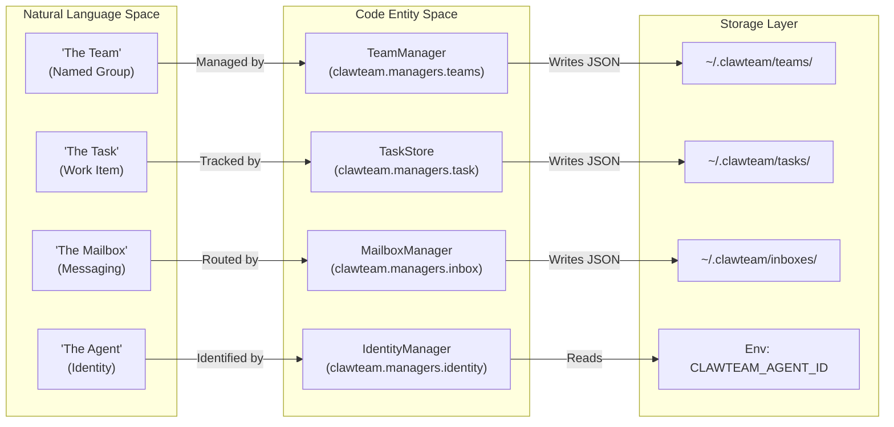

**Sources:** [skills/clawteam/SKILL.md:50-66](), [docs/skills/clawteam/references/cli-reference.md:12-26](), [pyproject.toml:43-44]()

## Agent Coordination Flow

Agents interact with the framework by executing CLI commands. A typical coordination flow involves a leader spawning workers and assigning tasks.

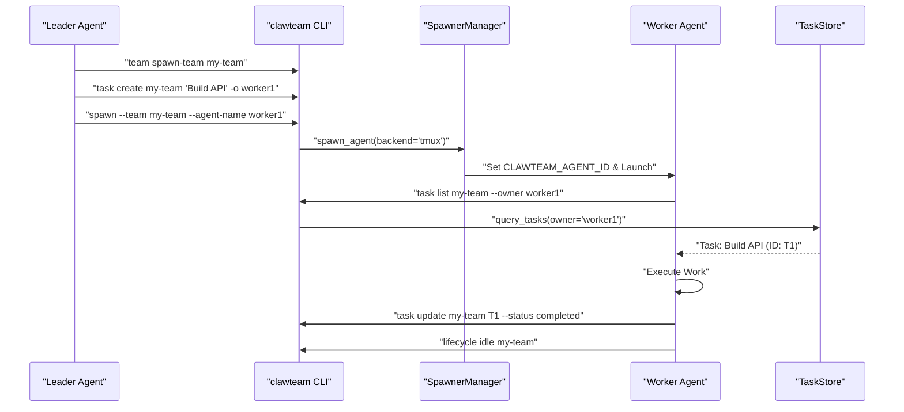

**Sources:** [skills/clawteam/SKILL.md:103-121](), [skills/clawteam/SKILL.md:163-178](), [docs/skills/clawteam/references/cli-reference.md:29-48]()

## Key Subsystems

For more detail on how these components work, refer to the child pages:

### [Core Concepts](#1.1)
Defines the fundamental building blocks of the framework:
- **Agents**: Individual AI processes identified by `CLAWTEAM_AGENT_ID` [docs/skills/clawteam/references/cli-reference.md:18]().
- **Teams**: Logical groupings defined in `~/.clawteam/teams/` [skills/clawteam/SKILL.md:52]().
- **Tasks**: Units of work with statuses (`pending`, `in_progress`, `completed`, `blocked`) [skills/clawteam/SKILL.md:56-57]().
- **Inboxes**: Agent-specific message queues [skills/clawteam/SKILL.md:54]().

### [Architecture Overview](#1.2)
Explains the technical implementation of the coordination layer:
- **CLI Interface**: Built using `typer` [pyproject.toml:22]().
- **Persistence**: File-based storage using JSON [skills/clawteam/SKILL.md:25]().
- **Execution Backends**: Support for `tmux` and `subprocess` spawning [skills/clawteam/SKILL.md:125-131]().
- **Workspace Isolation**: Use of git worktrees to prevent file conflicts [skills/clawteam/SKILL.md:180-189]().

**Sources:** [skills/clawteam/SKILL.md:50-66](), [pyproject.toml:21-28](), [docs/skills/clawteam/references/cli-reference.md:12-26]()

---

# Page: Core Concepts

# Core Concepts

<details>
<summary>Relevant source files</summary>

The following files were used as context for generating this wiki page:

- [README.md](README.md)
- [clawteam/identity.py](clawteam/identity.py)
- [docs/skills/clawteam/SKILL.md](docs/skills/clawteam/SKILL.md)
- [docs/skills/clawteam/references/cli-reference.md](docs/skills/clawteam/references/cli-reference.md)
- [scripts/clawteam_local_install](scripts/clawteam_local_install)
- [scripts/install_clawteam.sh](scripts/install_clawteam.sh)
- [skills/clawteam/SKILL.md](skills/clawteam/SKILL.md)
- [skills/clawteam/references/cli-reference.md](skills/clawteam/references/cli-reference.md)

</details>


This page defines the fundamental terminology and entities in ClawTeam: agents, teams, tasks, messaging, and identity. Understanding these core concepts is essential for working with the framework.

For implementation details of team management operations, see [Team Management](#3). For task dependency mechanics, see [Task Dependencies](#4.1). For the CLI commands that operate on these entities, see [CLI Command Reference](#10).

---

## Core Entity Model

ClawTeam is built around a small set of interconnected entities that enable multi-agent coordination. The following diagram shows how these entities relate to each other and maps them to their concrete implementations in the codebase.

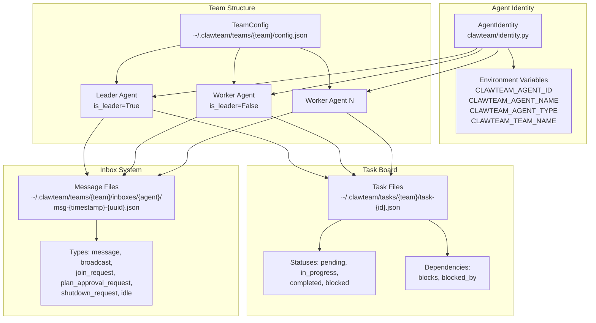

**Sources:** [clawteam/identity.py:48-85](), [skills/clawteam/SKILL.md:50-66](), [docs/skills/clawteam/references/cli-reference.md:12-26]()

---

## Agent Identity

An **agent** is a process (human or AI) that participates in team coordination. Each agent has an identity defined by environment variables that establish its role and team membership.

### AgentIdentity Class

The `AgentIdentity` dataclass [clawteam/identity.py:48-59]() encapsulates agent identity with the following properties:

| Property | Type | Description | Example |
|----------|------|-------------|---------|
| `agent_id` | `str` | Unique identifier | `"a1b2c3d4e5f6"` |
| `agent_name` | `str` | Human-readable name | `"alice"` |
| `user` | `str` | User owning the agent | `"dev-user"` |
| `agent_type` | `str` | Role/capability type | `"leader"`, `"researcher"`, `"general-purpose"` |
| `team_name` | `str \| None` | Team membership | `"dev-team"` |
| `is_leader` | `bool` | Leader privileges | `True` / `False` |
| `plan_mode_required` | `bool` | Requires plan approval | `True` / `False` |

### Environment Variables

Agent identity is established through environment variables. The system supports dual-prefix variables (`CLAWTEAM_*` and legacy `OH_*` or `CLAUDE_CODE_*`) [clawteam/identity.py:10-36]():

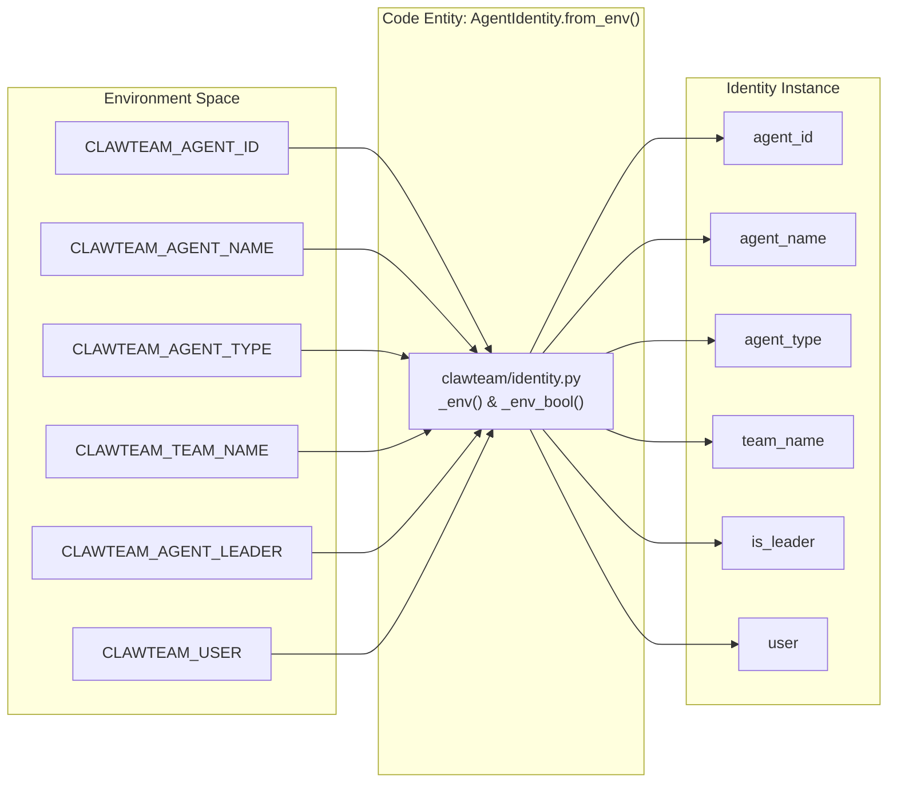

When an agent is spawned via `clawteam spawn`, these environment variables are automatically exported via `to_env()` [clawteam/identity.py:87-103](). Agents can also manually set their identity using `eval $(clawteam identity set ...)`.

**Sources:** [clawteam/identity.py:1-103](), [docs/skills/clawteam/references/cli-reference.md:12-26]()

---

## Teams

A **team** is a named group of agents with one leader and zero or more workers. Teams provide a namespace for tasks, messaging, and coordination.

### Team Structure

Teams are defined by configuration and member lists. Data is stored by default in `~/.clawteam/teams/{team}/` [skills/clawteam/SKILL.md:25]().

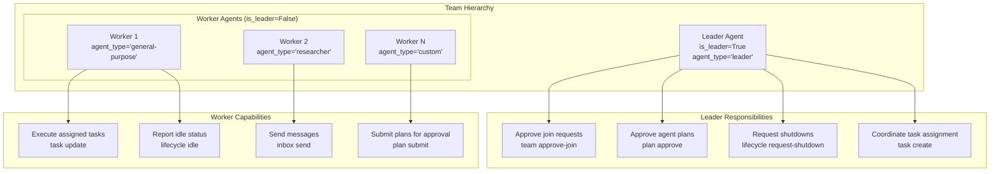

### Leader vs Worker Roles

The distinction between leaders and workers is defined by the `is_leader` flag in the identity [clawteam/identity.py:57]():

- **Leaders** (`is_leader=True`) typically:
  - Create the team using `team spawn-team` [docs/skills/clawteam/references/cli-reference.md:31-48]()
  - Approve or reject join requests [docs/skills/clawteam/references/cli-reference.md:82-96]()
  - Assign tasks and manage the shared task board [skills/clawteam/SKILL.md:76-79]()
  - Approve or reject worker plans [docs/skills/clawteam/references/cli-reference.md:268-283]()

- **Workers** (`is_leader=False`) typically:
  - Request to join teams [docs/skills/clawteam/references/cli-reference.md:69-80]()
  - Execute assigned tasks and update status [skills/clawteam/SKILL.md:144-146]()
  - Submit plans for approval if `plan_mode_required` is enabled [docs/skills/clawteam/references/cli-reference.md:260-266]()
  - Report idle status when work is complete [skills/clawteam/SKILL.md:175-176]()

**Sources:** [skills/clawteam/SKILL.md:52](), [clawteam/identity.py:48-85](), [docs/skills/clawteam/references/cli-reference.md:29-105]()

---

## Tasks

A **task** represents a unit of work on a shared team board. Tasks have statuses, owners, and dependency relationships that enable workflow coordination.

### Task Lifecycle

Tasks progress through states defined by the `TaskStatus` enumeration [docs/skills/clawteam/references/cli-reference.md:203]().

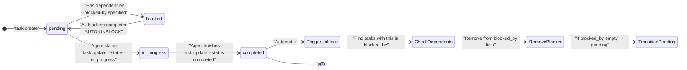

### Task Status Values

Tasks progress through four primary statuses [skills/clawteam/SKILL.md:56]():

| Status | Description | Transition |
|--------|-------------|------------|
| `pending` | Not yet started | Initial state or after unblock |
| `in_progress` | Currently being worked on | Agent claims via `task update` |
| `completed` | Done; triggers auto-unblock | Agent marks complete |
| `blocked` | Waiting on dependencies | Set when `--blocked-by` specified |

### Task Dependencies

Tasks support dependency chains using `blocks` and `blocked-by` relationships [skills/clawteam/SKILL.md:57](). When a task is marked `completed`, ClawTeam automatically unblocks dependent tasks by moving them from `blocked` to `pending` if no other blockers remain [docs/skills/clawteam/references/cli-reference.md:212]().

**Sources:** [skills/clawteam/SKILL.md:56-57](), [docs/skills/clawteam/references/cli-reference.md:162-222]()

---

## Inbox and Messaging

The **inbox** is a message queue system that enables inter-agent communication. Each agent has its own inbox directory within the team data structure [skills/clawteam/SKILL.md:54]().

### Message Operations

The inbox system provides several core operations for communication [docs/skills/clawteam/references/cli-reference.md:108-158]():

- **`send`**: Point-to-point message to a specific agent.
- **`broadcast`**: Message sent to all team members except the sender.
- **`receive`**: Destructive read; retrieves and removes messages from the queue.
- **`peek`**: Non-destructive read; views messages without removing them.
- **`watch`**: Real-time monitoring of the inbox for new messages.

### Communication Protocols

Messages are used for various system protocols beyond general chat:
- **Join Requests**: `request-join` initiates a protocol handled by the leader [docs/skills/clawteam/references/cli-reference.md:69-71]().
- **Plan Approval**: Workers submit plans that leaders must approve before execution [docs/skills/clawteam/references/cli-reference.md:258-283]().
- **Lifecycle**: Agents notify the leader of `idle` status or receive `shutdown` requests [skills/clawteam/SKILL.md:175-178]().

**Sources:** [skills/clawteam/SKILL.md:54](), [docs/skills/clawteam/references/cli-reference.md:108-158]()

---

## Identity and Environment Mapping

The mapping between natural language concepts (like "Agent Name") and code entities is primarily handled by the `AgentIdentity` class.

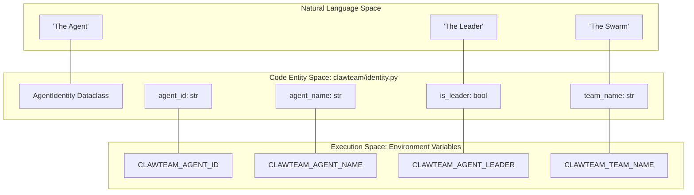

**Sources:** [clawteam/identity.py:48-85](), [docs/skills/clawteam/references/cli-reference.md:12-26]()

---

## Data Storage Layout

All ClawTeam data is stored by default in `~/.clawteam/` [skills/clawteam/SKILL.md:25](). The organization follows a hierarchical structure based on teams and agents.

| Directory/File | Description |
|----------------|-------------|
| `~/.clawteam/teams/{team}/` | Root for team-specific data. |
| `~/.clawteam/teams/{team}/inboxes/{agent}/` | Per-agent message queues. |
| `~/.clawteam/tasks/{team}/` | Task JSON files. |
| `~/.clawteam/worktrees/{team}/{agent}/` | Git worktree for workspace isolation. |
| `~/.clawteam/profiles/` | Reusable runtime and provider configurations. |

**Sources:** [skills/clawteam/SKILL.md:25](), [docs/skills/clawteam/references/cli-reference.md:10](), [scripts/install_clawteam.sh:9-10]()

---

# Page: Architecture Overview

# Architecture Overview

<details>
<summary>Relevant source files</summary>

The following files were used as context for generating this wiki page:

- [README.md](README.md)
- [clawteam/cli/commands.py](clawteam/cli/commands.py)
- [clawteam/store/file.py](clawteam/store/file.py)
- [clawteam/team/mailbox.py](clawteam/team/mailbox.py)
- [clawteam/team/manager.py](clawteam/team/manager.py)
- [clawteam/transport/file.py](clawteam/transport/file.py)
- [scripts/clawteam_local_install](scripts/clawteam_local_install)
- [scripts/install_clawteam.sh](scripts/install_clawteam.sh)
- [tests/test_cli_commands.py](tests/test_cli_commands.py)
- [tests/test_mailbox.py](tests/test_mailbox.py)

</details>


This page describes the high-level architecture of ClawTeam, focusing on the major system components, their responsibilities, and how they interact. For low-level implementation details of specific subsystems, see [Storage Layer](#11.1), [Transport Layer](#11.2), [Board Data Collection](#11.3), and [Spawn Backends](#11.4).

## System Purpose

ClawTeam is a multi-agent coordination framework designed to enable AI agents to self-organize into teams, communicate, manage tasks, and work in isolated environments. The architecture is built around three key principles:

1.  **CLI-first**: All functionality is exposed through CLI commands that agents can execute [clawteam/cli/commands.py:1-26]().
2.  **File-based state**: Primary state lives in `~/.clawteam/` as JSON files with atomic writes [clawteam/team/models.py:19-21](), [clawteam/transport/file.py:102-107]().
3.  **Process isolation**: Agents run as separate processes in isolated git worktrees with tmux or subprocess backends [clawteam/cli/commands.py:1600-1615]().

## Layered Architecture

ClawTeam is organized into four primary architectural layers:

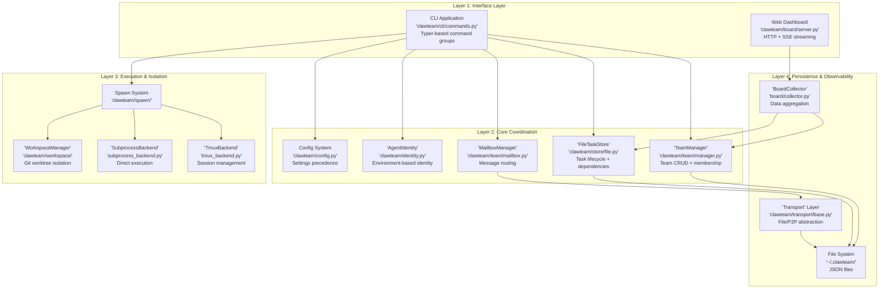

**Sources:** [clawteam/cli/commands.py:22-175](), [clawteam/team/manager.py:50-51](), [clawteam/store/file.py:45-52](), [clawteam/team/mailbox.py:32-39](), [clawteam/transport/file.py:102-107]().

## Core Components

### Interface Layer

| Component | File | Responsibility |
|-----------|------|----------------|
| **CLI Application** | [clawteam/cli/commands.py]() | Typer-based command groups: `team`, `task`, `inbox`, `spawn`, `board`, `workspace`, `config`, etc. |
| **Web Dashboard** | [clawteam/board/server.py]() | HTTP server with SSE endpoints for real-time board updates. |

The CLI is the primary interface. Every command follows the pattern: `clawteam <group> <command> [args] [--options]`. The `--json` flag enables structured output for agent consumption [clawteam/cli/commands.py:50-52]().

**Sources:** [clawteam/cli/commands.py:22-60]().

### Core Coordination Layer

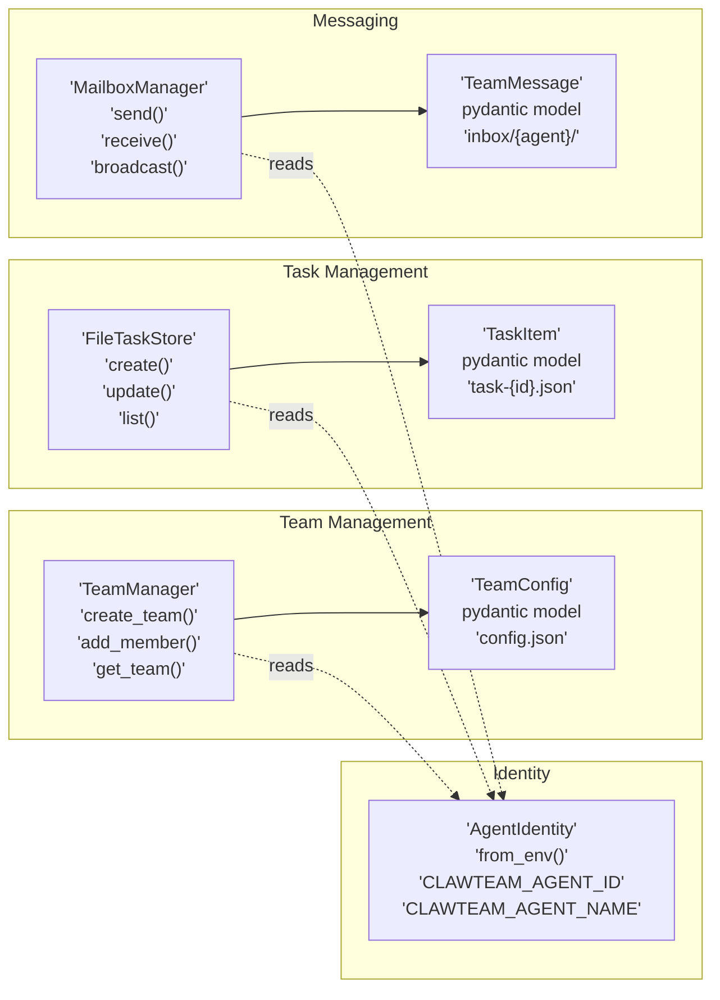

**TeamManager** ([clawteam/team/manager.py]()) manages team lifecycle:
- `create_team()`: Creates `~/.clawteam/teams/{name}/config.json` [clawteam/team/manager.py:78-112]().
- `add_member()`: Appends to `members` array in config [clawteam/team/manager.py:140-167]().
- `discover_teams()`: Scans filesystem for all teams [clawteam/team/manager.py:115-133]().

**FileTaskStore** ([clawteam/store/file.py]()) manages task state with automatic dependency resolution:
- `create()`: Creates `~/.clawteam/tasks/{team}/task-{id}.json` [clawteam/store/file.py:77-121]().
- `update()`: Atomic update with OS-specific advisory locking [clawteam/store/file.py:136-200]().
- Task states: `pending`, `in_progress`, `completed`, `blocked` [clawteam/store/file.py:156-163]().

**MailboxManager** ([clawteam/team/mailbox.py]()) handles inter-agent messaging:
- `send()`: Delivers message to target via `Transport` [clawteam/team/mailbox.py:72-141]().
- `receive()`: Fetches and consumes messages [clawteam/team/mailbox.py:206-216]().
- `broadcast()`: Sends to all team members except sender [clawteam/team/mailbox.py:143-150]().

**AgentIdentity** ([clawteam/identity.py]()) provides environment-based identity by reading `CLAWTEAM_AGENT_ID`, `CLAWTEAM_AGENT_NAME`, and `CLAWTEAM_TEAM_NAME`.

**Sources:** [clawteam/team/manager.py:50-210](), [clawteam/store/file.py:45-200](), [clawteam/team/mailbox.py:32-220]().

### Persistence Layer

ClawTeam uses a hierarchical file-based storage system rooted at `~/.clawteam/` [clawteam/team/models.py:19-21]().

| Directory | Contents | Implementation |
|-----------|----------|----------------|
| `teams/{name}/config.json` | Team configuration and membership | [clawteam/team/manager.py:24-48]() |
| `teams/{name}/inboxes/{agent}/` | Incoming messages (JSON) | [clawteam/transport/file.py:53-61]() |
| `tasks/{team}/task-{id}.json` | Task state and metadata | [clawteam/store/file.py:24-35]() |
| `teams/{name}/events/` | Permanent event log (JSONL) | [clawteam/team/mailbox.py:45-60]() |

All file operations utilize an atomic "write-then-rename" pattern to prevent partial reads during concurrent access [clawteam/transport/file.py:138-152](), [clawteam/team/manager.py:39-48]().

**Sources:** [clawteam/transport/file.py:49-78](), [clawteam/store/file.py:24-43](), [clawteam/team/mailbox.py:45-60]().

## Command Flow Pattern

The interaction between agents and the coordination layer follows a standardized CLI-to-Storage pattern:

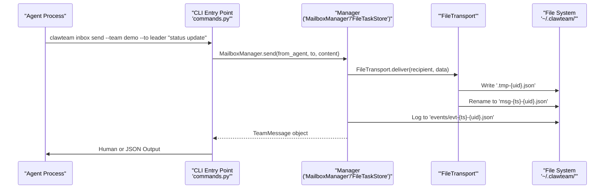

**Key aspects:**
1.  **Identity Resolution**: Identity is derived from the environment during command execution [clawteam/team/mailbox.py:24-27]().
2.  **Atomic Delivery**: Messages are written to temporary files and moved to final locations to ensure consistency [clawteam/transport/file.py:145-148]().
3.  **Event Logging**: Every sent message is duplicated into a non-consuming event log for auditability [clawteam/team/mailbox.py:48-59]().

**Sources:** [clawteam/team/mailbox.py:72-141](), [clawteam/transport/file.py:138-152](), [clawteam/cli/commands.py:77-85]().

## Transport Abstraction

The messaging system is decoupled from the physical storage via the `Transport` abstraction [clawteam/transport/base.py]().

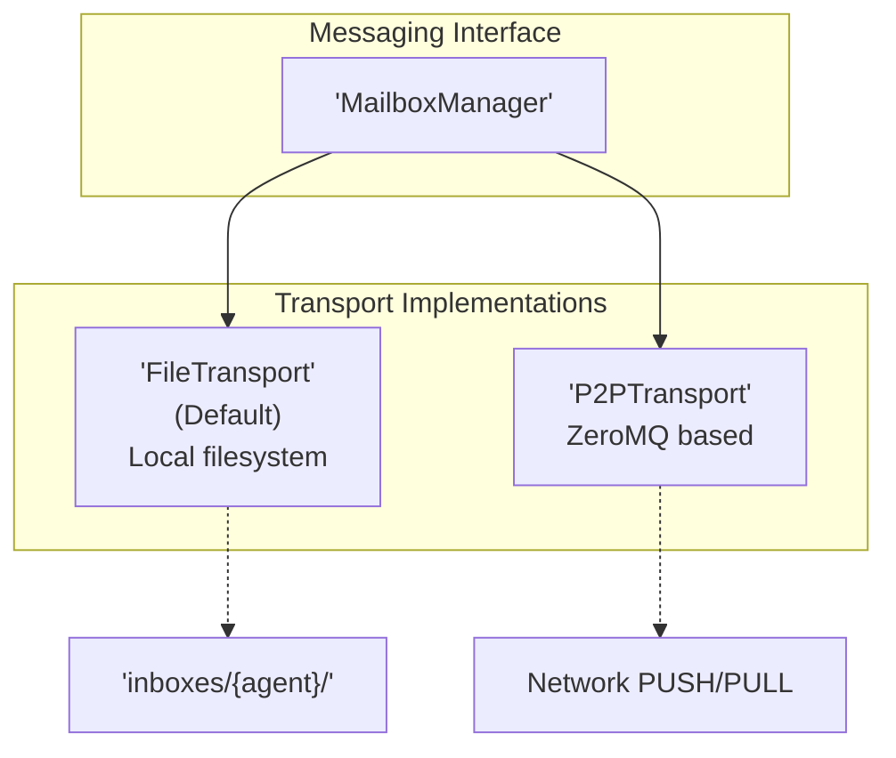

The system defaults to `FileTransport` but can be switched to `p2p` via the `CLAWTEAM_TRANSPORT` environment variable [clawteam/team/mailbox.py:15-29]().

**Sources:** [clawteam/team/mailbox.py:15-30](), [clawteam/transport/file.py:102-107]().

---

# Page: Getting Started

# Getting Started

<details>
<summary>Relevant source files</summary>

The following files were used as context for generating this wiki page:

- [README.md](README.md)
- [clawteam/__init__.py](clawteam/__init__.py)
- [clawteam/board/renderer.py](clawteam/board/renderer.py)
- [clawteam/config.py](clawteam/config.py)
- [clawteam/timefmt.py](clawteam/timefmt.py)
- [pyproject.toml](pyproject.toml)
- [scripts/clawteam_local_install](scripts/clawteam_local_install)
- [scripts/install_clawteam.sh](scripts/install_clawteam.sh)
- [tests/test_config.py](tests/test_config.py)
- [tests/test_timefmt.py](tests/test_timefmt.py)

</details>


This guide covers the installation and initial setup of ClawTeam. It walks through system requirements, installation steps, verification procedures, and the basic file system layout. For a hands-on tutorial with step-by-step examples, see [Quick Start Tutorial](#2.1). For detailed configuration options, see [Configuration](#2.2).

---

## System Requirements

ClawTeam requires Python 3.10 or higher [pyproject.toml:6]() and runs on Linux, macOS, and Windows (with WSL for full tmux support).

| Requirement | Minimum | Recommended |
|------------|---------|-------------|
| Python | 3.10+ | 3.11+ |
| Disk Space | 10 MB | 100 MB+ for workspace isolation |
| Memory | 100 MB | 1 GB+ for multiple agents |
| OS | Linux, macOS, Windows (WSL) | Linux or macOS for tmux backend |

**Core Dependencies:**
- `typer` — CLI framework [pyproject.toml:22]()
- `pydantic` — Data validation [pyproject.toml:23]()
- `rich` — Terminal formatting [pyproject.toml:24]()

**Optional Dependencies:**
- `tmux` — Required for default `tmux` backend [clawteam/config.py:58]()
- `git` — Required for workspace isolation (git worktrees)
- `pyzmq` — Required for P2P transport [pyproject.toml:35-37]()

**Sources:** [pyproject.toml:1-40](), [clawteam/config.py:50-70]()

---

## Installation

### Standard Installation

Install ClawTeam via pip:

```bash
pip install clawteam
```

### Installation from Source

For development or to use the latest features, you can use the provided local installation script which sets up a virtual environment in `~/.clawteam/.venv` and links the binary [scripts/clawteam_local_install:1-156]():

```bash
git clone https://github.com/HKUDS/ClawTeam.git
cd ClawTeam
./scripts/clawteam_local_install
```

### Optional: P2P Transport

To enable ZeroMQ-based P2P transport for low-latency inter-agent messaging:

```bash
pip install "clawteam[p2p]"
```

This installs the `pyzmq` library required for the P2P transport backend [pyproject.toml:35-37]().

**Sources:** [pyproject.toml:35-37](), [scripts/clawteam_local_install:1-156](), [scripts/install_clawteam.sh:1-144]()

---

## Verifying Installation

After installation, verify that ClawTeam is correctly installed and accessible:

### Check CLI Availability

```bash
clawteam --version
```

Expected output:
```
ClawTeam CLI version 0.3.0
```

### Check System Health

```bash
clawteam config health
```

This command verifies:
- Data directory is accessible (`~/.clawteam/`)
- Configuration file is valid [clawteam/config.py:81-90]()
- Required directories exist
- File permissions are correct

### Display Current Configuration

```bash
clawteam config show
```

This displays all active configuration settings with their sources (environment variable, config file, or default) [clawteam/config.py:98-134]().

**Sources:** [clawteam/cli/commands.py:43](), [clawteam/config.py:76-134]()

---

## Installation Architecture

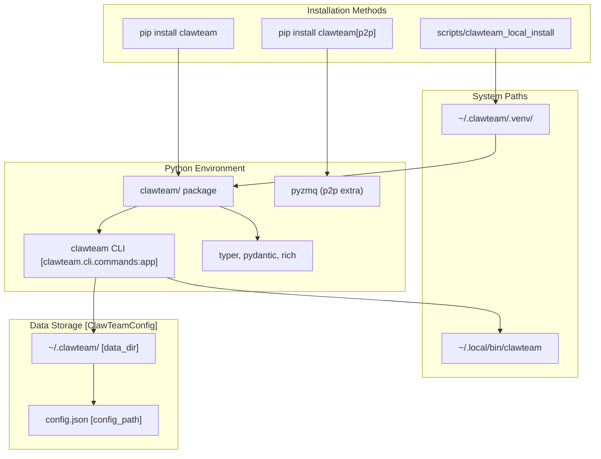

This diagram shows the installation flow and how the CLI maps to the filesystem and Python environment.

**Sources:** [pyproject.toml:42-44](), [clawteam/config.py:76-79](), [scripts/clawteam_local_install:10-146]()

---

## Data Directory Structure

ClawTeam stores all state in a file-based data directory, defaulting to `~/.clawteam/` [clawteam/config.py:76-79]().

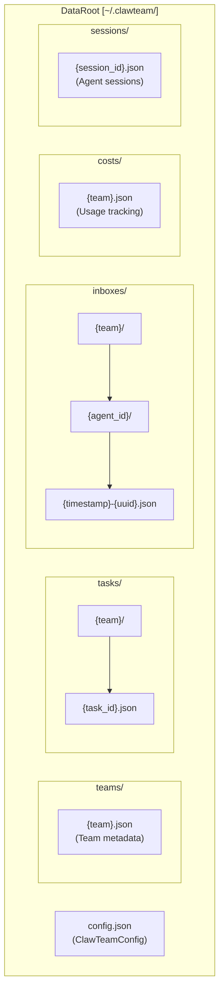

### Directory Purposes

| Directory | Purpose | Key Code Entity |
|-----------|---------|-----------|
| `teams/` | Team metadata and membership | `TeamStore` |
| `tasks/{team}/` | Task board per team | `TaskStore` |
| `inboxes/{team}/{agent}/` | Message queues per agent | `MailboxManager` |
| `costs/` | Token usage tracking | `CostTracker` |
| `sessions/` | Spawn session state for resume | `SessionManager` |
| `config.json` | Persistent user settings | `ClawTeamConfig` |

### Data Persistence
All state files use JSON format. ClawTeam employs atomic writes via `atomic_write_text` to ensure data consistency [clawteam/config.py:11](), [clawteam/config.py:93-95]().

**Sources:** [clawteam/config.py:50-95](), [clawteam/board/renderer.py:101-150]()

---

## CLI Entry Point and Command Groups

The CLI is built using `typer` and organized into logical command groups [pyproject.toml:43]().

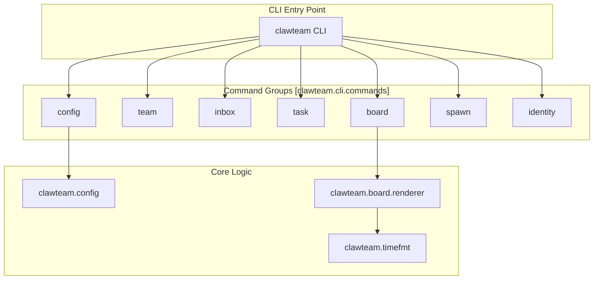

**Sources:** [pyproject.toml:43](), [clawteam/board/renderer.py:18-22](), [clawteam/timefmt.py:8-10]()

---

## Configuration Precedence

ClawTeam resolves configuration values using `get_effective` in the following order (highest to lowest priority) [clawteam/config.py:98-134]():

1. **Environment Variables**: Prefixed with `CLAWTEAM_` (e.g., `CLAWTEAM_USER`) [clawteam/config.py:103-119]().
2. **Config File**: Located at `~/.clawteam/config.json` [clawteam/config.py:76-79]().
3. **Built-in Defaults**: Defined in the `ClawTeamConfig` Pydantic model [clawteam/config.py:50-70]().

### Common Configuration Keys

| Key | Env Var | Default |
|-----|---------|---------|
| `user` | `CLAWTEAM_USER` | `""` |
| `default_backend` | `CLAWTEAM_DEFAULT_BACKEND` | `"tmux"` |
| `workspace` | `CLAWTEAM_WORKSPACE` | `"auto"` |
| `timezone` | `CLAWTEAM_TIMEZONE` | `"UTC"` |

**Sources:** [clawteam/config.py:50-70](), [clawteam/config.py:103-134]()

---

## Next Steps

1. **Follow the tutorial:** See [Quick Start Tutorial](#2.1) for a walkthrough of creating your first team.
2. **Configure settings:** See [Configuration](#2.2) to customize your environment.
3. **Monitor your team:** Use `clawteam board live` to watch agent progress in real-time [clawteam/board/renderer.py:51-90]().

**Sources:** [clawteam/board/renderer.py:51-90](), [README.md:352-383]()

---

# Page: Quick Start Tutorial

# Quick Start Tutorial

<details>
<summary>Relevant source files</summary>

The following files were used as context for generating this wiki page:

- [README.md](README.md)
- [clawteam/cli/commands.py](clawteam/cli/commands.py)
- [docs/skills/clawteam/SKILL.md](docs/skills/clawteam/SKILL.md)
- [docs/skills/clawteam/references/cli-reference.md](docs/skills/clawteam/references/cli-reference.md)
- [scripts/clawteam_local_install](scripts/clawteam_local_install)
- [scripts/install_clawteam.sh](scripts/install_clawteam.sh)
- [skills/clawteam/SKILL.md](skills/clawteam/SKILL.md)
- [skills/clawteam/references/cli-reference.md](skills/clawteam/references/cli-reference.md)
- [tests/test_cli_commands.py](tests/test_cli_commands.py)

</details>


This tutorial walks you through creating your first ClawTeam multi-agent system. You will create a team, spawn multiple agents with isolated workspaces, assign tasks with dependencies, and observe agents coordinating autonomously. By the end, you will understand the core ClawTeam workflow and be ready to build your own agent teams.

**Scope**: This page covers basic team creation, agent spawning, task management, and monitoring. For configuration details, see [Configuration](#2.2). For advanced team management features like join requests and approvals, see [Team Management](#3). For workspace isolation mechanics, see [Workspace Isolation](#7).

## Prerequisites

Before starting, ensure you have:

| Requirement | Description | Verification |
|-------------|-------------|--------------|
| **Python 3.10+** | ClawTeam runtime | `python --version` |
| **ClawTeam installed** | Via `pip install clawteam` | `clawteam --version` |
| **tmux** | Terminal multiplexer (default backend) | `tmux -V` |
| **Git repository** | For workspace isolation | `git status` (run in a repo) |
| **CLI agent** | Claude Code, Codex, or any CLI agent | `claude --version` |

**Note**: You must run ClawTeam commands from inside a git repository. Each spawned agent receives its own git worktree, ensuring code isolation.

**Sources**: [README.md:16-19](), [skills/clawteam/SKILL.md:27-49](), [scripts/install_clawteam.sh:25-31]()

## Two Approaches to ClawTeam

ClawTeam offers two workflows:

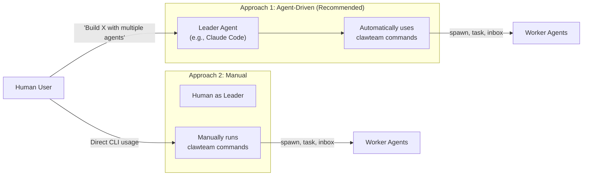

**Approach 1 (Agent-Driven)**: Give a natural language goal to an AI agent. The agent uses ClawTeam skills to spawn sub-agents, create tasks, and coordinate work. This is the recommended approach for production workflows.

**Approach 2 (Manual)**: Execute ClawTeam commands yourself to understand the system. This tutorial uses the manual approach for learning purposes.

**Sources**: [README.md:157-182](), [skills/clawteam/SKILL.md:3-15]()

## Step-by-Step Tutorial

This tutorial demonstrates a software development workflow: three agents working on independent features with one dependent integration task.

### Step 1: Set Leader Identity

Every ClawTeam agent needs an identity. Set environment variables to establish yourself as the leader:

```bash
export CLAWTEAM_AGENT_ID="tutorial-leader-001"
export CLAWTEAM_AGENT_NAME="leader"
export CLAWTEAM_AGENT_TYPE="leader"
```

**Identity Components**:

| Variable | Purpose | Example |
|----------|---------|---------|
| `CLAWTEAM_AGENT_ID` | Unique identifier (UUID-like) | `tutorial-leader-001` |
| `CLAWTEAM_AGENT_NAME` | Human-readable name | `leader` |
| `CLAWTEAM_AGENT_TYPE` | Agent role/category | `leader`, `worker`, `researcher` |

These variables are automatically propagated to spawned agents. For details on identity propagation, see [Agent Identity](#3.1).

**Sources**: [docs/skills/clawteam/references/cli-reference.md:12-26](), [skills/clawteam/SKILL.md:71-75]()

### Step 2: Create Team

```bash
clawteam team spawn-team tutorial-team \
  -d "Tutorial: multi-agent software development" \
  -n leader
```

**Expected Output**:
```
OK Team 'tutorial-team' created with leader 'leader'
```

**What Happens**: The `team spawn-team` command triggers the creation of team metadata and member records. It registers the current session as the leader.

**Sources**: [docs/skills/clawteam/references/cli-reference.md:31-48](), [skills/clawteam/SKILL.md:76]()

### Step 3: Create Tasks with Dependencies

Create three tasks: two independent features and one integration task blocked by both:

```bash
# Independent task 1
T1=$(clawteam --json task create tutorial-team \
  "Implement authentication module" \
  -o worker1 \
  -d "Add JWT-based authentication to auth.py" | \
  python3 -c "import sys,json;print(json.load(sys.stdin)['id'])")

# Independent task 2
T2=$(clawteam --json task create tutorial-team \
  "Implement database layer" \
  -o worker2 \
  -d "Add SQLAlchemy models to models.py" | \
  python3 -c "import sys,json;print(json.load(sys.stdin)['id'])")

# Dependent task (blocked by both T1 and T2)
T3=$(clawteam --json task create tutorial-team \
  "Write integration tests" \
  -o worker3 \
  -d "Test auth + database integration" \
  --blocked-by "$T1,$T2" | \
  python3 -c "import sys,json;print(json.load(sys.stdin)['id'])")

echo "Tasks created: T1=$T1 T2=$T2 T3=$T3"
```

**Task Dependency Graph**:

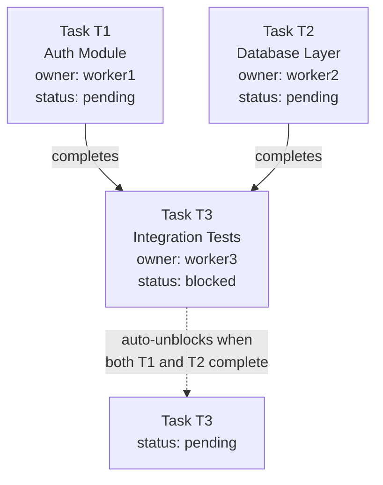

**Task States**:

| Task | Initial Status | Reason |
|------|---------------|--------|
| T1 | `pending` | No dependencies, ready to work |
| T2 | `pending` | No dependencies, ready to work |
| T3 | `blocked` | Depends on T1 and T2 via `--blocked-by` |

**Auto-Unblock Mechanism**: When a task is marked `completed`, any tasks blocked by it are automatically unblocked (moved from `blocked` to `pending` if no other blockers remain).

**Sources**: [docs/skills/clawteam/references/cli-reference.md:164-212](), [skills/clawteam/SKILL.md:138-140](), [tests/test_cli_commands.py:208-241]()

### Step 4: Verify Task Board

```bash
clawteam board show tutorial-team
```

**Expected Output** (formatted as Kanban board):

```
╭─────────────────────────────────────────────────────────────╮
│ PENDING                                                      │
├─────────────────────────────────────────────────────────────┤
│ [a1b2c3d4] Implement authentication module                  │
│   Owner: worker1                                             │
│                                                               │
│ [e5f6g7h8] Implement database layer                         │
│   Owner: worker2                                             │
╰─────────────────────────────────────────────────────────────╯

╭─────────────────────────────────────────────────────────────╮
│ BLOCKED                                                      │
├─────────────────────────────────────────────────────────────┤
│ [i9j0k1l2] Write integration tests                          │
│   Owner: worker3                                             │
│   Blocked by: a1b2c3d4, e5f6g7h8                            │
╰─────────────────────────────────────────────────────────────╯
```

**Sources**: [docs/skills/clawteam/references/cli-reference.md:226-234](), [skills/clawteam/SKILL.md:80]()

### Step 5: Spawn Worker Agents

Spawn three agents, each in an isolated tmux window (default) and git worktree:

```bash
clawteam spawn --team tutorial-team \
  --agent-name worker1 \
  --task "Implement JWT authentication in auth.py. Mark task complete when done."

clawteam spawn --team tutorial-team \
  --agent-name worker2 \
  --task "Add SQLAlchemy models in models.py. Mark task complete when done."

clawteam spawn --team tutorial-team \
  --agent-name worker3 \
  --task "Wait for auth and db tasks to complete. Then write integration tests."
```

**Spawn Process Diagram**:

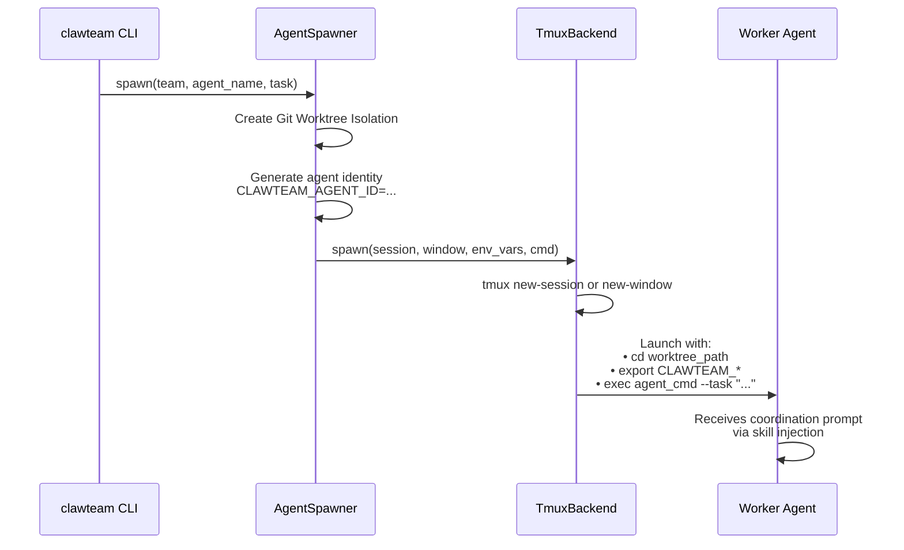

**What Each Agent Receives**:

1. **Isolated Workspace**: Git worktree at `~/.clawteam/workspaces/tutorial-team/worker1/`.
2. **Identity Environment Variables**: `CLAWTEAM_AGENT_NAME`, `CLAWTEAM_TEAM_NAME`, etc.
3. **Coordination Skill**: Auto-injected instructions teaching the agent to use `clawteam` commands.

**Sources**: [skills/clawteam/SKILL.md:103-134](), [docs/skills/clawteam/references/cli-reference.md:24](), [clawteam/cli/commands.py:87-95]()

### Step 6: Monitor Agent Activity

**Option A: Watch All Agents Simultaneously**

```bash
clawteam board attach tutorial-team
```

This creates a tiled tmux layout showing all agent terminals side-by-side.

**Option B: Live Terminal Kanban Board**

```bash
clawteam board live tutorial-team --interval 3
```

**Option C: View Task List**

```bash
clawteam task list tutorial-team
```

**Sources**: [skills/clawteam/SKILL.md:118-121](), [docs/skills/clawteam/references/cli-reference.md:248-255]()

### Step 7: Wait for Completion

Use `task wait` to block until all tasks complete:

```bash
clawteam --json task wait tutorial-team --timeout 600
```

**How `task wait` Works**:

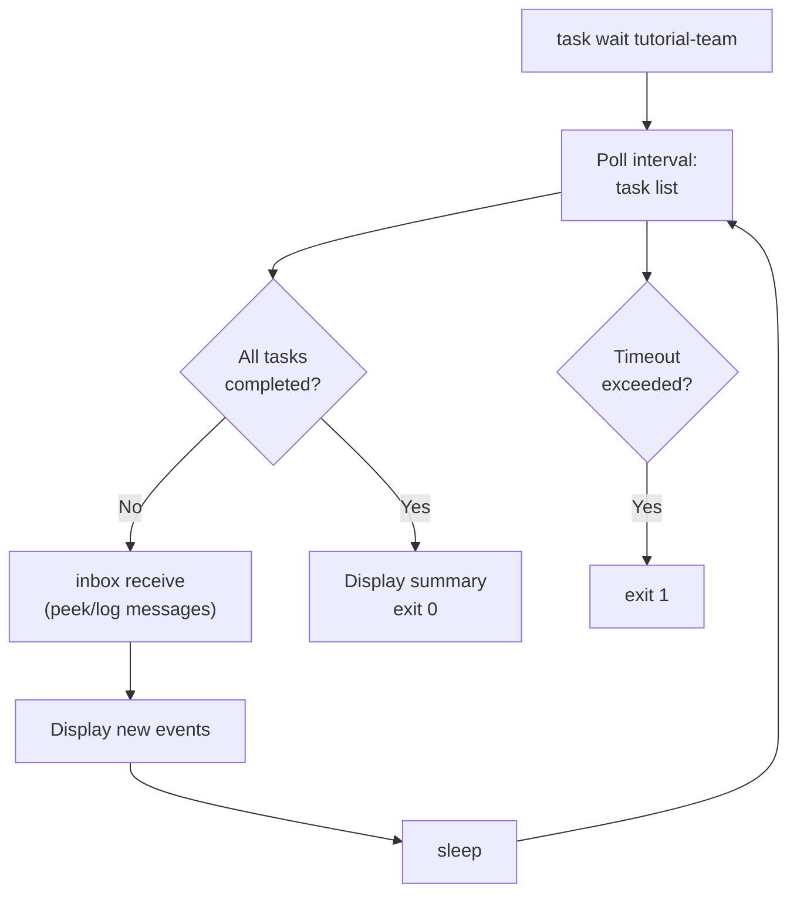

**Sources**: [skills/clawteam/SKILL.md:154-161](), [docs/skills/clawteam/references/cli-reference.md:297-301]()

### Step 8: Inter-Agent Communication (Manual Example)

While agents coordinate themselves via the skill protocol, you can manually send instructions:

```bash
clawteam inbox send tutorial-team worker1 "Please prioritize the login endpoint"
```

The agent will see this message when it runs `clawteam inbox receive`.

**Sources**: [docs/skills/clawteam/references/cli-reference.md:110-143](), [tests/test_cli_commands.py:111-137]()

### Step 9: Cleanup

Remove worktrees, branches, and team data:

```bash
# Delete the team and all associated data
clawteam team cleanup tutorial-team --force
```

**Sources**: [docs/skills/clawteam/references/cli-reference.md:98-105](), [skills/clawteam/SKILL.md:25]()

## What You Learned

✅ **Team Creation**: `team spawn-team` initializes the coordination environment.

✅ **Task Dependencies**: `--blocked-by` flag creates dependency chains with automatic unblocking.

✅ **Agent Spawning**: `spawn` creates isolated execution environments with injected identity.

✅ **Coordination**: Agents autonomously query tasks and report status using the CLI.

✅ **Communication**: `inbox` commands enable structured messaging between agents.

✅ **Monitoring**: `board` commands provide terminal-based observability.

## Next Steps

| Topic | Link | Description |
|-------|------|-------------|
| **Configure ClawTeam** | [Configuration](#2.2) | Set transport layer, data directory, and defaults |
| **Advanced Team Features** | [Team Management](#3) | Join requests, approvals, and lifecycle |
| **Task Dependencies** | [Task Dependencies](#4.1) | Complex dependency graphs and waiting |
| **Agent Communication** | [Agent Communication](#5) | Broadcast and message protocols |
| **Team Templates** | [Team Templates](#8) | Launch pre-configured teams from TOML |

**Sources**: [skills/clawteam/SKILL.md:50-66](), [README.md:184-210]()

---

# Page: Configuration

# Configuration

<details>
<summary>Relevant source files</summary>

The following files were used as context for generating this wiki page:

- [README.md](README.md)
- [clawteam/board/renderer.py](clawteam/board/renderer.py)
- [clawteam/config.py](clawteam/config.py)
- [clawteam/paths.py](clawteam/paths.py)
- [clawteam/timefmt.py](clawteam/timefmt.py)
- [scripts/clawteam_local_install](scripts/clawteam_local_install)
- [scripts/install_clawteam.sh](scripts/install_clawteam.sh)
- [tests/test_config.py](tests/test_config.py)
- [tests/test_paths.py](tests/test_paths.py)
- [tests/test_timefmt.py](tests/test_timefmt.py)
- [tests/test_windows_compat.py](tests/test_windows_compat.py)

</details>


This document describes the ClawTeam configuration system, which controls global settings such as data directory location, default team, transport backend, workspace behavior, and agent spawn defaults. Configuration values can be set via environment variables, a persistent config file, or CLI global options, with a well-defined precedence hierarchy.

For agent-specific identity configuration (agent name, ID, type), see [Agent Identity](#3.1). For team-specific settings like budget and description, see [Team Management](#3).

---

## Configuration Sources and Precedence

ClawTeam resolves configuration values from three sources with the following priority order:

1. **Environment variables** (highest priority)
2. **Configuration file** (`~/.clawteam/config.json`)
3. **Defaults** (lowest priority)

### Configuration Resolution Flow

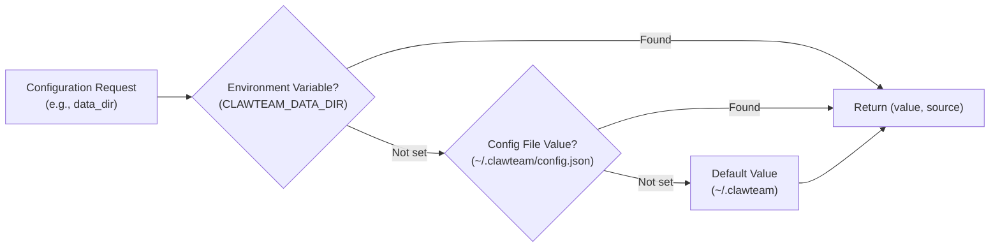

**Sources:** [clawteam/config.py:98-134]()

---

## Configuration Model

The `ClawTeamConfig` class (aliased as `HarnessConfig`) defines all available configuration keys using Pydantic for validation.

| Key | Type | Default | Environment Variable | Description |
|-----|------|---------|---------------------|-------------|
| `data_dir` | `str` | `""` | `CLAWTEAM_DATA_DIR` | Override data directory (default: `~/.clawteam`) |
| `user` | `str` | `""` | `CLAWTEAM_USER` | User identity for multi-user scenarios |
| `default_team` | `str` | `""` | `CLAWTEAM_TEAM_NAME` | Default team name for commands |
| `transport` | `str` | `""` | `CLAWTEAM_TRANSPORT` | Transport backend: `file` or `p2p` |
| `workspace` | `str` | `"auto"` | `CLAWTEAM_WORKSPACE` | Git worktree mode: `auto`, `always`, or `never` |
| `default_backend` | `str` | `"tmux"` | `CLAWTEAM_DEFAULT_BACKEND` | Agent spawn backend: `tmux` or `subprocess` |
| `skip_permissions` | `bool` | `true` | `CLAWTEAM_SKIP_PERMISSIONS` | Pass `--dangerously-skip-permissions` to Claude |
| `timezone` | `str` | `"UTC"` | `CLAWTEAM_TIMEZONE` | Display timezone for human-readable timestamps |
| `spawn_ready_timeout`| `float` | `30.0` | `CLAWTEAM_SPAWN_READY_TIMEOUT` | Max seconds to poll for TUI readiness |

**Sources:** [clawteam/config.py:50-73](), [clawteam/config.py:103-119]()

---

## Configuration File Location

The configuration file is stored at a **fixed location** that is never affected by the `data_dir` setting. This ensures that configuration is always accessible regardless of where team data is stored.

```
~/.clawteam/config.json
```

The file is written using `atomic_write_text`, which uses a temporary file and an atomic replace operation to prevent corruption during concurrent access.

**Sources:** [clawteam/config.py:76-78](), [clawteam/config.py:93-95]()

---

## Code Entity Association

The following diagram maps natural language configuration concepts to specific classes and functions in the codebase.

### Configuration Entity Map

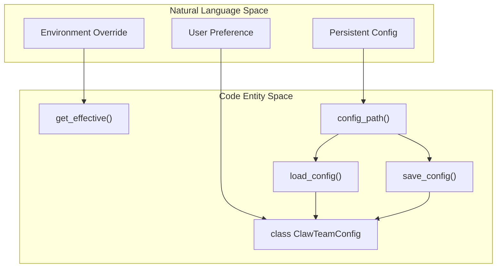

**Sources:** [clawteam/config.py:50-134]()

---

## Global CLI Options

Configuration can also be overridden **per-command** using global CLI options. These options set environment variables internally which take precedence over the config file.

| Option | Description |
|--------|-------------|
| `--data-dir PATH` | Override data directory for this command |
| `--transport TYPE` | Override transport backend (`file` or `p2p`) |

**Sources:** [clawteam/config.py:103-108]()

---

## Data Flow: Configuration to Subsystems

Configuration values propagate from the `get_effective` resolution function into various system components to control behavior.

```mermaid
graph TB
    subgraph "Resolution Layer"
        Effective["get_effective(key)"]
    end
    
    subgraph "System Components"
        TimeFmt["clawteam.timefmt"]
        Board["clawteam.board.renderer"]
        Workspace["clawteam.workspace"]
        Spawn["clawteam.cli (spawn)"]
    end
    
    Effective -->|"timezone"| TimeFmt
    Effective -->|"timezone"| Board
    Effective -->|"workspace"| Workspace
    Effective -->|"default_backend"| Spawn
    Effective -->|"skip_permissions"| Spawn
```

**Sources:** [clawteam/timefmt.py:38-48](), [clawteam/board/renderer.py:112-121](), [clawteam/config.py:103-119]()

---

## Configuration Key Details

### timezone

**Purpose:** Controls how timestamps are rendered in the CLI and Web UI.
**Behavior:** If set to a valid `ZoneInfo` name (e.g., `Asia/Shanghai`), `format_timestamp` will convert UTC stored times to this local zone for display.

**Sources:** [clawteam/timefmt.py:24-49]()

### workspace

**Purpose:** Control automatic git worktree creation for agent isolation.
**Values:**
- `auto` (default): Create worktree if in a git repo, skip if not.
- `always`: Require git repo, fail if not present.
- `never`: Never create worktrees, agents share the same directory.

**Sources:** [clawteam/config.py:57]()

### skip_permissions

**Purpose:** Automatically pass `--dangerously-skip-permissions` to Claude Code CLI.
**Rationale:** In multi-agent workflows, agents need to execute tools autonomously without manual approval. This flag is on by default (`true`) for frictionless coordination.

**Sources:** [clawteam/config.py:59]()

---

## Installation and Path Configuration

The installation scripts (`install_clawteam.sh` and `clawteam_local_install`) set up the initial environment and link the binary.

1. **VENV_PATH:** Defaults to `~/.clawteam/.venv`.
2. **BIN_DIR:** Defaults to `~/.local/bin`.
3. **Python Requirement:** Requires Python 3.10 or higher.

The installer also probes for agent clients (like Claude Code, Cursor, or Nanobot) to install the `clawteam` skill.

**Sources:** [scripts/install_clawteam.sh:9-16](), [scripts/install_clawteam.sh:117-121](), [scripts/clawteam_local_install:57-69]()

---

# Page: Team Management

# Team Management

<details>
<summary>Relevant source files</summary>

The following files were used as context for generating this wiki page:

- [clawteam/cli/commands.py](clawteam/cli/commands.py)
- [clawteam/store/file.py](clawteam/store/file.py)
- [clawteam/team/mailbox.py](clawteam/team/mailbox.py)
- [clawteam/team/manager.py](clawteam/team/manager.py)
- [clawteam/team/watcher.py](clawteam/team/watcher.py)
- [tests/test_cli_commands.py](tests/test_cli_commands.py)

</details>


Team Management encompasses the creation, configuration, and lifecycle of agent teams in ClawTeam. A team is a collection of agents with a designated leader, shared task board, messaging system, and optional budget constraints. Teams provide the organizational structure for multi-agent coordination.

For information about individual agent identity and roles within teams, see [Agent Identity](#3.1). For spawning agent processes within teams, see [Spawning Agents](#3.2).

---

## Team Lifecycle

Teams progress through a defined lifecycle from creation to deletion. The leader agent is registered at team creation and has special privileges for approving join requests and coordinating work.

### Team Creation Flow

```mermaid
graph LR
    A["clawteam team spawn-team"] --> B["TeamManager.create_team()"]
    B --> C["Generate TeamConfig"]
    C --> D["Write config.json"]
    D --> E["Create inboxes/ directory"]
    E --> F["Register leader as first member"]
    F --> G["Return TeamConfig"]
    
    H["Environment Variables"] -.-> B
    H -.-> |"CLAWTEAM_AGENT_ID<br/>CLAWTEAM_AGENT_NAME<br/>CLAWTEAM_USER"| B
```

**Sources:** [clawteam/cli/commands.py:232-273](), [clawteam/team/manager.py:78-112]()

When a team is created via `clawteam team spawn-team <name>`, the system:

1. **Reads identity** from environment variables or CLI options (`CLAWTEAM_AGENT_ID`, `CLAWTEAM_AGENT_NAME`, `CLAWTEAM_USER`) [clawteam/cli/commands.py:254-262]().
2. **Creates team directory** at `~/.clawteam/teams/<name>/` [clawteam/team/manager.py:20-21]().
3. **Generates TeamConfig** with leader information [clawteam/team/manager.py:98-103]().
4. **Writes config.json** to persist team metadata [clawteam/team/manager.py:104-104]().
5. **Creates inboxes/** subdirectory for agent mailboxes [clawteam/team/manager.py:106-108]().
6. **Registers leader** as the first team member [clawteam/team/manager.py:92-97]().

```bash
# Example: Create a team with custom leader name
clawteam team spawn-team dev-team \
  -d "Backend development team" \
  -n alice \
  --agent-type leader
```

**Sources:** [clawteam/cli/commands.py:232-273](), [clawteam/team/manager.py:78-112]()

---

## CLI Commands to TeamManager Mapping

The team management CLI commands delegate to the `TeamManager` and `MailboxManager` classes for all operations:

```mermaid
graph TB
    subgraph "CLI Layer [clawteam/cli/commands.py]"
        CMD1["team spawn-team"]
        CMD2["team discover"]
        CMD3["team status"]
        CMD4["team request-join"]
        CMD5["team approve-join"]
        CMD6["team reject-join"]
        CMD7["team cleanup"]
    end
    
    subgraph "Logic Layer"
        MGR1["TeamManager.create_team()"]
        MGR2["TeamManager.discover_teams()"]
        MGR3["TeamManager.get_team()"]
        MGR4["MailboxManager.send()<br/>MessageType.join_request"]
        MGR5["TeamManager.add_member()<br/>MailboxManager.send()<br/>MessageType.join_approved"]
        MGR6["MailboxManager.send()<br/>MessageType.join_rejected"]
        MGR7["TeamManager.cleanup()"]
    end
    
    subgraph "Storage Layer [clawteam/store/file.py]"
        STORAGE["~/.clawteam/teams/{team}/config.json"]
    end
    
    CMD1 --> MGR1
    CMD2 --> MGR2
    CMD3 --> MGR3
    CMD4 --> MGR4
    CMD5 --> MGR5
    CMD6 --> MGR6
    CMD7 --> MGR7
    
    MGR1 --> STORAGE
    MGR2 --> STORAGE
    MGR3 --> STORAGE
    MGR5 --> STORAGE
    MGR7 --> STORAGE
```

**Sources:** [clawteam/cli/commands.py:228-529](), [clawteam/team/manager.py:50-210](), [clawteam/team/mailbox.py:32-141]()

| CLI Command | Logic Call | Purpose |
|-------------|-------------------|---------|
| `team spawn-team` | `TeamManager.create_team()` | Initialize new team with leader |
| `team discover` | `TeamManager.discover_teams()` | List all available teams |
| `team status` | `TeamManager.get_team()` | Get team config and member list |
| `team request-join` | `MailboxManager.send()` (join_request) | Request to join team |
| `team approve-join` | `TeamManager.add_member()` | Add approved member to team |
| `team reject-join` | `MailboxManager.send()` (join_rejected) | Reject join request |
| `team cleanup` | `TeamManager.cleanup()` | Delete team and all data |

**Sources:** [clawteam/cli/commands.py:228-529]()

---

## Team Discovery

The `team discover` command lists all teams by scanning the `~/.clawteam/teams/` directory via `TeamManager.discover_teams()` [clawteam/team/manager.py:115-133]():

```bash
# List all teams
clawteam team discover

# JSON output for scripting
clawteam --json team discover | jq '.[].name'
```

Returns for each team:
- **name**: Team identifier
- **description**: Team description text
- **leadAgentId**: Leader's agent ID
- **memberCount**: Number of team members

**Sources:** [clawteam/cli/commands.py:275-294](), [clawteam/team/manager.py:115-133]()

---

## Team Membership Management

### Static Member Addition

When spawning agents via `clawteam spawn`, members are automatically added to the team if they don't exist:

```bash
# Spawn creates agent AND adds to team
clawteam spawn tmux claude \
  --team dev-team \
  --agent-name bob \
  --agent-type researcher
```

The spawn command internally calls `TeamManager.add_member()` before launching the agent process [clawteam/cli/commands.py:1629-1640]().

### Member Roles

Team members have distinct roles defined by their `agent_type` in the `TeamMember` model [clawteam/team/models.py:10]():

| Agent Type | Role | Privileges |
|------------|------|------------|
| `leader` | Team coordinator | Approve join requests, receive idle notifications, coordinate shutdown |
| `general-purpose` | Standard worker | Execute tasks, report status |
| `researcher` | Specialized worker | Domain-specific tasks (e.g., research, analysis) |

**Sources:** [clawteam/team/manager.py:84-84](), [clawteam/team/manager.py:144-144]()

---

## Join Request Protocol

The join request protocol enables dynamic team membership. An agent requests to join, blocks waiting for approval, and receives assigned credentials upon approval.

### Join Request Sequence

```mermaid
sequenceDiagram
    participant Worker as "Worker Agent<br/>(Requesting)"
    participant Mailbox as "MailboxManager"
    participant Leader as "Leader Agent"
    participant TeamMgr as "TeamManager"
    
    Note over Worker: Wants to join team
    Worker->>Mailbox: send(to=leader, type=join_request,<br/>proposed_name=bob, request_id=...)
    Note over Worker: Blocks, polling temporary inbox<br/>_pending_bob
    
    Leader->>Mailbox: receive(leader)
    Note over Leader: Decides to approve
    Leader->>TeamMgr: add_member(team=dev-team, name=bob,<br/>agent_id={new_uuid}, type=general-purpose)
    TeamMgr->>TeamMgr: Update config.json
    Leader->>Mailbox: send(to=_pending_bob, type=join_approved,<br/>assigned_name=bob, agent_id={uuid})
    
    Mailbox-->>Worker: join_approved message
    Note over Worker: Receives approval<br/>with assigned name and ID
```

**Sources:** [clawteam/cli/commands.py:297-423](), [clawteam/team/mailbox.py:72-141]()

### Request-Join Command

```bash
# Worker side: request to join (blocks until response)
clawteam team request-join dev-team bob \
  --capabilities "frontend specialist" \
  --timeout 120
```

**Behavior:**
1. Sends `join_request` message to leader's inbox [clawteam/cli/commands.py:318-327]().
2. Creates temporary inbox `_pending_{proposed_name}` [clawteam/team/manager.py:165-166]().
3. **Blocks and polls** the temporary inbox for response via `MailboxManager.receive()` [clawteam/cli/commands.py:338-358]().

**Sources:** [clawteam/cli/commands.py:297-368](), [tests/test_cli_commands.py:59-84]()

### Approve-Join Command

```bash
# Leader side: approve pending request
clawteam team approve-join dev-team join-abc123 \
  [--assigned-name bob]
```

**Behavior:**
1. Looks up `join_request` message by `request_id` [clawteam/cli/commands.py:388-393]().
2. Generates new `agent_id` and calls `TeamManager.add_member()` [clawteam/cli/commands.py:401-411]().
3. Sends `join_approved` message to the pending inbox [clawteam/cli/commands.py:413-421]().

**Sources:** [clawteam/cli/commands.py:371-423](), [tests/test_cli_commands.py:172-206]()

---

## Team Status

The `team status` command displays comprehensive team information by loading the `TeamConfig` via `TeamManager.get_team()` [clawteam/cli/commands.py:494-494]():

```bash
clawteam team status dev-team
```

**Output includes:**
- Team name and description
- Leader agent ID
- Member table (Name, ID, Type, User) [clawteam/cli/commands.py:496-529]().

**Sources:** [clawteam/cli/commands.py:484-529]()

---

## Team Configuration Model

Teams are persisted as `TeamConfig` objects serialized to JSON at `~/.clawteam/teams/{team}/config.json` [clawteam/team/manager.py:24-25]().

### TeamConfig Fields
Defined in `clawteam/team/models.py`.

| Field | Type | Description |
|-------|------|-------------|
| `name` | string | Unique team identifier |
| `description` | string | Human-readable description |
| `lead_agent_id` | string | Leader's agent ID |
| `members` | TeamMember[] | Array of team members |

**Sources:** [clawteam/team/manager.py:98-103]()

---

## Team Cleanup

The `team cleanup` command permanently deletes a team and all associated data via `TeamManager.cleanup()` [clawteam/team/manager.py:192-210]():

```bash
# Delete with confirmation prompt
clawteam team cleanup dev-team
```

**Deleted data includes:**
- Team configuration and inboxes [clawteam/team/manager.py:204-204]().
- Team tasks [clawteam/team/manager.py:205-205]().
- Team costs and sessions [clawteam/team/manager.py:206-207]().
- Git workspaces (best-effort) [clawteam/team/manager.py:195-201]().

**Sources:** [clawteam/cli/commands.py:466-481](), [clawteam/team/manager.py:192-210]()

---

## Multi-User Teams

When the `CLAWTEAM_USER` environment variable is set, teams support multi-user collaboration. The `user` field is recorded in the `TeamMember` model [clawteam/team/manager.py:92-97]() and displayed in `team status` output [clawteam/cli/commands.py:509-520]().

**Sources:** [clawteam/cli/commands.py:254-262](), [clawteam/team/manager.py:83-83]()

---

# Page: Agent Identity

# Agent Identity

<details>
<summary>Relevant source files</summary>

The following files were used as context for generating this wiki page:

- [clawteam/harness/phases.py](clawteam/harness/phases.py)
- [clawteam/harness/spawner.py](clawteam/harness/spawner.py)
- [clawteam/identity.py](clawteam/identity.py)
- [clawteam/spawn/cli_env.py](clawteam/spawn/cli_env.py)
- [tests/test_identity.py](tests/test_identity.py)

</details>


Agent identity is the mechanism by which agents identify themselves within the ClawTeam coordination framework. Each agent has a unique identity comprising an ID, name, type, and team membership. This identity is primarily communicated through environment variables and is used throughout the system for authorization, task assignment, and message routing.

For information about team membership and join workflows, see [Team Management](#3). For details on how agents are spawned with their identity, see [Spawning Agents](#3.2).

---

## Purpose and Scope

Agent identity serves three critical functions:

1. **Authentication**: Uniquely identifies an agent process through `agent_id`.
2. **Authorization**: Determines what operations an agent can perform (e.g., leader vs worker privileges).
3. **Routing**: Enables message delivery and task assignment through human-readable `agent_name`.

This page covers:
- Environment variable mechanisms (`CLAWTEAM_*` variables).
- The `AgentIdentity` class structure.
- Identity resolution and propagation.
- Leader vs worker identity distinctions.
- Multi-user namespace isolation.

---

## Environment Variable Mechanism

Agent identity is established through environment variables that are automatically set when agents are spawned and read by all ClawTeam CLI commands.

### Core Environment Variables

| Variable | Description | Example | Required |
|----------|-------------|---------|----------|
| `CLAWTEAM_AGENT_ID` | Unique 12-character identifier | `a1b2c3d4e5f6` | Yes |
| `CLAWTEAM_AGENT_NAME` | Human-readable agent name | `alice`, `worker1` | Yes |
| `CLAWTEAM_AGENT_TYPE` | Agent role type | `leader`, `planner`, `executor` | No (default: `general-purpose`) |
| `CLAWTEAM_TEAM_NAME` | Team the agent belongs to | `dev-team` | No (for standalone agents) |
| `CLAWTEAM_USER` | Multi-user namespace identifier | `alice@example.com` | No (single-user mode) |
| `CLAWTEAM_AGENT_LEADER` | Boolean flag for leader status | `1`, `0` | No (default: `0`) |
| `CLAWTEAM_PLAN_MODE_REQUIRED` | Requires plan approval | `1`, `0` | No (default: `0`) |

**Sources:** [clawteam/identity.py:74-85](), [clawteam/identity.py:88-103]()

---

## Identity Resolution Flow

```mermaid
flowchart TB
    subgraph "Environment Sources"
        EnvVars["Process Environment Variables<br/>CLAWTEAM_AGENT_ID, etc."]
        LegacyVars["Legacy OH_* Variables"]
        ClaudeVars["CLAUDE_CODE_* Variables"]
        ConfigFile["Config File<br/>~/.clawteam/config.json"]
        Defaults["Hardcoded Defaults<br/>agent_id: uuid()<br/>agent_name: 'agent'"]
    end
    
    subgraph "Identity Construction"
        FromEnv["AgentIdentity.from_env()"]
        ReadEnv["_env() helper"]
        LoadConfig["load_config()"]
    end
    
    subgraph "AgentIdentity Object"
        Identity["AgentIdentity dataclass<br/>agent_id: str<br/>agent_name: str<br/>user: str<br/>agent_type: str<br/>team_name: str | None<br/>is_leader: bool<br/>plan_mode_required: bool"]
    end
    
    subgraph "Usage Contexts"
        CLI["CLI Commands"]
        PhaseSpawner["PhaseRoleSpawner"]
        TeamMgr["TeamManager"]
    end
    
    EnvVars --> ReadEnv
    LegacyVars --> ReadEnv
    ClaudeVars --> ReadEnv
    ConfigFile --> LoadConfig
    Defaults --> FromEnv
    
    ReadEnv --> FromEnv
    LoadConfig --> FromEnv
    
    FromEnv --> Identity
    
    Identity --> CLI
    Identity --> PhaseSpawner
    Identity --> TeamMgr
    
    PhaseSpawner -.exports.-> EnvVars
```

**Identity Resolution Process:**

1. **Environment variables** are checked first using the `_env()` helper, which prioritizes `CLAWTEAM_*` then legacy `OH_*` then `CLAUDE_CODE_*` [clawteam/identity.py:10-36]().
2. **Config file** (`~/.clawteam/config.json`) is consulted for the `user` field if not found in environment variables [clawteam/identity.py:67-72]().
3. **Defaults** are applied, such as a random 12-char hex ID and the name "agent" [clawteam/identity.py:52-53]().

**Sources:** [clawteam/identity.py:10-36](), [clawteam/identity.py:65-85]()

---

## AgentIdentity Class

The `AgentIdentity` dataclass [clawteam/identity.py:49-59]() encapsulates all identity information for an agent process.

### Class Structure

```mermaid
classDiagram
    class AgentIdentity {
        +agent_id: str
        +agent_name: str
        +user: str
        +agent_type: str
        +team_name: str | None
        +is_leader: bool
        +plan_mode_required: bool
        +in_team: bool
        +from_env() AgentIdentity$
        +to_env() dict~str,str~
    }
    
    class IdentityResolution {
        <<helper>>
        +_env(primary, legacy, claude)
        +_env_bool(primary, legacy, claude)
    }
    
    AgentIdentity ..> IdentityResolution : uses for construction
```

### Field Descriptions

| Field | Type | Purpose | Default |
|-------|------|---------|---------|
| `agent_id` | `str` | Unique identifier (12-char hex) | `uuid.uuid4().hex[:12]` |
| `agent_name` | `str` | Human-readable name for routing | `"agent"` |
| `user` | `str` | Multi-user namespace (optional) | `""` |
| `agent_type` | `str` | Role classification (e.g., `planner`, `executor`) | `"general-purpose"` |
| `team_name` | `str \| None` | Current team membership | `None` |
| `is_leader` | `bool` | Leader privileges flag | `False` |
| `plan_mode_required` | `bool` | Plan approval required flag | `False` |

### Property: `in_team`

Returns `True` if `team_name` is not `None` [clawteam/identity.py:61-62](). This is used throughout the CLI to determine if team-scoped tools (like inbox or task) should be active.

**Sources:** [clawteam/identity.py:49-62]()

---

## Identity Construction and Export

### Building Identity: `from_env()`

The `from_env()` class method constructs an `AgentIdentity` instance by checking multiple environment variable prefixes and the local configuration [clawteam/identity.py:65-85]().

**Key features:**
- **Triple-prefix support**: Checks `CLAWTEAM_*`, legacy `OH_*`, and `CLAUDE_CODE_*` for backwards compatibility [clawteam/identity.py:10-36]().
- **Config integration**: The `user` field is fetched from `load_config().user` if not found in environment variables [clawteam/identity.py:67-72]().
- **Boolean conversion**: `_env_bool()` converts string values like "1", "true", or "yes" into Python booleans [clawteam/identity.py:39-45]().

### Exporting Identity: `to_env()`

The `to_env()` method [clawteam/identity.py:87-103]() exports identity as a dictionary of environment variables. This is crucial for the `PhaseRoleSpawner` or standard spawn backends to propagate identity to child processes.

```python
# clawteam/identity.py:87-103
def to_env(self) -> dict[str, str]:
    env = {
        "CLAWTEAM_AGENT_ID": self.agent_id,
        "CLAWTEAM_AGENT_NAME": self.agent_name,
        "CLAWTEAM_AGENT_TYPE": self.agent_type,
        "CLAWTEAM_AGENT_LEADER": "1" if self.is_leader else "0",
        "CLAWTEAM_PLAN_MODE_REQUIRED": "1" if self.plan_mode_required else "0",
        "OH_PLAN_MODE_REQUIRED": "1" if self.plan_mode_required else "0",
    }
    # ... handles user and team_name ...
```

**Sources:** [clawteam/identity.py:10-45](), [clawteam/identity.py:65-103]()

---

## Identity in Automated Spawning

In the `harness` orchestration system, the `PhaseRoleSpawner` automatically generates and registers agent identities based on the current phase.

### Phase-Role Mapping

The harness maps specific phases to agent roles [clawteam/harness/phases.py:30-36]():
- `discuss` / `plan` -> `planner`
- `execute` -> `executor`
- `verify` -> `evaluator`

### Automated Identity Generation

When `PhaseRoleSpawner.spawn_for_phase` is called, it performs the following steps [clawteam/harness/spawner.py:47-72]():
1. Generates a random `agent_id` (12 chars) and a role-based `agent_name` (e.g., `executor-a1b2c3`).
2. Registers the agent in the `TeamManager` with the assigned `agent_type`.
3. Passes these identity details to the spawn backend (e.g., `tmux`).

```mermaid
flowchart LR
    subgraph "PhaseRoleSpawner"
        Phase["Current Phase: execute"]
        Role["Role: executor"]
        GenID["Gen ID: uuid[:12]"]
        GenName["Gen Name: executor-uuid[:6]"]
    end
    
    subgraph "Registration"
        TM["TeamManager.add_member"]
    end
    
    subgraph "Execution"
        Backend["Backend.spawn"]
    end
    
    Phase --> Role
    Role --> GenID
    Role --> GenName
    GenID --> TM
    GenName --> TM
    GenID --> Backend
    GenName --> Backend
```

**Sources:** [clawteam/harness/phases.py:30-36](), [clawteam/harness/spawner.py:47-93]()

---

## Leader vs Worker Identity

ClawTeam uses the `is_leader` flag and `agent_type` to differentiate agent capabilities.

### Leader Identity
- **Creation**: Usually the first agent in a team (e.g., the "conductor" in a harness run) [clawteam/harness/spawner.py:64-68]().
- **Capabilities**: Can approve join requests, manage the team lifecycle, and coordinate task distribution.
- **Environment**: `CLAWTEAM_AGENT_LEADER=1`.

### Worker Identity
- **Creation**: Spawned by a leader or a harness spawner [clawteam/harness/spawner.py:83-93]().
- **Capabilities**: Executes tasks, submits plans for approval, and communicates via the inbox.
- **Environment**: `CLAWTEAM_AGENT_LEADER=0`.

**Sources:** [clawteam/identity.py:79](), [clawteam/harness/spawner.py:64-72](), [clawteam/harness/spawner.py:83-93]()

---

## Multi-User Namespace Isolation

The `user` field in `AgentIdentity` allows ClawTeam to support multiple users operating on the same machine or shared storage.

1. **Resolution**: The user is read from `CLAWTEAM_USER` or the `user` field in `~/.clawteam/config.toml` [clawteam/identity.py:67-72]().
2. **Isolation**: Identity objects carry this user string, which is used by storage layers to partition data or by the `TeamManager` to verify ownership [clawteam/identity.py:98-99]().

**Sources:** [clawteam/identity.py:67-72](), [clawteam/identity.py:98-99]()

---

## Technical Implementation Details

### Executable Resolution
When agents are spawned, the system must ensure the `clawteam` CLI is available in the child process's `PATH`. The `resolve_clawteam_executable` function determines the absolute path to the current entrypoint [clawteam/spawn/cli_env.py:21-37]().

### Docker Runtime Identity
For agents running inside Docker, the `DockerClawteamRuntime` bundle mounts the host's `clawteam` source and provides a bootstrap script [clawteam/spawn/cli_env.py:58-62](). It also sets specific environment variables to ensure the containerized agent can identify itself correctly within the host's team structure [clawteam/spawn/cli_env.py:181-186]().

**Sources:** [clawteam/spawn/cli_env.py:21-37](), [clawteam/spawn/cli_env.py:58-62](), [clawteam/spawn/cli_env.py:181-186]()

---

# Page: Spawning Agents

# Spawning Agents

<details>
<summary>Relevant source files</summary>

The following files were used as context for generating this wiki page:

- [clawteam/spawn/keepalive.py](clawteam/spawn/keepalive.py)
- [clawteam/spawn/profiles.py](clawteam/spawn/profiles.py)
- [clawteam/spawn/prompt.py](clawteam/spawn/prompt.py)
- [clawteam/spawn/subprocess_backend.py](clawteam/spawn/subprocess_backend.py)
- [clawteam/spawn/tmux_backend.py](clawteam/spawn/tmux_backend.py)
- [tests/test_profiles.py](tests/test_profiles.py)
- [tests/test_prompt.py](tests/test_prompt.py)
- [tests/test_spawn_backends.py](tests/test_spawn_backends.py)
- [tests/test_spawn_cli.py](tests/test_spawn_cli.py)

</details>


## Purpose and Scope

This page details the agent spawning system in ClawTeam, which creates new agent processes with isolated environments and pre-configured identity. The spawning mechanism is the primary way agents (particularly leader agents) create worker agents to delegate work.

For information about agent identity and environment variables, see [Agent Identity](#3.1). For team creation and membership management, see [Team Management](#3).

## Overview

Agent spawning in ClawTeam is handled by the `spawn` command, which:

1.  Creates a new agent process with a unique identity.
2.  Optionally creates an isolated git worktree workspace.
3.  Injects identity environment variables (`CLAWTEAM_*`).
4.  Auto-injects a coordination prompt teaching the agent how to use ClawTeam commands.
5.  Registers the agent as a team member.
6.  Launches the agent using a configurable backend (tmux or subprocess).

The spawn command is designed to be called by both humans and AI agents, with sensible defaults requiring minimal configuration.

**Sources:** [clawteam/cli/commands.py:1528-1657](), [clawteam/spawn/prompt.py:27-108]()

## Spawn Command Syntax

```bash
clawteam spawn [BACKEND] [COMMAND...] --team <team> --agent-name <name> [OPTIONS]
```

### Positional Arguments

| Argument  | Default | Description                                                               |
| --------- | ------- | ------------------------------------------------------------------------- |
| `BACKEND` | `tmux`  | Spawn backend: `tmux` or `subprocess`                                     |
| `COMMAND` | `claude` | Command and arguments to execute (e.g., `claude`, `codex`, `python script.py`) |

### Key Options

| Option                                     | Default           | Description                                    |
| ------------------------------------------ | ----------------- | ---------------------------------------------- |
| `--team`, `-t`                             | `default`         | Team name to join                              |
| `--agent-name`, `-n`                       | `agent-<random>`  | Agent's identifier within the team             |
| `--agent-type`                             | `general-purpose` | Agent type/role (e.g., `leader`, `worker`)     |
| `--task`                                   | None              | Initial task/prompt for the agent              |
| `--workspace/--no-workspace`, `-w`         | `auto`            | Create isolated git worktree                   |
| `--repo`                                   | Current directory | Git repository path                            |
| `--skip-permissions/--no-skip-permissions` | `true`            | Skip tool approval (for `claude` command)      |
| `--profile`                                | None              | Use a pre-configured agent profile             |
| `--keepalive`                              | `false`           | Auto-restart agent if it exits prematurely     |

**Sources:** [clawteam/cli/commands.py:1528-1657](), [clawteam/spawn/profiles.py:46-83]()

## Agent Profiles

ClawTeam uses **Profiles** to simplify spawning complex agent configurations. A profile maps a name (e.g., `kimi-pro`) to a specific executable, model, API keys, and environment variables.

### Profile Resolution Logic

When spawning, ClawTeam resolves the profile in this order:
1.  Explicit `--profile` flag.
2.  If no explicit command is provided, use the `default_profile` from config.
3.  If exactly one profile exists in config, use it implicitly.

### Profile Mapping to Code Entities

The `apply_profile` function transforms a high-level profile definition into the specific command-line arguments and environment variables required by various LLM CLI tools.

```mermaid
graph LR
    subgraph "Natural Language Space"
        P["Agent Profile (TOML/CLI)"]
        M["Model: 'opus'"]
        B["Base URL: 'https://proxy...'"]
    end

    subgraph "Code Entity Space"
        AP["apply_profile()<br/>clawteam/spawn/profiles.py:86"]
        CV["_api_key_target_env()<br/>clawteam/spawn/profiles.py:174"]
        MF["_model_flag()<br/>clawteam/spawn/profiles.py:156"]
    end

    P --> AP
    M --> MF
    B --> AP
    MF -->|"Returns '--model'"| FinalCmd["Resolved Command List"]
    CV -->|"Returns 'ANTHROPIC_AUTH_TOKEN'"| FinalEnv["Resolved Env Dict"]
```

**Sources:** [clawteam/spawn/profiles.py:46-142](), [tests/test_profiles.py:14-30]()

## Spawn Backends

The spawn system uses a pluggable backend architecture defined by the `SpawnBackend` abstract class.

```mermaid
graph TB
    subgraph "Backend Architecture"
        SpawnBackend["SpawnBackend<br/>(Abstract Base Class)<br/>clawteam/spawn/base.py"]
        TmuxBackend["TmuxBackend<br/>clawteam/spawn/tmux_backend.py"]
        SubprocessBackend["SubprocessBackend<br/>clawteam/spawn/subprocess_backend.py"]
    end
    
    SpawnBackend -->|implements| TmuxBackend
    SpawnBackend -->|implements| SubprocessBackend
    
    CLI["spawn command<br/>clawteam/cli/commands.py:1528"]
    GetBackend["get_backend(name)<br/>clawteam/spawn/__init__.py"]
    
    CLI --> GetBackend
    GetBackend --> TmuxBackend
    GetBackend --> SubprocessBackend
    
    TmuxBackend --> TmuxSession["'tmux new-window'<br/>Interactive Shell"]
    SubprocessBackend --> Popen["'subprocess.Popen'<br/>Fire-and-forget"]
```

**Sources:** [clawteam/spawn/base.py:1-29](), [clawteam/spawn/tmux_backend.py:35-40](), [clawteam/spawn/subprocess_backend.py:23-28]()

### Tmux Backend

The `TmuxBackend` creates agents in isolated tmux windows. This is the default backend as it allows for visual monitoring.

-   **Environment Setup:** It generates a temporary `.env.sh` file containing all `CLAWTEAM_*` variables, sources it within the tmux pane, and then deletes the file. This bypasses tmux command length limits.
-   **Interactive Adapters:** Uses `NativeCliAdapter` to prepare commands for interactive use (e.g., adding `--dangerously-bypass-approvals-and-sandbox` for Claude).
-   **Context Awareness:** Normalizes `TERM` to `xterm-256color` to ensure interactive CLIs don't fail in the tmux environment.

**Sources:** [clawteam/spawn/tmux_backend.py:64-171](), [clawteam/spawn/adapters.py:1-100]()

### Subprocess Backend

The `SubprocessBackend` launches agents as direct child processes.

-   **Headless Operation:** Redirects `stdout` and `stderr` to `subprocess.DEVNULL`.
-   **Lifecycle Hooks:** Wraps the command in a shell script that calls `clawteam lifecycle on-exit` when the agent process terminates, ensuring the team state is updated even if the process crashes.
-   **Registration:** Explicitly calls `register_agent` to persist the PID for liveness tracking.

**Sources:** [clawteam/spawn/subprocess_backend.py:123-166](), [tests/test_spawn_backends.py:77-135]()

## Resumable Keepalive Loops

ClawTeam supports a "Keepalive" mechanism that prevents agents from staying dead after a clean exit (e.g., finishing a task but the leader wants them to wait for more).

The `build_keepalive_shell_command` function generates a POSIX-compliant while-loop that:
1.  Executes the initial command.
2.  On exit, calls `lifecycle on-exit`.
3.  Checks `lifecycle should-keepalive`.
4.  If true, restarts the agent using a "resume" command (e.g., `claude --continue` or `codex resume --last`).

```mermaid
graph TD
    subgraph "Natural Language Concept"
        K["Keepalive / Auto-restart"]
        R["Resuming Context"]
    end

    subgraph "Code Entity Space"
        BK["build_keepalive_shell_command()<br/>clawteam/spawn/keepalive.py:53"]
        BR["build_resume_command()<br/>clawteam/spawn/keepalive.py:11"]
        SO["lifecycle should-keepalive<br/>clawteam/cli/commands.py"]
    end

    K --> BK
    R --> BR
    BK -->|"Generates Shell Loop"| Shell["'while true; do ... done'"]
    BR -->|"Maps 'claude' to '--continue'"| Shell
    SO -->|"Controls Loop Exit"| Shell
```

**Sources:** [clawteam/spawn/keepalive.py:11-91](), [clawteam/spawn/tmux_backend.py:156-171]()

## Auto-injected Coordination Prompt

The `build_agent_prompt` function in `clawteam/spawn/prompt.py` is critical for agent autonomy. It creates a system prompt that includes:

-   **Identity:** Name, ID, Team, and Leader name.
-   **Workspace:** The absolute path to the worktree and branch information.
-   **Coordination Protocol:** Specific CLI commands the agent should use (e.g., `clawteam task update ... --status completed`).
-   **Worker Loop Protocol:** Instructions on how to poll for new tasks and notify the leader when idle using `clawteam lifecycle idle`.
-   **Cross-Agent Context:** Injects a block containing recent changes from teammates or file overlap warnings via `inject_context`.

**Sources:** [clawteam/spawn/prompt.py:27-108](), [tests/test_prompt.py:7-107]()

## Complete Spawn Process Flow

| Phase | Description | Code Reference |
| :--- | :--- | :--- |
| **Identity Generation** | Generates a 12-character hex ID and validates the agent name. | [clawteam/cli/commands.py:1574-1580]() |
| **Workspace Setup** | Creates a git worktree if `--workspace` is enabled. | [clawteam/cli/commands.py:1582-1592]() |
| **Prompt Assembly** | Combines identity, task, and coordination rules into a string. | [clawteam/spawn/prompt.py:27-40]() |
| **Backend Selection** | Resolves `TmuxBackend` or `SubprocessBackend`. | [clawteam/cli/commands.py:1564-1568]() |
| **Execution** | The backend exports environment variables and executes the command. | [clawteam/spawn/tmux_backend.py:73-108]() |
| **Registration** | The agent is added to the team's membership list and session registry. | [clawteam/cli/commands.py:1628-1640]() |

**Sources:** [clawteam/cli/commands.py:1528-1657](), [clawteam/spawn/tmux_backend.py:46-171]()

---

# Page: Task Management

# Task Management

<details>
<summary>Relevant source files</summary>

The following files were used as context for generating this wiki page:

- [clawteam/cli/commands.py](clawteam/cli/commands.py)
- [clawteam/team/models.py](clawteam/team/models.py)
- [clawteam/team/tasks.py](clawteam/team/tasks.py)
- [docs/skills/clawteam/SKILL.md](docs/skills/clawteam/SKILL.md)
- [docs/skills/clawteam/references/cli-reference.md](docs/skills/clawteam/references/cli-reference.md)
- [skills/clawteam/SKILL.md](skills/clawteam/SKILL.md)
- [skills/clawteam/references/cli-reference.md](skills/clawteam/references/cli-reference.md)
- [tests/test_cli_commands.py](tests/test_cli_commands.py)
- [tests/test_task_store_locking.py](tests/test_task_store_locking.py)
- [tests/test_tasks.py](tests/test_tasks.py)

</details>


Task Management is ClawTeam's system for creating, assigning, tracking, and coordinating work items across multiple agents. Tasks serve as the primary work unit that agents query, claim, execute, and complete. The system provides CRUD operations, status tracking, dependency management, and concurrent access control through file-based persistence.

For information about task dependencies and automatic unblocking, see [Task Dependencies](#4.1). For task waiting patterns and coordination workflows, see [Task Waiting and Coordination](#4.2).

---

## Task Model

Tasks are represented by the `TaskItem` model with the following fields:

| Field | Type | Description |
|-------|------|-------------|
| `id` | string | Unique task identifier (auto-generated 8-char hex) |
| `subject` | string | Brief task description |
| `description` | string | Detailed task description (optional) |
| `owner` | string | Agent name assigned to the task |
| `status` | TaskStatus | `pending`, `in_progress`, `completed`, `blocked` |
| `priority` | TaskPriority | `low`, `medium`, `high`, `urgent` |
| `blocks` | list[string] | Task IDs that this task blocks |
| `blockedBy` | list[string] | Task IDs that block this task |
| `lockedBy` | string | Agent name holding the lock |
| `lockedAt` | string | ISO timestamp when lock was acquired |
| `createdAt` | string | ISO timestamp of task creation |
| `updatedAt` | string | ISO timestamp of last update |

### Task Status Transitions

```mermaid
stateDiagram-v2
    [*] --> pending: "task create"
    pending --> blocked: "Has blockedBy dependencies"
    pending --> in_progress: "Agent claims task (update --status)"
    blocked --> pending: "All blockers completed (auto-unblock)"
    in_progress --> completed: "Agent finishes work"
    in_progress --> pending: "Agent resets task or crash recovery"
    completed --> [*]
```

**Sources:** [clawteam/team/models.py:36-40](), [clawteam/team/models.py:124-143](), [tests/test_tasks.py:31-36]()

---

## TaskStore Architecture

The `TaskStore` class manages task persistence and operations for a specific team. It delegates the heavy lifting to the `FileTaskStore` implementation.

### Storage Layout

```
~/.clawteam/
└── tasks/
    └── {team_name}/
        ├── {task_id_1}.json
        ├── {task_id_2}.json
        └── {task_id_3}.json
```

Each task is stored as an individual JSON file, enabling concurrent access from multiple agents without database locking overhead.

### Task Management Code Entities

```mermaid
classDiagram
    class TaskStore {
        <<FileTaskStore>>
        +string team_name
        +create(subject, description, owner, priority, blocks, blocked_by) TaskItem
        +get(task_id) TaskItem
        +update(task_id, status, owner, priority, subject, description, add_blocks, add_blocked_by, caller, force) TaskItem
        +list_tasks(status, owner, priority, sort_by_priority) list[TaskItem]
        -_save_unlocked(task) void
        -_acquire_lock(task_id, caller, force) void
    }
    
    class TaskItem {
        +string id
        +string subject
        +TaskStatus status
        +TaskPriority priority
        +list blocks
        +list blocked_by
    }
    
    class TaskStatus {
        <<enumeration>>
        pending
        in_progress
        completed
        blocked
    }

    class TaskPriority {
        <<enumeration>>
        low
        medium
        high
        urgent
    }
    
    TaskStore --> TaskItem: manages
    TaskItem --> TaskStatus: has
    TaskItem --> TaskPriority: has
```

**Sources:** [clawteam/team/tasks.py:9-14](), [clawteam/team/models.py:36-48](), [clawteam/team/models.py:124-143]()

---

## Task CRUD Operations

### Create Task

Creates a new task. If `blocked_by` is specified, the task status is automatically set to `blocked`.

```bash
clawteam task create <team> <subject> [options]
```

**Key Options:**
- `--owner, -o`: Assign to a specific agent [tests/test_tasks.py:23-25]()
- `--priority, -p`: Set importance (`low` to `urgent`) [tests/test_cli_commands.py:215-221]()
- `--blocked-by`: Comma-separated task IDs blocking this [tests/test_tasks.py:31-36]()

**CLI Implementation:** [clawteam/cli/commands.py:1145-1216]()

### Update Task

Updates task fields with concurrent access control through task locking. The `caller` (agent name) is required to acquire a lock.

```bash
clawteam task update <team> <task-id> [options]
```

**Auto-Unblock Trigger:** When a task is updated to `completed`, any tasks in the `blocks` list are checked. If all their `blockedBy` dependencies are resolved, they transition to `pending`. [tests/test_tasks.py:189-204]()

**CLI Implementation:** [clawteam/cli/commands.py:1248-1342]()

### List Tasks

Lists tasks for a team with filtering and sorting.

```bash
clawteam task list <team> [--status STATUS] [--owner NAME] [--priority LEVEL] [--sort-priority]
```

**CLI Implementation:** [clawteam/cli/commands.py:1345-1418]()

**Sources:** [clawteam/cli/commands.py:1145-1418](), [tests/test_tasks.py:142-187]()

---

## Task Locking Mechanism

`TaskStore` implements a locking mechanism to prevent race conditions when multiple agents attempt to claim the same task.

### Concurrent Claim Flow

```mermaid
sequenceDiagram
    participant Agent_A as "Agent A (caller='alice')"
    participant Store as "TaskStore"
    participant FS as "File System"
    participant Agent_B as "Agent B (caller='bob')"
    
    Agent_A->>Store: update(task_1, status=in_progress)
    Store->>FS: Load task_1.json
    Store->>Store: _acquire_lock('alice')
    Store->>FS: Save task_1.json (lockedBy='alice')
    Store-->>Agent_A: Success (Task claimed)
    
    Agent_B->>Store: update(task_1, status=in_progress)
    Store->>FS: Load task_1.json
    Note over Store: Detects lockedBy='alice'
    Store-->>Agent_B: TaskLockError
```

**Sources:** [tests/test_task_store_locking.py:14-75](), [tests/test_tasks.py:60-65]()

---

## Integration with Agent Workflows

### Typical Agent Task Execution Loop

Workers are expected to follow a loop of checking assignments and notifying the leader of status.

```bash
# 1. Check tasks assigned to you
clawteam task list my-team --owner worker1 --status pending

# 2. Claim and work
clawteam task update my-team <id> --status in_progress

# 3. If idle, notify leader
clawteam lifecycle idle my-team
```

### Agent Exit Handling

When an agent process terminates, the `lifecycle on-exit` hook resets any `in_progress` tasks owned by that agent back to `pending` status to prevent tasks from being stuck in a locked state.

**CLI Implementation:** [clawteam/cli/commands.py:1594-1647]()

**Sources:** [skills/clawteam/SKILL.md:163-178](), [clawteam/cli/commands.py:1594-1647]()

---

## JSON Output for Scripting

All task commands support `--json` output for integration with external tools or MCP clients.

```bash
# Get all urgent tasks as JSON
clawteam --json task list my-team --priority urgent
```

**Sources:** [clawteam/cli/commands.py:77-84](), [docs/skills/clawteam/references/cli-reference.md:9-10]()

---

# Page: Task Dependencies

# Task Dependencies

<details>
<summary>Relevant source files</summary>

The following files were used as context for generating this wiki page:

- [clawteam/team/models.py](clawteam/team/models.py)
- [clawteam/team/tasks.py](clawteam/team/tasks.py)
- [tests/test_task_store_locking.py](tests/test_task_store_locking.py)
- [tests/test_tasks.py](tests/test_tasks.py)

</details>


This document explains ClawTeam's task dependency system, which enables automatic workflow coordination through blocking relationships and automatic unblocking. Tasks can declare dependencies on other tasks using the `blocked_by` list, and the system automatically transitions blocked tasks to `pending` status when all their dependencies complete.

## Overview

The task dependency system implements directed acyclic graph (DAG) workflows. When a task is created with `blocked_by` dependencies, it starts in `blocked` status and cannot be worked on until all specified dependencies transition to `completed`. The auto-unblock mechanism monitors task completions and automatically transitions dependent tasks to `pending` when their blockers are satisfied.

**Sources:** [clawteam/team/models.py:36-41](), [clawteam/team/models.py:124-143](), [tests/test_tasks.py:31-36]()

## Task States and Transitions

### State Machine

Tasks in ClawTeam follow a lifecycle defined by the `TaskStatus` enum [clawteam/team/models.py:36-41]().

```mermaid
stateDiagram-v2
    [*] --> pending: "TaskStore.create (no blockers)"
    [*] --> blocked: "TaskStore.create (with blockers)"
    
    blocked --> pending: "All blockers completed<br/>(AUTO-UNBLOCK)"
    
    pending --> in_progress: "TaskStore.update(status=in_progress)"
    
    in_progress --> completed: "TaskStore.update(status=completed)"
    
    completed --> [*]
    
    note right of blocked
        Task remains here until
        all tasks in blocked_by list
        transition to completed
    end note
    
    note right of completed
        Triggers auto-unblock:
        scans for dependent tasks
        removes self from their
        blocked_by lists
    end note
```

### State Descriptions

| State | Enum Value | Description | Can Be Worked On |
|-------|------------|-------------|------------------|
| `pending` | `TaskStatus.pending` | Ready to be claimed | ✅ Yes |
| `blocked` | `TaskStatus.blocked` | Waiting on dependencies | ❌ No |
| `in_progress` | `TaskStatus.in_progress` | Currently being worked | ✅ Yes |
| `completed` | `TaskStatus.completed` | Successfully finished | N/A |

**Sources:** [clawteam/team/models.py:36-41](), [tests/test_tasks.py:17-36]()

## Dependency Relationships

### Declaring Dependencies

Dependencies are declared at task creation using the `blocked_by` parameter in `TaskStore.create()` [tests/test_tasks.py:31-36](). If dependencies are added to an existing task via `TaskStore.update(add_blocked_by=[...])`, the task status is automatically set to `blocked` [tests/test_tasks.py:101-107]().

```python
# Create independent task
t1 = store.create("Design API")

# Create dependent task (blocked until t1 completes)
t2 = store.create("Implement backend", blocked_by=[t1.id])
# t2.status is now TaskStatus.blocked
```

### Dependency Graph Constraints

The `TaskStore` enforces graph integrity during updates:
1. **Self-Cycles**: A task cannot be blocked by itself [tests/test_tasks.py:108-112]().
2. **Multi-Task Cycles**: The system rejects updates that would create a cycle between tasks [tests/test_tasks.py:113-118]().

**Sources:** [tests/test_tasks.py:101-118]()

## Auto-Unblock Mechanism

### Trigger and Process

The auto-unblock mechanism is an internal logic of the `TaskStore` (implemented in the underlying `BaseTaskStore` or `FileTaskStore`) [clawteam/team/tasks.py:9-12](). It activates whenever a task's status is updated to `TaskStatus.completed`.

```mermaid
sequenceDiagram
    participant Agent as "Agent/Caller"
    participant TS as "TaskStore (FileTaskStore)"
    participant Storage as "File System (~/.clawteam)"
    
    Agent->>TS: "update(task_id='T1', status=completed)"
    TS->>TS: "Acquire File Lock"
    TS->>Storage: "Write T1.json {status: completed}"
    
    Note over TS: "AUTO-UNBLOCK TRIGGER"
    
    TS->>Storage: "List all tasks in team directory"
    loop For each Task T_other
        TS->>TS: "Check if 'T1' is in T_other.blocked_by"
        alt T1 is a blocker
            TS->>TS: "Remove 'T1' from T_other.blocked_by"
            alt T_other.blocked_by is empty
                TS->>TS: "Set T_other.status = pending"
            end
            TS->>Storage: "Save updated T_other.json"
        end
    end
    
    TS->>TS: "Release File Lock"
    TS-->>Agent: "Return updated T1"
```

### Implementation Details

The `TaskStore` (aliased to `FileTaskStore`) handles persistence and dependency resolution [clawteam/team/tasks.py:12](). 

- **Atomic Updates**: Task updates are protected by a locking mechanism to prevent race conditions during dependency resolution [tests/test_task_store_locking.py:41-75]().
- **Recursive Unblocking**: When `T1` completes, it unblocks `T2`. If `T2` was the last blocker for `T3`, the chain resolves sequentially within the storage layer.

**Sources:** [clawteam/team/tasks.py:1-14](), [tests/test_task_store_locking.py:41-75](), [tests/test_tasks.py:189-200]()

## Practical Examples

### Diamond Dependency Pattern

ClawTeam handles parallel tasks converging into a single requirement.

```mermaid
graph TB
    subgraph "Natural Language Space"
        N1["'Design API'"]
        N2["'Setup DB'"]
        N3["'Integration'"]
    end

    subgraph "Code Entity Space (TaskItem)"
        T1["TaskItem(id='t1', status='pending')"]
        T2["TaskItem(id='t2', status='pending')"]
        T3["TaskItem(id='t3', status='blocked', blocked_by=['t1', 't2'])"]
    end

    N1 --- T1
    N2 --- T2
    N3 --- T3

    T3 -.->|"depends on"| T1
    T3 -.->|"depends on"| T2
```

1. **Initial State**: `T1` and `T2` are `pending`. `T3` is `blocked`.
2. **Update T1**: `store.update('t1', status=completed)`. `T3.blocked_by` becomes `['t2']`. Status remains `blocked`.
3. **Update T2**: `store.update('t2', status=completed)`. `T3.blocked_by` becomes `[]`. Status transitions to `pending`.

**Sources:** [clawteam/team/models.py:124-143](), [tests/test_tasks.py:189-210]()

## Data Models

### TaskItem

The `TaskItem` Pydantic model defines the schema for dependencies [clawteam/team/models.py:124-143]().

| Field | Type | Description |
|-------|------|-------------|
| `id` | `str` | Unique 8-char hex ID [clawteam/team/models.py:129]() |
| `status` | `TaskStatus` | Current state [clawteam/team/models.py:132]() |
| `blocks` | `list[str]` | List of task IDs that this task is blocking [clawteam/team/models.py:137]() |
| `blocked_by` | `list[str]` | List of task IDs blocking this task [clawteam/team/models.py:138]() |

**Sources:** [clawteam/team/models.py:124-143]()

### Storage Layout

Tasks are persisted as individual JSON files within the team's data directory. The data directory is determined by `get_data_dir()` [clawteam/team/models.py:15-23]().

```text
~/.clawteam/
└── teams/
    └── <team_name>/
        └── tasks/
            ├── <task_id_1>.json
            └── <task_id_2>.json
```

**Sources:** [clawteam/team/models.py:15-23](), [clawteam/team/tasks.py:9-12]()

---

# Page: Task Waiting and Coordination

# Task Waiting and Coordination

<details>
<summary>Relevant source files</summary>

The following files were used as context for generating this wiki page:

- [clawteam/cli/commands.py](clawteam/cli/commands.py)
- [clawteam/team/waiter.py](clawteam/team/waiter.py)
- [tests/test_cli_commands.py](tests/test_cli_commands.py)
- [tests/test_waiter.py](tests/test_waiter.py)

</details>


This page documents the task waiting and coordination system in ClawTeam, which enables agents and coordinators to block until all tasks in a team are completed. The `task wait` command provides a polling-based mechanism that monitors task status, displays progress updates, drains inbox messages, and detects agent failures during execution.

For information about task creation and dependency management, see [Task Management](#4) and [Task Dependencies](#4.1). For general agent communication patterns, see [Agent Communication](#5).

---

## Overview

The task waiting system solves the problem of coordinating distributed agent work. When a leader agent spawns multiple workers and assigns tasks, it needs a way to know when all work is complete. The `task wait` command provides this coordination primitive by:

1. Polling the task store at regular intervals to check task completion status.
2. Monitoring a designated agent's inbox for progress messages.
3. Tracking and reporting progress (completed/pending/in_progress/blocked counts).
4. Detecting dead agents (agents with `in_progress` tasks that stop responding).
5. Terminating on completion, timeout, or interruption (Ctrl+C).

This is particularly useful for:
- **Leader agents**: Waiting for all worker tasks to complete before proceeding.
- **End-to-end testing**: Validating that a team completes its work successfully.
- **CI/CD pipelines**: Blocking until agent workflows finish with proper exit codes.
- **Human monitoring**: Observing long-running multi-agent workflows.

**Sources:**
- [clawteam/team/waiter.py:30-39]()
- [clawteam/cli/commands.py:1123-1130]()

---

## Command Syntax and Options

The `task wait` command is defined at [clawteam/cli/commands.py:1123-1130]():

```bash
clawteam task wait <team> [options]
```

| Option | Type | Default | Description |
|--------|------|---------|-------------|
| `<team>` | string | required | Team name to monitor |
| `--agent`, `-a` | string | leader | Agent inbox to monitor for messages |
| `--poll-interval`, `-p` | float | 5.0 | Seconds between task status polls |
| `--timeout`, `-t` | float | none | Maximum seconds to wait (unlimited if omitted) |

**Agent Resolution**: If `--agent` is not specified, the command resolves the agent name in this order:
1. Current agent identity from `CLAWTEAM_AGENT_NAME` environment variable.
2. Team leader name from `TeamManager.get_leader_name(team)` [clawteam/cli/commands.py:1147-1153]().

**Exit Codes:**
- `0`: All tasks completed successfully.
- `1`: Timeout expired with incomplete tasks, or interrupted by user [clawteam/cli/commands.py:1255-1256]().

**Sources:**
- [clawteam/cli/commands.py:1123-1158]()

---

## TaskWaiter Architecture

The `TaskWaiter` class in `clawteam/team/waiter.py` serves as the engine for blocking coordination.

```mermaid
graph TB
    subgraph "CLI Layer"
        WaitCmd["task_wait()<br/>clawteam/cli/commands.py:1123"]
    end
    
    subgraph "Core Components"
        Waiter["TaskWaiter<br/>clawteam/team/waiter.py:30"]
        Store["TaskStore<br/>clawteam/team/tasks.py"]
        Mailbox["MailboxManager<br/>clawteam/team/mailbox.py"]
    end
    
    subgraph "Storage"
        TaskFiles["~/.clawteam/tasks/{team}/<br/>task-{id}.json"]
        InboxFiles["~/.clawteam/teams/{team}/<br/>inboxes/{agent}/"]
    end
    
    subgraph "Callbacks"
        OnMessage["_on_message()<br/>Display incoming messages"]
        OnProgress["_on_progress()<br/>Display task counts"]
        OnAgentDead["_on_agent_dead()<br/>Handle abandoned tasks"]
    end
    
    WaitCmd --> Waiter
    Waiter --> Store
    Waiter --> Mailbox
    Waiter --> OnMessage
    Waiter --> OnProgress
    Waiter --> OnAgentDead
    
    Store --> TaskFiles
    Mailbox --> InboxFiles
```

**TaskWaiter Initialization** ([clawteam/team/waiter.py:41-52]()):

The `TaskWaiter` class is instantiated with:
- `team_name`: Team to monitor.
- `agent_name`: Agent inbox to watch for messages.
- `mailbox`: `MailboxManager` instance for reading messages.
- `task_store`: `TaskStore` instance for querying task status.
- `poll_interval`: Seconds between status checks.
- `timeout`: Optional maximum wait time in seconds.
- `on_message`: Callback invoked for each new inbox message.
- `on_progress`: Callback invoked when task completion status changes.
- `on_agent_dead`: Callback invoked when an agent with `in_progress` tasks becomes unresponsive.

**Sources:**
- [clawteam/team/waiter.py:30-61]()
- [clawteam/cli/commands.py:1208-1219]()

---

## Polling and Wait Loop

The `wait()` method implements the core blocking loop, handling signal registration for clean interruptions [clawteam/team/waiter.py:66-80]().

```mermaid
stateDiagram-v2
    [*] --> Initialize: TaskWaiter.wait()
    Initialize --> PollTasks: Start timer
    
    PollTasks --> CheckInbox: mailbox.receive()
    CheckInbox --> ProcessMessages: Drain messages
    
    ProcessMessages --> CallCallbacks: Invoke on_message()
    CallCallbacks --> CheckDead: _check_dead_agents()
    
    CheckDead --> CheckStatus: task_store.list_tasks()
    
    CheckStatus --> CheckComplete: completed == total?
    CheckComplete --> Success: Yes
    CheckComplete --> CheckTimeout: No
    
    CheckTimeout --> TimeoutExit: elapsed > timeout
    CheckTimeout --> Sleep: No
    
    Sleep --> PollTasks: time.sleep(poll_interval)
    
    Success --> [*]: Return WaitResult(status="completed")
    TimeoutExit --> [*]: Return WaitResult(status="timeout")
```

**Polling Logic** ([clawteam/team/waiter.py:83-145]()):

The wait loop executes the following steps on each iteration:

1. **Drain Inbox**: `mailbox.receive()` retrieves messages [clawteam/team/waiter.py:85]().
2. **Detect Dead Agents**: `_check_dead_agents()` marks abandoned tasks as pending [clawteam/team/waiter.py:92]().
3. **Check Task Status**: `task_store.list_tasks()` retrieves all tasks to count status [clawteam/team/waiter.py:95-100]().
4. **Invoke Callbacks**: `on_progress()` is called if counts changed [clawteam/team/waiter.py:105-107]().
5. **Check Completion**: If `completed == total`, return success [clawteam/team/waiter.py:110-127]().
6. **Check Timeout**: If `elapsed >= timeout`, return timeout status [clawteam/team/waiter.py:131-142]().
7. **Sleep**: `time.sleep(poll_interval)` before next iteration [clawteam/team/waiter.py:145]().

**Sources:**
- [clawteam/team/waiter.py:66-161]()

---

## Progress Tracking

The `on_progress` callback is invoked whenever task completion counts change. In the CLI implementation, it deduplicates updates to prevent terminal spam [clawteam/cli/commands.py:1165-1184]().

**Output Formats:**

**Human-readable** (default):
```
  3/5 tasks completed  (1 in progress, 1 pending, 0 blocked)
```

**JSON** (`--json` flag):
```json
{
  "event": "progress",
  "completed": 3,
  "total": 5,
  "in_progress": 1,
  "pending": 1,
  "blocked": 0
}
```

**Sources:**
- [clawteam/cli/commands.py:1165-1184]()
- [clawteam/team/waiter.py:102-107]()

---

## Inbox Message Monitoring

While waiting, the `TaskWaiter` drains messages from the monitored agent's inbox. The CLI's `_on_message` callback formats these for the user [clawteam/cli/commands.py:1147-1161]().

**Human-readable output:**
```
  14:23:45  message from=worker1: API endpoints ready
```

**JSON output:**
```json
{
  "event": "message",
  "from": "worker1",
  "content": "API endpoints ready",
  "timestamp": "2024-01-15T14:23:45.123Z"
}
```

**Sources:**
- [clawteam/cli/commands.py:1147-1161]()
- [clawteam/team/waiter.py:85-90]()

---

## Agent Death Detection

The `TaskWaiter` detects agents that have crashed or stopped responding while holding tasks.

**Detection Logic** ([clawteam/team/waiter.py:168-190]()):
1. Calls `list_dead_agents(team_name)` from the spawn registry.
2. Identifies tasks where `owner == dead_agent` and `status == in_progress`.
3. Resets these tasks to `pending` status via `task_store.update()`.
4. Invokes the `on_agent_dead` callback.

**Recovery Actions**:
Resetting tasks to `pending` allows other available agents to pick up the abandoned work.

**Sources:**
- [clawteam/team/waiter.py:168-190]()
- [clawteam/cli/commands.py:1194-1206]()

---

## Completion and Timeout

The `WaitResult` dataclass captures the final state of the wait operation.

**WaitResult Structure** ([clawteam/team/waiter.py:16-27]()):
```python
@dataclass
class WaitResult:
    status: str  # "completed", "timeout", "interrupted"
    elapsed: float
    total: int
    completed: int
    in_progress: int
    pending: int
    blocked: int
    messages_received: int
    task_details: list[dict]
```

**Exit Logic** ([clawteam/cli/commands.py:1235-1256]()):
- **Success**: If `status == "completed"`, the CLI prints a green success message and exits 0.
- **Timeout**: If `status == "timeout"`, the CLI prints a yellow warning, lists incomplete tasks, and exits 1.
- **Interrupted**: If the user hits Ctrl+C, the loop catches the signal, returns `status="interrupted"`, and exits 1.

**Sources:**
- [clawteam/team/waiter.py:16-27]()
- [clawteam/cli/commands.py:1235-1256]()
- [tests/test_waiter.py:105-134]() (Testing timeout behavior)

---

## Use Cases and Patterns

### Pattern: CI/CD Pipeline Integration
`task wait` is ideal for automation scripts where a non-zero exit code should trigger a pipeline failure.

```bash
# Launch a pre-configured team
clawteam launch software-team --goal "Refactor auth module"
# Block until done
clawteam task wait software-team --timeout 3600
```

### Pattern: Multi-Agent Coordination
Leader agents use this to synchronize phases of a plan.

```mermaid
sequenceDiagram
    participant Leader
    participant CLI as task wait
    participant Worker1
    participant Worker2
    
    Leader->>Worker1: Assign Task A
    Leader->>Worker2: Assign Task B
    Note over Leader: Start waiting
    Leader->>CLI: clawteam task wait my-team
    Worker1->>Worker1: Work...
    Worker1->>Leader: Inbox: "Task A done"
    CLI-->>Leader: Display Progress (1/2)
    Worker2->>Worker2: Work...
    Worker2->>Leader: Inbox: "Task B done"
    CLI-->>Leader: Display Progress (2/2)
    CLI-->>Leader: Exit 0
    Note over Leader: Proceed to next phase
```

**Sources:**
- [clawteam/team/waiter.py:30-161]()
- [tests/test_waiter.py:71-101]() (Testing completion over time)

---

# Page: Agent Communication

# Agent Communication

<details>
<summary>Relevant source files</summary>

The following files were used as context for generating this wiki page:

- [clawteam/cli/commands.py](clawteam/cli/commands.py)
- [clawteam/store/file.py](clawteam/store/file.py)
- [clawteam/team/mailbox.py](clawteam/team/mailbox.py)
- [clawteam/team/manager.py](clawteam/team/manager.py)
- [clawteam/transport/file.py](clawteam/transport/file.py)
- [tests/test_cli_commands.py](tests/test_cli_commands.py)
- [tests/test_mailbox.py](tests/test_mailbox.py)

</details>


The ClawTeam inbox system provides asynchronous message-passing between agents on a team. Agents send point-to-point messages, broadcast to all team members, and poll their inboxes for incoming communications. The system supports pluggable transports, defaulting to a file-based implementation persisted under `~/.clawteam/teams/{team}/inboxes/{agent}/`, enabling simple coordination without requiring a dedicated message broker.

This page covers the core inbox operations (`send`, `receive`, `broadcast`, `peek`, `watch`, `log`) and the underlying `MailboxManager` implementation. For structured message protocols (join requests, plan approvals, shutdown coordination), see [Message Types and Protocols](#5.1). For the plan approval workflow specifically, see [Plan Approval Workflow](#5.2).

---

## Inbox System Architecture

```mermaid
graph TB
    subgraph "CLI Commands"
        SendCmd["inbox send<br/>(commands.py:1088-1135)"]
        BroadcastCmd["inbox broadcast<br/>(commands.py:1137-1172)"]
        ReceiveCmd["inbox receive<br/>(commands.py:1174-1215)"]
        PeekCmd["inbox peek<br/>(commands.py:1218-1256)"]
        WatchCmd["inbox watch<br/>(commands.py:1310-1361)"]
        LogCmd["inbox log<br/>(commands.py:1259-1307)"]
    end
    
    subgraph "Core Manager"
        MailboxMgr["MailboxManager<br/>team/mailbox.py:32"]
        SendMethod["send()<br/>(mailbox.py:72)"]
        BroadcastMethod["broadcast()<br/>(mailbox.py:143)"]
        ReceiveMethod["receive()<br/>(mailbox.py:204)"]
        PeekMethod["peek()<br/>(mailbox.py:220)"]
        EventLogMethod["get_event_log()<br/>(mailbox.py:61)"]
    end
    
    subgraph "Transport Layer"
        TransportBase["Transport Base<br/>transport/base.py"]
        FileTransport["FileTransport<br/>transport/file.py:102"]
        P2PTransport["P2PTransport<br/>transport/p2p.py"]
    end
    
    subgraph "Storage Layer (FileTransport)"
        InboxDir["~/.clawteam/teams/{team}/<br/>inboxes/{agent}/"]
        MsgFiles["msg-{timestamp}-{uuid}.json"]
        EventsDir["~/.clawteam/teams/{team}/events/"]
    end
    
    SendCmd --> MailboxMgr
    BroadcastCmd --> MailboxMgr
    ReceiveCmd --> MailboxMgr
    PeekCmd --> MailboxMgr
    WatchCmd --> MailboxMgr
    LogCmd --> MailboxMgr
    
    MailboxMgr --> TransportBase
    TransportBase --> FileTransport
    TransportBase --> P2PTransport
    
    MailboxMgr --> SendMethod
    MailboxMgr --> BroadcastMethod
    MailboxMgr --> ReceiveMethod
    MailboxMgr --> PeekMethod
    MailboxMgr --> EventLogMethod
    
    FileTransport --> InboxDir
    InboxDir --> MsgFiles
    EventLogMethod --> EventsDir
```

**Architecture Overview**

The inbox system consists of:

1.  **CLI Commands** ([clawteam/cli/commands.py:1081-1361]()): Typer-based commands for sending, receiving, and monitoring.
2.  **MailboxManager** ([clawteam/team/mailbox.py:32]()): High-level logic that orchestrates message creation, event logging, and transport delegation.
3.  **Transport Layer** ([clawteam/transport/base.py]()): An abstraction for physical message delivery. The `FileTransport` ([clawteam/transport/file.py:102]()) implements atomicity using temporary files and renames [clawteam/transport/file.py:143-148]().
4.  **Event Log**: A persistent record of all messages stored in the team's `events/` directory [clawteam/team/mailbox.py:45-59]().

**Sources:**
- [clawteam/cli/commands.py:1081-1361]()
- [clawteam/team/mailbox.py:32-234]()
- [clawteam/transport/file.py:102-190]()

---

## Message Structure and Types

```mermaid
classDiagram
    class TeamMessage {
        +str type
        +str from_agent
        +str to
        +str content
        +str request_id
        +str key
        +str timestamp
        +str status
    }
    
    class MessageType {
        <<enumeration>>
        message
        broadcast
        join_request
        join_approved
        plan_approval_request
        plan_approved
        shutdown_request
        shutdown_approved
        idle
    }
    
    TeamMessage --> MessageType
```

The `TeamMessage` model ([clawteam/team/models.py]()) is the standard envelope for all communications. It includes routing metadata (`from_agent`, `to`), protocol metadata (`request_id`, `key`), and the payload (`content`).

**Common Message Types:**
*   `message`: Standard point-to-point communication.
*   `broadcast`: One-to-many communication.
*   `join_request` / `join_approved`: Team membership protocols [tests/test_cli_commands.py:188-196]().
*   `shutdown_approved`: Lifecycle termination signal [tests/test_cli_commands.py:157-160]().

**Sources:**
- [clawteam/team/models.py]()
- [clawteam/team/mailbox.py:72-115]()
- [tests/test_cli_commands.py:188-196]()

---

## Point-to-Point Messaging

### send Command

Directly delivers a message to a specific agent's inbox.

**Implementation Details:**
The `send` method [clawteam/team/mailbox.py:72-141]() creates a `TeamMessage` and passes it to the configured transport. It also logs the message to the team's event log [clawteam/team/mailbox.py:118]() and attempts to publish a wakeup signal via Redis if available [clawteam/team/mailbox.py:120-131]().

**Example Usage:**
```bash
# Send a message to the leader
clawteam inbox send my-team leader "Task completed" --type message
```

**Sources:**
- [clawteam/cli/commands.py:1088-1135]()
- [clawteam/team/mailbox.py:72-141]()
- [tests/test_mailbox.py:41-50]()

---

## Broadcast Messaging

### broadcast Command

Sends a message to every registered recipient in the team, excluding the sender.

**Implementation Details:**
`MailboxManager.broadcast()` [clawteam/team/mailbox.py:143-202]() uses the transport's `list_recipients()` method to find all active inboxes. It iterates through them, filtering out the sender [clawteam/team/mailbox.py:154](), and delivers a copy of the message to each.

**Example Usage:**
```bash
# Notify everyone of a deployment
clawteam inbox broadcast my-team "Deploying v1.1 to production"
```

**Sources:**
- [clawteam/cli/commands.py:1137-1172]()
- [clawteam/team/mailbox.py:143-202]()
- [tests/test_mailbox.py:134-148]()

---

## Reading Messages

### receive Command (Destructive)

Retrieves messages and removes them from the inbox. This is the primary way agents consume tasks and instructions.

**Implementation Details:**
The `receive` method [clawteam/team/mailbox.py:204-218]() delegates to the transport's `fetch` method with `consume=True`. In the `FileTransport`, this involves "claiming" the file by renaming it to a `.consumed` suffix and applying an advisory lock [clawteam/transport/file.py:153-190]().

**Sources:**
- [clawteam/cli/commands.py:1174-1215]()
- [clawteam/team/mailbox.py:204-218]()
- [clawteam/transport/file.py:153-190]()

### peek Command (Non-Destructive)

Inspects messages without removing them from the inbox. Useful for monitoring or the [Plan Approval Workflow](#5.2).

**Implementation Details:**
Calls `fetch` with `consume=False` [clawteam/team/mailbox.py:220-223](), allowing the messages to remain available for subsequent `receive` calls.

**Sources:**
- [clawteam/cli/commands.py:1218-1256]()
- [clawteam/team/mailbox.py:220-223]()
- [tests/test_mailbox.py:102-111]()

---

## Real-Time Monitoring

### watch Command

The `watch` command [clawteam/cli/commands.py:1310-1361]() provides a live view of an inbox. It utilizes the `InboxWatcher` (defined in `clawteam/team/watcher.py`) to poll for new messages.

**Advanced Triggering:**
The `--exec` flag allows users to run a shell command every time a new message is received [clawteam/cli/commands.py:1321](). Message details are injected into the environment of the executed command.

**Sources:**
- [clawteam/cli/commands.py:1310-1361]()

---

## Storage and Transports

ClawTeam supports different transport backends via the `Transport` base class [clawteam/transport/base.py]().

| Transport | Description | Persistence |
| :--- | :--- | :--- |
| **File** | Default. Uses local filesystem. | `~/.clawteam/teams/{team}/inboxes/` |
| **P2P** | Direct agent-to-agent communication. | Memory / Network |
| **Redis** | Uses Redis pub/sub for wakeups. | Redis |

**FileTransport Atomicity:**
To prevent partial reads, the `FileTransport` writes to a temporary file first and then performs an atomic `os.replace` [clawteam/transport/file.py:143-148]().

**Sources:**
- [clawteam/transport/file.py:102-152]()
- [clawteam/team/mailbox.py:15-29]()

---

# Page: Message Types and Protocols

# Message Types and Protocols

<details>
<summary>Relevant source files</summary>

The following files were used as context for generating this wiki page:

- [clawteam/store/file.py](clawteam/store/file.py)
- [clawteam/team/mailbox.py](clawteam/team/mailbox.py)
- [clawteam/team/manager.py](clawteam/team/manager.py)
- [clawteam/transport/file.py](clawteam/transport/file.py)
- [tests/test_inbox_routing.py](tests/test_inbox_routing.py)
- [tests/test_mailbox.py](tests/test_mailbox.py)

</details>


This document describes the message types and communication protocols used by ClawTeam agents for inter-agent coordination. It covers the structure of messages, the specific types available, and the request-response protocols that enable team joining, plan approval, and lifecycle management workflows.

For information about the underlying inbox system and transport mechanisms, see [Agent Communication](#5). For the plan approval workflow specifically, see [Plan Approval Workflow](#5.2).

---

## Overview

ClawTeam uses a structured messaging system where agents communicate through typed messages. The primary implementation uses a `FileTransport` where messages are stored as JSON files in per-agent inbox directories [clawteam/transport/file.py:102-107](). All messages share a common base structure defined by the `TeamMessage` model [clawteam/team/mailbox.py:96-115]().

---

## Message Structure

### Base Message Format

The `TeamMessage` class defines the schema for all inter-agent communication. When using the default `FileTransport`, messages are persisted to `~/.clawteam/teams/{team}/inboxes/{agent}/msg-{timestamp}-{uuid}.json` [clawteam/transport/file.py:105-107]().

```mermaid
classDiagram
    class TeamMessage {
        +MessageType type
        +string from_agent
        +string to
        +string request_id
        +string content
        +string key
        +string proposed_name
        +string capabilities
        +string feedback
        +string reason
        +string assigned_name
        +string agent_id
        +string plan_file
        +string summary
        +string plan
        +string last_task
        +string status
    }

    class MessageType {
        <<enumeration>>
        message
        broadcast
        join_request
        join_approved
        join_rejected
        plan_approval_request
        plan_approved
        plan_rejected
        shutdown_request
        shutdown_approved
        shutdown_rejected
        idle
    }

    TeamMessage --> MessageType : type
```

**Key Fields in Code:**

| Field | Code Entity | Description |
|-------|-------------|-------------|
| `type` | `MessageType` | The functional category of the message [clawteam/team/models.py:13]() |
| `from_agent` | `msg.from_agent` | The logical name of the sender [clawteam/team/mailbox.py:98]() |
| `to` | `msg.to` | The logical name of the recipient [clawteam/team/mailbox.py:99]() |
| `request_id` | `msg.request_id` | A UUID used to correlate requests and responses [clawteam/team/mailbox.py:101]() |

**Sources:** [clawteam/team/models.py:13-21](), [clawteam/team/mailbox.py:72-115](), [clawteam/transport/file.py:102-107]()

---

## Message Types

### 1. General Communication

#### `message` - Point-to-Point
Standard message for agent-to-agent communication. Used for status updates and coordination.
- **Implementation**: `MailboxManager.send(..., msg_type=MessageType.message)` [clawteam/team/mailbox.py:72-77]()
- **Test Reference**: `TestSendReceive.test_send_and_receive_single` [tests/test_mailbox.py:41-49]()

#### `broadcast` - Team-Wide Announcement
Message sent to all team members except the sender.
- **Implementation**: `MailboxManager.broadcast(...)` iterates through all recipients discovered by the transport [clawteam/team/mailbox.py:143-160]().
- **Exclusion Logic**: The sender and any names in the `exclude` list are filtered out [clawteam/team/mailbox.py:153-158]().

**Sources:** [clawteam/team/mailbox.py:143-160](), [tests/test_mailbox.py:41-49]()

---

### 2. Team Joining Protocol

The team joining protocol facilitates dynamic membership management.

```mermaid
sequenceDiagram
    participant Agent as "Joining Agent"
    participant Transport as "FileTransport"
    participant Leader as "Leader Agent"
    
    Note over Agent: team request-join
    Agent->>Transport: deliver(MessageType.join_request)
    
    Leader->>Transport: claim_messages()
    Transport-->>Leader: TeamMessage(join_request)
    
    alt Approved
        Note over Leader: team approve-join
        Leader->>Transport: deliver(MessageType.join_approved)
        Note over Agent: Receives assigned_name & agent_id
    else Rejected
        Note over Leader: team reject-join
        Leader->>Transport: deliver(MessageType.join_rejected)
    end
```

- **`join_request`**: Includes `proposed_name` and `capabilities` [clawteam/team/mailbox.py:80-81]().
- **`join_approved`**: Includes the final `assigned_name` and `agent_id` [clawteam/team/mailbox.py:107-108]().
- **`join_rejected`**: Includes a `reason` for the denial [clawteam/team/mailbox.py:83]().

**Sources:** [clawteam/team/mailbox.py:72-115](), [tests/test_mailbox.py:82-94]()

---

### 3. Plan Approval Protocol

Agents submit execution plans for leader oversight before performing actions.

- **`plan_approval_request`**: Contains `plan_file`, `summary`, and the raw `plan` content [clawteam/team/mailbox.py:87-89]().
- **`plan_approved`**: Confirms the `plan_id` and may include `feedback` [clawteam/team/mailbox.py:82-87]().
- **`plan_rejected`**: Denies the plan, usually requiring `feedback` for revisions [clawteam/team/mailbox.py:82-83]().

**Sources:** [clawteam/team/mailbox.py:72-115](), [clawteam/team/plan.py:11-12]()

---

### 4. Lifecycle and Status

#### `shutdown_request`
Sent to an agent to request it stop execution. Includes a `reason` [clawteam/team/mailbox.py:83]().

#### `idle`
Sent by a worker to notify the leader it has finished its current queue.
- **Metadata**: Includes `last_task` and `status` of that task [clawteam/team/mailbox.py:90-91]().
- **Routing**: In multi-user environments, `LifecycleManager` ensures the `idle` message is routed to the correctly namespaced leader inbox (e.g., `alice_leader`) [tests/test_inbox_routing.py:14-37]().

**Sources:** [clawteam/team/mailbox.py:72-115](), [tests/test_inbox_routing.py:14-37]()

---

## Transport and Delivery

The `MailboxManager` delegates the actual I/O to a `Transport` implementation [clawteam/team/mailbox.py:44]().

### FileTransport Logic
The `FileTransport` handles the filesystem-level protocol:
1. **Atomic Write**: Writes to a `.tmp` file and then uses `os.replace` for an atomic move into the inbox [clawteam/transport/file.py:143-148]().
2. **Message Claiming**: Uses file renaming (`.json` to `.consumed`) and advisory locking (`fcntl.flock` or `msvcrt.locking`) to ensure only one agent processes a message [clawteam/transport/file.py:158-173]().
3. **Dead Letter Queue**: If a message fails to be processed, it is moved to a `dead_letters` directory with a `.meta.json` file describing the error [clawteam/transport/file.py:192-224]().

```mermaid
graph TD
    subgraph "MailboxManager (Code Space)"
        MM_Send["send()"]
        MM_BC["broadcast()"]
    end

    subgraph "FileTransport (Implementation)"
        FT_Deliver["deliver()"]
        FT_Claim["claim_messages()"]
    end

    subgraph "Filesystem (Storage Space)"
        InboxDir["~/.clawteam/teams/{team}/inboxes/{agent}/"]
        MsgFile["msg-1704...-abcd.json"]
        ConsumedFile["msg-1704...-abcd.consumed"]
    end

    MM_Send --> FT_Deliver
    MM_BC --> FT_Deliver
    FT_Deliver -->|Atomic Write| MsgFile
    FT_Claim -->|Rename & Lock| ConsumedFile
    FT_Claim --> MM_Receive["receive()"]
```

**Sources:** [clawteam/transport/file.py:102-190](), [clawteam/team/mailbox.py:32-46]()

---

## Event Logging

Every message sent via `MailboxManager` is also logged to an event stream that is never consumed.
- **Storage**: `~/.clawteam/teams/{team}/events/evt-{ts}-{uid}.json` [clawteam/team/mailbox.py:45-52]().
- **Retrieval**: `MailboxManager.get_event_log(limit)` allows non-destructive history inspection [clawteam/team/mailbox.py:61-70]().

**Sources:** [clawteam/team/mailbox.py:48-70]()

---

# Page: Plan Approval Workflow

# Plan Approval Workflow

<details>
<summary>Relevant source files</summary>

The following files were used as context for generating this wiki page:

- [clawteam/cli/commands.py](clawteam/cli/commands.py)
- [clawteam/team/plan.py](clawteam/team/plan.py)
- [tests/test_cli_commands.py](tests/test_cli_commands.py)
- [tests/test_plan_storage.py](tests/test_plan_storage.py)

</details>


## Purpose

This document describes the plan approval workflow system in ClawTeam, which enables worker agents to submit work plans for leader oversight before proceeding with execution. This mechanism provides a structured coordination layer, allowing team leaders to review, approve, or reject proposed actions.

For information about other message types and communication patterns, see [Message Types and Protocols](5.1). For general inbox usage, see [Agent Communication](5).

## Overview

The plan approval workflow is a request-response protocol built on top of ClawTeam's inbox messaging system. Worker agents submit plans to their team leader, who reviews and responds with approval or rejection. The workflow uses specialized message types (`plan_approval_request`, `plan_approved`, `plan_rejected`) to coordinate this interaction.

**Key characteristics:**
- **Asynchronous Pattern:** Agents can continue other work while waiting for approval.
- **Leader Authority:** The protocol assumes a hierarchical structure where the leader has sole authority to approve/reject.
- **Persistent Storage:** Plans are stored as markdown files, ensuring a durable record of proposed actions.
- **Feedback Loop:** Leaders can provide textual feedback with both approvals and rejections.

**Sources:** [clawteam/team/plan.py:102-161](), [clawteam/team/models.py:9-11]()

## Architecture and Code Entities

The workflow bridges high-level agent coordination with low-level file storage and message routing.

### Entity Mapping

```mermaid
graph TB
    subgraph "Natural Language Space"
        Plan["Work Plan"]
        Review["Leader Review"]
        Decision["Approval/Rejection"]
    end

    subgraph "Code Entity Space (clawteam.team.plan)"
        PlanManager["PlanManager Class<br/>plan.py:102"]
        SubmitFn["submit_plan()<br/>plan.py:109"]
        ApproveFn["approve_plan()<br/>plan.py:133"]
        RejectFn["reject_plan()<br/>plan.py:148"]
    end

    subgraph "Storage & Transport"
        PlanFile["Markdown File<br/>~/.clawteam/plans/{team}/{agent}-{id}.md"]
        Mailbox["MailboxManager<br/>clawteam.team.mailbox:134"]
        MsgType["MessageType Enum<br/>team/models.py:9"]
    end

    Plan --> SubmitFn
    SubmitFn --> PlanFile
    SubmitFn --> Mailbox
    Review --> PlanManager
    Decision --> ApproveFn
    Decision --> RejectFn
    ApproveFn --> MsgType
    RejectFn --> MsgType
```

**Sources:** [clawteam/team/plan.py:102-161](), [clawteam/team/mailbox.py:134-136](), [clawteam/team/models.py:9-11]()

## Implementation Details

### PlanManager Logic
The `PlanManager` class handles the lifecycle of a plan. It requires a `team_name` and an instance of `MailboxManager` to function [clawteam/team/plan.py:105-107]().

1.  **Submission:** When `submit_plan` is called, it generates a unique 12-character hexadecimal `plan_id` [clawteam/team/plan.py:118](). The plan content is written to a team-scoped markdown file [clawteam/team/plan.py:119-120](). Finally, it sends a message of type `MessageType.plan_approval_request` to the leader's inbox, containing the file path and a summary [clawteam/team/plan.py:122-130]().
2.  **Approval/Rejection:** The leader uses `approve_plan` or `reject_plan`, which sends a response message back to the worker using the original `request_id` for correlation [clawteam/team/plan.py:140-161]().

### Plan Storage Layout
ClawTeam uses a structured directory format to isolate plans by team.

| Path Component | Logic | Code Reference |
| :--- | :--- | :--- |
| **Root Directory** | `~/.clawteam/plans/` | [clawteam/team/plan.py:20-21]() |
| **Team Directory** | `~/.clawteam/plans/{team_name}/` | [clawteam/team/plan.py:60-62]() |
| **File Name** | `{agent_name}-{plan_id}.md` | [clawteam/team/plan.py:30-34]() |

**Sources:** [clawteam/team/plan.py:20-62]()

## Data Flow: Submission to Decision

The following diagram illustrates the data flow between code entities during a standard plan approval cycle.

```mermaid
sequenceDiagram
    participant W as Worker Agent
    participant PM as PlanManager
    participant FS as FileSystem (~/.clawteam/plans)
    participant MB as MailboxManager
    participant L as Leader Agent

    W->>PM: submit_plan(content, summary)
    PM->>PM: generate plan_id (uuid.hex[:12])
    PM->>FS: write_text(agent-id.md, content)
    PM->>MB: send(MessageType.plan_approval_request)
    MB-->>L: Message delivered to leader inbox
    
    Note over L: Leader reviews file & message
    
    L->>PM: approve_plan(plan_id, feedback)
    PM->>MB: send(MessageType.plan_approved)
    MB-->>W: Message delivered with original request_id
```

**Sources:** [clawteam/team/plan.py:109-161](), [clawteam/team/mailbox.py:134-136]()

## CLI Command Reference

The plan workflow is exposed via the `clawteam plan` command group in `clawteam/cli/commands.py`.

### plan submit
Submits a plan for review.
- **Implementation:** Calls `PlanManager.submit_plan` [clawteam/cli/commands.py:1281-1310]().
- **Input:** Accepts raw text or a file path. If a path is provided, the CLI reads the file content before submission.
- **Output:** Returns the generated `plan_id`.

### plan approve / reject
Responds to a pending plan.
- **Implementation:** Calls `PlanManager.approve_plan` or `PlanManager.reject_plan` [clawteam/cli/commands.py:1313-1356]().
- **Requirement:** The caller must be identified as the leader of the team (checked via environment variables).
- **Feedback:** An optional `--feedback` string can be attached to the response.

**Sources:** [clawteam/cli/commands.py:1281-1356]()

## Legacy Compatibility and Cleanup

ClawTeam maintains backward compatibility for plans stored in older, flat directory structures.

- **Fallback Search:** `PlanManager.get_plan` iterates through both team-scoped paths and legacy flat paths in `~/.clawteam/plans/` to find a plan file [clawteam/team/plan.py:45-57, 164-171]().
- **Cleanup:** When `TeamManager.cleanup(team_name)` is executed, it removes the team-scoped plan directory. It also parses the team's event log to identify and delete any legacy flat plan files specifically referenced by that team's messages [clawteam/team/plan.py:65-99]().

**Sources:** [clawteam/team/plan.py:45-99, 164-171](), [tests/test_plan_storage.py:70-125]()

---

# Page: Monitoring and Observability

# Monitoring and Observability

<details>
<summary>Relevant source files</summary>

The following files were used as context for generating this wiki page:

- [clawteam/board/collector.py](clawteam/board/collector.py)
- [clawteam/board/server.py](clawteam/board/server.py)
- [clawteam/board/static/index.html](clawteam/board/static/index.html)
- [clawteam/cli/commands.py](clawteam/cli/commands.py)
- [tests/test_board.py](tests/test_board.py)
- [tests/test_cli_commands.py](tests/test_cli_commands.py)

</details>


This page documents ClawTeam's monitoring and observability capabilities for tracking multi-agent team execution. It covers the data collection architecture, terminal-based displays, web dashboard, and tmux integration.

For details on specific board commands, see [CLI Command Reference](#10). For task tracking mechanisms, see [Task Management](#4). For cost tracking details, see [Cost Tracking](#13).

## Overview

ClawTeam provides multiple modes for observing team activity:

| Mode | Command | Use Case | Update Mechanism |
|------|---------|----------|------------------|
| Static snapshot | `board show` | Quick status check | Single execution |
| Live terminal | `board live` | Continuous monitoring | Polling with configurable interval |
| Multi-team overview | `board overview` | Cross-team summary | Single execution |
| Web dashboard | `board serve` | Remote/browser access | Server-Sent Events (SSE) |
| Tmux attach | `board attach` | Watch agent terminals | Native tmux multiplexing |
| JSON output | `--json` flag | Scripting/automation | Per-command basis |

All monitoring modes share a common data collection layer implemented in `BoardCollector`, which aggregates team configuration, task status, inbox counts, message history, cost data, and workspace conflicts into a unified data model.

**Sources:** [clawteam/cli/commands.py:1268-1380](), [clawteam/board/collector.py:12-214]()

## Data Collection Architecture

### BoardCollector Component

The `BoardCollector` class [clawteam/board/collector.py:12-214]() aggregates data from multiple storage backends into a unified structure for rendering. It queries:

- **Team configuration** via `TeamManager.get_team()` [clawteam/board/collector.py:38]()
- **Task data** via `TaskStore.list_tasks()` [clawteam/board/collector.py:43]()
- **Inbox counts** via `MailboxManager.peek_count()` [clawteam/board/collector.py:49]()
- **Message history** via `MailboxManager.get_event_log()` [clawteam/board/collector.py:121]()
- **Cost data** via `CostStore.summary()` [clawteam/board/collector.py:148]()
- **Workspace overlaps** via `detect_overlaps()` [clawteam/board/collector.py:163]()

```mermaid
graph TB
    subgraph "Data Sources"
        TeamConfig["TeamManager.get_team()"]
        TaskData["TaskStore.list_tasks()"]
        InboxData["MailboxManager.peek_count()"]
        EventLog["MailboxManager.get_event_log()"]
        CostData["CostStore.summary()"]
        ConflictData["detect_overlaps()"]
    end
    
    subgraph "Collection Layer"
        Collector["BoardCollector"]
        CollectTeam["collect_team(team_name)"]
        CollectOverview["collect_overview()"]
    end
    
    subgraph "Aggregated Data Model"
        TeamDict["team: name, description, leader"]
        MembersDict["members: [name, type, inboxCount]"]
        TasksDict["tasks: {pending, in_progress, completed, blocked}"]
        SummaryDict["taskSummary: counts by status"]
        MessagesDict["messages: event log history"]
        CostDict["cost: totalCostCents, tokens, by agent"]
        ConflictDict["conflicts: overlaps, severity"]
    end
    
    TeamConfig --> Collector
    TaskData --> Collector
    InboxData --> Collector
    EventLog --> Collector
    CostData --> Collector
    ConflictData --> Collector
    
    Collector --> CollectTeam
    Collector --> CollectOverview
    
    CollectTeam --> TeamDict
    CollectTeam --> MembersDict
    CollectTeam --> TasksDict
    CollectTeam --> SummaryDict
    CollectTeam --> MessagesDict
    CollectTeam --> CostDict
    CollectTeam --> ConflictDict
```

**Diagram: BoardCollector Data Aggregation Pipeline**

The `collect_team()` method [clawteam/board/collector.py:63-214]() returns a dictionary containing the full state of a team. Tasks are serialized using `model_dump_json(by_alias=True, exclude_none=True)` [clawteam/board/collector.py:103]() to ensure compatibility with the frontend schema.

**Sources:** [clawteam/board/collector.py:63-214]()

### Multi-Team Overview Collection

The `collect_overview()` method [clawteam/board/collector.py:186-214]() provides cross-team summaries. It calls `TeamManager.discover_teams()` to enumerate all teams and then invokes `collect_team_summary()` for each [clawteam/board/collector.py:202-206](). If collection fails for a specific team, it uses fallback logic to preserve basic visibility of the "broken" team [clawteam/board/collector.py:208-213]().

**Sources:** [clawteam/board/collector.py:186-214](), [tests/test_board.py:178-228]()

## Terminal-Based Monitoring

### Board Commands

The CLI provides several commands for terminal monitoring:
- `board show`: Displays a static snapshot of the team board [clawteam/cli/commands.py:1268-1286]().
- `board overview`: Lists all discovered teams and their high-level stats [clawteam/cli/commands.py:1289-1316]().
- `board live`: Provides a continuous, auto-refreshing view of the team board [clawteam/cli/commands.py:1319-1342]().

For details, see [Terminal Boards](#6.1).

**Sources:** [clawteam/cli/commands.py:1268-1342]()

## Web Dashboard

### Server and SSE Updates

The `board serve` command [clawteam/cli/commands.py:1345-1365]() launches a lightweight HTTP server implemented in `clawteam.board.server`. This server utilizes a `BoardHandler` [clawteam/board/server.py:120-221]() to serve a high-fidelity Web UI.

- **SSE Stream**: Real-time updates are delivered via Server-Sent Events (SSE) at `/api/events/<team_name>` [clawteam/board/server.py:141-146]().
- **Caching**: To optimize performance, snapshots are cached in `TeamSnapshotCache` with a configurable TTL [clawteam/board/server.py:97-118]().
- **Proxy**: The server includes a proxy for fetching GitHub content (e.g., READMEs) for team descriptions [clawteam/board/server.py:147-162]().

```mermaid
graph LR
    Browser["Web Browser"]
    Server["BoardHandler (board serve)"]
    Collector["BoardCollector"]
    Cache["TeamSnapshotCache"]
    
    Browser -->|"GET /api/events/team"| Server
    Server -->|"get(team, loader)"| Cache
    Cache -->|"loader calls"| Collector
    Collector -->|"JSON Data"| Server
    Server -->|"SSE Stream"| Browser
```

**Diagram: Web Dashboard SSE Architecture**

For details, see [Web Dashboard](#6.2).

**Sources:** [clawteam/board/server.py:1-221](), [clawteam/cli/commands.py:1345-1365]()

## Tmux Integration

### Board Attach

The `board attach` command [clawteam/cli/commands.py:1368-1380]() provides a low-level observability view by attaching to the tmux session where agents are running. It uses `tmux select-layout tiled` to arrange all agent windows into a single visible grid.

For details, see [Tmux Integration](#6.3).

**Sources:** [clawteam/cli/commands.py:1368-1380]()

## JSON Output for Automation

All observability commands support the global `--json` flag [clawteam/cli/commands.py:50-52](). When enabled, the CLI bypasses human-readable rendering and outputs the raw data structure returned by the `BoardCollector` as a JSON string [clawteam/cli/commands.py:79-85]().

**Sources:** [clawteam/cli/commands.py:50-85]()

---

# Page: Terminal Boards

# Terminal Boards

<details>
<summary>Relevant source files</summary>

The following files were used as context for generating this wiki page:

- [clawteam/board/renderer.py](clawteam/board/renderer.py)
- [clawteam/cli/commands.py](clawteam/cli/commands.py)
- [clawteam/config.py](clawteam/config.py)
- [clawteam/timefmt.py](clawteam/timefmt.py)
- [tests/test_cli_commands.py](tests/test_cli_commands.py)
- [tests/test_config.py](tests/test_config.py)
- [tests/test_timefmt.py](tests/test_timefmt.py)

</details>


## Purpose and Scope

Terminal Boards provide real-time visualization of team coordination state directly in the terminal using the Rich library for colored, formatted output. This page covers the `board show`, `board live`, and `board overview` commands that render Kanban-style task boards, member tables, and team summaries as terminal output.

For web-based visualization, see [Web Dashboard](#6.2). For live terminal multiplexing of agent processes, see [Tmux Integration](#6.3).

---

## Command Overview

Terminal boards are accessed through three CLI commands defined in `clawteam/cli/commands.py`, all part of the `board` command group:

| Command | Purpose | Output Mode |
|---------|---------|-------------|
| `board show <team>` | Static snapshot of team board | Single render |
| `board live <team>` | Auto-refreshing live board | Continuous updates |
| `board overview` | Summary of all teams | Single render |

All commands support `--json` output for programmatic consumption and shell script integration.

**Sources:** [clawteam/cli/commands.py:1730-1787]()

---

## Architecture Overview

Terminal board rendering follows a three-layer architecture:

### Component Interaction Diagram

```mermaid
graph TB
    subgraph "CLI Layer [clawteam/cli/commands.py]"
        ShowCmd["board show<br/>(static)"]
        LiveCmd["board live<br/>(auto-refresh)"]
        OverviewCmd["board overview<br/>(multi-team)"]
    end
    
    subgraph "Collection Layer [clawteam/board/collector.py]"
        Collector["BoardCollector<br/>collect_team()<br/>collect_overview()"]
    end
    
    subgraph "Rendering Layer [clawteam/board/renderer.py]"
        Renderer["BoardRenderer<br/>render_team_board()<br/>render_team_board_live()<br/>render_overview()"]
        RichLib["Rich Library<br/>Table, Panel, Columns<br/>Live, Console"]
    end
    
    subgraph "Data Sources"
        TeamMgr["TeamManager<br/>get_team()"]
        TaskStore["TaskStore<br/>list_tasks()"]
        Mailbox["MailboxManager<br/>peek_count()"]
        CostStore["CostStore<br/>summary()"]
    end
    
    ShowCmd --> Collector
    LiveCmd --> Collector
    OverviewCmd --> Collector
    
    Collector --> TeamMgr
    Collector --> TaskStore
    Collector --> Mailbox
    Collector --> CostStore
    
    ShowCmd --> Renderer
    LiveCmd --> Renderer
    OverviewCmd --> Renderer
    
    Renderer --> RichLib
```

**Data Flow:**
1. CLI commands invoke `BoardCollector` methods to aggregate data.
2. Collector queries multiple storage managers for team, task, inbox, and cost data.
3. Collector returns plain dict structures with all data normalized.
4. CLI passes data dict to `BoardRenderer` methods.
5. Renderer constructs Rich components (Tables, Panels, Columns) and displays to console.

**Sources:** [clawteam/board/collector.py:13-142](), [clawteam/board/renderer.py:16-177](), [clawteam/cli/commands.py:1734-1787]()

---

## BoardCollector: Data Aggregation

The `BoardCollector` class centralizes data fetching from all storage subsystems and normalizes it into plain dicts for rendering.

### collect_team() Method

Aggregates complete board data for a single team:

```mermaid
graph LR
    CollectTeam["BoardCollector.collect_team(team_name)"]
    
    subgraph "Data Gathering"
        TeamCfg["TeamManager.get_team()"]
        Members["MailboxManager.peek_count()"]
        Tasks["TaskStore.list_tasks()"]
        Messages["MailboxManager.get_event_log()"]
        Costs["CostStore.summary()"]
    end
    
    Output["Return dict:<br/>team, members, tasks,<br/>taskSummary, messages, cost"]
    
    CollectTeam --> TeamCfg
    CollectTeam --> Members
    CollectTeam --> Tasks
    CollectTeam --> Messages
    CollectTeam --> Costs
    
    TeamCfg --> Output
    Members --> Output
    Tasks --> Output
    Messages --> Output
    Costs --> Output
```

**Key Data Structures:**

| Field | Type | Description |
|-------|------|-------------|
| `team` | dict | Team metadata: name, description, leadAgentId, leaderName, createdAt, budgetCents |
| `members` | list[dict] | Per-member: name, agentId, agentType, joinedAt, inboxCount, user (optional) |
| `tasks` | dict | Tasks grouped by status: `pending`, `in_progress`, `completed`, `blocked` |
| `taskSummary` | dict | Counts per status plus `total` |
| `messages` | list[dict] | Event log messages (last 200) |
| `cost` | dict | Cost summary: totalCostCents, totalInputTokens, totalOutputTokens, byAgent |

**Implementation Details:**
- Inbox counts computed per agent using `peek_count()` to show unread message counts.
- Tasks grouped into four status buckets using [clawteam/board/collector.py:44-54]().
- Leader name resolved by matching `lead_agent_id` against member list [clawteam/board/collector.py:62-66]().
- Event log limited to 200 messages for performance [clawteam/board/collector.py:71]().
- Cost data optional; silently omitted if `CostStore` fails [clawteam/board/collector.py:79-93]().

**Sources:** [clawteam/board/collector.py:16-109]()

---

## BoardRenderer: Terminal Display

The `BoardRenderer` class uses the Rich library to construct colored, formatted terminal output.

### Team Board Layout

The team board consists of several vertically stacked sections managed by `_build_team_board()` [clawteam/board/renderer.py:99-157]():

1.  **Header Panel:** Displays team name, description, leader, member count, and cost vs budget [clawteam/board/renderer.py:109-125]().
2.  **Members Table:** Shows agent names, types, join times, and inbox counts [clawteam/board/renderer.py:127-147]().
3.  **Task Board (Kanban):** A 4-column layout for PENDING, IN PROGRESS, COMPLETED, and BLOCKED tasks [clawteam/board/renderer.py:176-215]().
4.  **Conflict Warnings:** A panel showing file overlaps if detected by `auto_notify` [clawteam/board/renderer.py:152-155](), [clawteam/board/renderer.py:159-174]().

### Live Rendering Mechanism

The `render_team_board_live()` method uses `rich.live.Live` for flicker-free terminal updates:

```mermaid
graph TB
    Start["board live command"]
    Setup["BoardRenderer.render_team_board_live()"]
    Handlers["Setup signal handlers<br/>SIGINT, SIGTERM"]
    
    subgraph "Live Loop [clawteam/board/renderer.py:67-90]"
        Collect["collector.collect_team()"]
        Build["_build_team_board()"]
        Update["live.update(renderable)"]
        Notify["auto_notify() workspace conflicts"]
        Sleep["time.sleep(interval)"]
    end
    
    Start --> Setup
    Setup --> Handlers
    Handlers --> Collect
    Collect --> Build
    Build --> Update
    Update --> Notify
    Notify --> Sleep
    Sleep --> Collect
```

**Conflict Auto-Notification:**
In `board live` mode, the renderer periodically (every 5 cycles) invokes `clawteam.workspace.conflicts.auto_notify()` to check for and notify agents about workspace file overlaps [clawteam/board/renderer.py:78-88]().

**Sources:** [clawteam/board/renderer.py:51-94](), [clawteam/board/renderer.py:99-174]()

---

## Configuration and Time Formatting

Terminal boards respect user configuration for timestamps and timezones.

### Timezone Formatting
The `format_timestamp` function in `clawteam/timefmt.py` uses the `timezone` setting from `ClawTeamConfig` to render human-readable times [clawteam/timefmt.py:24-49]().

- **Priority:** `CLAWTEAM_TIMEZONE` env var > `config.json` > Default (UTC) [clawteam/config.py:113-134]().
- **Default:** If set to UTC, it returns the ISO format slice `YYYY-MM-DDTHH:MM:SS` [clawteam/timefmt.py:39-40]().

**Sources:** [clawteam/timefmt.py:24-49](), [clawteam/config.py:60](), [clawteam/config.py:113-134]()

---

## Static vs Live Execution

### Static Board (`board show`)
1.  CLI calls `collector.collect_team()` [clawteam/cli/commands.py:1745]().
2.  If `--json` is set, the raw dict is dumped [clawteam/cli/commands.py:1741-1743]().
3.  Otherwise, `renderer.render_team_board()` prints the static Rich Group [clawteam/board/renderer.py:24-26]().

### Overview Table (`board overview`)
Renders a multi-team summary table using `BoardRenderer.render_overview()` [clawteam/board/renderer.py:28-49]().
- Columns: Team, Leader, Members, Tasks, Pending Msgs.
- Fetches data via `collector.collect_overview()` [clawteam/cli/commands.py:1756]().

**Sources:** [clawteam/cli/commands.py:1734-1762](), [clawteam/board/renderer.py:24-49]()

---

# Page: Web Dashboard

# Web Dashboard

<details>
<summary>Relevant source files</summary>

The following files were used as context for generating this wiki page:

- [clawteam/board/collector.py](clawteam/board/collector.py)
- [clawteam/board/server.py](clawteam/board/server.py)
- [clawteam/board/static/index.html](clawteam/board/static/index.html)
- [tests/test_board.py](tests/test_board.py)

</details>


The Web Dashboard provides a browser-based interface for monitoring ClawTeam team status in real-time. It displays team members, tasks organized in a Kanban board, pending messages, cost summaries, and workspace conflicts through a responsive web UI with server-sent events (SSE) for live updates.

For terminal-based monitoring, see [Terminal Boards](#6.1). For direct agent terminal observation, see [Tmux Integration](#6.3).

---

## Purpose and Scope

The Web Dashboard serves as a remote-accessible alternative to terminal-based monitoring. It enables multiple users to observe team progress simultaneously through a browser, making it suitable for distributed teams, remote monitoring, and presentations. The dashboard automatically refreshes data via SSE, eliminating the need for manual polling.

**Key capabilities:**
- Browse all teams via dropdown selector with a TTL-cached overview.
- View Kanban boards with task status columns (pending, in_progress, completed, blocked).
- Monitor team member inbox message counts and identity mapping.
- Review recent message history with normalized participant labels.
- Track task completion summaries and token costs.
- Detect and visualize workspace file overlaps and conflicts.
- Proxy GitHub content (like READMEs) for team documentation.

**Sources:** [clawteam/board/server.py:1-127](), [clawteam/board/static/index.html:1-230](), [clawteam/board/collector.py:1-110]()

---

## Architecture Overview

The Web Dashboard uses a lightweight, stdlib-only HTTP server with SSE for push-based updates. The frontend is a single-page application served as a static HTML file with a premium dark theme.

```mermaid
graph TB
    CLI["clawteam board serve"]
    ServerFunc["serve()"]
    HTTPServer["ThreadingHTTPServer"]
    Handler["BoardHandler"]
    Collector["BoardCollector"]
    Cache["TeamSnapshotCache"]
    
    Browser["Web Browser"]
    EventSource["EventSource API"]
    ReactApp["React Application"]
    
    FileStorage[("~/.clawteam/\nteams/\ntasks/\ninboxes/")]
    
    CLI --> ServerFunc
    ServerFunc --> HTTPServer
    HTTPServer --> Handler
    Handler --> Collector
    Handler --> Cache
    Collector --> FileStorage
    
    Browser --> ReactApp
    ReactApp --> EventSource
    EventSource --> Handler
    Handler --> ReactApp
    
    subgraph "Server (Python)"
        ServerFunc
        HTTPServer
        Handler
        Collector
        Cache
    end
    
    subgraph "Client (Browser)"
        Browser
        ReactApp
        EventSource
    end
```

**Data flow:**
1. **CLI invocation**: `clawteam board serve` starts the `ThreadingHTTPServer` [clawteam/board/server.py:270-288]().
2. **Static serving**: Browser loads `index.html` from `clawteam/board/static/` via `_serve_static` [clawteam/board/server.py:189-200]().
3. **API requests**: React app fetches team list via `/api/overview` [clawteam/board/server.py:133-134]().
4. **SSE connection**: React app opens EventSource to `/api/events/<team>` [clawteam/board/server.py:141-146]().
5. **Caching**: The server uses `TeamSnapshotCache` with a TTL to prevent redundant filesystem hits for concurrent SSE clients [clawteam/board/server.py:97-118]().
6. **Data collection**: `BoardCollector` aggregates data from `TaskStore`, `MailboxManager`, and `CostStore` [clawteam/board/collector.py:36-110]().

**Sources:** [clawteam/board/server.py:97-158](), [clawteam/board/collector.py:12-61]()

---

## Server Components

### HTTP Server Implementation

The server uses Python's standard library `http.server` module with `ThreadingHTTPServer` for concurrent connections.

```mermaid
graph LR
    serve["serve(host, port, default_team, interval)"]
    collector["BoardCollector()"]
    cache["TeamSnapshotCache(ttl=1.0)"]
    server["ThreadingHTTPServer"]
    handler["BoardHandler"]
    
    serve --> collector
    serve --> cache
    serve --> handler
    handler --> collector
    handler --> cache
    serve --> server
    server --> handler
```

**Key functions:**

| Function | Location | Purpose |
|----------|----------|---------|
| `serve()` | [clawteam/board/server.py:270-288]() | Main entry point, creates server and cache instance. |
| `BoardHandler.do_GET()` | [clawteam/board/server.py:128-165]() | Routes incoming HTTP GET requests for static files, API, and SSE. |
| `BoardHandler.do_POST()` | [clawteam/board/server.py:166-187]() | Handles task creation via the Web UI. |
| `BoardHandler._serve_sse()` | [clawteam/board/server.py:228-249]() | SSE stream for real-time updates using the snapshot cache. |
| `_fetch_proxy_content()` | [clawteam/board/server.py:73-93]() | Proxies GitHub content for the dashboard UI. |

**Sources:** [clawteam/board/server.py:73-288]()

### BoardHandler Class

The `BoardHandler` extends `BaseHTTPRequestHandler` and routes requests based on URL path:

```mermaid
graph TD
    request["GET Request"]
    do_GET["do_GET()"]
    
    static["_serve_static()"]
    overview["_serve_json(collect_overview())"]
    team["_serve_team(team_name)"]
    sse["_serve_sse(team_name)"]
    proxy["_fetch_proxy_content(url)"]
    
    request --> do_GET
    do_GET -->|"/ or /index.html"| static
    do_GET -->|"/api/overview"| overview
    do_GET -->|"/api/team/{name}"| team
    do_GET -->|"/api/events/{name}"| sse
    do_GET -->|"/api/proxy?url=..."| proxy
```

**Class attributes:**
- `collector`: Shared `BoardCollector` instance [clawteam/board/server.py:123]().
- `team_cache`: `TeamSnapshotCache` to share data across SSE handlers [clawteam/board/server.py:126]().
- `interval`: SSE push interval in seconds (default: 2.0) [clawteam/board/server.py:125]().

**Sources:** [clawteam/board/server.py:120-165]()

---

## API Endpoints

### GET /api/overview
Returns an array of team summaries including member counts, task counts, and total pending messages [clawteam/board/collector.py:36-61]().

### GET /api/events/<team_name>
A Server-Sent Events stream. It uses `TeamSnapshotCache.get` to retrieve or generate a full team snapshot [clawteam/board/server.py:237-238](). The snapshot includes:
- **Members**: Includes `memberKey`, `inboxName`, and `inboxCount` [clawteam/board/collector.py:79-92]().
- **Tasks**: Grouped by `pending`, `in_progress`, `completed`, and `blocked` [clawteam/board/collector.py:96-104]().
- **Messages**: Recent history from the `MailboxManager` event log [clawteam/board/collector.py:121-139]().
- **Costs**: Aggregated usage from `CostStore` [clawteam/board/collector.py:146-157]().
- **Conflicts**: File overlaps detected via `detect_overlaps` [clawteam/board/collector.py:162-172]().

### POST /api/team/<name>/task
Allows the Web UI to create new tasks. It uses `TaskStore.create` to persist the task to the filesystem [clawteam/board/server.py:177-183]().

### GET /api/proxy?url=<url>
Proxies requests to GitHub to bypass CORS or fetch READMEs. It restricts targets to `_ALLOWED_PROXY_HOSTS` and prevents redirects [clawteam/board/server.py:19-30](), [clawteam/board/server.py:50-71]().

**Sources:** [clawteam/board/server.py:128-187](), [clawteam/board/collector.py:63-192]()

---

## Data Collection and Caching

### TeamSnapshotCache
To prevent the server from overwhelming the filesystem when many browser tabs are open, `TeamSnapshotCache` implements a TTL-based lock [clawteam/board/server.py:97-118]().

- `get(team_name, loader)`: Returns cached data if within `ttl_seconds`.
- If expired, it calls the `loader` (which is `collector.collect_team`) outside the lock to avoid blocking other readers [clawteam/board/server.py:110-113]().

### BoardCollector
The `BoardCollector` maps agent logical names to `memberKey` identifiers using `_member_alias_index` to ensure messages are correctly attributed in the UI [clawteam/board/collector.py:16-34]().

**Sources:** [clawteam/board/server.py:97-118](), [clawteam/board/collector.py:16-34]()

---

## Frontend Design

The frontend is a single-page application located in [clawteam/board/static/index.html](). It uses a "Glassmorphism" design with:
- **Animated Ambient Background**: Floating orbs for a modern feel [clawteam/board/static/index.html:47-76]().
- **Kanban Board**: Real-time task movement across status columns [clawteam/board/static/index.html:320-363]().
- **Connection Status**: A live indicator for the SSE stream [clawteam/board/static/index.html:160-186]().

**Sources:** [clawteam/board/static/index.html:1-363]()

---

## Usage

### Starting the Server
The server is launched via the CLI:
```bash
clawteam board serve --port 8080 --interval 2.0
```
This command invokes `clawteam.board.server.serve` [clawteam/cli/commands.py:1789-1803]().

### Configuration
| Argument | Description |
|---|---|
| `--host` | The interface to bind to (default: 127.0.0.1) |
| `--port` | The port to listen on (default: 8080) |
| `--interval` | Frequency of SSE updates in seconds (default: 2.0) |

**Sources:** [clawteam/cli/commands.py:1789-1803]()

---

# Page: Tmux Integration

# Tmux Integration

<details>
<summary>Relevant source files</summary>

The following files were used as context for generating this wiki page:

- [clawteam/cli/commands.py](clawteam/cli/commands.py)
- [clawteam/spawn/tmux_backend.py](clawteam/spawn/tmux_backend.py)
- [tests/test_cli_commands.py](tests/test_cli_commands.py)
- [tests/test_spawn_backends.py](tests/test_spawn_backends.py)

</details>


**Purpose:** This page documents ClawTeam's tmux integration, which provides terminal multiplexing for multi-agent coordination. Tmux integration enables users to spawn agents in isolated terminal sessions and observe all agents working simultaneously through a tiled view.

For information about spawning agents in general (including subprocess backend), see [Spawning Agents](#3.2). For terminal-based monitoring commands, see [Terminal Boards](#6.1). For the web-based monitoring alternative, see [Web Dashboard](#6.2).

---

## Overview

ClawTeam uses tmux as the default spawn backend to provide:

1. **Process isolation** — each agent runs in a separate tmux window [clawteam/spawn/tmux_backend.py:38-40]().
2. **Persistent sessions** — agents continue running even if the user detaches from the terminal.
3. **Live observation** — watch all agents simultaneously via `board attach` [clawteam/cli/commands.py:1806-1822]().
4. **Session management** — reattach, switch windows, or kill individual agents using standard tmux commands.

The tmux integration consists of two primary components:
- **`TmuxBackend`** — spawns agents into tmux sessions/windows with environment variables [clawteam/spawn/tmux_backend.py:35-60]().
- **`board attach`** — tiles all agent windows into a single view for monitoring [clawteam/cli/commands.py:1806-1822]().

**Sources:** [clawteam/spawn/tmux_backend.py:1-40](), [clawteam/cli/commands.py:1806-1822]()

---

## Architecture

```mermaid
graph TB
    subgraph "CLI Layer"
        SpawnCmd["clawteam spawn"]
        AttachCmd["clawteam board attach"]
    end
    
    subgraph "Spawn System"
        GetBackend["get_spawn_backend('tmux')"]
        TmuxBackend["TmuxBackend class"]
        SpawnMethod["TmuxBackend.spawn()"]
    end
    
    subgraph "Tmux Session Structure"
        Session["tmux session<br/>clawteam-{team}"]
        Window1["window 0<br/>{agent1}"]
        Window2["window 1<br/>{agent2}"]
        WindowN["window N<br/>{agentN}"]
    end
    
    subgraph "Agent Processes"
        Agent1["Agent Process<br/>CLAWTEAM_* env vars"]
        Agent2["Agent Process<br/>CLAWTEAM_* env vars"]
        AgentN["Agent Process<br/>CLAWTEAM_* env vars"]
    end
    
    SpawnCmd --> GetBackend
    GetBackend --> TmuxBackend
    TmuxBackend --> SpawnMethod
    SpawnMethod --> Session
    Session --> Window1
    Session --> Window2
    Session --> WindowN
    Window1 --> Agent1
    Window2 --> Agent2
    WindowN --> AgentN
    
    AttachCmd --> Session
```

**Key Components:**

| Component | Purpose | Implementation |
|-----------|---------|----------------|
| **TmuxBackend** | Spawns agents into tmux windows | [clawteam/spawn/tmux_backend.py:35-365]() |
| **Session naming** | `clawteam-{team_name}` | Consistent naming enables discovery [clawteam/spawn/tmux_backend.py:64-64]() |
| **Window naming** | `{agent_name}` | Each agent gets a dedicated window [clawteam/spawn/tmux_backend.py:214-214]() |
| **Environment injection** | `CLAWTEAM_*` variables | Identity passed to spawned process [clawteam/spawn/tmux_backend.py:73-79]() |
| **Shell Normalization** | Fixes `TERM=dumb` issues | Ensures interactive CLIs work in tmux [clawteam/spawn/tmux_backend.py:70-71]() |

**Sources:** [clawteam/spawn/tmux_backend.py:35-250](), [clawteam/cli/commands.py:1806-1822]()

---

## TmuxBackend Spawn Process

The `TmuxBackend.spawn()` method creates isolated agent processes. The implementation handles complex environment setup, including shell-safe variable exporting and interactive CLI normalization.

1. **Session creation/discovery** — checks if `clawteam-{team_name}` exists; creates it if not [clawteam/spawn/tmux_backend.py:173-181]().
2. **Environment setup** — filters variables for shell-safe names and writes them to a temporary `.env.sh` file to avoid command length limits [clawteam/spawn/tmux_backend.py:140-154]().
3. **Command Wrapping** — uses `build_keepalive_shell_command` to wrap the agent CLI with lifecycle hooks [clawteam/spawn/tmux_backend.py:156-163]().
4. **Nesting Prevention** — unsets `CLAUDECODE` environment variables so a leader agent can spawn worker agents of the same type without recursion detection errors [clawteam/spawn/tmux_backend.py:166-166]().

```mermaid
sequenceDiagram
    participant CLI as clawteam spawn
    participant Backend as TmuxBackend
    participant Tmux as tmux binary
    participant Agent as Agent Process
    
    CLI->>Backend: spawn(command, agent_name, agent_id, team_name, ...)
    Backend->>Backend: Build shell-safe env file (.env.sh)
    
    alt Session doesn't exist
        Backend->>Tmux: tmux new-session -d -s clawteam-{team}
    end
    
    Backend->>Tmux: tmux new-window -t clawteam-{team} -n {agent_name}
    Backend->>Tmux: source .env.sh && {wrapped_command}
    Tmux->>Agent: Launch agent process
    Backend-->>CLI: "Agent 'worker1' spawned in tmux..."
```

**Sources:** [clawteam/spawn/tmux_backend.py:64-250](), [tests/test_spawn_backends.py:136-200]()

---

## Board Attach Command

The `board attach` command provides a unified view of all agents. It is implemented in the CLI layer and interacts with the existing tmux session.

```bash
clawteam board attach my-team
```

**Implementation Details:**
- The command targets the session `clawteam-{team_name}` [clawteam/cli/commands.py:1806-1822]().
- It creates a temporary "board" window that links panes from all other windows in the session.
- It applies a tiled layout (usually `even-horizontal` or `tiled`) so all agents are visible at once.

```mermaid
flowchart TD
    Start["clawteam board attach {team}"] --> FindSession["Target session:<br/>clawteam-{team}"]
    FindSession --> ListWindows["List all agent windows"]
    ListWindows --> CreateBoard["Create 'board' window"]
    CreateBoard --> JoinPanes["tmux join-pane -s {window}"]
    JoinPanes --> Layout["tmux select-layout tiled"]
    Layout --> Attach["tmux attach-session"]
```

**Sources:** [clawteam/cli/commands.py:1806-1822](), [clawteam/spawn/tmux_backend.py:38-40]()

---

## Environment Propagation and Safety

Tmux backend performs specific transformations to ensure the agent environment is stable:

- **Path Resolution**: Prepends the current `clawteam` binary location to `PATH` so spawned agents use the same version [clawteam/spawn/cli_env.py:25-25](), [tests/test_spawn_backends.py:136-200]().
- **Variable Filtering**: Tmux launches commands through a shell. ClawTeam filters environment keys against `[A-Za-z_][A-Za-z0-9_]*` to prevent shell crashes on platforms like WSL where host variables (e.g., `PROGRAMFILES(X86)`) contain illegal characters [clawteam/spawn/tmux_backend.py:32-32](), [clawteam/spawn/tmux_backend.py:140-140]().
- **Context Awareness**: Injects `CLAWTEAM_CONTEXT_ENABLED=1` and `CLAWTEAM_AGENT_LEADER` flags to inform the agent process of its role [clawteam/spawn/tmux_backend.py:78-83]().

**Sources:** [clawteam/spawn/tmux_backend.py:64-89](), [clawteam/spawn/tmux_backend.py:140-154](), [tests/test_spawn_backends.py:136-200]()

---

## Session Lifecycle

### Manual Management
Since agents run in standard tmux windows, users can manage them directly:

| Action | Command |
|--------|---------|
| **List Sessions** | `tmux ls` |
| **Kill Team** | `tmux kill-session -t clawteam-{team}` |
| **Kill Agent** | `tmux kill-window -t clawteam-{team}:{agent}` |
| **Detach** | `Ctrl-b` followed by `d` |

### Keepalive and Recovery
When `keepalive=True` is passed to `spawn`, the backend wraps the command in a shell loop. If the agent process crashes or finishes, the loop invokes `lifecycle should-keepalive` to determine if it should restart or exit the pane [clawteam/spawn/tmux_backend.py:156-163](), [tests/test_cli_commands.py:139-170]().

**Sources:** [clawteam/spawn/tmux_backend.py:156-163](), [clawteam/cli/commands.py:1469-1522]()

---

# Page: Workspace Isolation

# Workspace Isolation

<details>
<summary>Relevant source files</summary>

The following files were used as context for generating this wiki page:

- [clawteam/board/gource.py](clawteam/board/gource.py)
- [clawteam/cli/commands.py](clawteam/cli/commands.py)
- [clawteam/workspace/conflicts.py](clawteam/workspace/conflicts.py)
- [clawteam/workspace/context.py](clawteam/workspace/context.py)
- [clawteam/workspace/manager.py](clawteam/workspace/manager.py)
- [scripts/openclaw_worker.sh](scripts/openclaw_worker.sh)
- [tests/test_cli_commands.py](tests/test_cli_commands.py)
- [tests/test_workspace_manager.py](tests/test_workspace_manager.py)

</details>


This page documents ClawTeam's workspace isolation system, which uses git worktrees to provide each agent with an isolated working directory on a dedicated branch. This prevents merge conflicts when multiple agents work in parallel on the same codebase.

For information about spawning agents with workspace isolation enabled, see [Spawning Agents](). For the spawn command reference, see [Other Commands]().

---

## Overview

**Purpose:** Workspace isolation ensures that multiple agents can work on the same git repository simultaneously without interfering with each other's changes. Each agent operates in its own git worktree—a separate checkout of the repository linked to a dedicated branch.

**Key Benefits:**
- **Conflict-free parallel work:** Agents never have uncommitted changes collide.
- **Independent branches:** Each agent's work is tracked on a separate branch.
- **Easy review:** Agent contributions are visible as distinct branches with clear diffs.
- **Selective merging:** Leader can review and merge agent work individually.

**Sources:** [clawteam/workspace/manager.py:1-16](), [clawteam/workspace/manager.py:53-55]()

---

## Git Worktree Architecture

ClawTeam leverages git's worktree feature to create multiple working directories from a single repository. Each worktree is a full checkout of the repository but lives in a separate directory and tracks a different branch.

### Directory Structure

```mermaid
graph TB
    subgraph "Local Filesystem"
        MainRepo["Main Repository<br/>(e.g., /home/user/project)"]
        MainWorktree["Main Worktree<br/>Branch: main"]
        GitDir[".git Directory<br/>(shared)"]
        
        DataDir["Data Directory<br/>~/.clawteam/workspaces/"]
        Team1["Team: my-team"]
        Agent1Wt["Agent: worker1<br/>Branch: clawteam/my-team/worker1<br/>Path: workspaces/my-team/worker1"]
        Agent2Wt["Agent: worker2<br/>Branch: clawteam/my-team/worker2<br/>Path: workspaces/my-team/worker2"]
    end
    
    MainRepo --> MainWorktree
    MainRepo --> GitDir
    DataDir --> Team1
    Team1 --> Agent1Wt
    Team1 --> Agent2Wt
    
    GitDir -.->|"tracks"| Agent1Wt
    GitDir -.->|"tracks"| Agent2Wt
```

**Sources:** [clawteam/workspace/manager.py:19-23](), [clawteam/workspace/manager.py:73-74]()

### Branch Naming Convention

All agent workspace branches follow the pattern:
`clawteam/{team_name}/{agent_name}` [clawteam/workspace/manager.py:73-73]()

This naming convention:
- Groups all agent branches by team.
- Makes it easy to identify which agent owns a branch.
- Avoids collisions with user-created branches.

**Sources:** [clawteam/workspace/manager.py:71-73](), [clawteam/workspace/context.py:45-46]()

---

## Workspace Manager

The `WorkspaceManager` class handles all worktree operations. It is responsible for creating, tracking, and cleaning up agent workspaces.

### Core Operations

```mermaid
stateDiagram-v2
    [*] --> NonExistent: Initial state
    
    NonExistent --> Created: create_workspace()
    
    Created --> Checkpointed: checkpoint()<br/>(git commit)
    Checkpointed --> Checkpointed: checkpoint()
    
    Created --> Cleaned: cleanup_workspace()
    Checkpointed --> Cleaned: cleanup_workspace()
    
    Cleaned --> [*]
    
    note right of Created
        Worktree exists at:
        ~/.clawteam/workspaces/{team}/{agent}
        Branch: clawteam/{team}/{agent}
    end note
    
    note right of Cleaned
        Worktree removed via git
        Branch deleted
        Registry updated
    end note
```

**Sources:** [clawteam/workspace/manager.py:53-55](), [clawteam/workspace/manager.py:65-70](), [clawteam/workspace/manager.py:182-187](), [clawteam/workspace/manager.py:199-201]()

---

## Workspace Lifecycle

### 1. Creation

Workspaces are created via `WorkspaceManager.create_workspace`. The manager ensures that stale branches or directories from previous crashes are cleared before creating a new worktree [clawteam/workspace/manager.py:76-86]().

**OpenClaw Specific Slimming:**
If the repository contains an `openclaw.json` file, the manager performs "workspace slimming" [clawteam/workspace/manager.py:94-94](). It removes non-essential files while preserving core configuration files (`SOUL.md`, `TOOLS.md`, etc.) and symlinking heavy directories like `node_modules` or `.venv` back to the main repository to save space and time [clawteam/workspace/manager.py:95-149]().

**Sources:** [clawteam/workspace/manager.py:65-176](), [tests/test_workspace_manager.py:8-35]()

### 2. Checkpoint

Checkpoints create automatic commits of the agent's current work using `git commit -a`.

```python
# Internal implementation
def checkpoint(self, team_name, agent_name, message=None):
    info = self._find(team_name, agent_name)
    ts = datetime.now(timezone.utc).strftime("%Y%m%d-%H%M%S")
    msg = message or f"[clawteam] checkpoint: {agent_name} @ {ts}"
    return git.commit_all(Path(info.worktree_path), msg)
```

**Sources:** [clawteam/workspace/manager.py:182-193]()

### 3. Conflict Detection

ClawTeam provides advanced conflict detection between agents. The system can detect overlaps at different severities:
- **High:** Agents changed the same lines in a file [clawteam/workspace/conflicts.py:20-20]().
- **Medium:** Agents changed the same file but different lines [clawteam/workspace/conflicts.py:21-21]().
- **Low:** Agents changed files in the same directory [clawteam/workspace/conflicts.py:22-22]().

The `auto_notify` function scans for these overlaps and sends warning messages to the affected agents' inboxes [clawteam/workspace/conflicts.py:189-221]().

**Sources:** [clawteam/workspace/conflicts.py:15-45](), [clawteam/workspace/conflicts.py:83-114]()

---

## Integration with Agent Spawning

The spawn backend integrates workspace creation into the agent launch process.

### Data Flow: Workspace to Code Entity

The following diagram associates the logical workspace concepts with the internal code entities that manage them.

```mermaid
graph LR
    subgraph "Natural Language Space"
        WS["Agent Workspace"]
        Registry["Workspace Registry"]
        Conflict["Overlap Warning"]
    end

    subgraph "Code Entity Space"
        WSM["WorkspaceManager<br/>(manager.py)"]
        WSI["WorkspaceInfo<br/>(models.py)"]
        WSR["WorkspaceRegistry<br/>(models.py)"]
        CD["detect_overlaps()<br/>(conflicts.py)"]
        AD["agent_diff()<br/>(context.py)"]
    end

    WS --> WSM
    WS --> WSI
    Registry --> WSR
    Conflict --> CD
    WS --> AD
```

**Sources:** [clawteam/workspace/manager.py:53-55](), [clawteam/workspace/models.py:1-20](), [clawteam/workspace/conflicts.py:15-15](), [clawteam/workspace/context.py:58-58]()

---

## Visualization and Monitoring

ClawTeam integrates workspace activity into the `Gource` visualization system.

### Gource Integration Mapping

The `clawteam/board/gource.py` module maps git activity from isolated workspaces into a unified visualization:
- **Git Log:** Combines logs from all agent branches using `cross_branch_log()` [clawteam/board/gource.py:150-167]().
- **File Ownership:** Uses `file_owners()` to highlight files shared by multiple agents in a "shared" virtual directory [clawteam/board/gource.py:180-187]().
- **Virtual Paths:** Each agent's file operations are prefixed with their agent name to show parallel work in different branches of the visualization tree [clawteam/board/gource.py:150-158]().

**Sources:** [clawteam/board/gource.py:150-193](), [clawteam/workspace/context.py:155-158]()

---

## Error Handling and Cleanup

### Stale State Recovery
If a workspace creation is requested for an agent that already has a directory but no valid git worktree (e.g., after a hard crash), the `WorkspaceManager` attempts to remove the physical directory and the git branch before proceeding [clawteam/workspace/manager.py:78-86]().

### Cleanup Process
1. `cleanup_workspace(team_name, agent_name)` is called [clawteam/workspace/manager.py:199-200]().
2. The git worktree is removed from the filesystem.
3. The associated git branch is deleted.
4. The agent's entry is removed from the `WorkspaceRegistry` [clawteam/workspace/manager.py:168-174]().

**Sources:** [clawteam/workspace/manager.py:76-90](), [clawteam/workspace/manager.py:199-210]()

---

# Page: Team Templates

# Team Templates

<details>
<summary>Relevant source files</summary>

The following files were used as context for generating this wiki page:

- [clawteam/templates/code-review.toml](clawteam/templates/code-review.toml)
- [clawteam/templates/harness-default.toml](clawteam/templates/harness-default.toml)
- [clawteam/templates/hedge-fund.toml](clawteam/templates/hedge-fund.toml)
- [clawteam/templates/research-paper.toml](clawteam/templates/research-paper.toml)
- [clawteam/templates/software-dev.toml](clawteam/templates/software-dev.toml)
- [clawteam/templates/strategy-room.toml](clawteam/templates/strategy-room.toml)
- [tests/__init__.py](tests/__init__.py)
- [tests/conftest.py](tests/conftest.py)
- [tests/test_manager.py](tests/test_manager.py)
- [tests/test_models.py](tests/test_models.py)
- [tests/test_templates.py](tests/test_templates.py)

</details>


Team Templates enable launching pre-configured multi-agent teams with a single command. Templates are TOML files that define team archetypes—specifying leader and worker roles, initial tasks, and agent prompts—which can be instantiated repeatedly with different goals and configurations.

**Purpose:** This document covers the team template system, including template format, the launch workflow, built-in templates, and creating custom templates. For spawning individual agents, see [Spawning Agents](). For general team management, see [Team Management]().

---

## Template System Architecture

The template system bridges high-level team descriptions in TOML files to the execution layer by orchestrating team creation, member registration, and agent spawning.

```mermaid
graph TB
    subgraph "Template Discovery"
        BuiltIn["Built-in Templates<br/>clawteam/templates/*.toml"]
        User["User Templates<br/>~/.clawteam/templates/*.toml"]
        ListTemplates["list_templates()"]
    end
    
    subgraph "Parsing & Validation"
        LoadTemplate["load_template(name)"]
        TemplateDef["TemplateDef (Pydantic Model)"]
        AgentDef["AgentDef"]
        TaskDef["TaskDef"]
    end
    
    subgraph "Launch Orchestration"
        LaunchCmd["clawteam launch"]
        TeamMgr["TeamManager.create_team()"]
        TaskStore["TaskStore.create()"]
        Render["render_task()"]
    end
    
    subgraph "Code Execution"
        Backend["SpawnBackend.spawn()"]
        Identity["Identity System"]
    end
    
    BuiltIn --> ListTemplates
    User --> ListTemplates
    ListTemplates --> LoadTemplate
    LoadTemplate --> TemplateDef
    TemplateDef --> AgentDef
    TemplateDef --> TaskDef
    
    LaunchCmd --> LoadTemplate
    TemplateDef --> TeamMgr
    TemplateDef --> TaskStore
    TemplateDef --> Render
    Render --> Backend
```

**Sources:** [clawteam/templates/__init__.py:10-12](), [tests/test_templates.py:5-13](), [clawteam/templates/strategy-room.toml:1-128]()

---

## Template Format

Templates are TOML files using Pydantic models for validation. The primary models are `TemplateDef`, `AgentDef`, and `TaskDef`.

### Top-Level Metadata (`TemplateDef`)

| Field | Type | Required | Default | Description |
|-------|------|----------|---------|-------------|
| `name` | string | Yes | - | Template identifier |
| `description` | string | No | `""` | Human-readable description |
| `backend` | string | No | `"tmux"` | Default spawn backend |
| `command` | array | No | `["claude"]` | Default command for agents |

### Agent Definitions (`AgentDef`)

Used for both the `[template.leader]` and `[[template.agents]]` sections.

```toml
[template.leader]
name = "tech-lead"
type = "tech-lead"
task = "Coordinate project: {goal}"

[[template.agents]]
name = "backend-dev"
type = "backend-developer"
task = "Implement APIs for {goal}"
```

| Field | Type | Required | Default | Description |
|-------|------|----------|---------|-------------|
| `name` | string | Yes | - | Agent identity name |
| `type` | string | No | `"general-purpose"` | Agent role type |
| `task` | string | No | `""` | Prompt text/instruction |
| `command` | array | No | `None` | Optional command override |

### Task Definitions (`TaskDef`)

Initial tasks created upon team launch in the `[[template.tasks]]` array.

| Field | Type | Required | Description |
|-------|------|----------|-------------|
| `subject` | string | Yes | Task title |
| `owner` | string | No | Name of agent assigned to task |
| `description`| string | No | Detailed instructions |

**Sources:** [tests/test_templates.py:47-65](), [clawteam/templates/strategy-room.toml:1-128](), [clawteam/templates/software-dev.toml:1-129]()

---

## Variable Substitution

The system uses `render_task` and a specialized `_SafeDict` to perform variable substitution in prompts. This allows templates to remain generic while being customized at runtime.

### Supported Placeholders
- `{goal}`: The high-level objective passed via `--goal`.
- `{team_name}`: The name of the team being launched.
- `{agent_name}`: The name of the specific agent receiving the prompt.

### Implementation Detail: `_SafeDict`
The `_SafeDict` implementation ensures that if a template contains placeholders not provided during launch (e.g., `{custom_var}`), the system does not crash; instead, it leaves the placeholder as-is in the text.

```python
# Internal logic used by render_task
class _SafeDict(dict):
    def __missing__(self, key):
        return "{" + key + "}"
```

**Sources:** [tests/test_templates.py:16-44](), [tests/test_templates.py:8-13]()

---

## Built-in Team Archetypes

ClawTeam provides several pre-configured templates for common multi-agent workflows.

### 1. AI Hedge Fund (`hedge-fund`)
A complex team of 7 agents performing multi-perspective investment analysis.
- **Portfolio Manager**: Leader coordinating 5 analysts and 1 risk manager.
- **Analysts**: `buffett-analyst` (Value), `growth-analyst`, `technical-analyst`, `fundamentals-analyst`, `sentiment-analyst`.
- **Risk Manager**: Consolidates signals and assesses VaR/limits.

### 2. Software Development (`software-dev`)
A full-stack engineering team using parallel workstreams.
- **Tech Lead**: Coordinates tasks and merges worktrees.
- **Workers**: `backend-dev`, `frontend-dev`, `qa-engineer`, `devops`.

### 3. Strategy Room (`strategy-room`)
A cross-functional team for planning and tradeoff analysis.
- **Strategy Lead**: Frames decisions and monitors specialists.
- **Specialists**: `systems-analyst`, `delivery-planner`, `risk-mapper`.
- **Decision Editor**: Synthesizes specialist output into a memo for the leader.

**Sources:** [clawteam/templates/hedge-fund.toml:1-164](), [clawteam/templates/software-dev.toml:1-129](), [clawteam/templates/strategy-room.toml:1-128]()

---

## Launch Execution Flow

The `launch` command orchestrates multiple subsystems to move from a TOML file to a running team of agents.

```mermaid
sequenceDiagram
    participant CLI as "clawteam launch"
    participant Tpl as "templates.load_template"
    participant Mgr as "TeamManager"
    participant Tsk as "TaskStore"
    participant Bck as "SpawnBackend"

    CLI->>Tpl: load_template(name)
    Tpl-->>CLI: TemplateDef instance
    
    CLI->>Mgr: create_team(name, leader_name, leader_id)
    Mgr-->>CLI: TeamConfig created
    
    loop For each Agent in Template
        CLI->>Mgr: add_member(team, agent_name, agent_type)
    end
    
    loop For each Task in Template
        CLI->>Tsk: create(subject, owner, description)
    end
    
    loop For each Agent (Leader + Workers)
        CLI->>CLI: render_task(task_text, goal, team, agent)
        CLI->>Bck: spawn(command, agent_name, agent_id, prompt)
    end
```

**Sources:** [tests/test_manager.py:10-30](), [tests/test_manager.py:65-85](), [tests/test_templates.py:68-90]()

---

## Custom Template Management

### Template Locations
ClawTeam searches for templates in the following order:
1. **User Directory**: `~/.clawteam/templates/` (takes priority)
2. **Built-in Directory**: Internal package directory (`clawteam/templates/`)

### Overriding Templates
A user can override a built-in template (e.g., `software-dev`) by creating a file with the same name in their `~/.clawteam/templates/` directory. The `load_template` function will prioritize the user-defined version.

### Template Commands

| Command | Description |
|---------|-------------|
| `clawteam template list` | Lists all discovered templates and their source (builtin/user). |
| `clawteam template show <name>` | Displays the full TOML content and parsed structure. |
| `clawteam launch <name> --goal "..."` | Instantiates the template. |

**Sources:** [tests/test_templates.py:156-182](), [tests/test_templates.py:184-198]()

---

# Page: Agent Lifecycle

# Agent Lifecycle

<details>
<summary>Relevant source files</summary>

The following files were used as context for generating this wiki page:

- [clawteam/spawn/__init__.py](clawteam/spawn/__init__.py)
- [clawteam/spawn/keepalive.py](clawteam/spawn/keepalive.py)
- [clawteam/spawn/prompt.py](clawteam/spawn/prompt.py)
- [clawteam/spawn/registry.py](clawteam/spawn/registry.py)
- [clawteam/spawn/wsh_rpc.py](clawteam/spawn/wsh_rpc.py)
- [clawteam/team/lifecycle.py](clawteam/team/lifecycle.py)
- [tests/test_costs.py](tests/test_costs.py)
- [tests/test_lifecycle.py](tests/test_lifecycle.py)
- [tests/test_prompt.py](tests/test_prompt.py)
- [tests/test_registry.py](tests/test_registry.py)
- [tests/test_wsh_backend.py](tests/test_wsh_backend.py)

</details>


This page documents the lifecycle management system for ClawTeam agents, covering the states an agent transitions through from spawning to shutdown, the coordinated shutdown protocol, idle notifications, and automatic cleanup on unexpected exit.

For information about spawning new agents and backend options, see [Spawning Agents](3.2). For task state transitions and coordination, see [Task Management](4).

---

## Lifecycle Overview

Agents in ClawTeam follow a managed lifecycle with explicit coordination points. The lifecycle system ensures graceful shutdown, prevents abandoned work, and maintains system consistency when agents exit.

### Agent Lifecycle States

```mermaid
stateDiagram-v2
    [*] --> Spawning: "clawteam spawn"
    Spawning --> Running: "Process started<br/>Identity env vars set"
    
    Running --> Idle: "lifecycle idle<br/>(no more tasks)"
    Idle --> Running: "New task assigned"
    
    Running --> ShutdownRequested: "lifecycle request-shutdown<br/>(from leader)"
    ShutdownRequested --> Running: "lifecycle reject-shutdown"
    ShutdownRequested --> ShuttingDown: "lifecycle approve-shutdown"
    
    ShuttingDown --> Exited: "Agent process exits"
    Running --> Exited: "Unexpected exit"
    Idle --> Exited: "Unexpected exit"
    
    Exited --> Cleanup: "lifecycle on-exit<br/>(automatic)"
    Cleanup --> [*]
    
    note right of Running
        Agent executes tasks
        Polls inbox for messages
        Reports cost/progress
    end note
    
    note right of ShutdownRequested
        Agent has pending
        shutdown_request message
        in inbox
    end note
    
    note right of Cleanup
        - Reset in_progress tasks to pending
        - Notify leader of abandonment
        - Clean up resources
    end note
```

**Sources:**
- [clawteam/spawn/prompt.py:84-107]()
- [clawteam/team/lifecycle.py:12-89]()

---

## Coordinated Shutdown Protocol

The shutdown protocol follows a request-approve pattern to ensure agents complete their current work gracefully before exiting.

### Shutdown Message Flow

```mermaid
sequenceDiagram
    participant Leader as "Leader Agent"
    participant MailboxMgr as "MailboxManager"
    participant LifecycleMgr as "LifecycleManager"
    participant WorkerInbox as "Worker Inbox<br/>(filesystem)"
    participant Worker as "Worker Agent"
    
    Note over Leader,Worker: Request Phase
    
    Leader->>LifecycleMgr: request_shutdown(from_agent, to_agent, reason)
    LifecycleMgr->>MailboxMgr: send(msg_type=shutdown_request)
    MailboxMgr->>WorkerInbox: Write msg-{timestamp}-{uuid}.json
    MailboxMgr-->>LifecycleMgr: request_id
    LifecycleMgr-->>Leader: request_id
    
    Note over Worker: Worker polls inbox periodically
    
    Worker->>MailboxMgr: receive(worker_name)
    MailboxMgr->>WorkerInbox: Read messages
    WorkerInbox-->>MailboxMgr: shutdown_request message
    MailboxMgr-->>Worker: [{type: shutdown_request, requestId: ...}]
    
    Note over Worker: Worker decides: approve or reject
    
    alt Worker Approves
        Worker->>LifecycleMgr: approve_shutdown(agent_name, request_id)
        LifecycleMgr->>MailboxMgr: send(msg_type=shutdown_approved)
        MailboxMgr->>WorkerInbox: Write response message
        Note over Worker: Worker exits (exit code 0)
    else Worker Rejects
        Worker->>LifecycleMgr: reject_shutdown(agent_name, request_id, reason)
        LifecycleMgr->>MailboxMgr: send(msg_type=shutdown_rejected)
        Note over Worker: Worker continues working
    end
    
    Leader->>MailboxMgr: receive(leader_name)
    MailboxMgr-->>Leader: shutdown_approved or shutdown_rejected
```

**Sources:**
- [clawteam/team/lifecycle.py:19-63]()
- [clawteam/team/models.py:9-10]() (MessageType enum)

### Shutdown Commands

| Command | Description | Parameters | Effect |
|---------|-------------|------------|--------|
| `lifecycle request-shutdown` | Leader requests agent shutdown | `<team> <from-agent> <to-agent> [--reason]` | Sends `shutdown_request` message to target agent's inbox |
| `lifecycle approve-shutdown` | Agent approves shutdown | `<team> <request-id> <agent>` | Sends `shutdown_approved` to requester, agent should exit |
| `lifecycle reject-shutdown` | Agent rejects shutdown | `<team> <request-id> <agent> [--reason]` | Sends `shutdown_rejected` to requester, agent continues |

**Sources:**
- [clawteam/team/lifecycle.py:19-63]()

---

## Idle Notifications

Workers send `idle` messages to the leader when they have no more tasks to execute, enabling the leader to assign new work or initiate shutdown.

### Idle Notification Flow

```mermaid
graph TB
    Worker["Worker Agent<br/>(running state)"]
    TaskList["clawteam task list --owner worker"]
    CheckTasks{"Has pending<br/>tasks?"}
    SendIdle["clawteam lifecycle idle"]
    LifecycleMgr["LifecycleManager"]
    MailboxMgr["MailboxManager"]
    LeaderInbox["Leader Inbox"]
    
    Worker --> TaskList
    TaskList --> CheckTasks
    CheckTasks -->|No| SendIdle
    CheckTasks -->|Yes| Worker
    SendIdle --> LifecycleMgr
    LifecycleMgr --> MailboxMgr
    MailboxMgr --> LeaderInbox
    
    Note1["Idle message includes:<br/>- agent_name<br/>- agent_id<br/>- last_task (optional)<br/>- status (optional)"]
    SendIdle -.-> Note1
```

**Sources:**
- [clawteam/team/lifecycle.py:64-89]()
- [clawteam/spawn/prompt.py:104-105]()

---

## Automatic Exit and Keepalive

When an agent process exits, ClawTeam provides mechanisms to either clean up abandoned work or automatically resume the agent if keepalive is enabled.

### Resumable Agent Keepalive

For interactive CLI agents (like `claude-code` or `codex`), ClawTeam can wrap the execution in a shell loop that automatically resumes the agent after a clean exit if there is more work to do.

```mermaid
flowchart TD
    Start["Initial Command"] --> Loop["while true"]
    Loop --> Run["eval '$__ct_cmd'"]
    Run --> ExitHook["lifecycle on-exit"]
    ExitHook --> CheckKeep["lifecycle should-keepalive"]
    CheckKeep -->|True| Resume["__ct_cmd='$__ct_resume'"]
    Resume --> Loop
    CheckKeep -->|False| End["exit $__ct_status"]
```

**Sources:**
- [clawteam/spawn/keepalive.py:53-91]()
- [clawteam/spawn/keepalive.py:11-35]() (build_resume_command)

### Process Liveness and Registry

ClawTeam tracks spawned processes in a `spawn_registry.json` to monitor health and identify "zombie" processes (agents running longer than a threshold).

| Backend | Liveness Check Mechanism | Code Entity |
|---------|-------------------------|-------------|
| `tmux` | Check `pane_dead` flag and current command | `_tmux_pane_alive` [clawteam/spawn/registry.py:171-193]() |
| `subprocess` | Check OS PID status | `_pid_alive` [clawteam/spawn/registry.py:195-216]() |
| `wsh` | Query TideTerm JSON-RPC | `_wsh_block_alive` [clawteam/spawn/registry.py:78]() |

**Sources:**
- [clawteam/spawn/registry.py:55-80]()
- [clawteam/spawn/registry.py:93-118]() (list_zombie_agents)

---

## Lifecycle Manager Architecture

The `LifecycleManager` class encapsulates all lifecycle operations and coordinates with the mailbox system.

```mermaid
classDiagram
    class LifecycleManager {
        +team_name: str
        +mailbox: MailboxManager
        +request_shutdown(from_agent, to_agent, reason) str
        +approve_shutdown(agent_name, request_id, requester_name)
        +reject_shutdown(agent_name, request_id, requester_name, reason)
        +send_idle(agent_name, agent_id, leader_name, last_task, task_status)
        +cleanup_team(team_name) bool$
    }
    
    class MailboxManager {
        +send(from_agent, to, content, msg_type, ...)
    }
    
    class MessageType {
        <<enumeration>>
        shutdown_request
        shutdown_approved
        shutdown_rejected
        idle
    }
    
    LifecycleManager --> MailboxManager : uses
    LifecycleManager --> MessageType : uses
```

**Sources:**
- [clawteam/team/lifecycle.py:12-119]()
- [clawteam/team/models.py:15-32]() (MessageType)

---

## Integration with Cost Tracking

As part of the lifecycle, agents are instructed to report their token usage and costs before they go idle or exit.

```bash
# Agent reports cost at the end of a task batch
clawteam cost report my-team --input-tokens 1500 --output-tokens 800 --cost-cents 4.5
```

**Sources:**
- [clawteam/spawn/prompt.py:95]()
- [tests/test_costs.py:27-44]()

---

# Page: CLI Command Reference

# CLI Command Reference

<details>
<summary>Relevant source files</summary>

The following files were used as context for generating this wiki page:

- [clawteam/cli/commands.py](clawteam/cli/commands.py)
- [docs/skills/clawteam/SKILL.md](docs/skills/clawteam/SKILL.md)
- [docs/skills/clawteam/references/cli-reference.md](docs/skills/clawteam/references/cli-reference.md)
- [skills/clawteam/SKILL.md](skills/clawteam/SKILL.md)
- [skills/clawteam/references/cli-reference.md](skills/clawteam/references/cli-reference.md)
- [tests/test_cli_commands.py](tests/test_cli_commands.py)

</details>


This page provides a comprehensive reference for all ClawTeam CLI commands, including global options, command groups, and execution patterns. It covers the structure and organization of the `clawteam` command-line interface and how commands interact with the underlying system components.

For detailed documentation of specific command groups, see:
- Config commands: [Config Commands](#10.1)
- Team management: [Team Commands](#10.2)
- Messaging: [Inbox Commands](#10.3)
- Task operations: [Task Commands](#10.4)
- Monitoring: [Board Commands](#10.5)
- Spawn, workspace, lifecycle, and other commands: [Other Commands](#10.6)

---

## Global Options

All `clawteam` commands support the following global options, which must be specified **before** the subcommand:

```bash
clawteam [--version] [--json] [--data-dir PATH] [--transport TYPE] <command>
```

| Option | Description | Effect |
|--------|-------------|--------|
| `--version`, `-v` | Show version and exit | Displays ClawTeam version string [clawteam/cli/commands.py:38-41]() |
| `--json` | Output JSON instead of human-readable text | Affects all commands; enables machine-readable output [clawteam/cli/commands.py:50-52]() |
| `--data-dir PATH` | Override data directory | Sets `CLAWTEAM_DATA_DIR` environment variable; default: `~/.clawteam` [clawteam/cli/commands.py:53-55]() |
| `--transport TYPE` | Transport backend selection | Options: `file` (default), `p2p`; sets `CLAWTEAM_TRANSPORT` [clawteam/cli/commands.py:56-59]() |

**Sources:** [clawteam/cli/commands.py:38-70](), [skills/clawteam/references/cli-reference.md:3-10]()

---

## Environment Variables for Agent Identity

ClawTeam agents use environment variables to establish their identity within teams. These variables are automatically set by `clawteam spawn` but can also be set manually for testing or scripting.

| Variable | Purpose | Example |
|----------|---------|---------|
| `CLAWTEAM_AGENT_ID` | Unique agent identifier | `a1b2c3d4e5f6` |
| `CLAWTEAM_AGENT_NAME` | Human-readable agent name | `alice`, `worker1` |
| `CLAWTEAM_AGENT_TYPE` | Agent role type | `leader`, `general-purpose` |
| `CLAWTEAM_TEAM_NAME` | Team the agent belongs to | `dev-team`, `hedge-fund` |
| `CLAWTEAM_DATA_DIR` | Override data directory | `/tmp/clawteam-data` |
| `CLAWTEAM_TRANSPORT` | Transport backend | `file`, `p2p` |

These variables are read by the `AgentIdentity.from_env()` method throughout the codebase to determine the calling agent's context.

**Sources:** [skills/clawteam/references/cli-reference.md:12-24](), [clawteam/cli/commands.py:63-70]()

---

## Command Groups Architecture

The ClawTeam CLI is organized into command groups, each implemented as a separate Typer sub-application [clawteam/cli/commands.py:22-26](). Each command group maps to one or more backend manager classes that handle business logic.

### Natural Language to Code Entity Mapping

The following diagram maps high-level CLI concepts to their corresponding Python classes and methods in the codebase.

```mermaid
graph TB
    subgraph "CLI Command Groups"
        ConfigCmd["clawteam config"]
        TeamCmd["clawteam team"]
        InboxCmd["clawteam inbox"]
        TaskCmd["clawteam task"]
        SpawnCmd["clawteam spawn"]
    end
    
    subgraph "Code Entities (Managers/Models)"
        ConfigMgr["clawteam.config.ClawTeamConfig"]
        TeamMgr["clawteam.team.manager.TeamManager"]
        MailboxMgr["clawteam.team.mailbox.MailboxManager"]
        TaskStore["clawteam.team.task_store.TaskStore"]
        BackendMgr["clawteam.spawn.backends.get_backend"]
    end
    
    ConfigCmd -->|"load_config()"| ConfigMgr
    TeamCmd -->|"create_team()"| TeamMgr
    InboxCmd -->|"send()"| MailboxMgr
    TaskCmd -->|"create()"| TaskStore
    SpawnCmd -->|"TmuxBackend / SubprocessBackend"| BackendMgr
```

**Sources:** [clawteam/cli/commands.py:174-211](), [clawteam/cli/commands.py:228-446](), [clawteam/cli/commands.py:536-580](), [clawteam/cli/commands.py:726-788]()

---

## Command Execution Flow

The following diagram illustrates the data flow from user input through the CLI to backend managers and storage:

```mermaid
sequenceDiagram
    participant User
    participant Typer["clawteam.cli.commands.app"]
    participant GlobalCallback["main() callback"]
    participant Command["Command Function (e.g. task_create)"]
    participant Manager["Manager (e.g. TaskStore)"]
    participant Storage["File System Storage"]
    
    User->>Typer: clawteam --json task create my-team "Fix bug"
    Typer->>GlobalCallback: Parse global options
    GlobalCallback->>GlobalCallback: Set _json_output = True [line 62]
    GlobalCallback->>Typer: Continue to command
    
    Typer->>Command: task_create(team="my-team", subject="Fix bug")
    Command->>Manager: TaskStore(team_name="my-team")
    Command->>Manager: store.create(subject="Fix bug")
    Manager->>Storage: Write .clawteam/teams/my-team/tasks/
    Storage-->>Manager: Success
    Manager-->>Command: Return Task model
    
    Command->>Command: _dump(task) -> dict [line 72]
    alt JSON output mode
        Command->>User: print(json.dumps(data)) [line 80]
    else Human-readable mode
        Command->>User: console.print("Task created")
    end
```

**Sources:** [clawteam/cli/commands.py:44-85]()

---

## JSON Output Mode

All ClawTeam commands support `--json` mode for machine-readable output. This enables scripting and programmatic monitoring.

### Activation

The `--json` flag must be specified **before** the subcommand [clawteam/cli/commands.py:50-52]():

```bash
# Correct
clawteam --json team discover

# Incorrect
clawteam team discover --json
```

### Implementation Pattern

Commands use the `_output(data, human_fn)` helper function [clawteam/cli/commands.py:77-85]():

```python
def _output(data: dict | list, human_fn=None):
    """Output data as JSON or human-readable."""
    if _json_output:
        print(json.dumps(data, indent=2, ensure_ascii=False))
    elif human_fn:
        human_fn(data)
```

**Sources:** [clawteam/cli/commands.py:72-85]()

---

## Command Groups Overview

### 1. Config Commands (`clawteam config`)
Manage persistent configuration settings.
- `config show`: Display all settings and sources [clawteam/cli/commands.py:178-200]().
- `config set <key> <value>`: Persistently set a value [clawteam/cli/commands.py:202-211]().
- `config get <key>`: Retrieve a specific setting [clawteam/cli/commands.py:213-221]().

For details, see [Config Commands](#10.1).

### 2. Team Commands (`clawteam team`)
Manage team lifecycle and membership.
- `team spawn-team`: Initialize a new team [clawteam/cli/commands.py:228-265]().
- `team discover`: List available teams [clawteam/cli/commands.py:267-281]().
- `team request-join`: Request to join a team [clawteam/cli/commands.py:326-377]().
- `team approve-join`: Leader approval for new members [clawteam/cli/commands.py:379-417]().

For details, see [Team Commands](#10.2).

### 3. Inbox Commands (`clawteam inbox`)
Inter-agent messaging.
- `inbox send`: Point-to-point message [clawteam/cli/commands.py:536-580]().
- `inbox broadcast`: Message all members [clawteam/cli/commands.py:582-601]().
- `inbox receive`: Consume messages (destructive) [clawteam/cli/commands.py:603-642]().
- `inbox watch`: Real-time monitoring [clawteam/cli/commands.py:679-720]().

For details, see [Inbox Commands](#10.3).

### 4. Task Commands (`clawteam task`)
Manage shared task board.
- `task create`: Create task with priority and dependencies [clawteam/cli/commands.py:726-788]().
- `task update`: Modify status or owner [clawteam/cli/commands.py:808-870]().
- `task list`: Filtered task view [clawteam/cli/commands.py:872-921]().
- `task wait`: Block until tasks are finished [clawteam/cli/commands.py:1112-1172]().

For details, see [Task Commands](#10.4).

### 5. Board Commands (`clawteam board`)
Visualization and monitoring.
- `board show`: Terminal Kanban view [clawteam/cli/commands.py:1736-1752]().
- `board live`: Auto-refreshing dashboard [clawteam/cli/commands.py:1768-1785]().
- `board serve`: Web-based dashboard [clawteam/cli/commands.py:1787-1803]().
- `board attach`: Tmux tiled interface [clawteam/cli/commands.py:1805-1822]().

For details, see [Board Commands](#10.5).

### 6. Other Commands
- `spawn`: Launch agent processes [clawteam/cli/commands.py:1528-1657]().
- `workspace`: Git worktree management [clawteam/cli/commands.py:1828-1973]().
- `plan`: Leader approval workflow [clawteam/cli/commands.py:1277-1357]().
- `lifecycle`: Agent shutdown and idle protocols [clawteam/cli/commands.py:1363-1522]().

For details, see [Other Commands](#10.6).

**Sources:** [clawteam/cli/commands.py:1-2211](), [skills/clawteam/references/cli-reference.md:1-394]()

---

# Page: Config Commands

# Config Commands

<details>
<summary>Relevant source files</summary>

The following files were used as context for generating this wiki page:

- [clawteam/board/renderer.py](clawteam/board/renderer.py)
- [clawteam/cli/commands.py](clawteam/cli/commands.py)
- [clawteam/config.py](clawteam/config.py)
- [clawteam/timefmt.py](clawteam/timefmt.py)
- [tests/test_cli_commands.py](tests/test_cli_commands.py)
- [tests/test_config.py](tests/test_config.py)
- [tests/test_timefmt.py](tests/test_timefmt.py)

</details>


This page provides a comprehensive reference for ClawTeam's configuration management commands (`clawteam config`). These commands allow you to view, set, and diagnose configuration settings that control ClawTeam's behavior.

**Scope:** This page covers the config subcommands (`show`, `set`, `get`, `health`), the configuration precedence system, and the underlying storage mechanism. For commands that manage other aspects of ClawTeam (teams, tasks, agents, etc.), see other pages in section [10]().

---

## Overview

ClawTeam's configuration system provides persistent settings that control system-wide behavior. Configuration values are stored in a JSON file and can be overridden by environment variables, following a clear precedence hierarchy.

### Storage Location

All configuration is stored in a single file at a fixed location:

- **Config file:** `~/.clawteam/config.json`
- **Format:** JSON (managed via Pydantic model `ClawTeamConfig`) [clawteam/config.py:50-70]()

This location is **never** affected by the `data_dir` setting or `CLAWTEAM_DATA_DIR` environment variable [clawteam/config.py:76-78]().

### Configuration Precedence

Configuration values are resolved using a three-tier precedence system:

**Precedence Hierarchy**
```mermaid
graph LR
    EnvVar["Environment Variable<br/>(CLAWTEAM_*)"]
    ConfigFile["Config File<br/>(~/.clawteam/config.json)"]
    Default["Hardcoded Default<br/>(ClawTeamConfig)"]
    
    EnvVar -->|"highest priority"| Result["Effective Value"]
    ConfigFile -->|"medium priority"| Result
    Default -->|"lowest priority"| Result
```

**Precedence order (highest to lowest):**
1. **Environment variable** (e.g., `CLAWTEAM_DATA_DIR`)
2. **Config file** value (set via `config set`)
3. **Default** value (hardcoded in `ClawTeamConfig`)

The `get_effective()` function implements this resolution logic by checking each source in order until a non-empty value is found [clawteam/config.py:98-134]().

**Sources:** [clawteam/config.py:76-134](), [clawteam/cli/commands.py:44-71]()

---

## Configuration Keys

ClawTeam supports the following scalar configuration keys:

| Key | Environment Variable | Default | Description |
|-----|---------------------|---------|-------------|
| `data_dir` | `CLAWTEAM_DATA_DIR` | `""` | Override data directory (default: `~/.clawteam`) |
| `user` | `CLAWTEAM_USER` | `""` | User identity for multi-user scenarios |
| `default_team` | `CLAWTEAM_TEAM_NAME` | `""` | Default team name for commands |
| `transport` | `CLAWTEAM_TRANSPORT` | `""` | Transport backend: `file` or `p2p` |
| `workspace` | `CLAWTEAM_WORKSPACE` | `"auto"` | Git worktree mode: `auto`, `always`, or `never` |
| `default_backend` | `CLAWTEAM_DEFAULT_BACKEND` | `"tmux"` | Default spawn backend: `tmux` or `subprocess` |
| `skip_permissions` | `CLAWTEAM_SKIP_PERMISSIONS` | `true` | Pass `--dangerously-skip-permissions` to agents |
| `timezone` | `CLAWTEAM_TIMEZONE` | `"UTC"` | Display timezone for timestamps |
| `spawn_ready_timeout` | `CLAWTEAM_SPAWN_READY_TIMEOUT`| `30.0` | Max seconds to poll for TUI readiness |

**Sources:** [clawteam/config.py:50-70](), [clawteam/config.py:103-119]()

---

## Command Reference

### `config show`

Display all configuration settings with their effective values and sources.

**Syntax:**
```bash
clawteam config show
clawteam --json config show
```

**Implementation:**
1. Calls `scalar_config_keys()` to get user-facing keys [clawteam/cli/commands.py:183]().
2. Calls `get_effective(k)` for each key to resolve the value and the source (env, file, or default) [clawteam/cli/commands.py:186]().
3. Renders a `rich.table.Table` showing keys, values, and sources [clawteam/cli/commands.py:190-197]().

**Sources:** [clawteam/cli/commands.py:178-199](), [clawteam/config.py:137-144]()

---

### `config set`

Persistently save a configuration value to `~/.clawteam/config.json`.

**Syntax:**
```bash
clawteam config set <key> <value>
```

**Behavior:**
1. Validates that `key` is a valid scalar key [clawteam/cli/commands.py:213-216]().
2. Loads existing config via `load_config()` [clawteam/cli/commands.py:218]().
3. Handles boolean conversion if the Pydantic field annotation is `bool` [clawteam/cli/commands.py:219-222]().
4. Saves atomically via `save_config()`, which uses `atomic_write_text` [clawteam/config.py:93-95]().

**Sources:** [clawteam/cli/commands.py:202-225](), [clawteam/config.py:93-95]()

---

### `config get`

Retrieve the effective value of a single configuration key.

**Syntax:**
```bash
clawteam config get <key>
```

**Implementation:**
Calls `get_effective(key)` which implements the precedence resolution:

**Resolution Logic Sequence**
```mermaid
sequenceDiagram
    participant CLI as config_get()
    participant GetEff as get_effective()
    participant Env as os.environ
    participant File as load_config()
    participant Default as ClawTeamConfig()
    
    CLI->>GetEff: get_effective("data_dir")
    GetEff->>Env: Check CLAWTEAM_DATA_DIR
    alt env var exists
        Env-->>GetEff: value
        GetEff-->>CLI: (value, "env")
    else env var empty
        GetEff->>File: load_config()
        File-->>GetEff: cfg.data_dir
        alt file value != default
            GetEff-->>CLI: (value, "file")
        else file value == default
            GetEff->>Default: defaults.data_dir
            Default-->>GetEff: ""
            GetEff-->>CLI: ("", "default")
        end
    end
```

**Sources:** [clawteam/cli/commands.py:228-242](), [clawteam/config.py:98-134]()

---

### `config health`

Perform health diagnostics on the data directory and configuration.

**Syntax:**
```bash
clawteam config health
```

**Checks performed:**
- **Directory Existence:** Checks if `data_dir` exists [clawteam/cli/commands.py:257]().
- **Writability:** Attempts to write a `.health-check` file [clawteam/cli/commands.py:261]().
- **Latency:** Measures the time taken for the write operation [clawteam/cli/commands.py:262-264]().
- **Mount Status:** Checks if the path is a mount point (e.g., NFS/SMB) via `os.path.ismount()` [clawteam/cli/commands.py:273]().

**Sources:** [clawteam/cli/commands.py:245-312]()

---

## Configuration System Architecture

The following diagram maps CLI commands to the internal `config.py` entities and storage.

**Natural Language to Code Entity Space**
```mermaid
graph TB
    subgraph "CLI Layer [commands.py]"
        ShowCmd["config show"]
        SetCmd["config set"]
        GetCmd["config get"]
        HealthCmd["config health"]
    end
    
    subgraph "Logic Layer [config.py]"
        GetEff["get_effective()"]
        LoadCfg["load_config()"]
        SaveCfg["save_config()"]
        Model["ClawTeamConfig (Pydantic)"]
    end
    
    subgraph "Storage Layer"
        JSONFile["~/.clawteam/config.json"]
        EnvVars["os.environ (CLAWTEAM_*)"]
    end
    
    ShowCmd --> GetEff
    GetCmd --> GetEff
    SetCmd --> LoadCfg
    SetCmd --> SaveCfg
    HealthCmd --> GetEff
    
    GetEff --> EnvVars
    GetEff --> LoadCfg
    LoadCfg --> JSONFile
    SaveCfg --> JSONFile
    
    LoadCfg --> Model
    SaveCfg --> Model
```

**Key implementation details:**
- **`ClawTeamConfig`**: The central Pydantic model defining all available settings and their default values [clawteam/config.py:50-70]().
- **`atomic_write_text`**: Used by `save_config` to ensure the config file is not corrupted during concurrent writes or crashes [clawteam/config.py:11](), [clawteam/config.py:95]().
- **`format_timestamp`**: Uses the `timezone` config key to render human-friendly times in the CLI [clawteam/timefmt.py:38-48]().

**Sources:** [clawteam/config.py:1-144](), [clawteam/cli/commands.py:170-242](), [clawteam/timefmt.py:24-49]()

---

## Global Config Options

The `clawteam` CLI accepts global flags that override configuration dynamically for a single command execution:

| Flag | Effect |
|------|--------|
| `--json` | Output JSON instead of human-readable text [clawteam/cli/commands.py:50-52]() |
| `--data-dir` | Overrides the `data_dir` setting via `CLAWTEAM_DATA_DIR` [clawteam/cli/commands.py:53-55]() |
| `--transport`| Overrides the `transport` setting via `CLAWTEAM_TRANSPORT` [clawteam/cli/commands.py:56-58]() |

**Sources:** [clawteam/cli/commands.py:44-71]()

---

# Page: Team Commands

# Team Commands

<details>
<summary>Relevant source files</summary>

The following files were used as context for generating this wiki page:

- [clawteam/cli/commands.py](clawteam/cli/commands.py)
- [clawteam/store/file.py](clawteam/store/file.py)
- [clawteam/team/mailbox.py](clawteam/team/mailbox.py)
- [clawteam/team/manager.py](clawteam/team/manager.py)
- [tests/test_cli_commands.py](tests/test_cli_commands.py)

</details>


## Purpose and Scope

This page documents the **team command group** (`clawteam team`) in the ClawTeam CLI, which provides commands for creating teams, managing membership, handling join requests, and team lifecycle operations. These commands operate on the team configuration data stored in `~/.clawteam/teams/{team}/config.json`.

For commands related to agent identity and environment variables, see [Agent Identity](#3.1). For spawning agents into teams, see [Spawning Agents](#3.2). For other CLI command groups, see:
- [Config Commands](#10.1) - Configuration management
- [Inbox Commands](#10.3) - Inter-agent messaging  
- [Task Commands](#10.4) - Task management
- [Board Commands](#10.5) - Monitoring and visualization

---

## Command Group Overview

The `team` command group consists of commands that manage the complete team lifecycle:

| Command | Purpose | Leader Only |
|---------|---------|-------------|
| `spawn-team` | Create a new team with the caller as leader | No |
| `discover` | List all existing teams | No |
| `status` | Show team configuration and member list | No |
| `request-join` | Request to join a team (blocks for approval) | No |
| `approve-join` | Approve a pending join request | Yes |
| `reject-join` | Reject a pending join request | Yes |
| `join-status` | Check the status of a specific join request | No |
| `cleanup` | Delete a team and all its data | Leader |

**Sources:** [clawteam/cli/commands.py:228-560](), [clawteam/team/manager.py:50-220]()

---

## Team Management Architecture

```mermaid
graph TB
    subgraph "CLI Commands (commands.py)"
        SpawnTeam["team_spawn_team()"]
        Discover["team_discover()"]
        Status["team_status()"]
        RequestJoin["team_request_join()"]
        ApproveJoin["team_approve_join()"]
        RejectJoin["team_reject_join()"]
        Cleanup["team_cleanup()"]
    end
    
    subgraph "Core Manager (team/manager.py)"
        TeamManager["TeamManager"]
        CreateTeam["create_team()"]
        GetTeam["get_team()"]
        AddMember["add_member()"]
        DiscoverTeams["discover_teams()"]
        CleanupTeam["cleanup()"]
    end
    
    subgraph "Identity & Messaging"
        AgentIdentity["AgentIdentity.from_env()"]
        MailboxMgr["MailboxManager"]
        SendMsg["send()"]
        ReceiveMsg["receive() / peek()"]
    end
    
    subgraph "Storage Layer"
        ConfigFile["~/.clawteam/teams/{team}/config.json"]
        InboxFiles["~/.clawteam/teams/{team}/inboxes/{agent}/"]
        TasksDir["~/.clawteam/tasks/{team}/"]
    end
    
    SpawnTeam --> AgentIdentity
    SpawnTeam --> CreateTeam
    Discover --> DiscoverTeams
    Status --> GetTeam
    RequestJoin --> AgentIdentity
    RequestJoin --> MailboxMgr
    RequestJoin --> SendMsg
    ApproveJoin --> MailboxMgr
    ApproveJoin --> AddMember
    RejectJoin --> MailboxMgr
    Cleanup --> CleanupTeam
    
    CreateTeam --> ConfigFile
    GetTeam --> ConfigFile
    AddMember --> ConfigFile
    DiscoverTeams --> ConfigFile
    CleanupTeam --> ConfigFile
    CleanupTeam --> InboxFiles
    CleanupTeam --> TasksDir
    
    SendMsg --> InboxFiles
    ReceiveMsg --> InboxFiles
```

**Diagram:** Architecture showing how team CLI commands interact with `TeamManager`, `AgentIdentity`, `MailboxManager`, and the file system storage layer.

**Sources:** [clawteam/cli/commands.py:228-560](), [clawteam/team/manager.py:1-220](), [clawteam/team/mailbox.py:32-141]()

---

## Team Data Model

```mermaid
classDiagram
    class TeamConfig {
        +String name
        +String description
        +String lead_agent_id
        +List~TeamMember~ members
        +String created_at
        +float budget_cents
    }
    
    class TeamMember {
        +String name
        +String agent_id
        +String agent_type
        +String joined_at
        +String user
    }
    
    class TeamMessage {
        +String from_agent
        +String to
        +MessageType type
        +String content
        +String request_id
        +String proposed_name
        +String assigned_name
    }
    
    TeamConfig "1" --> "*" TeamMember : contains
    
    note for TeamConfig "Stored at:\n~/.clawteam/teams/{name}/config.json"
    note for TeamMessage "Join protocol uses types:\n- join_request\n- join_approved\n- join_rejected"
```

**Diagram:** Data model showing `TeamConfig` and `TeamMember` classes that are serialized to JSON storage via `TeamManager`, along with message types used in the join protocol.

**Sources:** [clawteam/team/models.py:1-150](), [clawteam/team/manager.py:50-120]()

---

## Command Reference

### `team spawn-team`

Create a new team and register the calling agent as the leader.

**Syntax:**
```bash
clawteam team spawn-team <name> [options]
```

**Arguments:**
- `name` - Team name (required, must be unique)

**Options:**
- `--description, -d` - Team description (default: `""`)
- `--agent-name, -n` - Leader agent name (default: `"leader"`)
- `--agent-type` - Leader agent type (default: `"leader"`)

**Implementation:** [clawteam/cli/commands.py:232-273]()

The command:
1. Retrieves agent identity from environment via `AgentIdentity.from_env()` [clawteam/cli/commands.py:243]().
2. Calls `TeamManager.create_team()` with leader information [clawteam/cli/commands.py:248]().
3. Creates team directory at `~/.clawteam/teams/{name}/` [clawteam/team/manager.py:107]().
4. Writes initial `config.json` with leader as first member [clawteam/team/manager.py:104]().
5. Creates leader's inbox directory [clawteam/team/manager.py:108]().

**Sources:** [clawteam/cli/commands.py:232-273](), [clawteam/team/manager.py:78-113]()

---

### `team discover`

List all existing teams by scanning the team directories.

**Syntax:**
```bash
clawteam team discover
```

**Implementation:** [clawteam/cli/commands.py:275-294]()

The command:
1. Calls `TeamManager.discover_teams()` [clawteam/cli/commands.py:278]().
2. Scans `~/.clawteam/teams/` for subdirectories [clawteam/team/manager.py:120]().
3. Reads each `config.json` to extract team metadata [clawteam/team/manager.py:123]().
4. Returns list with name, description, lead agent ID, and member count [clawteam/team/manager.py:127-132]().

**Sources:** [clawteam/cli/commands.py:275-294](), [clawteam/team/manager.py:115-133]()

---

### `team status`

Show detailed team configuration including all members with their metadata.

**Syntax:**
```bash
clawteam team status <team>
```

**Implementation:** [clawteam/cli/commands.py:513-559]()

The command:
1. Calls `TeamManager.get_team()` to load config [clawteam/cli/commands.py:516]().
2. Returns team metadata and full member list [clawteam/cli/commands.py:521]().
3. Displays table with member names, IDs, types, users, and join timestamps [clawteam/cli/commands.py:539-552]().

**Sources:** [clawteam/cli/commands.py:513-559](), [clawteam/team/manager.py:136-138]()

---

### `team request-join`

Request to join a team. This is a **blocking command** that waits for the leader to approve or reject the request unless `--no-wait` is used.

**Syntax:**
```bash
clawteam team request-join <team> <proposed-name> [options]
```

**Options:**
- `--capabilities, -c` - Agent capabilities description (default: `""`)
- `--timeout, -t` - Timeout in seconds (default: `60`)
- `--no-wait` - Send request and exit immediately [clawteam/cli/commands.py:309]().

**Join Protocol Flow:**

```mermaid
sequenceDiagram
    participant Worker as "Worker Agent"
    participant CLI as "team request-join"
    participant Mailbox as "MailboxManager"
    participant LeaderInbox as "Leader Inbox"
    participant TempInbox as "Temp Inbox<br/>_pending_{name}"
    participant Leader as "Leader Agent"
    
    Worker->>CLI: request-join dev-team bob
    CLI->>Mailbox: send(join_request)
    Note over CLI: request_id = join-{uuid}
    Mailbox->>LeaderInbox: Write message file
    CLI->>CLI: Poll temp inbox
    
    loop Every 1 second (until timeout)
        CLI->>TempInbox: receive() messages
        TempInbox-->>CLI: Check for response
    end
    
    Leader->>LeaderInbox: inbox receive
    LeaderInbox-->>Leader: join_request from bob
    Leader->>CLI: team approve-join
    CLI->>Mailbox: send(join_approved)
    Mailbox->>TempInbox: Write approval
    
    CLI->>TempInbox: receive() messages
    TempInbox-->>CLI: join_approved
    CLI-->>Worker: Success! Joined as bob
```

**Sources:** [clawteam/cli/commands.py:297-368](), [clawteam/team/mailbox.py:72-141]()

---

### `team approve-join`

Approve a pending join request. **Leader-only command.**

**Syntax:**
```bash
clawteam team approve-join <team> <request-id> [options]
```

**Options:**
- `--assigned-name` - Override proposed name (optional) [clawteam/cli/commands.py:378]().

**Implementation:** [clawteam/cli/commands.py:371-423]()

The command:
1. Retrieves pending join requests from leader's inbox via `mailbox.peek()` [clawteam/cli/commands.py:388]().
2. Finds the request matching `request_id` [clawteam/cli/commands.py:393]().
3. Generates new `agent_id` for the joining agent [clawteam/cli/commands.py:401]().
4. Calls `TeamManager.add_member()` to add agent to team config [clawteam/cli/commands.py:402]().
5. Sends `join_approved` message to temporary inbox `_pending_{proposed_name}` [clawteam/cli/commands.py:410]().

**Sources:** [clawteam/cli/commands.py:371-423](), [clawteam/team/manager.py:140-167]()

---

### `team reject-join`

Reject a pending join request. **Leader-only command.**

**Syntax:**
```bash
clawteam team reject-join <team> <request-id> [options]
```

**Options:**
- `--reason, -r` - Rejection reason (optional) [clawteam/cli/commands.py:431]().

**Implementation:** [clawteam/cli/commands.py:426-463]()

The command:
1. Retrieves pending requests from leader's inbox [clawteam/cli/commands.py:440]().
2. Finds the `proposed_name` from the matching request [clawteam/cli/commands.py:445]().
3. Sends `join_rejected` message to temporary inbox with optional reason [clawteam/cli/commands.py:452]().

**Sources:** [clawteam/cli/commands.py:426-463](), [clawteam/team/models.py:100-120]()

---

### `team cleanup`

Delete a team and all associated data including config, inboxes, tasks, and plans.

**Syntax:**
```bash
clawteam team cleanup <team> [options]
```

**Options:**
- `--force, -f` - Skip confirmation prompt [clawteam/cli/commands.py:471]().

**Implementation:** [clawteam/cli/commands.py:466-481]()

The command:
1. Prompts for confirmation unless `--force` is specified [clawteam/cli/commands.py:475]().
2. Calls `TeamManager.cleanup()` which recursively deletes:
   - Team config and inboxes [clawteam/team/manager.py:204]().
   - Tasks directory [clawteam/team/manager.py:205]().
   - Costs and sessions directories [clawteam/team/manager.py:206-207]().
   - Git worktrees via `workspace.cleanup_team()` [clawteam/team/manager.py:199]().

**Sources:** [clawteam/cli/commands.py:466-481](), [clawteam/team/manager.py:192-220]()

---

### `team join-status`

Check the status of a specific join request. Useful for non-blocking join flows or debugging.

**Syntax:**
```bash
clawteam team join-status <team> <request-id> [options]
```

**Options:**
- `--proposed-name` - The name used in the original request [clawteam/cli/commands.py:569]().

**Implementation:** [clawteam/cli/commands.py:562-609]()

The command:
1. Peeks into the temporary inbox `_pending_{proposed_name}` [clawteam/cli/commands.py:581]().
2. Looks for `join_approved` or `join_rejected` messages matching the `request_id` [clawteam/cli/commands.py:586]().
3. Returns the status (Approved, Rejected, or Pending) [clawteam/cli/commands.py:590-607]().

**Sources:** [clawteam/cli/commands.py:562-609](), [tests/test_cli_commands.py:172-206]()

---

## Error Handling

| Error | Cause | Solution |
|-------|-------|----------|
| `Team '{name}' already exists` | Attempted to create duplicate team | Use `team discover` to find existing teams |
| `No join request found with id '{id}'` | Approving a non-existent request | Verify ID with `inbox peek` on leader |
| `Timeout waiting for response` | Leader didn't respond to join request | Increase `--timeout` or check leader is running |
| `Invalid identifier` | Team/Agent name contains illegal characters | Use alphanumeric characters, underscores, or hyphens |

**Sources:** [clawteam/team/manager.py:89-90](), [tests/test_cli_commands.py:37-56](), [clawteam/paths.py:19-21]()

---

# Page: Inbox Commands

# Inbox Commands

<details>
<summary>Relevant source files</summary>

The following files were used as context for generating this wiki page:

- [clawteam/cli/commands.py](clawteam/cli/commands.py)
- [clawteam/transport/file.py](clawteam/transport/file.py)
- [tests/test_cli_commands.py](tests/test_cli_commands.py)
- [tests/test_mailbox.py](tests/test_mailbox.py)

</details>


The inbox command group (`clawteam inbox`) provides inter-agent messaging capabilities for ClawTeam teams. These commands enable agents to send point-to-point messages, broadcast to all team members, receive and consume messages, peek at pending messages without consuming them, view message history, and watch for new messages in real-time.

**Sources:** [clawteam/cli/commands.py:533-720](), [tests/test_mailbox.py:41-132]()

---

## Command Overview

The inbox command group consists of six commands for different messaging operations:

| Command | Purpose | Destructive | Use Case |
|---------|---------|-------------|----------|
| `inbox send` | Send point-to-point message | No | Direct agent-to-agent communication |
| `inbox broadcast` | Send to all team members | No | Team-wide announcements |
| `inbox receive` | Consume messages from inbox | Yes | Process pending messages |
| `inbox peek` | View messages without consuming | No | Check inbox without side effects |
| `inbox log` | View all sent messages (event log) | No | Audit trail and debugging |
| `inbox watch` | Real-time message monitoring | No | Continuous inbox monitoring |

**Sources:** [clawteam/cli/commands.py:533-720](), [clawteam/team/mailbox.py:11-21]()

---

## Message Architecture

```mermaid
graph TB
    subgraph "CLI Layer [clawteam/cli/commands.py]"
        SendCmd["inbox send"]
        BroadcastCmd["inbox broadcast"]
        ReceiveCmd["inbox receive"]
        PeekCmd["inbox peek"]
        LogCmd["inbox log"]
        WatchCmd["inbox watch"]
    end
    
    subgraph "Core Logic - MailboxManager [clawteam/team/mailbox.py]"
        MailboxMgr["MailboxManager"]
        Send["send()"]
        Broadcast["broadcast()"]
        Receive["receive()"]
        Peek["peek()"]
        EventLog["get_event_log()"]
    end
    
    subgraph "Transport Layer [clawteam/transport/]"
        Transport["FileTransport / RedisTransport"]
        Deliver["deliver()"]
        Claim["claim_messages()"]
    end
    
    subgraph "Storage Layer"
        InboxDir["~/.clawteam/teams/{team}/inboxes/{agent}/"]
        MsgFiles["msg-{timestamp}-{uuid}.json"]
        EventLogDir["~/.clawteam/teams/{team}/event-log/"]
    end
    
    SendCmd --> MailboxMgr
    BroadcastCmd --> MailboxMgr
    ReceiveCmd --> MailboxMgr
    PeekCmd --> MailboxMgr
    LogCmd --> MailboxMgr
    
    MailboxMgr --> Send
    MailboxMgr --> Broadcast
    MailboxMgr --> Receive
    MailboxMgr --> Peek
    MailboxMgr --> EventLog
    
    Send --> Transport
    Broadcast --> Transport
    Receive --> Transport
    
    Transport --> Deliver
    Transport --> Claim
    
    Deliver --> InboxDir
    Claim --> InboxDir
    EventLog --> EventLogDir
```

**Diagram: Inbox Command Architecture**

The inbox system uses a transport abstraction. By default, `FileTransport` handles message persistence using atomic writes and file locks to prevent partial reads or race conditions [clawteam/transport/file.py:102-152]().

**Sources:** [clawteam/cli/commands.py:533-720](), [clawteam/team/mailbox.py:11-230](), [clawteam/transport/file.py:102-152]()

---

## Command: inbox send

Send a point-to-point message from one agent to another.

### Syntax

```bash
clawteam inbox send <team> <to> [content] [options]
```

### Arguments and Options

| Parameter | Type | Description |
|-----------|------|-------------|
| `team` | Argument | Team name |
| `to` | Argument | Recipient agent name |
| `content` | Argument | Message content (string). If missing, reads from STDIN [tests/test_cli_commands.py:111-137](). |
| `--key, -k` | Option | Optional routing key for message filtering |
| `--type` | Option | Message type (default: `"message"`) |
| `--from, -f` | Option | Override sender name (default: from `CLAWTEAM_AGENT_NAME` env var) |

### Behavior

1. Resolves sender identity from `--from` option or environment variables [clawteam/cli/commands.py:540-545]().
2. If `content` is not provided, the command reads from standard input [clawteam/cli/commands.py:551-554]().
3. Calls `MailboxManager.send()` which utilizes the configured transport to deliver the payload [clawteam/team/mailbox.py:50-120]().
4. Logs the message to the team event log [clawteam/team/mailbox.py:100-110]().

### Implementation

```mermaid
sequenceDiagram
    participant CLI as "inbox send [commands.py]"
    participant Mailbox as "MailboxManager [mailbox.py]"
    participant Transport as "FileTransport [file.py]"
    participant FS as "File System"
    
    CLI->>CLI: Read STDIN if content missing
    CLI->>Mailbox: send(from, to, content, type, key)
    Mailbox->>Transport: deliver(recipient, data)
    Transport->>FS: Atomic write: .tmp -> msg-*.json
    Mailbox->>FS: Append to event-log
    Mailbox-->>CLI: Message Object
```

**Diagram: inbox send Implementation Flow**

**Sources:** [clawteam/cli/commands.py:540-566](), [clawteam/team/mailbox.py:50-120](), [clawteam/transport/file.py:138-152]()

---

## Command: inbox broadcast

Broadcast a message to all team members except the sender.

### Behavior

1. Retrieves all members of the team via `TeamManager.list_members` [clawteam/team/mailbox.py:122-125]().
2. Filters out the sender from the recipient list [clawteam/team/mailbox.py:130-135]().
3. Iteratively calls `send()` for every other member [clawteam/team/mailbox.py:140-145]().

**Sources:** [clawteam/cli/commands.py:568-591](), [clawteam/team/mailbox.py:122-150]()

---

## Command: inbox receive

Receive and consume messages from an agent's inbox. This is a **destructive** operation — messages are removed from the active inbox after being read.

### Behavior

1. Resolves the target agent (defaults to `CLAWTEAM_AGENT_NAME`) [clawteam/cli/commands.py:598-600]().
2. Calls `MailboxManager.receive()`, which uses `Transport.claim_messages()` to safely acquire files [clawteam/transport/file.py:153-190]().
3. In `FileTransport`, messages are renamed from `.json` to `.consumed` and locked using `fcntl` (Unix) or `msvcrt` (Windows) during processing [clawteam/transport/file.py:158-173]().
4. Once successfully read and returned to the CLI, the `.consumed` files are deleted [clawteam/transport/file.py:120-123]().

**Sources:** [clawteam/cli/commands.py:593-621](), [clawteam/team/mailbox.py:160-185](), [clawteam/transport/file.py:153-190]()

---

## Command: inbox peek

View messages in an agent's inbox without consuming them. This is a **non-destructive** operation.

### Implementation

1. Uses `MailboxManager.peek()` which calls `Transport.fetch(consume=False)` [clawteam/team/mailbox.py:187-200]().
2. The transport layer reads the file contents without renaming them or applying exclusive locks that would lead to deletion [clawteam/transport/file.py:227-235]().

**Sources:** [clawteam/cli/commands.py:624-649](), [clawteam/team/mailbox.py:187-200](), [clawteam/transport/file.py:227-235]()

---

## Command: inbox log

View the complete message history (event log) for a team.

### Behavior

1. Reads from the `event-log` directory, which contains a copy of every message sent in the team [clawteam/team/mailbox.py:202-210]().
2. Unlike the `inboxes/` directory, the `event-log/` is an append-only record and is not affected by `receive` operations [clawteam/team/mailbox.py:100-110]().

**Sources:** [clawteam/cli/commands.py:652-682](), [clawteam/team/mailbox.py:202-230]()

---

## Command: inbox watch

Watch an agent's inbox for new messages in real-time.

### Execution via --exec

When the `--exec` option is used, the command spawns a subprocess for every received message [clawteam/cli/commands.py:700-715](). It populates the environment of the subprocess with message metadata:

*   `CLAWTEAM_MSG_FROM`: Sender name
*   `CLAWTEAM_MSG_TO`: Recipient name
*   `CLAWTEAM_MSG_TYPE`: Type of message
*   `CLAWTEAM_MSG_CONTENT`: The message body
*   `CLAWTEAM_MSG_JSON`: Full JSON representation

**Sources:** [clawteam/cli/commands.py:685-719](), [clawteam/team/watcher.py:1-120]()

---

## Data Flow: Natural Language to Code Entity Space

The following diagram maps high-level "Inbox" concepts to the specific classes and files that implement them.

```mermaid
graph TD
    subgraph "Natural Language Concepts"
        Msg["'A message'"]
        Broadcast["'Tell everyone'"]
        Consume["'Read and delete'"]
        Watch["'Wait for new mail'"]
    end

    subgraph "Code Entity Space"
        M_Model["Message (Pydantic Model)<br/>[clawteam/team/models.py]"]
        M_Type["MessageType (Enum)<br/>[clawteam/team/models.py]"]
        M_Mgr["MailboxManager (Class)<br/>[clawteam/team/mailbox.py]"]
        F_Trans["FileTransport (Class)<br/>[clawteam/transport/file.py]"]
        I_Watch["InboxWatcher (Class)<br/>[clawteam/team/watcher.py]"]
    end

    Msg -.-> M_Model
    Broadcast -.-> M_Mgr
    Consume -.-> F_Trans
    Watch -.-> I_Watch
    
    M_Model --> M_Type
    M_Mgr --> F_Trans
    I_Watch --> M_Mgr
```

**Sources:** [clawteam/team/models.py:80-150](), [clawteam/team/mailbox.py:11-30](), [clawteam/transport/file.py:102-110](), [clawteam/team/watcher.py:15-25]()

---

# Page: Task Commands

# Task Commands

<details>
<summary>Relevant source files</summary>

The following files were used as context for generating this wiki page:

- [clawteam/cli/commands.py](clawteam/cli/commands.py)
- [clawteam/team/models.py](clawteam/team/models.py)
- [clawteam/team/tasks.py](clawteam/team/tasks.py)
- [tests/test_cli_commands.py](tests/test_cli_commands.py)
- [tests/test_task_store_locking.py](tests/test_task_store_locking.py)
- [tests/test_tasks.py](tests/test_tasks.py)

</details>


This page documents the CLI commands for task management in ClawTeam. Task commands enable agents to create, query, update, and coordinate work through a shared task board. Tasks support dependencies, status transitions, ownership, and automatic unblocking when dependencies are satisfied.

For information about task dependencies and the auto-unblock mechanism, see [Task Dependencies](#4.1). For task coordination using the wait command, see [Task Waiting and Coordination](#4.2).

---

## Overview

The `clawteam task` command group provides core commands for task lifecycle management:

| Command | Purpose | Primary Use Case |
|---------|---------|------------------|
| `task create` | Create a new task with optional dependencies and priority | Leader defines work breakdown |
| `task get` | Retrieve a single task by ID | Agent inspects task details |
| `task update` | Update task status, owner, priority, or metadata | Agent marks progress or completion |
| `task list` | List tasks with optional filters and sorting | Agent queries assigned work |
| `task wait` | Block until all tasks complete | Leader waits for team completion |

All task commands support `--json` output for programmatic use and write to the file-based task store. The storage location defaults to `~/.clawteam/tasks/{team}/` but respects `CLAWTEAM_DATA_DIR` [clawteam/team/models.py:15-23]().

**Sources:** [clawteam/cli/commands.py:723-1172](), [clawteam/team/models.py:124-143]()

---

## Command Architecture

The following diagram maps CLI commands to their underlying implementation components and storage entities:

```mermaid
graph TB
    subgraph "CLI Layer (clawteam/cli/commands.py)"
        TaskCreate["task create"]
        TaskGet["task get"]
        TaskUpdate["task update"]
        TaskList["task list"]
        TaskWait["task wait"]
    end
    
    subgraph "Implementation Layer"
        TaskStore["TaskStore (FileTaskStore)"]
        TaskWaiter["TaskWaiter"]
        MailboxManager["MailboxManager"]
    end
    
    subgraph "Storage Layer (FileSystem)"
        TaskFiles["DATA_DIR/tasks/{team}/<br/>{task_id}.json"]
        InboxFiles["DATA_DIR/teams/{team}/<br/>inboxes/{agent}/"]
    end
    
    subgraph "Data Models (clawteam/team/models.py)"
        TaskItem["TaskItem class<br/>id, subject, status<br/>priority, owner, blocks<br/>blockedBy, lockedBy"]
        TaskStatus["TaskStatus Enum<br/>pending | in_progress<br/>completed | blocked"]
        TaskPriority["TaskPriority Enum<br/>low | medium | high | urgent"]
    end
    
    TaskCreate --> TaskStore
    TaskGet --> TaskStore
    TaskUpdate --> TaskStore
    TaskList --> TaskStore
    TaskWait --> TaskStore
    TaskWait --> TaskWaiter
    TaskWait --> MailboxManager
    
    TaskStore --> TaskFiles
    TaskStore --> TaskItem
    TaskStore --> TaskStatus
    TaskStore --> TaskPriority
    TaskWaiter --> InboxFiles
    
    TaskUpdate -.->|"auto-unblock"| TaskStore
```

**Sources:** [clawteam/cli/commands.py:726-1172](), [clawteam/team/tasks.py:1-15](), [clawteam/team/models.py:36-48]()

---

## `task create`

Create a new task with optional owner assignment, priority, and dependency constraints.

### Syntax

```bash
clawteam task create <team> <subject> [options]
```

### Arguments

| Argument | Type | Description |
|----------|------|-------------|
| `<team>` | string | Team name |
| `<subject>` | string | Task subject/title |

### Options

| Option | Type | Default | Description |
|--------|------|---------|-------------|
| `--description, -d` | string | `""` | Detailed task description |
| `--owner, -o` | string | `""` | Owner agent name |
| `--priority, -p` | string | `medium` | `low`, `medium`, `high`, `urgent` |
| `--blocks` | string | `None` | Comma-separated task IDs this blocks |
| `--blocked-by` | string | `None` | Comma-separated task IDs blocking this |
| `--metadata, -m` | string | `None` | KEY=VALUE metadata items |

### Behavior

1. Generates a unique task ID using `uuid.uuid4().hex[:8]` [clawteam/team/models.py:129]().
2. Determines initial status:
   - If `blocked_by` is provided → status = `blocked` [tests/test_tasks.py:31-35]().
   - Otherwise → status = `pending` [clawteam/team/models.py:132]().
3. Persists to disk via `TaskStore.create()` [tests/test_tasks.py:17-46]().

### Examples

```bash
# Create urgent task with metadata
clawteam task create dev-team "Fix production bug" --priority urgent -m "service=auth"

# Task with dependencies (starts blocked)
clawteam task create dev-team "Integration tests" --blocked-by task-abc123,task-def456
```

**Sources:** [clawteam/cli/commands.py:730-761](), [clawteam/team/models.py:124-143]()

---

## `task get`

Retrieve a single task by ID, displaying all fields including lock status, priority, and dependencies.

### Syntax

```bash
clawteam task get <team> <task-id>
```

### Output Fields

Human-readable output displays the `TaskItem` fields including:
- **Priority**: Color-coded based on severity [tests/test_cli_commands.py:208-221]().
- **Status**: pending, in_progress, completed, blocked.
- **Lock Info**: `lockedBy` and `lockedAt` if claimed [clawteam/team/models.py:135-136]().

**Sources:** [clawteam/cli/commands.py:763-795](), [clawteam/team/models.py:124-143]()

---

## `task update`

Update task fields. Enforces task locking to prevent concurrent modification conflicts.

### Syntax

```bash
clawteam task update <team> <task-id> [options]
```

### Options

| Option | Type | Description |
|--------|------|---------|
| `--status, -s` | string | `pending`, `in_progress`, `completed`, `blocked` |
| `--priority, -p` | string | `low`, `medium`, `high`, `urgent` |
| `--owner, -o` | string | New owner agent name |
| `--add-blocks` | string | Add downstream dependencies |
| `--add-blocked-by` | string | Add upstream dependencies (may set status to `blocked`) |
| `--force, -f` | boolean | Force override task lock |

### Task Locking Mechanism

ClawTeam uses file-based locking to ensure only one agent can claim a task at a time.

```mermaid
sequenceDiagram
    participant Agent
    participant TaskStore (clawteam/team/tasks.py)
    participant FS (File System)
    
    Agent->>TaskStore: update(task_id, status=in_progress, caller=agent_name)
    TaskStore->>TaskStore: _acquire_lock(task_id, caller)
    alt Task is already locked by another ALIVE agent
        TaskStore-->>Agent: Raise TaskLockError
    else Task is unlocked OR locked by dead agent
        TaskStore->>TaskStore: Set locked_by = agent_name
        TaskStore->>FS: Save updated task JSON
        TaskStore-->>Agent: Return updated TaskItem
    end
```

**Locking Rules:**
- Transitioning to `in_progress` requires an `_acquire_lock` call [tests/test_tasks.py:60-66]().
- If a task is locked by an agent that is no longer alive, the lock is considered stale and can be reclaimed [tests/test_task_store_locking.py:41-75]().
- Completing a task (`status=completed`) automatically clears the lock [tests/test_tasks.py:127-134]().

### Auto-Unblock on Completion

When a task is updated to `completed`, `TaskStore` automatically checks for dependent tasks. If a task's `blocked_by` list becomes empty, its status is changed to `pending` [tests/test_tasks.py:189-210]().

**Sources:** [clawteam/team/tasks.py:1-15](), [clawteam/team/models.py:36-48](), [tests/test_task_store_locking.py:1-75]()

---

## `task list`

List all tasks for a team with optional filtering and sorting.

### Syntax

```bash
clawteam task list <team> [options]
```

### Filtering and Sorting

| Option | Description |
|--------|-------------|
| `--status, -s` | Filter by `pending`, `in_progress`, etc. |
| `--owner, -o` | Filter by owner name |
| `--priority, -p` | Filter by `urgent`, `high`, etc. |
| `--sort-priority` | Sort by priority level (Urgent > High > Medium > Low) [tests/test_tasks.py:174-187]() |

**Sources:** [clawteam/cli/commands.py:845-886](), [tests/test_tasks.py:142-187]()

---

## `task wait`

Block until all tasks in a team reach `completed` status. This is the primary coordination command for leaders.

### Syntax

```bash
clawteam task wait <team> [options]
```

### Polling and Dead Agent Recovery

The `task wait` command uses `TaskWaiter` to poll the task store. It also monitors the agent's inbox for messages during the wait [clawteam/cli/commands.py:1030-1163]().

If an agent holding an `in_progress` task stops responding, the waiter can detect this and reset the task to `pending` to allow other agents to claim it.

**Sources:** [clawteam/cli/commands.py:1030-1163](), [clawteam/team/waiter.py:1-250]()

---

## Task Data Model

The `TaskItem` class defines the structure of the task data [clawteam/team/models.py:124-143]().

| Field | Type | Description |
|-------|------|-------------|
| `id` | `str` | 8-character hex ID |
| `subject` | `str` | Short title |
| `status` | `TaskStatus` | Enum: pending, in_progress, completed, blocked |
| `priority` | `TaskPriority`| Enum: low, medium, high, urgent |
| `owner` | `str` | Name of the assigned agent |
| `locked_by` | `str` | Name of the agent currently holding the lock |
| `blocks` | `list[str]` | Downstream task IDs |
| `blocked_by` | `list[str]` | Upstream task IDs |
| `metadata` | `dict` | Arbitrary key-value pairs |

**Sources:** [clawteam/team/models.py:124-143](), [clawteam/team/models.py:36-48]()

---

# Page: Board Commands

# Board Commands

<details>
<summary>Relevant source files</summary>

The following files were used as context for generating this wiki page:

- [clawteam/board/collector.py](clawteam/board/collector.py)
- [clawteam/board/server.py](clawteam/board/server.py)
- [clawteam/board/static/index.html](clawteam/board/static/index.html)
- [clawteam/cli/commands.py](clawteam/cli/commands.py)
- [tests/test_board.py](tests/test_board.py)
- [tests/test_cli_commands.py](tests/test_cli_commands.py)

</details>


Board commands provide multi-modal monitoring and observability for ClawTeam teams. These commands aggregate data from team configuration, tasks, inboxes, and costs, then present it through terminal displays, web dashboards, or live tmux views. Board commands are read-only and do not modify team state.

---

## Command Overview

ClawTeam provides five board commands under the `clawteam board` namespace:

| Command | Purpose | Output Mode |
|---------|---------|-------------|
| `board show` | Static Kanban board snapshot | Terminal (Rich) |
| `board overview` | Multi-team summary table | Terminal (Rich) |
| `board live` | Auto-refreshing Kanban board | Terminal (Rich, live) |
| `board serve` | Web dashboard with SSE updates | HTTP server + browser |
| `board attach` | Live tmux terminal multiplexing | Tmux tiled layout |

All commands support the `--json` global flag for machine-readable output.

**Sources:**
- [clawteam/cli/commands.py:22-59]()
- [clawteam/cli/commands.py:1727-1822]()

---

## Architecture Overview

The board system uses a tiered architecture to move data from persistent storage to various visualization interfaces.

```mermaid
graph TB
    subgraph "Data Sources (Storage Layer)"
        TeamConfig["TeamConfig<br/>(~/.clawteam/teams/&lt;team&gt;/config.json)"]
        TaskFiles["Task Files<br/>(~/.clawteam/tasks/&lt;team&gt;/task-*.json)"]
        InboxDirs["Inbox Directories<br/>(~/.clawteam/teams/&lt;team&gt;/inboxes)"]
        CostStore["CostStore<br/>(~/.clawteam/costs/&lt;team&gt;)"]
    end
    
    subgraph "Collection Layer (Code Entity Space)"
        BoardCollector["BoardCollector<br/>(clawteam.board.collector)"]
        TeamManager["TeamManager<br/>(clawteam.team.manager)"]
        TaskStore["TaskStore<br/>(clawteam.team.tasks)"]
        MailboxManager["MailboxManager<br/>(clawteam.team.mailbox)"]
    end
    
    subgraph "Presentation Layer"
        BoardRenderer["BoardRenderer<br/>(clawteam.board.renderer)"]
        BoardHandler["BoardHandler<br/>(clawteam.board.server)"]
        TmuxBackend["TmuxBackend<br/>(clawteam.spawn.tmux_backend)"]
    end
    
    subgraph "Commands"
        ShowCmd["board show"]
        OverviewCmd["board overview"]
        LiveCmd["board live"]
        ServeCmd["board serve"]
        AttachCmd["board attach"]
    end
    
    TeamConfig --> TeamManager
    TaskFiles --> TaskStore
    InboxDirs --> MailboxManager
    
    TeamManager --> BoardCollector
    TaskStore --> BoardCollector
    MailboxManager --> BoardCollector
    
    BoardCollector --> BoardRenderer
    BoardCollector --> BoardHandler
    
    BoardRenderer --> ShowCmd
    BoardRenderer --> OverviewCmd
    BoardRenderer --> LiveCmd
    BoardHandler --> ServeCmd
    TmuxBackend --> AttachCmd
```

**Sources:**
- [clawteam/board/collector.py:12-14]()
- [clawteam/board/server.py:120-126]()
- [clawteam/cli/commands.py:1734-1822]()

---

## board show

Displays a static Kanban board snapshot for a single team, including member status, task distribution, and costs.

### Implementation Details
The command invokes `BoardCollector.collect_team(team_name)` [clawteam/board/collector.py:63-71](). This method:
1.  **Members:** Iterates through `config.members`, calculating `inboxCount` using `MailboxManager.peek_count()` [clawteam/board/collector.py:78-92]().
2.  **Tasks:** Fetches all tasks via `TaskStore.list_tasks()` and groups them by their `status` value (pending, in_progress, completed, blocked) [clawteam/board/collector.py:95-104]().
3.  **Messages:** Retrieves the persistent event log (up to 200 messages) and maps sender/receiver IDs to human-readable labels [clawteam/board/collector.py:119-141]().
4.  **Costs:** Aggregates token usage and financial data from `CostStore` [clawteam/board/collector.py:144-157]().
5.  **Conflicts:** Detects file overlaps in agent workspaces via `detect_overlaps` [clawteam/board/collector.py:160-174]().

**Sources:**
- [clawteam/cli/commands.py:1734-1749]()
- [clawteam/board/collector.py:63-193]()

---

## board overview

Displays a summary table of all discovered teams.

### Implementation Details
The `BoardCollector.collect_overview()` method iterates through all teams found by `TeamManager.discover_teams()`. For each team, it calls `collect_team_summary(team_name)` [clawteam/board/collector.py:36-61](). This is a lightweight operation that only counts files and basic metadata without loading full message histories or detailed task payloads.

**Sources:**
- [clawteam/cli/commands.py:1752-1761]()
- [clawteam/board/collector.py:36-61]()

---

## board live

Provides an auto-refreshing terminal view. It repeatedly clears the console and re-renders the output of `BoardCollector.collect_team()` [clawteam/cli/commands.py:1764-1787]().

| Option | Description | Default |
|--------|-------------|---------|
| `--interval, -i` | Refresh interval in seconds | `2.0` |

**Sources:**
- [clawteam/cli/commands.py:1764-1787]()

---

## board serve

Launches a lightweight HTTP server to host the Web UI dashboard.

### Web Server Architecture
The server is implemented using `ThreadingHTTPServer` and a custom `BoardHandler` [clawteam/board/server.py:12-120](). It utilizes a `TeamSnapshotCache` with a configurable TTL to prevent redundant data collection under high request loads [clawteam/board/server.py:97-117]().

```mermaid
sequenceDiagram
    participant Browser
    participant BoardHandler
    participant Cache as TeamSnapshotCache
    participant Collector as BoardCollector

    Browser->>BoardHandler: GET /api/team/{name}
    BoardHandler->>Cache: get(team_name, loader)
    alt Cache Hit (within TTL)
        Cache-->>BoardHandler: Cached Snapshot
    else Cache Miss
        Cache->>Collector: collect_team(name)
        Collector-->>Cache: Fresh Data
        Cache-->>BoardHandler: Fresh Data
    end
    BoardHandler-->>Browser: JSON Payload
```

### Real-time Updates (SSE)
The server supports Server-Sent Events (SSE) via the `/api/events/{team}` endpoint [clawteam/board/server.py:141-146](). It streams updates to the browser whenever the underlying team data changes or the refresh interval is reached.

### Proxy Functionality
To support external content (like GitHub READMEs) in the dashboard without CORS issues, the server includes a restricted proxy `_fetch_proxy_content` that only allows connections to specific hosts like `github.com` and `api.github.com` [clawteam/board/server.py:19-23, 73-93]().

**Sources:**
- [clawteam/board/server.py:12-165]()
- [clawteam/board/server.py:19-23]()
- [clawteam/board/server.py:97-117]()

---

## board attach

Connects to a running team's tmux session and creates a tiled view of all agent windows.

### Implementation
1.  **Session Discovery:** Identifies the tmux session named `clawteam-<team_name>`.
2.  **Window Linking:** Uses `tmux link-window` to pull agent-specific windows into a single "board" window.
3.  **Layout:** Applies `select-layout tiled` to arrange all agent panes symmetrically.

**Sources:**
- [clawteam/cli/commands.py:1806-1822]()
- [clawteam/spawn/tmux_backend.py:1-200]()

---

## Data Model Association

This diagram maps high-level monitoring concepts to the specific code entities that manage them.

```mermaid
graph LR
    subgraph "Natural Language Space"
        Monitoring["'Monitoring & Observability'"]
        InboxCount["'Unread Message Count'"]
        TaskStatus["'Kanban Columns'"]
        TokenUsage["'Cost Tracking'"]
    end

    subgraph "Code Entity Space"
        BoardCollector_Class["BoardCollector<br/>(clawteam.board.collector)"]
        MailboxManager_peek["MailboxManager.peek_count()<br/>(clawteam.team.mailbox)"]
        TaskStore_list["TaskStore.list_tasks()<br/>(clawteam.team.tasks)"]
        CostStore_summary["CostStore.summary()<br/>(clawteam.team.costs)"]
    end

    Monitoring --- BoardCollector_Class
    InboxCount --- MailboxManager_peek
    TaskStatus --- TaskStore_list
    TokenUsage --- CostStore_summary
```

**Sources:**
- [clawteam/board/collector.py:42-53]()
- [clawteam/board/collector.py:95-104]()
- [clawteam/board/collector.py:146-155]()

---

# Page: Other Commands

# Other Commands

<details>
<summary>Relevant source files</summary>

The following files were used as context for generating this wiki page:

- [clawteam/cli/commands.py](clawteam/cli/commands.py)
- [clawteam/spawn/sessions.py](clawteam/spawn/sessions.py)
- [clawteam/team/costs.py](clawteam/team/costs.py)
- [clawteam/team/plan.py](clawteam/team/plan.py)
- [tests/test_cli_commands.py](tests/test_cli_commands.py)
- [tests/test_plan_storage.py](tests/test_plan_storage.py)

</details>


This page documents CLI commands not covered in previous sections: agent spawning, identity management, workspace isolation, plan approval, lifecycle management, cost tracking, session persistence, and template-based team launching.

For team creation and membership management, see [Team Commands](#10.2). For messaging, see [Inbox Commands](#10.3). For task management, see [Task Commands](#10.4). For monitoring dashboards, see [Board Commands](#10.5).

---

## Spawn Command

The `spawn` command creates new agent processes with environment variables for team identity and optional git worktree isolation.

### Basic Syntax

```bash
clawteam spawn [backend] [command...] [options]
```

**Backends:**
- `tmux` — Creates isolated tmux windows (default) [clawteam/spawn/tmux.py:12-20]()
- `subprocess` — Direct process execution [clawteam/spawn/subprocess.py:10-15]()

**Default Behavior:**
- Backend: `tmux` (from config `default_backend`) [clawteam/cli/commands.py:1545-1550]()
- Command: `claude` [clawteam/cli/commands.py:1537-1540]()
- Workspace: Auto-creates git worktree if in a repo [clawteam/cli/commands.py:1571-1575]()
- Skip permissions: `true` (auto-approves claude tool usage) [clawteam/cli/commands.py:1535-1540]()

### Key Options

| Option | Description | Default |
|--------|-------------|---------|
| `--team, -t` | Team name | `"default"` |
| `--agent-name, -n` | Agent name | Auto-generated `agent-{uuid}` |
| `--agent-type` | Agent type | `"general-purpose"` |
| `--task` | Initial task prompt | `None` |
| `--workspace/--no-workspace, -w` | Force workspace mode | Auto (from config) |
| `--repo` | Git repository path | Current directory |
| `--skip-permissions` | Skip claude tool approvals | From config (default: true) |
| `--resume, -r` | Resume previous session | `false` |

**Sources:** [clawteam/cli/commands.py:1530-1569]()

### Spawn Workflow Diagram

```mermaid
graph TB
    Spawn["spawn command"]
    ParseOpts["Parse options<br/>Resolve defaults from config"]
    CreateID["Generate agent_id<br/>Resolve agent_name"]
    CreateWS["Create git worktree<br/>WorkspaceManager.create_workspace()"]
    BuildPrompt["Build agent prompt<br/>build_agent_prompt()"]
    AddMember["Register as team member<br/>TeamManager.add_member()"]
    GetBackend["Get backend instance<br/>get_backend(backend)"]
    SpawnProc["Backend.spawn()<br/>Set CLAWTEAM_* env vars"]
    TmuxWindow["tmux new-window<br/>-t clawteam-{team}"]
    SubprocRun["subprocess.Popen()"]
    
    Spawn --> ParseOpts
    ParseOpts --> CreateID
    CreateID --> CreateWS
    CreateWS --> BuildPrompt
    BuildPrompt --> AddMember
    AddMember --> GetBackend
    GetBackend --> SpawnProc
    SpawnProc --> TmuxWindow
    SpawnProc --> SubprocRun
    
    CreateWS -.->|"workspace=auto/always"| GitWorktree["git worktree add<br/>../worktrees/{team}-{agent}"]
    BuildPrompt -.->|"--task provided"| TaskPrompt["Identity + task + coordination guide"]
    
    TmuxWindow -.-> EnvVars["CLAWTEAM_AGENT_ID<br/>CLAWTEAM_AGENT_NAME<br/>CLAWTEAM_TEAM_NAME<br/>CLAWTEAM_AGENT_TYPE<br/>CLAWTEAM_DATA_DIR"]
    SubprocRun -.-> EnvVars
```

**Sources:** [clawteam/cli/commands.py:1528-1657](), [clawteam/spawn/factory.py:10-25](), [clawteam/workspace/manager.py:45-80]()

### Environment Variables Injected by Spawn

When spawning an agent, the following environment variables are set in the agent's process:

| Variable | Source | Example |
|----------|--------|---------|
| `CLAWTEAM_AGENT_ID` | Generated UUID | `a1b2c3d4e5f6` |
| `CLAWTEAM_AGENT_NAME` | `--agent-name` option | `alice` |
| `CLAWTEAM_TEAM_NAME` | `--team` option | `dev-team` |
| `CLAWTEAM_AGENT_TYPE` | `--agent-type` option | `general-purpose` |
| `CLAWTEAM_DATA_DIR` | Config or `--data-dir` | `~/.clawteam` |

**Sources:** [clawteam/cli/commands.py:1642-1657](), [clawteam/spawn/base.py:20-35]()

---

## Identity Commands

The `identity` command group manages agent identity context from environment variables.

### identity show

Display current agent identity from `CLAWTEAM_*` environment variables.

```bash
clawteam identity show
```

Reads from `AgentIdentity.from_env()` which parses the environment for identity metadata. [clawteam/identity.py:45-75]()

**Sources:** [clawteam/cli/commands.py:1667-1693]()

### identity set

Generate shell export commands to manually set identity environment variables.

```bash
clawteam identity set --agent-name alice --team dev-team
```

**Sources:** [clawteam/cli/commands.py:1695-1724]()

---

## Workspace Commands

The `workspace` command group manages git worktree isolation for agents.

### workspace list

List all active worktree workspaces for a team.

```bash
clawteam workspace list <team> [--repo PATH]
```

Calls `WorkspaceManager.list_workspaces(team)` which scans git worktrees for branches matching `clawteam/{team}/*`. [clawteam/workspace/manager.py:120-145]()

**Sources:** [clawteam/cli/commands.py:1832-1865]()

### workspace checkpoint

Create an auto-commit checkpoint for an agent's workspace.

```bash
clawteam workspace checkpoint <team> <agent> [--message TEXT]
```

**Sources:** [clawteam/cli/commands.py:1867-1893]()

### workspace merge

Merge an agent's workspace branch back to the base branch.

```bash
clawteam workspace merge <team> <agent> [--target BRANCH] [--no-cleanup]
```

**Sources:** [clawteam/cli/commands.py:1895-1923]()

---

## Plan Commands

The `plan` command group implements the plan approval workflow.

### plan submit

Submit a plan for leader approval.

```bash
clawteam plan submit <team> <agent> <plan-content-or-file> [--summary TEXT]
```

**Workflow:**
1. Save plan to `~/.clawteam/plans/{team}/{agent}-{plan_id}.md`. [clawteam/team/plan.py:118-121]()
2. Send `MessageType.plan_approval_request` to leader. [clawteam/team/plan.py:123-130]()

**Sources:** [clawteam/cli/commands.py:1281-1311](), [clawteam/team/plan.py:109-131]()

### plan approve / reject

Approve or reject a submitted plan, sending feedback back to the agent.

```bash
clawteam plan approve <team> <plan-id> <agent> [--feedback TEXT]
clawteam plan reject <team> <plan-id> <agent> [--feedback TEXT]
```

**Sources:** [clawteam/cli/commands.py:1313-1357](), [clawteam/team/plan.py:133-161]()

---

## Lifecycle Commands

The `lifecycle` command group implements graceful agent shutdown and idle notifications.

### lifecycle request-shutdown

Request an agent to shut down via a `MessageType.shutdown_request`. [clawteam/team/lifecycle.py:35-45]()

```bash
clawteam lifecycle request-shutdown <team> <from-agent> <to-agent> [--reason TEXT]
```

**Sources:** [clawteam/cli/commands.py:1367-1386]()

### lifecycle on-exit

Handle agent process exit. This is called automatically by spawn backends as a post-exit hook. It resets `in_progress` tasks to `pending` so they can be picked up by other agents. [clawteam/cli/commands.py:1490-1510]()

**Sources:** [clawteam/cli/commands.py:1469-1522]()

---

## Cost Commands

The `cost` command group tracks token usage and manages budgets.

### cost report

Report token usage for an agent.

```bash
clawteam cost report <team> --input-tokens 1500 --output-tokens 800 --cost-cents 2.5
```

Creates a `CostEvent` saved to `~/.clawteam/costs/{team}/`. [clawteam/team/costs.py:21-34]()

**Sources:** [clawteam/cli/commands.py:896-940](), [clawteam/team/costs.py:203-215]()

### cost show

Display aggregated cost summary for a team.

```bash
clawteam cost show <team>
```

Calculates totals using `_sync_summary_cache(team_name)`. [clawteam/team/costs.py:163-200]()

**Sources:** [clawteam/cli/commands.py:942-1001]()

---

## Session Commands

The `session` command group manages agent session persistence.

### session save

Save agent session state (including `session_id` and `last_task_id`) to `~/.clawteam/sessions/{team}/{agent}.json`. [clawteam/spawn/sessions.py:65-72]()

```bash
clawteam session save <team> --session-id claude-session-123 --agent alice
```

**Sources:** [clawteam/cli/commands.py:1182-1202](), [clawteam/spawn/sessions.py:39-72]()

---

## Template & Launch Commands

### template list / show

List available team templates and show their definitions (agents, tasks, configurations).

**Sources:** [clawteam/cli/commands.py:1983-2047](), [clawteam/templates/models.py:15-60]()

### launch

Instantiate a complete multi-agent team from a template.

```bash
clawteam launch hedge-fund --goal "Analyze TSLA stock"
```

**Workflow:**
1. Load template TOML. [clawteam/templates/__init__.py:60-75]()
2. Create team and add members. [clawteam/cli/commands.py:2100-2120]()
3. Create pre-defined tasks. [clawteam/cli/commands.py:2130-2145]()
4. Spawn all agents (leader first, then workers). [clawteam/cli/commands.py:2170-2190]()

**Sources:** [clawteam/cli/commands.py:2053-2211](), [clawteam/templates/__init__.py:110-150]()

---

# Page: Architecture Deep Dive

# Architecture Deep Dive

<details>
<summary>Relevant source files</summary>

The following files were used as context for generating this wiki page:

- [clawteam/cli/commands.py](clawteam/cli/commands.py)
- [clawteam/store/file.py](clawteam/store/file.py)
- [clawteam/team/mailbox.py](clawteam/team/mailbox.py)
- [clawteam/team/manager.py](clawteam/team/manager.py)
- [clawteam/transport/file.py](clawteam/transport/file.py)
- [tests/test_cli_commands.py](tests/test_cli_commands.py)
- [tests/test_mailbox.py](tests/test_mailbox.py)

</details>


This page provides detailed technical documentation of ClawTeam's internal architecture, design decisions, and implementation patterns. It explains how the major subsystems interact, maps high-level concepts to concrete code entities, and documents architectural trade-offs.

For high-level system overview, see [Architecture Overview](#1.2). For specific subsystem details, see [Storage Layer](#11.1), [Transport Layer](#11.2), [Board Data Collection](#11.3), [Spawn Backends](#11.4), [MCP Server](#11.5), and [Plugin System](#11.6).

---

## Architectural Philosophy

ClawTeam's architecture is built on three core principles:

1. **Agent-First Design**: The CLI is designed for both human and AI agent use. Every command returns structured JSON output via the `--json` flag [clawteam/cli/commands.py:79-80]() and provides human-readable output by default [clawteam/cli/commands.py:81-82]().

2. **Zero-Infrastructure Deployment**: The system runs on a local filesystem with no database, message queue, or server required by default. This enables single-command installation and cross-machine operation via shared filesystems.

3. **Pluggable Backends**: Core abstractions like transport [clawteam/transport/base.py:20-22]() and spawn backends [clawteam/spawn/base.py:12-14]() use interface-based design to support extensions (e.g., P2P or Redis transport) without breaking existing code.

**Sources**: [clawteam/cli/commands.py:1-85](), [clawteam/transport/base.py:1-30](), [clawteam/spawn/base.py:1-20]()

---

## System Layers and Component Mapping

The following diagram maps ClawTeam's architectural layers to their concrete implementations in the codebase.

```mermaid
graph TB
    subgraph "CLI Layer"
        commands["clawteam/cli/commands.py<br/>Typer app + command groups"]
    end
    
    subgraph "Core Orchestration Layer"
        identity["clawteam/identity.py<br/>AgentIdentity class"]
        config["clawteam/config.py<br/>ClawTeamConfig model"]
        team_mgr["clawteam/team/manager.py<br/>TeamManager class"]
        mailbox["clawteam/team/mailbox.py<br/>MailboxManager class"]
        store["clawteam/store/file.py<br/>FileTaskStore class"]
    end
    
    subgraph "Agent Execution Layer"
        spawner["clawteam/spawn/__init__.py<br/>get_backend() function"]
        tmux["clawteam/spawn/tmux_backend.py<br/>TmuxBackend class"]
        subprocess["clawteam/spawn/subprocess_backend.py<br/>SubprocessBackend class"]
        workspace["clawteam/workspace/manager.py<br/>WorkspaceManager class"]
    end
    
    subgraph "Monitoring Layer"
        collector["clawteam/board/collector.py<br/>BoardCollector class"]
        renderer["clawteam/board/renderer.py<br/>BoardRenderer class"]
        server["clawteam/board/server.py<br/>serve() function"]
    end
    
    subgraph "Persistence Layer"
        models["clawteam/team/models.py<br/>Pydantic models"]
        fs["~/.clawteam/<br/>teams/ tasks/ inboxes/"]
        transport["clawteam/transport/file.py<br/>FileTransport class"]
    end
    
    commands --> identity
    commands --> config
    commands --> team_mgr
    commands --> mailbox
    commands --> spawner
    commands --> collector
    
    team_mgr --> models
    mailbox --> transport
    mailbox --> models
    
    team_mgr --> fs
    transport --> fs
    store --> fs
    
    spawner --> tmux
    spawner --> subprocess
    spawner --> workspace
    
    collector --> team_mgr
    collector --> store
    collector --> mailbox
    
    renderer --> collector
    server --> collector
```

**Sources**: [clawteam/cli/commands.py:22-26](), [clawteam/team/manager.py:50-52](), [clawteam/team/mailbox.py:32-34](), [clawteam/transport/file.py:102-107]()

---

## Core Component Class Structure

### Messaging and Transport

The `MailboxManager` implements a message queue that delegates actual I/O to a pluggable `Transport`.

```mermaid
classDiagram
    class MailboxManager {
        +str team_name
        +Transport _transport
        +send(from_agent, to, content, msg_type) TeamMessage
        +broadcast(from_agent, content, msg_type) list
        +receive(agent_name, limit) list
        +peek(agent_name) list
    }
    
    class Transport {
        <<interface>>
        +deliver(recipient, data)
        +claim_messages(agent_name, limit) list
        +list_recipients() list
    }
    
    class FileTransport {
        +deliver(recipient, data)
        +claim_messages(agent_name, limit)
    }
    
    class TeamMessage {
        +str type
        +str from_agent
        +str to
        +str content
        +str request_id
    }
    
    MailboxManager o-- Transport
    Transport <|-- FileTransport
    MailboxManager ..> TeamMessage
```

Key implementation details:
- **Transport Resolution**: The transport is resolved via `CLAWTEAM_TRANSPORT` environment variable or config file [clawteam/team/mailbox.py:19-22]().
- **Atomic Delivery**: `FileTransport.deliver` uses a temporary file and `os.replace` to ensure atomic message delivery [clawteam/transport/file.py:143-148]().
- **Locking**: `FileTransport` uses advisory file locking (`flock` or `msvcrt.locking`) to prevent multiple agents from consuming the same message [clawteam/transport/file.py:35-46]().

**Sources**: [clawteam/team/mailbox.py:32-44](), [clawteam/transport/base.py:20-22](), [clawteam/transport/file.py:102-151]()

---

### Team and Task Management

The `TeamManager` handles team lifecycle, while `FileTaskStore` manages task state with advisory locking.

```mermaid
classDiagram
    class TeamManager {
        +create_team(name, leader_name, leader_id) TeamConfig
        +add_member(team_name, member_name, agent_id) TeamMember
        +get_team(name) TeamConfig
        +cleanup(team_name) bool
    }
    
    class FileTaskStore {
        +create(subject, description, owner) TaskItem
        +get(task_id) TaskItem
        +update(task_id, status, owner) TaskItem
        +list_tasks() list
        -_write_lock() ContextManager
    }
    
    class TaskItem {
        +str id
        +str subject
        +TaskStatus status
        +list blocked_by
        +list blocks
    }
    
    TeamManager ..> TeamConfig
    FileTaskStore ..> TaskItem
```

Implementation patterns:
- **Configuration Persistence**: Team configurations are stored as JSON files [clawteam/team/manager.py:24-25]().
- **Task Serialization**: Each task is stored in its own JSON file [clawteam/store/file.py:33-34]().
- **Concurrency Control**: `FileTaskStore` uses a central `.tasks.lock` file to serialize writes [clawteam/store/file.py:37-38](), [clawteam/store/file.py:55-76]().

**Sources**: [clawteam/team/manager.py:50-112](), [clawteam/store/file.py:45-52](), [clawteam/team/models.py:146-160]()

---

## Subsystem Overviews

### Storage Layer
ClawTeam uses a directory-based storage architecture rooted at `~/.clawteam/`. It organizes data into `teams/`, `tasks/`, `costs/`, and `sessions/`. For details, see [Storage Layer](#11.1).

### Transport Layer
The transport layer abstracts inter-agent communication. While `FileTransport` is the default, the system supports P2P and Redis options. For details, see [Transport Layer](#11.2).

### Board Data Collection
The `BoardCollector` aggregates team membership, task status, message counts, and cost data to provide a unified view for monitoring. For details, see [Board Data Collection](#11.3).

### Spawn Backends
The spawn system isolates agent processes. The `TmuxBackend` provides terminal persistence and tiled views, while the `SubprocessBackend` offers a lightweight alternative. For details, see [Spawn Backends](#11.4).

### MCP Server
ClawTeam integrates with the Model Context Protocol (MCP) to expose its coordination capabilities to external AI clients. For details, see [MCP Server](#11.5).

### Plugin System
The plugin architecture allows extending agent behavior, such as the `RalphLoopPlugin` which monitors task completion and re-spawns agents as needed. For details, see [Plugin System](#11.6).

**Sources**: [clawteam/team/mailbox.py:1-30](), [clawteam/store/file.py:1-30](), [clawteam/board/collector.py:1-40]()

---

# Page: Storage Layer

# Storage Layer

<details>
<summary>Relevant source files</summary>

The following files were used as context for generating this wiki page:

- [clawteam/store/__init__.py](clawteam/store/__init__.py)
- [clawteam/store/base.py](clawteam/store/base.py)
- [clawteam/store/file.py](clawteam/store/file.py)
- [clawteam/team/__init__.py](clawteam/team/__init__.py)
- [clawteam/team/mailbox.py](clawteam/team/mailbox.py)
- [clawteam/team/manager.py](clawteam/team/manager.py)
- [clawteam/team/snapshot.py](clawteam/team/snapshot.py)
- [clawteam/transport/p2p.py](clawteam/transport/p2p.py)
- [tests/test_snapshots.py](tests/test_snapshots.py)
- [tests/test_store.py](tests/test_store.py)

</details>


This document describes ClawTeam's storage architecture, focusing on the file-based storage implementation and state persistence mechanisms. The Storage Layer is responsible for persisting all team state, task data, messages, configuration, and workspace metadata to disk in a structured, queryable format.

---

## Overview

ClawTeam uses a **file-based storage architecture** where all persistent state resides in a single data directory (default: `~/.clawteam/`). This design prioritizes zero dependencies, human-readable JSON storage, and simplicity for single-machine or shared-filesystem deployments.

The storage layer is partitioned into several specialized subdirectories, each managed by specific code entities:
- **Teams**: Managed by `TeamManager` [clawteam/team/manager.py:50-51]()
- **Tasks**: Managed by `FileTaskStore` [clawteam/store/file.py:45-52]()
- **Mailboxes**: Managed by `MailboxManager` [clawteam/team/mailbox.py:32-39]()
- **Snapshots**: Managed by `SnapshotManager` [clawteam/team/snapshot.py:109-114]()

**Sources:** [clawteam/team/manager.py:14-25](), [clawteam/store/file.py:45-52](), [clawteam/team/mailbox.py:32-39]()

---

## Data Directory Structure

The root data directory location is determined by `get_data_dir()`. Within this root, the system organizes data by team and functional category.

```mermaid
graph TB
    Root["~/.clawteam/<br/>(CLAWTEAM_DATA_DIR)"]
    
    Root --> Teams["teams/<br/>Team configurations"]
    Root --> Tasks["tasks/<br/>Task data"]
    Root --> Snapshots["snapshots/<br/>State bundles"]
    Root --> Sessions["sessions/<br/>Agent sessions"]
    Root --> Costs["costs/<br/>Usage logs"]
    
    Teams --> TeamDir["teams/{team}/"]
    TeamDir --> TeamConfig["config.json<br/>TeamConfig"]
    TeamDir --> TeamInboxes["inboxes/{agent}/"]
    TeamDir --> TeamEvents["events/<br/>evt-*.json"]
    
    Tasks --> TaskTeamDir["tasks/{team}/"]
    TaskTeamDir --> TaskFile["task-{uuid}.json"]
    TaskTeamDir --> TaskLock[".tasks.lock"]
    
    Snapshots --> SnapTeamDir["snapshots/{team}/"]
    SnapTeamDir --> SnapFile["snap-{id}.json"]

    style Root stroke-width:2px
    style TeamConfig stroke-dasharray: 5 5
```

| Path | Code Entity / Function | Purpose |
|------|------------------------|---------|
| `teams/{team}/config.json` | `_config_path()` | Team metadata and member list [clawteam/team/manager.py:24-25]() |
| `teams/{team}/inboxes/{agent}/` | `TeamManager.resolve_inbox()` | Recipient message queue [clawteam/team/mailbox.py:95]() |
| `teams/{team}/events/` | `MailboxManager._log_event()` | Immutable message history [clawteam/team/mailbox.py:48-52]() |
| `tasks/{team}/task-{id}.json` | `_task_path()` | Task state and dependencies [clawteam/store/file.py:33-34]() |
| `snapshots/{team}/snap-{id}.json` | `_snapshots_root()` | Full team state checkpoints [clawteam/team/snapshot.py:30-33]() |

**Sources:** [clawteam/team/manager.py:14-25](), [clawteam/store/file.py:24-34](), [clawteam/team/snapshot.py:30-33](), [clawteam/team/mailbox.py:45-47]()

---

## Task Persistence and Concurrency

The `FileTaskStore` implements the `BaseTaskStore` interface, storing each task as an individual JSON file.

### Concurrency Control
To prevent data corruption during concurrent access (e.g., two agents attempting to claim the same task), `FileTaskStore` utilizes an advisory locking mechanism on a hidden file `.tasks.lock`.

- **Windows**: Uses `msvcrt.locking` [clawteam/store/file.py:59-63]()
- **Unix**: Uses `fcntl.flock` [clawteam/store/file.py:65]()

### Code Entity Association
The following diagram bridges the logical storage concepts to the implementation classes and their specific file-handling methods.

```mermaid
graph LR
    subgraph "Natural Language Space"
        Task["Task Persistence"]
        Locking["Concurrency Control"]
        Validation["ID Validation"]
    end

    subgraph "Code Entity Space"
        FTS["FileTaskStore"]
        WL["_write_lock()"]
        TP["_task_path()"]
        VI["validate_identifier()"]
    end

    Task --- FTS
    FTS --> TP
    Locking --- WL
    WL --> FTS
    Validation --- VI
```

**Sources:** [clawteam/store/file.py:45-76](), [clawteam/store/file.py:33-34](), [clawteam/paths.py:1-20]()

---

## Message Storage (Mailboxes)

Messages are persisted as JSON files within the recipient's inbox directory.

- **Atomic Delivery**: Messages are written to a `.tmp` file and then renamed to ensure agents never read a partial message [clawteam/team/mailbox.py:38-39]().
- **Naming Convention**: Files follow the pattern `msg-{timestamp}-{uuid}.json` [clawteam/team/mailbox.py:36]().
- **Event Log**: Every message sent is also logged to an immutable `events/` directory for historical auditing, even after the original message is consumed from the inbox [clawteam/team/mailbox.py:48-60]().

**Sources:** [clawteam/team/mailbox.py:32-60]()

---

## State Snapshots

The `SnapshotManager` provides a "checkpoint/restore" capability by bundling all disparate storage files into a single JSON bundle.

### Capture Scope
A snapshot bundle includes:
1. **Team Config**: From `teams/{team}/config.json` [clawteam/team/snapshot.py:131]()
2. **Tasks**: All `task-*.json` files [clawteam/team/snapshot.py:133-136]()
3. **Events**: Historical message logs [clawteam/team/snapshot.py:137]()
4. **Sessions & Costs**: Usage and state tracking [clawteam/team/snapshot.py:138-145]()
5. **Inboxes**: Pending (unconsumed) messages [clawteam/team/snapshot.py:148-156]()

### Snapshot Data Flow

```mermaid
sequenceDiagram
    participant SM as "SnapshotManager"
    participant FS as "File System"
    participant B as "Snapshot Bundle (.json)"

    SM->>FS: Read Team Config
    SM->>FS: Glob tasks/*.json
    SM->>FS: Read pending messages (inboxes)
    SM->>SM: Aggregate into Dict
    SM->>B: atomic_write_text()
    Note over B: snap-20240101T120000-tag.json
```

**Sources:** [clawteam/team/snapshot.py:123-183]()

---

## Data Integrity and Safety

ClawTeam employs several strategies to ensure storage integrity:

1. **Atomic Writes**: Core managers use a pattern of writing to a temporary file and using `os.replace()` to overwrite the target path [clawteam/team/manager.py:42-47](), [clawteam/team/mailbox.py:53-59]().
2. **Path Validation**: The `ensure_within_root` and `validate_identifier` utilities prevent directory traversal attacks and ensure data stays within the designated `CLAWTEAM_DATA_DIR` [clawteam/paths.py:1-20]().
3. **Advisory Locking**: Cross-process synchronization for task updates using platform-specific file locks [clawteam/store/file.py:54-76]().

**Sources:** [clawteam/paths.py:1-20](), [clawteam/store/file.py:54-76](), [clawteam/team/manager.py:39-47]()

---

# Page: Transport Layer

# Transport Layer

<details>
<summary>Relevant source files</summary>

The following files were used as context for generating this wiki page:

- [clawteam/team/snapshot.py](clawteam/team/snapshot.py)
- [clawteam/transport/__init__.py](clawteam/transport/__init__.py)
- [clawteam/transport/base.py](clawteam/transport/base.py)
- [clawteam/transport/file.py](clawteam/transport/file.py)
- [clawteam/transport/p2p.py](clawteam/transport/p2p.py)
- [tests/test_mailbox.py](tests/test_mailbox.py)
- [tests/test_snapshots.py](tests/test_snapshots.py)

</details>


## Purpose and Scope

The Transport Layer is responsible for all inter-agent communication in ClawTeam. It provides an abstraction that enables messages to be sent and received between agents regardless of whether they run on the same machine, use shared filesystems, or communicate over a network. This layer manages the delivery of raw message bytes and handles the complexities of concurrency, locking, and persistence.

For information about how messages are structured and used by agents, see [Agent Communication](#5). For storage of team configuration and task data, see [Storage Layer](#11.1).

---

## Overview

The Transport Layer decouples messaging semantics from the underlying communication mechanism using a pluggable architecture. The core interface is defined by the `Transport` abstract base class.

### Transport Abstraction Design

```mermaid
graph TB
    subgraph "Agent Layer"
        MailboxMgr["MailboxManager"]
    end
    
    subgraph "Transport Interface"
        TransportIF["Transport (Abstract Base Class)"]
    end
    
    subgraph "Implementations"
        FileTransport["FileTransport<br/>(Local/Shared FS)"]
        P2PTransport["P2PTransport<br/>(ZeroMQ + File Fallback)"]
        RedisTransport["RedisTransport<br/>(Planned)"]
    end
    
    MailboxMgr --> TransportIF
    TransportIF -.-> FileTransport
    TransportIF -.-> P2PTransport
    TransportIF -.-> RedisTransport
    
    FileTransport --> FileSystem[("~/.clawteam/teams/{team}/inboxes/")]
    P2PTransport --> ZeroMQ["ZeroMQ PUSH/PULL"]
    P2PTransport -.fallback.-> FileTransport
```

**Sources:** [clawteam/transport/base.py:8-10](), [clawteam/transport/__init__.py:7-23](), [clawteam/transport/file.py:102-107]()

---

## Transport Selection and Registry

Transports are managed via a central registry and instantiated through a factory function.

### Registry Mechanism
The `_TRANSPORT_REGISTRY` dictionary stores mapping from transport names to their respective classes [clawteam/transport/__init__.py:7-12]().

### Factory Function: `get_transport`
The `get_transport` function resolves the appropriate backend [clawteam/transport/__init__.py:15-23]():
1. Checks the registry for custom/plugin-provided transports.
2. Specifically handles `p2p` by importing `P2PTransport`.
3. Defaults to `FileTransport` if no specific match is found.

---

## File Transport (Default)

`FileTransport` is the primary implementation, storing messages as JSON files within the team's data directory.

### Architecture and Data Flow

```mermaid
sequenceDiagram
    participant Sender as "Sender Agent"
    participant FileTransport as "FileTransport.deliver()"
    participant FS as "File System"
    participant Receiver as "FileTransport.claim_messages()"
    
    Sender->>FileTransport: deliver(recipient, data)
    FileTransport->>FS: Write to .tmp-{uid}.json
    FileTransport->>FS: os.replace() to msg-{ts}-{uid}.json
    Note over FS: Atomic Delivery
    
    Receiver->>FS: glob("msg-*.json")
    Receiver->>FS: os.replace() to *.consumed
    Receiver->>FS: fcntl.flock(LOCK_EX)
    Note over Receiver: Message Claimed
    Receiver-->>Sender: Return ClaimedMessage
```

**Sources:** [clawteam/transport/file.py:102-107](), [clawteam/transport/file.py:138-151](), [clawteam/transport/file.py:153-190]()

### Atomic Operations and Locking
To prevent partial reads and race conditions, `FileTransport` employs several safety mechanisms:
- **Atomic Writes:** Messages are first written to a temporary file and then moved to the final destination using `os.replace` [clawteam/transport/file.py:143-148]().
- **Message Claiming:** When an agent fetches messages, the transport renames the file to `.consumed` to prevent other processes from picking it up [clawteam/transport/file.py:158-164]().
- **Advisory Locking:** It uses `fcntl.flock` (Unix) or `msvcrt.locking` (Windows) to ensure exclusive access to a message file during processing [clawteam/transport/file.py:35-46](), [clawteam/transport/file.py:171-173]().

### Dead Letter Queue (Quarantine)
If a message cannot be processed correctly, it is moved to a `dead_letters` directory [clawteam/transport/file.py:64-72](). A metadata file (`.meta.json`) is created alongside the message to store the error details and quarantine timestamp [clawteam/transport/file.py:211-224]().

**Sources:** [clawteam/transport/file.py:125-136](), [clawteam/transport/file.py:192-210]()

---

## P2P Transport (ZeroMQ)

`P2PTransport` provides a low-latency direct messaging path using ZeroMQ `PUSH/PULL` sockets, while maintaining a `FileTransport` fallback for offline agents.

### Peer Discovery and Heartbeats
Agents register their network location (host/port) in the `peers/` directory [clawteam/transport/p2p.py:22-25]().
- **Registration:** Agents write a `{agent_name}.json` file containing their PID, host, and port [clawteam/transport/p2p.py:129-134]().
- **Heartbeat:** A background thread periodically updates the lease metadata in the peer file [clawteam/transport/p2p.py:111-127]().
- **Liveness Check:** When sending, the transport checks if the peer's lease is fresh or if the local PID is still alive [clawteam/transport/p2p.py:146-182]().

### Delivery Logic
1. **Direct Path:** If a peer is discovered and active, the transport attempts to send via a ZeroMQ `PUSH` socket.
2. **Fallback Path:** If the peer is unreachable or the lease has expired, the transport delegates delivery to the `_file_fallback` (an instance of `FileTransport`) [clawteam/transport/p2p.py:45]().

**Sources:** [clawteam/transport/p2p.py:29-35](), [clawteam/transport/p2p.py:146-182]()

---

## Team Snapshots and Transport State

The `SnapshotManager` captures the state of the transport layer by bundling pending inbox messages into the snapshot bundle.

### Snapshot Capture Flow
- **Inbox Scanning:** The manager iterates through all agent directories in the `inboxes/` root [clawteam/team/snapshot.py:148-155]().
- **Consumed Recovery:** It attempts to read both standard `.json` messages and `.consumed` files that are not currently locked by an active process [clawteam/team/snapshot.py:64-101]().
- **Lock Sensitivity:** It uses a non-blocking lock probe (`LOCK_NB`) to skip messages that are currently being processed by an agent [clawteam/team/snapshot.py:84-94]().

**Sources:** [clawteam/team/snapshot.py:123-183](), [clawteam/team/snapshot.py:64-101]()

---

## Technical Comparison

| Feature | File Transport | P2P Transport |
| :--- | :--- | :--- |
| **Primary Mechanism** | Filesystem (`os.replace`) | ZeroMQ (`PUSH/PULL`) |
| **Latency** | Medium (I/O bound) | Low (Network bound) |
| **Persistence** | Immediate (on disk) | Memory (Direct) / Disk (Fallback) |
| **Locking** | Advisory (`flock`/`msvcrt`) | Peer-file based lease |
| **Use Case** | Local/NFS shared environments | Distributed low-latency agents |

**Sources:** [clawteam/transport/file.py:102-107](), [clawteam/transport/p2p.py:29-35]()

---

# Page: Board Data Collection

# Board Data Collection

<details>
<summary>Relevant source files</summary>

The following files were used as context for generating this wiki page:

- [clawteam/board/collector.py](clawteam/board/collector.py)
- [clawteam/board/server.py](clawteam/board/server.py)
- [clawteam/board/static/index.html](clawteam/board/static/index.html)
- [tests/test_board.py](tests/test_board.py)

</details>


## Purpose and Scope

This document details the `BoardCollector` architecture, which aggregates data from multiple ClawTeam subsystems (teams, tasks, inboxes, costs, and workspaces) into unified dictionary structures for monitoring and observability. The collector serves as the data layer for both terminal-based boards and the web dashboard, providing a consistent interface for querying team state.

For information about consuming this data in terminal displays, see [Terminal Boards](#6.1). For web dashboard integration, see [Web Dashboard](#6.2). For the underlying storage mechanisms, see [Storage Layer](#11.1).

**Sources:** [clawteam/board/collector.py:1-143](), [clawteam/board/server.py:1-17]()

---

## Architecture Overview

The `BoardCollector` class acts as an aggregation layer that queries multiple storage subsystems and combines their data into plain Python dictionaries suitable for rendering.

### Board Collection System Architecture

```mermaid
graph TB
    subgraph "Data Sources"
        TeamMgr["TeamManager<br/>(clawteam/team/manager.py)"]
        TaskStore["TaskStore<br/>(clawteam/team/tasks.py)"]
        MailboxMgr["MailboxManager<br/>(clawteam/team/mailbox.py)"]
        CostStore["CostStore<br/>(clawteam/team/costs.py)"]
        Workspace["detect_overlaps<br/>(clawteam/workspace/conflicts.py)"]
    end
    
    subgraph "Collection Layer"
        BoardCollector["BoardCollector<br/>(clawteam/board/collector.py)"]
        CollectTeam["collect_team()<br/>Full aggregation"]
        CollectOverview["collect_overview()<br/>Summary aggregation"]
        MemberAlias["_member_alias_index()<br/>Identity mapping"]
    end
    
    subgraph "Consumers"
        BoardHandler["BoardHandler<br/>(clawteam/board/server.py)"]
        BoardRenderer["BoardRenderer<br/>(clawteam/board/renderer.py)"]
    end
    
    TeamMgr --> BoardCollector
    TaskStore --> BoardCollector
    MailboxMgr --> BoardCollector
    CostStore --> BoardCollector
    Workspace --> BoardCollector
    
    BoardCollector --> CollectTeam
    BoardCollector --> CollectOverview
    
    CollectTeam --> BoardHandler
    CollectOverview --> BoardHandler
    CollectTeam --> BoardRenderer
```

**Sources:** [clawteam/board/collector.py:12-143](), [clawteam/board/server.py:120-146](), [clawteam/board/collector.py:16-34]()

---

## Data Source Components

The `BoardCollector` queries five primary subsystems, each managing a distinct aspect of team state:

| Component | Source File | Provides | Method Used |
|-----------|-------------|----------|-------------|
| `TeamManager` | `clawteam/team/manager.py` | Team configuration, members, leader | `get_team()`, `discover_teams()`, `inbox_name_for()` |
| `TaskStore` | `clawteam/team/tasks.py` | Task list with status, dependencies | `list_tasks()` |
| `MailboxManager` | `clawteam/team/mailbox.py` | Inbox message counts, event log | `peek_count()`, `get_event_log()` |
| `CostStore` | `clawteam/team/costs.py` | Token usage, cost tracking | `summary()` |
| `detect_overlaps` | `clawteam/workspace/conflicts.py` | Workspace file conflict data | `detect_overlaps()` |

**Sources:** [clawteam/board/collector.py:7-9](), [clawteam/board/collector.py:21-27](), [clawteam/board/collector.py:146-148](), [clawteam/board/collector.py:162-163]()

---

## Collection Methods

### `collect_team(team_name: str) -> dict`

Aggregates complete board data for a single team. This is the primary method used by both terminal renderers and the web dashboard.

```mermaid
sequenceDiagram
    participant Caller
    participant BC as BoardCollector
    participant TM as TeamManager
    participant TS as TaskStore
    participant MM as MailboxManager
    
    Caller->>BC: collect_team("demo-team")
    BC->>TM: get_team("demo-team")
    TM-->>BC: TeamConfig
    
    BC->>BC: _member_alias_index(config)
    
    loop For each member
        BC->>MM: peek_count(inbox_name)
        MM-->>BC: count
    end
    
    BC->>TS: list_tasks()
    TS-->>BC: List[Task]
    
    BC->>MM: get_event_log(limit=200)
    MM-->>BC: List[MessageEvent]
    
    Note over BC: Aggregates CostStore & Workspace Conflicts
    
    BC-->>Caller: Full Data Dict
```

**Implementation Details:**

1. **Member Aliasing**: Uses `_member_alias_index` to map logical names to canonical `memberKey` identifiers (e.g., `user_name`). [clawteam/board/collector.py:16-34]()
2. **Task Grouping**: Organizes tasks into `pending`, `in_progress`, `completed`, and `blocked` statuses based on the `TaskStatus` enum. [clawteam/board/collector.py:96-104]()
3. **Identity Normalization**: For message history, it normalizes `from` and `to` fields into `fromLabel`/`fromKey` and `toLabel`/`toKey` for consistent UI display. [clawteam/board/collector.py:122-139]()
4. **Conflict Detection**: Integrates workspace overlap data, categorizing conflicts by severity (high/medium). [clawteam/board/collector.py:160-174]()

**Sources:** [clawteam/board/collector.py:63-191]()

---

### `collect_overview() -> list[dict]`

Returns summary data for all discovered teams.

1. Calls `TeamManager.discover_teams()` to find available teams. [clawteam/board/collector.py:117-118]()
2. Iterates through teams, calling `collect_team_summary()` for each. [clawteam/board/collector.py:120-132]()
3. **Error Handling**: If a team is "broken" (e.g., invalid config), it catches the `ValueError` and provides a fallback dict using metadata from the discovery phase. [clawteam/board/collector.py:133-141]()

**Sources:** [clawteam/board/collector.py:111-143](), [tests/test_board.py:178-228]()

---

## Web Dashboard Integration

The `BoardHandler` (a `BaseHTTPRequestHandler`) serves the collected data via a lightweight API.

### Server Caching

To prevent expensive disk I/O on every HTTP request, the server uses a `TeamSnapshotCache`.

- **TTL Cache**: Stores full team snapshots with a configurable `ttl_seconds`. [clawteam/board/server.py:97-102]()
- **Concurrency**: Uses a `threading.Lock` to ensure thread safety while allowing the slow `BoardCollector` run to happen outside the lock to prevent blocking other readers. [clawteam/board/server.py:105-117]()

### API Endpoints

| Endpoint | Logic |
|----------|-------|
| `/api/overview` | Directly calls `collector.collect_overview()`. [clawteam/board/server.py:133-134]() |
| `/api/team/{name}` | Uses `team_cache.get()` to retrieve the snapshot. [clawteam/board/server.py:135-140]() |
| `/api/events/{name}` | Serves Server-Sent Events (SSE) by repeatedly polling the cache. [clawteam/board/server.py:141-146]() |
| `/api/proxy` | Proxies GitHub content (READMEs) for the UI, enforcing strict hostname allowlists. [clawteam/board/server.py:147-162]() |

**Sources:** [clawteam/board/server.py:97-162](), [tests/test_board.py:72-112]()

---

## Data Structure Specification

### Full Team Snapshot (`collect_team`)

```json
{
  "team": { "name": "...", "leaderName": "...", "budgetCents": 0 },
  "members": [
    { "name": "worker", "memberKey": "alice_worker", "inboxCount": 5 }
  ],
  "tasks": { "pending": [], "in_progress": [], "completed": [], "blocked": [] },
  "messages": [
    { "content": "...", "fromKey": "...", "fromLabel": "...", "isBroadcast": true }
  ],
  "cost": { "totalCostCents": 0, "byAgent": {} },
  "conflicts": { "overlaps": [], "totalOverlaps": 0 }
}
```

**Sources:** [clawteam/board/collector.py:176-191](), [tests/test_board.py:128-176]()

### Team Summary (`collect_team_summary`)

```json
{
  "name": "demo",
  "description": "...",
  "leader": "leader_name",
  "members": 2,
  "tasks": 10,
  "pendingMessages": 5
}
```

**Sources:** [clawteam/board/collector.py:54-61](), [tests/test_board.py:14-39]()

---

## Performance and Reliability

- **Stateless Collection**: The `BoardCollector` itself is stateless, relying on the underlying `TaskStore` and `MailboxManager` file-based state. [clawteam/board/collector.py:42-43]()
- **Graceful Degradation**: Optional modules (Costs, Workspace Conflicts) are wrapped in `try/except` blocks. If these subsystems fail or are uninitialized, the board still renders the core team and task data. [clawteam/board/collector.py:145-174]()
- **Serialization**: Uses `model_dump_json(by_alias=True)` to ensure Pydantic models are correctly converted to dictionaries with camelCase keys expected by the Web UI. [clawteam/board/collector.py:103](), [clawteam/board/collector.py:123]()

**Sources:** [clawteam/board/collector.py:102-104](), [clawteam/board/collector.py:140-141](), [clawteam/board/collector.py:156-157]()

---

# Page: Spawn Backends

# Spawn Backends

<details>
<summary>Relevant source files</summary>

The following files were used as context for generating this wiki page:

- [clawteam/spawn/adapters.py](clawteam/spawn/adapters.py)
- [clawteam/spawn/base.py](clawteam/spawn/base.py)
- [clawteam/spawn/command_validation.py](clawteam/spawn/command_validation.py)
- [clawteam/spawn/subprocess_backend.py](clawteam/spawn/subprocess_backend.py)
- [clawteam/spawn/tmux_backend.py](clawteam/spawn/tmux_backend.py)
- [clawteam/spawn/wsh_backend.py](clawteam/spawn/wsh_backend.py)
- [tests/test_adapters.py](tests/test_adapters.py)
- [tests/test_spawn_backends.py](tests/test_spawn_backends.py)

</details>


Spawn backends provide the mechanism for launching agent processes with isolated execution environments and proper identity configuration. The spawn backend abstraction allows ClawTeam to support multiple process isolation strategies (tmux sessions, direct subprocesses, or TideTerm blocks) through a unified interface, enabling flexible deployment models while maintaining consistent agent coordination.

For information about workspace isolation using git worktrees, see [Workspace Isolation](#7). For details on how agents are spawned through the CLI, see [Spawning Agents](#3.2).

---

## Purpose and Scope

The spawn backend system addresses three core requirements:

1.  **Process Isolation**: Each agent runs in an isolated environment with unique identity variables.
2.  **Backend Flexibility**: Support both interactive development (tmux, wsh) and automated execution (subprocess).
3.  **Uniform Interface**: Abstract backend-specific details behind a consistent API.

This document covers the spawn backend architecture, the primary implementations (`TmuxBackend`, `SubprocessBackend`, and `WshBackend`), and how they integrate with the broader ClawTeam system.

**Sources:**
- [clawteam/spawn/base.py:1-32]()
- [clawteam/spawn/tmux_backend.py:35-40]()
- [clawteam/spawn/subprocess_backend.py:23-28]()

---

## Architecture Overview

```mermaid
graph TB
    subgraph "CLI Layer"
        SpawnCmd["spawn command<br/>commands.py"]
    end
    
    subgraph "Abstraction Layer"
        SpawnBackend["SpawnBackend (ABC)<br/>spawn/base.py:8-32"]
    end
    
    subgraph "Implementations"
        TmuxBackend["TmuxBackend<br/>spawn/tmux_backend.py:35"]
        SubprocBackend["SubprocessBackend<br/>spawn/subprocess_backend.py:23"]
        WshBackend["WshBackend<br/>spawn/wsh_backend.py:206"]
    end
    
    subgraph "Support Logic"
        Adapters["NativeCliAdapter<br/>spawn/adapters.py:31"]
        Validation["validate_spawn_command<br/>spawn/command_validation.py"]
        KeepAlive["Keep-alive Shell Wrapper<br/>spawn/keepalive.py"]
        EnvBuilder["build_spawn_path<br/>spawn/cli_env.py"]
    end
    
    SpawnCmd --> SpawnBackend
    SpawnBackend --> TmuxBackend
    SpawnBackend --> SubprocBackend
    SpawnBackend --> WshBackend
    
    TmuxBackend --> Adapters
    SubprocBackend --> Adapters
    WshBackend --> Adapters
    
    TmuxBackend --> KeepAlive
    SubprocBackend --> KeepAlive
```

**Diagram: Spawn Backend System Architecture**

The system follows a strategy pattern where the `SpawnBackend` interface decouples the high-level spawning logic from the specific terminal or process manager used.

-   **NativeCliAdapter**: Handles the nuances of different LLM CLIs (Claude, Codex, Gemini, etc.), mapping generic flags like `skip_permissions` to specific CLI arguments like `--dangerously-skip-permissions` or `--yolo` [clawteam/spawn/adapters.py:31-146]().
-   **Command Validation**: Ensures the executable exists in the path and the working directory is valid before attempting to spawn [clawteam/spawn/command_validation.py:1-250]().
-   **Keep-alive Wrapper**: Generates shell scripts that wrap the agent process to allow for automatic restarts and execution of `lifecycle on-exit` hooks [clawteam/spawn/subprocess_backend.py:123-137]().

**Sources:**
- [clawteam/spawn/base.py:8-32]()
- [clawteam/spawn/adapters.py:31-146]()
- [clawteam/spawn/tmux_backend.py:35-110]()

---

## Backend Interface

The `SpawnBackend` abstract base class defines the contract all backend implementations must fulfill [clawteam/spawn/base.py:8-32]().

### spawn() Method

The `spawn()` method is the core interface for launching agent processes:

| Parameter | Type | Purpose |
| :--- | :--- | :--- |
| `command` | `list[str]` | Command and arguments to execute (e.g. `["claude"]`) |
| `agent_name` | `str` | Agent's unique name within team |
| `agent_id` | `str` | Globally unique agent identifier |
| `agent_type` | `str` | Agent type (e.g. "leader", "general-purpose") |
| `team_name` | `str` | Team this agent belongs to |
| `prompt` | `str \| None` | Initial prompt text for the agent |
| `env` | `dict[str, str] \| None` | Additional environment variables |
| `cwd` | `str \| None` | Working directory (often a git worktree path) |
| `keepalive` | `bool` | Whether to wrap the process in a restart loop |

**Returns**: A status message string describing the spawn result (e.g., PID or session name).

**Sources:**
- [clawteam/spawn/base.py:11-27]()

---

## Tmux Backend

The `TmuxBackend` implementation creates isolated tmux windows for each agent, enabling interactive observation and debugging.

### Implementation Details

The `TmuxBackend` performs the following steps during `spawn()`:

1.  **Environment Normalization**: Sets `TERM=xterm-256color` if the parent shell is "dumb" to ensure interactive CLIs start correctly [clawteam/spawn/tmux_backend.py:70-71]().
2.  **Identity Injection**: Exports `CLAWTEAM_AGENT_ID`, `CLAWTEAM_AGENT_NAME`, and other identity variables [clawteam/spawn/tmux_backend.py:73-79]().
3.  **Path Preparation**: Prepends the current `clawteam` executable's directory to `PATH` so the agent can find the CLI [clawteam/spawn/tmux_backend.py:86]().
4.  **Env File Sourcing**: To avoid tmux command-length limits, environment variables are written to a temporary `.env.sh` file which is sourced by the shell inside the tmux pane [clawteam/spawn/tmux_backend.py:146-154]().
5.  **Interactive Prompts**: For CLIs like Claude, it uses `tmux send-keys` to inject the initial prompt into the terminal buffer after the process has started [clawteam/spawn/tmux_backend.py:214-220]().

**Sources:**
- [clawteam/spawn/tmux_backend.py:65-170]()
- [clawteam/spawn/tmux_backend.py:214-220]()

---

## Subprocess Backend

The `SubprocessBackend` spawns agents as direct child processes. It is optimized for non-interactive or automated workloads.

### Subprocess Execution Model

```mermaid
sequenceDiagram
    participant Subproc as SubprocessBackend
    participant Adapters as NativeCliAdapter
    participant Shell as /bin/sh
    participant Agent as Agent CLI (e.g. Claude)

    Subproc->>Adapters: prepare_command(cmd, interactive=False)
    Adapters-->>Subproc: final_command (with -p flag)
    Subproc->>Subproc: build_keepalive_shell_command()
    Subproc->>Shell: Popen(shell_cmd, stdout=DEVNULL)
    Shell->>Agent: Exec agent process
    Agent->>Agent: Update task status via lifecycle hooks
```

**Diagram: Subprocess Backend Execution Flow**

### Implementation Details

1.  **Detachment**: Redirects `stdout` and `stderr` to `subprocess.DEVNULL` because unread pipes can block long-lived agent runs [clawteam/spawn/subprocess_backend.py:143-146]().
2.  **Lifecycle Hooks**: On Unix systems, it wraps the command in a shell script that executes `clawteam lifecycle on-exit` regardless of whether the agent succeeded or failed [clawteam/spawn/subprocess_backend.py:130-137]().
3.  **Registry**: Persists the agent's PID and command to a registry file so the system can monitor liveness without keeping a persistent process handle [clawteam/spawn/subprocess_backend.py:151-164]().

**Sources:**
- [clawteam/spawn/subprocess_backend.py:123-147]()
- [clawteam/spawn/subprocess_backend.py:151-164]()

---

## Wsh Backend

The `WshBackend` is a specialized backend for TideTerm/WaveTerminal environments. It spawns agents in isolated "blocks" and communicates via JSON-RPC.

-   **Block Management**: Each agent gets a unique block ID. The backend polls the `wsh` executable to ensure the block is observable [clawteam/spawn/wsh_backend.py:43-70]().
-   **Output Capture**: Uses the `wavefile://` protocol to capture terminal output for monitoring [clawteam/spawn/wsh_backend.py:80-98]().
-   **RPC Injection**: Injects prompts and runtime messages using a `WshRpcClient` over a Unix socket [clawteam/spawn/wsh_backend.py:217-232]().

**Sources:**
- [clawteam/spawn/wsh_backend.py:206-233]()
- [clawteam/spawn/wsh_backend.py:80-98]()

---

## Command Preparation and Adapters

The `NativeCliAdapter` is used by all backends to translate generic ClawTeam intent into CLI-specific syntax.

| Feature | Claude | Codex | Pi / Gemini |
| :--- | :--- | :--- | :--- |
| **Skip Permissions** | `--dangerously-skip-permissions` | `--dangerously-bypass-approvals...` | `--yolo` (Gemini) |
| **Prompt Delivery** | `-p prompt` (non-interactive) | `prompt` (positional) | `-p prompt` |
| **Interactive Prompt** | Injected via terminal buffer | Injected via terminal buffer | `-i prompt` (Gemini) |
| **Workspace Dir** | Implicit (cwd) | Implicit (cwd) | `-w path` (Kimi/Nanobot) |

**Sources:**
- [clawteam/spawn/adapters.py:49-140]()
- [clawteam/spawn/adapters.py:156-180]()

---

## Registry and Session Capture

Backends interact with the `registry` and `session_capture` modules to ensure agents are trackable even after the spawning process exits.

-   **Agent Registry**: Stores metadata including the backend type, PID, and the original command. This is used by `list_running()` to check process health [clawteam/spawn/subprocess_backend.py:151-158]().
-   **Session Capture**: Saves the configuration used to launch the agent (prompt, command, workspace) to `~/.clawteam/sessions/`, enabling features like session resume and the web dashboard overview [clawteam/spawn/subprocess_backend.py:159-164]().

**Sources:**
- [clawteam/spawn/subprocess_backend.py:151-164]()
- [clawteam/spawn/tmux_backend.py:90-96]()

---

# Page: MCP Server

# MCP Server

<details>
<summary>Relevant source files</summary>

The following files were used as context for generating this wiki page:

- [clawteam/mcp/__init__.py](clawteam/mcp/__init__.py)
- [clawteam/mcp/__main__.py](clawteam/mcp/__main__.py)
- [clawteam/mcp/server.py](clawteam/mcp/server.py)
- [clawteam/mcp/tools/__init__.py](clawteam/mcp/tools/__init__.py)
- [clawteam/mcp/tools/mailbox.py](clawteam/mcp/tools/mailbox.py)
- [clawteam/mcp/tools/task.py](clawteam/mcp/tools/task.py)
- [clawteam/mcp/tools/team.py](clawteam/mcp/tools/team.py)
- [tests/test_mcp_server.py](tests/test_mcp_server.py)
- [tests/test_mcp_tools.py](tests/test_mcp_tools.py)

</details>


The ClawTeam MCP Server implements the [Model Context Protocol (MCP)](https://modelcontextprotocol.io) to expose ClawTeam's multi-agent coordination capabilities to external LLM clients (such as Claude Desktop or IDE extensions). It acts as a bridge between the Natural Language Space of a model and the Code Entity Space of the ClawTeam framework, allowing models to programmatically manage teams, tasks, and communications.

## Architecture Overview

The MCP integration is built using the `FastMCP` framework [clawteam/mcp/server.py:8-13](). It dynamically registers a suite of tool functions that wrap the core logic of the `TeamManager`, `TaskStore`, and `Mailbox` components.

### Data Flow

When an MCP client invokes a tool, the following flow occurs:
1.  The `FastMCP` server receives the JSON-RPC request.
2.  The request is routed to a wrapped tool function in `clawteam.mcp.tools` [clawteam/mcp/server.py:16-25]().
3.  The tool function interacts with the underlying storage and management classes (e.g., `TeamManager`) [clawteam/mcp/tools/team.py:6-11]().
4.  Results are serialized into JSON-friendly payloads using `to_payload` helpers [clawteam/mcp/helpers.py:7-7]().
5.  Errors are translated into MCP-compliant exception formats [clawteam/mcp/server.py:19-22]().

### Natural Language to Code Entity Mapping

The following diagram illustrates how high-level agent actions are mapped to specific Python entities within the codebase.

**Figure 1: MCP Tool Mapping**
```mermaid
graph TD
    subgraph "Natural Language Space (LLM Client)"
        A["'Create a new team'"]
        B["'Check my messages'"]
        C["'Update task status'"]
        D["'Approve a plan'"]
    end

    subgraph "Code Entity Space (ClawTeam MCP)"
        A --> T1["team_create()"]
        B --> M1["mailbox_receive()"]
        C --> TK1["task_update()"]
        D --> P1["plan_approve()"]

        T1 --> TM["TeamManager.create_team()"]
        M1 --> MB["Mailbox.receive()"]
        TK1 --> TS["TaskStore.update()"]
        P1 --> PL["Plan logic via Mailbox"]
    end

    subgraph "Persistence Layer"
        TM --> DB[".clawteam/ storage"]
        MB --> DB
        TS --> DB
    end
```
Sources: [clawteam/mcp/tools/team.py:25-35](), [clawteam/mcp/tools/mailbox.py:75-77](), [clawteam/mcp/tools/task.py:65-80](), [clawteam/mcp/tools/plan.py:12-16]()

## Tool Registry

The server exports a comprehensive set of tools defined in `TOOL_FUNCTIONS` [clawteam/mcp/tools/__init__.py:28-55](). These are grouped by the functional domain they manage.

### Team Management
Tools for lifecycle and membership management.
*   `team_list`: Discovers existing teams [clawteam/mcp/tools/team.py:9-11]().
*   `team_create`: Initializes a team with a leader and workspace [clawteam/mcp/tools/team.py:25-43]().
*   `team_member_add`: Registers new agents to an existing team [clawteam/mcp/tools/team.py:46-62]().

### Task Coordination
Tools for managing the shared task board.
*   `task_create`: Adds new tasks with optional dependencies (`blocks`/`blocked_by`) [clawteam/mcp/tools/task.py:41-62]().
*   `task_update`: Modifies status, ownership, or metadata [clawteam/mcp/tools/task.py:65-98]().
*   `task_list`: Filters tasks by status or owner [clawteam/mcp/tools/task.py:9-25]().

### Communication (Mailbox)
Tools for inter-agent messaging.
*   `mailbox_send`: Sends a targeted message to an agent's inbox [clawteam/mcp/tools/mailbox.py:9-52]().
*   `mailbox_receive`: Consumes pending messages [clawteam/mcp/tools/mailbox.py:75-77]().
*   `mailbox_broadcast`: Sends a message to all team members [clawteam/mcp/tools/mailbox.py:55-72]().

### Plan & Workspace
*   `plan_submit` / `plan_approve`: Implements the formal proposal workflow [clawteam/mcp/tools/plan.py:12-16]().
*   `workspace_agent_diff`: Provides visibility into the filesystem changes made by specific agents [clawteam/mcp/tools/workspace.py:22-22]().

## Implementation Details

### Tool Registration
The server iterates through `TOOL_FUNCTIONS` and applies a `_tool` decorator. This decorator ensures that:
1.  The function signature is preserved for MCP metadata [clawteam/mcp/server.py:24-24]().
2.  Docstrings are extracted to serve as tool descriptions for the LLM [tests/test_mcp_server.py:24-29]().
3.  Exceptions are caught and sanitized [clawteam/mcp/server.py:19-22]().

**Figure 2: Server Initialization Sequence**
```mermaid
sequenceDiagram
    participant M as __main__
    participant S as mcp.server:FastMCP
    participant R as tool_registry
    participant F as TOOL_FUNCTIONS

    M->>S: main()
    S->>F: Iterate over functions
    F->>S: Register tool(fn)
    Note over S: Wraps fn with error handling
    Note over S: Extracts inspect.signature
    S->>R: Add to MCP ToolManager
    M->>S: mcp.run()
```
Sources: [clawteam/mcp/server.py:1-33](), [tests/test_mcp_server.py:14-29]()

### Error Handling
The server uses `translate_error` to convert internal Python exceptions (like `ValueError` or `KeyError`) into meaningful messages that an LLM can use to self-correct [clawteam/mcp/server.py:10-22](). For example, if a tool attempts to update a task locked by another agent, the error message specifically mentions the lock conflict [tests/test_mcp_tools.py:87-95]().

### Serialization
Since MCP requires JSON responses, the `to_payload` helper handles the conversion of Pydantic models (used internally by ClawTeam) into dictionaries. It specifically respects Pydantic aliases (e.g., converting `lead_agent_id` to `leadAgentId`) to maintain a consistent camelCase API for the client [tests/test_mcp_tools.py:29-33]().

## Running the Server

The server can be started via the module entry point:
```bash
python -m clawteam.mcp
```
[clawteam/mcp/__main__.py:1-4]()

It utilizes standard input/output (stdio) by default for MCP communication, making it compatible with most MCP hosts.

Sources:
* [clawteam/mcp/server.py:1-33]()
* [clawteam/mcp/tools/__init__.py:1-57]()
* [clawteam/mcp/tools/team.py:1-63]()
* [clawteam/mcp/tools/task.py:1-100]()
* [clawteam/mcp/tools/mailbox.py:1-89]()
* [tests/test_mcp_server.py:1-30]()
* [tests/test_mcp_tools.py:1-163]()

---

# Page: Plugin System

# Plugin System

<details>
<summary>Relevant source files</summary>

The following files were used as context for generating this wiki page:

- [clawteam/events/bus.py](clawteam/events/bus.py)
- [clawteam/harness/__init__.py](clawteam/harness/__init__.py)
- [clawteam/harness/context_recovery.py](clawteam/harness/context_recovery.py)
- [clawteam/harness/exit_journal.py](clawteam/harness/exit_journal.py)
- [clawteam/plugins/__init__.py](clawteam/plugins/__init__.py)
- [clawteam/plugins/base.py](clawteam/plugins/base.py)
- [clawteam/plugins/manager.py](clawteam/plugins/manager.py)
- [clawteam/plugins/ralph_loop_plugin.py](clawteam/plugins/ralph_loop_plugin.py)
- [tests/test_event_bus.py](tests/test_event_bus.py)

</details>


The ClawTeam plugin system provides a modular architecture for extending the framework's behavior during agent orchestration. Plugins can subscribe to system-wide events, contribute validation gates to specific lifecycle phases, and inject context into agent prompts to facilitate complex workflows like automated re-spawning and state recovery.

## Plugin Architecture

The architecture is built around a centralized `PluginManager` that handles discovery and lifecycle, and a `HarnessPlugin` base class that defines the extension interface.

### HarnessPlugin Base Class
All plugins must inherit from `HarnessPlugin` [clawteam/plugins/base.py:13-13](). This base class provides the structure for hooking into the `HarnessContext`, which grants access to the event bus, task store, and agent spawner [clawteam/plugins/base.py:14-18]().

Key methods for extension include:
*   `on_register(ctx)`: Invoked when the plugin is loaded; typically used to subscribe to events via `ctx.bus` [clawteam/plugins/base.py:25-30]().
*   `contribute_gates()`: Allows plugins to inject `PhaseGate` objects into orchestration phases (e.g., DISCUSS, PLAN, EXECUTE) to block transitions until specific conditions are met [clawteam/plugins/base.py:35-37]().
*   `contribute_prompts()`: Injects additional text into the system prompts of agents based on their current phase and role [clawteam/plugins/base.py:39-41]().

### Plugin Discovery and Loading
The `PluginManager` [clawteam/plugins/manager.py:13-13]() identifies available plugins through three primary channels:
1.  **Entry Points**: Plugins registered under the `clawteam.plugins` group in Python package metadata [clawteam/plugins/manager.py:31-37]().
2.  **Configuration**: Modules explicitly listed in the `plugins` section of the ClawTeam configuration file [clawteam/plugins/manager.py:42-53]().
3.  **Local Directory**: JSON manifests found in the `~/.clawteam/plugins/` directory [clawteam/plugins/manager.py:56-69]().

**Plugin Discovery Data Flow**

The following diagram illustrates how the `PluginManager` maps external sources to internal `HarnessPlugin` entities.

```mermaid
graph TD
    subgraph "Natural Language Space (Sources)"
        EP["Python Entry Points"]
        CFG["config.toml [plugins]"]
        LOC["~/.clawteam/plugins/*.json"]
    end

    subgraph "Code Entity Space"
        PM["PluginManager [clawteam/plugins/manager.py]"]
        HP["HarnessPlugin [clawteam/plugins/base.py]"]
        HB["EventBus [clawteam/events/bus.py]"]
    end

    EP -->|discover| PM
    CFG -->|load_all_from_config| PM
    LOC -->|discover| PM
    PM -->|instantiate| HP
    HP -->|subscribe| HB
```
Sources: [clawteam/plugins/manager.py:21-82](), [clawteam/plugins/base.py:13-18](), [clawteam/events/bus.py:42-49]()

## Event-Driven Interaction

Plugins primarily interact with the system via the `EventBus` [clawteam/events/bus.py:42-49](). When a plugin is registered, it receives a `HarnessContext` containing the global bus [clawteam/plugins/manager.py:146-150]().

Plugins can subscribe to various `HarnessEvent` types, such as `WorkerExit`, `TaskCompleted`, or `BeforeWorkerSpawn` [tests/test_event_bus.py:6-11](). The bus supports priority-based execution, allowing plugins to intercept events before or after other handlers [clawteam/events/bus.py:60-70]().

**Event Handling Logic**

```mermaid
sequenceDiagram
    participant S as System Component
    participant B as EventBus [clawteam/events/bus.py]
    participant P as HarnessPlugin [clawteam/plugins/base.py]
    
    P->>B: subscribe(WorkerExit, handler, priority)
    Note over S: Agent process terminates
    S->>B: emit(WorkerExit)
    B->>P: handler(event)
    P->>S: Take Action (e.g. respawn)
```
Sources: [clawteam/events/bus.py:56-101](), [clawteam/plugins/base.py:25-30]()

## Built-in: RalphLoopPlugin

The `RalphLoopPlugin` [clawteam/plugins/ralph_loop_plugin.py:17-17]() is a core implementation of the "Ralph" technique—persistent iteration loops for agents. It ensures that if an agent exits (crashes or finishes its process) while it still has incomplete tasks assigned to it, the system automatically re-spawns that agent.

### Implementation Details
1.  **Subscription**: It subscribes to the `WorkerExit` event with high priority [clawteam/plugins/ralph_loop_plugin.py:38-38]().
2.  **Task Verification**: Upon exit, it queries the `TaskStore` for the specific agent. If tasks are found with a status other than `completed`, it triggers a re-spawn [clawteam/plugins/ralph_loop_plugin.py:55-62]().
3.  **Iteration Control**: It tracks re-spawn counts per agent to prevent infinite loops, defaulting to a maximum of 5 iterations [clawteam/plugins/ralph_loop_plugin.py:30-32]().

### Context Recovery
When the `RalphLoopPlugin` re-spawns an agent, it uses the `ContextRecovery` class [clawteam/harness/context_recovery.py:11-11]() to build a "Resume Context" [clawteam/harness/context_recovery.py:35-35](). This context is role-scoped to ensure the agent only receives relevant information:

| Role | Context Provided | Source |
| :--- | :--- | :--- |
| **Executor** | Own tasks, own git commits, and assigned sprint contract | [clawteam/harness/context_recovery.py:56-57](), [clawteam/harness/context_recovery.py:99-108]() |
| **Planner** | Own tasks and the project specification draft | [clawteam/harness/context_recovery.py:56-57](), [clawteam/harness/context_recovery.py:116-119]() |
| **Evaluator** | All team tasks and the full project specification | [clawteam/harness/context_recovery.py:59-59](), [clawteam/harness/context_recovery.py:109-115]() |

The recovery prompt includes five layers: iteration info, task progress, git summaries, artifact context, and teammate status [clawteam/harness/context_recovery.py:34-48]().

**Ralph Loop Data Flow**

```mermaid
graph LR
    subgraph "Execution"
        WE["WorkerExit Event"]
    end

    subgraph "RalphLoopPlugin [clawteam/plugins/ralph_loop_plugin.py]"
        check{"Tasks Complete?"}
        build["ContextRecovery [clawteam/harness/context_recovery.py]"]
    end

    subgraph "Orchestration"
        RS["Spawner.respawn()"]
    end

    WE --> check
    check -- "No" --> build
    build --> RS
```
Sources: [clawteam/plugins/ralph_loop_plugin.py:40-80](), [clawteam/harness/context_recovery.py:23-49]()

---

# Page: Multi-User Collaboration

# Multi-User Collaboration

<details>
<summary>Relevant source files</summary>

The following files were used as context for generating this wiki page:

- [README.md](README.md)
- [ROADMAP.md](ROADMAP.md)
- [clawteam/store/file.py](clawteam/store/file.py)
- [clawteam/team/mailbox.py](clawteam/team/mailbox.py)
- [clawteam/team/manager.py](clawteam/team/manager.py)
- [scripts/clawteam_local_install](scripts/clawteam_local_install)
- [scripts/install_clawteam.sh](scripts/install_clawteam.sh)

</details>


This document explains ClawTeam's multi-user collaboration features, which allow multiple human users to share agent teams and coordinate work across machines. The system supports user identity tracking, agent namespacing, and cross-machine collaboration through shared filesystems or transport abstractions.

---

## Overview

ClawTeam's multi-user collaboration system (introduced in v0.3) enables:

- **User Identity**: Each agent is associated with a human user via `CLAWTEAM_USER` environment variable or persistent configuration.
- **Agent Namespacing**: Agents are uniquely identified by `(user, agent_name)` composite keys, preventing collisions between users.
- **Cross-Machine Collaboration**: Multiple users can share teams via shared filesystems (SSHFS, NFS, cloud drives) or via the pluggable Transport layer (e.g., Redis).
- **Transparent Operation**: All existing ClawTeam commands work seamlessly in multi-user mode with minimal configuration.

**Current State (v0.2.0/v0.3)**: Multi-user support is implemented via file-based coordination and identity environment variables [README.md:38-39]().

Sources: [README.md:38-39](), [ROADMAP.md:142-162](), [ROADMAP.md:188-193]()

---

## User Identity System

### AgentIdentity Resolution

The `AgentIdentity` class tracks which human user owns an agent. This is essential for distinguishing between "Alice's worker" and "Bob's worker" in a shared team.

```mermaid
graph TB
    subgraph "Identity Resolution Order"
        EnvVar["CLAWTEAM_USER<br/>environment variable"]
        ConfigFile["~/.clawteam/config.json<br/>user field"]
        Default["Empty string<br/>(anonymous)"]
    end
    
    subgraph "AgentIdentity Dataclass"
        Identity["AgentIdentity<br/>clawteam/identity.py"]
        Fields["agent_id: str<br/>agent_name: str<br/>user: str<br/>agent_type: str<br/>team_name: str | None"]
    end
    
    subgraph "Logic Flow"
        FromEnv["AgentIdentity.from_env()"]
        ToEnv["AgentIdentity.to_env()"]
    end
    
    EnvVar -->|"Priority 1"| FromEnv
    ConfigFile -->|"Priority 2"| FromEnv
    Default -->|"Priority 3"| FromEnv
    FromEnv --> Identity
    Identity --> Fields
    Identity --> ToEnv
    
    ToEnv -->|"Exports CLAWTEAM_USER"| SubAgents["Spawned agents inherit identity"]
```

**Identity Data Flow**
When a command is executed, `AgentIdentity.from_env()` resolves the current user [clawteam/identity.py:37-53](). This identity is then used to:
1. **Filter Team Members**: `TeamManager.get_member` uses the `user` parameter to find specific agents [clawteam/team/manager.py:59-75]().
2. **Assign Task Ownership**: Tasks created or updated store the agent's name, which may be prefixed or scoped by user [clawteam/store/file.py:77-121]().
3. **Resolve Mailboxes**: Inboxes are resolved based on the member's user property [clawteam/team/manager.py:220-234]().

Sources: [clawteam/identity.py:37-53](), [clawteam/team/manager.py:59-75](), [clawteam/team/manager.py:220-234]()

---

## Agent Namespacing with Composite Identity

In multi-user mode, agents are uniquely identified by the combination of `user` and `agent_name`. The `TeamMember` model explicitly stores the `user` field [clawteam/team/models.py:118]().

### Implementation in Team Management

The `TeamManager` class handles this composite identity during team operations:

| Function | Logic | Code Citation |
| :--- | :--- | :--- |
| `add_member` | Validates `member_name` and `user` to prevent duplicates. | [clawteam/team/manager.py:140-167]() |
| `get_member` | Allows searching for a member by name within a specific user's scope. | [clawteam/team/manager.py:59-75]() |
| `inbox_name_for` | Generates a directory name: `{user}-{name}` or just `{name}`. | [clawteam/team/manager.py:220-234]() |

### Mailbox Isolation

Mailboxes are isolated at the filesystem (or transport) level using these composite names. The `MailboxManager` relies on `TeamManager.resolve_inbox` to determine where messages should be delivered [clawteam/team/mailbox.py:93-95]().

```mermaid
graph LR
    subgraph "Team: research-swarm"
        Config["config.json"]
    end

    subgraph "Alice's Scope"
        A1["Agent: (alice, lead)"]
    end

    subgraph "Bob's Scope"
        B1["Agent: (bob, lead)"]
    end

    Config -->|"Member"| A1
    Config -->|"Member"| B1

    A1 -->|"Inbox"| IA["inboxes/research-swarm/alice-lead/"]
    B1 -->|"Inbox"| IB["inboxes/research-swarm/bob-lead/"]
```

Sources: [clawteam/team/models.py:118](), [clawteam/team/manager.py:140-167](), [clawteam/team/manager.py:220-234](), [clawteam/team/mailbox.py:93-95]()

---

## Cross-Machine Collaboration

ClawTeam supports collaboration across different physical machines using two primary strategies: Shared Filesystems and Transport Abstractions.

### 1. Shared Filesystem (v0.2+)
By setting `CLAWTEAM_DATA_DIR` to a path on a network-mounted drive (NFS, SSHFS, or SMB), multiple users can interact with the same team state [ROADMAP.md:109-118]().

- **Task Synchronization**: `FileTaskStore` uses advisory locking (`fcntl` on Unix, `msvcrt` on Windows) to ensure that multiple agents/users don't corrupt task JSON files during concurrent updates [clawteam/store/file.py:54-75]().
- **Message Delivery**: `FileTransport` (the default) writes message files to the shared `inboxes/` directory [clawteam/team/mailbox.py:32-39]().

### 2. Transport Abstraction (v0.3+)
The `Transport` interface allows swapping file-based messaging for networked protocols like Redis or P2P [ROADMAP.md:15-28]().

- **Redis Transport**: Enables high-frequency messaging without filesystem latency [ROADMAP.md:57-69]().
- **P2P Transport**: Uses ZeroMQ for direct agent-to-agent communication [README.md:19]().

```mermaid
graph TD
    subgraph "Machine 1 (User Alice)"
        CLI_A["clawteam CLI"]
        Agent_A["Agent: alice-worker"]
    end

    subgraph "Machine 2 (User Bob)"
        CLI_B["clawteam CLI"]
        Agent_B["Agent: bob-worker"]
    end

    subgraph "Storage/Transport Layer"
        Tasks["Shared Tasks<br/>(FileTaskStore)"]
        Mail["Shared Mailbox<br/>(FileTransport / RedisTransport)"]
    end

    CLI_A --> Tasks
    Agent_A --> Mail
    CLI_B --> Tasks
    Agent_B --> Mail
```

Sources: [clawteam/store/file.py:54-75](), [clawteam/team/mailbox.py:32-39](), [ROADMAP.md:15-28](), [ROADMAP.md:57-69](), [ROADMAP.md:109-118]()

---

## Permissions and Access Control

In the current implementation (v0.3), permissions are largely managed at the operating system level via filesystem access controls.

### Current Logic
- **Discovery**: Any user who can read the `teams/` directory can discover teams [clawteam/team/manager.py:115-133]().
- **Joining**: A user can `request-join` a team. The leader (the agent matching `lead_agent_id` in `TeamConfig`) must then approve the request [clawteam/team/manager.py:140-167]().
- **Task Locking**: When an agent starts a task, it acquires a lock. Other agents cannot modify a locked task unless they "force" the update [clawteam/store/file.py:156-162]().

### Permission Roadmap (v0.6)
Future versions plan to introduce a formal permission model:
- **Namespace isolation**: Strict `user1/worker1` vs `user2/worker1` separation.
- **Token Authentication**: Verifying identity when connecting to Redis or shared backends.
- **Role-Based Access**: Defining who can create teams vs. who can only join.

Sources: [clawteam/team/manager.py:115-133](), [clawteam/team/manager.py:140-167](), [clawteam/store/file.py:156-162](), [ROADMAP.md:142-162]()

---

## Multi-User Workflow Example

The following sequence demonstrates how Alice and Bob collaborate on a shared task using composite identities.

```mermaid
sequenceDiagram
    participant Alice as Alice (User)
    participant FS as Shared Storage
    participant Bob as Bob (User)

    Note over Alice: export CLAWTEAM_USER=alice
    Alice->>FS: clawteam team spawn-team dev-swarm -n lead
    Note right of FS: Team created with lead: (alice, lead)

    Note over Bob: export CLAWTEAM_USER=bob
    Bob->>FS: clawteam team request-join dev-swarm -n worker
    FS->>FS: Store JoinRequest

    Alice->>FS: clawteam team approve-join dev-swarm <req-id>
    Note right of FS: Member (bob, worker) added

    Alice->>FS: clawteam task create dev-swarm "Fix Bug" --owner worker
    Note right of FS: Task owner resolved to (bob, worker)

    Bob->>FS: clawteam task list dev-swarm
    FS-->>Bob: Returns "Fix Bug" (owner: worker)
```

**Key Code Interactions:**
1. `TeamManager.create_team` initializes the team with Alice as the lead [clawteam/team/manager.py:78-112]().
2. `TeamManager.add_member` adds Bob's identity to the `members` list in `config.json` [clawteam/team/manager.py:140-167]().
3. `FileTaskStore.create` persists the task with Bob's agent as the owner [clawteam/store/file.py:77-121]().

Sources: [clawteam/team/manager.py:78-112](), [clawteam/team/manager.py:140-167](), [clawteam/store/file.py:77-121]()

---

# Page: Cost Tracking

# Cost Tracking

<details>
<summary>Relevant source files</summary>

The following files were used as context for generating this wiki page:

- [clawteam/spawn/sessions.py](clawteam/spawn/sessions.py)
- [clawteam/team/costs.py](clawteam/team/costs.py)
- [tests/test_costs.py](tests/test_costs.py)
- [tests/test_lifecycle.py](tests/test_lifecycle.py)
- [tests/test_registry.py](tests/test_registry.py)

</details>


Cost tracking in ClawTeam monitors token usage and associated costs for AI model interactions across all agents in a team. The system provides real-time cost reporting, budget enforcement, and historical analysis to help teams manage their AI spending.

For information about general team monitoring and observability, see [Monitoring and Observability](#6). For details on the board display system that visualizes cost data, see [Terminal Boards](#6.1) and [Web Dashboard](#6.2).

---

## Overview

The cost tracking system consists of three primary components: the `CostStore` for persistence, CLI commands for reporting and querying, and integration with the board monitoring system. Agents report their token usage after each API interaction, and the system automatically checks against team budgets, providing warnings when limits are exceeded.

**Sources:** [clawteam/cli/commands.py:889-1027](), [clawteam/board/collector.py:79-93]()

---

## Architecture

```mermaid
graph TB
    subgraph "Agent_Execution"
        Agent["Agent Process"]
        APICall["LLM API Call"]
    end
    
    subgraph "CLI_Layer"
        CostReport["clawteam cost report"]
        CostShow["clawteam cost show"]
        CostBudget["clawteam cost budget"]
    end
    
    subgraph "Core_Cost_System"
        CostStore["CostStore"]
        CostEvent["CostEvent"]
        CostSummary["CostSummary"]
        CostSummaryCache["_CostSummaryCache"]
    end
    
    subgraph "Storage_Layer"
        CostFiles[("~/.clawteam/costs/{team}/cost-*.json")]
        SummaryCache[("~/.clawteam/costs/{team}/summary.json")]
    end
    
    subgraph "Budget_Management"
        TeamConfig["TeamConfig"]
        BudgetCheck{"Budget Exceeded?"}
    end
    
    subgraph "Monitoring"
        BoardCollector["BoardCollector"]
        BoardRenderer["Terminal/Web Display"]
    end
    
    Agent --> APICall
    APICall --> CostReport
    CostReport --> CostStore
    CostStore --> CostEvent
    CostEvent --> CostFiles
    
    CostShow --> CostStore
    CostStore --> CostSummary
    
    CostBudget --> TeamConfig
    CostReport --> BudgetCheck
    BudgetCheck --> TeamConfig
    BudgetCheck -->|"Warning"| Agent
    
    BoardCollector --> CostStore
    CostSummary --> BoardRenderer
    
    CostStore --> CostSummaryCache
    CostSummaryCache --> SummaryCache
```

**Sources:** [clawteam/team/costs.py:21-75](), [clawteam/cli/commands.py:889-1027](), [clawteam/board/collector.py:79-93]()

---

## Cost Data Model

The system uses Pydantic models to structure cost data. Each cost report creates a `CostEvent` capturing details of a single interaction.

### CostEvent
[clawteam/team/costs.py:21-33]()

| Field | Type | Description |
|-------|------|-------------|
| `id` | string | Auto-generated 8-char hex ID |
| `agent_name` | string | Agent that made the API call |
| `provider` | string | LLM provider (e.g., "anthropic") |
| `model` | string | Model name |
| `input_tokens` | integer | Input tokens consumed |
| `output_tokens` | integer | Output tokens generated |
| `cost_cents` | float | Total cost in cents (USD) |
| `reported_at` | ISO8601 | Timestamp (UTC) |

### CostSummary
[clawteam/team/costs.py:36-46]()

| Field | Type | Description |
|-------|------|-------------|
| `team_name` | string | Name of the team |
| `total_cost_cents` | float | Sum of all costs for the team |
| `total_input_tokens` | integer | Sum of all input tokens |
| `total_output_tokens` | integer | Sum of all output tokens |
| `event_count` | integer | Number of cost events recorded |
| `by_agent` | dict | Per-agent cost breakdown (agent name → cost) |

**Sources:** [clawteam/team/costs.py:21-46]()

---

## Implementation Details

### Storage and Performance
Cost events are stored as individual JSON files in `~/.clawteam/costs/{team_name}/` [clawteam/team/costs.py:76-79](). To avoid expensive re-reading of all event files, the `CostStore` maintains a rolling cache in `summary.json` [clawteam/team/costs.py:82-83]().

The cache synchronization logic `_sync_summary_cache` [clawteam/team/costs.py:163-200]() performs:
1. File system scan for `cost-*.json` files.
2. Comparison of file size and `mtime_ns` against the cached `_CostCacheEntry` [clawteam/team/costs.py:49-60]().
3. Incremental updates to totals using `_add_cache_entry` [clawteam/team/costs.py:123-134]() and `_remove_cache_entry` [clawteam/team/costs.py:136-149]().
4. Atomic writes to the cache file using `atomic_write_text` [clawteam/team/costs.py:112-117]().

### Budget Management
Budgets are managed through the `TeamConfig` object [clawteam/team/models.py](). The CLI `cost budget` command sets the `budget_cents` field [clawteam/cli/commands.py:1003-1027]().

**Enforcement Logic:**
Enforcement is non-blocking. After every `cost report`, the system:
1. Records the event via `CostStore.report()` [clawteam/cli/commands.py:921]().
2. Retrieves the current `CostSummary` [clawteam/cli/commands.py:928]().
3. Compares `summary.total_cost_cents` against `config.budget_cents` [clawteam/cli/commands.py:932-933]().
4. Prints a warning if the budget is exceeded [clawteam/cli/commands.py:935-939]().

**Sources:** [clawteam/team/costs.py:163-200](), [clawteam/cli/commands.py:921-939]()

---

## CLI Command Reference

### cost report
Report token usage and cost for an agent.
[clawteam/cli/commands.py:896-940]()

```bash
clawteam cost report <team> \
  --input-tokens 1500 \
  --output-tokens 800 \
  --cost-cents 4.2 \
  --provider anthropic \
  --model claude-3-5-sonnet \
  --agent alice
```

### cost show
Show cost summary and event history. Supports filtering by agent and JSON output.
[clawteam/cli/commands.py:942-1000]()

```bash
clawteam cost show my-team --agent alice --json
```

### cost budget
Set team budget in dollars.
[clawteam/cli/commands.py:1003-1027]()

```bash
clawteam cost budget my-team 50.00
```

---

## Integration with Board System

The `BoardCollector` aggregates cost data for the terminal and web dashboards by calling `CostStore(team_name).summary()` [clawteam/board/collector.py:79-84]().

```mermaid
graph LR
    subgraph "Data_Collection"
        BC["BoardCollector.collect_team()"]
        CS["CostStore.summary()"]
    end
    
    subgraph "Board_Data_Structure"
        TeamData["TeamBoardData<br/>cost: CostSummary"]
    end
    
    subgraph "Display_Layer"
        Terminal["Terminal Board"]
        Web["Web Dashboard"]
    end
    
    BC --> CS
    CS --> TeamData
    TeamData --> Terminal
    TeamData --> Web
```

**Sources:** [clawteam/board/collector.py:79-93](), [clawteam/team/costs.py:302-313]()

---

## Storage Structure

```
~/.clawteam/costs/{team}/
├── summary.json                  # Rolling cache of totals
├── cost-20240101-1000-abcd.json  # Individual event
└── cost-20240101-1005-efgh.json  # Individual event
```

Files are named with timestamps and UUIDs to ensure chronological sorting and prevent write collisions [clawteam/team/costs.py:236-241]().

**Sources:** [clawteam/team/costs.py:76-83](), [clawteam/team/costs.py:236-241]()

---

# Page: Session Management

# Session Management

<details>
<summary>Relevant source files</summary>

The following files were used as context for generating this wiki page:

- [clawteam/spawn/session_capture.py](clawteam/spawn/session_capture.py)
- [clawteam/spawn/session_locators/__init__.py](clawteam/spawn/session_locators/__init__.py)
- [clawteam/spawn/session_locators/base.py](clawteam/spawn/session_locators/base.py)
- [clawteam/spawn/sessions.py](clawteam/spawn/sessions.py)
- [clawteam/team/costs.py](clawteam/team/costs.py)
- [tests/test_session_capture.py](tests/test_session_capture.py)

</details>


Session Management enables agents to persist their execution state and resume from where they left off after interruption. This is particularly useful for agents using session-based tools like Claude Code or Codex, allowing them to continue their work across process restarts without losing conversation context.

---

## Overview

The Session Management system provides a persistence mechanism for agents to checkpoint their work. It includes a sophisticated "Session Capture" system that can automatically discover native client session IDs (like those from Claude Code, Codex, or Gemini CLI) even when they aren't explicitly provided.

**Key Components:**
- **`SessionStore`**: Handles the physical persistence of `SessionState` to disk.
- **`SessionLocator`**: Protocol-based system for detecting and resuming sessions for specific CLI clients.
- **`SessionCapture`**: Logic for matching spawned processes to their corresponding native tool sessions.

**Sources:**
- [clawteam/spawn/sessions.py:1-44]()
- [clawteam/spawn/session_capture.py:1-31]()

---

## Session Data Model

```mermaid
classDiagram
    class SessionState {
        +string agent_name
        +string team_name
        +string session_id
        +string last_task_id
        +string saved_at
        +dict state
    }
    
    class SessionStore {
        +string team_name
        +save(agent_name, session_id, last_task_id, state) SessionState
        +load(agent_name) SessionState
        +list_sessions() List~SessionState~
        +clear(agent_name) bool
    }
    
    class FileSystem {
        +Path sessions_root
        +Path agent_json
    }
    
    SessionStore --> SessionState : "manages"
    SessionStore --> FileSystem : "persists to"
    
    note for SessionState "Stored as JSON:\n~/.clawteam/sessions/{team}/{agent}.json"
```

The `SessionState` class includes a `state` dictionary [clawteam/spawn/sessions.py:30]() used to store client-specific metadata such as `confidence` levels, `cwd`, and the original `command` [clawteam/spawn/session_capture.py:191-198]().

**Sources:**
- [clawteam/spawn/sessions.py:20-31]()
- [clawteam/spawn/sessions.py:39-44]()

---

## Session Capture and Locators

ClawTeam uses a registry of `SessionLocator` implementations to handle different AI CLI tools.

```mermaid
graph TD
    subgraph "Code Entity Space"
        SLC["SessionLocator Protocol"]
        CSL["ClaudeSessionLocator"]
        DXL["CodexSessionLocator"]
        GSL["GeminiSessionLocator"]
        OCL["OpenClawSessionLocator"]
    end

    subgraph "Natural Language Space"
        CL["Claude Code CLI"]
        DX["Codex CLI"]
        GM["Gemini CLI"]
    end

    SLC <|-- CSL
    SLC <|-- DXL
    SLC <|-- GSL
    SLC <|-- OCL

    CSL -.-> CL
    DXL -.-> DX
    GSL -.-> GM
```

### Locator Functions
Each locator implements the `SessionLocator` protocol [clawteam/spawn/session_locators/base.py:89-105]():
- `matches(command)`: Checks if a command belongs to this client.
- `prepare(command, context)`: Modifies the command to ensure the session can be captured (e.g., injecting a unique ID).
- `capture(prepared, context)`: Searches local logs or environment to find the session ID after the process starts.
- `resume_command(command, session_id)`: Generates the specific CLI syntax to resume that session.

**Sources:**
- [clawteam/spawn/session_locators/base.py:89-105]()
- [clawteam/spawn/session_locators/__init__.py:21-28]()

---

## Session Capture Workflow

The capture workflow bridges the gap between spawning an agent and identifying the session ID generated by the underlying tool.

```mermaid
sequenceDiagram
    participant CLI as "spawn command"
    participant SC as "session_capture.py"
    participant SL as "SessionLocator"
    participant ST as "SessionStore"
    participant BK as "Spawn Backend"

    CLI->>SC: prepare_session_capture(command, ...)
    SC->>SL: prepare(command)
    SL-->>SC: PreparedSession (with injected IDs)
    SC-->>CLI: capture_info

    CLI->>BK: spawn(modified_command)
    
    CLI->>SC: persist_spawned_session(capture_info)
    alt async_capture is True
        SC->>SC: Start _capture_async thread
        loop until timeout or success
            SC->>SL: capture(prepared, context)
            SL-->>SC: CapturedSession
        end
    end
    
    SC->>ST: save(agent_name, session_id, state)
    ST->>ST: Write to disk
```

### Confidence Levels
When capturing sessions, the system uses a ranking system [clawteam/spawn/session_locators/base.py:15-19]() to decide if a newly discovered session should overwrite an existing one:
- `exact` (30): Matches a specific unique ID injected during preparation.
- `hinted` (20): Matches via metadata like agent name or task ID in recent logs.
- `latest` (10): Matches the most recent session found in the tool's history.

**Sources:**
- [clawteam/spawn/session_capture.py:34-63]()
- [clawteam/spawn/session_capture.py:66-112]()
- [clawteam/spawn/session_capture.py:202-204]()

---

## CLI Integration

### Resuming Sessions
When `spawn --resume` is called, the system looks up the stored session and uses the appropriate locator to rebuild the command.

```python
# Example of how resume commands are built for different tools
# [tests/test_session_capture.py:55-59]
build_resume_command(["claude"], "sess-1")       # -> ["claude", "--resume", "sess-1"]
build_resume_command(["codex"], "sess-2")        # -> ["codex", "resume", "sess-2"]
```

### Saving Current Sessions
The `save_current_agent_session` function allows an active agent to persist its own environment. It prioritizes environment variables like `CODEX_THREAD_ID` or `CLAUDE_CODE_SESSION`.

**Sources:**
- [clawteam/spawn/session_capture.py:115-136]()
- [clawteam/spawn/session_capture.py:139-153]()

---

## Storage Layout

Sessions are stored in the ClawTeam data directory, organized by team.

```
~/.clawteam/
└── sessions/
    └── {team_name}/
        ├── {agent_name}.json
        └── {agent_name}.json.tmp (during atomic write)
```

The `SessionStore` uses atomic writes [clawteam/spawn/sessions.py:66-71]() by writing to a `.tmp` file and then calling `os.replace` to prevent data corruption.

**Sources:**
- [clawteam/spawn/sessions.py:33-36]()
- [clawteam/spawn/sessions.py:46-72]()

---

## Client-Specific Logic

| Client | Discovery Mechanism | Resume Syntax |
| :--- | :--- | :--- |
| **Claude** | `--session-id` injection or `CLAUDE_CODE_SESSION` env | `claude --resume <id>` |
| **Codex** | Matches `user_message` in `.jsonl` rollout files to `CurrentSessionHint` | `codex resume <id>` |
| **Gemini** | Scans `~/.gemini/tmp/` for `session.json` matching the CWD | `gemini --resume <id>` |
| **OpenCode** | Calls `opencode session list` and matches CWD | `opencode --session <id>` |

**Sources:**
- [clawteam/spawn/session_locators/base.py:23-54]()
- [tests/test_session_capture.py:74-111]()
- [tests/test_session_capture.py:161-191]()

---

# Page: Testing and Development

# Testing and Development

<details>
<summary>Relevant source files</summary>

The following files were used as context for generating this wiki page:

- [.agents/skills/clawteam-dev/SKILL.md](.agents/skills/clawteam-dev/SKILL.md)
- [.agents/skills/clawteam-dev/scripts/bootstrap_clawteam_dev.sh](.agents/skills/clawteam-dev/scripts/bootstrap_clawteam_dev.sh)
- [.agents/skills/clawteam-dev/scripts/link_local_clawteam_skills.sh](.agents/skills/clawteam-dev/scripts/link_local_clawteam_skills.sh)
- [clawteam/__init__.py](clawteam/__init__.py)
- [pyproject.toml](pyproject.toml)
- [tests/__init__.py](tests/__init__.py)
- [tests/conftest.py](tests/conftest.py)
- [tests/test_manager.py](tests/test_manager.py)
- [tests/test_models.py](tests/test_models.py)
- [tests/test_templates.py](tests/test_templates.py)

</details>


This page documents ClawTeam's testing approach, development setup, and contribution guidelines. The primary testing methodology emphasizes end-to-end (E2E) validation that exercises the complete agent coordination lifecycle. For detailed E2E test procedures, see [End-to-End Testing](#15.1). For planned features and architectural evolution, see [Roadmap](#15.2).

## Testing Philosophy

ClawTeam's testing strategy emphasizes end-to-end validation over unit tests. This approach is justified because:

1.  **Integration is the complexity**: The core value of ClawTeam lies in coordinating multiple agents with isolated workspaces, dependency resolution, and asynchronous messaging. These interactions cannot be meaningfully validated with unit tests alone.
2.  **Real agent processes**: Tests often spawn actual agent processes (e.g., `claude` or `codex`) in `tmux` sessions with git worktree isolation, validating the complete execution environment [.agents/skills/clawteam-dev/SKILL.md:88-94]().
3.  **Full lifecycle coverage**: A single E2E test validates team creation, task dependencies, agent spawning, coordination, completion detection, and cleanup in sequence [.agents/skills/clawteam-dev/SKILL.md:99-105]().

While E2E tests are preferred for workflow validation, the codebase includes a comprehensive suite of unit tests for core models and logic, located in the `tests/` directory [pyproject.toml:73-75]().

**Sources:** [.agents/skills/clawteam-dev/SKILL.md:1-17](), [pyproject.toml:73-75]()

---

## Development Setup

### Prerequisites

*   **Python**: >= 3.10 [pyproject.toml:6]()
*   **uv**: Recommended for environment management [.agents/skills/clawteam-dev/scripts/bootstrap_clawteam_dev.sh:13-16]()
*   **tmux**: Required for agent isolation via the default spawn backend [.agents/skills/clawteam-dev/SKILL.md:91]()
*   **git**: Required for workspace worktree management [.agents/skills/clawteam-dev/SKILL.md:93]()

### Local Development Bootstrap

The repository provides a bootstrap script to standardize the development environment. This script creates a fixed virtual environment, installs the package in editable mode with dev dependencies, and sets up a `clawteam` shell function [.agents/skills/clawteam-dev/SKILL.md:19-44]().

```bash
# Run the bootstrap script
bash .agents/skills/clawteam-dev/scripts/bootstrap_clawteam_dev.sh

# Refresh your shell
source ~/.bashrc

# Verify the development build
clawteam --version
```

### Fast Validation

For rapid feedback during development, use `ruff` for linting and `pytest` for targeted tests [.agents/skills/clawteam-dev/SKILL.md:71-78]().

```bash
# Linting
ruff check clawteam/ tests/

# Targeted testing
pytest tests/test_models.py -q
```

**Sources:** [pyproject.toml:6-34](), [.agents/skills/clawteam-dev/SKILL.md:19-86](), [.agents/skills/clawteam-dev/scripts/bootstrap_clawteam_dev.sh:1-58]()

---

## Code Entity Space Mapping

The following diagrams bridge the gap between high-level system concepts and the specific code entities that implement them.

### Team and Task Lifecycle Entities

This diagram maps the lifecycle operations to the classes and storage locations in the codebase.

```mermaid
graph TB
    subgraph "CLI Entry Point"
        CLI["clawteam.cli.commands:app"]
    end

    subgraph "Logic Layer"
        TM["clawteam.team.manager:TeamManager"]
        TS["clawteam.team.models:TaskItem"]
        TC["clawteam.team.models:TeamConfig"]
    end

    subgraph "Storage Space (~/.clawteam)"
        TeamDir["teams/{team_name}/config.json"]
        TaskDir["tasks/{team_name}/task-{id}.json"]
    end

    CLI -- "team spawn-team" --> TM
    TM -- "create_team()" --> TC
    TC -- "writes to" --> TeamDir
    
    CLI -- "task create" --> TS
    TS -- "writes to" --> TaskDir
```

**Sources:** [clawteam/team/manager.py:5-11](), [clawteam/team/models.py:5-13](), [tests/test_manager.py:10-30](), [tests/test_models.py:17-50]()

### Testing Infrastructure

This diagram illustrates how the test suite interacts with the system components.

```mermaid
graph LR
    subgraph "Test Suite"
        Pytest["pytest (tests)"]
        DevSkill["clawteam-dev SKILL.md"]
    end

    subgraph "Isolation Mechanism"
        Conftest["tests/conftest.py:isolated_data_dir"]
        EnvVar["CLAWTEAM_DATA_DIR"]
    end

    subgraph "System Components"
        Tmux["clawteam.spawn.tmux:TmuxBackend"]
        Worktree["clawteam.workspace:WorkspaceManager"]
    end

    Pytest -- "uses fixture" --> Conftest
    Conftest -- "sets" --> EnvVar
    DevSkill -- "executes" --> Tmux
    DevSkill -- "validates" --> Worktree
```

**Sources:** [tests/conftest.py:10-19](), [.agents/skills/clawteam-dev/SKILL.md:64-70](), [pyproject.toml:31-34]()

---

## Unit Testing Coverage

The unit test suite covers the fundamental data structures and logic components:

| Test File | Coverage Area | Key Classes Tested |
|-----------|---------------|-------------------|
| `tests/test_models.py` | Pydantic data models, serialization, and aliases | `TaskItem`, `TeamMember`, `TeamConfig`, `TeamMessage` |
| `tests/test_manager.py` | Team lifecycle, member management, and directory setup | `TeamManager` |
| `tests/test_templates.py` | Template loading, variable substitution, and builtin templates | `TemplateDef`, `AgentDef`, `TaskDef` |
| `tests/conftest.py` | Global test fixtures and environment isolation | `isolated_data_dir` |

### Environment Isolation
To prevent tests from affecting the user's real configuration, `tests/conftest.py` uses an autouse fixture to redirect `CLAWTEAM_DATA_DIR` and `HOME` to a temporary directory [tests/conftest.py:10-19]().

**Sources:** [tests/test_models.py:1-15](), [tests/test_manager.py:1-8](), [tests/test_templates.py:1-13](), [tests/conftest.py:1-19]()

---

## End-to-End Testing Suite

The primary E2E validation is driven by the `clawteam-dev` skill. This suite exercises the full multi-agent workflow, from team initialization to task completion and cleanup.

### Local Smoke Test
A typical smoke test involves spawning a leader and a worker to verify the communication and task unblocking logic [.agents/skills/clawteam-dev/SKILL.md:95-105]():

1.  **Spawn Team**: `clawteam team spawn-team dev-smoke`
2.  **Create Task**: `clawteam task create dev-smoke "Smoke test worker" -o worker1`
3.  **Spawn Agent**: `clawteam spawn --team dev-smoke --agent-name worker1`
4.  **Monitor**: `clawteam board show dev-smoke`
5.  **Wait**: `clawteam task wait dev-smoke --timeout 300`

For detailed explanation of the E2E test suite, test procedures, and validation coverage, see [End-to-End Testing](#15.1).

**Sources:** [.agents/skills/clawteam-dev/SKILL.md:95-114]()

---

## Contribution Guidelines

### Repository Structure
*   `clawteam/`: Core package source code [pyproject.toml:56]().
*   `tests/`: Unit and integration tests [pyproject.toml:74]().
*   `skills/`: Reusable agent skills included with the package.
*   `scripts/`: Utility scripts for development and linking skills [.agents/skills/clawteam-dev/SKILL.md:27, 55]().

### Development Rules
*   **Prefer CLI**: Use `clawteam` commands rather than editing JSON state files directly [.agents/skills/clawteam-dev/SKILL.md:129]().
*   **Small Teams**: When testing coordination, start with one leader and one worker [.agents/skills/clawteam-dev/SKILL.md:132]().
*   **Cleanup**: Always use `clawteam team cleanup <name>` to remove worktrees and tmux sessions [.agents/skills/clawteam-dev/SKILL.md:120-123]().

For planned features and architectural evolution, see [Roadmap](#15.2).

**Sources:** [.agents/skills/clawteam-dev/SKILL.md:127-134](), [pyproject.toml:42-63]()

---

# Page: End-to-End Testing

# End-to-End Testing

<details>
<summary>Relevant source files</summary>

The following files were used as context for generating this wiki page:

- [clawteam/harness/conductor.py](clawteam/harness/conductor.py)
- [clawteam/harness/contract_executor.py](clawteam/harness/contract_executor.py)
- [clawteam/harness/prompts.py](clawteam/harness/prompts.py)
- [clawteam/spawn/profiles.py](clawteam/spawn/profiles.py)
- [clawteam/spawn/tmux_backend.py](clawteam/spawn/tmux_backend.py)
- [tests/__init__.py](tests/__init__.py)
- [tests/conftest.py](tests/conftest.py)
- [tests/test_harness.py](tests/test_harness.py)
- [tests/test_manager.py](tests/test_manager.py)
- [tests/test_models.py](tests/test_models.py)
- [tests/test_profiles.py](tests/test_profiles.py)
- [tests/test_spawn_backends.py](tests/test_spawn_backends.py)
- [tests/test_spawn_cli.py](tests/test_spawn_cli.py)
- [tests/test_templates.py](tests/test_templates.py)

</details>


This document describes ClawTeam's comprehensive end-to-end test suite, which validates the complete agent lifecycle from team creation through task execution to cleanup. The E2E test exercises all major subsystems—team management, task dependencies, agent spawning, workspace isolation, messaging, and monitoring—in a single integrated workflow.

For information about the overall testing strategy and contribution guidelines, see [Testing and Development](#15). For architectural details about the components being tested, see [Architecture Deep Dive](#11).

## Purpose and Scope

The E2E test validates ClawTeam's ability to coordinate multiple autonomous agents working on interdependent tasks. It simulates a realistic software engineering workflow where a leader agent creates a team, defines tasks with dependencies, spawns worker agents in isolated environments, and monitors their progress to completion. The test verifies correct behavior across the entire stack: CLI commands, storage layer, task dependency resolution, agent spawning, workspace isolation, inter-agent messaging, and resource cleanup.

**Sources:** [tests/test_spawn_backends.py:1-25](), [tests/test_spawn_cli.py:32-51]()

## Prerequisites

The E2E test requires the following components to be available on the system:

| Component | Requirement | Purpose |
|-----------|-------------|---------|
| ClawTeam | `pip install -e .` from repo root | Core framework under test |
| tmux | Available in `$PATH` | Default backend for agent isolation [clawteam/spawn/tmux_backend.py:61-62]() |
| Agent CLI | `codex`, `claude`, etc. | Agent execution [clawteam/spawn/tmux_backend.py:13-23]() |
| Git repository | Current directory must be a git repo | Enables worktree isolation |
| File system access | `~/.clawteam/` writable | Persistent storage [clawteam/team/models.py:30-30]() |

The test environment must allow for environment variable propagation, as the spawning backends rely on injecting `CLAWTEAM_*` variables into the agent runtime [clawteam/spawn/tmux_backend.py:73-79]().

**Sources:** [clawteam/spawn/tmux_backend.py:61-89](), [tests/test_spawn_backends.py:136-145]()

## Test Architecture

### Overall Flow

The E2E test procedure exercises the complete ClawTeam lifecycle:

```mermaid
graph TB
    Step1["Step 1: Cleanup ALL Previous State<br/>Kill tmux sessions, remove worktrees,<br/>delete branches, clear data dirs"]
    Step2["Step 2: Set Leader Identity<br/>Export CLAWTEAM_AGENT_ID/NAME/TYPE"]
    Step3["Step 3: Create Team<br/>clawteam team spawn-team"]
    Step4["Step 4: Create Tasks with Dependencies<br/>T1, T2 (pending), T3 (blocked by T1,T2)"]
    Step5["Step 5: Spawn Agents<br/>3 workers in tmux + worktrees"]
    Step6["Step 6: Verify Team State<br/>Check members, board, worktrees"]
    Step7["Step 7: Wait for Task Completion<br/>clawteam task wait (10min timeout)"]
    Step8["Step 8: Verify Results<br/>All tasks completed, inbox messages"]
    Step9["Step 9: Cleanup<br/>Remove all test artifacts"]
    Step10["Step 10: Final Verification<br/>Confirm clean state"]
    
    Step1 --> Step2
    Step2 --> Step3
    Step3 --> Step4
    Step4 --> Step5
    Step5 --> Step6
    Step6 --> Step7
    Step7 --> Step8
    Step8 --> Step9
    Step9 --> Step10
```

**Sources:** [tests/test_spawn_cli.py:32-51](), [clawteam/harness/conductor.py:106-149]()

### Test Execution Sequence

The following sequence diagram shows the interaction between test components and ClawTeam subsystems during the E2E test:

```mermaid
sequenceDiagram
    participant Test as "Test Runner"
    participant CLI as "clawteam CLI"
    participant TeamMgr as "TeamManager"
    participant TaskStore as "TaskStore"
    participant Spawner as "SpawnBackend"
    participant Tmux as "TmuxBackend"
    participant Worker1 as "worker1 Agent"
    participant Inbox as "MailboxManager"
    
    rect rgb(240, 240, 240)
        note over Test,CLI: Phase 1: Setup
        Test->>CLI: team spawn-team e2e-test
        CLI->>TeamMgr: create_team("e2e-test")
        TeamMgr-->>Test: Team created
        
        Test->>CLI: task create "Feature A" -o worker1
        CLI->>TaskStore: create(subject="Feature A")
        TaskStore-->>Test: Task created (T1)
    end
    
    rect rgb(240, 240, 240)
        note over Test,Tmux: Phase 2: Agent Spawning
        Test->>CLI: spawn tmux codex --team e2e-test --agent-name worker1
        CLI->>Spawner: spawn(agent_name="worker1")
        Spawner->>Tmux: spawn(command=["codex"])
        Tmux->>Worker1: Launch with CLAWTEAM_AGENT_NAME=worker1
    end
    
    rect rgb(240, 240, 240)
        note over Worker1,TaskStore: Phase 3: Parallel Execution
        Worker1->>CLI: task update T1 --status in_progress
        CLI->>TaskStore: update(T1, status="in_progress")
        Worker1->>Worker1: Create code files
        Worker1->>CLI: task update T1 --status completed
        CLI->>TaskStore: update(T1, status="completed")
        
        Worker1->>CLI: inbox send e2e-test leader "Feature A done"
        CLI->>Inbox: send(to="leader")
    end
    
    rect rgb(240, 240, 240)
        note over Test,Inbox: Phase 4: Validation
        Test->>CLI: task wait e2e-test --timeout 600
        loop Poll
            CLI->>TaskStore: list_tasks()
        end
        TaskStore-->>Test: All tasks completed
        
        Test->>CLI: inbox receive e2e-test
        CLI->>Inbox: receive()
        Inbox-->>Test: Messages from workers
    end
```

**Sources:** [clawteam/spawn/tmux_backend.py:46-108](), [clawteam/harness/contract_executor.py:56-99](), [tests/test_spawn_backends.py:190-200]()

## Detailed Test Steps

### Step 1: Complete State Cleanup

The first step removes all residual state. This ensures a reproducible starting point.

**Commands executed:**
- Kill `clawteam-*` tmux sessions.
- Remove all team/task/workspace data in the directory defined by `get_data_dir()` [clawteam/team/models.py:30-30]().

**Sources:** [tests/conftest.py:10-19](), [tests/test_spawn_cli.py:32-38]()

### Step 2: Leader Identity Propagation

Set environment variables that establish the test runner's identity as the team leader.

```bash
export CLAWTEAM_AGENT_ID="e2e-leader-001"
export CLAWTEAM_AGENT_NAME="leader"
export CLAWTEAM_AGENT_TYPE="leader"
export CLAWTEAM_AGENT_LEADER="1"
```

The `TmuxBackend` specifically checks for `CLAWTEAM_AGENT_LEADER` to determine if the spawned agent has leader privileges [clawteam/spawn/tmux_backend.py:78-78]().

**Sources:** [clawteam/spawn/tmux_backend.py:73-79]()

### Step 3: Team Creation

Create a new team using `team spawn-team`, which initializes the team structure.

**Command:**
```bash
clawteam team spawn-team e2e-test -n leader
```

**Expected behavior:**
- `TeamManager.create_team` is called [tests/test_spawn_cli.py:34-38]().
- Team metadata is persisted to the data directory.

**Sources:** [tests/test_spawn_cli.py:32-38](), [clawteam/team/manager.py:6-6]()

### Step 4: Task Dependency Chain Creation

Create tasks that form a dependency graph using the `TaskStore` [clawteam/harness/contract_executor.py:59-59]().

**Logic:**
- Task T1 and T2 are created as `pending`.
- Task T3 is created with `blocked_by=[T1.id, T2.id]` [clawteam/harness/contract_executor.py:87-87]().

**Sources:** [clawteam/harness/contract_executor.py:56-99](), [clawteam/team/models.py:17-26]()

### Step 5: Agent Spawning with Workspace Isolation

Spawn agents using the selected backend. The `TmuxBackend` creates separate windows [clawteam/spawn/tmux_backend.py:38-39](), while the `SubprocessBackend` runs them as background tasks [tests/test_spawn_backends.py:106-117]().

**Backend Selection:**
The system uses `get_backend` to resolve the requested strategy [tests/test_spawn_cli.py:39-39]().

**Sources:** [clawteam/spawn/tmux_backend.py:35-60](), [tests/test_spawn_backends.py:60-70]()

### Step 6: Team State Verification

Verify that the team is correctly configured with all members. `TeamManager.list_members` is used to validate the roster [tests/test_spawn_cli.py:50-50]().

**Sources:** [tests/test_spawn_cli.py:32-51]()

### Step 7: Task Completion Wait

Use the `task wait` command to block until all tasks complete. The `ContractExecutor` provides a `check_wave_completion` helper that iterates through tasks in the `TaskStore` to verify they have reached `TaskStatus.completed` [clawteam/harness/contract_executor.py:109-121]().

**Sources:** [clawteam/harness/contract_executor.py:109-121](), [clawteam/team/models.py:121-125]()

### Step 8: Results Verification

Validate that all tasks completed successfully. The `HarnessOrchestrator` and `PhaseRunner` track history and artifacts produced during the run [clawteam/harness/phases.py:13-15](), [tests/test_harness.py:106-112]().

**Sources:** [tests/test_harness.py:46-54](), [clawteam/harness/artifacts.py:4-4]()

### Step 9: Complete Cleanup

Remove all test artifacts. This includes clearing the `TaskStore` and `MailboxManager` for the specific team.

**Sources:** [tests/conftest.py:10-19]()

### Step 10: Final Clean State Verification

Confirm that no orphaned processes or data files remain. The `RegistryHealthCheck` can be used to identify "dead" agents that were not properly cleaned up [clawteam/harness/conductor.py:21-29]().

**Sources:** [clawteam/harness/conductor.py:21-29]()

## Validation Coverage

The E2E test validates the following components:

### Component Testing Matrix

| Component | Tested Functionality | Validation Method |
|-----------|---------------------|-------------------|
| **Spawn Backend** | Environment propagation and command execution | `test_subprocess_backend_prepends_current_clawteam_bin_to_path` [tests/test_spawn_backends.py:39-46]() |
| **Profile System** | Mapping provider-specific env vars and models | `test_apply_profile_maps_claude_provider_and_model` [tests/test_profiles.py:14-22]() |
| **Task Store** | Persistence and dependency tracking | `test_defaults` for `TaskItem` [tests/test_models.py:18-26]() |
| **Harness** | Phase advancement and gate blocking | `test_advance_through_phases` [tests/test_harness.py:47-54]() |
| **Template System** | Variable substitution in task definitions | `test_basic_substitution` [tests/test_templates.py:17-19]() |

**Sources:** [tests/test_spawn_backends.py:39-75](), [tests/test_profiles.py:14-30](), [tests/test_harness.py:46-54]()

### Integration Points Tested

The following cross-component interactions are validated:

```mermaid
graph TB
    subgraph "CLI Layer"
        LaunchCmd["launch template"]
        SpawnCmd["spawn backend"]
    end
    
    subgraph "Logic Layer"
        ProfileRes["Profile Resolution"]
        TemplateRes["Template Loading"]
        Conductor["HarnessConductor"]
    end
    
    subgraph "Storage Layer"
        TaskStore["TaskStore"]
        Artifacts["ArtifactStore"]
    end
    
    LaunchCmd --> TemplateRes
    TemplateRes --> Conductor
    Conductor --> SpawnCmd
    SpawnCmd --> ProfileRes
    SpawnCmd --> TaskStore
    Conductor --> Artifacts
```

**Key integration scenarios:**

1. **Profile to Command Mapping:** Ensures that choosing a profile like `moonshot-kimi` correctly resolves to the `kimi` executable with appropriate `--model` and `KIMI_API_KEY` [tests/test_spawn_cli.py:151-161]().
2. **Contract to Task Conversion:** Validates that `SprintContract` definitions are correctly parsed and instantiated as `TaskItem` objects in the `TaskStore` with proper wave-based dependencies [clawteam/harness/contract_executor.py:71-93]().
3. **Harness Phase Gating:** Verifies that the `HarnessConductor` will not advance phases if an `ArtifactRequiredGate` is not satisfied [tests/test_harness.py:56-63]().

**Sources:** [clawteam/spawn/profiles.py:86-142](), [clawteam/harness/contract_executor.py:29-54](), [tests/test_harness.py:56-71]()

---

# Page: Roadmap

# Roadmap

<details>
<summary>Relevant source files</summary>

The following files were used as context for generating this wiki page:

- [.github/workflows/ci.yml](.github/workflows/ci.yml)
- [ROADMAP.md](ROADMAP.md)
- [docs/index.html](docs/index.html)
- [docs/transport-architecture.md](docs/transport-architecture.md)
- [package.json](package.json)
- [website/index.html](website/index.html)
- [website/src/App.jsx](website/src/App.jsx)

</details>


This document describes the planned architectural evolution of ClawTeam from its current single-machine, file-based implementation to a distributed, multi-user system with pluggable storage backends. It details the phased approach for introducing transport abstractions, Redis support, shared state management, and enhanced collaboration features.

---

## Current State (v0.2-v0.3)

ClawTeam currently operates as a single-user, single-machine system with file-based storage. All coordination happens through the local filesystem at `~/.clawteam/` [ROADMAP.md:3-12]().

### Architecture Characteristics

| Aspect | Implementation |
|--------|----------------|
| **User Model** | Single user per machine (with user identity prefixing) |
| **Machine Support** | Native file I/O; requires shared FS for multi-machine |
| **Storage Backend** | Pure filesystem (`~/.clawteam/`) |
| **Dependencies** | Zero external dependencies (Redis/P2P optional) |
| **Communication** | File-based message passing (default) |
| **Configuration** | Environment variables + config file |

### v0.3 Completed Features

As of v0.3, the following features have been implemented:

- **Config System**: `clawteam config show/set/get/health` commands [ROADMAP.md:189-189]().
- **Multi-User Support**: `CLAWTEAM_USER` environment variable and `(user, name)` composite unique identity [ROADMAP.md:190-190]().
- **Web UI**: `clawteam board serve` with SSE real-time updates [ROADMAP.md:191-191]().
- **Cross-Machine Support**: SSHFS/cloud storage + `CLAWTEAM_DATA_DIR` for zero-code-change distribution [ROADMAP.md:192-192]().

**Sources:** [ROADMAP.md:3-12](), [ROADMAP.md:184-193]()

---

## Architectural Evolution Overview

The following diagram bridges the high-level roadmap concepts to the specific code entities planned for implementation.

### Mapping Roadmap to Code Entities

```mermaid
graph TB
    subgraph "Natural Language Space"
        Concept_Transport["Pluggable Transport"]
        Concept_Store["Shared State Store"]
        Concept_Identity["Multi-User Identity"]
    end

    subgraph "Code Entity Space"
        BaseTransport["clawteam.transport.base.Transport (ABC)"]
        FileTransport["clawteam.transport.file.FileTransport"]
        RedisTransport["clawteam.transport.redis.RedisTransport"]
        
        BaseStore["clawteam.store.base.TaskStore (ABC)"]
        FileStore["clawteam.store.file.FileTaskStore"]
        RedisStore["clawteam.store.redis.RedisTaskStore"]
        
        IdentityLogic["clawteam.core.identity.AgentIdentity"]
    end

    Concept_Transport --> BaseTransport
    BaseTransport -.-> FileTransport
    BaseTransport -.-> RedisTransport

    Concept_Store --> BaseStore
    BaseStore -.-> FileStore
    BaseStore -.-> RedisStore

    Concept_Identity --> IdentityLogic
```

**Sources:** [ROADMAP.md:40-51](), [docs/transport-architecture.md:5-45]()

---

## Phase 1: Transport Abstraction Layer (v0.3/v0.4)

The goal is to make the message communication layer pluggable without changing upper-layer interfaces [ROADMAP.md:15-17]().

### Architecture Change

```mermaid
sequenceDiagram
    participant CLI as "CLI / Agent"
    participant MM as "MailboxManager"
    participant T as "Transport (ABC)"
    participant FT as "FileTransport"

    CLI->>MM: send(recipient, msg)
    MM->>MM: Serialize TeamMessage to JSON
    MM->>T: deliver(recipient, data: bytes)
    T->>FT: deliver(...)
    FT->>FS: Atomic write (tmp + rename)
```

### Implementation Tasks

| Task | Description | Source |
|------|-------------|--------|
| **Define Transport Interface** | `send()`, `receive()`, `peek()`, `peek_count()`, `broadcast()` | [ROADMAP.md:34-34]() |
| **Refactor FileTransport** | Extract current file operations from `mailbox.py` | [ROADMAP.md:35-35]() |
| **TaskStore Abstraction** | Extract `FileTaskStore` and define base interface | [ROADMAP.md:37-37]() |

**Sources:** [ROADMAP.md:15-55](), [docs/transport-architecture.md:1-58]()

---

## Phase 2: Redis Transport (v0.4)

Phase 2 introduces support for cross-machine messaging using Redis as a high-frequency, real-time communication channel [ROADMAP.md:57-69]().

### Cross-Machine Configuration

```bash
# Machine A (Leader)
export CLAWTEAM_TRANSPORT=redis
export CLAWTEAM_REDIS_URL=redis://192.168.1.100:6379
clawteam team spawn-team dev-team -n leader

# Machine B (Worker)
export CLAWTEAM_TRANSPORT=redis
export CLAWTEAM_REDIS_URL=redis://192.168.1.100:6379
clawteam inbox receive dev-team --agent worker1
```

### Key Tasks
- **RedisTransport Implementation**: Use `LPUSH`/`RPOP` for messaging [ROADMAP.md:75-75]().
- **Connection Management**: URL configuration and connection pooling [ROADMAP.md:76-76]().
- **Mixed Mode**: Messages via Redis, but configuration/tasks still via shared filesystem [ROADMAP.md:79-79]().

**Sources:** [ROADMAP.md:57-98]()

---

## Phase 3: Shared State Layer (v0.5)

Phase 3 aims to move team configuration and task data out of the local filesystem and into a shared storage backend [ROADMAP.md:101-105]().

### Routes for Shared State

| Route | Implementation | Complexity |
|-------|----------------|------------|
| **Route A: NFS** | Mount shared drive to `CLAWTEAM_DATA_DIR` | Zero code changes [ROADMAP.md:109-117]() |
| **Route B: Redis Store** | `RedisTeamStore` and `RedisTaskStore` using Redis Hashes | Requires new Store classes [ROADMAP.md:119-128]() |

### Implementation Details (Route B)
- **RedisTeamStore**: Team config stored in Redis Hash [ROADMAP.md:133-133]().
- **RedisTaskStore**: Task data stored in Redis Hash [ROADMAP.md:134-134]().
- **Migration Tool**: `clawteam migrate file-to-redis` [ROADMAP.md:135-135]().

**Sources:** [ROADMAP.md:101-139]()

---

## Phase 4: Multi-User Collaboration (v0.6)

This phase enables agents owned by different users to form a single team [ROADMAP.md:142-145]().

### Features
- **User Identity**: Distinguish agents by owner (e.g., `user1/worker1`) [ROADMAP.md:150-152]().
- **Permissions**: Control who can create teams, join, or view tasks [ROADMAP.md:151-151]().
- **Token Authentication**: Identity verification for Redis connections [ROADMAP.md:153-153]().

**Sources:** [ROADMAP.md:142-162]()

---

## Development Roadmap Summary

```mermaid
graph LR
    v02["v0.2: Local FS (Stable)"]
    v03["v0.3: Config & Web UI (Done)"]
    v04["v0.4: Redis Transport (Planned)"]
    v05["v0.5: Shared State (Planned)"]
    v06["v0.6: Multi-User (Planned)"]

    v02 --> v03
    v03 --> v04
    v04 --> v05
    v05 --> v06
```

### Parallel Work Division
For development, work is split between Transport (Messaging) and Store (State) tracks:
- **Person A**: Transport Abstraction -> RedisTransport -> RedisTeamStore [ROADMAP.md:199-205]().
- **Person B**: Store Abstraction -> FileTaskStore -> RedisTaskStore [ROADMAP.md:200-206]().

**Sources:** [ROADMAP.md:180-210]()

---

# Page: Example Workflows

# Example Workflows

<details>
<summary>Relevant source files</summary>

The following files were used as context for generating this wiki page:

- [LICENSE](LICENSE)
- [README.md](README.md)
- [clawteam/templates/code-review.toml](clawteam/templates/code-review.toml)
- [clawteam/templates/hedge-fund.toml](clawteam/templates/hedge-fund.toml)
- [clawteam/templates/research-paper.toml](clawteam/templates/research-paper.toml)
- [clawteam/templates/software-dev.toml](clawteam/templates/software-dev.toml)
- [clawteam/templates/strategy-room.toml](clawteam/templates/strategy-room.toml)
- [scripts/clawteam_local_install](scripts/clawteam_local_install)
- [scripts/install_clawteam.sh](scripts/install_clawteam.sh)
- [skills/clawteam/references/workflows.md](skills/clawteam/references/workflows.md)

</details>


This page demonstrates real-world ClawTeam workflows through complete, executable examples. Each workflow shows the full command sequence from team creation through agent coordination to cleanup, with expected outputs and state transitions.

For detailed breakdowns of specific team archetypes, see [Software Engineering Team](#16.1) and [AI Hedge Fund Team](#16.2). For CLI command syntax, see [CLI Command Reference](#10).

---

## Workflow Categories

ClawTeam workflows fall into three categories based on initialization approach:

| Category | Description | Example |
|----------|-------------|---------|
| **Manual Coordination** | Human directly executes commands as team leader | Basic task assignment |
| **Agent-Driven** | AI agent (e.g., Claude Code) calls `clawteam` commands | Multi-agent software development |
| **Template-Based** | Pre-configured team launched with `clawteam launch` | Hedge fund analysis team |

All workflows follow the same core pattern: team creation → task definition → agent spawning → coordination → cleanup.

**Sources:** [README.md:352-396](), [skills/clawteam/references/workflows.md:1-208]()

---

## Workflow 1: Basic Team Coordination

This workflow demonstrates fundamental ClawTeam operations: creating a team, assigning tasks with dependencies, spawning workers, and monitoring progress.

### Setup Phase

```mermaid
sequenceDiagram
    participant H as Human
    participant CLI as "clawteam CLI"
    participant TM as "TeamManager"
    participant TS as "TaskStore"
    participant FS as "FileSystem"

    H->>CLI: "team spawn-team project1 -d 'API development' -n leader"
    CLI->>TM: "create_team(name='project1', leader='leader')"
    TM->>FS: "Write ~/.clawteam/teams/project1.json"
    FS-->>CLI: "OK"
    CLI-->>H: "Team 'project1' created"

    H->>CLI: "task create project1 'Design schema' -o leader"
    CLI->>TS: "create_task(subject='Design schema', owner='leader')"
    TS->>FS: "Write ~/.clawteam/tasks/project1/task-aaa.json"
    FS-->>CLI: "Task ID: aaa"
    CLI-->>H: "Task created: aaa"

    H->>CLI: "task create project1 'Implement API' -o worker1 --blocked-by aaa"
    CLI->>TS: "create_task(blocked_by=['aaa'])"
    TS->>TS: "Set status=blocked"
    TS->>FS: "Write ~/.clawteam/tasks/project1/task-bbb.json"
    FS-->>CLI: "Task ID: bbb"
    CLI-->>H: "Task created: bbb (blocked)"
```

**Commands:**

```bash
# 1. Set leader identity
export CLAWTEAM_AGENT_ID="leader-001"
export CLAWTEAM_AGENT_NAME="leader"
export CLAWTEAM_AGENT_TYPE="leader"

# 2. Create team
clawteam team spawn-team project1 -d "API development" -n leader

# 3. Create tasks with dependency
clawteam task create project1 "Design API schema" -o leader
# Expected: Task created: aaa11111

clawteam task create project1 "Implement backend API" -o worker1 --blocked-by aaa11111
# Expected: Task created: bbb22222 (status: blocked)

# 4. Verify board state
clawteam board show project1
```

**Sources:** [skills/clawteam/references/workflows.md:3-35](), [clawteam/templates/software-dev.toml:7-33]()

### Execution Phase

```mermaid
sequenceDiagram
    participant L as "Leader"
    participant CLI as "clawteam CLI"
    participant Spawn as "AgentSpawner"
    participant Tmux as "TmuxBackend"
    participant WM as "WorkspaceManager"
    participant W as "Worker1"

    L->>CLI: "spawn --team project1 --agent-name worker1 --task 'Implement API'"
    CLI->>Spawn: "spawn(team='project1', agent_name='worker1')"
    Spawn->>WM: "create_worktree(team='project1', agent='worker1')"
    WM->>WM: "git worktree add ~/.clawteam/workspaces/project1/worker1"
    Spawn->>Tmux: "create_session(name='clawteam-project1')"
    Spawn->>Tmux: "new_window(name='worker1')"
    Tmux->>Tmux: "Set CLAWTEAM_AGENT_NAME=worker1, CLAWTEAM_TEAM_NAME=project1"
    Tmux->>W: "Launch: claude"
    
    W->>CLI: "task list project1 --owner worker1"
    CLI-->>W: "Task bbb22222: 'Implement backend API' (blocked)"
    
    Note over W: Wait for task to unblock
    
    L->>CLI: "task update project1 aaa11111 --status completed"
    CLI->>CLI: "Auto-unblock dependents (bbb22222: blocked -> pending)"
    
    W->>CLI: "task list project1 --owner worker1"
    CLI-->>W: "Task bbb22222: 'Implement backend API' (pending)"
    
    W->>CLI: "task update project1 bbb22222 --status in_progress"
    Note over W: Implement API code in isolated worktree
    W->>CLI: "task update project1 bbb22222 --status completed"
    W->>CLI: "inbox send project1 leader 'API implementation done'"
```

**Commands:**

```bash
# 5. Spawn worker agent
clawteam spawn --team project1 --agent-name worker1 \
  --task "Implement the backend API endpoints in your git worktree. Mark task as completed when done."

# 6. Leader completes design task
clawteam task update project1 aaa11111 --status completed

# 7. Verify auto-unblock
clawteam task list project1 --status pending

# 8. Monitor worker progress
clawteam board attach project1

# 9. Check for completion messages
clawteam inbox receive project1
```

**Sources:** [skills/clawteam/references/workflows.md:37-81](), [clawteam/templates/software-dev.toml:35-52]()

---

## Workflow 2: Multi-Agent Development (Parallel Work)

This workflow demonstrates parallel agent execution using a template for complex task dependencies and inter-agent messaging.

```mermaid
graph TB
    subgraph "Task Dependency Graph"
        T1["T1: Design API schema<br/>(tech-lead)<br/>pending"]
        T2["T2: Implement backend<br/>(backend-dev)<br/>blocked by T1"]
        T3["T3: Implement UI<br/>(frontend-dev)<br/>blocked by T1"]
        T4["T4: Write tests<br/>(qa-engineer)<br/>blocked by T2,T3"]
    end
    
    T1 -->|completes| T2
    T1 -->|completes| T3
    T2 -->|completes| T4
    T3 -->|completes| T4
    
    subgraph "Agent Worktrees"
        WT1["~/.clawteam/workspaces/webapp/backend-dev"]
        WT2["~/.clawteam/workspaces/webapp/frontend-dev"]
        WT3["~/.clawteam/workspaces/webapp/qa-engineer"]
    end
    
    T2 -.-> WT1
    T3 -.-> WT2
    T4 -.-> WT3
```

**Template-Based Launch:**

```bash
# Launch a full team from the software-dev template
clawteam launch software-dev --team webapp --goal "Build a RESTful todo app with React"

# Monitor in real-time
clawteam board live webapp --interval 5
```

**Sources:** [clawteam/templates/software-dev.toml:1-129](), [README.md:271-302]()

---

## Workflow 3: AI Hedge Fund (Consolidation Pattern)

This workflow demonstrates the "Specialist Synthesis" pattern, where multiple agents report to a manager who waits for all inputs before acting.

```mermaid
sequenceDiagram
    participant PM as "portfolio-manager"
    participant A1 as "buffett-analyst"
    participant A2 as "technical-analyst"
    participant RM as "risk-manager"
    participant Inbox as "MailboxManager"

    PM->>Inbox: "task create (to analysts)"
    PM->>Inbox: "inbox send 'Analyze AAPL'"
    
    A1->>Inbox: "inbox receive"
    A2->>Inbox: "inbox receive"
    
    Note over A1,A2: Parallel Analysis
    
    A1->>Inbox: "inbox send risk-manager 'SIGNAL: bullish'"
    A2->>Inbox: "inbox send risk-manager 'SIGNAL: bearish'"
    
    RM->>Inbox: "inbox receive (Wait for all 5 analysts)"
    RM->>Inbox: "inbox send portfolio-manager 'RISK REPORT'"
    
    PM->>PM: "Final Decision"
```

**Template Logic:**
The `portfolio-manager` and `risk-manager` use a polling loop to wait for specialist completion:
```bash
# Logic inside template
sleep 45 && clawteam board show {team_name}
# Repeat until ALL analyst tasks show "completed"
```

**Sources:** [clawteam/templates/hedge-fund.toml:1-164](), [clawteam/templates/strategy-room.toml:14-32]()

---

## Workflow 4: Strategy Room (Decision Pattern)

This workflow focuses on cross-functional tradeoff analysis using the `strategy-room` template.

| Agent | Role | Focus |
|-------|------|-------|
| `strategy-lead` | Coordinator | Frames problem, creates tasks, finalizes recommendation |
| `systems-analyst` | Architect | Evaluates boundaries, tradeoffs, and operational complexity |
| `delivery-planner`| Project Manager | Breaks down milestones and sequencing |
| `risk-mapper` | Security/Risk | Identifies failure modes and hidden assumptions |
| `decision-editor` | Synthesizer | Consolidates specialist outputs into a strategy memo |

**Sources:** [clawteam/templates/strategy-room.toml:1-128]()

---

## Summary of Patterns

ClawTeam workflows leverage these core patterns:

1.  **Chain Dependency:** Task A blocks Task B (e.g., Design blocks Code).
2.  **Fan-Out/Fan-In:** One leader spawns multiple specialists who report back to a single synthesizer.
3.  **Polling Wait:** Leaders use `sleep` and `board show` or `task wait` to coordinate without blocking the CLI process indefinitely.
4.  **Isolated Workspaces:** Each agent operates in a unique `git worktree` to prevent merge conflicts during development.

**Sources:** [skills/clawteam/references/workflows.md:164-208](), [clawteam/templates/code-review.toml:1-105]()

---

# Page: Software Engineering Team

# Software Engineering Team

<details>
<summary>Relevant source files</summary>

The following files were used as context for generating this wiki page:

- [LICENSE](LICENSE)
- [README.md](README.md)
- [clawteam/templates/code-review.toml](clawteam/templates/code-review.toml)
- [clawteam/templates/hedge-fund.toml](clawteam/templates/hedge-fund.toml)
- [clawteam/templates/research-paper.toml](clawteam/templates/research-paper.toml)
- [clawteam/templates/software-dev.toml](clawteam/templates/software-dev.toml)
- [clawteam/templates/strategy-room.toml](clawteam/templates/strategy-room.toml)
- [scripts/clawteam_local_install](scripts/clawteam_local_install)
- [scripts/install_clawteam.sh](scripts/install_clawteam.sh)
- [skills/clawteam/references/workflows.md](skills/clawteam/references/workflows.md)

</details>


This document demonstrates how ClawTeam coordinates a multi-agent team for software development tasks. It walks through a complete example of building a full-stack web application with authentication, showing how a leader agent orchestrates multiple specialized worker agents through task dependencies, parallel execution, and inter-agent messaging.

For information about launching pre-configured teams from templates, see [Team Templates](). For general coordination patterns across different domains, see [Example Workflows]().

**Sources:** [README.md:271-301](), [skills/clawteam/references/workflows.md:37-80]()

---

## Overview

The software engineering workflow demonstrates ClawTeam's ability to coordinate parallel development across multiple components. A leader agent decomposes a complex project (building a full-stack todo application with authentication, database, and React frontend) into discrete tasks, spawns specialized worker agents in isolated git worktrees, and manages dependencies to ensure correct execution order.

**Key Capabilities Demonstrated:**
- Task dependency chains with automatic unblocking.
- Parallel agent execution in isolated workspaces.
- Inter-agent communication via `inbox send` and `inbox receive`.
- Git worktree-based workspace isolation.
- Coordinated shutdown and workspace merging.

**Sources:** [README.md:272-301]()

---

## Team Structure

```mermaid
graph TB
    subgraph "Software Engineering Team: webapp"
        Leader["Leader Agent<br/>claude (tmux session)"]
        
        Architect["Architect Agent<br/>clawteam-webapp/architect<br/>Task: Design REST API schema"]
        Backend1["Backend Agent 1<br/>clawteam-webapp/backend1<br/>Task: Implement JWT auth"]
        Backend2["Backend Agent 2<br/>clawteam-webapp/backend2<br/>Task: Build database layer"]
        Frontend["Frontend Agent<br/>clawteam-webapp/frontend<br/>Task: Build React frontend"]
        Tester["Tester Agent<br/>clawteam-webapp/tester<br/>Task: Integration tests"]
    end
    
    subgraph "Git Worktrees (Workspace Isolation)"
        WT_Arch["git worktree<br/>clawteam/webapp/architect<br/>branch"]
        WT_BE1["git worktree<br/>clawteam/webapp/backend1<br/>branch"]
        WT_BE2["git worktree<br/>clawteam/webapp/backend2<br/>branch"]
        WT_FE["git worktree<br/>clawteam/webapp/frontend<br/>branch"]
        WT_Test["git worktree<br/>clawteam/webapp/tester<br/>branch"]
    end
    
    subgraph "Shared State (~/.clawteam)"
        TeamData["teams/webapp.json<br/>members, leader"]
        TaskStore["tasks/webapp/<br/>T1.json, T2.json, ...]
        InboxDir["inboxes/webapp/<br/>architect/, backend1/, ..."]
    end
    
    Leader -->|"clawteam spawn"| Architect
    Leader -->|"clawteam spawn"| Backend1
    Leader -->|"clawteam spawn"| Backend2
    Leader -->|"clawteam spawn"| Frontend
    Leader -->|"clawteam spawn"| Tester
    
    Architect -->|"works in"| WT_Arch
    Backend1 -->|"works in"| WT_BE1
    Backend2 -->|"works in"| WT_BE2
    Frontend -->|"works in"| WT_FE
    Tester -->|"works in"| WT_Test
    
    Leader -->|"reads/writes"| TeamData
    Leader -->|"creates tasks"| TaskStore
    Architect -->|"task update"| TaskStore
    Backend1 -->|"task update"| TaskStore
    Backend2 -->|"task update"| TaskStore
    Frontend -->|"task update"| TaskStore
    Tester -->|"task update"| TaskStore
    
    Architect -->|"inbox send"| InboxDir
    Backend1 -->|"inbox send"| InboxDir
    Tester -->|"inbox send"| InboxDir
```

**Sources:** [README.md:273-301](), [skills/clawteam/references/workflows.md:37-59]()

---

## Task Dependency Graph

```mermaid
graph TD
    T1["T1: Design REST API schema<br/>Owner: architect<br/>Status: pending → completed"]
    T2["T2: Implement JWT auth<br/>Owner: backend1<br/>Status: blocked → pending → completed<br/>--blocked-by T1"]
    T3["T3: Build database layer<br/>Owner: backend2<br/>Status: blocked → pending → completed<br/>--blocked-by T1"]
    T4["T4: Build React frontend<br/>Owner: frontend<br/>Status: pending → completed<br/>(no blockers)"]
    T5["T5: Integration tests<br/>Owner: tester<br/>Status: blocked → pending → completed<br/>--blocked-by T2,T3,T4"]
    
    T1 -->|"completes → auto-unblock"| T2
    T1 -->|"completes → auto-unblock"| T3
    T2 -->|"completes → check T5"| T5
    T3 -->|"completes → check T5"| T5
    T4 -->|"completes → auto-unblock"| T5
    
    subgraph "State Transitions"
        direction LR
        Blocked["blocked"]
        Pending["pending"]
        InProgress["in_progress"]
        Completed["completed"]
        
        Blocked -->|"all blockers done"| Pending
        Pending -->|"task update"| InProgress
        InProgress -->|"task update"| Completed
    end
```

**Dependency Resolution Logic:**
1. Tasks T2 and T3 start in `blocked` status due to `--blocked-by T1` [skills/clawteam/references/workflows.md:20-24]().
2. Task T5 starts in `blocked` status due to `--blocked-by T2,T3,T4` [skills/clawteam/references/workflows.md:26-27]().
3. When T1 completes via `clawteam task update webapp <T1-id> --status completed`, the system automatically transitions dependents to `pending` [skills/clawteam/references/workflows.md:32-35]().

**Sources:** [README.md:280-295](), [skills/clawteam/references/workflows.md:16-35]()

---

## Complete Workflow Sequence

```mermaid
sequenceDiagram
    participant Human
    participant Leader as Leader Agent<br/>(claude)
    participant CLI as clawteam CLI
    participant Architect
    participant Backend1
    participant Backend2
    participant Frontend
    participant Tester
    participant TaskStore as tasks/webapp/
    participant Inbox as inboxes/webapp/
    participant Worktree as git worktrees
    
    Human->>Leader: "Build full-stack todo app with auth"
    
    rect rgb(240, 240, 240)
        note over Leader,CLI: Phase 1: Team Creation
        Leader->>CLI: team spawn-team webapp<br/>-d "Full-stack todo app" -n leader
        CLI->>TaskStore: Create team state
    end
    
    rect rgb(240, 240, 240)
        note over Leader,TaskStore: Phase 2: Task Definition
        Leader->>CLI: task create webapp "Design REST API schema"<br/>-o architect
        CLI->>TaskStore: Create T1 (pending)
        
        Leader->>CLI: task create webapp "Implement JWT auth"<br/>-o backend1 --blocked-by T1
        CLI->>TaskStore: Create T2 (blocked)
        
        Leader->>CLI: task create webapp "Build database layer"<br/>-o backend2 --blocked-by T1
        CLI->>TaskStore: Create T3 (blocked)
        
        Leader->>CLI: task create webapp "Build React frontend"<br/>-o frontend
        CLI->>TaskStore: Create T4 (pending)
        
        Leader->>CLI: task create webapp "Integration tests"<br/>-o tester --blocked-by T2,T3,T4
        CLI->>TaskStore: Create T5 (blocked)
    end
    
    rect rgb(240, 240, 240)
        note over Leader,Tester: Phase 3: Agent Spawning
        Leader->>CLI: spawn --team webapp<br/>--agent-name architect --task "Design API schema"
        CLI->>Worktree: Create worktree clawteam/webapp/architect
        CLI->>Architect: Launch in tmux window<br/>CLAWTEAM_TEAM=webapp<br/>CLAWTEAM_AGENT_NAME=architect
        
        Leader->>CLI: spawn --team webapp<br/>--agent-name backend1
        CLI->>Worktree: Create worktree clawteam/webapp/backend1
        CLI->>Backend1: Launch in tmux window
        
        Leader->>CLI: spawn --team webapp --agent-name backend2
        CLI->>Backend2: Launch (worktree + tmux)
        
        Leader->>CLI: spawn --team webapp --agent-name frontend
        CLI->>Frontend: Launch (worktree + tmux)
        
        Leader->>CLI: spawn --team webapp --agent-name tester
        CLI->>Tester: Launch (worktree + tmux)
    end
    
    rect rgb(240, 240, 240)
        note over Architect,Tester: Phase 4: Parallel Execution
        
        par Architect Workflow
            Architect->>CLI: task list webapp --owner architect
            CLI->>TaskStore: Query tasks
            TaskStore-->>Architect: T1: Design REST API (pending)
            Architect->>CLI: task update webapp T1<br/>--status in_progress
            Architect->>Architect: Design OpenAPI spec in worktree
            Architect->>CLI: task update webapp T1<br/>--status completed
            CLI->>TaskStore: Mark T1 completed<br/>→ Auto-unblock T2, T3
        
        and Backend1 Workflow
            Backend1->>CLI: task list webapp --owner backend1
            TaskStore-->>Backend1: T2: JWT auth (blocked)
            Note over Backend1: Waits...
            TaskStore->>Backend1: T2 auto-unblocked!
            Backend1->>CLI: task update webapp T2<br/>--status in_progress
            Backend1->>Backend1: Implement JWT in worktree
            Backend1->>CLI: task update webapp T2<br/>--status completed
        
        and Backend2 Workflow
            Backend2->>CLI: task list webapp --owner backend2
            TaskStore-->>Backend2: T3: Database (blocked)
            Note over Backend2: Waits...
            TaskStore->>Backend2: T3 auto-unblocked!
            Backend2->>CLI: task update webapp T3<br/>--status in_progress
            Backend2->>Backend2: Build PostgreSQL models
            Backend2->>CLI: task update webapp T3<br/>--status completed
        
        and Frontend Workflow
            Frontend->>CLI: task list webapp --owner frontend
            TaskStore-->>Frontend: T4: React UI (pending)
            Frontend->>CLI: task update webapp T4<br/>--status in_progress
            Frontend->>Frontend: Build React components
            Frontend->>CLI: task update webapp T4<br/>--status completed
        
        and Tester Workflow
            Tester->>CLI: task list webapp --owner tester
            TaskStore-->>Tester: T5: Integration tests (blocked)
            Note over Tester: Waits for T2, T3, T4...
            TaskStore->>Tester: T5 auto-unblocked!
            Tester->>CLI: task update webapp T5<br/>--status in_progress
            Tester->>Tester: Write pytest tests
            Tester->>CLI: task update webapp T5<br/>--status completed
        end
    end
    
    rect rgb(240, 240, 240)
        note over Architect,Leader: Phase 5: Communication
        Architect->>CLI: inbox send webapp leader<br/>"OpenAPI spec ready: /api/docs"
        CLI->>Inbox: Store message in inboxes/webapp/leader/
        
        Backend1->>CLI: inbox send webapp leader<br/>"Auth endpoints ready: /api/auth/*"
        CLI->>Inbox: Store message
        
        Tester->>CLI: inbox send webapp leader<br/>"All 47 tests passing ✅"
        CLI->>Inbox: Store message
        
        Leader->>CLI: inbox receive webapp
        CLI->>Inbox: Retrieve messages
        Inbox-->>Leader: 3 messages received
    end
    
    rect rgb(240, 240, 240)
        note over Leader,Worktree: Phase 6: Workspace Cleanup
        Leader->>CLI: workspace merge webapp architect
        CLI->>Worktree: Merge clawteam/webapp/architect → main
        
        Leader->>CLI: workspace merge webapp backend1
        Leader->>CLI: workspace merge webapp backend2
        Leader->>CLI: workspace merge webapp frontend
        Leader->>CLI: workspace merge webapp tester
        
        Leader->>CLI: workspace cleanup webapp architect
        CLI->>Worktree: Remove worktree + branch
        
        Leader->>CLI: workspace cleanup webapp backend1
        Leader->>CLI: workspace cleanup webapp backend2
        Leader->>CLI: workspace cleanup webapp frontend
        Leader->>CLI: workspace cleanup webapp tester
    end
```

**Sources:** [README.md:275-301](), [skills/clawteam/references/workflows.md:37-80]()

---

## CLI Commands by Phase

### Phase 1: Team Creation

```bash
# Leader sets its identity
export CLAWTEAM_AGENT_ID="leader-001"
export CLAWTEAM_AGENT_NAME="leader"
export CLAWTEAM_AGENT_TYPE="leader"

# Create team
clawteam team spawn-team webapp -d "Full-stack todo app" -n leader
```

**Sources:** [README.md:279](), [skills/clawteam/references/workflows.md:42-43]()

---

### Phase 2: Task Definition with Dependencies

```bash
# T1: API design (no blockers)
clawteam task create webapp "Design REST API schema" -o architect
# => Task ID: T1 (status: pending)

# T2: Auth (blocked by T1)
clawteam task create webapp "Implement JWT auth" -o backend1 --blocked-by T1
# => Task ID: T2 (status: blocked)

# T3: Database (blocked by T1)
clawteam task create webapp "Build database layer" -o backend2 --blocked-by T1
# => Task ID: T3 (status: blocked)

# T4: Frontend (no blockers)
clawteam task create webapp "Build React frontend" -o frontend
# => Task ID: T4 (status: pending)

# T5: Testing (blocked by T2, T3, T4)
clawteam task create webapp "Integration tests" -o tester --blocked-by T2,T3,T4
# => Task ID: T5 (status: blocked)
```

**Sources:** [README.md:280-285](), [skills/clawteam/references/workflows.md:16-27]()

---

### Phase 3: Agent Spawning

```bash
# Spawn architect agent
clawteam spawn tmux claude --team webapp --agent-name architect --agent-type architect
# Launches: tmux window with CLAWTEAM_TEAM=webapp, CLAWTEAM_AGENT_NAME=architect
```

**Sources:** [README.md:286-291](), [skills/clawteam/references/workflows.md:45-48]()

---

### Phase 4: Worker Agent Perspective

From inside a spawned worker agent (e.g., `architect`):

```bash
# Agent checks its identity (auto-set via environment variables)
clawteam identity show
# Output: agentName: architect, teamName: webapp

# Agent queries its assigned tasks
clawteam task list webapp --owner architect

# Agent claims the task
clawteam task update webapp T1 --status in_progress

# Agent marks task complete (triggers auto-unblock of T2 and T3)
clawteam task update webapp T1 --status completed

# Agent notifies leader via inbox
clawteam inbox send webapp leader "OpenAPI spec ready at /api/docs."
```

**Sources:** [skills/clawteam/references/workflows.md:65-80](), [README.md:292-295]()

---

### Phase 5: Inter-Agent Communication

```bash
# Architect sends design document to backend agents
clawteam inbox send webapp backend1 "Here's the OpenAPI spec: api/openapi.yaml."

# Leader checks inbox
clawteam inbox receive webapp
```

**Sources:** [README.md:296-299](), [skills/clawteam/references/workflows.md:53-56]()

---

### Phase 6: Workspace Merging and Cleanup

```bash
# Leader merges each agent's work back to main branch
clawteam workspace merge webapp architect

# Leader cleans up worktrees and branches
clawteam workspace cleanup webapp architect
```

**Sources:** [README.md:300]()

---

## Monitoring the Team

### Terminal Kanban Board

```bash
# Static snapshot
clawteam board show webapp

# Auto-refreshing view (updates every 3 seconds)
clawteam board live webapp --interval 3
```

**Sources:** [skills/clawteam/references/workflows.md:147-158]()

---

### Web Dashboard

```bash
# Start web server
clawteam board serve --port 8080
```

**Sources:** [README.md:193-197]()

---

## Software Development Templates

ClawTeam includes pre-configured templates for common software engineering roles.

### `software-dev` Template
This template defines a complete team with a Tech Lead, Backend Developer, Frontend Developer, QA Engineer, and DevOps Engineer [clawteam/templates/software-dev.toml:1-129]().

| Role | Responsibility | Source |
| :--- | :--- | :--- |
| **Tech Lead** | Breakdown tasks, review code, merge worktrees | [clawteam/templates/software-dev.toml:10-33]() |
| **Backend Dev** | Design APIs, Database schema, Business logic | [clawteam/templates/software-dev.toml:36-52]() |
| **Frontend Dev** | Responsive UI, API integration, UX optimization | [clawteam/templates/software-dev.toml:55-71]() |
| **QA Engineer** | Unit/Integration tests, verify bug fixes | [clawteam/templates/software-dev.toml:74-90]() |
| **DevOps** | CI/CD pipelines, deployment environments | [clawteam/templates/software-dev.toml:93-108]() |

### `code-review` Template
A specialized team for multi-perspective code analysis [clawteam/templates/code-review.toml:1-105]().

- **Security Reviewer**: Input validation, secrets, CVEs [clawteam/templates/code-review.toml:34-50]().
- **Performance Reviewer**: Algorithm complexity, database patterns [clawteam/templates/code-review.toml:53-69]().
- **Architecture Reviewer**: SOLID principles, module boundaries [clawteam/templates/code-review.toml:72-88]().

**Sources:** [clawteam/templates/software-dev.toml:1-129](), [clawteam/templates/code-review.toml:1-105]()

---

## Comparison to Manual Coordination

### Without ClawTeam
Human manually coordinates developers, manages Slack channels, manually tracks dependencies, and resolves workspace conflicts [README.md:203-211]().

### With ClawTeam
Human provides the goal. The Leader agent spawns the swarm, delegates tasks with `--blocked-by`, and delivers results autonomously [README.md:24-28]().

**Sources:** [README.md:24-28](), [README.md:203-211]()

---

# Page: AI Hedge Fund Team

# AI Hedge Fund Team

<details>
<summary>Relevant source files</summary>

The following files were used as context for generating this wiki page:

- [README.md](README.md)
- [clawteam/templates/code-review.toml](clawteam/templates/code-review.toml)
- [clawteam/templates/hedge-fund.toml](clawteam/templates/hedge-fund.toml)
- [clawteam/templates/research-paper.toml](clawteam/templates/research-paper.toml)
- [clawteam/templates/software-dev.toml](clawteam/templates/software-dev.toml)
- [clawteam/templates/strategy-room.toml](clawteam/templates/strategy-room.toml)
- [scripts/clawteam_local_install](scripts/clawteam_local_install)
- [scripts/install_clawteam.sh](scripts/install_clawteam.sh)

</details>


This page documents the AI Hedge Fund example workflow, which demonstrates a pre-configured multi-agent team template for investment analysis. The template implements a 7-agent system where specialized analyst agents independently evaluate securities using different investment strategies, then coordinate their findings through a risk manager to produce a unified portfolio recommendation.

For general information about team templates and the `launch` command, see [Team Templates](#8). For details on how agents spawn and coordinate, see [Agent Lifecycle](#9) and [Agent Communication](#5).

## Overview

The hedge fund template showcases ClawTeam's ability to instantiate complex team hierarchies from TOML configuration files. It implements a realistic investment committee structure with specialized analyst roles, demonstrating:

- **Role specialization**: Each agent has a distinct investment strategy and evaluation framework.
- **Signal aggregation**: Multiple independent analyses are consolidated by a risk manager.
- **Hierarchical coordination**: Leader (`portfolio-manager`) orchestrates, analysts execute, risk manager synthesizes.
- **Message-based consensus**: Agents communicate via `inbox send`/`inbox receive` to share findings.

The template is defined in `clawteam/templates/hedge-fund.toml` [clawteam/templates/hedge-fund.toml:1-164]() and can be invoked via:
```bash
clawteam launch hedge-fund --team fund1 --goal "Analyze AAPL, MSFT, NVDA for Q2 2026"
```

**Sources:** [README.md:86-102](), [clawteam/templates/hedge-fund.toml:1-164]()

## Team Structure

The hedge fund template defines 7 agents organized into three tiers:

| Agent Name | Role | Type | Responsibilities |
|------------|------|------|------------------|
| `portfolio-manager` | Orchestrator | `portfolio-manager` | Receives goal, coordinates analysts, makes final buy/sell/hold decisions [clawteam/templates/hedge-fund.toml:8-27]() |
| `buffett-analyst` | Value Investor | `value-analyst` | Analyzes moat, ROE, DCF models [clawteam/templates/hedge-fund.toml:30-45]() |
| `growth-analyst` | Growth Investor | `growth-analyst` | Evaluates TAM, disruption potential, network effects [clawteam/templates/hedge-fund.toml:48-63]() |
| `technical-analyst` | Technician | `technical-analyst` | Charts patterns, EMA, RSI, Bollinger bands [clawteam/templates/hedge-fund.toml:66-81]() |
| `fundamentals-analyst` | Fundamentalist | `fundamentals-analyst` | Computes P/E, D/E, FCF ratios [clawteam/templates/hedge-fund.toml:84-100]() |
| `sentiment-analyst` | Sentiment Tracker | `sentiment-analyst` | Scrapes news, monitors insider trading [clawteam/templates/hedge-fund.toml:103-116]() |
| `risk-manager` | Aggregator | `risk-manager` | Consolidates all signals, computes position limits [clawteam/templates/hedge-fund.toml:119-136]() |

### Agent Hierarchy

```mermaid
graph TB
    PM["portfolio-manager<br/>(leader)"]
    
    BA["buffett-analyst<br/>(value investing)"]
    GA["growth-analyst<br/>(disruption)"]
    TA["technical-analyst<br/>(indicators)"]
    FA["fundamentals-analyst<br/>(ratios)"]
    SA["sentiment-analyst<br/>(news)"]
    
    RM["risk-manager<br/>(signal aggregator)"]
    
    PM -->|"spawn"| BA
    PM -->|"spawn"| GA
    PM -->|"spawn"| TA
    PM -->|"spawn"| FA
    PM -->|"spawn"| SA
    PM -->|"spawn"| RM
    
    BA -.->|"inbox send"| RM
    GA -.->|"inbox send"| RM
    TA -.->|"inbox send"| RM
    FA -.->|"inbox send"| RM
    SA -.->|"inbox send"| RM
    
    RM -.->|"inbox send<br/>(RISK REPORT)"| PM
```

**Sources:** [clawteam/templates/hedge-fund.toml:1-164]()

## Workflow Sequence

The hedge fund team follows a three-phase workflow: initialization, parallel analysis, and synthesis.

### Phase 1: Initialization

```mermaid
sequenceDiagram
    participant Human
    participant CLI as "clawteam launch"
    participant Template as "hedge-fund.toml"
    participant PM as "portfolio-manager"
    
    Human->>CLI: --team fund1 --goal "Analyze AAPL..."
    CLI->>Template: Read agent definitions
    CLI->>CLI: Create fund1 workspace
    CLI->>PM: Spawn with task prompt
```

The `launch` command performs several operations:
1. Reads the `hedge-fund` TOML template [clawteam/templates/hedge-fund.toml:1-5]().
2. Spawns the `portfolio-manager` agent with the user-provided goal [clawteam/templates/hedge-fund.toml:7-12]().
3. Substitutes template variables: `{goal}`, `{team_name}` [clawteam/templates/hedge-fund.toml:10-12]().

**Sources:** [clawteam/templates/hedge-fund.toml:1-12]()

### Phase 2: Parallel Analysis

Analysts operate independently based on their specific frameworks defined in the template:

- **Buffett Analyst**: Focuses on "Moat analysis", "Financial health" (ROE >15%), and "Intrinsic value" [clawteam/templates/hedge-fund.toml:35-40]().
- **Growth Analyst**: Focuses on "Revenue growth trajectory" and "Disruptive innovation potential" [clawteam/templates/hedge-fund.toml:53-58]().
- **Technical Analyst**: Uses a "weighted ensemble" of Trend following, Momentum, and Mean reversion [clawteam/templates/hedge-fund.toml:71-76]().
- **Fundamentals Analyst**: Evaluates "4 dimensions" including Profitability and Valuation [clawteam/templates/hedge-fund.toml:89-93]().
- **Sentiment Analyst**: Combines "News sentiment analysis" (70%) and "Insider trading activity" (30%) [clawteam/templates/hedge-fund.toml:108-111]().

**Sources:** [clawteam/templates/hedge-fund.toml:30-116]()

### Phase 3: Synthesis

The risk manager and portfolio manager perform the final synthesis:

1. **Risk Manager Aggregation**: The `risk-manager` runs `clawteam inbox receive {team_name}` to collect signals from all 5 analysts [clawteam/templates/hedge-fund.toml:125-126](). It then computes volatility-adjusted position limits and correlation adjustments [clawteam/templates/hedge-fund.toml:127-130]().
2. **Portfolio Manager Final Decision**: The `portfolio-manager` waits for the `RISK REPORT` via the polling loop: `sleep 45 && clawteam board show {team_name}` [clawteam/templates/hedge-fund.toml:20-23](). It then makes the final decision: ticker, action, quantity, confidence, and reasoning [clawteam/templates/hedge-fund.toml:24-25]().

**Sources:** [clawteam/templates/hedge-fund.toml:14-27](), [clawteam/templates/hedge-fund.toml:119-136]()

## Launching the Team

### Basic Launch

```bash
clawteam launch hedge-fund --team fund1 --goal "Analyze AAPL, MSFT, NVDA for Q2 2026"
```

### Template Variables

The hedge-fund template uses variable substitution in its prompts:

| Variable | Substituted With |
|----------|------------------|
| `{goal}` | User-provided goal string |
| `{team_name}` | Team identifier (e.g., `fund1`) |
| `{agent_name}` | Agent's name (e.g., `buffett-analyst`) |

**Sources:** [clawteam/templates/hedge-fund.toml:11-12](), [clawteam/templates/hedge-fund.toml:42](), [clawteam/templates/hedge-fund.toml:47]()

## Coordination Protocol

The hedge fund team demonstrates ClawTeam's inbox-based coordination:

### Analyst → Risk Manager Communication

Each analyst sends a structured message to the risk manager:
```bash
clawteam inbox send {team_name} risk-manager "SIGNAL: [bullish|bearish|neutral] | CONFIDENCE: [0-100] | REASONING: [your analysis]"
```
**Sources:** [clawteam/templates/hedge-fund.toml:44](), [clawteam/templates/hedge-fund.toml:62](), [clawteam/templates/hedge-fund.toml:80](), [clawteam/templates/hedge-fund.toml:99](), [clawteam/templates/hedge-fund.toml:115]()

### Risk Manager → Portfolio Manager Communication

The risk manager sends a consolidated report:
```bash
clawteam inbox send {team_name} portfolio-manager "RISK REPORT: [consolidated analysis with position limits]"
```
**Sources:** [clawteam/templates/hedge-fund.toml:132]()

### Polling and Waiting

The Portfolio Manager is instructed to use a polling loop to monitor task completion:
```bash
sleep 45 && clawteam board show {team_name}
```
**Sources:** [clawteam/templates/hedge-fund.toml:22-23]()

## Monitoring the Team

### Terminal Board

Users can monitor the status of all analysts and their tasks:
```bash
clawteam board show fund1
```
**Sources:** [clawteam/templates/hedge-fund.toml:19]()

### Live Tmux Attachment

The template specifies the `tmux` backend [clawteam/templates/hedge-fund.toml:5](), allowing users to attach and view all agent terminals:
```bash
clawteam board attach fund1
```

### Web Dashboard

The team status, including task progress and cost tracking, is available via the web interface:
```bash
clawteam board serve
```

**Sources:** [README.md:171-172](), [clawteam/templates/hedge-fund.toml:5]()

---

# Page: Glossary

# Glossary

<details>
<summary>Relevant source files</summary>

The following files were used as context for generating this wiki page:

- [README.md](README.md)
- [clawteam/cli/commands.py](clawteam/cli/commands.py)
- [clawteam/spawn/adapters.py](clawteam/spawn/adapters.py)
- [clawteam/spawn/command_validation.py](clawteam/spawn/command_validation.py)
- [clawteam/spawn/tmux_backend.py](clawteam/spawn/tmux_backend.py)
- [clawteam/team/models.py](clawteam/team/models.py)
- [clawteam/team/tasks.py](clawteam/team/tasks.py)
- [clawteam/transport/file.py](clawteam/transport/file.py)
- [docs/skills/clawteam/SKILL.md](docs/skills/clawteam/SKILL.md)
- [docs/skills/clawteam/references/cli-reference.md](docs/skills/clawteam/references/cli-reference.md)
- [scripts/clawteam_local_install](scripts/clawteam_local_install)
- [scripts/install_clawteam.sh](scripts/install_clawteam.sh)
- [skills/clawteam/SKILL.md](skills/clawteam/SKILL.md)
- [skills/clawteam/references/cli-reference.md](skills/clawteam/references/cli-reference.md)
- [tests/test_adapters.py](tests/test_adapters.py)
- [tests/test_cli_commands.py](tests/test_cli_commands.py)
- [tests/test_mailbox.py](tests/test_mailbox.py)
- [tests/test_spawn_backends.py](tests/test_spawn_backends.py)
- [tests/test_task_store_locking.py](tests/test_task_store_locking.py)
- [tests/test_tasks.py](tests/test_tasks.py)

</details>


This page provides definitions for codebase-specific terminology, jargon, and abbreviations used throughout the ClawTeam framework. It is intended to help onboarding engineers navigate the system's architecture and implementation details.

## Core Entities

### Agent
An autonomous or semi-autonomous process (typically a CLI-based LLM client like Claude Code or Codex) that performs work within a team.
*   **Implementation**: Agents are identified by a unique `agent_id` and a human-readable `agent_name` [clawteam/team/models.py:74-76]().
*   **Roles**: Agents are categorized as either a **Leader** (orchestrator) or a **Worker** (executor) [clawteam/team/models.py:78]().

### Team
A logical grouping of agents collaborating on a specific project or set of tasks.
*   **Storage**: Team data (inboxes, tasks, members) is stored under `~/.clawteam/teams/{team_name}/` [clawteam/transport/file.py:49-60]().
*   **Management**: Handled by the `TeamManager` class [tests/test_cli_commands.py:8]().

### Task
A unit of work tracked on a shared team board.
*   **States**: `pending`, `in_progress`, `completed`, and `blocked` [tests/test_tasks.py:7]().
*   **Dependencies**: Tasks can be "blocked by" other tasks, creating a directed acyclic graph (DAG) of work [tests/test_tasks.py:113-117]().

### Inbox / Mailbox
A message queue used for inter-agent communication.
*   **Mechanism**: Implemented via a `Transport` layer (defaulting to `FileTransport`) [clawteam/transport/file.py:102]().
*   **Operations**: `send` (enqueue), `receive` (destructive dequeue), and `peek` (non-destructive view) [tests/test_mailbox.py:41-110]().

---

## Technical Jargon & Concepts

### Spawn Backend
The execution environment where an agent process is launched.
*   **Tmux Backend**: Launches agents in tiled `tmux` windows for visual monitoring [clawteam/spawn/tmux_backend.py:35-40]().
*   **Subprocess Backend**: Launches agents as background system processes [tests/test_spawn_backends.py:18]().

### Transport
The abstraction layer responsible for moving messages between agents.
*   **File Transport**: Uses the local filesystem with `fcntl` or `msvcrt` locking for atomicity [clawteam/transport/file.py:12-46]().
*   **P2P Transport**: An alternative transport for multi-machine coordination [clawteam/cli/commands.py:57]().

### Keepalive
A mechanism that ensures agent processes remain active or can be resumed if they crash or exit prematurely.
*   **Implementation**: Controlled via `build_keepalive_shell_command` which wraps the agent's entry point [clawteam/spawn/tmux_backend.py:156-163]().

### Native CLI Adapter
A component that translates generic ClawTeam commands into the specific syntax required by different LLM CLI tools (e.g., adding `--dangerously-skip-permissions` for Claude) [clawteam/spawn/adapters.py:31-64]().

---

## Data Flow Diagrams

### From Natural Language Space to Code Entity Space

The following diagram illustrates how a user's intent (Natural Language) maps to specific classes and storage locations in the codebase.

**User Intent Mapping**
```mermaid
graph TD
    subgraph "Natural Language Space"
        A["'Spawn a worker'"]
        B["'Send message to Bob'"]
        C["'Check task status'"]
    end

    subgraph "Code Entity Space"
        A --> D["TmuxBackend.spawn()"]
        D --> E["~/.clawteam/teams/{team}/members.json"]
        
        B --> F["MailboxManager.send()"]
        F --> G["FileTransport.deliver()"]
        G --> H["~/.clawteam/teams/{team}/inboxes/bob/msg-*.json"]
        
        C --> I["FileTaskStore.list_tasks()"]
        I --> J["~/.clawteam/teams/{team}/tasks/*.json"]
    end
```
**Sources:** [clawteam/spawn/tmux_backend.py:46-60](), [clawteam/transport/file.py:138-144](), [clawteam/team/tasks.py:10-12]().

### Inter-Agent Communication Flow

This diagram tracks a message from the caller's CLI command through the transport layer to the recipient's inbox.

**Message Delivery Pipeline**
```mermaid
sequenceDiagram
    participant User as "CLI (inbox send)"
    participant MB as "MailboxManager"
    participant TR as "FileTransport"
    participant FS as "Filesystem (~/.clawteam)"

    User->>MB: send(to="worker1", content="...")
    MB->>TR: deliver(recipient="worker1", data=JSON)
    TR->>FS: write(.tmp-{uid}.json)
    FS-->>TR: Success
    TR->>FS: os.replace(.tmp, msg-{ts}-{uid}.json)
    Note over TR, FS: Atomic rename ensures no partial reads
```
**Sources:** [clawteam/transport/file.py:138-152](), [tests/test_mailbox.py:41-50]().

---

## Abbreviation Reference

| Abbreviation | Full Term | Description | Code Pointer |
| :--- | :--- | :--- | :--- |
| **MCP** | Model Context Protocol | Standard for connecting LLMs to data sources/tools. | [clawteam/spawn/adapters.py:177]() |
| **DAG** | Directed Acyclic Graph | Used for task dependency resolution. | [tests/test_tasks.py:113-117]() |
| **SSE** | Server-Sent Events | Used for real-time updates in the web dashboard. | (Referenced in UI logic) |
| **TUI** | Terminal User Interface | Refers to the interactive CLI wizards. | [clawteam/cli/commands.py:136-144]() |
| **UID** | Unique Identifier | Usually the first 8 characters of a UUID4. | [clawteam/transport/file.py:141]() |

---

## Storage Structure

| Path | Purpose | Implementation |
| :--- | :--- | :--- |
| `~/.clawteam/config.toml` | Global settings | `ClawTeamConfig` |
| `~/.clawteam/teams/{name}/inboxes/` | Agent message queues | `FileTransport` |
| `~/.clawteam/teams/{name}/tasks/` | Task board data | `FileTaskStore` |
| `~/.clawteam/teams/{name}/dead_letters/` | Failed/corrupt messages | `_quarantine_bytes` |

**Sources:** [clawteam/transport/file.py:49-72](), [clawteam/cli/commands.py:211-220](), [clawteam/transport/file.py:192-200]().