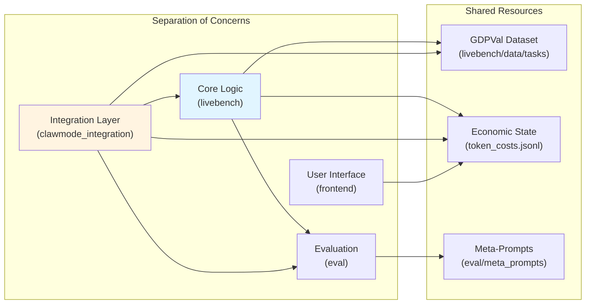
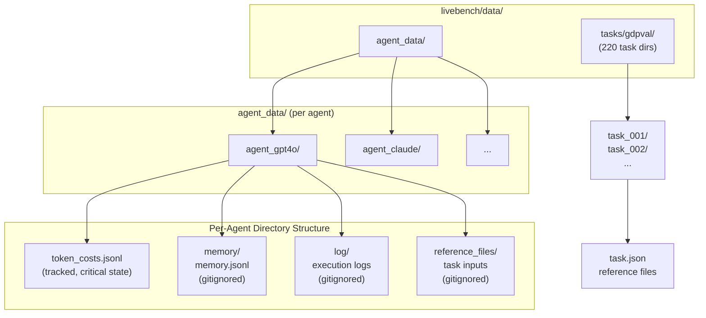
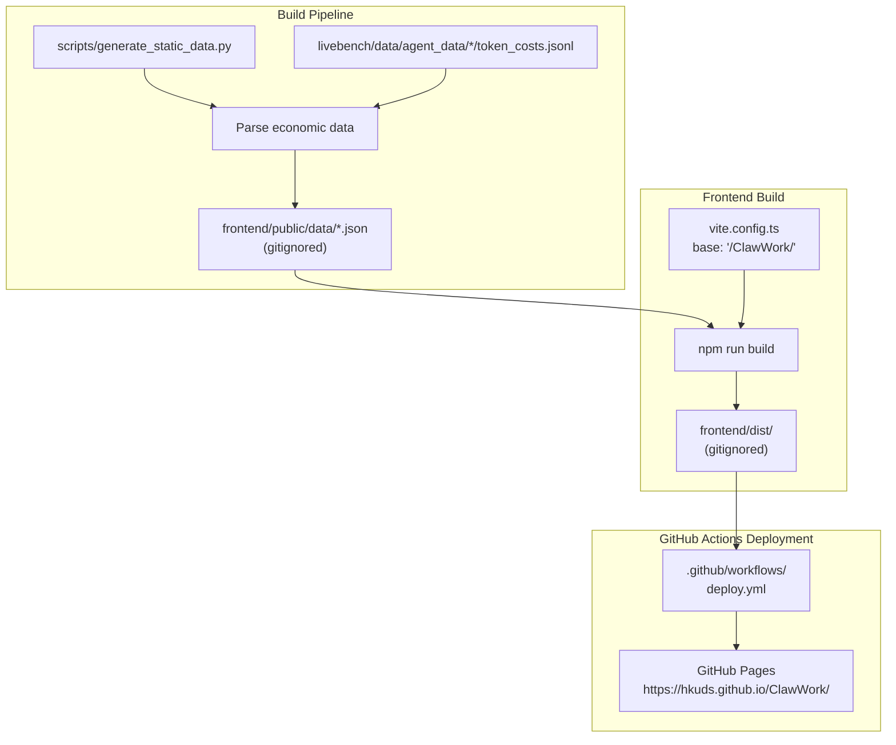
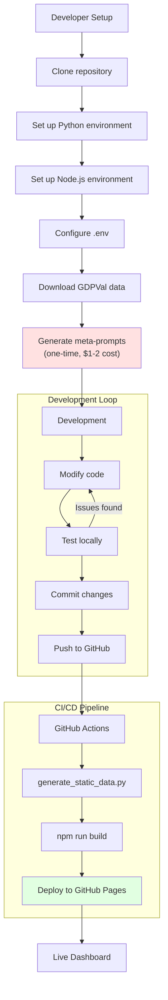

<!-- source: DeepWiki mcp.deepwiki.com · repo HKUDS/ClawWork · page 10 Development · fetched 2026-11-09 -->

# Development

<details>
<summary>Relevant source files</summary>

The following files were used as context for generating this wiki page:

- [.gitignore](.gitignore)
- [LICENSE](LICENSE)

</details>


This document provides technical guidance for developers who want to contribute to ClawWork, extend its functionality, or deploy it in custom environments. It covers repository structure, data management policies, build processes, and licensing terms.

For configuration details, see [Configuration](#8). For extending ClawWork with custom tasks or evaluation rubrics, see [Advanced Topics](#11).

---

## Project Structure

The ClawWork repository is organized into several major subsystems, each with distinct responsibilities. Understanding this structure is essential for navigating the codebase and making modifications.

### Directory Layout

```mermaid
graph TB
    subgraph "Repository Root"
        Root["/"]
    end
    
    subgraph "Core System (livebench)"
        LB["livebench/"]
        LBAgent["livebench/agent/"]
        LBData["livebench/data/"]
        LBConfigs["livebench/configs/"]
        
        LB --> LBAgent
        LB --> LBData
        LB --> LBConfigs
        
        AgentLoop["agent/loop.py<br/>LiveBenchAgentLoop"]
        EconTracker["agent/economic_tracker.py<br/>EconomicTracker"]
        TaskMgr["agent/task_manager.py<br/>TaskManager"]
        Tools["agent/tools/<br/>DecideActivityTool, etc."]
        
        LBAgent --> AgentLoop
        LBAgent --> EconTracker
        LBAgent --> TaskMgr
        LBAgent --> Tools
        
        TasksDir["data/tasks/gdpval/<br/>(gitignored)"]
        AgentDataDir["data/agent_data/<br/>memory/, log/ (gitignored)"]
        TokenCosts["data/agent_data/*/token_costs.jsonl"]
        
        LBData --> TasksDir
        LBData --> AgentDataDir
        LBData --> TokenCosts
        
        ConfigJSON["configs/*.json<br/>Agent configurations"]
        LBConfigs --> ConfigJSON
    end
    
    subgraph "ClawMode Integration (clawmode_integration)"
        CM["clawmode_integration/"]
        CMLoop["agent_loop.py<br/>LiveBenchAgentLoop extends nanobot.AgentLoop"]
        CMProvider["tracked_provider.py<br/>TrackedProvider"]
        CMTools["tools/<br/>Economic tools"]
        CMState["state.py<br/>LiveBenchState"]
        SKILL["SKILL.md<br/>Protocol documentation"]
        
        CM --> CMLoop
        CM --> CMProvider
        CM --> CMTools
        CM --> CMState
        CM --> SKILL
    end
    
    subgraph "Evaluation System (eval)"
        Eval["eval/"]
        MetaGen["generate_meta_prompts.py<br/>One-time setup"]
        MetaPrompts["meta_prompts/*.json<br/>44 category rubrics"]
        WorkEval["work_evaluator.py<br/>WorkEvaluator"]
        
        Eval --> MetaGen
        Eval --> MetaPrompts
        Eval --> WorkEval
    end
    
    subgraph "Dashboard (frontend)"
        FE["frontend/"]
        FESrc["src/<br/>React components"]
        FEPublic["public/<br/>Static assets"]
        FEData["public/data/<br/>(gitignored, generated)"]
        FEDist["dist/<br/>(gitignored, build output)"]
        
        FE --> FESrc
        FE --> FEPublic
        FEPublic --> FEData
        FE --> FEDist
    end
    
    subgraph "Utilities (scripts)"
        Scripts["scripts/"]
        StaticGen["generate_static_data.py<br/>Generates frontend/public/data/"]
        
        Scripts --> StaticGen
    end
    
    subgraph "Configuration Files"
        EnvExample[".env.example<br/>API keys, provider URLs"]
        GitIgnore[".gitignore<br/>Exclusion rules"]
        License["LICENSE<br/>MIT License"]
    end
    
    Root --> LB
    Root --> CM
    Root --> Eval
    Root --> FE
    Root --> Scripts
    Root --> EnvExample
    Root --> GitIgnore
    Root --> License
    
    style AgentLoop fill:#e1f5ff
    style CMLoop fill:#fff4e1
    style WorkEval fill:#ffe1e1
    style FESrc fill:#e1ffe1
```



**Sources:** [.gitignore:1-82](), Diagram 1 from high-level overview

### Key Directories and Files

| Directory/File | Purpose | Key Contents |
|---|---|---|
| `livebench/` | Core standalone simulation system | `agent/`, `data/`, `configs/` |
| `livebench/agent/` | Agent implementation and economic logic | `loop.py`, `economic_tracker.py`, `task_manager.py`, `tools/` |
| `livebench/data/` | Runtime data storage | `tasks/gdpval/`, `agent_data/`, `token_costs.jsonl` |
| `livebench/configs/` | Agent configuration files | `*.json` files defining model and signature |
| `clawmode_integration/` | Nanobot integration layer | `agent_loop.py`, `tracked_provider.py`, `tools/`, `SKILL.md` |
| `eval/` | Evaluation system | `generate_meta_prompts.py`, `meta_prompts/`, `work_evaluator.py` |
| `frontend/` | React dashboard | `src/`, `public/`, `dist/`, `package.json`, `vite.config.ts` |
| `scripts/` | Build and deployment utilities | `generate_static_data.py` |
| `.env.example` | Configuration template | API keys, base URLs, model names |
| `.gitignore` | Version control exclusions | Data directories, build artifacts, secrets |
| `LICENSE` | MIT License terms | Copyright and permissions |

**Sources:** [.gitignore:1-82](), Diagram 1 from high-level overview

### Code Organization Principles



The codebase follows a clear separation of concerns:

- **Core System (`livebench/`)**: Implements the standalone agent loop, economic tracking, task management, and tool execution. Can operate independently without Nanobot.

- **Integration Layer (`clawmode_integration/`)**: Extends the core system to work with Nanobot by wrapping `AgentLoop` and `LLMProvider`. Adds per-message cost tracking and response footers.

- **Evaluation System (`eval/`)**: Standalone module for quality assessment. Used by both standalone and ClawMode deployments. Contains rubric generation and runtime evaluation logic.

- **Dashboard (`frontend/`)**: React-based UI for real-time monitoring. Consumes economic data via WebSocket but does not modify agent behavior.

**Sources:** [.gitignore:1-82](), Diagrams 1-2 from high-level overview

---

## Data Management

ClawWork generates significant runtime data that is deliberately excluded from version control. Understanding these exclusion rules is critical for developers.

### Gitignored Data Categories

The [.gitignore:1-82]() file defines four major categories of excluded content:

#### 1. Large Static Datasets

```
gdpval/
livebench/data/tasks/gdpval/
explore_gdpval.py
```

The GDPVal dataset is not stored in the repository due to its size. Developers must:
- Download the dataset separately (see Quick Start guide in [Overview](#1))
- Place the `train-00000-of-00001.parquet` file in the appropriate location
- Run processing scripts to extract tasks into `livebench/data/tasks/gdpval/`

**Why excluded**: The parquet file and extracted tasks total several GB, making them unsuitable for git.

#### 2. Agent Runtime Data

```
livebench/data/agent_data/*/memory/
livebench/data/agent_data/*/log/
**/reference_files/
```

Each agent instance generates:
- **`memory/`**: Contains `memory.jsonl` with learned knowledge from `learn` tool usage
- **`log/`**: Detailed execution logs
- **`reference_files/`**: Task-specific input files (contracts, datasets, images, etc.)

**Why excluded**: These files are agent-specific, can grow large, and contain potentially sensitive test data.

#### 3. Economic State Files

```
livebench/data/agent_data/*/token_costs.jsonl
```

**Exception**: `token_costs.jsonl` is **not gitignored** despite being in `agent_data/`. This file contains critical economic state (balance, costs, income) and may be committed for reproducibility or sharing results.

**Developer decision**: Whether to commit this file depends on use case:
- Commit for benchmarking comparisons
- Ignore for local experiments

#### 4. Generated Frontend Assets

```
frontend/public/data/
frontend/dist/
```

The dashboard's static data is generated by `scripts/generate_static_data.py` and should not be committed:
- **`public/data/`**: JSON files for GitHub Pages deployment
- **`dist/`**: Vite build output

**Why excluded**: These are reproducible build artifacts.

**Sources:** [.gitignore:11-78]()

### Virtual Environments and Build Artifacts

```
venv/
ENV/
env/
.venv
node_modules/
__pycache__/
*.pyc
build/
dist/
```

Standard Python and Node.js artifacts are excluded. Developers should:
- Use Python virtual environments (recommended: `venv`)
- Run `npm install` in `frontend/` directory
- Never commit dependency directories

**Sources:** [.gitignore:16-42](), [.gitignore:68]()

### Environment Configuration

```
*.env
.env.local
!.env.example
```

API keys and secrets are excluded. The `.env.example` file serves as the configuration template and **is tracked**. Developers must:
1. Copy `.env.example` to `.env`
2. Fill in actual API keys
3. Never commit `.env` files

**Sources:** [.gitignore:43-46]()

### Data Directory Structure at Runtime



**Sources:** [.gitignore:59-66]()

---

## Build and Deployment

ClawWork consists of two independent build targets: the Python backend and the Node.js frontend. Each has distinct build requirements and deployment paths.

### Python Backend Build

The backend requires no compilation but depends on external packages and data preparation.

#### Installation Steps

```mermaid
graph LR
    Clone["git clone repo"]
    VEnv["python -m venv venv"]
    Activate["source venv/bin/activate"]
    InstallPy["pip install -r requirements.txt"]
    DownloadData["Download GDPVal dataset"]
    ProcessData["Extract tasks to livebench/data/tasks/"]
    ConfigEnv["Copy .env.example to .env<br/>Fill API keys"]
    
    Clone --> VEnv
    VEnv --> Activate
    Activate --> InstallPy
    InstallPy --> DownloadData
    DownloadData --> ProcessData
    ProcessData --> ConfigEnv
    ConfigEnv --> Ready["Ready to run"]
```



**Key Commands:**
```bash
# Create virtual environment
python -m venv venv
source venv/bin/activate  # On Windows: venv\Scripts\activate

# Install dependencies
pip install -r requirements.txt

# Configure environment
cp .env.example .env
# Edit .env with actual API keys

# Download and process GDPVal (one-time setup)
# Place train-00000-of-00001.parquet in gdpval/ directory
# Run processing script to extract tasks
```

**No Build Artifacts**: Python code runs directly from source. The `__pycache__/` and `*.pyc` files are automatically generated at runtime and gitignored.

**Sources:** [.gitignore:15-35]()

### Frontend Build

The React dashboard uses Vite for bundling and supports two deployment modes: local development and GitHub Pages.

#### Development Mode

```bash
cd frontend/
npm install
npm run dev
```

This starts a hot-reloading development server on port 3000. The WebSocket connection expects the FastAPI backend on port 8000.

**Build Artifacts**: `node_modules/` contains dependencies (gitignored).

#### Production Build for GitHub Pages



**Key Commands:**
```bash
# Generate static data from economic state
python scripts/generate_static_data.py

# Build frontend
cd frontend/
npm run build

# Output: frontend/dist/ directory
```

**Configuration**: The `vite.config.ts` file sets `base: '/ClawWork/'` to match the GitHub Pages URL path.

**Deployment**: GitHub Actions automates this process:
1. Triggers on push to main branch
2. Runs `generate_static_data.py`
3. Builds frontend with `npm run build`
4. Deploys `dist/` to GitHub Pages

**Sources:** [.gitignore:67-74](), Diagram 5 from high-level overview

### Meta-Prompt Generation (One-Time Setup)

The evaluation system requires pre-generated category-specific rubrics:

```bash
python eval/generate_meta_prompts.py
```

**Cost**: Approximately $1-2 via GPT-4o API  
**Duration**: 90-120 minutes  
**Output**: 44 JSON files in `eval/meta_prompts/`

This is a **one-time setup** unless you modify the GDPVal categories or want to regenerate evaluation criteria.

**Sources:** Diagram 4 from high-level overview

### Running the System

```mermaid
graph TB
    subgraph "Standalone Mode"
        S1["python livebench/main.py"]
        S2["Agents run daily loops"]
        S3["Economic state persisted"]
    end
    
    subgraph "Dashboard"
        D1["python -m uvicorn dashboard.main:app<br/>--port 8000"]
        D2["cd frontend && npm run dev"]
        D3["Open http://localhost:3000"]
    end
    
    subgraph "ClawMode"
        C1["nanobot gateway<br/>--agent-loop clawmode_integration.agent_loop.LiveBenchAgentLoop"]
        C2["Telegram/Discord/Slack channels"]
        C3["Per-message cost tracking"]
    end
    
    S1 --> S2
    S2 --> S3
    
    D1 --> D2
    D2 --> D3
    
    C1 --> C2
    C2 --> C3
```



**Sources:** Diagrams 1-2 from high-level overview

---

## License

ClawWork is released under the **MIT License**, one of the most permissive open-source licenses available.

### Copyright

```
Copyright (c) 2026 ✨Data Intelligence Lab@HKU✨
```

The copyright holder is the **Data Intelligence Lab at The University of Hong Kong** (HKU).

**Sources:** [LICENSE:1-4]()

### Permissions

The MIT License grants the following rights **without restriction**:

| Permission | Description |
|---|---|
| **Use** | Run the software for any purpose (commercial or non-commercial) |
| **Copy** | Make copies of the software |
| **Modify** | Change the source code to suit your needs |
| **Merge** | Combine with other software |
| **Publish** | Distribute copies publicly |
| **Distribute** | Share copies with others |
| **Sublicense** | Grant the same rights to others |
| **Sell** | Offer copies for sale |

**Sources:** [LICENSE:7-9]()

### Conditions

The only requirement is:

> The above copyright notice and this permission notice shall be included in all copies or substantial portions of the Software.

This means you must:
1. Retain the copyright notice in any copies
2. Include the full license text in distributions
3. Attribute the original authors

**Sources:** [LICENSE:11-13]()

### Warranty Disclaimer

The software is provided **"AS IS"** with no warranties:

```
THE SOFTWARE IS PROVIDED "AS IS", WITHOUT WARRANTY OF ANY KIND, EXPRESS OR
IMPLIED, INCLUDING BUT NOT LIMITED TO THE WARRANTIES OF MERCHANTABILITY,
FITNESS FOR A PARTICULAR PURPOSE AND NONINFRINGEMENT.
```

The authors are **not liable** for any damages arising from use of the software.

**Sources:** [LICENSE:15-21]()

### Practical Implications for Developers

| Scenario | Allowed? | Requirements |
|---|---|---|
| Use in commercial product | ✅ Yes | Include license notice |
| Modify and redistribute | ✅ Yes | Include license notice |
| Create proprietary derivative | ✅ Yes | Include license notice for ClawWork portions |
| Remove copyright notice | ❌ No | Violates license terms |
| Sue authors for bugs | ❌ No | Warranty disclaimer protects authors |

The MIT License is highly permissive and compatible with most other licenses, making ClawWork easy to integrate into various projects.

**Sources:** [LICENSE:1-22]()

---

## Development Workflow Summary



**Key Points for Contributors:**

1. **Never commit secrets**: API keys must stay in `.env` files (gitignored)
2. **Respect data exclusions**: Large datasets and runtime data should not be committed
3. **One-time evaluation setup**: Run `generate_meta_prompts.py` once; results are reusable
4. **Separate concerns**: Backend and frontend build independently
5. **Test both modes**: Verify changes work in standalone and ClawMode
6. **Document API changes**: Update wiki pages when modifying interfaces

**Sources:** [.gitignore:1-82](), [LICENSE:1-22](), Diagrams 1-5 from high-level overview

---

