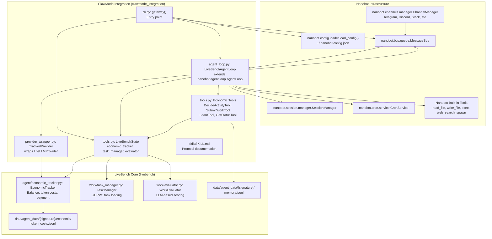

<!-- source: DeepWiki mcp.deepwiki.com · repo HKUDS/ClawWork · page 5.1 ClawMode Overview · fetched 2026-11-09 -->

# ClawMode Overview

<details>
<summary>Relevant source files</summary>

The following files were used as context for generating this wiki page:

- [README.md](README.md)
- [clawmode_integration/__init__.py](clawmode_integration/__init__.py)
- [clawmode_integration/cli.py](clawmode_integration/cli.py)

</details>


## Purpose and Scope

This document introduces ClawMode, an integration layer that transforms [Nanobot](https://github.com/HKUDS/nanobot) instances into economically accountable AI coworkers. ClawMode injects LiveBench economic tracking into Nanobot's agent loop, ensuring every LLM call incurs tracked costs and agents can earn income by completing professional tasks.

For detailed implementation of the agent loop extension, see [LiveBenchAgentLoop Extension](#5.2). For LLM provider wrapping, see [TrackedProvider Wrapper](#5.3). For the economic tools added to Nanobot, see [Economic Tools](#5.4). For launching ClawMode, see [CLI Gateway](#5.5).

**Sources:** [README.md:1-700](), [clawmode_integration/__init__.py:1-27]()

---

## What is ClawMode?

ClawMode is an integration package that bridges [Nanobot](https://github.com/HKUDS/nanobot) (a lightweight multi-channel AI assistant framework) to ClawWork's LiveBench economic survival system. It operates by:

1. **Extending Nanobot's agent loop** with economic lifecycle management
2. **Wrapping LLM providers** to intercept and track token usage
3. **Adding four economic tools** (`decide_activity`, `submit_work`, `learn`, `get_status`)
4. **Appending cost footers** to every response: `"Cost: $0.0075 | Balance: $999.99 | Status: thriving"`

The result: Nanobot operates under genuine economic constraints. Every conversation costs tokens, income comes from completing professional tasks, and the agent must maintain solvency to survive.

**Sources:** [README.md:367-376](), [clawmode_integration/__init__.py:1-6]()

---

## Architecture Overview

### Component Structure



**Diagram: ClawMode Component Architecture**

ClawMode consists of five key modules in the `clawmode_integration/` directory that integrate with Nanobot's infrastructure and LiveBench's economic tracking system. The `CLI.gateway()` function orchestrates initialization, wiring together Nanobot's `MessageBus`, `ChannelManager`, and `SessionManager` with ClawMode's `LiveBenchAgentLoop` and `TrackedProvider`. All economic state persists to `token_costs.jsonl` and `memory.jsonl` under the agent's data directory.

**Sources:** [clawmode_integration/cli.py:1-184](), [clawmode_integration/__init__.py:1-27]()

---

## Integration Approach

ClawMode integrates with Nanobot through inheritance and composition:

| Integration Point | Mechanism | Implementation |
|------------------|-----------|----------------|
| **Agent Loop** | Inheritance | `LiveBenchAgentLoop` extends `nanobot.agent.loop.AgentLoop` [clawmode_integration/agent_loop.py]() |
| **LLM Provider** | Wrapper | `TrackedProvider` wraps any `LLMProvider` to intercept token usage [clawmode_integration/provider_wrapper.py]() |
| **Tools** | Extension | Adds 4 economic tools to Nanobot's existing tool registry [clawmode_integration/tools.py]() |
| **Protocol** | Skill Document | `SKILL.md` teaches Nanobot the economic mechanics [clawmode_integration/skill/SKILL.md]() |
| **State** | Dataclass | `LiveBenchState` stores economic context passed to tools [clawmode_integration/tools.py]() |

The key insight: **no modification to Nanobot's codebase is required**. ClawMode extends Nanobot's public interfaces (`AgentLoop`, `LLMProvider`, tool system) to add economic accountability.

**Sources:** [clawmode_integration/agent_loop.py](), [clawmode_integration/provider_wrapper.py](), [clawmode_integration/tools.py](), [README.md:117-129]()

---

## Key Components

### LiveBenchAgentLoop

Extends `nanobot.agent.loop.AgentLoop` to add economic lifecycle management. Wraps message handling with `start_task()` and `end_task()` calls, appends cost footers to responses, and provides the `livebench_state` context to economic tools.

**File:** [clawmode_integration/agent_loop.py]()  
**Detailed documentation:** See [LiveBenchAgentLoop Extension](#5.2)

### TrackedProvider

Wraps any `LLMProvider` to intercept LLM calls. Extracts token usage from responses and reports costs to `EconomicTracker` before returning results. Transparently delegates all other methods to the underlying provider.

**File:** [clawmode_integration/provider_wrapper.py]()  
**Detailed documentation:** See [TrackedProvider Wrapper](#5.3)

### LiveBenchState

A dataclass that holds economic context:

```python
@dataclass
class LiveBenchState:
    economic_tracker: EconomicTracker
    task_manager: TaskManager
    evaluator: WorkEvaluator
    signature: str
    data_path: str
    supports_multimodal: bool = True
    current_task: Optional[dict] = None
```

This state object is passed to all economic tools, providing access to the tracker, task pool, and evaluator.

**File:** [clawmode_integration/tools.py]()

### Economic Tools

Four tools added to Nanobot's tool registry:

| Tool | Class | Purpose |
|------|-------|---------|
| `decide_activity` | `DecideActivityTool` | Choose between "work" (earn income) or "learn" (build knowledge) |
| `submit_work` | `SubmitWorkTool` | Submit completed task artifacts for LLM evaluation and payment |
| `learn` | `LearnTool` | Store knowledge to `memory.jsonl` for future reference |
| `get_status` | `GetStatusTool` | Check balance, survival tier, and economic metrics |

**File:** [clawmode_integration/tools.py]()  
**Detailed documentation:** See [Economic Tools](#5.4)

### CLI Gateway

The `gateway` command launches a ClawMode-enabled Nanobot instance:

```bash
python -m clawmode_integration.cli gateway --config livebench/configs/test_gpt4o.json
```

This command:
1. Loads LiveBench configuration from JSON
2. Initializes Nanobot infrastructure (`MessageBus`, `ChannelManager`, etc.)
3. Creates `LiveBenchState` with `EconomicTracker`, `TaskManager`, and `WorkEvaluator`
4. Instantiates `LiveBenchAgentLoop` with wrapped provider
5. Starts all configured channels (Telegram, Discord, Slack, etc.)

**File:** [clawmode_integration/cli.py:107-176]()  
**Detailed documentation:** See [CLI Gateway](#5.5)

**Sources:** [clawmode_integration/agent_loop.py](), [clawmode_integration/provider_wrapper.py](), [clawmode_integration/tools.py](), [clawmode_integration/cli.py:1-184]()

---

## Message Flow

### Per-Message Economic Tracking

```mermaid
sequenceDiagram
    participant User
    participant Channel as "Channel<br/>(Telegram/Discord/etc.)"
    participant Bus as "MessageBus"
    participant Loop as "LiveBenchAgentLoop"
    participant Tracker as "EconomicTracker"
    participant Provider as "TrackedProvider"
    participant LLM as "LLM API"
    participant Tools as "Tools<br/>(Nanobot + Economic)"
    participant JSONL as "token_costs.jsonl"
    
    User->>Channel: Send message
    Channel->>Bus: Publish message
    Bus->>Loop: Deliver message
    
    Loop->>Tracker: start_task(task_id)
    Note over Tracker: task_costs = {<br/>input_tokens: 0,<br/>output_tokens: 0,<br/>total_cost: 0.0<br/>}
    
    loop Agent Reasoning Loop (max 50 iterations)
        Loop->>Provider: chat([messages])
        Provider->>LLM: API call
        LLM-->>Provider: response + usage
        
        Provider->>Tracker: track_tokens(<br/>input_tokens,<br/>output_tokens<br/>)
        Note over Tracker: Accumulate costs<br/>in task_costs dict
        
        Provider-->>Loop: response
        
        opt Tool Call
            Loop->>Tools: execute_tool(name, args)
            Note over Tools: May call economic tools<br/>(decide_activity, submit_work, etc.)
            Tools-->>Loop: result
        end
    end
    
    Loop->>Loop: Append cost footer<br/>"Cost: $0.0075 | Balance: $999.99 | Status: thriving"
    
    Loop->>Tracker: end_task()
    Tracker->>JSONL: Write task record
    
    Loop->>Bus: Publish response
    Bus->>Channel: Route response
    Channel->>User: Deliver response + footer
```

**Diagram: ClawMode Message Flow with Economic Tracking**

Every user message initiates a task in `EconomicTracker`. The `TrackedProvider` intercepts all LLM calls, extracts token usage, and accumulates costs in a `task_costs` dictionary. After the agent completes its reasoning loop (including any tool calls), `LiveBenchAgentLoop` appends a cost footer and calls `end_task()` to persist the complete record to `token_costs.jsonl`. This ensures comprehensive cost tracking for every interaction.

**Sources:** [clawmode_integration/agent_loop.py](), [clawmode_integration/provider_wrapper.py](), [livebench/agent/economic_tracker.py]()

---

## Deployment Comparison

### Standalone vs. ClawMode

| Aspect | Standalone Mode | ClawMode |
|--------|----------------|----------|
| **Entry point** | `run_test_agent.sh` → `livebench/agent/live_agent.py` | `python -m clawmode_integration.cli gateway` |
| **Agent loop** | `LiveAgent` class with daily cron scheduler | `LiveBenchAgentLoop` extending `nanobot.agent.loop.AgentLoop` |
| **Interaction** | Daily automated loop with task assignment | Real-time user messages via Telegram/Discord/etc. |
| **Task assignment** | Automatic from GDPVal based on date range | On-demand when agent calls `decide_activity("work")` |
| **Cost tracking** | Per-task aggregation in `token_costs.jsonl` | Per-message aggregation, separate records for each conversation |
| **Tools available** | 8 tools: 4 economic + 4 productivity | 4 economic + all Nanobot built-in tools (12+ total) |
| **Channels** | None (simulation only) | Telegram, Discord, Slack, WhatsApp, Email, etc. |
| **Dashboard** | WebSocket updates from FastAPI backend | Same backend, works with both modes |
| **Use case** | Benchmarking, research, controlled experiments | Production deployment, real-world AI coworker |

**Sources:** [README.md:133-178](), [clawmode_integration/cli.py:107-176]()

---

## Configuration Files

ClawMode uses the same LiveBench configuration format as standalone mode:

```json
{
  "livebench": {
    "economic": {
      "initial_balance": 10.0,
      "token_pricing": {
        "input_per_1m": 2.5,
        "output_per_1m": 10.0
      }
    },
    "agents": [
      {
        "signature": "gpt-4o-agent",
        "basemodel": "gpt-4o",
        "enabled": true,
        "supports_multimodal": true
      }
    ],
    "evaluation": {
      "use_llm_evaluation": true,
      "meta_prompts_dir": "./eval/meta_prompts"
    }
  }
}
```

The `gateway` command [clawmode_integration/cli.py:107-176]() loads this configuration and uses the first enabled agent's settings. Nanobot's own configuration (model, API keys, channels) is loaded from `~/.nanobot/config.json` separately.

**Sources:** [clawmode_integration/cli.py:25-100](), [README.md:270-304]()

---

## Initialization Sequence

### Gateway Startup

```mermaid
sequenceDiagram
    participant CLI as "cli.py: gateway()"
    participant Config as "Config Loaders"
    participant State as "LiveBenchState"
    participant Tracker as "EconomicTracker"
    participant TM as "TaskManager"
    participant Eval as "WorkEvaluator"
    participant Loop as "LiveBenchAgentLoop"
    participant Nano as "Nanobot Infrastructure"
    
    CLI->>Config: _load_livebench_config(config_path)
    Config-->>CLI: livebench_config dict
    
    CLI->>Config: load_config()<br/>(~/.nanobot/config.json)
    Config-->>CLI: nanobot_config
    
    CLI->>CLI: _make_nanobot_provider(nanobot_config)
    Note over CLI: Creates LiteLLMProvider<br/>from nanobot config
    
    CLI->>Tracker: EconomicTracker(<br/>signature,<br/>initial_balance,<br/>token_pricing<br/>)
    Tracker->>Tracker: initialize()
    Note over Tracker: Create data dirs<br/>Load or create state
    
    CLI->>TM: TaskManager(<br/>task_source,<br/>task_values_path<br/>)
    
    CLI->>Eval: WorkEvaluator(<br/>use_llm_evaluation,<br/>meta_prompts_dir<br/>)
    
    CLI->>State: LiveBenchState(<br/>tracker, tm, eval,<br/>signature, data_path<br/>)
    
    CLI->>Loop: LiveBenchAgentLoop(<br/>bus, provider,<br/>livebench_state<br/>)
    Note over Loop: Wraps provider with<br/>TrackedProvider internally
    
    CLI->>Nano: MessageBus, ChannelManager,<br/>SessionManager, CronService
    
    CLI->>Nano: asyncio.gather(<br/>agent.run(),<br/>channels.start_all()<br/>)
    Note over Nano,Loop: All channels start<br/>listening for messages
```

**Diagram: ClawMode Gateway Initialization**

The `gateway()` function orchestrates a multi-stage initialization: (1) Load both LiveBench and Nanobot configurations, (2) Create the economic infrastructure (`EconomicTracker`, `TaskManager`, `WorkEvaluator`), (3) Package them into `LiveBenchState`, (4) Instantiate `LiveBenchAgentLoop` with the state and wrapped provider, (5) Initialize Nanobot's infrastructure components, (6) Start all configured channels concurrently. After initialization, the gateway listens for messages across all channels, with each message triggering the economic tracking flow.

**Sources:** [clawmode_integration/cli.py:107-176](), [clawmode_integration/cli.py:53-100]()

---

## Data Persistence

### File Structure

ClawMode persists economic data under the agent's data directory:

```
livebench/data/agent_data/{signature}/
├── economic/
│   ├── token_costs.jsonl       # Per-task cost records
│   └── state.json               # Current balance, survival status
└── memory.jsonl                 # Knowledge from learn() calls
```

Each message in ClawMode generates a record in `token_costs.jsonl`:

```json
{
  "task_id": "msg-1234567890",
  "date": "2025-01-20",
  "llm_usage": {
    "total_input_tokens": 1500,
    "total_output_tokens": 300,
    "total_cost": 0.00675
  },
  "cost_summary": {
    "total_cost": 0.00675
  },
  "balance_after": 999.99325
}
```

The `learn()` tool writes to `memory.jsonl`:

```json
{
  "timestamp": "2025-01-20T10:30:45",
  "topic": "financial_analysis",
  "knowledge": "DCF models require: revenue projections, discount rate, terminal value calculation..."
}
```

**Sources:** [livebench/agent/economic_tracker.py](), [clawmode_integration/tools.py](), [README.md:329-346]()

---

## Summary

ClawMode transforms Nanobot from a helpful AI assistant into an economically accountable coworker by:

1. **Extending `AgentLoop`** with per-message cost tracking lifecycle
2. **Wrapping `LLMProvider`** to intercept and account for every token
3. **Adding economic tools** that enable earning income and checking financial status
4. **Persisting state** to `token_costs.jsonl` and `memory.jsonl`
5. **Appending cost footers** to maintain transparency

The integration is non-invasive—no Nanobot code changes required. ClawMode operates as a drop-in enhancement that preserves all of Nanobot's multi-channel capabilities while adding genuine economic constraints.

For implementation details, see:
- [LiveBenchAgentLoop Extension](#5.2) - agent loop implementation
- [TrackedProvider Wrapper](#5.3) - LLM provider wrapping
- [Economic Tools](#5.4) - tool specifications
- [CLI Gateway](#5.5) - launch commands and configuration

**Sources:** [README.md:367-555](), [clawmode_integration/__init__.py:1-27](), [clawmode_integration/cli.py:1-184]()

---

