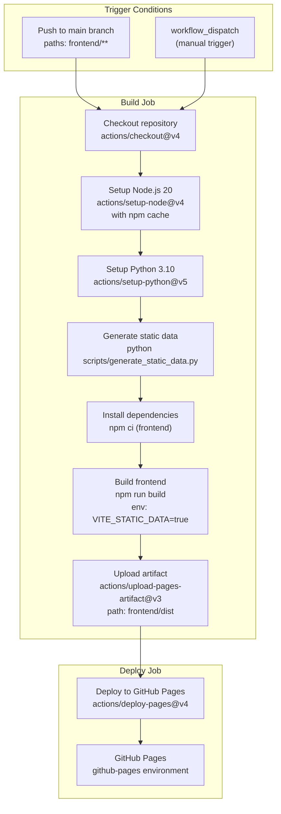
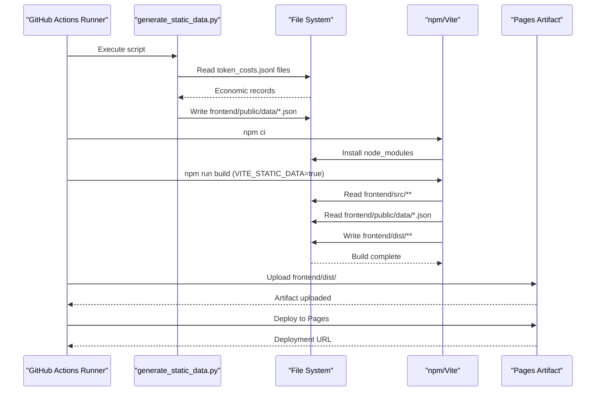

<!-- source: DeepWiki mcp.deepwiki.com · repo HKUDS/ClawWork · page 7.4 Deployment to GitHub Pages · fetched 2026-11-09 -->

# Deployment to GitHub Pages

<details>
<summary>Relevant source files</summary>

The following files were used as context for generating this wiki page:

- [.github/workflows/deploy.yml](.github/workflows/deploy.yml)
- [.gitignore](.gitignore)

</details>


## Purpose and Scope

This document describes the automated deployment pipeline that builds the ClawWork dashboard frontend and publishes it to GitHub Pages. The deployment uses GitHub Actions to execute a two-stage process: building the React/Vite frontend with pre-generated static data, then deploying the artifacts to GitHub's static hosting service.

For information about the dashboard architecture and WebSocket communication, see [Dashboard Architecture](#7.1). For details on the React frontend components themselves, see [Frontend Components](#7.2).

---

## Deployment Architecture

The GitHub Pages deployment is designed to host the ClawWork dashboard as a fully static site. Since GitHub Pages cannot run backend services, the system uses a pre-build data generation step to create static JSON snapshots of agent economic data. This allows the dashboard to display historical data without requiring a live WebSocket connection.

### Static Data Generation Strategy

The deployment pipeline executes `scripts/generate_static_data.py` before building the frontend. This script extracts economic records from `token_costs.jsonl` files and generates static JSON files that the frontend can load directly. The generated files are placed in `frontend/public/data/` and are excluded from version control via [.gitignore:71]().

The frontend build process detects the `VITE_STATIC_DATA` environment variable and switches to static data mode, loading from these pre-generated files instead of attempting WebSocket connections.

**Sources:** [.github/workflows/deploy.yml:39-40](), [.gitignore:70-71]()

---

## GitHub Actions Workflow

### Deployment Pipeline Diagram



**Sources:** [.github/workflows/deploy.yml:3-66]()

### Workflow Configuration

The workflow is defined in [.github/workflows/deploy.yml]() and named "Deploy Frontend to GitHub Pages". It is configured with specific permissions and concurrency controls:

| Configuration | Value | Purpose |
|---------------|-------|---------|
| **Triggers** | `push` to `main` branch | Automatic deployment on merged changes |
| | `paths: frontend/**` | Only trigger when frontend code changes |
| | `workflow_dispatch` | Allow manual deployment via GitHub UI |
| **Permissions** | `contents: read` | Read repository contents |
| | `pages: write` | Write to GitHub Pages |
| | `id-token: write` | OIDC token for deployment authentication |
| **Concurrency** | `group: pages` | Prevent concurrent deployments |
| | `cancel-in-progress: false` | Queue deployments instead of canceling |

**Sources:** [.github/workflows/deploy.yml:3-18]()

---

## Build Job Steps

The build job runs on `ubuntu-latest` and executes six distinct steps to prepare the frontend for deployment.

### Step 1: Repository Checkout

```yaml
- name: Checkout
  uses: actions/checkout@v4
```

Uses the official GitHub checkout action to clone the repository with full history.

**Sources:** [.github/workflows/deploy.yml:24-25]()

### Step 2: Node.js Environment Setup

```yaml
- name: Setup Node.js
  uses: actions/setup-node@v4
  with:
    node-version: '20'
    cache: 'npm'
    cache-dependency-path: frontend/package-lock.json
```

Configures Node.js 20 with npm caching enabled. The cache key is derived from `frontend/package-lock.json` to speed up subsequent builds by reusing `node_modules`.

**Sources:** [.github/workflows/deploy.yml:27-32]()

### Step 3: Python Environment Setup

```yaml
- name: Setup Python
  uses: actions/setup-python@v5
  with:
    python-version: '3.10'
```

Installs Python 3.10 required for the static data generation script.

**Sources:** [.github/workflows/deploy.yml:34-37]()

### Step 4: Static Data Generation

```yaml
- name: Generate static data
  run: python scripts/generate_static_data.py
```

Executes the data generation script to create static JSON files from economic records. This script reads from `livebench/data/agent_data/*/token_costs.jsonl` and produces output in `frontend/public/data/`.

**Sources:** [.github/workflows/deploy.yml:39-40]()

### Step 5: Dependency Installation

```yaml
- name: Install dependencies
  working-directory: ./frontend
  run: npm ci
```

Uses `npm ci` (clean install) instead of `npm install` for reproducible builds. This command installs exact versions from `package-lock.json` and is faster in CI environments.

**Sources:** [.github/workflows/deploy.yml:42-44]()

### Step 6: Frontend Build

```yaml
- name: Build
  working-directory: ./frontend
  run: npm run build
  env:
    VITE_STATIC_DATA: 'true'
```

Invokes the Vite build process with the `VITE_STATIC_DATA` environment variable. This variable instructs the frontend to use static JSON files instead of WebSocket connections. The build output is written to `frontend/dist/`.

**Sources:** [.github/workflows/deploy.yml:46-50]()

### Step 7: Artifact Upload

```yaml
- name: Upload artifact
  uses: actions/upload-pages-artifact@v3
  with:
    path: './frontend/dist'
```

Packages the `frontend/dist/` directory as a GitHub Pages artifact for deployment. This action automatically handles compression and preparation for the Pages environment.

**Sources:** [.github/workflows/deploy.yml:52-55]()

---

## Deploy Job

The deploy job runs after the build job completes successfully and performs the actual publication to GitHub Pages.

### Job Configuration

```yaml
deploy:
  environment:
    name: github-pages
    url: ${{ steps.deployment.outputs.page_url }}
  runs-on: ubuntu-latest
  needs: build
```

The job declares a dependency on the `build` job via `needs: build`, ensuring sequential execution. It targets the `github-pages` environment and captures the deployment URL from the action output.

**Sources:** [.github/workflows/deploy.yml:57-62]()

### Deployment Step

```yaml
- name: Deploy to GitHub Pages
  id: deployment
  uses: actions/deploy-pages@v4
```

Uses the official GitHub Pages deployment action to publish the uploaded artifact. The step ID `deployment` allows accessing the published URL via `steps.deployment.outputs.page_url`.

**Sources:** [.github/workflows/deploy.yml:63-66]()

---

## Build Process Flow

### Data Generation and Build Pipeline



**Sources:** [.github/workflows/deploy.yml:39-55]()

### File Structure During Build

The following table shows the file structure at different stages of the build process:

| Stage | Directory | Contents | Purpose |
|-------|-----------|----------|---------|
| **Pre-Build** | `livebench/data/agent_data/*/` | `token_costs.jsonl` files | Source economic records |
| **Static Data Generation** | `frontend/public/data/` | Generated JSON files | Static data for frontend |
| **Dependency Install** | `frontend/node_modules/` | npm packages | Build dependencies |
| **Build Output** | `frontend/dist/` | Compiled HTML/JS/CSS | Production-ready static site |
| **Artifact** | GitHub Pages Artifact | Compressed `dist/` contents | Deployment package |

**Sources:** [.github/workflows/deploy.yml:39-55](), [.gitignore:68-74]()

---

## Environment Variables

### Build-Time Configuration

The workflow uses a single critical environment variable during the build process:

#### VITE_STATIC_DATA

```yaml
env:
  VITE_STATIC_DATA: 'true'
```

**Type:** String (set to `'true'`)  
**Purpose:** Instructs the Vite build process to configure the frontend for static data mode  
**Effect:** The frontend code conditionally loads data from static JSON files instead of establishing WebSocket connections  
**Scope:** Build-time only (embedded in compiled JavaScript)

When this variable is set, the frontend's data loading logic switches from:
- **Development/Local:** WebSocket connection to `localhost:8000`
- **Static Mode:** Direct HTTP requests to `/data/*.json` files

**Sources:** [.github/workflows/deploy.yml:49-50]()

---

## Permissions and Security

### GitHub Actions Permissions

The workflow declares minimal required permissions following the principle of least privilege:

```yaml
permissions:
  contents: read
  pages: write
  id-token: write
```

| Permission | Level | Justification |
|------------|-------|---------------|
| `contents` | `read` | Required to checkout repository code |
| `pages` | `write` | Required to deploy to GitHub Pages |
| `id-token` | `write` | Required for OIDC authentication with GitHub Pages |

These permissions are scoped to the workflow run and do not grant broader repository access.

**Sources:** [.github/workflows/deploy.yml:11-14]()

### Concurrency Control

```yaml
concurrency:
  group: pages
  cancel-in-progress: false
```

The concurrency configuration prevents race conditions during deployment:
- **Group:** All Pages deployment workflows share the `pages` concurrency group
- **Cancel in Progress:** `false` ensures queued deployments are not canceled, preventing partial or failed deployments

**Sources:** [.github/workflows/deploy.yml:16-18]()

---

## Deployment Artifacts

### Build Output Structure

The `frontend/dist/` directory produced by Vite contains the following structure:

```
frontend/dist/
├── index.html               # Entry point HTML
├── assets/
│   ├── index-[hash].js      # Bundled JavaScript
│   ├── index-[hash].css     # Bundled CSS
│   └── [other-assets]       # Images, fonts, etc.
└── data/
    └── *.json               # Static economic data
```

The `[hash]` values in filenames enable long-term caching by ensuring unique URLs when content changes.

**Sources:** [.github/workflows/deploy.yml:55]()

### Artifact Upload Process

The `actions/upload-pages-artifact@v3` action performs several operations:

1. **Compression:** Creates a tar archive of `frontend/dist/`
2. **Validation:** Ensures the artifact meets GitHub Pages requirements
3. **Metadata:** Attaches build information and checksums
4. **Storage:** Uploads to GitHub's artifact storage

The artifact is then consumed by the deploy job without re-downloading the repository.

**Sources:** [.github/workflows/deploy.yml:52-55]()

---

## Triggering Deployments

### Automatic Triggers

Deployments trigger automatically when changes are pushed to the `main` branch and affect files in the `frontend/` directory:

```yaml
on:
  push:
    branches:
      - main
    paths:
      - 'frontend/**'
```

This path filter prevents unnecessary builds when changes only affect backend code or documentation.

**Sources:** [.github/workflows/deploy.yml:3-8]()

### Manual Triggers

Developers can manually trigger deployments via the GitHub UI:

1. Navigate to **Actions** tab in the repository
2. Select **Deploy Frontend to GitHub Pages** workflow
3. Click **Run workflow** button
4. Select `main` branch
5. Click **Run workflow** to start

This is enabled by the `workflow_dispatch` trigger:

```yaml
on:
  workflow_dispatch:
```

Manual triggers are useful for redeploying after configuration changes or to refresh static data.

**Sources:** [.github/workflows/deploy.yml:9]()

---

## Deployment URL

After successful deployment, the dashboard is accessible at the GitHub Pages URL. The exact URL depends on the repository configuration:

- **Organization repository:** `https://<org>.github.io/<repo>/`
- **User repository:** `https://<user>.github.io/<repo>/`
- **Custom domain:** Configured via repository settings

The deployment job captures this URL in its output:

```yaml
environment:
  name: github-pages
  url: ${{ steps.deployment.outputs.page_url }}
```

The URL is displayed in the GitHub Actions workflow run summary and in the repository's Environments section.

**Sources:** [.github/workflows/deploy.yml:58-60]()

---

## Troubleshooting Common Issues

### Build Failures

| Issue | Symptom | Resolution |
|-------|---------|------------|
| **Missing static data** | Build succeeds but dashboard shows no data | Verify `scripts/generate_static_data.py` runs successfully and creates files in `frontend/public/data/` |
| **Dependency conflicts** | `npm ci` fails | Update `frontend/package-lock.json` with `npm install` and commit |
| **Vite build errors** | `npm run build` fails | Check frontend code syntax and Vite configuration |
| **Python script errors** | Static data generation fails | Verify Python 3.10 compatibility and required dependencies |

### Deployment Failures

| Issue | Symptom | Resolution |
|-------|---------|------------|
| **Permission denied** | Deploy step fails with 403/401 | Verify repository has Pages enabled and workflow has correct permissions |
| **Artifact too large** | Upload fails with size error | Check for large files in `frontend/dist/` and optimize assets |
| **Concurrent deployment** | Deployment queued indefinitely | Wait for previous deployment to complete or cancel in-progress runs |

### Static Data Not Loading

If the deployed dashboard does not display data:

1. **Verify static data generation:** Check workflow logs for `generate_static_data.py` output
2. **Confirm VITE_STATIC_DATA:** Ensure environment variable is set to `'true'` in build step
3. **Check file paths:** Verify JSON files exist in deployed `dist/data/` directory
4. **Browser console:** Inspect for 404 errors when loading JSON files

**Sources:** [.github/workflows/deploy.yml]()

---

## Integration with Dashboard

The GitHub Pages deployment provides a public-facing view of the ClawWork dashboard with historical data. Unlike local development mode, the deployed version cannot display real-time updates since GitHub Pages does not support backend services.

### Comparison: Local vs. GitHub Pages

| Feature | Local Development | GitHub Pages Deployment |
|---------|-------------------|-------------------------|
| **Data Source** | WebSocket to FastAPI backend (port 8000) | Static JSON files in `/data/` |
| **Real-time Updates** | Yes, via WebSocket | No, snapshot at build time |
| **Backend Required** | Yes, must run `python livebench/main.py` | No, fully static |
| **API Keys Required** | Yes, for agent execution | No, pre-generated data only |
| **Use Case** | Development, live monitoring | Public showcase, historical analysis |

For real-time monitoring with live agent execution, see [Dashboard Architecture](#7.1) and [WebSocket Communication](#7.3).

**Sources:** [.github/workflows/deploy.yml:49-50]()

---

