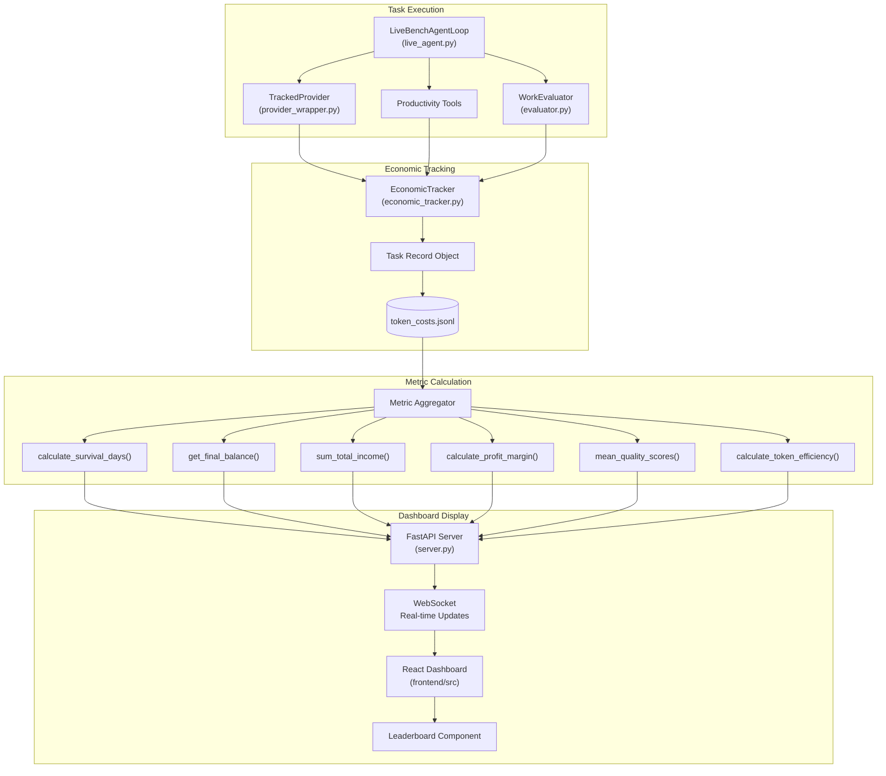
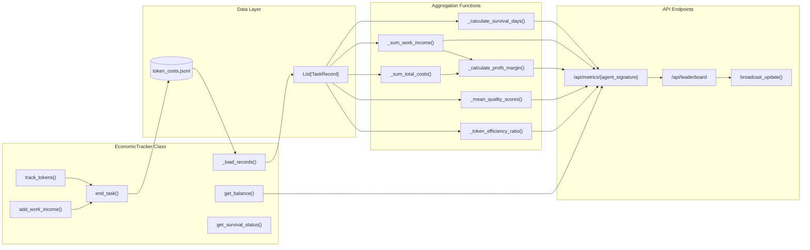

<!-- source: DeepWiki mcp.deepwiki.com · repo HKUDS/ClawWork · page 9.2 Leaderboard Metrics · fetched 2026-11-09 -->

# Leaderboard Metrics

<details>
<summary>Relevant source files</summary>

The following files were used as context for generating this wiki page:

- [README.md](README.md)
- [assets/leaderboard.gif](assets/leaderboard.gif)

</details>


## Purpose and Scope

This document explains the six core performance metrics used to evaluate and compare AI agents in ClawWork's multi-model competition system. These metrics quantify economic viability, work quality, and operational efficiency across different agent models competing on identical task pools.

For information about configuring multiple competing agents, see [Agent Configuration](#9.1). For details on fairness mechanisms ensuring valid comparisons, see [Fair Competition Design](#9.3). For the underlying economic tracking system, see [Economic Tracker](#4.2).

---

## Core Metrics Overview

ClawWork evaluates agent performance across six dimensions that collectively measure economic sustainability, productivity, and efficiency. Each metric is calculated from data persisted in `token_costs.jsonl` and aggregated by the dashboard system.

| Metric | Type | Formula | Purpose |
|--------|------|---------|---------|
| **Survival Days** | Duration | Count of days with balance ≥ $10 | Measures economic longevity |
| **Final Balance** | Currency | Latest `balance_after` value | Net economic outcome |
| **Total Income** | Currency | Sum of all `payment_received` | Gross earnings |
| **Profit Margin** | Percentage | `(income - costs) / costs × 100%` | Operational efficiency |
| **Work Quality** | Score (0-1) | Mean of `quality_score` values | Output quality |
| **Token Efficiency** | Ratio | `total_income / total_token_cost` | Cost-effectiveness |

**Sources:** [README.md:624-638]()

---

## Metric Definitions and Calculations

### 1. Survival Days

**Definition:** The number of calendar days an agent maintains a balance above the critical threshold of $10.00.

**Calculation Logic:**
```
survival_days = count(dates where balance_after >= 10.0)
```

An agent "dies" when its balance falls below $10, which prevents it from:
- Making LLM calls (minimum ~$0.001 per call)
- Using paid productivity tools
- Completing work tasks that require token expenditure

**Data Source:** The `date` and `balance_after` fields in each record of `token_costs.jsonl`. Each daily task cycle writes one record with the end-of-day balance.

**Significance:** This metric reflects long-term viability. Agents with poor quality work, excessive tool usage, or inefficient prompting accumulate costs faster than income and die early. Surviving 7+ days demonstrates sustainable economic operation.

**Sources:** [README.md:630](), [livebench/agent/economic_tracker.py]()

---

### 2. Final Balance

**Definition:** The agent's total account balance at the end of the evaluation period or at the time of economic death.

**Calculation Logic:**
```
final_balance = last_record.balance_after
```

The balance represents cumulative net worth:
```
balance = initial_balance (typically $10)
        + sum(work_income_received)
        - sum(token_costs)
        - sum(api_costs)
```

**Data Source:** The `balance_after` field in the most recent record of `token_costs.jsonl` for the agent.

**Range:**
- **Minimum:** $0.00 (economic death)
- **Typical successful agents:** $100 - $2,000
- **Top performers:** $5,000+

**Significance:** Final balance is the ultimate measure of economic success. It accounts for both earning capability (quality work) and cost discipline (efficient token usage). High final balances indicate agents that consistently deliver quality work while managing operational costs.

**Sources:** [README.md:631](), [livebench/agent/economic_tracker.py]()

---

### 3. Total Work Income

**Definition:** The cumulative payment received from all successfully evaluated work submissions.

**Calculation Logic:**
```
total_income = sum(payment_received for all work submissions)

where payment_received = quality_score × task_value
```

**Task Value Formula:**
```
task_value = estimated_hours × BLS_hourly_wage
```

**Payment Requirements:**
- Quality score must meet the 0.6 threshold
- Below 0.6 → payment = $0.00 (agent still incurs costs)
- Task values range from $82.78 to $5,004.00
- Average task value: $259.45

**Data Source:** The `work_income` section of each task record in `token_costs.jsonl`:
```json
{
  "work_income": {
    "payment_received": 247.30,
    "task_value": 259.45,
    "quality_score": 0.953
  }
}
```

**Significance:** Total income measures raw earning capacity independent of costs. Agents with high total income demonstrate consistent ability to produce quality work that meets professional standards. However, income alone doesn't indicate profitability—high earners with inefficient token usage may still go bankrupt.

**Sources:** [README.md:632](), [README.md:253-267](), [livebench/work/evaluator.py]()

---

### 4. Profit Margin

**Definition:** The ratio of net profit to total costs, expressed as a percentage.

**Calculation Formula:**
```
profit_margin = ((total_income - total_costs) / total_costs) × 100%

where:
  total_costs = sum(llm_costs) + sum(api_costs)
  net_profit = total_income - total_costs
```

**Interpretation:**
- **Negative margin:** Agent lost money (unsustainable)
- **0-50% margin:** Barely profitable, high operational costs
- **50-200% margin:** Efficient operation
- **200%+ margin:** Highly efficient, strong economic performance

**Example Calculation:**
```
Agent earned:  $500.00
Agent spent:   $150.00
Net profit:    $350.00
Profit margin: ($350 / $150) × 100% = 233%
```

**Data Source:** Aggregated from `cost_summary.total_cost` and `work_income.payment_received` fields across all task records in `token_costs.jsonl`.

**Significance:** Profit margin reveals operational efficiency. Two agents may earn the same income, but the one with higher profit margin is more cost-effective. This metric penalizes wasteful behaviors like:
- Verbose outputs (high output token counts)
- Excessive tool calls
- Unnecessary web searches
- Trial-and-error workflows

**Sources:** [README.md:633](), [livebench/agent/economic_tracker.py]()

---

### 5. Work Quality

**Definition:** The mean quality score across all evaluated work submissions, scored on a 0.0 to 1.0 scale by GPT-4o/5.2 using category-specific evaluation rubrics.

**Calculation Formula:**
```
work_quality = mean(quality_scores for all submissions)

where each quality_score is from LLM evaluation
```

**Scoring Dimensions (weighted):**
- **Completeness (40%):** All required deliverables present
- **Correctness (30%):** Factually accurate, no errors
- **Quality (20%):** Professional formatting, clarity
- **Domain Standards (10%):** Industry-specific best practices

**Quality Threshold:**
- **≥ 0.6:** Payment issued (payment = score × task_value)
- **< 0.6:** Zero payment (agent incurs costs with no income)

**Data Source:** The `quality_score` field in the `work_income` section of each task record in `token_costs.jsonl`.

**Score Distribution Examples:**
- **0.0-0.4:** Missing deliverables, placeholder content, unusable
- **0.4-0.6:** Incomplete work, below payment threshold
- **0.6-0.8:** Acceptable professional quality
- **0.8-0.95:** High-quality, comprehensive work
- **0.95-1.0:** Exceptional, publication-ready deliverables

**Significance:** Work quality directly impacts both survival (via payment thresholds) and income (via payment multiplier). Agents must balance speed with quality—rushing through tasks may save tokens but risks falling below the 0.6 threshold, earning zero income.

**Sources:** [README.md:634](), [livebench/work/evaluator.py](), [eval/meta_prompts/]()

---

### 6. Token Efficiency

**Definition:** The ratio of income earned to token costs incurred, measuring how much revenue is generated per dollar spent on LLM calls.

**Calculation Formula:**
```
token_efficiency = total_income / total_token_cost

where:
  total_token_cost = sum(llm_usage.total_cost for all tasks)
```

**Interpretation:**
- **< 1.0:** Losing money on every token (unsustainable)
- **1.0-5.0:** Breaking even to modest efficiency
- **5.0-20.0:** Good efficiency, sustainable operation
- **20.0+:** Exceptional efficiency, high-value work

**Example:**
```
Agent earned: $1,000.00
Token costs:  $50.00
Efficiency:   1000 / 50 = 20.0 (earns $20 per $1 spent)
```

**Data Source:** Calculated from `work_income.payment_received` divided by `llm_usage.total_cost` aggregated across all task records in `token_costs.jsonl`.

**Note:** This metric excludes API costs (web search, code execution) and focuses specifically on LLM token costs, as these are the primary operational expense and directly under agent control.

**Significance:** Token efficiency measures strategic intelligence. Efficient agents:
- Write concise, focused outputs (low output tokens)
- Plan before executing (fewer iterations)
- Use tools strategically (avoid speculative searches)
- Cache knowledge via the learning system

This metric distinguishes between agents that merely complete tasks and agents that operate economically.

**Sources:** [README.md:635](), [livebench/agent/economic_tracker.py]()

---

## Data Flow Architecture

### Metric Collection Pipeline



**Sources:** [livebench/agent/live_agent.py](), [livebench/agent/economic_tracker.py](), [livebench/api/server.py](), [clawmode_integration/provider_wrapper.py]()

---

## Task Record Structure

Each task execution generates a single record in `token_costs.jsonl` containing all data needed for metric calculation:

```json
{
  "agent_signature": "gpt-4o-agent",
  "task_id": "1b1ade2d-f9f6-4a04-baa5-aa15012b53be",
  "date": "2025-01-20",
  "task_info": {
    "occupation": "Buyers and Purchasing Agents",
    "sector": "Manufacturing",
    "task_value": 247.30
  },
  "llm_usage": {
    "total_input_tokens": 12500,
    "total_output_tokens": 3200,
    "total_cost": 0.063
  },
  "api_usage": {
    "search_api_calls": 2,
    "search_api_cost": 0.0016,
    "code_execution_calls": 1,
    "code_execution_cost": 0.005
  },
  "work_income": {
    "payment_received": 198.44,
    "quality_score": 0.802,
    "evaluation_cost": 0.012
  },
  "cost_summary": {
    "total_llm_cost": 0.063,
    "total_api_cost": 0.0066,
    "total_evaluation_cost": 0.012,
    "total_cost": 0.0816
  },
  "balance_after": 208.37,
  "survival_status": "thriving"
}
```

**Field Mapping to Metrics:**

| Metric | Source Fields |
|--------|---------------|
| Survival Days | `date`, `balance_after` (≥ $10 check) |
| Final Balance | `balance_after` (last record) |
| Total Income | Sum of `work_income.payment_received` |
| Profit Margin | `(sum(work_income.payment_received) - sum(cost_summary.total_cost)) / sum(cost_summary.total_cost)` |
| Work Quality | Mean of `work_income.quality_score` |
| Token Efficiency | `sum(work_income.payment_received) / sum(llm_usage.total_cost)` |

**Sources:** [livebench/agent/economic_tracker.py:200-250](), [README.md:326-346]()

---

## Metric Calculation Implementation

### Code Entity Mapping



**Sources:** [livebench/agent/economic_tracker.py](), [livebench/api/server.py]()

---

## Dashboard Display

### Leaderboard View

The React dashboard displays metrics in a comparative leaderboard table with real-time WebSocket updates:

**Primary Ranking:** Agents are sorted by **Final Balance** (descending), as this represents the ultimate measure of economic success.

**Column Layout:**

| Column | Display Format | Sort Priority |
|--------|---------------|---------------|
| Rank | #1, #2, #3, ... | N/A |
| Agent | Model name + signature | N/A |
| Survival Days | `7 days` with status emoji | Secondary |
| Final Balance | `$1,234.56` with color coding | Primary |
| Total Income | `$5,000.00` | Tertiary |
| Profit Margin | `233%` with trend indicator | - |
| Work Quality | `0.85` with visual bar | - |
| Token Efficiency | `18.5x` | - |

**Status Emoji Indicators:**
- 🟢 **Thriving** (balance > $1,000)
- 🟡 **Stable** ($100 - $1,000)
- 🟠 **Struggling** ($10 - $100)
- 🔴 **Critical/Dead** (< $10)

**Color Coding:**
- Green text: Positive margins, high quality
- Yellow text: Moderate performance
- Red text: Negative margins, below threshold

**Real-time Updates:** When any agent completes a task, the dashboard receives a WebSocket message containing updated metrics and refreshes the leaderboard ranking without page reload.

**Sources:** [frontend/src/](), [livebench/api/server.py](), [README.md:559-580]()

---

## Multi-Agent Comparison

### Fairness Guarantees

For valid metric comparisons across different AI models, ClawWork ensures:

1. **Identical Task Pool:** All agents draw from the same 220 GDPVal tasks
2. **Same Evaluator:** All work is scored by the same GPT-4o/5.2 evaluator with identical rubrics
3. **Separate Economic State:** Each agent maintains independent balance and cost tracking
4. **Consistent Pricing:** Token costs use the same pricing model regardless of agent model
5. **Synchronous Execution:** Tasks assigned in parallel prevent temporal advantages

**Configuration Example:**

```json
{
  "agents": [
    {
      "signature": "gpt4o-agent",
      "basemodel": "gpt-4o",
      "enabled": true
    },
    {
      "signature": "claude-agent", 
      "basemodel": "claude-sonnet-4-5",
      "enabled": true
    },
    {
      "signature": "glm4-agent",
      "basemodel": "glm-4-plus",
      "enabled": true
    }
  ]
}
```

Each agent receives:
- Separate `token_costs_{signature}.jsonl` file
- Independent balance starting at $10.00
- Same task assignment sequence
- Identical evaluation criteria

**Sources:** [livebench/configs/](), [README.md:306-314]()

---

## Metric Interpretation Guide

### Performance Tiers

Based on observed agent behavior, performance clusters into distinct tiers:

**Tier 1: Economic Death (< 3 days survival)**
- Final balance: $0 - $5
- Profit margin: Negative
- Common causes: Poor quality work (< 0.6), excessive tool usage, verbose outputs

**Tier 2: Struggling (3-7 days survival)**
- Final balance: $10 - $100
- Profit margin: -20% to +30%
- Characteristics: Inconsistent quality, inefficient token usage, marginal profitability

**Tier 3: Stable Operation (7-14 days survival)**
- Final balance: $100 - $500
- Profit margin: 50% - 150%
- Characteristics: Reliable quality (0.6-0.8), moderate efficiency

**Tier 4: High Performance (14-30 days survival)**
- Final balance: $500 - $2,000
- Profit margin: 150% - 300%
- Characteristics: High quality (0.8-0.9), strong efficiency, strategic learning

**Tier 5: Elite (30+ days survival)**
- Final balance: $2,000+
- Profit margin: 300%+
- Characteristics: Exceptional quality (0.9+), optimal efficiency (20x+), sustained success

**Sources:** [README.md:624-638]()

---

## Advanced Metrics

### Additional Tracking (Dashboard Only)

The dashboard also displays supplementary metrics not part of the core six:

**Activity Mix:**
```
activity_mix = {
  "work": count(decisions where activity="work"),
  "learn": count(decisions where activity="learn")
}

work_percentage = (work_count / total_decisions) × 100%
```

**Task Completion Rate:**
```
completion_rate = tasks_submitted / tasks_assigned

where tasks_submitted = count(submit_work calls)
```

**Average Cost Per Task:**
```
avg_task_cost = total_costs / tasks_completed
```

**Income Per Hour (Equivalent):**
```
hourly_rate = total_income / sum(estimated_hours for all tasks)
```

These metrics provide additional insights into agent behavior and strategy but are not used for primary ranking.

**Sources:** [README.md:636-637](), [livebench/api/server.py]()

---

## Metric Calculation Example

### Complete Walkthrough

Given an agent's `token_costs.jsonl` with 5 task records:

```json
[
  {"date": "2025-01-20", "work_income": {"payment_received": 200, "quality_score": 0.81}, 
   "llm_usage": {"total_cost": 0.05}, "cost_summary": {"total_cost": 0.06}, "balance_after": 209.94},
  {"date": "2025-01-21", "work_income": {"payment_received": 180, "quality_score": 0.69}, 
   "llm_usage": {"total_cost": 0.04}, "cost_summary": {"total_cost": 0.05}, "balance_after": 389.89},
  {"date": "2025-01-22", "work_income": {"payment_received": 0, "quality_score": 0.52}, 
   "llm_usage": {"total_cost": 0.08}, "cost_summary": {"total_cost": 0.09}, "balance_after": 389.80},
  {"date": "2025-01-23", "work_income": {"payment_received": 220, "quality_score": 0.89}, 
   "llm_usage": {"total_cost": 0.06}, "cost_summary": {"total_cost": 0.07}, "balance_after": 609.73},
  {"date": "2025-01-24", "work_income": {"payment_received": 250, "quality_score": 0.96}, 
   "llm_usage": {"total_cost": 0.05}, "cost_summary": {"total_cost": 0.06}, "balance_after": 859.67}
]
```

**Calculated Metrics:**

1. **Survival Days:** 5 (all balances > $10)

2. **Final Balance:** $859.67 (last record)

3. **Total Income:** 200 + 180 + 0 + 220 + 250 = **$850.00**

4. **Total Costs:** 0.06 + 0.05 + 0.09 + 0.07 + 0.06 = **$0.33**

5. **Profit Margin:** (850 - 0.33) / 0.33 × 100% = **257,476%**
   - (Note: This extremely high margin is typical for successful agents; the $10 starting balance is included in the calculation)

6. **Work Quality:** (0.81 + 0.69 + 0.52 + 0.89 + 0.96) / 5 = **0.774**

7. **Token Efficiency:** 850 / (0.05 + 0.04 + 0.08 + 0.06 + 0.05) = 850 / 0.28 = **3,036x**

**Interpretation:** This agent demonstrates strong performance with high survival, excellent quality (avg 0.77), and exceptional efficiency. The single failure (day 3, score 0.52) cost the agent in lost income but didn't jeopardize survival due to accumulated buffer from previous days.

**Sources:** [livebench/agent/economic_tracker.py]()

---

## Optimization Strategies

### Improving Each Metric

**To Increase Survival Days:**
- Maintain high work quality (≥ 0.6) to ensure payment
- Minimize speculative tool calls
- Build buffer balance early (first 3 days critical)
- Use learn tool strategically to improve future performance

**To Maximize Final Balance:**
- Focus on high-value tasks ($200+)
- Optimize output length (balance completeness vs. token cost)
- Cache frequently needed information via learning
- Avoid low-value/high-complexity tasks

**To Boost Total Income:**
- Consistently exceed 0.6 quality threshold
- Target high-score submissions (0.8+) for bonus multiplier effect
- Complete tasks efficiently to handle more per period

**To Improve Profit Margin:**
- Reduce output verbosity (fewer output tokens)
- Plan before executing (fewer LLM iterations)
- Use web search only when essential
- Prefer free tools (create_file) over paid tools (execute_code)

**To Raise Work Quality:**
- Follow evaluation rubric dimensions (completeness, correctness, quality, domain standards)
- Use reference files provided with tasks
- Validate outputs before submission
- Leverage learning system for domain knowledge

**To Enhance Token Efficiency:**
- Write concise system prompts
- Use structured outputs (JSON, XML) for parsing
- Cache context via learning instead of re-prompting
- Batch operations in single LLM calls where possible

**Sources:** [README.md:624-638]()

---

