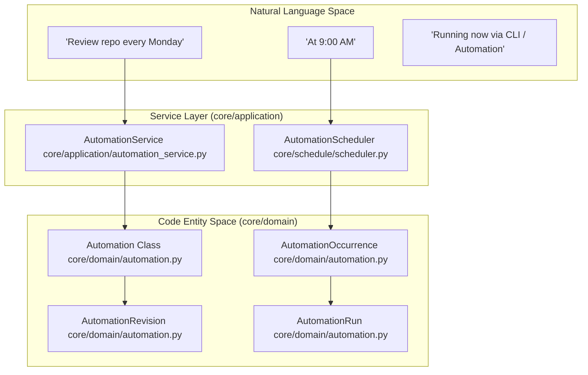
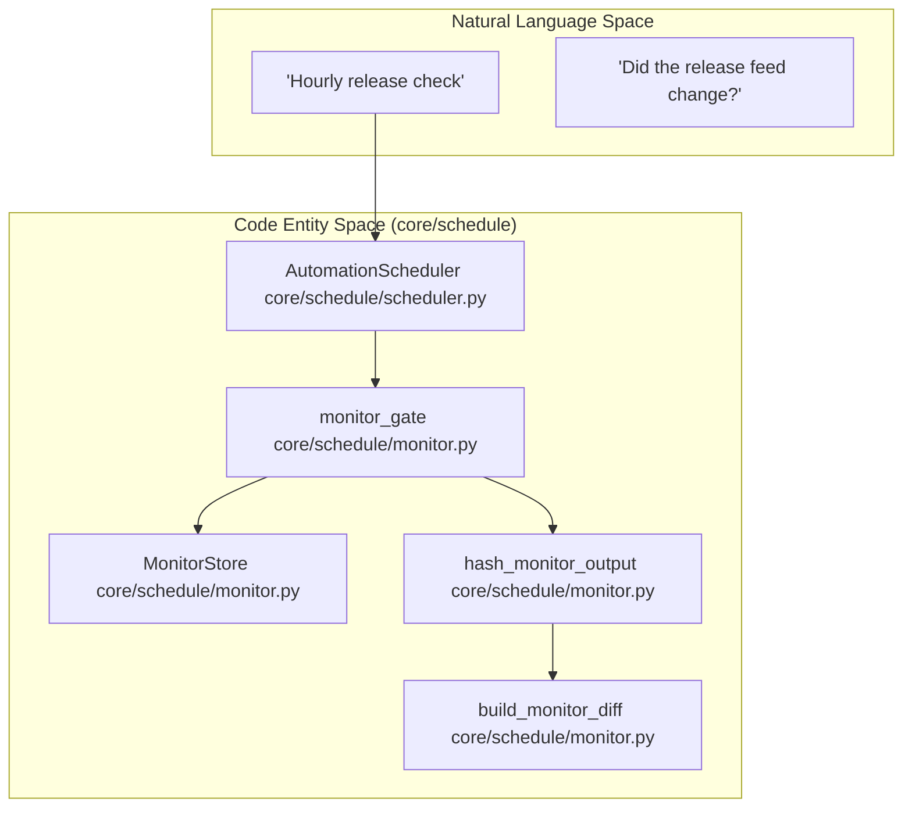
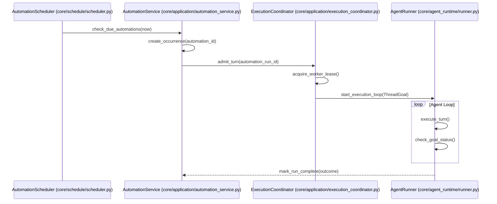

<!-- source: DeepWiki mcp.deepwiki.com · repo HKUDS/DeepCode · page 7.2 Automations and Scheduler · fetched 2026-11-09 -->

# Automations and Scheduler

Relevant source files

The following files were used as context for generating this wiki page:

- [app_server/service.py](app_server/service.py)
- [cli/automation_cli.py](cli/automation_cli.py)
- [cli/tui/animation.py](cli/tui/animation.py)
- [cli/tui/text.py](cli/tui/text.py)
- [core/private_storage.py](core/private_storage.py)
- [core/providers/base.py](core/providers/base.py)
- [core/schedule/__init__.py](core/schedule/__init__.py)
- [core/schedule/keepalive.py](core/schedule/keepalive.py)
- [core/schedule/monitor.py](core/schedule/monitor.py)
- [core/schedule/scheduler.py](core/schedule/scheduler.py)
- [core/sessions/store.py](core/sessions/store.py)
- [desktop/package-lock.json](desktop/package-lock.json)
- [desktop/package.json](desktop/package.json)
- [docs/guide/getting-started.md](docs/guide/getting-started.md)
- [docs/guide/goals-and-headless.md](docs/guide/goals-and-headless.md)
- [docs/guide/sessions.md](docs/guide/sessions.md)
- [docs/guide/the-tui.md](docs/guide/the-tui.md)
- [pyproject.toml](pyproject.toml)
- [tests/app_server/test_state_backup.py](tests/app_server/test_state_backup.py)
- [tests/application/test_automation_goal_runs.py](tests/application/test_automation_goal_runs.py)
- [tests/persistence/test_database.py](tests/persistence/test_database.py)
- [tests/test_private_storage.py](tests/test_private_storage.py)
- [tests/test_private_storage_acl_once.py](tests/test_private_storage_acl_once.py)
- [tests/test_private_storage_windows.py](tests/test_private_storage_windows.py)
- [tests/test_provider_oauth.py](tests/test_provider_oauth.py)
- [tests/test_schedule.py](tests/test_schedule.py)
- [tests/test_schedule_monitor.py](tests/test_schedule_monitor.py)
- [tests/test_session_index.py](tests/test_session_index.py)

## Overview and System Architecture

Automations in DeepCode provide a durable, multi-layered system for scheduling and executing recurring agentic work. Unlike a simple cron job, the Automation system is built on a state machine that bridges persistent configuration with durable execution units (`ThreadGoal` and `Turn`), ensuring idempotency and recoverability across process restarts [core/domain/automation.py:1-150](), [core/application/automation_service.py:20-80]().

| Entity | Role | Persistence | Code Entity / Module |
| :--- | :--- | :--- | :--- |
| **Automation** | The root definition (e.g., "Weekly Security Audit"). | SQLite | `core.domain.automation.Automation` |
| **AutomationRevision** | A versioned snapshot of the prompt and parameters. | SQLite | `core.domain.automation.AutomationRevision` |
| **AutomationOccurrence** | A specific scheduled "slot" (e.g., the run for 2024-10-27). | SQLite | `core.domain.automation.AutomationOccurrence` |
| **AutomationRun** | The actual execution attempt for an occurrence. | SQLite | `core.domain.automation.AutomationRun` |
| **ThreadGoal** | The durable objective managing the agent's progress. | SQLite / JSONL | `core.domain.ThreadGoal` |
| **Turn** | The atomic execution unit (LLM call + tool usage). | SQLite / JSONL | `core.domain.Turn` |

**Sources:** [core/domain/automation.py:1-150](), [core/application/automation_service.py:20-80]()

### Diagram 1: Natural Language Space to Code Entity Space (Automation Lifecycle)

**Sources:** [core/domain/automation.py:55-120](), [core/application/automation_service.py:97-150](), [core/schedule/scheduler.py:10-50]()

---

## Core Components and State Machine

The automation state machine enforces strict lifecycle transitions across revisions, occurrences, and runs.
- **`AutomationService`**: Manages CRUD operations for automations and revisions [core/application/automation_service.py:100-120]().
- **Idempotency Keys**: Occurrences are generated with unique keys based on scheduled timestamps to prevent duplicate runs [core/domain/automation.py:177]().
- **Run Leases**: Coordinated via `SessionStore.acquire_run_lease()` to prevent concurrent conflicting execution [core/sessions/store.py:160-175]().

**Sources:** [core/domain/automation.py:100-177](), [core/application/automation_service.py:50-140](), [core/sessions/store.py:160-175]()

---

## Schedule Policies, Keepalive, and Monitor Gate (`core/schedule/`)

The `core/schedule/` subsystem contains the scheduler, keepalive loop, and monitor gate:
- **`AutomationScheduler`**: Polls due occurrences based on `AutomationScheduleKind` (`MANUAL`, `INTERVAL`, `CRON`) [core/schedule/scheduler.py:15-60]().
- **Keepalive / Monitor**: `core/schedule/monitor.py` implements hash-suppressed change detection (P4). Before each scheduled tick, it runs a script or fetches a URL, computes a SHA-256 hash (`hash_monitor_output`), and compares it against the stored baseline [core/schedule/monitor.py:1-44](). If unchanged, the tick is silent and skips the LLM call entirely. If changed or on first run, it injects a context block containing a unified diff (`build_monitor_diff`) or baseline [core/schedule/monitor.py:83-122]().

**Sources:** [core/schedule/scheduler.py:1-66](), [core/schedule/keepalive.py:1-37](), [core/schedule/monitor.py:1-125]()

### Diagram 2: Monitor Gate & Schedule Flow to Code Entities

**Sources:** [core/schedule/monitor.py:28-125](), [core/schedule/scheduler.py:15-60]()

---

## Data Flow and Execution Loop

The following sequence details the transition from a scheduled trigger to an active Agentic loop managed by the `ExecutionCoordinator`.

**Sources:** [core/schedule/scheduler.py:40-66](), [core/application/automation_service.py:110-150](), [core/application/execution_coordinator.py:178-194](), [core/agent_runtime/runner.py:50-120]()

---

## CLI and Desktop Integration (`deepcode schedule` / `automation`)

- **`deepcode schedule`**: Foreground scheduling runner executing loops or monitors [docs/guide/goals-and-headless.md:107-138]().
- **`deepcode automation`**: CLI commands for creating, listing, triggering, enabling, and disabling automations (`cli/automation_cli.py`) [docs/guide/goals-and-headless.md:71-105]().
- **Desktop UI**: Surfaced via JSON-RPC App Server endpoints corresponding to `AutomationService` and occurrence/run inspection [docs/guide/goals-and-headless.md:82-86]().

**Sources:** [docs/guide/goals-and-headless.md:71-138](), [cli/automation_cli.py:1-80]()

---

