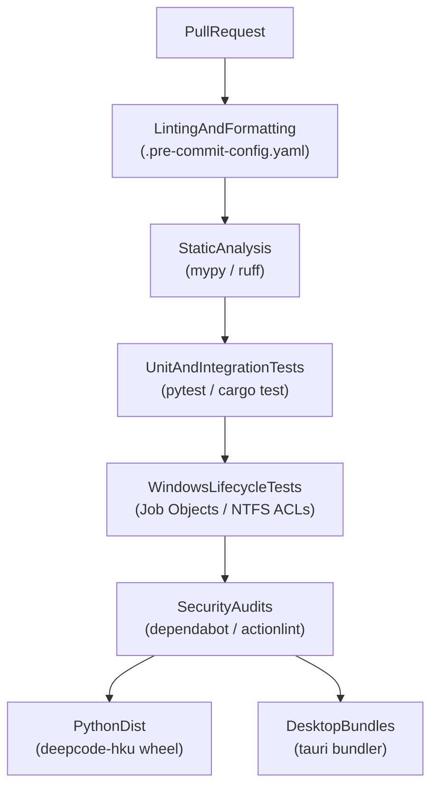
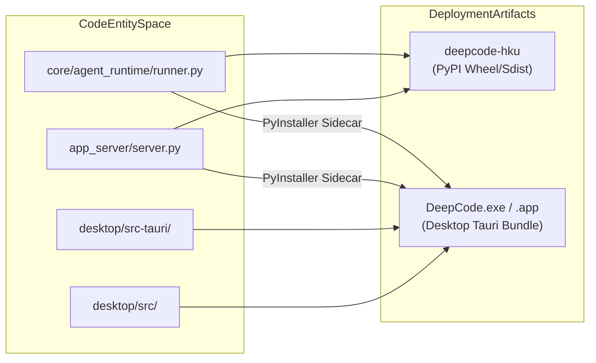
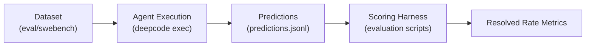

<!-- source: DeepWiki mcp.deepwiki.com · repo HKUDS/DeepCode · page 8 Development and Deployment · fetched 2026-11-09 -->

# Development and Deployment

Relevant source files

The following files were used as context for generating this wiki page:

- [.github/ISSUE_TEMPLATE/bug_report.yml](.github/ISSUE_TEMPLATE/bug_report.yml)
- [.github/ISSUE_TEMPLATE/config.yml](.github/ISSUE_TEMPLATE/config.yml)
- [.github/ISSUE_TEMPLATE/feature_request.yml](.github/ISSUE_TEMPLATE/feature_request.yml)
- [.github/ISSUE_TEMPLATE/question.yml](.github/ISSUE_TEMPLATE/question.yml)
- [.github/dependabot.yml](.github/dependabot.yml)
- [.github/pull_request_template.md](.github/pull_request_template.md)
- [.gitignore](.gitignore)
- [.pre-commit-config.yaml](.pre-commit-config.yaml)
- [LICENSE](LICENSE)
- [desktop/sidecar-requirements.in](desktop/sidecar-requirements.in)
- [desktop/sidecar-requirements.lock](desktop/sidecar-requirements.lock)
- [requirements.txt](requirements.txt)

## Purpose and Scope

This section provides information for contributors and operators who want to build, test, and deploy the DeepCode agentic system. It covers the modern multi-language development environment (Python, Rust, and Node.js), the unified CI/CD quality gates, the platform-specific Desktop release pipeline, and the automated PyPI distribution process.

This is a parent page. For detailed instructions, refer to the following child pages:
- [Development Setup](#8.1) — Setting up a dev environment: dependency manifests (`requirements.txt`, sidecar requirements lock), editable installs, pytest suite layout, pre-commit hooks, ruff/mypy, desktop npm/Cargo/Tauri dev flow, contribution templates.
- [CI/CD Pipeline](#8.2) — GitHub Actions workflows: ci-scope detection, desktop CI quality gates, Python CI matrix with Windows lifecycle tests, web-ci, linting, security audits, dependency review.
- [Desktop Release Process](#8.3) — Version alignment across `package.json`/`Cargo.toml`/`tauri.conf.json`, sidecar build pipeline (`uv pip compile` → PyInstaller), code signing/notarization, `verify-release-bundle.py`, Tauri auto-updater.
- [Python Package and PyPI Publishing](#8.4) — Package structure (`deepcode-hku`), setup.py package data (skills, presets, prompts), console scripts, OIDC PyPI publishing, `verify_python_distribution.py`.
- [SWE-bench Evaluation Harness](#8.5) — `eval/swebench/`: predict→score separation, local vs official Verified modes, the `deepcode exec` prediction pipeline, `predictions.jsonl` format, reporting resolved rates.
- [Documentation Website](#8.6) — The Astro/Starlight site in `website/`: guide sync script from `docs/guide`, content config, theming, and the deploy-website workflow; also the `docs/` tree layout and assets.

Sources: [.github/pull_request_template.md:1-32](), [.github/ISSUE_TEMPLATE/bug_report.yml:1-61]()

---

## Development Ecosystem

DeepCode is a polyglot system requiring a synchronized development environment across three main technology stacks, governed by robust pre-commit hooks and dependency manifests.

### Core Technology Stacks

| Stack | Role | Primary Tools | Manifest / Config |
| :--- | :--- | :--- | :--- |
| **Python** | Agent Kernel, App Server, Paper2Code | `uv`, `pytest`, `ruff`, `mypy` | `requirements.txt`, `desktop/sidecar-requirements.in` |
| **Rust** | Desktop RPC Bridge, Platform Sandbox | `cargo`, `clippy`, `tauri` | `desktop/src-tauri/Cargo.toml` |
| **Node.js** | Desktop Workbench UI (React) | `npm`, `typescript`, `vite` | `desktop/package.json` |

The system uses `uv` for high-performance Python dependency management [.github/workflows/python-ci.yml:19](). Code formatting and linting are strictly enforced via pre-commit configurations running `ruff` and `actionlint` [.pre-commit-config.yaml:1-30](). For setup details, see [Development Setup](#8.1).

Sources: [requirements.txt:1-24](), [desktop/sidecar-requirements.in:1-22](), [.pre-commit-config.yaml:1-30]()

---

## CI/CD and Quality Gates

DeepCode employs a multi-stage CI/CD pipeline implemented via GitHub Actions to ensure cross-platform stability, particularly for agent-host interactions and sandboxed execution environments.

### CI/CD Quality Pipeline

**Diagram: CI/CD Quality Pipeline**

Sources: [.github/workflows/python-ci.yml:41-78](), [.github/workflows/security-ci.yml:20-101](), [.pre-commit-config.yaml:1-30]()

For complete workflow descriptions, trigger conditions, and scope detection rules, see [CI/CD Pipeline](#8.2).

---

## Deployment and Distribution

DeepCode is distributed via two primary channels: the `deepcode-hku` Python package published on PyPI, and standalone Tauri-based Desktop installers bundled with a Python sidecar binary.

### Source Entity to Distribution Mapping

**Diagram: Source Entity to Distribution Mapping**

- **Desktop Release:** The Python App Server (`[app_server/server.py]()`) and agent runtimes (`[core/agent_runtime/runner.py]()`) are bundled into an isolated sidecar binary using PyInstaller before being wrapped by Tauri. For details, see [Desktop Release Process](#8.3).
- **Python Package:** Publishing is managed via trusted OIDC workflows, validated by `verify_python_distribution.py`. For details, see [Python Package and PyPI Publishing](#8.4).

Sources: [desktop/sidecar-requirements.lock:1-206](), [pyproject.toml:1-40]()

---

## Evaluation and Benchmarking

To maintain agentic quality and track regression across iterations, DeepCode incorporates a comprehensive evaluation harness targeting **SWE-bench**. 

### Evaluation Pipeline Flow

**Diagram: SWE-bench Evaluation Flow**

The harness decouples prediction generation via `deepcode exec` from scoring, supporting both local testbeds and official Verified benchmark splits. For implementation details and metric reporting, see [SWE-bench Evaluation Harness](#8.5).

Sources: [requirements.txt:1-24]()

---

## Documentation Website

User guides, API references, and developer documentation are built using an Astro and Starlight site located under `website/`. Content is automatically synchronized from the core `docs/guide` markdown files.

For details on the site configuration, theming tokens, and the automated deployment workflow, see [Documentation Website](#8.6).

Sources: [.gitignore:18-21]()

---

