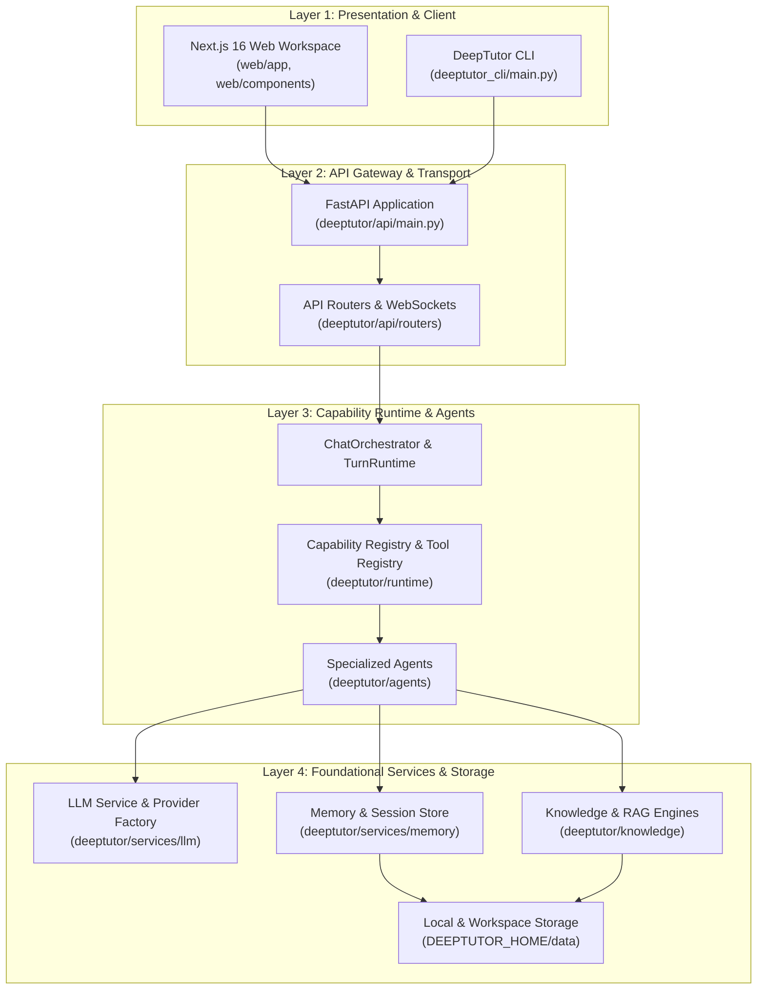
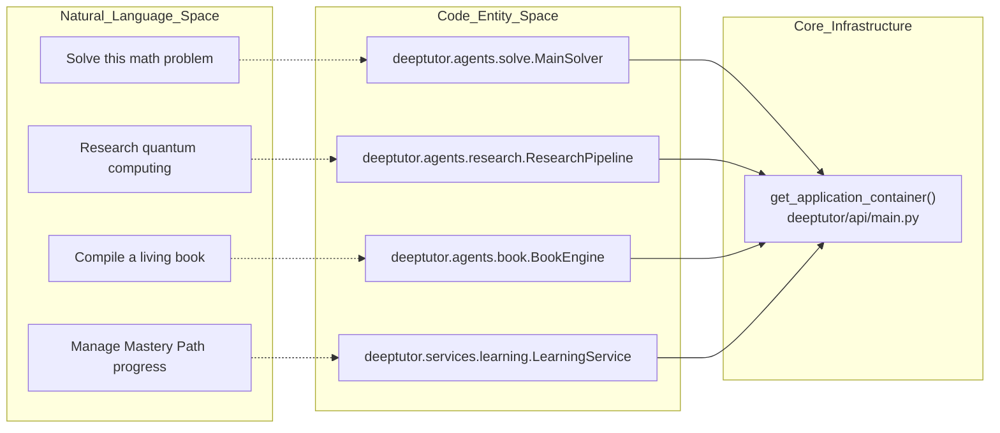
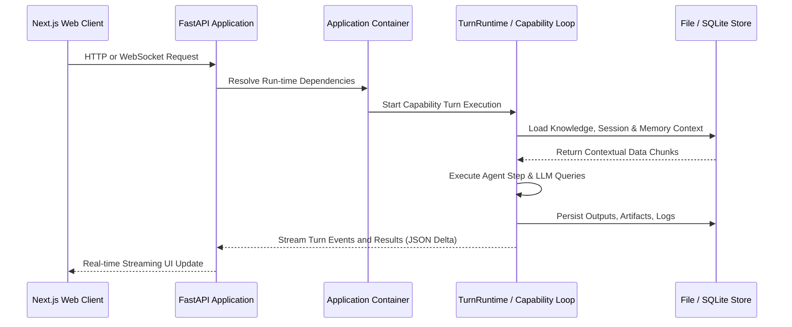

<!-- source: DeepWiki mcp.deepwiki.com · repo HKUDS/DeepTutor · page 1 Overview · fetched 2026-11-09 -->

# Overview

Relevant source files

The following files were used as context for generating this wiki page:

- [README.md](README.md)
- [assets/README/README_AR.md](assets/README/README_AR.md)
- [assets/README/README_CN.md](assets/README/README_CN.md)
- [assets/README/README_ES.md](assets/README/README_ES.md)
- [assets/README/README_FR.md](assets/README/README_FR.md)
- [assets/README/README_HI.md](assets/README/README_HI.md)
- [assets/README/README_JA.md](assets/README/README_JA.md)
- [assets/README/README_PL.md](assets/README/README_PL.md)
- [assets/README/README_PT.md](assets/README/README_PT.md)
- [assets/README/README_RU.md](assets/README/README_RU.md)
- [assets/README/README_TH.md](assets/README/README_TH.md)
- [assets/roster/forkers.svg](assets/roster/forkers.svg)
- [assets/roster/stargazers.svg](assets/roster/stargazers.svg)
- [deeptutor/__version__.py](deeptutor/__version__.py)
- [packaging/deeptutor-cli/pyproject.toml](packaging/deeptutor-cli/pyproject.toml)
- [pyproject.toml](pyproject.toml)
- [requirements/cli.txt](requirements/cli.txt)
- [requirements/partners.txt](requirements/partners.txt)
- [scripts/start_tour.py](scripts/start_tour.py)
- [tests/scripts/test_start_tour.py](tests/scripts/test_start_tour.py)
- [tests/services/mcp/test_missing_mcp_dependency.py](tests/services/mcp/test_missing_mcp_dependency.py)
- [tests/services/partners/test_weixin_onboarding.py](tests/services/partners/test_weixin_onboarding.py)
- [tests/test_packaging_metadata.py](tests/test_packaging_metadata.py)

## Purpose and Scope

DeepTutor is an agent-native lifelong personalized tutoring workspace designed to integrate tutoring, problem-solving, quiz generation, research, visualization, and mastery practice into a unified, extensible system [README.md:4-66](). It enables connected pedagogical workflows by sharing a runtime and session context among diverse learning modes such as Chat, Quiz, Research, Mastery Path, and Immersive Reading or Watching [README.md:60-61]().

At the architectural level, DeepTutor spans four main layers: a Next.js-based web frontend serving the user interface, a FastAPI backend providing API and WebSocket transport, an agent capability runtime orchestrating intelligent multi-agent workflows, and foundational backend services managing language models, knowledge bases, session memory, and storage [README.md:60-65](), [pyproject.toml:50-95]().

Sources: [README.md:4-66](), [pyproject.toml:50-95]()

---

## Four-Layer System Architecture

DeepTutor’s technical architecture is structured in four operational layers, each with clear responsibilities and integration points:

**Layer details:**

1. **Presentation & Client:** The user interfaces, including the Next.js 16-based web workspace (source under `web/app`, `web/components`) and the DeepTutor CLI client defined in `pyproject.toml` pointing to `deeptutor_cli.main:main` [pyproject.toml:50](). These components communicate with backend APIs or WebSockets.

2. **API Gateway & Transport:** A FastAPI web application (`deeptutor/api/main.py`) serves REST and WebSocket endpoints through modular routers (`deeptutor/api/routers/`), forming the backend interface for frontend and CLI clients.

3. **Capability Runtime & Agents:** The core orchestrator of multi-agent workflows, including `ChatOrchestrator` and `TurnRuntime` that manage interactive tutoring sessions. The capability registry and tool registry (under `deeptutor/runtime/`) provide dynamic loading and dispatching of specialized agents (`deeptutor/agents/`) implementing distinct tutoring capabilities.

4. **Foundational Services & Storage:** Backend services offering interfaces for large language models (`deeptutor/services/llm`), retrieval-augmented generation engines (`deeptutor/knowledge/`), session and memory management (`deeptutor/services/memory`), and local data persistence in the runtime home directory (`DEEPTUTOR_HOME/data`) [README.md:60-65](), [pyproject.toml:50-95]().

Sources: [README.md:60-65](), [pyproject.toml:50-95]()

---

## Technical Implementation: Mapping Natural Language to Code Entities

DeepTutor bridges user natural language requests with internal Python-based agent implementations. The following diagram illustrates the correspondence between natural language tasks and key backend classes within the runtime.

### Natural Language to Agent Implementation Mapping

- `"Solve this math problem"` maps to the `MainSolver` class in the `deeptutor.agents.solve` module, which implements the dual-loop problem-solving capability with step verification and vision tool support.
- `"Research quantum computing"` maps to `ResearchPipeline` in `deeptutor.agents.research`, encapsulating rich multi-agent research workflows.
- `"Compile a living book"` maps to `BookEngine` in `deeptutor.agents.book`, managing content blocks, concept spines, and interactive book generation.
- `"Manage Mastery Path progress"` corresponds to `LearningService` in `deeptutor.services.learning`, implementing adaptive grading and spaced repetition.

All are instantiated and managed via the application container returned by `get_application_container()` in the API entry point (`deeptutor/api/main.py`) which orchestrates runtime dependencies and lifecycle management.

Sources: [README.md:60-65](), [pyproject.toml:70-94]()

---

## Key Capabilities

DeepTutor integrates multiple specialized learning capabilities under a shared runtime and session context, promoting interconnected workflows and data reuse [README.md:60-66]():

| Capability Module | Namespace | Core Function |
|---|---|---|
| **Smart Solver** | `deeptutor.agents.solve` | Dual-loop problem solving with step validation and vision capabilities [pyproject.toml:78](). |
| **Deep Research** | `deeptutor.agents.research` | Multi-agent source exploration, filtering, and report generation [pyproject.toml:87](). |
| **Book Engine** | `deeptutor.agents.book` | Living book generation with concept graphs and planned page synthesis [pyproject.toml:86](). |
| **Mastery Path Learning Engine** | `deeptutor.services.learning` | Tracks knowledge points, schedules spaced repetition, and manages mastery grading [pyproject.toml:93](). |
| **Immersive Reading** | `deeptutor.knowledge` | Document viewers with rich annotations, W3C selectors, and bilingual EPUB ingestion [pyproject.toml:79](). |
| **Partners (Persistent AI Companions)** | `deeptutor.services.partners` | Multi-channel persistent AI assistants with IM bindings (Telegram, Feishu, etc.) [pyproject.toml:61](). |

Each capability exposes a runtime pipeline or loop within the unified capability runtime framework, allowing them to share session memory, knowledge bases, and workspace artifacts seamlessly.

Sources: [README.md:60-66](), [pyproject.toml:52-95]()

---

## Data Flow and Persistence

DeepTutor manages data persistence primarily in the local runtime home directory specified by `DEEPTUTOR_HOME` or user configurations, typically under `data/user/` for private user settings and `data/user/workspace` for shared contents [assets/README/README_CN.md:71-75]().

The data flow from frontend user input to backend computation and back is orchestrated as follows:

- User requests from the Next.js frontend or CLI are transported via REST or WebSocket APIs through FastAPI endpoint routers.
- The backend obtains scoped dependencies from the application container, including capability runtime and agent modules, to execute an interaction turn.
- The turn runtime loads relevant knowledge base segments, session memory, and previous context from SQLite or the file system.
- Agents process steps with calls to LLM providers, external tools, or plugins.
- Outputs including streaming JSON deltas, logs, and artifacts are saved to workspace output directories for persistence and UI rendering [assets/README/README_CN.md:71-75]().

This architecture enables dynamic, low-latency interactive tutoring with persistent state and content versioning.

Sources: [README.md:60-66](), [assets/README/README_CN.md:71-75]()

---

## Next Steps

For deeper exploration, consult these child sections and pages from the documentation:

- **Getting Started (2)** — Installation, deployment, CLI initialization, and environment configurations.
- **System Architecture (3)** — Detailed breakdown of frontend layouts, runtime orchestration, data persistence, and agent loops.
- **Core Services (5)** — Backend LLM providers, embedding adapters, session and memory infrastructure.
- **Intelligent Agent Modules (4)** — Individual learning capabilities like Smart Solver, Mastery Path, Book Engine, and Partners.
- **API Layer (12)** — FastAPI app structure, routers, WebSocket turn protocol, contracts, and exception handling [README.md:40]().

This page serves as the foundation for understanding the design principles and core structures of DeepTutor.

Sources: [README.md:40-66]()

---

