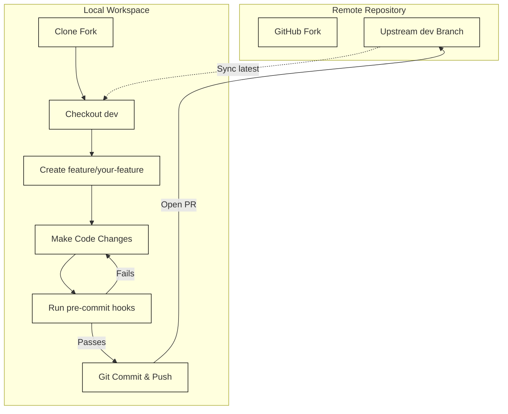
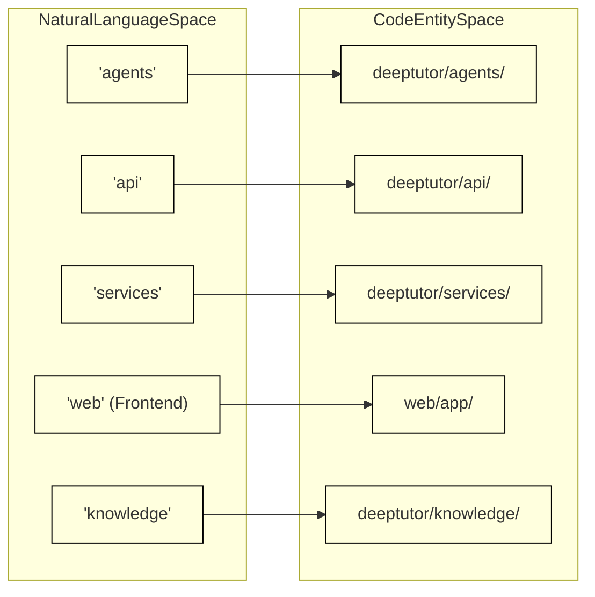
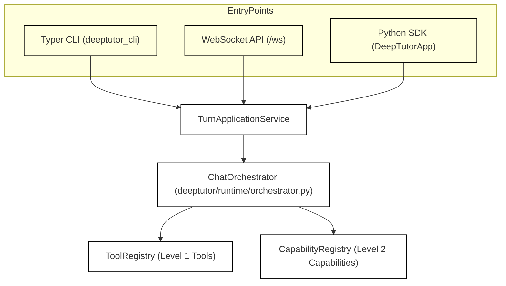

<!-- source: DeepWiki mcp.deepwiki.com · repo HKUDS/DeepTutor · page 10.1 Contributing Guidelines · fetched 2026-11-09 -->

# Contributing Guidelines

<details>
<summary>Relevant source files</summary>

The following files were used as context for generating this wiki page:

- [AGENTS.md](AGENTS.md)
- [SKILL.md](SKILL.md)
- [deeptutor/services/llm/claude_sdk.py](deeptutor/services/llm/claude_sdk.py)
- [deeptutor/services/llm/provider_core/claude_code_provider.py](deeptutor/services/llm/provider_core/claude_code_provider.py)
- [deeptutor/services/llm/provider_core/codebuddy_provider.py](deeptutor/services/llm/provider_core/codebuddy_provider.py)
- [deeptutor/services/llm/provider_core/sdk_bridge.py](deeptutor/services/llm/provider_core/sdk_bridge.py)
- [deeptutor/services/subagent/claude_models.py](deeptutor/services/subagent/claude_models.py)
- [deeptutor_cli/README.md](deeptutor_cli/README.md)
- [deeptutor_cli/provider_cmd.py](deeptutor_cli/provider_cmd.py)
- [docs-for-dev/I18N.md](docs-for-dev/I18N.md)
- [docs-for-dev/README.md](docs-for-dev/README.md)
- [examples/memory_evaluation/README.md](examples/memory_evaluation/README.md)
- [tests/cli/test_provider_cli.py](tests/cli/test_provider_cli.py)
- [tests/multi_user/test_owner_bound_models.py](tests/multi_user/test_owner_bound_models.py)
- [tests/services/llm/test_claude_code_provider.py](tests/services/llm/test_claude_code_provider.py)
- [tests/services/llm/test_codebuddy_provider.py](tests/services/llm/test_codebuddy_provider.py)
- [tests/services/test_claude_model_discovery.py](tests/services/test_claude_model_discovery.py)
- [web/tests/learning-source-scroll.audit.ts](web/tests/learning-source-scroll.audit.ts)

</details>


## Purpose and Scope

This page outlines the standard contribution workflows, git branching strategy, commit conventions, pull request templates, and development documentation practices for DeepTutor. It governs how contributors propose changes, run automated quality checks, adhere to the agent-native architecture defined in `AGENTS.md`, and interact with developer resources (`docs-for-dev/`) [CONTRIBUTING.md:1-3](), [AGENTS.md:1-10]().

---

## Git Workflow and Branch Strategy

DeepTutor uses a structured branching model to maintain stability across releases. **Do not submit pull requests directly to `main`** [CONTRIBUTING.md:32-42]().

| Branch | Target Use Case | Stability & Expectations |
|---|---|---|
| `dev` | General feature development, refactoring, bug fixes | Active development branch; may contain breaking changes or unstable states [CONTRIBUTING.md:46-51]() |
| `multi-user` | Multi-tenant feature development, RBAC, session isolation | Experimental branch focused on multi-user scenarios [CONTRIBUTING.md:53-58]() |

### Git Workflow Diagram


Sources: [CONTRIBUTING.md:32-86]()

---

## Contribution Process and Environment Setup

### 1. Environment Preparation
Contributors must install the full python development requirements and set up pre-commit hooks [CONTRIBUTING.md:98-128]()）：

```bash
# Create and activate virtual environment
python -m venv venv
source venv/bin/activate  # Windows: venv\Scripts\activate

# Install editable development package with full requirements
python -m pip install -r requirements/full.txt
python -m pip install -e . --no-deps

# Install pre-commit hooks (mandatory)
pip install pre-commit
pre-commit install
```

### 2. Pre-commit and Code Quality Checks
Pre-commit hooks automatically validate code formatting, types, and security issues [CONTRIBUTING.md:114-128](). To run checks across all files manually:

```bash
pre-commit run --all-files
```

Sources: [CONTRIBUTING.md:98-128](), [CONTRIBUTING.md:175-187]()

---

## Commit Message Conventions

DeepTutor enforces conventional commit formats to maintain a readable git history and automate release notes [CONTRIBUTING.md:210-216]().

### Format Spec
```
<type>: <short description>

[optional body describing motivation and context]
```

### Supported Commit Types
| Type | Description | Version Impact |
|---|---|---|
| `feat` | Introduces a new feature | MINOR bump |
| `fix` | Resolves a bug | PATCH bump |
| `docs` | Documentation-only changes | None |
| `style` | Formatting, missing semi-colons, whitespace changes | None |
| `refactor` | Code refactoring without behavioral changes | None |
| `test` | Adding or correcting test suites | None |
| `chore` | Build system, CI pipeline, or dependency updates | None |

Sources: [CONTRIBUTING.md:210-227]()

---

## Pull Request Template and Module Mapping

Pull requests must use the repository's PR template [.github/pull_request_template.md:1-43](), checking off affected subsystems and verifying that all tests pass.

### Natural Language Space to Code Entity Space

The following diagram maps the module categories in the PR checklist to their corresponding code directories:


Sources: [.github/pull_request_template.md:14-34]()

---

## AGENTS.md Conventions and Architecture Reference

Contributions touching core agent loops or capability pipelines must comply with `AGENTS.md`. DeepTutor is organized around a two-layer plugin model: single-shot **Tools** (Level 1) and multi-stage **Capabilities** (Level 2) [AGENTS.md:1-8]().

### Core Execution Flow


Sources: [AGENTS.md:12-32]()

---

## Developer Documentation (`docs-for-dev/`)

The `docs-for-dev/` directory contains deep technical guides for contributors. When modifying core behaviors, contributors must consult and update the relevant handbook page [docs-for-dev/README.md:1-28]():

- **Agent Setup & Verification**: [`docs-for-dev/AGENT_SETUP.md`](../docs-for-dev/AGENT_SETUP.md) — Covers environment preparation, credential sources, and diagnostic troubleshooting.
- **Localization and i18n**: [`docs-for-dev/I18N.md`](../docs-for-dev/I18N.md) — Outlines interface vs. reply language requirements, catalog rules, and pluralization [docs-for-dev/I18N.md:1-48]().
- **Tool and Capability Contracts**: [`docs-for-dev/TOOLS_AND_CAPABILITIES.md`](../docs-for-dev/TOOLS_AND_CAPABILITIES.md) — Rules for mounting context gates and emitting standardized result envelopes.
- **Runtime Design**: [`docs-for-dev/RUNTIME_DESIGN.md`](../docs-for-dev/RUNTIME_DESIGN.md) — Lazy loading, isolated parsing, and prompt-cache observability.

Sources: [docs-for-dev/README.md:1-51](), [docs-for-dev/I18N.md:1-48]()

---

## Architectural Decision Records (ADRs) and Docs/Plans

Major architectural shifts, protocol changes, or breaking updates must be accompanied by an Architectural Decision Record (ADR) or a design plan under `docs/plans/` or `docs/adr/`. 

- **ADR Format**: Must state the context, considered options, decision, and consequences.
- **Plan Verification**: Design proposals in `docs/plans/` are not considered current behavior until their implementation classes and routers can be verified via test suites.

Sources: [docs-for-dev/README.md:71-82]()

---

