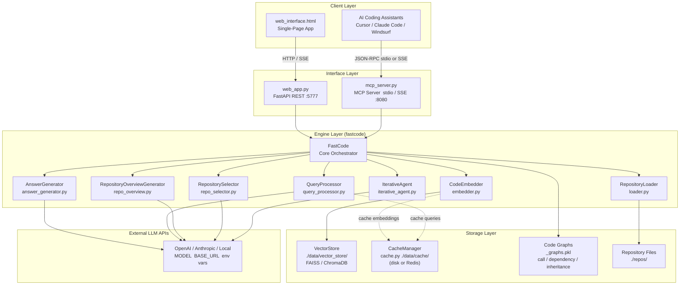
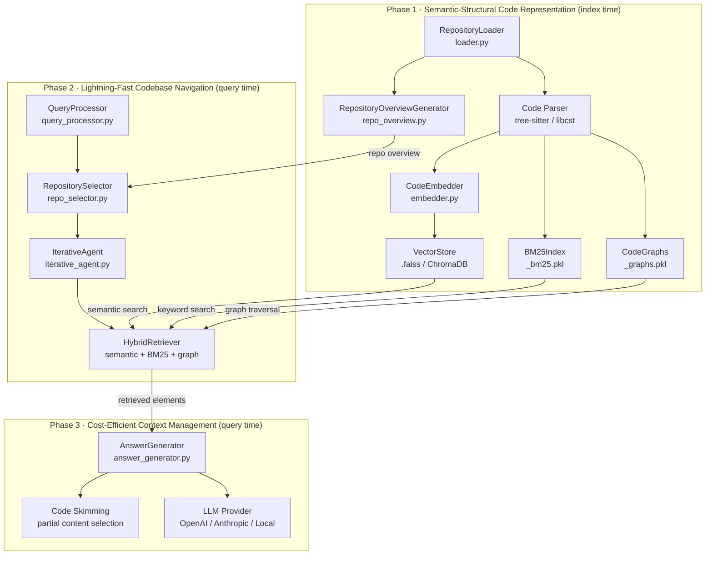
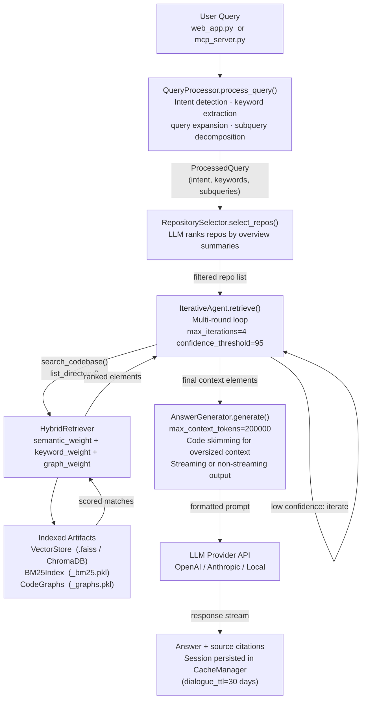

<!-- source: DeepWiki mcp.deepwiki.com · repo HKUDS/FastCode · page 1.2 Architecture Overview · fetched 2026-11-09 -->

# Architecture Overview

Relevant source files

The following files were used as context for generating this wiki page:

- [README.md](README.md)
- [config/config.yaml](config/config.yaml)
- [fastcode/embedder.py](fastcode/embedder.py)

This page maps FastCode's component topology, its four system layers, and the three-phase processing framework to actual files, classes, and data stores. It is intended as a navigational reference for the rest of the wiki.

For deeper internals of each phase, see [Three-Phase Framework](#3.1). For per-component documentation, see [Core Components](#4). For client interface details (REST API, MCP, Web UI), see [Interfaces & APIs](#6).

---

## System Layers

FastCode is organized into four layers. The **Client Layer** holds the browser UI and AI coding assistants. The **Interface Layer** hosts the FastAPI REST server and MCP server. The **Engine Layer** is the `fastcode/` Python package that does all analysis work. The **Storage Layer** holds all persisted artifacts.

**Diagram: System Layers and Module Locations**

Sources: [README.md:1-116](), [config/config.yaml:1-10]()

| Layer | File / Module | Role |
|-------|--------------|------|
| Client | `web_interface.html` | Browser single-page app |
| Client | AI coding assistants | Cursor, Claude Code, Windsurf via MCP |
| Interface | `web_app.py` | FastAPI REST server, port 5777 |
| Interface | `mcp_server.py` | MCP server, stdio transport or SSE on :8080 |
| Engine | `fastcode/loader.py` — `RepositoryLoader` | Repo acquisition and file scanning |
| Engine | `fastcode/embedder.py` — `CodeEmbedder` | SentenceTransformer batch embedding |
| Engine | `fastcode/query_processor.py` — `QueryProcessor` | Query understanding, expansion, intent detection |
| Engine | `fastcode/answer_generator.py` — `AnswerGenerator` | Prompt construction, token budgeting, LLM call |
| Engine | `fastcode/iterative_agent.py` — `IterativeAgent` | Multi-round retrieval loop with confidence scoring |
| Engine | `fastcode/repo_overview.py` — `RepositoryOverviewGenerator` | README/LLM-based repository summarization |
| Engine | `fastcode/repo_selector.py` — `RepositorySelector` | LLM-driven multi-repo selection |
| Storage | `./data/vector_store/` | FAISS or ChromaDB index per repository |
| Storage | `./data/cache/` | `CacheManager` embedding, query, and dialogue cache |
| Storage | `_graphs.pkl` (per repo) | Call, dependency, and inheritance graphs |
| Storage | `./repos/` | Cloned or uploaded repository source files |

Sources: [README.md:44-63](), [config/config.yaml:82-95]()

---

## The Three-Phase Framework

The engine implements three sequential phases. **Phase 1** runs at index time when a repository is first loaded. **Phases 2 and 3** run at query time for every user question.

**Diagram: Three Phases Mapped to Code Modules**

Sources: [README.md:79-116](), [config/config.yaml:58-181]()

| Phase | Timing | Key Modules | Primary Output |
|-------|--------|-------------|----------------|
| 1 — Semantic-Structural Code Representation | Index time | `RepositoryLoader`, Code Parser, `CodeEmbedder`, `RepositoryOverviewGenerator` | Vector index, BM25 index, code graphs, repo overview |
| 2 — Lightning-Fast Codebase Navigation | Query time | `QueryProcessor`, `RepositorySelector`, `IterativeAgent`, HybridRetriever | Ranked, deduplicated code elements |
| 3 — Cost-Efficient Context Management | Query time | `AnswerGenerator`, Code Skimming, `CacheManager` | Token-budgeted LLM prompt → answer + source citations |

Sources: [README.md:85-116]()

---

## Query Execution Flow

The following traces a single user query through the engine, with actual class method names and config parameter names at each step.

**Diagram: Query Execution Through Engine Modules**

Sources: [README.md:919-934](), [config/config.yaml:98-180](), [fastcode/embedder.py:54-81]()

---

## Configuration Map

All three phases are controlled by `config/config.yaml`. The table below maps each config section to the phase it governs.

| Config Section | Phase | Representative Parameters |
|----------------|-------|--------------------------|
| `repository` | 1 | `clone_depth`, `max_file_size_mb`, `supported_extensions`, `ignore_patterns` |
| `parser` | 1 | `extract_docstrings`, `extract_imports`, `compute_complexity` |
| `embedding` | 1 | `model`, `device` (`auto`/`cuda`/`mps`/`cpu`), `batch_size` |
| `indexing` | 1 | `levels` (file/class/function/documentation), `generate_repo_overview` |
| `vector_store` | 1 | `type` (faiss/chromadb), `persist_directory` |
| `graph` | 1 | `build_call_graph`, `build_dependency_graph`, `build_inheritance_graph` |
| `query` | 2 | `expand_query`, `decompose_complex`, `llm_enhancement_mode` |
| `retrieval` | 2 | `semantic_weight`, `keyword_weight`, `graph_weight`, `enable_agency_mode` |
| `agent.iterative` | 2 | `max_iterations`, `confidence_threshold`, `max_total_lines` |
| `generation` | 3 | `provider`, `max_context_tokens`, `reserve_tokens_for_response` |
| `cache` | all | `backend`, `ttl`, `dialogue_ttl`, `cache_embeddings` |

Sources: [config/config.yaml:1-205]()

---

