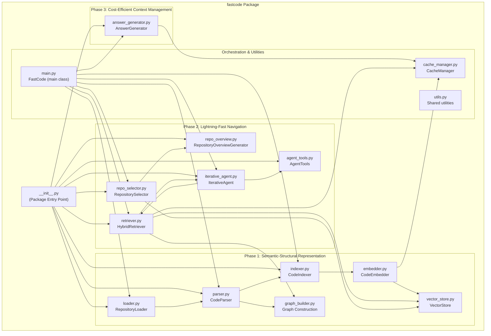
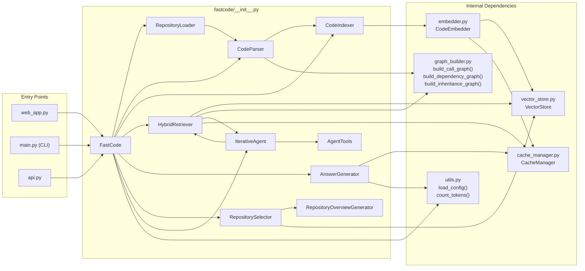
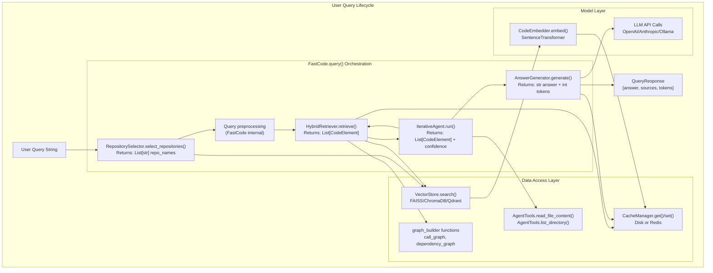

<!-- source: DeepWiki mcp.deepwiki.com · repo HKUDS/FastCode · page 10.2 Project Structure · fetched 2026-11-09 -->

# Project Structure

<details>
<summary>Relevant source files</summary>

The following files were used as context for generating this wiki page:

- [README.md](README.md)
- [config/config.yaml](config/config.yaml)
- [fastcode/embedder.py](fastcode/embedder.py)
- [requirements.txt](requirements.txt)

</details>


This document provides an overview of the FastCode codebase organization for developers who want to contribute to or extend the system. It maps the directory structure to the three-phase framework architecture and identifies the key modules, entry points, and extension points.

For information about setting up a development environment, see [Development Environment Setup](#10.1). For guidance on extending FastCode with custom components, see [Extension Points](#10.3).

---

## Top-Level Directory Structure

The FastCode repository follows a modular structure separating core code, configuration, interfaces, and runtime data:

```
FastCode/
├── fastcode/              # Core package (main system logic)
├── config/                # Configuration files
├── nanobot/               # Nanobot integration (Docker-based)
├── web_app.py             # Web UI entry point (port 5000)
├── main.py                # CLI entry point
├── api.py                 # REST API entry point (port 8001)
├── run_nanobot.sh         # Docker Compose orchestration script
├── requirements.txt       # Python dependencies
├── Dockerfile             # FastCode container definition
├── docker-compose.yml     # Multi-service orchestration
├── .env                   # Environment variables (API keys, models)
├── env.example            # Environment template
├── data/                  # Runtime data (vector indexes, cache)
├── repos/                 # Cloned/loaded repositories
└── logs/                  # Application logs
```

**Key characteristics:**

- **Core logic** resides in the `fastcode/` package as independent, testable modules
- **Entry points** (web_app.py, main.py, api.py) are thin wrappers that instantiate and orchestrate core components
- **Configuration** is separated into static files (config/config.yaml) and runtime secrets (.env)
- **Data directories** (data/, repos/, logs) are excluded from version control via [.gitignore:44-46]()

**Sources:** [.gitignore:1-90](), [README.md:143-156](), [README.md:358-396]()

---

## Core Package Structure (`fastcode/`)

The `fastcode/` package contains 13 core modules that implement the three-phase framework. Each module is a self-contained component with minimal coupling:



**Module Responsibilities:**

| Module | Class/Function | Purpose | Phase |
|--------|---------------|---------|-------|
| `main.py` | `FastCode` | Main orchestrator coordinating all phases | All |
| `loader.py` | `RepositoryLoader` | Clone Git repos, load local paths, extract ZIPs | Phase 1 |
| `parser.py` | `CodeParser` | AST-based parsing for 8 languages | Phase 1 |
| `indexer.py` | `CodeIndexer` | 4-level hierarchical indexing (file/class/function/doc) | Phase 1 |
| `embedder.py` | `CodeEmbedder` | Generate semantic embeddings via SentenceTransformer | Phase 1 |
| `vector_store.py` | `VectorStore` | FAISS/ChromaDB/Qdrant vector storage with HNSW index | Phase 1 |
| `graph_builder.py` | Graph construction functions | Build call/dependency/inheritance graphs | Phase 1 |
| `repo_overview.py` | `RepositoryOverviewGenerator` | Generate repo summaries for selection | Phase 2 |
| `repo_selector.py` | `RepositorySelector` | Two-stage repo selection (LLM/embedding-based) | Phase 2 |
| `retriever.py` | `HybridRetriever` | Hybrid search (semantic + keyword + graph) | Phase 2 |
| `iterative_agent.py` | `IterativeAgent` | Multi-round retrieval with confidence thresholds | Phase 2 |
| `agent_tools.py` | `AgentTools` | Read-only file exploration (5 tools) | Phase 2 |
| `answer_generator.py` | `AnswerGenerator` | LLM integration with token management | Phase 3 |
| `cache_manager.py` | `CacheManager` | Disk/Redis caching for embeddings, queries, sessions | All |
| `utils.py` | Utility functions | Shared helpers (file I/O, text processing) | All |

**Sources:** [fastcode/__init__.py:1-43](), [README.md:76-113]()

---

## Module Import Graph

This diagram shows the actual import relationships between FastCode modules, using class names as they appear in code:



**Key observations:**

1. **Entry points** (web_app.py, main.py, api.py) only import `FastCode` class from [fastcode/__init__.py:15]()
2. **`FastCode` class** (main.py) orchestrates all other components
3. **`IterativeAgent`** has bidirectional dependency with `HybridRetriever` for multi-round retrieval
4. **`CacheManager`** is used by three components: `AnswerGenerator`, `HybridRetriever`, `CodeEmbedder`
5. **Graph functions** (build_call_graph, etc.) are used by both `CodeParser` and `HybridRetriever`

**Sources:** [fastcode/__init__.py:15-24]()

---

## Entry Points and Interfaces

FastCode provides four entry points for different use cases:

### 1. Web UI (`web_app.py`)

Flask-based web interface running on port 5000:

```
web_app.py
├── Serves static HTML/CSS/JS
├── Instantiates FastCode instance
├── Routes:
│   ├── GET  /              → Index page
│   ├── POST /load          → Load repository
│   ├── POST /index         → Index repository
│   ├── POST /query         → Query codebase
│   └── GET  /status        → System status
└── Runs on host:port from CLI args
```

**Usage:**
```bash
python web_app.py --host 0.0.0.0 --port 5000
```

**Sources:** [README.md:154-156](), [README.md:358-361]()

### 2. Command Line Interface (`main.py`)

Script-friendly CLI for automation:

```
main.py
├── Parses command-line arguments
├── Instantiates FastCode instance
├── Supports:
│   ├── --repo <path>           → Single repository
│   ├── --repos <path1> <path2> → Multiple repositories
│   ├── --query <question>      → Query string
│   ├── --model <model_name>    → Override default model
│   └── --config <config_path>  → Custom config file
└── Outputs answer to stdout
```

**Usage:**
```bash
python main.py --repo /path/to/repo --query "Your question"
```

**Sources:** [README.md:374-386]()

### 3. REST API (`api.py`)

FastAPI-based REST server on port 8001 with comprehensive endpoints:

```
api.py
├── FastAPI application
├── Swagger docs at /docs
├── Endpoints (18 total):
│   ├── Repository Management (8 endpoints)
│   ├── Query & Conversation (5 endpoints)
│   ├── System & Status (5 endpoints)
└── CORS enabled for web integration
```

**Key endpoint groups:**

| Group | Endpoints | Description |
|-------|-----------|-------------|
| Repository | `/load`, `/index`, `/load-and-index`, `/upload-zip`, `/delete-repos` | Repo lifecycle management |
| Query | `/query`, `/query-stream`, `/new-session`, `/session/{id}` | Code queries with multi-turn support |
| System | `/health`, `/status`, `/clear-cache`, `/cache-stats` | Monitoring and maintenance |

**Usage:**
```bash
python api.py --host 0.0.0.0 --port 8001
```

**Sources:** [README.md:389-545]()

### 4. Docker Compose Orchestration (`run_nanobot.sh`)

Bash script managing multi-service deployment:

```
run_nanobot.sh
├── Checks for Docker Compose
├── Validates/generates nanobot_config.json
├── Builds Docker images (fastcode + nanobot)
├── Manages service lifecycle:
│   ├── start   → Launch services
│   ├── stop    → Stop services
│   ├── restart → Restart services
│   ├── logs    → View logs
│   ├── status  → Service health
│   └── clean   → Remove containers/images
└── Health checks for both services
```

**Services orchestrated:**
- **fastcode** (port 8001): FastCode API container
- **nanobot** (port 18791→18790): Nanobot gateway for Feishu/Telegram

**Usage:**
```bash
./run_nanobot.sh              # Smart launch
./run_nanobot.sh --build      # Force rebuild
./run_nanobot.sh logs         # View logs
```

**Sources:** [README.md:610-763]()

---

## Configuration and Environment

FastCode uses a two-tier configuration system:

### Static Configuration (`config/config.yaml`)

Structured YAML file with 11 configuration sections:

```
config/
└── config.yaml
    ├── repository:        repo_root, max_file_size_mb, ignore_patterns
    ├── parser:            extract_docstrings, extract_comments
    ├── embedding:         model, device (cpu/cuda), batch_size
    ├── indexing:          levels (file/class/function/doc)
    ├── vector_store:      type (faiss/chromadb/qdrant), index_type
    ├── retrieval:         semantic_weight, keyword_weight, graph_weight
    ├── query:             expand_query, decompose_complex, llm_enhancement_mode
    ├── generation:        provider, model, temperature, max_tokens
    ├── agent:             max_iterations, confidence_threshold
    ├── cache:             enabled, backend (disk/redis), ttl
    └── graph:             build_call_graph, build_dependency_graph
```

**Location:** All modules load configuration using `utils.load_config()` which reads from `config/config.yaml` by default.

**Sources:** [README.md:550-606](), [.gitignore:40-42]()

### Runtime Configuration (`.env`)

Environment variables for secrets and model selection:

```
.env
├── OPENAI_API_KEY      → API key for LLM providers
├── MODEL               → Model name for code analysis
├── BASE_URL            → API base URL (OpenAI/OpenRouter/Ollama)
└── NANOBOT_MODEL       → Model for Nanobot agent reasoning
```

**Template:** [env.example]() provides a starting point with placeholder values.

**Docker integration:** The `.env` file is mounted read-only into containers via [docker-compose.yml]() and variables are injected into the Nanobot container.

**Sources:** [README.md:203-213](), [README.md:640-654](), [.gitignore:40-42]()

---

## Data Directories and Persistence

FastCode maintains three runtime data directories excluded from version control:

### `repos/` - Repository Storage

Contains cloned and loaded repositories:

```
repos/
├── <repo_name_1>/        # Git clone or extracted ZIP
├── <repo_name_2>/
└── ...
```

- **Read/Write:** FastCode service (RW), Nanobot service (RO)
- **Managed by:** `RepositoryLoader` [fastcode/loader.py]()
- **Configuration:** `repo_root` in config.yaml (default: "./repos")

**Sources:** [.gitignore:44-46](), [README.md:727-731]()

### `data/` - Indexes and Cache

Stores vector indexes and cached data:

```
data/
├── <repo_name_1>/
│   ├── faiss_index/       # FAISS vector index (HNSW)
│   ├── index_metadata.json
│   ├── call_graph.pkl
│   ├── dependency_graph.pkl
│   └── inheritance_graph.pkl
├── cache/                  # Disk cache backend
│   ├── embeddings/
│   ├── queries/
│   └── sessions/
└── ...
```

- **Managed by:** `VectorStore`, `CacheManager`
- **Persistence:** Indexes persist across restarts
- **Configuration:** `vector_store.persist_directory` and `cache.backend`

**Sources:** [.gitignore:44-46]()

### `logs/` - Application Logs

Application logs written by all entry points:

```
logs/
├── fastcode.log           # Main application log
├── api.log                # REST API specific
├── web.log                # Web UI specific
└── nanobot.log            # Nanobot gateway log
```

- **Rotation:** Logs rotate based on size/time (configurable)
- **Level:** Configurable via logging configuration

**Sources:** [.gitignore:44-47]()

---

## Module to Architecture Layer Mapping

This table maps each Python module to the architectural layers from the three-phase framework:

| Architectural Layer | Subsystem | Module | Primary Classes |
|---------------------|-----------|--------|-----------------|
| **Entry Points** | Web UI | `web_app.py` | Flask app |
| | CLI | `main.py` (root) | CLI argument parser |
| | REST API | `api.py` | FastAPI app |
| | Bot Gateway | `run_nanobot.sh` + `nanobot/` | Shell script + Nanobot |
| **Core Orchestration** | Main Controller | `fastcode/main.py` | `FastCode` |
| **Phase 1:** Semantic-Structural | Repository Management | `fastcode/loader.py` | `RepositoryLoader` |
| | Code Parsing | `fastcode/parser.py` | `CodeParser` |
| | Indexing | `fastcode/indexer.py` | `CodeIndexer` |
| | Embedding | `fastcode/embedder.py` | `CodeEmbedder` |
| | Vector Storage | `fastcode/vector_store.py` | `VectorStore` |
| | Graph Building | `fastcode/graph_builder.py` | Functions: `build_call_graph()`, etc. |
| **Phase 2:** Lightning-Fast Navigation | Repository Selection | `fastcode/repo_selector.py` | `RepositorySelector` |
| | Repository Overview | `fastcode/repo_overview.py` | `RepositoryOverviewGenerator` |
| | Hybrid Retrieval | `fastcode/retriever.py` | `HybridRetriever` |
| | Agent Iteration | `fastcode/iterative_agent.py` | `IterativeAgent` |
| | Agent Tools | `fastcode/agent_tools.py` | `AgentTools` |
| **Phase 3:** Cost-Efficient Context | Answer Generation | `fastcode/answer_generator.py` | `AnswerGenerator` |
| **Cross-Cutting** | Caching | `fastcode/cache_manager.py` | `CacheManager` |
| | Utilities | `fastcode/utils.py` | Utility functions |

**Sources:** [fastcode/__init__.py:15-24](), [README.md:76-113]()

---

## Component Dependency Flow

This diagram shows the concrete data flow through FastCode components using actual class names and methods:



**Key method signatures:**

1. **`FastCode.query(question: str, filters: dict, repo_filter: List[str])`** - Main entry point
2. **`RepositorySelector.select_repositories(query: str, top_k: int)`** - Returns top K repo names
3. **`HybridRetriever.retrieve(query: str, top_k: int, filters: dict)`** - Returns ranked CodeElement list
4. **`IterativeAgent.run(query: str, initial_results: List[CodeElement])`** - Iterative refinement
5. **`AgentTools.read_file_content(file_path: str, start_line: int, end_line: int)`** - File access
6. **`AnswerGenerator.generate(query: str, elements: List[CodeElement], history: List[dict])`** - LLM call
7. **`CacheManager.get(key: str)`** / **`CacheManager.set(key: str, value: Any, ttl: int)`** - Caching

**Sources:** [fastcode/__init__.py:15-24]()

---

## File Organization Best Practices

The codebase follows these organizational principles:

### Single Responsibility Principle

Each module has one clear purpose:
- `loader.py` - Only handles repository loading (Git, local, ZIP)
- `parser.py` - Only handles AST parsing
- `embedder.py` - Only handles embedding generation

### Interface Segregation

Components interact through well-defined interfaces:
- `VectorStore` abstract interface supports FAISS/ChromaDB/Qdrant backends
- `AgentTools` provides 5 read-only methods for file exploration
- `CacheManager` abstracts disk/Redis backends

### Dependency Injection

Configuration and dependencies are injected, not hardcoded:
- All components accept `config: dict` in constructors
- Model names, API keys loaded from `.env` at runtime
- File paths configurable via `config.yaml`

### Separation of Concerns

```
Core Logic (fastcode)    →  Pure Python, no I/O
Entry Points (*.py)       →  Thin wrappers, handle I/O
Configuration (config)   →  Static settings
Environment (.env)        →  Runtime secrets
Data (data/, repos)      →  Persistent storage
```

**Sources:** [fastcode/__init__.py:1-43](), [.gitignore:1-90]()

---

## Package Exports

The `fastcode/__init__.py` module defines the public API:

```python
from .main import FastCode
from .loader import RepositoryLoader
from .parser import CodeParser
from .indexer import CodeIndexer
from .retriever import HybridRetriever
from .answer_generator import AnswerGenerator
from .repo_overview import RepositoryOverviewGenerator
from .repo_selector import RepositorySelector
from .iterative_agent import IterativeAgent
from .agent_tools import AgentTools

__version__ = "2.0.0"

__all__ = [
    "FastCode",
    "RepositoryLoader",
    "CodeParser",
    "CodeIndexer",
    "HybridRetriever",
    "AnswerGenerator",
    "RepositoryOverviewGenerator",
    "RepositorySelector",
    "IterativeAgent",
    "AgentTools",
]
```

**Public classes** are those listed in `__all__`. Internal modules (embedder, vector_store, cache_manager, utils) are not exported but can be imported directly if needed for extension.

**Version tracking:** FastCode 2.0.0 indicates multi-repository support (major version increment from 1.x).

**Platform compatibility:** [fastcode/__init__.py:9-13]() disables parallelism on macOS to avoid multiprocessing issues.

**Sources:** [fastcode/__init__.py:1-43]()

---

## Summary

The FastCode project structure is organized into:

1. **Core Package** (`fastcode/`) - 13 modules implementing the three-phase framework
2. **Entry Points** (web_app.py, main.py, api.py, run_nanobot.sh) - Four interfaces for different use cases
3. **Configuration** (config/config.yaml, .env) - Two-tier configuration separating static settings from secrets
4. **Data Directories** (data/, repos/, logs) - Persistent storage for indexes, repositories, and logs

This modular architecture enables:
- Independent testing of components
- Easy extension through well-defined interfaces
- Multiple deployment modes (standalone, API, Docker)
- Clear separation between core logic and infrastructure

For detailed information on extending FastCode components, see [Extension Points](#10.3). For adding support for new programming languages, see [Adding Language Support](#10.4).

**Sources:** [fastcode/__init__.py:1-43](), [README.md:1-893](), [.gitignore:1-90]()

---

