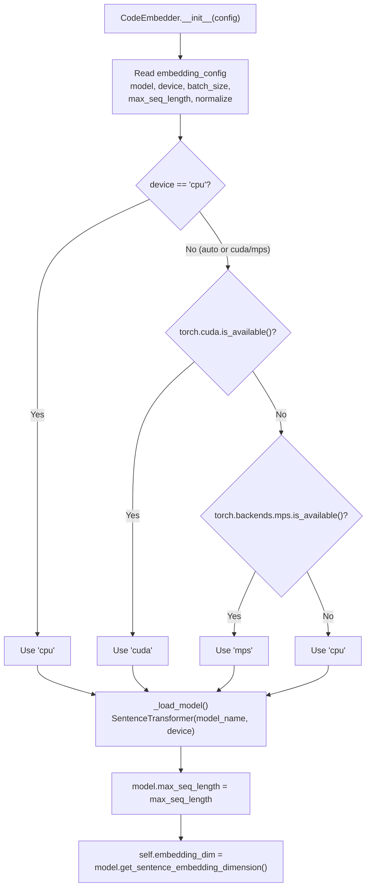
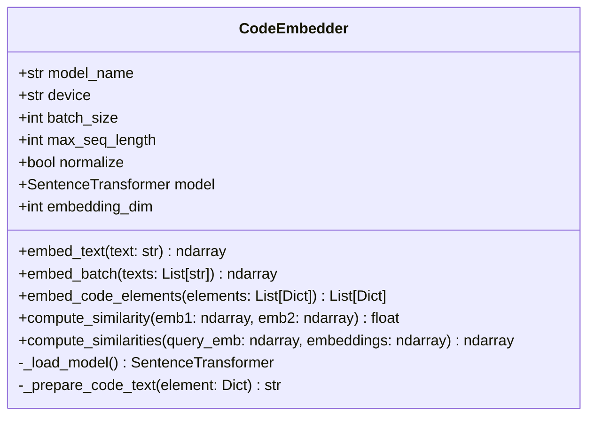
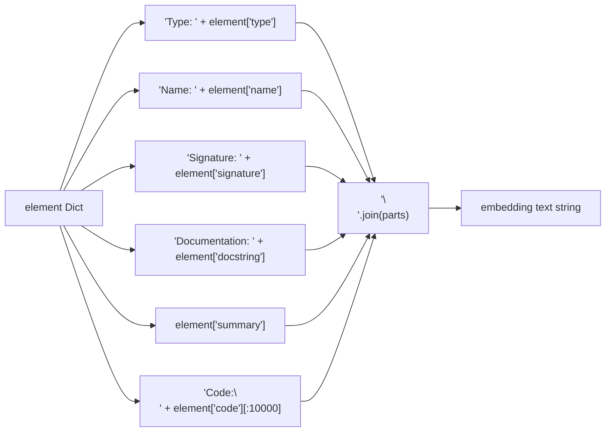
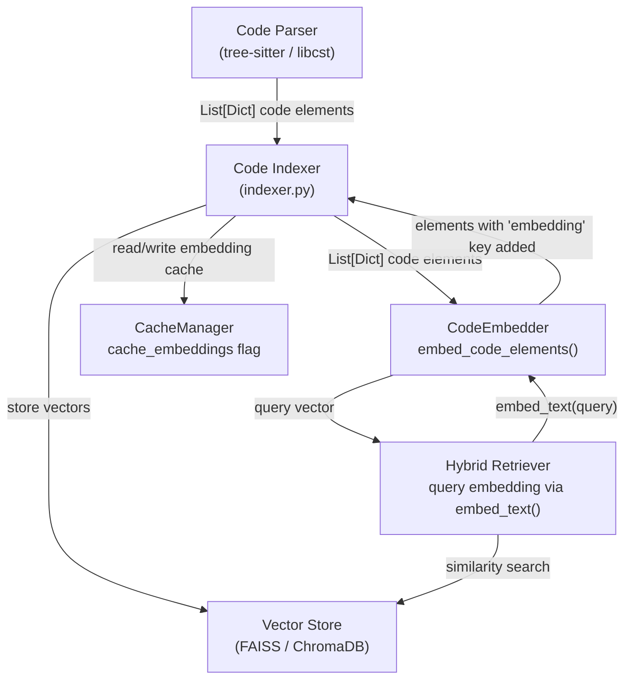

<!-- source: DeepWiki mcp.deepwiki.com · repo HKUDS/FastCode · page 4.4 Code Embedder · fetched 2026-11-09 -->

# Code Embedder

Relevant source files

The following files were used as context for generating this wiki page:

- [config/config.yaml](config/config.yaml)
- [fastcode/embedder.py](fastcode/embedder.py)

This page documents the `CodeEmbedder` class in [`fastcode/embedder.py`](), which is responsible for converting code elements and query strings into dense vector representations. These vectors are stored in and queried against the vector store. For details on how embeddings are stored and indexed, see [Vector Store](#4.5). For how embeddings are used during retrieval, see [Hybrid Retriever](#4.6). For the configuration knobs that control model selection and device, see [Embedding Configuration](#8.3).

---

## Overview

`CodeEmbedder` wraps a [SentenceTransformer](https://www.sbert.net) model and exposes a small set of methods for:

- Embedding single texts or batches of texts
- Embedding structured code elements (functions, classes, files, etc.) with a custom text preparation step
- Computing cosine similarity between two embeddings or between a query and a corpus

It is instantiated once by the FastCode core and shared across the indexing and query pipelines.

Sources: [`fastcode/embedder.py:1-35`]()

---

## Initialization and Device Detection

**Diagram: `CodeEmbedder` Initialization Flow**

Sources: [`fastcode/embedder.py:16-34`]()

When `device` is set to `"auto"` (the default) or anything other than `"cpu"`, the class performs a runtime check in this order:

1. CUDA (NVIDIA GPU) via `torch.cuda.is_available()`
2. MPS (Apple Silicon) via `torch.backends.mps.is_available()`
3. CPU as fallback

If `device` is explicitly set to `"cpu"`, the auto-detection is skipped entirely.

The model is loaded via `_load_model()`, which calls `SentenceTransformer(model_name, device=self.device)` and sets `model.max_seq_length` to the configured value.

The final embedding dimension is read back from the model via `get_sentence_embedding_dimension()` and stored as `self.embedding_dim`.

Sources: [`fastcode/embedder.py:27-34`](), [`fastcode/embedder.py:36-40`]()

---

## Configuration

The `CodeEmbedder` reads all settings from the `embedding` section of `config/config.yaml`.

| Config Key | Default | Description |
|---|---|---|
| `embedding.model` | `sentence-transformers/paraphrase-multilingual-MiniLM-L12-v2` | HuggingFace model identifier |
| `embedding.device` | `"auto"` | `"auto"`, `"cuda"`, `"mps"`, or `"cpu"` |
| `embedding.batch_size` | `32` | Number of texts per encoding batch |
| `embedding.max_seq_length` | `512` | Maximum token length per input text |
| `embedding.normalize_embeddings` | `true` | Whether to L2-normalize output vectors |

The default model (`paraphrase-multilingual-MiniLM-L12-v2`) supports multilingual input and produces 384-dimensional embeddings. The commented alternative `all-MiniLM-L6-v2` is faster to download but English-only.

Sources: [`config/config.yaml:59-66`]()

---

## Core Methods

**Diagram: `CodeEmbedder` Public API**

Sources: [`fastcode/embedder.py:13-194`]()

### `embed_text`

[`fastcode/embedder.py:42-52`]()

Embeds a single string. This is a thin wrapper that calls `embed_batch([text])[0]`.

### `embed_batch`

[`fastcode/embedder.py:54-81`]()

Embeds a list of strings in one call. The encoding parameters passed to `model.encode` are:

| Parameter | Value |
|---|---|
| `batch_size` | `self.batch_size` (from config) |
| `show_progress_bar` | `True` if `len(texts) > 100` |
| `normalize_embeddings` | `self.normalize` |
| `convert_to_numpy` | `True` |
| `convert_to_tensor` | `False` |
| `device` | `self.device` |

On macOS (`platform.system() == 'Darwin'`), `pool=None` is added to avoid multiprocessing issues with MPS.

Returns a `numpy.ndarray` of shape `(N, embedding_dim)`.

### `embed_code_elements`

[`fastcode/embedder.py:83-109`]()

The primary method used during indexing. It accepts a list of code element dictionaries (as produced by the parser and indexer), calls `_prepare_code_text` on each to build a combined natural-language representation, runs `embed_batch`, and writes the resulting vector back into each element dict under the key `"embedding"`. The prepared text is also stored under `"embedding_text"` for reference.

---

## Code Text Preparation

`_prepare_code_text` [(`fastcode/embedder.py:111-147`]()] converts a structured code element dict into a single string for embedding. It assembles available fields in a fixed order:

**Diagram: `_prepare_code_text` Field Assembly**

- Fields that are absent or falsy are skipped.
- `code` is hard-truncated to 10,000 characters before inclusion to prevent excessive input lengths.
- The final string is then passed to `embed_batch` along with all other elements in the batch.

This combined representation ensures the model receives semantic signals from the element's name, type, documentation, and implementation body simultaneously.

Sources: [`fastcode/embedder.py:111-147`]()

---

## Similarity Computation

Two methods handle cosine similarity:

### `compute_similarity`

[`fastcode/embedder.py:149-169`]()

Computes similarity between two individual vectors. When `normalize_embeddings=True`, this reduces to a simple dot product (`np.dot`). When normalization is disabled, it computes the full cosine formula using `np.linalg.norm`. Returns a `float` in `[0, 1]` for normalized vectors.

### `compute_similarities`

[`fastcode/embedder.py:171-194`]()

Vectorized version for comparing a single query embedding against an entire corpus matrix. Returns a `numpy.ndarray` of similarity scores, one per corpus entry.

| Condition | Operation |
|---|---|
| `normalize=True` | `np.dot(embeddings, query_embedding)` — O(N·D) matrix-vector product |
| `normalize=False` | Full cosine: divides by `np.linalg.norm(embeddings, axis=1) * np.linalg.norm(query_embedding)` |
| `query_norm == 0` | Returns `np.zeros(len(embeddings))` |

Sources: [`fastcode/embedder.py:149-194`]()

---

## Integration with the Indexing Pipeline

The diagram below shows how `CodeEmbedder` is positioned within the broader ingestion flow:

**Diagram: `CodeEmbedder` in the Ingestion Pipeline**

- During indexing, `embed_code_elements` is called by the indexer with the full list of parsed code elements. The embedder mutates each dict in place by adding an `"embedding"` key.
- During query time, `embed_text` is called by the query processor or retriever to embed the user's query before vector search.
- If `cache.cache_embeddings` is `true` in config, the `CacheManager` can intercept embedding calls to avoid redundant computation on repeated indexing runs.

Sources: [`fastcode/embedder.py:83-109`](), [`config/config.yaml:182-192`]()

---

