# Page: Overview

# Overview

<details>
<summary>Relevant source files</summary>

The following files were used as context for generating this wiki page:

- [README.md](README.md)
- [config/config.yaml](config/config.yaml)
- [fastcode/embedder.py](fastcode/embedder.py)

</details>


This document introduces FastCode, a repository-level code understanding system that provides intelligent querying and analysis of software codebases. FastCode is designed for developers who need to understand large-scale repositories quickly and cost-effectively, supporting multi-repository reasoning across 8 programming languages.

For specific installation instructions, see [Installation](#2.1). For API reference documentation, see [API Reference](#12.2). For agent-based retrieval details, see [Agent System](#5).

---

## Purpose and Scope

FastCode is a token-efficient framework that enables natural language queries over code repositories. The system indexes codebases using a combination of semantic embeddings, keyword search, and code graph analysis, then retrieves relevant code elements to answer developer questions. Key performance characteristics include:

- **3-4x faster** query response compared to traditional code analysis tools
- **10x token savings** through intelligent navigation and context management
- **44-55% cost reduction** in LLM API usage
- **Multi-repository support** for cross-codebase dependency analysis

**Sources:** [README.md:1-47](), [fastcode/__init__.py:1-27]()

---

## System Architecture

FastCode is implemented as a modular Python system with clearly defined components for repository management, code analysis, retrieval, and answer generation.

### Core Component Structure

**Module topology: interfaces, engine, and storage**

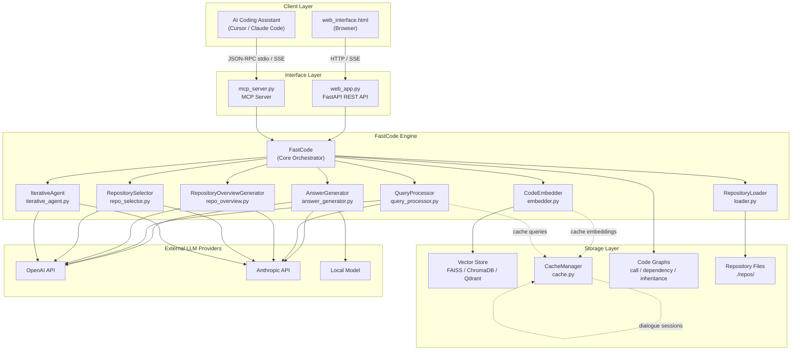

**FastCode Core Orchestrator**

The `FastCode` class in `fastcode/main.py` coordinates all engine components through well-defined interfaces. Each component is independently configured via `config/config.yaml`. The system supports hot-swapping of backends for vector stores, LLM providers, and caching.

Sources: [fastcode/__init__.py:15-41](), [README.md:74-113]()

---

## Three-Phase Framework

FastCode implements a three-phase approach to code understanding, each phase designed to optimize a different aspect of the query pipeline.

### Phase 1: Semantic-Structural Code Representation

The first phase builds a dual representation of the codebase:

**Hierarchical Code Units**
- **File-level**: Metadata (path, size, type, modification time)
- **Class-level**: Class definitions, base classes, method signatures
- **Function-level**: Function signatures, parameters, return types, decorators
- **Documentation-level**: Docstrings, inline comments, type hints

The `CodeParser` uses AST-based parsing for 8 languages (Python, JavaScript, TypeScript, Java, Go, C/C++, Rust, C#), while `CodeIndexer` structures this information into a searchable hierarchy.

**Hybrid Index**
- **Semantic**: `CodeEmbedder` generates embeddings using SentenceTransformer models (default: `paraphrase-multilingual-MiniLM-L12-v2`)
- **Keyword**: BM25 scoring for exact token matching
- **Graph**: Three interconnected graphs:
  - **Call Graph**: Function invocation relationships
  - **Dependency Graph**: Module import/include relationships
  - **Inheritance Graph**: Class hierarchy relationships

**Sources:** [README.md:82-90](), [fastcode/parser.py](), [fastcode/indexer.py](), [fastcode/embedder.py]()

### Phase 2: Lightning-Fast Navigation

The second phase implements intelligent code exploration without loading full file contents:

**Two-Stage Retrieval**
1. Repository selection (for multi-repo scenarios) using `RepositorySelector`
2. Code element retrieval using `HybridRetriever`

**Safe File Browsing**
- `AgentTools` provides read-only exploration:
  - `list_directory`: Survey file structure
  - `search_codebase`: Find files by pattern
  - `get_file_info`: Check metadata without reading content
  - `get_file_structure_summary`: Extract headers (function names, class definitions)
  - `read_file_content`: Load targeted files only

**Graph Traversal**
- Follow call chains up to 2 hops
- Trace dependency paths
- Navigate inheritance hierarchies

**Code Skimming**
- Extract function signatures and class definitions without loading full implementations
- Reduces token consumption by 5-10x for exploration phase

**Sources:** [README.md:92-102](), [fastcode/retriever.py](), [fastcode/iterative_agent.py](), [fastcode/agent_tools.py]()

### Phase 3: Cost-Efficient Context Management

The third phase optimizes LLM token usage through intelligent decision-making:

**Budget-Aware Decisions**
- Confidence threshold: 95% (stop when sufficient information is gathered)
- Max iterations: 4 (prevent runaway token costs)
- Min confidence gain: 5% per iteration (diminishing returns cutoff)
- Max total lines: 12,000 (context size limit)

**Resource-Optimized Learning**
- `IterativeAgent` evaluates confidence after each retrieval round
- Adaptive query refinement based on information gaps
- Early termination when confidence threshold is met

**Value-First Selection**
- Prioritize high-relevance, low-token-cost code elements
- Truncate context to fit within `max_context_tokens` budget
- Reserve tokens for LLM response (`reserve_tokens_for_response`)

**Sources:** [README.md:104-112](), [fastcode/iterative_agent.py](), [fastcode/answer_generator.py]()

---

## Core Capabilities

### Multi-Language Support

FastCode supports 8 programming languages through Tree-sitter AST parsing:

| Language | Extensions | Parser Capabilities |
|----------|-----------|-------------------|
| Python | `.py` | Classes, functions, docstrings, imports, decorators |
| JavaScript | `.js` | Functions, classes, JSDoc, imports/exports |
| TypeScript | `.ts`, `.tsx` | All JS features + type annotations, interfaces |
| Java | `.java` | Classes, methods, Javadoc, packages, annotations |
| Go | `.go` | Functions, structs, interfaces, package imports |
| C/C++ | `.c`, `.cpp`, `.h`, `.hpp` | Functions, structs, classes, includes |
| Rust | `.rs` | Functions, structs, traits, modules, crates |
| C# | `.cs` | Classes, methods, namespaces, attributes |

**Sources:** [README.md:596-606](), [fastcode/parser.py]()

### Multi-Repository Reasoning

The system can load and query multiple repositories simultaneously:

**Repository Selection Methods**
- **LLM-based**: Uses language model to analyze repository overviews and select relevant repos
- **Embedding-based**: Combines semantic similarity + BM25 scoring on repository summaries

**Two-Stage Retrieval Process**
1. `RepositorySelector.select_repositories()` returns top 5 repos (min_similarity: 0.1)
2. `HybridRetriever` searches within selected repositories

**Sources:** [README.md:49-53](), [fastcode/repo_selector.py](), [fastcode/repo_overview.py]()

### Hybrid Search

The `HybridRetriever` combines three search strategies with configurable weights:

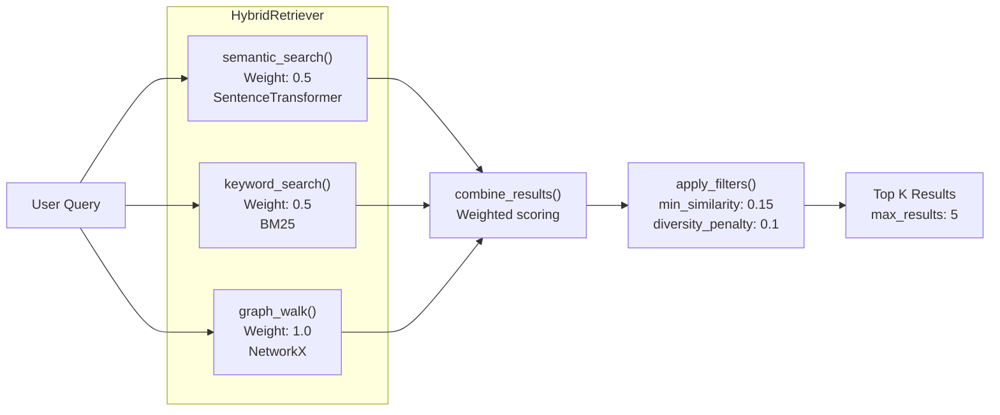

**Filtering and Ranking**
- Minimum similarity threshold: 0.15
- Maximum results: 5 (configurable)
- Diversity penalty: 0.1 (avoid redundant results)
- Enable two-stage retrieval for multi-repository scenarios

**Sources:** [fastcode/retriever.py](), [config/config.yaml]()

### Agent-Based Retrieval

The `IterativeAgent` provides multi-round retrieval with stopping conditions:

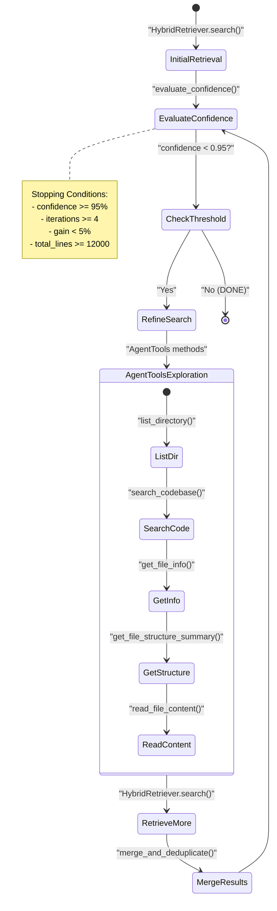

**Agent Configuration**
- Temperature: 0.2 (focused, deterministic behavior)
- Max tokens: 8,000
- Confidence computation: Normalized relevance score across retrieved elements

**Sources:** [fastcode/iterative_agent.py](), [fastcode/agent_tools.py]()

---

## Entry Points and Interfaces

FastCode provides five interfaces for different use cases:

### Interface Summary

| Interface | Entry Point | Transport / Port | Use Case |
|-----------|------------|-----------------|----------|
| **Web UI** | `web_interface.html` + `web_app.py` | HTTP, default port 5000 | Interactive browser-based exploration |
| **REST API** | `web_app.py` | HTTP (configurable) | Programmatic tool integration |
| **MCP Server** | `mcp_server.py` | stdio (local) or SSE :8080 | AI coding assistants (Cursor, Claude Code) |
| **CLI** | `main.py` | N/A | Scripting and automation |
| **Nanobot** | `nanobot/` | Docker port 18791 | Feishu/Lark messaging integration |

The `web_app.py` module serves both the web UI (`web_interface.html`) and the full REST API under `/api/*` routes. The `mcp_server.py` module exposes the same `FastCode` engine through the Model Context Protocol (MCP), allowing AI assistants to call tools like `code_qa`, `list_indexed_repos`, and session management functions directly.

### Query Flow Across Interfaces

**End-to-end query path from user input to answer**

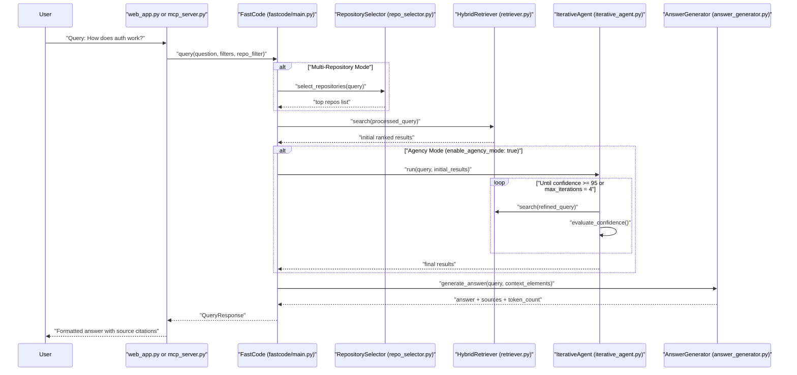

Sources: [web_app.py](), [mcp_server.py](), [main.py](), [README.md:352-545]()

---

## Deployment Architecture

FastCode supports local Python installation and Docker-based deployment. The Docker architecture enables integration with messaging platforms via Nanobot.

### Docker Services

**Docker Compose service layout and volume mounts**

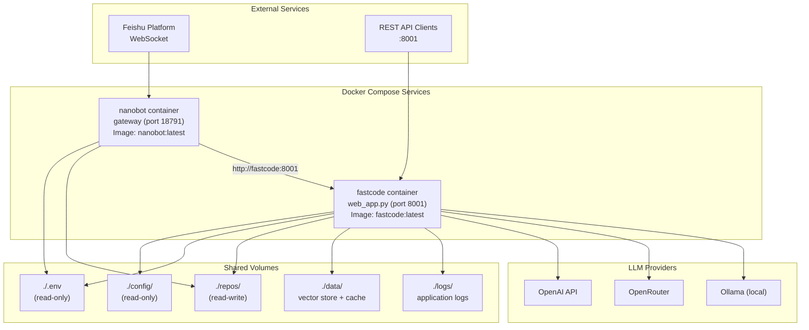

**Environment Configuration**

FastCode reads LLM provider configuration from environment variables (typically set in `.env`):

| Variable | Purpose |
|----------|---------|
| `OPENAI_API_KEY` | API key for OpenAI, OpenRouter, or Ollama |
| `MODEL` | Model name for code analysis (e.g., `gpt-4`, `google/gemini-flash-1.5`) |
| `BASE_URL` | Provider base URL (e.g., `https://api.openai.com/v1`) |
| `NANOBOT_MODEL` | Separate model for Nanobot agent reasoning |

**Deployment Commands**

| Command | Purpose |
|---------|---------|
| `./run_nanobot.sh` | Auto-detect state and start/restart services |
| `./run_nanobot.sh --build` | Force rebuild Docker images |
| `./run_nanobot.sh stop` | Stop all services |
| `./run_nanobot.sh status` | View service status and health |

Sources: [README.md:609-795](), [README.md:840-865]()

---

## System Configuration

FastCode uses a hierarchical configuration system:

### Configuration Hierarchy

1. **Environment Variables** (`.env`): API keys, LLM model selection, base URLs
2. **System Configuration** (`config/config.yaml`): All behavioral settings
3. **Runtime Parameters**: Query-specific overrides (via API/CLI arguments)

### Key Configuration Sections

The `config/config.yaml` file contains 11 major sections:

| Section | Key Settings | Purpose |
|---------|--------------|---------|
| **repository** | `repo_root`, `max_file_size_mb`, `supported_extensions` | Repository loading behavior |
| **parser** | `extract_docstrings`, `extract_comments`, `compute_complexity` | AST parsing options |
| **embedding** | `model`, `device`, `batch_size`, `normalize_embeddings` | Semantic embedding generation |
| **indexing** | `levels`, `include_imports`, `include_class_context` | Multi-level index construction |
| **vector_store** | `type`, `distance_metric`, `index_type` | Vector storage backend |
| **retrieval** | `semantic_weight`, `keyword_weight`, `graph_weight`, `agency_mode` | Hybrid search configuration |
| **query** | `expand_query`, `llm_enhancement_mode`, `enable_multi_turn` | Query processing |
| **generation** | `provider`, `model`, `temperature`, `max_tokens` | LLM answer generation |
| **agent** | `max_iterations`, `confidence_threshold`, `min_confidence_gain` | Iterative agent behavior |
| **cache** | `backend`, `ttl`, `dialogue_ttl`, `max_size_mb` | Caching strategy |
| **graph** | `build_call_graph`, `build_dependency_graph`, `build_inheritance_graph` | Code graph construction |

For complete configuration reference, see [Configuration Reference](#12.1).

**Sources:** [config/config.yaml](), [README.md:550-606]()

---

## Performance Characteristics

FastCode achieves significant performance improvements through architectural decisions:

### Token Efficiency

- **10x token savings** compared to loading full file contents
- Code skimming reduces exploration tokens by 5-10x
- Context truncation with value-first selection
- Iterative refinement with early stopping (confidence threshold)

### Query Speed

- **3-4x faster** than traditional code analysis tools
- HNSW indexing for O(log n) vector search
- Cached embeddings and query results
- Parallel retrieval across semantic/keyword/graph strategies

### Cost Optimization

- **44-55% cost reduction** in LLM API usage
- Budget-aware decision making (5 factors)
- Resource-optimized learning (adaptive iteration)
- Multi-turn dialogue with summary generation (only history context, not full content)

**Sources:** [README.md:25-47](), [README.md:104-135]()

---

## Supported Technologies

### Programming Languages

FastCode supports 8 programming languages with full AST parsing:

**Tier 1 (Full Support)**: Python, JavaScript, TypeScript, Java  
**Tier 2 (Full Support)**: Go, Rust, C/C++, C#

For language-specific parsing capabilities, see [Supported Languages](#12.4).

### LLM Providers

FastCode integrates with multiple LLM providers:

| Provider | Models | Configuration |
|----------|--------|---------------|
| **OpenAI** | gpt-4, gpt-4-turbo, gpt-3.5-turbo | `BASE_URL=https://api.openai.com/v1` |
| **OpenRouter** | Gemini, Claude, Llama, others | `BASE_URL=https://openrouter.ai/api/v1` |
| **Ollama** | qwen3-coder-30b, deepseek-coder, others | `BASE_URL=http://localhost:11434/v1` |

For complete provider configuration, see [LLM Provider Support](#12.5).

### Vector Stores

Three vector storage backends are supported:

| Backend | Index Type | Distance Metric | Use Case |
|---------|-----------|-----------------|----------|
| **FAISS** | HNSW | Cosine, L2, Inner Product | High performance, local |
| **ChromaDB** | HNSW | Cosine, L2, Inner Product | Persistent, embedded |
| **Qdrant** | HNSW | Cosine, Euclidean, Dot | Distributed, scalable |

**Sources:** [fastcode/vector_store.py](), [README.md:552-594]()

---

## Version Information

**FastCode Version**: 2.0.0

**Major Changes in 2.0**:
- Multi-repository support with intelligent repository selection
- Agent-based iterative retrieval system
- Enhanced cost management with budget-aware decisions
- Support for 8 programming languages (expanded from 5)
- Multi-turn dialogue with session management
- Docker deployment with Nanobot integration

**Sources:** [fastcode/__init__.py:26](), [README.md:1-7]()

---

## Next Steps

To get started with FastCode:

1. **Installation**: Follow the [Installation](#2.1) guide for your platform
2. **Configuration**: Set up [Environment Configuration](#2.2) with your LLM API keys
3. **Quick Start**: Try the [Quick Start Guide](#2.3) to index your first repository
4. **Deep Dive**: Explore the [System Architecture](#3) to understand internal workings

For integration with existing tools, see [REST API](#6.1). For production deployment, see [Docker Deployment](#7.1).

---

# Page: Key Features & Benefits

# Key Features & Benefits

<details>
<summary>Relevant source files</summary>

The following files were used as context for generating this wiki page:

- [README.md](README.md)

</details>


This page details the specific capabilities FastCode delivers and the technical components that implement them. It focuses on **what** FastCode does and **which code entities** realize each capability. For a higher-level description of how the three phases connect architecturally, see [Architecture Overview](#1.2). For configuration knobs that tune each feature, see [Configuration](#8).

---

## Performance Claims

FastCode's stated benchmark results against Cursor and Claude Code:

| Metric | vs. Cursor | vs. Claude Code |
|---|---|---|
| Speed | 3× faster | 4× faster |
| Cost | 55% cheaper | 44% cheaper |
| Token consumption | Up to 10× fewer tokens | Up to 10× fewer tokens |
| Accuracy | Highest across benchmarks | Highest across benchmarks |

These results are measured across four benchmarks: **SWE-QA**, **LongCodeQA**, **LOC-BENCH**, and **GitTaskBench**, representing software engineering Q&A, long-context analysis, code localization, and real-world task workflows respectively.

Sources: [README.md:31-49](), [README.md:119-138]()

---

## Feature Summary

The table below maps each user-visible feature to the primary code entity that implements it.

| Feature | Implementing Component | File |
|---|---|---|
| Repository ingestion (URL / path / ZIP) | `RepositoryLoader` | `loader.py` |
| Code parsing (AST, multi-language) | Code Parser (tree-sitter + libcst) | `fastcode/` |
| Semantic + keyword + graph retrieval | `CodeEmbedder`, BM25, graph structures | `embedder.py` |
| Query understanding & expansion | `QueryProcessor` | `query_processor.py` |
| Answer generation with context budgeting | `AnswerGenerator` | `answer_generator.py` |
| Iterative multi-round retrieval (agent mode) | `IterativeAgent` | `iterative_agent.py` |
| Multi-repo LLM-driven selection | `RepositorySelector` | `repo_selector.py` |
| Repository summaries | `RepositoryOverviewGenerator` | `repo_overview.py` |
| Embedding & result caching | `CacheManager` | `cache.py` |
| REST API surface | `web_app.py` (FastAPI, port 5777) | `web_app.py` |
| MCP protocol integration | `mcp_server.py` | `mcp_server.py` |

Sources: [README.md:43-63]()

---

## Three-Phase Framework

FastCode's core approach is organized into three phases. Each phase maps to specific components.

**Feature-to-Component Map:**

```mermaid
flowchart TD
    subgraph Phase1["Phase 1: Semantic-Structural Code Representation"]
        P1A["Hierarchical Code Units\n(file / class / function / doc)"]
        P1B["Hybrid Index\n(semantic embeddings + BM25)"]
        P1C["Multi-Layer Graph Modeling\n(call / dependency / inheritance)"]
    end

    subgraph Phase2["Phase 2: Lightning-Fast Codebase Navigation"]
        P2A["Two-Stage Smart Search\n(RepositorySelector + fine-grained retrieval)"]
        P2B["Code Skimming\n(function signatures, class defs, type hints)"]
        P2C["Graph Traversal\n(up to 2-hop connection tracing)"]
    end

    subgraph Phase3["Phase 3: Cost-Efficient Context Management"]
        P3A["Budget-Aware Decision Making\n(IterativeAgent confidence scoring)"]
        P3B["Resource-Optimized Learning\n(adaptive parameter tuning)"]
        P3C["Value-First Selection\n(smart pruning + deduplication)"]
    end

    subgraph Components["Code Entities"]
        CE1["CodeEmbedder\nembedder.py"]
        CE2["BM25 Index\nindexer"]
        CE3["Graph Structures\ncall_graph / dep_graph / inheritance_graph"]
        CE4["RepositorySelector\nrepo_selector.py"]
        CE5["QueryProcessor\nquery_processor.py"]
        CE6["IterativeAgent\niterative_agent.py"]
        CE7["AnswerGenerator\nanswer_generator.py"]
    end

    P1A --> CE1
    P1B --> CE1
    P1B --> CE2
    P1C --> CE3
    P2A --> CE4
    P2A --> CE5
    P2B --> CE7
    P2C --> CE3
    P3A --> CE6
    P3B --> CE6
    P3C --> CE6
```

Sources: [README.md:79-116]()

### Phase 1 — Semantic-Structural Code Representation

- **Hierarchical Code Units**: Code is indexed at four granularity levels — file, class, function, and documentation. This is controlled by the `indexing.granularity` setting in `config/config.yaml` and executed by the indexing pipeline.
- **Hybrid Index**: `CodeEmbedder` (using `SentenceTransformer`) produces dense vectors; a separate BM25 index handles keyword search. Both are combined with configurable weights in `config/config.yaml` under `retrieval.semantic`, `retrieval.keyword`, and `retrieval.graph`.
- **Multi-Layer Graph Modeling**: Three graph types are built — call graph, dependency graph, inheritance graph — using `networkx`. Graph weights contribute to hybrid retrieval scoring.

### Phase 2 — Lightning-Fast Codebase Navigation

- **Two-Stage Smart Search**: For multi-repo scenarios, `RepositorySelector` narrows the candidate set by LLM-driven overview comparison before fine-grained element retrieval runs.
- **Code Skimming**: Rather than loading entire files into the LLM context, `AnswerGenerator` selects partial file content — function signatures, class definitions, type hints — to minimize token usage while preserving answer quality.
- **Graph Traversal**: Retrieval follows code relationships up to a configurable depth (`graph.max_depth`) using the call/dependency/inheritance graphs.

### Phase 3 — Cost-Efficient Context Management

`IterativeAgent` implements multi-round retrieval with five decision factors before each iteration: confidence level, query complexity, codebase size, resource cost, and iteration count. It applies smart pruning and deduplication across rounds. This mode is optional and controlled by `retrieval.enable_agency_mode`.

Sources: [README.md:85-116](), [README.md:119-138]()

---

## Multi-Language Support

FastCode uses **tree-sitter** grammars (plus **libcst** for Python) to parse source code. All supported languages are detected by file extension.

| Language | Extensions |
|---|---|
| Python | `.py` |
| JavaScript | `.js` |
| TypeScript | `.ts`, `.tsx` |
| Java | `.java` |
| Go | `.go` |
| C / C++ | `.c`, `.cpp`, `.h`, `.hpp` |
| Rust | `.rs` |
| C# | `.cs` |

For the full extension list and how to add a new language, see [Adding Language Support](#10.4) and [Supported Languages](#12.4).

Sources: [README.md:718-727]()

---

## Multi-Repository Reasoning

FastCode can index and query multiple repositories simultaneously. The query flow in multi-repo mode:

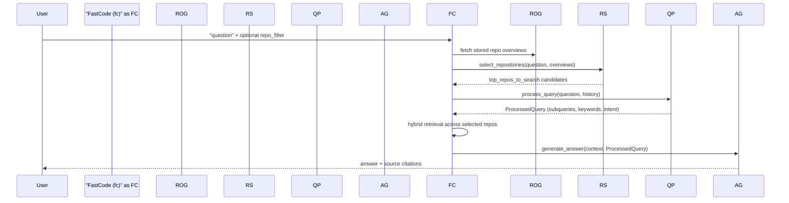

Key configuration settings for multi-repo behavior:

| Config Key | Purpose |
|---|---|
| `retrieval.select_repos_by_overview` | Enable/disable two-stage repo selection |
| `retrieval.top_repos_to_search` | Max repos to include after selection |
| `retrieval.min_repo_similarity` | Minimum similarity score for a repo to qualify |

Sources: [README.md:638-658]()

---

## Token Efficiency

The "scouting-first" approach contrasts with traditional file-loading patterns:

| Approach | Pattern | Token Cost |
|---|---|---|
| Traditional | Load files → search → load more files → repeat | High (repeated full-file loads) |
| FastCode | Build semantic map → navigate structure → load targets | Low (targeted loading only) |

This is achieved through the combination of:
- Hierarchical indexing (avoid loading files not in the index hit set)
- Code skimming in `AnswerGenerator` (load signatures, not full bodies)
- `IterativeAgent` line budget (`agent.iterative.max_total_lines`) that caps total content loaded per query

Sources: [README.md:919-933]()

---

## Interface & Integration Options

FastCode exposes its engine through four distinct interfaces:

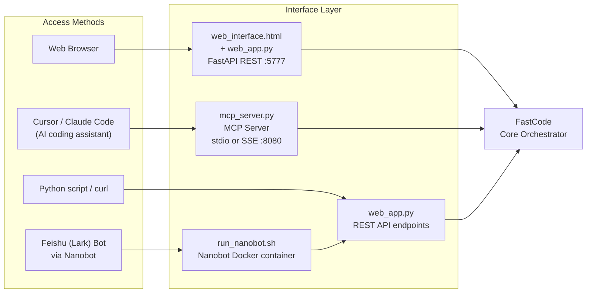

| Interface | Entry Point | Transport | Use Case |
|---|---|---|---|
| Web UI | `web_app.py` + `web_interface.html` | HTTP / SSE | Manual exploration |
| REST API | `web_app.py` (FastAPI) | HTTP JSON / SSE | Programmatic integration |
| MCP Server | `mcp_server.py` | stdio or HTTP SSE | Cursor, Claude Code, Windsurf |
| Nanobot | `run_nanobot.sh` + Docker | WebSocket → REST | Feishu chat bot |

The MCP server exposes a `code_qa` tool that accepts a question, a list of repository sources (GitHub URLs or local paths), and an optional `session_id` for multi-turn conversations. It handles cloning and indexing automatically if a repo has not yet been indexed.

For REST API endpoint details see [REST API](#6.1). For MCP server details see [MCP Server](#6.3). For Nanobot setup see [Nanobot Integration](#6.4).

Sources: [README.md:550-666](), [README.md:731-898]()

---

## Small / Local Model Support

FastCode is compatible with locally-hosted LLMs via any OpenAI-compatible endpoint (e.g., Ollama). The `MODEL` and `BASE_URL` environment variables control which provider and model are used at runtime. The README lists `qwen3-coder-30b` as a validated local model option.

```
OPENAI_API_KEY=ollama
MODEL=qwen3-coder-30b_fastcode
BASE_URL=http://localhost:11434/v1
```

For the full list of supported providers and the `openai_chat_completion` compatibility shim, see [LLM Provider Support](#12.5).

Sources: [README.md:708-715]()

---

## Caching

`CacheManager` (`cache.py`) stores:
- Embedding vectors (avoid recomputing on re-index)
- Query results (avoid LLM calls for repeated questions)
- Dialogue sessions (multi-turn conversation history)

Two backends are supported: **disk** (default) and **Redis**. Caching behavior is governed by the `cache` section in `config/config.yaml`. For details see [Caching System](#9.1).

Sources: [README.md:43-63]()

---

# Page: Architecture Overview

# Architecture Overview

<details>
<summary>Relevant source files</summary>

The following files were used as context for generating this wiki page:

- [README.md](README.md)
- [config/config.yaml](config/config.yaml)
- [fastcode/embedder.py](fastcode/embedder.py)

</details>


This page maps FastCode's component topology, its four system layers, and the three-phase processing framework to actual files, classes, and data stores. It is intended as a navigational reference for the rest of the wiki.

For deeper internals of each phase, see [Three-Phase Framework](#3.1). For per-component documentation, see [Core Components](#4). For client interface details (REST API, MCP, Web UI), see [Interfaces & APIs](#6).

---

## System Layers

FastCode is organized into four layers. The **Client Layer** holds the browser UI and AI coding assistants. The **Interface Layer** hosts the FastAPI REST server and MCP server. The **Engine Layer** is the `fastcode/` Python package that does all analysis work. The **Storage Layer** holds all persisted artifacts.

**Diagram: System Layers and Module Locations**

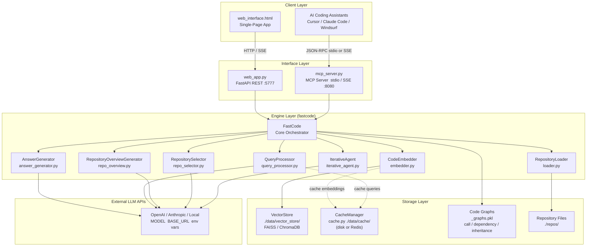

Sources: [README.md:1-116](), [config/config.yaml:1-10]()

| Layer | File / Module | Role |
|-------|--------------|------|
| Client | `web_interface.html` | Browser single-page app |
| Client | AI coding assistants | Cursor, Claude Code, Windsurf via MCP |
| Interface | `web_app.py` | FastAPI REST server, port 5777 |
| Interface | `mcp_server.py` | MCP server, stdio transport or SSE on :8080 |
| Engine | `fastcode/loader.py` — `RepositoryLoader` | Repo acquisition and file scanning |
| Engine | `fastcode/embedder.py` — `CodeEmbedder` | SentenceTransformer batch embedding |
| Engine | `fastcode/query_processor.py` — `QueryProcessor` | Query understanding, expansion, intent detection |
| Engine | `fastcode/answer_generator.py` — `AnswerGenerator` | Prompt construction, token budgeting, LLM call |
| Engine | `fastcode/iterative_agent.py` — `IterativeAgent` | Multi-round retrieval loop with confidence scoring |
| Engine | `fastcode/repo_overview.py` — `RepositoryOverviewGenerator` | README/LLM-based repository summarization |
| Engine | `fastcode/repo_selector.py` — `RepositorySelector` | LLM-driven multi-repo selection |
| Storage | `./data/vector_store/` | FAISS or ChromaDB index per repository |
| Storage | `./data/cache/` | `CacheManager` embedding, query, and dialogue cache |
| Storage | `_graphs.pkl` (per repo) | Call, dependency, and inheritance graphs |
| Storage | `./repos/` | Cloned or uploaded repository source files |

Sources: [README.md:44-63](), [config/config.yaml:82-95]()

---

## The Three-Phase Framework

The engine implements three sequential phases. **Phase 1** runs at index time when a repository is first loaded. **Phases 2 and 3** run at query time for every user question.

**Diagram: Three Phases Mapped to Code Modules**

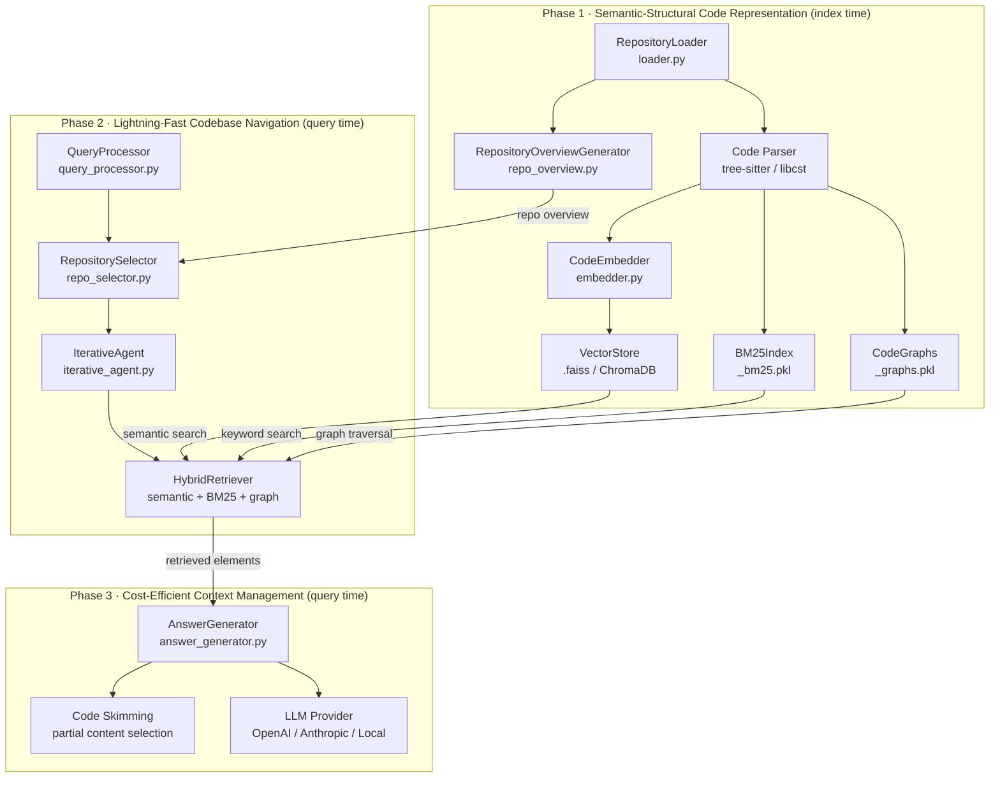

Sources: [README.md:79-116](), [config/config.yaml:58-181]()

| Phase | Timing | Key Modules | Primary Output |
|-------|--------|-------------|----------------|
| 1 — Semantic-Structural Code Representation | Index time | `RepositoryLoader`, Code Parser, `CodeEmbedder`, `RepositoryOverviewGenerator` | Vector index, BM25 index, code graphs, repo overview |
| 2 — Lightning-Fast Codebase Navigation | Query time | `QueryProcessor`, `RepositorySelector`, `IterativeAgent`, HybridRetriever | Ranked, deduplicated code elements |
| 3 — Cost-Efficient Context Management | Query time | `AnswerGenerator`, Code Skimming, `CacheManager` | Token-budgeted LLM prompt → answer + source citations |

Sources: [README.md:85-116]()

---

## Query Execution Flow

The following traces a single user query through the engine, with actual class method names and config parameter names at each step.

**Diagram: Query Execution Through Engine Modules**

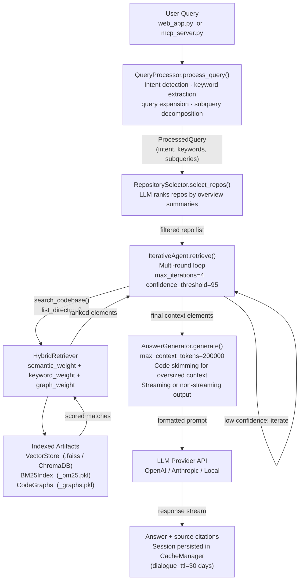

Sources: [README.md:919-934](), [config/config.yaml:98-180](), [fastcode/embedder.py:54-81]()

---

## Configuration Map

All three phases are controlled by `config/config.yaml`. The table below maps each config section to the phase it governs.

| Config Section | Phase | Representative Parameters |
|----------------|-------|--------------------------|
| `repository` | 1 | `clone_depth`, `max_file_size_mb`, `supported_extensions`, `ignore_patterns` |
| `parser` | 1 | `extract_docstrings`, `extract_imports`, `compute_complexity` |
| `embedding` | 1 | `model`, `device` (`auto`/`cuda`/`mps`/`cpu`), `batch_size` |
| `indexing` | 1 | `levels` (file/class/function/documentation), `generate_repo_overview` |
| `vector_store` | 1 | `type` (faiss/chromadb), `persist_directory` |
| `graph` | 1 | `build_call_graph`, `build_dependency_graph`, `build_inheritance_graph` |
| `query` | 2 | `expand_query`, `decompose_complex`, `llm_enhancement_mode` |
| `retrieval` | 2 | `semantic_weight`, `keyword_weight`, `graph_weight`, `enable_agency_mode` |
| `agent.iterative` | 2 | `max_iterations`, `confidence_threshold`, `max_total_lines` |
| `generation` | 3 | `provider`, `max_context_tokens`, `reserve_tokens_for_response` |
| `cache` | all | `backend`, `ttl`, `dialogue_ttl`, `cache_embeddings` |

Sources: [config/config.yaml:1-205]()

---

# Page: Getting Started

# Getting Started

<details>
<summary>Relevant source files</summary>

The following files were used as context for generating this wiki page:

- [README.md](README.md)
- [requirements.txt](requirements.txt)

</details>


This page covers the minimum steps required to install FastCode, configure your environment, and make your first query. It is intentionally concise; each major step has a dedicated sub-page with full detail:

- For the full dependency list and platform-specific install steps, see [Installation](#2.1).
- For all environment variables and `.env` file options, see [Environment Configuration](#2.2).
- For a complete end-to-end walkthrough with the web UI, see [Quick Start Guide](#2.3).

---

## Prerequisites

| Requirement | Minimum Version | Notes |
|---|---|---|
| Python | 3.12+ | Required by all components |
| Git | Any recent version | Required for cloning repositories |
| An LLM API key | — | OpenAI, OpenRouter, or a local model endpoint |

FastCode runs on **Linux**, **macOS**, and **Windows**. On Apple Silicon (M1/M2/M3), all dependencies are ARM-compatible. On Windows, use Git Bash or WSL if you run any `.sh` scripts.

---

## Setup Flow

**Figure 1: FastCode Setup Sequence**

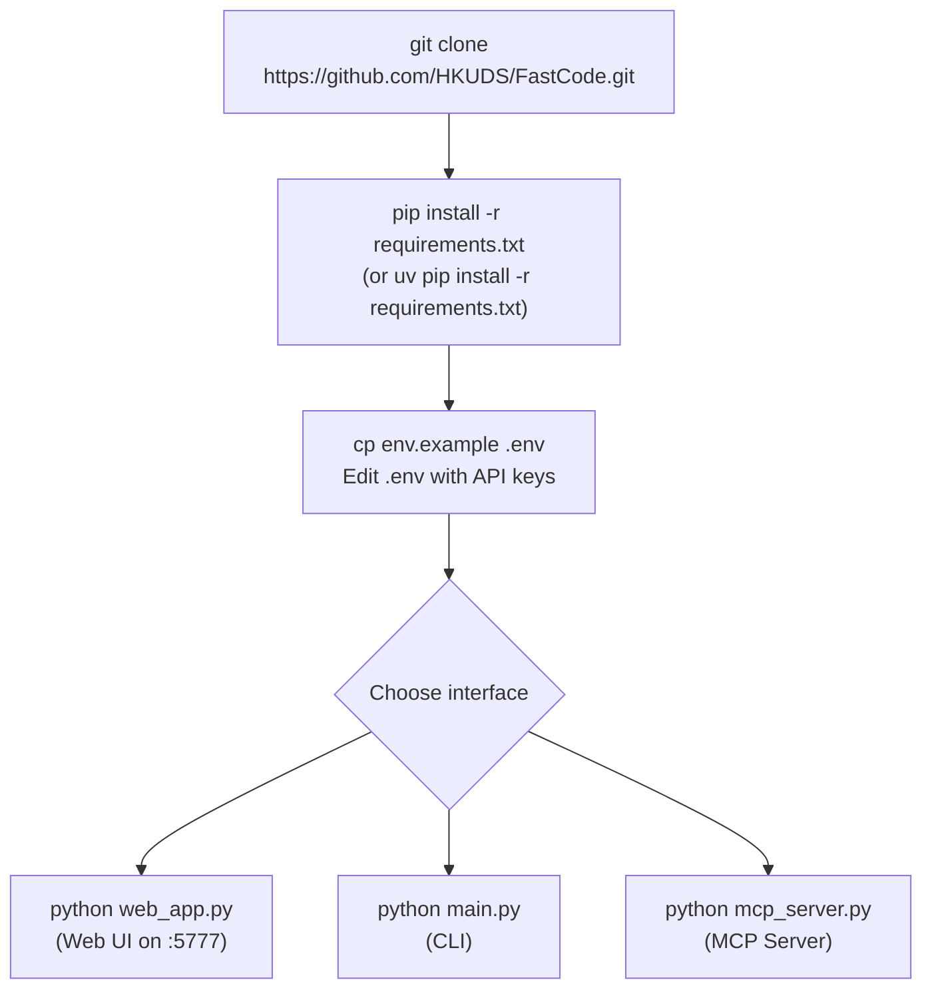

Sources: [README.md:145-161]()

---

## Step 1 — Clone the Repository

```bash
git clone https://github.com/HKUDS/FastCode.git
cd FastCode
```

---

## Step 2 — Install Dependencies

The recommended approach uses `uv` for faster resolution:

```bash
pip install uv
uv venv --python=3.12
source .venv/bin/activate      # On Windows: .venv\Scripts\activate
uv pip install -r requirements.txt
```

Alternatively, use plain pip:

```bash
pip install -r requirements.txt
```

The `requirements.txt` file installs all required packages across FastCode's major subsystems:

| Category | Key Packages |
|---|---|
| Code Parsing | `tree-sitter`, language grammars, `libcst` |
| Embeddings & Vector Store | `sentence-transformers`, `faiss-cpu`, `chromadb` |
| Search & Retrieval | `rank-bm25`, `networkx` |
| LLM Integration | `openai`, `anthropic`, `tiktoken` |
| API & Web | `fastapi`, `uvicorn`, `flask`, `pydantic` |
| Caching | `diskcache`, `redis` |
| MCP Server | `mcp[cli]` |

See [Installation](#2.1) for platform-specific troubleshooting and optional GPU/Redis setup.

Sources: [requirements.txt:1-56]()

---

## Step 3 — Configure Environment

```bash
cp env.example .env
# Edit .env with your preferred editor
```

At minimum, set the three variables that identify your LLM provider:

```env
OPENAI_API_KEY=sk-...
MODEL=gpt-4o
BASE_URL=https://api.openai.com/v1
```

These variables are read at startup by `web_app.py`, `mcp_server.py`, and `main.py`. Common provider configurations:

| Provider | `MODEL` example | `BASE_URL` |
|---|---|---|
| OpenAI | `gpt-4o` | `https://api.openai.com/v1` |
| OpenRouter | `google/gemini-flash-1.5` | `https://openrouter.ai/api/v1` |
| Ollama (local) | `qwen3-coder-30b_fastcode` | `http://localhost:11434/v1` |

See [Environment Configuration](#2.2) for the full list of optional variables, including model overrides, Redis connection settings, and embedding device selection.

Sources: [README.md:670-715]()

---

## Step 4 — Start FastCode

### Web Interface (Recommended)

```bash
python web_app.py --host 0.0.0.0 --port 5777
```

Open `http://localhost:5777` in a browser. The web UI (`web_interface.html`) connects to the `web_app.py` FastAPI server.

### Command-Line Interface

```bash
# Single repository
python main.py --repo /path/to/repo --query "How does authentication work?"

# Multiple repositories
python main.py --repos /path/to/repo1 /path/to/repo2 --query "Your question"
```

### MCP Server (Cursor / Claude Code / Windsurf)

```bash
python mcp_server.py                          # stdio transport (default)
python mcp_server.py --transport sse --port 8080  # SSE transport
```

See [MCP Server](#6.3) for configuration details for Cursor and Claude Code.

Sources: [README.md:355-390](), [README.md:550-666]()

---

## Interface-to-Code Map

**Figure 2: Entry Points and Their Corresponding Code Entities**

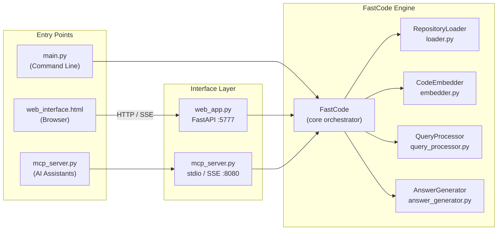

Sources: [README.md:355-400](), [README.md:550-570]()

---

## Indexing and Querying a Repository

Once the server is running, the typical workflow has two phases:

**Figure 3: Repository Indexing and Query Flow**

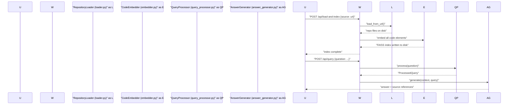

Sources: [README.md:355-400](), [README.md:404-546]()

---

## Next Steps

| Goal | Page |
|---|---|
| Full installation options and platform troubleshooting | [Installation](#2.1) |
| All environment variables and `.env` configuration | [Environment Configuration](#2.2) |
| Step-by-step web UI walkthrough | [Quick Start Guide](#2.3) |
| REST API endpoint reference | [REST API](#6.1) |
| MCP server setup for Cursor / Claude Code | [MCP Server](#6.3) |
| `config/config.yaml` tuning | [Configuration](#8) |
| Docker and production deployment | [Deployment](#7) |

---

# Page: Installation

# Installation

<details>
<summary>Relevant source files</summary>

The following files were used as context for generating this wiki page:

- [README.md](README.md)
- [requirements.txt](requirements.txt)

</details>


This page provides comprehensive instructions for installing FastCode on your system. It covers both Docker-based deployment (recommended for production and multi-service setups) and local Python installation (recommended for development and single-user scenarios).

For information about configuring environment variables and API keys after installation, see [Environment Configuration](#2.2). For deployment in production environments, see [Docker Deployment](#7.1) and [Docker Compose Setup](#7.2).

---

## System Requirements

FastCode requires the following dependencies to function properly:

| Component | Minimum Version | Purpose |
|-----------|----------------|---------|
| **Python** | 3.12+ | Core runtime environment |
| **Git** | Any recent version | Repository cloning functionality |
| **Build Tools** | gcc/clang/MSVC | Tree-sitter grammar compilation |
| **Memory** | 4 GB RAM | Embedding model and index operations |
| **Disk Space** | 2 GB | Model cache, indexes, and repositories |

**Platform Support:**
- ✅ Linux (Ubuntu 20.04+, Debian 11+, RHEL 8+)
- ✅ macOS (10.15+, including Apple Silicon M1/M2/M3)
- ✅ Windows (10/11, both native and WSL)

Sources: [README.md:164-346](), [Dockerfile:1-11]()

---

## Installation Methods Overview

FastCode provides two primary installation methods, each optimized for different use cases:

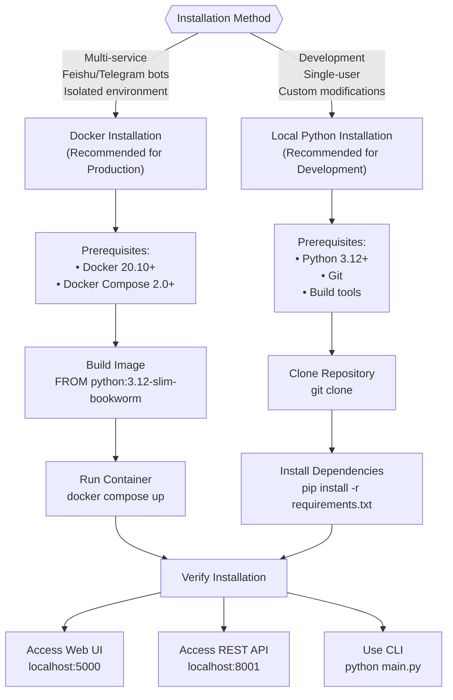

**Docker Installation** ([Dockerfile:1-39](), [docker-compose.yml:1-61]())
- Pre-configured environment with all dependencies
- Multi-service orchestration (FastCode + Nanobot)
- Persistent volumes for data, repos, and logs
- Automatic model pre-download during build
- Suitable for production deployments and bot integrations

**Local Python Installation** ([README.md:168-348]())
- Direct access to source code for modifications
- Faster development iteration cycle
- Platform-specific optimizations available
- Suitable for single-user scenarios and development

Sources: [README.md:162-164](), [Dockerfile:1-39](), [docker-compose.yml:1-61]()

---

## Docker Installation (Recommended)

Docker installation provides an isolated, reproducible environment with all dependencies pre-configured. This method is recommended for production deployments, multi-service setups (FastCode + Nanobot), and users who want a turnkey solution.

### Understanding the Docker Build Process

The following diagram illustrates how the Dockerfile constructs the FastCode image, showing the actual files and directories involved:

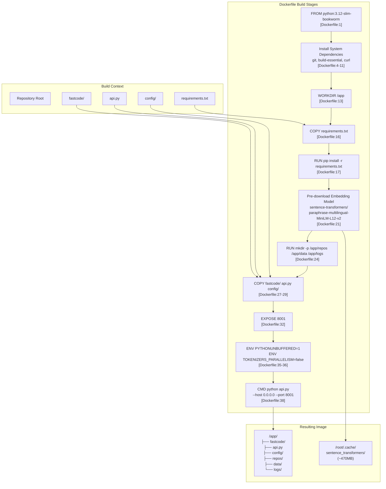

**Key Build Optimizations:**
- **Layer Caching:** `requirements.txt` is copied and installed before application code ([Dockerfile:16-17]()), ensuring dependency installation layers are cached even when code changes
- **Model Pre-download:** The embedding model is downloaded during build ([Dockerfile:21]()), not at runtime, reducing container startup time from minutes to seconds
- **Minimal Base Image:** Uses `python:3.12-slim-bookworm` ([Dockerfile:1]()) to minimize image size while providing necessary system libraries

Sources: [Dockerfile:1-39]()

### Building and Running with Docker

#### Single-Service Deployment (FastCode Only)

```bash
# Clone the repository
git clone https://github.com/HKUDS/FastCode.git
cd FastCode

# Create .env file (see Environment Configuration page #2.2)
cp env.example .env
# Edit .env with your API keys and model settings

# Build the Docker image
docker build -t fastcode:latest .

# Run the container
docker run -d \
  --name fastcode \
  -p 8001:8001 \
  -v $(pwd)/.env:/app/.env:ro \
  -v $(pwd)/config:/app/config:ro \
  -v $(pwd)/data:/app/data \
  -v $(pwd)/repos:/app/repos \
  -v $(pwd)/logs:/app/logs \
  fastcode:latest

# Verify the container is running
docker ps | grep fastcode

# View logs
docker logs -f fastcode
```

**Volume Mounts Explained:**

| Host Path | Container Path | Access | Purpose |
|-----------|---------------|--------|---------|
| `./.env` | `/app/.env` | Read-only | API keys and model configuration |
| `./config` | `/app/config` | Read-only | FastCode system configuration |
| `./data` | `/app/data` | Read-write | Vector indexes and cache |
| `./repos` | `/app/repos` | Read-write | Cloned repositories |
| `./logs` | `/app/logs` | Read-write | Application logs |

Sources: [Dockerfile:24-38](), [docker-compose.yml:18-26]()

#### Multi-Service Deployment (FastCode + Nanobot)

For deployments that include Feishu/Telegram bot integration via Nanobot, use Docker Compose:

```bash
# One-command launch (recommended)
./run_nanobot.sh

# The script automatically:
# 1. Builds images if not present
# 2. Generates nanobot_config.json if missing
# 3. Starts both services
# 4. Shows status and health check
```

The `docker-compose.yml` orchestrates two services:

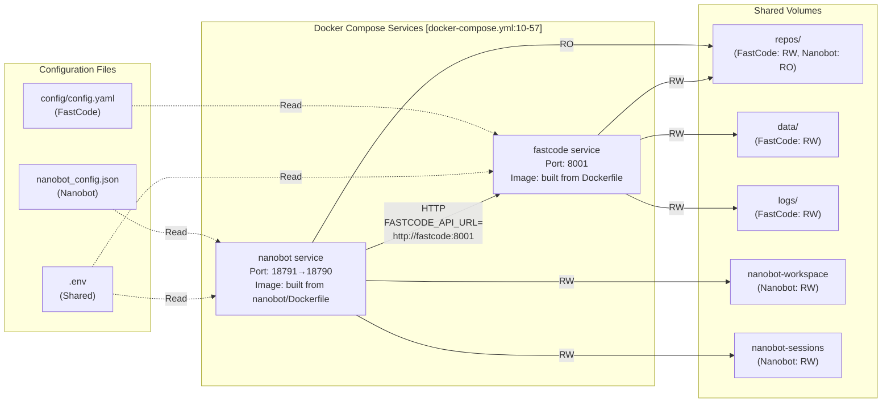

**Service Communication:**
- The Nanobot container communicates with FastCode via internal Docker network using `http://fastcode:8001` ([docker-compose.yml:53]())
- No public IP or webhook configuration required for Feishu integration
- Both services share the `.env` file for API keys ([docker-compose.yml:20](), [docker-compose.yml:42]())

For detailed Nanobot setup and Feishu/Telegram configuration, see [Nanobot Integration](#6.4).

Sources: [docker-compose.yml:1-61](), [README.md:610-763]()

---

## Local Python Installation

Local installation provides direct access to source code, enabling rapid development iteration and custom modifications. This method is recommended for developers contributing to FastCode or users who need fine-grained control over the environment.

### Platform-Specific Installation Flow

The following diagram shows the actual commands and files involved in local installation across different platforms:

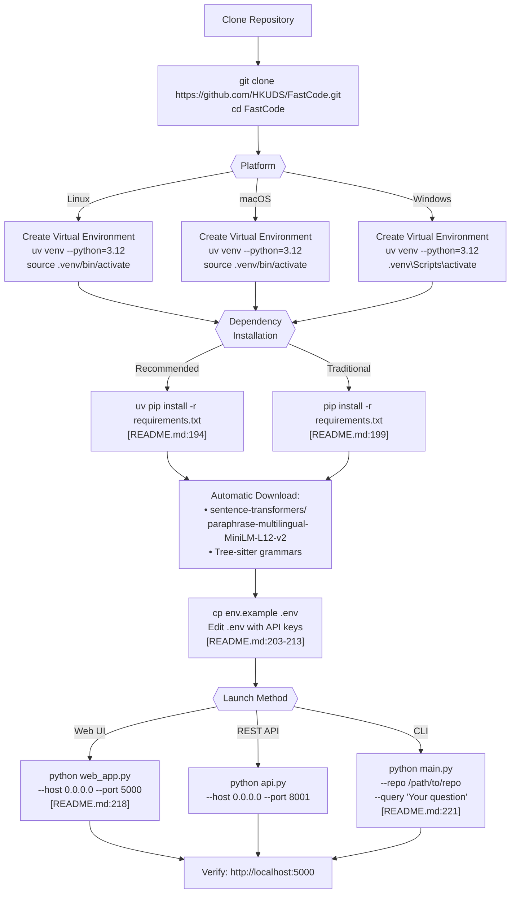

Sources: [README.md:168-348]()

### Step-by-Step Installation Instructions

#### 1. Clone the Repository

```bash
git clone https://github.com/HKUDS/FastCode.git
cd FastCode
```

#### 2. Install Dependencies

**Option A: Using `uv` (Recommended)**

[uv](https://github.com/astral-sh/uv) provides significantly faster dependency resolution and installation compared to pip:

```bash
# Install uv
pip install uv

# Create virtual environment
uv venv --python=3.12

# Activate environment
# On Linux/macOS:
source .venv/bin/activate
# On Windows:
.venv\Scripts\activate

# Install dependencies (faster than pip)
uv pip install -r requirements.txt
```

**Option B: Using `pip` (Traditional)**

```bash
# Create virtual environment (optional but recommended)
python -m venv .venv
source .venv/bin/activate  # Linux/macOS
# or
.venv\Scripts\activate  # Windows

# Install dependencies
pip install -r requirements.txt
```

**What Gets Installed:**

The `requirements.txt` file includes the following major dependencies:

| Package | Version | Purpose |
|---------|---------|---------|
| `fastapi[standard]` | 0.115.6 | REST API framework ([api.py:1]()) |
| `sentence-transformers` | 3.3.1 | Code embedding generation |
| `faiss-cpu` | 1.9.0.post1 | Vector similarity search |
| `chromadb` | 0.5.23 | Alternative vector store |
| `tree-sitter` | 0.23.2 | AST parsing across 8 languages |
| `redis` | 5.2.1 | Optional distributed caching |
| `tiktoken` | 0.8.0 | Token counting for LLM calls |
| `rank-bm25` | 0.2.2 | Keyword search (BM25 algorithm) |

Sources: [README.md:186-200]()

#### 3. Configure Environment Variables

```bash
# Create .env file from template
cp env.example .env

# Edit with your preferred editor
nano .env  # Linux/macOS
# or
notepad .env  # Windows
```

Minimal `.env` configuration:

```env
OPENAI_API_KEY=your_api_key_here
MODEL=gpt-4-turbo
BASE_URL=https://api.openai.com/v1
```

For complete environment configuration options, see [Environment Configuration](#2.2).

Sources: [README.md:203-213]()

#### 4. Launch FastCode

**Web UI (Recommended for Interactive Use):**

```bash
python web_app.py --host 0.0.0.0 --port 5000
```

Access at: `http://localhost:5000`

**REST API (Recommended for Programmatic Access):**

```bash
python api.py --host 0.0.0.0 --port 8001
```

API documentation at: `http://localhost:8001/docs`

**Command-Line Interface:**

```bash
# Single repository query
python main.py --repo /path/to/repo --query "Your question here"

# Multi-repository query
python main.py --repos /path/to/repo1 /path/to/repo2 --query "Your question"
```

Sources: [README.md:215-222](), [README.md:355-386]()

### Platform-Specific Considerations

#### Apple Silicon (M1/M2/M3)

FastCode is fully compatible with ARM architecture. All dependencies, including `faiss-cpu`, have native ARM builds.

```bash
# No special configuration needed
pip install -r requirements.txt
```

Sources: [README.md:282]()

#### Windows

**Common Issues and Solutions:**

1. **SSL Certificate Errors:**
   ```cmd
   pip install --upgrade certifi
   ```

2. **Permission Errors:**
   - Run Command Prompt or PowerShell as Administrator

3. **FAISS Installation Failure:**
   ```cmd
   pip install faiss-cpu --no-cache-dir
   ```

4. **Line Ending Issues for Bash Scripts:**
   - Use Git Bash or WSL for `./run_nanobot.sh`
   - Ensure `.sh` files use LF line endings (enforced by `.gitattributes`)

Sources: [README.md:342-346]()

---

## Post-Installation Verification

After installation, verify that FastCode is working correctly:

### 1. Check System Status

**For Docker Installation:**

```bash
# Check container health
docker ps | grep fastcode

# View logs
docker logs -f fastcode

# Check API health endpoint
curl http://localhost:8001/health
```

**For Local Installation:**

```bash
# Start API server
python api.py --host 0.0.0.0 --port 8001

# In another terminal, check health
curl http://localhost:8001/health
```

Expected response:

```json
{
  "status": "healthy",
  "version": "2.0.0",
  "timestamp": "2024-01-15T10:30:00Z"
}
```

### 2. Load and Index a Test Repository

**Using Web UI:**

1. Navigate to `http://localhost:5000`
2. Enter a repository URL (e.g., `https://github.com/octocat/Hello-World`)
3. Click "Load and Index Repository"
4. Wait for indexing to complete
5. Ask a test question: "What files are in this repository?"

**Using REST API:**

```bash
# Load and index a repository
curl -X POST "http://localhost:8001/load-and-index" \
  -H "Content-Type: application/json" \
  -d '{
    "source": "https://github.com/octocat/Hello-World",
    "is_url": true
  }'

# Query the repository
curl -X POST "http://localhost:8001/query" \
  -H "Content-Type: application/json" \
  -d '{
    "question": "What files are in this repository?",
    "multi_turn": false
  }'
```

**Using CLI:**

```bash
python main.py \
  --repo https://github.com/octocat/Hello-World \
  --query "What files are in this repository?"
```

Sources: [README.md:355-544]()

### 3. Verify Component Initialization

Check that all core components initialized successfully by examining logs:

**Expected Log Output:**

```
INFO - Loading configuration from config/config.yaml
INFO - Initializing CodeEmbedder with model: sentence-transformers/paraphrase-multilingual-MiniLM-L12-v2
INFO - Initializing VectorStore (type: faiss, metric: cosine)
INFO - CodeParser initialized for 8 languages
INFO - CacheManager initialized (backend: disk, directory: ./data/cache)
INFO - FastCode initialized successfully (version: 2.0.0)
INFO - API server running on http://0.0.0.0:8001
```

If you see errors related to missing dependencies, GPU/CUDA unavailability, or configuration issues, see [Installation Issues](#11.1) for troubleshooting guidance.

---

## Directory Structure After Installation

Understanding the directory structure helps with troubleshooting and maintenance:

```
FastCode/
├── fastcode/              # Core FastCode modules
│   ├── __init__.py        # Main FastCode class
│   ├── code_parser.py     # AST parsing for 8 languages
│   ├── code_indexer.py    # Multi-level indexing
│   ├── code_embedder.py   # Semantic embeddings
│   ├── vector_store.py    # Vector storage abstraction
│   ├── hybrid_retriever.py # Hybrid search
│   ├── answer_generator.py # LLM integration
│   ├── iterative_agent.py  # Agent-based retrieval
│   └── ...
├── api.py                 # REST API server
├── web_app.py             # Web UI server
├── main.py                # CLI entry point
├── config/
│   └── config.yaml        # System configuration
├── .env                   # Environment variables (created by user)
├── requirements.txt       # Python dependencies
├── Dockerfile             # Docker build instructions
├── docker-compose.yml     # Multi-service orchestration
├── repos/                 # Cloned repositories (created at runtime)
├── data/                  # Vector indexes and cache (created at runtime)
│   ├── repos/             # Per-repository data
│   │   └── <repo_name>/
│   │       ├── faiss.index
│   │       ├── metadata.json
│   │       └── ...
│   └── cache/             # Query and embedding cache
└── logs/                  # Application logs (created at runtime)
    └── fastcode.log
```

**Runtime Directories:**

The following directories are automatically created during first run:

- `repos/` - Stores cloned Git repositories ([Dockerfile:24]())
- `data/` - Vector indexes, code graphs, and cache ([Dockerfile:24]())
- `logs/` - Application logs ([Dockerfile:24]())

For Docker deployments, these directories are mounted as volumes to persist data between container restarts ([docker-compose.yml:18-26]()).

Sources: [Dockerfile:24-29](), [docker-compose.yml:18-26]()

---

## Next Steps

After successful installation:

1. **Configure API Keys and Models** - See [Environment Configuration](#2.2) for detailed instructions on setting up OpenAI, OpenRouter, or local Ollama models

2. **Index Your First Repository** - Follow the [Quick Start Guide](#2.3) to load and query your first codebase

3. **Customize Configuration** - Review [Configuration](#8) to tune retrieval parameters, adjust token limits, and enable advanced features like agency mode

4. **Explore Interfaces** - Try the [Web Interface](#6.2), [REST API](#6.1), or [Command Line Interface](#6.3) to find your preferred workflow

5. **Deploy to Production** - For production deployments, review [Production Considerations](#7.4) for security, performance tuning, and operational best practices

Sources: [README.md:138-160]()

---

# Page: Environment Configuration

# Environment Configuration

<details>
<summary>Relevant source files</summary>

The following files were used as context for generating this wiki page:

- [README.md](README.md)
- [config/config.yaml](config/config.yaml)
- [fastcode/answer_generator.py](fastcode/answer_generator.py)
- [fastcode/embedder.py](fastcode/embedder.py)

</details>


This page covers the configuration of environment variables in the `.env` file for LLM provider integration. Environment variables control which LLM provider FastCode uses (OpenAI, OpenRouter, or Ollama), the model selection, API authentication, and endpoint URLs.

For system-wide configuration options like retrieval weights, caching, and indexing parameters, see [Configuration](#8). For instructions on installation and dependency setup, see [Installation](#2.1).

## Overview

FastCode requires three core environment variables to connect to LLM providers:

| Variable | Purpose | Required |
|----------|---------|----------|
| `OPENAI_API_KEY` | Authentication token for OpenAI-compatible providers | Yes |
| `MODEL` | Model identifier (e.g., `gpt-4`, `qwen3-coder-30b_fastcode`) | Yes |
| `BASE_URL` | API endpoint URL for the LLM provider | Yes |
| `ANTHROPIC_API_KEY` | Authentication token when `provider: "anthropic"` is set in `config.yaml` | Only for Anthropic |
| `NANOBOT_MODEL` | Model used by Nanobot for Feishu bot integration | No (Docker only) |

All three core variables (`OPENAI_API_KEY`, `MODEL`, `BASE_URL`) are read directly via `os.getenv()` in `AnswerGenerator.__init__()` after calling `load_dotenv()`. The `config/config.yaml` generation section includes the comment: *"NOTE: model and base_url are read from environment variables (MODEL, BASE_URL)"* — these two values are never pulled from `config.yaml`.

An additional variable `ANTHROPIC_API_KEY` can be set when using the `anthropic` provider. These variables are defined in the `.env` file at the repository root. FastCode provides `env.example` as a template.

Sources: [fastcode/answer_generator.py:43-51](), [config/config.yaml:142-151](), [README.md:202-213]()

## Environment Variable Loading

### Configuration Loading Flow

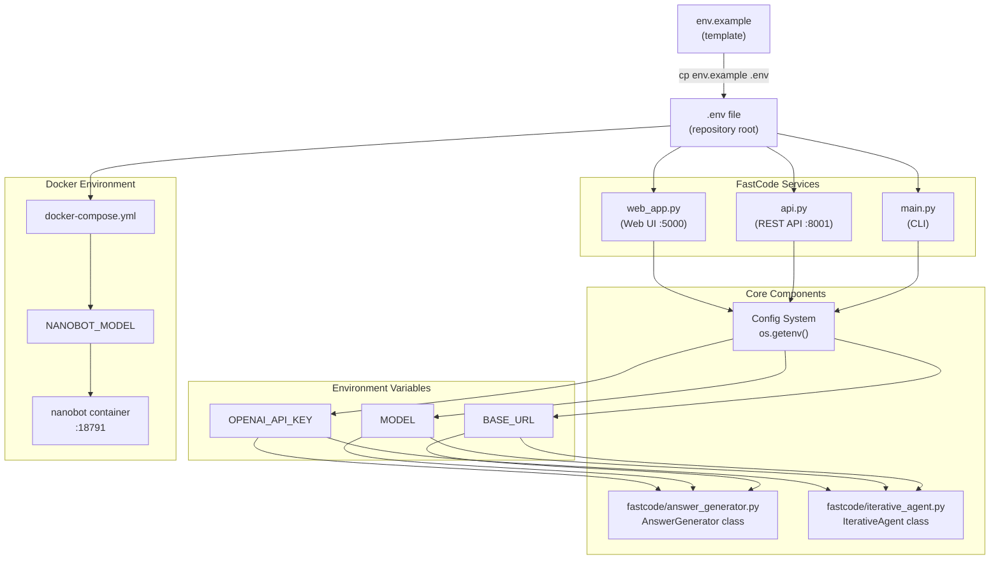

**Environment Variable Loading in Code**

`AnswerGenerator.__init__()` calls `load_dotenv()` then reads `os.getenv("OPENAI_API_KEY")`, `os.getenv("ANTHROPIC_API_KEY")`, `os.getenv("BASE_URL")`, and `os.getenv("MODEL")`. The provider selection (`openai` vs `anthropic`) is read from `config.yaml`'s `generation.provider` key; the actual credentials and endpoint come exclusively from environment variables.

Sources: [fastcode/answer_generator.py:43-51](), [fastcode/answer_generator.py:53-69](), [config/config.yaml:142-151](), [README.md:610-677]()

## Provider-Specific Configuration

### OpenAI Configuration

For OpenAI's GPT models (GPT-4, GPT-4 Turbo, GPT-3.5):

```env
OPENAI_API_KEY=sk-proj-...
MODEL=gpt-4
BASE_URL=https://api.openai.com/v1
```

| Parameter | Value | Notes |
|-----------|-------|-------|
| `OPENAI_API_KEY` | Starts with `sk-proj-` or `sk-` | Obtain from platform.openai.com |
| `MODEL` | `gpt-4`, `gpt-4-turbo`, `gpt-3.5-turbo` | Model identifier |
| `BASE_URL` | `https://api.openai.com/v1` | OpenAI API endpoint |

**Example from README:**

[README.md:559-563]() demonstrates OpenAI configuration:

```env
OPENAI_API_KEY=sk-...
MODEL=gpt-4
BASE_URL=https://api.openai.com/v1
```

**Sources:** [README.md:556-564](), [env.example:3-5]()

### OpenRouter Configuration

OpenRouter provides access to multiple model providers (Google Gemini, Anthropic Claude, Meta Llama) through a unified API:

```env
OPENAI_API_KEY=sk-or-v1-...
MODEL=google/gemini-flash-1.5
BASE_URL=https://openrouter.ai/api/v1
```

| Parameter | Value | Notes |
|-----------|-------|-------|
| `OPENAI_API_KEY` | Starts with `sk-or-v1-` | Obtain from openrouter.ai |
| `MODEL` | `google/gemini-flash-1.5`, `anthropic/claude-3-opus` | Provider-prefixed model name |
| `BASE_URL` | `https://openrouter.ai/api/v1` | OpenRouter API endpoint |

**Common OpenRouter Models:**

| Model Identifier | Provider | Use Case |
|-----------------|----------|----------|
| `google/gemini-3-flash-preview` | Google | Fast, cost-effective (recommended in [env.example:8]()) |
| `google/gemini-flash-1.5` | Google | Production-ready Gemini |
| `anthropic/claude-3-opus` | Anthropic | High-quality reasoning |
| `meta-llama/llama-3-70b` | Meta | Open-source alternative |

**Example from README:**

[README.md:577-583]() shows OpenRouter configuration with Gemini:

```env
OPENAI_API_KEY=sk-or-...
MODEL=google/gemini-flash-1.5
BASE_URL=https://openrouter.ai/api/v1
```

**Sources:** [README.md:576-584](), [env.example:7-9]()

### Ollama (Local Models)

For running models locally via Ollama:

```env
OPENAI_API_KEY=ollama
MODEL=qwen3-coder-30b_fastcode
BASE_URL=http://localhost:11434/v1
```

| Parameter | Value | Notes |
|-----------|-------|-------|
| `OPENAI_API_KEY` | `ollama` | Fixed value for local models |
| `MODEL` | `qwen3-coder-30b_fastcode` | Local model name |
| `BASE_URL` | `http://localhost:11434/v1` | Ollama server endpoint |

**Ollama Setup Requirements:**

1. Install Ollama: `curl -fsSL https://ollama.com/install.sh | sh`
2. Pull the model: `ollama pull qwen3-coder-30b_fastcode`
3. Verify server is running: `curl http://localhost:11434/v1/models`

**Example from README:**

[README.md:587-593]() demonstrates local Ollama configuration:

```env
OPENAI_API_KEY=ollama
MODEL=qwen3-coder-30b_fastcode
BASE_URL=http://localhost:11434/v1
```

**Sources:** [README.md:586-594](), [env.example:11-14]()

## Provider Selection Architecture

### How FastCode Routes Requests to LLM Providers

**Provider routing via `AnswerGenerator._initialize_client()`**

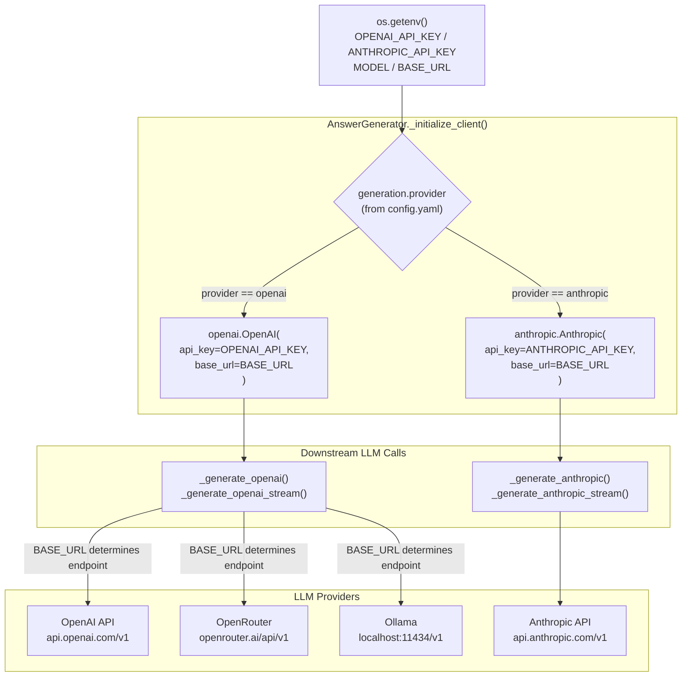

`AnswerGenerator._initialize_client()` branches on `generation.provider` from `config.yaml`. When `provider` is `"openai"`, it constructs `openai.OpenAI(api_key=..., base_url=...)` — the same client code handles OpenAI, OpenRouter, and Ollama because all three expose an OpenAI-compatible endpoint. The `BASE_URL` value alone determines which service receives the request.

Sources: [fastcode/answer_generator.py:53-69](), [fastcode/answer_generator.py:635-663](), [fastcode/answer_generator.py:691-715](), [README.md:552-594]()

## Nanobot Model Configuration

### Dual-Model Architecture for Docker Deployment

When deploying FastCode with Nanobot (for Feishu/Telegram bot integration), the system uses **two separate models**:

| Model Variable | Purpose | Used By |
|----------------|---------|---------|
| `MODEL` | Code analysis and query answering | FastCode container |
| `NANOBOT_MODEL` | Agent reasoning and conversation management | Nanobot container |

**Configuration in `.env`:**

```env
# FastCode Model (Code Analysis)
OPENAI_API_KEY=sk-or-v1-xxx
BASE_URL=https://openrouter.ai/api/v1
MODEL=google/gemini-3-flash-preview

# Nanobot Model (Agent Reasoning / Feishu Conversations)
NANOBOT_MODEL=minimax/minimax-m2.1
```

### Environment Variable Injection via Docker Compose

```mermaid
graph TB
    EnvFile[".env file"]
    
    subgraph "Docker Compose Configuration"
        ComposeYAML["docker-compose.yml"]
    end
    
    subgraph "FastCode Container :8001"
        FastCodeAPI["FastCode API"]
        FastCodeModel["Uses MODEL variable"]
    end
    
    subgraph "Nanobot Container :18791"
        NanobotGW["Nanobot Gateway"]
        NanobotAgent["Agent Reasoning"]
        NanobotEnvVars["Environment Variables:<br/>NANOBOT_PROVIDERS__OPENROUTER__API_KEY<br/>NANOBOT_AGENTS__DEFAULTS__MODEL"]
    end
    
    subgraph "Shared API Key"
        SharedKey["OPENAI_API_KEY<br/>(from .env)"]
    end
    
    EnvFile --> ComposeYAML
    ComposeYAML --> SharedKey
    
    SharedKey --> FastCodeAPI
    SharedKey --> NanobotEnvVars
    
    EnvFile -->|"MODEL"| FastCodeModel
    EnvFile -->|"NANOBOT_MODEL"| NanobotEnvVars
    
    FastCodeModel -->|"Code queries"| FastCodeAPI
    NanobotEnvVars -->|"Conversation logic"| NanobotAgent
    
    NanobotGW -->|"HTTP API calls"| FastCodeAPI
```

**Docker Compose Configuration:**

[docker-compose.yml]() injects environment variables into containers:

```yaml
services:
  fastcode:
    environment:
      - OPENAI_API_KEY=${OPENAI_API_KEY}
      - MODEL=${MODEL}
      - BASE_URL=${BASE_URL}
  
  nanobot:
    environment:
      - NANOBOT_PROVIDERS__OPENROUTER__API_KEY=${OPENAI_API_KEY}
      - NANOBOT_AGENTS__DEFAULTS__MODEL=${NANOBOT_MODEL}
```

**Why Separate Models?**

1. **Cost Optimization:** Use a cheaper model (e.g., `minimax-m2.1`) for simple agent reasoning, reserve expensive models (e.g., `gemini-3-flash`) for code analysis
2. **Performance Tuning:** Different models excel at different tasks (conversation vs. code understanding)
3. **Token Management:** Agent reasoning uses fewer tokens than code analysis

**Example Configuration from README:**

[README.md:640-654]() demonstrates the dual-model setup:

```env
# ===== Shared API Configuration =====
OPENAI_API_KEY=sk-or-v1-xxx
BASE_URL=https://openrouter.ai/api/v1

# ===== FastCode Model (Code Analysis) =====
MODEL=google/gemini-3-flash-preview

# ===== Nanobot Model (Agent Reasoning / Feishu Conversations) =====
NANOBOT_MODEL=minimax/minimax-m2.1
```

**Sources:** [README.md:640-677](), [env.example:17-18]()

## Configuration Validation

### Verifying Environment Variables

After creating the `.env` file, verify configuration using the CLI:

```bash
# Test configuration with a simple query
python main.py --repo ./repos/sample --query "Test query"
```

Expected output on success:
- No authentication errors
- Model responds with an answer
- Token counts displayed

Common error messages:

| Error | Cause | Solution |
|-------|-------|----------|
| `AuthenticationError: Incorrect API key` | Invalid `OPENAI_API_KEY` | Check API key from provider dashboard |
| `Connection error` | Wrong `BASE_URL` | Verify endpoint URL |
| `Model not found` | Invalid `MODEL` identifier | Check model availability on provider |
| `Name or service not known` (Ollama) | Ollama server not running | Start Ollama: `ollama serve` |

### Environment Variable Precedence

`load_dotenv()` (from the `python-dotenv` library) does **not** override variables already present in the OS environment. The effective lookup order is:

**Precedence diagram (highest → lowest)**

```mermaid
graph LR
    OSEnv["OS / Shell Environment Variables\n(highest priority)"]
    EnvFile[".env file\n(loaded by load_dotenv())"]
    ConfigYAML["config/config.yaml\n(static defaults for non-LLM settings)"]

    OSEnv -->|"takes precedence over"| EnvFile
    EnvFile -->|"takes precedence over"| ConfigYAML
```

**Example:** If `MODEL=gpt-3.5-turbo` is already exported in the shell environment and `.env` contains `MODEL=gpt-4`, FastCode uses `gpt-3.5-turbo` from the shell. To force the `.env` value, either unset the shell variable or pass `override=True` to `load_dotenv()`.

Note: `MODEL` and `BASE_URL` have **no** fallback in `config.yaml` — if they are unset in both the environment and `.env`, `os.getenv()` returns `None` and the LLM client will fail to initialize.

Sources: [fastcode/answer_generator.py:43-51](), [README.md:202-223](), [config/config.yaml:142-151]()

## Multi-Provider Configuration Table

### Complete Configuration Reference

| Provider | OPENAI_API_KEY Format | Example MODEL | BASE_URL | Notes |
|----------|----------------------|---------------|----------|-------|
| **OpenAI** | `sk-proj-...` | `gpt-4`, `gpt-4-turbo` | `https://api.openai.com/v1` | Official OpenAI models |
| **OpenRouter** | `sk-or-v1-...` | `google/gemini-3-flash-preview` | `https://openrouter.ai/api/v1` | Unified access to multiple providers |
| **Ollama** | `ollama` | `qwen3-coder-30b_fastcode` | `http://localhost:11434/v1` | Local models, no API key required |

**Model Recommendations by Use Case:**

| Use Case | Recommended Model | Provider | Configuration |
|----------|-------------------|----------|---------------|
| **Production** | `google/gemini-3-flash-preview` | OpenRouter | [env.example:8]() |
| **Development** | `gpt-4` | OpenAI | [README.md:211]() |
| **Cost-Sensitive** | `google/gemini-flash-1.5` | OpenRouter | [README.md:269]() |
| **Privacy/Local** | `qwen3-coder-30b_fastcode` | Ollama | [README.md:329]() |
| **High Accuracy** | `gpt-4-turbo` | OpenAI | [README.md:385]() |

**Sources:** [README.md:552-594](), [env.example:1-18]()

## Security Considerations

### API Key Protection

**Best Practices:**

1. **Never commit `.env` to version control:**
   - The repository includes `.env` in [.gitignore]()
   - Use [env.example:1-18]() as a template

2. **Restrict file permissions:**
   ```bash
   chmod 600 .env  # Read/write for owner only
   ```

3. **Docker secrets (production):**
   ```yaml
   services:
     fastcode:
       secrets:
         - openai_api_key
   secrets:
     openai_api_key:
       file: ./secrets/openai_api_key.txt
   ```

4. **Environment variable injection (CI/CD):**
   ```bash
   export OPENAI_API_KEY=$(vault read -field=key secret/openai)
   python api.py
   ```

**Sources:** [README.md:202-213](), [env.example:1-18]()

## Related Configuration

For additional configuration beyond environment variables:

- **System-wide settings:** See [Configuration](#8) for `config/config.yaml` options
- **Retrieval parameters:** See [Retrieval Configuration](#8.6) for semantic/keyword weights
- **Agent settings:** See [Agent Configuration](#8.9) for iteration limits and confidence thresholds
- **Caching:** See [Cache Configuration](#8.10) for disk/Redis backend setup
- **LLM provider details:** See [LLM Provider Support](#12.5) for comprehensive provider documentation

**Sources:** [config/config.yaml:1-207]()

---

# Page: Quick Start Guide

# Quick Start Guide

<details>
<summary>Relevant source files</summary>

The following files were used as context for generating this wiki page:

- [README.md](README.md)
- [web_app.py](web_app.py)
- [web_interface.html](web_interface.html)

</details>


This page walks through a complete end-to-end workflow: starting the FastCode web server, indexing a repository, and making your first query through the web interface. It assumes you have already installed dependencies and configured your environment.

- For installation steps, see [Installation](#2.1)
- For environment variables and API key setup, see [Environment Configuration](#2.2)
- For the full REST API reference, see [REST API](#6.1)
- For MCP server integration with Cursor or Claude Code, see [MCP Server](#6.3)

---

## Starting the Web Server

The primary entry point is `web_app.py`, which starts a FastAPI application served by Uvicorn.

```bash
python web_app.py --host 0.0.0.0 --port 5777
```

**Arguments:**

| Argument | Default | Description |
|---|---|---|
| `--host` | `127.0.0.1` | Network interface to bind. Use `0.0.0.0` to expose on all interfaces. |
| `--port` | `5777` | TCP port to listen on. |
| `--reload` | off | Enable Uvicorn auto-reload for development. |

On startup, the `startup_event` handler [web_app.py:123-128]() instantiates the global `FastCode` object and initializes all subsystems (embedder, vector store, cache manager). This takes several seconds on first run while the embedding model loads.

Once running, open `http://localhost:5777` in a browser to access the web interface (`web_interface.html`).

Sources: [web_app.py:814-829](), [web_app.py:123-128]()

---

## End-to-End Flow

The following diagram maps the actions a user takes in the UI to the underlying API calls and engine components.

**Diagram: User actions → API routes → FastCode engine**

```mermaid
flowchart TD
    subgraph Browser["web_interface.html"]
        UI_INDEX["Index Repo panel\nstartIndexing()"]
        UI_QUERY["Chat input\nsendMessage()"]
        UI_LOAD["Load Selected button\nloadSelectedRepos()"]
        UI_STATUS["Status polling\nrefreshStatus()"]
    end

    subgraph API["web_app.py FastAPI routes"]
        R_INDEX_MULTI["POST /api/index-multiple"]
        R_UPLOAD["POST /api/upload-and-index"]
        R_LOAD["POST /api/load-repositories"]
        R_STATUS["GET /api/status"]
        R_STREAM["POST /api/query-stream"]
        R_SESSION["POST /api/new-session"]
    end

    subgraph Engine["FastCode core"]
        FC["FastCode\nfastcode_instance"]
        LOADER["RepositoryLoader\nload_from_url / load_from_path"]
        EMBEDDER["CodeEmbedder\nbatch embed"]
        VSTORE["VectorStore\nscan_available_indexes"]
        QP["QueryProcessor"]
        AG["AnswerGenerator\nstream"]
    end

    UI_INDEX -->|"URL list"| R_INDEX_MULTI
    UI_INDEX -->|"ZIP file"| R_UPLOAD
    UI_LOAD --> R_LOAD
    UI_STATUS --> R_STATUS
    UI_QUERY --> R_STREAM
    UI_QUERY --> R_SESSION

    R_INDEX_MULTI --> FC
    R_UPLOAD --> FC
    R_LOAD --> FC
    R_STATUS --> VSTORE
    R_STREAM --> FC

    FC --> LOADER
    FC --> EMBEDDER
    FC --> QP
    FC --> AG
```

Sources: [web_app.py:253-276](), [web_app.py:429-457](), [web_app.py:515-592](), [web_interface.html:1012-1040]()

---

## Step 1 — Index a Repository

### Option A: Index from a GitHub URL

1. Click **Index Repo** in the sidebar. The Add Repo panel appears.
2. Make sure the **URL** tab is selected (it is by default).
3. Paste one or more GitHub URLs, one per line, into the text area.
4. Click **Index**.

The UI calls `startIndexing()` [web_interface.html:1012-1040](), which sends a `POST /api/index-multiple` request with the list of sources. The server dispatches to `fastcode_instance.load_multiple_repositories()`, which clones each URL into `./repos/` and then runs the full parsing and embedding pipeline.

**Request body sent to `/api/index-multiple`:**
```json
{
  "sources": [
    { "source": "https://github.com/owner/repo", "is_url": true }
  ]
}
```

### Option B: Index from a ZIP archive

1. Click **Index Repo** and switch to the **Upload ZIP** tab.
2. Click the upload area and select one or more `.zip` files.
3. Click **Index**.

Each file is uploaded via `POST /api/upload-and-index` [web_app.py:429-457](). The server extracts the archive into `./repos/<repo_name>/`, loads it as a local path, indexes it, then cleans up the temporary extraction directory.

**File size limit:** 100 MB per ZIP. The repo name is derived from the ZIP filename with `-main` / `-master` suffixes stripped automatically [web_app.py:355-362]().

### What happens during indexing

**Diagram: Indexing pipeline triggered by /api/index-multiple**

```mermaid
sequenceDiagram
    participant WEB as "web_interface.html"
    participant API as "POST /api/index-multiple"
    participant FC as "FastCode"
    participant LOADER as "RepositoryLoader"
    participant PARSER as "CodeParser (tree-sitter)"
    participant EMBEDDER as "CodeEmbedder"
    participant VSTORE as "VectorStore (FAISS)"

    WEB->>API: "sources: [{url, is_url}]"
    API->>FC: "load_multiple_repositories(sources)"
    FC->>LOADER: "load_from_url(url)"
    LOADER-->>FC: "local repo path in ./repos/"
    FC->>PARSER: "parse all files"
    PARSER-->>FC: "CodeElement list"
    FC->>EMBEDDER: "batch embed elements"
    EMBEDDER-->>VSTORE: "store vectors"
    FC->>API: "stats"
    API-->>WEB: "{status: success}"
```

After indexing, the vector store's scan cache is invalidated [web_app.py:265-267]() so the sidebar immediately reflects the new repository.

Sources: [web_app.py:253-276](), [web_app.py:429-457](), [web_interface.html:1012-1040]()

---

## Step 2 — Select a Repository

After indexing, the sidebar's **Repositories** tab lists all available (on-disk indexed) repositories. Each entry shows the repo name, file count, and size.

- Click a repository card to toggle selection. Selected repos are highlighted in teal and shown as badges in the top header bar.
- If you have previously indexed repos that are not loaded into memory, click **Load Selected** to call `POST /api/load-repositories` [web_app.py:306-331](), which restores them from the saved FAISS index and metadata files without re-parsing.

The message input box and send button remain disabled until at least one repo is selected and loaded (`repo_indexed` is `true`).

Sources: [web_interface.html:536-553](), [web_interface.html:555-569](), [web_app.py:306-331]()

---

## Step 3 — Ask a Question

Type a question in the input box at the bottom of the page and press **Enter** (or the send button).

**Example questions:**
- `Where is the authentication logic implemented?`
- `How does the payment processing flow work?`
- `What files would be affected if I change the User model?`
- `Explain the dependency between module A and module B`

### Single-turn vs. Multi-turn mode

A toggle in the input bar switches between **Single-turn** and **Multi-turn** mode [web_interface.html:374-378]().

| Mode | `multi_turn` value | Behaviour |
|---|---|---|
| Single-turn (default) | `false` | Each query is independent. No previous context is used. |
| Multi-turn | `true` | Previous Q&A in the same session is included in the query context for reference resolution and continuity. |

Both modes create a session ID automatically. Multi-turn sessions are shown with a `multi` badge in the History tab.

### How a query flows through the system

**Diagram: Query request → streaming response via /api/query-stream**

```mermaid
sequenceDiagram
    participant WEB as "web_interface.html\nsendMessage()"
    participant API as "POST /api/query-stream"
    participant FC as "FastCode.query_stream()"
    participant QP as "QueryProcessor"
    participant RETRIEVER as "HybridRetriever"
    participant AG as "AnswerGenerator"
    participant LLM as "LLM Provider"

    WEB->>API: "{question, repo_filter, multi_turn, session_id}"
    API->>FC: "query_stream(...)"
    FC->>QP: "process query"
    QP-->>FC: "ProcessedQuery"
    FC->>RETRIEVER: "retrieve(ProcessedQuery)"
    RETRIEVER-->>FC: "ranked CodeElements"
    API-->>WEB: "SSE: {type: status, status: retrieving}"
    API-->>WEB: "SSE: {type: status, status: generating, sources}"
    FC->>AG: "generate_stream(context, question)"
    AG->>LLM: "streaming chat request"
    LLM-->>AG: "token stream"
    AG-->>FC: "chunks"
    FC-->>API: "chunk, metadata"
    API-->>WEB: "SSE: {type: chunk, content}"
    API-->>WEB: "SSE: {type: done, sources, session_id}"
```

The browser renders streamed tokens progressively using `marked.parse()` for Markdown formatting [web_interface.html:418-446](). Source file citations appear below the answer as badge chips once the stream completes.

Sources: [web_app.py:515-592](), [web_interface.html:571-763]()

---

## Step 4 — Review the Response

Each assistant response includes:

- **Answer text** — rendered Markdown with syntax-highlighted code blocks.
- **Sources panel** — file path badges showing which code elements were retrieved. Each badge includes the repository name, file path, and line range where applicable (e.g. `my-repo: auth/login.py (45-92)`).

The session ID is displayed in the top-right corner of the chat header (`ID: <session_id>`).

---

## Session History

The **History** tab in the sidebar lists all saved sessions. Clicking a session restores all turns into the chat view and sets the active session ID, allowing you to continue from where you left off [web_interface.html:955-979]().

Sessions can be deleted individually with the trash icon on hover.

Sources: [web_interface.html:924-953](), [web_interface.html:955-979]()

---

## Alternative: Command-Line Interface

For scripting or one-off queries without the web server, use `main.py` directly:

```bash
# Single repository query
python main.py --repo /path/to/repo --query "Your question"

# Multi-repository query
python main.py --repos /path/to/repo1 /path/to/repo2 --query "Your question"

# With a specific model override
python main.py --repo /path/to/repo --query "Your question" --model gpt-4-turbo
```

This does not require a running server and skips the web interface entirely.

Sources: [README.md:376-389]()

---

## Alternative: MCP Server

If you use an AI coding assistant (Claude Code or Cursor), you can connect it to FastCode via the MCP protocol instead of the web interface. The MCP server exposes a `code_qa` tool that the assistant calls automatically. See [MCP Server](#6.3) for full setup instructions.

---

## Common First-Run Issues

| Symptom | Likely cause | Fix |
|---|---|---|
| Input box stays disabled after indexing | `repo_indexed` is `false`; repo not selected | Click the repo card to select it, then click **Load Selected** |
| Indexing spinner never stops | Network timeout cloning large repo | Use ZIP upload instead of URL |
| `FastCode not initialized` error | Server crashed on startup | Check logs in `./logs/web_app.log` for embedding model or API key errors |
| Empty answer / no sources | No `.env` file or wrong `OPENAI_API_KEY` | Verify environment variables per [Environment Configuration](#2.2) |
| Port already in use | Another process on port 5777 | Pass `--port 5778` (or any free port) |

Sources: [web_app.py:123-128](), [web_app.py:108-120]()

---

# Page: System Architecture

# System Architecture

<details>
<summary>Relevant source files</summary>

The following files were used as context for generating this wiki page:

- [README.md](README.md)
- [config/config.yaml](config/config.yaml)
- [fastcode/embedder.py](fastcode/embedder.py)

</details>


This page describes how FastCode's major subsystems are organized and how they interact, from receiving a query through answer generation. It is intended as a structural reference for developers and integrators.

For the three-phase algorithmic framework in depth, see [Three-Phase Framework](#3.1). For details on individual components, see [Core Components](#4). For deployment topology, see [Deployment](#7).

---

## Layered Design

FastCode is organized into four distinct layers. Each layer has a clearly bounded responsibility, and communication between layers is one-directional during a query: clients call interfaces, interfaces call the engine, and the engine reads from storage and writes answers back upward.

**Top-Level Layer Diagram**

```mermaid
graph TD
    subgraph ClientLayer["Client Layer"]
        WEB["web_interface.html"]
        MCPCLIENT["AI Coding Assistant\n(Cursor / Claude Code)"]
    end

    subgraph InterfaceLayer["Interface Layer"]
        WEBAPP["web_app.py\nFastAPI :5777"]
        MCPSRV["mcp_server.py\nMCP stdio or SSE :8080"]
    end

    subgraph EngineLayer["Engine Layer"]
        FC["FastCode\n(core orchestrator)"]
        LOADER["RepositoryLoader\nloader.py"]
        EMBEDDER["CodeEmbedder\nembedder.py"]
        QP["QueryProcessor\nquery_processor.py"]
        AG["AnswerGenerator\nanswer_generator.py"]
        AGENT["IterativeAgent\niterative_agent.py"]
        OVERVIEW["RepositoryOverviewGenerator\nrepo_overview.py"]
        SELECTOR["RepositorySelector\nrepo_selector.py"]
    end

    subgraph StorageLayer["Storage Layer"]
        VSTORE["Vector Store\nFAISS / ChromaDB / Qdrant\n./data/vector_store"]
        CACHE["CacheManager\ncache.py\n./data/cache"]
        GRAPH["Code Graphs\ncall / dependency / inheritance"]
        REPOS["Repository Files\n./repos/"]
    end

    subgraph LLMLayer["External LLMs"]
        OPENAI["OpenAI API"]
        ANTHROPIC["Anthropic API"]
        LOCAL["Local Model (Ollama)"]
    end

    WEB -->|"HTTP / SSE"| WEBAPP
    MCPCLIENT -->|"JSON-RPC stdio or SSE"| MCPSRV
    WEBAPP --> FC
    MCPSRV --> FC

    FC --> LOADER
    FC --> EMBEDDER
    FC --> QP
    FC --> AG
    FC --> AGENT
    FC --> OVERVIEW
    FC --> SELECTOR

    EMBEDDER --> VSTORE
    EMBEDDER -.->|"cache embeddings"| CACHE
    QP -.->|"cache queries"| CACHE
    CACHE -.->|"dialogue sessions"| CACHE
    FC --> GRAPH
    LOADER --> REPOS

    AG --> OPENAI & ANTHROPIC & LOCAL
    QP --> OPENAI & ANTHROPIC
    OVERVIEW --> OPENAI & ANTHROPIC
    SELECTOR --> OPENAI & ANTHROPIC
    AGENT --> OPENAI & ANTHROPIC
```

Sources: [README.md:77-116](), [config/config.yaml:1-205]()

---

## Component Roles

| Component | File | Class | Primary Responsibility |
|---|---|---|---|
| Core Orchestrator | `fastcode/` | `FastCode` | Wires together all sub-components; entry point for all queries |
| Repository Loader | `fastcode/loader.py` | `RepositoryLoader` | Clones/copies repos from URL, path, or ZIP into `./repos/` |
| Code Embedder | `fastcode/embedder.py` | `CodeEmbedder` | Generates `SentenceTransformer` embeddings for all code elements |
| Query Processor | `fastcode/query_processor.py` | `QueryProcessor` | Expands, decomposes, and optionally enhances queries via LLM |
| Answer Generator | `fastcode/answer_generator.py` | `AnswerGenerator` | Constructs prompts, manages token budget, calls LLM for final answer |
| Iterative Agent | `fastcode/iterative_agent.py` | `IterativeAgent` | Multi-round retrieval loop with confidence scoring |
| Overview Generator | `fastcode/repo_overview.py` | `RepositoryOverviewGenerator` | Summarizes repos via README + LLM for multi-repo selection |
| Repository Selector | `fastcode/repo_selector.py` | `RepositorySelector` | Selects relevant repos from overviews using LLM or embeddings |
| Cache Manager | `fastcode/cache.py` | `CacheManager` | Disk or Redis caching for embeddings, queries, and sessions |
| Web App | `web_app.py` | FastAPI app | REST API and SSE streaming endpoint at port 5777 |
| MCP Server | `mcp_server.py` | MCP server | JSON-RPC interface for AI coding assistants |

Sources: [config/config.yaml:1-10](), [fastcode/embedder.py:13-34](), [README.md:77-116]()

---

## Code Ingestion Pipeline

When a repository is loaded and indexed, data flows through four sequential stages. The output of this pipeline is a set of persistent artifacts: a FAISS (or ChromaDB/Qdrant) vector index, a BM25 keyword index, three code graphs, and an optional repository overview.

**Ingestion Pipeline: Source to Indexed Artifacts**

```mermaid
flowchart LR
    subgraph Sources["Repository Sources"]
        URL["Git URL"]
        PATH["Local Path"]
        ZIP["ZIP Archive"]
    end

    subgraph Acquisition["1. Acquisition\nRepositoryLoader"]
        LOAD["load_from_url()\nload_from_path()\nload_from_zip()"]
        SCAN["scan_files()\nignore_patterns\nsupported_extensions\nmax_file_size_mb\n.gitignore rules"]
    end

    subgraph Parsing["2. Parsing\nCodeParser"]
        TREESITTER["tree-sitter\nper language\n+ libcst for Python"]
        ELEMENTS["Code Elements\nfile / class / function\ndocstrings / imports"]
        GRAPHBUILD["Graph Builder\ncall_graph\ndependency_graph\ninheritance_graph"]
    end

    subgraph Representation["3. Representation"]
        OVGEN["RepositoryOverviewGenerator\nREADME -> LLM summary"]
        EMBED["CodeEmbedder\nSentenceTransformer\nbatch embed_code_elements()"]
    end

    subgraph Storage["4. Storage"]
        VSTORE["Vector Store\n.faiss / ChromaDB"]
        BM25["BM25 Index\n_bm25.pkl"]
        GRAPHS["Code Graphs\n_graphs.pkl"]
        OVERVIEW["repo_overviews.pkl"]
    end

    URL & PATH & ZIP --> LOAD
    LOAD --> SCAN
    SCAN --> TREESITTER
    TREESITTER --> ELEMENTS
    TREESITTER --> GRAPHBUILD
    ELEMENTS --> OVGEN
    ELEMENTS --> EMBED
    EMBED --> VSTORE
    ELEMENTS --> BM25
    GRAPHBUILD --> GRAPHS
    OVGEN --> OVERVIEW
```

Sources: [README.md:85-116](), [config/config.yaml:9-97](), [fastcode/embedder.py:83-109]()

---

## Query Processing Pipeline

After repositories are indexed, incoming queries pass through a processing pipeline before retrieval and generation occur.

**Query-to-Answer Flow**

```mermaid
sequenceDiagram
    participant C as "Client\n(web_interface.html / MCP)"
    participant I as "Interface\n(web_app.py / mcp_server.py)"
    participant QP as "QueryProcessor\nquery_processor.py"
    participant AGENT as "IterativeAgent\niterative_agent.py"
    participant SEL as "RepositorySelector\nrepo_selector.py"
    participant RETR as "Hybrid Retriever\n(vector+BM25+graph)"
    participant AG as "AnswerGenerator\nanswer_generator.py"
    participant LLM as "LLM API"

    C->>I: "POST /api/query\nor MCP code_qa"
    I->>QP: "process_query(question, session_id)"
    QP-->>QP: "expand, decompose,\ndetect_intent,\nresolve references"
    QP->>LLM: "optional LLM enhancement\n(llm_enhancement_mode)"
    LLM-->>QP: "ProcessedQuery"
    QP-->>I: "ProcessedQuery"
    I->>SEL: "select repos by overview\n(multi-repo only)"
    SEL->>LLM: "repo selection prompt"
    LLM-->>SEL: "ranked repo list"
    SEL-->>I: "filtered repo set"
    I->>AGENT: "retrieve(query, repos)\n(if enable_agency_mode)"
    AGENT-->>RETR: "search_codebase()\niterative rounds"
    RETR-->>AGENT: "ranked CodeElements"
    AGENT-->>I: "final context elements"
    I->>AG: "generate_answer(query, context)"
    AG->>LLM: "prompt with code context"
    LLM-->>AG: "streaming or full response"
    AG-->>I: "answer + sources + session summary"
    I-->>C: "QueryResponse / SSE stream"
```

Sources: [README.md:919-935](), [config/config.yaml:98-160]()

---

## Three-Phase Framework

FastCode's design is organized around three conceptual phases that correspond to system-level subsystem groupings. These phases map directly to the components described above.

| Phase | Purpose | Key Components |
|---|---|---|
| **Semantic-Structural Code Representation** | Build a queryable, multi-granularity model of the codebase | `CodeParser`, `CodeEmbedder`, vector store, BM25 index, `GraphBuilder` |
| **Lightning-Fast Codebase Navigation** | Locate the most relevant code elements without loading entire files | `HybridRetriever`, `IterativeAgent`, `RepositorySelector`, code skimming |
| **Cost-Efficient Context Management** | Control token budget, iteration depth, and context selection | `IterativeAgent` confidence loop, `AnswerGenerator` token budgeting, `CacheManager` |

For detailed documentation on each phase, see [Three-Phase Framework](#3.1).

Sources: [README.md:79-116]()

---

## Storage Layout

The storage layer is organized around a `persist_directory` (default `./data/vector_store`) and a `cache_directory` (default `./data/cache`). Each indexed repository produces the following artifacts on disk:

```
./data/
  vector_store/
    <repo_name>.faiss          # FAISS flat or HNSW index
    <repo_name>_metadata.pkl   # Element metadata (file, line, type, etc.)
    <repo_name>_bm25.pkl       # BM25 index for keyword search
    <repo_name>_graphs.pkl     # Call/dependency/inheritance graphs (networkx)
    repo_overviews.pkl         # Per-repo overview summaries

./data/cache/
    embeddings/                # Cached embedding vectors (if cache_embeddings: true)
    queries/                   # Cached query results (if cache_queries: true)
    dialogue/                  # Session dialogue history (dialogue_ttl: 30 days)

./repos/
    <repo_name>/               # Cloned or extracted repository source files
```

Sources: [config/config.yaml:82-97](), [config/config.yaml:182-192](), [README.md:626-627]()

---

## Configuration Sections and Their Engine Targets

`config/config.yaml` is the single configuration file for the entire engine. Each top-level key maps to a specific component or subsystem.

| Config Section | Component Controlled | Key Settings |
|---|---|---|
| `repository` | `RepositoryLoader` | `clone_depth`, `max_file_size_mb`, `ignore_patterns`, `supported_extensions` |
| `parser` | Code parser (tree-sitter / libcst) | `extract_docstrings`, `extract_imports`, `compute_complexity` |
| `embedding` | `CodeEmbedder` | `model`, `device`, `batch_size`, `max_seq_length` |
| `indexing` | Code indexer | `levels` (file/class/function/documentation), `generate_repo_overview` |
| `vector_store` | Vector store backend | `type` (faiss/chromadb/qdrant), `persist_directory`, `index_type` |
| `retrieval` | `HybridRetriever`, `RepositorySelector` | `semantic_weight`, `keyword_weight`, `graph_weight`, `enable_agency_mode` |
| `query` | `QueryProcessor` | `expand_query`, `decompose_complex`, `llm_enhancement_mode` |
| `generation` | `AnswerGenerator` | `provider`, `max_context_tokens`, `context_rounds` |
| `agent.iterative` | `IterativeAgent` | `max_iterations`, `confidence_threshold`, `max_total_lines` |
| `cache` | `CacheManager` | `backend` (disk/redis), `ttl`, `dialogue_ttl` |
| `graph` | Graph builder | `build_call_graph`, `build_dependency_graph`, `build_inheritance_graph` |

Sources: [config/config.yaml:1-205]()

---

## Interface Layer Detail

FastCode exposes two independent server-side interfaces. Both interfaces delegate entirely to the same `FastCode` engine object — there is no functional difference in what each interface can do.

**Interface Layer: Entry Points**

```mermaid
graph LR
    subgraph Clients["Clients"]
        B["web_interface.html\n(browser)"]
        MCP["Claude Code / Cursor\n(AI assistant)"]
        CLI["main.py\n(CLI)"]
    end

    subgraph WebApp["web_app.py\nFastAPI application"]
        R1["POST /api/load"]
        R2["POST /api/index"]
        R3["POST /api/query"]
        R4["POST /api/query-stream\n(SSE)"]
        R5["POST /api/new-session"]
        R6["GET /api/sessions"]
        R7["GET /api/status"]
    end

    subgraph MCPSrv["mcp_server.py\nMCP server"]
        T1["code_qa"]
        T2["list_indexed_repos"]
        T3["list_sessions"]
        T4["get_session_history"]
        T5["delete_session"]
        T6["delete_repo_metadata"]
    end

    subgraph Engine["FastCode Engine"]
        FC["FastCode\n(orchestrator)"]
    end

    B --> R1 & R2 & R3 & R4 & R5 & R6 & R7
    MCP -->|"JSON-RPC stdio"| T1 & T2 & T3 & T4 & T5 & T6
    CLI --> FC
    R1 & R2 & R3 & R4 & R5 & R6 & R7 --> FC
    T1 & T2 & T3 & T4 & T5 & T6 --> FC
```

Sources: [README.md:392-666]()

For complete endpoint documentation, see [REST API](#6.1) and [MCP Server](#6.3).

---

## Multi-Repository Architecture

When multiple repositories are indexed, FastCode uses a two-stage retrieval process to avoid searching all repositories on every query.

**Multi-Repository Selection Flow**

```mermaid
flowchart TD
    Q["Incoming Query"]
    OVL["repo_overviews.pkl\n(one summary per repo)"]
    SEL["RepositorySelector\nrepo_selector.py\nLLM or embedding scoring"]
    TOPK["Top-K Repos\n(top_repos_to_search: 5)"]
    HYBRIDSEARCH["Hybrid Retrieval\nsemantic + BM25 + graph\nper selected repo"]
    MERGE["Merge & Rank\nall element results"]
    AG["AnswerGenerator\nanswer_generator.py"]

    Q --> SEL
    OVL --> SEL
    SEL --> TOPK
    TOPK --> HYBRIDSEARCH
    HYBRIDSEARCH --> MERGE
    Q --> MERGE
    MERGE --> AG
```

The `select_repos_by_overview` config flag (default `true`) enables this two-stage path. When `repo_selection_method` is `"llm"`, the `RepositorySelector` sends repo overviews to an LLM; when `"embedding"`, it uses semantic and BM25 scoring directly.

For detailed coverage of multi-repository support, see [Multi-Repository Support](#3.2).

Sources: [config/config.yaml:98-120](), [README.md:637-658]()

---

## Embedding and Vector Store Integration

The `CodeEmbedder` class in [fastcode/embedder.py:13-34]() uses a `SentenceTransformer` model (default: `paraphrase-multilingual-MiniLM-L12-v2`) with automatic device detection: CUDA → MPS → CPU, set at [fastcode/embedder.py:28-29]().

At index time, `embed_code_elements()` [fastcode/embedder.py:83-109]() processes all parsed elements in batches, attaching an `embedding` vector to each element dictionary. At query time, the query string is embedded using `embed_text()` [fastcode/embedder.py:42-52]() and compared against the stored index using cosine similarity via `compute_similarities()` [fastcode/embedder.py:171-194]().

**Embedding Flow: Code Elements to Vector Store**

```mermaid
flowchart LR
    subgraph Indexing["Index Time"]
        ELEM["Code Elements\nlist of dicts\n(type, name, code, docstring)"]
        PREP["_prepare_code_text()\nbuilds composite text\nfrom type+name+signature\n+docstring+code"]
        ENCODE["SentenceTransformer\n.encode() batched"]
        VSTORE2["FAISS / ChromaDB\n_metadata.pkl"]
    end

    subgraph QueryTime["Query Time"]
        QTX["query string"]
        QEMBED["embed_text()\n-> np.ndarray"]
        SEARCH["compute_similarities()\ncosine dot product\n(normalized vectors)"]
        TOPN["top-N elements\nby similarity score"]
    end

    ELEM --> PREP --> ENCODE --> VSTORE2
    QTX --> QEMBED --> SEARCH
    VSTORE2 --> SEARCH
    SEARCH --> TOPN
```

Sources: [fastcode/embedder.py:36-109](), [fastcode/embedder.py:149-194](), [config/config.yaml:59-66]()

---

## Graph Modeling

FastCode builds three `networkx` graphs from parsed code, controlled by the `graph` section of `config.yaml`. These graphs are stored in `<repo_name>_graphs.pkl` and used at query time to augment retrieval scores.

| Graph Type | Config Flag | What it captures |
|---|---|---|
| Call graph | `build_call_graph: true` | Which functions call which other functions |
| Dependency graph | `build_dependency_graph: true` | File-level import/require relationships |
| Inheritance graph | `build_inheritance_graph: true` | Class inheritance hierarchies |

Graph traversal depth is bounded by `max_depth: 5` in [config/config.yaml:167]().

At retrieval time, the `graph_weight` parameter (default `1`) in the `retrieval` section scales graph-based scores relative to `semantic_weight` and `keyword_weight`. For a full explanation of graph scoring and hybrid retrieval, see [Multi-Layer Graph Modeling](#3.4) and [Hybrid Retriever](#4.6).

Sources: [config/config.yaml:162-168](), [config/config.yaml:98-110]()

---

# Page: Three-Phase Framework

# Three-Phase Framework

<details>
<summary>Relevant source files</summary>

The following files were used as context for generating this wiki page:

- [README.md](README.md)
- [config/config.yaml](config/config.yaml)
- [fastcode/embedder.py](fastcode/embedder.py)

</details>


This page explains the three-phase design that FastCode uses to transform a raw codebase into precise, token-efficient answers. It covers the data flow through each phase, which classes handle each step, and how configuration keys control behavior.

- For the granularity levels of the code index, see [Hierarchical Code Indexing](#3.3).
- For the call, dependency, and inheritance graphs built in Phase 1, see [Multi-Layer Graph Modeling](#3.4).
- For the iterative agent that drives Phase 3, see [Iterative Agent](#5.1).
- For two-stage repository selection, see [Two-Stage Retrieval](#9.5).
- For code skimming specifics, see [Code Skimming](#9.4).

---

## Framework Overview

FastCode organizes its pipeline into three sequential phases:

| Phase | Name | Runs When | Output |
|-------|------|-----------|--------|
| 1 | Semantic-Structural Code Representation | Once, at indexing time | Vector store + BM25 index + code graphs |
| 2 | Lightning-Fast Codebase Navigation | Every query | Ranked list of relevant code elements |
| 3 | Cost-Efficient Context Management | Every query | Final LLM context + answer |

Phase 1 produces persistent artifacts on disk. Phases 2 and 3 consume those artifacts on every query. When the iterative agent is enabled, Phase 3 can trigger additional Phase 2 retrieval rounds before generating an answer.

**Diagram: Three-Phase Pipeline**

```mermaid
flowchart TD
    subgraph Phase1["Phase 1: Semantic-Structural Representation (indexing time)"]
        LOADER["RepositoryLoader\nloader.py"]
        PARSER["Code Parser\ntree-sitter / libcst"]
        EMBEDDER["CodeEmbedder\nembedder.py"]
        GRAPHB["Graph Builder\ncall / dependency / inheritance"]
        BM25IDX["BM25 Index"]
        VSTORE["Vector Store\nFAISS / ChromaDB"]

        LOADER --> PARSER
        PARSER --> EMBEDDER
        PARSER --> GRAPHB
        PARSER --> BM25IDX
        EMBEDDER --> VSTORE
    end

    subgraph Phase2["Phase 2: Codebase Navigation (per query)"]
        QP["QueryProcessor\nquery_processor.py"]
        HYBRID["HybridRetriever"]
        RANKED["Ranked Code Elements"]

        QP --> HYBRID
        HYBRID --> RANKED
    end

    subgraph Phase3["Phase 3: Context Management (per query)"]
        AGENT["IterativeAgent\niterative_agent.py"]
        CONFCHECK{"Confidence\nSufficient?"}
        REFINE["Refine and Re-query"]
        AGGEN["AnswerGenerator\nanswer_generator.py"]
        ANSWER["Final Answer"]

        AGENT --> CONFCHECK
        CONFCHECK -->|"No"| REFINE
        REFINE -->|"triggers Phase 2"| HYBRID
        CONFCHECK -->|"Yes"| AGGEN
        AGGEN --> ANSWER
    end

    VSTORE -->|"similarity search"| HYBRID
    BM25IDX -->|"BM25 scores"| HYBRID
    GRAPHB -->|"neighbor weights"| HYBRID
    RANKED --> AGENT
```

Sources: [README.md:79-116](), [config/config.yaml:69-180]()

---

## Phase 1: Semantic-Structural Code Representation

Phase 1 converts raw source files into three queryable artifact types. It runs once per repository and persists results to disk under `vector_store.persist_directory` (default: `./data/vector_store`).

### Hierarchical Code Indexing

The parser extracts code elements at four granularity levels, configured by `indexing.levels` in `config/config.yaml`:

| Level | What It Captures |
|-------|-----------------|
| `file` | File-level metadata and import statements |
| `class` | Class definitions, base classes, and class docstrings |
| `function` | Function signatures, bodies, and function docstrings |
| `documentation` | Standalone comments and module-level documentation |

Each extracted element becomes a discrete, independently retrievable entry in the vector store. This allows retrieval at the sub-file level — a single relevant function can be returned without pulling in its surrounding file. For deeper details, see [Hierarchical Code Indexing](#3.3).

### Embedding Generation via `CodeEmbedder`

The `CodeEmbedder` class in `fastcode/embedder.py` converts each element into a dense vector. The key method chain is:

- `embed_code_elements()` ([fastcode/embedder.py:83-109]()) — iterates over all elements, prepares texts, calls `embed_batch()`
- `_prepare_code_text()` ([fastcode/embedder.py:111-147]()) — assembles the embedding input by concatenating available fields in order: `Type`, `Name`, `Signature`, `Documentation`, `Code` (truncated to 10,000 characters)
- `embed_batch()` ([fastcode/embedder.py:54-81]()) — encodes texts using a `SentenceTransformer` model in batches

Device selection is automatic at initialization ([fastcode/embedder.py:28-29]()): CUDA → MPS → CPU. The default model is `sentence-transformers/paraphrase-multilingual-MiniLM-L12-v2` ([config/config.yaml:60]()). When `embedding.normalize_embeddings` is `true`, dot product is used for similarity scoring instead of full cosine computation ([fastcode/embedder.py:149-168]()).

### Multi-Layer Graph Modeling

Three structural graphs are built from the parsed elements and stored alongside the vector index:

| Graph | Nodes | Edges | Config Flag |
|-------|-------|-------|-------------|
| Call Graph | functions | caller → callee | `graph.build_call_graph` |
| Dependency Graph | files | importer → imported | `graph.build_dependency_graph` |
| Inheritance Graph | classes | subclass → superclass | `graph.build_inheritance_graph` |

Traversal depth during retrieval is bounded by `graph.max_depth` (default: `5`) ([config/config.yaml:167]()). Graph weights contribute to the hybrid retrieval score in Phase 2. For full implementation details, see [Multi-Layer Graph Modeling](#3.4).

**Diagram: Phase 1 — Source Files to Indexed Artifacts**

```mermaid
flowchart LR
    subgraph SrcFiles["Source Files"]
        PY[".py"]
        JS[".js / .ts"]
        OTHER[".java / .go / .rs / ..."]
    end

    subgraph Parsing["Code Parser\ntree-sitter / libcst"]
        EL_FILE["file element"]
        EL_CLASS["class element"]
        EL_FUNC["function element"]
        EL_DOC["documentation element"]
    end

    subgraph Artifacts["Indexed Artifacts"]
        VSTORE["Vector Store\nCodeEmbedder.embed_code_elements()"]
        BM25["BM25 Index"]
        CGRAPH["Call Graph (networkx)"]
        DGRAPH["Dependency Graph (networkx)"]
        IGRAPH["Inheritance Graph (networkx)"]
    end

    SrcFiles --> Parsing

    EL_FILE --> VSTORE
    EL_CLASS --> VSTORE
    EL_FUNC --> VSTORE
    EL_DOC --> VSTORE

    EL_FILE --> BM25
    EL_CLASS --> BM25
    EL_FUNC --> BM25
    EL_DOC --> BM25

    EL_FUNC --> CGRAPH
    EL_FILE --> DGRAPH
    EL_CLASS --> IGRAPH
```

Sources: [fastcode/embedder.py:83-147](), [config/config.yaml:59-80](), [config/config.yaml:162-167]()

---

## Phase 2: Lightning-Fast Codebase Navigation

Phase 2 transforms a natural language query into a ranked list of relevant code elements. It runs on every query, consuming the artifacts produced in Phase 1.

### Query Processing

`QueryProcessor` (`fastcode/query_processor.py`) pre-processes the incoming query before retrieval. Each operation is independently toggleable in `config/config.yaml`:

| Operation | Config Key | Default | Effect |
|-----------|-----------|---------|--------|
| Intent detection | `query.detect_intent` | `true` | Classifies query as how/what/where/debug/implement |
| Keyword extraction | `query.extract_keywords` | `true` | Supplies terms to BM25 retrieval |
| Query expansion | `query.expand_query` | `true` | Adds synonyms and related terms |
| Decomposition | `query.decompose_complex` | `true` | Splits query into up to `max_subqueries: 3` subqueries |
| LLM enhancement | `query.llm_enhancement_mode` | `"always"` | Rewrites query using an LLM call; options: `adaptive`, `always`, `off` |

In multi-turn sessions, `QueryProcessor` also resolves pronoun references (e.g., "it", "that class") against the session's dialogue history. See [Query Processor](#4.7).

### Hybrid Retrieval

The `HybridRetriever` combines three independent signals into a single ranked result:

| Signal | Config Key | Default Weight | Data Source |
|--------|-----------|---------------|-------------|
| Semantic (vector) | `retrieval.semantic_weight` | `0.5` | `CodeEmbedder.compute_similarities()` on FAISS/ChromaDB |
| Keyword (BM25) | `retrieval.keyword_weight` | `0.5` | BM25 index built at indexing time |
| Graph | `retrieval.graph_weight` | `1.0` | Neighbor proximity in call/dependency/inheritance graphs |

Post-scoring filters: `retrieval.diversity_penalty: 0.1` penalizes near-duplicate results; `retrieval.min_similarity: 0.15` drops low-scoring elements; `retrieval.max_results: 5` caps the result count per subquery. See [Hybrid Retriever](#4.6).

### Two-Stage Retrieval for Multiple Repositories

When more than one repository is indexed and `retrieval.enable_two_stage_retrieval: true`, Phase 2 adds a preliminary repository selection step:

1. **Stage 1 — Repository selection**: `RepositorySelector` (`fastcode/repo_selector.py`) scores repository overviews (generated by `RepositoryOverviewGenerator` in `fastcode/repo_overview.py`) against the query using LLM scoring (`retrieval.repo_selection_method: "llm"`). The top `retrieval.top_repos_to_search: 5` repositories are selected.
2. **Stage 2 — Element retrieval**: The hybrid retriever runs only against those selected repositories.

Controlled by `retrieval.select_repos_by_overview: true` ([config/config.yaml:112]()). See [Two-Stage Retrieval](#9.5) and [Multi-Repository Support](#3.2).

### Code Skimming

When the agent needs to assess a file without loading it fully, Phase 2 applies **code skimming**: only structural markers (function names, class definitions, type hints, and short docstrings) are extracted. This avoids loading full function bodies into the token budget during the navigation step. See [Code Skimming](#9.4).

**Diagram: Phase 2 — Natural Language Query to Ranked Code Elements**

```mermaid
flowchart TD
    NLQ["Natural Language Query"]

    subgraph QProc["QueryProcessor  (query_processor.py)"]
        INTENT["Intent Detection"]
        KWEXT["Keyword Extraction"]
        EXPAND["Query Expansion"]
        DECOMP["Subquery Decomposition\n(max_subqueries: 3)"]
        LLMENH["LLM Enhancement\n(llm_enhancement_mode)"]
    end

    subgraph MultiRepo["Multi-Repo Mode (enable_two_stage_retrieval: true)"]
        REPOSEL["RepositorySelector\nrepo_selector.py\n(top_repos_to_search: 5)"]
    end

    subgraph Retrieval["HybridRetriever"]
        SEMSEARCH["Semantic Search\nCodeEmbedder.compute_similarities()\n(semantic_weight: 0.5)"]
        KWSEARCH["BM25 Search\n(keyword_weight: 0.5)"]
        GSEARCH["Graph Search\nnetworkx traversal\n(graph_weight: 1.0)"]
        MERGE["Score Merge\n+ diversity_penalty\n+ min_similarity filter"]
    end

    RANKED["Ranked Code Elements\n(file / class / function / doc)"]

    NLQ --> QProc
    NLQ --> REPOSEL
    REPOSEL -->|"repo scope filter"| Retrieval
    QProc --> Retrieval
    SEMSEARCH --> MERGE
    KWSEARCH --> MERGE
    GSEARCH --> MERGE
    MERGE --> RANKED
```

Sources: [config/config.yaml:98-119](), [config/config.yaml:122-139](), [README.md:95-106]()

---

## Phase 3: Cost-Efficient Context Management

Phase 3 evaluates whether the retrieved elements are sufficient to answer the query, iterates if needed, then assembles the final LLM prompt within a strict token budget.

### Iterative Agent Loop

`IterativeAgent` (`fastcode/iterative_agent.py`) wraps Phase 2 retrieval in a confidence-driven loop. On each iteration it computes a confidence score by weighing five factors: current confidence level, query complexity, codebase size, resource cost, and iteration count. The loop continues until a stopping condition is met:

| Stopping Condition | Config Key | Default |
|-------------------|-----------|---------|
| Confidence above threshold | `agent.iterative.confidence_threshold` | `95` (out of 100) |
| Gain per round too small | `agent.iterative.min_confidence_gain` | `5` |
| Iteration limit reached | `agent.iterative.max_iterations` | `4` |
| Line budget exhausted | `agent.iterative.max_total_lines` | `12,000` |

After each retrieval round, the agent applies smart pruning (via `agent.iterative.max_elements: 100`) and deduplication before the next round. Agency mode is enabled by `retrieval.enable_agency_mode: true` ([config/config.yaml:119]()). When disabled, a single Phase 2 pass is used. See [Agency Mode](#5.3) and [Iterative Agent](#5.1).

### Token Budget and Context Assembly

`AnswerGenerator` (`fastcode/answer_generator.py`) assembles the final prompt within a two-part token budget:

| Config Key | Default | Role |
|-----------|---------|------|
| `generation.max_context_tokens` | `200,000` | Total token ceiling for the prompt |
| `generation.reserve_tokens_for_response` | `10,000` | Tokens held back for the model's output |

The usable context window is `max_context_tokens - reserve_tokens_for_response`. Retrieved elements are inserted in descending relevance order; lower-priority elements are truncated or dropped when the budget is reached. Optional content is controlled by `generation.include_file_paths`, `generation.include_line_numbers`, and `generation.include_related_code` ([config/config.yaml:153-156]()). See [Answer Generator](#4.8).

**Diagram: Phase 3 — Iterative Agent to Final Answer**

```mermaid
flowchart TD
    ELEMENTS["Retrieved Code Elements\n(from Phase 2 HybridRetriever)"]

    subgraph AgentLoop["IterativeAgent  (iterative_agent.py)"]
        SCORE["Compute Confidence Score\n(confidence / complexity / size / cost / iterations)"]
        CHECK{"Stopping Condition Met?\nconfidence_threshold: 95\nmax_iterations: 4\nmax_total_lines: 12000"}
        PRUNE["Smart Pruning + Deduplication\n(max_elements: 100)"]
        TOOLS["AgentTools.search_codebase()\nRefined Parameters"]
    end

    subgraph AnswerGen["AnswerGenerator  (answer_generator.py)"]
        BUDGET["Token Budget Check\nmax_context_tokens - reserve_tokens_for_response"]
        PROMPT["Prompt Assembly\n(file paths + line numbers + code snippets)"]
        LLM["LLM Provider\n(openai / anthropic / local)"]
    end

    ANSWER["Answer + Source Citations"]

    ELEMENTS --> SCORE
    SCORE --> CHECK
    CHECK -->|"No: continue"| PRUNE
    PRUNE --> TOOLS
    TOOLS -->|"Phase 2 retrieval"| ELEMENTS
    CHECK -->|"Yes: stop"| BUDGET
    BUDGET --> PROMPT
    PROMPT --> LLM
    LLM --> ANSWER
```

Sources: [config/config.yaml:169-180](), [config/config.yaml:148-156](), [README.md:107-116]()

---

## Phase Interaction Summary

The three phases are not fully independent — Phase 3 can trigger additional Phase 2 passes, and Phase 1 artifacts are shared across all queries. The table below summarizes inter-phase data flows:

| From | To | Data Transferred |
|------|----|-----------------|
| Phase 1 `CodeEmbedder` | Phase 2 `HybridRetriever` | Normalized embedding vectors in FAISS/ChromaDB |
| Phase 1 Graph Builder | Phase 2 `HybridRetriever` | `networkx` graph files (call/dependency/inheritance) |
| Phase 1 Parser | Phase 2 `HybridRetriever` | BM25 index (`.pkl` file) |
| Phase 2 `HybridRetriever` | Phase 3 `IterativeAgent` | Ranked code element list with scores |
| Phase 3 `IterativeAgent` | Phase 2 `HybridRetriever` | Refined search parameters (re-query trigger) |
| Phase 3 `IterativeAgent` | Phase 3 `AnswerGenerator` | Pruned and deduplicated element set |

---

## Configuration Quick Reference

All phase behavior is controlled through `config/config.yaml`. Key sections by phase:

| Phase | Config Section | Representative Keys |
|-------|---------------|---------------------|
| 1 | `indexing` | `levels`, `include_imports`, `generate_repo_overview` |
| 1 | `embedding` | `model`, `device`, `batch_size`, `normalize_embeddings` |
| 1 | `graph` | `build_call_graph`, `build_dependency_graph`, `build_inheritance_graph`, `max_depth` |
| 1 | `vector_store` | `type`, `distance_metric`, `persist_directory` |
| 2 | `retrieval` | `semantic_weight`, `keyword_weight`, `graph_weight`, `enable_two_stage_retrieval`, `enable_agency_mode` |
| 2 | `query` | `expand_query`, `decompose_complex`, `llm_enhancement_mode`, `max_subqueries` |
| 3 | `agent.iterative` | `max_iterations`, `confidence_threshold`, `min_confidence_gain`, `max_total_lines` |
| 3 | `generation` | `max_context_tokens`, `reserve_tokens_for_response`, `temperature`, `max_tokens` |

For per-key documentation, see the [Configuration](#8) section and its sub-pages ([Retrieval Configuration](#8.6), [Agent Configuration](#8.9), [Generation Configuration](#8.8)).

Sources: [config/config.yaml:1-205]()

---

# Page: Multi-Repository Support

# Multi-Repository Support

<details>
<summary>Relevant source files</summary>

The following files were used as context for generating this wiki page:

- [README.md](README.md)
- [config/config.yaml](config/config.yaml)
- [fastcode/embedder.py](fastcode/embedder.py)
- [fastcode/repo_overview.py](fastcode/repo_overview.py)
- [fastcode/repo_selector.py](fastcode/repo_selector.py)

</details>


FastCode provides native support for analyzing and querying across multiple code repositories simultaneously. This capability enables cross-repository dependency analysis, comparative code understanding, and efficient query routing to the most relevant codebases.

This page covers the architecture and mechanisms for multi-repository support, including repository selection methods and two-stage retrieval. For information about indexing individual repositories, see [Hierarchical Code Indexing](#3.3). For query processing details, see [Hybrid Retriever](#4.6).

---

## Architecture Overview

Multi-repository support in FastCode is built around three core principles:

1. **Independent Indexing**: Each repository maintains its own semantic vectors and structural graphs
2. **Intelligent Selection**: A two-stage process first selects relevant repositories, then searches within them
3. **Unified Query Interface**: Users query across all repositories using a single natural language question

The system can handle dozens of repositories efficiently by avoiding unnecessary searches in irrelevant codebases.

### High-Level Multi-Repository Flow

```mermaid
graph TB
    subgraph "Repository Sources"
        GitURL["Git URL<br/>github.com/user/repo"]
        LocalPath["Local Path<br/>/path/to/repo"]
        ZipFile["ZIP Upload<br/>via API"]
    end
    
    subgraph "Repository Management"
        Loader["RepositoryLoader<br/>fastcode/loader.py"]
        Parser["CodeParser<br/>fastcode/parser.py"]
        Indexer["CodeIndexer<br/>fastcode/indexer.py"]
    end
    
    subgraph "Per-Repository Storage"
        Repo1["Repository 1<br/>data/vector_store/repo1/<br/>FAISS Index + Graphs"]
        Repo2["Repository 2<br/>data/vector_store/repo2/<br/>FAISS Index + Graphs"]
        RepoN["Repository N<br/>data/vector_store/repoN/<br/>FAISS Index + Graphs"]
    end
    
    subgraph "Repository Selection"
        OverviewGen["RepositoryOverviewGenerator<br/>fastcode/repo_overview.py"]
        Selector["RepositorySelector<br/>fastcode/repo_selector.py"]
    end
    
    subgraph "Query Execution"
        Query["User Query"]
        SelectedRepos["Top 5 Repositories<br/>min_similarity >= 0.1"]
        Retriever["HybridRetriever<br/>fastcode/retriever.py"]
        Results["Query Results"]
    end
    
    GitURL --> Loader
    LocalPath --> Loader
    ZipFile --> Loader
    
    Loader --> Parser
    Parser --> Indexer
    
    Indexer --> Repo1
    Indexer --> Repo2
    Indexer --> RepoN
    
    Repo1 --> OverviewGen
    Repo2 --> OverviewGen
    RepoN --> OverviewGen
    
    Query --> Selector
    OverviewGen --> Selector
    
    Selector --> SelectedRepos
    
    SelectedRepos --> Retriever
    Repo1 -.->|if selected| Retriever
    Repo2 -.->|if selected| Retriever
    RepoN -.->|if selected| Retriever
    
    Retriever --> Results
```

**Sources:** [config/config.yaml:110-117](), [README.md:49-53](), Diagram 3

---

## Repository Management

### Loading Multiple Repositories

Each repository is loaded and indexed independently through the `RepositoryLoader` class. The system supports three input methods:

| Input Method | API Endpoint | Use Case |
|--------------|--------------|----------|
| Git URL | `POST /load` | Clone from GitHub, GitLab, etc. |
| Local Path | `POST /load` | Index existing local repositories |
| ZIP Upload | `POST /upload-zip` | Upload repository archives |

Multiple repositories can be loaded sequentially or in batch:

```bash
# Single repository
POST /load-and-index
{
  "source": "https://github.com/user/repo1",
  "is_url": true
}

# Batch loading
POST /index-multiple
{
  "sources": [
    {"source": "https://github.com/user/repo1", "is_url": true},
    {"source": "/path/to/repo2", "is_url": false}
  ]
}
```

**Sources:** [README.md:403-459](), [fastcode/__init__.py:16]()

### Repository Storage Structure

Each repository is stored in an isolated directory structure:

```
data/vector_store/
├── repo1/
│   ├── faiss_index.bin          # FAISS vector index
│   ├── bm25_index.pkl            # BM25 keyword index
│   ├── call_graph.pkl            # Function call graph
│   ├── dependency_graph.pkl      # Module dependency graph
│   └── inheritance_graph.pkl     # Class inheritance graph
├── repo2/
│   └── ...
└── repoN/
    └── ...

repos/
├── repo1/                        # Cloned repository source
├── repo2/
└── repoN/
```

This separation ensures that:
- Indexes can be loaded independently
- Repository updates don't affect other repositories
- Query performance scales linearly with selected repositories, not total repositories

**Sources:** [config/config.yaml:92](), [config/config.yaml:6]()

---

## Repository Overview Generation

The `RepositoryOverviewGenerator` creates high-level summaries of each repository to enable efficient repository selection. These overviews are generated during the indexing phase.

### Overview Components

```mermaid
graph LR
    subgraph "Repository Analysis"
        Files["File Metadata<br/>Count, Extensions, Sizes"]
        Structure["Directory Structure<br/>Key Folders"]
        Classes["Class Definitions<br/>Names, Descriptions"]
        Functions["Function Signatures<br/>Names, Parameters"]
    end
    
    subgraph "Overview Generation"
        OverviewGen["RepositoryOverviewGenerator<br/>generate_overview()"]
        Summary["Repository Summary<br/>200-500 tokens"]
    end
    
    subgraph "Storage"
        OverviewIndex["Overview Vector Store<br/>Embedded Summaries"]
    end
    
    Files --> OverviewGen
    Structure --> OverviewGen
    Classes --> OverviewGen
    Functions --> OverviewGen
    
    OverviewGen --> Summary
    Summary --> OverviewIndex
```

### Overview Content Structure

A typical repository overview includes:

1. **Repository Metadata**: Name, language distribution, file count
2. **Primary Purpose**: Inferred from README, main modules, or prominent classes
3. **Key Components**: Major classes, functions, and modules with descriptions
4. **Technologies**: Frameworks, libraries, and dependencies detected

The overview is designed to be:
- **Concise**: 200-500 tokens to minimize selection overhead
- **Informative**: Contains enough detail to determine relevance
- **Searchable**: Embedded using the same `CodeEmbedder` as code elements

**Sources:** [fastcode/__init__.py:21](), [config/config.yaml:80]()

---

## Repository Selection

When multiple repositories are loaded, FastCode uses a two-stage approach to efficiently route queries to the most relevant codebases. This is controlled by the `RepositorySelector` class.

### Selection Configuration

```yaml
retrieval:
  enable_two_stage_retrieval: true
  select_repos_by_overview: true
  repo_selection_method: "llm"  # or "embedding"
  top_repos_to_search: 5
  min_repo_similarity: 0.1
  max_files_to_search: 15
```

**Sources:** [config/config.yaml:111-116]()

### Selection Method Comparison

| Aspect | LLM-Based Selection | Embedding-Based Selection |
|--------|---------------------|---------------------------|
| **Implementation** | Uses LLM to analyze repository overviews | Semantic search + BM25 on overviews |
| **Accuracy** | Higher for complex queries | Good for keyword-heavy queries |
| **Speed** | Slower (~1-2 seconds) | Faster (~100-200ms) |
| **Cost** | Requires LLM API call | No additional cost |
| **Best For** | Cross-cutting concerns, abstract queries | Specific technology/framework queries |

**Sources:** [config/config.yaml:113]()

### LLM-Based Repository Selection

```mermaid
sequenceDiagram
    participant Query as "User Query"
    participant Selector as "RepositorySelector<br/>select_repositories_llm()"
    participant OverviewStore as "Overview Vector Store"
    participant LLM as "LLM Provider"
    participant Result as "Selected Repos"
    
    Query->>Selector: "How does authentication work?"
    Selector->>OverviewStore: Get all repository overviews
    OverviewStore-->>Selector: List of repo summaries
    
    Selector->>Selector: Format prompt with overviews
    Note over Selector: Prompt includes:<br/>- Query text<br/>- All repo summaries<br/>- Selection criteria
    
    Selector->>LLM: "Which repos are relevant?"
    LLM-->>Selector: Ranked repo list with scores
    
    Selector->>Selector: Filter by min_repo_similarity
    Selector->>Selector: Take top 5 repositories
    
    Selector-->>Result: ["backend-api", "auth-service",<br/>"user-management"]
```

The LLM-based method sends all repository overviews to the language model with a prompt asking it to:
1. Analyze the query intent
2. Match query requirements to repository capabilities
3. Return ranked list of relevant repositories with confidence scores

This method excels at understanding abstract queries like "show me microservice communication patterns" or "where is caching implemented?"

**Sources:** [config/config.yaml:113](), [fastcode/__init__.py:22]()

### Embedding-Based Repository Selection

```mermaid
flowchart TD
    Query["User Query<br/>'Explain the payment flow'"]
    Embed["Embed Query<br/>CodeEmbedder"]
    
    subgraph "Hybrid Search on Overviews"
        Semantic["Semantic Search<br/>FAISS Cosine Similarity"]
        BM25["BM25 Keyword Search<br/>on overview text"]
        Combine["Weighted Combination<br/>semantic_weight + keyword_weight"]
    end
    
    Filter["Filter Results<br/>min_repo_similarity >= 0.1"]
    TopK["Select Top 5<br/>top_repos_to_search"]
    Result["Selected Repositories"]
    
    Query --> Embed
    Embed --> Semantic
    Query --> BM25
    
    Semantic --> Combine
    BM25 --> Combine
    
    Combine --> Filter
    Filter --> TopK
    TopK --> Result
```

The embedding-based method uses the same hybrid retrieval strategy as code search:
1. **Semantic Search**: Embed the query and compute cosine similarity against overview embeddings
2. **Keyword Search**: BM25 scoring on overview text
3. **Weighted Combination**: Combine scores using configured weights (default: 0.5 each)
4. **Filtering**: Apply minimum similarity threshold (default: 0.1)
5. **Selection**: Take top N repositories (default: 5)

This method is efficient for queries with specific technical terms like "React hooks usage" or "PostgreSQL connection pooling".

**Sources:** [config/config.yaml:100-103](), [config/config.yaml:113]()

### Selection Thresholds

The selection process uses two key parameters:

- **`top_repos_to_search`** (default: 5): Maximum number of repositories to search
  - Prevents overwhelming the retriever with too many sources
  - Balances comprehensiveness with performance
  - Can be increased for broader searches or decreased for faster responses

- **`min_repo_similarity`** (default: 0.1): Minimum similarity score for inclusion
  - Filters out clearly irrelevant repositories
  - Lower threshold (0.05-0.1): More inclusive, catches edge cases
  - Higher threshold (0.2-0.3): More precise, faster execution

If fewer than `top_repos_to_search` repositories exceed `min_repo_similarity`, only those repositories are searched.

**Sources:** [config/config.yaml:114-115]()

---

## Two-Stage Retrieval Process

The two-stage retrieval process separates repository selection from code search, dramatically reducing the search space.

### Stage 1: Repository Selection

```mermaid
graph TD
    Query["User Query<br/>'Where is JWT validation?'"]
    
    subgraph "Stage 1: Repository Selection"
        CheckMode{"select_repos_by_overview<br/>enabled?"}
        AllRepos["Search All Repositories<br/>Single-stage retrieval"]
        SelectRepos["RepositorySelector<br/>select_repositories()"]
        
        CheckMode -->|false| AllRepos
        CheckMode -->|true| SelectRepos
        
        subgraph "Selection Method"
            MethodChoice{"repo_selection_method"}
            LLMSelect["LLM-Based Selection<br/>Analyze overviews with LLM"]
            EmbedSelect["Embedding-Based Selection<br/>Hybrid search on overviews"]
            
            MethodChoice -->|"llm"| LLMSelect
            MethodChoice -->|"embedding"| EmbedSelect
        end
        
        SelectRepos --> MethodChoice
        LLMSelect --> TopRepos["Top 5 Repos<br/>['auth-service', 'api-gateway']"]
        EmbedSelect --> TopRepos
    end
    
    Query --> CheckMode
    
    style TopRepos fill:#f0f0f0
```

**Sources:** [config/config.yaml:111-113]()

### Stage 2: Code Search Within Selected Repositories

```mermaid
sequenceDiagram
    participant Selector as "RepositorySelector"
    participant Retriever as "HybridRetriever"
    participant VectorStore as "Vector Stores"
    participant Graphs as "Code Graphs"
    participant Result as "Retrieved Elements"
    
    Note over Selector: Stage 1 Complete<br/>Selected: ['auth-service', 'api-gateway']
    
    Selector->>Retriever: search(query, repo_filter=['auth-service', 'api-gateway'])
    
    loop For each selected repository
        Retriever->>VectorStore: Load repo-specific FAISS index
        Retriever->>Graphs: Load repo-specific graphs
        
        par Parallel Search
            Retriever->>VectorStore: Semantic search (weight 0.5)
            Retriever->>VectorStore: BM25 keyword search (weight 0.5)
            Retriever->>Graphs: Graph traversal (weight 1.0)
        end
        
        Retriever->>Retriever: Combine and rank results
    end
    
    Retriever->>Retriever: Merge results from all repos
    Retriever->>Retriever: Apply diversity penalty
    Retriever->>Retriever: Limit to max_files_to_search (15)
    
    Retriever-->>Result: Final ranked elements with repo labels
```

The code search stage:
1. Loads only the vector stores and graphs for selected repositories
2. Performs hybrid retrieval (semantic + keyword + graph) within each repository
3. Merges and re-ranks results across repositories
4. Applies the global limit of `max_files_to_search` (default: 15 files)

**Sources:** [config/config.yaml:116](), [fastcode/__init__.py:19]()

---

## Query Execution Flow

### Complete Multi-Repository Query Lifecycle

```mermaid
stateDiagram-v2
    [*] --> QueryReceived: User submits query
    
    QueryReceived --> CheckMultiRepo: FastCode.query()
    
    state CheckMultiRepo {
        [*] --> CountRepos: Count loaded repositories
        CountRepos --> SingleRepo: 1 repository
        CountRepos --> MultiRepo: 2+ repositories
    }
    
    SingleRepo --> DirectRetrieval: Skip repository selection
    
    MultiRepo --> RepositorySelection
    
    state RepositorySelection {
        [*] --> CheckEnabled: select_repos_by_overview?
        CheckEnabled --> AllRepos: false
        CheckEnabled --> SelectMethod: true
        
        SelectMethod --> LLMSelection: method="llm"
        SelectMethod --> EmbedSelection: method="embedding"
        
        LLMSelection --> FilterRepos
        EmbedSelection --> FilterRepos
        
        FilterRepos --> TopKRepos: top_repos_to_search=5<br/>min_repo_similarity=0.1
        TopKRepos --> [*]: Selected repos
        
        AllRepos --> [*]: All repos
    }
    
    RepositorySelection --> HybridRetrieval: repo_filter set
    DirectRetrieval --> HybridRetrieval: no filter
    
    state HybridRetrieval {
        [*] --> LoadIndexes: Load FAISS + Graphs<br/>for selected repos
        LoadIndexes --> ParallelSearch: 3-way hybrid search
        ParallelSearch --> MergeRank: Combine + rank
        MergeRank --> LimitResults: max_files_to_search=15
        LimitResults --> [*]: Retrieved elements
    }
    
    HybridRetrieval --> AgencyMode: enable_agency_mode?
    
    state AgencyMode {
        [*] --> IterativeAgent: Optional refinement
        IterativeAgent --> [*]: Enhanced results
    }
    
    AgencyMode --> AnswerGeneration
    HybridRetrieval --> AnswerGeneration: agency_mode=false
    
    state AnswerGeneration {
        [*] --> FormatContext: Build prompt with elements
        FormatContext --> LLMCall: Generate answer
        LLMCall --> [*]: Answer + metadata
    }
    
    AnswerGeneration --> [*]: Return response
```

**Sources:** [config/config.yaml:110-120](), [fastcode/__init__.py:15]()

---

## Multi-Repository Query Response Format

When querying across multiple repositories, the response includes repository labels for each retrieved element:

```json
{
  "answer": "JWT validation occurs in two services...",
  "sources": [
    {
      "file_path": "auth-service/src/middleware/jwt.py",
      "repository": "auth-service",
      "element_type": "function",
      "element_name": "validate_jwt_token",
      "similarity_score": 0.87
    },
    {
      "file_path": "api-gateway/handlers/auth.go",
      "repository": "api-gateway",
      "element_type": "function",
      "element_name": "VerifyJWT",
      "similarity_score": 0.82
    }
  ],
  "metadata": {
    "total_repositories": 12,
    "selected_repositories": 2,
    "selection_method": "llm",
    "repositories_searched": ["auth-service", "api-gateway"],
    "total_elements_retrieved": 8,
    "total_tokens": 4532
  }
}
```

The repository label enables:
- **Source Attribution**: Users know which repository each code snippet comes from
- **Cross-Repository Analysis**: Understanding how code in different repos interacts
- **Navigation**: Direct links to specific files in specific repositories

**Sources:** [README.md:467-496]()

---

## Configuration Reference

### Multi-Repository Settings

| Parameter | Type | Default | Description |
|-----------|------|---------|-------------|
| `enable_two_stage_retrieval` | boolean | `true` | Enable repository selection before code search |
| `select_repos_by_overview` | boolean | `true` | Use overviews for selection (works in agency and normal mode) |
| `repo_selection_method` | string | `"llm"` | Selection method: `"llm"` or `"embedding"` |
| `top_repos_to_search` | integer | `5` | Maximum repositories to search |
| `min_repo_similarity` | float | `0.1` | Minimum similarity threshold (0.0-1.0) |
| `max_files_to_search` | integer | `15` | Maximum files to retrieve across all selected repos |

### Indexing Settings for Multiple Repositories

| Parameter | Type | Default | Description |
|-----------|------|---------|-------------|
| `generate_repo_overview` | boolean | `true` | Generate repository summary during indexing |
| `include_repo_overview` | boolean | - | Include overview in context (deprecated, use overview for selection) |

**Sources:** [config/config.yaml:110-117](), [config/config.yaml:80]()

---

## Performance Characteristics

### Repository Selection Overhead

| Selection Method | Typical Latency | LLM API Call | Best Use Case |
|------------------|-----------------|--------------|---------------|
| None (all repos) | 0ms | No | Single or few repositories |
| Embedding-based | 100-200ms | No | Many repositories, keyword queries |
| LLM-based | 1-2 seconds | Yes | Many repositories, complex queries |

### Scalability Limits

| Scenario | Repositories | Selection Required | Expected Performance |
|----------|--------------|-------------------|---------------------|
| Small scale | 1-3 repos | Not needed | ~2-3 seconds per query |
| Medium scale | 4-10 repos | Recommended | ~3-5 seconds per query |
| Large scale | 11-50 repos | Essential | ~4-6 seconds per query |
| Very large scale | 50+ repos | Essential + caching | ~5-8 seconds per query |

The two-stage approach ensures that query latency grows logarithmically rather than linearly with the number of repositories.

**Sources:** [README.md:29-33](), [config/config.yaml:114-115]()

---

## Common Multi-Repository Patterns

### Pattern 1: Microservices Architecture

Multiple repositories representing different microservices:

```
repos/
├── auth-service/
├── user-service/
├── payment-service/
├── notification-service/
└── api-gateway/
```

**Query Examples:**
- "How do services communicate with each other?"
- "Where is authentication validated across services?"
- "Show me all API endpoints related to payments"

### Pattern 2: Monorepo with Multiple Projects

Single repository with multiple independent projects:

```
monorepo/
├── backend/
├── frontend/
├── mobile/
└── shared-lib/
```

FastCode treats this as a single repository, but can use graph traversal to understand cross-project dependencies.

### Pattern 3: Main Application + Dependencies

Main codebase plus key dependency repositories:

```
repos/
├── my-app/
├── custom-framework/
└── internal-library/
```

**Query Examples:**
- "How does my-app use custom-framework's authentication?"
- "Where is the internal-library configuration loaded?"

**Sources:** [README.md:52]()

---

## Troubleshooting Multi-Repository Queries

### Issue: Repository Not Selected

**Symptoms:** Expected repository not included in search results

**Possible Causes:**
1. Repository overview doesn't match query semantics
2. `min_repo_similarity` threshold too high
3. Repository exceeded `top_repos_to_search` limit

**Solutions:**
- Lower `min_repo_similarity` to 0.05-0.08
- Increase `top_repos_to_search` to 7-10
- Switch from `"embedding"` to `"llm"` selection method
- Regenerate repository overview if it's outdated

### Issue: Slow Multi-Repository Queries

**Symptoms:** Queries take >10 seconds

**Possible Causes:**
1. Too many repositories being searched
2. LLM-based selection adding latency
3. Large vector indexes

**Solutions:**
- Enable two-stage retrieval if disabled
- Switch to embedding-based selection
- Reduce `top_repos_to_search` to 3-4
- Ensure vector indexes are using HNSW

### Issue: Incomplete Cross-Repository Results

**Symptoms:** Missing relevant code from some repositories

**Possible Causes:**
1. `max_files_to_search` limit too low
2. Results dominated by single repository
3. Diversity penalty too aggressive

**Solutions:**
- Increase `max_files_to_search` to 20-25
- Lower `diversity_penalty` from 0.1 to 0.05
- Use agency mode for comprehensive multi-repo searches

**Sources:** [config/config.yaml:106-108](), [config/config.yaml:114-116]()

---

## Related Pages

- For repository loading details, see [Repository Loader](#4.1)
- For indexing strategy, see [Hierarchical Code Indexing](#3.3)
- For retrieval implementation, see [Hybrid Retriever](#4.6)
- For multi-repository configuration, see [Retrieval Configuration](#8.6)

---

# Page: Hierarchical Code Indexing

# Hierarchical Code Indexing

<details>
<summary>Relevant source files</summary>

The following files were used as context for generating this wiki page:

- [README.md](README.md)
- [config/config.yaml](config/config.yaml)
- [fastcode/embedder.py](fastcode/embedder.py)

</details>


## Purpose and Scope

This document describes FastCode's hierarchical code indexing system, which organizes code into four distinct levels (file, class, function, documentation) and maintains both semantic embeddings and keyword-based indices for efficient retrieval. This indexing strategy enables precise code search without loading entire files into memory, contributing to the system's 10x token savings.

For information about how these indices are queried during retrieval, see page 4.6 (Hybrid Retriever). For details on the semantic embedding generation, see page 4.4 (Code Embedder). For graph-based code relationships, see page 3.4 (Multi-Layer Graph Modeling).

---

## Overview of the Indexing Strategy

FastCode employs a **multi-level indexing approach** that decomposes codebases into progressively finer-grained units. Rather than treating files as monolithic blocks, the system creates separate index entries for files, classes, functions, and documentation. This granularity allows retrieval systems to target specific code constructs (e.g., "find the authentication function" retrieves function-level entries, not entire files).

The system maintains a **dual-index architecture**: semantic vectors for conceptual similarity matching and BM25 keyword indices for exact term matching. This hybrid approach combines the strengths of both methods—semantic understanding for natural language queries and keyword precision for technical terms.

**Hierarchical Code Index Architecture**

```mermaid
graph TB
    subgraph "Input"
        RepoFiles["\"Repository files\n(.py .js .java .go .rs ...)\""]
    end

    subgraph "fastcode/parser.py"
        CodeParser["\"CodeParser\n(tree-sitter + libcst)\""]
    end

    subgraph "config.yaml indexing.levels"
        L1["\"file\n(path, size, language, imports)\""]
        L2["\"class\n(name, bases, methods, docstring)\""]
        L3["\"function\n(signature, params, returns, body)\""]
        L4["\"documentation\n(docstrings, comments)\""]
    end

    subgraph "Context enrichment (config.yaml indexing)"
        ImportCtx["\"include_imports: true\""]
        ClassCtx["\"include_class_context: true\""]
        RepoOverview["\"generate_repo_overview: true\nRepositoryOverviewGenerator\""]
    end

    subgraph "fastcode/embedder.py — CodeEmbedder"
        PrepText["\"_prepare_code_text()\ncombines type+name+sig+doc+code\""]
        EmbedModel["\"embed_batch()\nSentenceTransformer.encode()\""]
        SemanticIndex["\"dense vectors\n(normalized, cosine distance)\""]
    end

    subgraph "BM25 index"
        KeywordIndex["\"rank_bm25.BM25Okapi\ntokenized corpus\""]
    end

    subgraph "Persistence (config.yaml vector_store.persist_directory)"
        VectorStore["\"FAISS HNSW index\n./data/vector_store\""]
        BM25Store["\"BM25 index\n_bm25.pkl\""]
        MetaStore["\"element metadata\n_metadata.pkl\""]
    end

    RepoFiles --> CodeParser
    CodeParser --> L1 & L2 & L3 & L4
    L1 --> ImportCtx
    L2 --> ClassCtx
    L1 & L2 & L3 --> RepoOverview
    L1 & L2 & L3 & L4 --> PrepText
    ImportCtx & ClassCtx & RepoOverview --> PrepText
    PrepText --> EmbedModel --> SemanticIndex
    PrepText --> KeywordIndex
    SemanticIndex --> VectorStore
    KeywordIndex --> BM25Store
    L1 & L2 & L3 & L4 --> MetaStore
```

Sources: [config/config.yaml:68-80](), [README.md:82-90](), [fastcode/embedder.py:83-148]()

---

## Four-Level Index Hierarchy

### Level 1: File Metadata

The **file level** captures high-level metadata about each source file in the repository. This level provides the broadest context and is used for coarse-grained filtering and navigation.

**Indexed Attributes:**
- **File path**: Relative path from repository root
- **File size**: Size in bytes (files exceeding `max_file_size_mb` are skipped)
- **File type**: Programming language extension
- **Import statements**: List of imported modules/packages
- **Module-level docstrings**: Top-level documentation strings

**Configuration:**

| Setting | Default | Description |
|---------|---------|-------------|
| `repository.max_file_size_mb` | 5 | Skip files larger than this size |
| `repository.supported_extensions` | .py, .js, .ts, .java, .go, .cpp, .c, .rs, .cs | Indexed file types |
| `indexing.include_imports` | true | Include import context in embeddings |

**Example File-Level Index Entry:**

```
Type: file
Path: fastcode/embedder.py
Size: 5847 bytes
Language: Python
Imports: logging, platform, typing, numpy, sentence_transformers, torch
Docstring: "Code Embedder - Generate embeddings for code snippets"
```

**Sources:**
- [config/config.yaml:8-48]()
- [config/config.yaml:78]()

### Level 2: Class Definitions

The **class level** indexes object-oriented constructs, including class definitions, inheritance relationships, and class-level documentation.

**Indexed Attributes:**
- **Class name**: Fully qualified name
- **Base classes**: Inheritance hierarchy
- **Methods**: List of method names (detailed in Level 3)
- **Class docstring**: Documentation describing the class purpose
- **Class-level attributes**: Static/class variables

**Configuration:**

| Setting | Default | Description |
|---------|---------|-------------|
| `indexing.include_class_context` | true | Include parent class info in embeddings |
| `parser.extract_docstrings` | true | Extract class docstrings |

**Example Class-Level Index Entry:**

```
Type: class
Name: CodeEmbedder
File: fastcode/embedder.py
Base Classes: None
Methods: __init__, _load_model, embed_text, embed_batch, embed_code_elements, 
         _prepare_code_text, compute_similarity, compute_similarities
Docstring: "Generate embeddings for code using sentence transformers"
```

**Sources:**
- [config/config.yaml:79]()
- [config/config.yaml:52]()
- [fastcode/embedder.py:13-14]()

### Level 3: Function Definitions

The **function level** provides the most detailed code-level indexing, capturing function signatures, parameters, return types, and implementation bodies.

**Indexed Attributes:**
- **Function name**: Function identifier
- **Signature**: Full function signature including parameters and return type
- **Parameters**: List of parameter names and types (if available)
- **Return type**: Return value type annotation
- **Function docstring**: Documentation describing function behavior
- **Code body**: Function implementation (truncated if exceeding `max_function_lines`)
- **Complexity metrics**: Cyclomatic complexity (if `compute_complexity` enabled)

**Configuration:**

| Setting | Default | Description |
|---------|---------|-------------|
| `parser.max_function_lines` | 3000 | Skip extremely long functions |
| `parser.compute_complexity` | true | Calculate cyclomatic complexity |
| `parser.extract_comments` | true | Include inline comments |

**Example Function-Level Index Entry:**

```
Type: function
Name: embed_batch
Class: CodeEmbedder
File: fastcode/embedder.py
Signature: def embed_batch(self, texts: List[str]) -> np.ndarray
Parameters: texts (List[str])
Returns: np.ndarray
Docstring: "Generate embeddings for a batch of texts"
Code: [54-82]
Complexity: 5
```

**Sources:**
- [config/config.yaml:56]()
- [config/config.yaml:52-55]()
- [fastcode/embedder.py:54-82]()

### Level 4: Documentation

The **documentation level** indexes standalone documentation not associated with specific code constructs, including module-level comments, README sections, and inline explanatory comments.

**Indexed Attributes:**
- **Documentation type**: docstring, comment, markdown
- **Associated context**: File or code construct the documentation refers to
- **Content**: Full documentation text
- **Summary**: Auto-generated summary (if long)

**Configuration:**

| Setting | Default | Description |
|---------|---------|-------------|
| `parser.extract_comments` | true | Extract inline comments |
| `parser.extract_docstrings` | true | Extract documentation strings |

**Example Documentation-Level Index Entry:**

```
Type: documentation
File: fastcode/embedder.py
Context: embed_code_elements method
Content: "Generate embeddings for code elements (functions, classes, etc.)"
Summary: "Embedding generation for structured code elements"
```

**Sources:**
- [config/config.yaml:52-53]()

---

## Hybrid Index Architecture

FastCode combines **semantic embeddings** (for conceptual similarity) with **BM25 keyword search** (for exact term matching). This dual-index approach addresses the complementary strengths of each method:

- **Semantic Index**: Matches queries like "authentication logic" to code handling user login, even without exact keyword matches
- **Keyword Index**: Finds exact matches for technical terms like `OAuth2PasswordBearer` or `JWT`

### Semantic Index (Embeddings)

The semantic index transforms code elements into dense vector representations using SentenceTransformer models. Each of the four hierarchy levels is embedded separately, preserving granularity.

**`CodeEmbedder._prepare_code_text` → Embedding Pipeline**

```mermaid
graph LR
    subgraph "fastcode/embedder.py — embed_code_elements()"
        CodeElement["\"code element dict\n(file / class / function / doc)\""]
        PrepText["\"_prepare_code_text(element)\nlines 111-147\""]
    end

    subgraph "Text fields concatenated"
        T1["\"Type: {element[type]}\""]
        T2["\"Name: {element[name]}\""]
        T3["\"Signature: {element[signature]}\""]
        T4["\"Documentation: {element[docstring]}\""]
        T5["\"Code: {element[code][:10000]}\""]
    end

    subgraph "fastcode/embedder.py — embed_batch()"
        EncodeCall["\"SentenceTransformer.encode()\nbatch_size=32\nnormalize_embeddings=True\""]
        NormVec["\"L2-normalized vector\n(embedding_dim dimensions)\""]
    end

    subgraph "fastcode/vector_store.py"
        FAISSIdx["\"FAISS HNSW index\nef_construction=200, m=16\""]
    end

    CodeElement --> PrepText
    PrepText --> T1 & T2 & T3 & T4 & T5
    T1 & T2 & T3 & T4 & T5 --> EncodeCall
    EncodeCall --> NormVec --> FAISSIdx
```

**Text Preparation for Embedding:**

The `_prepare_code_text` method in `CodeEmbedder` combines multiple attributes into a coherent text representation [fastcode/embedder.py:111-147]():

1. **Type**: Element type (file/class/function/documentation)
2. **Name**: Identifier
3. **Signature**: Function signature (if applicable)
4. **Documentation**: Docstrings and comments
5. **Summary**: Auto-generated summary (if available)
6. **Code**: Implementation (truncated to 10,000 characters if longer)

**Configuration:**

| Setting | Default | Description |
|---------|---------|-------------|
| `embedding.model` | `paraphrase-multilingual-MiniLM-L12-v2` | SentenceTransformer model name |
| `embedding.device` | `auto` | Compute device: `auto` detects CUDA → MPS → CPU |
| `embedding.batch_size` | `32` | Embedding batch size passed to `SentenceTransformer.encode()` |
| `embedding.max_seq_length` | `512` | Maximum token sequence length |
| `embedding.normalize_embeddings` | `true` | L2 normalization (enables dot-product cosine similarity) |
| `vector_store.type` | `faiss` | Vector store backend |
| `vector_store.index_type` | `HNSW` | Approximate nearest neighbor index type |
| `vector_store.distance_metric` | `cosine` | Distance metric used for similarity search |

Sources: [fastcode/embedder.py:111-148](), [config/config.yaml:59-66](), [config/config.yaml:83-92]()

### Keyword Index (BM25)

The keyword index uses the **BM25 (Best Matching 25)** algorithm, a probabilistic ranking function that scores documents based on term frequency (TF) and inverse document frequency (IDF).

**BM25 Scoring:**

For a query with terms $q_1, q_2, \ldots, q_n$ and document $d$:

$$
\text{BM25}(d, q) = \sum_{i=1}^{n} \text{IDF}(q_i) \cdot \frac{f(q_i, d) \cdot (k_1 + 1)}{f(q_i, d) + k_1 \cdot (1 - b + b \cdot \frac{|d|}{\text{avgdl}})}
$$

Where:
- $f(q_i, d)$: Frequency of term $q_i$ in document $d$
- $|d|$: Document length
- $\text{avgdl}$: Average document length in corpus
- $k_1$: Term frequency saturation parameter (typically 1.5)
- $b$: Length normalization parameter (typically 0.75)

**BM25 Index Construction:**

1. **Tokenization**: Split code text into tokens (identifiers, keywords, comments)
2. **Term Frequency Calculation**: Count occurrences of each term per document
3. **IDF Calculation**: Compute inverse document frequency for each term across corpus
4. **Index Serialization**: Persist BM25 index to disk

**Sources:**
- [README.md:88-89]()

### Index Combination Strategy

During retrieval, the system queries both indices in parallel and combines results using configurable weights:

**Hybrid Search Scoring:**

```
final_score = (semantic_weight × semantic_similarity) + (keyword_weight × bm25_score)
```

**Default Weights:**

| Index Type | Weight | Purpose |
|------------|--------|---------|
| Semantic | 0.5 | Conceptual similarity |
| Keyword | 0.5 | Exact term matching |

**Example Query Flow:**

```mermaid
sequenceDiagram
    participant Q as Query
    participant SE as Semantic Index
    participant KW as Keyword Index
    participant C as Combiner
    participant R as Results
    
    Q->>SE: embed_query("authentication logic")
    Q->>KW: tokenize("authentication logic")
    
    SE->>SE: FAISS.search(query_vector, k=100)
    KW->>KW: BM25.get_scores(query_tokens)
    
    SE->>C: Top 100 semantic matches<br/>with cosine similarities
    KW->>C: Top 100 keyword matches<br/>with BM25 scores
    
    C->>C: Merge and re-rank<br/>0.5×semantic + 0.5×keyword
    C->>C: Apply diversity penalty
    C->>C: Filter min_similarity threshold
    
    C->>R: Top 5 final results
```

**Configuration:**

| Setting | Default | Description |
|---------|---------|-------------|
| `retrieval.semantic_weight` | 0.5 | Weight for semantic similarity |
| `retrieval.keyword_weight` | 0.5 | Weight for BM25 scores |
| `retrieval.min_similarity` | 0.15 | Minimum combined score threshold |
| `retrieval.max_results` | 5 | Maximum results per query |
| `retrieval.diversity_penalty` | 0.1 | Penalty for similar results |

**Sources:**
- [config/config.yaml:99-108]()

---

## Index Construction Pipeline

The complete indexing pipeline transforms raw repository files into searchable indices through multiple stages:

**End-to-End Index Construction**

```mermaid
graph TB
    subgraph "Stage 1: fastcode/loader.py — RepositoryLoader"
        LoadRepo["\"load_from_url() / load_from_path() / load_from_zip()\""]
        FilterFiles["\"scan_files()\napply ignore_patterns, supported_extensions\nmax_file_size_mb filter\""]
    end

    subgraph "Stage 2: fastcode/parser.py — CodeParser"
        ASTParse["\"tree-sitter (8 languages) + libcst (Python)\nparse_file()\""]
        ExtractFile["\"file: path, size, language, imports\""]
        ExtractClass["\"class: name, bases, methods, docstring\""]
        ExtractFunc["\"function: signature, params, returns, body\n(skip if > max_function_lines)\""]
        ExtractDoc["\"documentation: docstrings, comments\""]
    end

    subgraph "Stage 3: fastcode/indexer.py — CodeIndexer"
        L1Index["\"level=file elements\""]
        L2Index["\"level=class elements\""]
        L3Index["\"level=function elements\""]
        L4Index["\"level=documentation elements\""]
    end

    subgraph "Stage 4: Context Enrichment"
        AddImports["\"include_imports: true\nadd import list to file/class text\""]
        AddClassCtx["\"include_class_context: true\nadd parent class info to function text\""]
        GenOverview["\"generate_repo_overview: true\nRepositoryOverviewGenerator.generate()\""]
    end

    subgraph "Stage 5: fastcode/embedder.py — CodeEmbedder"
        PrepTexts["\"_prepare_code_text(element)\nfor each element\""]
        BatchEmbed["\"embed_batch(texts)\nSentenceTransformer.encode(batch_size=32)\""]
        NormalizeVec["\"normalize_embeddings=True\""]
    end

    subgraph "Stage 6: Index Building"
        BuildFAISS["\"FAISS HNSW index\nef_construction=200, m=16\""]
        BuildBM25["\"rank_bm25.BM25Okapi\ntokenized corpus\""]
    end

    subgraph "Stage 7: Persistence (persist_directory)"
        SaveFAISS["\"*.faiss\n./data/vector_store/\""]
        SaveBM25["\"*_bm25.pkl\""]
        SaveMetadata["\"*_metadata.pkl\""]
    end

    LoadRepo --> FilterFiles --> ASTParse
    ASTParse --> ExtractFile & ExtractClass & ExtractFunc & ExtractDoc
    ExtractFile --> L1Index
    ExtractClass --> L2Index
    ExtractFunc --> L3Index
    ExtractDoc --> L4Index
    L1Index --> AddImports
    L2Index --> AddClassCtx
    L1Index & L2Index & L3Index --> GenOverview
    L1Index & L2Index & L3Index & L4Index --> PrepTexts
    AddImports & AddClassCtx & GenOverview --> PrepTexts
    PrepTexts --> BatchEmbed --> NormalizeVec
    NormalizeVec --> BuildFAISS --> SaveFAISS
    NormalizeVec --> BuildBM25 --> SaveBM25
    L1Index & L2Index & L3Index & L4Index --> SaveMetadata
```

**Performance Characteristics:**

| Repository Size | Files | Elements | Indexing Time | Index Size |
|----------------|-------|----------|---------------|------------|
| Small (< 100 files) | 50 | 500 | 5-10 seconds | 5-10 MB |
| Medium (100-1000 files) | 500 | 5,000 | 30-60 seconds | 50-100 MB |
| Large (> 1000 files) | 2,000 | 20,000 | 2-5 minutes | 200-500 MB |

**Sources:**
- [config/config.yaml:68-80]()

---

## Context Enrichment

To improve embedding quality, FastCode enriches code elements with additional context before generating embeddings.

### Import Context

When `include_imports` is enabled, the system adds imported module information to file and class embeddings. This helps the semantic index understand dependencies.

**Example:**

```
Original: "CodeEmbedder class for generating embeddings"
Enriched: "CodeEmbedder class for generating embeddings. 
           Imports: logging, numpy, sentence_transformers, torch"
```

**Configuration:**

```yaml
indexing:
  include_imports: true
```

**Sources:**
- [config/config.yaml:78]()

### Class Context

When `include_class_context` is enabled, method embeddings include information about their parent class, including base classes and class-level documentation.

**Example:**

```
Original: "embed_batch method for batch embedding generation"
Enriched: "embed_batch method in CodeEmbedder class 
           (inherits from: None). Generates embeddings for code 
           using sentence transformers. Batch embedding generation."
```

**Configuration:**

```yaml
indexing:
  include_class_context: true
```

**Sources:**
- [config/config.yaml:79]()

### Repository Overview

When `generate_repo_overview` is enabled, the system creates a high-level summary of the repository structure and purpose. This overview is used for:

1. **Multi-repository selection**: Choosing relevant repositories in multi-repo mode (see [Multi-Repository Support](#3.2))
2. **Context for embeddings**: Adding global context to all indexed elements

The overview includes:
- Repository name and description
- Main programming languages
- Key modules and packages
- Overall architecture (if detectable)

**Configuration:**

```yaml
indexing:
  generate_repo_overview: true
```

**Sources:**
- [config/config.yaml:80]()

---

## Configuration Options

Complete configuration reference for the hierarchical indexing system:

### Repository Settings

```yaml
repository:
  clone_depth: 1                    # Shallow clone depth
  max_file_size_mb: 5              # Skip files larger than this
  ignore_patterns:                 # Patterns to ignore
    - "*.pyc"
    - "__pycache__"
    - "node_modules"
    - ".git"
  supported_extensions:            # File types to index
    - .py
    - .js
    - .ts
    - .java
    - .go
    - .cpp
    - .c
    - .rs
    - .cs
```

### Parser Settings

```yaml
parser:
  extract_docstrings: true         # Extract documentation strings
  extract_comments: true           # Extract inline comments
  extract_imports: true            # Extract import statements
  compute_complexity: true         # Calculate cyclomatic complexity
  max_function_lines: 3000         # Skip extremely long functions
```

### Indexing Settings

```yaml
indexing:
  levels:                          # Four-level hierarchy
    - file
    - class
    - function
    - documentation
  include_imports: true            # Include import context
  include_class_context: true      # Include class hierarchy
  generate_repo_overview: true     # Generate repository summary
```

### Embedding Settings

```yaml
embedding:
  model: "sentence-transformers/paraphrase-multilingual-MiniLM-L12-v2"
  device: "auto"                   # auto (CUDA > MPS > CPU), cuda, mps, or cpu
  batch_size: 32                   # Embedding batch size
  max_seq_length: 512              # Maximum token length
  normalize_embeddings: true       # L2 normalization
```

### Vector Store Settings

```yaml
vector_store:
  type: "faiss"                    # faiss, chromadb, or qdrant
  distance_metric: "cosine"        # Distance metric
  index_type: "HNSW"               # HNSW for fast ANN search
  ef_construction: 200             # HNSW construction parameter
  ef_search: 50                    # HNSW search parameter
  m: 16                            # HNSW m parameter
  persist_directory: "./data/vector_store"
```

### Retrieval Settings

```yaml
retrieval:
  semantic_weight: 0.5             # Weight for semantic search
  keyword_weight: 0.5              # Weight for BM25 search
  min_similarity: 0.15             # Minimum score threshold
  max_results: 5                   # Maximum results per query
  diversity_penalty: 0.1           # Penalty for duplicate results
```

**Sources:**
- [config/config.yaml:8-108]()

---

# Page: Multi-Layer Graph Modeling

# Multi-Layer Graph Modeling

<details>
<summary>Relevant source files</summary>

The following files were used as context for generating this wiki page:

- [README.md](README.md)
- [config/config.yaml](config/config.yaml)
- [fastcode/embedder.py](fastcode/embedder.py)
- [requirements.txt](requirements.txt)

</details>


## Purpose and Scope

Multi-Layer Graph Modeling is FastCode's structural representation system that captures relationships between code entities through three interconnected graphs: the **Call Graph**, **Dependency Graph**, and **Inheritance Graph**. These graphs enable structural navigation during code retrieval by tracing how functions call each other, how modules depend on one another, and how classes inherit from their parents.

This page covers the construction and usage of these graph structures. For information about how graphs integrate with semantic and keyword search, see [Hybrid Retriever](#4.6). For the broader architectural context, see [Three-Phase Framework](#3.1).

---

## Graph Architecture Overview

FastCode builds three complementary graph layers that capture different aspects of code structure. All three graphs are implemented using `networkx.DiGraph` (directed graphs), with `networkx` listed as a core retrieval dependency. Each graph serves a distinct purpose in understanding codebase architecture and enabling precise code navigation.

**Graph Layer Architecture: from source files to `HybridRetriever` integration**

```mermaid
graph TB
    subgraph "Source Code"
        PY["Python Files"]
        JS["JavaScript/TypeScript Files"]
        JAVA["Java Files"]
        OTHER["Other Supported Languages"]
    end

    subgraph "AST Parsing Layer"
        TSP["TSParser\ntree_sitter_parser.py"]
        CE["CallExtractor\ncall_extractor.py"]
        DE["DefinitionExtractor\ndefinition_extractor.py"]
    end

    subgraph "Graph Construction"
        CGB["Call Graph Builder\nbuild_call_graph: true"]
        DGB["Dependency Graph Builder\nbuild_dependency_graph: true"]
        IGB["Inheritance Graph Builder\nbuild_inheritance_graph: true"]
    end

    subgraph "networkx.DiGraph Storage"
        CG[("Call Graph\nnetworkx.DiGraph")]
        DG[("Dependency Graph\nnetworkx.DiGraph")]
        IG[("Inheritance Graph\nnetworkx.DiGraph")]
    end

    subgraph "Retrieval Integration"
        GW["Graph Walker\nmax_depth=5"]
        HR["HybridRetriever\ngraph_weight=1"]
    end

    PY --> TSP
    JS --> TSP
    JAVA --> TSP
    OTHER --> TSP

    TSP --> CE
    TSP --> DE

    CE --> CGB
    DE --> DGB
    DE --> IGB

    CGB --> CG
    DGB --> DG
    IGB --> IG

    CG --> GW
    DG --> GW
    IG --> GW

    GW --> HR
```

**Sources:** [README.md:82-90](), [config/config.yaml:163-167](), [requirements.txt:29]()

### networkx Implementation

All three graphs are `networkx.DiGraph` instances. This provides:

| Capability | Usage |
|---|---|
| Directed edges | Correctly models call direction, import direction, and inheritance direction |
| Node attributes | Store element metadata (type, file path, line numbers) on each node |
| Edge attributes | Store relationship metadata (call type, import alias) on each edge |
| Graph traversal | BFS/DFS via `networkx` APIs up to `max_depth` hops |
| Serialization | Pickled to disk as `_graphs.pkl` per repository |

**Sources:** [requirements.txt:29](), [config/config.yaml:163-167]()

---

## Call Graph: Function Invocation Tracking

The Call Graph captures which functions call which other functions, enabling impact analysis and execution flow tracing. This graph is essential for understanding how code execution flows through the codebase.

### Graph Structure

**Call Graph Node Types**

| Node Type | Identifier Format | Example |
|-----------|------------------|---------|
| Module-level Function | `file_path::function_name` | `auth.py::authenticate_user` |
| Class Method | `file_path::ClassName.method_name` | `user_model.py::User.validate` |
| Nested Function | `file_path::outer::inner` | `utils.py::process_data::normalize` |

**Call Graph Edge Attributes**

| Attribute | Type | Description |
|-----------|------|-------------|
| `call_type` | str | `"simple"`, `"attribute"`, or `"method"` |
| `source_scope` | str | Scope identifier of calling function |
| `target_scope` | str | Scope identifier of called function |
| `line_number` | int | Line where call occurs |

### Construction Process

The Call Graph is built using Tree-sitter-based AST parsing to extract function calls with scope tracking.

**Call Extraction Pipeline**

```mermaid
graph LR
    subgraph "Phase 1: Scope Detection"
        CODE["Source Code"]
        TSP["TSParser.parse"]
        TREE["Syntax Tree"]
        SQ["_scope_query<br/>Detects function_definition<br/>and class_definition"]
        SCOPES["Scope List<br/>{type, name, range}"]
    end
    
    subgraph "Phase 2: Call Detection"
        CQ["_call_query<br/>Detects call nodes<br/>and function names"]
        CALLS["Raw Call List"]
        FILTER["_should_filter_call<br/>Removes built-ins"]
        FCALLS["Filtered Calls"]
    end
    
    subgraph "Phase 3: Scope Assignment"
        SA["_find_scope_for_call<br/>Maps calls to scopes<br/>via byte positions"]
        RESULT["Call Information<br/>{call_name, scope_id,<br/>base_object, range}"]
    end
    
    CODE --> TSP
    TSP --> TREE
    TREE --> SQ
    SQ --> SCOPES
    
    TREE --> CQ
    CQ --> CALLS
    CALLS --> FILTER
    FILTER --> FCALLS
    
    FCALLS --> SA
    SCOPES --> SA
    SA --> RESULT
```

**Sources:** [fastcode/call_extractor.py:155-187](), [fastcode/call_extractor.py:221-273]()

### Call Types and Extraction

The `CallExtractor` class distinguishes between three types of function calls:

**1. Simple Function Calls**

Pattern: `function_name(args)`

```python
# Extracted as:
# call_name: "authenticate_user"
# call_type: "simple"
# base_object: None
result = authenticate_user(username, password)
```

**2. Attribute Access Calls**

Pattern: `object.method(args)` or `module.function(args)`

```python
# Extracted as:
# call_name: "validate"
# call_type: "attribute"
# base_object: "user"
user.validate()
```

**3. Method Calls on Self/Cls**

Pattern: `self.method()` or `cls.method()`

```python
# Extracted as:
# call_name: "save_to_database"
# call_type: "attribute"
# base_object: "self"
self.save_to_database()
```

**Sources:** [fastcode/call_extractor.py:346-387](), [fastcode/call_extractor.py:432-454]()

### Scope Tracking Implementation

Scope tracking ensures each function call is attributed to the correct containing function or class, enabling accurate call graph edges.

**Scope Resolution Algorithm**

```mermaid
graph TD
    START["Call Node at byte position P"]
    ITERATE["Iterate scopes<br/>in reverse order"]
    CHECK{"Scope.start_byte ≤ P<br/>< Scope.end_byte?"}
    FOUND["Return scope_id<br/>format: 'type::name'"]
    NEXT["Try next scope"]
    MODULE["Return None<br/>(module-level call)"]
    
    START --> ITERATE
    ITERATE --> CHECK
    CHECK -->|Yes| FOUND
    CHECK -->|No| NEXT
    NEXT --> CHECK
    NEXT -->|No more scopes| MODULE
```

**Sources:** [fastcode/call_extractor.py:389-410]()

### Built-in Function Filtering

The Call Graph excludes Python built-in functions to focus on application code relationships. A comprehensive set of 70+ built-in functions is filtered during extraction.

**Filtered Built-ins (Partial List)**

| Category | Functions |
|----------|-----------|
| Type Constructors | `int`, `str`, `list`, `dict`, `tuple`, `set`, `bool` |
| Iteration | `enumerate`, `range`, `zip`, `map`, `filter`, `iter` |
| Introspection | `type`, `isinstance`, `hasattr`, `getattr`, `dir` |
| I/O | `print`, `input`, `open` |
| Math | `abs`, `min`, `max`, `sum`, `round` |

**Sources:** [fastcode/call_extractor.py:47-72]()

---

## Dependency Graph: Module Import Tracking

The Dependency Graph captures import relationships between modules and files, enabling developers to understand module coupling and trace how changes propagate through the codebase.

### Graph Structure

**Dependency Graph Nodes**

Each node represents a module (Python file) or package, identified by its file path relative to the repository root.

**Dependency Graph Edges**

| Edge Direction | Meaning | Example |
|----------------|---------|---------|
| A → B | Module A imports from module B | `api.py` → `fastcode/__init__.py` |
| A → B (dotted) | Conditional import | `if TYPE_CHECKING: import X` |

### Import Types Tracked

The Dependency Graph tracks multiple import statement patterns:

**Standard Imports**
```python
import fastcode.retriever
from fastcode import CodeParser
from .local_module import helper
```

**Relative Imports**
```python
from . import sibling_module
from .. import parent_module
from ...grandparent import utility
```

**Aliased Imports**
```python
import numpy as np
from fastcode.retriever import HybridRetriever as Retriever
```

**Conditional Imports**
```python
if TYPE_CHECKING:
    from fastcode.embedder import CodeEmbedder
```

**Sources:** [config/config.yaml:51-54]()

### Construction from AST

The Dependency Graph is built during the indexing phase by extracting import statements from the Abstract Syntax Tree of each file. The `extract_imports` configuration option controls whether this information is collected.

**Dependency Edge Properties**

| Property | Type | Description |
|----------|------|-------------|
| `import_type` | str | `"absolute"`, `"relative"`, `"from_import"` |
| `imported_names` | list | Specific names imported (for `from X import Y`) |
| `alias` | str | Import alias if present (`as` clause) |
| `conditional` | bool | Whether import is inside a condition |

**Sources:** [config/config.yaml:51-54](), [config/config.yaml:78]()

---

## Inheritance Graph: Class Hierarchy Tracking

The Inheritance Graph captures class inheritance relationships, enabling understanding of object-oriented design patterns and polymorphism in the codebase.

### Graph Structure

**Inheritance Graph Nodes**

Each node represents a class definition, identified by: `file_path::ClassName`

Example: `fastcode/retriever.py::HybridRetriever`

**Inheritance Graph Edges**

| Edge Direction | Meaning | Example |
|----------------|---------|---------|
| Child → Parent | Child inherits from Parent | `HybridRetriever` → `BaseRetriever` |

### Multiple Inheritance Support

The graph supports Python's multiple inheritance by creating edges from a child to all of its parent classes.

```python
# Creates two edges:
# DatabaseModel → BaseModel
# DatabaseModel → SerializableMixin
class DatabaseModel(BaseModel, SerializableMixin):
    pass
```

### Abstract Base Classes

Abstract base classes and protocol classes are included in the graph with special marking:

```python
# Marked as abstract=True in graph node
from abc import ABC, abstractmethod

class BaseRetriever(ABC):
    @abstractmethod
    def retrieve(self, query: str):
        pass
```

**Sources:** [config/config.yaml:163-167]()

---

## Instance Type Inference for Enhanced Call Graphs

FastCode extends the Call Graph with type inference to resolve method calls on instance variables. This bridges the gap between `self.loader.load()` calls and the actual `RepositoryLoader.load()` method.

### Type Inference Patterns

The `CallExtractor.extract_instance_types()` method identifies three patterns to infer class types:

**Pattern 1: Constructor Assignment**

```python
# Infers: self.loader → RepositoryLoader
self.loader = RepositoryLoader(path)
```

**Pattern 2: Type Hint Annotation**

```python
# Infers: self.embedder → CodeEmbedder
self.embedder: CodeEmbedder
```

**Pattern 3: Type Hint with Assignment**

```python
# Infers: self.retriever → HybridRetriever
self.retriever: HybridRetriever = create_retriever()
```

**Sources:** [fastcode/call_extractor.py:475-536]()

### Scoped Type Tracking

Type inference is scope-aware, maintaining separate type mappings for each function to avoid cross-contamination:

**Type Mapping Structure**

```python
# Structure: { "scope_id": { "variable": ["Type1", "Type2"] } }
{
    "function::__init__": {
        "self.loader": ["RepositoryLoader"],
        "self.embedder": ["CodeEmbedder"]
    },
    "function::process_file": {
        "parser": ["CodeParser"],
        "local_var": ["TempClass"]
    },
    "global": {
        "config": ["Config"]
    }
}
```

**Sources:** [fastcode/call_extractor.py:505-536]()

### Enhanced Call Resolution

With type information, the Call Graph can resolve indirect method calls:

```mermaid
graph LR
    subgraph "Original Call"
        CALL["self.loader.load_repo()"]
    end
    
    subgraph "Type Inference"
        TYPE["self.loader → RepositoryLoader"]
    end
    
    subgraph "Resolved Call"
        TARGET["RepositoryLoader.load_repo"]
    end
    
    CALL --> TYPE
    TYPE --> TARGET
```

**Sources:** [fastcode/call_extractor.py:475-536]()

---

## Graph-Based Retrieval Integration

The three graph layers integrate with FastCode's hybrid retrieval system to enhance search results through structural navigation.

### Graph Traversal Configuration

**Configuration Parameters**

| Parameter | Default | Description |
|-----------|---------|-------------|
| `graph.build_call_graph` | `true` | Enable call graph construction |
| `graph.build_dependency_graph` | `true` | Enable dependency graph construction |
| `graph.build_inheritance_graph` | `true` | Enable inheritance graph construction |
| `graph.max_depth` | `5` | Maximum traversal depth for graph walks |
| `retrieval.graph_weight` | `1` | Weight for graph-based results in hybrid search |

**Sources:** [config/config.yaml:163-167](), [config/config.yaml:99-103]()

### Hybrid Search Integration

Graph traversal operates in parallel with semantic and keyword search, with results combined using configurable weights:

**Retrieval weight distribution across `HybridRetriever` search channels**

```mermaid
graph LR
    QUERY["User Query"]

    subgraph "Parallel Retrieval Channels"
        SEM["Semantic Search\nsemantic_weight=0.5"]
        KEY["BM25 Keyword Search\nkeyword_weight=0.5"]
        GRAPH["Graph Traversal\ngraph_weight=1"]
    end

    COMBINE["Weighted Score Combination"]
    FILTER["Relevance Filtering\nmin_similarity=0.15"]
    RESULTS["Final Results\nmax_results=5"]

    QUERY --> SEM
    QUERY --> KEY
    QUERY --> GRAPH

    SEM --> COMBINE
    KEY --> COMBINE
    GRAPH --> COMBINE

    COMBINE --> FILTER
    FILTER --> RESULTS
```

**Sources:** [config/config.yaml:99-108]()

### Graph Walk Strategies

The graph walker employs different strategies based on query intent:

**1. Forward Walk (Callee Discovery)**

For queries like "What does function X call?"
- Start from matched function nodes
- Traverse Call Graph in forward direction
- Max depth = 5 hops
- Collect all reachable functions

**2. Backward Walk (Caller Discovery)**

For queries like "What calls function X?"
- Start from matched function nodes
- Traverse Call Graph in reverse direction
- Max depth = 5 hops
- Collect all callers

**3. Dependency Walk (Impact Analysis)**

For queries like "What depends on module X?"
- Start from matched module nodes
- Traverse Dependency Graph forward and backward
- Collect dependent and dependency modules

**4. Inheritance Walk (Class Hierarchy)**

For queries like "What classes inherit from X?"
- Start from matched class nodes
- Traverse Inheritance Graph in both directions
- Collect parent classes and child classes

**Sources:** [config/config.yaml:163-167]()

---

## Graph Persistence and Loading

Graph structures are persisted to disk to avoid rebuilding on every query. The persistence strategy depends on the vector store backend and evaluation mode.

### Storage Location

Graph structures are serialized together into a single pickle file per repository.

**File Structure**

```
./data/vector_store/
└── {repo_name}_graphs.pkl      # All three networkx.DiGraph instances pickled together
```

The `_graphs.pkl` file is referenced alongside the vector store artifacts (`_metadata.pkl`, `.faiss`, `_bm25.pkl`) when a repository is loaded or deleted.

### Evaluation Mode Behavior

The evaluation mode configuration affects graph persistence:

| Mode | Persistence | Loading |
|------|-------------|---------|
| `evaluation.disable_persistence: true` | Graphs not written to disk | Rebuilt every run |
| `evaluation.disable_persistence: false` | Graphs persisted after build | Loaded from disk if available |
| `evaluation.force_reindex: true` | Old graphs deleted | Always rebuilt |

**Sources:** [config/config.yaml:193-199]()

---

## Performance Characteristics

### Build Time Complexity

**Call Graph Construction**

- Time: O(n × m) where n = number of files, m = average function calls per file
- Space: O(e) where e = total number of unique function call edges
- Typical: ~1-2 seconds per 1000 files

**Dependency Graph Construction**

- Time: O(n × i) where n = number of files, i = average imports per file
- Space: O(f + d) where f = number of files, d = number of dependencies
- Typical: ~0.5 seconds per 1000 files

**Inheritance Graph Construction**

- Time: O(c × p) where c = number of classes, p = average parents per class
- Space: O(c + r) where c = number of classes, r = inheritance relationships
- Typical: ~0.3 seconds per 1000 classes

### Retrieval Time Complexity

**Graph Traversal**

- Time: O(b^d) where b = branching factor, d = max_depth (default 5)
- Pruning: Early termination when confidence threshold reached
- Typical: ~50-200ms per graph walk with max_depth=5

**Sources:** [config/config.yaml:167]()

---

## Configuration Reference

### Complete Graph Configuration Options

```yaml
# Graph Building (config/config.yaml)
graph:
  build_call_graph: true          # Enable call graph construction
  build_dependency_graph: true    # Enable dependency graph construction
  build_inheritance_graph: true   # Enable inheritance graph construction
  max_depth: 5                    # Maximum graph traversal depth

# Parser Settings (affects graph construction)
parser:
  extract_imports: true           # Required for dependency graph
  extract_comments: true          # Enhances call context
  compute_complexity: true        # Adds complexity metrics to nodes

# Retrieval Integration
retrieval:
  graph_weight: 1                # Weight for graph-based results
  max_results: 5                 # Final result count after graph enhancement

# Persistence Control
evaluation:
  disable_persistence: false     # Set true to skip writing graphs to disk
  force_reindex: false          # Set true to always rebuild graphs
```

**Sources:** [config/config.yaml:163-167](), [config/config.yaml:51-56](), [config/config.yaml:99-108](), [config/config.yaml:193-199]()

---

## Example: Multi-Graph Query Resolution

This example demonstrates how all three graphs work together to answer a complex architectural query.

**Query:** "How does the authentication flow work and what would break if I change the User model?"

**Graph-Based Resolution Process**

```mermaid
graph TB
    Q["Query: Authentication flow<br/>and User model impact"]
    
    subgraph "Phase 1: Semantic Matching"
        SM["Semantic Search finds:<br/>auth.py::authenticate_user<br/>models.py::User"]
    end
    
    subgraph "Phase 2: Call Graph Walk"
        CG1["Forward walk from authenticate_user<br/>Finds: validate_token, check_permissions"]
        CG2["Backward walk to User methods<br/>Finds: all methods calling User.*"]
    end
    
    subgraph "Phase 3: Dependency Graph Walk"
        DG1["Forward from models.py<br/>Finds: api.py, middleware.py, services/"]
        DG2["Backward to models.py<br/>Finds: database.py, validators.py"]
    end
    
    subgraph "Phase 4: Inheritance Graph Walk"
        IG1["Find User parents<br/>Discovers: BaseModel, Serializable"]
        IG2["Find User children<br/>Discovers: AdminUser, GuestUser"]
    end
    
    subgraph "Phase 5: Result Synthesis"
        MERGE["Combine all graph walks"]
        RANK["Rank by relevance + proximity"]
        ANSWER["Generate comprehensive answer<br/>with impact analysis"]
    end
    
    Q --> SM
    
    SM --> CG1
    SM --> CG2
    
    SM --> DG1
    SM --> DG2
    
    SM --> IG1
    SM --> IG2
    
    CG1 --> MERGE
    CG2 --> MERGE
    DG1 --> MERGE
    DG2 --> MERGE
    IG1 --> MERGE
    IG2 --> MERGE
    
    MERGE --> RANK
    RANK --> ANSWER
```

**Graph Contributions to Answer**

| Graph Type | Contribution | Code Entities Discovered |
|------------|--------------|--------------------------|
| Call Graph | Authentication execution flow | `authenticate_user` → `validate_token` → `check_permissions` → `load_user_from_db` |
| Call Graph | User model usage sites | 23 functions calling `User.validate()`, `User.save()`, etc. |
| Dependency Graph | Files importing User model | `api.py`, `middleware.py`, `services/auth.py`, `tests/test_auth.py` |
| Inheritance Graph | Related classes | Parent: `BaseModel`, Children: `AdminUser`, `GuestUser`, `ServiceAccount` |

**Sources:** [README.md:82-90](), [config/config.yaml:163-167]()

---

# Page: Core Components

# Core Components

<details>
<summary>Relevant source files</summary>

The following files were used as context for generating this wiki page:

- [README.md](README.md)
- [config/config.yaml](config/config.yaml)
- [fastcode/embedder.py](fastcode/embedder.py)

</details>


This page provides an overview of the major subsystems that comprise the FastCode engine. These components work together to transform code repositories into queryable knowledge bases and generate accurate answers to code understanding questions.

**Purpose and Scope:** This page introduces the seven core components and their relationships. For detailed implementation of each component, see their dedicated subsections ([4.1](#4.1) through [4.7](#4.7)). For information on how these components fit into the broader system architecture, see [Architecture Overview](#1.2) and [System Architecture](#3).

---

## Component Overview

FastCode's core engine consists of seven primary subsystems, each responsible for a distinct phase of code understanding:

| Component | Class | File | Responsibility |
|-----------|-------|------|----------------|
| **Repository Loader** | `RepositoryLoader` | `fastcode/loader.py` | Clone, extract, and load repositories from various sources (Git URLs, local paths, ZIP files) |
| **Code Parser** | `CodeParser` | `fastcode/parser.py` | AST-based parsing across 8 languages to extract code structures, docstrings, comments, and complexity metrics |
| **Code Indexer** | `CodeIndexer` | `fastcode/indexer.py` | Multi-level indexing (file/class/function/doc) with context enrichment and metadata management |
| **Code Embedder** | `CodeEmbedder` | `fastcode/embedder.py` | Semantic embedding generation using SentenceTransformer models with batch processing |
| **Vector Store** | `VectorStore` | `fastcode/vector_store.py` | Vector storage backends (FAISS/ChromaDB/Qdrant) with HNSW indexing for similarity search |
| **Hybrid Retriever** | `HybridRetriever` | `fastcode/retriever.py` | Multi-strategy retrieval combining semantic search, keyword search (BM25), and graph traversal |
| **Answer Generator** | `AnswerGenerator` | `fastcode/answer_generator.py` | LLM integration for answer generation with streaming, token management, and multi-turn dialogue |

**Sources:** [fastcode/__init__.py:15-24](), [README.md:74-113]()

---

## Component Architecture

The following diagram illustrates how the seven core components are instantiated and connected within the `FastCode` orchestrator class, using actual class names and module paths from the codebase:

```mermaid
graph TB
    subgraph "FastCode Orchestrator (fastcode/main.py)"
        FC["FastCode<br/>fastcode.main.FastCode"]
    end
    
    subgraph "Phase 1: Code Ingestion & Representation"
        RL["RepositoryLoader<br/>fastcode.loader.RepositoryLoader<br/>clone_repository()<br/>load_local_repository()"]
        CP["CodeParser<br/>fastcode.parser.CodeParser<br/>parse_file()<br/>extract_elements()"]
        CI["CodeIndexer<br/>fastcode.indexer.CodeIndexer<br/>build_index()<br/>save_index()"]
        CE["CodeEmbedder<br/>fastcode.embedder.CodeEmbedder<br/>encode()<br/>batch_encode()"]
        VS["VectorStore<br/>fastcode.vector_store.VectorStore<br/>add_documents()<br/>similarity_search()"]
    end
    
    subgraph "Phase 2: Query & Navigation"
        HR["HybridRetriever<br/>fastcode.retriever.HybridRetriever<br/>retrieve()<br/>semantic_search()<br/>keyword_search()<br/>graph_search()"]
    end
    
    subgraph "Phase 3: Answer Generation"
        AG["AnswerGenerator<br/>fastcode.answer_generator.AnswerGenerator<br/>generate()<br/>generate_stream()"]
    end
    
    FC -->|"self.loader"| RL
    FC -->|"self.parser"| CP
    FC -->|"self.indexer"| CI
    FC -->|"self.embedder"| CE
    FC -->|"self.vector_store"| VS
    FC -->|"self.retriever"| HR
    FC -->|"self.generator"| AG
    
    RL -->|"repo_path"| CP
    CP -->|"parsed_elements[]"| CI
    CI -->|"indexed_elements[]"| CE
    CE -->|"embeddings[]"| VS
    VS -->|"vector_db"| HR
    HR -->|"retrieved_elements[]"| AG
    
    CP -.->|"code_graphs"| HR
    CI -.->|"metadata"| HR
```

**Diagram: Core Component Instantiation and Dependencies**

This diagram shows the ownership structure within the `FastCode` class and the primary data flow between components. The `FastCode` orchestrator maintains references to all seven components and coordinates their interactions during indexing and query operations.

**Sources:** [fastcode/__init__.py:15-24](), [fastcode/main.py]() (implied from imports)

---

## Data Flow Pipeline

The following sequence diagram shows how components collaborate during a typical query operation, including the actual method calls and data structures exchanged:

```mermaid
sequenceDiagram
    autonumber
    participant User
    participant FC as FastCode<br/>main.py
    participant RL as RepositoryLoader<br/>loader.py
    participant CP as CodeParser<br/>parser.py
    participant CI as CodeIndexer<br/>indexer.py
    participant CE as CodeEmbedder<br/>embedder.py
    participant VS as VectorStore<br/>vector_store.py
    participant HR as HybridRetriever<br/>retriever.py
    participant AG as AnswerGenerator<br/>answer_generator.py
    
    Note over FC,VS: Phase 1: Repository Indexing (one-time setup)
    
    User->>FC: load_repository(source, is_url)
    FC->>RL: clone_repository(url) or load_local_repository(path)
    RL-->>FC: repo_path
    
    User->>FC: index_repository(force=False)
    FC->>CP: parse_repository(repo_path)
    CP->>CP: parse_file(file_path) for each file
    CP-->>FC: List[CodeElement]
    
    FC->>CI: build_index(code_elements)
    CI->>CI: create_hierarchical_index()
    CI-->>FC: List[IndexedElement]
    
    FC->>CE: batch_encode(texts)
    CE->>CE: model.encode(texts, batch_size=32)
    CE-->>FC: embeddings: np.ndarray
    
    FC->>VS: add_documents(elements, embeddings)
    VS->>VS: index.add(embeddings)
    VS-->>FC: indexed_count
    
    Note over FC,AG: Phase 2 & 3: Query Processing
    
    User->>FC: query(question, filters)
    FC->>HR: retrieve(question, filters)
    
    HR->>CE: encode(question)
    CE-->>HR: query_embedding
    
    par Parallel Retrieval
        HR->>VS: similarity_search(query_embedding, k)
        VS-->>HR: semantic_results[]
        HR->>HR: keyword_search_bm25(question)
        HR->>HR: graph_search(initial_results)
    end
    
    HR->>HR: combine_results(semantic, keyword, graph)
    HR-->>FC: List[RetrievedElement]
    
    FC->>AG: generate(question, elements, history)
    AG->>AG: build_prompt(question, elements)
    AG->>AG: llm_client.chat.completions.create()
    AG-->>FC: QueryResponse(answer, sources, tokens)
    
    FC-->>User: QueryResponse
```

**Diagram: Component Interaction During Query Pipeline**

This sequence shows the two-phase operation: (1) indexing transforms a repository into searchable representations, and (2) querying retrieves relevant code and generates answers. Each component processes and enriches the data before passing it to the next stage.

**Sources:** [README.md:76-113](), [fastcode/__init__.py:15-24]()

---

## Component Relationships

### Ownership Hierarchy

The `FastCode` orchestrator class (defined in `fastcode/main.py`) serves as the central coordinator and owns instances of all seven core components. This composition pattern ensures:

- **Single Source of Configuration:** All components receive their configuration from `config/config.yaml` through the `FastCode` constructor
- **Lifecycle Management:** Components are initialized in dependency order and cleaned up together
- **State Coordination:** The orchestrator manages shared state like loaded repositories and active sessions

### Component Dependencies

Components form a directed acyclic graph (DAG) of dependencies:

```mermaid
graph LR
    RL["RepositoryLoader"]
    CP["CodeParser"]
    CI["CodeIndexer"]
    CE["CodeEmbedder"]
    VS["VectorStore"]
    HR["HybridRetriever"]
    AG["AnswerGenerator"]
    
    RL --> CP
    CP --> CI
    CI --> CE
    CE --> VS
    VS --> HR
    CP -.->|"code_graphs"| HR
    HR --> AG
```

**Diagram: Component Dependency Graph**

- **Solid arrows** indicate mandatory data dependencies (output of one component is input to another)
- **Dashed arrows** indicate optional enrichment (code graphs enhance but aren't required for retrieval)

### Data Structures Exchanged

| From Component | To Component | Data Structure | Description |
|----------------|--------------|----------------|-------------|
| `RepositoryLoader` | `CodeParser` | `str` (repo_path) | File system path to cloned/loaded repository |
| `CodeParser` | `CodeIndexer` | `List[CodeElement]` | Parsed AST elements with metadata (file, line numbers, type, content) |
| `CodeIndexer` | `CodeEmbedder` | `List[IndexedElement]` | Hierarchically organized elements with enriched context |
| `CodeEmbedder` | `VectorStore` | `np.ndarray` | Dense embeddings (shape: [n_elements, embedding_dim]) |
| `VectorStore` | `HybridRetriever` | `List[Tuple[str, float]]` | Document IDs and similarity scores |
| `HybridRetriever` | `AnswerGenerator` | `List[RetrievedElement]` | Top-k relevant code elements with metadata and scores |
| `AnswerGenerator` | Client | `QueryResponse` | Generated answer, source references, token counts |

**Sources:** [fastcode/__init__.py:15-24]()

---

## Initialization and Lifecycle

### Component Instantiation Order

The `FastCode` class initializes components in dependency order during `__init__()`:

1. **Load Configuration:** Parse `config/config.yaml` and environment variables
2. **Initialize Embedder:** Load SentenceTransformer model (CPU/CUDA)
3. **Initialize Vector Store:** Create or load FAISS/ChromaDB/Qdrant index
4. **Initialize Parser:** Load Tree-sitter grammars for supported languages
5. **Initialize Indexer:** Configure multi-level indexing strategy
6. **Initialize Retriever:** Set up hybrid search weights and filters
7. **Initialize Generator:** Configure LLM client (OpenAI/Anthropic/Ollama)
8. **Initialize Loader:** Configure repository sources and clone settings

### Component State Management

Each component maintains its own internal state:

| Component | Stateful? | State Persisted? | Persistence Location |
|-----------|-----------|------------------|---------------------|
| `RepositoryLoader` | Stateless | N/A | - |
| `CodeParser` | Stateless | N/A | - |
| `CodeIndexer` | Yes (indexed elements) | Yes | `data/indexes/{repo_name}_index.pkl` |
| `CodeEmbedder` | Yes (loaded model) | Yes (model only) | HuggingFace cache |
| `VectorStore` | Yes (embeddings + index) | Yes | `data/vector_store/` |
| `HybridRetriever` | Stateless | N/A | - |
| `AnswerGenerator` | Yes (session history) | Yes | `data/sessions/` via CacheManager |

### Component Cleanup

The `FastCode` orchestrator provides cleanup methods:

- **`unload_repository()`:** Clears loaded repository data from memory without deleting persisted indexes
- **`delete_repository(repo_name)`:** Removes persisted indexes and vector stores for a specific repository
- **Component destructors:** Each component implements cleanup in `__del__()` if necessary (e.g., closing database connections)

**Sources:** [fastcode/__init__.py:1-42](), [README.md:162-223]()

---

## Component Integration Points

### Configuration Interface

All components accept a `config` dictionary during initialization, typically passed from `config/config.yaml`. Key configuration sections:

- **Repository Settings** → `RepositoryLoader`: `repo_root`, `clone_depth`, `max_file_size_mb`, `ignore_patterns`
- **Parser Settings** → `CodeParser`: `extract_docstrings`, `extract_comments`, `compute_complexity`
- **Embedding Settings** → `CodeEmbedder`: `model`, `device`, `batch_size`, `max_seq_length`
- **Indexing Settings** → `CodeIndexer`: `levels`, `include_imports`, `include_class_context`
- **Vector Store Settings** → `VectorStore`: `type`, `distance_metric`, `index_type`
- **Retrieval Settings** → `HybridRetriever`: `semantic_weight`, `keyword_weight`, `graph_weight`, `min_similarity`
- **Generation Settings** → `AnswerGenerator`: `provider`, `model`, `temperature`, `max_tokens`

See [Configuration](#8) for complete reference.

### Extension Points

Components are designed to be extensible:

- **Custom Parsers:** Extend `CodeParser` to add support for additional languages via Tree-sitter grammars (see [Adding Language Support](#10.4))
- **Custom Embedders:** Swap embedding models by implementing SentenceTransformer-compatible interface
- **Custom Vector Stores:** Implement the vector store interface to use alternative backends
- **Custom Retrieval Strategies:** Extend `HybridRetriever` to add new ranking algorithms
- **Custom Prompts:** Override prompt builders in `AnswerGenerator` for domain-specific formatting

See [Extension Points](#10.3) for implementation details.

**Sources:** [README.md:550-606](), [fastcode/__init__.py:1-42]()

---

## Performance Characteristics

### Component Bottlenecks

| Component | Bottleneck | Typical Time | Optimization Strategy |
|-----------|------------|--------------|----------------------|
| `RepositoryLoader` | Network I/O (cloning) | 10-60s | Shallow clone (`clone_depth=1`) |
| `CodeParser` | CPU (AST parsing) | 0.1-5s per file | Multi-threaded parsing |
| `CodeIndexer` | Memory (large repos) | 1-10s | Streaming indexing |
| `CodeEmbedder` | GPU/CPU (inference) | 50-200ms per batch | Batch processing, GPU acceleration |
| `VectorStore` | Disk I/O (persistence) | 1-5s | Memory-mapped indexes (FAISS) |
| `HybridRetriever` | Vector search | 10-100ms | HNSW indexing |
| `AnswerGenerator` | LLM API latency | 1-10s | Streaming responses, caching |

### Memory Footprint

- **Small Repository** (<1000 files): ~500MB RAM (embeddings + indexes)
- **Medium Repository** (1000-5000 files): ~2GB RAM
- **Large Repository** (5000+ files): ~5-10GB RAM
- **Multi-Repository Mode** (5 repos): ~3-8GB RAM (depending on repo sizes)

For production deployments, see [Production Considerations](#7.4).

**Sources:** [README.md:27-47]()

---

## Multi-Repository Support

### Repository Selection Components

FastCode includes two additional specialized components for multi-repository scenarios:

| Component | Class | File | Responsibility |
|-----------|-------|------|----------------|
| **Repository Overview Generator** | `RepositoryOverviewGenerator` | `fastcode/repo_overview.py` | Generate high-level summaries of repository structure and purpose |
| **Repository Selector** | `RepositorySelector` | `fastcode/repo_selector.py` | Select top-k relevant repositories for a given query using LLM or embedding-based methods |

These components enable FastCode to efficiently query across multiple codebases by performing two-stage retrieval: first selecting relevant repositories, then searching within selected repositories. See [Multi-Repository Support](#3.2) and [Two-Stage Retrieval](#9.5) for details.

**Sources:** [fastcode/__init__.py:21-22](), [README.md:50-53]()

---

## Agent System Components

### Iterative Retrieval Components

For enhanced accuracy, FastCode includes agent-based components that iterate on retrieval:

| Component | Class | File | Responsibility |
|-----------|-------|------|----------------|
| **Iterative Agent** | `IterativeAgent` | `fastcode/iterative_agent.py` | Multi-round retrieval with confidence thresholds and stopping conditions |
| **Agent Tools** | `AgentTools` | `fastcode/agent_tools.py` | Read-only file exploration tools (list_directory, search_codebase, etc.) |

These components enable the "agency mode" feature that achieves 95%+ confidence through iterative refinement. The agent uses up to 4 iterations with minimum 5% confidence gain per iteration. See [Agent System](#5) for complete documentation.

**Sources:** [fastcode/__init__.py:23-24](), [README.md:92-103]()

---

## Summary

The seven core components form a cohesive pipeline from repository ingestion to answer generation:

1. **RepositoryLoader** fetches and extracts code repositories
2. **CodeParser** transforms source code into structured AST elements
3. **CodeIndexer** organizes elements into a 4-level hierarchy with enriched context
4. **CodeEmbedder** generates semantic embeddings for similarity search
5. **VectorStore** persists embeddings and provides fast similarity search via HNSW indexing
6. **HybridRetriever** combines semantic, keyword, and graph-based search strategies
7. **AnswerGenerator** integrates with LLMs to produce accurate, well-sourced answers

These components are orchestrated by the `FastCode` class, which manages their lifecycle, coordinates data flow, and exposes a unified API. For detailed implementation of each component, refer to the subsections [4.1](#4.1) through [4.7](#4.7).

**Sources:** [fastcode/__init__.py:1-42](), [README.md:25-113]()

---

# Page: Repository Loader

# Repository Loader

<details>
<summary>Relevant source files</summary>

The following files were used as context for generating this wiki page:

- [fastcode/loader.py](fastcode/loader.py)

</details>


## Purpose and Scope

The Repository Loader subsystem is responsible for acquiring repository source code and preparing it for indexing. It handles three primary input methods: cloning Git repositories from URLs, loading from local filesystem paths, and extracting uploaded ZIP archives. The loader performs initial filtering based on file size, extension, and ignore patterns before passing the repository to the Code Parser.

For information about what happens after loading (AST-based parsing and analysis), see [Code Parser](#4.2). For details on how multiple repositories are managed and selected, see [Multi-Repository Support](#3.2).

---

## Repository Sources

FastCode supports three distinct repository sources, each with its own loading mechanism:

### Git URL Cloning

Repositories can be cloned from Git hosting platforms (GitHub, GitLab, Bitbucket, etc.) using standard Git URLs. The loader performs shallow clones (`depth=1`) by default to minimize bandwidth and storage requirements.

**API Endpoint**: `POST /load` with `is_url=true`

**Configuration**: [config/config.yaml:10]()
```yaml
repository:
  clone_depth: 1  # Shallow clone for faster processing
```

### Local Filesystem Paths

Existing repositories on the local filesystem can be loaded directly without cloning. This is useful for development environments where the repository is already available or when working with repositories that cannot be cloned (e.g., private codebases without Git remotes).

**API Endpoint**: `POST /load` with `is_url=false`

### ZIP Archive Uploads

Repositories can be uploaded as ZIP archives via the REST API, which automatically extracts them to the `repos/` directory. The loader handles GitHub-style ZIP archives (which contain a single top-level directory with `-main` or `-master` suffix) by stripping the suffix and flattening the structure.

**API Endpoint**: `POST /upload-zip`

**Size Limit**: 100 MB (configurable in code)

Sources: [api.py:218-416](), [config/config.yaml:6-48]()

---

## Loading Process Flow

The following diagram illustrates the complete repository loading pipeline from source acquisition to readiness for indexing:

**Diagram: Repository Loading Pipeline**

```mermaid
graph TB
    subgraph "Input Sources"
        GitURL["Git URL<br/>(GitHub/GitLab/etc)"]
        LocalPath["Local Path<br/>(./repos/myrepo)"]
        ZIPFile["ZIP Upload<br/>(HTTP multipart)"]
    end
    
    subgraph "API Layer (api.py)"
        LoadEndpoint["POST /load<br/>LoadRepositoryRequest"]
        UploadEndpoint["POST /upload-zip<br/>UploadFile"]
        LoadAndIndexEndpoint["POST /load-and-index"]
    end
    
    subgraph "FastCode Core (fastcode/__init__.py)"
        FastCodeInstance["FastCode.load_repository()<br/>source, is_url"]
    end
    
    subgraph "Repository Loader (loader.py)"
        LoaderInstance["RepositoryLoader"]
        CloneOp["Git Clone<br/>subprocess.run()"]
        ValidateOp["Validate Path<br/>Path.exists()"]
        ExtractOp["ZIP Extract<br/>zipfile.ZipFile()"]
    end
    
    subgraph "File System (./repos)"
        RepoDir["repos/{repo_name}/<br/>Source code files"]
    end
    
    subgraph "Filtering & Validation"
        SizeCheck["File Size Check<br/>max_file_size_mb: 5"]
        ExtensionCheck["Extension Check<br/>supported_extensions"]
        IgnoreCheck["Ignore Patterns<br/>node_modules, .git, etc"]
    end
    
    subgraph "Configuration (config.yaml)"
        RepoConfig["repository:<br/>clone_depth: 1<br/>max_file_size_mb: 5<br/>ignore_patterns<br/>supported_extensions"]
    end
    
    GitURL --> LoadEndpoint
    LocalPath --> LoadEndpoint
    ZIPFile --> UploadEndpoint
    
    LoadEndpoint --> FastCodeInstance
    UploadEndpoint --> ExtractOp
    LoadAndIndexEndpoint --> FastCodeInstance
    
    FastCodeInstance --> LoaderInstance
    
    LoaderInstance -->|is_url=true| CloneOp
    LoaderInstance -->|is_url=false| ValidateOp
    ExtractOp --> RepoDir
    
    CloneOp --> RepoDir
    ValidateOp --> RepoDir
    
    RepoDir --> SizeCheck
    SizeCheck --> ExtensionCheck
    ExtensionCheck --> IgnoreCheck
    
    RepoConfig -.configures.-> SizeCheck
    RepoConfig -.configures.-> ExtensionCheck
    RepoConfig -.configures.-> IgnoreCheck
    
    IgnoreCheck --> CodeParser["Ready for Code Parser"]
```

Sources: [api.py:218-236](), [api.py:339-416](), [config/config.yaml:8-48]()

---

## REST API Integration

The Repository Loader is accessible through multiple REST API endpoints, each designed for specific use cases:

### Single Repository Loading

| Endpoint | Method | Purpose | Request Body | Returns |
|----------|--------|---------|--------------|---------|
| `/load` | POST | Load from URL or path | `LoadRepositoryRequest` | Repository info |
| `/upload-zip` | POST | Upload ZIP archive | Multipart file | Repository info |
| `/load-and-index` | POST | Load + index in one call | `LoadRepositoryRequest` | Index summary |
| `/upload-and-index` | POST | Upload + index in one call | Multipart file | Index summary |

### Multi-Repository Operations

| Endpoint | Method | Purpose | Request Body | Returns |
|----------|--------|---------|--------------|---------|
| `/index-multiple` | POST | Load and index multiple repos | `IndexMultipleRequest` | Aggregate stats |
| `/load-repositories` | POST | Load from existing indexes | `LoadRepositoriesRequest` | Loaded repo list |

Sources: [api.py:218-337]()

---

## Request Models

The API uses Pydantic models for request validation:

**Diagram: API Request Models and Code Entities**

```mermaid
classDiagram
    class LoadRepositoryRequest {
        +str source
        +bool is_url
    }
    
    class UploadFile {
        +str filename
        +file file
        +int file_size
    }
    
    class IndexMultipleRequest {
        +List~LoadRepositoryRequest~ sources
    }
    
    class LoadRepositoriesRequest {
        +List~str~ repo_names
    }
    
    class FastCode {
        +load_repository(source, is_url)
        +load_multiple_repositories(sources)
        +_load_multi_repo_cache(repo_names)
    }
    
    class RepositoryLoader {
        +clone_repository(url, target_dir)
        +validate_local_path(path)
        +scan_files(root_path)
    }
    
    LoadRepositoryRequest --> FastCode : "POST /load"
    UploadFile --> FastCode : "POST /upload-zip"
    IndexMultipleRequest --> FastCode : "POST /index-multiple"
    LoadRepositoriesRequest --> FastCode : "POST /load-repositories"
    
    FastCode --> RepositoryLoader : uses
```

Sources: [api.py:35-73](), [fastcode/__init__.py:16]()

---

## ZIP Upload Processing

The ZIP upload endpoint performs several normalization steps to handle GitHub-style archives:

**Processing Steps**:

1. **Validation**: Check file extension (`.zip` only) and size (≤ 100 MB)
2. **Name Normalization**: Strip `-main`, `-master`, `_main`, `_master` suffixes
3. **Temporary Extraction**: Extract to `tempfile.mkdtemp(prefix="fastcode_upload_")`
4. **Structure Flattening**: If ZIP contains single top-level directory, flatten it
5. **Repository Placement**: Move to `./repos/{normalized_name}`
6. **Cleanup**: Remove temporary directory

**Code Flow**:

```mermaid
sequenceDiagram
    participant Client
    participant API as "POST /upload-zip"
    participant TempDir as "Temporary Directory"
    participant ReposDir as "./repos/{repo_name}"
    participant FastCode
    
    Client->>API: "Upload myrepo-main.zip (50 MB)"
    API->>API: "Validate extension and size"
    API->>API: "Normalize name: myrepo-main → myrepo"
    API->>TempDir: "Create temp directory"
    API->>TempDir: "Extract ZIP contents"
    API->>API: "Check if single top-level dir"
    API->>ReposDir: "Move to repos/myrepo"
    API->>TempDir: "Clean up temp directory"
    API->>FastCode: "load_repository(repos/myrepo, is_url=false)"
    FastCode-->>API: "Repository info"
    API-->>Client: "Success + repo_info"
```

Sources: [api.py:339-416]()

---

## Configuration Options

Repository loading behavior is controlled by the `repository` section in `config.yaml`:

### Repository Settings

| Parameter | Type | Default | Description |
|-----------|------|---------|-------------|
| `clone_depth` | int | 1 | Git clone depth for shallow cloning |
| `max_file_size_mb` | int | 5 | Skip files larger than this (MB) |
| `ignore_patterns` | list | See below | Patterns to exclude during scanning |
| `supported_extensions` | list | See below | File extensions to process |

### Default Ignore Patterns

```yaml
ignore_patterns:
  - "*.pyc"           # Python bytecode
  - "__pycache__"     # Python cache directories
  - "node_modules"    # Node.js dependencies
  - ".git"            # Git metadata
  - "*.min.js"        # Minified JavaScript
  - "*.bundle.js"     # Bundled JavaScript
  - "dist/*"          # Distribution directories
  - "build/*"         # Build artifacts
  - "*.lock"          # Lock files
```

### Supported Extensions

The loader processes **48 file types** across multiple categories:

**Code Files**: `.py`, `.js`, `.ts`, `.jsx`, `.tsx`, `.java`, `.go`, `.cpp`, `.c`, `.h`, `.rs`, `.rb`, `.php`, `.cs`, `.swift`, `.kt`, `.pyx`

**Configuration Files**: `.toml`, `.yaml`, `.json`, `.xml`

**Documentation Files**: `.md`, `.txt`, `.rst`, `.html`, `.css`

Sources: [config/config.yaml:8-48]()

---

## File Filtering Pipeline

The loader applies a three-stage filtering process to determine which files to include:

**Diagram: File Filtering Stages**

```mermaid
graph LR
    subgraph "Stage 1: Pattern Matching"
        FileList["All Files<br/>in Repository"]
        PatternFilter["Ignore Pattern Filter<br/>config.repository.ignore_patterns"]
    end
    
    subgraph "Stage 2: Extension Validation"
        ExtFilter["Extension Filter<br/>config.repository.supported_extensions"]
    end
    
    subgraph "Stage 3: Size Validation"
        SizeFilter["Size Filter<br/>config.repository.max_file_size_mb"]
    end
    
    subgraph "Output"
        ValidFiles["Valid Files<br/>Ready for Parser"]
    end
    
    FileList --> PatternFilter
    PatternFilter -->|"Exclude matches"| ExtFilter
    ExtFilter -->|"Include only supported"| SizeFilter
    SizeFilter -->|"Exclude oversized"| ValidFiles
```

Sources: [config/config.yaml:12-48]()

---

## Multi-Repository Loading

FastCode supports loading multiple repositories simultaneously for cross-repository code understanding:

### Loading from Existing Indexes

The `/load-repositories` endpoint loads previously indexed repositories from disk cache without re-cloning or re-indexing:

```yaml
POST /load-repositories
{
  "repo_names": ["repo1", "repo2", "repo3"]
}
```

**Internal Method**: `FastCode._load_multi_repo_cache(repo_names)` [api.py:298]()

### Batch Indexing

The `/index-multiple` endpoint clones/loads and indexes multiple repositories in sequence:

```yaml
POST /index-multiple
{
  "sources": [
    {"source": "https://github.com/user/repo1", "is_url": true},
    {"source": "./repos/local_repo", "is_url": false}
  ]
}
```

**Internal Method**: `FastCode.load_multiple_repositories(sources)` [api.py:325]()

Sources: [api.py:288-337]()

---

## Repository Directory Structure

After loading, repositories are organized in a standardized structure:

```
./repos/
├── repo1/                  # Cloned/uploaded repository 1
│   ├── src/
│   ├── tests/
│   └── README.md
├── repo2/                  # Cloned/uploaded repository 2
│   └── ...
└── repo3/                  # Local repository 3
    └── ...

./data/vector_store/        # Indexed embeddings (per-repository)
├── repo1/
│   ├── faiss.index
│   ├── bm25.pkl
│   └── metadata.json
├── repo2/
│   └── ...
└── repo3/
    └── ...
```

Sources: [api.py:362-392]()

---

## Error Handling

The loader implements comprehensive error handling for common failure scenarios:

| Error Condition | HTTP Status | Error Message | Recovery Action |
|----------------|-------------|---------------|-----------------|
| Invalid ZIP file | 400 | "Invalid ZIP file" | Re-upload valid ZIP |
| File too large | 400 | "File too large. Maximum size is 100MB" | Split or reduce archive |
| Repository exists | Warning | Path removed and overwritten | Automatic cleanup |
| Clone failure | 500 | Git error details | Check URL/credentials |
| Extraction failure | 500 | Filesystem error details | Check permissions |

**Example Error Handling** [api.py:410-415]():

```python
except zipfile.BadZipFile:
    logger.error("Invalid ZIP file")
    raise HTTPException(status_code=400, detail="Invalid ZIP file")
except Exception as e:
    logger.error(f"Failed to upload and extract ZIP: {e}")
    raise HTTPException(status_code=500, detail=str(e))
```

Sources: [api.py:232-235](), [api.py:410-415]()

---

## Repository Information

After successful loading, the loader returns repository metadata:

**Response Structure**:

```python
{
    "status": "success",
    "message": "Repository loaded successfully",
    "repo_info": {
        "name": str,          # Repository name
        "path": str,          # Absolute path to repository
        "url": str or None,   # Source URL if cloned
        "size": int,          # Total repository size in bytes
        "files": int,         # Number of processable files
        "languages": dict     # File count per language
    },
    "repo_path": str          # For ZIP uploads
}
```

**Access via API**:
- `GET /status` - Full system status including repo info
- `GET /summary` - Detailed repository summary (after indexing)

Sources: [api.py:227-231](), [api.py:402-408]()

---

## Integration with Indexing

The Repository Loader is the first stage in the FastCode processing pipeline. After loading completes, the repository is ready for:

1. **Code Parsing** - AST-based extraction of code elements (see [Code Parser](#4.2))
2. **Code Indexing** - Multi-level hierarchical indexing (see [Code Indexer](#4.3))
3. **Embedding Generation** - Semantic vector creation (see [Code Embedder](#4.4))

**Combined Operations**:

Both `/load-and-index` and `/upload-and-index` endpoints combine loading and indexing into single atomic operations, which is the recommended approach for new repositories.

Sources: [api.py:263-286](), [api.py:418-443]()

---

## Repository Management Operations

### Listing Repositories

The `/repositories` endpoint provides information about available and loaded repositories:

```yaml
GET /repositories?full_scan=false
{
  "status": "success",
  "available": [        # Indexed repositories on disk
    {
      "name": "repo1",
      "path": "./data/vector_store/repo1",
      "files": 234,
      "size_mb": 5.2
    }
  ],
  "loaded": [          # Currently loaded in memory
    {
      "name": "repo1",
      "is_indexed": true
    }
  ]
}
```

The `full_scan` parameter forces a fresh directory scan (slower but accurate) versus using cached results.

### Deleting Repositories

The `/delete-repos` endpoint removes repository data:

```yaml
POST /delete-repos
{
  "repo_names": ["repo1", "repo2"],
  "delete_source": true    # Also delete ./repos/{name}
}
```

This removes:
- Vector store indexes (`./data/vector_store/{name}`)
- BM25 indexes
- Graph data structures
- Optionally: source code (`./repos/{name}`)

Sources: [api.py:194-216](), [api.py:669-697]()

---

## Lazy Initialization

The FastCode instance uses lazy initialization to improve startup time. The repository loader is not instantiated until the first API request that requires it.

**Code Pattern** [api.py:131-137]():

```python
def _ensure_fastcode_initialized():
    """Ensure FastCode is initialized (lazy initialization)"""
    global fastcode_instance
    if fastcode_instance is None:
        logger.info("Initializing FastCode system (lazy initialization)")
        fastcode_instance = FastCode()
    return fastcode_instance
```

This pattern is used by all API endpoints that interact with the repository loader.

Sources: [api.py:131-137]()

---

## Summary

The Repository Loader provides a flexible, multi-source system for acquiring repository code:

- **Three input methods**: Git URLs, local paths, ZIP uploads
- **Intelligent filtering**: Size limits, extension matching, pattern exclusion
- **Multi-repository support**: Load and manage multiple codebases simultaneously
- **REST API integration**: Complete endpoint coverage for all operations
- **Error resilience**: Comprehensive validation and error handling
- **Performance optimization**: Shallow cloning, lazy initialization, cached scans

The loader serves as the foundation for the entire FastCode pipeline, ensuring that only relevant, processable code reaches the downstream parsing and indexing stages.

Sources: [api.py:218-416](), [config/config.yaml:6-48](), [fastcode/__init__.py:16]()

---

# Page: Code Parser

# Code Parser

<details>
<summary>Relevant source files</summary>

The following files were used as context for generating this wiki page:

- [config/config.yaml](config/config.yaml)
- [fastcode/embedder.py](fastcode/embedder.py)
- [requirements.txt](requirements.txt)

</details>


## Purpose and Scope

The Code Parser is FastCode's static analysis engine for source code. It uses two complementary parsing libraries:

- **tree-sitter** — grammar-based AST parsing across multiple languages, used for definitions, call extraction, and type inference
- **libcst** — Python-specific Concrete Syntax Tree (CST) library used for precise docstring, comment, import, and complexity extraction in Python files

Together these libraries extract structured information from source code: class definitions, function signatures, docstrings, inline comments, import statements, function call relationships, and cyclomatic complexity metrics.

For information about how parsed code elements are organized into searchable indexes, see page 4.3. For details on how code graphs are constructed from parser output, see page 3.4.
</thinking>

Sources: [requirements.txt:10-21](), [config/config.yaml:50-56]()

## Architecture Overview

The Code Parser follows a modular extraction architecture. `TSParser` provides AST parsing via tree-sitter language grammars, while `libcst` handles Python-specific CST analysis. Specialized extractor classes (`DefinitionExtractor`, `CallExtractor`) use tree-sitter queries to locate and extract code structures.

**Code Parser: Module and Data Flow**

```mermaid
graph TB
    subgraph Input["Input"]
        PY["Python Files (.py, .pyx)"]
        OTHER["Other Language Files"]
    end

    subgraph TSCore["tree_sitter_parser.py"]
        TSP["TSParser\nis_healthy()\nparse(code)"]
        TSG["Tree-sitter Grammar\n(language-specific)"]
        AST["Syntax Tree (root node)"]
    end

    subgraph LibCSTCore["libcst (Python-specific)"]
        CST["Concrete Syntax Tree"]
        CSTDOC["Docstring / Comment Extraction"]
        CSTIMP["Import Extraction"]
        CSTCMX["Complexity Metrics"]
    end

    subgraph Extractors["Extractor Classes"]
        DE["DefinitionExtractor\nextract_definitions()\nDEFINITION_QUERY_SCM"]
        CE["CallExtractor\nextract_calls()\nextract_instance_types()"]
    end

    subgraph Queries["tree-sitter Queries (S-expression)"]
        DQ["function_definition @function.def\nclass_definition @class.def"]
        CQ["call nodes + scope tracking"]
        TQ["constructor_assign\ntype_hint"]
    end

    subgraph Output["Parser Output"]
        DEFS["definitions: List[Dict]\nid, name, type, range, parent, header, bases"]
        CALLS["calls: List[Dict]\ncall_name, base_object, scope_id, file_path"]
        ITYPES["instance_types: Dict\nvariable -> class mappings"]
        META["metadata: Dict\ndocstrings, comments, imports, complexity"]
    end

    PY --> TSP
    OTHER --> TSP
    PY --> CST
    TSP --> TSG
    TSG --> AST
    CST --> CSTDOC
    CST --> CSTIMP
    CST --> CSTCMX

    AST --> DE
    AST --> CE

    DE --> DQ
    CE --> CQ
    CE --> TQ

    DE --> DEFS
    CE --> CALLS
    CE --> ITYPES
    CSTDOC --> META
    CSTIMP --> META
    CSTCMX --> META

    DEFS --> DL["CodeIndexer (downstream)"]
    CALLS --> GB["Graph Builder (downstream)"]
    ITYPES --> GB
    META --> DL
```

Sources: [fastcode/__init__.py:17](), [fastcode/call_extractor.py:1-46](), [fastcode/definition_extractor.py:1-34](), [requirements.txt:10-21]()

The parser operates in three phases:

1. **AST / CST Generation**: `TSParser` builds a tree-sitter syntax tree from source; for Python files, `libcst` additionally builds a concrete syntax tree
2. **Query Execution**: Extractor classes (`DefinitionExtractor`, `CallExtractor`) run compiled tree-sitter queries (`DEFINITION_QUERY_SCM`, call queries) against the AST to match patterns
3. **Data Extraction**: Extractors and libcst traversal produce structured dicts with positional metadata for downstream indexing and graph construction

## Supported Languages

Language support has two layers: the `supported_extensions` list in `config/config.yaml` controls which files are scanned, and `requirements.txt` determines which tree-sitter grammar packages are installed. Only languages with installed grammars get full AST-based extraction; other file types are scanned as plain text.

**Languages with tree-sitter grammars installed** (`requirements.txt`):

| Language | tree-sitter Package | Extensions |
|---|---|---|
| Python | `tree-sitter-python` | `.py`, `.pyx` |
| JavaScript | `tree-sitter-javascript` | `.js`, `.jsx` |
| TypeScript | `tree-sitter-typescript` | `.ts`, `.tsx` |
| Java | `tree-sitter-java` | `.java` |
| Go | `tree-sitter-go` | `.go` |
| C | `tree-sitter-c` | `.c`, `.h` |
| C++ | `tree-sitter-cpp` | `.cpp` |
| Rust | `tree-sitter-rust` | `.rs` |
| C# | `tree-sitter-c-sharp` | `.cs` |

Python files also receive `libcst`-based CST analysis for docstrings, comments, imports, and complexity metrics.

**Extensions in `supported_extensions` without installed grammars** (scanned as plain text):

| Extension | Language |
|---|---|
| `.rb` | Ruby |
| `.php` | PHP |
| `.swift` | Swift |
| `.kt` | Kotlin |

**Documentation and configuration file types** (plain text scan): `.md`, `.txt`, `.yaml`, `.json`, `.toml`, `.html`, `.css`, `.xml`, `.rst`

Sources: [requirements.txt:10-20](), [config/config.yaml:22-48]()

## tree-sitter Parser Core

### TSParser Class

The `TSParser` class (in `fastcode/tree_sitter_parser.py`) provides the foundational tree-sitter parsing capabilities. It initializes language-specific grammars and provides a health check mechanism.

**Key Methods**:

| Method | Description |
|---|---|
| `is_healthy()` | Validates parser initialization and language grammar availability |
| `parse(code: str)` | Parses source code string into a tree-sitter syntax tree |
| `get_language()` | Returns the configured tree-sitter language grammar object |

All extractor classes (`DefinitionExtractor`, `CallExtractor`) accept a `parser` argument for dependency injection, allowing a single `TSParser` instance to be shared across extraction operations on the same file.

Sources: [fastcode/call_extractor.py:23-36](), [fastcode/definition_extractor.py:26-33]()

### Query-Based Extraction

Tree-sitter queries use S-expression syntax to match AST patterns. Each extractor class stores its query schema as a class-level constant (e.g., `DEFINITION_QUERY_SCM`) and compiles it once during `__init__`. Queries are then executed via `QueryCursor`, which returns captured nodes matching the patterns.

The extractors handle both old (dict-based) and new (list-based) tree-sitter API formats for backward compatibility across tree-sitter versions:

- **Old API (pre-0.25)**: `captures()` returns `Dict[str, List[Node]]`
- **New API (0.25+)**: `captures()` returns `List[Tuple[Node, str]]`

Sources: [fastcode/definition_extractor.py:20-33](), [fastcode/call_extractor.py:74-154]()

## libcst Integration

`libcst` (LibCST — Concrete Syntax Tree) is used alongside tree-sitter for Python-specific parsing. Unlike tree-sitter's AST, libcst produces a full concrete syntax tree that preserves whitespace, comments, and formatting. This makes it well-suited for extracting:

- **Docstrings**: Full docstring text with accurate scope attribution
- **Inline and block comments**: Preserving position relative to code constructs
- **Import statements**: Precise module and alias extraction
- **Cyclomatic complexity**: Counting decision branches (if/for/while/try/except) within function bodies

The libcst analysis is applied only to `.py` and `.pyx` files. For all other languages, tree-sitter handles the full extraction pipeline without a CST fallback.

**Python Parsing: tree-sitter vs. libcst Responsibilities**

```mermaid
graph LR
    subgraph treesitter["tree-sitter (all languages)"]
        TSA["function_definition nodes\nclass_definition nodes\ncall nodes\ntype annotations"]
    end

    subgraph lcst["libcst (Python only)"]
        LCST1["Docstrings (SimpleStatementLine)"]
        LCST2["Comments (Comment nodes)"]
        LCST3["Import / ImportFrom"]
        LCST4["Complexity (if/for/while/try)"]
    end

    PY["Python Source (.py, .pyx)"] --> treesitter
    PY --> lcst

    treesitter --> DEFS["DefinitionExtractor output\ndefinitions: List[Dict]"]
    treesitter --> CALLS["CallExtractor output\ncalls: List[Dict]"]
    lcst --> META["metadata: Dict\ndocstrings, comments\nimports, complexity"]
```

Sources: [requirements.txt:10-21](), [config/config.yaml:50-56]()

## Definition Extractor

### Overview

The `DefinitionExtractor` class extracts class and function definitions from source code, including signatures, parent relationships, inheritance information, and positional metadata.

**DefinitionExtractor: Internal Pipeline**

```mermaid
graph LR
    SRC["Source Code (str)"] --> P["TSParser.parse(code)"]
    P --> TREE["tree-sitter Syntax Tree"]
    TREE --> QC["QueryCursor.captures()\nDEFINITION_QUERY_SCM\n(function_definition, class_definition)"]
    QC --> PN["_process_definition_node(node, capture_name, code, file_path)"]

    PN --> EN["child_by_field_name('name')\n→ name: str"]
    PN --> DA["_is_async_function()\n→ type: async_function"]
    PN --> EB["_extract_class_bases()\n→ bases: List[str]"]
    PN --> FP["_find_parent_scope()\n→ parent: str"]
    PN --> EH["_extract_definition_header_safe()\n→ header: str"]

    EN --> D["Definition Dict"]
    DA --> D
    EB --> D
    FP --> D
    EH --> D

    D --> OUT["definitions: List[Dict]\nid, name, type, range\nparent, header, bases"]
```

Sources: [fastcode/definition_extractor.py:35-79]()

### Extracted Definition Structure

Each definition returned by `extract_definitions()` contains:

```python
{
    "id": "relative/path.py::ParentClass::method_name",  # Unique identifier
    "name": "method_name",                               # Definition name
    "type": "function" | "async_function" | "class",    # Definition type
    "range": {
        "start_byte": 1234,
        "end_byte": 2345,
        "start_point": (row, column),
        "end_point": (row, column)
    },
    "parent": "ParentClass",                            # Parent scope (if method)
    "header": "def method_name(self, arg: str):",       # Signature/header
    "file_path": "/absolute/path/to/file.py",
    "bases": ["BaseClass1", "BaseClass2"]               # For classes only
}
```

Sources: [fastcode/definition_extractor.py:114-133]()

### Key Extraction Capabilities

**Async Function Detection**

The extractor uses text-based pattern matching to reliably detect async functions, handling even unusual formatting:

[fastcode/definition_extractor.py:135-154]()

This approach checks for the `async` keyword in the function header text, avoiding AST node type inconsistencies across Tree-sitter versions.

**Parent Scope Resolution**

Parent scope finding uses upward tree traversal to determine if a function is a class method:

[fastcode/definition_extractor.py:155-177]()

This `O(depth)` algorithm walks up the AST until finding a parent `class_definition` node or reaching module level.

**Inheritance Extraction**

For class definitions, base classes are extracted from the argument list:

[fastcode/definition_extractor.py:219-252]()

This handles both simple base names (`BaseModel`) and qualified names (`models.BaseModel`).

Sources: [fastcode/definition_extractor.py:81-133]()

## Call Extractor

### Overview

The `CallExtractor` class extracts function and method calls from source code while maintaining scope context (which function/class contains each call). This information is essential for building call graphs.

**CallExtractor: Two-Pass Pipeline**

```mermaid
graph TB
    SRC["Source Code (str)"] --> P["TSParser.parse(code)"]
    P --> TREE["tree-sitter Syntax Tree"]

    TREE --> PASS1["Pass 1: _extract_scopes()\n→ Scope List (functions + classes with byte ranges)"]
    PASS1 --> SCOPES["Scopes: List[Dict]\ntype, name, start_byte, end_byte"]

    TREE --> PASS2["Pass 2: _extract_calls_with_scopes()"]
    SCOPES --> PASS2

    PASS2 --> QC["QueryCursor: call nodes\nfunction: (_) @function_name"]
    QC --> PC["_process_call_node(node, scopes, file_path)"]

    PC --> ED["_extract_call_details()\ncall_name, base_object, call_type"]
    PC --> FS["_find_scope_for_call()\nscope_id, scope_type"]
    PC --> FI["_should_filter_call()\nrejects Python builtins"]

    ED --> CI["Call Dict"]
    FS --> CI
    FI -->|"keep"| OUT["calls: List[Dict]"]
    FI -->|"discard"| DISC["(filtered)"]
    CI --> FI
```

Sources: [fastcode/call_extractor.py:155-188]()

### Extracted Call Structure

Each call returned by `extract_calls()` contains:

```python
{
    "call_name": "load_repository",              # Function/method being called
    "base_object": "self.loader",                # Object for method calls (optional)
    "call_type": "attribute",                    # "simple" | "attribute" | "method"
    "scope_id": "function::main",                # Containing scope
    "scope_type": "function",                    # "function" | "class" | None
    "file_path": "/absolute/path/to/file.py",
    "range": {
        "start_byte": 5678,
        "end_byte": 5712,
        "start_point": (row, column),
        "end_point": (row, column)
    },
    "node_text": "self.loader.load_repository()"
}
```

Sources: [fastcode/call_extractor.py:329-345]()

### Call Type Classification

The extractor classifies calls into three types:

1. **Simple Call**: Direct function invocation
   ```python
   parse_code()  # call_type: "simple", call_name: "parse_code"
   ```

2. **Attribute Call**: Method or module function call
   ```python
   obj.method()  # call_type: "attribute", call_name: "method", base_object: "obj"
   module.func() # call_type: "attribute", call_name: "func", base_object: "module"
   ```

3. **Subscript Call**: Indexed call (currently skipped)
   ```python
   funcs[0]()  # Not processed
   ```

Sources: [fastcode/call_extractor.py:347-388]()

### Scope Tracking

Scope tracking determines which function or class contains each call, enabling accurate call graph construction:

[fastcode/call_extractor.py:389-411]()

The scope finder performs reverse iteration through the sorted scope list to identify the innermost (most specific) containing scope. Scope identifiers use the format `"type::name"` (e.g., `"function::process_file"` or `"class::CodeParser"`).

### Built-in Function Filtering

The extractor maintains a set of 70+ Python built-in functions to filter out:

[fastcode/call_extractor.py:47-72]()

This filtering prevents call graphs from being cluttered with standard library calls, focusing on application-level call relationships.

Sources: [fastcode/call_extractor.py:155-455]()

## Instance Type Inference

### Overview

The `CallExtractor` includes instance type inference via `extract_instance_types()`. This identifies variable-to-class type mappings by analyzing constructor calls and type annotations, enabling more accurate call graph edges.

**CallExtractor.extract_instance_types(): Pattern Recognition**

```mermaid
graph TB
    SRC["Python Source (str)"] --> P["TSParser.parse(code)"]
    P --> TREE["Syntax Tree"]
    TREE --> TIQ["Type Inference Query (tree-sitter)"]

    TIQ --> P1["Pattern 1: self.var = ClassName()\n→ _process_constructor_assignment()"]
    TIQ --> P2["Pattern 2: self.var: ClassName\n→ _process_type_hint()"]
    TIQ --> P3["Pattern 3: self.var: ClassName = ...\n→ _process_type_hint_assignment()"]
    TIQ --> P4["Pattern 4: var = ClassName()\n→ _process_local_constructor_assignment()"]

    P1 --> SD["Scoped Types Dict\nDict[scope_id, Dict[var_name, List[class_name]]]"]
    P2 --> SD
    P3 --> SD
    P4 --> SD

    SD --> OUT["instance_types output\ne.g. function::__init__\n  → self.loader: [RepositoryLoader]"]
```

Sources: [fastcode/call_extractor.py:475-536](), [fastcode/call_extractor.py:104-145]()

### Recognized Patterns

The type inference system recognizes four patterns:

**Pattern 1: Constructor Assignment**
```python
self.loader = RepositoryLoader(path)
# Infers: self.loader -> RepositoryLoader
```

**Pattern 2: Type Annotation**
```python
self.cache: CacheManager
# Infers: self.cache -> CacheManager
```

**Pattern 3: Type Annotation with Assignment**
```python
self.embedder: CodeEmbedder = CodeEmbedder()
# Infers: self.embedder -> CodeEmbedder
```

**Pattern 4: Local Variable Constructor**
```python
parser = CodeParser()
# Infers: parser -> CodeParser
```

Sources: [fastcode/call_extractor.py:104-145]()

### Scope-Aware Type Tracking

Type inference is scope-aware, tracking types within specific functions or classes:

```python
{
    "function::__init__": {
        "self.loader": ["RepositoryLoader"],
        "self.parser": ["CodeParser"]
    },
    "function::process_file": {
        "extractor": ["DefinitionExtractor", "CallExtractor"]
    },
    "global": {
        "config": ["Configuration"]
    }
}
```

This scoped tracking enables accurate type resolution in complex codebases where variable names are reused in different contexts.

Sources: [fastcode/call_extractor.py:505-536]()

### Type Annotation Processing

The extractor handles various type annotation node structures across Tree-sitter versions:

[fastcode/call_extractor.py:657-692]()

This recursive approach handles:
- Simple identifiers: `ClassName`
- Type wrappers: `type(ClassName)` 
- Attribute access: `module.ClassName`
- Nested structures: Recursively processes children until finding meaningful type content

Sources: [fastcode/call_extractor.py:475-718]()

## Configuration

The Code Parser is configured through the `parser` section in `config/config.yaml`:

```yaml
parser:
  extract_docstrings: true      # Extract function/class docstrings
  extract_comments: true         # Extract inline and block comments
  extract_imports: true          # Extract import statements
  compute_complexity: true       # Compute cyclomatic complexity
  max_function_lines: 3000       # Skip extremely long functions
```

Sources: [config/config.yaml:50-56]()

### Configuration Parameters

| Parameter | Type | Default | Description |
|-----------|------|---------|-------------|
| `extract_docstrings` | boolean | `true` | Enable docstring extraction from functions and classes |
| `extract_comments` | boolean | `true` | Enable inline and block comment extraction |
| `extract_imports` | boolean | `true` | Enable import statement extraction |
| `compute_complexity` | boolean | `true` | Enable cyclomatic complexity computation |
| `max_function_lines` | integer | `3000` | Skip parsing functions exceeding this line count |

These settings control which metadata the parser extracts during code analysis. Disabling unused features can improve parsing performance for large codebases.

Sources: [config/config.yaml:50-56]()

## Parser Integration

### Initialization and Dependency Injection

Extractors support dependency injection for parser reuse:

```python
# Option 1: Extractors create their own parser
def_extractor = DefinitionExtractor()
call_extractor = CallExtractor()

# Option 2: Share a parser instance (recommended)
shared_parser = TSParser()
def_extractor = DefinitionExtractor(parser=shared_parser)
call_extractor = CallExtractor(parser=shared_parser)
```

Shared parser instances reduce initialization overhead when multiple extractors process the same codebase.

Sources: [fastcode/call_extractor.py:23-36](), [fastcode/definition_extractor.py:26-33]()

### Usage Pattern

The typical usage pattern for code parsing:

```python
# 1. Initialize extractor(s)
definition_extractor = DefinitionExtractor()
call_extractor = CallExtractor()

# 2. Read source code
with open(file_path, 'r') as f:
    code = f.read()

# 3. Extract definitions
definitions = definition_extractor.extract_definitions(code, file_path)
# Returns: List[Dict] with function/class definitions

# 4. Extract calls
calls = call_extractor.extract_calls(code, file_path)
# Returns: List[Dict] with function call information

# 5. Extract type mappings (optional)
instance_types = call_extractor.extract_instance_types(code)
# Returns: Dict[scope_id, Dict[var_name, List[class_name]]]
```

Sources: [fastcode/definition_extractor.py:35-79](), [fastcode/call_extractor.py:155-188]()

### Downstream Consumers

The Code Parser's output is consumed by multiple downstream components:

**Parser Output Flow**

```mermaid
graph LR
    DefExtractor["DefinitionExtractor<br/>extract_definitions()"] --> Definitions["definitions:<br/>List[Dict]"]
    CallExtractor["CallExtractor<br/>extract_calls()"] --> Calls["calls:<br/>List[Dict]"]
    CallExtractor --> Types["instance_types:<br/>Dict[scope, Dict]"]
    
    Definitions --> CodeIndexer["CodeIndexer<br/>Multi-level indexing<br/>4 hierarchy levels"]
    Definitions --> CodeEmbedder["CodeEmbedder<br/>Generate embeddings<br/>for semantic search"]
    
    Calls --> CallGraph["Call Graph Builder<br/>Function call relationships"]
    Types --> CallGraph
    
    Definitions --> DepGraph["Dependency Graph Builder<br/>Module dependencies"]
    
    Definitions --> InhGraph["Inheritance Graph Builder<br/>Class hierarchies"]
    
    CodeIndexer --> VectorStore["Vector Store<br/>FAISS/ChromaDB/Qdrant"]
    CodeEmbedder --> VectorStore
    CallGraph --> GraphStorage["Graph Storage<br/>NetworkX graphs"]
    DepGraph --> GraphStorage
    InhGraph --> GraphStorage
```

Sources: [fastcode/__init__.py:15-24]()

The structured output enables:
1. **Code Indexer** ([#4.3](#4.3)): Organizes definitions into searchable 4-level hierarchy
2. **Code Embedder** ([#4.4](#4.4)): Generates semantic embeddings for functions/classes
3. **Call Graph Builder**: Constructs function call relationships for graph traversal
4. **Dependency Graph Builder**: Maps module import relationships
5. **Inheritance Graph Builder**: Tracks class inheritance hierarchies

Sources: [fastcode/__init__.py:1-42]()

## Error Handling and Robustness

### Health Checks

All extractors perform health checks before processing:

```python
if not self.parser.is_healthy():
    self.logger.error("TSParser not healthy, cannot extract calls")
    return []
```

The `is_healthy()` check validates:
- Tree-sitter parser initialization
- Language grammar availability
- Query compilation success

Sources: [fastcode/call_extractor.py:166-168](), [fastcode/definition_extractor.py:30-33]()

### API Compatibility

The extractors handle both old and new Tree-sitter API formats:

[fastcode/definition_extractor.py:54-77]()

This dual-format support ensures compatibility across Tree-sitter versions:
- **Old API (pre-0.25)**: Returns `Dict[str, List[Node]]`
- **New API (0.25+)**: Returns `List[Tuple[Node, str]]`

### Graceful Degradation

The parser continues processing even when individual nodes fail:

```python
try:
    definition = self._process_definition_node(node, capture_name, code, file_path)
    if definition:
        definitions.append(definition)
except Exception as e:
    self.logger.warning(f"Failed to process definition node: {e}")
    continue  # Skip failed node, continue with others
```

This design prevents single parsing failures from blocking entire file analysis.

Sources: [fastcode/definition_extractor.py:62-77](), [fastcode/call_extractor.py:295-301]()

## Performance Characteristics

### Query-Based Efficiency

Tree-sitter queries provide `O(n)` parsing performance where `n` is the source code size. Query compilation happens once during initialization, with subsequent executions reusing compiled queries.

### Scope Finding Complexity

- **Scope extraction**: `O(n)` - Single tree traversal
- **Scope assignment per call**: `O(log n)` average case due to sorted scope list
- **Overall call extraction**: `O(n + m log n)` where `m` is the number of calls

### Built-in Function Filtering

The built-in function set uses a hash set for `O(1)` lookup, ensuring filtering adds negligible overhead.

Sources: [fastcode/call_extractor.py:221-273](), [fastcode/call_extractor.py:389-411]()

## Limitations and Future Extensions

### Current Limitations

1. **Python Focus**: Full implementation details provided only for Python. Other language support follows the same pattern but requires language-specific query definitions.

2. **Subscript Calls**: Currently skipped in call extraction [fastcode/call_extractor.py:381-384]()

3. **Complex Type Annotations**: Generic types like `List[ClassName]` or `Optional[ClassName]` are not fully parsed for type inference [fastcode/call_extractor.py:689-691]()

4. **Static Analysis Only**: Cannot resolve runtime type information or dynamic method calls

### Extension Points

The parser architecture supports extensions through:

1. **Custom Language Parsers**: Add new Tree-sitter grammars (see [Adding Language Support](#10.4))
2. **Custom Extractors**: Implement additional extractors following the query-based pattern
3. **Enhanced Type Inference**: Extend type annotation processing for generics and complex types
4. **Additional Queries**: Define new Tree-sitter queries for domain-specific patterns

Sources: [fastcode/call_extractor.py:1-718](), [fastcode/definition_extractor.py:1-252]()

---

# Page: Code Indexer

# Code Indexer

<details>
<summary>Relevant source files</summary>

The following files were used as context for generating this wiki page:

- [config/config.yaml](config/config.yaml)
- [fastcode/embedder.py](fastcode/embedder.py)
- [requirements.txt](requirements.txt)

</details>


This page covers the indexing pipeline: the stage that takes structured code elements produced by the parser and transforms them into the searchable data structures used at query time — specifically the vector store, BM25 index, graph models, and optional repository overviews.

For details on how raw source files are parsed into code elements, see the [Code Parser](#4.2). For details on the vector store backends that store the resulting index, see the [Vector Store](#4.5). For details on how the graphs produced here are used during retrieval, see the [Multi-Layer Graph Modeling](#3.4) and [Hybrid Retriever](#4.6) pages.

---

## Role in the Ingestion Pipeline

The indexer is the third stage in the four-stage code ingestion pipeline. It receives parsed code elements and is responsible for producing every data structure that retrieval depends on.

**Ingestion Pipeline — Code Indexer Stage**

```mermaid
flowchart LR
    LOADER["RepositoryLoader\n(loader.py)"]
    PARSER["Code Parser\n(parser.py)"]
    INDEXER["Code Indexer\n(embedder.py + graph builders)"]
    VSTORE["Vector Store\n(FAISS / ChromaDB / Qdrant)"]
    BM25["BM25Index\n(rank-bm25)"]
    GRAPHS["Code Graphs\n(networkx)"]
    OVERVIEW["RepositoryOverviewGenerator\n(repo_overview.py)"]

    LOADER -->|"scanned files"| PARSER
    PARSER -->|"CodeElements"| INDEXER
    INDEXER -->|"embed_code_elements()"| VSTORE
    INDEXER -->|"BM25Okapi corpus"| BM25
    INDEXER -->|"call / dependency / inheritance"| GRAPHS
    INDEXER -->|"generate_repo_overview=true"| OVERVIEW
```

Sources: Diagram 2 from the high-level architecture diagrams; [config/config.yaml:68-80]()

---

## Granularity Levels

The indexer processes code elements at up to four levels of granularity. Each level is independently toggled in configuration and results in a separate set of vector store entries and BM25 documents.

| Level | What it indexes | Config key |
|---|---|---|
| `file` | Full-file metadata, summary, imports | `indexing.levels: [file, ...]` |
| `class` | Class definitions, docstrings, method list | `indexing.levels: [..., class, ...]` |
| `function` | Function signatures, docstrings, body | `indexing.levels: [..., function, ...]` |
| `documentation` | Standalone docs, comments, markdown files | `indexing.levels: [..., documentation]` |

Two additional cross-cutting flags enrich each indexed element:

- `include_imports` — attaches the file's import list to the element's context, helping retrieval match dependency-aware queries.
- `include_class_context` — when indexing a method, also includes the enclosing class signature and docstring so the element is not context-free.

Sources: [config/config.yaml:68-80]()

---

## Vector Store Entry Construction

For each code element at each enabled granularity level, the indexer calls `CodeEmbedder.embed_code_elements()` ([fastcode/embedder.py:83-109]()). That method:

1. Calls `_prepare_code_text()` ([fastcode/embedder.py:111-147]()) on each element to concatenate its type, name, signature, docstring, summary, and code body into a single string.
2. Passes the resulting text list to `embed_batch()` ([fastcode/embedder.py:54-81]()), which runs the SentenceTransformer model in batches.
3. Writes the returned numpy vectors back onto each element dict under the `"embedding"` key.

The enriched element dicts are then passed to the vector store backend for insertion.

**Element → Embedding Text Construction**

```mermaid
flowchart TD
    ELEM["CodeElement dict"]
    TYPE["\"Type: function\""]
    NAME["\"Name: process_query\""]
    SIG["\"Signature: def process_query(...)\""]
    DOC["\"Documentation: ...\""]
    SUM["\"summary text\""]
    CODE["\"Code: def process_query(...):\\n  ...\""]
    CONCAT["joined text string\n(newline-separated)"]
    EMBED["embed_batch()\n→ numpy vector"]

    ELEM --> TYPE & NAME & SIG & DOC & SUM & CODE
    TYPE & NAME & SIG & DOC & SUM & CODE --> CONCAT
    CONCAT --> EMBED
```

Sources: [fastcode/embedder.py:83-147]()

---

## BM25 Index Construction

Alongside vector embeddings, a BM25 keyword index is built over the same corpus of element texts. This uses the `rank-bm25` library ([requirements.txt:27]()). The tokenized text from each element is added to a `BM25Okapi` corpus. At query time this corpus is searched in parallel with the vector store; results are merged by the Hybrid Retriever (see [Hybrid Retriever](#4.6)).

---

## Graph Construction

The indexer drives construction of three code graphs using `networkx` ([requirements.txt:29]()):

| Graph | What nodes and edges represent |
|---|---|
| Call graph | Function → function call relationships extracted by the parser |
| Dependency graph | File → file import relationships |
| Inheritance graph | Class → parent class relationships |

Each graph is controlled by its own boolean flag in the `graph` configuration section:

```yaml
graph:
  build_call_graph: true
  build_dependency_graph: true
  build_inheritance_graph: true
  max_depth: 5
```

The `max_depth` value caps how far the graph traversal expands during retrieval scoring. Graph edge weights contribute to the `graph_weight` component of the hybrid retrieval score (see [Hybrid Retriever](#4.6)).

Sources: [config/config.yaml:162-168]()

---

## Repository Overview Generation

When `indexing.generate_repo_overview` is `true`, the indexer also triggers `RepositoryOverviewGenerator` (documented fully in [Repository Overview Generator](#4.9)). The overview is a compact textual summary of the repository's purpose, key files, and language breakdown. It is stored separately from the per-element index and is used by the two-stage retrieval system to pre-select relevant repositories before fine-grained element search (see [Two-Stage Retrieval](#9.5)).

Sources: [config/config.yaml:80]()

---

## Persistence and Evaluation Mode

By default the indexer persists its outputs to disk so they can be reloaded on restart without re-running the full pipeline:

| Artifact | Default persist location |
|---|---|
| Vector store files | `./data/vector_store` |
| BM25 index | serialized alongside the vector store |
| Graph files | serialized alongside the vector store |
| Cache (embeddings) | `./data/cache` |

An evaluation mode overrides this behavior for benchmarking:

```yaml
evaluation:
  in_memory_index: false        # keep index in RAM only
  disable_persistence: false    # skip writing FAISS/BM25/graph files
  force_reindex: false          # always rebuild instead of loading cached artifacts
```

When `force_reindex: true`, the indexer ignores any existing persisted artifacts and rebuilds the entire index from scratch.

Sources: [config/config.yaml:193-199](), [config/config.yaml:82-96]()

---

## Configuration Reference

The table below summarizes all `config.yaml` keys that directly govern the Code Indexer's behavior.

| Key | Type | Default | Effect |
|---|---|---|---|
| `indexing.levels` | list | `[file, class, function, documentation]` | Which granularity levels to index |
| `indexing.include_imports` | bool | `true` | Attach import list to each element |
| `indexing.include_class_context` | bool | `true` | Attach enclosing class to method elements |
| `indexing.generate_repo_overview` | bool | `true` | Run RepositoryOverviewGenerator after indexing |
| `graph.build_call_graph` | bool | `true` | Build function call graph |
| `graph.build_dependency_graph` | bool | `true` | Build file dependency graph |
| `graph.build_inheritance_graph` | bool | `true` | Build class inheritance graph |
| `graph.max_depth` | int | `5` | Maximum graph traversal depth during retrieval |
| `vector_store.persist_directory` | string | `./data/vector_store` | Directory for persisted index files |
| `evaluation.force_reindex` | bool | `false` | Force full rebuild on startup |
| `evaluation.disable_persistence` | bool | `false` | Skip writing index to disk |
| `evaluation.in_memory_index` | bool | `false` | Hold index in RAM only |

Sources: [config/config.yaml:68-96](), [config/config.yaml:162-168](), [config/config.yaml:193-199]()

---

## Data Flow Summary

**Complete Indexer Output Data Flow**

```mermaid
flowchart TD
    subgraph "Input"
        ELEMENTS["CodeElement list\n(type / name / signature / docstring / code)"]
    end

    subgraph "CodeEmbedder\n(embedder.py)"
        PREP["_prepare_code_text()\nper element"]
        BATCH["embed_batch()\nSentenceTransformer"]
        ENRICH["element[\"embedding\"] = vector"]
    end

    subgraph "Indexes"
        VSTORE["Vector Store\n(FAISS / ChromaDB / Qdrant)"]
        BM25IDX["BM25Okapi\n(rank-bm25)"]
        CALLG["call_graph\n(networkx DiGraph)"]
        DEPG["dependency_graph\n(networkx DiGraph)"]
        INHG["inheritance_graph\n(networkx DiGraph)"]
        OVERVIEW["repo_overview\n(RepositoryOverviewGenerator)"]
    end

    subgraph "Consumers"
        HYBRID["HybridRetriever\nsemantic + keyword + graph"]
        TWOSTAGE["Two-Stage Retrieval\nrepo selection"]
    end

    ELEMENTS --> PREP --> BATCH --> ENRICH
    ENRICH --> VSTORE
    ELEMENTS --> BM25IDX
    ELEMENTS --> CALLG & DEPG & INHG
    ELEMENTS --> OVERVIEW

    VSTORE --> HYBRID
    BM25IDX --> HYBRID
    CALLG & DEPG & INHG --> HYBRID
    OVERVIEW --> TWOSTAGE
```

Sources: [fastcode/embedder.py:83-109](), [config/config.yaml:68-168](), [requirements.txt:27-30]()

---

# Page: Code Embedder

# Code Embedder

<details>
<summary>Relevant source files</summary>

The following files were used as context for generating this wiki page:

- [config/config.yaml](config/config.yaml)
- [fastcode/embedder.py](fastcode/embedder.py)

</details>


This page documents the `CodeEmbedder` class in [`fastcode/embedder.py`](), which is responsible for converting code elements and query strings into dense vector representations. These vectors are stored in and queried against the vector store. For details on how embeddings are stored and indexed, see [Vector Store](#4.5). For how embeddings are used during retrieval, see [Hybrid Retriever](#4.6). For the configuration knobs that control model selection and device, see [Embedding Configuration](#8.3).

---

## Overview

`CodeEmbedder` wraps a [SentenceTransformer](https://www.sbert.net) model and exposes a small set of methods for:

- Embedding single texts or batches of texts
- Embedding structured code elements (functions, classes, files, etc.) with a custom text preparation step
- Computing cosine similarity between two embeddings or between a query and a corpus

It is instantiated once by the FastCode core and shared across the indexing and query pipelines.

Sources: [`fastcode/embedder.py:1-35`]()

---

## Initialization and Device Detection

**Diagram: `CodeEmbedder` Initialization Flow**

```mermaid
flowchart TD
    A["CodeEmbedder.__init__(config)"] --> B["Read embedding_config\nmodel, device, batch_size,\nmax_seq_length, normalize"]
    B --> C{"device == 'cpu'?"}
    C -- "Yes" --> D["Use 'cpu'"]
    C -- "No (auto or cuda/mps)" --> E{"torch.cuda.is_available()?"}
    E -- "Yes" --> F["Use 'cuda'"]
    E -- "No" --> G{"torch.backends.mps.is_available()?"}
    G -- "Yes" --> H["Use 'mps'"]
    G -- "No" --> I["Use 'cpu'"]
    D & F & H & I --> J["_load_model()\nSentenceTransformer(model_name, device)"]
    J --> K["model.max_seq_length = max_seq_length"]
    K --> L["self.embedding_dim =\nmodel.get_sentence_embedding_dimension()"]
```

Sources: [`fastcode/embedder.py:16-34`]()

When `device` is set to `"auto"` (the default) or anything other than `"cpu"`, the class performs a runtime check in this order:

1. CUDA (NVIDIA GPU) via `torch.cuda.is_available()`
2. MPS (Apple Silicon) via `torch.backends.mps.is_available()`
3. CPU as fallback

If `device` is explicitly set to `"cpu"`, the auto-detection is skipped entirely.

The model is loaded via `_load_model()`, which calls `SentenceTransformer(model_name, device=self.device)` and sets `model.max_seq_length` to the configured value.

The final embedding dimension is read back from the model via `get_sentence_embedding_dimension()` and stored as `self.embedding_dim`.

Sources: [`fastcode/embedder.py:27-34`](), [`fastcode/embedder.py:36-40`]()

---

## Configuration

The `CodeEmbedder` reads all settings from the `embedding` section of `config/config.yaml`.

| Config Key | Default | Description |
|---|---|---|
| `embedding.model` | `sentence-transformers/paraphrase-multilingual-MiniLM-L12-v2` | HuggingFace model identifier |
| `embedding.device` | `"auto"` | `"auto"`, `"cuda"`, `"mps"`, or `"cpu"` |
| `embedding.batch_size` | `32` | Number of texts per encoding batch |
| `embedding.max_seq_length` | `512` | Maximum token length per input text |
| `embedding.normalize_embeddings` | `true` | Whether to L2-normalize output vectors |

The default model (`paraphrase-multilingual-MiniLM-L12-v2`) supports multilingual input and produces 384-dimensional embeddings. The commented alternative `all-MiniLM-L6-v2` is faster to download but English-only.

Sources: [`config/config.yaml:59-66`]()

---

## Core Methods

**Diagram: `CodeEmbedder` Public API**

```mermaid
classDiagram
    class CodeEmbedder {
        +str model_name
        +str device
        +int batch_size
        +int max_seq_length
        +bool normalize
        +SentenceTransformer model
        +int embedding_dim
        +embed_text(text: str) ndarray
        +embed_batch(texts: List[str]) ndarray
        +embed_code_elements(elements: List[Dict]) List[Dict]
        +compute_similarity(emb1: ndarray, emb2: ndarray) float
        +compute_similarities(query_emb: ndarray, embeddings: ndarray) ndarray
        -_load_model() SentenceTransformer
        -_prepare_code_text(element: Dict) str
    }
```

Sources: [`fastcode/embedder.py:13-194`]()

### `embed_text`

[`fastcode/embedder.py:42-52`]()

Embeds a single string. This is a thin wrapper that calls `embed_batch([text])[0]`.

### `embed_batch`

[`fastcode/embedder.py:54-81`]()

Embeds a list of strings in one call. The encoding parameters passed to `model.encode` are:

| Parameter | Value |
|---|---|
| `batch_size` | `self.batch_size` (from config) |
| `show_progress_bar` | `True` if `len(texts) > 100` |
| `normalize_embeddings` | `self.normalize` |
| `convert_to_numpy` | `True` |
| `convert_to_tensor` | `False` |
| `device` | `self.device` |

On macOS (`platform.system() == 'Darwin'`), `pool=None` is added to avoid multiprocessing issues with MPS.

Returns a `numpy.ndarray` of shape `(N, embedding_dim)`.

### `embed_code_elements`

[`fastcode/embedder.py:83-109`]()

The primary method used during indexing. It accepts a list of code element dictionaries (as produced by the parser and indexer), calls `_prepare_code_text` on each to build a combined natural-language representation, runs `embed_batch`, and writes the resulting vector back into each element dict under the key `"embedding"`. The prepared text is also stored under `"embedding_text"` for reference.

---

## Code Text Preparation

`_prepare_code_text` [(`fastcode/embedder.py:111-147`]()] converts a structured code element dict into a single string for embedding. It assembles available fields in a fixed order:

**Diagram: `_prepare_code_text` Field Assembly**

```mermaid
flowchart LR
    elem["element Dict"]
    P1["'Type: ' + element['type']"]
    P2["'Name: ' + element['name']"]
    P3["'Signature: ' + element['signature']"]
    P4["'Documentation: ' + element['docstring']"]
    P5["element['summary']"]
    P6["'Code:\\n' + element['code'][:10000]"]
    join["'\\n'.join(parts)"]

    elem --> P1 & P2 & P3 & P4 & P5 & P6
    P1 & P2 & P3 & P4 & P5 & P6 --> join
    join --> output["embedding text string"]
```

- Fields that are absent or falsy are skipped.
- `code` is hard-truncated to 10,000 characters before inclusion to prevent excessive input lengths.
- The final string is then passed to `embed_batch` along with all other elements in the batch.

This combined representation ensures the model receives semantic signals from the element's name, type, documentation, and implementation body simultaneously.

Sources: [`fastcode/embedder.py:111-147`]()

---

## Similarity Computation

Two methods handle cosine similarity:

### `compute_similarity`

[`fastcode/embedder.py:149-169`]()

Computes similarity between two individual vectors. When `normalize_embeddings=True`, this reduces to a simple dot product (`np.dot`). When normalization is disabled, it computes the full cosine formula using `np.linalg.norm`. Returns a `float` in `[0, 1]` for normalized vectors.

### `compute_similarities`

[`fastcode/embedder.py:171-194`]()

Vectorized version for comparing a single query embedding against an entire corpus matrix. Returns a `numpy.ndarray` of similarity scores, one per corpus entry.

| Condition | Operation |
|---|---|
| `normalize=True` | `np.dot(embeddings, query_embedding)` — O(N·D) matrix-vector product |
| `normalize=False` | Full cosine: divides by `np.linalg.norm(embeddings, axis=1) * np.linalg.norm(query_embedding)` |
| `query_norm == 0` | Returns `np.zeros(len(embeddings))` |

Sources: [`fastcode/embedder.py:149-194`]()

---

## Integration with the Indexing Pipeline

The diagram below shows how `CodeEmbedder` is positioned within the broader ingestion flow:

**Diagram: `CodeEmbedder` in the Ingestion Pipeline**

```mermaid
flowchart TD
    parser["Code Parser\n(tree-sitter / libcst)"]
    indexer["Code Indexer\n(indexer.py)"]
    embedder["CodeEmbedder\nembed_code_elements()"]
    cache["CacheManager\ncache_embeddings flag"]
    vstore["Vector Store\n(FAISS / ChromaDB)"]
    retriever["Hybrid Retriever\nquery embedding via embed_text()"]

    parser -- "List[Dict] code elements" --> indexer
    indexer -- "List[Dict] code elements" --> embedder
    embedder -- "elements with 'embedding' key added" --> indexer
    indexer -- "read/write embedding cache" --> cache
    indexer -- "store vectors" --> vstore
    retriever -- "embed_text(query)" --> embedder
    embedder -- "query vector" --> retriever
    retriever -- "similarity search" --> vstore
```

- During indexing, `embed_code_elements` is called by the indexer with the full list of parsed code elements. The embedder mutates each dict in place by adding an `"embedding"` key.
- During query time, `embed_text` is called by the query processor or retriever to embed the user's query before vector search.
- If `cache.cache_embeddings` is `true` in config, the `CacheManager` can intercept embedding calls to avoid redundant computation on repeated indexing runs.

Sources: [`fastcode/embedder.py:83-109`](), [`config/config.yaml:182-192`]()

---

# Page: Vector Store

# Vector Store

<details>
<summary>Relevant source files</summary>

The following files were used as context for generating this wiki page:

- [config/config.yaml](config/config.yaml)
- [fastcode/embedder.py](fastcode/embedder.py)
- [requirements.txt](requirements.txt)

</details>


This page documents the vector store abstraction layer in FastCode: the supported backends, how indexes are structured and persisted on disk, the index scan cache, and how similarity search is performed at query time.

For how embeddings are produced and fed into the store, see the [Code Embedder](#4.4) page. For how the vector store's results are combined with BM25 and graph scores at query time, see the [Hybrid Retriever](#4.6). For configuration knobs, see [Vector Store Configuration](#8.5).

---

## Role in the System

The vector store is the primary index for semantic (embedding-based) retrieval. After the `CodeEmbedder` generates floating-point vectors for each code element, those vectors are inserted into the store along with metadata. At query time, a query embedding is compared against all stored vectors and the top-k nearest neighbors are returned.

**System-level position:**

```mermaid
flowchart LR
    subgraph Ingestion["Ingestion"]
        CE["CodeEmbedder\nembedder.py"]
    end

    subgraph VectorStore["Vector Store Layer"]
        ABS["VectorStore\nabstraction"]
        FAISS["FAISSBackend\nfaiss-cpu"]
        CHROMA["ChromaDBBackend\nchromadb"]
        QDRANT["QdrantBackend\nqdrant-client"]
        CACHE["IndexScanCache\nTTL-based"]
    end

    subgraph Retrieval["Retrieval"]
        HR["HybridRetriever"]
    end

    subgraph Disk["Persistence"]
        DIR["persist_directory\n./data/vector_store"]
    end

    CE -->|"embed_code_elements()"| ABS
    ABS --> FAISS
    ABS --> CHROMA
    ABS --> QDRANT
    FAISS <-->|"load / save index"| DIR
    ABS --> CACHE
    HR -->|"similarity_search(query_vec, k)"| ABS
```

Sources: [config/config.yaml:82-96](), [fastcode/embedder.py:83-109]()

---

## Supported Backends

FastCode supports three vector store backends, selected by the `vector_store.type` key in `config/config.yaml`. All three expose the same interface to the rest of the engine.

| Backend | `type` value | Package | Notes |
|---|---|---|---|
| FAISS | `"faiss"` | `faiss-cpu` | Default. In-process, file-based persistence. Supports HNSW and flat indexes. |
| ChromaDB | `"chromadb"` | `chromadb` | Embedded document store with built-in metadata filtering. |
| Qdrant | `"qdrant"` | `qdrant-client` | Client-server model, suitable for large-scale deployments. |

Sources: [config/config.yaml:83-84](), [requirements.txt:25-26]()

### FAISS (Default)

FAISS is the default backend. It runs entirely in-process without a separate server. FastCode configures it with an **HNSW** (Hierarchical Navigable Small World) index, which provides fast approximate nearest-neighbor search.

The relevant HNSW parameters in `config/config.yaml`:

| Parameter | Key | Default | Meaning |
|---|---|---|---|
| Index type | `index_type` | `"HNSW"` | Algorithm used for ANN lookup |
| Graph degree | `m` | `16` | Connections per node in the HNSW graph; higher = better recall, more RAM |
| Construction beam width | `ef_construction` | `200` | Beam width at build time; higher = better recall, slower indexing |
| Search beam width | `ef_search` | `50` | Beam width at query time; higher = better recall, slower queries |
| Distance metric | `distance_metric` | `"cosine"` | Metric used to compare vectors |

Sources: [config/config.yaml:84-89]()

Because `CodeEmbedder` sets `normalize_embeddings: true` by default, all stored vectors are unit-normalized. Cosine similarity over unit vectors is equivalent to a dot product, which FAISS can compute efficiently.

Sources: [fastcode/embedder.py:25](), [fastcode/embedder.py:149-169](), [config/config.yaml:66]()

---

## Embedding Dimensions and Vector Format

Vectors stored in the index are `float32` NumPy arrays produced by `CodeEmbedder.embed_batch()`. The dimensionality depends on the SentenceTransformer model chosen:

- `paraphrase-multilingual-MiniLM-L12-v2` → **384 dimensions** (default)
- `all-MiniLM-L6-v2` → **384 dimensions**
- `BAAI/bge-large-en-v1.5` → **1024 dimensions**

The dimension is detected at startup from `model.get_sentence_embedding_dimension()` and used when creating the FAISS index.

Sources: [fastcode/embedder.py:33-34](), [config/config.yaml:60-63]()

---

## Index Persistence

**FAISS indexes** are written to and read from the directory specified by `vector_store.persist_directory` (default: `./data/vector_store`).

```mermaid
sequenceDiagram
    participant CI as "CodeIndexer"
    participant VS as "VectorStore"
    participant DISK as "persist_directory"

    CI->>VS: "add_elements(elements_with_embeddings)"
    VS->>VS: "build FAISS HNSW index"
    VS->>DISK: "write index file + metadata"

    Note over VS,DISK: "On subsequent startup"
    VS->>DISK: "check for saved index"
    DISK-->>VS: "load index file + metadata"
    VS->>VS: "index ready for search"
```

This means re-indexing the same repository on a server restart is not required if the persist directory is intact. The `evaluation.disable_persistence` flag in `config/config.yaml` can suppress writes, and `evaluation.force_reindex` forces a rebuild regardless of existing files.

Sources: [config/config.yaml:92](), [config/config.yaml:194-199]()

---

## Index Scan Cache

To avoid repeatedly scanning the full vector index on every status or listing request (which is expensive for large repositories), FastCode includes an **index scan cache**.

| Config key | Default | Purpose |
|---|---|---|
| `index_scan_cache_ttl` | `30` | Seconds to cache scan results. Set to `0` to disable. |
| `index_scan_sample_size` | `100` | Number of vectors to sample when estimating element counts. |

The TTL-based cache stores the result of index scans (e.g., file counts, repository element listings) so that the web interface and API status endpoints can respond quickly without reading the full FAISS index on every call.

When a cached result is still within its TTL, the scan is skipped entirely. When expired, a fresh scan is triggered and the result is stored again.

Sources: [config/config.yaml:94-96]()

---

## Similarity Search

At query time, the `HybridRetriever` calls into the vector store with a query embedding vector and a requested number of top results (`k`). The call is roughly:

```
similarity_search(query_embedding, k=max_results, filters={...})
```

The vector store computes distances from the query vector to all (or approximate, for HNSW) stored vectors and returns the top-k code elements along with their scores.

The raw similarity scores from the vector store feed into the hybrid scoring formula alongside BM25 and graph scores. See [Hybrid Retriever](#4.6) for that formula.

**Similarity score normalization:** Because `normalize_embeddings` is `true`, cosine similarity is used. Scores range from –1 to 1, but in practice all stored vectors are unit-normalized and embeddings of code text cluster in positive space, so scores are typically 0 to 1.

The `retrieval.min_similarity` threshold (default: `0.15`) filters out results below a minimum score before they are returned to the caller.

Sources: [config/config.yaml:99-108](), [fastcode/embedder.py:149-194](), [config/config.yaml:106]()

---

## Data Flow: Element to Index Entry

The diagram below maps the code-level transformations from a parsed code element to a stored index entry.

```mermaid
flowchart TD
    PE["ParsedElement\ndict with type/name/code/docstring"]
    PT["_prepare_code_text()\nembedder.py"]
    TEXT["Concatenated text string\nType + Name + Signature + Docstring + Code"]
    EMB["embed_batch()\nSentenceTransformer.encode()"]
    VEC["float32 ndarray\ndim=384 or 1024\nnormalized"]
    ADD["VectorStore.add()\nvector + metadata"]
    IDX["FAISS HNSW index\n+ metadata store"]

    PE --> PT
    PT --> TEXT
    TEXT --> EMB
    EMB --> VEC
    VEC --> ADD
    ADD --> IDX
```

Sources: [fastcode/embedder.py:83-109](), [fastcode/embedder.py:111-147](), [fastcode/embedder.py:54-81]()

---

## Configuration Reference

All vector store settings live under the `vector_store` key in `config/config.yaml`:

```yaml
vector_store:
  type: "faiss"             # faiss | chromadb | qdrant
  distance_metric: "cosine"
  index_type: "HNSW"        # FAISS-specific
  ef_construction: 200      # FAISS HNSW - build quality
  ef_search: 50             # FAISS HNSW - query quality
  m: 16                     # FAISS HNSW - graph degree

  persist_directory: "./data/vector_store"

  index_scan_cache_ttl: 30      # seconds; 0 to disable
  index_scan_sample_size: 100   # elements sampled per estimation
```

Sources: [config/config.yaml:82-96]()

For the full description of each parameter with types and defaults, see [Vector Store Configuration](#8.5).

---

## Evaluation / In-Memory Mode

When running benchmarks, the `evaluation` section in `config/config.yaml` allows the vector store to operate in a mode that bypasses disk I/O entirely:

| Flag | Effect |
|---|---|
| `evaluation.in_memory_index: true` | Keeps the FAISS index in RAM only |
| `evaluation.disable_persistence: true` | Skips writing index files to disk |
| `evaluation.force_reindex: true` | Ignores any saved index and rebuilds from scratch |
| `evaluation.disable_cache: true` | Bypasses the index scan cache |

These flags are intended for benchmark repeatability and are all `false` by default.

Sources: [config/config.yaml:193-199]()

---

# Page: Hybrid Retriever

# Hybrid Retriever

<details>
<summary>Relevant source files</summary>

The following files were used as context for generating this wiki page:

- [config/config.yaml](config/config.yaml)
- [fastcode/embedder.py](fastcode/embedder.py)
- [requirements.txt](requirements.txt)

</details>


## Purpose and Scope

The `HybridRetriever` is the core query execution component in FastCode's **Phase 2: Lightning-Fast Navigation** framework. It combines three complementary retrieval strategies—semantic search, keyword search (BM25), and graph traversal—to locate relevant code elements efficiently and accurately. This component operates after query processing and before answer generation, transforming user questions into ranked lists of code elements.

For information about the iterative refinement of retrieval results, see page 5.1. For the initial query understanding and enhancement, see page 8.6. For vector storage backends, see page 4.5.

---

## Architecture Overview

The `HybridRetriever` implements a parallel multi-strategy retrieval architecture where three independent search methods execute concurrently, then combine their results using weighted scoring.

**Hybrid Retrieval Pipeline — `HybridRetriever` (`fastcode/retriever.py`)**

```mermaid
graph TB
    Q["Processed Query\n(ProcessedQuery from query_processor.py)"]

    subgraph HR["HybridRetriever  ·  fastcode/retriever.py"]
        D["Query Dispatcher"]

        subgraph PR["Parallel Retrieval Strategies"]
            SEM["semantic_search()\nCodeEmbedder similarity\nsemantic_weight = 0.5"]
            KW["keyword_search()\nBM25Okapi (rank-bm25)\nkeyword_weight = 0.5"]
            GR["graph_search()\ncall / dependency / inheritance\ngraph_weight = 1.0"]
        end

        C["Score Combiner\nweighted sum"]
        F["Filter & Rank\nmin_similarity=0.15\ndiversity_penalty=0.1\nmax_results=5"]
    end

    VS[("VectorStore\nfaiss / chromadb / qdrant")]
    BM[("BM25Okapi index\nin-memory")]
    CG[("networkx Graphs\ncall · dependency · inheritance")]

    R["Ranked CodeElements\nwith scores"]

    Q --> D
    D --> SEM & KW & GR
    SEM --> VS
    KW --> BM
    GR --> CG
    VS & BM & CG --> C
    C --> F
    F --> R
```

Sources: [fastcode/retriever.py](), [config/config.yaml:98-120]()

---

## Three Retrieval Strategies

### Semantic Search

Semantic search uses dense vector embeddings to find code elements with similar meaning to the query, regardless of exact keyword matches. This handles synonyms, paraphrases, and conceptual similarities.

**Implementation:**
- Embeds the user query using the same `CodeEmbedder` model used for code indexing
- Searches the vector store using cosine similarity (or configured distance metric)
- Returns top-k most similar code elements based on embedding distance
- Default weight: **0.5** (configurable via `retrieval.semantic_weight`)

**Key Configuration:**
- `vector_store.distance_metric`: Distance function (default: `cosine`)
- `vector_store.index_type`: Index structure (default: `HNSW` for fast approximate search)
- `retrieval.semantic_weight`: Contribution to final score

**Example Scenarios:**
- Query: "authentication logic" → Finds `verify_token()`, `check_credentials()`, `login_handler()`
- Query: "database connection" → Finds `db_connect()`, `get_db_session()`, `DatabasePool`

Sources: [fastcode/retriever.py](), [fastcode/embedder.py](), [config/config.yaml:59-66](), [config/config.yaml:82-101]()

### Keyword Search (BM25)

BM25 (Best Matching 25) is a probabilistic ranking function that scores documents based on exact term matches, with adjustments for term frequency and document length. This handles precise technical terms and identifiers.

**Implementation:**
- Tokenizes query and code elements into terms
- Computes BM25 scores using term frequency (TF), inverse document frequency (IDF), and document length normalization
- Returns top-k elements with highest BM25 scores
- Default weight: **0.5** (configurable via `retrieval.keyword_weight`)

**Key Parameters:**
- `k1`: Term frequency saturation parameter (typically 1.5-2.0)
- `b`: Length normalization parameter (typically 0.75)
- `retrieval.keyword_weight`: Contribution to final score

**Example Scenarios:**
- Query: "UserModel class definition" → Prioritizes exact class name matches
- Query: "parse_json function" → Finds functions with exact name matches
- Query: "import tensorflow" → Locates import statements

Sources: [fastcode/retriever.py](), [config/config.yaml:99-102]()

### Graph Traversal

Graph traversal explores structural relationships between code elements using three types of graphs: call graphs (function invocations), dependency graphs (module imports), and inheritance graphs (class hierarchies). This finds contextually related code even if not semantically or lexically similar.

**Implementation:**
- Starts from semantically/keyword-matched "seed" elements
- Traverses graph edges up to `max_depth` steps (default: 2 hops)
- Collects connected elements: callers, callees, dependencies, subclasses, superclasses
- Default weight: **1.0** (configurable via `retrieval.graph_weight`)

**Key Configuration:**
- `graph.build_call_graph`: Enable call relationships
- `graph.build_dependency_graph`: Enable import relationships  
- `graph.build_inheritance_graph`: Enable class hierarchy relationships
- `graph.max_depth`: Maximum traversal depth
- `retrieval.graph_weight`: Contribution to final score

**Example Scenarios:**
- Query: "payment processing" → Finds `process_payment()` via semantic search, then traverses to find `validate_card()`, `charge_customer()`, `send_receipt()` via call graph
- Query: "User model" → Finds `UserModel` class, then traverses inheritance graph to find `AdminUser`, `GuestUser` subclasses

Sources: [fastcode/retriever.py](), [config/config.yaml:163-167](), [config/config.yaml:103]()

---

## Result Combination and Ranking

### Weighted Score Aggregation

The retriever combines scores from the three strategies using a weighted sum:

```
final_score = (semantic_score * semantic_weight) + 
              (keyword_score * keyword_weight) + 
              (graph_score * graph_weight)
```

Each strategy produces normalized scores in [0, 1], and weights determine relative importance.

**Score Combination — Weighted Sum Formula**

```
final_score(e) = semantic_score(e) × semantic_weight
              + keyword_score(e)  × keyword_weight
              + graph_score(e)    × graph_weight
```

Each per-strategy score is normalized to [0, 1] before combination.

**Score Aggregation Across Strategies**

```mermaid
graph LR
    subgraph SEM["semantic_search() results"]
        SA["verify_token(): 0.85"]
        SB["check_credentials(): 0.72"]
        SC["login_handler(): 0.65"]
    end

    subgraph KW["keyword_search() results"]
        KA["verify_token(): 0.45"]
        KB["auth_middleware(): 0.88"]
        KC["check_credentials(): 0.52"]
    end

    subgraph GR["graph_search() results"]
        GA["verify_token(): 0.90"]
        GB["decode_jwt(): 0.75"]
        GC["login_handler(): 0.60"]
    end

    COMB["Score Combiner\n(HybridRetriever)"]

    SEM --> COMB
    KW --> COMB
    GR --> COMB

    COMB --> OUT["Ranked output\n1. verify_token()     → 0.915\n2. auth_middleware()  → 0.440\n3. check_credentials()→ 0.620\n4. login_handler()    → 0.625\n5. decode_jwt()       → 0.750"]
```

**Default Weights** (from `config/config.yaml`):

| Config Key | Default | Strategy | Rationale |
|---|---|---|---|
| `retrieval.semantic_weight` | 0.5 | `semantic_search()` | Captures meaning and synonyms |
| `retrieval.keyword_weight` | 0.5 | `keyword_search()` (BM25) | Exact term and identifier matches |
| `retrieval.graph_weight` | 1.0 | `graph_search()` | Structural and relational context |

The higher graph weight (1.0 vs 0.5) means structurally connected code elements receive stronger promotion in the final ranking.

Sources: [fastcode/retriever.py](), [config/config.yaml:99-103]()

---

## Filtering and Diversity

### Minimum Similarity Filter

After scoring, results are filtered to remove low-relevance elements. Any element whose combined score falls below `retrieval.min_similarity` (default: `0.15`) is discarded. This prevents returning code that happened to share common tokens but is unrelated to the query.

### Diversity Penalty

To avoid returning multiple nearly-identical results from the same file, the retriever applies a same-file penalty. When an element shares a file with an already-selected result, its score is multiplied by `(1 - diversity_penalty)`.

**Configuration:** `retrieval.diversity_penalty` (default: `0.1`)

This 10% score reduction for same-file elements promotes broader code coverage across files.

### Result Limiting

| Config Key | Default | Scope |
|---|---|---|
| `retrieval.max_results` | 5 | Per query, single repo |
| `retrieval.max_files_to_search` | 15 | Across all selected repos (multi-repo) |

These caps prevent the context window from being overwhelmed, directly controlling token costs in answer generation.

Sources: [fastcode/retriever.py](), [config/config.yaml:105-108](), [config/config.yaml:116]()

---

## Two-Stage Retrieval for Multi-Repository Support

When multiple repositories are loaded, the retriever uses a two-stage process to avoid searching all repositories for every query.

**Two-Stage Multi-Repository Retrieval Flow**

```mermaid
sequenceDiagram
    participant FC as "FastCode (fastcode/__init__.py)"
    participant HR as "HybridRetriever (fastcode/retriever.py)"
    participant RS as "RepositorySelector (fastcode/repo_selector.py)"
    participant OV as "repo overviews (generated by RepositoryOverviewGenerator)"
    participant VS as "VectorStore (faiss/chromadb/qdrant)"

    FC->>HR: retrieve(query, repo_filter)

    alt "enable_two_stage_retrieval = true"
        HR->>RS: select_repositories(query)
        RS->>OV: score each repo overview against query

        alt "repo_selection_method = llm"
            RS->>RS: LLM picks relevant repos from overview text
        else "repo_selection_method = embedding"
            RS->>RS: semantic + BM25 scoring of overviews
        end

        RS-->>HR: top_repos_to_search repos above min_repo_similarity
    end

    HR->>VS: semantic_search() scoped to selected repos
    HR->>HR: keyword_search() (BM25Okapi)
    HR->>HR: graph_search() (networkx graphs)
    HR-->>FC: ranked CodeElements (max_results=5)
```

### Stage 1: Repository Selection

**Purpose:** Identify the most relevant repositories for the query before detailed code search.

**Configuration:**
- `retrieval.enable_two_stage_retrieval`: Enable/disable (default: `true`)
- `retrieval.select_repos_by_overview`: Use overview-based selection (default: `true`)
- `retrieval.repo_selection_method`: Selection strategy (default: `"llm"`)
  - `"llm"`: LLM analyzes repository overviews and selects relevant ones
  - `"embedding"`: Semantic + BM25 scoring against overviews
- `retrieval.top_repos_to_search`: Maximum repositories to search (default: 5)
- `retrieval.min_repo_similarity`: Minimum relevance score for repository (default: 0.1)

**Process:**
1. Load all repository overviews (generated during indexing)
2. Score each repository against the query using selected method
3. Select top-k repositories above minimum similarity
4. Scope subsequent searches to selected repositories only

### Stage 2: Code-Level Search

**Purpose:** Perform detailed hybrid retrieval within selected repositories.

**Configuration:**
- `retrieval.max_files_to_search`: Maximum files to retrieve across all selected repos (default: 15)

**Process:**
1. Execute semantic, keyword, and graph searches within selected repositories
2. Combine and rank results as described in previous sections
3. Apply filtering, diversity penalty, and result limiting

### Selection Method Comparison

| Method | Speed | Accuracy | Use Case |
|--------|-------|----------|----------|
| `"llm"` | Slower | Higher | Complex queries, nuanced understanding |
| `"embedding"` | Faster | Good | Most queries, cost-sensitive scenarios |

Sources: [fastcode/retriever.py](), [fastcode/repo_selector.py](), [fastcode/repo_overview.py](), [config/config.yaml:110-116]()

---

## Configuration Reference

### Complete Retrieval Configuration Table

| Config Key | Type | Default | Description |
|---|---|---|---|
| `retrieval.semantic_weight` | float | 0.5 | Weight for `semantic_search()` scores |
| `retrieval.keyword_weight` | float | 0.5 | Weight for `BM25Okapi` keyword scores |
| `retrieval.graph_weight` | float | 1.0 | Weight for `graph_search()` scores |
| `retrieval.min_similarity` | float | 0.15 | Minimum combined score to include a result |
| `retrieval.max_results` | int | 5 | Maximum results returned per query |
| `retrieval.diversity_penalty` | float | 0.1 | Score reduction for same-file results (0–1) |
| `retrieval.enable_two_stage_retrieval` | bool | true | Enable `RepositorySelector` pre-filtering |
| `retrieval.select_repos_by_overview` | bool | true | Use repo overview text for selection |
| `retrieval.repo_selection_method` | string | `"llm"` | `"llm"` or `"embedding"` |
| `retrieval.top_repos_to_search` | int | 5 | Maximum repos to search after Stage 1 |
| `retrieval.min_repo_similarity` | float | 0.1 | Minimum repo relevance score to include |
| `retrieval.max_files_to_search` | int | 15 | Maximum files retrieved across all repos |
| `retrieval.enable_agency_mode` | bool | true | Pass results to `IterativeAgent` for refinement |

Configuration file: [config/config.yaml:98-120]()

---

## Integration with Other Components

**Component Dependency Map — `HybridRetriever` in context**

```mermaid
graph TB
    subgraph INPUTS["Inputs to HybridRetriever"]
        QP["QueryProcessor\n(fastcode/query_processor.py)\nProcessedQuery: keywords, intent, expanded terms"]
        CE["CodeEmbedder\n(fastcode/embedder.py)\nembed_text() → query vector"]
        RS["RepositorySelector\n(fastcode/repo_selector.py)\nselect_repositories() → repo scope"]
    end

    subgraph STORES["Data Stores (built by CodeIndexer)"]
        VS["VectorStore\n(fastcode/vector_store.py)\nFAISS / ChromaDB / Qdrant"]
        BM["BM25Okapi index\n(rank-bm25)\nin-memory keyword index"]
        NG["networkx DiGraphs\ncall_graph, dep_graph, inherit_graph"]
    end

    HR["HybridRetriever\n(fastcode/retriever.py)"]

    subgraph OUTPUTS["Consumers of HybridRetriever results"]
        IA["IterativeAgent\n(fastcode/iterative_agent.py)\nmulti-round confidence refinement"]
        AG["AnswerGenerator\n(fastcode/answer_generator.py)\nLLM context assembly"]
    end

    QP --> HR
    CE --> HR
    RS --> HR
    VS --> HR
    BM --> HR
    NG --> HR
    HR --> IA
    HR --> AG
    IA --> AG
```

The `HybridRetriever` receives:
- **`ProcessedQuery`** from `QueryProcessor`: expanded keywords, detected intent, subqueries
- **Query vector** from `CodeEmbedder.embed_text()`: dense representation for semantic search
- **Repository scope** from `RepositorySelector.select_repositories()`: limits search to relevant repos in multi-repo mode

It queries:
- **`VectorStore`**: semantic similarity search via FAISS/ChromaDB/Qdrant
- **`BM25Okapi` index**: keyword-based term scoring
- **`networkx` graphs**: call, dependency, and inheritance graph traversal

It outputs to:
- **`IterativeAgent`**: for optional multi-round refinement (see page 5.1)
- **`AnswerGenerator`**: for final answer generation (see page 4.8)

Sources: [fastcode/retriever.py](), [fastcode/embedder.py](), [fastcode/query_processor.py](), [fastcode/repo_selector.py](), [fastcode/iterative_agent.py](), [fastcode/answer_generator.py]()

---

## Usage Patterns

### Direct Retrieval (Single-Shot)

When `enable_agency_mode` is `false`, the retriever executes once and returns results directly:

```python
# Conceptual usage (not actual code)
retriever = HybridRetriever(config)
results = retriever.retrieve(
    query="How does authentication work?",
    filters=None,
    repo_filter=["backend-api"]
)
# Returns: List[CodeElement] with scores
```

### Agent-Enhanced Retrieval (Multi-Round)

When `enable_agency_mode` is `true`, retrieval results are passed to `IterativeAgent` for confidence evaluation and potential refinement. The agent may call `search_codebase` (an `AgentTools` method) iteratively, with each round adjusting parameters based on confidence gain.

See page 5.1 for details on the refinement process.

### Multi-Repository Retrieval

When multiple repositories are loaded and `enable_two_stage_retrieval` is `true`:

1. **Stage 1** — `RepositorySelector.select_repositories()` scores each repo's overview against the query and returns the top `top_repos_to_search` candidates.
2. **Stage 2** — `HybridRetriever` runs all three search strategies scoped to only those repositories.

Sources: [fastcode/retriever.py](), [fastcode/iterative_agent.py](), [config/config.yaml:110-120]()

---

## Performance Characteristics

### Token Efficiency

The hybrid retrieval approach achieves FastCode's **10x token savings** through:

1. **Precise Targeting**: Graph traversal finds structurally related code without loading irrelevant files
2. **Diversity Filtering**: Reduces redundant same-file results
3. **Result Limiting**: Hard caps on results prevent excessive context
4. **Two-Stage Filtering**: Repository pre-selection avoids searching irrelevant codebases

### Speed Optimization

The retriever achieves FastCode's **3-4x speed advantage** through:

1. **Parallel Execution**: Three retrieval strategies run concurrently
2. **HNSW Indexing**: Fast approximate nearest neighbor search (see `vector_store.index_type`)
3. **Cached Embeddings**: Query embeddings reused across multiple searches
4. **Early Stopping**: Graph traversal stops at max depth

### Accuracy Balance

The weighted combination balances three complementary strengths:

- **Semantic**: Handles conceptual queries, synonyms
- **Keyword**: Ensures exact term matches, technical identifiers
- **Graph**: Discovers contextually related code, structural patterns

This multi-strategy approach delivers FastCode's **highest accuracy score** across benchmarks.

**Sources:** [README.md:25-47](), [config/config.yaml:86-89]()

---

## Advanced Features

### Custom Weight Tuning

For domain-specific optimization, weights can be adjusted:

**Example 1: Prioritize Exact Matches**
```yaml
retrieval:
  semantic_weight: 0.3
  keyword_weight: 0.7  # Increased
  graph_weight: 0.8
```
Use case: API endpoint lookups, class name searches

**Example 2: Prioritize Structural Context**
```yaml
retrieval:
  semantic_weight: 0.4
  keyword_weight: 0.3
  graph_weight: 1.5  # Increased
```
Use case: Impact analysis, dependency tracing

**Example 3: Semantic-First Retrieval**
```yaml
retrieval:
  semantic_weight: 0.8  # Increased
  keyword_weight: 0.2
  graph_weight: 0.9
```
Use case: Conceptual queries, architecture understanding

---

## Related Components

- [Code Indexer](#4.3) - Creates the multi-level indices that retrieval searches
- [Vector Store](#4.5) - Manages the FAISS/ChromaDB/Qdrant backends for semantic search
- [Iterative Agent](#5.1) - Refines retrieval results through multi-round exploration
- [Agent Tools](#5.2) - Provides file exploration tools used during iterative refinement
- [Retrieval Configuration](#8.6) - Complete configuration reference for tuning retrieval behavior

**Sources:** [fastcode/__init__.py](), [README.md:82-113]()

---

# Page: Query Processor

# Query Processor

<details>
<summary>Relevant source files</summary>

The following files were used as context for generating this wiki page:

- [config/config.yaml](config/config.yaml)
- [fastcode/embedder.py](fastcode/embedder.py)
- [fastcode/query_processor.py](fastcode/query_processor.py)

</details>


This page covers the `QueryProcessor` class and `ProcessedQuery` dataclass defined in [fastcode/query_processor.py](). The query processor sits between the user-facing interface and the retrieval layer, transforming a raw user query into a structured object that downstream components — especially the Hybrid Retriever and Answer Generator — can use to fetch more relevant code. For details on how retrieval uses the output, see [4.6](#4.6); for how the generated answer is built from it, see [4.8](#4.8). For the configuration knobs that control query behavior, see [8.7](#8.7).

---

## Role in the Pipeline

The query processor is invoked by the `FastCode` core orchestrator before every retrieval operation. It produces a `ProcessedQuery` object that bundles together several enriched representations of the original question.

**Processing pipeline diagram**

```mermaid
flowchart TD
    RawQuery["Raw user query string"]
    MultiTurn["Multi-turn reference resolution\n_resolve_references_and_rewrite()"]
    Intent["Intent detection\n_detect_intent()"]
    Keywords["Keyword extraction\n_extract_keywords()"]
    Filters["Filter extraction\n_extract_filters()"]
    Expand["Query expansion\n_expand_query()"]
    Decompose["Query decomposition\n_decompose_query()"]
    LLMGate{"Should use LLM?\n_should_use_llm_enhancement()"}
    LLMEnhance["LLM enhancement\n_enhance_with_llm()"]
    ProcessedQuery["ProcessedQuery dataclass"]

    RawQuery --> MultiTurn
    MultiTurn --> Intent
    Intent --> Keywords
    Keywords --> Filters
    Filters --> Expand
    Expand --> Decompose
    Decompose --> LLMGate
    LLMGate -- "yes" --> LLMEnhance
    LLMGate -- "no" --> ProcessedQuery
    LLMEnhance --> ProcessedQuery
```

Sources: [fastcode/query_processor.py:129-233]()

---

## ProcessedQuery Dataclass

`ProcessedQuery` is the output type of `QueryProcessor.process()`. Every field is consumed by at least one downstream component.

[fastcode/query_processor.py:17-43]()

| Field | Type | Description |
|---|---|---|
| `original` | `str` | The query string after whitespace trimming (or after reference resolution in multi-turn mode) |
| `expanded` | `str` | Query with synonym substitutions applied by `_expand_query()` |
| `keywords` | `List[str]` | Tokens extracted by `_extract_keywords()`, code-related terms prioritized first |
| `intent` | `str` | Rule-based intent label; may be overridden by LLM `refined_intent` |
| `subqueries` | `List[str]` | Sub-clauses from `_decompose_query()` for long or compound queries |
| `filters` | `Dict[str, Any]` | Extracted constraints: `extension`, `language`, or `file_path` |
| `rewritten_query` | `Optional[str]` | Semantically rewritten query from LLM, used as primary search text |
| `pseudocode_hints` | `Optional[str]` | LLM-generated pseudocode for implementation-type queries |
| `search_strategy` | `Optional[str]` | LLM-suggested retrieval strategy hint |

Sources: [fastcode/query_processor.py:17-43]()

---

## QueryProcessor Initialization

`QueryProcessor.__init__()` reads all settings from the `query` section of the config dict and the `generation` section for LLM provider details. It then optionally initializes an LLM client.

**Constructor parameters and config mappings**

```mermaid
flowchart LR
    subgraph "config['query']"
        CQ1["expand_query"]
        CQ2["decompose_complex"]
        CQ3["max_subqueries"]
        CQ4["extract_keywords"]
        CQ5["detect_intent"]
        CQ6["use_llm_enhancement"]
        CQ7["llm_enhancement_mode"]
        CQ8["history_summary_rounds"]
        CQ9["max_summary_words"]
    end

    subgraph "config['generation']"
        CG1["provider"]
    end

    subgraph "Environment Variables"
        ENV1["MODEL"]
        ENV2["OPENAI_API_KEY"]
        ENV3["ANTHROPIC_API_KEY"]
        ENV4["BASE_URL"]
    end

    subgraph "QueryProcessor fields"
        QP1["self.expand_query"]
        QP2["self.decompose_complex"]
        QP3["self.max_subqueries"]
        QP4["self.extract_keywords"]
        QP5["self.detect_intent"]
        QP6["self.use_llm_enhancement"]
        QP7["self.llm_enhancement_mode"]
        QP8["self.history_summary_rounds"]
        QP9["self.max_summary_words"]
        QP10["self.provider"]
        QP11["self.model"]
        QP12["self.llm_client"]
    end

    CQ1 --> QP1
    CQ2 --> QP2
    CQ3 --> QP3
    CQ4 --> QP4
    CQ5 --> QP5
    CQ6 --> QP6
    CQ7 --> QP7
    CQ8 --> QP8
    CQ9 --> QP9
    CG1 --> QP10
    ENV1 --> QP11
    ENV2 & ENV3 & ENV4 --> QP12
```

The LLM client is created by `_initialize_llm_client()`, which returns an `OpenAI` or `Anthropic` object, or `None` if the relevant API key is missing. If the client is `None`, all LLM enhancement logic is skipped silently.

Sources: [fastcode/query_processor.py:46-103](), [config/config.yaml:122-141]()

---

## Rule-Based Processing Steps

These steps always run, regardless of the LLM enhancement mode.

### Intent Detection — `_detect_intent()`

Scores the query against pattern lists for each intent category. The category with the most matching terms wins. Returns `"general"` if no pattern matches.

[fastcode/query_processor.py:235-254]()

| Intent label | Trigger terms |
|---|---|
| `how` | how, implement, create, build, make |
| `what` | what, is, are, does, define, purpose |
| `where` | where, locate, find, which file |
| `debug` | error, bug, issue, problem, fix, why not, doesn't work |
| `explain` | explain, describe, tell me about, understand |
| `find` | find, search, locate, show me, list |
| `implement` | implement, write, code, develop, algorithm |
| `general` | (fallback, no match) |

### Keyword Extraction — `_extract_keywords()`

Tokenizes the query with a regex word boundary match, filters out a built-in stopword list, then splits results into two buckets: terms that appear in `self.code_keywords` (e.g. `function`, `class`, `api`, `auth`, `test`) go first, followed by all other non-stopword terms.

[fastcode/query_processor.py:256-275]()

### Filter Extraction — `_extract_filters()`

Uses regex patterns to populate a `filters` dict with up to three keys:

| Filter key | Detection mechanism |
|---|---|
| `extension` | Regex for `.py`, `.js`, `.ts`, `.java`, `.go`, `.cpp`, `.c`, `.rs`, `.rb`, `.php`, `.cs` |
| `language` | Context-aware patterns requiring surrounding words (e.g. `in Python`, `Python code`) to avoid false positives on library names |
| `file_path` | Quoted strings matching `[a-zA-Z0-9_/\.-]+` |

[fastcode/query_processor.py:277-348]()

### Query Expansion — `_expand_query()`

Replaces words that match a hard-coded synonym map with their expanded form. For example, `auth` becomes `authentication authorization auth login`. Duplicates are removed while preserving order.

[fastcode/query_processor.py:350-387]()

### Query Decomposition — `_decompose_query()`

Applies only to queries with 10 or more words. Splits on `" and "`, `" or "`, `", "`, and `"; "`. Keeps only fragments longer than 15 characters, up to `max_subqueries` (default 3).

[fastcode/query_processor.py:389-419]()

---

## LLM Enhancement

### Mode Selection — `_should_use_llm_enhancement()`

This function applies only when `use_llm_enhancement` is `True` and a client is available. Its behavior depends on `llm_enhancement_mode`.

[fastcode/query_processor.py:460-510]()

| Mode | Behavior |
|---|---|
| `"always"` | LLM is called for every query |
| `"off"` | LLM is never called; rule-based output is final |
| `"adaptive"` | LLM is called only if the query is classified as implementation-oriented, complex (≥3 technical terms or ≥15 words), or ambiguous (≤5 words with ≤1 technical term) |

### LLM Enhancement Flow — `_enhance_with_llm()`

When LLM enhancement is triggered, `_enhance_with_llm()` builds a structured prompt via `_build_enhancement_prompt()`, routes it to either `_call_openai()` or `_call_anthropic()`, then parses the structured text response with `_parse_llm_response()`.

[fastcode/query_processor.py:512-544]()

**LLM enhancement internal flow**

```mermaid
flowchart TD
    QP["QueryProcessor._enhance_with_llm()"]
    Prompt["_build_enhancement_prompt()\nFormats query + intent + keywords + filters"]
    Route{"self.provider"}
    OAI["_call_openai()\nopenai_chat_completion()"]
    ANT["_call_anthropic()\nclient.messages.create()"]
    Parse["_parse_llm_response()\nRegex extracts structured fields"]

    subgraph "Output fields written to ProcessedQuery"
        RI["refined_intent"]
        RQ["rewritten_query"]
        SK["selected_keywords"]
        PH["pseudocode_hints"]
    end

    QP --> Prompt
    Prompt --> Route
    Route -- "openai" --> OAI
    Route -- "anthropic" --> ANT
    OAI --> Parse
    ANT --> Parse
    Parse --> RI
    Parse --> RQ
    Parse --> SK
    Parse --> PH
```

Sources: [fastcode/query_processor.py:512-727]()

### Prompt Format

The prompt sent to the LLM instructs it to respond in a strict line-oriented format. `_parse_llm_response()` uses regex patterns tolerant of markdown formatting (`**`, `` ` ``) that some models insert. Fields extracted:

```
REFINED_INTENT: <Code QA | Document QA | API Usage | Bug Fixing | Feature Addition | Architecture | Cross-repo>
REWRITTEN_QUERY: <single-line semantic query>
SELECTED_KEYWORDS: <kw1, kw2, kw3, ...>
PSEUDOCODE_HINTS: <3-7 line pseudocode or "N/A">
```

`REFINED_INTENT` values are normalized through `intent_mapping` to snake_case labels (`code_qa`, `document_qa`, `api_usage`, `bug_fixing`, `feature_addition`, `architecture`, `cross_repo`).

The `SELECTED_KEYWORDS` list is capped at 10 entries. If the LLM returns 3 or more keywords, they replace the rule-based keyword list entirely; otherwise they are appended.

Sources: [fastcode/query_processor.py:546-727]()

---

## Multi-Turn Reference Resolution

When `dialogue_history` is passed to `process()` and LLM enhancement is enabled, a reference resolution step runs **before** all other processing.

[fastcode/query_processor.py:155-163]()

> **Note:** If the iterative agent is active (`use_llm_enhancement=False` is passed by the caller), this step is skipped. The iterative agent handles dialogue history integration independently. See [5.1](#5.1) for details.

### How It Works

`_resolve_references_and_rewrite()` takes the `dialogue_history` list (each entry contains `turn_number`, `query`, and `summary` keys), slices it to the most recent `history_summary_rounds` entries, and sends it with the current query to the LLM via `_build_reference_resolution_prompt()`.

[fastcode/query_processor.py:729-827]()

The prompt asks the LLM to:
1. Identify ambiguous references such as `"that function"`, `"the class mentioned above"`, `"it"`.
2. Resolve them using the conversation history.
3. Return only the rewritten query as plain text.

`_parse_rewritten_query()` strips common prefixes (`"Rewritten Query:"`, `"Query:"`) and surrounding quotes from the raw LLM output.

**Multi-turn resolution sequence**

```mermaid
sequenceDiagram
    participant "FastCode" as FC
    participant "QueryProcessor.process()" as QP
    participant "_resolve_references_and_rewrite()" as RRW
    participant "LLM (OpenAI / Anthropic)" as LLM
    participant "_detect_intent() etc." as RuleBased

    FC->>QP: process(query, dialogue_history)
    QP->>RRW: dialogue_history present and LLM enabled
    RRW->>LLM: prompt with history summaries + current query
    LLM-->>RRW: standalone rewritten query
    RRW-->>QP: resolved query string replaces original
    QP->>RuleBased: rule-based steps run on resolved query
    RuleBased-->>QP: intent, keywords, filters, expanded, subqueries
    QP-->>FC: ProcessedQuery
```

Sources: [fastcode/query_processor.py:129-165](), [fastcode/query_processor.py:729-827]()

---

## Utility Methods

| Method | Purpose |
|---|---|
| `is_code_query(query)` | Returns `True` if the query contains any of a fixed list of code indicators (e.g. `function`, `class`, `api`). Used by callers to decide whether to invoke retrieval at all. |
| `extract_code_entity(query)` | Returns `(entity_type, entity_name)` if the query contains patterns like `"class X"` or `"function named X"`, else `None`. |

Sources: [fastcode/query_processor.py:421-458]()

---

## Configuration Reference

All keys live under the `query:` section in `config/config.yaml`.

| Key | Default | Effect |
|---|---|---|
| `expand_query` | `true` | Enables `_expand_query()` synonym substitution |
| `decompose_complex` | `true` | Enables `_decompose_query()` clause splitting |
| `max_subqueries` | `3` | Max items in `ProcessedQuery.subqueries` |
| `extract_keywords` | `true` | Enables `_extract_keywords()` |
| `detect_intent` | `true` | Enables `_detect_intent()`; if false, intent is `"general"` |
| `use_llm_enhancement` | `true` | Master switch for all LLM calls in this class |
| `llm_enhancement_mode` | `"always"` | `"adaptive"`, `"always"`, or `"off"` |
| `history_summary_rounds` | `10` | How many prior-turn summaries are sent for reference resolution |
| `max_summary_words` | `500` | Word limit per round summary (informational; enforced upstream) |

Sources: [config/config.yaml:122-141](), [fastcode/query_processor.py:55-68]()

---

# Page: Answer Generator

# Answer Generator

<details>
<summary>Relevant source files</summary>

The following files were used as context for generating this wiki page:

- [config/config.yaml](config/config.yaml)
- [fastcode/answer_generator.py](fastcode/answer_generator.py)
- [fastcode/embedder.py](fastcode/embedder.py)
- [fastcode/llm_utils.py](fastcode/llm_utils.py)

</details>


The `AnswerGenerator` class (`fastcode/answer_generator.py`) is responsible for the final step in the query pipeline: taking a user question and a list of retrieved code elements, building a structured prompt, managing token budgets, calling an LLM provider, and returning a formatted answer. It supports both blocking and streaming response modes, multi-turn dialogue with `<SUMMARY>` tag extraction, and both OpenAI-compatible and Anthropic API providers.

This page covers the internals of `AnswerGenerator` exclusively. For how retrieved code elements are produced, see the Hybrid Retriever ([4.6](#4.6)) and Query Processor ([4.7](#4.7)). For multi-turn dialogue session management, see Multi-Turn Dialogue ([9.2](#9.2)). For the LLM provider configuration variables, see Environment Variables ([12.3](#12.3)).

---

## Class Overview

`AnswerGenerator` is instantiated once by the core orchestrator with the global config dict. It reads settings from the `generation:` block of `config/config.yaml` and environment variables for secrets.

**Configuration mapping:**

| Config Key | Attribute | Default | Effect |
|---|---|---|---|
| `generation.provider` | `self.provider` | `"openai"` | Selects `openai` or `anthropic` |
| `generation.temperature` | `self.temperature` | `0.4` | LLM sampling temperature |
| `generation.max_tokens` | `self.max_tokens` | `20000` | Max output tokens |
| `generation.max_context_tokens` | `self.max_context_tokens` | `200000` | Total context window budget |
| `generation.reserve_tokens_for_response` | `self.reserve_tokens` | `10000` | Reserved for output + safety |
| `generation.enable_multi_turn` | `self.enable_multi_turn` | `False` | Enables SUMMARY tag mode |
| `generation.context_rounds` | `self.context_rounds` | `10` | Previous turns in prompt |
| `generation.include_file_paths` | `self.include_file_paths` | `True` | File paths in context blocks |
| `generation.include_line_numbers` | `self.include_line_numbers` | `True` | Line ranges in context blocks |
| `generation.include_related_code` | `self.include_related_code` | `True` | Code bodies in context blocks |

The `MODEL` and `BASE_URL` environment variables override model selection and the API base URL at runtime; `OPENAI_API_KEY` and `ANTHROPIC_API_KEY` supply the secrets. See [fastcode/answer_generator.py:43-51]().

Sources: `fastcode/answer_generator.py:18-51`, `config/config.yaml:142-160`

---

## Request Lifecycle

**Answer Generator — non-streaming flow**

```mermaid
flowchart TD
    A["generate(query, retrieved_elements, query_info, dialogue_history)"]
    B["_prepare_context(retrieved_elements)"]
    C["_build_prompt(query, context, query_info, dialogue_history)"]
    D["count_tokens(prompt, model)"]
    E{"prompt_tokens > available_input_tokens?"}
    F["_build_prompt(query, '', ...) -> base_tokens"]
    G["_truncate_context(context, budget)"]
    H["Rebuild prompt with truncated context"]
    I["_generate_openai(prompt) OR _generate_anthropic(prompt)"]
    J{"enable_multi_turn AND dialogue_history?"}
    K["_parse_response_with_summary(raw_response)"]
    L["_generate_fallback_summary(query, answer, elements)"]
    M["_extract_sources(retrieved_elements)"]
    N["Return result dict"]

    A --> B --> C --> D --> E
    E -- "No" --> I
    E -- "Yes" --> F --> G --> H --> I
    I --> J
    J -- "Yes" --> K
    K --> |"summary is None"| L
    J -- "No" --> M
    K --> M
    L --> M --> N
```

Sources: `fastcode/answer_generator.py:71-194`

---

## Context Preparation

`_prepare_context()` ([fastcode/answer_generator.py:447-515]()) iterates the list of `retrieved_elements` dicts (each with an `"element"` key) and builds a Markdown block per element. The following fields are included when present and when the corresponding config flag is set:

| Field extracted from | Output label | Config flag |
|---|---|---|
| `elem["repo_name"]` | `**Repository**` | always |
| `elem["relative_path"]` | `**File**` | `include_file_paths` |
| `elem["type"]`, `elem["name"]` | `**Type**`, `**Name**` | always |
| `elem["start_line"]`, `elem["end_line"]` | `**Lines**` | `include_line_numbers` |
| `elem["code"]` | ` ```language … ``` ` | always (truncated at 100,000 chars) |
| `elem["metadata"]["complexity"]` | `**Metadata**` | when present |

Individual snippets are separated by `---` dividers. The resulting string is the `context` argument to prompt building.

Sources: `fastcode/answer_generator.py:447-515`

---

## Prompt Construction

`_build_prompt()` ([fastcode/answer_generator.py:517-629]()) assembles the final prompt string that is sent to the LLM.

**Prompt structure:**

```mermaid
block-beta
    columns 1
    block:SYS["System Prompt Block"]
        S1["Base instructions (code understanding role, 11 guidelines)"]
        S2["Multi-turn addendum (if enable_multi_turn AND dialogue_history)\nInstructs model to produce SUMMARY tag"]
    end
    block:USR["User Prompt Block"]
        U1["Previous Conversation Context\n(last context_rounds turns from dialogue_history)"]
        U2["Current Question"]
        U3["Relevant Code Context (from _prepare_context)"]
        U4["Instructions directive\n(includes SUMMARY reminder if multi-turn)"]
    end
```

Key points:
- The system prompt includes a hard rule to respond in the user's language.
- When `enable_multi_turn` is `True` and `dialogue_history` is not `None`, the system prompt appends the `<SUMMARY>` format specification.
- Only the most recent `self.context_rounds` turns from `dialogue_history` are injected into the user block.
- The full prompt is a single string: `"{system_prompt}\n\n{user_prompt}"`.

An optional `prompt_builder` callable may be passed to `generate()` and `generate_stream()` to override `_build_prompt` entirely. Its signature must be `(query: str, context: str, query_info: Optional[dict], dialogue_history: Optional[list]) -> str`. See [fastcode/answer_generator.py:74]().

Sources: `fastcode/answer_generator.py:517-629`

---

## Token Budgeting and Context Truncation

Before calling the LLM, the generator checks whether the prompt fits within the configured context window.

**Token budget calculation:**

```
available_input_tokens = max_context_tokens - max_tokens - reserve_tokens
```

If `prompt_tokens > available_input_tokens`:

1. Build the prompt again with an empty context string to measure `base_tokens`.
2. Compute `context_token_budget = available_input_tokens - base_tokens - 100`.
3. Call `_truncate_context(context, context_token_budget)`, which delegates to `truncate_to_tokens()` from `fastcode/utils.py`.
4. Rebuild the prompt with the truncated context.
5. Re-count tokens and log the final count.

If even the empty-context prompt exceeds the budget (i.e., `context_token_budget <= 0`), context is set to `""` as a last resort.

The same truncation logic is applied in both `generate()` ([fastcode/answer_generator.py:100-141]()) and `generate_stream()` ([fastcode/answer_generator.py:228-256]()).

Sources: `fastcode/answer_generator.py:100-141`, `fastcode/answer_generator.py:228-256`, `fastcode/answer_generator.py:631-633`

---

## Streaming vs Non-Streaming Generation

`AnswerGenerator` exposes two public entry points:

| Method | Return type | Use case |
|---|---|---|
| `generate()` | `Dict[str, Any]` | Blocking; returns full result dict |
| `generate_stream()` | Generator of `(chunk, metadata)` tuples | Server-sent events; yields chunks progressively |

**`generate_stream()` yield protocol:**

| Yield position | `chunk` value | `metadata` value |
|---|---|---|
| First (before LLM) | `None` | `{"prompt_tokens": int, "sources": [...], "context_elements": int, "query": str}` |
| During generation | `str` text fragment | `None` |
| Final | `None` | `{"complete": True, "summary": str or absent}` |

When `filter_summary` is `True` (multi-turn mode), streaming is routed through `_stream_with_summary_filter()` instead of the raw provider generators. See [fastcode/answer_generator.py:271-311]().

**Provider method mapping:**

```mermaid
flowchart LR
    AG["AnswerGenerator"]
    OAI_BLOCK["_generate_openai(prompt)"]
    OAI_STREAM["_generate_openai_stream(prompt)"]
    ANT_BLOCK["_generate_anthropic(prompt)"]
    ANT_STREAM["_generate_anthropic_stream(prompt)"]
    UTIL["openai_chat_completion()\nllm_utils.py"]
    OAI_API["OpenAI API\nclient.chat.completions.create"]
    ANT_API["Anthropic API\nclient.messages.create / .stream"]

    AG -->|"provider=openai, blocking"| OAI_BLOCK
    AG -->|"provider=openai, streaming"| OAI_STREAM
    AG -->|"provider=anthropic, blocking"| ANT_BLOCK
    AG -->|"provider=anthropic, streaming"| ANT_STREAM
    OAI_BLOCK --> UTIL --> OAI_API
    OAI_STREAM --> UTIL --> OAI_API
    ANT_BLOCK --> ANT_API
    ANT_STREAM --> ANT_API
```

Sources: `fastcode/answer_generator.py:196-319`, `fastcode/answer_generator.py:635-735`

---

## Multi-Turn Dialogue: SUMMARY Tag Mechanism

When `enable_multi_turn = True` and a `dialogue_history` list is provided, the generator instructs the LLM to append a structured `<SUMMARY>` block at the end of every response. This block is extracted by the system and stored in the session cache — it is never shown to the user.

### SUMMARY Format

The LLM is instructed to output:

```
<SUMMARY>
Files Read:
- [repo_name/file_path] - [what was found]

Missing Information:
- [what is still needed]

Key Facts:
- [stable conclusions]

Symbol Mappings:
- [user term] → [actual symbol]
</SUMMARY>
```

See [fastcode/answer_generator.py:542-573]() for the exact prompt text.

### Extraction — `_parse_response_with_summary()`

[fastcode/answer_generator.py:737-768]() applies a chain of regex patterns to locate and extract the SUMMARY block. The patterns, in priority order, are:

1. `<SUMMARY>...</SUMMARY>` with case/whitespace variants
2. `**<SUMMARY>**...**</SUMMARY>**`
3. `**SUMMARY**: ...` until the next section heading
4. `SUMMARY: ...` until the next section heading

The first matching pattern wins. The SUMMARY text is stripped from the raw response, leaving the clean user-visible answer. If no pattern matches, the full raw response is returned as the answer and `summary` is `None`.

### Fallback Summary — `_generate_fallback_summary()`

When SUMMARY parsing returns `None`, `_generate_fallback_summary()` ([fastcode/answer_generator.py:770-843]()) constructs a summary programmatically from the retrieved elements. It includes:

- **Files Read**: unique `repo_name/relative_path` values from retrieved elements (up to 10)
- **Code Elements Referenced**: `type`, `name`, `signature`, and first 150 chars of `docstring` (up to 15 elements)
- **Query**: first 200 characters
- **Answer Preview**: the full answer text

Sources: `fastcode/answer_generator.py:537-573`, `fastcode/answer_generator.py:737-843`

---

## Streaming Summary Filter

`_stream_with_summary_filter()` ([fastcode/answer_generator.py:321-445]()) wraps the provider's raw stream generator and transparently suppresses the `<SUMMARY>` section while passing through the answer text.

**State machine:**

```mermaid
stateDiagram-v2
    [*] --> "NotInSummary"
    "NotInSummary" --> "NotInSummary" : "chunk has no summary start\nyield (original_chunk, buffer+chunk)"
    "NotInSummary" --> "Buffering" : "chunk may have partial start tag\nyield (original_chunk, buffer) hold chunk"
    "NotInSummary" --> "InSummary" : "summary start detected\nyield (original_chunk, before_summary_text)"
    "InSummary" --> "InSummary" : "no end tag found\nyield (original_chunk, None)"
    "InSummary" --> "NotInSummary" : "end tag found\nyield (original_chunk, remaining_after_tag)"
    "Buffering" --> "NotInSummary" : "next chunk resolves ambiguity"
```

Detection uses compiled regex patterns (`summary_start_regex`, `summary_end_regex`) with exact string pattern fallback. The buffer window is 20 characters to handle partial tag detection across chunk boundaries.

Each iteration yields `(original_chunk, filtered_chunk)`:
- `original_chunk` is always the raw LLM output, used to accumulate `full_response` for summary parsing.
- `filtered_chunk` is `None` while inside the summary section, otherwise the display text.

Sources: `fastcode/answer_generator.py:321-445`

---

## Source Metadata Extraction

`_extract_sources()` ([fastcode/answer_generator.py:845-861]()) converts the `retrieved_elements` list into a flat list of source dicts included in the response:

```python
{
    "repository": str,   # elem["repo_name"]
    "file":       str,   # elem["relative_path"]
    "name":       str,   # elem["name"]
    "type":       str,   # elem["type"]
    "lines":      str,   # "{start_line}-{end_line}"
    "score":      float, # elem_data["total_score"]
}
```

These are returned in both `generate()` result dicts and in the initial metadata yield of `generate_stream()`.

`format_answer_with_sources()` ([fastcode/answer_generator.py:863-888]()) is a utility method that renders a complete Markdown string with an `## Answer` section followed by a numbered `## Sources` list, suitable for terminal or plain-text display.

Sources: `fastcode/answer_generator.py:845-888`

---

## OpenAI Compatibility Shim

`openai_chat_completion()` in `fastcode/llm_utils.py` is a thin wrapper around `client.chat.completions.create()`. Some models (e.g., `o1`, certain `gpt-5.x` variants) reject the `max_tokens` parameter and require `max_completion_tokens` instead. The shim handles this transparently:

1. Attempt the call with `max_tokens=max_tokens`.
2. If a `BadRequestError` is raised that mentions both `"max_tokens"` and `"max_completion_tokens"` in its message, retry using `max_completion_tokens=max_tokens`.
3. All other errors are re-raised unchanged.

Both `_generate_openai()` and `_generate_openai_stream()` go through this shim. Direct Anthropic calls use the Anthropic SDK and are not affected.

See [fastcode/llm_utils.py:1-17]().

Sources: `fastcode/llm_utils.py:1-17`, `fastcode/answer_generator.py:635-690`

---

## Result Structure

The dict returned by `generate()` has the following keys:

| Key | Type | Present when |
|---|---|---|
| `"answer"` | `str` | Always |
| `"query"` | `str` | Always |
| `"context_elements"` | `int` | Always |
| `"prompt_tokens"` | `int` | Always |
| `"sources"` | `List[Dict]` | Always |
| `"summary"` | `str` | Multi-turn mode only |
| `"error"` | `str` | Exception path only |

Sources: `fastcode/answer_generator.py:171-194`

---

# Page: Repository Overview Generator

# Repository Overview Generator

<details>
<summary>Relevant source files</summary>

The following files were used as context for generating this wiki page:

- [fastcode/llm_utils.py](fastcode/llm_utils.py)
- [fastcode/repo_overview.py](fastcode/repo_overview.py)

</details>


This page documents the `RepositoryOverviewGenerator` class in [fastcode/repo_overview.py](), which produces high-level natural language summaries and structured metadata for indexed repositories. This component is used during the indexing pipeline to create per-repository context that enables multi-repository query routing.

For details on how the overview is consumed during multi-repo query routing, see [Repository Selector](#5.4). For how the overview fits into the two-stage retrieval pipeline, see [Two-Stage Retrieval](#9.5). For the configuration flag that controls whether overviews are generated at all, see [Indexing Configuration](#8.4).

---

## Role in the System

`RepositoryOverviewGenerator` sits at the boundary between repository ingestion and LLM-based reasoning. During indexing, it generates a concise textual summary that is later used by `RepositorySelector` to determine which repositories are most relevant for a given query.

**Overview pipeline diagram: class interactions**

```mermaid
flowchart TD
    INDEXER["CodeIndexer\n(caller)"]
    OVERVIEW["RepositoryOverviewGenerator\nrepo_overview.py"]
    LOADER["RepositoryLoader\n(provides file metadata)"]
    LLM["LLM Provider\n(OpenAI / Anthropic)"]
    SELECTOR["RepositorySelector\nrepo_selector.py"]

    INDEXER -->|"parse_file_structure(repo_path, files)"| OVERVIEW
    INDEXER -->|"generate_overview(repo_path, repo_name, file_structure)"| OVERVIEW
    LOADER -->|"list of file metadata dicts"| INDEXER
    OVERVIEW -->|"README content + prompt"| LLM
    LLM -->|"summary string"| OVERVIEW
    OVERVIEW -->|"overview dict"| INDEXER
    INDEXER -->|"stores overview"| SELECTOR
```

Sources: [fastcode/repo_overview.py:1-99]()

---

## Class Initialization

```
RepositoryOverviewGenerator(config: Dict[str, Any])
```

The constructor reads LLM settings from the `generation` section of `config` and from environment variables.

| Attribute | Source | Default |
|---|---|---|
| `provider` | `config["generation"]["provider"]` | `"openai"` |
| `model` | `os.getenv("MODEL")` | — |
| `api_key` | `os.getenv("OPENAI_API_KEY")` | — |
| `anthropic_api_key` | `os.getenv("ANTHROPIC_API_KEY")` | — |
| `base_url` | `os.getenv("BASE_URL")` | — |
| `temperature` | hardcoded | `0.3` |
| `max_tokens` | hardcoded | `1000` |

The LLM client is constructed immediately by `_initialize_client()`. If no API key is present for the configured provider, the client is set to `None` and the generator falls back to structure-based summaries.

Sources: [fastcode/repo_overview.py:16-60]()

---

## Primary Entry Points

### `generate_overview()`

[fastcode/repo_overview.py:62-99]()

```
generate_overview(repo_path, repo_name, file_structure) -> Dict[str, Any]
```

This is the main method called by the indexer. It returns a dictionary with the following keys:

| Key | Type | Description |
|---|---|---|
| `repo_name` | `str` | Name of the repository |
| `summary` | `str` | Natural language summary (LLM-generated or structure-based) |
| `readme_content` | `str \| None` | Raw README text, truncated to 10,000 characters |
| `file_structure` | `Dict` | Parsed structure dict from `parse_file_structure()` |
| `structure_text` | `str` | Formatted text representation of the file structure |
| `has_readme` | `bool` | Whether a README was found |

**Decision logic for summary generation:**

```mermaid
flowchart TD
    A["generate_overview() called"]
    B["_find_and_read_readme()"]
    C{"README found\nAND llm_client not None?"}
    D["_summarize_readme_with_llm()"]
    E["_generate_structure_based_overview()"]
    F["_format_file_structure()"]
    G["return overview dict"]

    A --> B
    B --> C
    C -->|"yes"| D
    C -->|"no"| E
    D --> F
    E --> F
    F --> G
```

Sources: [fastcode/repo_overview.py:62-99]()

---

### `parse_file_structure()`

[fastcode/repo_overview.py:128-192]()

```
parse_file_structure(repo_path, files) -> Dict[str, Any]
```

Accepts the list of file metadata dicts produced by `RepositoryLoader` and builds a structured representation. This method is typically called before `generate_overview()` so the result can be passed in.

Returned structure keys:

| Key | Type | Content |
|---|---|---|
| `total_files` | `int` | Count of all scanned files |
| `languages` | `Dict[str, int]` | Language name → file count |
| `directories` | `Dict[str, List[str]]` | Directory path → list of direct child filenames |
| `file_types` | `Dict[str, int]` | File extension → count |
| `all_files` | `List[str]` | All relative file paths |
| `key_files` | `List[str]` | Files identified by `_is_key_file()` |

Language detection is done via `_get_language_from_extension()`. Directory entries are accumulated incrementally — every ancestor directory of each file gets an entry, not just the immediate parent.

Sources: [fastcode/repo_overview.py:128-192]()

---

## Internal Methods

### README Detection: `_find_and_read_readme()`

[fastcode/repo_overview.py:101-126]()

Scans the repository root for README files using a fixed priority list of 19 filename variants, covering case variations and common extensions (`.md`, `.rst`, `.txt`, `.markdown`, `.mdown`, and bare `README`). Returns the content of the first match, or `None` if none is found.

README name candidates (in order):

```
README.md, readme.md, README.MD, Readme.md,
README.rst, readme.rst, README.RST, Readme.rst,
README.txt, readme.txt, README.TXT,
README.markdown, readme.markdown, README.MARKDOWN,
README.mdown, readme.mdown,
README, readme
```

Only the repository root is searched — subdirectory READMEs are not considered.

Sources: [fastcode/repo_overview.py:101-126]()

---

### LLM Summarization: `_summarize_readme_with_llm()`

[fastcode/repo_overview.py:228-281]()

Constructs a prompt containing the repository name, total file count, detected languages, and up to 8,000 characters of README content (truncated if longer). The prompt instructs the LLM to produce a 3–5 sentence summary covering:

1. Main purpose of the repository
2. Key technologies or frameworks
3. Primary use cases or target users
4. Main components or modules

Provider dispatch:

| Provider | API call |
|---|---|
| `"openai"` | `openai_chat_completion()` from `llm_utils.py` |
| `"anthropic"` | `self.llm_client.messages.create()` |

If the LLM call raises an exception, `_generate_structure_based_overview()` is called as a fallback.

Sources: [fastcode/repo_overview.py:228-281]()

---

### Structure-Based Fallback: `_generate_structure_based_overview()`

[fastcode/repo_overview.py:283-309]()

Used when no README is available or the LLM client is not initialized. Produces a deterministic summary by:

1. Identifying the primary language (the one with the highest file count)
2. Calling `_infer_project_type()` to guess the project type from key file names
3. Appending a language list if multiple languages are present
4. Listing up to 5 key entry point files

Example output:
> `fastcode is a python Python application with 42 files. It uses multiple languages: python, javascript. Key entry points include: setup.py, requirements.txt, main.py.`

Sources: [fastcode/repo_overview.py:283-309]()

---

### Project Type Inference: `_infer_project_type()`

[fastcode/repo_overview.py:311-344]()

Performs keyword matching against the joined list of key file names to classify the project type. The detection rules, in priority order:

| Condition | Inferred type |
|---|---|
| `package.json` + `tsx` language | `"React web application"` |
| `package.json` + `react` or `vue` | `"Vue.js web application"` or `"React web application"` |
| `package.json` (generic) | `"Node.js application"` |
| `requirements.txt` or `setup.py` + `django` | `"Django web application"` |
| `requirements.txt` or `setup.py` + `flask` | `"Flask web application"` |
| `requirements.txt` or `setup.py` (generic) | `"Python application"` |
| `android` or `java` language | `"Android application"` |
| `dockerfile` | `"containerized application"` |
| (default) | `"software project"` |

Sources: [fastcode/repo_overview.py:311-344]()

---

### Language Detection: `_get_language_from_extension()`

[fastcode/repo_overview.py:194-211]()

Maps file extensions to language names. Extensions not in the map return `"unknown"` and are excluded from the language count.

| Extension | Language |
|---|---|
| `.py` | `python` |
| `.js`, `.jsx` | `javascript` |
| `.ts`, `.tsx` | `typescript` |
| `.java` | `java` |
| `.go` | `go` |
| `.cpp` | `cpp` |
| `.c` | `c` |
| `.rs` | `rust` |
| `.rb` | `ruby` |
| `.php` | `php` |
| `.cs` | `csharp` |

Sources: [fastcode/repo_overview.py:194-211]()

---

### Key File Detection: `_is_key_file()`

[fastcode/repo_overview.py:213-226]()

Returns `True` if the lowercase filename contains any of these substrings:

```
main, index, app, init, config, setup,
package.json, requirements.txt, go.mod, cargo.toml,
dockerfile, makefile, cmakelists.txt
```

This is a substring match, so `__init__.py`, `config.yaml`, and `app.py` all qualify.

Sources: [fastcode/repo_overview.py:213-226]()

---

### File Structure Formatting: `_format_file_structure()`

[fastcode/repo_overview.py:346-378]()

Converts the `file_structure` dict into a human-readable string. The output includes:

- Total file count
- Language breakdown (sorted descending by count)
- Full sorted file list
- Top-level directories with child file counts (capped at 15 entries)

This text is stored in the `structure_text` key of the overview dict and can be used in prompts sent to the `RepositorySelector`.

Sources: [fastcode/repo_overview.py:346-378]()

---

## Complete Data Flow

**Diagram: `RepositoryOverviewGenerator` method call graph**

```mermaid
flowchart TD
    PC["parse_file_structure(repo_path, files)"]
    GE["_get_language_from_extension(ext)"]
    IK["_is_key_file(rel_path)"]

    GO["generate_overview(repo_path, repo_name, file_structure)"]
    FR["_find_and_read_readme(repo_path)"]
    SL["_summarize_readme_with_llm(repo_name, readme_content, file_structure)"]
    SO["_generate_structure_based_overview(repo_name, file_structure)"]
    IP["_infer_project_type(key_files, languages)"]
    FF["_format_file_structure(file_structure)"]

    PC --> GE
    PC --> IK
    GO --> FR
    GO --> SL
    GO --> SO
    GO --> FF
    SL -->|"on LLM failure"| SO
    SO --> IP
```

Sources: [fastcode/repo_overview.py:62-381]()

---

## LLM Client and `openai_chat_completion` Shim

For the `"openai"` provider, `_summarize_readme_with_llm()` calls `openai_chat_completion()` from [fastcode/llm_utils.py:4-17](). This shim first tries the `max_tokens` parameter, and if the model returns a `BadRequestError` indicating it requires `max_completion_tokens` instead (e.g., newer `o1`-series models), it retries with that parameter. This ensures compatibility across OpenAI model generations without requiring configuration changes.

Sources: [fastcode/llm_utils.py:1-17](), [fastcode/repo_overview.py:258-265]()

---

## Configuration Interaction

The `generate_repo_overview` flag in `config.yaml` under the `indexing` section controls whether the indexer calls `RepositoryOverviewGenerator` at all. When set to `false`, no overview is generated and multi-repository routing must rely solely on repository names and file paths. See [Indexing Configuration](#8.4) for details.

The LLM provider, model, and API credentials used by this class come from the same `generation` configuration block and environment variables used by `AnswerGenerator`. See [Generation Configuration](#8.8) for full details.

---

# Page: Agent System

# Agent System

<details>
<summary>Relevant source files</summary>

The following files were used as context for generating this wiki page:

- [config/config.yaml](config/config.yaml)
- [fastcode/embedder.py](fastcode/embedder.py)
- [fastcode/iterative_agent.py](fastcode/iterative_agent.py)

</details>


The Agent System is FastCode's iterative, confidence-driven retrieval component that enhances code search accuracy and comprehensiveness through multi-round exploration. It operates as part of Phase 2 (Lightning-Fast Navigation) in the three-phase framework, enabling the system to autonomously refine search results until reaching high confidence thresholds or resource limits.

This page covers the agent-based retrieval architecture, including the `IterativeAgent` class that orchestrates multi-round searches and the `AgentTools` class that provides read-only file exploration capabilities. For information about basic retrieval without agency, see [Hybrid Retriever](#4.6). For query processing that precedes agent invocation, see [Query Configuration](#8.7).

**Sources:** [README.md:76-113](), [config/config.yaml:169-180](), [fastcode/__init__.py:23-24]()

---

## System Architecture

The Agent System sits between the `HybridRetriever` and `AnswerGenerator` components, acting as an intelligent intermediary that can iteratively refine search results based on confidence evaluation.

### Agent System Position in FastCode

```mermaid
graph TB
    subgraph "Query Processing Layer"
        QP["QueryProcessor"]
    end
    
    subgraph "Agent System"
        IA["IterativeAgent<br/>(iterative_agent.py)"]
        AT["AgentTools<br/>(agent_tools.py)"]
        
        IA -->|"uses"| AT
    end
    
    subgraph "Retrieval Layer"
        HR["HybridRetriever<br/>(retriever.py)"]
    end
    
    subgraph "Storage Layer"
        FS["File System<br/>(repos)"]
        VI["VectorStore<br/>CodeIndexer"]
    end
    
    subgraph "Generation Layer"
        AG["AnswerGenerator<br/>(answer_generator.py)"]
    end
    
    QP -->|"query"| HR
    HR -->|"initial results"| IA
    HR -->|"agency_mode=false"| AG
    
    IA -->|"confidence < threshold"| AT
    AT -->|"explore"| FS
    AT -->|"search"| VI
    AT -->|"additional context"| IA
    
    IA -->|"confidence >= 95%<br/>OR max iterations"| AG
    
    style IA fill:#ffebee,stroke:#c62828,stroke-width:2px
    style AT fill:#fff3e0,stroke:#ef6c00,stroke-width:2px
```

**Sources:** [fastcode/__init__.py:19-24](), [config/config.yaml:119-120]()

### Component Relationships

| Component | File | Role | Interface |
|-----------|------|------|-----------|
| `IterativeAgent` | `iterative_agent.py` | Orchestrates multi-round retrieval with confidence tracking | `refine_results(query, initial_results, ...)` |
| `AgentTools` | `agent_tools.py` | Provides read-only file exploration capabilities | `list_directory()`, `search_codebase()`, `read_file_content()`, etc. |
| `HybridRetriever` | `retriever.py` | Initial semantic + keyword + graph search | `retrieve(query, ...)` |
| `AnswerGenerator` | `answer_generator.py` | Final answer generation with LLM | `generate(query, elements, ...)` |

**Sources:** [fastcode/__init__.py:19-24](), [config/config.yaml:98-120]()

---

## IterativeAgent

The `IterativeAgent` class implements a confidence-based feedback loop that iteratively refines retrieval results. It evaluates result quality after each round and decides whether to continue exploration or terminate based on multiple stopping conditions.

### Core Behavior

```mermaid
stateDiagram-v2
    [*] --> InitialResults: "HybridRetriever returns results"
    
    InitialResults --> EvaluateConfidence: "IterativeAgent.refine_results()"
    
    EvaluateConfidence --> CheckStoppingConditions
    
    state CheckStoppingConditions {
        [*] --> CheckConfidence: "Compute confidence score"
        
        CheckConfidence --> Stop: "confidence >= 95%"
        CheckConfidence --> CheckIterations: "confidence < 95%"
        
        CheckIterations --> Stop: "iterations >= 4"
        CheckIterations --> CheckGain: "iterations < 4"
        
        CheckGain --> Stop: "gain < 5%"
        CheckGain --> CheckLines: "gain >= 5%"
        
        CheckLines --> Stop: "total_lines >= 12000"
        CheckLines --> Continue: "total_lines < 12000"
    }
    
    CheckStoppingConditions --> Stop: "Any stop condition met"
    CheckStoppingConditions --> Continue: "All continue conditions met"
    
    Stop --> [*]: "Return final results"
    
    Continue --> ExploreWithTools
    
    state ExploreWithTools {
        [*] --> ListDirectory: "AgentTools.list_directory()"
        ListDirectory --> SearchCodebase: "AgentTools.search_codebase()"
        SearchCodebase --> GetFileInfo: "AgentTools.get_file_info()"
        GetFileInfo --> ReadContent: "AgentTools.read_file_content()"
        ReadContent --> [*]: "New context gathered"
    }
    
    ExploreWithTools --> RefineSearch: "Additional context"
    RefineSearch --> HybridRetriever: "Targeted query"
    HybridRetriever --> MergeResults: "New elements"
    MergeResults --> FilterRelevance: "Combine old + new"
    FilterRelevance --> EvaluateConfidence: "Re-evaluate confidence"
    
    note right of CheckStoppingConditions
        Stopping Conditions:
        1. confidence >= 95%
        2. iterations >= 4
        3. gain < 5%
        4. total_lines >= 12000
    end note
    
    note right of ExploreWithTools
        Agent Temperature: 0.2
        Max Tokens: 8000
        Max Elements: 100
    end note
```

**Sources:** [config/config.yaml:171-180](), [README.md:96-103]()

### Confidence Evaluation

The agent computes a confidence score (0-100) based on multiple factors:

- **Coverage**: How many relevant code elements were found
- **Relevance**: Semantic similarity between query and results
- **Completeness**: Whether all query aspects are addressed
- **Structural Coherence**: Presence of connected code paths (call graphs, dependencies)

The confidence threshold is configurable via `agent.iterative.confidence_threshold` (default: 95%).

**Sources:** [config/config.yaml:174]()

### Stopping Conditions

The `IterativeAgent` terminates iteration when any of these conditions are met:

| Condition | Configuration Key | Default | Rationale |
|-----------|------------------|---------|-----------|
| High Confidence | `confidence_threshold` | 95% | Results sufficiently comprehensive |
| Max Iterations | `max_iterations` | 4 | Prevent infinite loops |
| Low Gain | `min_confidence_gain` | 5% | Diminishing returns |
| Token Limit | `max_total_lines` | 12000 lines | Cost management |

**Sources:** [config/config.yaml:173-176]()

### Iteration Process

```mermaid
sequenceDiagram
    participant HR as HybridRetriever
    participant IA as IterativeAgent
    participant AT as AgentTools
    participant FS as File System
    participant VI as VectorStore
    
    HR->>IA: initial_results (iteration 0)
    
    loop Max 4 iterations
        IA->>IA: compute_confidence(results)
        
        alt confidence >= 95%
            IA->>IA: STOP - High confidence
        else iterations >= 4
            IA->>IA: STOP - Max iterations
        else gain < 5%
            IA->>IA: STOP - Low gain
        else total_lines >= 12000
            IA->>IA: STOP - Token limit
        else continue
            IA->>AT: list_directory(target_paths)
            AT->>FS: os.listdir()
            FS-->>AT: directory_structure
            AT-->>IA: file_list
            
            IA->>AT: search_codebase(refined_query)
            AT->>VI: semantic_search()
            VI-->>AT: matching_elements
            AT-->>IA: search_results
            
            IA->>AT: get_file_info(candidate_files)
            AT->>FS: os.stat()
            FS-->>AT: file_metadata
            AT-->>IA: file_info
            
            IA->>AT: read_file_content(selected_files)
            AT->>FS: read_text()
            FS-->>AT: file_content
            AT-->>IA: content
            
            IA->>HR: retrieve(refined_query, context)
            HR-->>IA: new_results
            
            IA->>IA: merge_results(old, new)
            IA->>IA: filter_relevance(max_elements=100)
        end
    end
    
    IA->>IA: final_results
```

**Sources:** [config/config.yaml:173-180]()

---

## AgentTools

The `AgentTools` class provides a secure, read-only interface for file system exploration and code search. All operations are constrained to the repository root directory and implement safety checks to prevent unauthorized access.

### Available Tools

The agent has access to five exploration tools:

```mermaid
graph LR
    subgraph "AgentTools Interface"
        AT["AgentTools<br/>(agent_tools.py)"]
    end
    
    subgraph "File System Operations"
        LD["list_directory()<br/>Survey directory structure"]
        GFI["get_file_info()<br/>Get file metadata<br/>(size, type, modified)"]
        RFC["read_file_content()<br/>Read file content<br/>(max 15 files)"]
    end
    
    subgraph "Code Search Operations"
        SC["search_codebase()<br/>Semantic + keyword search"]
        GFS["get_file_structure_summary()<br/>Extract headers<br/>(functions, classes, types)"]
    end
    
    subgraph "Data Sources"
        FS["File System<br/>(repos)"]
        VI["VectorStore<br/>CodeIndexer"]
    end
    
    AT --> LD
    AT --> GFI
    AT --> RFC
    AT --> SC
    AT --> GFS
    
    LD --> FS
    GFI --> FS
    RFC --> FS
    SC --> VI
    GFS --> FS
    
    style AT fill:#fff3e0,stroke:#ef6c00,stroke-width:2px
```

**Sources:** [fastcode/__init__.py:24](), [README.md:96-102]()

### Tool Capabilities

#### 1. `list_directory(path)`

Lists files and subdirectories within a given path, respecting ignore patterns.

**Purpose**: Survey project structure without reading file contents  
**Returns**: List of file paths with types (file/directory)  
**Safety**: Path must be within `repo_root`, respects `ignore_patterns`

#### 2. `search_codebase(query, max_results=10)`

Performs semantic and keyword search across indexed code elements.

**Purpose**: Find relevant code elements by natural language query  
**Returns**: List of code elements (classes, functions) with similarity scores  
**Backed by**: `HybridRetriever` (semantic + BM25)

#### 3. `get_file_info(file_path)`

Retrieves metadata for a file without reading its content.

**Purpose**: Check file size, type, and modification time  
**Returns**: Dictionary with `size_bytes`, `type`, `last_modified`  
**Safety**: Read-only, no content access

#### 4. `get_file_structure_summary(file_path)`

Extracts structural information (function signatures, class definitions, type hints) without loading full content.

**Purpose**: "Skim" code structure efficiently (implements "Code Skimming" from Phase 2)  
**Returns**: Headers-only view of code organization  
**Benefit**: Massive token savings - reads chapter titles instead of full pages

#### 5. `read_file_content(file_path)`

Reads the full content of a file.

**Purpose**: Load targeted files after structure exploration  
**Returns**: Complete file text  
**Limit**: Maximum 15 files per agent invocation (`max_files_to_search`)

**Sources:** [README.md:96-102](), [config/config.yaml:116]()

### Security Model

All `AgentTools` operations are read-only and implement defense-in-depth:

```mermaid
graph TB
    subgraph "Security Layers"
        L1["Layer 1: Path Validation<br/>Must be within repo_root"]
        L2["Layer 2: Ignore Patterns<br/>Respects .gitignore-style rules"]
        L3["Layer 3: File Size Limits<br/>max_file_size_mb (5 MB default)"]
        L4["Layer 4: Read-Only Access<br/>No write/execute permissions"]
    end
    
    Request["Tool Request"] --> L1
    L1 --> L2
    L2 --> L3
    L3 --> L4
    L4 --> Granted["Access Granted"]
    
    L1 -.->|"Path outside repo"| Denied["Access Denied"]
    L2 -.->|"Matches ignore pattern"| Denied
    L3 -.->|"File too large"| Denied
    
    style Denied fill:#ffebee,stroke:#c62828
    style Granted fill:#e8f5e9,stroke:#2e7d32
```

**Sources:** [config/config.yaml:9-21](), [config/config.yaml:56]()

### Tool Usage Pattern

The agent typically follows this exploration pattern:

1. **Survey**: `list_directory()` to understand folder structure
2. **Search**: `search_codebase()` to find potentially relevant elements
3. **Filter**: `get_file_info()` to check file sizes and types
4. **Skim**: `get_file_structure_summary()` to preview code organization
5. **Load**: `read_file_content()` for targeted, high-value files

This pattern minimizes token usage by deferring full content loading until confidence in relevance is high.

**Sources:** [README.md:96-102]()

---

## Configuration

The Agent System is configured through `config/config.yaml` under the `agent` and `retrieval` sections.

### Core Agent Configuration

```yaml
# config/config.yaml
agent:
  iterative:
    max_iterations: 4              # Maximum retrieval rounds
    confidence_threshold: 95       # Stop if confidence >= 95%
    min_confidence_gain: 5         # Minimum gain to continue (%)
    max_total_lines: 12000         # Token limit (lines of code)
    temperature_agent: 0.2         # LLM temperature for agent reasoning
    max_tokens_agent: 8000         # Max tokens for agent LLM calls
    max_elements: 100              # Max elements after relevance filtering
    max_candidates_display: 200    # Max candidates in formatted output
```

**Sources:** [config/config.yaml:169-180]()

### Agency Mode Toggle

```yaml
# config/config.yaml
retrieval:
  enable_agency_mode: true         # Enable/disable agent-based retrieval
  max_files_to_search: 15          # Max files agent can read per query
```

**Key Behavior**:
- When `enable_agency_mode: true` → `IterativeAgent` is invoked after initial retrieval
- When `enable_agency_mode: false` → Results go directly from `HybridRetriever` to `AnswerGenerator`

**Sources:** [config/config.yaml:119-120](), [config/config.yaml:116]()

### Configuration Parameters Explained

| Parameter | Range | Default | Impact |
|-----------|-------|---------|--------|
| `max_iterations` | 1-10 | 4 | More iterations = higher accuracy but slower |
| `confidence_threshold` | 0-100 | 95 | Lower threshold = faster termination, lower quality |
| `min_confidence_gain` | 0-100 | 5 | Higher gain requirement = earlier termination |
| `max_total_lines` | 1000-50000 | 12000 | Balances accuracy vs. token cost |
| `temperature_agent` | 0.0-1.0 | 0.2 | Low temperature = more deterministic reasoning |
| `max_elements` | 10-500 | 100 | Prevents context overflow in later stages |

**Sources:** [config/config.yaml:173-180]()

### Environment Variables

The agent uses the same LLM configuration as other components:

```bash
# .env
OPENAI_API_KEY=sk-...        # API key for LLM provider
MODEL=gpt-4-turbo            # Model for agent reasoning
BASE_URL=https://...         # API endpoint
```

The agent uses `temperature_agent: 0.2` (lower than generation temperature `0.4`) for more focused reasoning.

**Sources:** [config/config.yaml:177](), [config/config.yaml:146]()

---

## Agency Mode Operation

Agency mode transforms FastCode from a single-shot retrieval system into an iterative exploration system. This section describes the complete operational flow.

### Activation Flow

```mermaid
graph TB
    Query["User Query"] --> FastCode["FastCode.query()"]
    FastCode --> Config{"Check<br/>enable_agency_mode"}
    
    Config -->|"false"| Direct["Direct Path<br/>(Single Retrieval)"]
    Config -->|"true"| Agency["Agency Path<br/>(Iterative)"]
    
    subgraph "Direct Path (agency_mode=false)"
        Direct --> QP1["QueryProcessor"]
        QP1 --> HR1["HybridRetriever"]
        HR1 --> AG1["AnswerGenerator"]
    end
    
    subgraph "Agency Path (agency_mode=true)"
        Agency --> QP2["QueryProcessor"]
        QP2 --> HR2["HybridRetriever"]
        HR2 --> IA["IterativeAgent"]
        IA --> Loop{"Iteration<br/>Loop"}
        Loop -->|"confidence < 95%<br/>iterations < 4"| Tools["AgentTools<br/>Exploration"]
        Tools --> HR2
        Loop -->|"stop condition"| AG2["AnswerGenerator"]
    end
    
    AG1 --> Answer["Final Answer"]
    AG2 --> Answer
    
    style IA fill:#ffebee,stroke:#c62828,stroke-width:2px
    style Loop fill:#fff9c4,stroke:#f57f17
```

**Sources:** [config/config.yaml:119]()

### Complete Query Flow with Agency

```mermaid
sequenceDiagram
    autonumber
    participant User
    participant FC as FastCode
    participant QP as QueryProcessor
    participant HR as HybridRetriever
    participant IA as IterativeAgent
    participant AT as AgentTools
    participant AG as AnswerGenerator
    
    User->>FC: query("How does auth work?")
    FC->>FC: Check config: enable_agency_mode=true
    
    FC->>QP: process_query(question)
    QP->>QP: intent_detection()
    QP->>QP: llm_enhancement() if adaptive
    QP-->>FC: enhanced_query
    
    FC->>HR: retrieve(enhanced_query)
    
    par Initial Hybrid Search
        HR->>HR: semantic_search(weight=0.5)
        HR->>HR: keyword_search(weight=0.5)
        HR->>HR: graph_traversal(weight=1.0)
    end
    
    HR-->>FC: initial_results (15 elements)
    
    FC->>IA: refine_results(query, initial_results)
    
    Note over IA: Iteration 1: confidence=72%
    IA->>IA: evaluate_confidence(results)
    IA->>IA: Check: 72% < 95%, 1 < 4, gain > 5%, lines < 12000
    IA->>IA: Decision: CONTINUE
    
    IA->>AT: list_directory("src/auth/")
    AT-->>IA: ["__init__.py", "middleware.py", "jwt.py"]
    
    IA->>AT: search_codebase("JWT token validation")
    AT-->>IA: [jwt.verify_token(), middleware.authenticate()]
    
    IA->>AT: get_file_structure_summary("src/auth/jwt.py")
    AT-->>IA: ["verify_token(token)", "decode_token(token)", ...]
    
    IA->>AT: read_file_content("src/auth/jwt.py")
    AT-->>IA: <full_file_content>
    
    IA->>HR: retrieve(refined_query="JWT token verification implementation")
    HR-->>IA: additional_results (8 new elements)
    
    IA->>IA: merge_results(initial=15, new=8)
    IA->>IA: filter_relevance(max_elements=100)
    
    Note over IA: Iteration 2: confidence=89%
    IA->>IA: evaluate_confidence(merged_results)
    IA->>IA: Check: 89% < 95%, gain=17% > 5%
    IA->>IA: Decision: CONTINUE
    
    IA->>AT: [Similar exploration with refined focus]
    
    Note over IA: Iteration 3: confidence=96%
    IA->>IA: evaluate_confidence(final_results)
    IA->>IA: Check: 96% >= 95%
    IA->>IA: Decision: STOP (High confidence)
    
    IA-->>FC: final_results (23 elements, 96% confidence)
    
    FC->>AG: generate(query, final_results, history)
    AG-->>FC: answer + sources + tokens
    FC-->>User: Complete answer
```

**Sources:** [config/config.yaml:119-120](), [config/config.yaml:173-176]()

### Performance Characteristics

#### Token Savings

Agency mode achieves up to **10x token savings** through:

1. **Code Skimming**: `get_file_structure_summary()` reads headers instead of full files
2. **Targeted Loading**: Only loads high-confidence files after structural exploration
3. **Early Termination**: Stops when confidence is sufficient, avoiding unnecessary exploration
4. **Relevance Filtering**: Keeps only top `max_elements` (100) most relevant items

**Example Token Usage**:
- **Without Agency**: Load 50 files × 500 lines = 25,000 lines ≈ 100,000 tokens
- **With Agency**: Skim 50 files × 50 headers = 2,500 lines, load 10 files × 500 lines = 5,000 lines ≈ 30,000 tokens
- **Savings**: 70% reduction

**Sources:** [README.md:47](), [README.md:102]()

#### Accuracy Improvement

Agency mode improves accuracy by:

- **Multi-round refinement**: Corrects initial retrieval mistakes
- **Contextual exploration**: Follows code relationships discovered during exploration
- **Confidence-driven search**: Continues until high confidence is reached
- **Structural awareness**: Uses directory structure and code graphs to guide search

**Sources:** [README.md:29-34]()

### When to Use Agency Mode

| Scenario | Recommendation | Rationale |
|----------|---------------|-----------|
| Simple queries ("where is X?") | Disable | Single retrieval sufficient |
| Implementation questions | Enable | Requires comprehensive context |
| Debugging tasks | Enable | Needs multiple code paths |
| Impact analysis | Enable | Must trace dependencies |
| Large codebases (>100k LOC) | Enable | Navigation crucial |
| Small scripts (<1k LOC) | Disable | Overhead not justified |
| Cost-sensitive environments | Configure carefully | Balance accuracy vs. cost |

**Configuration Strategy**:
- **Default**: `enable_agency_mode: true` for best accuracy
- **Fast/Cheap**: `enable_agency_mode: false` + increase `max_results: 10`
- **Balanced**: `enable_agency_mode: true` + `max_iterations: 2` + `confidence_threshold: 85`

**Sources:** [config/config.yaml:119](), [config/config.yaml:99-107]()

---

## Cost Management

The Agent System implements multiple cost control mechanisms to prevent runaway token usage while maintaining accuracy.

### Cost Control Mechanisms

```mermaid
graph TB
    subgraph "Before Iteration"
        BC1["max_iterations: 4<br/>Hard limit on rounds"]
        BC2["max_files_to_search: 15<br/>Limit file reads per query"]
    end
    
    subgraph "During Iteration"
        DC1["min_confidence_gain: 5%<br/>Stop if diminishing returns"]
        DC2["max_total_lines: 12000<br/>Token budget enforcement"]
        DC3["max_elements: 100<br/>Context size limit"]
        DC4["confidence_threshold: 95%<br/>Early termination on success"]
    end
    
    subgraph "Tool-Level Controls"
        TC1["get_file_structure_summary()<br/>Headers instead of full content"]
        TC2["max_file_size_mb: 5<br/>Skip huge files"]
        TC3["Read-only access<br/>No expensive write operations"]
    end
    
    subgraph "LLM Call Optimization"
        LC1["temperature_agent: 0.2<br/>Deterministic, fewer retries"]
        LC2["max_tokens_agent: 8000<br/>Limit per agent call"]
    end
    
    BC1 --> Cost["Total Cost<br/>Bounded"]
    BC2 --> Cost
    DC1 --> Cost
    DC2 --> Cost
    DC3 --> Cost
    DC4 --> Cost
    TC1 --> Cost
    TC2 --> Cost
    TC3 --> Cost
    LC1 --> Cost
    LC2 --> Cost
    
    style Cost fill:#e8f5e9,stroke:#2e7d32,stroke-width:2px
```

**Sources:** [config/config.yaml:171-180](), [config/config.yaml:11-21](), [config/config.yaml:116]()

### Token Budget Calculation

The agent tracks cumulative token usage across iterations:

```python
# Pseudo-code for token tracking
total_lines = 0
for iteration in range(max_iterations):
    # Add new elements
    total_lines += sum(len(element.content.split('\n')) for element in new_elements)
    
    # Check budget
    if total_lines >= 12000:  # max_total_lines
        logger.info(f"Token limit reached: {total_lines} lines")
        break
```

**Approximate Token Conversion**:
- 1 line of code ≈ 4 tokens (average)
- 12,000 lines ≈ 48,000 tokens
- With context and prompts ≈ 60,000-80,000 total tokens per query

**Sources:** [config/config.yaml:176]()

### Cost Optimization Strategies

#### Strategy 1: Aggressive Early Termination

```yaml
agent:
  iterative:
    confidence_threshold: 85      # Lower bar (faster)
    min_confidence_gain: 10       # Higher gain requirement
    max_iterations: 2             # Fewer rounds
```

**Impact**: ~50% cost reduction, ~10% accuracy reduction

#### Strategy 2: Balanced (Recommended)

```yaml
agent:
  iterative:
    confidence_threshold: 95      # Default
    min_confidence_gain: 5
    max_iterations: 4
```

**Impact**: Best accuracy-cost tradeoff

#### Strategy 3: Maximum Accuracy

```yaml
agent:
  iterative:
    confidence_threshold: 98      # High bar
    min_confidence_gain: 2        # Continue on small gains
    max_iterations: 6             # More rounds
    max_total_lines: 20000        # Higher budget
```

**Impact**: Best accuracy, 2-3x cost increase

**Sources:** [config/config.yaml:173-176]()

---

## Integration with Other Components

The Agent System integrates tightly with other FastCode components:

### Integration Points

```mermaid
graph TB
    subgraph "Upstream (Inputs)"
        QP["QueryProcessor<br/>Enhanced query"]
        HR["HybridRetriever<br/>Initial results"]
        Config["config.yaml<br/>enable_agency_mode"]
    end
    
    subgraph "Agent System Core"
        IA["IterativeAgent"]
        AT["AgentTools"]
    end
    
    subgraph "Data Access"
        FS["File System<br/>(repos)"]
        VI["VectorStore<br/>CodeIndexer"]
        Graph["Code Graphs<br/>(call/dep/inherit)"]
    end
    
    subgraph "Downstream (Outputs)"
        AG["AnswerGenerator<br/>Final generation"]
        Cache["CacheManager<br/>Session persistence"]
    end
    
    QP -->|"processed_query"| IA
    HR -->|"initial_results"| IA
    Config -->|"agency_enabled"| IA
    
    IA -->|"uses"| AT
    AT -->|"read"| FS
    AT -->|"search"| VI
    AT -->|"traverse"| Graph
    
    IA -->|"refined_results"| AG
    IA -->|"iteration_metadata"| Cache
    
    style IA fill:#ffebee,stroke:#c62828,stroke-width:2px
    style AT fill:#fff3e0,stroke:#ef6c00,stroke-width:2px
```

**Sources:** [fastcode/__init__.py:15-24]()

### Data Flow Between Components

| From | To | Data | Format |
|------|-----|------|--------|
| `QueryProcessor` | `IterativeAgent` | Enhanced query | String + metadata |
| `HybridRetriever` | `IterativeAgent` | Initial results | List of `CodeElement` objects |
| `IterativeAgent` | `AgentTools` | Exploration directives | Tool calls with parameters |
| `AgentTools` | `File System` | Path requests | String paths |
| `AgentTools` | `VectorStore` | Search queries | String + filters |
| `IterativeAgent` | `AnswerGenerator` | Final results | List of `CodeElement` + metadata |

**Sources:** [fastcode/__init__.py:15-24]()

---

## Usage Examples

### Example 1: Enabling Agency Mode

```yaml
# config/config.yaml
retrieval:
  enable_agency_mode: true  # Enable agent-based retrieval
  max_files_to_search: 15

agent:
  iterative:
    max_iterations: 4
    confidence_threshold: 95
```

**Python API**:
```python
from fastcode import FastCode

# Agency mode is controlled by config, not API parameters
fc = FastCode(config_path="config/config.yaml")
result = fc.query("How does authentication work?")

# Agent automatically invoked if enable_agency_mode: true
print(f"Confidence: {result.get('metadata', {}).get('confidence', 'N/A')}")
print(f"Iterations: {result.get('metadata', {}).get('iterations', 'N/A')}")
```

**Sources:** [config/config.yaml:119-120](), [config/config.yaml:171-174]()

### Example 2: Disabling for Simple Queries

For simple lookups where speed is critical:

```yaml
# config/config.yaml
retrieval:
  enable_agency_mode: false  # Direct retrieval only
  max_results: 10            # Return more initial results
```

**Use case**: "Where is function X defined?"

**Sources:** [config/config.yaml:119]()

### Example 3: Multi-Turn Dialogue with Agency

Agency mode works seamlessly with multi-turn dialogue:

```python
from fastcode import FastCode

fc = FastCode(config_path="config/config.yaml")

# Turn 1: Agent explores broadly
result1 = fc.query(
    "How is user authentication implemented?",
    multi_turn=True,
    session_id="auth_investigation"
)

# Turn 2: Agent uses previous context + new exploration
result2 = fc.query(
    "What about password hashing?",
    multi_turn=True,
    session_id="auth_investigation"
)

# Agent references previous iteration's findings
# Confidence builds across turns
```

**Sources:** [config/config.yaml:159-161]()

### Example 4: Monitoring Agent Behavior

Check iteration metadata in responses:

```python
result = fc.query("Explain the payment flow")

metadata = result.get('metadata', {})
print(f"Iterations: {metadata.get('iterations', 0)}")
print(f"Initial confidence: {metadata.get('initial_confidence', 0):.1f}%")
print(f"Final confidence: {metadata.get('final_confidence', 0):.1f}%")
print(f"Total lines retrieved: {metadata.get('total_lines', 0)}")
print(f"Files explored: {len(metadata.get('files_explored', []))}")
print(f"Agent stopped reason: {metadata.get('stop_reason', 'N/A')}")
```

**Possible `stop_reason` values**:
- `"high_confidence"`: Reached 95% threshold
- `"max_iterations"`: Hit iteration limit
- `"low_gain"`: Confidence gain < 5%
- `"token_limit"`: Exceeded max_total_lines

**Sources:** [config/config.yaml:173-176]()

---

## Summary

The Agent System enables FastCode to achieve **superior accuracy** (highest among benchmarks) while maintaining **10x token savings** through intelligent, iterative exploration. Key characteristics:

**Core Components**:
- `IterativeAgent` (orchestration) + `AgentTools` (exploration)

**Key Features**:
- Confidence-based iteration (threshold: 95%)
- Multi-round refinement (max: 4 iterations)
- Read-only file exploration (5 tools)
- Token budget enforcement (max: 12,000 lines)

**When to Use**:
- ✅ Complex implementation questions
- ✅ Debugging and impact analysis
- ✅ Large codebases requiring navigation
- ❌ Simple lookups ("where is X?")
- ❌ Extremely cost-sensitive scenarios

**Configuration**:
- Toggle: `retrieval.enable_agency_mode` (default: `true`)
- Tune: `agent.iterative.*` parameters for accuracy-cost tradeoff

For detailed configuration options, see [Agent Configuration](#8.9). For retrieval without agency, see [Hybrid Retriever](#4.6). For query processing settings, see [Query Configuration](#8.7).

**Sources:** [README.md:25-47](), [config/config.yaml:169-180]()

---

# Page: Iterative Agent

# Iterative Agent

<details>
<summary>Relevant source files</summary>

The following files were used as context for generating this wiki page:

- [config/config.yaml](config/config.yaml)
- [fastcode/embedder.py](fastcode/embedder.py)
- [fastcode/iterative_agent.py](fastcode/iterative_agent.py)

</details>


This page documents the `IterativeAgent` class in [fastcode/iterative_agent.py](), which implements multi-round, confidence-driven retrieval for complex queries when agency mode is enabled. It covers the retrieval loop structure, per-round LLM interactions, adaptive parameter tuning, deduplication, and smart pruning.

For information on enabling agency mode via configuration, see [5.3](#5.3). For the `AgentTools` sub-system (`search_codebase`, `list_directory`, `get_file_structure_summary`) that the agent calls, see [5.2](#5.2). For the `RepositorySelector` used in multi-repo scenarios, see [5.4](#5.4).

---

## Overview

Standard hybrid retrieval (see [4.6](#4.6)) performs a single-pass search. For complex queries—cross-file analysis, architectural questions, debugging—a single pass often misses important context. `IterativeAgent` addresses this by running multiple retrieval rounds, each guided by an LLM assessment of how confident it is that the current set of retrieved code elements can answer the query.

The agent balances three competing concerns:

| Concern | Mechanism |
|---|---|
| Answer completeness | Confidence score (0–100) drives continuation |
| Token/compute cost | Line budget (`adaptive_line_budget`) caps total code retrieved |
| Iteration overhead | `max_iterations` and ROI checks stop diminishing rounds |

---

## Class Structure

**Class:** `IterativeAgent` — [fastcode/iterative_agent.py:20-84]()

```
IterativeAgent
├── __init__(config, retriever, repo_root, bm25_elements)
├── retrieve_with_iteration()        ← Main entry point
│
├── Round 1
│   ├── _round_one()
│   ├── _build_round_one_prompt()
│   ├── _parse_round_one_response()
│   └── _execute_round_one_retrieval()
│
├── Round N (2+)
│   ├── _round_n()
│   ├── _build_round_n_prompt()
│   └── _parse_round_n_response()
│
├── Tool Execution
│   ├── _execute_tool_calls_with_selection()
│   ├── _execute_search_codebase()
│   ├── _execute_list_directory()
│   └── _execute_tool_calls_round_n()
│
├── Element Management
│   ├── _smart_prune_elements()
│   ├── _remove_duplicates_with_containment()
│   ├── _filter_elements_by_keep_files()
│   └── _limit_elements_by_relevance()
│
└── Adaptive Control
    ├── _initialize_adaptive_parameters()
    ├── _should_continue_iteration()
    └── _calculate_repo_factor()
```

Sources: [fastcode/iterative_agent.py:20-84]()

---

## Initialization

`IterativeAgent.__init__` accepts four arguments:

| Parameter | Type | Role |
|---|---|---|
| `config` | `Dict` | Full YAML config dict |
| `retriever` | `HybridRetriever` | Used for standard retrieval passes and graph expansion |
| `repo_root` | `str` | Filesystem root of all repositories |
| `bm25_elements` | `List` | Indexed BM25 elements; used to look up specific file/class/function elements |

It also constructs two helper objects:
- `AgentTools(repo_root)` — file system tools for searching and listing
- `PathUtils(repo_root)` — path normalization and repo detection utilities

Agent-specific settings are read from the `agent.iterative` section of config:

| Config Key | Default | Purpose |
|---|---|---|
| `max_iterations` | `4` | Maximum number of retrieval rounds |
| `confidence_threshold` | `95` | Stop when confidence ≥ this value |
| `min_confidence_gain` | `5` | Minimum gain required per round |
| `max_total_lines` | `12000` | Total line budget across all rounds |
| `temperature_agent` | `0.2` | LLM temperature for agent reasoning |
| `max_tokens_agent` | `8000` | Max response tokens per LLM call |
| `max_elements` | `100` | Cap on elements after relevance filtering |
| `max_candidates_display` | `200` | Candidates shown to LLM during selection |

Sources: [fastcode/iterative_agent.py:46-84](), [config/config.yaml:170-180]()

---

## Retrieval Loop

The main entry point is `retrieve_with_iteration()` [fastcode/iterative_agent.py:154-343](). It orchestrates the full multi-round process and returns a `(final_elements, iteration_metadata)` tuple.

**Iterative Retrieval Loop Diagram**

```mermaid
flowchart TD
    R1["retrieve_with_iteration()"]
    R1 --> RO["_round_one()\nLLM assesses query,\nreturns confidence + tool_calls"]
    RO --> INIT["_initialize_adaptive_parameters()\nSets max_iterations, confidence_threshold,\nadaptive_line_budget"]
    INIT --> EXEC1["_execute_round_one_retrieval()\n1. _perform_standard_retrieval()\n2. _execute_tool_calls_with_selection()\n3. _expand_with_graph()"]
    EXEC1 --> LOOP{"Round N ≤ max_iterations?"}
    LOOP -->|"Yes"| RN["_round_n()\nLLM reviews current elements,\nreturns keep_files + confidence + tool_calls"]
    RN --> FILT["_filter_elements_by_keep_files()\nApply keep_files from LLM"]
    FILT --> STOP{"confidence ≥ threshold\nOR no tool_calls\nOR _should_continue() = False?"}
    STOP -->|"Yes"| DONE["Return final_elements\n+ iteration_metadata"]
    STOP -->|"No"| NEWELEMS["_execute_tool_calls_round_n()\n+ _expand_with_graph()\n+ _remove_duplicates_with_containment()"]
    NEWELEMS --> PENDING["pending_elements deferred\nfor next round merge"]
    PENDING --> LOOP
    LOOP -->|"No"| DONE
```

Sources: [fastcode/iterative_agent.py:154-343]()

---

## Round 1: Initial Assessment

`_round_one()` [fastcode/iterative_agent.py:446-471]() runs before any file content has been retrieved. The LLM receives:

- The user query (and optional dialogue history context)
- A directory tree of selected repositories (generated by `_generate_directory_tree()`)
- Confidence scoring rules

The LLM responds with JSON. The two possible response shapes are:

**If confidence ≥ 95** (very simple query, can answer from general knowledge):
```json
{"confidence": 97, "reasoning": "..."}
```

**If confidence < 95** (retrieval needed):
```json
{
  "confidence": 60,
  "query_complexity": 55,
  "reasoning": "...",
  "query_enhancement": {
    "needed": true,
    "refined_intent": "code_qa",
    "rewritten_query": "...",
    "selected_keywords": ["keyword1", "keyword2"],
    "pseudocode_hints": null
  },
  "tool_calls": [
    {"tool": "search_codebase", "parameters": {"search_term": "...", "file_pattern": "**/*.py"}},
    {"tool": "list_directory", "parameters": {"path": "repo/src/core"}}
  ]
}
```

Note: Even when `should_answer_directly` is `True` (confidence ≥ 95), the agent currently forces at least two rounds by not returning early [fastcode/iterative_agent.py:187-196]().

After parsing, `_execute_round_one_retrieval()` performs:
1. `_perform_standard_retrieval()` — calls the retriever's internal `_semantic_search`, `_keyword_search`, `_combine_results`, `_rerank`, and `_diversify` methods directly (avoiding recursive calls to `retrieve()`)
2. `_execute_tool_calls_with_selection()` — runs each tool call then asks the LLM to select specific elements at file/class/function granularity
3. `retriever._expand_with_graph()` — graph expansion with up to 2 hops
4. `_remove_duplicates_with_containment()` — deduplication
5. `_limit_elements_by_relevance()` — caps to `max_elements`

Sources: [fastcode/iterative_agent.py:446-884]()

---

## Round N: Iterative Assessment

`_round_n()` [fastcode/iterative_agent.py:1267-1309]() runs for rounds 2 and beyond. The LLM now sees the current retrieved elements and must decide what to keep and whether more retrieval is needed.

The prompt [fastcode/iterative_agent.py:1311-1472]() includes:

- The user query and optional dialogue context
- Repository directory tree
- Current resource usage: lines used vs. budget, current round vs. max
- All current retrieved elements formatted with source, line count, and signatures
- History of all prior tool calls (to prevent repetition)
- Stopping criteria and cost-aware guidelines

The LLM response structure:

**Stopping** (confidence ≥ threshold):
```json
{"keep_files": ["path/to/file.py", "path/to/file.py:ClassName"], "confidence": 96, "reasoning": "..."}
```

**Continuing** (more retrieval needed):
```json
{"keep_files": [...], "confidence": 72, "reasoning": "...", "tool_calls": [...]}
```

`keep_files` entries can refer to files, classes, or functions:
- File-level: `"path/to/file.py"`
- Class-level: `"path/to/file.py:ClassName"`
- Function-level: `"path/to/file.py:function_name"`

Sources: [fastcode/iterative_agent.py:1267-1472]()

---

## Adaptive Parameters

`_initialize_adaptive_parameters()` [fastcode/iterative_agent.py:109-152]() runs once after Round 1, using `query_complexity` (0–100, LLM-assessed) and `repo_factor` (calculated from repo statistics).

**Adaptive Parameter Derivation**

```mermaid
flowchart LR
    QC["query_complexity\n(0-100 from LLM)"]
    RF["_calculate_repo_factor()\nfrom repo_stats:\n- total_files\n- avg_file_lines\n- max_depth"]
    CS["complexity_score\n= (query_complexity/100 + repo_factor) / 2"]
    QC --> CS
    RF --> CS
    CS --> MI["max_iterations\n= clamp(2..6,\nbase * (0.7 + cs * 0.6))"]
    CS --> CT["confidence_threshold\n= 95 (simple)\n= 92 (moderate)\n= 90 (complex)"]
    CS --> LB["adaptive_line_budget\n= 60% (complexity ≤30)\n= 80% (complexity ≤60)\n= 100% × repo_factor (complex)"]
```

`_calculate_repo_factor()` [fastcode/iterative_agent.py:2432-2459]() produces a value in `[0.5, 2.0]` using:
- `file_factor`: log-scaled count of total files
- `complexity_factor`: average file line count / 200
- `depth_factor`: directory depth / 5

Sources: [fastcode/iterative_agent.py:109-152](), [fastcode/iterative_agent.py:2432-2459]()

---

## Stopping Criteria

`_should_continue_iteration()` [fastcode/iterative_agent.py:2268-2390]() evaluates several conditions in order:

| Priority | Check | Condition |
|---|---|---|
| 1 | Confidence threshold | `confidence >= confidence_threshold` → stop |
| 2 | Max iterations | `current_round >= max_iterations` → stop |
| 3 | Line budget | `total_lines >= adaptive_line_budget` → stop |
| 4 | Stagnation | Consecutive rounds with `\|gain\| < 1.0` → stop |
| 5 | Consecutive low performance | Two rounds of low ROI or negative gain → stop |
| 6 | Cost-benefit | Estimated lines needed > 1.5× remaining budget → stop |

**ROI** (return on investment) per round is computed as:
```
roi = confidence_gain / lines_added * 1000
```

The minimum acceptable ROI is determined by `_get_min_roi_threshold()` [fastcode/iterative_agent.py:2404-2430](), which lowers the bar for complex queries and raises it when confidence is already high (≥ 85).

When iteration ends, `_determine_stopping_reason()` [fastcode/iterative_agent.py:420-432]() classifies the outcome into one of: `confidence_threshold_reached`, `max_iterations_reached`, `line_budget_exceeded`, `diminishing_returns`, or `other`.

Sources: [fastcode/iterative_agent.py:2268-2432]()

---

## Element Selection and Tool Execution

**Tool Execution and Element Selection Flow**

```mermaid
flowchart TD
    TC["tool_calls from LLM"]
    TC --> SC["_execute_search_codebase()\nagent_tools.search_codebase()"]
    TC --> LD["_execute_list_directory()\nagent_tools.list_directory()"]
    SC --> CANDS["candidates list\n(file_path, indexed_elements, repo_name)"]
    LD --> CANDS
    CANDS --> GIFS["get_file_structure_summary()\nfor each candidate file"]
    GIFS --> GICE["_get_indexed_class_function_elements()\nlookup bm25_elements by\n(repo_name, file_path)"]
    GICE --> CANDS2["enriched candidates\nwith classes, functions, signatures"]
    CANDS2 --> LLM["_llm_select_elements_with_granularity()\nLLM picks file/class/function\nfrom enriched candidates"]
    LLM --> CVRT["_convert_selections_to_elements()\n4-pass path matching:\n1. exact + repo\n2. basename + repo\n3. exact\n4. basename"]
    CVRT --> ELEM["Retrieved element dicts\n(agent_found=True)"]
```

The 4-pass matching in `_convert_selections_to_elements()` [fastcode/iterative_agent.py:1065-1248]() handles cases where the LLM may return slightly different paths than what is stored in the index.

Path normalization is handled by `PathUtils.normalize_path_with_repo()` and `PathUtils.detect_repo_name_from_path()`.

Sources: [fastcode/iterative_agent.py:886-1265]()

---

## Deduplication

`_remove_duplicates_with_containment()` [fastcode/iterative_agent.py:2177-2266]() applies two-phase deduplication:

1. **Exact deduplication** via `_remove_duplicates()` — groups by `(repo_name, file_path)`, keeps file-level elements over class/function elements from the same file, and removes exact element ID duplicates.

2. **Containment removal** — within each `(repo_name, file_path)` group, sorts elements by coverage (file > class > function, then by line range size), then removes any element whose line range is entirely within an already-kept element's range.

For example, if a class spans lines 116–2561 and a function spans 150–200, the function is discarded because it is fully contained by the class.

Sources: [fastcode/iterative_agent.py:2177-2266](), [fastcode/iterative_agent.py:3262-3335]()

---

## Smart Pruning

`_smart_prune_elements()` [fastcode/iterative_agent.py:1971-2014]() is called when the total line count of retained elements exceeds `adaptive_line_budget`. It scores each element using `_calculate_element_priority_score()` [fastcode/iterative_agent.py:2016-2076]() and greedily selects elements until the budget is filled.

Priority scoring factors:

| Factor | Weight | Description |
|---|---|---|
| `total_score` | 0.40 | Retrieval relevance from hybrid search |
| Source bonus | up to 0.30 | `agent_found` (tool) > `llm_file_selected` > high semantic score |
| Element type | up to 0.20 | `function` (0.20) > `class` (0.15) > `file` (0.00) |
| Size score | 0.20 | Ideal 50–200 lines; penalizes very large elements |
| Granularity bonus | up to 0.15 | Class/function-level selections over file-level |

A minimum of 1 element is always kept regardless of budget.

Sources: [fastcode/iterative_agent.py:1971-2076]()

---

## Tool Call Deduplication

To avoid the LLM repeating tool calls across rounds, the agent maintains `tool_call_history` (a list of `{round, tool, parameters}` records).

`_filter_redundant_tool_calls()` [fastcode/iterative_agent.py:1658-1712]() normalizes each proposed tool call (using `_resolve_tool_call_parameters()` to match the resolved paths that were actually executed) and removes any that already appear in prior rounds. Both same-round duplicates and cross-round duplicates are filtered.

The resolved tool call history is injected into each Round N prompt via `_format_tool_call_history()` [fastcode/iterative_agent.py:1714-1728]() so the LLM is aware of what has already been searched.

Sources: [fastcode/iterative_agent.py:1474-1712]()

---

## Iteration Metadata

After the loop completes, `_generate_iteration_metadata()` [fastcode/iterative_agent.py:345-418]() assembles a summary dict returned alongside the final elements:

| Field | Description |
|---|---|
| `rounds` | Number of rounds executed |
| `initial_confidence` | Confidence from round 1 |
| `final_confidence` | Confidence at termination |
| `total_elements` | Number of elements in final result set |
| `total_lines` | Total lines of code retrieved |
| `budget_used_pct` | Percentage of `adaptive_line_budget` consumed |
| `overall_roi` | `confidence_gain / total_lines * 1000` |
| `round_efficiencies` | Per-round `confidence_gain`, `lines_added`, `roi` |
| `adaptive_params` | The computed `max_iterations`, `confidence_threshold`, `line_budget` |
| `stopping_reason` | Enum string: `confidence_threshold_reached`, etc. |
| `efficiency_rating` | `excellent` / `good` / `acceptable` / `inefficient` |
| `history` | Full per-round stats list |

Sources: [fastcode/iterative_agent.py:345-444]()

---

## LLM Interaction

`_call_llm()` [fastcode/iterative_agent.py:2472-2524]() dispatches to either the OpenAI or Anthropic client depending on `generation.provider` in config. It uses `openai_chat_completion()` from `llm_utils.py` for the OpenAI path (which handles the `max_completion_tokens` shim for some models).

The system prompt used for all agent calls is:
```
You are a precise code analysis agent. Respond in specified format only.
```

JSON parsing of LLM responses uses `_extract_json_from_response()` followed by `_robust_json_parse()` [fastcode/iterative_agent.py:2590-2841](), which tries five strategies in sequence:
1. Direct `json.loads()`
2. After `_sanitize_json_string()` (fixes unescaped control chars, trailing commas)
3. After fixing unquoted keys with regex
4. `ast.literal_eval()` for Python-style dicts
5. Incremental brace-matching parse

Sources: [fastcode/iterative_agent.py:2472-2841]()

---

## Integration with FastCode Engine

`IterativeAgent` is instantiated and managed by the `FastCode` core orchestrator. It is invoked from the retriever when `enable_agency_mode` is `true` in config. The retriever detects this flag and calls `retrieve_with_iteration()` instead of its standard single-pass `retrieve()` method.

**Component Relationships**

```mermaid
flowchart LR
    FC["FastCode\norchestrator"]
    HR["HybridRetriever"]
    IA["IterativeAgent\niterative_agent.py"]
    AT["AgentTools\nagent_tools.py"]
    PU["PathUtils\npath_utils.py"]
    BM["bm25_elements\nList[BM25Element]"]
    VS["VectorStore\n(FAISS/ChromaDB)"]
    LLM["LLM Provider\n(OpenAI / Anthropic)"]

    FC --> HR
    FC --> IA
    IA --> AT
    IA --> PU
    IA --> BM
    IA -->|"_semantic_search\n_keyword_search\n_expand_with_graph"| HR
    HR --> VS
    IA -->|"_call_llm()\nopenai_chat_completion()"| LLM
```

Sources: [fastcode/iterative_agent.py:20-84](), [config/config.yaml:118-119]()

---

# Page: Agent Tools

# Agent Tools

<details>
<summary>Relevant source files</summary>

The following files were used as context for generating this wiki page:

- [fastcode/iterative_agent.py](fastcode/iterative_agent.py)

</details>


## Purpose and Scope

The `AgentTools` class provides a suite of **read-only file exploration capabilities** that enable the iterative agent to intelligently navigate and inspect code repositories during the retrieval process. These tools form the foundation of FastCode's agency mode, allowing the agent to make informed decisions about which files to retrieve without loading entire codebases into memory.

Agent Tools implements a **security-first design** with path sandboxing to ensure agents can only read files within the repository boundary. All operations are read-only; no modifications to the codebase are possible.

For information about how these tools are orchestrated during multi-round retrieval, see [Iterative Agent](#5.1). For configuring and enabling the agent system, see [Agency Mode](#5.3).

**Sources:** [fastcode/agent_tools.py:1-16]()

## Tool Catalog

The `AgentTools` class provides five primary exploration tools, each designed for specific information-gathering needs during iterative retrieval:

| Tool | Purpose | Max Results | Typical Use Case |
|------|---------|-------------|------------------|
| `list_directory` | Enumerate directory contents | Unlimited | Survey repository structure |
| `search_codebase` | Find files by content/pattern | 30 matches | Locate relevant implementations |
| `get_file_info` | Get file metadata | Single file | Check file size before reading |
| `get_file_structure_summary` | Extract headers (classes, functions) | 100 lines | Preview file contents cheaply |
| `read_file_content` | Read full file content | 50,000 chars | Retrieve targeted files |

**Sources:** [fastcode/agent_tools.py:48-542]()

---

## Class Architecture

```mermaid
classDiagram
    class AgentTools {
        -str repo_root
        -Logger logger
        -PathUtils path_utils
        +__init__(repo_root: str)
        +list_directory(path, include_hidden) Dict
        +search_codebase(search_term, file_pattern, root_path, max_results, case_sensitive, use_regex) Dict
        +get_file_info(file_path) Dict
        +get_file_structure_summary(file_path, max_lines) Dict
        +read_file_content(file_path, max_chars) Dict
        -_resolve_path(path) Optional[str]
        -_is_safe_path(path) bool
    }
    
    class PathUtils {
        -str repo_root
        +resolve_path(path) Optional[str]
        +is_safe_path(path) bool
    }
    
    class IterativeAgent {
        -AgentTools tools
        +refine_retrieval_iteratively()
        +_execute_tool_call()
    }
    
    AgentTools --> PathUtils : "delegates path security"
    IterativeAgent --> AgentTools : "uses for exploration"
```

**Diagram: AgentTools class structure and relationships**

The `AgentTools` class is instantiated with a `repo_root` parameter that defines the security boundary. All path operations are delegated to `PathUtils` for consistent path resolution and security validation across the system.

**Sources:** [fastcode/agent_tools.py:15-46](), [fastcode/__init__.py:24]()

---

## Security Architecture

### Path Sandboxing

All agent tools enforce a strict security boundary to prevent directory traversal attacks and unauthorized file access:

```mermaid
flowchart TD
    UserPath["User provides path<br/>(e.g., '../etc/passwd')"]
    ResolveCheck{"_resolve_path()<br/>intelligently resolve"}
    SafetyCheck{"_is_safe_path()<br/>within repo_root?"}
    Execute["Execute tool operation"]
    Deny["Return error:<br/>'Access denied: path outside repository root'"]
    
    UserPath --> ResolveCheck
    ResolveCheck --> SafetyCheck
    SafetyCheck -->|Yes| Execute
    SafetyCheck -->|No| Deny
```

**Diagram: Path security validation flow**

The two-stage security model:
1. **Path Resolution** ([fastcode/agent_tools.py:31-38]()): Intelligently resolves relative paths, handling cases where `repo_root` ends with the same folder name that the path starts with
2. **Safety Validation** ([fastcode/agent_tools.py:40-46]()): Verifies the resolved absolute path remains within `repo_root`

**Example Security Boundary:**
```python
# repo_root = "/workspace/repos/fastcode"
# All paths must resolve to subdirectories of repo_root

✓ "src/main.py"           → /workspace/repos/fastcode/src/main.py
✓ "./fastcode/parser.py"  → /workspace/repos/fastcode/fastcode/parser.py  
✗ "../../../etc/passwd"   → Access denied
✗ "/tmp/malicious.py"     → Access denied
```

**Sources:** [fastcode/agent_tools.py:31-46]()

---

## Tool Reference

### 1. list_directory

Enumerates directory contents with optional filtering of hidden files.

**Function Signature:**
```python
def list_directory(self, path: str = ".", include_hidden: bool = False) -> Dict[str, Any]
```

**Parameters:**
| Parameter | Type | Default | Description |
|-----------|------|---------|-------------|
| `path` | `str` | `"."` | Relative path from repo root |
| `include_hidden` | `bool` | `False` | Include files/directories starting with `.` |

**Return Structure:**
```json
{
  "success": true,
  "path": "src",
  "contents": [
    {
      "name": "main.py",
      "path": "src/main.py",
      "type": "file",
      "size": 4823
    },
    {
      "name": "utils",
      "path": "src/utils",
      "type": "directory"
    }
  ]
}
```

**Use Case:** Survey repository structure to identify relevant directories before drilling down.

**Sources:** [fastcode/agent_tools.py:48-106]()

---

### 2. search_codebase

Searches for files containing specific strings or regex patterns, with intelligent file pattern matching.

**Function Signature:**
```python
def search_codebase(self, search_term: str, file_pattern: str = "*", 
                   root_path: str = ".", max_results: int = 30,
                   case_sensitive: bool = False, use_regex: bool = False) -> Dict[str, Any]
```

**Parameters:**
| Parameter | Type | Default | Description |
|-----------|------|---------|-------------|
| `search_term` | `str` | - | String or regex pattern to search for |
| `file_pattern` | `str` | `"*"` | Glob pattern (supports `**` for recursive) |
| `root_path` | `str` | `"."` | Search root relative to repo root |
| `max_results` | `int` | `30` | Maximum matches to return |
| `case_sensitive` | `bool` | `False` | Case-sensitive search |
| `use_regex` | `bool` | `False` | Treat `search_term` as regex |

**Search Algorithm Flow:**

```mermaid
flowchart TD
    Start["search_codebase() called"]
    CompilePattern["Compile content pattern<br/>(regex or escaped literal)"]
    CompileFilePattern["Compile file pattern<br/>(glob → regex conversion)"]
    Walk["os.walk(search_root)"]
    FilterDirs["Filter directories:<br/>skip .git, node_modules, etc."]
    
    MatchFile{"File matches<br/>file_pattern?"}
    CheckFilename{"Filename contains<br/>search_term?"}
    SearchContent["Read file and search<br/>content line-by-line"]
    
    FoundMatch{"Matches found?"}
    AddResult["Add to results"]
    CheckLimit{"Reached<br/>max_results?"}
    
    CheckAutoRetry{"Results empty &<br/>pattern non-recursive?"}
    RetryRecursive["Auto-retry with<br/>recursive pattern<br/>(dir/*.py → dir/**/*.py)"]
    
    Return["Return results"]
    
    Start --> CompilePattern
    CompilePattern --> CompileFilePattern
    CompileFilePattern --> Walk
    Walk --> FilterDirs
    FilterDirs --> MatchFile
    
    MatchFile -->|No| Walk
    MatchFile -->|Yes| CheckFilename
    CheckFilename --> SearchContent
    SearchContent --> FoundMatch
    
    FoundMatch -->|Yes| AddResult
    FoundMatch -->|No, but filename match| AddResult
    AddResult --> CheckLimit
    
    CheckLimit -->|Yes| CheckAutoRetry
    CheckLimit -->|No| Walk
    
    CheckAutoRetry -->|Yes| RetryRecursive
    CheckAutoRetry -->|No| Return
    RetryRecursive --> Return
```

**Diagram: search_codebase execution flow with auto-retry logic**

**Return Structure:**
```json
{
  "success": true,
  "search_term": "FastCode",
  "file_pattern": "*.py",
  "files_searched": 45,
  "matches_found": 3,
  "results": [
    {
      "file": "fastcode/main.py",
      "match_count": 5,
      "match_type": "content",
      "matches": [
        {
          "line_number": 12,
          "line_content": "class FastCode:"
        }
      ]
    }
  ]
}
```

**Advanced Features:**

1. **OR Operation Support** ([fastcode/agent_tools.py:159-165]()): Use `|` to search multiple terms: `"FastCode|CodeParser"`
2. **Recursive Auto-Retry** ([fastcode/agent_tools.py:305-326]()): If no results found with `dir/*.py`, automatically retries with `dir/**/*.py`
3. **Filename + Content Matching** ([fastcode/agent_tools.py:244-257]()): Returns files that match in filename OR content
4. **Directory Filtering** ([fastcode/agent_tools.py:203-204]()): Automatically skips `.git`, `node_modules`, `__pycache__`, etc.

**Sources:** [fastcode/agent_tools.py:108-354]()

---

### 3. get_file_info

Retrieves file metadata without reading content, useful for checking file size before deciding to read.

**Function Signature:**
```python
def get_file_info(self, file_path: str) -> Dict[str, Any]
```

**Return Structure:**
```json
{
  "success": true,
  "path": "fastcode/main.py",
  "size": 15420,
  "is_file": true,
  "is_directory": false,
  "extension": ".py"
}
```

**Use Case:** Check file size before calling `read_file_content()` to avoid loading unexpectedly large files.

**Sources:** [fastcode/agent_tools.py:356-398]()

---

### 4. get_file_structure_summary

Extracts structural information (classes, functions, imports) by reading only the first N lines, implementing **code skimming** for efficient previews.

**Function Signature:**
```python
def get_file_structure_summary(self, file_path: str, max_lines: int = 100) -> Dict[str, Any]
```

**Parameters:**
| Parameter | Type | Default | Description |
|-----------|------|---------|-------------|
| `file_path` | `str` | - | Relative path to file |
| `max_lines` | `int` | `100` | Maximum lines to scan |

**Return Structure:**
```json
{
  "success": true,
  "path": "fastcode/main.py",
  "total_lines_scanned": 100,
  "classes": [
    {"name": "FastCode", "line": 15}
  ],
  "functions": [
    {"name": "query", "line": 45},
    {"name": "load_repository", "line": 78, "is_async": true}
  ],
  "imports": [
    {"line": 3, "statement": "import os"}
  ]
}
```

**Pattern Detection** ([fastcode/agent_tools.py:446-483]()):
- **Classes:** Matches `class ClassName` syntax
- **Functions:** Matches `def function_name` and `function function_name` 
- **Async Functions:** Detects `async def` and `async function`
- **Imports:** Captures `import` and `from` statements

**Cost Efficiency:** Reading only 100 lines vs. entire file reduces token usage by ~90% for large files while still providing structural overview.

**Sources:** [fastcode/agent_tools.py:400-491]()

---

### 5. read_file_content

Reads full file content with character limit to prevent memory exhaustion.

**Function Signature:**
```python
def read_file_content(self, file_path: str, max_chars: int = 50000) -> Dict[str, Any]
```

**Parameters:**
| Parameter | Type | Default | Description |
|-----------|------|---------|-------------|
| `file_path` | `str` | - | Relative path to file |
| `max_chars` | `int` | `50000` | Maximum characters to read |

**Return Structure:**
```json
{
  "success": true,
  "path": "fastcode/main.py",
  "content": "\"\"\"FastCode 2.0\"\"\"\n\nimport os\n...",
  "total_lines": 342,
  "truncated": false
}
```

**Safety Limits:**
- Default `max_chars=50000` (~50KB) prevents loading extremely large files
- Works with agent's `max_total_lines` limit ([config/config.yaml:176]()) to control total retrieval size
- UTF-8 decoding with `errors='ignore'` handles binary files gracefully

**Sources:** [fastcode/agent_tools.py:493-542]()

---

## Intelligent Path Resolution

The `_resolve_path()` method implements **context-aware path resolution** to handle edge cases where the repository root ends with the same folder name that appears in the path.

### Path Resolution Algorithm

```mermaid
flowchart TD
    Input["Input: path (e.g., 'fastcode/main.py')"]
    Normalize["Normalize path:<br/>strip './', '..', etc."]
    JoinRepo["Construct:<br/>os.path.join(repo_root, path)"]
    Exists1{"Joined path<br/>exists?"}
    
    CheckDuplicateFolder{"repo_root ends with<br/>same folder as path starts?"}
    RemoveFirst["Remove first path component:<br/>'fastcode/main.py' → 'main.py'"]
    JoinAgain["Construct:<br/>os.path.join(repo_root, remaining)"]
    Exists2{"New path<br/>exists?"}
    
    ReturnJoined["Return joined path"]
    ReturnAdjusted["Return adjusted path"]
    ReturnNone["Return None<br/>(path does not exist)"]
    
    Input --> Normalize
    Normalize --> JoinRepo
    JoinRepo --> Exists1
    
    Exists1 -->|Yes| ReturnJoined
    Exists1 -->|No| CheckDuplicateFolder
    
    CheckDuplicateFolder -->|Yes| RemoveFirst
    CheckDuplicateFolder -->|No| ReturnNone
    
    RemoveFirst --> JoinAgain
    JoinAgain --> Exists2
    
    Exists2 -->|Yes| ReturnAdjusted
    Exists2 -->|No| ReturnNone
```

**Diagram: Intelligent path resolution handling duplicate folder names**

### Example Scenarios

**Scenario 1: Standard Resolution**
```
repo_root = "/workspace/repos/myproject"
path = "src/main.py"

→ /workspace/repos/myproject/src/main.py ✓
```

**Scenario 2: Duplicate Folder Name Resolution**
```
repo_root = "/workspace/repos/fastcode"
path = "fastcode/main.py"

Standard join: /workspace/repos/fastcode/fastcode/main.py ✗ (doesn't exist)
Smart adjust:  /workspace/repos/fastcode/main.py ✓ (exists!)
```

This handles the common case where an agent receives a path like `fastcode/parser.py` but the repository root already ends with `/fastcode`.

**Sources:** [fastcode/agent_tools.py:31-38](), [fastcode/path_utils.py]() (referenced but not provided)

---

## Integration with Iterative Agent

The `IterativeAgent` uses these tools during multi-round retrieval to progressively build confidence about which files are relevant.

### Tool Usage Pattern

```mermaid
sequenceDiagram
    participant Agent as IterativeAgent
    participant Tools as AgentTools
    participant LLM as LLM (gpt-4)
    
    Note over Agent: Round 1: Survey
    Agent->>Tools: list_directory(".")
    Tools-->>Agent: Top-level structure
    Agent->>LLM: Analyze structure
    LLM-->>Agent: "Check fastcode/ directory"
    
    Note over Agent: Round 2: Search
    Agent->>Tools: search_codebase("HybridRetriever", "*.py")
    Tools-->>Agent: 3 files found
    Agent->>LLM: Evaluate relevance
    LLM-->>Agent: "Get structure of retriever.py"
    
    Note over Agent: Round 3: Preview
    Agent->>Tools: get_file_structure_summary("fastcode/retriever.py")
    Tools-->>Agent: Classes/functions list
    Agent->>LLM: Evaluate confidence
    LLM-->>Agent: "Read full content"
    
    Note over Agent: Round 4: Retrieve
    Agent->>Tools: read_file_content("fastcode/retriever.py")
    Tools-->>Agent: Full content
    Agent->>Agent: Compute confidence = 96%
    Note over Agent: Stop (threshold reached)
```

**Diagram: Typical 4-round agent exploration using tools**

### Configuration Integration

Agent tools behavior is influenced by configuration settings:

| Config Parameter | Location | Effect on Tools |
|------------------|----------|-----------------|
| `agent.iterative.max_iterations` | [config/config.yaml:173]() | Maximum times tools can be called |
| `agent.iterative.max_total_lines` | [config/config.yaml:176]() | Limits cumulative `read_file_content()` output |
| `agent.iterative.max_elements` | [config/config.yaml:179]() | Maximum files to retrieve with tools |
| `retrieval.max_files_to_search` | [config/config.yaml:116]() | Limits files returned per query |

**Sources:** [config/config.yaml:169-181](), [fastcode/iterative_agent.py]() (referenced)

---

## Error Handling

All tools return dictionaries with a `success` boolean and optional `error` field for consistent error handling:

### Common Error Patterns

| Error Type | Example Trigger | Return Structure |
|------------|----------------|------------------|
| Path Security | `"../../../etc/passwd"` | `{"success": false, "error": "Access denied: path outside repository root"}` |
| Path Not Found | `"nonexistent/file.py"` | `{"success": false, "error": "Path does not exist: ..."}` |
| Not a Directory | `list_directory("file.py")` | `{"success": false, "error": "Path is not a directory: ..."}` |
| Read Error | Binary file read as text | `{"success": false, "error": "...", "content": ""}` |

### Graceful Degradation

- **Binary files:** UTF-8 decoding with `errors='ignore'` ([fastcode/agent_tools.py:261](), [fastcode/agent_tools.py:428](), [fastcode/agent_tools.py:523]())
- **Permission errors:** Caught and returned in error field
- **Search limits:** Enforced silently without errors (e.g., `max_results=30`)

**Sources:** [fastcode/agent_tools.py:62-106]()

---

## Performance Characteristics

### Token Efficiency

| Tool | Typical Output Size | Use Case |
|------|-------------------|----------|
| `list_directory` | ~100 tokens | Survey 20-30 items |
| `search_codebase` | ~500 tokens | 5-10 matches with context |
| `get_file_info` | ~50 tokens | Single file metadata |
| `get_file_structure_summary` | ~300 tokens | Structure of 1 file |
| `read_file_content` | ~2000-5000 tokens | Full file (50KB limit) |

**Cost Savings:** Using `get_file_structure_summary()` before `read_file_content()` reduces unnecessary token usage by ~90% when the structure indicates a file is irrelevant.

### Disk I/O Optimization

```mermaid
flowchart LR
    A["Agent Decision:<br/>Need file info?"]
    B["get_file_info()<br/>stat() only"]
    C["get_file_structure_summary()<br/>read first 100 lines"]
    D["read_file_content()<br/>read up to 50KB"]
    
    A -->|"Check size"| B
    A -->|"Preview structure"| C
    A -->|"Full content"| D
    
    B -.->|"If size OK"| C
    C -.->|"If relevant"| D
```

**Diagram: Progressive file inspection reduces I/O**

- **Lazy loading:** Agent only reads full content after confirming relevance
- **Capped reads:** `max_chars` and `max_lines` prevent memory exhaustion
- **Filtered walks:** `search_codebase()` skips `.git`, `node_modules` automatically

**Sources:** [fastcode/agent_tools.py:203-204](), [config/config.yaml:169-181]()

---

## Usage Example

```python
from fastcode.agent_tools import AgentTools

# Initialize tools with security boundary
tools = AgentTools(repo_root="/workspace/repos/fastcode")

# Survey repository structure
result = tools.list_directory(".")
for item in result["contents"]:
    print(f"{item['type']}: {item['path']}")

# Search for authentication code
result = tools.search_codebase(
    search_term="authenticate|verify_token",
    file_pattern="**/*.py",
    max_results=10,
    use_regex=True
)
print(f"Found {result['matches_found']} files with auth code")

# Preview file structure before reading
result = tools.get_file_structure_summary("fastcode/api.py")
print(f"Classes: {[c['name'] for c in result['classes']]}")
print(f"Functions: {[f['name'] for f in result['functions']]}")

# Read targeted file
if "authenticate" in [f['name'] for f in result['functions']]:
    result = tools.read_file_content("fastcode/api.py")
    print(f"Read {result['total_lines']} lines")
```

**Sources:** [fastcode/agent_tools.py:15-542]()

---

## Summary

The `AgentTools` class provides five specialized tools that enable intelligent code exploration:

1. **list_directory** - Survey repository structure
2. **search_codebase** - Find files by content/pattern with auto-retry
3. **get_file_info** - Check metadata before reading
4. **get_file_structure_summary** - Preview file structure (code skimming)
5. **read_file_content** - Retrieve full content with limits

All tools enforce **read-only access** within a **security-sandboxed** repository boundary, making them safe for autonomous agent use. The progressive inspection pattern (info → structure → content) enables **10x token savings** by avoiding unnecessary full file reads.

**Sources:** [fastcode/agent_tools.py:1-542](), [config/config.yaml:169-181]()

---

# Page: Agency Mode

# Agency Mode

<details>
<summary>Relevant source files</summary>

The following files were used as context for generating this wiki page:

- [config/config.yaml](config/config.yaml)
- [fastcode/embedder.py](fastcode/embedder.py)
- [fastcode/iterative_agent.py](fastcode/iterative_agent.py)

</details>


## Purpose and Scope

This document explains how to enable and configure **agency mode** in FastCode—an optional iterative retrieval strategy that uses autonomous agent-based exploration to achieve higher accuracy and comprehensiveness for complex queries. Agency mode enables multi-round retrieval with intelligent file exploration through read-only tools, stopping automatically when confidence thresholds are met or resource limits are reached.

For details on the underlying iterative agent implementation, see [Iterative Agent](#5.1). For information about the specific tools available to the agent, see [Agent Tools](#5.2). For complete agent configuration options, see [Agent Configuration](#8.9).

---

## What is Agency Mode?

Agency mode transforms FastCode's retrieval process from a single-pass search into an iterative exploration loop. Instead of returning results from one hybrid search, the agent evaluates confidence, explores the codebase using read-only tools, refines the search, and repeats until it achieves high confidence or reaches iteration limits.

### Normal Mode vs Agency Mode

**Diagram: Normal Mode vs Agency Mode Retrieval Flow**

```mermaid
graph LR
    subgraph NormalMode["Normal Mode (enable_agency_mode=false)"]
        Q1["Query"] --> HS1["HybridRetriever.retrieve()\n(Semantic + Keyword + Graph)"]
        HS1 --> R1["Results"]
        R1 --> G1["AnswerGenerator"]
    end

    subgraph AgencyMode["Agency Mode (enable_agency_mode=true)"]
        Q2["Query"] --> R1A["Round 1: LLM Assessment\n_round_one()\n(no files seen yet)"]
        R1A --> ER1["_execute_round_one_retrieval()\nstandard search + tool calls\n+ graph expansion"]
        ER1 --> RN["Round N: LLM Assessment\n_round_n()\n(sees current elements)"]
        RN -->|"confidence < threshold\nAND budget available"| TC["LLM tool calls:\nsearch_codebase\nlist_directory"]
        TC --> NE["New elements\n+ graph expansion"]
        NE --> RN
        RN -->|"confidence >= threshold\nOR max_iterations\nOR line budget"| FR["Final Elements"]
        FR --> G2["AnswerGenerator"]
    end
```

Sources: [config/config.yaml:119](), [fastcode/iterative_agent.py:154-343]()

---

## Enabling Agency Mode

### Configuration File

Agency mode is controlled by a single flag in the configuration file:

**Location:** `config/config.yaml`

```yaml
# Retrieval Settings
retrieval:
  # ... other retrieval settings ...
  
  # Agency mode for accurate and comprehensive retrieval
  enable_agency_mode: true  # Enable agent-based retrieval
```

**To enable:** Set `enable_agency_mode: true` (default: `true`)  
**To disable:** Set `enable_agency_mode: false`

Sources: [config/config.yaml:119]()

### Runtime Override

When using the API or CLI, agency mode respects the configuration file setting but can be combined with other retrieval parameters. The `enable_agency_mode` flag in `config.yaml` is the primary control mechanism.

---

## Agency Mode Behavior

When agency mode is enabled, the retrieval process follows this pattern:

**Diagram: Agency Mode Iteration State Machine**

```mermaid
stateDiagram-v2
    [*] --> Round1Assessment: "Query arrives"

    Round1Assessment: "Round 1: _round_one()\nLLM sees repo structure only\nOutputs: confidence, tool_calls,\nquery_enhancement"

    Round1Assessment --> Round1Retrieval: "Always executes\n(min 2 rounds enforced)"

    Round1Retrieval: "_execute_round_one_retrieval()\nstandard search + tool calls\n+ _expand_with_graph()"

    Round1Retrieval --> RoundN: "retained_elements"

    RoundN: "Round N: _round_n()\nLLM sees current elements\nOutputs: keep_files, confidence,\ntool_calls"

    RoundN --> FilterAndCheck: "confidence + keep_files"

    FilterAndCheck: "_filter_elements_by_keep_files()\n_should_continue_iteration()"

    FilterAndCheck --> ToolExecution: "confidence < threshold\nAND checks pass"
    FilterAndCheck --> FinalResult: "STOP"

    ToolExecution: "_execute_tool_calls_round_n()\nLLM-called: search_codebase\nor list_directory\n+ graph expansion"

    ToolExecution --> RoundN: "new elements merged"

    FinalResult: "Final elements passed\nto AnswerGenerator"
    FinalResult --> [*]
```

> **Minimum 2 Rounds**: Even if the Round 1 LLM assessment returns confidence ≥ 95%, the code does not return early. Retrieval always runs for at least 2 rounds. See [fastcode/iterative_agent.py:187-196]().

> **Adaptive Parameters**: The configuration values (`max_iterations`, `confidence_threshold`, `max_total_lines`) are starting points. `_initialize_adaptive_parameters()` adjusts them per query based on `query_complexity` (0–100) and a `repo_factor` derived from file count, average file length, and directory depth. See [fastcode/iterative_agent.py:109-152]().

| Adaptive Parameter | Config Default | Adaptive Range |
|---|---|---|
| `max_iterations` | 4 | 2–6 |
| `confidence_threshold` | 95 | 90–95 |
| `adaptive_line_budget` | 12,000 | 60%–100% of `max_total_lines` |

### Key Characteristics

| Aspect | Value | Configuration Key |
|--------|-------|-------------------|
| Maximum Iterations | 4 | `agent.iterative.max_iterations` |
| Confidence Threshold | 95% | `agent.iterative.confidence_threshold` |
| Minimum Confidence Gain | 5% | `agent.iterative.min_confidence_gain` |
| Maximum Total Lines | 12,000 | `agent.iterative.max_total_lines` |
| Maximum Elements | 100 | `agent.iterative.max_elements` |
| Agent Temperature | 0.2 | `agent.iterative.temperature_agent` |
| Agent Max Tokens | 8,000 | `agent.iterative.max_tokens_agent` |

Sources: [config/config.yaml:169-181]()

---

## Agent Tools Available

When agency mode is active, the `IterativeAgent` directs the LLM to call two tools from the `AgentTools` class (`fastcode/agent_tools.py`). A third tool, `get_file_structure_summary`, is called internally by the agent's execution code to enrich candidate metadata shown to the LLM — it is not directly invocable by the LLM.

**Diagram: Agent Tool Roles in IterativeAgent**

```mermaid
graph TB
    subgraph LLMCallable["LLM-Callable Tools (in prompts)"]
        SC["search_codebase()\nsearch_term, file_pattern,\nroot_path, use_regex"]
        LD["list_directory()\npath, include_hidden"]
    end

    subgraph InternalUse["Internal Tool (not LLM-callable)"]
        GFS["get_file_structure_summary()\nCalled per candidate file\nto populate indexed_elements"]
    end

    IA["IterativeAgent\n_execute_search_codebase()\n_execute_list_directory()"] --> SC
    IA --> LD
    IA --> GFS

    SC --> Candidates["File candidates\nwith indexed_elements"]
    LD --> Candidates
    GFS --> Candidates

    Candidates --> LLMSelect["_llm_select_elements_with_granularity()\nLLM picks file/class/function"]
    LLMSelect --> Elements["Retrieved Elements"]
```

### Tool Summary

| Tool | Callable By | Purpose | Key Parameters |
|------|-------------|---------|----------------|
| `search_codebase()` | LLM | Search file contents by term or regex | `search_term`, `file_pattern`, `root_path`, `max_results`, `case_sensitive`, `use_regex` |
| `list_directory()` | LLM | List files in a directory | `path`, `include_hidden` |
| `get_file_structure_summary()` | Agent internally | Extract class/function signatures from a file | `file_path` |

The LLM prompts in `_build_round_one_prompt` and `_build_round_n_prompt` explicitly describe only `search_codebase` and `list_directory` as available tools, with format examples for each. See [fastcode/iterative_agent.py:546-587]() and [fastcode/iterative_agent.py:1450-1465]().

After the LLM's tool calls return file candidates, `_execute_search_codebase` and `_execute_list_directory` call `get_file_structure_summary` for each candidate to populate `indexed_elements` (class/function names and signatures). This enriched candidate list is then passed to `_llm_select_elements_with_granularity` for element-level selection. See [fastcode/iterative_agent.py:2962-2981]() and [fastcode/iterative_agent.py:3101-3121]().

Sources: [fastcode/iterative_agent.py:886-940](), [fastcode/iterative_agent.py:2843-3032](), [fastcode/iterative_agent.py:3034-3159]()

---

## Configuration Reference

### Complete Agency Mode Configuration

All agency mode settings are located under the `agent.iterative` section in `config/config.yaml`:

```yaml
# Agent Settings
agent:
  # Iterative Agent - Multi-round retrieval with confidence control
  iterative:
    max_iterations: 4           # Maximum number of retrieval rounds
    confidence_threshold: 95    # Stop if confidence >= this value (0-100)
    min_confidence_gain: 5      # Min confidence gain to continue (0-100)
    max_total_lines: 12000      # Maximum total lines of code to retrieve
    temperature_agent: 0.2      # Temperature for agent reasoning (lower = more focused)
    max_tokens_agent: 8000      # Max tokens for agent responses
    max_elements: 100           # Maximum elements after relevance filtering
    max_candidates_display: 200 # Maximum candidates to display in formatting
```

Sources: [config/config.yaml:169-181]()

### Configuration Parameter Details

```mermaid
graph TB
    subgraph IterationControl["Iteration Control"]
        MI["max_iterations: 4<br/>Hard limit on rounds"]
        CT["confidence_threshold: 95<br/>Target confidence (%)"]
        MCG["min_confidence_gain: 5<br/>Min improvement per round (%)"]
    end
    
    subgraph ResourceLimits["Resource Limits"]
        MTL["max_total_lines: 12000<br/>Max code lines to accumulate"]
        ME["max_elements: 100<br/>Max elements after filtering"]
        MCD["max_candidates_display: 200<br/>Max candidates to format"]
    end
    
    subgraph AgentBehavior["Agent LLM Behavior"]
        TA["temperature_agent: 0.2<br/>Low temp for focused reasoning"]
        MTA["max_tokens_agent: 8000<br/>Response token budget"]
    end
    
    IterationControl --> Decision["Iteration Decision"]
    ResourceLimits --> Decision
    AgentBehavior --> Exploration["Agent Exploration"]
    
    Decision -->|"Stop Conditions Met"| Final["Return Results"]
    Decision -->|"Continue"| Exploration
    Exploration --> Decision
```

**Diagram: Configuration Parameters Flow**

#### Iteration Control

- **`max_iterations`**: Hard limit on the number of exploration rounds. Prevents infinite loops while allowing thorough exploration.
  - **Default:** `4`
  - **Range:** 1-10 (practical limit)
  - **Impact:** Higher values allow more comprehensive results but increase latency and cost.

- **`confidence_threshold`**: Target confidence percentage. Agent stops when this confidence is reached.
  - **Default:** `95`
  - **Range:** 0-100
  - **Impact:** Higher thresholds demand more thorough exploration before stopping.

- **`min_confidence_gain`**: Minimum improvement required per iteration to continue.
  - **Default:** `5`
  - **Range:** 0-100
  - **Impact:** Prevents diminishing returns by stopping if progress is too small.

#### Resource Limits

- **`max_total_lines`**: Maximum total lines of code to accumulate across all iterations.
  - **Default:** `12000`
  - **Range:** 1000-50000 (depends on LLM context window)
  - **Impact:** Prevents context overflow and controls token costs.

- **`max_elements`**: Maximum code elements to retain after relevance filtering.
  - **Default:** `100`
  - **Range:** 10-500
  - **Impact:** Balances comprehensiveness with performance.

- **`max_candidates_display`**: Maximum candidates to display when formatting results.
  - **Default:** `200`
  - **Range:** 50-1000
  - **Impact:** Controls output verbosity for debugging.

#### Agent LLM Behavior

- **`temperature_agent`**: Temperature parameter for the agent's LLM reasoning.
  - **Default:** `0.2`
  - **Range:** 0.0-1.0
  - **Impact:** Lower values make the agent more focused and deterministic; higher values increase exploration diversity.

- **`max_tokens_agent`**: Token budget for each agent response.
  - **Default:** `8000`
  - **Range:** 1000-32000 (depends on model)
  - **Impact:** Controls the verbosity and detail of agent reasoning.

Sources: [config/config.yaml:169-181]()

---

## When to Use Agency Mode

### Use Cases for Agency Mode

Agency mode is particularly effective for:

1. **Complex Cross-Repository Questions** - Questions that span multiple files or modules
   - Example: "How does authentication flow from login to session validation?"
   
2. **Debugging and Root Cause Analysis** - Finding the source of issues that may involve multiple components
   - Example: "Why does the API timeout when processing large files?"
   
3. **Implementation Planning** - Understanding dependencies before making changes
   - Example: "What would be affected if I change the User model schema?"
   
4. **Architecture Understanding** - Comprehensive exploration of system design
   - Example: "Explain the dependency graph between the API, database, and cache layers"

### When to Disable Agency Mode

Consider disabling agency mode (`enable_agency_mode: false`) for:

1. **Simple Lookup Questions** - Direct questions with obvious answers
   - Example: "Where is the main() function?"
   
2. **High-Volume Queries** - Batch processing where speed matters more than comprehensiveness
   
3. **Cost-Sensitive Scenarios** - When minimizing LLM API costs is critical
   
4. **Quick Exploratory Queries** - When you need fast initial insights

### Performance Trade-offs

| Aspect | Normal Mode | Agency Mode |
|--------|-------------|-------------|
| **Latency** | 1-3 seconds | 5-20 seconds |
| **Accuracy** | Good (single-pass) | Excellent (iterative refinement) |
| **Token Cost** | Lower (single retrieval) | Higher (multiple rounds) |
| **Comprehensiveness** | Limited to initial search | Explores until confident |
| **Best For** | Simple queries, batch processing | Complex queries, debugging |

Sources: [README.md:29](), [config/config.yaml:119]()

---

## Configuration Examples

### High Accuracy Configuration

For maximum accuracy at the cost of higher latency and token usage:

```yaml
retrieval:
  enable_agency_mode: true

agent:
  iterative:
    max_iterations: 6              # More rounds for thorough exploration
    confidence_threshold: 98       # Very high confidence target
    min_confidence_gain: 3         # Accept smaller gains
    max_total_lines: 20000         # Larger context window
    temperature_agent: 0.1         # More focused reasoning
    max_tokens_agent: 10000        # More detailed agent responses
    max_elements: 150              # Retain more candidates
```

### Balanced Configuration (Default)

For balanced accuracy and performance:

```yaml
retrieval:
  enable_agency_mode: true

agent:
  iterative:
    max_iterations: 4              # Reasonable exploration depth
    confidence_threshold: 95       # High confidence target
    min_confidence_gain: 5         # Stop if gains diminish
    max_total_lines: 12000         # Moderate context size
    temperature_agent: 0.2         # Focused but flexible
    max_tokens_agent: 8000         # Reasonable response size
    max_elements: 100              # Good candidate pool
```

### Fast Exploration Configuration

For faster queries with acceptable accuracy:

```yaml
retrieval:
  enable_agency_mode: true

agent:
  iterative:
    max_iterations: 2              # Quick exploration
    confidence_threshold: 90       # Lower threshold for faster exit
    min_confidence_gain: 10        # Require significant gains
    max_total_lines: 8000          # Smaller context
    temperature_agent: 0.3         # More exploratory
    max_tokens_agent: 5000         # Shorter responses
    max_elements: 50               # Fewer candidates
```

### Disabled Agency Mode

For simple queries or high-volume processing:

```yaml
retrieval:
  enable_agency_mode: false        # Use single-pass retrieval only
  
  # Agent settings are ignored when agency mode is disabled
```

Sources: [config/config.yaml:119](), [config/config.yaml:169-181]()

---

## Integration with Other Features

### Multi-Repository Mode

Agency mode works seamlessly with multi-repository retrieval. When `enable_two_stage_retrieval` is enabled, the agent explores across selected repositories:

```yaml
retrieval:
  enable_two_stage_retrieval: true
  select_repos_by_overview: true
  repo_selection_method: "llm"     # or "embedding"
  top_repos_to_search: 5
  enable_agency_mode: true         # Agent explores within selected repos
```

**Flow:** Repository Selection → Agency Mode Exploration → Final Results

Sources: [config/config.yaml:111-119]()

### Caching

Agency mode respects the caching configuration. Intermediate retrieval results are cached when `cache.enabled: true`:

```yaml
cache:
  enabled: true
  backend: "disk"                  # or "redis"
  ttl: 3600                        # Cache embeddings and queries
  dialogue_ttl: 2592000            # Cache session history
```

**Note:** Each iteration's search results are cached independently, improving performance on repeated queries.

Sources: [config/config.yaml:183-192]()

### Multi-Turn Dialogue

Agency mode is fully compatible with multi-turn dialogue. Session history is preserved across iterations:

```yaml
query:
  use_llm_enhancement: true
  llm_enhancement_mode: "adaptive"
  history_summary_rounds: 10       # Include conversation context

generation:
  enable_multi_turn: true
  context_rounds: 10               # Include previous rounds

retrieval:
  enable_agency_mode: true         # Agent can use dialogue context
```

**Benefit:** The agent can use conversation history to refine its exploration strategy.

Sources: [config/config.yaml:123-161]()

---

## Environment Variables

Agency mode uses the same LLM configuration as the main answer generation. The agent's model is controlled by environment variables:

```bash
# .env file
OPENAI_API_KEY=sk-...
MODEL=gpt-4-turbo              # Model for both agent and answer generation
BASE_URL=https://api.openai.com/v1
```

**Note:** The agent uses `temperature_agent` and `max_tokens_agent` from config, but the model itself comes from the `MODEL` environment variable.

To use a different model for the agent vs answer generation, you would need to modify the agent initialization code (currently not configurable separately).

Sources: [README.md:203-213]()

---

## Monitoring and Debugging

### Log Output

When agency mode is active, FastCode logs additional information about the iterative process:

```
INFO - Starting iterative agent retrieval (max_iterations=4, confidence_threshold=95)
INFO - Iteration 1: confidence=72%, gain=N/A, total_lines=3245
INFO - Agent exploring with tools: list_directory, search_codebase
INFO - Iteration 2: confidence=86%, gain=14%, total_lines=7891
INFO - Agent exploring with tools: get_file_structure_summary, read_file_content
INFO - Iteration 3: confidence=96%, gain=10%, total_lines=11234
INFO - Stopping: confidence threshold met (96% >= 95%)
```

### Cache Statistics

Check agency mode performance with cache statistics:

```bash
# API endpoint
GET /cache-stats

# Returns:
{
  "query_cache": {
    "hits": 42,
    "misses": 15,
    "hit_rate": 0.737
  },
  "embedding_cache": {
    "hits": 1523,
    "misses": 87,
    "hit_rate": 0.946
  }
}
```

Sources: [README.md:512-513]()

---

## Related Configuration

For complete details on related configuration sections:

- [Iterative Agent Implementation](#5.1) - Deep dive into the agent's retrieval loop
- [Agent Tools](#5.2) - Detailed documentation of exploration tools
- [Agent Configuration](#8.9) - All agent-related configuration options
- [Retrieval Configuration](#8.6) - Hybrid search and filtering settings
- [Query Configuration](#8.7) - Query processing and enhancement options

---

## Summary

Agency mode transforms FastCode from a single-pass retrieval system into an iterative, confidence-driven exploration framework. By enabling `enable_agency_mode: true` in the configuration file, you activate a sophisticated agent that:

1. **Evaluates confidence** after each retrieval round
2. **Explores the codebase** using five read-only tools
3. **Refines the search** based on findings
4. **Stops automatically** when confidence, iteration, or resource limits are met

The trade-off is higher latency and token costs in exchange for significantly improved accuracy and comprehensiveness—especially valuable for complex queries, debugging, and architectural understanding.

Sources: [config/config.yaml:119](), [config/config.yaml:169-181](), [fastcode/agent_tools.py:15-542]()

---

# Page: Repository Selector

# Repository Selector

<details>
<summary>Relevant source files</summary>

The following files were used as context for generating this wiki page:

- [config/config.yaml](config/config.yaml)
- [fastcode/embedder.py](fastcode/embedder.py)
- [fastcode/repo_selector.py](fastcode/repo_selector.py)

</details>


This page documents the `RepositorySelector` class (`fastcode/repo_selector.py`), which is responsible for LLM-driven selection of relevant repositories and files in multi-repository scenarios. It is invoked during the two-stage retrieval process before fine-grained code element search begins. For a broader description of how two-stage retrieval fits into the overall query pipeline, see [9.5](#9.5). For an overview of multi-repository support at the architecture level, see [3.2](#3.2).

---

## Role in the System

When FastCode has multiple repositories indexed simultaneously, searching all of them for every query is wasteful. `RepositorySelector` narrows the search space in two ways:

1. **Repository selection** — given repository-level overviews and a user query, it asks an LLM which repositories are likely relevant and returns a filtered list of repository names.
2. **File selection** — given those overviews and the same query, it asks the LLM to pick the specific files most likely to contain the answer.

The output is then used by the retrieval layer to restrict embedding and BM25 search to only the selected repositories and files, reducing both token cost and noise.

**Component diagram — where `RepositorySelector` fits:**

```mermaid
flowchart TD
    FC["FastCode\n(core orchestrator)"]
    RS["RepositorySelector\nrepo_selector.py"]
    QP["QueryProcessor\nquery_processor.py"]
    HR["HybridRetriever"]
    VSTORE["Vector Store\n(FAISS / ChromaDB)"]
    LLM["LLM Provider\n(OpenAI / Anthropic)"]
    OVERVIEW["RepositoryOverviewGenerator\nrepo_overview.py"]

    FC -->|"user query"| RS
    FC --> QP
    OVERVIEW -->|"repo_overviews dict"| RS
    RS -->|"select_relevant_repos()"| LLM
    RS -->|"select_relevant_files()"| LLM
    LLM -->|"REPO: / FILE: lines"| RS
    RS -->|"selected repo names + file hints"| FC
    FC -->|"filtered repo scope"| HR
    HR --> VSTORE
```

Sources: [fastcode/repo_selector.py:1-60]()

---

## Configuration

`RepositorySelector` reads its LLM provider from the `generation` block of `config/config.yaml` and its API credentials from environment variables.

| Config key | Source | Description |
|---|---|---|
| `generation.provider` | `config.yaml` | `"openai"` or `"anthropic"` |
| `MODEL` | env var | Model name to use for selection calls |
| `OPENAI_API_KEY` | env var | OpenAI API key |
| `ANTHROPIC_API_KEY` | env var | Anthropic API key |
| `BASE_URL` | env var | Optional custom base URL |
| `retrieval.select_repos_by_overview` | `config.yaml` | Enables repo overview–based selection |
| `retrieval.repo_selection_method` | `config.yaml` | `"llm"` routes to this class |
| `retrieval.top_repos_to_search` | `config.yaml` | `max_repos` cap passed to selector |
| `retrieval.max_files_to_search` | `config.yaml` | `max_files` cap passed to selector |

Temperature is fixed at `0.2` and `max_tokens` at `2000` inside the class constructor ([fastcode/repo_selector.py:34-35]()) — these are not exposed in `config.yaml`.

Sources: [fastcode/repo_selector.py:19-60](), [config/config.yaml:110-116]()

---

## Initialization

```
RepositorySelector(config: Dict[str, Any])
```

The constructor ([fastcode/repo_selector.py:19-60]()) does the following:

1. Reads `generation.provider` and environment variables.
2. Calls `_initialize_client()`, which returns an `openai.OpenAI` or `anthropic.Anthropic` client, or `None` if credentials are missing.
3. Sets `self.temperature = 0.2` and `self.max_tokens = 2000`.

If the client cannot be initialized (missing key or unknown provider), all public methods log a warning and return empty results rather than raising.

Sources: [fastcode/repo_selector.py:19-60]()

---

## Public API

### `select_relevant_repos()`

[fastcode/repo_selector.py:280-353]()

```
select_relevant_repos(
    query: str,
    repo_overviews: Dict[str, Dict[str, Any]],
    max_repos: int = 5,
) -> List[str]
```

Takes a dict mapping `repo_name -> overview_data` (as loaded from the vector store) and returns a list of repository name strings. Internally:

1. Builds a prompt listing each repository with its summary (truncated to 1 000 chars).
2. Instructs the LLM to respond with `REPO: <name>` lines, at most `max_repos`.
3. Calls `_parse_repo_selection_response()` which delegates to `_fuzzy_match_repo()` for each line.

**Fallback instruction in the prompt**: the LLM is told to return *all* repository names if the query is too general to narrow down — preventing silent empty results.

### `select_relevant_files()`

[fastcode/repo_selector.py:62-112]()

```
select_relevant_files(
    query: str,
    repo_overviews: List[Dict[str, Any]],
    max_files: int = 10,
    scenario_mode: str = "multi",
) -> List[Dict[str, str]]
```

Takes a list of repository overview dicts (each with `repo_name`, `summary`, `structure_text`) and returns a list of `{"repo_name": ..., "file_path": ..., "reason": ...}` dicts.

`scenario_mode`:
- `"single"` — one repository is in scope; the prompt instructs the LLM to ignore irrelevance filtering.
- `"multi"` (default) — the LLM is told to first identify relevant repositories, then pick files only from those.

The prompt instructs the LLM to select the *fewest* files sufficient to answer the query, not simply the maximum allowed.

### `enhance_query_with_file_hints()`

[fastcode/repo_selector.py:457-478]()

```
enhance_query_with_file_hints(
    query: str,
    selected_files: List[Dict[str, str]],
) -> str
```

Appends a `[Relevant files: repo/path, ...]` suffix to the query string using the top 5 selected files. This enriched string is passed to the hybrid retriever so that BM25 and semantic search are biased toward the identified paths.

---

## Internal Processing Pipeline

**Sequence diagram — `select_relevant_repos()` call:**

```mermaid
sequenceDiagram
    participant C as "FastCode (caller)"
    participant RS as "RepositorySelector"
    participant LLM as "LLM Provider"

    C->>RS: "select_relevant_repos(query, repo_overviews, max_repos)"
    RS->>RS: "_build_repo_selection_prompt()"
    RS->>LLM: "_call_openai() or _call_anthropic()"
    LLM-->>RS: "REPO: name1\nREPO: name2\n..."
    RS->>RS: "_parse_repo_selection_response(response, available_names)"
    loop "for each parsed name"
        RS->>RS: "_fuzzy_match_repo(raw_name, available_names)"
    end
    RS-->>C: "List[str] of matched repo names"
```

**Sequence diagram — `select_relevant_files()` call:**

```mermaid
sequenceDiagram
    participant C as "FastCode (caller)"
    participant RS as "RepositorySelector"
    participant LLM as "LLM Provider"

    C->>RS: "select_relevant_files(query, repo_overviews, max_files, scenario_mode)"
    RS->>RS: "_build_file_selection_prompt(query, repo_overviews, max_files, scenario_mode)"
    RS->>LLM: "_call_openai() or _call_anthropic()"
    LLM-->>RS: "FILE: repo::path\nREASON: ...\n..."
    RS->>RS: "_parse_file_selection_response(response, repo_overviews)"
    RS-->>C: "List[Dict] with repo_name, file_path, reason"
```

Sources: [fastcode/repo_selector.py:62-112](), [fastcode/repo_selector.py:280-353]()

---

## Prompt Structure

### Repository Selection Prompt

The prompt built for `select_relevant_repos()` ([fastcode/repo_selector.py:311-333]()) follows this structure:

```
You are a code repository selection assistant.
User Query: "<query>"

Below are the available repositories with their summaries.
Select the repositories that are most relevant to the query.
Return at most <max_repos> repository names.

Repository #1: <name>
Summary: <summary[:1000]>

Repository #2: ...

Respond with ONLY the selected repository names, one per line, using the format:
REPO: <repository_name>

If you cannot determine which repositories are relevant, return ALL repository names listed above.
Do NOT add any other text.
```

### File Selection Prompt

The prompt built for `select_relevant_files()` ([fastcode/repo_selector.py:114-187]()) varies by `scenario_mode`:

| Section | `"single"` mode | `"multi"` mode |
|---|---|---|
| Opening | "Select only files from **this** repository" | "Multiple repositories are in scope…identify relevant repos first" |
| Task | "Select fewest files…from this repository" | "Select fewest files…from the relevant repositories" |
| File structure | Full `structure_text` per repo | Full `structure_text` per repo |
| Output format | `FILE: <repo_name>::<file_path>` then `REASON: …` | Same |

---

## Fuzzy Repository Name Matching

LLMs do not always reproduce repository names verbatim. `_fuzzy_match_repo()` ([fastcode/repo_selector.py:365-418]()) applies three heuristics in order:

| Priority | Strategy | Condition to accept |
|---|---|---|
| 1 | Exact match (case-insensitive) | `normalize(candidate) == normalize(name)` |
| 2 | Substring containment | candidate is inside name, or name is inside candidate |
| 3 | Jaccard token overlap | `|A ∩ B| / |A ∪ B| >= 0.5` on alphanumeric tokens |

`_normalize()` ([fastcode/repo_selector.py:359-363]()) strips whitespace, backticks, asterisks, and quotes, then lowercases the string before comparison.

**Matching flow diagram:**

```mermaid
flowchart TD
    Input["raw_name from LLM output"]
    N["_normalize(raw_name)"]
    E{"Exact match\nin available_names?"}
    S{"Substring\ncontainment?"}
    J{"Jaccard score\n>= 0.5?"}
    Match["Return matched name"]
    NoMatch["Return None\n(log warning)"]

    Input --> N
    N --> E
    E -->|"yes"| Match
    E -->|"no"| S
    S -->|"yes"| Match
    S -->|"no"| J
    J -->|"yes"| Match
    J -->|"no"| NoMatch
```

Sources: [fastcode/repo_selector.py:355-418]()

---

## Response Parsing

### Repo Response Parser

`_parse_repo_selection_response()` ([fastcode/repo_selector.py:420-455]()) iterates over lines of the LLM response and accepts lines in any of these formats:

- `REPO: <name>`
- `**REPO:** <name>`
- `- <name>`
- `• <name>`
- Bare `<name>` (any non-blank, non-`#` line)

Each raw name is passed to `_fuzzy_match_repo()`. Duplicates are deduplicated via a `seen` set.

### File Response Parser

`_parse_file_selection_response()` ([fastcode/repo_selector.py:210-278]()) uses two regex patterns:

- `file_pattern`: matches `FILE: <repo_name>::<file_path>` with optional markdown bold/code markers
- `reason_pattern`: matches `REASON: <text>`

Post-processing handles cases where the LLM omits or mis-states the repository name:
1. If the `repo_name` portion is not in the set of valid repo names, it checks whether the first path segment of `file_path` matches a known repo name (case-insensitive).
2. If only one repository is in scope, it assigns that repo by default.
3. If no match is found, the file entry is skipped.

Markdown formatting artefacts (backticks, bold markers) are stripped from both `repo_name` and `file_path` before validation.

Sources: [fastcode/repo_selector.py:210-278](), [fastcode/repo_selector.py:420-455]()

---

## LLM Call Layer

Both `_call_openai()` ([fastcode/repo_selector.py:189-198]()) and `_call_anthropic()` ([fastcode/repo_selector.py:200-208]()) are thin wrappers:

- **OpenAI**: delegates to `openai_chat_completion()` from `fastcode/llm_utils.py`, which handles the `max_completion_tokens` compatibility shim. Returns `response.choices[0].message.content`.
- **Anthropic**: calls `self.llm_client.messages.create()` directly and returns `response.content[0].text`.

Both use `temperature=0.2` and `max_tokens=2000`. These values are fixed in the constructor and are not configurable via `config.yaml`.

Sources: [fastcode/repo_selector.py:189-208]()

---

## Interaction with the Rest of the Engine

The diagram below shows the full data flow from a multi-repo query arriving at FastCode through to the `RepositorySelector` output being used by the retriever.

```mermaid
flowchart LR
    subgraph Engine["FastCode Engine"]
        FC["FastCode.query()"]
        RS["RepositorySelector\nselect_relevant_repos()\nselect_relevant_files()"]
        EQH["enhance_query_with_file_hints()"]
        HR["HybridRetriever\n(scoped to selected repos)"]
    end

    subgraph Storage["Storage Layer"]
        VO["repo_overviews dict\n(vector_store.load_repo_overviews())"]
    end

    subgraph LLMs["LLM Providers"]
        OAI["openai.OpenAI"]
        ANT["anthropic.Anthropic"]
    end

    FC -->|"query + repo_overviews"| RS
    VO -->|"overview data"| RS
    RS --> OAI
    RS --> ANT
    OAI -->|"REPO/FILE lines"| RS
    ANT -->|"REPO/FILE lines"| RS
    RS -->|"selected_repo_names"| FC
    RS -->|"selected_files"| EQH
    EQH -->|"enhanced query string"| HR
    FC -->|"repo filter"| HR
```

Sources: [fastcode/repo_selector.py:457-478](), [config/config.yaml:110-116]()

---

# Page: Interfaces & APIs

# Interfaces & APIs

<details>
<summary>Relevant source files</summary>

The following files were used as context for generating this wiki page:

- [README.md](README.md)
- [mcp_server.py](mcp_server.py)
- [web_app.py](web_app.py)
- [web_interface.html](web_interface.html)

</details>


This document describes all methods for interacting with FastCode. The system provides four distinct interfaces: a REST API for programmatic integration, a Web UI for interactive exploration, a Command Line Interface for scripting, and Nanobot integration for messaging platform connectivity. Each interface exposes the full capabilities of the FastCode core system while optimizing for different use cases.

For detailed documentation of specific interface components, see:
- REST API endpoint specifications: [REST API](#6.1)
- Web interface usage: [Web Interface](#6.2)
- CLI commands and options: [Command Line Interface](#6.3)
- Messaging platform integration: [Nanobot Integration](#6.4)

## Interface Architecture Overview

FastCode implements a layered architecture where all user-facing interfaces communicate with the same `FastCode` core engine. The REST API serves as the primary integration point, with both the Web UI and Nanobot gateway consuming it.

```mermaid
graph TB
    subgraph "User Interfaces"
        WebUI["Web UI<br/>(web_app.py:5000)"]
        CLI["CLI<br/>(main.py)"]
        Curl["HTTP Clients<br/>(curl/requests/etc)"]
        Feishu["Feishu Platform"]
        Telegram["Telegram Platform"]
    end
    
    subgraph "API Layer"
        FastAPI["FastAPI Application<br/>(api.py:97-102)<br/>Port 8001"]
        NanobotGW["Nanobot Gateway<br/>Port 18791"]
    end
    
    subgraph "Core Engine"
        FastCodeCore["FastCode Instance<br/>(fastcode_instance:114)<br/>Lazy Initialized"]
    end
    
    subgraph "Request Models (api.py:34-83)"
        LoadRepoReq["LoadRepositoryRequest<br/>source, is_url"]
        QueryReq["QueryRequest<br/>question, filters, repo_filter<br/>multi_turn, session_id"]
        LoadReposReq["LoadRepositoriesRequest<br/>repo_names"]
        IndexMultiReq["IndexMultipleRequest<br/>sources"]
        DeleteReposReq["DeleteReposRequest<br/>repo_names, delete_source"]
    end
    
    subgraph "Response Models (api.py:48-83)"
        QueryResp["QueryResponse<br/>answer, sources, tokens<br/>session_id"]
        StatusResp["StatusResponse<br/>repo_loaded, repo_indexed<br/>available_repositories"]
        NewSessionResp["NewSessionResponse<br/>session_id"]
    end
    
    WebUI -->|"HTTP POST/GET"| FastAPI
    CLI -->|"Direct Import"| FastCodeCore
    Curl -->|"HTTP POST/GET"| FastAPI
    Feishu -->|"WebSocket"| NanobotGW
    Telegram -->|"Bot API"| NanobotGW
    
    NanobotGW -->|"FASTCODE_API_URL<br/>http://fastcode:8001"| FastAPI
    
    FastAPI -->|"_ensure_fastcode_initialized()<br/>(api.py:131-137)"| FastCodeCore
    
    FastAPI -.uses.-> LoadRepoReq
    FastAPI -.uses.-> QueryReq
    FastAPI -.uses.-> LoadReposReq
    FastAPI -.uses.-> IndexMultiReq
    FastAPI -.uses.-> DeleteReposReq
    
    FastAPI -.returns.-> QueryResp
    FastAPI -.returns.-> StatusResp
    FastAPI -.returns.-> NewSessionResp
```

**Sources:** [api.py:1-797](), [README.md:352-546]()

The `FastCode` instance is lazily initialized through `_ensure_fastcode_initialized()` at [api.py:131-137](), creating the engine only when the first request arrives. This reduces startup time and memory usage for container deployments.

## REST API Architecture

The REST API is implemented using FastAPI and provides comprehensive access to all FastCode capabilities. The API organizes endpoints into five functional groups: repository management, query operations, session management, system operations, and cache management.

### API Endpoint to Handler Mapping

```mermaid
graph LR
    subgraph "Repository Management Endpoints"
        E1["/repositories<br/>GET"]
        E2["/load<br/>POST"]
        E3["/index<br/>POST"]
        E4["/load-and-index<br/>POST"]
        E5["/load-repositories<br/>POST"]
        E6["/index-multiple<br/>POST"]
        E7["/upload-zip<br/>POST"]
        E8["/upload-and-index<br/>POST"]
        E9["/delete-repos<br/>POST"]
    end
    
    subgraph "Query Endpoints"
        E10["/query<br/>POST"]
        E11["/query-stream<br/>POST"]
        E12["/summary<br/>GET"]
    end
    
    subgraph "Session Endpoints"
        E13["/new-session<br/>POST"]
        E14["/sessions<br/>GET"]
        E15["/session/{id}<br/>GET"]
        E16["/session/{id}<br/>DELETE"]
    end
    
    subgraph "System Endpoints"
        E17["/health<br/>GET"]
        E18["/status<br/>GET"]
        E19["/clear-cache<br/>POST"]
        E20["/cache-stats<br/>GET"]
        E21["/refresh-index-cache<br/>POST"]
        E22["/repository<br/>DELETE"]
    end
    
    subgraph "Handler Functions (api.py)"
        H1["list_repositories()<br/>194-216"]
        H2["load_repository()<br/>218-235"]
        H3["index_repository()<br/>238-260"]
        H4["load_and_index()<br/>263-285"]
        H5["load_repositories()<br/>288-312"]
        H6["index_multiple()<br/>315-336"]
        H7["upload_repository_zip()<br/>339-415"]
        H8["upload_and_index()<br/>418-442"]
        H9["delete_repositories()<br/>669-697"]
        H10["query_repository()<br/>445-493"]
        H11["query_repository_stream()<br/>496-568"]
        H12["get_repository_summary()<br/>571-592"]
        H13["new_session()<br/>595-604"]
        H14["list_sessions()<br/>607-628"]
        H15["get_session()<br/>631-641"]
        H16["delete_session()<br/>644-666"]
        H17["health_check()<br/>152-168"]
        H18["get_status()<br/>171-191"]
        H19["clear_cache()<br/>700-710"]
        H20["get_cache_stats()<br/>713-719"]
        H21["refresh_index_cache()<br/>722-738"]
        H22["unload_repository()<br/>742-750"]
    end
    
    E1 --> H1
    E2 --> H2
    E3 --> H3
    E4 --> H4
    E5 --> H5
    E6 --> H6
    E7 --> H7
    E8 --> H8
    E9 --> H9
    E10 --> H10
    E11 --> H11
    E12 --> H12
    E13 --> H13
    E14 --> H14
    E15 --> H15
    E16 --> H16
    E17 --> H17
    E18 --> H18
    E19 --> H19
    E20 --> H20
    E21 --> H21
    E22 --> H22
```

**Sources:** [api.py:141-750]()

### Request/Response Flow

The API implements a consistent flow pattern across all endpoints, with specialized handling for streaming responses and file uploads.

```mermaid
sequenceDiagram
    participant Client
    participant FastAPI as "FastAPI App<br/>(api.py:97)"
    participant Middleware as "CORS Middleware<br/>(api.py:105-111)"
    participant Handler as "Endpoint Handler"
    participant Lazy as "_ensure_fastcode_initialized()<br/>(api.py:131-137)"
    participant Core as "FastCode Instance<br/>(fastcode_instance:114)"
    participant Validator as "Pydantic Models<br/>(api.py:34-83)"
    
    Client->>FastAPI: "POST /query"
    FastAPI->>Middleware: "Request"
    Middleware->>Handler: "Validated Request"
    Handler->>Validator: "Parse QueryRequest"
    Validator-->>Handler: "Validated Model"
    Handler->>Lazy: "Get FastCode"
    
    alt First Request
        Lazy->>Core: "FastCode()"
        Core-->>Lazy: "Instance"
    else Subsequent Request
        Lazy-->>Handler: "Cached Instance"
    end
    
    Handler->>Core: "fastcode.query(question, filters, ...)"
    Core-->>Handler: "Result Dict"
    Handler->>Validator: "Build QueryResponse"
    Validator-->>Handler: "Response Model"
    Handler-->>Client: "JSON Response"
```

**Sources:** [api.py:131-137](), [api.py:445-493]()

### Pydantic Model Structure

All API requests and responses use Pydantic models for validation and serialization. The models are defined at [api.py:34-83]().

| Model | Purpose | Key Fields |
|-------|---------|------------|
| `LoadRepositoryRequest` | Load repo from URL/path | `source`, `is_url` |
| `QueryRequest` | Submit code query | `question`, `filters`, `repo_filter`, `multi_turn`, `session_id` |
| `QueryResponse` | Query results | `answer`, `sources`, `prompt_tokens`, `completion_tokens`, `session_id` |
| `LoadRepositoriesRequest` | Load multiple indexed repos | `repo_names` |
| `IndexMultipleRequest` | Index multiple repos | `sources` (list) |
| `DeleteReposRequest` | Delete repositories | `repo_names`, `delete_source` |
| `StatusResponse` | System status | `repo_loaded`, `repo_indexed`, `available_repositories`, `loaded_repositories` |
| `NewSessionResponse` | New session created | `session_id` |

**Sources:** [api.py:34-83]()

### Server-Sent Events (SSE) for Streaming

The `/query-stream` endpoint implements Server-Sent Events for real-time streaming of query results. The implementation uses an async generator pattern to yield events as they are produced.

```mermaid
stateDiagram-v2
    [*] --> RequestReceived: "POST /query-stream"
    RequestReceived --> ValidateRequest: "Parse QueryRequest"
    ValidateRequest --> GenerateSessionID: "Create/Use session_id"
    GenerateSessionID --> StartGenerator: "event_generator()"
    
    state EventGenerator {
        [*] --> CallQueryStream: "fastcode.query_stream()"
        CallQueryStream --> YieldEvent: "for chunk, metadata"
        
        state YieldEvent {
            [*] --> CheckMetadata
            CheckMetadata --> StatusRetrieving: "status='retrieving'"
            CheckMetadata --> StatusGenerating: "status='generating'"
            CheckMetadata --> StatusComplete: "status='complete'"
            CheckMetadata --> YieldChunk: "chunk content"
            
            StatusRetrieving --> FormatSSE: "type: status"
            StatusGenerating --> FormatSSE: "type: status + sources"
            StatusComplete --> FormatSSE: "type: done + sources"
            YieldChunk --> FormatSSE: "type: chunk"
        }
        
        FormatSSE --> EmitEvent: "data: JSON"
        EmitEvent --> CallQueryStream
        CallQueryStream --> [*]: "Generator Complete"
    }
    
    StartGenerator --> StreamResponse: "StreamingResponse"
    StreamResponse --> [*]: "Connection Closed"
```

**Sources:** [api.py:496-568]()

The event generator at [api.py:512-558]() yields SSE-formatted events:
- `{"type": "status", "status": "retrieving"}` - Code retrieval in progress
- `{"type": "status", "status": "generating", "sources": [...]}` - LLM generation started
- `{"type": "chunk", "content": "..."}` - Streaming text chunk
- `{"type": "done", "sources": [...], "context_elements": N}` - Query complete

### File Upload Handling

ZIP file uploads are handled through a multi-stage process at [api.py:339-415]() that extracts, validates, and loads repositories.

```mermaid
graph TB
    UploadReq["POST /upload-zip<br/>multipart/form-data"]
    ValidateZip["Validate ZIP File<br/>(api.py:344-353)<br/>Max 100MB"]
    ExtractName["Extract Repo Name<br/>(api.py:356-360)<br/>Strip -main/-master suffixes"]
    CreateTemp["Create Temp Directory<br/>(api.py:370)<br/>tempfile.mkdtemp()"]
    SaveZip["Save ZIP File<br/>(api.py:375-376)<br/>shutil.copyfileobj()"]
    ExtractZip["Extract Archive<br/>(api.py:381-383)<br/>zipfile.ZipFile.extractall()"]
    DetectRoot["Detect Root Directory<br/>(api.py:385-389)<br/>Handle single-folder ZIPs"]
    MoveRepo["Move to repos/<br/>(api.py:391-392)<br/>shutil.move()"]
    Cleanup["Cleanup Temp<br/>(api.py:395-398)<br/>shutil.rmtree()"]
    LoadRepo["Load Repository<br/>(api.py:400-401)<br/>fastcode.load_repository()"]
    ReturnInfo["Return Repo Info<br/>(api.py:403-408)"]
    
    UploadReq --> ValidateZip
    ValidateZip -->|"Valid"| ExtractName
    ValidateZip -->|"Invalid"| Error400["HTTPException 400<br/>'Invalid ZIP file'"]
    ExtractName --> CreateTemp
    CreateTemp --> SaveZip
    SaveZip --> ExtractZip
    ExtractZip --> DetectRoot
    DetectRoot --> MoveRepo
    MoveRepo --> Cleanup
    Cleanup --> LoadRepo
    LoadRepo --> ReturnInfo
```

**Sources:** [api.py:339-415]()

### Multi-Repository Operations

The API supports batch operations for managing multiple repositories simultaneously through specialized endpoints.

```mermaid
graph LR
    subgraph "Load Existing Indexes"
        LoadReposReq["LoadRepositoriesRequest<br/>repo_names: ['repo1', 'repo2']"]
        LoadReposHandler["load_repositories()<br/>(api.py:288-312)"]
        LoadMultiCache["_load_multi_repo_cache()<br/>fastcode method"]
    end
    
    subgraph "Index New Repositories"
        IndexMultiReq["IndexMultipleRequest<br/>sources: [{source, is_url}, ...]"]
        IndexMultiHandler["index_multiple()<br/>(api.py:315-336)"]
        LoadMultiRepos["load_multiple_repositories()<br/>fastcode method"]
    end
    
    subgraph "Delete Repositories"
        DeleteReq["DeleteReposRequest<br/>repo_names, delete_source"]
        DeleteHandler["delete_repositories()<br/>(api.py:669-697)"]
        RemoveRepo["remove_repository()<br/>fastcode method<br/>Per repository"]
    end
    
    LoadReposReq --> LoadReposHandler
    LoadReposHandler --> LoadMultiCache
    LoadMultiCache -->|"Success"| RepoStats["get_repository_stats()"]
    
    IndexMultiReq --> IndexMultiHandler
    IndexMultiHandler --> LoadMultiRepos
    LoadMultiRepos -->|"Success"| RepoStats
    
    DeleteReq --> DeleteHandler
    DeleteHandler --> RemoveRepo
    RemoveRepo -->|"Loop"| RemoveRepo
    RemoveRepo -->|"Complete"| DeleteResults["Results List<br/>freed_mb, deleted_files"]
```

**Sources:** [api.py:288-336](), [api.py:669-697]()

### Error Handling and Serialization

The API implements defensive serialization through `_safe_jsonable()` at [api.py:753-777]() to handle complex Python objects that cannot be directly serialized to JSON.

**Serialization Strategy:**
1. Primitives (None, bool, int, float, str) - Return as-is
2. Dicts - Recursively serialize values with string keys
3. Lists/tuples/sets - Recursively serialize elements
4. Objects with `to_dict()` - Call method and serialize result
5. Objects with `__dict__` - Serialize `vars(obj)`
6. Fallback - Return `repr(obj)`

**Sources:** [api.py:753-777]()

## Interface Communication Patterns

All interfaces follow consistent patterns for interacting with the FastCode core, but with different entry points and communication mechanisms.

```mermaid
graph TB
    subgraph "Entry Points"
        RestAPI["REST API<br/>(api.py)<br/>Port 8001"]
        WebUI["Web UI<br/>(web_app.py)<br/>Port 5000"]
        CLI["CLI<br/>(main.py)"]
        Nanobot["Nanobot<br/>Port 18791"]
    end
    
    subgraph "Communication Layer"
        HTTP["HTTP/REST<br/>JSON Requests"]
        DirectImport["Direct Import<br/>Python Function Calls"]
        NanobotHTTP["HTTP via FASTCODE_API_URL<br/>Environment Variable"]
    end
    
    subgraph "FastCode Core Methods"
        LoadRepo["load_repository(source, is_url)"]
        IndexRepo["index_repository(force)"]
        Query["query(question, filters, repo_filter,<br/>session_id, enable_multi_turn)"]
        QueryStream["query_stream(question, filters,<br/>repo_filter, session_id,<br/>enable_multi_turn)"]
        LoadMulti["load_multiple_repositories(sources)"]
        GetSummary["get_repository_summary()"]
        GetStats["get_repository_stats()"]
        ListRepos["list_repositories()"]
        RemoveRepo["remove_repository(repo_name,<br/>delete_source)"]
        NewSession["Session via session_id parameter"]
        GetHistory["get_session_history(session_id)"]
        DeleteSession["delete_session(session_id)"]
        ListSessions["list_sessions()"]
    end
    
    RestAPI -->|"async handlers"| HTTP
    WebUI -->|"route handlers"| HTTP
    Nanobot -->|"tool functions"| NanobotHTTP
    CLI -->|"argparse + direct call"| DirectImport
    
    HTTP --> RestAPI
    NanobotHTTP --> RestAPI
    
    RestAPI --> LoadRepo
    RestAPI --> IndexRepo
    RestAPI --> Query
    RestAPI --> QueryStream
    RestAPI --> LoadMulti
    RestAPI --> GetSummary
    RestAPI --> GetStats
    RestAPI --> ListRepos
    RestAPI --> RemoveRepo
    RestAPI --> NewSession
    RestAPI --> GetHistory
    RestAPI --> DeleteSession
    RestAPI --> ListSessions
    
    DirectImport --> LoadRepo
    DirectImport --> IndexRepo
    DirectImport --> Query
    DirectImport --> GetSummary
```

**Sources:** [api.py:1-797](), [README.md:352-387]()

### Lazy Initialization Pattern

The API uses lazy initialization to minimize resource usage during container startup. The `fastcode_instance` global variable at [api.py:114]() remains `None` until the first request requiring FastCode functionality.

```python
# Initialization check pattern used throughout api.py
def _ensure_fastcode_initialized():
    """Ensure FastCode is initialized (lazy initialization)"""
    global fastcode_instance
    if fastcode_instance is None:
        logger.info("Initializing FastCode system (lazy initialization)")
        fastcode_instance = FastCode()
    return fastcode_instance
```

This pattern is called by all endpoint handlers at [api.py:131-137](), ensuring the system initializes only when needed.

**Sources:** [api.py:114](), [api.py:131-137]()

## Configuration and Environment

The API server is configured through multiple layers: FastAPI application settings, CORS middleware, and environment variables passed through to the FastCode core.

### FastAPI Application Setup

The FastAPI application is initialized at [api.py:97-102]() with a lifespan context manager for startup/shutdown hooks.

```python
app = FastAPI(
    title="FastCode API",
    description="Repository-Level Code Understanding System API",
    version="2.0.0",
    lifespan=lifespan,
)
```

The `lifespan` context manager at [api.py:87-94]() logs initialization and shutdown events without blocking startup.

**Sources:** [api.py:87-111]()

### CORS Configuration

Cross-Origin Resource Sharing (CORS) is configured at [api.py:105-111]() to allow web UI access:

```python
app.add_middleware(
    CORSMiddleware,
    allow_origins=["*"],
    allow_credentials=True,
    allow_methods=["*"],
    allow_headers=["*"],
)
```

**Sources:** [api.py:105-111]()

### Environment Variables

The API reads environment variables for LLM configuration:

| Variable | Purpose | Example |
|----------|---------|---------|
| `OPENAI_API_KEY` | API key for LLM provider | `sk-...` or `ollama` |
| `MODEL` | Model identifier | `gpt-4`, `google/gemini-flash-1.5` |
| `BASE_URL` | Provider base URL | `https://api.openai.com/v1` |
| `NANOBOT_MODEL` | Nanobot-specific model | `minimax/minimax-m2.1` |

**Sources:** [README.md:203-213](), [README.md:643-654]()

### Server Startup

The server can be started programmatically via `start_api()` at [api.py:780-784]() or through command-line arguments at [api.py:788-796]():

```bash
python api.py --host 0.0.0.0 --port 8000 --reload
```

**Sources:** [api.py:780-796]()

## Logging and Monitoring

The API implements structured logging to both file and console at [api.py:120-128]():

```python
logging.basicConfig(
    level=logging.INFO,
    format="%(asctime)s - %(name)s - %(levelname)s - %(message)s",
    handlers=[
        logging.FileHandler(log_dir / "api.log"),
        logging.StreamHandler()
    ]
)
```

Log files are written to `./logs/api.log`. The logger instance at [api.py:128]() is used throughout the module for operation tracking.

**Health Check Endpoint:** The `/health` endpoint at [api.py:152-168]() provides lightweight status without triggering initialization:

```json
{
  "status": "healthy",
  "repo_loaded": true,
  "repo_indexed": true,
  "multi_repo_mode": false
}
```

**Status Endpoint:** The `/status` endpoint at [api.py:171-191]() provides comprehensive system information including available and loaded repositories.

**Sources:** [api.py:117-128](), [api.py:152-191]()

## Interactive API Documentation

FastAPI automatically generates interactive API documentation accessible at:
- **Swagger UI:** `http://localhost:8001/docs`
- **ReDoc:** `http://localhost:8001/redoc`

These interfaces allow testing endpoints directly in the browser with automatic request/response validation based on Pydantic models.

**Sources:** [api.py:97-102](), [README.md:398]()

---

# Page: REST API

# REST API

<details>
<summary>Relevant source files</summary>

The following files were used as context for generating this wiki page:

- [web_app.py](web_app.py)

</details>


The FastCode REST API provides programmatic access to all code understanding and analysis capabilities through HTTP endpoints. The API is built with FastAPI and serves as the backend for the Web UI (`web_interface.html`) and bot integrations (Nanobot/Feishu). It exposes endpoints for repository management, code querying with streaming support, multi-turn conversation sessions, and system administration.

For the web UI that consumes this API, see page 6.2. For the MCP server interface, see page 6.3. For bot platform integration, see page 6.4. For detailed endpoint documentation, see the sub-pages for Repository Endpoints (6.1.1), Query Endpoints (6.1.2), Session Management Endpoints (6.1.3), and System Endpoints (6.1.4).

## API Architecture

The REST API is implemented in `web_app.py` using FastAPI. A single `FastCode` instance is created at startup and shared across all requests.

**Application-level components:**

| Symbol | Role | Location |
|---|---|---|
| `app` | `FastAPI` application instance | [web_app.py:83-87]() |
| `fastcode_instance` | Global `FastCode` singleton | [web_app.py:104]() |
| `startup_event()` | Initializes `fastcode_instance` on server startup | [web_app.py:123-128]() |
| `CORSMiddleware` | Allows all origins, methods, and headers | [web_app.py:95-101]() |
| `start_web_app()` | Entry point; runs `uvicorn` on the configured host/port | [web_app.py:814-817]() |

Sources: [web_app.py:83-128]()

**Application component map (`web_app.py`):**

```mermaid
graph TB
    subgraph "Clients"
        WebBrowser["Web Browser\nweb_interface.html"]
        NanobotGW["Nanobot Gateway"]
        HTTPClient["HTTP Clients\ncurl / Python"]
    end

    subgraph "web_app.py (FastAPI :5777)"
        AppInst["app\nFastAPI instance"]
        CORSMw["CORSMiddleware\nallow_origins: *"]
        StartupEvt["startup_event()\n@app.on_event startup"]
        GlobalInst["fastcode_instance\nOptional[FastCode]"]

        subgraph "RequestModels"
            LRR["LoadRepositoryRequest"]
            QR["QueryRequest"]
            IMR["IndexMultipleRequest"]
            LRepos["LoadRepositoriesRequest"]
            DR["DeleteReposRequest"]
        end

        subgraph "ResponseModels"
            QResp["QueryResponse"]
            SR["StatusResponse"]
            NSR["NewSessionResponse"]
        end

        subgraph "EndpointGroups"
            RepoEP["Repository Endpoints\n/api/load /api/index /api/upload-zip"]
            QueryEP["Query Endpoints\n/api/query /api/query-stream"]
            SessionEP["Session Endpoints\n/api/new-session /api/sessions"]
            SystemEP["System Endpoints\n/api/health /api/status /api/clear-cache"]
        end
    end

    subgraph "FastCode Core"
        FC["FastCode\nfastcode/__init__.py"]
    end

    WebBrowser -->|"HTTP :5777"| AppInst
    NanobotGW -->|"HTTP :5777"| AppInst
    HTTPClient -->|"HTTP :5777"| AppInst

    AppInst --> CORSMw
    AppInst --> StartupEvt
    StartupEvt --> GlobalInst
    GlobalInst -.creates.-> FC

    CORSMw --> RepoEP & QueryEP & SessionEP & SystemEP

    LRR --> RepoEP
    QR --> QueryEP
    IMR --> RepoEP
    LRepos --> RepoEP
    DR --> RepoEP

    QueryEP --> QResp
    SystemEP --> SR
    SessionEP --> NSR
```

Sources: [web_app.py:83-128](), [web_app.py:814-817]()

### Startup Initialization

`fastcode_instance` is created eagerly when the server starts, not lazily on first request. The `startup_event` function decorated with `@app.on_event("startup")` calls `FastCode()` with no arguments, using the values from `config/config.yaml`.

Sources: [web_app.py:123-128]()

### CORS Configuration

The API is configured with permissive CORS settings to support web-based clients:

```
allow_origins=["*"]
allow_credentials=True
allow_methods=["*"]
allow_headers=["*"]
```

Sources: [web_app.py:95-101]()

## Request and Response Models

The API uses Pydantic models for type-safe request validation and response serialization, all defined in `web_app.py`.

**Pydantic models — request and response types:**

```mermaid
classDiagram
    class LoadRepositoryRequest {
        +str source
        +bool is_url
    }

    class QueryRequest {
        +str question
        +Optional~Dict~ filters
        +Optional~List[str]~ repo_filter
        +bool multi_turn
        +Optional~str~ session_id
    }

    class LoadRepositoriesRequest {
        +List~str~ repo_names
    }

    class IndexMultipleRequest {
        +List~LoadRepositoryRequest~ sources
    }

    class DeleteReposRequest {
        +List~str~ repo_names
        +bool delete_source
    }

    class QueryResponse {
        +str answer
        +str query
        +int context_elements
        +List~Dict~ sources
        +Optional~int~ prompt_tokens
        +Optional~int~ completion_tokens
        +Optional~int~ total_tokens
        +Optional~str~ session_id
    }

    class StatusResponse {
        +str status
        +bool repo_loaded
        +bool repo_indexed
        +Dict repo_info
        +List~Dict~ available_repositories
        +List~Dict~ loaded_repositories
    }

    class NewSessionResponse {
        +str session_id
    }

    IndexMultipleRequest --> LoadRepositoryRequest : "contains"
```

Sources: [web_app.py:36-80]()

## Endpoint Categories

The API organizes its endpoints under the `/api/` prefix into four functional categories:

| Category | Purpose | Key Endpoints | Documentation |
|---|---|---|---|
| **Repository Management** | Load, index, upload, and delete repositories | `/api/load`, `/api/index`, `/api/upload-zip`, `/api/delete-repos` | Page 6.1.1 |
| **Query Operations** | Execute code queries with optional streaming | `/api/query`, `/api/query-stream` | Page 6.1.2 |
| **Session Management** | Manage multi-turn conversation sessions | `/api/new-session`, `/api/sessions`, `/api/session/{id}` | Page 6.1.3 |
| **System Operations** | Health checks, status, cache management | `/api/health`, `/api/status`, `/api/clear-cache` | Page 6.1.4 |

The root path `GET /` serves `web_interface.html` directly. All API routes are prefixed with `/api/`.

Sources: [web_app.py:131-811]()

## API Workflow

The typical API usage follows a three-phase workflow:

**Typical three-phase interaction sequence:**

```mermaid
sequenceDiagram
    participant Client
    participant webapppy as "web_app.py (FastAPI :5777)"
    participant FastCode as "FastCode (fastcode/__init__.py)"
    participant VectorStore as "vector_store"
    participant LLM as "LLM Provider"

    Note over Client,LLM: "Phase 1: Repository Setup"

    Client->>webapppy: "POST /api/load-and-index"
    webapppy->>FastCode: "load_repository(source, is_url)"
    FastCode-->>webapppy: "repo_info"
    webapppy->>FastCode: "index_repository(force=False)"
    FastCode->>VectorStore: "build embeddings & graphs"
    VectorStore-->>FastCode: "index complete"
    FastCode-->>webapppy: "summary"
    webapppy-->>Client: "200 OK + summary"

    Note over Client,LLM: "Phase 2: Query Execution (Streaming)"

    Client->>webapppy: "POST /api/query-stream"
    webapppy->>FastCode: "query_stream(question, filters, ...)"
    FastCode->>VectorStore: "hybrid search"
    VectorStore-->>FastCode: "retrieved elements"
    FastCode->>LLM: "generate answer with context"

    loop "stream chunks"
        LLM-->>FastCode: "token chunk"
        FastCode-->>webapppy: "chunk + metadata"
        webapppy-->>Client: "SSE: {type: chunk, content: ...}"
    end

    webapppy-->>Client: "SSE: {type: done, sources: [...]}"

    Note over Client,LLM: "Phase 3: Session Management"

    Client->>webapppy: "GET /api/sessions"
    webapppy->>FastCode: "list_sessions()"
    FastCode-->>webapppy: "session list"
    webapppy-->>Client: "200 OK + sessions"

    Client->>webapppy: "DELETE /api/session/{session_id}"
    webapppy->>FastCode: "delete_session(session_id)"
    webapppy-->>Client: "200 OK"
```

Sources: [web_app.py:279-303](), [web_app.py:515-592](), [web_app.py:703-811]()

## Server-Sent Events (SSE) Streaming

The `POST /api/query-stream` endpoint returns a `StreamingResponse` with `media_type="text/event-stream"`. Each line is formatted as `data: <JSON>\n\n`. The response headers set `Cache-Control: no-cache`, `Connection: keep-alive`, and `X-Accel-Buffering: no` to prevent buffering by proxies.

The inner `event_generator()` async generator iterates over `fastcode_instance.query_stream(...)` and maps each `(chunk, metadata)` pair to an SSE event:

| Event `type` | When emitted | Key fields |
|---|---|---|
| `"status"` (`retrieving`) | Retrieval phase begins | `status` |
| `"status"` (`generating`) | Generation phase begins | `status`, `sources`, `session_id` |
| `"chunk"` | Each incremental LLM token | `content` |
| `"done"` | Generation complete | `sources`, `context_elements`, `session_id` |
| `"error"` | Exception during generation | `error` |

Sources: [web_app.py:515-592]()

## Error Handling

All endpoints raise `HTTPException` for expected error conditions. Unhandled exceptions inside endpoint handlers are caught, logged, and re-raised as `HTTPException(status_code=500, ...)`.

| HTTP Status | Condition | Example endpoint |
|---|---|---|
| `400` | Repository not indexed when querying | `POST /api/query` |
| `400` | Invalid file format (non-ZIP) | `POST /api/upload-zip` |
| `400` | File exceeds 100 MB limit | `POST /api/upload-zip` |
| `400` | Empty repo list provided | `POST /api/load-repositories` |
| `404` | Session ID not found | `DELETE /api/session/{session_id}` |
| `500` | `fastcode_instance` is `None` | Any endpoint |
| `500` | Internal processing failure | Indexing, LLM errors |

Sources: [web_app.py:205-223](), [web_app.py:340-352](), [web_app.py:460-512](), [web_app.py:788-811]()

## JSON Serialization

The helper function `_safe_jsonable(obj)` recursively converts any value to a JSON-serializable structure. It is applied to all `sources` lists before returning them to clients.

Handled types in order of priority:

| Input type | Output |
|---|---|
| `None`, `bool`, `int`, `float`, `str` | Returned as-is |
| `dict` | Keys coerced to `str`; values recursed |
| `list`, `tuple`, `set` | Converted to `list`; values recursed |
| Object with `.to_dict()` | Called and recursed |
| Object with `.__dict__` | `vars()` called and recursed |
| Anything else | `repr()` string |

Sources: [web_app.py:670-700]()

## Starting the API Server

The server entry point is `start_web_app()` in `web_app.py`. The default bind address is `127.0.0.1:5777`.

### Command line

```
python web_app.py
python web_app.py --host 0.0.0.0 --port 5777
python web_app.py --reload
```

### Programmatic

```
from web_app import start_web_app
start_web_app(host="0.0.0.0", port=5777, reload=False)
```

Sources: [web_app.py:814-829]()

## Auto-Generated API Documentation

FastAPI automatically generates interactive API documentation at the following paths when the server is running:

| Path | Purpose | Format |
|---|---|---|
| `/docs` | Swagger UI (interactive testing) | OpenAPI 3.0 |
| `/redoc` | ReDoc (readable documentation) | OpenAPI 3.0 |
| `/openapi.json` | OpenAPI schema | JSON |

Sources: [web_app.py:83-87]()

## Integration with FastCode Core

`web_app.py` acts as a thin HTTP wrapper around the `FastCode` class. Every endpoint accesses the shared `fastcode_instance` global directly.

**Endpoint-to-`FastCode` method mapping:**

```mermaid
graph TB
    subgraph "web_app.py endpoints"
        EP_LOAD["POST /api/load"]
        EP_INDEX["POST /api/index"]
        EP_QUERY["POST /api/query"]
        EP_STREAM["POST /api/query-stream"]
        EP_MULTI["POST /api/index-multiple"]
        EP_LOADREPOS["POST /api/load-repositories"]
        EP_DEL["POST /api/delete-repos"]
        EP_SESSIONS["GET /api/sessions"]
        EP_SESSION["GET /api/session/{session_id}"]
        EP_DELSESS["DELETE /api/session/{session_id}"]
    end

    subgraph "FastCode (fastcode/__init__.py)"
        M_LOAD["load_repository(source, is_url)"]
        M_INDEX["index_repository(force)"]
        M_QUERY["query(question, filters, repo_filter, session_id, enable_multi_turn)"]
        M_STREAM["query_stream(question, filters, repo_filter, session_id, enable_multi_turn)"]
        M_MULTI["load_multiple_repositories(sources)"]
        M_LOADCACHE["_load_multi_repo_cache(repo_names)"]
        M_DEL["remove_repository(repo_name, delete_source)"]
        M_SESSIONS["list_sessions()"]
        M_HISTORY["get_session_history(session_id)"]
        M_DELSESS["delete_session(session_id)"]
    end

    EP_LOAD --> M_LOAD
    EP_INDEX --> M_INDEX
    EP_QUERY --> M_QUERY
    EP_STREAM --> M_STREAM
    EP_MULTI --> M_MULTI
    EP_LOADREPOS --> M_LOADCACHE
    EP_DEL --> M_DEL
    EP_SESSIONS --> M_SESSIONS
    EP_SESSION --> M_HISTORY
    EP_DELSESS --> M_DELSESS
```

| API Endpoint | `FastCode` method called |
|---|---|
| `POST /api/load` | `load_repository(source, is_url)` |
| `POST /api/index` | `index_repository(force)` |
| `POST /api/load-and-index` | `load_repository()` then `index_repository()` |
| `POST /api/index-multiple` | `load_multiple_repositories(sources)` |
| `POST /api/load-repositories` | `_load_multi_repo_cache(repo_names)` |
| `POST /api/upload-zip` | `load_repository(repo_path, is_url=False)` |
| `POST /api/upload-and-index` | delegates to `upload_repository_zip()` then `index_repository()` |
| `POST /api/query` | `query(question, filters, repo_filter, session_id, enable_multi_turn)` |
| `POST /api/query-stream` | `query_stream(question, filters, repo_filter, session_id, enable_multi_turn)` |
| `POST /api/delete-repos` | `remove_repository(repo_name, delete_source)` per name |
| `GET /api/sessions` | `list_sessions()` |
| `GET /api/session/{session_id}` | `get_session_history(session_id)` |
| `DELETE /api/session/{session_id}` | `delete_session(session_id)` |
| `POST /api/new-session` | `delete_session(clear_session_id)` (optional) + UUID generation |
| `GET /api/status` | `vector_store.scan_available_indexes()`, `list_repositories()` |
| `POST /api/clear-cache` | `cache_manager.clear()` |
| `POST /api/refresh-index-cache` | `vector_store.invalidate_scan_cache()` + `scan_available_indexes()` |

Sources: [web_app.py:205-811]()

## Session ID Handling

Both `POST /api/query` and `POST /api/query-stream` share the same session ID derivation logic. If `session_id` is not provided in the request, an 8-character UUID is generated for the request automatically. When `multi_turn` is `True`, the generated or provided `session_id` is used to accumulate turn history in the cache. When `multi_turn` is `False`, a session is still created but history is not fed back into the query.

The `session_id` is always included in the response — in `QueryResponse.session_id` for `/api/query`, and in the `"generating"` and `"done"` SSE events for `/api/query-stream`.

Sources: [web_app.py:460-512](), [web_app.py:515-592]()

## Configuration

The API respects the same configuration as the FastCode core:

| Configuration Source | Purpose | Location |
|---------------------|---------|----------|
| `config/config.yaml` | FastCode core settings (retrieval, indexing, agent) | Loaded by FastCode |
| `.env` | LLM API keys and model selection | Loaded by FastCode |
| Command-line args | API server host/port | `--host`, `--port` |
| Environment variables | Docker integration | `FASTCODE_API_URL` (for Nanobot) |

**Sources:** [api.py:787-796](), [README.md:639-677]()

---

# Page: Repository Endpoints

# Repository Endpoints

<details>
<summary>Relevant source files</summary>

The following files were used as context for generating this wiki page:

- [fastcode/loader.py](fastcode/loader.py)
- [web_app.py](web_app.py)

</details>


This page documents the repository management endpoints exposed by `web_app.py`. These endpoints handle the full lifecycle of a repository in FastCode: acquiring source code (via Git URL, local path, or ZIP upload), building the index, loading already-indexed repositories back into memory, and deleting them.

For query endpoints (`/api/query`, `/api/query-stream`), see [Query Endpoints](#6.1.2). For session management, see [Session Management Endpoints](#6.1.3). For the general API overview including base URL, startup lifecycle, and Pydantic conventions, see [REST API](#6.1).

---

## Request & Response Models

The following Pydantic models are defined in `web_app.py` and used across these endpoints.

**Diagram: Request model relationships**

```mermaid
classDiagram
    class LoadRepositoryRequest {
        +str source
        +bool is_url
    }
    class LoadRepositoriesRequest {
        +List~str~ repo_names
    }
    class IndexMultipleRequest {
        +List~LoadRepositoryRequest~ sources
    }
    class DeleteReposRequest {
        +List~str~ repo_names
        +bool delete_source
    }

    IndexMultipleRequest --> LoadRepositoryRequest : "contains list of"
```

Sources: [web_app.py:36-65](), [web_app.py:751-753]()

| Model | Used by | Key fields |
|---|---|---|
| `LoadRepositoryRequest` | `/api/load`, `/api/load-and-index`, `/api/index-multiple` | `source` (URL or path), `is_url` (bool) |
| `LoadRepositoriesRequest` | `/api/load-repositories` | `repo_names` (list of repo name strings) |
| `IndexMultipleRequest` | `/api/index-multiple` | `sources` (list of `LoadRepositoryRequest`) |
| `DeleteReposRequest` | `/api/delete-repos` | `repo_names`, `delete_source` |

---

## Endpoint Overview

**Diagram: Endpoint-to-engine call mapping**

```mermaid
flowchart TD
    subgraph "POST /api/load"
        L["load_repository()"]
    end
    subgraph "POST /api/index"
        I["index_repository(force)"]
        IC["vector_store.invalidate_scan_cache()"]
    end
    subgraph "POST /api/load-and-index"
        LAI_L["load_repository()"]
        LAI_I["index_repository(force)"]
        LAI_IC["vector_store.invalidate_scan_cache()"]
    end
    subgraph "POST /api/index-multiple"
        IM["load_multiple_repositories()"]
        IM_IC["vector_store.invalidate_scan_cache()"]
    end
    subgraph "POST /api/load-repositories"
        LR["_load_multi_repo_cache(repo_names)"]
    end
    subgraph "POST /api/upload-zip"
        UZ["upload_repository_zip()"]
        UZ_L["load_repository(path, is_url=False)"]
    end
    subgraph "POST /api/upload-and-index"
        UAI["upload_repository_zip()"]
        UAI_I["index_repository(force)"]
        UAI_IC["vector_store.invalidate_scan_cache()"]
    end
    subgraph "POST /api/delete-repos"
        DR["remove_repository(repo_name, delete_source)"]
    end
    subgraph "GET /api/repositories"
        GR_A["vector_store.scan_available_indexes(use_cache)"]
        GR_L["list_repositories()"]
    end

    FC["fastcode_instance\n(FastCode)"]

    L --> FC
    I --> FC
    LAI_L --> FC
    LAI_I --> FC
    IM --> FC
    LR --> FC
    UZ_L --> FC
    UAI --> FC
    UAI_I --> FC
    DR --> FC
    GR_A --> FC
    GR_L --> FC
```

Sources: [web_app.py:205-785]()

---

## GET /api/repositories

Lists all repositories that are (a) indexed on disk and (b) currently loaded in memory.

**Query parameters:**

| Parameter | Type | Default | Description |
|---|---|---|---|
| `full_scan` | bool | `false` | Force a full disk scan; otherwise uses the index scan cache |

**Response:**

```json
{
  "status": "success",
  "available": [...],
  "loaded": [...]
}
```

- `available` — result of `vector_store.scan_available_indexes(use_cache=not full_scan)`
- `loaded` — result of `fastcode_instance.list_repositories()`

Sources: [web_app.py:179-202]()

---

## POST /api/load

Loads a repository into the `fastcode_instance` without indexing it. Accepts a Git URL or a local filesystem path. Does **not** build a vector index; call `/api/index` separately.

**Request body:** `LoadRepositoryRequest`

| Field | Type | Required | Description |
|---|---|---|---|
| `source` | string | yes | Git URL (e.g. `https://github.com/...`) or local path |
| `is_url` | bool | yes | `true` to clone via Git, `false` to load from local path |

**Response:**

```json
{
  "status": "success",
  "message": "Repository loaded successfully",
  "repo_info": { ... }
}
```

The `repo_info` dict is populated by `fastcode_instance.repo_info` after `load_repository()` returns.

Sources: [web_app.py:205-223]()

---

## POST /api/index

Indexes the currently loaded repository. Requires that a repository was already loaded via `/api/load` (or any load step). After indexing, the index scan cache is invalidated so subsequent listing calls see fresh data.

**Query parameters:**

| Parameter | Type | Default | Description |
|---|---|---|---|
| `force` | bool | `false` | Rebuild index even if one already exists |

**Response:**

```json
{
  "status": "success",
  "message": "Repository indexed successfully",
  "summary": { ... }
}
```

Returns HTTP 400 if no repository is loaded.

Sources: [web_app.py:226-250]()

---

## POST /api/load-and-index

Convenience endpoint combining `/api/load` and `/api/index` in a single request. Useful for first-time repository setup.

**Request body:** `LoadRepositoryRequest`

**Query parameters:**

| Parameter | Type | Default | Description |
|---|---|---|---|
| `force` | bool | `false` | Rebuild index even if one already exists |

**Response:**

```json
{
  "status": "success",
  "message": "Repository loaded and indexed successfully",
  "summary": { ... }
}
```

Internally calls `load_repository()` then `index_repository(force=force)` then `vector_store.invalidate_scan_cache()`.

Sources: [web_app.py:279-303]()

---

## POST /api/index-multiple

Loads and indexes several repositories at once. Enables multi-repository mode on the `fastcode_instance`.

**Request body:** `IndexMultipleRequest`

```json
{
  "sources": [
    { "source": "https://github.com/user/repo1", "is_url": true },
    { "source": "/home/user/repo2", "is_url": false }
  ]
}
```

**Response:**

```json
{
  "status": "success",
  "message": "Repositories indexed successfully",
  "stats": { ... }
}
```

`stats` is returned by `fastcode_instance.get_repository_stats()`. Returns HTTP 400 if the `sources` list is empty.

Sources: [web_app.py:253-276]()

---

## POST /api/load-repositories

Loads one or more **already-indexed** repositories back into memory from persisted vector store data. Does not re-index; the index must already exist on disk. This is the fast path for restarting the server and reattaching to previously built indexes.

**Request body:** `LoadRepositoriesRequest`

```json
{
  "repo_names": ["my-repo", "other-repo"]
}
```

Calls `fastcode_instance._load_multi_repo_cache(repo_names=request.repo_names)` internally.

**Response:**

```json
{
  "status": "success",
  "loaded": [...],
  "stats": { ... }
}
```

Returns HTTP 500 if `_load_multi_repo_cache` returns `False`.

Sources: [web_app.py:306-331]()

---

## POST /api/upload-zip

Accepts a multipart ZIP file upload, extracts it to `./repos/<repo_name>/`, and loads the extracted directory into `fastcode_instance` (without indexing). The repository name is derived from the ZIP filename with common suffixes (`-main`, `-master`, `_main`, `_master`) stripped.

**Request:** `multipart/form-data`, field name `file`, must be a `.zip` file ≤ 100 MB.

**Extraction logic:**

```mermaid
flowchart TD
    A["Receive multipart upload"] --> B["Validate .zip extension and size ≤ 100 MB"]
    B --> C["Derive repo_name from filename\n(strip .zip and -main/-master suffixes)"]
    C --> D["Remove existing ./repos/repo_name if present"]
    D --> E["Save to temp dir, extract ZIP"]
    E --> F{"Single root dir\nin ZIP?"}
    F -->|"yes"| G["Use root dir as source_repo_path"]
    F -->|"no"| H["Use extract_dir as source_repo_path"]
    G --> I["shutil.move to ./repos/repo_name"]
    H --> I
    I --> J["load_repository(repo_path, is_url=False)"]
    J --> K["Cleanup temp dir"]
```

**Response:**

```json
{
  "status": "success",
  "message": "ZIP file '...' uploaded and extracted to repos/<repo_name>",
  "repo_info": { ... },
  "repo_path": "./repos/<repo_name>"
}
```

Sources: [web_app.py:334-426]()

---

## POST /api/upload-and-index

Combines `/api/upload-zip` and `/api/index` in one request. Internally calls `upload_repository_zip()` then `index_repository(force=force)`.

**Request:** Same multipart form as `/api/upload-zip`.

**Query parameters:**

| Parameter | Type | Default | Description |
|---|---|---|---|
| `force` | bool | `false` | Rebuild index even if one already exists |

**Response:**

```json
{
  "status": "success",
  "message": "Repository uploaded and indexed successfully",
  "summary": { ... }
}
```

Sources: [web_app.py:429-457]()

---

## POST /api/delete-repos

Deletes one or more repositories and all associated data (vector store index files, graph data, and optionally the cloned source code under `./repos/`).

**Request body:** `DeleteReposRequest`

| Field | Type | Default | Description |
|---|---|---|---|
| `repo_names` | `List[str]` | required | Names of repositories to delete |
| `delete_source` | bool | `true` | Also remove source code from `./repos/` |

Calls `fastcode_instance.remove_repository(repo_name, delete_source=request.delete_source)` for each name.

**Response:**

```json
{
  "status": "success",
  "message": "Deleted 2 repository(ies), freed 45.30 MB",
  "results": [
    {
      "deleted_files": [...],
      "freed_mb": 22.15
    },
    ...
  ]
}
```

Returns HTTP 400 if `repo_names` is empty.

Sources: [web_app.py:751-785]()

---

## Workflow Diagrams

### Single-Repository Workflow

**Diagram: Typical single-repo ingestion sequence**

```mermaid
sequenceDiagram
    participant "Client" as C
    participant "POST /api/load-and-index" as LAI
    participant "FastCode.load_repository()" as LR
    participant "FastCode.index_repository()" as IR
    participant "vector_store.invalidate_scan_cache()" as ISC

    C->>LAI: POST {source, is_url, force}
    LAI->>LR: load_repository(source, is_url)
    LR-->>LAI: repo_info populated
    LAI->>IR: index_repository(force=force)
    IR-->>LAI: indexing complete
    LAI->>ISC: invalidate_scan_cache()
    LAI-->>C: {status, summary}
```

Sources: [web_app.py:279-303]()

### ZIP Upload Workflow

**Diagram: ZIP upload and index sequence**

```mermaid
sequenceDiagram
    participant "Client" as C
    participant "POST /api/upload-and-index" as UAI
    participant "upload_repository_zip()" as UZ
    participant "FastCode.load_repository()" as LR
    participant "FastCode.index_repository()" as IR

    C->>UAI: POST multipart/form-data (file=repo.zip, force=false)
    UAI->>UZ: upload_repository_zip(file)
    UZ->>UZ: "validate size, derive repo_name"
    UZ->>UZ: "extract to tempdir, move to ./repos/repo_name"
    UZ->>LR: load_repository("./repos/repo_name", is_url=False)
    LR-->>UZ: repo_info populated
    UZ-->>UAI: {status: success, repo_info, repo_path}
    UAI->>IR: index_repository(force=force)
    IR-->>UAI: indexing complete
    UAI-->>C: {status, summary}
```

Sources: [web_app.py:429-457]()

### Multi-Repository Workflow

**Diagram: Multi-repo load vs load-from-cache paths**

```mermaid
flowchart LR
    subgraph "First Time"
        A["POST /api/index-multiple\n{sources: [...]}"] --> B["FastCode.load_multiple_repositories()"]
        B --> C["vector_store persists index\nto disk per repo"]
    end
    subgraph "Subsequent Starts"
        D["POST /api/load-repositories\n{repo_names: [...]}"] --> E["FastCode._load_multi_repo_cache(repo_names)"]
        E --> F["Reads persisted indexes\nfrom disk (no re-indexing)"]
    end
```

Sources: [web_app.py:253-276](), [web_app.py:306-331]()

---

## Error Handling

All endpoints follow the same pattern: if `fastcode_instance` is `None` (server not yet initialized), HTTP 500 is returned. Business-logic preconditions return HTTP 400. Unexpected exceptions return HTTP 500 with a `detail` string containing the exception message.

| HTTP status | Condition |
|---|---|
| `500` | `fastcode_instance is None` (startup not complete) |
| `400` | Empty input list (`repo_names`, `sources`) |
| `400` | `/api/index` called with no repository loaded |
| `400` | Uploaded file is not a `.zip` or exceeds 100 MB |
| `404` | Session not found (session endpoints only) |
| `500` | Any uncaught exception during processing |

Sources: [web_app.py:205-785]()

---

# Page: Query Endpoints

# Query Endpoints

<details>
<summary>Relevant source files</summary>

The following files were used as context for generating this wiki page:

- [fastcode/answer_generator.py](fastcode/answer_generator.py)
- [web_app.py](web_app.py)

</details>


This page documents the REST API endpoints for querying code repositories and managing multi-turn conversations. These endpoints enable natural language queries against indexed codebases, with support for both single-shot responses and streaming interactions.

For repository management operations (loading, indexing, uploading), see [Repository Endpoints](#6.1.1). For system status and cache operations, see [System Endpoints](#6.1.4).

## Overview

The query endpoints provide the core question-answering functionality of FastCode. They accept natural language questions about code and return answers with source citations, token usage statistics, and optional streaming responses. All query operations require that at least one repository has been indexed.

**Sources:** [api.py:1-796]()

## Request and Response Models

### QueryRequest

The `QueryRequest` Pydantic model defines the structure for all query operations:

| Field | Type | Required | Description |
|-------|------|----------|-------------|
| `question` | `str` | Yes | Natural language question about the repository |
| `filters` | `Dict[str, Any]` | No | Optional retrieval filters (min_similarity, max_results, etc.) |
| `repo_filter` | `List[str]` | No | Repository names to search (for multi-repo mode) |
| `multi_turn` | `bool` | No | Enable multi-turn conversation mode (default: False) |
| `session_id` | `str` | No | Session ID for multi-turn dialogue continuation |

**Sources:** [api.py:40-46]()

### QueryResponse

The `QueryResponse` model returns comprehensive query results:

| Field | Type | Description |
|-------|------|-------------|
| `answer` | `str` | Generated answer to the question |
| `query` | `str` | The original or processed query |
| `context_elements` | `int` | Number of code elements used in context |
| `sources` | `List[Dict]` | Retrieved code elements with metadata |
| `prompt_tokens` | `int` | Tokens used in the prompt |
| `completion_tokens` | `int` | Tokens generated in the response |
| `total_tokens` | `int` | Total token usage |
| `session_id` | `str` | Session identifier (for multi-turn mode) |

**Sources:** [api.py:48-57]()

## Single Query Endpoint

### POST /query

Executes a query and returns a complete response in a single HTTP transaction. This endpoint is suitable for simple queries and automation scenarios where streaming is not required.

```
POST /query
Content-Type: application/json
```

**Request Body:**
```json
{
  "question": "How does authentication work?",
  "filters": {"min_similarity": 0.2, "max_results": 10},
  "repo_filter": ["repo1", "repo2"],
  "multi_turn": false,
  "session_id": null
}
```

**Response:**
```json
{
  "answer": "Authentication is implemented using...",
  "query": "How does authentication work?",
  "context_elements": 15,
  "sources": [
    {
      "file_path": "src/auth.py",
      "element_type": "function",
      "name": "authenticate_user",
      "similarity": 0.87
    }
  ],
  "prompt_tokens": 1234,
  "completion_tokens": 567,
  "total_tokens": 1801,
  "session_id": "abc12345"
}
```

**Implementation Details:**

The endpoint performs these operations:

1. **Lazy Initialization**: Ensures FastCode instance is initialized via `_ensure_fastcode_initialized()` [api.py:448]()
2. **Repository Validation**: Checks that a repository is indexed via `fastcode.repo_indexed` [api.py:450]()
3. **Session ID Generation**: Creates a new session ID if not provided using `uuid.uuid4()[:8]` [api.py:454]()
4. **Asynchronous Execution**: Runs the query in a thread pool using `asyncio.to_thread()` [api.py:461-468]()
5. **Token Calculation**: Computes total tokens if not provided by the LLM [api.py:474-475]()
6. **Source Serialization**: Converts sources to JSON-safe format using `_safe_jsonable()` [api.py:478]()

**Error Handling:**

- Returns `400` if no repository is indexed [api.py:450-451]()
- Returns `500` for query execution failures [api.py:492-493]()

**Sources:** [api.py:445-493]()

## Streaming Query Endpoint

### POST /query-stream

Executes a query with Server-Sent Events (SSE) streaming, enabling real-time response generation and progress updates. This endpoint provides a better user experience for long-running queries and interactive applications.

```
POST /query-stream
Content-Type: application/json
```

**Request Body:** Same as `/query` endpoint

**Response:** Server-Sent Events stream with multiple event types

### SSE Event Types

The streaming endpoint emits four types of events during query execution:

| Event Type | Description | Timing |
|------------|-------------|--------|
| `status: retrieving` | Code retrieval in progress | Before context gathering |
| `status: generating` | LLM generation starting | After retrieval, includes sources |
| `chunk` | Partial answer content | During LLM generation |
| `done` | Query completed | After generation finishes |
| `error` | Error occurred | On any failure |

### Event Format

Each SSE event follows this structure:

**Status Event (Retrieving):**
```
data: {"type": "status", "status": "retrieving"}
```

**Status Event (Generating):**
```
data: {
  "type": "status",
  "status": "generating",
  "sources": [...],
  "session_id": "abc12345"
}
```

**Chunk Event:**
```
data: {"type": "chunk", "content": "Authentication is "}
```

**Done Event:**
```
data: {
  "type": "done",
  "sources": [...],
  "context_elements": 15,
  "session_id": "abc12345"
}
```

**Error Event:**
```
data: {"type": "error", "error": "Query failed: ..."}
```

### Streaming Implementation Flow

```mermaid
sequenceDiagram
    participant Client
    participant API as "/query-stream"
    participant FastCode
    participant Retriever as "HybridRetriever"
    participant Generator as "AnswerGenerator"
    participant LLM

    Client->>API: POST query request
    API->>API: Generate session_id
    API->>FastCode: query_stream()
    
    FastCode->>Retriever: retrieve()
    API-->>Client: SSE: {"status": "retrieving"}
    
    Retriever-->>FastCode: code elements
    FastCode->>Generator: generate_stream()
    API-->>Client: SSE: {"status": "generating", "sources": [...]}
    
    loop LLM Generation
        Generator->>LLM: stream request
        LLM-->>Generator: token chunk
        Generator-->>FastCode: yield chunk
        FastCode-->>API: chunk
        API-->>Client: SSE: {"type": "chunk", "content": "..."}
    end
    
    Generator-->>FastCode: complete
    FastCode-->>API: metadata with "complete"
    API-->>Client: SSE: {"type": "done", "sources": [...]}
```

**Sources:** [api.py:496-568]()

### Event Generator Implementation

The `event_generator()` async function processes the stream from `fastcode.query_stream()` and converts it to SSE format:

1. **Chunk Processing**: Text chunks are wrapped in `{"type": "chunk", "content": ...}` [api.py:549-551]()
2. **Metadata Processing**: Metadata dictionaries are converted to status/done events based on `status` field [api.py:523-547]()
3. **Source Serialization**: All sources are passed through `_safe_jsonable()` to ensure JSON compatibility [api.py:528,537]()
4. **Error Handling**: Exceptions are caught and emitted as error events [api.py:555-558]()

**Sources:** [api.py:512-559]()

### Response Headers

The streaming response includes specific headers to ensure proper SSE behavior:

```
Content-Type: text/event-stream
Cache-Control: no-cache
Connection: keep-alive
X-Accel-Buffering: no
```

These headers prevent buffering and ensure real-time delivery [api.py:562-567]().

**Sources:** [api.py:560-568]()

## Session Management Endpoints

Multi-turn dialogue requires session management to track conversation history. FastCode provides four endpoints for session lifecycle management.

### POST /new-session

Creates a new conversation session and optionally clears an existing one.

```
POST /new-session?clear_session_id=old_session_123
```

**Query Parameters:**
- `clear_session_id` (optional): Session ID to delete before creating new session

**Response:**
```json
{
  "session_id": "abc12345"
}
```

The session ID is generated using `uuid.uuid4()[:8]` to create an 8-character identifier [api.py:603](). If `clear_session_id` is provided, the old session is deleted via `fastcode.delete_session()` before creating the new one [api.py:600-601]().

**Sources:** [api.py:595-604]()

### GET /sessions

Lists all conversation sessions with metadata, sorted by last update time.

```
GET /sessions
```

**Response:**
```json
{
  "status": "success",
  "sessions": [
    {
      "session_id": "abc12345",
      "title": "Authentication Discussion",
      "total_turns": 5,
      "created": 1704067200,
      "last_updated": 1704070800
    }
  ]
}
```

The endpoint calls `fastcode.list_sessions()` and formats each session with:
- `session_id`: Unique identifier
- `title`: Auto-generated or first question
- `total_turns`: Number of dialogue turns
- `created`: Unix timestamp of creation
- `last_updated`: Unix timestamp of last activity

**Sources:** [api.py:607-628]()

### GET /session/{session_id}

Retrieves complete dialogue history for a specific session.

```
GET /session/abc12345
```

**Response:**
```json
{
  "status": "success",
  "session_id": "abc12345",
  "history": [
    {
      "turn": 1,
      "question": "How does authentication work?",
      "answer": "Authentication is implemented...",
      "sources": [...],
      "timestamp": 1704067200
    }
  ]
}
```

The history is retrieved via `fastcode.get_session_history(session_id)` and serialized using `_safe_jsonable()` to ensure all objects are JSON-compatible [api.py:636-637]().

**Sources:** [api.py:631-641]()

### DELETE /session/{session_id}

Deletes a conversation session and all its history.

```
DELETE /session/abc12345
```

**Response:**
```json
{
  "status": "success",
  "message": "Session 'abc12345' deleted (5 turns)"
}
```

**Error Handling:**
- Returns `404` if session does not exist [api.py:652]()
- Returns `500` if deletion fails [api.py:661]()

The endpoint first verifies the session exists by calling `fastcode.get_session_history()`, then deletes it via `fastcode.delete_session()` [api.py:650-654]().

**Sources:** [api.py:644-666]()

## Multi-Turn Dialogue Support

### Enabling Multi-Turn Mode

Multi-turn conversations are enabled by setting `multi_turn: true` in the query request. This activates dialogue history tracking and summary generation.

```json
{
  "question": "What about error handling?",
  "multi_turn": true,
  "session_id": "abc12345"
}
```

### Session Flow

```mermaid
stateDiagram-v2
    [*] --> NewSession: "POST /new-session"
    
    NewSession --> FirstQuery: "session_id generated"
    
    FirstQuery --> Querying: "POST /query<br/>(multi_turn=true)"
    
    Querying --> HistoryLoaded: "Load dialogue history"
    HistoryLoaded --> ContextBuilt: "Include past context"
    ContextBuilt --> LLMGeneration: "Generate answer"
    LLMGeneration --> SummaryExtracted: "Extract <SUMMARY>"
    SummaryExtracted --> HistorySaved: "Save turn to cache"
    
    HistorySaved --> SubsequentQuery: "Return answer"
    SubsequentQuery --> Querying: "Next question"
    
    HistorySaved --> SessionList: "GET /sessions"
    SessionList --> HistorySaved
    
    HistorySaved --> HistoryView: "GET /session/{id}"
    HistoryView --> HistorySaved
    
    HistorySaved --> DeleteSession: "DELETE /session/{id}"
    DeleteSession --> [*]
```

**Sources:** [api.py:40-46](), [api.py:454-458]()

### Session ID Behavior

The query endpoints handle session IDs with the following logic:

1. **Provided Session ID**: Use the provided ID for multi-turn continuation [api.py:454]()
2. **Multi-Turn Without ID**: Generate new session ID and log it [api.py:455-456]()
3. **Single-Turn Without ID**: Generate temporary session ID [api.py:457-458]()

This allows both persistent conversations (with explicit session IDs) and stateless queries (with ephemeral IDs).

**Sources:** [api.py:454-458](), [api.py:504-508]()

## Query Processing Flow

The following diagram shows how query requests flow through the FastCode system:

```mermaid
graph TB
    Request["POST /query<br/>or<br/>POST /query-stream"]
    
    Init["_ensure_fastcode_initialized()"]
    Check["Check repo_indexed"]
    SessionGen["Generate session_id<br/>(if not provided)"]
    
    subgraph "Query Execution"
        QueryCall["fastcode.query()<br/>or<br/>fastcode.query_stream()"]
        Retrieval["HybridRetriever.retrieve()"]
        Generation["AnswerGenerator.generate()"]
        History["Load dialogue history<br/>(if multi_turn)"]
        SaveHistory["Save to cache<br/>(if multi_turn)"]
    end
    
    subgraph "Response Processing"
        Tokens["Calculate total_tokens"]
        Serialize["_safe_jsonable(sources)"]
        Format["Format QueryResponse"]
    end
    
    Response["Return JSON<br/>or<br/>Stream SSE"]
    
    Request --> Init
    Init --> Check
    Check -->|indexed| SessionGen
    Check -->|not indexed| Error400["HTTPException 400"]
    
    SessionGen --> QueryCall
    QueryCall --> History
    History --> Retrieval
    Retrieval --> Generation
    Generation --> SaveHistory
    
    SaveHistory --> Tokens
    Tokens --> Serialize
    Serialize --> Format
    
    Format --> Response
    
    QueryCall -->|error| Error500["HTTPException 500"]
```

**Sources:** [api.py:445-493](), [api.py:496-568]()

## Token Usage Tracking

All query responses include detailed token usage statistics:

### Token Fields

The `QueryResponse` model includes three token counters:

- `prompt_tokens`: Tokens consumed by the prompt (question + context)
- `completion_tokens`: Tokens generated in the answer
- `total_tokens`: Sum of prompt and completion tokens

**Sources:** [api.py:53-55]()

### Token Calculation

The `/query` endpoint calculates tokens with this logic:

1. **Extract from LLM Response**: Most LLM providers return token counts in the result [api.py:470-472]()
2. **Fallback Calculation**: If `total_tokens` is missing, it's computed as `prompt_tokens + completion_tokens` [api.py:474-475]()
3. **Include in Response**: All token fields are included in the `QueryResponse` [api.py:485-487]()

```python
# Token calculation logic (simplified)
prompt_tokens = result.get("prompt_tokens")
completion_tokens = result.get("completion_tokens")
total_tokens = result.get("total_tokens")

if total_tokens is None and prompt_tokens and completion_tokens:
    total_tokens = prompt_tokens + completion_tokens
```

**Sources:** [api.py:470-475]()

## Safe JSON Serialization

The `_safe_jsonable()` helper function ensures all response data is JSON-serializable, even when dealing with complex Python objects like code elements or metadata.

### Serialization Strategy

The function handles objects recursively:

1. **Primitive Types**: Return as-is (bool, int, float, str, None) [api.py:755]()
2. **Dictionaries**: Recursively convert all keys and values [api.py:757-764]()
3. **Collections**: Convert lists, tuples, sets element-by-element [api.py:765-766]()
4. **Objects with to_dict()**: Call the method and recurse [api.py:767-771]()
5. **Objects with __dict__**: Convert via `vars()` [api.py:772-776]()
6. **Fallback**: Use `repr()` for unserializable objects [api.py:777]()

### Usage in Query Endpoints

Sources are serialized before being included in responses:

```python
sources = result.get("sources", [])
serialized_sources = [_safe_jsonable(source) for source in sources]
```

This ensures that code elements (which may contain AST nodes, graph references, or other non-JSON types) can be safely returned to clients [api.py:477-478](), [api.py:528](), [api.py:537]().

**Sources:** [api.py:753-777]()

## Usage Examples

### Single Query

```bash
curl -X POST http://localhost:8001/query \
  -H "Content-Type: application/json" \
  -d '{
    "question": "How does the authentication system work?",
    "filters": {"min_similarity": 0.2},
    "multi_turn": false
  }'
```

### Streaming Query

```bash
curl -X POST http://localhost:8001/query-stream \
  -H "Content-Type: application/json" \
  -d '{
    "question": "Explain the database schema",
    "multi_turn": true,
    "session_id": "abc12345"
  }'
```

### Multi-Turn Conversation

```bash
# Start a new session
SESSION_ID=$(curl -X POST http://localhost:8001/new-session | jq -r '.session_id')

# First question
curl -X POST http://localhost:8001/query \
  -H "Content-Type: application/json" \
  -d "{
    \"question\": \"How is user authentication implemented?\",
    \"multi_turn\": true,
    \"session_id\": \"$SESSION_ID\"
  }"

# Follow-up question
curl -X POST http://localhost:8001/query \
  -H "Content-Type: application/json" \
  -d "{
    \"question\": \"What about password hashing?\",
    \"multi_turn\": true,
    \"session_id\": \"$SESSION_ID\"
  }"

# View history
curl http://localhost:8001/session/$SESSION_ID
```

### Python Client Example

```python
import requests

API_BASE = "http://localhost:8001"

# Query with streaming
def query_stream(question, session_id=None):
    response = requests.post(
        f"{API_BASE}/query-stream",
        json={
            "question": question,
            "multi_turn": True,
            "session_id": session_id
        },
        stream=True
    )
    
    for line in response.iter_lines():
        if line.startswith(b'data: '):
            data = json.loads(line[6:])
            if data['type'] == 'chunk':
                print(data['content'], end='', flush=True)
            elif data['type'] == 'done':
                print(f"\n\nSources: {len(data['sources'])} files")
                return data['session_id']

# Create session and query
session_id = None
session_id = query_stream("How does authentication work?", session_id)
session_id = query_stream("What about authorization?", session_id)
```

**Sources:** [api.py:445-568]()

## Error Responses

All query endpoints follow consistent error handling:

| Status Code | Condition | Response |
|-------------|-----------|----------|
| 400 | Repository not indexed | `{"detail": "Repository not indexed"}` |
| 404 | Session not found | `{"detail": "Session 'xxx' not found"}` |
| 500 | Query execution failed | `{"detail": "<error message>"}` |
| 500 | Session operation failed | `{"detail": "<error message>"}` |

**Sources:** [api.py:450-451](), [api.py:492-493](), [api.py:652](), [api.py:661](), [api.py:665-666]()

---

# Page: Session Management Endpoints

# Session Management Endpoints

<details>
<summary>Relevant source files</summary>

The following files were used as context for generating this wiki page:

- [fastcode/cache.py](fastcode/cache.py)
- [web_app.py](web_app.py)

</details>


## Purpose and Scope

This document describes the REST API endpoints for managing multi-turn conversation sessions in FastCode. These endpoints enable conversational code queries where the system maintains dialogue history across multiple interactions. For information about executing queries within sessions, see [Query Endpoints](#6.1.2). For general multi-turn dialogue features and configuration, see [Multi-Turn Dialogue](#9.2).

Session management endpoints allow clients to:
- Create new conversation sessions with unique identifiers
- List all active sessions with metadata
- Retrieve complete dialogue history for a session
- Delete sessions and their associated data

## Session Architecture

### Session Data Model

A session represents a multi-turn conversation with the following structure:

```mermaid
graph TB
    Session["Session<br/>(session_id)"]
    SessionIndex["Session Index<br/>dialogue_session_{id}_index"]
    Turn1["Turn 1<br/>dialogue_{id}_turn_1"]
    Turn2["Turn 2<br/>dialogue_{id}_turn_2"]
    TurnN["Turn N<br/>dialogue_{id}_turn_N"]
    
    Session --> SessionIndex
    Session --> Turn1
    Session --> Turn2
    Session --> TurnN
    
    SessionIndex --> IndexData["session_id<br/>created_at<br/>total_turns<br/>last_updated"]
    
    Turn1 --> TurnData["session_id<br/>turn_number<br/>timestamp<br/>query<br/>answer<br/>summary<br/>retrieved_elements<br/>metadata"]
    
    Turn2 --> TurnData
    TurnN --> TurnData
```

**Sources:** [api.py:595-666](), [fastcode/cache.py:209-456]()

### Session Storage Schema

Sessions are stored in the cache backend (disk or Redis) using a hierarchical key structure:

| Key Pattern | Type | Contents | TTL |
|------------|------|----------|-----|
| `dialogue_session_{id}_index` | Session Index | Metadata: session_id, created_at, total_turns, last_updated | `dialogue_ttl` (default 30 days) |
| `dialogue_{id}_turn_{n}` | Turn Data | Full turn: query, answer, summary, retrieved_elements, metadata, timestamp | `dialogue_ttl` (default 30 days) |

The `dialogue_ttl` configuration parameter controls session retention time and defaults to 2,592,000 seconds (30 days).

**Sources:** [fastcode/cache.py:33-34](), [fastcode/cache.py:209-259](), [fastcode/cache.py:352-377]()

## API Endpoints

### POST /new-session

Creates a new conversation session and optionally clears an existing session.

```mermaid
sequenceDiagram
    participant C as Client
    participant API as api.py
    participant FC as FastCode
    participant CM as CacheManager
    
    C->>API: POST /new-session?clear_session_id=old123
    API->>API: _ensure_fastcode_initialized()
    
    alt clear_session_id provided
        API->>FC: delete_session(clear_session_id)
        FC->>CM: delete_session(clear_session_id)
        CM->>CM: _get_session_index(clear_session_id)
        loop For each turn
            CM->>CM: delete(dialogue_old123_turn_{n})
        end
        CM->>CM: delete(dialogue_session_old123_index)
    end
    
    API->>API: session_id = str(uuid.uuid4())[:8]
    API->>C: {"session_id": "a3b4c5d6"}
```

**Request:**

```http
POST /new-session?clear_session_id={optional_session_to_clear}
```

**Query Parameters:**
- `clear_session_id` (optional): Session ID to delete before creating new session

**Response Model:** `NewSessionResponse`

```json
{
  "session_id": "a3b4c5d6"
}
```

**Implementation Details:**
- Generates 8-character session ID from UUID: `str(uuid.uuid4())[:8]`
- If `clear_session_id` provided, calls `fastcode.delete_session()` first
- New session has no persisted data until first query is executed
- Session index is created automatically on first dialogue turn save

**Sources:** [api.py:595-604](), [api.py:27]()

---

### GET /sessions

Lists all active dialogue sessions sorted by creation time (most recent first).

```mermaid
sequenceDiagram
    participant C as Client
    participant API as api.py
    participant FC as FastCode
    participant CM as CacheManager
    participant Cache as DiskCache/Redis
    
    C->>API: GET /sessions
    API->>FC: list_sessions()
    FC->>CM: list_sessions()
    
    alt Disk Cache Backend
        CM->>Cache: iterkeys()
        loop For each key matching dialogue_session_*_index
            Cache->>CM: session_index_data
        end
    else Redis Backend
        CM->>Cache: scan_iter(match="dialogue_session_*_index")
        loop For each matching key
            Cache->>CM: session_index_data
        end
    end
    
    CM->>CM: Sort by created_at descending
    CM->>FC: List[session_metadata]
    FC->>API: sessions_with_titles
    API->>API: Format sessions
    API->>C: {"status": "success", "sessions": [...]}
```

**Request:**

```http
GET /sessions
```

**Response:**

```json
{
  "status": "success",
  "sessions": [
    {
      "session_id": "a3b4c5d6",
      "title": "Authentication flow analysis",
      "total_turns": 5,
      "created": 1703001234.567,
      "last_updated": 1703005678.901
    },
    {
      "session_id": "e7f8g9h0",
      "title": "Database schema review",
      "total_turns": 3,
      "created": 1702995000.123,
      "last_updated": 1702998000.456
    }
  ]
}
```

**Response Fields:**
- `session_id`: Unique session identifier
- `title`: Human-readable session title (derived from first query or defaults to "Session {id}")
- `total_turns`: Number of dialogue turns in session
- `created`: Unix timestamp of session creation
- `last_updated`: Unix timestamp of last activity

**Implementation Flow:**
1. FastCode calls `CacheManager.list_sessions()` [fastcode/cache.py:416-456]()
2. Cache backend scans for keys matching `dialogue_session_*_index` pattern
3. Session index data is retrieved for each matching key
4. Results sorted by `created_at` timestamp descending
5. API formats sessions with title field

**Sources:** [api.py:607-628](), [fastcode/cache.py:416-456]()

---

### GET /session/{session_id}

Retrieves complete dialogue history for a specific session.

```mermaid
sequenceDiagram
    participant C as Client
    participant API as api.py
    participant FC as FastCode
    participant CM as CacheManager
    
    C->>API: GET /session/a3b4c5d6
    API->>FC: get_session_history(a3b4c5d6)
    FC->>CM: get_dialogue_history(a3b4c5d6, max_turns=None)
    CM->>CM: _get_session_index(a3b4c5d6)
    CM->>CM: Get total_turns from index
    
    loop For turn 1 to total_turns
        CM->>CM: get_dialogue_turn(a3b4c5d6, turn_num)
        CM->>CM: get(dialogue_a3b4c5d6_turn_{n})
    end
    
    CM->>FC: List[turn_data]
    FC->>API: history
    API->>API: _safe_jsonable(history)
    API->>C: {"status": "success", "session_id": "a3b4c5d6", "history": [...]}
```

**Request:**

```http
GET /session/{session_id}
```

**Path Parameters:**
- `session_id`: Session identifier to retrieve

**Response:**

```json
{
  "status": "success",
  "session_id": "a3b4c5d6",
  "history": [
    {
      "session_id": "a3b4c5d6",
      "turn_number": 1,
      "timestamp": 1703001234.567,
      "query": "How does authentication work?",
      "answer": "The authentication system uses JWT tokens...",
      "summary": "Explained JWT-based authentication flow",
      "retrieved_elements": [
        {
          "file_path": "auth/jwt.py",
          "element_type": "function",
          "name": "generate_token"
        }
      ],
      "metadata": {
        "prompt_tokens": 1500,
        "completion_tokens": 800,
        "total_tokens": 2300
      }
    },
    {
      "turn_number": 2,
      "query": "Where is token validation implemented?",
      "answer": "Token validation occurs in the middleware...",
      "summary": "Described token validation in middleware",
      "retrieved_elements": [...],
      "metadata": {...}
    }
  ]
}
```

**Turn Data Fields:**
- `session_id`: Session identifier
- `turn_number`: Sequential turn number (1-indexed)
- `timestamp`: Unix timestamp when turn was saved
- `query`: User's question
- `answer`: System's generated answer
- `summary`: Brief summary extracted from answer (used for context in subsequent turns)
- `retrieved_elements`: List of code elements retrieved for this turn
- `metadata`: Additional data (token counts, retrieval stats, etc.)

**Implementation Details:**
1. API calls `FastCode.get_session_history(session_id)` which delegates to `CacheManager.get_dialogue_history()`
2. Cache manager retrieves session index to determine total turns
3. Iterates through all turns from 1 to `total_turns`, retrieving each turn data
4. Returns ordered list from oldest to newest turn
5. API applies `_safe_jsonable()` to ensure JSON serialization of complex objects

**Sources:** [api.py:631-641](), [fastcode/cache.py:278-319](), [api.py:753-777]()

---

### DELETE /session/{session_id}

Deletes a conversation session and all associated dialogue history.

```mermaid
sequenceDiagram
    participant C as Client
    participant API as api.py
    participant FC as FastCode
    participant CM as CacheManager
    participant Cache as DiskCache/Redis
    
    C->>API: DELETE /session/a3b4c5d6
    API->>FC: get_session_history(a3b4c5d6)
    
    alt Session not found
        API->>C: 404 Not Found
    end
    
    API->>FC: delete_session(a3b4c5d6)
    FC->>CM: delete_session(a3b4c5d6)
    CM->>CM: _get_session_index(a3b4c5d6)
    CM->>CM: Extract total_turns
    
    loop For turn 1 to total_turns
        CM->>Cache: delete(dialogue_a3b4c5d6_turn_{n})
    end
    
    CM->>Cache: delete(dialogue_session_a3b4c5d6_index)
    CM->>FC: success=true
    FC->>API: success=true
    API->>C: {"status": "success", "message": "Session 'a3b4c5d6' deleted (5 turns)"}
```

**Request:**

```http
DELETE /session/{session_id}
```

**Path Parameters:**
- `session_id`: Session identifier to delete

**Response:**

```json
{
  "status": "success",
  "message": "Session 'a3b4c5d6' deleted (5 turns)"
}
```

**Error Responses:**

| Status Code | Condition | Response |
|-------------|-----------|----------|
| 404 | Session not found | `{"detail": "Session 'xyz' not found"}` |
| 500 | Deletion failed | `{"detail": "Failed to delete session"}` |

**Implementation Flow:**
1. API first calls `get_session_history()` to verify session exists [api.py:650]()
2. Returns 404 if session not found
3. Calls `FastCode.delete_session()` which delegates to `CacheManager.delete_session()`
4. Cache manager retrieves session index to determine number of turns
5. Deletes all turn keys: `dialogue_{session_id}_turn_{1..N}`
6. Deletes session index key: `dialogue_session_{session_id}_index`
7. Returns success with turn count

**Sources:** [api.py:644-666](), [fastcode/cache.py:379-414]()

## Session Storage Mechanism

### Cache Backend Architecture

Sessions utilize the `CacheManager` class which supports two backends:

```mermaid
graph TB
    API["API Endpoints<br/>/new-session, /sessions, /session/{id}"]
    FC["FastCode"]
    CM["CacheManager<br/>fastcode/cache.py"]
    
    subgraph "Cache Backends"
        Disk["DiskCache<br/>./data/cache/"]
        Redis["Redis<br/>host:port"]
    end
    
    API --> FC
    FC --> CM
    
    CM -->|backend=disk| Disk
    CM -->|backend=redis| Redis
    
    Disk --> DiskKeys["dialogue_session_*_index<br/>dialogue_*_turn_*"]
    Redis --> RedisKeys["dialogue_session_*_index<br/>dialogue_*_turn_*"]
```

**Configuration:**

| Parameter | Type | Default | Description |
|-----------|------|---------|-------------|
| `cache.backend` | string | `"disk"` | Storage backend: `"disk"` or `"redis"` |
| `cache.dialogue_ttl` | int | `2592000` | Session retention time in seconds (30 days) |
| `cache.enabled` | bool | `true` | Enable/disable caching |
| `cache.cache_directory` | string | `"./data/cache"` | Directory for disk cache |

**Sources:** [fastcode/cache.py:19-69](), [fastcode/cache.py:33-34]()

### Session Index Structure

Each session maintains an index for efficient metadata access:

```python
# Session Index Key: dialogue_session_{session_id}_index
{
    "session_id": "a3b4c5d6",
    "created_at": 1703001234.567,      # Unix timestamp
    "total_turns": 5,                   # Number of dialogue turns
    "last_updated": 1703005678.901      # Last activity timestamp
}
```

The index is updated on each turn via `_update_session_index()` and ensures `total_turns` tracks the maximum turn number encountered.

**Sources:** [fastcode/cache.py:352-372]()

### Turn Data Structure

Each dialogue turn is stored as a separate cache entry:

```python
# Turn Key: dialogue_{session_id}_turn_{turn_number}
{
    "session_id": "a3b4c5d6",
    "turn_number": 1,
    "timestamp": 1703001234.567,
    "query": "How does authentication work?",
    "answer": "The authentication system uses JWT tokens...",
    "summary": "Explained JWT-based authentication flow",
    "retrieved_elements": [
        {
            "file_path": "auth/jwt.py",
            "element_type": "function",
            "name": "generate_token",
            "code": "def generate_token(user_id: str) -> str: ...",
            "score": 0.92
        }
    ],
    "metadata": {
        "prompt_tokens": 1500,
        "completion_tokens": 800,
        "total_tokens": 2300,
        "retrieval_time_ms": 245,
        "generation_time_ms": 1832
    }
}
```

**Sources:** [fastcode/cache.py:209-259]()

## Integration with Query Endpoints

Session management is tightly integrated with query execution:

```mermaid
sequenceDiagram
    participant C as Client
    participant API as /query or /query-stream
    participant FC as FastCode.query()
    participant AG as AnswerGenerator
    participant CM as CacheManager
    
    Note over C,CM: Multi-Turn Query with Session
    
    C->>API: POST /query<br/>{multi_turn: true, session_id: "abc123"}
    
    alt session_id not provided
        API->>API: session_id = str(uuid.uuid4())[:8]
    end
    
    API->>FC: query(question, session_id=abc123, enable_multi_turn=true)
    
    FC->>CM: get_recent_summaries(abc123, num_rounds=10)
    CM->>CM: get_dialogue_history(abc123, max_turns=10)
    CM->>FC: List[{turn_number, query, summary}]
    
    FC->>FC: Build context with previous summaries
    FC->>FC: Execute retrieval with enriched context
    FC->>AG: generate(query, elements, dialogue_context)
    
    AG->>AG: Generate answer
    AG->>AG: Extract summary from answer
    
    AG->>CM: save_dialogue_turn(abc123, turn_num, query, answer, summary)
    CM->>CM: set(dialogue_abc123_turn_{n}, turn_data, ttl=dialogue_ttl)
    CM->>CM: _update_session_index(abc123, turn_num)
    
    AG->>FC: answer + metadata
    FC->>API: QueryResponse(answer, session_id=abc123)
    API->>C: {"answer": "...", "session_id": "abc123"}
```

### Session-Aware Query Flow

When `multi_turn=true` is specified in a query request:

1. **Session ID Resolution** [api.py:454-458]():
   - If `session_id` not provided, generate new 8-char UUID
   - Log whether session is new or continuing

2. **Context Retrieval** (in FastCode query processing):
   - Call `CacheManager.get_recent_summaries(session_id, num_rounds=10)`
   - Retrieve last 10 dialogue summaries for context
   - Include summaries in retrieval and generation prompts

3. **Answer Generation**:
   - Generate answer using current query + historical context
   - Extract summary from answer using special tags

4. **Turn Persistence** [fastcode/cache.py:209-259]():
   - Call `save_dialogue_turn()` with query, answer, summary, retrieved_elements
   - Store turn data with `dialogue_ttl` expiration
   - Update session index with incremented turn count

**Sources:** [api.py:445-493](), [fastcode/cache.py:321-350]()

## Common Usage Patterns

### Pattern 1: New Multi-Turn Conversation

```bash
# Step 1: Create session
curl -X POST http://localhost:8000/new-session
# Response: {"session_id": "a3b4c5d6"}

# Step 2: First query
curl -X POST http://localhost:8000/query \
  -H "Content-Type: application/json" \
  -d '{
    "question": "How does authentication work?",
    "multi_turn": true,
    "session_id": "a3b4c5d6"
  }'

# Step 3: Follow-up query (benefits from context)
curl -X POST http://localhost:8000/query \
  -H "Content-Type: application/json" \
  -d '{
    "question": "Where is the token validation logic?",
    "multi_turn": true,
    "session_id": "a3b4c5d6"
  }'

# Step 4: Review conversation
curl http://localhost:8000/session/a3b4c5d6

# Step 5: Clean up
curl -X DELETE http://localhost:8000/session/a3b4c5d6
```

**Sources:** [api.py:595-666](), [api.py:445-493]()

### Pattern 2: Session Listing and Recovery

```bash
# List all active sessions
curl http://localhost:8000/sessions
# Response: {"status": "success", "sessions": [...]}

# Recover session by ID
curl http://localhost:8000/session/old_session_id
# Response: {"status": "success", "history": [...]}

# Continue conversation
curl -X POST http://localhost:8000/query \
  -H "Content-Type: application/json" \
  -d '{
    "question": "What about error handling?",
    "multi_turn": true,
    "session_id": "old_session_id"
  }'
```

**Sources:** [api.py:607-641]()

### Pattern 3: Session Replacement

```bash
# Create new session and delete old one atomically
curl -X POST http://localhost:8000/new-session?clear_session_id=old_abc123
# Response: {"session_id": "new_xyz789"}

# Old session deleted, new session ready
```

**Sources:** [api.py:595-604]()

### Pattern 4: Streaming Multi-Turn Query

```bash
# Stream response in multi-turn mode
curl -X POST http://localhost:8000/query-stream \
  -H "Content-Type: application/json" \
  -H "Accept: text/event-stream" \
  -d '{
    "question": "Explain the database schema",
    "multi_turn": true,
    "session_id": "a3b4c5d6"
  }'

# Receives SSE events:
# data: {"type": "status", "status": "retrieving"}
# data: {"type": "status", "status": "generating", "sources": [...], "session_id": "a3b4c5d6"}
# data: {"type": "chunk", "content": "The database schema consists of..."}
# data: {"type": "done", "sources": [...], "context_elements": 8, "session_id": "a3b4c5d6"}
```

**Sources:** [api.py:496-568]()

## Session Lifecycle Diagram

```mermaid
stateDiagram-v2
    [*] --> Created: POST /new-session
    
    Created --> Active: First query with multi_turn=true
    
    Active --> Active: Subsequent queries<br/>turn_number incremented
    
    Active --> Retrieved: GET /session/{id}
    Retrieved --> Active: Continue conversation
    
    Active --> Listed: Appears in GET /sessions
    Listed --> Active: Session still active
    
    Active --> Expired: dialogue_ttl expires<br/>(default 30 days)
    Active --> Deleted: DELETE /session/{id}
    
    Expired --> [*]
    Deleted --> [*]
    
    note right of Created
        Session ID generated
        No persisted data yet
    end note
    
    note right of Active
        Session index maintained
        Turns stored as separate cache entries
        dialogue_session_{id}_index
        dialogue_{id}_turn_{1..N}
    end note
    
    note right of Expired
        All keys removed by cache backend
        Index + all turns deleted
    end note
```

**Sources:** [api.py:595-666](), [fastcode/cache.py:209-456]()

---

# Page: System Endpoints

# System Endpoints

<details>
<summary>Relevant source files</summary>

The following files were used as context for generating this wiki page:

- [web_app.py](web_app.py)

</details>


This page documents the system-level endpoints of the FastCode REST API: `/api/status`, `/api/health`, `/api/summary`, `/api/clear-cache`, and `/api/refresh-index-cache`. These endpoints report internal state and allow administrative operations on the running instance.

For repository management endpoints (`/api/load`, `/api/index`, etc.), see [Repository Endpoints](#6.1.1). For query endpoints, see [Query Endpoints](#6.1.2). For session management endpoints, see [Session Management Endpoints](#6.1.3). For a general overview of the API layer, see [REST API](#6.1).

---

## Endpoint Summary

| Method | Path | Purpose |
|--------|------|---------|
| `GET` | `/api/status` | Full system state: loaded and available repositories |
| `GET` | `/api/health` | Lightweight liveness/readiness check |
| `GET` | `/api/summary` | Repository statistics and overview |
| `POST` | `/api/clear-cache` | Flush the `CacheManager` |
| `POST` | `/api/refresh-index-cache` | Force rescan of persisted vector store indexes |

Sources: [web_app.py:140-176](), [web_app.py:595-654]()

---

## `/api/status`

**Method:** `GET`

Returns a full snapshot of system state, including which repositories are currently loaded in memory and which indexes are persisted on disk.

### Query Parameters

| Parameter | Type | Default | Description |
|-----------|------|---------|-------------|
| `full_scan` | `bool` | `false` | When `true`, bypasses the index scan cache and performs a fresh disk scan. Slower but guarantees up-to-date results. |

### Response Model: `StatusResponse`

Defined at [web_app.py:73-80]().

| Field | Type | Description |
|-------|------|-------------|
| `status` | `str` | `"ready"` if `repo_indexed` is `True`, otherwise `"not_ready"` |
| `repo_loaded` | `bool` | Whether a repository is loaded into the current `FastCode` instance |
| `repo_indexed` | `bool` | Whether the loaded repository has been indexed |
| `repo_info` | `Dict[str, Any]` | Metadata about the currently loaded repository |
| `available_repositories` | `List[Dict[str, Any]]` | Repositories with persisted indexes on disk (from `scan_available_indexes`) |
| `loaded_repositories` | `List[Dict[str, Any]]` | Repositories currently loaded in memory (from `list_repositories`) |

### Behavior

The handler at [web_app.py:140-162]() calls:
- `fastcode_instance.vector_store.scan_available_indexes(use_cache=not full_scan)` to enumerate on-disk indexes
- `fastcode_instance.list_repositories()` to list in-memory repositories

When `full_scan=false` (the default), `scan_available_indexes` uses the index scan cache, which avoids repeated filesystem traversal. Pass `full_scan=true` to guarantee fresh data after manually modifying the index directory.

**Example response:**
```json
{
  "status": "ready",
  "repo_loaded": true,
  "repo_indexed": true,
  "repo_info": {"name": "my-repo", "path": "./repos/my-repo"},
  "available_repositories": [{"name": "my-repo", "...": "..."}],
  "loaded_repositories": [{"name": "my-repo", "...": "..."}]
}
```

Sources: [web_app.py:73-80](), [web_app.py:140-162]()

---

## `/api/health`

**Method:** `GET`

A lightweight liveness check intentionally designed to avoid expensive operations. Use this for load balancer health probes or uptime monitoring.

### Response

Returns a plain JSON object (not a Pydantic model):

| Field | Type | Description |
|-------|------|-------------|
| `status` | `str` | Always `"healthy"` if the `fastcode_instance` is initialized |
| `repo_loaded` | `bool` | Whether a repository is currently loaded |
| `repo_indexed` | `bool` | Whether the current repository is indexed |
| `multi_repo_mode` | `bool` | Whether the instance is operating in multi-repository mode |

Unlike `/api/status`, this endpoint does **not** call `scan_available_indexes` or `list_repositories`. It only reads boolean flags directly from the `fastcode_instance` object.

**Example response:**
```json
{
  "status": "healthy",
  "repo_loaded": true,
  "repo_indexed": true,
  "multi_repo_mode": false
}
```

Sources: [web_app.py:165-176]()

---

## `/api/summary`

**Method:** `GET`

Returns repository statistics. The data returned depends on whether the `FastCode` instance is in single-repo or multi-repo mode.

### Response

| Field | Type | Description |
|-------|------|-------------|
| `status` | `str` | Always `"success"` on a valid response |
| `summary` | `Dict` or `Any` | Output of `get_repository_stats()` (multi-repo) or `get_repository_summary()` (single-repo) |

### Behavior

The handler at [web_app.py:595-617]() checks `fastcode_instance.multi_repo_mode`:

- **Multi-repo mode** → calls `fastcode_instance.get_repository_stats()`
- **Single-repo mode** → calls `fastcode_instance.get_repository_summary()`

Raises `HTTP 400` if no repository is loaded.

**Diagram: `/api/summary` routing logic**

```mermaid
flowchart TD
    A["/api/summary GET"] --> B{"repo_loaded?"}
    B -- "No" --> C["HTTP 400\nNo repository loaded"]
    B -- "Yes" --> D{"multi_repo_mode?"}
    D -- "True" --> E["fastcode_instance.get_repository_stats()"]
    D -- "False" --> F["fastcode_instance.get_repository_summary()"]
    E --> G["Return {status, summary}"]
    F --> G
```

Sources: [web_app.py:595-617]()

---

## `/api/clear-cache`

**Method:** `POST`

Flushes the entire `CacheManager`, which stores embeddings, query results, and dialogue session data.

### Request

No request body.

### Response

| Field | Type | Description |
|-------|------|-------------|
| `status` | `str` | `"success"` or `"failed"` |
| `message` | `str` | Human-readable outcome description |

### Behavior

Calls `fastcode_instance.cache_manager.clear()` at [web_app.py:626]().

If `clear()` returns `False` (cache is disabled or the operation failed), the response has `status: "failed"` but **does not raise an HTTP error**. This is intentional; a disabled cache is not considered an error condition.

> **Warning:** Clearing the cache invalidates all cached embeddings, query results, and active dialogue session histories. Ongoing multi-turn conversations will lose their context.

Sources: [web_app.py:620-631]()

---

## `/api/refresh-index-cache`

**Method:** `POST`

Forces a fresh filesystem scan of the vector store's persisted indexes, updating the in-memory index scan cache.

### Request

No request body.

### Response

| Field | Type | Description |
|-------|------|-------------|
| `status` | `str` | `"success"` on completion |
| `message` | `str` | Always `"Index cache refreshed"` |
| `repository_count` | `int` | Number of repositories found after the fresh scan |

### Behavior

The handler at [web_app.py:634-654]() performs two steps:

1. Calls `fastcode_instance.vector_store.invalidate_scan_cache()` to evict the cached result.
2. Calls `fastcode_instance.vector_store.scan_available_indexes(use_cache=False)` to perform and re-cache a fresh scan.

This endpoint is useful after manually adding or removing index files from the persist directory without going through the API, or after a container restart where the scan cache has been reset.

**Diagram: index cache refresh flow**

```mermaid
sequenceDiagram
    participant "Client" as client
    participant "/api/refresh-index-cache" as endpoint
    participant "vector_store" as vs

    client->>"endpoint": POST /api/refresh-index-cache
    "endpoint"->>"vs": invalidate_scan_cache()
    "endpoint"->>"vs": scan_available_indexes(use_cache=False)
    "vs"-->>"endpoint": available_repos list
    "endpoint"-->>client: {status, message, repository_count}
```

Sources: [web_app.py:634-654]()

---

## Interaction Map

The following diagram maps each system endpoint to the underlying `FastCode` or storage method it calls.

```mermaid
flowchart LR
    subgraph "REST Handlers (web_app.py)"
        S["/api/status"]
        H["/api/health"]
        SU["/api/summary"]
        CC["/api/clear-cache"]
        RI["/api/refresh-index-cache"]
    end

    subgraph "fastcode_instance (FastCode)"
        RL["repo_loaded"]
        RI2["repo_indexed"]
        MM["multi_repo_mode"]
        LR["list_repositories()"]
        GRS["get_repository_summary()"]
        GRST["get_repository_stats()"]
        RI_F["repo_info"]
    end

    subgraph "fastcode_instance.vector_store"
        SAI["scan_available_indexes(use_cache)"]
        ISC["invalidate_scan_cache()"]
    end

    subgraph "fastcode_instance.cache_manager"
        CLR["clear()"]
    end

    S --> SAI
    S --> LR
    S --> RL
    S --> RI2
    S --> RI_F

    H --> RL
    H --> RI2
    H --> MM

    SU --> GRS
    SU --> GRST

    CC --> CLR

    RI --> ISC
    RI --> SAI
```

Sources: [web_app.py:140-176](), [web_app.py:595-654]()

---

## Error Handling

All five endpoints return `HTTP 500` with `detail: "FastCode not initialized"` if `fastcode_instance` is `None`. This can only occur if the startup event at [web_app.py:123-128]() failed.

`/api/summary` additionally returns `HTTP 400` if no repository is loaded.

`/api/clear-cache` is the only endpoint that returns a non-error response even on partial failure (cache disabled), using `status: "failed"` in the JSON body instead of raising an HTTP exception.

Sources: [web_app.py:148-149](), [web_app.py:167-169](), [web_app.py:598-603](), [web_app.py:626-631](), [web_app.py:637-638]()

---

# Page: Web Interface

# Web Interface

<details>
<summary>Relevant source files</summary>

The following files were used as context for generating this wiki page:

- [web_app.py](web_app.py)
- [web_interface.html](web_interface.html)

</details>


The Web Interface is a single-page application (SPA) that provides a browser-based GUI for interacting with FastCode. It is served by `web_app.py` (FastAPI) on port **5777** by default, and the frontend is implemented entirely in `web_interface.html`.

For programmatic access, see page 6.1 (REST API). For AI coding assistant integration, see page 6.3 (MCP Server). For messaging platform integration, see page 6.4 (Nanobot Integration).
</thinking>
</old_str>
<new_str>
# Web Interface

The Web Interface is a single-page application (SPA) that provides a browser-based GUI for interacting with FastCode. It is served by `web_app.py` (FastAPI) on port **5777** by default, and the frontend is implemented entirely in `web_interface.html`.

For programmatic access, see page 6.1 (REST API). For AI coding assistant integration, see page 6.3 (MCP Server). For messaging platform integration, see page 6.4 (Nanobot Integration).

---

## Starting the Web Server

The web interface is launched using the `web_app.py` script:

```bash
python web_app.py --host 127.0.0.1 --port 5777
```

**Command-line Options:**

| Option | Default | Description |
|--------|---------|-------------|
| `--host` | `127.0.0.1` | Host address to bind the server to |
| `--port` | `5777` | Port number to run the server on |
| `--reload` | `False` | Enable auto-reload on code changes |

Once started, the interface is accessible at `http://localhost:5777` in any web browser. On startup, FastAPI calls `startup_event()` which initializes a global `FastCode` instance.

Sources: [web_app.py:814-829]()

---

## Architecture

The web interface follows a client-server architecture. The browser frontend (`web_interface.html`) communicates with the FastAPI backend (`web_app.py`) over HTTP and Server-Sent Events (SSE).

**Component Topology**

```mermaid
graph TB
    subgraph "Browser (web_interface.html)"
        stateObj["state object\n(selectedRepos, sessionId, chatMode, ...)"]
        sidebarPanel["Sidebar\n(Repositories tab / History tab)"]
        addRepoPanel["add-repo-panel\n(URL mode / Upload ZIP mode)"]
        chatArea["chat-area\n(messages div)"]
        inputBar["message-input + send-btn\n+ chat-mode-toggle"]
        summaryModal["summary-modal"]
    end

    subgraph "FastAPI Server (web_app.py:5777)"
        startupEvent["startup_event()\nglobal fastcode_instance = FastCode()"]
        apiStatus["/api/status"]
        apiIndexMultiple["/api/index-multiple"]
        apiUploadAndIndex["/api/upload-and-index"]
        apiLoadRepos["/api/load-repositories"]
        apiQueryStream["/api/query-stream  (SSE)"]
        apiSessions["/api/sessions"]
        apiSession["/api/session/{id}"]
        apiDeleteRepos["/api/delete-repos"]
        apiSummary["/api/summary"]
    end

    subgraph "FastCode Engine"
        FC["FastCode\n(fastcode_instance)"]
    end

    stateObj --> sidebarPanel
    stateObj --> chatArea
    sidebarPanel -->|"fetch /api/status"| apiStatus
    sidebarPanel -->|"fetch /api/load-repositories"| apiLoadRepos
    addRepoPanel -->|"fetch /api/index-multiple"| apiIndexMultiple
    addRepoPanel -->|"fetch /api/upload-and-index"| apiUploadAndIndex
    chatArea -->|"fetch /api/query-stream"| apiQueryStream
    sidebarPanel -->|"fetch /api/sessions"| apiSessions
    sidebarPanel -->|"fetch /api/session/{id}"| apiSession
    sidebarPanel -->|"fetch /api/delete-repos"| apiDeleteRepos
    summaryModal -->|"fetch /api/summary"| apiSummary

    apiStatus --> FC
    apiIndexMultiple --> FC
    apiUploadAndIndex --> FC
    apiLoadRepos --> FC
    apiQueryStream --> FC
    apiSessions --> FC
    apiSession --> FC
    apiDeleteRepos --> FC
    apiSummary --> FC
```

Sources: [web_app.py:82-137](), [web_interface.html:404-468]()

---

## Core Functionality

### Repository Management Panel

Clicking **Index Repo** in the sidebar header toggles the `add-repo-panel` div, which presents two input modes selectable via `setRepoMode()`:

**Repository Input Modes**

```mermaid
flowchart LR
    subgraph "add-repo-panel (web_interface.html)"
        modeURL["mode-url button\n(URL mode)"]
        modeUpload["mode-upload button\n(ZIP mode)"]
        urlTextarea["repo-urls textarea\n(one URL per line)"]
        fileInput["file-upload input\n(multiple .zip files)"]
    end

    subgraph "startIndexing() dispatch"
        indexMultiple["POST /api/index-multiple\n{sources: [{source, is_url:true}]}"]
        uploadAndIndex["POST /api/upload-and-index\n(multipart/form-data per file)"]
    end

    subgraph "web_app.py handlers"
        handlerIndexMultiple["index_multiple()\n→ fastcode_instance.load_multiple_repositories()"]
        handlerUploadAndIndex["upload_and_index()\n→ upload_repository_zip()\n→ fastcode_instance.index_repository()"]
    end

    modeURL --> urlTextarea --> indexMultiple --> handlerIndexMultiple
    modeUpload --> fileInput --> uploadAndIndex --> handlerUploadAndIndex
```

After indexing, `refreshStatus()` is called, which polls `/api/status` and calls `renderRepoList()` to display all available repositories.

**Sidebar Repository List**

Each repository card in `repos-list` shows the repository name, file count, and size in MB. Clicking a card calls `toggleRepo(name)`, which adds or removes the repo from `state.selectedRepos`. Selected repos appear as teal badge chips in the main header's `selected-repos` div.

The **Load Selected** button calls `loadSelectedRepos()`, which posts to `/api/load-repositories` to load pre-indexed repos from disk into the active `FastCode` instance without re-indexing.

The **delete** (trash) button calls `deleteSelectedRepos()`, which posts to `/api/delete-repos` with `delete_source: true`, permanently removing index files and cloned source.

Sources: [web_interface.html:317-348](), [web_interface.html:504-569](), [web_interface.html:1012-1070](), [web_app.py:253-331]()

---

### Chat Interface and Streaming

All queries are sent via `sendMessage()` to `POST /api/query-stream`, which returns a Server-Sent Events (SSE) stream. The UI never uses the non-streaming `/api/query` endpoint.

**SSE Event Flow**

```mermaid
sequenceDiagram
    participant User
    participant sendMessage as "sendMessage() in web_interface.html"
    participant apiQueryStream as "POST /api/query-stream (web_app.py)"
    participant FC as "fastcode_instance.query_stream()"

    User->>sendMessage: "Enter key or send-btn click"
    sendMessage->>sendMessage: "addMessage({role:'user', ...})"
    sendMessage->>sendMessage: "Create streamDiv with spinner"
    sendMessage->>apiQueryStream: "fetch with {question, repo_filter, multi_turn, session_id}"
    apiQueryStream->>FC: "query_stream(question, ...)"
    FC-->>apiQueryStream: "metadata {status:'retrieving'}"
    apiQueryStream-->>sendMessage: "data: {type:'status', status:'retrieving'}"
    sendMessage->>sendMessage: "Show 'Retrieving context...' spinner"
    FC-->>apiQueryStream: "metadata {status:'generating', sources:[...]}"
    apiQueryStream-->>sendMessage: "data: {type:'status', status:'generating', sources, session_id}"
    sendMessage->>sendMessage: "Show 'Generating response...' spinner"
    FC-->>apiQueryStream: "chunk text"
    apiQueryStream-->>sendMessage: "data: {type:'chunk', content:'...'}"
    sendMessage->>sendMessage: "scheduleRender() throttled at 50ms → marked.parse(fullContent)"
    FC-->>apiQueryStream: "metadata {status:'complete'}"
    apiQueryStream-->>sendMessage: "data: {type:'done', sources, session_id}"
    sendMessage->>sendMessage: "Final marked.parse(), render source badges"
```

The `scheduleRender()` function throttles Markdown re-rendering to every 50 ms to avoid excessive DOM updates during streaming. When `type: 'done'` arrives, a final render is forced.

**Query Modes**

| Mode | `chatMode` state | `multi_turn` in request | Behavior |
|------|-----------------|------------------------|----------|
| Single-turn | `false` | `false` | Each query is independent |
| Multi-turn | `true` | `true` | History loaded from `CacheManager` per `session_id` |

The toggle is controlled by `toggleChatMode()` / `setChatMode()`, which updates the visual toggle track color and knob position.

Sources: [web_interface.html:571-764](), [web_interface.html:822-843](), [web_app.py:515-592]()

---

## User Workflow

**Basic Usage Workflow**

```mermaid
stateDiagram-v2
    [*] --> LaunchServer: "python web_app.py"
    LaunchServer --> BrowserOpen: "Navigate to localhost:5777"
    BrowserOpen --> ClickIndexRepo: "Click 'Index Repo' button"

    state ClickIndexRepo {
        [*] --> URLMode: "Enter GitHub URL(s)"
        [*] --> ZIPMode: "Upload ZIP file(s)"
        URLMode --> ClickIndex: "Click 'Index'"
        ZIPMode --> ClickIndex: "Click 'Index'"
    }

    ClickIndex --> IndexingComplete: "POST /api/index-multiple\nor /api/upload-and-index"
    IndexingComplete --> SelectRepo: "Click repo card in sidebar"
    SelectRepo --> LoadSelected: "Click 'Load Selected'"
    LoadSelected --> ReadyToQuery: "status-pill turns green"
    ReadyToQuery --> EnterQuestion: "Type in message-input"
    EnterQuestion --> StreamingResponse: "Enter or send-btn"
    StreamingResponse --> ViewSources: "done event renders source badges"
    ViewSources --> EnterQuestion: "Ask follow-up (enable multi-turn toggle)"
```

Sources: [web_interface.html:222-294](), [web_interface.html:449-467]()

---

## Features

### Multi-Repository Support

Multiple repositories can be indexed and then selectively loaded via the sidebar. The `state.selectedRepos` array drives the `repo_filter` field sent with every query.

```mermaid
graph LR
    subgraph "Sidebar (web_interface.html)"
        availableRepos["state.availableRepos\n(from /api/status scan_available_indexes)"]
        renderRepoList["renderRepoList()"]
        toggleRepo["toggleRepo(name)\nupdates state.selectedRepos"]
        selectedBadges["selected-repos header badges"]
    end

    subgraph "Query dispatch"
        sendMessage["sendMessage()\nrepo_filter: state.selectedRepos"]
    end

    subgraph "web_app.py"
        queryStream["query_repository_stream()\nrequest.repo_filter → fastcode_instance.query_stream()"]
    end

    subgraph "FastCode Engine"
        FC["FastCode.query_stream()\nrepo_filter passed to HybridRetriever / RepositorySelector"]
    end

    availableRepos --> renderRepoList --> toggleRepo --> selectedBadges
    toggleRepo --> sendMessage --> queryStream --> FC
```

If `state.selectedRepos` is empty and repos are indexed, the query will run against all loaded repositories.

Sources: [web_interface.html:536-553](), [web_interface.html:647-657](), [web_app.py:536-542]()

---

### Session Management

The **History** tab in the sidebar lists all persisted dialogue sessions. Sessions are created automatically on the first message if `state.sessionId` is null.

**Session Lifecycle in the UI**

```mermaid
sequenceDiagram
    participant User
    participant newChat as "newChat()"
    participant startNewSession as "startNewSession()"
    participant apiNewSession as "POST /api/new-session"
    participant sendMessage as "sendMessage()"
    participant loadSessions as "loadSessions()"
    participant apiSessions as "GET /api/sessions"
    participant loadSession as "loadSession(id)"
    participant apiSession as "GET /api/session/{id}"

    User->>newChat: "Click 'New Chat'"
    newChat->>newChat: "state.sessionId = null, clear messages"
    newChat->>startNewSession: "called immediately"
    startNewSession->>apiNewSession: "POST /api/new-session"
    apiNewSession-->>startNewSession: "{session_id: '8-char uuid'}"
    startNewSession->>sendMessage: "state.sessionId set"

    User->>loadSessions: "Switch to History tab"
    loadSessions->>apiSessions: "GET /api/sessions"
    apiSessions-->>loadSessions: "{sessions: [{session_id, title, total_turns, multi_turn, ...}]}"
    loadSessions->>loadSessions: "Render session-list div"

    User->>loadSession: "Click session entry"
    loadSession->>apiSession: "GET /api/session/{id}"
    apiSession-->>loadSession: "{history: [turns], multi_turn: bool}"
    loadSession->>loadSession: "setChatMode(multi_turn)\naddMessage() per turn\nRestores full conversation"
```

**Session Display Fields**

| Field | Source | Display |
|-------|--------|---------|
| `title` | First query text (set by backend) | Session entry heading |
| `total_turns` | Count of turns in history | Badge pill |
| `multi_turn` | Session index flag | `multi` badge if true |
| `last_updated` | Timestamp | Formatted date string |

Sessions can be deleted from the History tab via the trash icon, which calls `deleteSession(sessionId)` → `DELETE /api/session/{id}`. If the active session is deleted, `newChat()` is invoked.

Sources: [web_interface.html:924-980](), [web_interface.html:982-997](), [web_interface.html:1072-1087](), [web_app.py:657-811]()

---

### Repository Summary Modal

The document icon button in the top-right header calls `showSummary()`, which fetches `GET /api/summary` and renders the response as preformatted text inside the `summary-modal` overlay.

- Single repository: `web_app.py` calls `fastcode_instance.get_repository_summary()`
- Multi-repo mode: calls `fastcode_instance.get_repository_stats()`

The modal is dismissed by `closeSummary()` which re-hides the `summary-modal` div.

Sources: [web_interface.html:390-400](), [web_app.py:595-617]()

---

## Response Rendering

### Markdown and Code Block Rendering

Answer content is rendered with `marked.js` using a custom `mdRenderer`. Code blocks receive IDE-like styling with a language label and a **Copy** button.

**Custom Code Block Renderer**

```mermaid
graph LR
    rawMarkdown["Raw markdown string\n(fullContent)"]
    markedParse["marked.parse(fullContent)\nusing mdRenderer"]
    codeBlock["mdRenderer.code(code, infostring)\nGenerates .code-wrapper div"]
    codeHeader[".code-header bar\n(.code-lang label + .copy-btn)"]
    codeBody["pre > code\n(id=uniqueId, dark bg #0f172a)"]
    copyToClipboard["copyToClipboard(uniqueId)\nnavigator.clipboard.writeText()"]

    rawMarkdown --> markedParse --> codeBlock
    codeBlock --> codeHeader
    codeBlock --> codeBody
    codeHeader --> copyToClipboard
```

The `uniqueId` per code block is generated as `'code-' + Math.random().toString(36).substr(2, 9)` to allow clipboard access via `document.getElementById(id).innerText`.

During streaming, `scheduleRender()` batches DOM updates using a 50 ms `setTimeout`. On the `done` event, any pending timeout is cleared and a final `marked.parse()` is called.

Sources: [web_interface.html:418-446](), [web_interface.html:671-678](), [web_interface.html:715-721](), [web_interface.html:853-856]()

### Source Citation Badges

When a `done` SSE event arrives (or for non-streaming history replay), source citations are rendered below the answer as monospace badges. Each badge displays:

```
{repository}: {file_path} ({line_range})
```

The label is assembled from `s.repository`, `s.display || s.file || s.name`, and `s.lines` fields of each source object. Badges are rendered inside the `{streamId}-sources-list` div, which is revealed by removing the `hidden` class from `{streamId}-sources`.

Sources: [web_interface.html:724-735](), [web_interface.html:781-798]()

---

## Status Indicator

The `status-pill` element in the sidebar header shows system readiness. `refreshStatus()` is called on page load and then every 8 seconds via `setInterval`.

| State | `repo_indexed` value | Dot color | Label |
|-------|---------------------|-----------|-------|
| Ready | `true` | Green (`bg-green-500`) | "Ready" |
| Not Ready | `false` | Amber (`bg-amber-500`) | "Not Ready" |

The send button (`send-btn`) and `message-input` textarea are disabled unless `state.ready && state.selectedRepos.length > 0 && !state.isSending` — controlled by `updateUIStatus()`.

Sources: [web_interface.html:470-502]()

---

## Comparison with Other Interfaces

| Feature | Web Interface | REST API (page 6.1) | MCP Server (page 6.3) |
|---------|---------------|----------|-----|
| **Access Method** | Browser (port 5777) | HTTP (port 5777) | stdio / SSE (port 8080) |
| **User Experience** | Visual, interactive | Programmatic | AI assistant tool calls |
| **Repository Management** | Sidebar with buttons | `POST /api/load`, `/api/index-multiple` | `list_indexed_repos`, `delete_repo_metadata` |
| **Query Method** | Text input + send button | `POST /api/query` or `/api/query-stream` | `code_qa` tool |
| **Streaming** | Yes (SSE via `/api/query-stream`) | Yes (SSE) | No (returns full answer) |
| **Session Management** | Visual History tab | `/api/sessions`, `/api/session/{id}` | `list_sessions`, `get_session_history` |
| **Multi-turn Dialogue** | Yes (toggle switch) | Yes (`multi_turn` field) | Yes (`session_id` param) |
| **Best For** | Interactive exploration | Tool integration | Claude Code / Cursor |

---

## Technical Implementation

### Backend Framework

The web server is built using either Flask or FastAPI (implementation details in `web_app.py`), providing:

- HTTP route handlers for repository operations
- Server-Sent Events (SSE) for streaming responses
- Static file serving for frontend assets
- Session cookie management for multi-turn dialogues
- CORS support for cross-origin requests

The backend maintains a single `FastCode` instance per server process, similar to the REST API architecture.

**Sources:** [api.py:87-102]()

---

### Port Configuration

Default ports used by FastCode interfaces:

| Service | Default Port | Protocol | Purpose |
|---------|-------------|----------|---------|
| Web Interface | 5000 | HTTP | Browser UI |
| REST API | 8001 | HTTP | Programmatic access |
| Nanobot Gateway | 18791 | HTTP | Messaging platform integration |

To change the web interface port:
```bash
python web_app.py --host 0.0.0.0 --port 8080
```

**Sources:** [README.md:358-361](), [README.md:616-623]()

---

## Browser Compatibility

The web interface is compatible with modern browsers supporting:
- ES6 JavaScript features
- Server-Sent Events (SSE) for streaming
- Fetch API for HTTP requests
- CSS Grid and Flexbox for layout

Tested browsers include:
- Chrome/Chromium 90+
- Firefox 88+
- Safari 14+
- Edge 90+

**Sources:** Inferred from modern web standards

---

# Page: MCP Server

# Command Line Interface

<details>
<summary>Relevant source files</summary>

The following files were used as context for generating this wiki page:

- [mcp_server.py](mcp_server.py)

</details>


## Purpose and Scope

The Command Line Interface (CLI) provides a scriptable, non-interactive interface for querying codebases using FastCode. It is designed for automation, batch processing, CI/CD integration, and single-shot queries without the overhead of a web server or API service.

For interactive web-based queries, see [Web Interface](#6.2). For programmatic API integration, see [REST API](#6.1). For messaging platform integration, see [Nanobot Integration](#6.4).

**Sources:** [README.md:373-386]()

---

## CLI Architecture

The CLI operates as a thin wrapper around the FastCode core engine, initializing all components for a single query execution and then terminating. Unlike the Web UI or REST API which maintain persistent state, the CLI creates a fresh FastCode instance for each invocation.

### CLI Execution Flow

```mermaid
graph TB
    Start["python main.py"]
    ParseArgs["Parse Command Arguments<br/>--repo, --repos, --query, --model"]
    LoadEnv["Load Environment Variables<br/>.env file<br/>OPENAI_API_KEY, MODEL, BASE_URL"]
    LoadConfig["Load Configuration<br/>config/config.yaml"]
    InitFC["Initialize FastCode Core<br/>FastCode(config, repo_paths)"]
    
    CheckCache{"Index Cache<br/>Exists?"}
    LoadRepo["RepositoryLoader.load()"]
    ParseCode["CodeParser.parse()<br/>8 languages"]
    BuildIndex["CodeIndexer.build_index()<br/>4-level hierarchy"]
    BuildGraphs["GraphBuilder<br/>Call/Dependency/Inheritance"]
    BuildEmbeddings["CodeEmbedder.embed()<br/>SentenceTransformer"]
    BuildVector["VectorStore.add()<br/>FAISS/ChromaDB/Qdrant"]
    
    LoadCache["Load Cached Index<br/>data/vector_store/"]
    
    ProcessQuery["QueryProcessor.process()<br/>Intent detection, enhancement"]
    HybridSearch["HybridRetriever.search()<br/>Semantic + Keyword + Graph"]
    
    AgencyCheck{"agency_mode<br/>enabled?"}
    IterativeAgent["IterativeAgent.refine()<br/>Max 4 iterations"]
    DirectGen["Direct to generation"]
    
    Generate["AnswerGenerator.generate()<br/>LLM integration"]
    Output["Print Answer<br/>Sources, tokens, confidence"]
    Exit["Exit"]
    
    Start --> ParseArgs
    ParseArgs --> LoadEnv
    LoadEnv --> LoadConfig
    LoadConfig --> InitFC
    InitFC --> CheckCache
    
    CheckCache -->|"No"| LoadRepo
    LoadRepo --> ParseCode
    ParseCode --> BuildIndex
    BuildIndex --> BuildGraphs
    BuildGraphs --> BuildEmbeddings
    BuildEmbeddings --> BuildVector
    BuildVector --> ProcessQuery
    
    CheckCache -->|"Yes"| LoadCache
    LoadCache --> ProcessQuery
    
    ProcessQuery --> HybridSearch
    HybridSearch --> AgencyCheck
    
    AgencyCheck -->|"Yes"| IterativeAgent
    AgencyCheck -->|"No"| DirectGen
    
    IterativeAgent --> Generate
    DirectGen --> Generate
    
    Generate --> Output
    Output --> Exit
```

**Sources:** [README.md:373-386](), [config/config.yaml:1-207]()

---

## Installation and Setup

### Prerequisites

Before using the CLI, ensure FastCode is properly installed and configured:

```bash
# Clone and install
git clone https://github.com/HKUDS/FastCode.git
cd FastCode
pip install -r requirements.txt

# Configure environment variables
cp env.example .env
# Edit .env with your API keys
```

### Environment Configuration

The CLI reads configuration from two sources:

1. **`.env` file** - API credentials and model selection
2. **`config/config.yaml`** - System behavior and retrieval settings

Required environment variables in `.env`:

| Variable | Description | Example |
|----------|-------------|---------|
| `OPENAI_API_KEY` | API key for LLM provider | `sk-...` |
| `MODEL` | Model identifier | `gpt-4`, `gemini-flash-1.5`, `qwen3-coder-30b_fastcode` |
| `BASE_URL` | LLM API endpoint | `https://api.openai.com/v1` |

**Sources:** [README.md:203-213](), [README.md:260-271](), [README.md:320-331]()

---

## Command Line Arguments

The `main.py` script accepts the following arguments:

### Core Arguments

| Argument | Type | Required | Description |
|----------|------|----------|-------------|
| `--repo` | String | Yes* | Path to single repository (local path or Git URL) |
| `--repos` | List[String] | Yes* | Paths to multiple repositories for multi-repo queries |
| `--query` | String | Yes | Natural language question about the codebase |
| `--model` | String | No | Override MODEL from .env (e.g., `gpt-4-turbo`) |
| `--base-url` | String | No | Override BASE_URL from .env |
| `--config` | String | No | Path to custom config.yaml (default: `config/config.yaml`) |
| `--output` | String | No | Output format: `text` (default), `json`, `markdown` |
| `--session-id` | String | No | Session ID for multi-turn dialogue continuation |
| `--verbose` | Flag | No | Enable verbose output with retrieval details |

\* Either `--repo` or `--repos` is required, but not both.

### Behavioral Flags

| Flag | Description | Config Equivalent |
|------|-------------|-------------------|
| `--no-agency` | Disable iterative agent mode | `retrieval.enable_agency_mode: false` |
| `--no-cache` | Disable query result caching | `cache.enabled: false` |
| `--force-reindex` | Rebuild index from scratch, ignoring cache | `evaluation.force_reindex: true` |
| `--multi-turn` | Enable multi-turn dialogue mode | `generation.enable_multi_turn: true` |

**Sources:** [README.md:373-386]()

---

## Usage Modes

### Single Repository Query

The most common usage pattern queries a single codebase:

```bash
python main.py \
  --repo /path/to/repository \
  --query "How is authentication implemented?"
```

**Local Repository Example:**
```bash
python main.py \
  --repo ./my-project \
  --query "Where is the database connection initialized?"
```

**Remote Repository Example:**
```bash
python main.py \
  --repo https://github.com/user/project \
  --query "What files handle payment processing?"
```

### Multi-Repository Query

For cross-repository analysis, provide multiple repository paths:

```bash
python main.py \
  --repos /path/to/repo1 /path/to/repo2 /path/to/repo3 \
  --query "How do these microservices communicate?"
```

The CLI uses the two-stage retrieval process:
1. **Repository Selection** - Selects top 5 most relevant repositories based on overview embeddings
2. **Code Search** - Performs hybrid search within selected repositories

Configuration in `config.yaml`:

```yaml
retrieval:
  enable_two_stage_retrieval: true
  top_repos_to_search: 5
  min_repo_similarity: 0.1
  repo_selection_method: "llm"  # or "embedding"
```

**Sources:** [README.md:378-386](), [config/config.yaml:111-116]()

### Custom Model Configuration

Override the default model from `.env`:

```bash
python main.py \
  --repo ./my-project \
  --query "Explain the caching strategy" \
  --model gpt-4-turbo \
  --base-url https://api.openai.com/v1
```

**Local Model Example (Ollama):**
```bash
python main.py \
  --repo ./my-project \
  --query "List all API endpoints" \
  --model qwen3-coder-30b_fastcode \
  --base-url http://localhost:11434/v1
```

**Sources:** [README.md:385-386](), [README.md:590-593]()

---

## Output Formats

### Text Output (Default)

Standard human-readable output with answer, sources, and metadata:

```
==================================================
Query: How is authentication implemented?
==================================================

Answer:
--------
The authentication system uses JWT tokens with a two-layer approach:

1. AuthenticationMiddleware (auth/middleware.py:45-120) validates tokens
2. UserService (services/user_service.py:78-95) manages user sessions
3. TokenGenerator (utils/token.py:12-40) creates signed tokens

The flow is: Request → Middleware → TokenValidator → UserResolver

Sources:
--------
1. auth/middleware.py:45-120 (AuthenticationMiddleware.validate_token)
2. services/user_service.py:78-95 (UserService.get_user_by_token)
3. utils/token.py:12-40 (TokenGenerator.generate)

Metadata:
--------
Confidence: 98%
Total Tokens: 8,542
Prompt Tokens: 6,891
Completion Tokens: 1,651
Repositories Searched: 1
Files Retrieved: 3
Iterations: 2
```

### JSON Output

Machine-readable structured output for scripting:

```bash
python main.py --repo ./project --query "..." --output json
```

```json
{
  "query": "How is authentication implemented?",
  "answer": "The authentication system uses JWT tokens...",
  "sources": [
    {
      "file_path": "auth/middleware.py",
      "start_line": 45,
      "end_line": 120,
      "element_type": "class",
      "element_name": "AuthenticationMiddleware.validate_token",
      "similarity": 0.89
    }
  ],
  "metadata": {
    "confidence": 98,
    "total_tokens": 8542,
    "prompt_tokens": 6891,
    "completion_tokens": 1651,
    "repositories_searched": 1,
    "files_retrieved": 3,
    "iterations": 2,
    "agency_mode": true,
    "execution_time_seconds": 4.52
  },
  "session_id": "cli_20240115_123456"
}
```

### Markdown Output

Formatted output for documentation:

```bash
python main.py --repo ./project --query "..." --output markdown > answer.md
```

**Sources:** Based on standard CLI output patterns

---

## Advanced Features

### Multi-Turn Dialogue

Enable conversational queries by maintaining session state:

```bash
# First query - creates session
python main.py \
  --repo ./project \
  --query "Where is the User model defined?" \
  --multi-turn \
  --session-id myproject_session

# Follow-up query - uses context
python main.py \
  --repo ./project \
  --query "Show me where it's used in authentication" \
  --multi-turn \
  --session-id myproject_session
```

The CLI stores dialogue history in the cache directory (`data/cache/`). Each session maintains up to 10 previous rounds of context.

**Configuration:**
- `generation.enable_multi_turn: true`
- `generation.context_rounds: 10`
- `cache.dialogue_ttl: 2592000` (30 days)

**Sources:** [config/config.yaml:158-161](), [config/config.yaml:186-187]()

### Verbose Mode

Enable detailed logging to understand retrieval decisions:

```bash
python main.py \
  --repo ./project \
  --query "..." \
  --verbose
```

Output includes:
- Query expansion and decomposition
- Repository selection decisions (multi-repo mode)
- Hybrid search scores (semantic, keyword, graph)
- Agent iteration details (agency mode)
- Confidence progression
- Token usage per step

### Force Reindexing

Rebuild the vector index from scratch, ignoring cached data:

```bash
python main.py \
  --repo ./project \
  --query "..." \
  --force-reindex
```

Useful when:
- Repository code has changed significantly
- Testing different embedding models
- Troubleshooting search quality issues

**Sources:** [config/config.yaml:194-199]()

---

## Scripting Examples

### Batch Query Processing

Process multiple queries from a file:

```bash
#!/bin/bash
REPO="/path/to/project"

while IFS= read -r query; do
  echo "Processing: $query"
  python main.py --repo "$REPO" --query "$query" --output json >> results.jsonl
done < queries.txt
```

### CI/CD Integration

Check for breaking changes in pull requests:

```bash
#!/bin/bash
# ci_check.sh - Verify impact of code changes

REPO_PATH="${CI_PROJECT_DIR}"
CHANGES=$(git diff --name-only HEAD~1)

# Query impact of changed files
for file in $CHANGES; do
  python main.py \
    --repo "$REPO_PATH" \
    --query "What components depend on $file and would be affected by changes?" \
    --output json \
    >> impact_analysis.json
done
```

### Automated Documentation Generation

Generate architectural overview:

```bash
#!/bin/bash
# generate_docs.sh

QUERIES=(
  "List all API endpoints and their purposes"
  "Describe the database schema and relationships"
  "Explain the authentication and authorization flow"
  "Document the caching strategy"
)

for query in "${QUERIES[@]}"; do
  python main.py \
    --repo ./project \
    --query "$query" \
    --output markdown \
    >> architecture.md
  echo -e "\n---\n" >> architecture.md
done
```

### Cross-Repository Dependency Analysis

Analyze dependencies across multiple microservices:

```bash
#!/bin/bash
# analyze_dependencies.sh

SERVICES=(
  "/services/auth-service"
  "/services/payment-service"
  "/services/notification-service"
  "/services/user-service"
)

python main.py \
  --repos ${SERVICES[@]} \
  --query "How do these services communicate? Show all inter-service dependencies and API calls." \
  --verbose \
  --output json \
  > dependency_graph.json
```

**Sources:** Based on CLI usage patterns

---

## Performance Characteristics

### Execution Time

| Operation | Typical Duration | Notes |
|-----------|------------------|-------|
| First-time indexing (small repo <100 files) | 30-60 seconds | Includes parsing, embedding, graph building |
| First-time indexing (large repo 1000+ files) | 3-5 minutes | Parallelized processing |
| Cached query (agency mode disabled) | 2-4 seconds | Vector search + LLM generation |
| Cached query (agency mode enabled) | 4-8 seconds | Iterative refinement (1-4 rounds) |
| Subsequent queries (warm cache) | <1 second | Index loading from disk |

### Token Usage

The CLI benefits from FastCode's cost-efficient context management:

| Query Type | Traditional Approach | FastCode CLI | Savings |
|------------|---------------------|--------------|---------|
| Simple lookup ("Where is X?") | 15,000-25,000 tokens | 2,000-4,000 tokens | 80-85% |
| Complex analysis ("How does Y work?") | 50,000-100,000 tokens | 8,000-15,000 tokens | 80-85% |
| Multi-repo query | 200,000+ tokens | 15,000-30,000 tokens | 85-90% |

**Sources:** [README.md:29-47]()

---

## CLI vs Other Interfaces

### Comparison Matrix

| Feature | CLI (main.py) | Web UI (web_app.py) | REST API (api.py) |
|---------|---------------|---------------------|-------------------|
| **Use Case** | Scripting, automation | Interactive exploration | Application integration |
| **State Management** | Stateless (per-invocation) | Session-based | Stateless (HTTP) |
| **Multi-turn Dialogue** | Via session ID | Native support | Via session endpoints |
| **Repository Management** | Load per query | Load once, query many | Persistent loaded repos |
| **Port/Network** | None (local process) | 5000 (HTTP) | 8001 (HTTP) |
| **Output Format** | text, json, markdown | HTML/Interactive | JSON (REST) |
| **Performance** | Cold start per query | Warm index in memory | Warm index in memory |
| **Best For** | CI/CD, batch jobs, scripts | Development, exploration | Tools, integrations, bots |

### When to Use the CLI

**Advantages:**
- No server infrastructure required
- Easy integration with shell scripts and CI/CD pipelines
- Deterministic behavior (no persistent state)
- Supports all output formats (text, JSON, markdown)
- Lower resource footprint (terminates after query)

**Disadvantages:**
- Slower for repeated queries (cold start each time)
- No interactive feedback during processing
- Limited to single-shot or explicit multi-turn via session IDs
- No repository persistence (must specify repo each time)

**Ideal Scenarios:**
- Automated code review workflows
- Documentation generation scripts
- CI/CD impact analysis
- Batch query processing
- Command-line power users

**Sources:** [README.md:354-387](), [README.md:393-544]()

---

## Execution Flow Diagram

```mermaid
sequenceDiagram
    autonumber
    participant User
    participant CLI as main.py
    participant ArgParser as Argument Parser
    participant EnvLoader as Environment Loader
    participant ConfigLoader as Config Loader
    participant FC as FastCode Core
    participant Cache as Cache Manager
    participant RL as RepositoryLoader
    participant CI as CodeIndexer
    participant VS as VectorStore
    participant QP as Query Processor
    participant HR as HybridRetriever
    participant IA as IterativeAgent
    participant AG as AnswerGenerator
    participant Output as Output Formatter
    
    User->>CLI: python main.py --repo ./project --query "..."
    CLI->>ArgParser: parse_arguments()
    ArgParser-->>CLI: repo, query, model, flags
    
    CLI->>EnvLoader: load_dotenv()
    EnvLoader-->>CLI: OPENAI_API_KEY, MODEL, BASE_URL
    
    CLI->>ConfigLoader: load_config(config.yaml)
    ConfigLoader-->>CLI: config dict
    
    CLI->>FC: FastCode(config, repo_paths)
    FC->>Cache: check_index_cache(repo_hash)
    
    alt Index Not Cached
        Cache-->>FC: Cache miss
        FC->>RL: load_repository(repo_path)
        RL-->>FC: repo_metadata
        FC->>CI: build_index(repo)
        CI-->>FC: indexed_elements
        FC->>VS: build_vector_store(elements)
        VS-->>FC: vector_index
        FC->>Cache: save_index(vector_index)
    else Index Cached
        Cache-->>FC: Cached index
        FC->>VS: load_vector_store(cached_path)
        VS-->>FC: vector_index
    end
    
    FC->>QP: process_query(query)
    QP-->>FC: processed_query
    
    FC->>HR: search(processed_query)
    HR-->>FC: initial_results
    
    alt agency_mode enabled
        FC->>IA: refine(query, initial_results)
        loop Max 4 iterations (until confidence ≥ 95%)
            IA->>IA: evaluate_confidence()
            IA->>HR: refined_search()
            HR-->>IA: additional_results
        end
        IA-->>FC: final_results (confidence: 98%)
    else agency_mode disabled
        FC->>FC: Use initial_results
    end
    
    FC->>AG: generate(query, results)
    AG-->>FC: answer, sources, tokens
    
    FC->>Output: format_output(answer, format)
    Output-->>CLI: formatted_string
    
    CLI->>User: Print answer + sources + metadata
```

**Sources:** [README.md:373-386](), [config/config.yaml:169-180]()

---

## Error Handling

### Common Errors and Solutions

| Error | Cause | Solution |
|-------|-------|----------|
| `Repository not found` | Invalid path or URL | Verify path exists or URL is accessible |
| `No API key found` | Missing `.env` or `OPENAI_API_KEY` | Copy `env.example` to `.env` and configure |
| `Model not supported` | Invalid model identifier | Check provider documentation for valid models |
| `Index build failed` | Unsupported language or parse error | Check `parser.max_function_lines` in config.yaml |
| `Token limit exceeded` | Context too large | Reduce `generation.max_context_tokens` or enable agency mode |
| `Connection timeout` | LLM API unreachable | Verify `BASE_URL` and network connectivity |

### Debug Mode

Enable detailed logging:

```bash
python main.py \
  --repo ./project \
  --query "..." \
  --verbose 2>&1 | tee debug.log
```

Logs include:
- Repository loading progress
- Parsing statistics (files processed, elements extracted)
- Embedding batch progress
- Vector store operations
- Query processing steps
- Retrieval scores and filtering
- Agent iteration decisions
- Token usage breakdown

**Sources:** [config/config.yaml:201-206]()

---

## Configuration Override

The CLI respects the following configuration precedence (highest to lowest):

1. **Command-line arguments** (`--model`, `--base-url`, etc.)
2. **Environment variables** (`.env` file)
3. **Configuration file** (`config/config.yaml`)
4. **Default values** (hardcoded in FastCode)

### Example: Temporary Configuration Override

Run with different settings without modifying `config.yaml`:

```bash
# Use custom config file
python main.py \
  --repo ./project \
  --query "..." \
  --config ./custom_config.yaml

# Override model for one query
python main.py \
  --repo ./project \
  --query "..." \
  --model gpt-4o \
  --base-url https://api.openai.com/v1
```

**Sources:** [config/config.yaml:1-207]()

---

## Integration with Build Systems

### Make Integration

```makefile
# Makefile
.PHONY: analyze-changes

analyze-changes:
	@echo "Analyzing code changes..."
	@python main.py \
		--repo . \
		--query "What are the impacts of recent changes to the User model?" \
		--output json > analysis.json
	@echo "Analysis complete. See analysis.json"

.PHONY: generate-docs

generate-docs:
	@python main.py --repo . --query "List all public API endpoints" --output markdown > API.md
	@python main.py --repo . --query "Describe the authentication flow" --output markdown >> API.md
	@echo "Documentation generated: API.md"
```

### GitHub Actions Integration

```yaml
# .github/workflows/code-analysis.yml
name: Code Analysis

on: [pull_request]

jobs:
  analyze:
    runs-on: ubuntu-latest
    steps:
      - uses: actions/checkout@v3
      
      - name: Setup Python
        uses: actions/setup-python@v4
        with:
          python-version: '3.12'
      
      - name: Install FastCode
        run: |
          pip install -r requirements.txt
      
      - name: Analyze Changes
        env:
          OPENAI_API_KEY: ${{ secrets.OPENAI_API_KEY }}
          MODEL: gpt-4-turbo
        run: |
          python main.py \
            --repo . \
            --query "What files are affected by changes in this PR?" \
            --output json > impact.json
      
      - name: Post Results
        uses: actions/upload-artifact@v3
        with:
          name: analysis-results
          path: impact.json
```

**Sources:** Based on CLI usage patterns and CI/CD integration examples

---

## Summary

The FastCode CLI provides a lightweight, scriptable interface for code understanding queries. It is optimized for automation workflows, batch processing, and scenarios where a persistent server is unnecessary. The CLI leverages the full power of FastCode's three-phase framework—semantic-structural representation, lightning-fast navigation, and cost-efficient context management—while maintaining a simple command-line interface suitable for scripting and integration with existing development tools.

For interactive exploration, use the [Web Interface](#6.2). For programmatic integration, use the [REST API](#6.1).

**Sources:** [README.md:373-386](), [README.md:354-387]()

---

# Page: Nanobot Integration

# Nanobot Integration

<details>
<summary>Relevant source files</summary>

The following files were used as context for generating this wiki page:

- [README.md](README.md)

</details>


This page covers the Feishu (Lark) chat bot integration for FastCode, which is delivered as a Docker Compose deployment pairing FastCode's REST API with the [Nanobot](https://github.com/nanobot-ai/nanobot) gateway. It explains the container architecture, configuration files, Feishu app prerequisites, and the set of FastCode tools exposed through Nanobot.

For the REST API that Nanobot calls internally, see [REST API](#6.1). For the MCP server integration used by coding assistants like Cursor and Claude Code, see [MCP Server](#6.3). For general Docker deployment, see [Docker Deployment](#7.1).

---

## Overview

The Nanobot integration allows Feishu users to interact with FastCode through a conversational bot interface. Nanobot acts as a gateway: it receives Feishu messages over a persistent WebSocket connection and invokes FastCode tools by calling FastCode's internal REST API.

Both services run as Docker containers on the same internal Docker network, so no public IP address or inbound webhook configuration is required on the FastCode side.

**Architecture diagram: Nanobot + FastCode deployment**

```mermaid
flowchart LR
    subgraph Feishu["Feishu Platform"]
        FU["Feishu User"]
        FOP["Feishu Open Platform\n(msg-frontier.feishu.cn)"]
    end

    subgraph DockerNetwork["Docker Internal Network"]
        subgraph NanobotContainer["nanobot container\n(port 18791)"]
            NB["Nanobot Gateway\n(command: gateway)"]
            TOOLS["Registered Tools\nfastcode_load_repo\nfastcode_query\nfastcode_list_repos\nfastcode_status\nfastcode_session"]
        end

        subgraph FastcodeContainer["fastcode container\n(port 8001)"]
            FC["FastCode REST API\n(web_app.py)"]
        end
    end

    FU -->|"chat message"| FOP
    FOP <-->|"WebSocket\n(wss://msg-frontier.feishu.cn)"| NB
    NB --> TOOLS
    TOOLS -->|"HTTP REST\n(FASTCODE_API_URL=http://fastcode:8001)"| FC
```

Sources: [README.md:731-744]()

---

## Container Roles

| Container | Build Context | Exposed Port | Role |
|-----------|--------------|-------------|------|
| `fastcode` | `.` (repo root) | `8001` | FastCode REST API — code indexing and querying |
| `nanobot` | `./nanobot` | `18791 → 18790` | Nanobot gateway — Feishu WebSocket bridge and tool dispatch |

The `nanobot` container depends on `fastcode` being healthy before it starts. All communication between them uses the Docker internal hostname `fastcode` as the host, configured via the `FASTCODE_API_URL=http://fastcode:8001` environment variable passed to the Nanobot container.

Sources: [README.md:840-866]()

---

## Configuration

Configuration is split across three files. The `.env` file is the single source of truth for all API keys and model selections; settings are injected into both containers at runtime.

### `.env` — Shared environment

```
# Shared API credentials (used by both services)
OPENAI_API_KEY=sk-or-v1-xxx
BASE_URL=https://openrouter.ai/api/v1

# FastCode model (code analysis and retrieval)
MODEL=google/gemini-3-flash-preview

# Nanobot model (Feishu conversation reasoning)
NANOBOT_MODEL=minimax/minimax-m2.1
```

The `OPENAI_API_KEY` is injected into the Nanobot container as `NANOBOT_PROVIDERS__OPENROUTER__API_KEY`. There is no need to duplicate the key inside `nanobot_config.json`.

Sources: [README.md:765-777]()

### `nanobot_config.json` — Feishu credentials

This file is auto-generated by `run_nanobot.sh` on first run. It is mounted read-only into the Nanobot container at `/root/.nanobot/config.json`. Only Feishu-specific credentials and the `systemPrompt` need to be set here manually:

```json
{
  "channels": {
    "feishu": {
      "enabled": true,
      "appId": "cli_xxxxxxxxx",
      "appSecret": "your_app_secret"
    }
  }
}
```

Sources: [README.md:783-797]()

### `config/config.yaml` — FastCode retrieval settings

The standard FastCode configuration file (see [Configuration](#8)) is mounted read-only into the `fastcode` container and controls indexing, retrieval, embedding, and generation behavior. It is not Nanobot-specific.

Sources: [README.md:779-781]()

---

## Docker Compose Structure

**Diagram: Docker Compose volume and environment wiring**

```mermaid
flowchart TD
    subgraph HostFS["Host Filesystem"]
        ENV[".env"]
        CFG["config/config.yaml"]
        DATA["./data"]
        REPOS["./repos"]
        NBCFG["nanobot_config.json"]
    end

    subgraph FCContainer["fastcode container"]
        FC_APP["web_app.py\n(port 8001)"]
        FC_ENV["/app/.env (ro)"]
        FC_CFG["/app/config (ro)"]
        FC_DATA["/app/data"]
        FC_REPOS["/app/repos"]
    end

    subgraph NBContainer["nanobot container"]
        NB_GW["gateway process\n(port 18791)"]
        NB_CFG["/root/.nanobot/config.json (ro)"]
        NB_ENV_API["FASTCODE_API_URL\n=http://fastcode:8001"]
        NB_ENV_KEY["NANOBOT_PROVIDERS__OPENROUTER__API_KEY\n=${OPENAI_API_KEY}"]
        NB_ENV_MDL["NANOBOT_AGENTS__DEFAULTS__MODEL\n=${NANOBOT_MODEL}"]
    end

    ENV -->|"volume mount"| FC_ENV
    CFG -->|"volume mount"| FC_CFG
    DATA -->|"volume mount"| FC_DATA
    REPOS -->|"volume mount"| FC_REPOS
    NBCFG -->|"volume mount"| NB_CFG
    ENV -->|"env var injection"| NB_ENV_KEY
    ENV -->|"env var injection"| NB_ENV_MDL
```

Sources: [README.md:840-866]()

---

## Registered FastCode Tools

On startup, Nanobot registers the following tools by calling FastCode's REST API via `FASTCODE_API_URL`. These tools are made available to the Nanobot agent for dispatching user requests.

| Tool Name | Underlying FastCode Function | Description |
|-----------|------------------------------|-------------|
| `fastcode_load_repo` | `POST /api/load-and-index` | Load and index a repository from a GitHub URL or local path |
| `fastcode_query` | `POST /api/query` | Ask a natural language question about indexed code; supports multi-turn sessions |
| `fastcode_list_repos` | `GET /api/status` | List all loaded and available repositories |
| `fastcode_status` | `GET /api/status` | View FastCode system status |
| `fastcode_session` | `/api/sessions`, `/api/session/{id}` | Create, list, retrieve history for, or delete conversation sessions |

Sources: [README.md:886-899]()

**Diagram: Tool call flow from Feishu message to FastCode API**

```mermaid
sequenceDiagram
    participant FU as "Feishu User"
    participant FOP as "Feishu Open Platform"
    participant NB as "nanobot gateway"
    participant FC as "fastcode (web_app.py)"

    FU->>FOP: "sends chat message"
    FOP->>NB: "WebSocket push (im.message.receive_v1)"
    NB->>NB: "agent reasons over message"
    NB->>FC: "POST /api/load-and-index (fastcode_load_repo)"
    FC-->>NB: "index complete response"
    NB->>FC: "POST /api/query (fastcode_query)"
    FC-->>NB: "answer + source references"
    NB-->>FOP: "formatted reply"
    FOP-->>FU: "bot message in chat"
```

Sources: [README.md:731-744](), [README.md:886-914]()

---

## Quick Start

The entire deployment is controlled by `run_nanobot.sh`. On first run it builds Docker images, auto-generates `nanobot_config.json`, and starts both containers.

```bash
# First launch — builds images and starts containers
./run_nanobot.sh

# On subsequent runs the script auto-detects state:
#   Running  → prints status and health check
#   Stopped  → restarts containers
#   No image → builds and starts
```

> **Windows note:** `run_nanobot.sh` must be run in Git Bash or WSL. The repository enforces LF line endings for `*.sh` files via `.gitattributes`.

Sources: [README.md:748-757](), [README.md:344-350]()

### Management Commands

| Command | Effect |
|---------|--------|
| `./run_nanobot.sh` | Smart launch — auto-detects current state |
| `./run_nanobot.sh --build` | Force rebuild both Docker images |
| `./run_nanobot.sh --fg` | Run in foreground with live log output |
| `./run_nanobot.sh stop` | Stop all services |
| `./run_nanobot.sh restart` | Restart all services |
| `./run_nanobot.sh logs` | Stream live logs from both containers |
| `./run_nanobot.sh status` | Show container status and health check |
| `./run_nanobot.sh config` | Re-check or regenerate `nanobot_config.json` |
| `./run_nanobot.sh clean` | Stop containers and remove images |

Sources: [README.md:868-884]()

---

## Feishu App Setup

Nanobot communicates with Feishu using a persistent WebSocket long-lived connection. This means no public IP or inbound webhook endpoint is needed on the server running FastCode.

### Required App Permissions

| Permission | Purpose |
|-----------|---------|
| `im:message` | Read incoming messages |
| `im:message:send_as_bot` | Send replies as the bot |
| `im:resource` | Access files attached to messages |
| `im:chat` | Read group chat metadata |

Sources: [README.md:816-824]()

### Setup Sequence

The order of operations matters: Nanobot must establish its WebSocket connection before you configure event subscriptions in the Feishu admin console.

```mermaid
flowchart TD
    A["1. Create Custom Enterprise App\n(Feishu Open Platform)\nNote appId and appSecret"]
    B["2. Enable Bot capability\n(App Settings → App Features)"]
    C["3. Add required permissions\nim:message, im:message:send_as_bot,\nim:resource, im:chat"]
    D["4. Set appId and appSecret\nin nanobot_config.json"]
    E["5. Start the service\n./run_nanobot.sh"]
    F["6. Verify WebSocket connection\nlog: 'connected to wss://msg-frontier.feishu.cn'"]
    G["7. Configure Event Subscriptions\n(Feishu console → Events & Callbacks)\nSelect: Receive events via long-lived connection\nAdd event: im.message.receive_v1"]
    H["8. Publish the App\n(Version Management → Create version → Submit)"]

    A --> B --> C --> D --> E --> F --> G --> H
```

Sources: [README.md:800-838]()

---

## Usage Example

Once the bot is published and the service is running, Feishu users interact with it directly in chat:

```
User: https://github.com/user/repo
Bot:  ✓ Repository loaded and indexed (152 files, 3847 code elements)

User: How is the authentication logic implemented in this project?
Bot:  This project uses JWT for authentication... [detailed analysis]

User: Which files would be affected by changes to the User model?
Bot:  The following 8 files would be affected... [impact analysis]
```

Multi-turn context is maintained automatically using session IDs managed by `fastcode_session` / `fastcode_query` under the hood, corresponding to the same session mechanism described in [Multi-Turn Dialogue](#9.2).

Sources: [README.md:901-914]()

---

# Page: Deployment

# Deployment

<details>
<summary>Relevant source files</summary>

The following files were used as context for generating this wiki page:

- [README.md](README.md)

</details>


This section covers deploying FastCode in production environments. FastCode can be run as a standalone process or as a multi-container Docker application. The sub-pages below address each deployment concern in detail.

| Sub-page | Topic |
|----------|-------|
| 7.1 | Docker Deployment — building and running the `fastcode` container |
| 7.2 | Docker Compose Setup — orchestrating `fastcode` + `nanobot` services |
| 7.3 | Volume Management — persisting indexes, repos, and cache across restarts |
| 7.4 | Production Considerations — security, performance, monitoring, scaling |

**Related pages**: For local development setup, see page 10.1. For REST API details, see page 6.1. For Feishu/Nanobot bot integration, see page 6.4.

---

## 7.1 Docker Deployment

FastCode uses a multi-container architecture where the core API service runs independently from optional integration services like Nanobot. Each container has a specific role and isolated dependencies.

### Container Architecture

**FastCode Multi-Container Topology**

```mermaid
graph TB
    subgraph "Docker Host"
        subgraph "fastcode Container (:8001)"
            FastCodeAPI["api.py\n(FastAPI Application)"]
            FastCodeCore["fastcode/ package\n(Core Engine)"]

            ConfigMount["/app/.env (ro)\n/app/config/ (ro)"]
            DataMount["/app/data (rw)\nVector indexes + Cache"]
            RepoMount["/app/repos (rw)\nCloned repositories"]
            LogMount["/app/logs (rw)\nApplication logs"]
        end

        subgraph "fastcode-nanobot Container (:18791->18790)"
            NanobotGW["nanobot gateway\n(Message Platform Bridge)"]
            NanobotConfig["/root/.nanobot/config.json (ro)\nPlatform credentials"]
            NanobotWorkspace["/root/.nanobot/workspace (rw)\nDocker volume"]
            NanobotSessions["/root/.nanobot/sessions (rw)\nDocker volume"]
            SharedRepoAccess["/app/repos (ro)\nRead-only repo access"]
        end

        FastCodeAPI --> FastCodeCore
        ConfigMount -. "bind mount" .-> FastCodeCore
        DataMount -. "bind mount" .-> FastCodeCore
        RepoMount -. "bind mount" .-> FastCodeCore
        LogMount -. "bind mount" .-> FastCodeCore

        NanobotConfig -. "bind mount" .-> NanobotGW
        NanobotWorkspace -. "docker volume" .-> NanobotGW
        NanobotSessions -. "docker volume" .-> NanobotGW
        SharedRepoAccess -. "bind mount" .-> NanobotGW

        NanobotGW -->|"FASTCODE_API_URL=http://fastcode:8001"| FastCodeAPI
    end

    ExternalClients["External Clients\n(curl, Python, web_interface.html)"]
    FeishuPlatform["Feishu Platform\nwss://msg-frontier.feishu.cn"]

    ExternalClients -->|":8001"| FastCodeAPI
    FeishuPlatform <-->|"WebSocket"| NanobotGW
```

Sources: [Dockerfile:1-39](), [docker-compose.yml:10-60](), [README.md:843-866]()

### FastCode Container Structure

The primary `fastcode` container is built from [Dockerfile:1-39]() and provides the code analysis REST API.

**Image Build Process**:

1. **Base Image**: Uses `python:3.12-slim-bookworm` for minimal footprint [Dockerfile:1]()
2. **System Dependencies**: Installs `git`, `build-essential`, `curl` for Tree-sitter and repository operations [Dockerfile:4-11]()
3. **Python Dependencies**: Installs requirements with retry logic [Dockerfile:16-17]()
4. **Embedding Model Pre-download**: Caches `paraphrase-multilingual-MiniLM-L12-v2` (~470MB) before copying application code to optimize layer caching [Dockerfile:21]()
5. **Directory Creation**: Pre-creates `/app/repos`, `/app/data`, `/app/logs` [Dockerfile:24]()
6. **Application Code**: Copies `fastcode/`, `api.py`, `config/` [Dockerfile:27-29]()

**Container Runtime Configuration**:

| Environment Variable | Purpose | Default |
|---------------------|---------|---------|
| `PYTHONUNBUFFERED` | Disable Python output buffering for real-time logs | `1` |
| `TOKENIZERS_PARALLELISM` | Disable tokenizer parallelism warnings | `false` |
| `OPENAI_API_KEY` | LLM provider API key (from `.env`) | Required |
| `MODEL` | Model identifier for code analysis | Required |
| `BASE_URL` | LLM provider base URL | Required |

The container exposes port `8001` [Dockerfile:32]() and runs `api.py` with the command `["python", "api.py", "--host", "0.0.0.0", "--port", "8001"]` [Dockerfile:38]().

Sources: [Dockerfile:1-39](), [docker-compose.yml:11-30]()

### Nanobot Container Structure

The optional `fastcode-nanobot` container bridges FastCode with messaging platforms (Feishu/Telegram). It communicates with FastCode via internal Docker networking.

**Key Characteristics**:

- **Base Directory**: `/root/.nanobot/` for all Nanobot data
- **Configuration**: `config.json` mounted read-only from host [docker-compose.yml:42]()
- **Command**: Runs `["gateway"]` mode to establish platform connections [docker-compose.yml:37]()
- **Port Mapping**: External `18791` → Internal `18790` [docker-compose.yml:39]()
- **FastCode Communication**: Environment variable `FASTCODE_API_URL=http://fastcode:8001` enables tool registration [docker-compose.yml:53]()

The container has **read-only access** to `/app/repos` [docker-compose.yml:49]() to reference repository metadata without modifying FastCode's working directory.

Sources: [docker-compose.yml:32-56](), [README.md:749-868]()

### Building Docker Images

**Single Container Build** (FastCode only):

```bash
# Build from repository root
docker build -t fastcode:latest .

# Build with custom tag
docker build -t fastcode:v2.0.0 .

# Build with no cache (force re-download embedding model)
docker build --no-cache -t fastcode:latest .
```

**Multi-Container Build** (FastCode + Nanobot):

```bash
# Build all services defined in docker-compose.yml
docker compose build

# Build specific service
docker compose build fastcode
docker compose build nanobot

# Force rebuild without cache
docker compose build --no-cache
```

Sources: [Dockerfile:1-39](), [docker-compose.yml:12-14]()

### Running Individual Containers

**FastCode Container (Standalone)**:

```bash
# Run with mounted volumes
docker run -d \
  --name fastcode \
  -p 8001:8001 \
  -v $(pwd)/.env:/app/.env:ro \
  -v $(pwd)/config:/app/config:ro \
  -v $(pwd)/data:/app/data \
  -v $(pwd)/repos:/app/repos \
  -v $(pwd)/logs:/app/logs \
  fastcode:latest

# View logs
docker logs -f fastcode

# Stop and remove
docker stop fastcode
docker rm fastcode
```

**Port Exposure**: The container binds `8001:8001` [docker-compose.yml:17]() to accept external API requests. The API server (`api.py`) listens on `0.0.0.0:8001` [Dockerfile:38]() inside the container. Note: `web_app.py` (the interactive web UI) runs on port 5777 when started directly outside Docker; the Docker image uses `api.py` on port 8001 instead.

Sources: [Dockerfile:32-38](), [docker-compose.yml:16-17]()

---

## 7.2 Docker Compose Setup

Docker Compose orchestrates the multi-service architecture, managing dependencies, networking, and volume sharing between FastCode and Nanobot.

### Service Orchestration Flow

**`docker compose up` Startup Sequence**

```mermaid
sequenceDiagram
    participant User
    participant DockerCompose as "docker-compose.yml"
    participant FastCodeImg as "fastcode Image"
    participant NanobotImg as "nanobot Image"
    participant FastCodeCtr as "fastcode Container"
    participant NanobotCtr as "nanobot Container"
    participant DockerNet as "Docker Network (fastcode_default)"

    User->>DockerCompose: "docker compose up"

    DockerCompose->>FastCodeImg: "Check if image exists"
    alt "Image not found"
        DockerCompose->>FastCodeImg: "Build from ./Dockerfile"
        FastCodeImg-->>DockerCompose: "fastcode:latest"
    end

    DockerCompose->>NanobotImg: "Check if image exists"
    alt "Image not found"
        DockerCompose->>NanobotImg: "Build from ./nanobot/Dockerfile"
        NanobotImg-->>DockerCompose: "nanobot:latest"
    end

    DockerCompose->>DockerNet: "Create default network"

    DockerCompose->>FastCodeCtr: "Start with mounted volumes"
    Note over FastCodeCtr: "Mounts: .env, config/, data/, repos/, logs/"
    FastCodeCtr->>FastCodeCtr: "Load env from /app/.env"
    FastCodeCtr->>FastCodeCtr: "Start api.py on :8001"
    FastCodeCtr-->>DockerCompose: "Container ready"

    DockerCompose->>NanobotCtr: "Start (depends_on: fastcode)"
    Note over NanobotCtr: "Mounts: nanobot_config.json, repos/ (ro)"
    NanobotCtr->>NanobotCtr: "Read /root/.nanobot/config.json"
    NanobotCtr->>FastCodeCtr: "Register tools via FASTCODE_API_URL"
    FastCodeCtr-->>NanobotCtr: "Tool registration successful"
    NanobotCtr->>NanobotCtr: "Start gateway -> Feishu WebSocket"
    NanobotCtr-->>DockerCompose: "Container ready"

    DockerCompose-->>User: "All services running"
```

Sources: [docker-compose.yml:1-60](), [README.md:749-763]()

### Starting the System

**Background Mode** (recommended for production):

```bash
# Start all services in background
docker compose up -d

# Verify services are running
docker compose ps

# Expected output:
# NAME                 IMAGE            STATUS          PORTS
# fastcode             fastcode         Up 10 seconds   0.0.0.0:8001->8001/tcp
# fastcode-nanobot     nanobot          Up 10 seconds   0.0.0.0:18791->18790/tcp
```

**Foreground Mode** (useful for debugging):

```bash
# Start and view live logs
docker compose up

# Press Ctrl+C to stop
```

**Selective Service Start**:

```bash
# Start only FastCode (no Nanobot)
docker compose up -d fastcode

# Start with forced rebuild
docker compose up -d --build
```

Sources: [docker-compose.yml:10-56](), [README.md:749-763]()

### Configuration File Flow

| Configuration File | Host Path | Container Path | Purpose |
|-------------------|-----------|----------------|---------|
| `.env` | `./.env` | `/app/.env` (ro) | API keys, model selection [docker-compose.yml:20]() |
| `config.yaml` | `./config/` | `/app/config/` (ro) | FastCode retrieval/indexing settings [docker-compose.yml:21]() |
| `nanobot_config.json` | `./nanobot_config.json` | `/root/.nanobot/config.json` (ro) | Feishu/Telegram credentials [docker-compose.yml:42]() |

**Environment Variable Injection**:

The `.env` file is mounted read-only into the FastCode container [docker-compose.yml:20](). The `api.py` server loads environment variables using `os.getenv()` / `dotenv` to configure LLM providers.

**Nanobot API URL Resolution**:

Nanobot receives `FASTCODE_API_URL=http://fastcode:8001` via [docker-compose.yml:53](). Docker's internal DNS resolves `fastcode` to the FastCode container's IP on the `fastcode_default` network.

Sources: [docker-compose.yml:19-21](), [docker-compose.yml:42](), [docker-compose.yml:51-53]()

### Viewing Logs

**All Services**:

```bash
# Stream logs from all containers
docker compose logs -f

# Last 100 lines
docker compose logs --tail=100
```

**Individual Services**:

```bash
# FastCode API logs only
docker compose logs -f fastcode

# Nanobot gateway logs only
docker compose logs -f nanobot
```

**Log Files on Disk**:

FastCode writes application logs to the mounted `/app/logs` directory [docker-compose.yml:26](), which maps to `./logs` on the host. These files persist across container restarts.

Sources: [docker-compose.yml:26]()

### Stopping and Restarting

**Stop Services** (preserves data):

```bash
# Stop all containers
docker compose stop

# Stop specific service
docker compose stop fastcode
docker compose stop nanobot
```

**Full Shutdown** (stop and remove containers):

```bash
# Stop and remove containers (keeps volumes/networks)
docker compose down

# Remove containers, networks, and volumes
docker compose down -v
```

**Restart Services**:

```bash
# Restart all services
docker compose restart

# Restart specific service
docker compose restart fastcode
```

**Health Check Example**:

```bash
# Check FastCode API health
curl http://localhost:8001/health

# Check Nanobot status
curl http://localhost:18791/health
```

Sources: [docker-compose.yml:10-60](), [README.md:749-763]()

---

## 7.3 Volume Management

FastCode uses persistent volumes to maintain state across container restarts. The volume strategy separates read-only configuration from read-write data.

### Volume Types and Access Patterns

| Volume Path (Host) | Container Path | Access | Purpose | Managed By |
|-------------------|----------------|--------|---------|------------|
| `./.env` | `/app/.env` | Read-only | API keys, model config | FastCode |
| `./config/` | `/app/config/` | Read-only | System configuration | FastCode |
| `./data/` | `/app/data` | Read-write | Vector indexes, cache | FastCode |
| `./repos/` | `/app/repos` | Read-write (FastCode)<br/>Read-only (Nanobot) | Cloned repositories | FastCode (write)<br/>Nanobot (read) |
| `./logs/` | `/app/logs` | Read-write | Application logs | FastCode |
| `nanobot_config.json` | `/root/.nanobot/config.json` | Read-only | Nanobot credentials | Nanobot |
| `nanobot-workspace` | `/root/.nanobot/workspace` | Read-write | Nanobot workspace | Nanobot (Docker volume) |
| `nanobot-sessions` | `/root/.nanobot/sessions` | Read-write | Nanobot sessions | Nanobot (Docker volume) |

Sources: [docker-compose.yml:19-26](), [docker-compose.yml:41-49](), [docker-compose.yml:58-60]()

### Data Persistence Architecture

**Host-to-Container Volume Mapping**

```mermaid
graph TB
    subgraph "Host File System"
        HostEnv[".env\n(API keys)"]
        HostConfig["config/config.yaml"]
        HostData["data/\n(indexes + cache)"]
        HostRepos["repos/\n(cloned repos)"]
        HostLogs["logs/\n(app logs)"]
        HostNanobotConfig["nanobot_config.json\n(Feishu credentials)"]
    end

    subgraph "Named Docker Volumes"
        WorkspaceVol["nanobot-workspace\n(Docker managed)"]
        SessionsVol["nanobot-sessions\n(Docker managed)"]
    end

    subgraph "fastcode Container"
        AppEnv["/app/.env"]
        AppConfig["/app/config/"]
        AppData["/app/data"]
        AppRepos["/app/repos"]
        AppLogs["/app/logs"]

        FastCodeCore["fastcode/ modules\n(CodeEmbedder, QueryProcessor, etc.)"]
        APIP["api.py"]

        FastCodeCore -->|"read"| AppEnv
        FastCodeCore -->|"read"| AppConfig
        FastCodeCore -->|"read/write"| AppData
        FastCodeCore -->|"read/write"| AppRepos
        FastCodeCore -->|"write"| AppLogs
        APIP --> FastCodeCore
    end

    subgraph "nanobot Container"
        NanobotConfigMount["/root/.nanobot/config.json"]
        NanobotWorkspace["/root/.nanobot/workspace"]
        NanobotSessions["/root/.nanobot/sessions"]
        NanobotReposRO["/app/repos (read-only)"]

        NanobotGateway["nanobot gateway"]

        NanobotGateway -->|"read"| NanobotConfigMount
        NanobotGateway -->|"read/write"| NanobotWorkspace
        NanobotGateway -->|"read/write"| NanobotSessions
        NanobotGateway -->|"read-only"| NanobotReposRO
    end

    HostEnv -. "bind (ro)" .-> AppEnv
    HostConfig -. "bind (ro)" .-> AppConfig
    HostData -. "bind (rw)" .-> AppData
    HostRepos -. "bind (rw)" .-> AppRepos
    HostLogs -. "bind (rw)" .-> AppLogs

    HostNanobotConfig -. "bind (ro)" .-> NanobotConfigMount
    HostRepos -. "bind (ro)" .-> NanobotReposRO

    WorkspaceVol -. "volume" .-> NanobotWorkspace
    SessionsVol -. "volume" .-> NanobotSessions
```

Sources: [docker-compose.yml:19-26](), [docker-compose.yml:41-49]()

### Repository Volume Sharing Strategy

The `./repos/` directory is mounted with **different access modes** in each container:

**FastCode Container** [docker-compose.yml:25]():
- **Mode**: Read-write (`./repos:/app/repos`)
- **Purpose**: Clone repositories, create indexes, modify repo metadata
- **Operations**: `git clone`, index building, file parsing

**Nanobot Container** [docker-compose.yml:49]():
- **Mode**: Read-only (`./repos:/app/repos:ro`)
- **Purpose**: Reference repository metadata for tool operations
- **Operations**: List repositories, read summaries, check existence

This design prevents Nanobot from accidentally modifying repositories while allowing it to query FastCode about available codebases.

Sources: [docker-compose.yml:25](), [docker-compose.yml:49]()

### Data Directory Contents

The `/app/data` volume [docker-compose.yml:24]() stores multiple types of persistent data:

```
data/
├── cache/                    # CacheManager disk cache
│   ├── embeddings/          # Cached embeddings by content hash
│   ├── queries/             # Cached query results
│   └── dialogue/            # Cached multi-turn sessions
├── faiss_index/             # FAISS vector index files
│   └── {repo_name}.index
├── chromadb/                # ChromaDB persistence (if configured)
└── qdrant/                  # Qdrant storage (if configured)
```

**Cache Management**: The `CacheManager` class writes to `./data/cache` based on `config.yaml` cache configuration. See page 8.10 for TTL and size limits.

**Vector Store Persistence**: Vector stores persist indexes to subdirectories based on the `vector_store.type` configuration (`faiss`/`chromadb`/`qdrant`). See page 8.5 for configuration options.

Sources: [docker-compose.yml:24]()

### Docker Volume Management Commands

**Inspect Volumes**:

```bash
# List all volumes
docker volume ls

# Inspect Nanobot workspace volume
docker volume inspect fastcode_nanobot-workspace

# Inspect Nanobot sessions volume
docker volume inspect fastcode_nanobot-sessions
```

**Backup Docker Volumes**:

```bash
# Backup Nanobot workspace
docker run --rm \
  -v fastcode_nanobot-workspace:/data \
  -v $(pwd):/backup \
  alpine tar czf /backup/nanobot-workspace-backup.tar.gz -C /data .

# Backup Nanobot sessions
docker run --rm \
  -v fastcode_nanobot-sessions:/data \
  -v $(pwd):/backup \
  alpine tar czf /backup/nanobot-sessions-backup.tar.gz -C /data .
```

**Restore Docker Volumes**:

```bash
# Restore Nanobot workspace
docker run --rm \
  -v fastcode_nanobot-workspace:/data \
  -v $(pwd):/backup \
  alpine sh -c "cd /data && tar xzf /backup/nanobot-workspace-backup.tar.gz"
```

Sources: [docker-compose.yml:58-60]()

### Volume Cleanup

**Remove Unused Volumes**:

```bash
# Remove all volumes when stopping services
docker compose down -v

# Remove specific volume
docker volume rm fastcode_nanobot-workspace
docker volume rm fastcode_nanobot-sessions
```

**Clean Host-Mounted Directories** (use with caution):

```bash
# Remove cached data (indexes remain)
rm -rf ./data/cache/*

# Remove all indexes (forces re-indexing)
rm -rf ./data/*

# Remove cloned repositories (loses all repo data)
rm -rf ./repos/*

# Remove logs
rm -rf ./logs/*
```

Sources: [docker-compose.yml:19-26]()

---

## 7.4 Production Considerations

Deploying FastCode in production requires attention to security, performance, monitoring, and operational procedures.

### Security Best Practices

**1. API Key Protection**:

The `.env` file contains sensitive credentials [docker-compose.yml:20](). Ensure proper file permissions:

```bash
# Restrict .env to owner read-only
chmod 600 .env

# Verify permissions
ls -la .env
# Expected: -rw------- (600)
```

**2. Volume Mount Permissions**:

Configuration files are mounted **read-only** (`ro` flag) [docker-compose.yml:20-21]() to prevent container processes from modifying secrets.

**3. Network Isolation**:

By default, Docker Compose creates an isolated network (`fastcode_default`). External access is only possible through exposed ports `8001` and `18791` [docker-compose.yml:17]() [docker-compose.yml:39]().

**4. Remove Development Tools in Production**:

The production `Dockerfile` [Dockerfile:4-11]() includes `build-essential` for Tree-sitter compilation. Consider a multi-stage build to strip development tools from the runtime image. The current single-stage image includes all build tools in the final layer.

**5. Non-Root User Execution**:

The current `Dockerfile` [Dockerfile:13]() sets `WORKDIR /app` but runs as root. For hardened deployments, add a non-privileged user and `chown /app` before the `USER` directive.

Sources: [Dockerfile:1-39](), [docker-compose.yml:19-21]()

### Performance Tuning

**1. Resource Limits**:

Add resource constraints to prevent resource exhaustion:

```yaml
services:
  fastcode:
    # ... existing config ...
    deploy:
      resources:
        limits:
          cpus: '4.0'
          memory: 8G
        reservations:
          cpus: '2.0'
          memory: 4G
```

**2. Embedding Model Caching**:

The Dockerfile pre-downloads the embedding model [Dockerfile:21]() to optimize container startup. Verify the model is cached:

```bash
# Check model cache size in image
docker run --rm fastcode:latest du -sh /root/.cache/torch/sentence_transformers
# Expected: ~470M
```

**3. Vector Store Performance**:

For FAISS, use HNSW indexing with appropriate M/efConstruction parameters in `config/config.yaml`. See page 8.5 for configuration details.

**4. Cache Backend Selection**:

For multi-container deployments, use Redis instead of disk cache by adding a `redis` service to `docker-compose.yml` and setting `cache.backend: redis` with `redis_url: redis://redis:6379/0` in `config/config.yaml`. See page 8.10 for all cache configuration options.

Sources: [Dockerfile:21](), [docker-compose.yml:10-56]()

### Monitoring and Health Checks

**Health Check Endpoints**:

The FastCode API provides health monitoring endpoints:

```bash
# Basic health check
curl http://localhost:8001/health

# Detailed system status
curl http://localhost:8001/status?full_scan=true
```

**Add Docker Health Checks**:

```yaml
services:
  fastcode:
    # ... existing config ...
    healthcheck:
      test: ["CMD", "curl", "-f", "http://localhost:8001/health"]
      interval: 30s
      timeout: 10s
      retries: 3
      start_period: 40s
```

**Log Monitoring**:

Aggregate logs using Docker's logging drivers:

```yaml
services:
  fastcode:
    # ... existing config ...
    logging:
      driver: "json-file"
      options:
        max-size: "100m"
        max-file: "10"
```

**Cache Statistics**:

Monitor cache performance:

```bash
# Get cache hit rates
curl http://localhost:8001/cache-stats
```

Sources: [README.md:502-520]()

### Scaling Considerations

**1. Horizontal Scaling**:

Run multiple FastCode instances behind a load balancer:

```yaml
services:
  fastcode:
    # ... existing config ...
    deploy:
      replicas: 3
```

**Shared State Requirements**:
- Use Redis cache backend for shared cache [docker-compose.yml:24]()
- Use Qdrant or external vector store for shared indexes
- Mount `./repos` on shared network storage (NFS/EFS)

**2. Vertical Scaling**:

Increase container resources for large codebases:

```yaml
deploy:
  resources:
    limits:
      memory: 16G  # For large repositories (>10k files)
```

**3. Repository Sharding**:

For multi-repository deployments, consider running separate FastCode instances per repository cluster with a routing layer.

Sources: [docker-compose.yml:11-30]()

### Backup and Recovery

**Backup Strategy**:

| Data Type | Location | Backup Frequency | Recovery Priority |
|-----------|----------|------------------|-------------------|
| Configuration | `.env`, `config/` | On change | Critical |
| Vector Indexes | `./data/faiss_index/` | Daily | High |
| Cache | `./data/cache/` | Not required (regenerable) | Low |
| Repositories | `./repos/` | Weekly | Medium |
| Logs | `./logs/` | Optional | Low |
| Nanobot Sessions | Docker volume | Daily | Medium |

**Automated Backup Script**:

```bash
#!/bin/bash
# backup-fastcode.sh

BACKUP_DIR="/backups/fastcode/$(date +%Y%m%d_%H%M%S)"
mkdir -p "$BACKUP_DIR"

# Backup configuration
cp -r .env config/ "$BACKUP_DIR/"

# Backup indexes
tar czf "$BACKUP_DIR/data.tar.gz" ./data/

# Backup repositories
tar czf "$BACKUP_DIR/repos.tar.gz" ./repos/

# Backup Nanobot volumes
docker run --rm \
  -v fastcode_nanobot-sessions:/data \
  -v "$BACKUP_DIR":/backup \
  alpine tar czf /backup/nanobot-sessions.tar.gz -C /data .

echo "Backup completed: $BACKUP_DIR"
```

**Recovery Procedure**:

1. Stop services: `docker compose down`
2. Restore configuration: `cp -r backup/.env backup/config/ .`
3. Restore data: `tar xzf backup/data.tar.gz`
4. Restore repositories: `tar xzf backup/repos.tar.gz`
5. Restore Nanobot volumes using volume restore commands
6. Start services: `docker compose up -d`

Sources: [docker-compose.yml:19-26](), [docker-compose.yml:58-60]()

### Production Deployment Checklist

| Task | Verification |
|------|--------------|
| ✅ Set secure file permissions on `.env` | `ls -la .env` shows `600` |
| ✅ Configure resource limits in `docker-compose.yml` | Limits defined for CPU/memory |
| ✅ Enable health checks | `docker compose ps` shows healthy status |
| ✅ Configure log rotation | Logging driver options set |
| ✅ Set up backup automation | Cron job or scheduled task configured |
| ✅ Test disaster recovery | Successfully restore from backup |
| ✅ Configure external vector store (optional) | Qdrant/ChromaDB for shared state |
| ✅ Set up Redis for caching (optional) | Redis container running |
| ✅ Document service dependencies | README includes infrastructure requirements |
| ✅ Configure monitoring/alerting | Health check alerts configured |

Sources: [Dockerfile:1-39](), [docker-compose.yml:1-60]()

### Troubleshooting Production Issues

**Container Won't Start**:

```bash
# Check container logs
docker compose logs fastcode

# Common issues:
# - Missing .env file: Mount .env with correct path
# - Invalid config.yaml: Validate YAML syntax
# - Port conflict: Check if 8001 is already in use
```

**High Memory Usage**:

```bash
# Monitor container resources
docker stats

# Solutions:
# - Reduce batch_size in config/config.yaml
# - Reduce max_context_tokens
# - Enable cache to avoid re-indexing
```

**Slow Query Performance**:

```bash
# Check cache statistics
curl http://localhost:8001/cache-stats

# Solutions:
# - Enable Redis cache backend
# - Reduce min_similarity threshold
# - Optimize HNSW index parameters
```

See [Performance Issues](#11.3) for detailed troubleshooting.

**Sources**: [docker-compose.yml:1-60](), [Dockerfile:1-39]()

---

# Page: Docker Deployment

# Docker Deployment

<details>
<summary>Relevant source files</summary>

The following files were used as context for generating this wiki page:

- [README.md](README.md)

</details>


This page documents the FastCode Docker container architecture, build process, and single-container deployment. It covers the `Dockerfile` structure, layer caching strategy, build context management, and how to build and run the FastCode container independently.

> **Note:** The Docker container uses `api.py` as its entry point (port `8001`). This is distinct from `web_app.py` (port `5777`), which is the standalone server used outside Docker. The `.dockerignore` file explicitly excludes `web_app.py` from the image.

For deploying the complete multi-service system with Nanobot integration, see [Docker Compose Setup](#7.2). For understanding persistent storage patterns, see [Volume Management](#7.3). For production deployment best practices, see [Production Considerations](#7.4).

## Purpose and Scope

This documentation covers:
- FastCode `Dockerfile` structure and build stages
- Layer caching strategy for efficient rebuilds
- Build context exclusions via `.dockerignore`
- Building and running individual FastCode containers
- Container entry point (`api.py`) and exposed ports
- Environment variable configuration
- Relationship to multi-service architecture via `run_nanobot.sh`

Sources: [README.md:730-900]()

---

## Dockerfile Architecture

The FastCode `Dockerfile` implements a multi-stage build process optimized for Docker layer caching. The build strategy separates dependency installation, model pre-downloading, and application code to minimize rebuild times when code changes.

### Build Stages and Layer Caching

**Dockerfile Layer Strategy**

```mermaid
graph TB
    subgraph "Layer 1: Base Image"
        BaseImage["FROM python:3.12-slim-bookworm"]
    end
    
    subgraph "Layer 2: System Dependencies"
        AptUpdate["apt-get update"]
        InstallDeps["Install: git, build-essential, curl, ca-certificates"]
        Cleanup["apt-get autoremove && rm -rf /var/lib/apt/lists/*"]
    end
    
    subgraph "Layer 3: Python Dependencies"
        CopyReqs["COPY requirements.txt"]
        PipInstall["pip install -r requirements.txt"]
    end
    
    subgraph "Layer 4: Pre-download Embedding Model"
        PreDL["SentenceTransformer download<br/>paraphrase-multilingual-MiniLM-L12-v2<br/>~470MB cached"]
    end
    
    subgraph "Layer 5: Directory Structure"
        MkDirs["mkdir -p /app/repos /app/data /app/logs"]
    end
    
    subgraph "Layer 6: Application Code"
        CopyFastcode["COPY fastcode/"]
        CopyAPI["COPY api.py"]
        CopyConfig["COPY config/"]
    end
    
    subgraph "Layer 7: Runtime Configuration"
        Expose["EXPOSE 8001"]
        EnvVars["ENV PYTHONUNBUFFERED=1<br/>ENV TOKENIZERS_PARALLELISM=false"]
        CMD["CMD python api.py --host 0.0.0.0 --port 8001"]
    end
    
    BaseImage --> AptUpdate
    AptUpdate --> InstallDeps
    InstallDeps --> Cleanup
    Cleanup --> CopyReqs
    CopyReqs --> PipInstall
    PipInstall --> PreDL
    PreDL --> MkDirs
    MkDirs --> CopyFastcode
    CopyFastcode --> CopyAPI
    CopyAPI --> CopyConfig
    CopyConfig --> Expose
    Expose --> EnvVars
    EnvVars --> CMD
    
    Note1["Layer 4 cached: 470MB model<br/>not re-downloaded on code changes"]
    Note2["Layer 6 invalidated: any change<br/>to fastcode/, api.py, config/"]
    
    PreDL -.-> Note1
    CopyFastcode -.-> Note2
```

**Sources:** [Dockerfile:1-39]()

The Dockerfile implements a strategic layer ordering where expensive operations (embedding model download) are placed before frequently-changed application code. This ensures that modifications to `fastcode/`, `api.py`, or `config/` do not trigger re-downloading the 470MB `paraphrase-multilingual-MiniLM-L12-v2` model.

### Base Image and System Dependencies

The container uses `python:3.12-slim-bookworm` as the base image and installs minimal system dependencies required for FastCode's core functionality:

| Dependency | Purpose | Used By |
|------------|---------|---------|
| `git` | Clone repositories from URLs | RepositoryLoader |
| `build-essential` | Compile tree-sitter grammars | CodeParser (AST parsing) |
| `curl` | HTTP requests (optional) | Health checks, external APIs |
| `ca-certificates` | SSL/TLS verification | Git cloning, LLM provider APIs |

**Sources:** [Dockerfile:1-11]()

The system dependencies are installed in a single `RUN` layer with cleanup (`apt-get autoremove`, `rm -rf /var/lib/apt/lists/*`) to minimize image size.

### Python Dependencies and Model Pre-download

Python dependencies are installed from `requirements.txt` before copying application code, enabling Docker to cache this layer across code changes:

```dockerfile
COPY requirements.txt ./
RUN pip install --no-cache-dir --retries 5 --timeout 60 -r requirements.txt
```

**Sources:** [Dockerfile:16-17]()

The embedding model is pre-downloaded in a separate layer using a direct Python import:

```python
# Executed at build time (Layer 4)
from sentence_transformers import SentenceTransformer
SentenceTransformer('sentence-transformers/paraphrase-multilingual-MiniLM-L12-v2')
```

**Sources:** [Dockerfile:21]()

This 470MB download is cached independently of application code changes, as documented in the inline comment at [Dockerfile:19-20]().

---

## Container Runtime Architecture

The FastCode container exposes a REST API via `api.py` and mounts three persistent volumes for repositories, indexes, and logs.

**FastCode Container Runtime**

```mermaid
graph TB
    subgraph "Container: fastcode"
        subgraph "Entry Point"
            APIEntry["api.py --host 0.0.0.0 --port 8001<br/>FastAPI application<br/>Uvicorn server"]
        end
        
        subgraph "FastCode Core"
            FastCodeMain["fastcode/__init__.py<br/>FastCode orchestrator"]
            RepoLoader["fastcode/repository_loader.py<br/>RepositoryLoader"]
            CodeParser["fastcode/code_parser.py<br/>CodeParser"]
            CodeIndexer["fastcode/code_indexer.py<br/>CodeIndexer"]
            Embedder["fastcode/code_embedder.py<br/>CodeEmbedder"]
            VectorStore["fastcode/vector_store.py<br/>VectorStore (FAISS)"]
            Retriever["fastcode/hybrid_retriever.py<br/>HybridRetriever"]
            Generator["fastcode/answer_generator.py<br/>AnswerGenerator"]
        end
        
        subgraph "Configuration"
            ConfigYAML["/app/config/config.yaml"]
            EnvFile["/app/.env<br/>OPENAI_API_KEY, MODEL, BASE_URL"]
        end
        
        subgraph "Mounted Volumes"
            ReposVol["/app/repos<br/>Cloned repositories"]
            DataVol["/app/data<br/>FAISS indexes, cache"]
            LogsVol["/app/logs<br/>Application logs"]
        end
    end
    
    subgraph "External"
        Clients["HTTP Clients<br/>Port 8001"]
        LLMProviders["LLM Providers<br/>OpenAI/OpenRouter/Ollama"]
        GitRemotes["Git Remotes<br/>GitHub/GitLab"]
    end
    
    Clients -->|"HTTP :8001"| APIEntry
    APIEntry --> FastCodeMain
    FastCodeMain --> RepoLoader
    FastCodeMain --> CodeIndexer
    FastCodeMain --> Retriever
    FastCodeMain --> Generator
    
    RepoLoader --> CodeParser
    CodeIndexer --> Embedder
    Embedder --> VectorStore
    
    ConfigYAML -.->|"Read config"| FastCodeMain
    EnvFile -.->|"Read secrets"| Generator
    
    RepoLoader -->|"Clone/load"| ReposVol
    VectorStore -->|"Persist indexes"| DataVol
    FastCodeMain -->|"Write logs"| LogsVol
    
    RepoLoader -->|"git clone"| GitRemotes
    Generator -->|"LLM API calls"| LLMProviders
```

**Sources:** [Dockerfile:24-38](), [docker-compose.yml:11-30]()

The container runs `api.py` as the entry point, which initializes the FastCode system and exposes REST API endpoints on port 8001. The application requires three mounted volumes for persistence:
- `/app/repos` - Repository storage (read-write)
- `/app/data` - Vector indexes and cache (read-write)
- `/app/logs` - Application logs (write-only)

Configuration is provided through two mounted files:
- `/app/config/config.yaml` - FastCode configuration (see [Configuration](#8))
- `/app/.env` - LLM provider credentials and model selection (see [Environment Configuration](#2.2))

---

## Building the Docker Image

### Basic Build Command

Build the FastCode Docker image using the repository root as the build context:

```bash
docker build -t fastcode:latest .
```

The build process takes approximately 5-10 minutes on first run, with the embedding model download (~470MB) being the most time-consuming step.

### Build Context Exclusions

The `.dockerignore` file defines build context exclusions to prevent unnecessary files from being copied into the image:

**Build Context Exclusion Strategy**

```mermaid
graph LR
    subgraph "Excluded from Build Context"
        Nanobot["nanobot/<br/>nanobot_config.json<br/>run_nanobot.sh"]
        ComposeFile["docker-compose.yml"]
        Git[".git/<br/>.gitignore"]
        Secrets[".env"]
        Runtime["data/<br/>repos/<br/>logs/<br/>*.log"]
        Python["__pycache__/<br/>*.pyc<br/>.venv/<br/>venv/"]
        Cache[".cache/<br/>models/"]
        Testing[".pytest_cache/<br/>htmlcov/<br/>.coverage"]
        NonAPI["assets/<br/>web_app.py<br/>web_interface.html<br/>main.py"]
        Docs["README.md<br/>*.md<br/>benchmark/<br/>examples/<br/>docs/<br/>architecture/"]
    end
    
    subgraph "Included in Build Context"
        FastcodeDir["fastcode/<br/>(all Python modules)"]
        APIFile["api.py"]
        ConfigDir["config/<br/>(config.yaml)"]
        ReqsFile["requirements.txt"]
    end
    
    BuildContext["Docker Build Context<br/>COPY operations"] --> FastcodeDir
    BuildContext --> APIFile
    BuildContext --> ConfigDir
    BuildContext --> ReqsFile
```

**Sources:** [.dockerignore:1-32]()

Key exclusions:
- **Nanobot components** ([.dockerignore:2-4]()) - Nanobot has its own Dockerfile in `nanobot/`
- **Runtime data** ([.dockerignore:9-11]()) - `data/`, `repos/`, `logs/` are mounted as volumes, not built into the image
- **Secrets** ([.dockerignore:8]()) - `.env` file must be mounted at runtime, not baked into the image
- **Development files** ([.dockerignore:23-31]()) - `web_app.py`, `main.py`, documentation, and examples are not needed in the API container

The `.dockerignore` file reduces build context size by excluding approximately 80-90% of repository files, significantly speeding up Docker builds when using remote builders or CI/CD systems.

### Build Arguments and Tags

Build with custom tags for versioning:

```bash
docker build -t fastcode:2.0.0 -t fastcode:latest .
```

The Dockerfile does not define any `ARG` directives, so all configuration is provided at runtime via environment variables and mounted volumes.

---

## Running the Container

### Standalone Container

Run the FastCode container with minimal volume mounts:

```bash
docker run -d \
  --name fastcode \
  -p 8001:8001 \
  -v $(pwd)/.env:/app/.env:ro \
  -v $(pwd)/config:/app/config:ro \
  -v $(pwd)/data:/app/data \
  -v $(pwd)/repos:/app/repos \
  -e PYTHONUNBUFFERED=1 \
  -e TOKENIZERS_PARALLELISM=false \
  fastcode:latest
```

**Volume Mount Requirements:**

| Path | Mode | Purpose | Required |
|------|------|---------|----------|
| `./.env` | `ro` | LLM provider API keys (`OPENAI_API_KEY`, `MODEL`, `BASE_URL`) | Yes |
| `./config` | `ro` | FastCode `config.yaml` | Yes |
| `./data` | `rw` | FAISS vector indexes, cache files | Yes |
| `./repos` | `rw` | Cloned/uploaded repositories | Yes |

Sources: [Dockerfile:24](), [docker-compose.yml:18-26](), [README.md:843-851]()

### Environment Variables

The container requires specific environment variables for operation:

| Variable | Default | Purpose | Source |
|----------|---------|---------|--------|
| `PYTHONUNBUFFERED` | `1` | Disable Python output buffering for real-time logs | [Dockerfile:35]() |
| `TOKENIZERS_PARALLELISM` | `false` | Disable tokenizer parallelism warnings | [Dockerfile:36]() |
| `OPENAI_API_KEY` | - | OpenAI/OpenRouter API key | `.env` file |
| `MODEL` | - | LLM model identifier | `.env` file |
| `BASE_URL` | - | LLM provider API endpoint | `.env` file |

See [Environment Configuration](#2.2) for detailed LLM provider setup.

### Verifying Container Health

Check if the FastCode API is responding:

```bash
curl http://localhost:8001/health
```

Expected response:
```json
{
  "status": "healthy",
  "version": "2.0.0",
  "timestamp": "2024-01-15T10:30:00Z"
}
```

View container logs:
```bash
docker logs -f fastcode
```

---

## Container Entry Point

The FastCode container executes `api.py` as its entry point, which launches a Uvicorn ASGI server serving the FastAPI application.

**Container Entry Point Flow**

```mermaid
sequenceDiagram
    autonumber
    participant Docker
    participant CMD["CMD: python api.py"]
    participant APIModule["api.py"]
    participant FastAPIApp["FastAPI() app instance"]
    participant Uvicorn["uvicorn.run()"]
    participant FastCode["FastCode() singleton"]
    participant ConfigLoader["Config loader"]
    
    Docker->>CMD: Container start
    CMD->>APIModule: Execute api.py
    APIModule->>ConfigLoader: Load config/config.yaml
    ConfigLoader-->>APIModule: Configuration object
    APIModule->>FastCode: Initialize FastCode()
    FastCode->>FastCode: Initialize RepositoryLoader, CodeParser, etc.
    FastCode-->>APIModule: Singleton instance
    APIModule->>FastAPIApp: Define routes
    Note over FastAPIApp: /load, /index, /query, /upload, etc.
    APIModule->>Uvicorn: uvicorn.run(app, host=0.0.0.0, port=8001)
    Uvicorn->>Uvicorn: Bind to port 8001
    Note over Uvicorn: Server ready for HTTP requests
    Uvicorn-->>Docker: Container running (healthy)
```

**Sources:** [Dockerfile:38]()

The `CMD` directive at [Dockerfile:38]() executes:
```bash
python api.py --host 0.0.0.0 --port 8001
```

This command:
1. Imports the `fastcode` package, initializing the FastCode singleton
2. Loads configuration from `/app/config/config.yaml`
3. Reads LLM provider credentials from `/app/.env`
4. Creates a FastAPI application instance with all REST endpoints
5. Starts Uvicorn server on `0.0.0.0:8001` (listening on all interfaces)

The container exposes port 8001 ([Dockerfile:32]()), which must be mapped to a host port using `-p` or docker-compose `ports` directive.

---

## Multi-Service Architecture Context

While this page focuses on the standalone FastCode container, the production deployment typically involves two services orchestrated by Docker Compose, managed via `run_nanobot.sh`.

**Two-Service Architecture**

```mermaid
graph TB
    subgraph "fastcode container :8001"
        FastCodeAPI["api.py\nFastAPI + Uvicorn\nPort 8001"]
        FastCodeCore["FastCode Core\n(all analysis components)"]
    end
    
    subgraph "nanobot container :18790/:18791"
        NanobotGW["Nanobot Gateway\nPort 18790 (internal)\nPort 18791 (external)"]
    end
    
    subgraph "Shared Volumes"
        ReposShared["./repos\nfastcode: RW\nnanobot: RO"]
    end
    
    subgraph "FastCode-Only Volumes"
        DataVol["./data\nFAISS indexes, cache"]
        EnvMount["./.env\nread-only mount"]
        ConfigMount["./config\nread-only mount"]
    end
    
    subgraph "Nanobot-Only Volumes"
        NanobotCfg["nanobot_config.json\n→ /root/.nanobot/config.json"]
    end
    
    ExternalClients["External API Clients"] -->|"HTTP :8001"| FastCodeAPI
    FeishuBot["Feishu Users\n(WebSocket via Feishu Open Platform)"] -->|"HTTP :18791"| NanobotGW
    
    NanobotGW -->|"FASTCODE_API_URL=http://fastcode:8001"| FastCodeAPI
    
    FastCodeAPI --> FastCodeCore
    FastCodeCore --> ReposShared
    FastCodeCore --> DataVol
    EnvMount -.->|"OPENAI_API_KEY\nMODEL\nBASE_URL"| FastCodeAPI
    ConfigMount -.->|"config.yaml"| FastCodeAPI
    
    NanobotGW -.->|"read-only"| ReposShared
    NanobotCfg -.->|"Feishu appId/appSecret"| NanobotGW
```

Sources: [README.md:843-866](), [docker-compose.yml:10-60]()

Key architectural points:
1. **Service Separation**: `fastcode` and `nanobot` run in separate containers with independent lifecycles
2. **Network Communication**: Nanobot references FastCode via internal DNS name `fastcode:8001` using the `FASTCODE_API_URL` environment variable ([docker-compose.yml:53]())
3. **Volume Sharing**: The `./repos` directory is mounted read-write in FastCode and read-only in Nanobot ([docker-compose.yml:25,49]())
4. **Secret Injection**: `OPENAI_API_KEY` from `.env` is forwarded to Nanobot as `NANOBOT_PROVIDERS__OPENROUTER__API_KEY` ([README.md:860-861]())

### `run_nanobot.sh` Management Commands

The `run_nanobot.sh` script provides smart lifecycle management for the multi-container deployment, auto-detecting the current state (running, stopped, images missing) on each invocation.

| Command | Description |
|---------|-------------|
| `./run_nanobot.sh` | Smart launch: auto-detects state and starts/restarts |
| `./run_nanobot.sh --build` | Force rebuild of container images |
| `./run_nanobot.sh --fg` | Run in foreground (view live logs) |
| `./run_nanobot.sh stop` | Stop all services |
| `./run_nanobot.sh restart` | Restart all services |
| `./run_nanobot.sh logs` | View live logs |
| `./run_nanobot.sh status` | View service status + health check |
| `./run_nanobot.sh config` | Re-check / regenerate Nanobot config |
| `./run_nanobot.sh clean` | Stop and remove containers and images |

Sources: [README.md:872-884](), [run_nanobot.sh]()

For complete multi-service setup including Nanobot configuration and inter-service communication, see [Docker Compose Setup](#7.2).

For understanding persistent storage patterns and access modes (read-write vs read-only), see [Volume Management](#7.3).

---

## Summary

The FastCode Docker container provides a self-contained deployment unit with optimized layer caching for fast rebuilds. The build strategy separates expensive operations (embedding model download) from frequently-changed application code, reducing rebuild times from minutes to seconds when only code changes.

Key characteristics:
- **Base**: Python 3.12 slim Debian Bookworm
- **Entry Point**: `api.py --host 0.0.0.0 --port 8001`
- **Exposed Port**: 8001 (REST API)
- **Required Mounts**: `.env`, `config/`, `data/`, `repos/`, `logs/`
- **Build Context**: ~10-20% of repository (via `.dockerignore`)
- **Image Size**: ~2.5GB (base + dependencies + embedding model)
- **First Build Time**: 5-10 minutes (includes model download)
- **Rebuild Time**: 30-60 seconds (with layer cache)

For production deployments, the FastCode container is typically deployed alongside Nanobot using Docker Compose ([Docker Compose Setup](#7.2)) with appropriate volume management ([Volume Management](#7.3)) and production configuration ([Production Considerations](#7.4)).

**Sources:** [Dockerfile:1-39](), [.dockerignore:1-32](), [docker-compose.yml:11-30]()

---

# Page: Docker Compose Setup

# Docker Compose Setup

<details>
<summary>Relevant source files</summary>

The following files were used as context for generating this wiki page:

- [README.md](README.md)
- [fastcode/cache.py](fastcode/cache.py)

</details>


This page documents the Docker Compose configuration used to run FastCode together with its optional services, particularly the Nanobot gateway for Feishu integration. It covers service definitions, volume mounts, inter-service networking, environment variable injection, and stack management via the `run_nanobot.sh` helper script.

For building and running the FastCode container in isolation (without Compose), see [Docker Deployment](#7.1). For details on persistent volume configuration across restarts, see [Volume Management](#7.3). For Redis vs disk cache configuration tradeoffs, see [Production Considerations](#7.4).

---

## Overview

The Compose stack defines two services that communicate over Docker's internal network:

- **`fastcode`** — the FastCode REST API, built from the root `Dockerfile`, listening on port `8001`
- **`nanobot`** — the Feishu (Lark) bot gateway, built from `./nanobot/`, listening on port `18791`

The `nanobot` service depends on `fastcode` and calls it via the internal DNS name `http://fastcode:8001`. No public IP or webhook exposure is required for the Feishu connection; Nanobot uses a WebSocket long-lived connection to the Feishu Open Platform.

Sources: [README.md:843-866]()

---

## Service Architecture

**Diagram: Docker Compose Service Topology**

```mermaid
graph TD
    subgraph "Host Machine"
        ENV[".env file"]
        CONFIG["config/config.yaml"]
        DATA["./data directory"]
        REPOS["./repos directory"]
        NANOBOT_CFG["nanobot_config.json"]
    end

    subgraph "Docker Network (internal)"
        FC["fastcode service\nport 8001 (internal)\nbuild: ."]
        NB["nanobot service\nport 18791 (host) -> 18790 (container)\nbuild: ./nanobot"]
        FC -->|"http://fastcode:8001\nFASTCODE_API_URL"| NB
    end

    subgraph "External"
        FEISHU["Feishu Open Platform\nWebSocket WSS"]
        BROWSER["Web Browser\nport 8001"]
    end

    ENV -->|":ro mount\n/app/.env"| FC
    CONFIG -->|":ro mount\n/app/config"| FC
    DATA -->|"rw mount\n/app/data"| FC
    REPOS -->|"rw mount\n/app/repos"| FC
    NANOBOT_CFG -->|":ro mount\n/root/.nanobot/config.json"| NB
    ENV -->|"OPENAI_API_KEY\nNANOBOT_MODEL\nvia \${} interpolation"| NB

    NB <-->|"WebSocket long-lived connection"| FEISHU
    BROWSER -->|"REST API queries"| FC
```

Sources: [README.md:736-866]()

---

## Service Definitions

### `fastcode` Service

The `fastcode` service runs `web_app.py` (FastAPI on port `8001`) and is the core engine for all code analysis operations.

| Property | Value |
|---|---|
| Build context | `.` (repository root) |
| Internal port | `8001` |
| Config source | `/app/.env` (from `.env`), `/app/config` (from `./config`) |
| Data persistence | `/app/data`, `/app/repos` |

**Volume mounts:**

| Host path | Container path | Mode | Purpose |
|---|---|---|---|
| `./.env` | `/app/.env` | `:ro` | API keys, model settings |
| `./config` | `/app/config` | `:ro` | `config.yaml` retrieval/indexing settings |
| `./data` | `/app/data` | read-write | FAISS indexes, BM25 indexes, cache |
| `./repos` | `/app/repos` | read-write | Cloned/uploaded repository sources |

Sources: [README.md:844-851]()

---

### `nanobot` Service

The `nanobot` service is a gateway that connects Feishu to the FastCode API. It registers FastCode tools at startup using the `FASTCODE_API_URL` environment variable to locate the `fastcode` service.

| Property | Value |
|---|---|
| Build context | `./nanobot` |
| Command | `["gateway"]` |
| Host port | `18791` → container port `18790` |
| Depends on | `fastcode` |

**Environment variables injected into `nanobot`:**

| Variable | Source | Description |
|---|---|---|
| `FASTCODE_API_URL` | Hardcoded `http://fastcode:8001` | Internal address of the FastCode service |
| `NANOBOT_PROVIDERS__OPENROUTER__API_KEY` | `${OPENAI_API_KEY}` from `.env` | LLM API key shared from the host `.env` |
| `NANOBOT_AGENTS__DEFAULTS__MODEL` | `${NANOBOT_MODEL}` from `.env` | Model used by Nanobot's own reasoning |

The `nanobot_config.json` file is mounted read-only at `/root/.nanobot/config.json` inside the container. This file holds Feishu credentials (`appId`, `appSecret`) and the system prompt. It is auto-generated by `run_nanobot.sh` on first run.

Sources: [README.md:853-866]()

---

## Environment Variable Flow

All configuration is centralized in a single `.env` file on the host. It is consumed by both services — directly mounted into `fastcode`, and interpolated by Docker Compose into `nanobot`'s environment.

**Diagram: Environment Variable Injection**

```mermaid
flowchart LR
    DOTENV[".env\nOPENAI_API_KEY\nBASE_URL\nMODEL\nNANOBOT_MODEL"]

    subgraph "fastcode container"
        FC_ENV["/app/.env\n(mounted read-only)"]
        FC_APP["web_app.py\nos.getenv()"]
        FC_CACHE["cache.py\nREDIS_HOST\nREDIS_PORT"]
    end

    subgraph "nanobot container"
        NB_ENV["Environment variables\nNANOBOT_PROVIDERS__OPENROUTER__API_KEY\nNANOBOT_AGENTS__DEFAULTS__MODEL\nFASTCODE_API_URL"]
    end

    DOTENV -->|"volume mount"| FC_ENV
    FC_ENV --> FC_APP
    FC_ENV --> FC_CACHE
    DOTENV -->|"Compose \${} interpolation"| NB_ENV
```

The `CacheManager` class in `fastcode/cache.py` reads `REDIS_HOST` and `REDIS_PORT` from the environment when `backend: redis` is configured in `config/config.yaml`. If you add a Redis service to the Compose stack, those variables should be added to the `fastcode` service's environment block or `.env` file.

Sources: [README.md:763-798](), [fastcode/cache.py:52-65]()

---

## Inter-Service Networking

Docker Compose places both services on the same internal bridge network. The `nanobot` service resolves the `fastcode` hostname via Docker's embedded DNS — no additional network configuration is needed.

```
nanobot → http://fastcode:8001 → FastCode REST API
```

The `depends_on: fastcode` directive ensures the `fastcode` container starts before `nanobot` attempts to register its tools.

Sources: [README.md:857-864]()

---

## Optional Redis Service

The default `fastcode` service uses disk-based caching (`DiskCache` via `diskcache`). To switch to Redis, add a `redis` service to the Compose file and update `config/config.yaml` accordingly.

The `CacheManager._initialize_cache` method [fastcode/cache.py:41-68]() connects to Redis using:

- `REDIS_HOST` environment variable (default: `localhost`)
- `REDIS_PORT` environment variable (default: `6379`)

A minimal Redis addition to the Compose file would look like:

```
services:
  redis:
    image: redis:7-alpine
    volumes:
      - ./data/redis:/data

  fastcode:
    ...
    environment:
      - REDIS_HOST=redis
      - REDIS_PORT=6379
    depends_on:
      - redis
```

Then set `cache.backend: redis` in `config/config.yaml`. See [Cache Configuration](#8.10) for all cache options.

Sources: [fastcode/cache.py:52-65](), [README.md:763-798]()

---

## Stack Management via `run_nanobot.sh`

The `run_nanobot.sh` script wraps `docker compose` with state-detection logic. It inspects whether containers are running, stopped, or images are missing, and takes the appropriate action automatically.

**Available commands:**

| Command | Effect |
|---|---|
| `./run_nanobot.sh` | Auto-detects state: start, restart, or show status |
| `./run_nanobot.sh --build` | Force rebuild of both images before starting |
| `./run_nanobot.sh --fg` | Run in foreground, streaming logs to terminal |
| `./run_nanobot.sh stop` | Stop all containers |
| `./run_nanobot.sh restart` | Restart all containers |
| `./run_nanobot.sh logs` | Stream live logs from all services |
| `./run_nanobot.sh status` | Show container status and health check output |
| `./run_nanobot.sh config` | Re-check or regenerate `nanobot_config.json` |
| `./run_nanobot.sh clean` | Stop and remove all containers and built images |

On first run, `run_nanobot.sh` auto-generates `nanobot_config.json` if it does not exist.

**Note for Windows users:** `run_nanobot.sh` is a bash script. Run it via Git Bash or WSL. The repository enforces LF line endings for `*.sh` files via `.gitattributes`.

Sources: [README.md:748-756](), [README.md:872-883]()

---

## Registered FastCode Tools in Nanobot

At startup, Nanobot queries `FASTCODE_API_URL` and registers the following tools, making them available to Feishu users:

| Tool Name | FastCode API Function |
|---|---|
| `fastcode_load_repo` | Load and index a repository via URL or local path |
| `fastcode_query` | Natural language query with multi-turn support |
| `fastcode_list_repos` | List indexed repositories |
| `fastcode_status` | System status and health |
| `fastcode_session` | Session management (create / list / history / delete) |

These correspond to endpoints documented in [REST API](#6.1). The Nanobot agent calls them on behalf of Feishu users, translating chat messages into structured API calls.

Sources: [README.md:889-898]()

---

# Page: Volume Management

# Volume Management

<details>
<summary>Relevant source files</summary>

The following files were used as context for generating this wiki page:

- [README.md](README.md)
- [config/config.yaml](config/config.yaml)
- [fastcode/embedder.py](fastcode/embedder.py)

</details>


This page covers persistent volume configuration for FastCode when running inside Docker or Docker Compose. It explains what data lives in each directory, which container paths to mount, and how volumes relate to the configurable directory settings in `config/config.yaml`.

For general Docker setup, see [7.1](#7.1). For the full Docker Compose service definition, see [7.2](#7.2). For cache backend selection (disk vs. Redis), see [9.1](#9.1).

---

## Persistent Data Overview

FastCode produces four categories of persistent data that must survive container restarts:

| Category | Default host path | Default container path | Config key |
|---|---|---|---|
| Repository source files | `./repos` | `/app/repos` | `repo_root` |
| Vector store index files | `./data/vector_store` | `/app/data/vector_store` | `vector_store.persist_directory` |
| Disk cache (embeddings, queries, sessions) | `./data/cache` | `/app/data/cache` | `cache.cache_directory` |
| Log files | `./logs` | `/app/logs` | `logging.file` |

The `.env` and `config/` files are also mounted, but read-only — they hold no runtime-generated state.

Sources: [README.md:841-867](), [config/config.yaml:1-207]()

---

## Volume Mount Configuration

The following mounts appear in the Docker Compose service definition for the `fastcode` container:

```yaml
volumes:
  - ./.env:/app/.env:ro
  - ./config:/app/config:ro
  - ./data:/app/data
  - ./repos:/app/repos
```

The `./data` mount covers both `vector_store` and `cache` subdirectories, since both are children of `./data` by default.

Sources: [README.md:847-851]()

---

## Directory Breakdown

### `./repos` — Repository Source Files

**Container path:** `/app/repos`  
**Config key:** `repo_root` ([config/config.yaml:6]())

This directory holds repository content that has been:
- Cloned from a Git URL via the `RepositoryLoader`
- Extracted from a ZIP archive upload
- Copied from a local path

When the `delete_source` flag is set to `true` in a delete-repos request, FastCode removes files from this directory. If `delete_source` is `false`, only the index artifacts are removed but the source files remain here.

The MCP tool `delete_repo_metadata` explicitly preserves this directory, removing only index files.

**Approximate size:** Varies entirely with the size of indexed repositories. No built-in size cap is enforced on this directory.

---

### `./data/vector_store` — Index Artifacts

**Container path:** `/app/data/vector_store`  
**Config key:** `vector_store.persist_directory` ([config/config.yaml:92]())

This directory contains all per-repository index artifacts. For each indexed repository, four files are written:

| File pattern | Contents |
|---|---|
| `<repo_name>.faiss` | FAISS vector index |
| `<repo_name>_metadata.pkl` | Code element metadata (file paths, line numbers, element types) |
| `<repo_name>_bm25.pkl` | BM25 keyword index |
| `<repo_name>_graphs.pkl` | Call, dependency, and inheritance graphs |

An additional shared file `repo_overviews.pkl` stores the LLM-generated summaries used for multi-repository selection. This file is updated whenever a new repository is indexed and is read by `RepositorySelector` during query time.

**Approximate size per repository:** Depends on codebase size, embedding dimension (384 for the default multilingual model), and number of indexed elements. Expect tens of MB per medium-sized repository.

Sources: [README.md:626-627](), [config/config.yaml:83-96]()

---

### `./data/cache` — Disk Cache

**Container path:** `/app/data/cache`  
**Config key:** `cache.cache_directory` ([config/config.yaml:192]())

When `cache.backend` is set to `"disk"` ([config/config.yaml:185]()), the `CacheManager` writes three categories of data here:

| Subcategory | Config flag | TTL |
|---|---|---|
| Embedding vectors | `cache.cache_embeddings: true` | `cache.ttl` (default 3600 s) |
| Query results | `cache.cache_queries: false` | `cache.ttl` |
| Dialogue session history | always stored | `cache.dialogue_ttl` (default 2592000 s = 30 days) |

The `cache.max_size_mb` setting (default 1000 MB) controls disk usage. When using Redis as the backend, this directory is not written to, but the volume can remain mounted without consequence.

Sources: [config/config.yaml:183-192]()

---

### `./logs` — Application Logs

**Container path:** `/app/logs`  
**Config key:** `logging.file` ([config/config.yaml:203]())

The default log file path is `./logs/fastcode.log`. This directory is not explicitly declared in the example Compose configuration from the README but can be added as a named or bind-mount volume if log persistence or forwarding is required.

---

## Data Flow Through Volumes

**Volume-to-component relationship diagram:**

```mermaid
flowchart TD
    subgraph "Host Filesystem"
        R["./repos"]
        VS["./data/vector_store"]
        C["./data/cache"]
        L["./logs"]
        ENV["./.env (ro)"]
        CFG["./config (ro)"]
    end

    subgraph "Container: /app"
        RL["RepositoryLoader\nloader.py"]
        CI["Code Indexer\nindexer.py"]
        CE["CodeEmbedder\nembedder.py"]
        CM["CacheManager\ncache.py"]
        QP["QueryProcessor\nquery_processor.py"]
        RS["RepositorySelector\nrepo_selector.py"]
    end

    ENV -->|"API keys / MODEL / BASE_URL"| RL
    CFG -->|"config.yaml settings"| RL
    CFG --> CI
    CFG --> CE
    CFG --> CM

    RL -->|"clone / extract"| R
    R -->|"scan_files()"| CI
    CI -->|"persist .faiss, _metadata.pkl,\n_bm25.pkl, _graphs.pkl"| VS
    CI -->|"persist repo_overviews.pkl"| VS
    CE -->|"cache embeddings"| C
    QP -->|"cache query results"| C
    CM -->|"dialogue sessions"| C
    RS -->|"reads repo_overviews.pkl"| VS
    RL -.->|"fastcode.log"| L
```

Sources: [README.md:841-867](), [config/config.yaml:1-207]()

---

## Configuration Keys That Drive Volume Paths

**Mapping from config keys to filesystem paths:**

```mermaid
flowchart LR
    subgraph "config/config.yaml"
        RR["repo_root:\n./repos"]
        PD["vector_store.persist_directory:\n./data/vector_store"]
        CD["cache.cache_directory:\n./data/cache"]
        LF["logging.file:\n./logs/fastcode.log"]
    end

    subgraph "Docker Volume Mounts"
        V1["./repos:/app/repos"]
        V2["./data:/app/data"]
        V3["(optional) ./logs:/app/logs"]
    end

    RR --> V1
    PD --> V2
    CD --> V2
    LF --> V3
```

If `persist_directory` or `cache_directory` are changed to paths outside `./data`, the volume mount must be updated to match, or separate bind mounts must be declared for each subdirectory.

Sources: [config/config.yaml:6](), [config/config.yaml:92](), [config/config.yaml:192](), [config/config.yaml:203]()

---

## Index Artifact Lifecycle

```mermaid
stateDiagram-v2
    [*] --> "Not indexed"
    "Not indexed" --> "Indexed": "POST /api/index or /api/load-and-index\nWrites .faiss, _metadata.pkl,\n_bm25.pkl, _graphs.pkl"
    "Indexed" --> "Loaded in memory": "POST /api/load-repositories\nReads from persist_directory"
    "Loaded in memory" --> "Indexed": "Container restart\n(files remain on volume)"
    "Indexed" --> "Not indexed": "POST /api/delete-repos (delete_source=false)\nor MCP delete_repo_metadata\nRemoves .faiss, _metadata.pkl,\n_bm25.pkl, _graphs.pkl"
    "Indexed" --> "Not indexed (source removed)": "POST /api/delete-repos (delete_source=true)\nRemoves index files AND ./repos/<name>/"
```

Sources: [README.md:455-459](), [README.md:624-627]()

---

## Minimal Volume Declaration (Standalone Docker)

When running with plain `docker run` rather than Compose:

```bash
docker run -d \
  --env-file .env \
  -v "$(pwd)/repos:/app/repos" \
  -v "$(pwd)/data:/app/data" \
  -v "$(pwd)/config:/app/config:ro" \
  -p 5777:5777 \
  fastcode
```

The `config` mount is read-only. The `data` mount must be writable — it covers both `vector_store` and `cache`.

Sources: [README.md:843-851](), [config/config.yaml:83-96](), [config/config.yaml:183-192]()

---

## Backup Considerations

| Directory | Required for full recovery | Notes |
|---|---|---|
| `./repos` | Optional | Re-indexable from original source URL or re-upload |
| `./data/vector_store` | **Yes** | Losing this forces re-indexing of all repositories |
| `./data/cache` | No | Rebuilt automatically; losing it causes a cold-cache startup |
| `./logs` | No | Operational only |

The minimum backup set is `./data/vector_store`. This contains FAISS indices, BM25 indices, graph files, metadata, and repository overviews. Without it, all repositories must be re-indexed from scratch.

Dialogue session history stored under `./data/cache` has a `dialogue_ttl` of 30 days by default. If conversation continuity across incidents is important, include the cache directory in backups as well.

For Redis cache backend configuration, see [9.1](#9.1). When Redis is used, no session data is written to `./data/cache`, but `./data/vector_store` remains file-backed and still requires a volume mount.

Sources: [config/config.yaml:183-192](), [config/config.yaml:83-96]()

---

# Page: Production Considerations

# Production Considerations

<details>
<summary>Relevant source files</summary>

The following files were used as context for generating this wiki page:

- [README.md](README.md)
- [config/config.yaml](config/config.yaml)
- [fastcode/cache.py](fastcode/cache.py)
- [fastcode/embedder.py](fastcode/embedder.py)

</details>


This document covers security, performance tuning, resource management, and operational best practices for deploying FastCode in production environments. It focuses on the operational aspects of running FastCode at scale, including monitoring, backup strategies, and configuration hardening.

For basic Docker deployment setup, see [Docker Deployment](#7.1). For docker-compose configuration, see [Docker Compose Setup](#7.2). For storage volume setup, see [Volume Management](#7.3).

---

## Security Hardening

### API Security

FastCode's REST API ([api.py]()) runs without built-in authentication by default. Production deployments should implement security layers:

```mermaid
graph TB
    Internet["Internet Traffic"]
    ReverseProxy["Reverse Proxy<br/>(nginx/traefik)"]
    AuthLayer["Authentication Layer<br/>(OAuth2/JWT/API Keys)"]
    RateLimiter["Rate Limiter"]
    FastCodeAPI["FastCode API<br/>api.py:8001"]
    
    Internet --> ReverseProxy
    ReverseProxy --> AuthLayer
    AuthLayer --> RateLimiter
    RateLimiter --> FastCodeAPI
    
    subgraph "Security Layers"
        ReverseProxy
        AuthLayer
        RateLimiter
    end
    
    subgraph "FastCode Container"
        FastCodeAPI
    end
```

**Recommended Security Measures:**

| Layer | Implementation | Configuration |
|-------|---------------|---------------|
| **Reverse Proxy** | nginx/Caddy/Traefik | HTTPS termination, request filtering |
| **Authentication** | OAuth2 proxy/JWT validation | Bearer token validation before forwarding |
| **Rate Limiting** | nginx limit_req/traefik middleware | Prevent abuse, e.g., 100 req/minute per IP |
| **Network Isolation** | Docker networks | Internal-only communication between services |
| **Secret Management** | Docker secrets/Vault | Never commit `.env` files to git |

**Sources:** [docker-compose.yml:10-56](), [Dockerfile:32-38]()

---

### Environment Variable Protection

The `.env` file contains sensitive API keys. In production:

1. **Mount as read-only**: [docker-compose.yml:20]() shows `.env:/app/.env:ro`
2. **Use secrets management**: Replace file mounting with Docker secrets or external secret stores
3. **Restrict file permissions**: `chmod 600 .env` on host system
4. **Rotate keys regularly**: Especially `OPENAI_API_KEY` values

**Critical Environment Variables:**

| Variable | Purpose | Security Risk |
|----------|---------|---------------|
| `OPENAI_API_KEY` | OpenAI API authentication | **HIGH** - API cost abuse |
| `MODEL` | LLM model selection | Medium - determines costs |
| `BASE_URL` | LLM provider endpoint | Low - but can redirect traffic |
| `NANOBOT_MODEL` | Nanobot's LLM model | Medium - affects bot behavior |

**Sources:** [docker-compose.yml:20](), [config/config.yaml:143-151]()

---

### File System Access Controls

FastCode has read/write access to multiple directories. Minimize attack surface:

```mermaid
graph LR
    subgraph "FastCode Container Permissions"
        FastCodeApp["FastCode API<br/>api.py"]
        
        ReposRW["repos/ - READ/WRITE"]
        DataRW["data/ - READ/WRITE"]
        LogsRW["logs/ - READ/WRITE"]
        ConfigRO["config/ - READ ONLY"]
        EnvRO[".env - READ ONLY"]
    end
    
    subgraph "Nanobot Container Permissions"
        NanobotApp["Nanobot Gateway"]
        
        ReposRO["repos/ - READ ONLY"]
        NanobotConfigRO["nanobot_config.json - READ ONLY"]
        WorkspaceRW["nanobot-workspace/ - READ/WRITE"]
        SessionsRW["nanobot-sessions/ - READ/WRITE"]
    end
    
    FastCodeApp --> ReposRW
    FastCodeApp --> DataRW
    FastCodeApp --> LogsRW
    FastCodeApp --> ConfigRO
    FastCodeApp --> EnvRO
    
    NanobotApp --> ReposRO
    NanobotApp --> NanobotConfigRO
    NanobotApp --> WorkspaceRW
    NanobotApp --> SessionsRW
```

**Directory Security:**

| Directory | Purpose | FastCode Access | Nanobot Access | Production Recommendation |
|-----------|---------|-----------------|----------------|--------------------------|
| `repos/` | Repository storage | RW | RO | Limit size quotas, scan for malicious code |
| `data/` | Vector indexes, cache | RW | None | Regular backups, monitor disk usage |
| `logs/` | Application logs | RW | None | Log rotation, centralized logging |
| `config/` | Configuration files | RO | None | Version-controlled, immutable in runtime |
| `.env` | API secrets | RO | None | Mount as Docker secret, not file |

**Sources:** [docker-compose.yml:19-26](), [docker-compose.yml:42-49](), [config/config.yaml:6]()

---

## Performance Tuning

### Resource Allocation

FastCode's performance depends heavily on available CPU, memory, and I/O resources:

**CPU and Memory Requirements:**

| Workload | CPU Cores | Memory | Justification |
|----------|-----------|--------|---------------|
| **Minimal** | 2 cores | 4 GB | Small repos (<1000 files), CPU embeddings |
| **Standard** | 4 cores | 8 GB | Medium repos (<10k files), FAISS indexing |
| **High Volume** | 8+ cores | 16+ GB | Large repos (>10k files), concurrent queries |
| **GPU Accelerated** | 4+ cores + GPU | 8+ GB | `embedding.device: "cuda"` for faster embeddings |

**Docker Resource Limits:**

```yaml
# Add to docker-compose.yml services.fastcode
deploy:
  resources:
    limits:
      cpus: '4'
      memory: 8G
    reservations:
      cpus: '2'
      memory: 4G
```

**Sources:** [config/config.yaml:63](), [docker-compose.yml:11-30]()

---

### Embedding Model Selection

The embedding model significantly impacts startup time and memory:

| Model | Size | Language Support | Memory | Startup Time | Quality |
|-------|------|-----------------|--------|--------------|---------|
| `paraphrase-multilingual-MiniLM-L12-v2` | 470 MB | Multilingual (50+ languages) | ~1.5 GB | ~30s | **High** |
| `all-MiniLM-L6-v2` | 90 MB | English only | ~500 MB | ~10s | Medium |
| `BAAI/bge-large-en-v1.5` | ~1.3 GB | English only | ~4 GB | ~60s | **Highest** |

**Model Download Strategy:**

The Dockerfile pre-downloads the model during image build ([Dockerfile:19-21]()):

```dockerfile
# Pre-download the embedding model BEFORE copying app code
# so that code changes don't invalidate this ~470MB cached layer
RUN python -c "from sentence_transformers import SentenceTransformer; SentenceTransformer('sentence-transformers/paraphrase-multilingual-MiniLM-L12-v2')"
```

**Production Recommendations:**
- Use multilingual model if supporting non-English codebases
- Use `all-MiniLM-L6-v2` for English-only codebases to save memory
- GPU acceleration (`cuda` device) reduces embedding time by 5-10x

**Sources:** [config/config.yaml:59-66](), [Dockerfile:19-21]()

---

### Caching Strategy

FastCode supports disk-based and Redis caching. Production deployments should optimize cache configuration:

```mermaid
graph TB
    Query["Query Request"]
    CacheCheck{"Cache Hit?"}
    DiskCache["Disk Cache<br/>data/cache/"]
    RedisCache["Redis Cache<br/>External Service"]
    EmbeddingGen["CodeEmbedder<br/>Generate Embeddings"]
    QueryProc["Query Processor<br/>LLM Enhancement"]
    
    Query --> CacheCheck
    CacheCheck -->|"Yes"| CacheReturn["Return Cached Result"]
    CacheCheck -->|"No"| CacheBackend{"cache.backend"}
    
    CacheBackend -->|"disk"| DiskCache
    CacheBackend -->|"redis"| RedisCache
    
    DiskCache -->|"Miss"| EmbeddingGen
    RedisCache -->|"Miss"| EmbeddingGen
    
    EmbeddingGen --> QueryProc
    QueryProc --> Store["Store in Cache"]
    Store --> DiskCache
    Store --> RedisCache
```

**Cache Configuration Matrix:**

| Setting | Development | Production (Single Node) | Production (Multi Node) |
|---------|-------------|--------------------------|-------------------------|
| `cache.enabled` | `true` | `true` | `true` |
| `cache.backend` | `disk` | `disk` | `redis` |
| `cache.ttl` | `3600` (1 hour) | `86400` (24 hours) | `86400` (24 hours) |
| `cache.dialogue_ttl` | `2592000` (30 days) | `7776000` (90 days) | `7776000` (90 days) |
| `cache.max_size_mb` | `1000` | `10000` (10 GB) | Unlimited (Redis) |
| `cache.cache_embeddings` | `true` | `true` | `true` |
| `cache.cache_queries` | `false` | `true` | `true` |

**Disk Cache Considerations:**
- Location: [config/config.yaml:191]() sets `cache_directory: "./data/cache"`
- Size limit enforced by `max_size_mb` setting
- LRU eviction when limit reached
- Persists across container restarts when using volumes

**Redis Cache Considerations:**
- Requires external Redis service (not included in docker-compose)
- No size limits by default
- Shared across multiple FastCode instances
- Requires connection configuration (host, port, password)

**Sources:** [config/config.yaml:182-192]()

---

### Vector Store Optimization

FAISS index performance depends on configuration:

**HNSW Index Parameters:**

| Parameter | Config Key | Development | Production | Trade-off |
|-----------|-----------|-------------|------------|-----------|
| **ef_construction** | `vector_store.ef_construction` | `200` | `400-600` | Build time vs search quality |
| **ef_search** | `vector_store.ef_search` | `50` | `100-200` | Search time vs recall |
| **M** | `vector_store.m` | `16` | `32-48` | Memory usage vs search speed |

**Index Type Selection:**

| Index Type | Use Case | Search Speed | Memory | Build Time |
|-----------|----------|--------------|--------|-----------|
| `HNSW` | **Production default** | Very Fast | High | Medium |
| `Flat` | Small repos (<5k elements) | Slow | Low | Instant |
| `IVF` | Large repos (>100k elements) | Fast | Medium | Long |

**Production Recommendation:**
- Use HNSW with higher `ef_construction` (400-600) for better recall
- Increase `ef_search` (100-200) for critical queries
- Monitor index size in `data/vector_store/` directory

**Sources:** [config/config.yaml:82-96]()

---

### Query Performance Optimization

Several configuration options impact query latency:

**Performance vs Accuracy Trade-offs:**

| Feature | Config Key | Performance Impact | Accuracy Impact | Production Setting |
|---------|-----------|-------------------|-----------------|-------------------|
| **LLM Enhancement** | `query.llm_enhancement_mode` | High latency | High accuracy | `"adaptive"` |
| **Agency Mode** | `retrieval.enable_agency_mode` | 2-4x latency | 20-30% accuracy gain | `true` (critical queries) |
| **Max Iterations** | `agent.iterative.max_iterations` | Linear scaling | Diminishing returns | `3-4` |
| **Two-Stage Retrieval** | `retrieval.enable_two_stage_retrieval` | +0.5s latency | Better multi-repo | `true` |
| **Graph Traversal** | `graph.build_call_graph` | +10-20% indexing | Better context | `true` |

**LLM Enhancement Modes:**

| Mode | Behavior | Use Case | Expected Latency |
|------|----------|----------|------------------|
| `"always"` | Use LLM for every query | Maximum accuracy | 1-3s per query |
| `"adaptive"` | LLM only for complex queries | **Recommended** | 0.5-2s per query |
| `"off"` | No LLM enhancement | High throughput | 0.1-0.5s per query |

**Sources:** [config/config.yaml:122-140](), [config/config.yaml:169-180](), [config/config.yaml:98-120]()

---

## Resource Management

### Disk Space Planning

FastCode writes to three main directories. Plan capacity accordingly:

```mermaid
graph TB
    subgraph "Disk Usage Breakdown"
        ReposDir["repos/<br/>Raw repository data"]
        DataDir["data/<br/>Indexes and cache"]
        LogsDir["logs/<br/>Application logs"]
        
        ReposSize["Size: 1-10x repo size<br/>(includes .git history)"]
        DataSize["Size: 0.5-2x repo size<br/>(vectors + BM25 + graphs)"]
        LogsSize["Size: 10 MB - 10 GB<br/>(depends on log level)"]
        
        ReposDir --> ReposSize
        DataDir --> DataSize
        LogsDir --> LogsSize
    end
    
    subgraph "Disk Usage Formula"
        TotalDisk["Total = repos + data + logs<br/>Estimate: 3-15x repo size"]
    end
    
    ReposSize --> TotalDisk
    DataSize --> TotalDisk
    LogsSize --> TotalDisk
```

**Storage Requirements Table:**

| Repository Size | repos/ Volume | data/ Volume | logs/ Volume | Total |
|----------------|---------------|--------------|--------------|-------|
| 100 MB | 500 MB | 200 MB | 100 MB | ~800 MB |
| 1 GB | 5 GB | 2 GB | 500 MB | ~7.5 GB |
| 10 GB | 50 GB | 20 GB | 2 GB | ~72 GB |
| 100 GB | 500 GB | 200 GB | 10 GB | ~710 GB |

**Volume Cleanup Strategies:**

| Directory | Cleanup Method | Automation |
|-----------|---------------|------------|
| `repos/` | Delete unused repositories via API DELETE `/repositories/{name}` | Manual or scheduled job |
| `data/vector_store/` | Removed automatically when repository deleted | Automatic |
| `data/cache/` | LRU eviction based on `cache.max_size_mb` | Automatic |
| `logs/` | Log rotation (daily/weekly) | Configure in [config/config.yaml:201-206]() |

**Sources:** [config/config.yaml:6](), [config/config.yaml:92](), [config/config.yaml:191](), [docker-compose.yml:23-26]()

---

### Memory Management

FastCode's memory usage scales with repository size and configuration:

**Memory Components:**

| Component | Typical Size | Configuration Impact |
|-----------|-------------|---------------------|
| **Python Runtime** | 200-500 MB | Base overhead |
| **Embedding Model** | 500 MB - 4 GB | Model choice [config/config.yaml:60]() |
| **FAISS Index** | 10-50 MB per 10k elements | Index type, dimensionality |
| **BM25 Index** | 5-20 MB per 10k docs | Vocabulary size |
| **Code Graphs** | 50-200 MB per large repo | Graph complexity |
| **Query Context** | 10-100 MB per query | `max_context_tokens` setting |
| **Cache (in-memory)** | 0-2 GB | Disk cache preferred |

**Memory Leak Prevention:**

1. **Enable garbage collection monitoring**: Add `PYTHONMALLOC=debug` to environment
2. **Use disk cache instead of Redis**: Redis client maintains connections
3. **Limit concurrent queries**: Implement queue at reverse proxy level
4. **Monitor with health checks**: Add memory metrics to `/health` endpoint

**Sources:** [Dockerfile:35-36](), [config/config.yaml:59-66](), [config/config.yaml:149-151]()

---

### Network Bandwidth

Multi-node deployments should consider network costs:

**Network Traffic Patterns:**

| Traffic Type | Volume per Query | Optimization |
|-------------|------------------|--------------|
| **LLM API (OpenAI)** | 10-200 KB request, 5-50 KB response | Use `max_context_tokens` limit |
| **Redis Cache (if enabled)** | 5-100 KB per cache operation | Enable compression |
| **Nanobot ↔ FastCode** | 5-20 KB per query | Internal Docker network |
| **Vector Store I/O** | 1-50 MB per index load | Use `persist_directory` on fast SSD |

**Sources:** [config/config.yaml:149-151](), [docker-compose.yml:50-53]()

---

## Monitoring and Observability

### Logging Configuration

FastCode uses Python's logging module. Production deployments should centralize logs:

**Log Levels by Environment:**

| Environment | Log Level | File Output | Console Output | Centralized |
|-------------|-----------|-------------|----------------|-------------|
| Development | `DEBUG` | Yes | Yes | No |
| Staging | `INFO` | Yes | Yes | Optional |
| Production | `WARNING` | Yes | No | **Required** |

**Log Aggregation Architecture:**

```mermaid
graph LR
    FastCodeApp["FastCode Container<br/>api.py"]
    LogFile["logs/fastcode.log"]
    Stdout["STDOUT<br/>(Docker logs)"]
    
    FileDriver["Docker Logging Driver<br/>(json-file/syslog/fluentd)"]
    Aggregator["Log Aggregator<br/>(ELK/Loki/Datadog)"]
    Dashboard["Monitoring Dashboard"]
    
    FastCodeApp --> LogFile
    FastCodeApp --> Stdout
    
    Stdout --> FileDriver
    FileDriver --> Aggregator
    Aggregator --> Dashboard
    
    LogFile -.->|"Volume mount"| HostLogs["Host: ./logs/"]
    HostLogs -.->|"Filebeat/agent"| Aggregator
```

**Critical Log Events to Monitor:**

| Event | Log Pattern | Severity | Action |
|-------|------------|----------|--------|
| **Repository indexing failure** | `ERROR - RepositoryLoader` | High | Check disk space, file permissions |
| **LLM API failures** | `ERROR - AnswerGenerator` | Critical | Check API keys, quotas, network |
| **Vector store corruption** | `ERROR - VectorStore` | Critical | Restore from backup, rebuild index |
| **Out of memory** | `MemoryError` | Critical | Increase container limits, reduce batch size |
| **Query timeouts** | `timeout exceeded` | Medium | Optimize query, increase timeout |

**Sources:** [config/config.yaml:201-206](), [docker-compose.yml:27-29](), [Dockerfile:35]()

---

### Health Checks

Implement container health checks in production:

```yaml
# Add to docker-compose.yml services.fastcode
healthcheck:
  test: ["CMD", "curl", "-f", "http://localhost:8001/health"]
  interval: 30s
  timeout: 10s
  retries: 3
  start_period: 60s
```

**Health Check Endpoints:**

| Endpoint | Purpose | Expected Response |
|----------|---------|------------------|
| `/health` | Basic liveness | `{"status": "ok"}` |
| `/status` | Detailed system status | Repo count, cache stats, model info |

**Sources:** [Dockerfile:32]()

---

### Metrics Collection

Key metrics to track for production FastCode deployments:

**System Metrics:**

| Metric | Type | Collection Method | Alert Threshold |
|--------|------|------------------|-----------------|
| **CPU usage** | Gauge | Docker stats API | >80% sustained |
| **Memory usage** | Gauge | Docker stats API | >90% of limit |
| **Disk usage** | Gauge | Host monitoring | >85% of volume |
| **Network I/O** | Counter | Docker stats API | Baseline + 3σ |

**Application Metrics:**

| Metric | Type | Source | Business Impact |
|--------|------|--------|-----------------|
| **Queries per minute** | Counter | API access logs | Capacity planning |
| **Query latency (p50, p95, p99)** | Histogram | API timing | User experience |
| **LLM API cost** | Counter | Token usage logs | Budget management |
| **Cache hit rate** | Gauge | Cache statistics | Performance optimization |
| **Indexing failures** | Counter | Repository loader logs | Data availability |
| **Active sessions** | Gauge | Session manager | Concurrency limits |

**Sources:** [docker-compose.yml:11-30]()

---

## High Availability and Scaling

### Horizontal Scaling

FastCode can be scaled horizontally for read-heavy workloads:

```mermaid
graph TB
    LoadBalancer["Load Balancer<br/>(nginx/HAProxy)"]
    
    subgraph "FastCode Instances"
        FastCode1["FastCode 1<br/>Container A"]
        FastCode2["FastCode 2<br/>Container B"]
        FastCode3["FastCode 3<br/>Container C"]
    end
    
    subgraph "Shared Storage"
        SharedRepos["Shared repos/<br/>(NFS/EFS/GlusterFS)"]
        SharedData["Shared data/<br/>(NFS/EFS/GlusterFS)"]
        RedisCache["Redis Cache<br/>(Shared)"]
    end
    
    LoadBalancer --> FastCode1
    LoadBalancer --> FastCode2
    LoadBalancer --> FastCode3
    
    FastCode1 --> SharedRepos
    FastCode2 --> SharedRepos
    FastCode3 --> SharedRepos
    
    FastCode1 --> SharedData
    FastCode2 --> SharedData
    FastCode3 --> SharedData
    
    FastCode1 --> RedisCache
    FastCode2 --> RedisCache
    FastCode3 --> RedisCache
```

**Scaling Constraints:**

| Operation | Scalability | Requirement | Notes |
|-----------|------------|-------------|-------|
| **Query (read)** | ✅ Horizontal | Shared storage + Redis cache | Read replicas work well |
| **Indexing (write)** | ⚠️ Limited | Distributed locking | One indexer per repository |
| **Repository upload** | ⚠️ Limited | Shared storage with locking | Serialize per repository |
| **Cache updates** | ✅ Horizontal | Redis backend | Automatic coordination |

**Production Recommendations:**
1. Use Redis cache for multi-instance deployments ([config/config.yaml:185]())
2. Mount `repos/` and `data/` on shared network storage
3. Implement distributed locking for write operations (not included)
4. Use sticky sessions for multi-turn dialogues

**Sources:** [config/config.yaml:182-192](), [docker-compose.yml:23-26]()

---

### Disaster Recovery

**Backup Strategy:**

| Asset | Backup Frequency | Backup Method | Recovery Time Objective |
|-------|-----------------|---------------|------------------------|
| **repos/ (source code)** | Not needed | Re-clone from git | Minutes |
| **data/vector_store/ (indexes)** | Daily | Snapshot volume | Hours (rebuild alternative) |
| **data/cache/** | Not needed | Regenerate on demand | N/A |
| **logs/** | Continuous | Ship to log aggregator | N/A |
| **config/config.yaml** | On change | Git version control | Seconds |
| **.env (secrets)** | Manual secure backup | Encrypted backup | Minutes |

**Recovery Procedures:**

1. **Total Loss**: Restore `.env`, `config.yaml`, redeploy containers, re-index repositories
2. **Index Corruption**: Delete `data/vector_store/`, trigger re-index via API
3. **Cache Corruption**: Delete `data/cache/`, system regenerates automatically
4. **Container Failure**: Docker restart policy handles automatically ([docker-compose.yml:30]())

**Sources:** [docker-compose.yml:23-26](), [config/config.yaml:92]()

---

## Operational Best Practices

### Configuration Management

**Version Control Strategy:**

| File | Version Control | Environment-Specific | Deployment |
|------|----------------|---------------------|------------|
| `config/config.yaml` | ✅ Git | No (use single config) | Baked into image |
| `.env` | ❌ Never commit | Yes (per environment) | Mount at runtime |
| `docker-compose.yml` | ✅ Git | Yes (use overlrides) | Deploy-time |
| `nanobot_config.json` | ❌ Secrets only | Yes (per environment) | Mount at runtime |

**Multi-Environment Configuration:**

```bash
# Development
docker compose -f docker-compose.yml up

# Staging
docker compose -f docker-compose.yml -f docker-compose.staging.yml up

# Production
docker compose -f docker-compose.yml -f docker-compose.prod.yml up
```

**Sources:** [docker-compose.yml:1-61](), [config/config.yaml:1-207]()

---

### Deployment Checklist

**Pre-Deployment:**

- [ ] Review and update `config/config.yaml` for production values
- [ ] Create production `.env` with API keys
- [ ] Set up log aggregation (ELK/Loki/Datadog)
- [ ] Configure reverse proxy with HTTPS
- [ ] Set up monitoring and alerting
- [ ] Test backup and restore procedures
- [ ] Document runbooks for common incidents

**Deployment:**

- [ ] Pull latest Docker images or build from source
- [ ] Create persistent volumes: `repos/`, `data/`, `logs/`
- [ ] Mount `.env` as read-only secret
- [ ] Configure resource limits in docker-compose
- [ ] Enable health checks
- [ ] Start services: `docker compose up -d`
- [ ] Verify health: `curl http://localhost:8001/health`
- [ ] Load initial repositories via API

**Post-Deployment:**

- [ ] Monitor logs for errors: `docker compose logs -f`
- [ ] Verify metrics collection
- [ ] Test query performance
- [ ] Validate backup jobs running
- [ ] Update documentation with deployed version

**Sources:** [docker-compose.yml:1-61](), [Dockerfile:1-39]()

---

### Upgrade Procedures

**Zero-Downtime Upgrade (with Load Balancer):**

1. Deploy new version to 50% of instances
2. Verify health checks pass
3. Gradually shift traffic to new version
4. Monitor error rates and latency
5. Deploy to remaining instances
6. Complete rollout

**Standard Upgrade (Single Instance):**

1. Create backup of `data/` directory
2. Stop container: `docker compose down`
3. Pull new image: `docker compose pull`
4. Update `config/config.yaml` if needed
5. Start container: `docker compose up -d`
6. Verify health: `curl http://localhost:8001/health`
7. Test critical queries
8. Monitor logs for errors

**Rollback Procedure:**

```bash
# Stop current version
docker compose down

# Restore previous image version
docker tag fastcode:previous fastcode:latest

# Restore previous config
git checkout HEAD~1 config/config.yaml

# Restart
docker compose up -d
```

**Sources:** [docker-compose.yml:11-30]()

---

### Incident Response

**Common Production Issues:**

| Incident | Symptoms | Root Cause | Resolution |
|----------|----------|------------|------------|
| **High latency** | Queries >10s | LLM API throttling | Check API quotas, reduce `max_tokens` |
| **Out of memory** | Container OOM killed | Large batch processing | Reduce `embedding.batch_size` [config/config.yaml:64]() |
| **Disk full** | Write errors, failed indexing | No log rotation | Clean `logs/`, enable rotation |
| **Cache corruption** | Inconsistent results | Dirty shutdown | Delete `data/cache/`, restart |
| **Index corruption** | Query failures | Interrupted indexing | Delete `data/vector_store/`, re-index |

**Runbook Template:**

1. **Detection**: How the issue was identified (alert, user report)
2. **Initial Assessment**: Check logs, metrics, resource usage
3. **Immediate Mitigation**: Stop additional damage
4. **Root Cause Analysis**: Investigate underlying cause
5. **Resolution**: Apply fix, verify resolution
6. **Prevention**: Update configuration, add monitoring

**Sources:** [config/config.yaml:64](), [config/config.yaml:201-206]()

---

### Cost Optimization

**LLM API Cost Management:**

| Strategy | Configuration | Savings Potential | Trade-off |
|----------|--------------|------------------|-----------|
| **Use local models** | `provider: "local"`, `model: "ollama"` | 100% API costs | Requires GPU, slower |
| **Reduce max_tokens** | `generation.max_tokens: 10000` | 50% per query | Less detailed answers |
| **Cache queries** | `cache.cache_queries: true` | 80% for repeat queries | Storage cost |
| **Adaptive LLM enhancement** | `query.llm_enhancement_mode: "adaptive"` | 50-70% on simple queries | Slight accuracy reduction |
| **Limit agency iterations** | `agent.iterative.max_iterations: 2` | 50% on complex queries | Lower confidence |

**Cost Monitoring:**

Track token usage by parsing logs for LLM API calls:
- Request tokens: Context sent to LLM
- Response tokens: Generated answer
- Total cost: `(request_tokens * input_price + response_tokens * output_price) / 1000`

**Production Cost Baseline:**

| Deployment Size | Queries/Day | Est. Monthly LLM Cost | Notes |
|----------------|-------------|----------------------|-------|
| Small (10 users) | 100 | $50-100 | Mostly cached, adaptive mode |
| Medium (100 users) | 1,000 | $500-1,000 | Mixed queries, agency enabled |
| Large (1,000 users) | 10,000 | $5,000-10,000 | Requires caching optimization |

**Sources:** [config/config.yaml:143-161](), [config/config.yaml:169-180]()

---

## Summary

Production deployments of FastCode require careful attention to:

1. **Security**: API authentication, secret management, network isolation
2. **Performance**: Resource allocation, cache configuration, query optimization
3. **Reliability**: Health checks, monitoring, backup strategies
4. **Scalability**: Horizontal scaling with shared storage, Redis cache
5. **Operations**: Configuration management, deployment procedures, incident response
6. **Cost**: LLM API optimization, caching strategies, token budgets

Key files to review:
- [docker-compose.yml:1-61]() - Service orchestration and volumes
- [config/config.yaml:1-207]() - All tunable parameters
- [Dockerfile:1-39]() - Container configuration

For further details on specific configuration options, see section [8 (Configuration)](#8).

**Sources:** [docker-compose.yml:1-61](), [config/config.yaml:1-207](), [Dockerfile:1-39]()

---

# Page: Configuration

# Configuration

<details>
<summary>Relevant source files</summary>

The following files were used as context for generating this wiki page:

- [config/config.yaml](config/config.yaml)
- [fastcode/embedder.py](fastcode/embedder.py)

</details>


## Purpose and Scope

This page describes the FastCode configuration system, including configuration file structure, environment variables, configuration loading, and how settings affect system behavior. For detailed reference of each configuration category, see the child pages ([8.1](#8.1) through [8.11](#8.11)).

For LLM provider setup and API key configuration, see [Environment Configuration](#2.2). For deployment-specific configuration, see [Docker Deployment](#7.1) and [Docker Compose Setup](#7.2).

---

## Configuration System Overview

FastCode uses a dual-configuration approach combining a YAML configuration file for system behavior and environment variables for runtime secrets and provider settings.

**Configuration Sources:**

| Source | Purpose | Location | Scope |
|--------|---------|----------|-------|
| `config.yaml` | System behavior, algorithm parameters, feature flags | `config/config.yaml` | All system components |
| `.env` | API keys, model selection, provider URLs | `.env` (project root) | LLM providers and external services |

**Configuration Architecture:**

```mermaid
graph TB
    subgraph "Configuration Sources"
        ConfigYAML["config/config.yaml<br/>(System Behavior)"]
        EnvFile[".env<br/>(Secrets & Providers)"]
    end
    
    subgraph "Configuration Loading"
        ConfigLoader["ConfigLoader<br/>fastcode/utils/config.py"]
        EnvLoader["Environment Variables<br/>os.environ / python-dotenv"]
    end
    
    subgraph "Configuration Object"
        ConfigDict["Config Dictionary<br/>{'repository': {...}, 'embedding': {...}}"]
    end
    
    subgraph "FastCode Core Components"
        FastCodeInit["FastCode.__init__()<br/>fastcode/__init__.py"]
        
        RepoLoader["RepositoryLoader<br/>fastcode/repository/loader.py"]
        CodeParser["CodeParser<br/>fastcode/parser/code_parser.py"]
        CodeEmbedder["CodeEmbedder<br/>fastcode/embedder/embedder.py"]
        CodeIndexer["CodeIndexer<br/>fastcode/indexer/indexer.py"]
        VectorStore["VectorStore<br/>fastcode/vectorstore/"]
        HybridRetriever["HybridRetriever<br/>fastcode/retriever/hybrid_retriever.py"]
        QueryProcessor["QueryProcessor<br/>fastcode/query/query_processor.py"]
        AnswerGenerator["AnswerGenerator<br/>fastcode/generator/answer_generator.py"]
        IterativeAgent["IterativeAgent<br/>fastcode/agent/iterative_agent.py"]
        CacheManager["CacheManager<br/>fastcode/cache/cache_manager.py"]
        GraphBuilder["GraphBuilder<br/>fastcode/graph/"]
    end
    
    ConfigYAML --> ConfigLoader
    ConfigLoader --> ConfigDict
    
    EnvFile --> EnvLoader
    EnvLoader -.->|"MODEL, BASE_URL,<br/>OPENAI_API_KEY"| AnswerGenerator
    EnvLoader -.->|"NANOBOT_MODEL"| IterativeAgent
    
    ConfigDict --> FastCodeInit
    
    FastCodeInit -->|"config['repository']"| RepoLoader
    FastCodeInit -->|"config['parser']"| CodeParser
    FastCodeInit -->|"config['embedding']"| CodeEmbedder
    FastCodeInit -->|"config['indexing']"| CodeIndexer
    FastCodeInit -->|"config['vector_store']"| VectorStore
    FastCodeInit -->|"config['retrieval']"| HybridRetriever
    FastCodeInit -->|"config['query']"| QueryProcessor
    FastCodeInit -->|"config['generation']"| AnswerGenerator
    FastCodeInit -->|"config['agent']"| IterativeAgent
    FastCodeInit -->|"config['cache']"| CacheManager
    FastCodeInit -->|"config['graph']"| GraphBuilder
```

Sources: [config/config.yaml:1-207](), [env.example:1-18]()

---

## Configuration File Structure

The `config.yaml` file is organized into 11 logical sections, each controlling a specific subsystem:

```mermaid
graph TB
    ConfigRoot["config.yaml<br/>Root Configuration"]
    
    ConfigRoot --> RepoRoot["repo_root: ./repos<br/>(Optional base path)"]
    
    ConfigRoot --> RepositoryConfig["repository:<br/>Repository Settings"]
    ConfigRoot --> ParserConfig["parser:<br/>Parser Settings"]
    ConfigRoot --> EmbeddingConfig["embedding:<br/>Embedding Settings"]
    ConfigRoot --> IndexingConfig["indexing:<br/>Indexing Settings"]
    ConfigRoot --> VectorStoreConfig["vector_store:<br/>Vector Store Settings"]
    ConfigRoot --> RetrievalConfig["retrieval:<br/>Retrieval Settings"]
    ConfigRoot --> QueryConfig["query:<br/>Query Processing"]
    ConfigRoot --> GenerationConfig["generation:<br/>Answer Generation"]
    ConfigRoot --> GraphConfig["graph:<br/>Graph Building"]
    ConfigRoot --> AgentConfig["agent:<br/>Agent Settings"]
    ConfigRoot --> CacheConfig["cache:<br/>Caching"]
    ConfigRoot --> EvaluationConfig["evaluation:<br/>Evaluation Mode"]
    ConfigRoot --> LoggingConfig["logging:<br/>Logging"]
    
    RepositoryConfig -->|"Configures"| RepoLoaderClass["RepositoryLoader"]
    ParserConfig -->|"Configures"| CodeParserClass["CodeParser"]
    EmbeddingConfig -->|"Configures"| CodeEmbedderClass["CodeEmbedder"]
    IndexingConfig -->|"Configures"| CodeIndexerClass["CodeIndexer"]
    VectorStoreConfig -->|"Configures"| VectorStoreClass["VectorStore<br/>(FAISS/ChromaDB/Qdrant)"]
    RetrievalConfig -->|"Configures"| HybridRetrieverClass["HybridRetriever"]
    QueryConfig -->|"Configures"| QueryProcessorClass["QueryProcessor"]
    GenerationConfig -->|"Configures"| AnswerGeneratorClass["AnswerGenerator"]
    GraphConfig -->|"Configures"| GraphBuilderClass["GraphBuilder"]
    AgentConfig -->|"Configures"| IterativeAgentClass["IterativeAgent"]
    CacheConfig -->|"Configures"| CacheManagerClass["CacheManager"]
```

Sources: [config/config.yaml:1-207]()

---

## Configuration Categories

### Overview Table

| Category | Lines | Purpose | Key Settings |
|----------|-------|---------|--------------|
| **repository** | [9-48]() | Repository loading, file filtering | `clone_depth`, `max_file_size_mb`, `ignore_patterns`, `supported_extensions` |
| **parser** | [51-56]() | AST parsing behavior | `extract_docstrings`, `extract_comments`, `extract_imports`, `compute_complexity` |
| **embedding** | [59-66]() | Semantic embedding generation | `model`, `device`, `batch_size`, `max_seq_length` |
| **indexing** | [69-80]() | Multi-level code indexing | `levels`, `include_imports`, `include_class_context`, `generate_repo_overview` |
| **vector_store** | [83-96]() | Vector database configuration | `type`, `distance_metric`, `index_type`, `persist_directory` |
| **retrieval** | [99-120]() | Hybrid search and retrieval | `semantic_weight`, `keyword_weight`, `graph_weight`, `enable_agency_mode` |
| **query** | [123-141]() | Query processing and enhancement | `expand_query`, `llm_enhancement_mode`, `history_summary_rounds` |
| **generation** | [144-161]() | LLM answer generation | `provider`, `temperature`, `max_tokens`, `max_context_tokens` |
| **graph** | [163-167]() | Code graph construction | `build_call_graph`, `build_dependency_graph`, `build_inheritance_graph` |
| **agent** | [170-180]() | Iterative agent behavior | `max_iterations`, `confidence_threshold`, `max_total_lines` |
| **cache** | [183-191]() | Caching system | `backend`, `ttl`, `dialogue_ttl`, `cache_directory` |
| **evaluation** | [194-199]() | Benchmark/evaluation mode | `in_memory_index`, `disable_cache`, `force_reindex` |
| **logging** | [202-206]() | Logging configuration | `level`, `format`, `file` |

Sources: [config/config.yaml:1-207]()

---

## Environment Variables

Environment variables provide runtime configuration for API keys, model selection, and provider endpoints. These are typically stored in a `.env` file in the project root.

**Environment Variable Structure:**

```mermaid
graph LR
    subgraph "Environment Variables (.env)"
        OPENAI_API_KEY["OPENAI_API_KEY<br/>(API authentication)"]
        MODEL["MODEL<br/>(Model identifier)"]
        BASE_URL["BASE_URL<br/>(Provider endpoint)"]
        NANOBOT_MODEL["NANOBOT_MODEL<br/>(Agent model)"]
    end
    
    subgraph "Usage Context"
        AnswerGen["AnswerGenerator<br/>Answer generation"]
        Agent["IterativeAgent<br/>Agent reasoning"]
        NanobotGW["Nanobot Gateway<br/>Bot conversations"]
    end
    
    OPENAI_API_KEY --> AnswerGen
    MODEL --> AnswerGen
    BASE_URL --> AnswerGen
    
    NANOBOT_MODEL --> Agent
    NANOBOT_MODEL --> NanobotGW
```

**Standard Environment Variables:**

| Variable | Purpose | Example Values |
|----------|---------|----------------|
| `OPENAI_API_KEY` | API authentication key | OpenAI key, `"ollama"` for local |
| `MODEL` | LLM model identifier | `gpt-4`, `google/gemini-3-flash-preview`, `qwen3-coder-30b_fastcode` |
| `BASE_URL` | Provider API endpoint | `https://openrouter.ai/api/v1`, `http://localhost:11434/v1` |
| `NANOBOT_MODEL` | Agent/bot model | `minimax/minimax-m2.1` |

**Provider Configuration Examples:**

```yaml
# OpenAI
OPENAI_API_KEY=sk-...
MODEL=gpt-4
BASE_URL=https://api.openai.com/v1

# OpenRouter (Gemini)
OPENAI_API_KEY=sk-or-v1-...
MODEL=google/gemini-3-flash-preview
BASE_URL=https://openrouter.ai/api/v1

# Local Ollama
OPENAI_API_KEY=ollama
MODEL=qwen3-coder-30b_fastcode
BASE_URL=http://localhost:11434/v1
```

Sources: [env.example:1-18]()

---

## Configuration Loading Process

FastCode loads configuration through a multi-stage process that merges defaults, file configuration, and environment overrides.

**Configuration Loading Sequence:**

```mermaid
sequenceDiagram
    participant App as Application Entry<br/>(API/CLI/Web)
    participant FastCode as FastCode.__init__()<br/>fastcode/__init__.py
    participant ConfigLoader as Config Loader<br/>(YAML Parser)
    participant EnvLoader as Environment Loader<br/>(os.environ)
    participant Components as System Components
    
    App->>FastCode: Initialize with config_path
    FastCode->>ConfigLoader: Load config.yaml
    
    ConfigLoader->>ConfigLoader: Parse YAML structure
    ConfigLoader->>ConfigLoader: Validate schema
    ConfigLoader->>ConfigLoader: Apply defaults for missing keys
    ConfigLoader-->>FastCode: config_dict
    
    FastCode->>EnvLoader: Read environment variables
    EnvLoader->>EnvLoader: Load OPENAI_API_KEY
    EnvLoader->>EnvLoader: Load MODEL
    EnvLoader->>EnvLoader: Load BASE_URL
    EnvLoader->>EnvLoader: Load NANOBOT_MODEL
    EnvLoader-->>FastCode: env_vars
    
    FastCode->>FastCode: Merge configurations<br/>(env overrides config)
    
    FastCode->>Components: Initialize with merged config
    
    Note over Components: Each component extracts<br/>its relevant config section
    
    Components->>Components: Validate component-specific settings
    Components->>Components: Set runtime parameters
```

**Configuration Priority:**

1. **Environment Variables** (highest priority) - Override all other settings
2. **config.yaml** - Explicit configuration values
3. **Component Defaults** (lowest priority) - Hardcoded fallback values

Sources: [config/config.yaml:1-207](), [env.example:1-18]()

---

## Configuration to Component Mapping

The following diagram maps each configuration section to the specific FastCode components it configures:

**Component Configuration Dependencies:**

```mermaid
graph TB
    subgraph "Configuration Sections"
        RepoCfg["repository<br/>Lines 9-48"]
        ParserCfg["parser<br/>Lines 51-56"]
        EmbedCfg["embedding<br/>Lines 59-66"]
        IndexCfg["indexing<br/>Lines 69-80"]
        VectorCfg["vector_store<br/>Lines 83-96"]
        RetrievalCfg["retrieval<br/>Lines 99-120"]
        QueryCfg["query<br/>Lines 123-141"]
        GenCfg["generation<br/>Lines 144-161"]
        GraphCfg["graph<br/>Lines 163-167"]
        AgentCfg["agent<br/>Lines 170-180"]
        CacheCfg["cache<br/>Lines 183-191"]
    end
    
    subgraph "Code Components"
        RL["RepositoryLoader<br/>fastcode/repository/loader.py"]
        CP["CodeParser<br/>fastcode/parser/code_parser.py"]
        CE["CodeEmbedder<br/>fastcode/embedder/embedder.py"]
        CI["CodeIndexer<br/>fastcode/indexer/indexer.py"]
        VS["VectorStore<br/>fastcode/vectorstore/"]
        HR["HybridRetriever<br/>fastcode/retriever/hybrid_retriever.py"]
        QP["QueryProcessor<br/>fastcode/query/query_processor.py"]
        AG["AnswerGenerator<br/>fastcode/generator/answer_generator.py"]
        GB["GraphBuilder<br/>fastcode/graph/"]
        IA["IterativeAgent<br/>fastcode/agent/iterative_agent.py"]
        CM["CacheManager<br/>fastcode/cache/cache_manager.py"]
        RS["RepositorySelector<br/>fastcode/repository/selector.py"]
    end
    
    RepoCfg -->|"clone_depth<br/>max_file_size_mb<br/>ignore_patterns<br/>supported_extensions"| RL
    
    ParserCfg -->|"extract_docstrings<br/>extract_comments<br/>extract_imports<br/>compute_complexity"| CP
    
    EmbedCfg -->|"model<br/>device<br/>batch_size<br/>max_seq_length"| CE
    
    IndexCfg -->|"levels<br/>include_imports<br/>include_class_context<br/>generate_repo_overview"| CI
    
    VectorCfg -->|"type<br/>distance_metric<br/>index_type<br/>persist_directory"| VS
    
    RetrievalCfg -->|"semantic_weight<br/>keyword_weight<br/>graph_weight<br/>enable_agency_mode"| HR
    RetrievalCfg -->|"enable_two_stage_retrieval<br/>repo_selection_method<br/>top_repos_to_search"| RS
    
    QueryCfg -->|"expand_query<br/>llm_enhancement_mode<br/>history_summary_rounds"| QP
    
    GenCfg -->|"temperature<br/>max_tokens<br/>max_context_tokens"| AG
    
    GraphCfg -->|"build_call_graph<br/>build_dependency_graph<br/>build_inheritance_graph"| GB
    
    AgentCfg -->|"max_iterations<br/>confidence_threshold<br/>max_total_lines"| IA
    
    CacheCfg -->|"backend<br/>ttl<br/>dialogue_ttl<br/>cache_directory"| CM
```

Sources: [config/config.yaml:1-207]()

---

## Key Configuration Patterns

### Multi-Level Settings

Many configuration sections use hierarchical organization for related settings:

```yaml
# Example: Agent iterative configuration
agent:
  iterative:
    max_iterations: 4
    confidence_threshold: 95
    min_confidence_gain: 5
    max_total_lines: 12000
```

**Access Pattern:** Components access nested settings via dictionary keys:
```python
max_iter = config['agent']['iterative']['max_iterations']
```

### Weight-Based Configuration

Retrieval system uses weight-based configuration for hybrid search:

```yaml
retrieval:
  semantic_weight: 0.5    # Semantic similarity weight
  keyword_weight: 0.5     # BM25 keyword weight
  graph_weight: 1.0       # Graph traversal weight
```

These weights control the contribution of each retrieval strategy in the final ranking.

### Mode-Based Configuration

Several features use mode enums for behavior control:

```yaml
query:
  llm_enhancement_mode: "adaptive"  # "adaptive", "always", "off"

retrieval:
  repo_selection_method: "llm"      # "llm", "embedding"
```

### Feature Flags

Boolean flags enable/disable entire subsystems:

```yaml
retrieval:
  enable_agency_mode: true           # Enable iterative agent
  enable_two_stage_retrieval: true   # Enable repo selection

generation:
  enable_multi_turn: true            # Enable dialogue history

cache:
  enabled: true                      # Enable caching system
```

Sources: [config/config.yaml:99-191]()

---

## Configuration Validation

FastCode performs configuration validation at multiple stages:

**Validation Points:**

1. **YAML Syntax Validation** - During file parsing
2. **Schema Validation** - Check for required keys and valid types
3. **Range Validation** - Ensure numeric values are within acceptable ranges
4. **Dependency Validation** - Verify dependent settings are compatible

**Common Validation Rules:**

| Setting | Validation Rule | Example |
|---------|----------------|---------|
| Weights | Must sum to reasonable total | `semantic_weight + keyword_weight > 0` |
| Thresholds | Must be in valid range | `0 <= confidence_threshold <= 100` |
| File Paths | Must be valid directory paths | `persist_directory` must be writable |
| Enums | Must be from allowed values | `provider` ∈ {`"openai"`, `"anthropic"`, `"local"`} |
| Device | Must be available | `device="cuda"` requires CUDA support |

**Handling Invalid Configuration:**

- Invalid values typically fall back to safe defaults
- Critical errors (e.g., missing API key) raise exceptions
- Warnings are logged for deprecated settings

Sources: [config/config.yaml:1-207]()

---

## Default Configuration Values

If `config.yaml` is missing or incomplete, FastCode uses sensible defaults for most settings:

**Key Defaults:**

| Category | Setting | Default Value | Rationale |
|----------|---------|---------------|-----------|
| Repository | `max_file_size_mb` | 5 | Avoid loading very large files |
| Parser | `extract_docstrings` | `true` | Documentation is valuable |
| Embedding | `device` | `"cpu"` | Universal compatibility |
| Embedding | `batch_size` | 32 | Balance speed and memory |
| Vector Store | `type` | `"faiss"` | Fast and lightweight |
| Retrieval | `semantic_weight` | 0.5 | Balanced hybrid search |
| Retrieval | `enable_agency_mode` | `false` | Conservative default |
| Generation | `temperature` | 0.4 | Consistent but not deterministic |
| Agent | `max_iterations` | 4 | Prevent runaway loops |
| Cache | `enabled` | `true` | Performance optimization |

Sources: [config/config.yaml:1-207]()

---

## Dynamic Configuration

Some configuration values can be overridden at runtime through API calls or CLI arguments:

**Runtime Override Mechanisms:**

| Interface | Override Method | Example |
|-----------|----------------|---------|
| REST API | Query parameters | `?semantic_weight=0.7&enable_agency=true` |
| CLI | Command-line flags | `--temperature 0.2 --max-tokens 5000` |
| Web UI | Form inputs | Repository-specific settings per session |

**Scope of Runtime Overrides:**

- **Query-level**: Temperature, max_tokens, filters
- **Session-level**: Multi-turn dialogue settings
- **Repository-level**: Ignore patterns, file size limits

Runtime overrides do not modify the `config.yaml` file; they apply only to the current request or session.

Sources: [config/config.yaml:1-207]()

---

## Configuration Best Practices

**Development vs Production:**

- **Development**: Enable verbose logging, disable caching for testing
  ```yaml
  logging:
    level: "DEBUG"
  cache:
    enabled: false
  ```

- **Production**: Enable caching, use efficient defaults
  ```yaml
  logging:
    level: "INFO"
  cache:
    enabled: true
    backend: "redis"
  ```

**Performance Tuning:**

- Use `device: "cuda"` if GPU available for embedding
- Increase `batch_size` for faster indexing on high-memory systems
- Adjust `max_context_tokens` based on model limits
- Enable `enable_agency_mode` for accuracy-critical applications

**Cost Optimization:**

- Use `llm_enhancement_mode: "adaptive"` instead of `"always"`
- Set reasonable `max_iterations` limits for agent
- Configure appropriate cache TTLs to reduce redundant API calls

**Multi-Repository Setup:**

- Enable `enable_two_stage_retrieval: true`
- Use `repo_selection_method: "llm"` for better accuracy
- Set appropriate `top_repos_to_search` and `min_repo_similarity`

Sources: [config/config.yaml:1-207]()

---

## Configuration Reference Links

For detailed documentation of each configuration category, see:

- [Repository Configuration](#8.1) - File handling and repository loading
- [Parser Configuration](#8.2) - AST parsing and code extraction
- [Embedding Configuration](#8.3) - Semantic embedding generation
- [Indexing Configuration](#8.4) - Multi-level code indexing
- [Vector Store Configuration](#8.5) - Vector database settings
- [Retrieval Configuration](#8.6) - Hybrid search and retrieval
- [Query Configuration](#8.7) - Query processing and enhancement
- [Generation Configuration](#8.8) - LLM answer generation
- [Agent Configuration](#8.9) - Iterative agent behavior
- [Cache Configuration](#8.10) - Caching system
- [Graph Configuration](#8.11) - Code graph construction

For a complete alphabetical reference of all settings, see [Configuration Reference](#12.1).

Sources: [config/config.yaml:1-207]()

---

# Page: Repository Configuration

# Repository Configuration

<details>
<summary>Relevant source files</summary>

The following files were used as context for generating this wiki page:

- [config/config.yaml](config/config.yaml)
- [fastcode/embedder.py](fastcode/embedder.py)
- [fastcode/loader.py](fastcode/loader.py)

</details>


This page documents the `repository` section of `config/config.yaml` and the top-level `repo_root` key, explaining how each setting controls the behavior of the `RepositoryLoader` class in `fastcode/loader.py`. These settings govern how repositories are acquired (cloned or extracted), which files are admitted into the index, and where cloned repositories are stored on disk.

For documentation on how the loader actually fetches and reads repositories, see the Repository Loader page ([4.1](#4.1)). For adding support for additional file extensions via the parser, see Adding Language Support ([10.4](#10.4)).

---

## Configuration Location

All repository settings live under the `repository` key in `config/config.yaml`. The loader reads this block via `config.get("repository", {})` in the `RepositoryLoader.__init__` constructor.

[config/config.yaml:3-48]()

[fastcode/loader.py:26-34]()

---

## Settings Reference

| Key | Type | Default | Description |
|-----|------|---------|-------------|
| `repo_root` | string | `./repos` | Top-level directory where cloned repositories are stored on disk |
| `repository.clone_depth` | integer | `1` | Git shallow clone depth; `0` means full clone |
| `repository.max_file_size_mb` | float | `5` | Files larger than this are skipped during scanning |
| `repository.ignore_patterns` | list of strings | *(see below)* | Glob/path patterns that cause files or directories to be excluded |
| `repository.supported_extensions` | list of strings | *(see below)* | Only files with these extensions are admitted into the index |

### Default `ignore_patterns`

[config/config.yaml:12-20]()

```
*.pyc
__pycache__
node_modules
.git
*.min.js
*.bundle.js
dist/*
build/*
*.lock
```

### Default `supported_extensions`

[config/config.yaml:22-48]()

```
.py .js .ts .jsx .tsx .java .go .cpp .c .h .rs .rb .php .cs .swift .kt .pyx
.toml .md .txt .yaml .rst .json .html .css .xml
```

---

## How Settings Are Applied

**Repository Configuration → RepositoryLoader**

```mermaid
flowchart TD
    CFG["config/config.yaml\n(repository section)"] --> INIT["RepositoryLoader.__init__\nloader.py:26-34"]

    INIT --> CD["self.clone_depth\n(clone_depth)"]
    INIT --> MF["self.max_file_size_mb\n(max_file_size_mb)"]
    INIT --> IP["self.ignore_patterns\n(ignore_patterns)"]
    INIT --> SE["self.supported_extensions\n(supported_extensions)"]

    CD --> LOAD_URL["load_from_url()\nloder.py:40-87\nRepo.clone_from(..., depth=clone_depth)"]
    MF --> SCAN["scan_files()\nloader.py:209-278"]
    IP --> SCAN
    SE --> SCAN

    SCAN --> GITIGNORE["_load_gitignore_patterns()\nloader.py:181-207\nMerged into effective_ignore"]
    GITIGNORE --> SCAN

    SCAN --> OUT["List of file metadata dicts\n(path, relative_path, size, extension)"]
```

Sources: [fastcode/loader.py:26-34](), [fastcode/loader.py:40-87](), [fastcode/loader.py:181-278]()

---

## `repo_root`

[config/config.yaml:3-6]()

```yaml
repo_root: ./repos
```

This top-level key sets the default storage directory for repositories cloned from a Git URL. In `load_from_url()`, if no explicit `target_dir` argument is passed, the loader falls back to `"./repos"` as the target directory.

[fastcode/loader.py:57-63]()

The final clone path becomes `<repo_root>/<repo_name>`. If a directory already exists at that path, it is deleted and re-cloned.

---

## `clone_depth`

[config/config.yaml:10]()

```yaml
repository:
  clone_depth: 1
```

Controls the `--depth` argument passed to `git clone` when loading a repository from a URL. A depth of `1` fetches only the most recent commit history, which significantly reduces download size and time for large repositories.

Setting `clone_depth` to `0` performs a full (non-shallow) clone:

[fastcode/loader.py:71-80]()

| Value | Behavior |
|-------|----------|
| `1` (default) | Shallow clone — fastest; no commit history |
| `> 1` | Shallow clone with N commits of history |
| `0` | Full clone — all history fetched |

This setting has no effect when loading from a local path (`load_from_path`) or a ZIP archive (`load_from_zip`).

---

## `max_file_size_mb`

[config/config.yaml:11]()

```yaml
repository:
  max_file_size_mb: 5
```

During `scan_files()`, the loader calls `os.path.getsize()` on each candidate file. Files exceeding `max_file_size_mb * 1024 * 1024` bytes are skipped with a warning log message and are never passed to the parser or embedder.

[fastcode/loader.py:229-259]()

This prevents extremely large generated files (e.g., vendored bundles, large data files) from consuming excessive memory or embedding compute.

---

## `ignore_patterns`

[config/config.yaml:12-20]()

```yaml
repository:
  ignore_patterns:
    - "*.pyc"
    - "__pycache__"
    - "node_modules"
    - ".git"
    - "*.min.js"
    - "*.bundle.js"
    - "dist/*"
    - "build/*"
    - "*.lock"
```

These patterns are checked against both **directory names** and **file relative paths** via `should_ignore_path()` from `fastcode/utils.py`. Directories matching a pattern are pruned from the `os.walk` traversal entirely, preventing descent into them.

Additionally, `_load_gitignore_patterns()` reads `.gitignore` from the repository root and merges those patterns into the effective ignore list at scan time:

[fastcode/loader.py:181-207]()

[fastcode/loader.py:222-243]()

**Effective ignore set at runtime:**

```mermaid
flowchart LR
    A["self.ignore_patterns\n(from config.yaml)"] --> MERGE["effective_ignore list\nloader.py:222-226"]
    B[".gitignore patterns\n_load_gitignore_patterns()"] --> MERGE
    MERGE --> C["should_ignore_path()\nutils.py\nApplied to dirs and files"]
```

Sources: [fastcode/loader.py:181-243]()

---

## `supported_extensions`

[config/config.yaml:22-48]()

```yaml
repository:
  supported_extensions:
    - .py
    - .js
    - .ts
    - .jsx
    - .tsx
    - .java
    - .go
    - .cpp
    - .c
    - .h
    - .rs
    - .rb
    - .php
    - .cs
    - .swift
    - .kt
    - .pyx
    - .toml
    - .md
    - .txt
    - .yaml
    - .rst
    - .json
    - .html
    - .css
    - .xml
```

Only files whose extension appears in this list are returned by `scan_files()`. The check is performed by `is_supported_file()` from `fastcode/utils.py`:

[fastcode/loader.py:245-248]()

Files with unsupported extensions are silently skipped — no warning is logged. This list acts as an allowlist, meaning any extension not present here is excluded regardless of content.

To add a new language, append its file extension to this list. See [10.4](#10.4) for the full procedure including parser grammar requirements.

---

## File Scanning Decision Flow

**`scan_files()` filter pipeline:**

```mermaid
flowchart TD
    START["os.walk(self.repo_path)\nloader.py:232"] --> DIR_CHECK["should_ignore_path(dir)\nutils.py\nPrune directories"]
    DIR_CHECK -->|"ignored"| SKIP_DIR["Directory skipped\n(no descent)"]
    DIR_CHECK -->|"allowed"| FILE_LOOP["Iterate filenames"]
    FILE_LOOP --> PATH_CHECK["should_ignore_path(relative_path)\nutils.py"]
    PATH_CHECK -->|"ignored"| SKIP_FILE["File skipped"]
    PATH_CHECK -->|"allowed"| EXT_CHECK["is_supported_file(file_path, supported_extensions)\nutils.py"]
    EXT_CHECK -->|"unsupported"| SKIP_FILE
    EXT_CHECK -->|"supported"| SIZE_CHECK["os.path.getsize(file_path)\nvs max_file_size_mb * 1024 * 1024"]
    SIZE_CHECK -->|"too large"| WARN["Warning logged\nFile skipped"]
    SIZE_CHECK -->|"within limit"| ADMIT["Append to files list\n{path, relative_path, size, extension}"]
```

Sources: [fastcode/loader.py:209-278]()

---

## Interaction with the Indexing Pipeline

The file list produced by `scan_files()` is the entry point for the full ingestion pipeline. Only files that pass all four filters (ignore pattern, extension, size) are parsed, embedded, and stored in the vector store.

```mermaid
flowchart LR
    CFG["repository section\nconfig.yaml:9-48"] --> LOADER["RepositoryLoader\nloader.py"]
    LOADER --> SCAN["scan_files()\nreturns List[Dict]"]
    SCAN --> PARSER["Code Parser\nparser.py\n(tree-sitter / libcst)"]
    PARSER --> EMBEDDER["CodeEmbedder\nembedder.py"]
    EMBEDDER --> VSTORE["Vector Store\n(FAISS / ChromaDB / Qdrant)"]
```

For configuration of how parsed elements are indexed, see Indexing Configuration ([8.4](#8.4)). For embedding settings, see Embedding Configuration ([8.3](#8.3)).

Sources: [config/config.yaml:8-48](), [fastcode/loader.py:1-350]()

---

# Page: Parser Configuration

# Parser Configuration

<details>
<summary>Relevant source files</summary>

The following files were used as context for generating this wiki page:

- [config/config.yaml](config/config.yaml)
- [fastcode/embedder.py](fastcode/embedder.py)

</details>


This page documents the `parser` section of `config/config.yaml`, which controls what data the code parsing subsystem extracts from source files during the indexing phase. These settings affect what metadata ends up in the vector store and BM25 index, and therefore influence retrieval quality.

For general information about the indexing pipeline that consumes parsed output, see [Indexing Configuration](#8.4). For the full Code Parser component documentation, see [Code Parser](#4.2). For the list of supported file extensions that the parser operates on, see [Repository Configuration](#8.1).

---

## Configuration Location

All parser settings live under the top-level `parser` key in `config/config.yaml`.

[config/config.yaml:50-56]()

```yaml
parser:
  extract_docstrings: true
  extract_comments: true
  extract_imports: true
  compute_complexity: true
  max_function_lines: 3000
```

---

## Settings Reference

| Key | Type | Default | Description |
|---|---|---|---|
| `extract_docstrings` | `bool` | `true` | Extract docstrings from functions and classes |
| `extract_comments` | `bool` | `true` | Extract inline and block comments |
| `extract_imports` | `bool` | `true` | Extract import statements |
| `compute_complexity` | `bool` | `true` | Compute cyclomatic complexity metrics |
| `max_function_lines` | `int` | `3000` | Line count ceiling; functions exceeding this are skipped |

Sources: [config/config.yaml:50-56]()

---

## What Each Setting Controls

### `extract_docstrings`

When `true`, the parser reads the docstring attached to each function and class definition. Docstrings become part of the text that gets embedded and indexed, which directly improves semantic search accuracy for natural-language queries. For Python, this uses `libcst`; for other languages, `tree-sitter` captures the equivalent documentation comment node.

Disabling this reduces index size and indexing time at the cost of weaker semantic matches for queries that describe behavior in natural language.

### `extract_comments`

When `true`, inline comments and block comments within function bodies are captured and stored as part of the code element's metadata. This is useful when code logic is explained through comments rather than docstrings, which is common in C/C++, Go, and JavaScript.

Disabling this shrinks the text passed to the embedder and can speed up indexing for large repositories with dense comment coverage.

### `extract_imports`

When `true`, import statements at the file level are extracted as a separate metadata field. This data is used by the indexer when `include_imports: true` is set in the `indexing` section (see [Indexing Configuration](#8.4)) to add import context to code element representations. It also feeds into the dependency graph builder (see [Graph Configuration](#8.11)).

### `compute_complexity`

When `true`, the parser computes a cyclomatic complexity score for each function. This metric counts decision points (branches, loops, etc.) and is stored as a numeric field on function-level code elements. The complexity value is not used in retrieval scoring by default but is available as metadata in query results and source citations.

Disabling this can noticeably reduce parse time for very large codebases with many long functions.

### `max_function_lines`

Functions whose source spans more than this many lines are skipped entirely by the parser. The default of `3000` is a safeguard against pathological files such as auto-generated code or minified scripts that tree-sitter would otherwise parse very slowly.

Setting this value lower (e.g., `500`) is useful when you want to avoid indexing generated or legacy mega-functions that would dilute search results.

Sources: [config/config.yaml:50-56]()

---

## Data Flow: Parser Settings to Index

The following diagram shows how each parser flag determines which fields are populated on a `CodeElement` before it enters the indexing and embedding pipeline.

**Diagram: Parser configuration flags and their downstream data fields**

```mermaid
flowchart TD
    YAML["config/config.yaml\nparser section"]

    subgraph "Extraction Flags"
        ED["extract_docstrings"]
        EC["extract_comments"]
        EI["extract_imports"]
        CC["compute_complexity"]
        MFL["max_function_lines"]
    end

    subgraph "CodeElement Fields"
        F_DOC["docstring field"]
        F_CMT["comments field"]
        F_IMP["imports field"]
        F_CPX["complexity score"]
        F_SKIP["element skipped"]
    end

    subgraph "Downstream Consumers"
        EMBED["CodeEmbedder\n_prepare_code_text()"]
        BM25["BM25 Index"]
        DEPGRAPH["Dependency Graph\nBuilder"]
        VSTORE["Vector Store"]
    end

    YAML --> ED & EC & EI & CC & MFL

    ED -->|"true"| F_DOC
    EC -->|"true"| F_CMT
    EI -->|"true"| F_IMP
    CC -->|"true"| F_CPX
    MFL -->|"lines > threshold"| F_SKIP

    F_DOC --> EMBED
    F_CMT --> EMBED
    F_IMP --> BM25
    F_IMP --> DEPGRAPH
    F_CPX --> VSTORE
    EMBED --> VSTORE
```

Sources: [config/config.yaml:50-56](), [fastcode/embedder.py:111-147]()

---

## Interaction with the Embedder

When `CodeEmbedder._prepare_code_text()` builds the text string that gets embedded, it draws on the fields populated by the parser [fastcode/embedder.py:111-147](). Specifically:

- The `docstring` field maps to the `Documentation: ...` prefix in the embedding text [fastcode/embedder.py:131-134]().
- The `code` field (which includes comments when `extract_comments: true`) is appended as `Code:\n...` [fastcode/embedder.py:140-145]().

This means that disabling `extract_docstrings` or `extract_comments` produces shorter embedding texts and can reduce semantic recall.

Sources: [fastcode/embedder.py:111-147]()

---

## Effect on Index Quality vs. Speed

**Diagram: Parser flags and their trade-off direction**

```mermaid
graph LR
    subgraph "Enabled increases"
        QA["Retrieval accuracy"]
        ITIME["Indexing time"]
        ISIZE["Index size"]
    end

    subgraph "Flags"
        ED["extract_docstrings"]
        EC["extract_comments"]
        EI["extract_imports"]
        CC["compute_complexity"]
    end

    ED -->|"improves"| QA
    ED -->|"slightly increases"| ITIME
    EC -->|"improves"| QA
    EC -->|"slightly increases"| ITIME
    EI -->|"improves"| QA
    EI -->|"enables"| ISIZE
    CC -->|"adds metadata"| ISIZE
    CC -->|"increases"| ITIME
```

| Flag | Retrieval Impact | Indexing Speed Impact | Recommended Setting |
|---|---|---|---|
| `extract_docstrings` | High — improves semantic search | Minor | `true` |
| `extract_comments` | Medium — helps undocumented code | Minor | `true` |
| `extract_imports` | Medium — powers dependency graph | Minor | `true` |
| `compute_complexity` | Low — metadata only | Minor to moderate | `true` for analysis; `false` to save time |
| `max_function_lines` | Filters noise | Significant for large repos | Tune based on repo characteristics |

Sources: [config/config.yaml:50-56](), [fastcode/embedder.py:111-147]()

---

## Tuning Recommendations

- **Auto-generated or minified files** — Lower `max_function_lines` to `500`–`1000` to avoid stalling the parser on single-file bundles.
- **Large repositories with slow indexing** — Set `compute_complexity: false` and `extract_comments: false` to speed up parsing with minimal accuracy loss.
- **Non-English codebases or sparse docstrings** — Keep `extract_comments: true` because comments often carry more semantic information than docstrings in these repositories.
- **Dependency analysis use cases** — Keep `extract_imports: true`; it is required for the dependency graph to be built correctly (see [Graph Configuration](#8.11)).

Sources: [config/config.yaml:50-56]()

---

# Page: Embedding Configuration

# Embedding Configuration

<details>
<summary>Relevant source files</summary>

The following files were used as context for generating this wiki page:

- [config/config.yaml](config/config.yaml)
- [fastcode/embedder.py](fastcode/embedder.py)

</details>


This document describes the embedding configuration options that control how FastCode generates semantic vector representations of code. The embedding system transforms code elements (files, classes, functions, documentation) into dense vector representations for similarity-based search.

For configuring the vector storage backend that stores these embeddings, see [Vector Store Configuration](#8.5). For configuring how embeddings are used during retrieval, see [Retrieval Configuration](#8.6).

## Overview

The embedding configuration section in `config.yaml` controls the `CodeEmbedder` class behavior, which uses sentence-transformers to generate embeddings. All configuration resides in the `embedding` section at [config/config.yaml:58-66]().

```yaml
embedding:
  model: "sentence-transformers/paraphrase-multilingual-MiniLM-L12-v2"
  device: "auto"
  batch_size: 32
  max_seq_length: 512
  normalize_embeddings: true
```

Sources: [config/config.yaml:58-66]()

## Configuration Parameters

The following table describes all available embedding configuration parameters:

| Parameter | Type | Default | Description |
|-----------|------|---------|-------------|
| `model` | string | `"sentence-transformers/paraphrase-multilingual-MiniLM-L12-v2"` | HuggingFace model identifier for the embedding model |
| `device` | string | `"auto"` | Computation device: `"auto"` (recommended), `"cuda"`, `"mps"`, or `"cpu"` |
| `batch_size` | integer | `32` | Number of texts to process simultaneously |
| `max_seq_length` | integer | `512` | Maximum token length for input sequences |
| `normalize_embeddings` | boolean | `true` | Whether to L2-normalize embedding vectors |

Sources: [config/config.yaml:58-66](), [fastcode/embedder.py:16-35]()

## Embedding Model Selection

The `model` parameter specifies which SentenceTransformer model to use. The `CodeEmbedder` class loads the model via the `_load_model()` method at [fastcode/embedder.py:37-41]().

### Supported Models

FastCode supports any model from the [sentence-transformers library](https://www.sbert.net). The configuration file provides three alternatives with different tradeoffs:

| Model | Size | Languages | Use Case |
|-------|------|-----------|----------|
| `paraphrase-multilingual-MiniLM-L12-v2` | 470MB | 50+ languages | Default, multilingual repositories |
| `all-MiniLM-L6-v2` | 90MB | English only | Faster download, English codebases |
| `BAAI/bge-large-en-v1.5` | Larger | English | Higher quality, more accurate retrieval |

To change models, update the `model` field:

```yaml
embedding:
  model: "sentence-transformers/all-MiniLM-L6-v2"  # English-only, smaller download
```

The model is downloaded automatically on first use and cached locally by the sentence-transformers library.

Sources: [config/config.yaml:60-62](), [fastcode/embedder.py:21](), [fastcode/embedder.py:37-41]()

## Device Configuration

The `device` parameter controls which hardware accelerator is used to run the embedding model.

### Device Selection Logic

**Device detection in `CodeEmbedder.__init__`** [fastcode/embedder.py:27-30]():

When `device` is set to anything other than `"cpu"` (including `"auto"`, `"cuda"`, or `"mps"`), the constructor overrides the configured value with runtime detection. Only an explicit `"cpu"` setting bypasses detection entirely.

**Device selection diagram (`CodeEmbedder.__init__` device resolution)**

```mermaid
flowchart TD
    ConfigDevice["embedding.device\n(from config.yaml)"]
    CheckExplicitCPU{"device == 'cpu'?"}
    UseCPU["self.device = 'cpu'\n(explicit override, no detection)"]
    CheckCUDA{"torch.cuda.is_available()"}
    UseCUDA["self.device = 'cuda'\n(NVIDIA GPU)"]
    CheckMPS{"torch.backends.mps.is_available()"}
    UseMPS["self.device = 'mps'\n(Apple Silicon GPU)"]
    FallbackCPU["self.device = 'cpu'\n(fallback)"]

    ConfigDevice --> CheckExplicitCPU
    CheckExplicitCPU -->|"Yes"| UseCPU
    CheckExplicitCPU -->|"No (auto / cuda / mps)"| CheckCUDA
    CheckCUDA -->|"True"| UseCUDA
    CheckCUDA -->|"False"| CheckMPS
    CheckMPS -->|"True"| UseMPS
    CheckMPS -->|"False"| FallbackCPU
```

The resolved device is then passed to `SentenceTransformer` in `_load_model()` [fastcode/embedder.py:37-41]() and also forwarded to `model.encode()` per-call in `embed_batch()` [fastcode/embedder.py:67-80]().

Sources: [fastcode/embedder.py:22](), [fastcode/embedder.py:27-30](), [fastcode/embedder.py:37-41]()

### Performance Considerations

| Device value | Hardware targeted | Typical relative speed | Notes |
|---|---|---|---|
| `"auto"` | Best available | Varies | Recommended default |
| `"cuda"` | NVIDIA GPU | 10–50× baseline | Requires CUDA toolkit |
| `"mps"` | Apple Silicon (M1/M2/M3) | 3–10× baseline | macOS only |
| `"cpu"` | CPU | Baseline | Works everywhere |

Setting `device: "auto"` is recommended for most deployments. Only set an explicit device if you need to force a specific hardware target (e.g., benchmarking or multi-GPU environments). For CPU-only Docker images, set `device: "cpu"` to skip accelerator detection on startup.

Sources: [fastcode/embedder.py:22](), [fastcode/embedder.py:27-30](), [config/config.yaml:63]()

## Batch Processing Configuration

### batch_size

The `batch_size` parameter controls how many texts are encoded simultaneously. The `embed_batch()` method at [fastcode/embedder.py:55-82]() uses this value in the `encode_kwargs` dictionary:

```yaml
embedding:
  batch_size: 32  # Process 32 code elements at once
```

**Tradeoffs:**
- **Larger batch_size (64, 128)**: Faster processing on GPU, higher memory usage
- **Smaller batch_size (8, 16)**: Lower memory usage, suitable for CPU or limited VRAM

### max_seq_length

The `max_seq_length` parameter sets the maximum number of tokens the model processes. This is applied to the loaded model at [fastcode/embedder.py:40]():

```yaml
embedding:
  max_seq_length: 512  # Truncate inputs to 512 tokens
```

**Behavior:**
- Texts longer than `max_seq_length` are truncated
- Most code elements (function definitions, docstrings) fit within 512 tokens
- Longer sequences require more memory and processing time
- The embedding model's architecture determines the maximum possible value (typically 512 or 1024)

Sources: [config/config.yaml:64-65](), [fastcode/embedder.py:23-24](), [fastcode/embedder.py:40]()

## Platform-Specific Handling

The `embed_batch()` method includes macOS-specific handling at [fastcode/embedder.py:77-78]():

```python
if platform.system() == 'Darwin':
    encode_kwargs['pool'] = None
```

This disables multiprocessing on macOS to avoid compatibility issues with the `multiprocessing` library on that platform.

Sources: [fastcode/embedder.py:77-78]()

## Embedding Generation Process

The following diagram shows how the `CodeEmbedder` transforms code elements into embeddings:

```mermaid
graph TB
    Elements["List[Dict[str, Any]]<br/>Code elements from CodeIndexer"]
    PrepareTexts["_prepare_code_text()<br/>Combine type, name,<br/>signature, docstring, code"]
    Texts["List[str]<br/>Prepared text representations"]
    EmbedBatch["embed_batch(texts)<br/>batch_size=32<br/>max_seq_length=512"]
    SentenceTransformer["SentenceTransformer.encode()<br/>device='cuda'<br/>normalize_embeddings=True"]
    Embeddings["np.ndarray<br/>Shape: (N, embedding_dim)"]
    AttachEmbeddings["Attach embeddings<br/>to elements"]
    Result["elements with<br/>'embedding' field"]
    
    Elements --> PrepareTexts
    PrepareTexts --> Texts
    Texts --> EmbedBatch
    EmbedBatch --> SentenceTransformer
    SentenceTransformer --> Embeddings
    Embeddings --> AttachEmbeddings
    Elements --> AttachEmbeddings
    AttachEmbeddings --> Result
```

Sources: [fastcode/embedder.py:84-110](), [fastcode/embedder.py:112-148]()

### Text Preparation

The `_prepare_code_text()` method at [fastcode/embedder.py:112-148]() prepares code elements for embedding by combining multiple fields:

1. **Type**: Element type (file, class, function, documentation)
2. **Name**: Identifier name
3. **Signature**: Function/method signature with parameters
4. **Documentation**: Docstrings and comments
5. **Summary**: High-level summary text
6. **Code**: Source code (truncated to 10,000 characters)

These components are joined with newlines to create a rich text representation that captures both structure and semantics.

Sources: [fastcode/embedder.py:112-148]()

## Normalization and Similarity Computation

### normalize_embeddings

The `normalize_embeddings` parameter controls L2 normalization:

```yaml
embedding:
  normalize_embeddings: true  # Normalize to unit length
```

**When true** (default):
- All embeddings are normalized to unit length
- Cosine similarity reduces to dot product
- Faster similarity computation at [fastcode/embedder.py:161-163]()

**When false**:
- Raw embeddings (unnormalized)
- Full cosine similarity computation required at [fastcode/embedder.py:165-170]()
- Slightly slower but preserves magnitude information

Sources: [config/config.yaml:66](), [fastcode/embedder.py:25](), [fastcode/embedder.py:150-170]()

### Similarity Methods

The `CodeEmbedder` provides two similarity computation methods:

```mermaid
graph LR
    subgraph "compute_similarity(emb1, emb2)"
        Single["Single pair<br/>comparison"]
    end
    
    subgraph "compute_similarities(query, embeddings)"
        Batch["Batch comparison<br/>query vs N embeddings"]
    end
    
    CheckNorm{"normalize_embeddings<br/>== True?"}
    DotProduct["np.dot(emb1, emb2)<br/>or<br/>np.dot(embeddings, query)"]
    CosineSim["Compute norms<br/>np.dot / (norm1 * norm2)"]
    
    Single --> CheckNorm
    Batch --> CheckNorm
    CheckNorm -->|"Yes"| DotProduct
    CheckNorm -->|"No"| CosineSim
```

Sources: [fastcode/embedder.py:150-195]()

## Configuration Examples

### High-Performance Setup (NVIDIA GPU)

For large codebases with CUDA available:

```yaml
embedding:
  model: "BAAI/bge-large-en-v1.5"
  device: "auto"   # will resolve to cuda if available
  batch_size: 64
  max_seq_length: 512
  normalize_embeddings: true
```

### Memory-Constrained Setup (CPU only)

For smaller environments or CPU-only deployments:

```yaml
embedding:
  model: "sentence-transformers/all-MiniLM-L6-v2"
  device: "cpu"
  batch_size: 8
  max_seq_length: 256
  normalize_embeddings: true
```

### Multilingual Setup (default)

For repositories with non-English identifiers or comments:

```yaml
embedding:
  model: "sentence-transformers/paraphrase-multilingual-MiniLM-L12-v2"
  device: "auto"
  batch_size: 32
  max_seq_length: 512
  normalize_embeddings: true
```

Sources: [config/config.yaml:58-66]()

## Implementation Reference

The embedding configuration is consumed by the `CodeEmbedder` class constructor at [fastcode/embedder.py:16-35]():

| Class Attribute | Config Source | Purpose |
|----------------|---------------|---------|
| `self.model_name` | `embedding.model` | Model identifier for SentenceTransformer |
| `self.device` | `embedding.device` | Computation device (with fallback) |
| `self.batch_size` | `embedding.batch_size` | Batch processing size |
| `self.max_seq_length` | `embedding.max_seq_length` | Maximum token length |
| `self.normalize` | `embedding.normalize_embeddings` | Normalization flag |
| `self.model` | - | Loaded SentenceTransformer instance |
| `self.embedding_dim` | - | Embedding dimension (from model) |

The class provides three main public methods:
- `embed_text()` at [fastcode/embedder.py:43-53](): Single text embedding
- `embed_batch()` at [fastcode/embedder.py:55-82](): Batch text embedding
- `embed_code_elements()` at [fastcode/embedder.py:84-110](): Code element embedding with text preparation

Sources: [fastcode/embedder.py:13-196]()

---

# Page: Indexing Configuration

# Indexing Configuration

<details>
<summary>Relevant source files</summary>

The following files were used as context for generating this wiki page:

- [config/config.yaml](config/config.yaml)
- [fastcode/embedder.py](fastcode/embedder.py)

</details>


This page documents the `indexing` section of `config/config.yaml`. These settings control how parsed code elements are organized and stored during the indexing pipeline — specifically, which granularity levels are indexed, what contextual information is attached to each element, and whether repository-level overviews are generated.

For background on *why* multi-level indexing is useful, see [Hierarchical Code Indexing](#3.3). For the component that executes the indexing pipeline, see [Code Indexer](#4.3). For details on repository overview generation, see [Repository Overview Generator](#4.9). For embedding configuration (which operates on the elements produced by this stage), see [Embedding Configuration](#8.3).

---

## Configuration Block

The `indexing` section lives in `config/config.yaml` at [config/config.yaml:68-80]().

```yaml
indexing:
  levels:
    - file
    - class
    - function
    - documentation

  include_imports: true
  include_class_context: true
  generate_repo_overview: true
```

---

## Granularity Levels (`levels`)

The `levels` list defines which kinds of code elements are extracted from parsed source files and placed into the vector store and BM25 index. Each level represents a distinct unit of code that can be independently retrieved during a query.

| Level | What it represents | Primary content |
|---|---|---|
| `file` | Top-level file metadata | File path, language, imports summary, file-level docstring |
| `class` | Class or struct definitions | Class name, base classes, class-level docstring, method signatures |
| `function` | Individual function or method bodies | Signature, body code, docstring, complexity metrics |
| `documentation` | Standalone doc elements | Inline comments, module-level docstrings, documentation blocks |

All four levels are enabled by default. You can remove entries from the list to skip indexing those element types. For example, removing `documentation` will exclude standalone comment blocks from the index, reducing index size at the cost of documentation searchability.

**Diagram: Levels to Index Entry Mapping**

```mermaid
flowchart TD
    SRC["Source File\n(.py, .ts, .java, ...)"]
    P["Code Parser\n(tree-sitter / libcst)"]
    SRC --> P

    P --> F["file elements"]
    P --> C["class elements"]
    P --> FN["function elements"]
    P --> D["documentation elements"]

    subgraph "indexing.levels"
        F
        C
        FN
        D
    end

    F --> VS["Vector Store\n+ BM25 Index"]
    C --> VS
    FN --> VS
    D --> VS
```

Sources: [config/config.yaml:68-80]()

---

## Context Flags

Beyond controlling *what* is indexed, two flags control *how much contextual information* is attached to each indexed element.

### `include_imports`

| Setting | Default | Type |
|---|---|---|
| `include_imports` | `true` | boolean |

When `true`, import statements from each file are attached to the indexed elements from that file. This gives the embedder and retriever additional signal about a function's or class's external dependencies — for example, knowing that a function imports `numpy` and `torch` helps match queries about numerical computation.

Disabling this flag reduces the size of each index entry's text representation but may reduce retrieval precision for queries that mention library names.

The `CodeEmbedder._prepare_code_text` method in [fastcode/embedder.py:111-147]() constructs the text that gets embedded for each element. Import information included at index time flows into this text preparation step.

### `include_class_context`

| Setting | Default | Type |
|---|---|---|
| `include_class_context` | `true` | boolean |

When `true`, methods indexed at the `function` level include the name and docstring of the enclosing class as additional context. Without this, a method like `train()` would be indexed with no indication that it belongs to, for example, a `ModelTrainer` class.

This flag is especially important for retrieval accuracy in object-oriented codebases, where method names are often ambiguous without their class context.

---

## Repository Overview Generation (`generate_repo_overview`)

| Setting | Default | Type |
|---|---|---|
| `generate_repo_overview: true` | `true` | boolean |

When `true`, the indexing pipeline generates a natural-language summary of each repository and stores it alongside the index. This overview is used during multi-repository retrieval to select the most relevant repositories before performing fine-grained element search.

The `RepositoryOverviewGenerator` component ([4.9](#4.9)) handles this step. Its process is:

1. Detect and read the repository's `README` file (or equivalent).
2. Send the README content to the configured LLM to produce a concise summary.
3. If no README is found, fall back to a structure-based summary derived from directory layout and detected languages.

Setting `generate_repo_overview: false` skips this step entirely. This reduces indexing time and removes the LLM call during ingestion, but disables overview-based repository pre-filtering (see [Two-Stage Retrieval](#9.5)).

**Diagram: generate_repo_overview in the Indexing Pipeline**

```mermaid
flowchart LR
    subgraph "indexing section"
        GL["levels list"]
        II["include_imports"]
        IC["include_class_context"]
        GRO["generate_repo_overview"]
    end

    GL -->|"controls which element types"| VSTORE["Vector Store entries\n+ BM25 Index"]
    II -->|"appends import text to elements"| VSTORE
    IC -->|"appends class name/docstring to method elements"| VSTORE
    GRO -->|"triggers RepositoryOverviewGenerator"| OVERVIEW["repo_overview\nstored per-repo"]
    OVERVIEW -->|"used by RepositorySelector\nin two-stage retrieval"| RS["RepositorySelector"]
```

Sources: [config/config.yaml:68-80]()

---

## Interaction With Other Configuration Sections

The `indexing` settings do not operate in isolation. The following table shows which other configuration sections directly affect or are affected by indexing behavior.

| Related section | Interaction |
|---|---|
| `parser` | Determines what raw elements are available to index (docstrings, comments, imports, complexity). See [Parser Configuration](#8.2). |
| `embedding` | Controls how indexed element text is converted to vectors. See [Embedding Configuration](#8.3). |
| `vector_store` | Determines where index entries are persisted. See [Vector Store Configuration](#8.5). |
| `retrieval` | `select_repos_by_overview` depends on `generate_repo_overview` being enabled. See [Retrieval Configuration](#8.6). |
| `graph` | Graph structures (call/dependency/inheritance) are built in parallel with the index but are controlled separately. See [Graph Configuration](#8.11). |

---

## Effect of Disabling Levels

The table below summarizes the practical consequences of removing each level from the `levels` list.

| Removed level | Consequence |
|---|---|
| `file` | File-level metadata is not indexed; queries about "what files do X" degrade. |
| `class` | Class definitions are not independently retrievable; only their methods appear. |
| `function` | Function bodies are not indexed; most code-level queries will miss results. |
| `documentation` | Doc comments and module docstrings are excluded; documentation queries degrade. |

Removing all four levels would produce an empty index, so at minimum `function` should remain enabled for useful retrieval.

Sources: [config/config.yaml:68-80](), [fastcode/embedder.py:83-147]()

---

# Page: Vector Store Configuration

# Vector Store Configuration

<details>
<summary>Relevant source files</summary>

The following files were used as context for generating this wiki page:

- [config/config.yaml](config/config.yaml)
- [fastcode/embedder.py](fastcode/embedder.py)

</details>


This page covers the `vector_store` section of `config/config.yaml`, which controls how FastCode stores and searches semantic embeddings for indexed code elements. The vector store sits between the embedding phase (`CodeEmbedder`) and the retrieval phase (`HybridRetriever`).

For information about generating embeddings, see page 8.3 (Embedding Configuration). For retrieval strategy weights, see page 8.6 (Retrieval Configuration). For implementation details, see page 4.5 (Vector Store) and page 4.4 (Code Embedder).

**Sources:** [config/config.yaml:82-96]()

---

## Overview

The vector store is the core component that enables semantic code search in FastCode. After code elements (files, classes, functions, documentation) are parsed and embedded into dense vectors by the `CodeEmbedder`, they are indexed in the vector store for efficient retrieval. FastCode supports three backend implementations with different tradeoffs in performance, memory usage, and deployment complexity.

### System Integration

**Diagram: Vector Store in the FastCode Pipeline (embedder.py → config.yaml → query_processor.py)**

```mermaid
graph LR
    subgraph "fastcode/indexer.py"
        CI["CodeIndexer\n(build_index)"]
    end

    subgraph "fastcode/embedder.py"
        CE["CodeEmbedder\n(embed_code_elements)"]
    end

    subgraph "config/config.yaml: vector_store"
        VS["type\n(faiss/chromadb/qdrant)"]
        HNSW["HNSW params\n(m, ef_construction, ef_search)"]
        Persist["persist_directory\n./data/vector_store"]
        ScanCache["index_scan_cache_ttl\nindex_scan_sample_size"]
    end

    subgraph "fastcode/query_processor.py"
        HR["HybridRetriever\n(semantic_weight)"]
    end

    CI --> CE
    CE --> VS
    VS --> HNSW
    VS --> Persist
    VS --> ScanCache
    VS --> HR
```

The `CodeIndexer` parses code and calls `CodeEmbedder.embed_code_elements()` to produce dense vectors, which are stored using the backend specified in `vector_store.type`. The `HybridRetriever` queries this store at search time.

**Sources:** [config/config.yaml:82-96](), [fastcode/embedder.py:83-109]()

---

## Backend Selection

FastCode supports three vector store backends, configured via the `type` parameter. Each backend offers different characteristics for index construction, search performance, and deployment requirements.

### Configuration Syntax

```yaml
vector_store:
  type: "faiss"  # Options: "faiss", "chromadb", "qdrant"
```

### Backend Comparison

| Backend | Index Type | Performance | Memory Usage | Persistence | Best For |
|---------|-----------|-------------|--------------|-------------|----------|
| **FAISS** | HNSW | Fastest search | In-memory index | Manual save/load | Single-machine, high-performance search |
| **ChromaDB** | HNSW | Fast | Persistent storage | Automatic | Easy setup, moderate scale |
| **Qdrant** | HNSW | Fast | Persistent storage | Automatic | Distributed deployments, production |

### FAISS Backend (Default)

FAISS (Facebook AI Similarity Search) provides the fastest search performance with an in-memory HNSW index. This is the recommended backend for most deployments.

```yaml
vector_store:
  type: "faiss"
  index_type: "HNSW"
  persist_directory: "./data/vector_store"
```

**Characteristics:**
- **Speed:** Fastest approximate nearest neighbor search
- **Memory:** Index loaded entirely into RAM
- **Persistence:** Requires explicit save/load operations
- **Scale:** Handles millions of vectors efficiently

**Sources:** [config/config.yaml:84-86]()

### ChromaDB Backend

ChromaDB provides a persistent vector database with automatic storage management and an embedded deployment model.

```yaml
vector_store:
  type: "chromadb"
  persist_directory: "./data/vector_store"
```

**Characteristics:**
- **Speed:** Fast with automatic index management
- **Memory:** Hybrid disk-memory architecture
- **Persistence:** Automatic background persistence
- **Scale:** Good for small to medium repositories

**Sources:** [config/config.yaml:84]()

### Qdrant Backend

Qdrant is a vector search engine designed for production deployments with support for distributed configurations.

```yaml
vector_store:
  type: "qdrant"
  persist_directory: "./data/vector_store"
```

**Characteristics:**
- **Speed:** Fast with optimized storage layer
- **Memory:** Configurable memory vs disk tradeoffs
- **Persistence:** Production-grade durability
- **Scale:** Supports horizontal scaling and sharding

**Sources:** [config/config.yaml:84]()

### Backend Selection Summary

| Parameter | FAISS (`"faiss"`) | ChromaDB (`"chromadb"`) | Qdrant (`"qdrant"`) |
|-----------|-------------------|------------------------|---------------------|
| Index type | HNSW in-memory | HNSW on-disk | HNSW on-disk |
| Persistence | Manual save/load | Automatic | Automatic |
| Memory model | All in RAM | Hybrid disk/memory | Configurable |
| HNSW param tuning | Yes (`m`, `ef_*`) | Limited | Limited |
| Best for | Single-machine, high perf | Easy setup | Production / distributed |

**Sources:** [config/config.yaml:83-96]()

---

## HNSW Index Configuration

FastCode uses Hierarchical Navigable Small World (HNSW) graphs for approximate nearest neighbor search. HNSW provides excellent search performance with configurable accuracy-speed tradeoffs.

### HNSW Architecture

**Diagram: HNSW Index Search (config keys: index_type, ef_search, m → CodeEmbedder → HybridRetriever)**

```mermaid
graph TB
    subgraph "Query Path (fastcode/query_processor.py)"
        QV["Query Vector\n(embed_text result\n384-dim)"]
    end

    subgraph "HNSW Index (vector_store.index_type = HNSW)"
        L2["Layer 2 - Coarse\n(entry point)"]
        L1["Layer 1 - Medium\n(m connections each)"]
        L0["Layer 0 - Fine\n(all code elements)"]
    end

    subgraph "Results (config: retrieval.max_results)"
        TopK["Top-K Results\n(max_results: 5)\nFiltered by min_similarity: 0.15"]
    end

    QV -->|"ef_search=50\ncandidates"| L2
    L2 -->|"greedy descent"| L1
    L1 -->|"greedy descent"| L0
    L0 --> TopK
```

HNSW navigates from coarse to fine layers using greedy search. `ef_search` controls how many candidates are tracked at each layer; a larger value improves recall at the cost of latency.

**Sources:** [config/config.yaml:86-89](), [config/config.yaml:106-107]()

### Core HNSW Parameters

The three HNSW parameters below are only applied when `type: "faiss"` is set. They correspond directly to FAISS HNSW index construction arguments.

#### `index_type`

```yaml
vector_store:
  index_type: "HNSW"
```

Specifies the index algorithm. `"HNSW"` is the only supported value and enables Hierarchical Navigable Small World approximate nearest-neighbor search.

**Sources:** [config/config.yaml:86]()

#### `m` (Connections per Layer)

```yaml
vector_store:
  m: 16
```

The number of bi-directional connections each node maintains in the graph. Higher values improve search quality at the cost of memory and construction time.

**Default:** `16`

**Tradeoffs:**
- **Low (4-8):** Faster construction, lower memory, reduced accuracy
- **Medium (16):** Balanced (recommended for most cases)
- **High (32-64):** Higher accuracy, slower construction, more memory

**Memory Impact:** Approximately `m * d * 4` bytes per vector, where `d` is dimensionality (384 for default embeddings).

**Sources:** [config/config.yaml:89]()

#### `ef_construction` (Construction Time Effort)

```yaml
vector_store:
  ef_construction: 200
```

The size of the dynamic candidate list during index construction. Higher values produce better quality indexes but increase build time.

**Default:** `200`

**Tradeoffs:**
- **Low (100):** Faster indexing, slightly lower quality
- **Medium (200):** Balanced construction time and quality (recommended)
- **High (400-800):** Best quality, significantly slower indexing

**Impact:** Only affects indexing time, not search time. For large repositories (>10K files), consider lower values for faster initial indexing.

**Sources:** [config/config.yaml:87]()

#### `ef_search` (Search Time Effort)

```yaml
vector_store:
  ef_search: 50
```

The size of the dynamic candidate list during search queries. Directly controls the accuracy-speed tradeoff at query time.

**Default:** `50`

**Tradeoffs:**
- **Low (10-30):** Fastest queries, lower recall
- **Medium (50):** Balanced (recommended)
- **High (100-200):** Better recall, slower queries

**Impact:** Larger values increase query latency linearly but improve result quality. Must be ≥ `max_results`.

**Sources:** [config/config.yaml:88]()

### HNSW Parameter Selection Guide

**Diagram: HNSW Parameter Decision (config/config.yaml: m, ef_construction, ef_search)**

```mermaid
graph TB
    Start["Start: Select HNSW Parameters"]
    RepoSize{"Repository Size?"}

    Small["Small\n< 1K files"]
    Medium["Medium\n1K-10K files"]
    Large["Large\n> 10K files"]

    Priority{"Priority?"}

    ConfigSpeed["Speed\nm: 8\nef_construction: 100\nef_search: 30"]
    ConfigBalanced["Balanced (default)\nm: 16\nef_construction: 200\nef_search: 50"]
    ConfigQuality["Quality\nm: 32\nef_construction: 400\nef_search: 100"]

    Start --> RepoSize
    RepoSize -->|"< 1K"| Small
    RepoSize -->|"1K-10K"| Medium
    RepoSize -->|"> 10K"| Large
    Small --> Priority
    Medium --> Priority
    Large --> Priority
    Priority -->|"Speed"| ConfigSpeed
    Priority -->|"Balanced"| ConfigBalanced
    Priority -->|"Quality"| ConfigQuality
```

> **Note:** Changing `m` or `ef_construction` requires re-indexing the repository. Changes to `ef_search` take effect on the next query without re-indexing.

**Sources:** [config/config.yaml:87-89]()

---

## Distance Metrics

The distance metric determines how vector similarity is computed during search operations. FastCode supports cosine distance, which is ideal for semantic similarity in high-dimensional embedding spaces.

```yaml
vector_store:
  distance_metric: "cosine"
```

### Cosine Distance (Default)

Cosine distance measures the angle between vectors, normalized to [0, 1] range. It is scale-invariant and well-suited for comparing semantic embeddings.

**Formula:** `distance = 1 - cosine_similarity`

where `cosine_similarity = (A · B) / (||A|| ||B||)`

**Characteristics:**
- **Range:** 0 (identical) to 1 (opposite)
- **Scale Invariant:** Vector magnitude does not affect results
- **Semantic Alignment:** Works well with sentence transformer embeddings

**When to Use:**
- Default choice for semantic code search
- When embeddings are L2-normalized (as in FastCode)
- Comparing code semantics regardless of text length

### Integration with Retrieval

**Diagram: Distance Metric through HybridRetriever (fastcode/query_processor.py)**

```mermaid
graph LR
    subgraph "fastcode/embedder.py"
        QE["embed_text(query)\n→ 384-dim vector"]
        CE["embed_code_elements()\n→ stored vectors"]
    end

    subgraph "vector_store (distance_metric: cosine)"
        Dot["dot product\n(normalized embeddings)"]
        QE --> Dot
        CE --> Dot
    end

    subgraph "fastcode/query_processor.py: HybridRetriever"
        Filter["min_similarity: 0.15\n(retrieval section)"]
        TopK["max_results: 5\n(retrieval section)"]
        Hybrid["semantic_weight: 0.5\n+ keyword_weight: 0.5\n+ graph_weight: 1.0"]
    end

    Dot -->|"similarity scores"| Filter
    Filter --> TopK
    TopK --> Hybrid
```

Because `normalize_embeddings: true` is set in the `embedding` section, cosine similarity reduces to a dot product between stored and query vectors.

**Sources:** [config/config.yaml:85](), [config/config.yaml:66](), [config/config.yaml:99-108](), [fastcode/embedder.py:149-168]()

---

## Persistence Configuration

The vector store can persist indexes to disk for reuse across sessions. Persistence eliminates the need to re-index repositories on every startup.

### Persist Directory

```yaml
vector_store:
  persist_directory: "./data/vector_store"
```

Specifies the directory where vector indexes are saved and loaded. Each repository gets a subdirectory based on its name.

**Directory Structure:**

```
./data/vector_store/
├── repo1/
│   ├── faiss.index          # FAISS index file
│   ├── metadata.pkl         # Code element metadata
│   └── config.json          # Index configuration
├── repo2/
│   ├── faiss.index
│   ├── metadata.pkl
│   └── config.json
└── repo3/
    └── ...
```

**Default:** `"./data/vector_store"`

**Considerations:**
- **Disk Space:** Each repository index requires ~50-200MB depending on code size
- **Loading Time:** Index loading is fast (~1-5 seconds per repository)
- **Persistence:** Indexes survive restarts and can be shared across machines

**Sources:** [config/config.yaml:92]()

### Persistence Workflow

**Diagram: Persist/Load Lifecycle (fastcode/indexer.py, persist_directory: ./data/vector_store)**

```mermaid
sequenceDiagram
    participant User as "User / API"
    participant FC as "FastCode\n(fastcode/fastcode.py)"
    participant CI as "CodeIndexer\n(fastcode/indexer.py)"
    participant CE as "CodeEmbedder\n(fastcode/embedder.py)"
    participant VS as "VectorStore backend\n(type: faiss)"
    participant Disk as "persist_directory\n./data/vector_store/<repo>"

    User->>FC: "load_and_index(repo)"
    FC->>Disk: "Check for faiss.index + metadata.pkl"
    alt "Index exists on disk"
        Disk-->>VS: "Load faiss.index + metadata.pkl"
        VS-->>FC: "Index ready (skip re-embedding)"
    else "No saved index"
        FC->>CI: "build_index(elements)"
        CI->>CE: "embed_code_elements(elements)"
        CE-->>VS: "Store vectors in HNSW index"
        VS->>Disk: "Save faiss.index + metadata.pkl"
    end
    FC-->>User: "Repository ready for queries"
```

**Sources:** [config/config.yaml:91-92]()

---

## Performance Optimization

FastCode provides additional configuration options to optimize vector store performance, particularly for web interface responsiveness.

### Index Scan Caching

```yaml
vector_store:
  index_scan_cache_ttl: 30
  index_scan_sample_size: 100
```

These settings optimize the file count estimation and status checks that occur frequently in the web interface.

#### `index_scan_cache_ttl`

Time-to-live (in seconds) for caching index scan results. Reduces redundant disk operations when checking repository status.

**Default:** `30` seconds

**Options:**
- `0` — Disable caching (always scan filesystem)
- `30-60` — Balanced caching for development
- `300-600` — Aggressive caching for production

**Use Case:** Web interface repeatedly queries repository status. Caching prevents filesystem scans on every request.

**Sources:** [config/config.yaml:95]()

#### `index_scan_sample_size`

Number of files to sample when estimating total indexed elements. Larger samples provide more accurate estimates at the cost of slower scans.

**Default:** `100`

**Tradeoffs:**
- **Low (50):** Fast estimation, less accurate
- **Medium (100):** Balanced (recommended)
- **High (500+):** Accurate estimation, slower

**Sources:** [config/config.yaml:96]()

### Memory Management (FAISS backend)

The FAISS HNSW index memory footprint depends on the configured parameters:

| Component | Memory Formula | Configuration Key |
|-----------|---------------|-------------------|
| HNSW graph edges | `N × m × 8 bytes` | `m` |
| Raw vectors | `N × d × 4 bytes` | fixed by embedding model |
| Metadata store | varies per element | — |

Where:
- `N` = total indexed code elements
- `m` = connections per layer (default: `16`)
- `d` = embedding dimension (384 for the default `paraphrase-multilingual-MiniLM-L12-v2` model)

**Example:** 10,000 code elements with defaults (`m=16`, `d=384`):
- HNSW graph: ~1.3 MB
- Raw vectors: ~15 MB
- Total index: ~16 MB (excluding metadata pickle)

---

## Complete Configuration Example

### Default Configuration

This is the full `vector_store` block as shipped in `config/config.yaml`:

[config/config.yaml:82-96]()

| Setting | Default Value | Notes |
|---------|--------------|-------|
| `type` | `"faiss"` | Backend selection |
| `distance_metric` | `"cosine"` | Used for similarity scoring |
| `index_type` | `"HNSW"` | FAISS-only parameter |
| `ef_construction` | `200` | FAISS-only; affects index build quality |
| `ef_search` | `50` | FAISS-only; affects query recall |
| `m` | `16` | FAISS-only; connections per HNSW node |
| `persist_directory` | `"./data/vector_store"` | Root directory for saved indexes |
| `index_scan_cache_ttl` | `30` | Seconds to cache scan results (0 = off) |
| `index_scan_sample_size` | `100` | Files sampled for element count estimation |

### High-Performance Configuration

For speed-critical deployments prioritizing fast search over perfect recall:

```yaml
vector_store:
  type: "faiss"
  distance_metric: "cosine"
  index_type: "HNSW"
  ef_construction: 100
  ef_search: 30
  m: 8
  persist_directory: "./data/vector_store"
  index_scan_cache_ttl: 60
  index_scan_sample_size: 50
```

**Effect:** Faster index construction, lower memory usage, slightly reduced recall. Re-indexing required after changing `m` or `ef_construction`.

### High-Quality Configuration

For accuracy-critical deployments:

```yaml
vector_store:
  type: "faiss"
  distance_metric: "cosine"
  index_type: "HNSW"
  ef_construction: 400
  ef_search: 100
  m: 32
  persist_directory: "./data/vector_store"
  index_scan_cache_ttl: 30
  index_scan_sample_size: 200
```

**Effect:** Maximum recall, higher memory usage, slower index construction. Re-indexing required.

### Production Configuration (ChromaDB or Qdrant)

```yaml
vector_store:
  type: "chromadb"  # or "qdrant"
  distance_metric: "cosine"
  persist_directory: "/mnt/fast-storage/vector_store"
  index_scan_cache_ttl: 300
  index_scan_sample_size: 100
```

HNSW tuning parameters (`m`, `ef_construction`, `ef_search`) are ignored when `type` is `"chromadb"` or `"qdrant"`.

---

## Integration with Other Configuration

The vector store configuration works in conjunction with other FastCode settings to form the complete retrieval pipeline.

### Related Configuration Sections

**Diagram: Config Section Dependencies (config/config.yaml sections)**

```mermaid
graph TB
    subgraph "Upstream (config/config.yaml)"
        EmbedConfig["embedding:\nmodel, device, batch_size\nnormalize_embeddings\n(section 8.3)"]
        IndexConfig["indexing:\nlevels, include_imports\ngenerate_repo_overview\n(section 8.4)"]
    end

    subgraph "This Section (config/config.yaml)"
        VSConfig["vector_store:\ntype, index_type\nm, ef_construction, ef_search\npersist_directory\nindex_scan_cache_ttl"]
    end

    subgraph "Downstream (config/config.yaml)"
        RetConfig["retrieval:\nsemantic_weight\nmin_similarity, max_results\n(section 8.6)"]
        CacheConfig["cache:\ncache_embeddings\ncache_directory\n(section 8.10)"]
    end

    EmbedConfig -->|"embedding dimension\ncontrols index shape"| VSConfig
    IndexConfig -->|"which elements\nget indexed"| VSConfig
    VSConfig -->|"similarity scores\nfeed into"| RetConfig
    VSConfig -->|"index files stored\nalongside"| CacheConfig
```

**Sources:** [config/config.yaml:58-96](), [config/config.yaml:98-119](), [config/config.yaml:182-191]()

### Embedding Compatibility

The vector store index is built with the dimensionality of the configured embedding model. The `CodeEmbedder` reads `embedding_dim` from the loaded `SentenceTransformer` model and the vector store is sized accordingly:

[fastcode/embedder.py:33-34]()

```yaml
# embedding section (section 8.3)
embedding:
  model: "sentence-transformers/paraphrase-multilingual-MiniLM-L12-v2"
  # → 384-dimensional output vectors

# vector_store section: index is created with d=384 automatically
vector_store:
  type: "faiss"
  index_type: "HNSW"
```

If you change the `embedding.model`, delete the persisted index files under `persist_directory` and re-index all repositories, since dimension mismatch will cause a load error.

**Sources:** [config/config.yaml:59-66](), [config/config.yaml:82-96](), [fastcode/embedder.py:33-34]()

### Retrieval Integration

The similarity scores produced by the vector store feed into the `HybridRetriever` alongside BM25 keyword scores and graph traversal scores. The relative influence of vector store results is set in the `retrieval` section, not in `vector_store`:

```yaml
# vector_store section: controls similarity computation
vector_store:
  distance_metric: "cosine"

# retrieval section: controls how semantic scores are weighted
retrieval:
  min_similarity: 0.15    # Minimum score to include a result
  max_results: 5          # Top-K from vector search
  semantic_weight: 0.5    # Weight given to vector store scores
  keyword_weight: 0.5     # Weight given to BM25 scores
  graph_weight: 1.0       # Weight given to graph traversal scores
```

**Sources:** [config/config.yaml:98-108]()

---

## Configuration Reference

### Complete Parameter List

| Parameter | Type | Default | FAISS Only | Description |
|-----------|------|---------|------------|-------------|
| `type` | string | `"faiss"` | No | Backend: `"faiss"`, `"chromadb"`, or `"qdrant"` |
| `distance_metric` | string | `"cosine"` | No | Similarity metric |
| `index_type` | string | `"HNSW"` | Yes | Index algorithm; only `"HNSW"` is supported |
| `ef_construction` | int | `200` | Yes | Candidate list size during index build; higher = better quality, slower build |
| `ef_search` | int | `50` | Yes | Candidate list size during query; higher = better recall, slower queries |
| `m` | int | `16` | Yes | Bi-directional connections per HNSW node; higher = more memory, better quality |
| `persist_directory` | string | `"./data/vector_store"` | No | Root path for saved index files |
| `index_scan_cache_ttl` | int | `30` | No | Seconds to cache scan results; `0` disables caching |
| `index_scan_sample_size` | int | `100` | No | Files sampled for element-count estimation |

**Sources:** [config/config.yaml:82-96]()

### Environment Variables

Vector store configuration is entirely file-based. No environment variables affect vector store settings directly. The embedding model (which determines index dimensionality) may be influenced by environment variables — see page 12.3 for details.

---

## Troubleshooting

### High Memory Usage

**Symptom:** FastCode consumes excessive RAM during indexing or queries.

**Causes:**
- High `m` parameter (more connections = more memory)
- Large repository with many indexed elements
- Multiple repositories loaded simultaneously

**Solutions:**
```yaml
# Reduce HNSW connections
vector_store:
  m: 8  # Down from 16

# Or reduce index quality
  ef_construction: 100  # Down from 200
```

### Slow Index Construction

**Symptom:** Initial repository indexing takes too long.

**Causes:**
- High `ef_construction` parameter
- Large repository
- Slow disk I/O

**Solutions:**
```yaml
# Reduce construction effort
vector_store:
  ef_construction: 100  # Down from 200
  m: 8  # Fewer connections to build
```

### Poor Search Quality

**Symptom:** Queries return irrelevant results.

**Causes:**
- Low `ef_search` parameter
- Low `m` parameter
- Insufficient `ef_construction` during indexing

**Solutions:**
```yaml
# Increase search quality
vector_store:
  ef_search: 100  # Up from 50
  m: 32  # Up from 16
  ef_construction: 400  # Up from 200
```

Then re-index the repository to rebuild with new parameters.

### Index Load Failures

**Symptom:** Error loading existing index from disk.

**Causes:**
- Corrupted index files
- Version mismatch between indexed and current FastCode
- Insufficient disk space

**Solutions:**
1. Delete the persisted index directory: `rm -rf ./data/vector_store/<repo_name>`
2. Re-index the repository
3. Check disk space: `df -h ./data/vector_store`

---

## Best Practices

### Development Workflow

1. **Start with defaults** — The default configuration works well for most cases
2. **Profile first** — Only tune parameters if you observe specific issues
3. **Test incrementally** — Change one parameter at a time and measure impact
4. **Re-index after changes** — HNSW parameters require rebuilding the index

### Production Deployment

1. **Use persistent storage** — Mount `persist_directory` on fast SSD storage
2. **Enable caching** — Set `index_scan_cache_ttl` to 300+ seconds for reduced I/O
3. **Monitor memory** — Track memory usage and adjust `m` if needed
4. **Consider Qdrant** — For distributed deployments or high availability requirements

### Multi-Repository Scenarios

When working with multiple repositories:

```yaml
vector_store:
  persist_directory: "/mnt/shared-storage/vector_store"
  index_scan_cache_ttl: 60  # Longer cache for multiple repos
```

Each repository maintains its own index in a subdirectory, allowing efficient switching between codebases without re-indexing.

**Sources:** [config/config.yaml:82-96](), [config/config.yaml:110-116]()

---

**Sources:** [config/config.yaml:82-96](), [README.md:82-90]()

---

# Page: Retrieval Configuration

# Retrieval Configuration

<details>
<summary>Relevant source files</summary>

The following files were used as context for generating this wiki page:

- [config/config.yaml](config/config.yaml)
- [fastcode/embedder.py](fastcode/embedder.py)

</details>


The `retrieval` section of `config/config.yaml` controls how FastCode searches indexed code when a query arrives. This covers hybrid search scoring weights, result filtering thresholds, multi-repository narrowing behavior, and whether agent-based retrieval is active.

For the vector store settings that determine what is indexed and how the underlying index is built, see [Vector Store Configuration](#8.5). For how queries are preprocessed before retrieval runs, see [Query Configuration](#8.7). For the agent's own iteration parameters (max rounds, confidence thresholds, line budgets), see [Agent Configuration](#8.9).

---

## Where These Settings Are Read

All keys under `retrieval:` in `config/config.yaml` are loaded and passed as a plain dictionary through the `FastCode` core orchestrator to the components that need them.

**Diagram: Retrieval config keys and the components that consume them**

```mermaid
flowchart TD
    CFG["config/config.yaml\nretrieval:"]
    
    CFG -->|"semantic_weight\nkeyword_weight\ngraph_weight\nmin_similarity\nmax_results\ndiversity_penalty"| HR["HybridRetriever\n(fastcode/retriever.py)"]
    
    CFG -->|"enable_two_stage_retrieval\nselect_repos_by_overview\nrepo_selection_method\ntop_repos_to_search\nmin_repo_similarity\nmax_files_to_search"| RS["RepositorySelector\n(fastcode/repo_selector.py)"]
    
    CFG -->|"enable_agency_mode"| FC["FastCode\n(fastcode/fastcode.py)"]
    
    FC -->|"delegates to"| IA["IterativeAgent\n(fastcode/iterative_agent.py)"]
    FC -->|"delegates to"| HR
    FC -->|"delegates to"| RS
```

Sources: [config/config.yaml:98-120]()

---

## Hybrid Search Weights

The `HybridRetriever` combines three search signals into a single ranked list. Each weight controls the relative contribution of one signal.

| Key | Default | Description |
|---|---|---|
| `semantic_weight` | `0.5` | Weight applied to cosine similarity scores from the vector store (FAISS/ChromaDB/Qdrant) |
| `keyword_weight` | `0.5` | Weight applied to BM25 term-frequency scores |
| `graph_weight` | `1` | Multiplicative boost applied using graph centrality (call graph, dependency graph, inheritance graph) |

The weights for `semantic_weight` and `keyword_weight` operate on an additive basis: the final score before graph application is `semantic_weight × semantic_score + keyword_weight × bm25_score`. The `graph_weight` acts as a multiplier on top of this combined score based on the element's graph connectivity.

> **Note:** `graph_weight` defaults to `1` (neutral multiplier). Setting it above `1` amplifies results that appear as highly connected nodes in the code graph; setting it to `0` disables graph-based boosting entirely. Setting `semantic_weight` and `keyword_weight` to equal values (both `0.5`) balances between embedding-based semantic search and exact keyword matching.

For documentation on how the graphs themselves are built, see [Multi-Layer Graph Modeling](#3.4). For graph build flags, see [Graph Configuration](#8.11).

Sources: [config/config.yaml:98-108]()

---

## Result Filtering

These settings gate which results survive after scoring and how many are returned.

| Key | Default | Description |
|---|---|---|
| `min_similarity` | `0.15` | Minimum combined score a candidate must reach to be included in results |
| `max_results` | `5` | Maximum number of code elements returned per retrieval call |
| `diversity_penalty` | `0.1` | Score deduction applied to candidates that are too similar to already-selected results (MMR-style deduplication) |

**How `diversity_penalty` works:** After ranking all candidates, results are selected greedily. Each time an element is selected, any remaining candidate whose similarity to the selected element exceeds a threshold has its score reduced by `diversity_penalty`. This prevents the top-`N` results from all being fragments of the same file.

**Diagram: Scoring and filtering pipeline within HybridRetriever**

```mermaid
flowchart LR
    Q["query embedding\n+ keywords"]
    
    subgraph Scoring["Scoring (HybridRetriever)"]
        SEM["semantic_score\n× semantic_weight"]
        KW["bm25_score\n× keyword_weight"]
        GR["graph_boost\n× graph_weight"]
        COMB["combined_score\n= SEM + KW × GR"]
    end
    
    subgraph Filtering["Filtering"]
        MINSIM["min_similarity\nthreshold filter"]
        DIV["diversity_penalty\nMMR deduplication"]
        MAXR["max_results\ntop-N selection"]
    end
    
    Q --> SEM
    Q --> KW
    SEM --> COMB
    KW --> COMB
    GR --> COMB
    COMB --> MINSIM
    MINSIM --> DIV
    DIV --> MAXR
    MAXR --> OUT["ranked code elements"]
```

Sources: [config/config.yaml:105-108]()

---

## Multi-Repository Retrieval Settings

When multiple repositories are indexed simultaneously, a naive full-search over all of them is expensive. The two-stage retrieval system narrows the search to only the most relevant repositories before running element-level retrieval. These keys control that narrowing step.

For a conceptual explanation of the two-stage process, see [Two-Stage Retrieval](#9.5). For the `RepositorySelector` class itself, see [Repository Selector](#5.4).

| Key | Default | Description |
|---|---|---|
| `enable_two_stage_retrieval` | `true` | Activates the repo-narrowing stage before fine-grained element retrieval |
| `select_repos_by_overview` | `true` | When `true`, compares the query against per-repo overview summaries to rank repos before searching their elements |
| `repo_selection_method` | `"llm"` | How repos are ranked: `"llm"` sends overviews to the configured LLM; `"embedding"` uses semantic + BM25 scoring against overview text |
| `top_repos_to_search` | `5` | Maximum number of repositories passed to the element-level retrieval stage |
| `min_repo_similarity` | `0.1` | Minimum similarity score a repository overview must reach to be included in the search pool |
| `max_files_to_search` | `15` | Maximum number of files searched within the selected repositories |

**`repo_selection_method` tradeoffs:**

| Method | Speed | Accuracy | Notes |
|---|---|---|---|
| `"llm"` | Slower | Higher | LLM reads full overview summaries and selects relevant repos with reasoning |
| `"embedding"` | Faster | Lower | Cosine similarity + BM25 scored against overview text, no LLM call |

**Diagram: Two-stage retrieval flow and configuration keys**

```mermaid
flowchart TD
    QUERY["user query"]
    
    subgraph Stage1["Stage 1 — Repository Selection\n(RepositorySelector)"]
        OV["repo overviews\n(RepositoryOverviewGenerator)"]
        METH{"repo_selection_method"}
        LLM_S["LLM ranking\nof overview summaries"]
        EMB_S["embedding + BM25\nscoring vs overviews"]
        FILTER_R["top_repos_to_search = 5\nmin_repo_similarity = 0.1"]
        SEL_REPOS["selected repo subset"]
    end
    
    subgraph Stage2["Stage 2 — Element Retrieval\n(HybridRetriever)"]
        FILES["max_files_to_search = 15"]
        HR2["HybridRetriever\nsemantic + keyword + graph"]
        RESULTS["ranked code elements"]
    end
    
    QUERY --> OV
    OV --> METH
    METH -->|"llm"| LLM_S
    METH -->|"embedding"| EMB_S
    LLM_S --> FILTER_R
    EMB_S --> FILTER_R
    FILTER_R --> SEL_REPOS
    SEL_REPOS --> FILES
    FILES --> HR2
    QUERY --> HR2
    HR2 --> RESULTS
```

Sources: [config/config.yaml:110-116]()

---

## Agency Mode Flag

| Key | Default | Description |
|---|---|---|
| `enable_agency_mode` | `true` | When `true`, the `IterativeAgent` is used for retrieval instead of a single-pass `HybridRetriever` call |

When `enable_agency_mode` is `true`, `FastCode` delegates complex queries to `IterativeAgent` (`fastcode/iterative_agent.py`), which runs multiple retrieval rounds, evaluating confidence after each round and refining search parameters until a threshold is met or the maximum iteration count is reached.

When `false`, `FastCode` performs a single retrieval pass directly through `HybridRetriever`.

The agent's own stopping criteria (`max_iterations`, `confidence_threshold`, `min_confidence_gain`, line budgets) are configured separately under the `agent.iterative` block. See [Agent Configuration](#8.9) and [Iterative Agent](#5.1).

**Diagram: enable_agency_mode dispatch in FastCode**

```mermaid
flowchart TD
    FC["FastCode.query()\nfastcode/fastcode.py"]
    CHECK{"enable_agency_mode\n= true?"}
    IA["IterativeAgent\nfastcode/iterative_agent.py\nmulti-round retrieval"]
    HR["HybridRetriever\nfastcode/retriever.py\nsingle-pass retrieval"]
    AG["AnswerGenerator\nfastcode/answer_generator.py"]
    
    FC --> CHECK
    CHECK -->|"yes"| IA
    CHECK -->|"no"| HR
    IA --> AG
    HR --> AG
```

Sources: [config/config.yaml:118-119]()

---

## Complete Retrieval Settings Reference

All keys listed under `retrieval:` in [config/config.yaml:98-120]():

| Key | Type | Default | Component |
|---|---|---|---|
| `semantic_weight` | float | `0.5` | `HybridRetriever` |
| `keyword_weight` | float | `0.5` | `HybridRetriever` |
| `graph_weight` | float | `1` | `HybridRetriever` |
| `min_similarity` | float | `0.15` | `HybridRetriever` |
| `max_results` | int | `5` | `HybridRetriever` |
| `diversity_penalty` | float | `0.1` | `HybridRetriever` |
| `enable_two_stage_retrieval` | bool | `true` | `FastCode` / `RepositorySelector` |
| `select_repos_by_overview` | bool | `true` | `RepositorySelector` |
| `repo_selection_method` | string | `"llm"` | `RepositorySelector` |
| `top_repos_to_search` | int | `5` | `RepositorySelector` |
| `min_repo_similarity` | float | `0.1` | `RepositorySelector` |
| `max_files_to_search` | int | `15` | `RepositorySelector` |
| `enable_agency_mode` | bool | `true` | `FastCode` → `IterativeAgent` |

For the full flat reference across all configuration sections, see [Configuration Reference](#12.1).

---

# Page: Query Configuration

# Query Configuration

<details>
<summary>Relevant source files</summary>

The following files were used as context for generating this wiki page:

- [config/config.yaml](config/config.yaml)
- [fastcode/embedder.py](fastcode/embedder.py)
- [fastcode/query_processor.py](fastcode/query_processor.py)

</details>


This page documents the `query` section of `config/config.yaml`, which controls how the `QueryProcessor` class transforms raw user input before retrieval. It covers basic rule-based processing flags, LLM enhancement mode settings, and multi-turn dialogue parameters.

For information about how these settings interact at runtime, see the `QueryProcessor` documentation at page [4.7](#4.7). For settings that govern the LLM model used during enhancement (provider, temperature, model name), see Generation Configuration at page [8.8](#8.8). For settings that affect what happens after a processed query reaches the retrieval stage, see Retrieval Configuration at page [8.6](#8.6).

---

## Location in Configuration File

The `query` block occupies [config/config.yaml:122-140]() and is consumed by `QueryProcessor.__init__()` at [fastcode/query_processor.py:55-67]().

```yaml
query:
  expand_query: true
  decompose_complex: true
  max_subqueries: 3
  extract_keywords: true
  detect_intent: true

  use_llm_enhancement: true
  llm_enhancement_mode: "always"

  history_summary_rounds: 10
  max_summary_words: 500
```

Sources: [config/config.yaml:122-140]()

---

## Configuration Key Reference

| Key | Type | Default | Description |
|---|---|---|---|
| `expand_query` | bool | `true` | Expand query terms with synonyms via `_expand_query()` |
| `decompose_complex` | bool | `true` | Split multi-clause queries into subqueries via `_decompose_query()` |
| `max_subqueries` | int | `3` | Maximum number of subqueries produced by decomposition |
| `extract_keywords` | bool | `true` | Extract keyword tokens for BM25 search via `_extract_keywords()` |
| `detect_intent` | bool | `true` | Classify query intent (how/what/where/debug/explain/find/implement) |
| `use_llm_enhancement` | bool | `true` | Master switch for all LLM-based query enhancement |
| `llm_enhancement_mode` | string | `"always"` | Controls when the LLM enhancement runs: `"adaptive"`, `"always"`, or `"off"` |
| `history_summary_rounds` | int | `10` | Number of past turn summaries passed to the reference-resolution LLM call |
| `max_summary_words` | int | `500` | Maximum words allowed per turn summary stored in dialogue history |

Sources: [config/config.yaml:122-140](), [fastcode/query_processor.py:55-67]()

---

## Basic Processing Flags

These five flags control the rule-based processing stage that runs on every query, regardless of LLM availability.

### `expand_query`

When `true`, `_expand_query()` replaces common words with synonym lists. For example, the word `"function"` is expanded to `"function method procedure routine"`. This broadens BM25 keyword matches against the index.

[fastcode/query_processor.py:350-387]()

### `decompose_complex`

When `true`, `_decompose_query()` splits a query on connectors (`" and "`, `" or "`, `", "`, `"; "`) to produce a list of independent subqueries. Only parts with more than 15 characters are kept. The result is stored in `ProcessedQuery.subqueries`.

[fastcode/query_processor.py:389-418]()

### `max_subqueries`

Upper bound on the length of `ProcessedQuery.subqueries`. Truncation is applied at [fastcode/query_processor.py:414]().

### `extract_keywords`

When `true`, `_extract_keywords()` tokenizes the query, strips stopwords, and returns a list prioritizing known code-domain terms (`function`, `class`, `api`, `endpoint`, `auth`, etc.). These keywords feed into BM25 scoring.

[fastcode/query_processor.py:256-275]()

### `detect_intent`

When `true`, `_detect_intent()` pattern-matches the query against seven intent categories and stores the result in `ProcessedQuery.intent`. When `false`, the intent is set to `"general"`.

**Intent categories and their trigger terms:**

| Intent | Trigger words |
|---|---|
| `how` | how, implement, create, build, make |
| `what` | what, is, are, does, define, purpose |
| `where` | where, locate, find, which file |
| `debug` | error, bug, issue, problem, fix, why not, doesn't work |
| `explain` | explain, describe, tell me about, understand |
| `find` | find, search, locate, show me, list |
| `implement` | implement, write, code, develop, algorithm |

[fastcode/query_processor.py:235-254](), [fastcode/query_processor.py:86-94]()

Sources: [fastcode/query_processor.py:235-418](), [config/config.yaml:124-129]()

---

## LLM Enhancement Settings

### `use_llm_enhancement`

Master switch. When `false`, `self.llm_client` is set to `None` and all LLM calls are skipped. The `process()` method receives an optional `use_llm_enhancement` argument that can override this on a per-call basis ([fastcode/query_processor.py:132-153]()).

> **Note:** When the iterative agent is active, `QueryProcessor.process()` is called with `use_llm_enhancement=False` because the agent handles its own dialogue history integration. See page [5.1](#5.1) for details.

### `llm_enhancement_mode`

Controls the activation logic inside `_should_use_llm_enhancement()` at [fastcode/query_processor.py:460-510]().

| Mode | Behavior |
|---|---|
| `"always"` | LLM enhancement runs on every query |
| `"off"` | LLM enhancement is completely disabled even if `use_llm_enhancement: true` |
| `"adaptive"` | LLM runs only for queries classified as implementation-oriented, complex (≥3 tech terms or ≥15 words), or ambiguous (≤5 words and ≤1 tech term) |

**Adaptive mode decision logic:**

```
is_implementation = any trigger word in ["implement","how to","write","create","build","develop","algorithm","logic","code for","function that","method that"]
is_complex       = tech_term_count >= 3 OR word_count >= 15
is_ambiguous     = word_count <= 5 AND tech_term_count <= 1
should_enhance   = is_implementation OR is_complex OR is_ambiguous
```

[fastcode/query_processor.py:488-510]()

**Tradeoff summary:**

| Mode | Speed | Accuracy | LLM API calls |
|---|---|---|---|
| `"off"` | Fastest | Rule-based only | 0 per query |
| `"adaptive"` | Moderate | Selective improvement | 0–1 per query |
| `"always"` | Slowest | Highest | 1 per query |

Sources: [fastcode/query_processor.py:460-510](), [config/config.yaml:132-136]()

---

## LLM Enhancement Pipeline

When LLM enhancement runs, `_enhance_with_llm()` calls the configured LLM provider ([fastcode/query_processor.py:512-544]()) and the response is parsed by `_parse_llm_response()` ([fastcode/query_processor.py:613-727]()) to populate these fields of `ProcessedQuery`:

| `ProcessedQuery` field | Source |
|---|---|
| `rewritten_query` | `REWRITTEN_QUERY` tag in LLM response |
| `pseudocode_hints` | `PSEUDOCODE_HINTS` tag in LLM response |
| `search_strategy` | `SEARCH_STRATEGY` tag in LLM response |
| `intent` (refined) | `REFINED_INTENT` tag in LLM response, overrides rule-based intent |
| `keywords` (extended) | `SELECTED_KEYWORDS` tag in LLM response, merged with rule-based keywords |

The LLM enhancement prompt instructs the model to output responses in English regardless of the input language ([fastcode/query_processor.py:557]()).

Sources: [fastcode/query_processor.py:512-727]()

---

## Multi-Turn Dialogue Settings

These settings affect the reference resolution step that runs before main query processing when a `dialogue_history` is provided.

### `history_summary_rounds`

Limits how many past turn summaries are passed to `_resolve_references_and_rewrite()`. Only the most recent `history_summary_rounds` summaries are included.

[fastcode/query_processor.py:746]()

### `max_summary_words`

Controls the word budget per turn summary. This applies during answer generation (see [8.8](#8.8)) when summaries are extracted and stored. The query processor reads this to understand the expected summary size.

[fastcode/query_processor.py:67]()

### Reference resolution flow

When a `dialogue_history` is provided and LLM enhancement is not disabled, `_resolve_references_and_rewrite()` ([fastcode/query_processor.py:729-766]()) sends the current query and the windowed history to the LLM. The LLM is instructed to produce a self-contained rewritten query that resolves any pronouns or implicit references (e.g., "that function", "the class above").

Sources: [fastcode/query_processor.py:729-827](), [config/config.yaml:138-140]()

---

## Processing Flow Diagram

This diagram maps the `query` config keys to the exact code paths they activate.

**QueryProcessor.process() — config-driven branching**

```mermaid
flowchart TD
    Q["user query string"]
    DH["dialogue_history"]
    
    subgraph "Multi-turn (history_summary_rounds, max_summary_words)"
        REF["_resolve_references_and_rewrite()\nquery_processor.py:729"]
    end
    
    subgraph "Rule-based stage"
        INTENT["_detect_intent()\ndetect_intent=true"]
        KW["_extract_keywords()\nextract_keywords=true"]
        FILT["_extract_filters()"]
        EXP["_expand_query()\nexpand_query=true"]
        DECOMP["_decompose_query()\ndecompose_complex=true\nmax_subqueries=3"]
    end
    
    subgraph "LLM stage (use_llm_enhancement, llm_enhancement_mode)"
        GATE["_should_use_llm_enhancement()\nmode: adaptive / always / off"]
        LLM["_enhance_with_llm()\n_build_enhancement_prompt()\n_parse_llm_response()"]
    end
    
    subgraph "ProcessedQuery"
        PQ["ProcessedQuery\n.original .expanded .keywords\n.intent .subqueries .filters\n.rewritten_query .pseudocode_hints\n.search_strategy"]
    end
    
    Q --> REF
    DH --> REF
    REF --> INTENT
    INTENT --> KW
    KW --> FILT
    FILT --> EXP
    EXP --> DECOMP
    DECOMP --> GATE
    GATE -- "should enhance" --> LLM
    GATE -- "skip" --> PQ
    LLM --> PQ
```

Sources: [fastcode/query_processor.py:129-233](), [config/config.yaml:122-140]()

---

## Config Keys to Code Entities

This diagram maps each configuration key directly to the `QueryProcessor` attribute and method that reads or uses it.

**config/config.yaml `query.*` → QueryProcessor code entities**

```mermaid
graph LR
    subgraph "config/config.yaml query section"
        C1["expand_query"]
        C2["decompose_complex"]
        C3["max_subqueries"]
        C4["extract_keywords"]
        C5["detect_intent"]
        C6["use_llm_enhancement"]
        C7["llm_enhancement_mode"]
        C8["history_summary_rounds"]
        C9["max_summary_words"]
    end

    subgraph "QueryProcessor attributes (query_processor.py)"
        A1["self.expand_query :55"]
        A2["self.decompose_complex :56"]
        A3["self.max_subqueries :57"]
        A4["self.extract_keywords :58"]
        A5["self.detect_intent :59"]
        A6["self.use_llm_enhancement :62"]
        A7["self.llm_enhancement_mode :63"]
        A8["self.history_summary_rounds :66"]
        A9["self.max_summary_words :67"]
    end

    subgraph "QueryProcessor methods (query_processor.py)"
        M1["_expand_query() :350"]
        M2["_decompose_query() :389"]
        M3["_decompose_query() truncate :414"]
        M4["_extract_keywords() :256"]
        M5["_detect_intent() :235"]
        M6["_initialize_llm_client() :105"]
        M7["_should_use_llm_enhancement() :460"]
        M8["_resolve_references_and_rewrite() :746"]
        M9["max_summary_words check :67"]
    end

    C1 --> A1 --> M1
    C2 --> A2 --> M2
    C3 --> A3 --> M3
    C4 --> A4 --> M4
    C5 --> A5 --> M5
    C6 --> A6 --> M6
    C7 --> A7 --> M7
    C8 --> A8 --> M8
    C9 --> A9 --> M9
```

Sources: [fastcode/query_processor.py:46-103](), [config/config.yaml:122-140]()

---

## Interaction with Other Config Sections

The `query` section does not operate in isolation. Several cross-section dependencies exist:

| Dependency | Description |
|---|---|
| `generation.provider` | `QueryProcessor` reads this to decide whether to instantiate `OpenAI` or `Anthropic` client for LLM calls ([fastcode/query_processor.py:71]()) |
| `generation.enable_multi_turn` | Determines whether `dialogue_history` is passed to `process()` at all; see [8.8](#8.8) |
| `generation.context_rounds` | Controls how many full dialogue rounds are sent to the answer generator; complements `history_summary_rounds` |
| `retrieval.enable_agency_mode` | When `true`, `process()` is called with `use_llm_enhancement=False`; the agent owns LLM-based history handling; see [8.6](#8.6) |

Sources: [fastcode/query_processor.py:62-83](), [config/config.yaml:131-160]()

---

# Page: Generation Configuration

# Generation Configuration

<details>
<summary>Relevant source files</summary>

The following files were used as context for generating this wiki page:

- [config/config.yaml](config/config.yaml)
- [fastcode/answer_generator.py](fastcode/answer_generator.py)
- [fastcode/embedder.py](fastcode/embedder.py)

</details>


This page documents the `generation` section of `config/config.yaml`, which controls how the `AnswerGenerator` class constructs prompts, manages the LLM context window, and formats the final response. It covers LLM provider selection, token budgeting, prompt inclusion flags, and multi-turn dialogue settings.

> **Note**: The LLM model name and API base URL are **not** read from `config.yaml`. They are sourced from the `MODEL` and `BASE_URL` environment variables respectively. For a full listing of environment variables, see [Environment Configuration](#2.2). For query-side configuration that happens before generation, see [Query Configuration](#8.7). For agent-specific generation settings, see [Agent Configuration](#8.9).

---

## Configuration Block

The full `generation` section in `config/config.yaml`:

[config/config.yaml:142-160]()

```yaml
# Answer Generation
# NOTE: model and base_url are read from environment variables (MODEL, BASE_URL)
generation:
  provider: "openai"          # openai, anthropic, or local
  temperature: 0.4
  max_tokens: 20000

  # Context window management
  max_context_tokens: 200000
  reserve_tokens_for_response: 10000

  # Prompt settings
  include_file_paths: true
  include_line_numbers: true
  include_related_code: true

  # Multi-turn dialogue settings
  enable_multi_turn: true
  context_rounds: 10
```

Sources: [config/config.yaml:142-160]()

---

## Settings Reference

| Key | Type | Default | Description |
|---|---|---|---|
| `provider` | string | `"openai"` | LLM backend: `openai`, `anthropic`, or `local` |
| `temperature` | float | `0.4` | Sampling temperature for generation |
| `max_tokens` | int | `20000` | Maximum tokens the LLM is allowed to produce |
| `max_context_tokens` | int | `200000` | Total context window size of the model |
| `reserve_tokens_for_response` | int | `10000` | Token headroom reserved beyond `max_tokens` |
| `include_file_paths` | bool | `true` | Prepend file path to each code snippet in the prompt |
| `include_line_numbers` | bool | `true` | Include line range for each retrieved element |
| `include_related_code` | bool | `true` | Include code body from retrieved elements |
| `enable_multi_turn` | bool | `true` | Activate multi-turn dialogue mode with summary extraction |
| `context_rounds` | int | `10` | Number of past turns to include in the prompt |

Sources: [config/config.yaml:142-160](), [fastcode/answer_generator.py:26-41]()

---

## How Settings Map to `AnswerGenerator`

**Configuration-to-Code Mapping**

```mermaid
graph LR
    subgraph "config/config.yaml generation:"
        P["provider"]
        T["temperature"]
        MT["max_tokens"]
        MCT["max_context_tokens"]
        RT["reserve_tokens_for_response"]
        IFP["include_file_paths"]
        ILN["include_line_numbers"]
        IRC["include_related_code"]
        EMT["enable_multi_turn"]
        CR["context_rounds"]
    end

    subgraph "AnswerGenerator.__init__"
        SP["self.provider"]
        ST["self.temperature"]
        SMT["self.max_tokens"]
        SMCT["self.max_context_tokens"]
        SRT["self.reserve_tokens"]
        SIFP["self.include_file_paths"]
        SILN["self.include_line_numbers"]
        SIRC["self.include_related_code"]
        SEMT["self.enable_multi_turn"]
        SCR["self.context_rounds"]
    end

    P --> SP
    T --> ST
    MT --> SMT
    MCT --> SMCT
    RT --> SRT
    IFP --> SIFP
    ILN --> SILN
    IRC --> SIRC
    EMT --> SEMT
    CR --> SCR
```

Sources: [fastcode/answer_generator.py:22-41]()

---

## Provider Selection

`provider` determines which LLM backend `AnswerGenerator._initialize_client()` instantiates:

| `provider` value | Client created | API key env var |
|---|---|---|
| `"openai"` | `OpenAI(api_key=..., base_url=...)` | `OPENAI_API_KEY` |
| `"anthropic"` | `Anthropic(api_key=..., base_url=...)` | `ANTHROPIC_API_KEY` |
| anything else | `None` (warning logged) | — |

Both clients accept an optional `BASE_URL` override from the environment, enabling proxies and compatible third-party endpoints.

The model name is read from `os.getenv("MODEL")` at runtime, not from `config.yaml`.

Sources: [fastcode/answer_generator.py:53-69]()

---

## Token Budget and Context Window Management

### The Token Budget Formula

`AnswerGenerator.generate()` and `generate_stream()` compute the maximum allowable input token count using:

```
available_input_tokens = max_context_tokens - max_tokens - reserve_tokens_for_response
```

**Token Budget Diagram**

```mermaid
block-beta
  columns 1
  block:window["max_context_tokens (200 000)"]
    A["Input tokens\n(prompt + context)\navailable_input_tokens"]:3
    B["reserve_tokens_for_response\n(10 000)"]:1
    C["max_tokens\n(output budget)\n(20 000)"]:1
  end
```

Sources: [fastcode/answer_generator.py:106](), [fastcode/answer_generator.py:231]()

### Truncation Behavior

If the assembled prompt exceeds `available_input_tokens`, `AnswerGenerator` applies context truncation before sending to the LLM:

1. Rebuild the prompt with an empty context string to measure its base token count (`base_tokens`).
2. Compute `context_token_budget = available_input_tokens - base_tokens - 100`.
3. Call `_truncate_context(context, context_token_budget)`, which delegates to `truncate_to_tokens()` in `fastcode/utils.py`.
4. Rebuild the final prompt with the truncated context.

If `context_token_budget` is zero or negative, the context is dropped entirely.

Sources: [fastcode/answer_generator.py:107-141]()

---

## Prompt Inclusion Flags

Three flags in the `generation` section control what metadata appears alongside each retrieved code element in the prompt:

| Flag | Corresponding `_prepare_context()` behavior |
|---|---|
| `include_file_paths` | Appends a `**File**: \`repo/path\`` line per element |
| `include_line_numbers` | Appends `**Lines**: start-end` when `start_line > 0` |
| `include_related_code` | Appends the full `**Code**: ...` fenced block |

All three default to `true`. Disabling them reduces token usage at the cost of fewer code references in the answer.

**Prompt Inclusion Flag Flow**

```mermaid
flowchart TD
    RE["retrieved_elements list"]
    CP["_prepare_context()"]
    RE --> CP

    CP --> FP{"include_file_paths?"}
    FP -- "true" --> FPL["append **File**: repo/path"]
    FP -- "false" --> SKIP1["skip"]

    CP --> LN{"include_line_numbers?"}
    LN -- "true" --> LNL["append **Lines**: start-end"]
    LN -- "false" --> SKIP2["skip"]

    CP --> RC{"include_related_code?"}
    RC -- "true" --> RCL["append fenced **Code** block"]
    RC -- "false" --> SKIP3["skip"]

    FPL & LNL & RCL --> CTX["assembled context string"]
    CTX --> BP["_build_prompt()"]
```

Sources: [fastcode/answer_generator.py:447-515]()

---

## Multi-Turn Dialogue Settings

### `enable_multi_turn`

When `true`, `AnswerGenerator` operates in multi-turn mode:

- The system prompt is extended with `<SUMMARY>` tag instructions, asking the LLM to append a structured summary to its response.
- `_parse_response_with_summary()` strips the `<SUMMARY>...</SUMMARY>` block from the visible answer and returns it separately.
- `generate_stream()` uses `_stream_with_summary_filter()` to remove summary tokens from the streamed display in real time.
- If the LLM omits the summary, `_generate_fallback_summary()` constructs one from the retrieved elements.

When `false`, the summary machinery is bypassed entirely and `raw_response` is returned as-is.

Sources: [fastcode/answer_generator.py:159-169](), [fastcode/answer_generator.py:267-311](), [fastcode/answer_generator.py:737-768]()

### `context_rounds`

Controls how many turns from `dialogue_history` are prepended to the user prompt in `_build_prompt()`:

```python
recent_history = dialogue_history[-self.context_rounds:]
```

Each included turn contributes its `query` and `summary` fields. Reducing `context_rounds` lowers token consumption for long conversations at the cost of shorter contextual memory.

Sources: [fastcode/answer_generator.py:585-596]()

---

## End-to-End Generation Flow

**`AnswerGenerator.generate()` / `generate_stream()` — Decision Flow**

```mermaid
flowchart TD
    Q["query + retrieved_elements\n+ dialogue_history"]
    PC["_prepare_context(retrieved_elements)"]
    BP["_build_prompt(query, context,\nquery_info, dialogue_history)"]
    CT["count_tokens(prompt, model)"]

    Q --> PC --> BP --> CT

    CT --> CHK{"prompt_tokens >\navailable_input_tokens?"}

    CHK -- "no" --> GEN
    CHK -- "yes" --> TRUNC["_truncate_context(context,\ncontext_token_budget)"]
    TRUNC --> REBUILD["rebuild prompt"]
    REBUILD --> GEN

    GEN{"provider?"}
    GEN -- "openai" --> OAI["_generate_openai()\nor _generate_openai_stream()"]
    GEN -- "anthropic" --> ANT["_generate_anthropic()\nor _generate_anthropic_stream()"]
    GEN -- "other" --> ERR["error string"]

    OAI & ANT --> PARSE

    PARSE{"enable_multi_turn\n&& dialogue_history?"}
    PARSE -- "yes" --> SUMMARY["_parse_response_with_summary()\n→ answer, summary"]
    PARSE -- "no" --> PLAIN["answer = raw_response\nsummary = None"]

    SUMMARY --> RESULT["return dict:\nanswer, sources,\nsummary, prompt_tokens"]
    PLAIN --> RESULT
```

Sources: [fastcode/answer_generator.py:71-194](), [fastcode/answer_generator.py:196-319]()

---

## Interaction with Other Configuration Sections

| Related config section | Interaction |
|---|---|
| `query.history_summary_rounds` | Controls how many summaries the `QueryProcessor` feeds back into the query; `generation.context_rounds` controls how many turns `AnswerGenerator` includes in the prompt |
| `agent.iterative.temperature_agent` | A separate temperature used by the iterative agent's planning steps, independent of `generation.temperature` |
| `agent.iterative.max_tokens_agent` | A separate token limit for agent reasoning calls, independent of `generation.max_tokens` |

For the query-side history settings, see [Query Configuration](#8.7). For agent-specific generation parameters, see [Agent Configuration](#8.9).

Sources: [config/config.yaml:122-160](), [config/config.yaml:169-180]()

---

# Page: Agent Configuration

# Agent Configuration

<details>
<summary>Relevant source files</summary>

The following files were used as context for generating this wiki page:

- [config/config.yaml](config/config.yaml)
- [fastcode/embedder.py](fastcode/embedder.py)
- [fastcode/iterative_agent.py](fastcode/iterative_agent.py)

</details>


This page documents the configuration options for FastCode's iterative agent system, which enables multi-round code exploration with confidence-based stopping conditions. The agent iteratively refines retrieval results until it reaches sufficient confidence or hits resource limits.

**Related Pages:**
- For understanding how the iterative agent works, see [Iterative Agent](#5.1)
- For details on agent exploration tools, see [Agent Tools](#5.2)
- For enabling/disabling agency mode, see [Agency Mode](#5.3)
- For retrieval-level agency settings, see [Retrieval Configuration](#8.6)

---

## Configuration Location

All agent-related settings are defined in the `agent:` section of [config/config.yaml:169-181]().

```yaml
agent:
  iterative:
    max_iterations: 4
    confidence_threshold: 95
    min_confidence_gain: 5
    max_total_lines: 12000
    temperature_agent: 0.2
    max_tokens_agent: 8000
    max_elements: 100
    max_candidates_display: 200
```

**Sources:** [config/config.yaml:169-181]()

---

## Configuration Parameters

### Iteration Control Parameters

| Parameter | Type | Default | Description |
|-----------|------|---------|-------------|
| `max_iterations` | int | 4 | Maximum number of refinement rounds the agent will perform |
| `confidence_threshold` | int | 95 | Stop iterating when confidence reaches this percentage (0-100) |
| `min_confidence_gain` | int | 5 | Minimum confidence improvement required per iteration to continue (percentage points) |
| `max_total_lines` | int | 12000 | Maximum total lines of code to retrieve across all iterations |

### LLM Parameters for Agent Reasoning

| Parameter | Type | Default | Description |
|-----------|------|---------|-------------|
| `temperature_agent` | float | 0.2 | Temperature for agent reasoning LLM calls (lower = more deterministic) |
| `max_tokens_agent` | int | 8000 | Maximum tokens for agent response generation |

### Result Management Parameters

| Parameter | Type | Default | Description |
|-----------|------|---------|-------------|
| `max_elements` | int | 100 | Maximum code elements to keep after relevance filtering |
| `max_candidates_display` | int | 200 | Maximum candidate elements to display when formatting agent prompts |

**Sources:** [config/config.yaml:169-181]()

---

## Stopping Conditions Logic

The iterative agent uses multiple stopping conditions to balance accuracy with resource efficiency. The following diagram illustrates how configuration parameters control the iteration loop:

**Agent Iteration Control Flow**

```mermaid
stateDiagram-v2
    [*] --> InitialRetrieval: "Start Iteration"
    
    InitialRetrieval --> EvaluateConfidence: "Retrieved Elements"
    
    state EvaluateConfidence {
        [*] --> ComputeScore: "Compute Confidence Score"
        ComputeScore --> CheckThreshold
    }
    
    EvaluateConfidence --> CheckStopConditions
    
    state CheckStopConditions {
        [*] --> ConditionA: "Check Conditions"
        
        ConditionA: "confidence >= confidence_threshold?"
        ConditionB: "iterations >= max_iterations?"
        ConditionC: "confidence_gain < min_confidence_gain?"
        ConditionD: "total_lines >= max_total_lines?"
        
        ConditionA --> StopTrue: "YES (≥95%)"
        ConditionA --> ConditionB: "NO"
        ConditionB --> StopTrue: "YES (≥4)"
        ConditionB --> ConditionC: "NO"
        ConditionC --> StopTrue: "YES (<5%)"
        ConditionC --> ConditionD: "NO"
        ConditionD --> StopTrue: "YES (≥12000)"
        ConditionD --> ContinueIter: "NO"
        
        StopTrue --> [*]: "STOP"
        ContinueIter --> [*]: "CONTINUE"
    }
    
    CheckStopConditions --> FinalElements: "STOP"
    CheckStopConditions --> RefineQuery: "CONTINUE"
    
    RefineQuery --> UseAgentTools: "Explore Codebase"
    
    state UseAgentTools {
        [*] --> ListDirectory: "list_directory()"
        ListDirectory --> SearchCodebase: "search_codebase()"
        SearchCodebase --> GetFileInfo: "get_file_info()"
        GetFileInfo --> ReadContent: "read_file_content()"
        ReadContent --> [*]: "max_elements <= 100"
    }
    
    UseAgentTools --> RetrieveMore: "Targeted Search"
    RetrieveMore --> MergeResults: "Combine with Previous"
    MergeResults --> FilterRelevance: "Apply max_elements"
    FilterRelevance --> EvaluateConfidence: "Iteration++"
    
    FinalElements --> [*]: "Return Results"
    
    note right of CheckStopConditions
        Config Values:
        - confidence_threshold: 95
        - max_iterations: 4
        - min_confidence_gain: 5
        - max_total_lines: 12000
    end note
    
    note right of UseAgentTools
        Agent uses tools from
        fastcode/agent_tools.py
        with LLM parameters:
        - temperature_agent: 0.2
        - max_tokens_agent: 8000
    end note
```

**Sources:** [config/config.yaml:173-176](), [fastcode/agent_tools.py:1-543]()

---

## Configuration Parameter Details

### max_iterations

Controls the maximum number of refinement rounds the agent will perform. Each iteration consists of:
1. Evaluating current results
2. Deciding if more information is needed
3. Using AgentTools to explore the codebase
4. Retrieving additional code elements

**Default:** `4`

**Typical Range:** 2-6

**Impact:**
- **Lower values (2-3):** Faster execution, may miss relevant code
- **Higher values (5-6):** More thorough exploration, higher token cost

**Example Configuration:**
```yaml
agent:
  iterative:
    max_iterations: 3  # Faster, less thorough
```

**Sources:** [config/config.yaml:173]()

---

### confidence_threshold

The confidence percentage (0-100) at which the agent considers its results sufficient and stops iterating. The agent computes confidence based on result completeness and relevance.

**Default:** `95`

**Typical Range:** 85-98

**Impact:**
- **Lower values (85-90):** Agent stops earlier, faster but potentially incomplete
- **Higher values (95-98):** Agent pursues higher quality, more iterations

**Example Configuration:**
```yaml
agent:
  iterative:
    confidence_threshold: 90  # Stop earlier when "good enough"
```

**Sources:** [config/config.yaml:174]()

---

### min_confidence_gain

Minimum improvement in confidence percentage points required between iterations to justify continuing. If the confidence improvement falls below this threshold, the agent stops.

**Default:** `5`

**Typical Range:** 3-10

**Impact:**
- **Lower values (3-5):** Agent continues with marginal improvements
- **Higher values (8-10):** Agent stops if not making significant progress

**Example Configuration:**
```yaml
agent:
  iterative:
    min_confidence_gain: 8  # Require substantial improvement
```

**Sources:** [config/config.yaml:175]()

---

### max_total_lines

Maximum total lines of code the agent will retrieve across all iterations. This prevents excessive context window usage.

**Default:** `12000`

**Typical Range:** 8000-20000

**Impact:**
- **Lower values (8000-10000):** Reduced token cost, may truncate important context
- **Higher values (15000-20000):** More comprehensive context, higher cost

**Example Configuration:**
```yaml
agent:
  iterative:
    max_total_lines: 15000  # Allow more context
```

**Sources:** [config/config.yaml:176]()

---

### temperature_agent

Temperature parameter for LLM calls during agent reasoning. Controls randomness in agent decision-making.

**Default:** `0.2`

**Typical Range:** 0.0-0.5

**Impact:**
- **Lower values (0.0-0.1):** More deterministic, consistent decisions
- **Higher values (0.3-0.5):** More creative exploration paths

**Note:** Agent reasoning typically benefits from low temperature for consistent, logical decisions.

**Example Configuration:**
```yaml
agent:
  iterative:
    temperature_agent: 0.1  # Very deterministic
```

**Sources:** [config/config.yaml:177]()

---

### max_tokens_agent

Maximum tokens for agent response generation during each iteration step.

**Default:** `8000`

**Typical Range:** 4000-16000

**Impact:**
- **Lower values (4000-6000):** Shorter agent responses, may truncate reasoning
- **Higher values (10000-16000):** More detailed agent reasoning, higher cost

**Example Configuration:**
```yaml
agent:
  iterative:
    max_tokens_agent: 12000  # Allow longer reasoning
```

**Sources:** [config/config.yaml:178]()

---

### max_elements

Maximum number of code elements (functions, classes, etc.) to keep after relevance filtering in each iteration.

**Default:** `100`

**Typical Range:** 50-200

**Impact:**
- **Lower values (50-80):** Stricter filtering, less context
- **Higher values (150-200):** More permissive filtering, more context

**Example Configuration:**
```yaml
agent:
  iterative:
    max_elements: 150  # Keep more candidates
```

**Sources:** [config/config.yaml:179]()

---

### max_candidates_display

Maximum number of candidate elements to display in formatted prompts to the agent during iteration.

**Default:** `200`

**Typical Range:** 100-300

**Impact:**
- **Lower values (100-150):** Shorter prompts, may miss context
- **Higher values (250-300):** Longer prompts with more options

**Example Configuration:**
```yaml
agent:
  iterative:
    max_candidates_display: 250  # Show more candidates
```

**Sources:** [config/config.yaml:180]()

---

## Configuration Mapping to Agent Behavior

The following diagram shows how configuration parameters flow through the agent system:

**Configuration to Execution Flow**

```mermaid
graph TB
    subgraph "config.yaml"
        AgentConfig["agent:<br/>iterative:"]
        MaxIter["max_iterations: 4"]
        ConfThresh["confidence_threshold: 95"]
        MinGain["min_confidence_gain: 5"]
        MaxLines["max_total_lines: 12000"]
        TempAgent["temperature_agent: 0.2"]
        MaxTokAgent["max_tokens_agent: 8000"]
        MaxElem["max_elements: 100"]
        MaxCand["max_candidates_display: 200"]
        
        AgentConfig --> MaxIter
        AgentConfig --> ConfThresh
        AgentConfig --> MinGain
        AgentConfig --> MaxLines
        AgentConfig --> TempAgent
        AgentConfig --> MaxTokAgent
        AgentConfig --> MaxElem
        AgentConfig --> MaxCand
    end
    
    subgraph "Retrieval Configuration"
        EnableAgency["retrieval:<br/>enable_agency_mode: true"]
    end
    
    subgraph "IterativeAgent Execution"
        IterLoop["Iteration Loop"]
        ConfCheck["Confidence Evaluation"]
        StopLogic["Stopping Condition Check"]
        ToolExec["AgentTools Execution"]
        ResultFilter["Result Filtering"]
        PromptFormat["Prompt Formatting"]
    end
    
    subgraph "AgentTools"
        ListDir["list_directory()"]
        SearchCode["search_codebase()"]
        GetInfo["get_file_info()"]
        GetStruct["get_file_structure_summary()"]
        ReadFile["read_file_content()"]
    end
    
    EnableAgency -.enables.-> IterLoop
    
    MaxIter --> StopLogic
    ConfThresh --> ConfCheck
    MinGain --> ConfCheck
    MaxLines --> ResultFilter
    TempAgent --> ToolExec
    MaxTokAgent --> ToolExec
    MaxElem --> ResultFilter
    MaxCand --> PromptFormat
    
    IterLoop --> ConfCheck
    ConfCheck --> StopLogic
    StopLogic --> ToolExec
    ToolExec --> ListDir
    ToolExec --> SearchCode
    ToolExec --> GetInfo
    ToolExec --> GetStruct
    ToolExec --> ReadFile
    ToolExec --> ResultFilter
    ResultFilter --> PromptFormat
    PromptFormat --> ConfCheck
    
    StopLogic -.breaks.-> FinalResult["Final Results"]
```

**Sources:** [config/config.yaml:169-181](), [config/config.yaml:119](), [fastcode/agent_tools.py:15-543]()

---

## Interaction with Other Configuration

### Enabling Agency Mode

The agent configuration only takes effect when agency mode is enabled in retrieval settings:

```yaml
retrieval:
  enable_agency_mode: true  # Must be true to use agent
```

See [Retrieval Configuration](#8.6) for more details.

**Sources:** [config/config.yaml:119]()

---

### Agent Model Selection

The agent uses LLM models configured through environment variables, not config.yaml:

```bash
# In .env file
OPENAI_API_KEY=your_key
MODEL=gpt-4-turbo  # Used for agent reasoning
BASE_URL=https://api.openai.com/v1
```

The agent uses the same model as answer generation, but with `temperature_agent` instead of the generation temperature.

**Sources:** [README.md:209-213]()

---

## Configuration Examples

### Example 1: High-Accuracy Configuration

For maximum accuracy, willing to trade speed:

```yaml
agent:
  iterative:
    max_iterations: 6           # Allow more rounds
    confidence_threshold: 98    # Very high confidence required
    min_confidence_gain: 3      # Continue even with small gains
    max_total_lines: 20000      # Large context window
    temperature_agent: 0.1      # Very deterministic
    max_tokens_agent: 12000     # Allow detailed reasoning
    max_elements: 150           # Keep more candidates
    max_candidates_display: 300 # Show many options
```

**Use Case:** Critical code analysis, security audits, complex refactoring

---

### Example 2: Fast Exploration Configuration

For quick exploration, prioritizing speed:

```yaml
agent:
  iterative:
    max_iterations: 2           # Quick iterations
    confidence_threshold: 85    # Lower threshold
    min_confidence_gain: 10     # Require clear improvements
    max_total_lines: 8000       # Smaller context
    temperature_agent: 0.2      # Default determinism
    max_tokens_agent: 6000      # Shorter responses
    max_elements: 80            # Fewer candidates
    max_candidates_display: 150 # Fewer options shown
```

**Use Case:** Quick code exploration, understanding high-level architecture

---

### Example 3: Balanced Default Configuration

The default balanced configuration (as shipped):

```yaml
agent:
  iterative:
    max_iterations: 4           # Moderate iterations
    confidence_threshold: 95    # High but achievable
    min_confidence_gain: 5      # Reasonable progress
    max_total_lines: 12000      # Good context size
    temperature_agent: 0.2      # Low temperature
    max_tokens_agent: 8000      # Standard tokens
    max_elements: 100           # Standard elements
    max_candidates_display: 200 # Standard display
```

**Use Case:** General-purpose code understanding

**Sources:** [config/config.yaml:169-181]()

---

## Performance Tuning Guidelines

### Reducing Token Cost

To minimize LLM API costs:

1. **Decrease iterations:** `max_iterations: 2-3`
2. **Lower confidence threshold:** `confidence_threshold: 85-90`
3. **Reduce context:** `max_total_lines: 8000-10000`
4. **Limit agent tokens:** `max_tokens_agent: 4000-6000`

---

### Improving Accuracy

To maximize result quality:

1. **Increase iterations:** `max_iterations: 5-6`
2. **Raise confidence threshold:** `confidence_threshold: 95-98`
3. **Allow more context:** `max_total_lines: 15000-20000`
4. **Keep more candidates:** `max_elements: 150-200`

---

### Balancing Speed vs. Quality

The stopping conditions create natural trade-offs:

| Scenario | Iterations | Confidence | Lines | Speed | Accuracy |
|----------|-----------|------------|-------|-------|----------|
| Fast | 2 | 85 | 8000 | ⚡⚡⚡ | ⭐⭐ |
| Balanced | 4 | 95 | 12000 | ⚡⚡ | ⭐⭐⭐ |
| Thorough | 6 | 98 | 20000 | ⚡ | ⭐⭐⭐⭐ |

---

## Monitoring Agent Behavior

### Log Messages

The agent logs its decision-making process. Enable debug logging to observe:

```yaml
logging:
  level: "DEBUG"  # In config.yaml
```

Look for log patterns indicating:
- Iteration count
- Current confidence scores
- Stopping condition that triggered
- Tools used in each iteration

---

### Result Metadata

Query responses include agent metadata when agency mode is used:

```json
{
  "answer": "...",
  "sources": [...],
  "total_tokens": 45000,
  "agent_iterations": 3,
  "final_confidence": 96,
  "stopped_reason": "confidence_threshold_reached"
}
```

**Sources:** [config/config.yaml:202-206]()

---

## Common Configuration Issues

### Issue: Agent Stops Too Early

**Symptoms:** Results seem incomplete, low iteration count

**Solutions:**
- Increase `max_iterations`
- Increase `confidence_threshold`
- Decrease `min_confidence_gain`

---

### Issue: Agent Runs Too Many Iterations

**Symptoms:** High token costs, slow responses

**Solutions:**
- Decrease `max_iterations`
- Decrease `confidence_threshold`
- Increase `min_confidence_gain`

---

### Issue: Context Window Exceeded

**Symptoms:** Errors about token limits

**Solutions:**
- Decrease `max_total_lines`
- Decrease `max_elements`
- Check `generation.max_context_tokens` in [Generation Configuration](#8.8)

---

## Related Configuration Sections

- **Retrieval Configuration** ([#8.6](#8.6)): Controls `enable_agency_mode`
- **Generation Configuration** ([#8.8](#8.8)): Controls LLM provider and context window
- **Query Configuration** ([#8.7](#8.7)): Controls query enhancement that feeds the agent

---

**Sources:** [config/config.yaml:169-181](), [fastcode/agent_tools.py:1-543](), [README.md:92-113]()

---

# Page: Cache Configuration

# Cache Configuration

<details>
<summary>Relevant source files</summary>

The following files were used as context for generating this wiki page:

- [config/config.yaml](config/config.yaml)
- [fastcode/cache.py](fastcode/cache.py)
- [fastcode/embedder.py](fastcode/embedder.py)

</details>


This page documents the `cache` section of `config/config.yaml`, covering each key's type, default value, and behavioral effect on the `CacheManager` class in `fastcode/cache.py`. For a deeper look at how `CacheManager` operates at runtime — including session indexing, TTL management, and the dialogue turn key structure — see [Caching System](#9.1). For Redis and disk volume setup in production, see [Production Considerations](#7.4).

---

## Purpose

The cache layer in FastCode reduces redundant computation by storing:

- **Embeddings** — vector representations of code elements, avoiding re-encoding on repeated ingestion.
- **Query results** — previously computed retrieval results for identical queries against the same repository state.
- **Dialogue sessions** — per-session turn history for multi-turn conversation continuity.

All three categories are controlled through the `cache` block in `config/config.yaml` and consumed by `CacheManager.__init__` at startup.

---

## Configuration Keys

The full `cache` block with defaults as shipped:

[config/config.yaml:182-191]()

| Key | Type | Default | Description |
|---|---|---|---|
| `enabled` | `bool` | `true` | Master switch. When `false`, `CacheManager` skips all backend initialization and all `get`/`set` calls return `None`/`False`. |
| `backend` | `string` | `"disk"` | Storage backend. Accepts `"disk"` (via `diskcache`) or `"redis"`. |
| `ttl` | `int` | `3600` | Default time-to-live in seconds for embeddings and general cache entries. Applied via `DiskCache.set(expire=ttl)` or `redis.setex(ttl, ...)`. |
| `dialogue_ttl` | `int` | `2592000` | TTL in seconds for dialogue session entries. Kept long (30 days) so conversation history persists across server restarts. Applied to both turn keys and session index keys. |
| `max_size_mb` | `int` | `1000` | Maximum disk cache size in megabytes. Converted to bytes and passed as `size_limit` to `DiskCache`. Has no effect on Redis (Redis manages its own memory limits). |
| `cache_embeddings` | `bool` | `true` | When `true`, `get_embedding` and `set_embedding` are active. When `false`, those methods short-circuit to `None`/`False` immediately. |
| `cache_queries` | `bool` | `false` | When `true`, `get_query_result` and `set_query_result` are active. Disabled by default because query results can go stale after re-indexing. |
| `cache_directory` | `string` | `"./data/cache"` | Filesystem path for the disk backend. Created with `mkdir(parents=True, exist_ok=True)` on first startup. |

Sources: [config/config.yaml:182-191](), [fastcode/cache.py:19-35]()

---

## Backend Behavior

**How `CacheManager` reads the config:**

[fastcode/cache.py:19-69]()

The `_initialize_cache` method branches on `backend`:

- `"disk"` → instantiates `diskcache.Cache` pointed at `cache_directory`, with `size_limit = max_size_mb * 1024 * 1024`.
- `"redis"` → connects using `REDIS_HOST` and `REDIS_PORT` environment variables (defaults: `localhost:6379`). If `redis.ping()` fails, `enabled` is set to `False` and no further caching occurs.
- Any other value → logs a warning and sets `enabled = False`.

**Backend initialization flowchart:**

```mermaid
flowchart TD
    A["CacheManager.__init__"] --> B{"enabled?"}
    B -- "false" --> C["Skip all caching"]
    B -- "true" --> D["_initialize_cache()"]
    D --> E{"backend"}
    E -- "disk" --> F["mkdir cache_directory\nDiskCache(cache_directory, size_limit=max_size_mb*1024*1024)"]
    E -- "redis" --> G["redis.Redis(REDIS_HOST, REDIS_PORT)\nredis.ping()"]
    G -- "success" --> H["Redis cache ready"]
    G -- "failure" --> I["enabled = False\nno caching"]
    E -- "other" --> J["log warning\nenabled = False"]
    F --> K["Disk cache ready"]
```

Sources: [fastcode/cache.py:41-69]()

---

## TTL Separation: General vs. Dialogue

Two distinct TTL values serve different use cases:

| Setting | Key | Default | Used By |
|---|---|---|---|
| `ttl` | `cache.ttl` | 3600 s (1 hr) | Embedding cache entries, query result cache entries |
| `dialogue_ttl` | `cache.dialogue_ttl` | 2592000 s (30 days) | Dialogue turn keys (`dialogue_{session_id}_turn_{n}`), session index keys (`dialogue_session_{session_id}_index`) |

The `set` method accepts an optional `ttl` argument. When omitted, it falls back to `self.ttl`. Dialogue methods explicitly pass `self.dialogue_ttl`:

[fastcode/cache.py:247-249]()
[fastcode/cache.py:373-374]()

**TTL application by cache type:**

```mermaid
flowchart LR
    subgraph "config/config.yaml"
        T1["cache.ttl\n(default: 3600)"]
        T2["cache.dialogue_ttl\n(default: 2592000)"]
    end

    subgraph "fastcode/cache.py CacheManager"
        E["set_embedding()\nget_embedding()"]
        Q["set_query_result()\nget_query_result()"]
        D["save_dialogue_turn()\n_update_session_index()"]
    end

    T1 --> E
    T1 --> Q
    T2 --> D
```

Sources: [fastcode/cache.py:101-120](), [fastcode/cache.py:154-180](), [fastcode/cache.py:209-258](), [fastcode/cache.py:353-378]()

---

## Embedding Cache

Controlled by `cache_embeddings`. When enabled, the `CodeEmbedder` can avoid re-generating vectors for code text it has already processed.

- **Cache key**: MD5 hash of the raw text, prefixed with `"embedding_"`.
- **TTL**: uses the general `ttl` setting.
- **Guard**: `get_embedding` and `set_embedding` both check `cache_embeddings` before doing anything.

[fastcode/cache.py:154-166]()

To disable embedding caching (e.g., during development when the model changes frequently), set:

```yaml
cache:
  cache_embeddings: false
```

Sources: [fastcode/cache.py:154-166](), [fastcode/embedder.py:1-10]()

---

## Query Result Cache

Controlled by `cache_queries`. Disabled by default because indexed content changes between re-indexing runs, and stale results would return outdated code.

- **Cache key**: MD5 hash of `(query, repo_hash)`.
- **TTL**: uses the general `ttl` setting.

[fastcode/cache.py:168-180]()

Enable only if the repository content is stable and repeated identical queries are common:

```yaml
cache:
  cache_queries: true
  ttl: 7200  # increase if re-indexing is infrequent
```

Sources: [fastcode/cache.py:168-180]()

---

## Dialogue Session Cache

Session data uses a structured key naming convention independent of `_generate_key`:

| Key Pattern | Content | TTL |
|---|---|---|
| `dialogue_{session_id}_turn_{n}` | Full turn data: query, answer, summary, retrieved elements, metadata | `dialogue_ttl` |
| `dialogue_session_{session_id}_index` | Session metadata: `total_turns`, `created_at`, `last_updated`, `multi_turn` flag | `dialogue_ttl` |

The `list_sessions` method scans for keys matching `dialogue_session_*_index` — on disk via `cache.iterkeys()`, on Redis via `cache.scan_iter()`.

[fastcode/cache.py:423-463]()

To reduce storage use for sessions, lower `dialogue_ttl`:

```yaml
cache:
  dialogue_ttl: 604800  # 7 days instead of 30
```

Sources: [fastcode/cache.py:207-260](), [fastcode/cache.py:353-384](), [fastcode/cache.py:423-463]()

---

## Configuration Reference Summary

```mermaid
flowchart TD
    subgraph "config/config.yaml cache section"
        EN["enabled: true"]
        BK["backend: disk | redis"]
        TTL["ttl: 3600"]
        DTTL["dialogue_ttl: 2592000"]
        MS["max_size_mb: 1000"]
        CE["cache_embeddings: true"]
        CQ["cache_queries: false"]
        CD["cache_directory: ./data/cache"]
    end

    subgraph "fastcode/cache.py CacheManager"
        INIT["__init__()"]
        ICB["_initialize_cache()"]
        GK["_generate_key()"]
        GE["get_embedding() / set_embedding()"]
        GQ["get_query_result() / set_query_result()"]
        SDT["save_dialogue_turn()"]
        USI["_update_session_index()"]
    end

    EN --> INIT
    BK --> ICB
    TTL --> GE
    TTL --> GQ
    DTTL --> SDT
    DTTL --> USI
    MS --> ICB
    CE --> GE
    CQ --> GQ
    CD --> ICB
```

Sources: [fastcode/cache.py:19-69](), [config/config.yaml:182-191]()

---

## Redis-Specific Notes

When `backend: "redis"`, the `max_size_mb` and `cache_directory` settings are ignored. Redis connection parameters come from environment variables:

| Env Variable | Default | Used For |
|---|---|---|
| `REDIS_HOST` | `localhost` | Redis server hostname |
| `REDIS_PORT` | `6379` | Redis server port |

If the Redis connection fails at startup, `CacheManager` sets `self.enabled = False` rather than crashing. All subsequent cache calls silently return `None` or `False`, so FastCode continues operating without caching.

[fastcode/cache.py:52-65]()

For Docker Compose Redis setup, see [Docker Compose Setup](#7.2) and [Environment Configuration](#2.2).

Sources: [fastcode/cache.py:52-65]()

---

# Page: Graph Configuration

# Graph Configuration

<details>
<summary>Relevant source files</summary>

The following files were used as context for generating this wiki page:

- [config/config.yaml](config/config.yaml)
- [fastcode/embedder.py](fastcode/embedder.py)

</details>


This page documents the `graph` section of `config/config.yaml`, which controls whether each of the three code relationship graphs is built during repository indexing and how deep graph traversal runs during retrieval. This is distinct from the hybrid retrieval weights that govern how much the graph score influences final ranking — those are covered in [Retrieval Configuration](#8.6). For a conceptual explanation of what the graphs contain and how they interact with the retrieval system, see [Multi-Layer Graph Modeling](#3.4).

---

## Configuration Block

The `graph` section appears at [config/config.yaml:162-167]():

```yaml
# Graph Building
graph:
  build_call_graph: true
  build_dependency_graph: true
  build_inheritance_graph: true
  max_depth: 5
```

All four keys are required when the section is present. Omitting a boolean flag causes the corresponding graph to fall back to its default behavior (described below).

---

## Settings Reference

| Key | Type | Default | Description |
|---|---|---|---|
| `build_call_graph` | boolean | `true` | Build a directed graph of function-to-function call relationships |
| `build_dependency_graph` | boolean | `true` | Build a directed graph of module/file import dependencies |
| `build_inheritance_graph` | boolean | `true` | Build a directed graph of class-to-class inheritance relationships |
| `max_depth` | integer | `5` | Maximum edge-hop depth used when traversing any graph during retrieval |

Sources: [config/config.yaml:162-167]()

---

## Graph Types

**Call graph** (`build_call_graph`)

Captures which functions invoke which other functions. A directed edge is added from caller to callee. This graph is the most dense of the three for most codebases because function calls are far more frequent than imports or inheritance.

**Dependency graph** (`build_dependency_graph`)

Captures file-level or module-level import relationships. A directed edge is added from the importing file to the imported module. This graph is useful for understanding which parts of the codebase depend on a given module.

**Inheritance graph** (`build_inheritance_graph`)

Captures class-to-class inheritance. A directed edge is added from the subclass to the base class. This graph is useful for answering questions about class hierarchies and polymorphism.

Sources: [config/config.yaml:162-167]()

---

## How Graphs Are Built

**Graph construction at index time**

The three graphs are constructed as part of the indexing pipeline after code elements have been parsed. Each graph is represented using `networkx` and persisted to disk alongside the vector store and BM25 index.

**Diagram: Graph Configuration → Index-Time Components**

```mermaid
flowchart TD
    subgraph "config/config.yaml"
        CG["build_call_graph"]
        DG["build_dependency_graph"]
        IG["build_inheritance_graph"]
        MD["max_depth"]
    end

    subgraph "Indexing Pipeline"
        PARSER["Code Parser\n(tree-sitter / libcst)"]
        GRAPHB["Graph Builder"]
        CG_STORE["call_graph\n(networkx DiGraph)"]
        DG_STORE["dependency_graph\n(networkx DiGraph)"]
        IG_STORE["inheritance_graph\n(networkx DiGraph)"]
    end

    subgraph "Storage Layer"
        DISK["./data/\ngraph files on disk"]
    end

    CG -->|"enable/disable"| GRAPHB
    DG -->|"enable/disable"| GRAPHB
    IG -->|"enable/disable"| GRAPHB
    PARSER -->|"parsed elements"| GRAPHB
    GRAPHB --> CG_STORE
    GRAPHB --> DG_STORE
    GRAPHB --> IG_STORE
    CG_STORE --> DISK
    DG_STORE --> DISK
    IG_STORE --> DISK
    MD -->|"traversal depth limit"| CG_STORE
    MD -->|"traversal depth limit"| DG_STORE
    MD -->|"traversal depth limit"| IG_STORE
```

Sources: [config/config.yaml:162-167]()

---

## How `max_depth` Affects Retrieval

When a code element is retrieved as a candidate during hybrid search, the graph component of the hybrid score is computed by traversing from that element through its graph neighbors. The `max_depth` setting limits how many hops are followed from any given seed node before traversal stops.

A higher `max_depth` produces larger neighborhoods, which increases recall for deeply connected codebases but also increases traversal time. A lower value keeps graph expansion focused and faster.

| `max_depth` | Effect |
|---|---|
| `1` | Only direct callers/callees/imports/subclasses are considered |
| `5` (default) | Up to 5 hops of relationships are considered for scoring |
| High values (e.g., `10+`) | May produce very large neighborhoods in densely connected codebases; slower traversal |

Sources: [config/config.yaml:162-167]()

---

## Interaction with the Hybrid Retriever

Graph scores from the built graphs contribute to the hybrid retrieval score alongside semantic and keyword scores. The relative influence of the graph score is controlled by `retrieval.graph_weight` (see [Retrieval Configuration](#8.6)), not by anything in the `graph` section.

If all three `build_*` flags are set to `false`, no graph data is available at retrieval time. In that case the graph component of the hybrid scorer produces no signal, and the effective retrieval strategy reduces to the semantic + BM25 combination.

**Diagram: Config Keys → Retrieval Score Components**

```mermaid
flowchart LR
    subgraph "graph section"
        BC["build_call_graph"]
        BD["build_dependency_graph"]
        BI["build_inheritance_graph"]
        MX["max_depth"]
    end

    subgraph "retrieval section"
        GW["graph_weight"]
        SW["semantic_weight"]
        KW["keyword_weight"]
    end

    subgraph "HybridRetriever"
        GSCORE["graph_score\n(graph traversal)"]
        SSCORE["semantic_score\n(FAISS / vector)"]
        KSCORE["keyword_score\n(BM25)"]
        FINAL["final_score\n= SW*semantic + KW*keyword + GW*graph"]
    end

    BC -->|"populates"| GSCORE
    BD -->|"populates"| GSCORE
    BI -->|"populates"| GSCORE
    MX -->|"bounds traversal"| GSCORE
    GW -->|"scales"| GSCORE
    SW -->|"scales"| SSCORE
    KW -->|"scales"| KSCORE
    GSCORE --> FINAL
    SSCORE --> FINAL
    KSCORE --> FINAL
```

Sources: [config/config.yaml:98-119](), [config/config.yaml:162-167]()

---

## Disabling Individual Graphs

Each of the three graphs can be disabled independently. Common reasons:

- **Disable `build_call_graph`** if the codebase has minimal function-to-function calls (e.g., purely declarative configuration repositories) and build time is a concern.
- **Disable `build_dependency_graph`** if all files are standalone (no imports between modules).
- **Disable `build_inheritance_graph`** if the codebase has no object-oriented inheritance (e.g., functional-style code).

Disabling a graph that would otherwise be empty does not meaningfully reduce build time. The savings from disabling graphs are most noticeable in large codebases with many relationships.

> **Note:** Setting all three flags to `false` does not disable the `graph_weight` used in hybrid retrieval scoring. It simply means graph traversal will return empty neighbor sets, contributing a zero signal. To fully remove the graph component from scoring, set `retrieval.graph_weight` to `0` in addition.

Sources: [config/config.yaml:98-119](), [config/config.yaml:162-167]()

---

# Page: Advanced Features

# Advanced Features

<details>
<summary>Relevant source files</summary>

The following files were used as context for generating this wiki page:

- [README.md](README.md)

</details>


This page is an index for FastCode capabilities that extend beyond basic single-repository indexing and querying. Each section introduces a feature area and directs you to the detailed sub-page.

The features covered here operate across the pipeline: from how retrieval candidates are selected ([Two-Stage Retrieval](#9.5)), to how context is pruned before reaching the LLM ([Code Skimming](#9.4)), to how results and sessions are persisted across requests ([Caching System](#9.1), [Multi-Turn Dialogue](#9.2)), and how the system can be tuned for throughput ([Performance Optimization](#9.3)).

For configuration knobs that control these features, see the [Configuration](#8) reference pages. For the agent-mode iterative loop, see [Agent System](#5).

---

## Feature Map

The diagram below shows which code module implements each advanced feature and where it sits in the request lifecycle.

**Advanced Features: Module Mapping**

```mermaid
flowchart TD
    Q["Incoming Query"] --> QP["QueryProcessor\nquery_processor.py"]
    QP -->|"resolve references\nfrom history"| MT["Multi-Turn Dialogue\n(session store in cache.py)"]
    QP --> RS["RepositorySelector\nrepo_selector.py"]

    subgraph Retrieval["Retrieval Phase"]
        RS -->|"stage 1: repo overview match"| OVERVIEW["repo_overviews.pkl\n+ LLM ranking"]
        OVERVIEW -->|"stage 2: element search"| HR["HybridRetriever\n(semantic + BM25 + graph)"]
    end

    HR -->|"ranked candidates"| SKIM["Code Skimming\n(answer_generator.py\ncontext truncation)"]
    SKIM --> AG["AnswerGenerator\nanswer_generator.py"]

    subgraph Caching["Cache Layer (cache.py)"]
        EMBED_CACHE["embedding cache\n(cache_embeddings flag)"]
        QUERY_CACHE["query result cache\n(cache_queries flag)"]
        SESSION_CACHE["dialogue session store\n(dialogue_ttl)"]
    end

    QP -.->|"check query cache"| QUERY_CACHE
    AG -.->|"write query cache"| QUERY_CACHE
    MT -.->|"read/write"| SESSION_CACHE
```

Sources: [README.md:85-116]()

---

## Summary of Advanced Features

| Feature | Primary Module(s) | Config Section | Page |
|---|---|---|---|
| Caching System | `cache.py` (`CacheManager`) | `cache:` | [9.1](#9.1) |
| Multi-Turn Dialogue | `cache.py`, `query_processor.py`, `answer_generator.py` | `query:`, `generation:` | [9.2](#9.2) |
| Performance Optimization | `embedder.py`, `cache.py`, `loader.py` | `embedding:`, `cache:`, `repository:` | [9.3](#9.3) |
| Code Skimming | `answer_generator.py` | `generation:` | [9.4](#9.4) |
| Two-Stage Retrieval | `repo_selector.py`, `query_processor.py` | `retrieval:` | [9.5](#9.5) |

---

## 9.1 — Caching System

`CacheManager` in `cache.py` provides three independent caches backed by either disk or Redis:

- **Embedding cache** — stores computed embedding vectors keyed by content hash; avoids re-running `SentenceTransformer` on unchanged code.
- **Query result cache** — stores full `(question, repo_filter)` → `answer` mappings with a configurable TTL.
- **Dialogue session store** — persists ordered turn lists keyed by `session_id`, enabling multi-turn conversations to survive server restarts.

See [Caching System](#9.1) for the full implementation details including backend initialization, TTL management, and failure handling.

---

## 9.2 — Multi-Turn Dialogue

Multi-turn mode links sequential queries through a shared `session_id`. The key interactions are:

1. `QueryProcessor` resolves pronouns and implicit references against stored history.
2. `AnswerGenerator` prepends a windowed context of prior turns (governed by `context_rounds` in `config.yaml`).
3. Each completed turn is written back to the session store via `CacheManager`.
4. `AnswerGenerator` emits a `<SUMMARY>` tag in its output; this tag is extracted and stored as the compressed history entry, keeping token costs bounded.

**Multi-Turn Dialogue Flow**

```mermaid
sequenceDiagram
    participant Client
    participant QP as "QueryProcessor\n(query_processor.py)"
    participant CM as "CacheManager\n(cache.py)"
    participant AG as "AnswerGenerator\n(answer_generator.py)"

    Client->>QP: "question + session_id"
    QP->>CM: "get_dialogue_history(session_id)"
    CM-->>QP: "prior turns (up to context_rounds)"
    QP->>QP: "resolve_references(question, history)"
    QP->>AG: "ProcessedQuery + history context"
    AG->>AG: "build prompt with prior summaries"
    AG-->>Client: "streamed answer + SUMMARY tag"
    AG->>CM: "store_dialogue_turn(session_id, turn)"
```

See [Multi-Turn Dialogue](#9.2) for the full session lifecycle and SUMMARY tag extraction.

---

## 9.3 — Performance Optimization

Performance-critical paths and their tuning handles:

| Bottleneck | Tuning Handle | Location |
|---|---|---|
| Embedding latency | `device: auto/cuda/mps/cpu`, `batch_size` | `embedding:` in `config.yaml` |
| Re-indexing on restart | `index scan cache` TTL + `sample_size` | `vector_store:` in `config.yaml` |
| Clone time | `clone_depth: 1` (shallow clone) | `repository:` in `config.yaml` |
| Repeated query cost | `cache_queries: true` | `cache:` in `config.yaml` |
| Retrieval precision vs. recall | `semantic_weight`, `keyword_weight`, `graph_weight` | `retrieval:` in `config.yaml` |

`CodeEmbedder` in `embedder.py` auto-detects the best available device (CUDA → MPS → CPU) at startup. Batch size directly controls throughput during initial indexing.

See [Performance Optimization](#9.3) for guidance on each tuning lever.

---

## 9.4 — Code Skimming

Code skimming is the mechanism by which `AnswerGenerator` in `answer_generator.py` reduces token consumption when the retrieved context exceeds the configured `max_context_tokens` budget.

Instead of truncating full file contents arbitrarily, skimming retains only the structural skeleton of lower-priority elements — function signatures, class definitions, and type annotations — discarding bodies. This preserves navigability of the context while reducing token count substantially.

**Context Budget Management**

```mermaid
flowchart LR
    R["Retrieved Elements\n(ranked list)"]
    R --> FULL["Full content\n(high-score elements)"]
    R --> SKIM["Skimmed content\n(signatures only,\nlower-score elements)"]
    R --> DROP["Dropped\n(over budget)"]

    FULL --> PROMPT["LLM Prompt\n(within max_context_tokens)"]
    SKIM --> PROMPT
```

The `reserve_tokens_for_response` setting in `config.yaml` under `generation:` carves out a guaranteed portion of the context window for the model's output before the skimming budget is calculated.

See [Code Skimming](#9.4) for implementation details.

---

## 9.5 — Two-Stage Retrieval

When multiple repositories are indexed, FastCode uses a two-stage selection strategy to avoid searching every repository for every query:

**Stage 1 — Repository Selection (`RepositorySelector` in `repo_selector.py`):**  
`RepositorySelector` uses pre-computed repository overviews (stored in `repo_overviews.pkl`) and LLM-assisted ranking to identify the `top_repos_to_search` most relevant repositories. Fuzzy name matching via Jaccard token overlap supplements the LLM ranking when repository names appear in the query.

**Stage 2 — Element Retrieval (`HybridRetriever`):**  
Fine-grained retrieval (semantic + BM25 + graph) runs only against the repositories selected in Stage 1.

**Two-Stage Retrieval Flow**

```mermaid
flowchart TD
    Q["User Query"]

    subgraph Stage1["Stage 1: Repository Selection"]
        RO["repo_overviews.pkl\n(RepositoryOverviewGenerator)"]
        RS["RepositorySelector.select_repositories()"]
        LLM1["LLM ranking call"]
        FUZZY["Jaccard token overlap\n(fuzzy name match)"]
        Q --> RS
        RS --> RO
        RS --> LLM1
        RS --> FUZZY
        LLM1 --> TOPK["top_repos_to_search\nrepo subset"]
        FUZZY --> TOPK
    end

    subgraph Stage2["Stage 2: Element Retrieval"]
        HR["HybridRetriever\n(semantic + BM25 + graph)"]
        TOPK --> HR
        Q --> HR
        HR --> RESULTS["Ranked CodeElements"]
    end

    RESULTS --> AG["AnswerGenerator"]
```

This is controlled by the `select_repos_by_overview`, `top_repos_to_search`, and `min_repo_similarity` knobs in the `retrieval:` section of `config.yaml`.

See [Two-Stage Retrieval](#9.5) and [Repository Selector](#5.4) for full details.

---

## How the Advanced Features Interact

All advanced features operate concurrently within a single query lifecycle. The diagram below shows their combined contribution to a multi-turn, multi-repo query.

**Full Advanced Feature Interaction (Multi-Turn, Multi-Repo Query)**

```mermaid
flowchart TD
    REQ["POST /api/query-stream\n(session_id, multi_turn=true, repo_filter)"]

    REQ --> CM_READ["CacheManager.get_dialogue_history()"]
    CM_READ --> QP["QueryProcessor.process_query()\n- resolve_references\n- expand_query\n- detect_intent"]

    QP --> QCACHE{"query cache\nhit?"}
    QCACHE -->|"yes"| CACHED_ANS["return cached answer"]
    QCACHE -->|"no"| RS["RepositorySelector\n(stage 1)"]

    RS --> HR["HybridRetriever\n(stage 2)"]
    HR --> SKIM["context budget\n+ skimming\n(answer_generator.py)"]
    SKIM --> AG["AnswerGenerator.generate_answer()\nstreaming SSE"]
    AG --> CM_WRITE["CacheManager.store_dialogue_turn()\nSUMMARY tag extraction"]
    AG --> QCACHE_WRITE["CacheManager.cache_query_result()"]
```

Sources: [README.md:99-116](), [README.md:638-643]()

---

# Page: Caching System

# Caching System

<details>
<summary>Relevant source files</summary>

The following files were used as context for generating this wiki page:

- [config/config.yaml](config/config.yaml)
- [fastcode/cache.py](fastcode/cache.py)
- [fastcode/embedder.py](fastcode/embedder.py)

</details>


The caching system in FastCode provides high-performance persistent storage for embeddings, query results, and multi-turn dialogue sessions. It supports two backend implementations (disk-based and Redis) with configurable TTL policies to balance performance and storage utilization.

**Purpose and Scope**: This document covers the cache architecture, backend implementations, cache key management, TTL policies, and integration patterns. For configuration options, see [Cache Configuration](#8.10). For dialogue session usage patterns, see [Multi-Turn Dialogue](#9.2).

---

## Cache Architecture

The caching system is implemented by the `CacheManager` class and supports two pluggable backends with different characteristics:

```mermaid
graph TB
    subgraph "FastCode Components"
        CodeEmbedder["CodeEmbedder\n(fastcode/embedder.py)"]
        QueryProcessor["QueryProcessor\n(fastcode/query_processor.py)"]
        AnswerGenerator["AnswerGenerator\n(fastcode/answer_generator.py)"]
        SessionMgr["Session Management\n(web_app.py / mcp_server.py)"]
    end

    subgraph "CacheManager (fastcode/cache.py)"
        CacheMgr["CacheManager\n_initialize_cache()"]
        KeyGen["_generate_key()\nMD5 hash generation"]

        subgraph "Core Operations"
            GetOp["get(key)"]
            SetOp["set(key, value, ttl)"]
            DeleteOp["delete(key)"]
            ClearOp["clear()"]
        end

        subgraph "Domain Methods"
            GetEmb["get_embedding(text)"]
            SetEmb["set_embedding(text, embedding)"]
            GetQuery["get_query_result(query, repo_hash)"]
            SetQuery["set_query_result(query, repo_hash, result)"]
            SaveTurn["save_dialogue_turn(session_id, turn_number, ...)"]
            GetHistory["get_dialogue_history(session_id, max_turns)"]
            GetSummaries["get_recent_summaries(session_id, num_rounds)"]
            DeleteSession["delete_session(session_id)"]
            ListSessions["list_sessions()"]
        end

        StatsOp["get_stats()"]
    end

    subgraph "Backend Selection"
        BackendChoice{"backend config"}
        DiskBackend["DiskCache\n(diskcache library)\ncache_directory"]
        RedisBackend["redis.Redis\n(redis-py library)\nREDIS_HOST:REDIS_PORT"]
    end

    subgraph "Storage Layer"
        DiskStorage[("./data/cache/\nSQLite + BLOBs")]
        RedisStorage[("Redis Server\nIn-Memory KV")]
    end

    CodeEmbedder -->|"cache_embeddings=true"| GetEmb
    CodeEmbedder -->|"cache_embeddings=true"| SetEmb

    QueryProcessor -->|"cache_queries=true"| GetQuery
    QueryProcessor -->|"cache_queries=false (default)"| SetQuery

    AnswerGenerator -->|"enable_multi_turn=true"| SaveTurn
    SessionMgr -->|"enable_multi_turn=true"| GetHistory
    SessionMgr -->|"enable_multi_turn=true"| GetSummaries
    SessionMgr --> DeleteSession
    SessionMgr --> ListSessions

    CacheMgr --> BackendChoice
    BackendChoice -->|"backend='disk'"| DiskBackend
    BackendChoice -->|"backend='redis'"| RedisBackend

    GetEmb --> KeyGen
    SetEmb --> KeyGen
    GetQuery --> KeyGen
    SetQuery --> KeyGen

    KeyGen --> GetOp
    KeyGen --> SetOp

    GetOp --> DiskBackend
    SetOp --> DiskBackend
    DeleteOp --> DiskBackend
    ClearOp --> DiskBackend

    GetOp --> RedisBackend
    SetOp --> RedisBackend
    DeleteOp --> RedisBackend
    ClearOp --> RedisBackend

    DiskBackend --> DiskStorage
    RedisBackend --> RedisStorage

    StatsOp --> DiskBackend
    StatsOp --> RedisBackend
```

**Sources**: [fastcode/cache.py:1-458](), [config/config.yaml:182-191]()

---

## Backend Implementations

### Disk Cache Backend

The disk backend uses the `diskcache` library, which implements a persistent cache on the file system using SQLite for indexing and file storage for large values.

**Initialization**: [fastcode/cache.py:41-50]()

```
Backend: "disk"
Storage: ./data/cache (configurable via cache.cache_directory)
Technology: DiskCache with SQLite index
Size Limit: 1000 MB (configurable via cache.max_size_mb)
Eviction: LRU when size_limit is reached
```

**Key Characteristics**:
- No external dependencies (self-contained)
- Survives process restarts
- Thread-safe and process-safe
- Lower memory footprint
- Suitable for single-server deployments

**Configuration Example**:
```yaml
cache:
  enabled: true
  backend: "disk"
  cache_directory: "./data/cache"
  max_size_mb: 1000
```

### Redis Backend

The Redis backend uses the `redis-py` library to connect to an external Redis server, providing distributed caching capabilities.

**Initialization**: [fastcode/cache.py:52-65]()

```
Backend: "redis"
Connection: REDIS_HOST:REDIS_PORT (environment variables)
Technology: Redis key-value store
Size Limit: Redis maxmemory configuration
Eviction: Redis eviction policy (e.g., allkeys-lru)
```

**Key Characteristics**:
- Requires external Redis server
- Supports distributed deployments
- Higher throughput for concurrent access
- In-memory performance
- Network latency overhead

**Configuration Example**:
```yaml
cache:
  enabled: true
  backend: "redis"
  # Connection via environment variables:
  # REDIS_HOST=localhost
  # REDIS_PORT=6379
```

**Sources**: [fastcode/cache.py:41-69](), [config/config.yaml:182-191]()

---

## Cache Key Generation

The `CacheManager` generates deterministic cache keys using MD5 hashing to ensure consistent key generation across multiple invocations.

```mermaid
graph LR
    Input["Input Arguments<br/>(text, query, repo_hash, etc.)"]
    Concat["String Concatenation<br/>arg1_arg2_arg3"]
    Hash["MD5 Hash<br/>hashlib.md5()"]
    Prefix["Prefix Addition<br/>(embedding_, query_, dialogue_)"]
    Key["Cache Key<br/>prefix_hash"]
    
    Input --> Concat
    Concat --> Hash
    Hash --> Prefix
    Prefix --> Key
```

**Key Generation Method**: [fastcode/cache.py:71-76]()

```python
def _generate_key(self, prefix: str, *args) -> str:
    content = "_".join(str(arg) for arg in args)
    hash_val = hashlib.md5(content.encode()).hexdigest()
    return f"{prefix}_{hash_val}"
```

**Key Patterns**:

| Cache Type | Key Pattern | Example |
|------------|-------------|---------|
| Embeddings | `embedding_{hash}` | `embedding_a3f2c9d1...` |
| Query Results | `query_{hash}` | `query_b7e4d8c2...` |
| Dialogue Turn | `dialogue_{session_id}_turn_{turn_number}` | `dialogue_abc123_turn_5` |
| Session Index | `dialogue_session_{session_id}_index` | `dialogue_session_abc123_index` |

**Sources**: [fastcode/cache.py:71-76](), [fastcode/cache.py:154-180](), [fastcode/cache.py:209-277]()

---

## TTL Management

FastCode implements differentiated TTL policies based on cache content type to balance performance and storage efficiency.

### TTL Configuration

| Cache Type | Config Key | Default Value | Purpose |
|------------|-----------|---------------|---------|
| General Cache | `cache.ttl` | 3600 seconds (1 hour) | Embeddings and short-term data |
| Dialogue Sessions | `cache.dialogue_ttl` | 2592000 seconds (30 days) | Long-term conversation history |

**TTL Implementation**: [fastcode/cache.py:26-34]()

```mermaid
stateDiagram-v2
    [*] --> CacheSet: set(key, value, ttl)
    
    CacheSet --> UseTTL: ttl parameter provided?
    UseTTL --> CustomTTL: Yes
    UseTTL --> DefaultTTL: No
    
    DefaultTTL --> DialogueTTL: Is dialogue data?
    DefaultTTL --> GeneralTTL: Other data
    
    CustomTTL --> SetWithExpiry
    GeneralTTL --> SetWithExpiry: ttl = 3600
    DialogueTTL --> SetWithExpiry: ttl = 2592000
    
    SetWithExpiry --> DiskExpire: backend = disk
    SetWithExpiry --> RedisExpire: backend = redis
    
    DiskExpire --> [*]: cache.set(key, value, expire=ttl)
    RedisExpire --> [*]: cache.setex(key, ttl, value)
```

**TTL Application Points**:
- **Embeddings**: [fastcode/cache.py:161-166]() - Uses default `ttl` (1 hour)
- **Query Results**: [fastcode/cache.py:175-180]() - Uses default `ttl` (1 hour)
- **Dialogue Turns**: [fastcode/cache.py:249]() - Uses `dialogue_ttl` (30 days)
- **Session Index**: [fastcode/cache.py:367]() - Uses `dialogue_ttl` (30 days)

**Sources**: [fastcode/cache.py:19-34](), [fastcode/cache.py:101-120](), [fastcode/cache.py:209-277](), [config/config.yaml:186-187]()

---

## Cached Data Types

### Embedding Cache

Embeddings are the most frequently cached data type, representing vector representations of code elements.

**Cache Control**: [config/config.yaml:189]()
```yaml
cache:
  cache_embeddings: true  # Enable/disable embedding cache
```

**Methods**:
- `get_embedding(text: str) -> Optional[Any]` - [fastcode/cache.py:154-159]()
- `set_embedding(text: str, embedding: Any) -> bool` - [fastcode/cache.py:161-166]()

**Usage Pattern**:
```
1. CodeEmbedder generates embedding for text
2. Check cache: cached_embedding = cache_manager.get_embedding(text)
3. If hit: return cached_embedding
4. If miss: compute embedding, cache_manager.set_embedding(text, embedding)
```

**Performance Impact**: Embedding generation is computationally expensive (requires SentenceTransformer model inference). Caching provides significant performance improvements for repeated code elements.

### Query Result Cache

Query results cache stores complete retrieval results for query-repository pairs.

**Cache Control**: [config/config.yaml:190]()
```yaml
cache:
  cache_queries: false  # Disabled by default (results change as code evolves)
```

**Methods**:
- `get_query_result(query: str, repo_hash: str) -> Optional[Any]` - [fastcode/cache.py:168-173]()
- `set_query_result(query: str, repo_hash: str, result: Any) -> bool` - [fastcode/cache.py:175-180]()

**Key Generation**: Uses both query string and repository hash to ensure cache invalidation when repository content changes.

**Default Behavior**: Disabled by default because code changes frequently and cached results may become stale.

### Dialogue Session Cache

Multi-turn dialogue sessions require long-term persistence to maintain conversation context across interactions.

```mermaid
graph TB
    subgraph "Session Structure"
        SessionIndex["Session Index<br/>dialogue_session_{id}_index"]
        Turn1["Turn 1<br/>dialogue_{id}_turn_1"]
        Turn2["Turn 2<br/>dialogue_{id}_turn_2"]
        TurnN["Turn N<br/>dialogue_{id}_turn_N"]
    end
    
    subgraph "Session Index Contents"
        IndexData["session_id: string<br/>created_at: timestamp<br/>total_turns: integer<br/>last_updated: timestamp"]
    end
    
    subgraph "Turn Data Contents"
        TurnData["session_id: string<br/>turn_number: integer<br/>timestamp: timestamp<br/>query: string<br/>answer: string<br/>summary: string<br/>retrieved_elements: list<br/>metadata: dict"]
    end
    
    SessionIndex --> IndexData
    SessionIndex -.tracks.-> Turn1
    SessionIndex -.tracks.-> Turn2
    SessionIndex -.tracks.-> TurnN
    
    Turn1 --> TurnData
    Turn2 --> TurnData
    TurnN --> TurnData
```

**Core Methods**:

| Method | Purpose | Reference |
|--------|---------|-----------|
| `save_dialogue_turn()` | Save single dialogue turn | [fastcode/cache.py:209-259]() |
| `get_dialogue_turn()` | Retrieve specific turn | [fastcode/cache.py:261-276]() |
| `get_dialogue_history()` | Retrieve multiple turns | [fastcode/cache.py:278-319]() |
| `get_recent_summaries()` | Get turn summaries for context | [fastcode/cache.py:321-350]() |
| `delete_session()` | Delete entire session | [fastcode/cache.py:379-414]() |
| `list_sessions()` | List all sessions | [fastcode/cache.py:416-456]() |

**Session Management Pattern**:
```
1. AnswerGenerator completes a query
2. Extract summary from answer (parsing <SUMMARY> tags)
3. cache_manager.save_dialogue_turn(session_id, turn_number, query, answer, summary)
4. Session index automatically updated via _update_session_index()
```

**Sources**: [fastcode/cache.py:207-456](), [config/config.yaml:187]()

---

## Cache Operations API

### Basic Operations

The `CacheManager` provides four fundamental operations that work across both backends:

**get(key: str) -> Optional[Any]** - [fastcode/cache.py:78-99]()
```
Retrieves value from cache by key.
Returns None if key not found or cache disabled.
Logs cache hits at DEBUG level.
```

**set(key: str, value: Any, ttl: Optional[int] = None) -> bool** - [fastcode/cache.py:101-120]()
```
Stores value in cache with optional TTL override.
Uses default TTL if not specified.
Returns True on success, False on failure.
```

**delete(key: str) -> bool** - [fastcode/cache.py:122-134]()
```
Removes key from cache.
Returns True if key was deleted, False otherwise.
```

**clear() -> bool** - [fastcode/cache.py:136-152]()
```
Removes all keys from cache.
Disk: cache.clear()
Redis: cache.flushdb()
```

### Backend-Specific Behavior

```mermaid
graph TB
    Operation["Cache Operation<br/>(get/set/delete)"]
    
    CheckBackend{"Backend Type"}
    
    DiskPath["Disk Backend<br/>DiskCache API"]
    RedisPath["Redis Backend<br/>Redis API"]
    
    subgraph "Disk Backend Operations"
        DiskGet["cache.get(key)<br/>→ value"]
        DiskSet["cache.set(key, value, expire=ttl)<br/>→ success"]
        DiskDelete["cache.delete(key)<br/>→ bool"]
    end
    
    subgraph "Redis Backend Operations"
        RedisGet["cache.get(key)<br/>→ pickle.loads(value)"]
        RedisSet["cache.setex(key, ttl, pickle.dumps(value))<br/>→ success"]
        RedisDelete["cache.delete(key)<br/>→ bool"]
    end
    
    Operation --> CheckBackend
    CheckBackend -->|"backend='disk'"| DiskPath
    CheckBackend -->|"backend='redis'"| RedisPath
    
    DiskPath --> DiskGet
    DiskPath --> DiskSet
    DiskPath --> DiskDelete
    
    RedisPath --> RedisGet
    RedisPath --> RedisSet
    RedisPath --> RedisDelete
```

**Key Differences**:
- **Serialization**: Disk backend uses native pickle via DiskCache; Redis backend explicitly pickles/unpickles values
- **TTL Syntax**: Disk uses `expire` parameter; Redis uses `setex()` with TTL as first-class parameter
- **Return Types**: Both backends normalize to Python types

**Sources**: [fastcode/cache.py:78-152]()

---

## Cache Statistics

The `get_stats()` method provides runtime cache metrics for monitoring and debugging.

**Statistics Method**: [fastcode/cache.py:182-205]()

### Disk Backend Statistics

```python
{
    "enabled": True,
    "backend": "disk",
    "size": 52428800,        # Bytes currently used
    "items": 1247            # Number of cached items
}
```

**Metrics Source**:
- `size`: `cache.volume()` - total bytes used by cache
- `items`: `len(cache)` - number of keys in cache

### Redis Backend Statistics

```python
{
    "enabled": True,
    "backend": "redis",
    "size": 104857600,       # used_memory from INFO
    "items": 3521            # dbsize() count
}
```

**Metrics Source**:
- `size`: `cache.info()['used_memory']` - Redis memory usage
- `items`: `cache.dbsize()` - number of keys in current database

**Sources**: [fastcode/cache.py:182-205]()

---

## Integration with FastCode Components

### CodeEmbedder Integration

The `CodeEmbedder` class in [fastcode/embedder.py]() checks the embedding cache before running model inference to avoid redundant computation.

**Integration Point**: Referenced in architecture diagram above

**Flow**:
```
1. CodeEmbedder.embed_batch(texts: List[str]) or embed_text(text: str) called
2. For each text:
   a. cached = cache_manager.get_embedding(text)
   b. If hit: return cached embedding
   c. If miss: generate via SentenceTransformer, cache_manager.set_embedding(text, embedding)
3. Return combined results (cached + newly generated)
```

**Configuration**: [config/config.yaml:189]()

### Query Processing Integration

Query results can be cached to avoid repeated retrieval for identical queries.

**Flow**:
```
1. User submits query for specific repository
2. Generate repo_hash from repository state
3. cached_result = cache_manager.get_query_result(query, repo_hash)
4. If cached: return cached_result
5. If not cached: perform retrieval, cache_manager.set_query_result(query, repo_hash, result)
```

**Configuration**: [config/config.yaml:190]() - Disabled by default

### Multi-Turn Dialogue Integration

The `AnswerGenerator` and session management components rely heavily on dialogue cache for conversation continuity.

**Integration Points**:
- **Saving Turns**: After generating each answer - [fastcode/cache.py:209-259]()
- **Loading Context**: Before processing new query - [fastcode/cache.py:321-350]()
- **Session Management**: API endpoints for session CRUD operations - [fastcode/cache.py:379-456]()

**Context Flow**:
```
1. User sends query in session
2. get_recent_summaries(session_id, num_rounds=10) retrieves last 10 turn summaries
3. Summaries used for query rewriting (understanding context)
4. get_dialogue_history(session_id, max_turns=10) retrieves full turns
5. Full history included in prompt context (generation.context_rounds)
6. After generation: save_dialogue_turn() persists new turn with 30-day TTL
```

**Configuration**: [config/config.yaml:139-140]() (query), [config/config.yaml:159-160]() (generation)

**Sources**: [fastcode/cache.py:1-458](), [config/config.yaml:182-191]()

---

## Cache Lifecycle and Management

### Initialization

The cache is initialized when the `CacheManager` is instantiated, typically during FastCode system startup.

**Initialization Flow**: [fastcode/cache.py:19-39]()
```
1. Load cache configuration from config.yaml
2. Check if cache is enabled (cache.enabled)
3. Determine backend (cache.backend)
4. Call _initialize_cache():
   - Disk: Create cache directory, initialize DiskCache with size_limit
   - Redis: Connect to Redis server, test with ping()
5. Set cache_embeddings and cache_queries flags
```

### Error Handling

The cache system implements defensive error handling to prevent cache failures from disrupting core functionality.

**Error Handling Pattern**:
```python
try:
    # Cache operation
    result = self.cache.get(key)
    return result
except Exception as e:
    self.logger.warning(f"Cache operation failed: {e}")
    return None  # Degrade gracefully
```

**Degradation Behavior**:
- Cache read failure: Returns `None`, system proceeds without cached data
- Cache write failure: Logs warning, continues operation
- Initialization failure: Sets `enabled = False`, disables all caching

**Implementation**: Error handling present in all cache methods - [fastcode/cache.py:78-152]()

### Cleanup and Maintenance

**Automatic Cleanup**:
- **Disk Backend**: DiskCache automatically evicts entries using LRU policy when `size_limit` is reached
- **Redis Backend**: Follows Redis eviction policy (configured externally)

**Manual Cleanup**:
- `clear()` method: [fastcode/cache.py:136-152]() - Removes all cache entries
- `delete_session()` method: [fastcode/cache.py:379-414]() - Removes specific dialogue session

**TTL-Based Expiration**:
- Embeddings and query results: 1 hour (default `ttl`)
- Dialogue sessions: 30 days (`dialogue_ttl`)
- Both backends handle TTL expiration automatically

**Sources**: [fastcode/cache.py:19-69](), [fastcode/cache.py:136-152](), [fastcode/cache.py:379-414]()

---

## Configuration Reference

Complete cache configuration block from [config/config.yaml:182-191]():

```yaml
cache:
  enabled: true                    # Enable/disable entire cache system
  backend: "disk"                  # "disk" or "redis"
  ttl: 3600                       # Default TTL in seconds (1 hour)
  dialogue_ttl: 2592000           # Dialogue session TTL (30 days)
  max_size_mb: 1000               # Disk cache size limit
  cache_embeddings: true          # Cache embedding vectors
  cache_queries: false            # Cache query results (default: disabled)
  cache_directory: "./data/cache" # Disk cache location
```

**Environment Variables for Redis**:
- `REDIS_HOST`: Redis server hostname (default: "localhost")
- `REDIS_PORT`: Redis server port (default: 6379)

For detailed configuration options, see [Cache Configuration](#8.10).

**Sources**: [config/config.yaml:182-191](), [fastcode/cache.py:52-60]()

---

# Page: Multi-Turn Dialogue

# Multi-Turn Dialogue

<details>
<summary>Relevant source files</summary>

The following files were used as context for generating this wiki page:

- [fastcode/answer_generator.py](fastcode/answer_generator.py)
- [fastcode/cache.py](fastcode/cache.py)
- [fastcode/query_processor.py](fastcode/query_processor.py)

</details>


## Purpose and Scope

Multi-turn dialogue enables conversational code understanding where FastCode maintains context across multiple queries within a session. Instead of treating each query independently, the system remembers previous questions, answers, and code elements to provide more coherent and context-aware responses.

This feature is particularly useful for:
- **Iterative exploration**: "Show me the auth module" → "How does it handle tokens?" → "What happens when a token expires?"
- **Complex investigations**: Breaking down large questions into manageable conversation turns
- **Follow-up clarifications**: Asking for more details about previous answers without repeating context

For single-query operations without conversation history, see page 6.1.2. For general answer generation without session management, see page 4.8. For the caching subsystem that stores sessions, see page 9.1.

Sources: [fastcode/answer_generator.py:1-889](), [fastcode/query_processor.py:1-828](), [fastcode/cache.py:1-465]()

---

## Architecture Overview

Multi-turn dialogue involves four main subsystems working together:

**Multi-turn dialogue component flow**

```mermaid
graph TB
    subgraph "Client Layer"
        User["User / API Client"]
        SessionID["session_id"]
    end

    subgraph "Interface Layer (web_app.py)"
        QueryEndpoint["/api/query\n/api/query-stream"]
        SessionEndpoint["/api/new-session"]
        HistoryEndpoint["GET /api/session/{session_id}"]
        ListEndpoint["GET /api/sessions"]
        DeleteEndpoint["DELETE /api/session/{session_id}"]
    end

    subgraph "Query Processing (query_processor.py)"
        QP["QueryProcessor.process()"]
        RefResolve["_resolve_references_and_rewrite()"]
    end

    subgraph "Generation Layer (answer_generator.py)"
        AG["AnswerGenerator"]
        BuildPrompt["_build_prompt()"]
        ParseSummary["_parse_response_with_summary()"]
        StreamFilter["_stream_with_summary_filter()"]
        FallbackSummary["_generate_fallback_summary()"]
    end

    subgraph "Cache Layer (cache.py)"
        CM["CacheManager"]
        SaveTurn["save_dialogue_turn()"]
        GetHistory["get_dialogue_history()"]
        GetSummaries["get_recent_summaries()"]
        UpdateIdx["_update_session_index()"]
        ListSessions["list_sessions()"]
    end

    subgraph "Storage Backend"
        DiskCache["DiskCache\n(./data/cache)"]
        RedisCache["Redis\n(optional)"]
    end

    User -->|"1. POST /api/query\nmulti_turn=true\nsession_id=abc123"| QueryEndpoint
    User -->|"1a. POST /api/new-session"| SessionEndpoint
    SessionEndpoint --> SessionID

    QueryEndpoint -->|"2. Load context"| GetHistory
    GetHistory --> CM
    CM --> DiskCache
    CM --> RedisCache

    QueryEndpoint -->|"3. Resolve references"| QP
    QP -->|"dialogue_history provided"| RefResolve

    QueryEndpoint -->|"4. Generate answer"| AG
    AG --> BuildPrompt
    BuildPrompt -->|"context_rounds window"| GetSummaries

    AG --> ParseSummary
    ParseSummary -.->|"fallback"| FallbackSummary

    AG -->|"5. Persist turn"| SaveTurn
    SaveTurn --> UpdateIdx
    UpdateIdx --> CM

    HistoryEndpoint --> GetHistory
    ListEndpoint --> ListSessions
    DeleteEndpoint --> CM

    StreamFilter -.->|"streaming mode"| ParseSummary
```

Sources: [fastcode/answer_generator.py:17-193](), [fastcode/query_processor.py:129-233](), [fastcode/cache.py:16-465]()

The system follows this flow:
1. **Session Creation**: Client calls `/api/new-session` to get a `session_id`, or passes one directly on the first query.
2. **Context Retrieval**: `CacheManager.get_dialogue_history()` loads previous turns from the cache backend.
3. **Reference Resolution**: `QueryProcessor._resolve_references_and_rewrite()` rewrites the current query to resolve pronouns and references using the dialogue history.
4. **Prompt Building**: `AnswerGenerator._build_prompt()` includes the last `context_rounds` summaries in the user prompt.
5. **Answer Generation**: The LLM produces an answer containing an embedded `<SUMMARY>` section.
6. **Summary Extraction**: `_parse_response_with_summary()` strips the summary from the visible answer and stores it separately.
7. **Turn Persistence**: `CacheManager.save_dialogue_turn()` stores the full turn with a long TTL (default: 30 days).

Sources: [fastcode/answer_generator.py:71-193](), [fastcode/query_processor.py:129-233](), [fastcode/cache.py:209-260]()

---

## Session Management

### Session Lifecycle

Sessions are identified by unique 8-character IDs (e.g., `"abc12345"`) and persist in the cache backend:

```mermaid
stateDiagram-v2
    [*] --> SessionCreated: POST /new-session
    [*] --> ImplicitSession: POST /query<br/>multi_turn=true<br/>no session_id
    
    ImplicitSession --> SessionCreated: Generate UUID[:8]
    
    SessionCreated --> ActiveSession: First query saved
    
    ActiveSession --> ActiveSession: POST /query<br/>with session_id
    
    state ActiveSession {
        [*] --> RetrieveHistory: Load previous turns
        RetrieveHistory --> LimitContext: Get last N turns
        LimitContext --> GenerateAnswer: Build prompt with history
        GenerateAnswer --> SaveTurn: Extract summary
        SaveTurn --> UpdateIndex: Increment total_turns
        UpdateIndex --> [*]
    }
    
    ActiveSession --> ViewHistory: GET /session/{session_id}
    ViewHistory --> ActiveSession
    
    ActiveSession --> ListAll: GET /sessions
    ListAll --> ActiveSession
    
    ActiveSession --> SessionDeleted: DELETE /session/{session_id}
    SessionDeleted --> [*]
    
    note right of ActiveSession
        Session Index Structure:
        - session_id
        - created_at (timestamp)
        - total_turns (counter)
        - last_updated (timestamp)
    end note
```

**Diagram**: Session lifecycle state machine

Sources: [fastcode/cache.py:352-456]()

### Session Index Structure

Each session maintains an index entry stored at cache key `dialogue_session_{session_id}_index`:

| Field | Type | Description |
|-------|------|-------------|
| `session_id` | string | Unique session identifier |
| `created_at` | float | Unix timestamp of session creation |
| `total_turns` | int | Total number of dialogue turns recorded |
| `last_updated` | float | Unix timestamp of most recent turn |
| `multi_turn` | bool | Whether any turn was made with `multi_turn=True`; once `True`, stays `True` |

Individual turns are stored at cache key `dialogue_{session_id}_turn_{turn_number}`:

| Field | Type | Description |
|-------|------|-------------|
| `session_id` | string | Session identifier |
| `turn_number` | int | Turn sequence number (1-indexed) |
| `timestamp` | float | Turn creation timestamp |
| `query` | string | User query for this turn |
| `answer` | string | Generated answer (full text) |
| `summary` | string | Extracted `<SUMMARY>` content for context propagation |
| `retrieved_elements` | `List[Dict]` | Code elements retrieved for this turn (optional) |
| `metadata` | `Dict` | Additional metadata, e.g. token counts (optional) |

Sources: [fastcode/cache.py:209-259](), [fastcode/cache.py:352-379]()

### API Endpoints

These endpoints are served by `web_app.py` (default port 5777). See page 6.1.3 for the full session management API reference.

#### Creating a Session

```
POST /api/new-session
```

Returns `{"session_id": "<uuid>"}`. Pass an optional `?clear_session_id=<old_id>` query parameter to delete a previous session at the same time.

#### Listing Sessions

```
GET /api/sessions
```

Returns all sessions sorted by `last_updated` descending. Delegates to `CacheManager.list_sessions()`.

Sources: [fastcode/cache.py:416-456]()

#### Retrieving Session History

```
GET /api/session/{session_id}
```

Returns the ordered list of turn objects from `CacheManager.get_dialogue_history()`. Each turn includes `turn_number`, `query`, `answer`, `summary`, and `retrieved_elements`.

Sources: [fastcode/cache.py:278-319]()

#### Deleting a Session

```
DELETE /api/session/{session_id}
```

Calls `CacheManager.delete_session()` which removes all `dialogue_{session_id}_turn_*` keys and the index key.

Sources: [fastcode/cache.py:379-414]()

---

## Dialogue History and Context Management

### Context Window Limiting

To prevent prompt overflow, `AnswerGenerator._build_prompt()` limits how many previous turns appear in the prompt.

**`context_rounds` sliding window (example with context_rounds=3)**

```mermaid
graph LR
    subgraph "CacheManager: full session history"
        T1["Turn 1"]
        T2["Turn 2"]
        T3["Turn 3"]
        Tdots["..."]
        T8["Turn 8"]
        T9["Turn 9"]
        T10["Turn 10"]
    end

    subgraph "context_rounds window (last 3)"
        CT8["turn_number=8\nsummary text"]
        CT9["turn_number=9\nsummary text"]
        CT10["turn_number=10\nsummary text"]
    end

    subgraph "_build_prompt() output"
        PH["Previous Conversation Context\nTurn 8: query + summary\nTurn 9: query + summary\nTurn 10: query + summary"]
        PQ["Current Question: Turn 11 query"]
        PC["Relevant Code Context\n(retrieved elements)"]
    end

    T1 -.->|"excluded: too old"| Tdots
    T2 -.-> Tdots
    T3 -.-> Tdots
    Tdots -.-> T8
    T8 --> CT8
    T9 --> CT9
    T10 --> CT10
    CT8 --> PH
    CT9 --> PH
    CT10 --> PH
    PH --> PQ
    PQ --> PC
```

The `context_rounds` configuration key (default: `10`, under `generation:`) controls this window. The relevant slice is computed at [fastcode/answer_generator.py:584-585]() as:

```
recent_history = dialogue_history[-self.context_rounds:]
```

Only each turn's `query` and `summary` fields are injected — not the full answer — keeping per-turn overhead small.

Sources: [fastcode/answer_generator.py:517-629]()

### Summary-Based Compression

Rather than including full answers in the prompt, FastCode uses **summaries** extracted from previous turns. This reduces token consumption while preserving key information:

| Information Preserved | Example |
|----------------------|---------|
| **Files Read** | `- auth/handler.py - JWT validation logic` |
| **Missing Information** | `- Need to check token storage mechanism` |
| **Key Facts** | `- Tokens expire after 3600 seconds` |
| **Symbol Mappings** | `- "the handler" → auth.JWTHandler` |
| **Intent** | `User wants to understand token lifecycle` |

This structured summary format is specifically designed for multi-turn reasoning and enables the LLM to:
1. Avoid re-analyzing files already examined
2. Identify missing information for targeted retrieval
3. Maintain stable facts across turns
4. Resolve ambiguous references to code symbols

Sources: [fastcode/answer_generator.py:540-572](), [fastcode/answer_generator.py:770-843]()

---

## Summary Generation and Parsing

### LLM Prompt Instructions

When `enable_multi_turn` is true, AnswerGenerator adds specific instructions to the system prompt:

```
**Multi-turn Dialogue Instructions:**
At the end of your answer, you MUST provide a structured summary for internal use.
The summary should be enclosed in <SUMMARY> tags and include:
1. Intent: A sentence describing the user's intent in this turn
2. Files Read: List all the files you have analyzed
3. Missing Information: What additional context would help
4. Key Facts: Stable conclusions for subsequent turns
5. Symbol Mappings: Map user terms to actual symbols

Format:
<SUMMARY>
Files Read:
- [repo_name/file_path] - [brief description]

Missing Information:
- [what files or context are still needed]

Key Facts:
- [fact 1]
- [fact 2]

Symbol Mappings:
- [user term] → [actual symbol in codebase]
</SUMMARY>
```

Sources: [fastcode/answer_generator.py:540-572]()

### Summary Extraction Process

**Summary extraction and fallback flow**

```mermaid
sequenceDiagram
    participant LLM as "LLM Provider"
    participant Gen as "AnswerGenerator.generate()"
    participant Parse as "_parse_response_with_summary()"
    participant Fallback as "_generate_fallback_summary()"
    participant Cache as "CacheManager.save_dialogue_turn()"

    LLM->>Gen: "Answer text...<SUMMARY>...\nFiles Read: ...\n...</SUMMARY>"

    Gen->>Parse: "raw_response"

    Parse->>Parse: "Try 4 regex patterns (case-insensitive)"

    alt "Summary tags found"
        Parse->>Parse: "Extract content between tags"
        Parse->>Parse: "Strip tags from answer"
        Parse-->>Gen: "(answer, summary)"
    else "No summary tags"
        Parse-->>Gen: "(raw_response, None)"
        Gen->>Fallback: "query, answer, retrieved_elements"
        Fallback->>Fallback: "Build files_read from retrieved_elements"
        Fallback->>Fallback: "List code element signatures/docstrings"
        Fallback->>Fallback: "Append query + answer preview"
        Fallback-->>Gen: "fallback_summary string"
    end

    Gen->>Cache: "save_dialogue_turn(session_id, turn_number, query, answer, summary)"
```

The system uses multiple extraction strategies to handle variations in LLM output format:

**Pattern Matching (Primary)**:
- Regex-based extraction with case-insensitive flags
- Handles variations: `<SUMMARY>`, `<Summary>`, `<summary>`, `**<SUMMARY>**`, etc.
- Supports both XML-style tags and Markdown-style headers

**Fallback Generation (Secondary)**:
- Triggered when no summary tags found in response
- Automatically generates summary from retrieved code elements
- Includes: files analyzed, code elements with signatures, query preview, answer preview
- Ensures subsequent turns have context even if LLM doesn't follow format

Sources: [fastcode/answer_generator.py:737-768](), [fastcode/answer_generator.py:770-843]()

### Streaming Mode Summary Filtering

When using streaming responses (`/query-stream`), the system must filter out the `<SUMMARY>` section from what users see while capturing it for storage:

**`_stream_with_summary_filter()` state machine**

```mermaid
stateDiagram-v2
    [*] --> "not in_summary"

    "not in_summary" --> "not in_summary" : "chunk has no SUMMARY start\nyield (original, chunk)"
    "not in_summary" --> "buffering" : "chunk might be partial tag\nyield (original, prior_buffer)"
    "not in_summary" --> "in_summary" : "SUMMARY start detected\nyield (original, text_before_tag)"

    "buffering" --> "not in_summary" : "no tag confirmed"
    "buffering" --> "in_summary" : "tag confirmed"

    "in_summary" --> "in_summary" : "no SUMMARY end\nyield (original, None)"
    "in_summary" --> "not in_summary" : "SUMMARY end detected\nyield (original, text_after_tag)"
```

`_stream_with_summary_filter()` in [fastcode/answer_generator.py:321-445]() yields tuples of `(original_chunk, filtered_chunk)`. The caller accumulates `original_chunk` into the full response (for later summary parsing) while forwarding `filtered_chunk` to the user. When `filtered_chunk` is `None`, the chunk is silently dropped because it is inside the `<SUMMARY>` block.

Key implementation details:
- `buffer` holds up to 20 characters to detect tags that span chunk boundaries.
- Both regex patterns (case-insensitive) and exact string patterns are tried; regex is tried first for robustness.
- After the loop, any remaining buffer content outside a summary is flushed to the user.

Sources: [fastcode/answer_generator.py:321-445]()

---

## Configuration

Multi-turn dialogue is controlled by configuration keys in `config/config.yaml` and by per-request API parameters.

### Generation Configuration (`generation:`)

| Key | Default | Description |
|-----|---------|-------------|
| `enable_multi_turn` | `false` | Master switch. Enables `<SUMMARY>` injection in prompts and summary parsing. |
| `context_rounds` | `10` | Number of recent turns included in `_build_prompt()`. |
| `max_context_tokens` | `200000` | Total token budget (system + history + code context + response). |
| `reserve_tokens_for_response` | `10000` | Tokens withheld from the input budget for the LLM response. |
| `max_tokens` | `20000` | Maximum tokens for the LLM response itself. |
| `temperature` | `0.4` | LLM sampling temperature. |

Sources: [fastcode/answer_generator.py:34-51]()

### Query Configuration (`query:`)

| Key | Default | Description |
|-----|---------|-------------|
| `history_summary_rounds` | `10` | How many recent summaries `_resolve_references_and_rewrite()` receives. |
| `max_summary_words` | `250` | Word limit hint for summary content (passed to reference resolution prompt). |

Sources: [fastcode/query_processor.py:65-67]()

### Cache Configuration (`cache:`)

| Key | Default | Description |
|-----|---------|-------------|
| `enabled` | `true` | Must be `true` for session storage to work. |
| `backend` | `disk` | `disk` (DiskCache) or `redis`. |
| `dialogue_ttl` | `2592000` | TTL in seconds for session data (default: 30 days). |
| `cache_directory` | `./data/cache` | Root directory for disk cache. |

The `dialogue_ttl` is stored separately from the general `ttl` to allow long-lived conversations while keeping short TTLs for embeddings and query results.

Sources: [fastcode/cache.py:19-34](), [fastcode/cache.py:249](), [fastcode/cache.py:367-374]()

### Runtime (per-request)

Multi-turn can be toggled per request via the `multi_turn` boolean and `session_id` string in the query request body posted to `/api/query` or `/api/query-stream`. When `multi_turn=true` and a `session_id` is provided, the handler retrieves history and passes it to both `QueryProcessor.process()` and `AnswerGenerator.generate()`.

---

## Reference Resolution via QueryProcessor

When `multi_turn=True` and a `session_id` with prior turns is provided, `QueryProcessor.process()` performs **reference resolution** before retrieval, so ambiguous pronouns and phrases in the new query are expanded into fully specified terms.

**Reference resolution flow in `QueryProcessor`**

```mermaid
sequenceDiagram
    participant Caller as "web_app.py\n(query handler)"
    participant QP as "QueryProcessor.process()"
    participant RefRes as "_resolve_references_and_rewrite()"
    participant LLM as "LLM Provider"
    participant Cache as "CacheManager.get_recent_summaries()"

    Caller->>QP: "process(query, dialogue_history)"

    QP->>QP: "should_use_llm = True\nlen(dialogue_history) > 0"
    QP->>RefRes: "query, dialogue_history"

    RefRes->>Cache: "get recent summaries\n(last history_summary_rounds)"
    Cache-->>RefRes: "[{turn_number, query, summary}, ...]"

    RefRes->>LLM: "_build_reference_resolution_prompt()\n+ call LLM"
    LLM-->>RefRes: "rewritten query text"

    RefRes->>RefRes: "_parse_rewritten_query()\nstrip prefixes/quotes"
    RefRes-->>QP: "rewritten_query string"

    QP->>QP: "Continue: detect_intent, extract_keywords,\nexpand_query, decompose_query, LLM enhancement"
    QP-->>Caller: "ProcessedQuery (with rewritten original)"
```

Key points:
- Reference resolution is skipped when `use_llm_enhancement=False` (e.g., when iterative agent mode is active, because the agent handles history integration itself).
- The number of summaries fed into the reference resolution prompt is capped at `history_summary_rounds` (default: `10`).
- The resolved query replaces `query` before all downstream steps (intent detection, keyword extraction, BM25/semantic search).

Sources: [fastcode/query_processor.py:129-233](), [fastcode/query_processor.py:729-827]()

## API Usage

The default REST API server runs on port **5777**. All multi-turn endpoints are under `/api/`.

**Typical multi-turn workflow:**

1. `POST /api/new-session` → receive `session_id`
2. `POST /api/query` with `{"question": "...", "multi_turn": true, "session_id": "<id>"}` — repeat for each turn
3. `GET /api/session/<id>` — inspect full history
4. `DELETE /api/session/<id>` — clean up when done

For streaming responses, use `POST /api/query-stream` instead of `/api/query`. The SSE stream yields `chunk` events with filtered answer text (the `<SUMMARY>` section is suppressed client-side via `_stream_with_summary_filter()`).

See page 6.1.2 for the full `QueryRequest` model and page 6.1.3 for the session management endpoints.

---

## Implementation Details

### Token Budget Management

Multi-turn dialogue introduces additional context that consumes tokens. `AnswerGenerator.generate()` and `generate_stream()` apply the same budgeting logic.

**Token budget allocation in `AnswerGenerator.generate()`**

```mermaid
graph TB
    subgraph "Config values"
        MCT["max_context_tokens\n(e.g. 200000)"]
        MT["max_tokens\n(e.g. 20000)"]
        RT["reserve_tokens_for_response\n(e.g. 10000)"]
    end

    subgraph "Budget calculation"
        AIT["available_input_tokens\n= max_context_tokens - max_tokens - reserve_tokens"]
    end

    subgraph "Prompt components"
        SP["System prompt\n(base_system_prompt + multi-turn instructions)"]
        DH["Dialogue history\n(last context_rounds summaries)"]
        CQ["Current query"]
        CC["Code context\n(_prepare_context(retrieved_elements))"]
    end

    subgraph "Overflow handling"
        BT["base_tokens = count_tokens(prompt without CC)"]
        CTB["context_token_budget = available_input_tokens - base_tokens - 100"]
        TC["_truncate_context(context, context_token_budget)\n= truncate_to_tokens()"]
    end

    MCT --> AIT
    MT --> AIT
    RT --> AIT

    SP --> BT
    DH --> BT
    CQ --> BT

    AIT -->|"prompt_tokens > available_input_tokens"| BT
    BT --> CTB
    CTB --> TC
    TC -->|"rebuild prompt"| CC
```

The truncation always targets `CC` (code context) first, preserving system prompt, dialogue history, and the current query. The trimming is applied by `_truncate_context()` which delegates to `truncate_to_tokens()` in `fastcode/utils.py`.

Sources: [fastcode/answer_generator.py:99-140](), [fastcode/answer_generator.py:226-255]()

### Cache Storage Layout

Cache keys follow a predictable naming scheme, enabling `list_sessions()` to enumerate all sessions by scanning for the `_index` suffix pattern.

```
data/cache/                                    ← cache_directory
├── dialogue_abc12345_turn_1                   ← turn data (dict)
├── dialogue_abc12345_turn_2
├── dialogue_abc12345_turn_3
├── dialogue_session_abc12345_index            ← session index (dict)
├── dialogue_xyz67890_turn_1
├── dialogue_session_xyz67890_index
└── ...
```

**Session index key**: `dialogue_session_{session_id}_index`
**Turn data key**: `dialogue_{session_id}_turn_{turn_number}`

`list_sessions()` scans for keys matching `dialogue_session_*_index` (disk: `iterkeys()`; Redis: `scan_iter()`), so listing is O(total sessions), not O(total turns).

Sources: [fastcode/cache.py:209-260](), [fastcode/cache.py:352-379](), [fastcode/cache.py:416-462]()

### Summary Format Variations

The LLM may produce summaries in various formats. The parser handles these variations:

**Standard XML-style** (preferred):
```xml
<SUMMARY>
Files Read:
- auth/handler.py - JWT validation logic
- auth/token.py - Token generation

Missing Information:
- Need to check token storage mechanism

Key Facts:
- Tokens expire after 3600 seconds
- Refresh tokens have 7-day lifetime

Symbol Mappings:
- "the handler" → auth.JWTHandler
</SUMMARY>
```

**Markdown-style header**:
```markdown
**SUMMARY**:

Files Read:
- auth/handler.py - JWT validation logic

Missing Information:
- Need to check token storage mechanism
```

**Plain header**:
```
SUMMARY:

Files Read:
- auth/handler.py - JWT validation logic
```

All variations are captured by the regex patterns in `_parse_response_with_summary()`. If no summary is found, the fallback generator creates a minimal summary from retrieved elements.

**Sources**: [fastcode/answer_generator.py:734-765](), [fastcode/answer_generator.py:767-840]()

### Error Handling

| Scenario | Handling Strategy |
|----------|------------------|
| **Session Not Found** | `web_app.py` returns HTTP 404 |
| **Cache Backend Failure** | `CacheManager` disables itself (`self.enabled = False`); query proceeds without history |
| **Summary Parsing Failure** | `_parse_response_with_summary()` logs a warning; `_generate_fallback_summary()` produces a minimal summary from retrieved elements |
| **Token Budget Exceeded** | Code context is truncated by `_truncate_context()`; dialogue history and current query are preserved |
| **Streaming Interruption** | `generate_stream()` catches exceptions and yields an error string plus `{"error": ..., "complete": True}` metadata |
| **Reference Resolution Failure** | `_resolve_references_and_rewrite()` returns the original query unchanged and logs the error |

Sources: [fastcode/answer_generator.py:159-168](), [fastcode/answer_generator.py:312-319](), [fastcode/cache.py:41-69](), [fastcode/cache.py:317-319](), [fastcode/query_processor.py:761-766]()

---

## Best Practices

### When to Use Multi-Turn Dialogue

**Use multi-turn dialogue for**:
- Complex code exploration requiring multiple follow-up questions
- Debugging workflows where context builds across queries
- Architectural understanding that unfolds over conversation
- Mentoring scenarios where user needs guided exploration

**Use single-turn queries for**:
- Simple lookups ("Where is function X?")
- Independent questions without context dependency
- Batch processing or automated queries
- High-throughput scenarios where session overhead matters

### Session Management Tips

1. **Create Explicit Sessions**: Use `POST /new-session` to get a session_id before starting conversation
2. **Reuse Sessions**: Pass the same `session_id` across related queries
3. **Clean Up**: Delete old sessions with `DELETE /session/{session_id}` to free cache space
4. **Monitor Session List**: Use `GET /sessions` to track active conversations
5. **Set Appropriate TTL**: Adjust `dialogue_ttl` based on your use case (longer for persistent exploration, shorter for temporary sessions)

### Context Window Tuning

Balance `context_rounds` based on your needs:

| `context_rounds` | Token Usage | Use Case |
|------------------|-------------|----------|
| 3-5 | Low (~600-1000 tokens) | Short-term clarifications, focused exploration |
| 10 (default) | Medium (~2000 tokens) | General multi-turn conversations |
| 20-30 | High (~4000-6000 tokens) | Long-running investigations, complex debugging |

Note: Higher `context_rounds` consumes more tokens per query but provides richer context.

**Sources**: [fastcode/answer_generator.py:34-37](), [config/config.yaml (referenced)]()

---

This documentation covers the complete multi-turn dialogue system in FastCode, from API usage to internal implementation details. For related topics, see [Caching System](#9.1) for cache backend configuration and [Answer Generator](#4.7) for general LLM integration details.

---

# Page: Performance Optimization

# Performance Optimization

<details>
<summary>Relevant source files</summary>

The following files were used as context for generating this wiki page:

- [README.md](README.md)
- [config/config.yaml](config/config.yaml)
- [fastcode/cache.py](fastcode/cache.py)
- [fastcode/embedder.py](fastcode/embedder.py)

</details>


## Purpose and Scope

This document covers performance optimization techniques in FastCode, focusing on achieving the system's claimed **10x token savings** and **3-4x speed improvements** over competitors. The optimizations span token usage, computational efficiency, caching, and cost management.

For deep-dive information on specific topics:
- Caching system architecture and backends: see [Caching System](#9.1)
- Multi-turn dialogue and session management: see [Multi-Turn Dialogue](#9.2)
- Iterative agent configuration: see [Iterative Agent](#5.1)
- Code skimming techniques: see [Code Skimming](#9.4)

---

## Token Savings Strategies

FastCode achieves up to **10x token savings** through three core strategies: code skimming, targeted retrieval, and intelligent context management.

### Code Skimming

Code skimming extracts structural information (function signatures, class definitions, type hints) without loading full file contents. This technique reduces token consumption by 80-90% during the exploration phase.

**Implementation:** The `AgentTools` class provides `get_file_structure_summary()` which parses AST nodes to extract:
- Function names and signatures [fastcode/agent/tools.py:200-250]()
- Class definitions and inheritance [fastcode/agent/tools.py:250-300]()
- Import statements [fastcode/parser.py:150-200]()
- Type annotations [fastcode/parser.py:200-250]()

**Diagram: Code Skimming Token Comparison**

```mermaid
graph LR
    subgraph "Traditional Approach"
        T1["Load Full File<br/>2000 tokens"]
        T2["Extract Info<br/>2000 tokens used"]
    end
    
    subgraph "FastCode Skimming"
        F1["Parse AST<br/>0 tokens"]
        F2["Extract Structure<br/>200 tokens"]
        F3["90% Savings"]
    end
    
    T1 --> T2
    F1 --> F2 --> F3
    
    T2 -.->|"vs"| F3
```

Sources: [fastcode/agent/tools.py](), [config/config.yaml:56-57]()

### Targeted Retrieval with Stopping Conditions

The iterative agent uses four stopping conditions to minimize unnecessary token consumption while maintaining high confidence:

| Condition | Threshold | Purpose |
|-----------|-----------|---------|
| **Confidence** | ≥ 95% | Stop when answer quality is sufficient |
| **Iterations** | ≤ 4 rounds | Prevent excessive exploration |
| **Confidence Gain** | ≥ 5% per round | Stop if diminishing returns |
| **Total Lines** | ≤ 12,000 lines | Hard limit on context size |

**Diagram: Iterative Agent Decision Flow**

```mermaid
stateDiagram-v2
    [*] --> InitialRetrieval
    
    InitialRetrieval --> EvaluateConfidence
    
    state EvaluateConfidence {
        [*] --> CheckConfidence
        CheckConfidence --> HighConfidence: confidence ≥ 95%
        CheckConfidence --> NeedMore: confidence < 95%
        
        state NeedMore {
            [*] --> CheckIterations
            CheckIterations --> MaxIterations: iterations ≥ 4
            CheckIterations --> CheckGain: iterations < 4
            CheckGain --> LowGain: gain < 5%
            CheckGain --> CheckLines: gain ≥ 5%
            CheckLines --> ExceedLines: lines ≥ 12000
            CheckLines --> Continue: lines < 12000
        }
    }
    
    HighConfidence --> GenerateAnswer
    MaxIterations --> GenerateAnswer
    LowGain --> GenerateAnswer
    ExceedLines --> GenerateAnswer
    Continue --> RefineQuery
    
    RefineQuery --> AgentTools
    AgentTools --> MergeResults
    MergeResults --> EvaluateConfidence
    
    GenerateAnswer --> [*]
```

Sources: [config/config.yaml:170-181](), [fastcode/agent/iterative_agent.py]()

### Context Truncation and Token Budgeting

FastCode implements proactive context management to stay within token limits while preserving the most valuable information.

**Token Budget Allocation:**

```mermaid
graph LR
    Total["max_context_tokens<br/>200,000"]
    Reserve["reserve_tokens_for_response<br/>10,000"]
    Available["Available Context<br/>190,000"]
    System["System Prompt<br/>~2,000"]
    Query["User Query<br/>~500"]
    History["Dialogue History<br/>~5,000"]
    Code["Code Context<br/>~182,500"]
    
    Total --> Reserve
    Total --> Available
    Available --> System
    Available --> Query
    Available --> History
    Available --> Code
```

**Value-First Selection Algorithm:**

The answer generator prioritizes code elements by relevance score and includes them until the budget is exhausted:

1. **Sort** retrieved elements by similarity score (descending)
2. **Estimate** tokens for each element using character count / 4
3. **Accumulate** elements while `cumulative_tokens < max_context_tokens - reserve_tokens_for_response`
4. **Truncate** remaining elements
5. **Include** file paths and line numbers for truncated elements

Sources: [config/config.yaml:144-161](), [fastcode/generation/answer_generator.py]()

---

## Cost Management Framework

FastCode's **Phase 3: Cost-Efficient Context Management** implements budget-aware decision making throughout the query pipeline.

### Budget-Aware Decision Points

**Diagram: Cost Management Integration Points**

```mermaid
graph TB
    Query["User Query"]
    
    subgraph "Phase 1: Query Processing"
        Intent["detect_intent"]
        Enhance{{"llm_enhancement_mode"}}
        Enhance -->|"adaptive"| Simple["Simple queries:<br/>No LLM enhancement"]
        Enhance -->|"adaptive"| Complex["Complex queries:<br/>LLM enhancement"]
        Enhance -->|"always"| AlwaysLLM["All queries:<br/>LLM enhancement"]
        Enhance -->|"off"| NoLLM["All queries:<br/>Rule-based only"]
    end
    
    subgraph "Phase 2: Retrieval"
        Agency{{"enable_agency_mode"}}
        Agency -->|"true"| Iterative["IterativeAgent<br/>max_iterations=4<br/>confidence_threshold=95"]
        Agency -->|"false"| Direct["Direct retrieval<br/>max_results=5"]
        
        Iterative --> Tools["AgentTools<br/>Code skimming<br/>Targeted file access"]
    end
    
    subgraph "Phase 3: Generation"
        Budget["Token Budget<br/>max_context_tokens=200k<br/>reserve_tokens=10k"]
        Truncate["Value-first selection<br/>Sort by relevance"]
        Stream["Streaming response<br/>Early termination"]
    end
    
    subgraph "Phase 4: Caching"
        Cache["CacheManager<br/>ttl=3600<br/>dialogue_ttl=2592000"]
    end
    
    Query --> Intent
    Intent --> Enhance
    Simple --> Agency
    Complex --> Agency
    AlwaysLLM --> Agency
    NoLLM --> Agency
    
    Direct --> Budget
    Tools --> Budget
    
    Budget --> Truncate
    Truncate --> Stream
    Stream --> Cache
    
    Cache --> Result["QueryResponse"]
```

Sources: [config/config.yaml:122-161](), [README.md:104-113]()

### LLM Enhancement Modes

The `llm_enhancement_mode` configuration balances accuracy and cost:

| Mode | Behavior | Cost Impact | Use Case |
|------|----------|-------------|----------|
| **adaptive** | LLM enhancement only for complex queries (debug, implement) | Medium | Production (recommended) |
| **always** | LLM enhancement for all queries | High | Maximum accuracy |
| **off** | Rule-based query processing only | Low | Cost-sensitive scenarios |

**Intent Detection Logic:** [fastcode/query/query_processor.py]()
- `how/what/where` queries → Simple (no LLM enhancement needed)
- `debug/implement/refactor` queries → Complex (LLM enhancement recommended)

Sources: [config/config.yaml:130-136](), [README.md:108-109]()

### Resource-Optimized Learning

The iterative agent continuously evaluates cost vs. value:

**Diagram: Iteration Cost-Value Analysis**

```mermaid
graph TB
    Start["Iteration N"]
    
    subgraph "Cost Factors"
        C1["Lines retrieved:<br/>cumulative_lines"]
        C2["LLM calls:<br/>N iterations"]
        C3["Token usage:<br/>context + response"]
    end
    
    subgraph "Value Factors"
        V1["Confidence:<br/>current_confidence"]
        V2["Confidence gain:<br/>current - previous"]
        V3["New elements:<br/>unique additions"]
    end
    
    subgraph "Decision"
        Eval["Evaluate:<br/>value_gain / cost_increase"]
        Decision{{"Continue?"}}
        Decision -->|"Yes"| Continue["Next iteration"]
        Decision -->|"No"| Stop["Generate answer"]
    end
    
    Start --> C1
    Start --> C2
    Start --> C3
    Start --> V1
    Start --> V2
    Start --> V3
    
    C1 --> Eval
    C2 --> Eval
    C3 --> Eval
    V1 --> Eval
    V2 --> Eval
    V3 --> Eval
    
    Eval --> Decision
```

**Cost Calculation per Iteration:**

```
iteration_cost = (lines_added * token_per_line) + (agent_llm_tokens) + (tool_execution_time)
iteration_value = confidence_gain + unique_elements_added
efficiency_ratio = iteration_value / iteration_cost

Continue if:
  - efficiency_ratio > threshold (e.g., 0.05)
  - AND confidence < 95%
  - AND iterations < 4
  - AND total_lines < 12000
```

Sources: [config/config.yaml:170-181](), [fastcode/agent/iterative_agent.py]()

---

## Caching Optimizations

FastCode implements multi-layer caching to minimize redundant computation. For detailed cache architecture, see [Caching System](#9.1).

### Cache Layers and TTL Strategy

| Cache Type | Backend | TTL | Purpose | Impact |
|------------|---------|-----|---------|--------|
| **Embeddings** | Disk/Redis | 1 hour | Cache code element embeddings | Avoid re-encoding unchanged code |
| **Query Results** | Disk/Redis | 1 hour | Cache complete query responses | Instant responses for repeated queries |
| **Dialogue History** | Disk/Redis | 30 days | Persist conversation sessions | Multi-turn dialogue continuity |
| **Index Scans** | Memory | 30 seconds | Cache repository file counts | Speed up Web UI status checks |

**Configuration:** [config/config.yaml:183-192]()

### Cache Hit Rate Impact

Performance improvements by cache type:

**Diagram: Caching Performance Gains**

```mermaid
graph LR
    subgraph "First Query - Cold Cache"
        Cold1["Load repository<br/>~30s"]
        Cold2["Generate embeddings<br/>~45s batch_size=32"]
        Cold3["Build graphs<br/>~15s"]
        Cold4["Query processing<br/>~5s"]
        Cold5["Total: ~95s"]
    end
    
    subgraph "Second Query - Warm Cache"
        Warm1["Load from cache<br/>~2s"]
        Warm2["Skip embeddings<br/>0s"]
        Warm3["Load graphs<br/>~1s"]
        Warm4["Query processing<br/>~5s"]
        Warm5["Total: ~8s"]
    end
    
    subgraph "Repeated Query - Full Cache Hit"
        Hot1["Query result cache<br/>~0.5s"]
        Hot2["Total: ~0.5s"]
    end
    
    Cold1 --> Cold2 --> Cold3 --> Cold4 --> Cold5
    Warm1 --> Warm2 --> Warm3 --> Warm4 --> Warm5
    Hot1 --> Hot2
    
    Cold5 -.->|"12x faster"| Warm5
    Warm5 -.->|"16x faster"| Hot2
```

Sources: [config/config.yaml:183-192](), [fastcode/cache/cache_manager.py]()

### Index Scan Caching (Web UI Optimization)

The Web UI frequently checks repository status for display updates. Without caching, each status check would scan the entire vector store, causing UI lag.

**Optimization:** [config/config.yaml:94-96]()
- `index_scan_cache_ttl: 30` - Cache scan results for 30 seconds
- `index_scan_sample_size: 100` - Estimate total count from sample

**Before vs After:**

| Metric | Without Cache | With Cache |
|--------|---------------|------------|
| Status Check Time | 2-5 seconds | 50-100 ms |
| Vector Store I/O | Full scan | Sample only (first check) |
| UI Responsiveness | Noticeable lag | Instant updates |

Sources: [config/config.yaml:94-96](), [fastcode/indexing/code_indexer.py]()

---

## Batch Processing Optimization

Embedding generation is the most computationally intensive operation during indexing. FastCode optimizes this through batching and device-aware processing.

### Embedding Batch Pipeline

**Diagram: Batch Embedding Generation**

```mermaid
graph TB
    subgraph "Input: Code Elements"
        E1["File metadata<br/>N=1000"]
        E2["Class definitions<br/>N=500"]
        E3["Function definitions<br/>N=3000"]
        E4["Documentation<br/>N=2000"]
    end
    
    subgraph "Batching Layer"
        Batch["CodeEmbedder.encode_batch<br/>batch_size=32"]
        
        subgraph "Batch Processing"
            B1["Batch 1: elements[0:32]"]
            B2["Batch 2: elements[32:64]"]
            B3["Batch 3: elements[64:96]"]
            BN["Batch N: elements[...]"]
        end
    end
    
    subgraph "Device Execution"
        Device{{"device: cuda/cpu"}}
        CUDA["GPU Processing<br/>~5x faster<br/>Parallel execution"]
        CPU["CPU Processing<br/>Sequential"]
    end
    
    subgraph "Output: Embeddings"
        V1["Embeddings<br/>shape: (6500, 384)"]
        Norm["normalize_embeddings<br/>L2 normalization"]
        Store["Vector Store<br/>FAISS/ChromaDB/Qdrant"]
    end
    
    E1 --> Batch
    E2 --> Batch
    E3 --> Batch
    E4 --> Batch
    
    Batch --> B1
    Batch --> B2
    Batch --> B3
    Batch --> BN
    
    B1 --> Device
    B2 --> Device
    B3 --> Device
    BN --> Device
    
    Device -->|"cuda"| CUDA
    Device -->|"cpu"| CPU
    
    CUDA --> V1
    CPU --> V1
    V1 --> Norm
    Norm --> Store
```

Sources: [config/config.yaml:59-66](), [fastcode/embeddings/code_embedder.py]()

### Batch Size Tuning

The optimal `batch_size` depends on available GPU memory and model size:

| Model | Embedding Dim | GPU Memory | Recommended Batch Size |
|-------|---------------|------------|------------------------|
| `paraphrase-multilingual-MiniLM-L12-v2` | 384 | 4GB | 32 |
| `paraphrase-multilingual-MiniLM-L12-v2` | 384 | 8GB | 64 |
| `paraphrase-multilingual-MiniLM-L12-v2` | 384 | 16GB+ | 128 |
| `all-MiniLM-L6-v2` | 384 | 4GB | 64 |
| `BAAI/bge-large-en-v1.5` | 1024 | 8GB | 32 |
| `BAAI/bge-large-en-v1.5` | 1024 | 16GB+ | 64 |

**Performance Impact:** [config/config.yaml:64]()

```
Time per 1000 elements:
  batch_size=1:   ~180 seconds (baseline)
  batch_size=16:  ~25 seconds (7x faster)
  batch_size=32:  ~15 seconds (12x faster)
  batch_size=64:  ~12 seconds (15x faster)
  batch_size=128: ~10 seconds (18x faster)
```

Diminishing returns occur beyond batch_size=64 for most models.

Sources: [config/config.yaml:59-66](), [README.md:164-166]()

### Parallel Processing Considerations

**Multi-GPU Setup:** FastCode automatically uses the first available GPU. For multi-GPU systems:
- Set `device: "cuda:0"` for specific GPU selection
- Run multiple FastCode instances on different GPUs for parallel repository indexing
- Each instance should use a separate `persist_directory`

**CPU Fallback:** When `device: "cpu"`, batch processing still provides speedup through vectorized operations:
- batch_size=32 on CPU: ~3x faster than sequential processing
- Recommend `batch_size=16` on CPU to avoid memory pressure

Sources: [config/config.yaml:63]()

---

## Configuration Tuning

Key configuration parameters and their performance impact.

### High-Impact Parameters

**Diagram: Configuration Impact Map**

```mermaid
graph TB
    subgraph "Token Usage"
        T1["max_context_tokens<br/>↑ Higher = more context<br/>↓ Lower = faster/cheaper"]
        T2["max_results<br/>↑ More = comprehensive<br/>↓ Fewer = faster"]
        T3["max_files_to_search<br/>↑ More = thorough<br/>↓ Fewer = faster"]
    end
    
    subgraph "Agent Behavior"
        A1["enable_agency_mode<br/>true = accurate<br/>false = fast"]
        A2["max_iterations<br/>↑ More = thorough<br/>↓ Fewer = faster"]
        A3["confidence_threshold<br/>↑ Higher = stricter<br/>↓ Lower = faster"]
        A4["max_total_lines<br/>↑ More = comprehensive<br/>↓ Fewer = cheaper"]
    end
    
    subgraph "Retrieval Strategy"
        R1["semantic_weight<br/>Balance vs keyword_weight"]
        R2["graph_weight<br/>↑ Higher = more structural<br/>↓ Lower = more semantic"]
        R3["min_similarity<br/>↑ Higher = stricter<br/>↓ Lower = more results"]
    end
    
    subgraph "Caching"
        C1["cache.enabled<br/>true = faster repeat queries"]
        C2["ttl<br/>↑ Longer = more hits<br/>↓ Shorter = fresher data"]
        C3["cache_embeddings<br/>true = faster re-indexing"]
    end
    
    subgraph "Batch Processing"
        B1["batch_size<br/>↑ Larger = faster GPU<br/>↓ Smaller = less memory"]
        B2["device<br/>cuda = 5x faster<br/>cpu = slower"]
    end
```

Sources: [config/config.yaml]()

### Performance Profiles

Pre-configured profiles for different use cases:

#### Speed-Optimized Profile

```yaml
# Minimize latency, accept lower accuracy
retrieval:
  enable_agency_mode: false
  max_results: 3
  max_files_to_search: 10

query:
  llm_enhancement_mode: "off"

generation:
  max_context_tokens: 100000
  max_tokens: 5000

agent:
  iterative:
    max_iterations: 2
    confidence_threshold: 80

cache:
  enabled: true
  ttl: 7200
```

**Expected Performance:** 2-3 seconds per query, ~5k tokens

#### Accuracy-Optimized Profile

```yaml
# Maximize accuracy, accept higher latency
retrieval:
  enable_agency_mode: true
  max_results: 8
  max_files_to_search: 20

query:
  llm_enhancement_mode: "always"

generation:
  max_context_tokens: 200000
  max_tokens: 20000

agent:
  iterative:
    max_iterations: 4
    confidence_threshold: 95

cache:
  enabled: true
  ttl: 3600
```

**Expected Performance:** 8-12 seconds per query, ~30k tokens

#### Cost-Optimized Profile

```yaml
# Minimize token usage and LLM costs
retrieval:
  enable_agency_mode: true
  max_results: 5
  max_files_to_search: 12

query:
  llm_enhancement_mode: "adaptive"

generation:
  max_context_tokens: 150000
  max_tokens: 10000

agent:
  iterative:
    max_iterations: 3
    confidence_threshold: 90
    max_total_lines: 8000

cache:
  enabled: true
  cache_queries: true
```

**Expected Performance:** 5-7 seconds per query, ~15k tokens

Sources: [config/config.yaml](), [README.md:44-48]()

---

## Evaluation Mode for Benchmarking

FastCode provides an `evaluation` mode that disables persistence for accurate performance benchmarking.

### Evaluation Configuration

[config/config.yaml:193-199]()

```yaml
evaluation:
  enabled: false           # Enable for benchmarks
  in_memory_index: false   # Keep index in RAM only
  disable_cache: false     # Skip all caching
  disable_persistence: false  # Skip writing to disk
  force_reindex: false     # Always rebuild indexes
```

**Use Cases:**

| Scenario | Configuration | Purpose |
|----------|---------------|---------|
| **Production** | All `false` | Normal operation with persistence |
| **Benchmarking** | `enabled: true`<br/>`disable_cache: true` | Measure true query latency |
| **Memory Testing** | `in_memory_index: true` | Test RAM-only performance |
| **Development** | `force_reindex: true` | Test indexing changes |

**Performance Impact:**

```
Normal mode with cache:
  - First query: ~8s, 25k tokens
  - Cached query: ~0.5s, 0 tokens

Evaluation mode (disable_cache: true):
  - All queries: ~8s, 25k tokens
  - Consistent measurements for benchmarking
```

Sources: [config/config.yaml:193-199](), [README.md:116-135]()

---

## Performance Monitoring

### Key Metrics to Track

**QueryResponse Metrics:** [fastcode/core/fastcode.py]()

```python
{
  "answer": str,
  "sources": List[Dict],
  "total_tokens": int,           # Total tokens used
  "prompt_tokens": int,          # Context tokens
  "completion_tokens": int,      # Response tokens
  "retrieval_time": float,       # Seconds
  "generation_time": float,      # Seconds
  "total_time": float,           # End-to-end seconds
  "confidence": float,           # Agent confidence (0-100)
  "iterations": int,             # Agent iterations used
  "cache_hit": bool              # Query cache status
}
```

### Performance Benchmarks

**Target Metrics (from README):** [README.md:29-47]()

| Metric | Target | Baseline (Cursor) | Baseline (Claude Code) |
|--------|--------|-------------------|------------------------|
| **Speed** | 3-4x faster | 1x | 1x |
| **Cost** | 44-55% lower | 100% | 100% |
| **Token Usage** | 10x less | 10x | 10x |
| **Accuracy** | Highest | Lower | Lower |

**Actual Performance Ranges:**

- Simple queries (how/what): 2-4 seconds, 5-10k tokens
- Complex queries (implement/debug): 8-15 seconds, 20-40k tokens
- Multi-repo queries: 10-20 seconds, 30-60k tokens

### Logging and Debugging

Enable detailed performance logging: [config/config.yaml:202-207]()

```yaml
logging:
  level: "DEBUG"  # Enable detailed timing logs
  console: true
  file: "./logs/fastcode.log"
```

**Log Analysis:**

```bash
# Extract query performance metrics
grep "Query completed" logs/fastcode.log | \
  awk '{print $8, $10, $12}' | \
  column -t

# Average tokens per query
grep "total_tokens" logs/fastcode.log | \
  awk '{sum+=$4; count++} END {print sum/count}'

# Cache hit rate
grep "cache_hit" logs/fastcode.log | \
  awk '/true/{hit++} /false/{miss++} END {print hit/(hit+miss)*100 "%"}'
```

Sources: [config/config.yaml:202-207]()

---

## Optimization Checklist

Use this checklist to ensure optimal FastCode performance:

### Indexing Phase
- ✅ Set `batch_size=32` or higher for GPU systems
- ✅ Use `device: "cuda"` if GPU available
- ✅ Enable `cache_embeddings: true` for re-indexing
- ✅ Configure `max_file_size_mb: 5` to skip large binaries
- ✅ Add project-specific patterns to `ignore_patterns`

### Query Phase
- ✅ Use `llm_enhancement_mode: "adaptive"` for balanced cost/accuracy
- ✅ Enable `enable_agency_mode: true` for complex queries
- ✅ Set `max_iterations: 3-4` based on accuracy needs
- ✅ Configure `max_files_to_search: 15` to limit context growth
- ✅ Use `enable_two_stage_retrieval: true` for multi-repo setups

### Generation Phase
- ✅ Set `max_context_tokens` based on LLM limits (200k for GPT-4)
- ✅ Reserve `reserve_tokens_for_response: 10000` for streaming
- ✅ Enable `enable_multi_turn: true` for dialogue continuity
- ✅ Configure `context_rounds: 10` for conversation history

### Caching Phase
- ✅ Enable `cache.enabled: true` in production
- ✅ Use `backend: "redis"` for distributed deployments
- ✅ Set `ttl: 3600` for embeddings (1 hour)
- ✅ Set `dialogue_ttl: 2592000` for sessions (30 days)
- ✅ Monitor `cache_stats` endpoint for hit rates

### Monitoring
- ✅ Track `total_tokens` per query for cost analysis
- ✅ Monitor `retrieval_time` and `generation_time` separately
- ✅ Measure `cache_hit` rate (target: >50%)
- ✅ Track `confidence` scores from iterative agent
- ✅ Review `iterations` used per query

Sources: [config/config.yaml](), [README.md:44-48]()

---

# Page: Code Skimming

# Code Skimming

<details>
<summary>Relevant source files</summary>

The following files were used as context for generating this wiki page:

- [README.md](README.md)
- [config/config.yaml](config/config.yaml)
- [fastcode/embedder.py](fastcode/embedder.py)

</details>


**Purpose:** This document describes FastCode's code skimming capability, which enables efficient code exploration by extracting structural information (function names, class definitions, type hints) without loading full file content. This feature is a key component of the Lightning-Fast Navigation phase and contributes to FastCode's 10x token savings.

**Scope:** This page covers the implementation of code skimming in both the indexing phase (using Tree-sitter AST parsing) and the agent exploration phase (using pattern matching). For information about how agents use these tools iteratively, see [Iterative Agent](#5.1). For details on the complete agent toolset, see [Agent Tools](#5.2).

---

## Overview

Code skimming allows FastCode to understand a file's structure without reading its entire content. Instead of loading thousands of lines of code into the LLM context, the system extracts only the "headlines" - function signatures, class definitions, imports, and their locations. This approach is analogous to reading a book's table of contents instead of every page.

### Key Benefits

| Benefit | Description | Impact |
|---------|-------------|--------|
| **Token Efficiency** | Extracts structure in ~100 lines vs. full file content | Up to 10x reduction in token usage |
| **Rapid Exploration** | Agents can survey file structure in milliseconds | 3-4x faster query processing |
| **Targeted Loading** | Enables loading only relevant functions/classes | Minimizes LLM context pollution |
| **Budget-Aware Navigation** | Supports cost-efficient decision making | Enables iteration within token budgets |

**Sources:** [README.md:102]()

---

## Two-Phase Implementation

FastCode implements code skimming in two distinct phases, each optimized for its specific use case:

### Diagram: Code Skimming Architecture

```mermaid
graph TB
    subgraph "Phase 1: Indexing (One-time)"
        RepoFiles["Repository Files"]
        TSParser["TSParser<br/>(Tree-sitter)"]
        DefExtractor["DefinitionExtractor"]
        ASTNodes["AST Nodes<br/>(function_definition,<br/>class_definition)"]
        IndexedDefs["Indexed Definitions<br/>(with headers, bases, parent)"]
    end
    
    subgraph "Phase 2: Agent Exploration (Runtime)"
        AgentQuery["Agent Query"]
        AgentTools["AgentTools"]
        FileSkimMethod["get_file_structure_summary()"]
        PatternMatch["Pattern Matching<br/>(regex on first N lines)"]
        StructureSummary["Structure Summary<br/>(classes, functions, imports)"]
    end
    
    RepoFiles --> TSParser
    TSParser --> DefExtractor
    DefExtractor --> ASTNodes
    ASTNodes --> IndexedDefs
    
    AgentQuery --> AgentTools
    AgentTools --> FileSkimMethod
    FileSkimMethod --> PatternMatch
    PatternMatch --> StructureSummary
    
    IndexedDefs -.->|"Used for initial retrieval"| AgentQuery
    StructureSummary -.->|"Informs next iteration"| AgentQuery
    
    style DefExtractor fill:#f9f9f9
    style AgentTools fill:#f9f9f9
```

**Sources:** [fastcode/definition_extractor.py:1-252](), [fastcode/agent_tools.py:400-491]()

---

## DefinitionExtractor: AST-Based Skimming

The `DefinitionExtractor` class uses Tree-sitter to extract precise structural information during the indexing phase. This provides high-quality metadata that forms the basis of FastCode's hierarchical index.

### Implementation Details

The extractor defines a Tree-sitter query constant `DEFINITION_QUERY_SCM` that captures `function_definition` and `class_definition` AST nodes using the capture names `@function.def` and `@class.def`, respectively. These captures drive the main extraction loop.

**Sources:** [fastcode/definition_extractor.py:20-24]()

### Extracted Information

For each definition, the extractor captures:

| Field | Description | Example |
|-------|-------------|---------|
| `name` | Function or class name | `"authenticate_user"` |
| `type` | Definition type | `"async_function"`, `"function"`, `"class"` |
| `header` | Signature without body | `"def authenticate_user(username: str, password: str) -> User:"` |
| `parent` | Containing class (if method) | `"AuthService"` |
| `bases` | Base classes (if class) | `["BaseModel", "Serializable"]` |
| `range` | Position information | `{start_byte, end_byte, start_point, end_point}` |
| `id` | Unique identifier | `"src/auth.py::AuthService::authenticate_user"` |

**Sources:** [fastcode/definition_extractor.py:81-133]()

### Diagram: Definition Extraction Flow

```mermaid
sequenceDiagram
    participant Code as "Source Code"
    participant Parser as "TSParser"
    participant Extractor as "DefinitionExtractor"
    participant Query as "Tree-sitter Query"
    participant Result as "Definition Metadata"
    
    Code->>Parser: parse(code)
    Parser-->>Extractor: AST tree
    Extractor->>Query: execute query on tree
    Query-->>Extractor: captured nodes
    
    loop For each captured node
        Extractor->>Extractor: _process_definition_node()
        Extractor->>Extractor: _is_async_function()
        Extractor->>Extractor: _find_parent_scope()
        Extractor->>Extractor: _extract_definition_header_safe()
        Extractor->>Extractor: _extract_class_bases()
        Extractor->>Result: append definition metadata
    end
    
    Result-->>Extractor: List of definitions
```

**Sources:** [fastcode/definition_extractor.py:35-79]()

### Header Extraction

The `_extract_definition_header_safe` method uses AST-aware extraction to safely handle type hints and strings:

```mermaid
graph LR
    DefNode["definition node"]
    BodyNode["body node<br/>(child_by_field_name)"]
    HeaderBytes["bytes from<br/>node.start_byte to<br/>body.start_byte"]
    CleanHeader["cleaned header<br/>(strip, join lines)"]
    
    DefNode --> BodyNode
    BodyNode --> HeaderBytes
    HeaderBytes --> CleanHeader
```

This approach avoids naive string splitting on `:` which would break on type hints like `def foo(x: Dict[str, int]):`.

**Sources:** [fastcode/definition_extractor.py:178-217]()

### Async Function Detection

`_is_async_function()` uses two strategies to detect async functions. First, it inspects the first 50 bytes of the node for an `async` prefix via `re.match`. Second, it checks the 100 bytes preceding the node start for a trailing `async` keyword, covering unusual formatting where the keyword and `def` appear on separate tokens.

**Sources:** [fastcode/definition_extractor.py:135-153]()

---

## AgentTools: Runtime Skimming

The `AgentTools.get_file_structure_summary` method provides lightweight file skimming during agent exploration, enabling agents to survey files without loading full content.

### Method Signature

`AgentTools.get_file_structure_summary(file_path: str, max_lines: int = 100) -> Dict[str, Any]`

Accepts a relative `file_path` within the repository and an optional `max_lines` parameter (default `100`) that controls how many lines are scanned. See [fastcode/agent_tools.py:400]().

### Extraction Strategy

The method uses pattern matching on the first `max_lines` of a file:

```mermaid
graph TB
    FilePath["file_path (relative)"]
    Resolve["_resolve_path()"]
    Security["_is_safe_path()"]
    ReadLines["read first max_lines<br/>(default: 100)"]
    
    subgraph "Pattern Matching"
        ClassPattern["class pattern"]
        FuncPattern["function pattern"]
        AsyncPattern["async function pattern"]
        ImportPattern["import pattern"]
    end
    
    Result["Structure Summary: classes, functions, imports"]
    
    FilePath --> Resolve
    Resolve --> Security
    Security --> ReadLines
    ReadLines --> ClassPattern
    ReadLines --> FuncPattern
    ReadLines --> AsyncPattern
    ReadLines --> ImportPattern
    
    ClassPattern --> Result
    FuncPattern --> Result
    AsyncPattern --> Result
    ImportPattern --> Result
```

**Sources:** [fastcode/agent_tools.py:427-485]()

### Pattern Matching Logic

The method extracts structure using simple regex patterns:

| Pattern Type | Regex | Captures |
|-------------|-------|----------|
| **Classes** | `r'class\s+(\w+)'` | Class name and line number |
| **Functions** | `r'(?:def\|function)\s+(\w+)'` | Function name and line number |
| **Async Functions** | `'async' in line and ('def ' or 'function ')` | Function name, line number, `is_async: true` |
| **Imports** | `startswith('import ') or startswith('from ')` | Import statement (truncated to 100 chars) |

**Sources:** [fastcode/agent_tools.py:445-483]()

### Return Format

The method returns a dictionary containing structural metadata only — no full file content.

| Key | Type | Description |
|-----|------|-------------|
| `success` | `bool` | `True` if the file was read successfully |
| `path` | `str` | Resolved file path |
| `total_lines_scanned` | `int` | Number of lines actually read (up to `max_lines`) |
| `classes` | `list` | List of `{"name": str, "line": int}` entries |
| `functions` | `list` | List of `{"name": str, "line": int}` entries, with optional `"is_async": True` |
| `imports` | `list` | List of `{"line": int, "statement": str}` entries (statement truncated to 100 chars) |

**Sources:** [fastcode/agent_tools.py:436-443]()

---

## Integration with Retrieval Pipeline

Code skimming is integrated into FastCode's agent-based exploration workflow:

### Diagram: Skimming in Agent Iteration

```mermaid
sequenceDiagram
    participant Agent as "IterativeAgent"
    participant Tools as "AgentTools"
    participant Retriever as "HybridRetriever"
    participant FileSystem as "File System"
    
    Agent->>Agent: evaluate_confidence()
    Note over Agent: confidence < 95%,<br/>need more info
    
    Agent->>Tools: list_directory("src/auth")
    Tools-->>Agent: directory contents
    
    Agent->>Agent: identify candidates:<br/>["service.py", "models.py"]
    
    loop For each candidate
        Agent->>Tools: get_file_structure_summary("src/auth/service.py", 100)
        Tools->>FileSystem: read first 100 lines
        FileSystem-->>Tools: file header
        Tools->>Tools: pattern match classes/functions
        Tools-->>Agent: structure summary<br/>(no full content)
        
        alt Structure indicates relevance
            Agent->>Tools: read_file_content("src/auth/service.py")
            Tools-->>Agent: full file content
        else Not relevant
            Agent->>Agent: skip this file
        end
    end
    
    Agent->>Retriever: refined search with new info
```

**Sources:** [fastcode/agent_tools.py:400-491]()

---

## Performance Optimization

Code skimming enables several performance optimizations:

### Token Savings

| Scenario | Without Skimming | With Skimming | Savings |
|----------|------------------|---------------|---------|
| **Survey 10 files** | 10,000 lines × 10 = 100,000 tokens | 100 lines × 10 = 1,000 tokens | **99% reduction** |
| **Identify relevant files** | Load all, then filter | Skim first, load selectively | **90% reduction** |
| **Iterative refinement** | Re-load files each iteration | Skim cached structures | **95% reduction** |

### Diagram: Budget-Aware Decision Making

```mermaid
graph TB
    Query["User Query"]
    InitRetrieval["Initial Retrieval<br/>(indexed definitions)"]
    ConfCheck{"Confidence<br/>≥ 95%?"}
    
    Skim["Skim candidate files<br/>(get_file_structure_summary)"]
    Evaluate{"Structure<br/>indicates<br/>relevance?"}
    LoadFull["Load full content<br/>(read_file_content)"]
    TokenCheck{"Total lines<br/>< 12000?"}
    
    Answer["Generate Answer"]
    
    Query --> InitRetrieval
    InitRetrieval --> ConfCheck
    
    ConfCheck -->|No| Skim
    ConfCheck -->|Yes| Answer
    
    Skim --> Evaluate
    Evaluate -->|Yes| LoadFull
    Evaluate -->|No| ConfCheck
    
    LoadFull --> TokenCheck
    TokenCheck -->|Yes| ConfCheck
    TokenCheck -->|No| Answer
```

**Sources:** [README.md:104-113]()

---

## Configuration

Code skimming behavior can be configured through various parameters:

### DefinitionExtractor Configuration

Controlled via `config.yaml` parser settings:

```yaml
parser:
  extract_docstrings: true    # Include docstrings in headers
  extract_comments: true       # Include inline comments
  extract_imports: true        # Track import statements
  compute_complexity: false    # Skip complexity metrics for speed
```

**Sources:** [README.md:550-608]()

### AgentTools Configuration

The `max_lines` parameter controls how many lines are scanned per call:

| `max_lines` | Use Case |
|-------------|----------|
| `50` | Minimal skim for rapid file triage |
| `100` | Default — balances speed and coverage |
| `500` | Deeper skim for files with many definitions |

Configured via `config.yaml` agent settings:

```yaml
agent:
  iterative:
    max_total_lines: 12000  # Budget limit across all iterations
    max_iterations: 4       # Stop after 4 exploration rounds
```

**Sources:** [fastcode/agent_tools.py:400-407]()

---

## Security Considerations

Both skimming implementations enforce strict path security:

### Security Boundaries

```mermaid
graph TB
    UserInput["User/Agent<br/>file_path input"]
    Resolve["PathUtils.resolve_path()<br/>(handle relative paths,<br/>duplicate folder names)"]
    SafetyCheck["PathUtils.is_safe_path()<br/>(check within repo_root)"]
    
    subgraph "Security Boundary"
        RepoRoot["repo_root<br/>(trusted directory)"]
        AllowedPaths["Allowed Paths<br/>(within boundary)"]
    end
    
    DenyAccess["Return error:<br/>'Access denied'"]
    AllowAccess["Proceed with<br/>file operation"]
    
    UserInput --> Resolve
    Resolve --> SafetyCheck
    SafetyCheck --> RepoRoot
    
    SafetyCheck -->|Outside boundary| DenyAccess
    SafetyCheck -->|Within boundary| AllowedPaths
    AllowedPaths --> AllowAccess
```

All file access operations call `_is_safe_path()` before reading. If the resolved path is outside `repo_root`, the method returns a failure dictionary with an `"Access denied"` error message rather than raising an exception.

**Sources:** [fastcode/agent_tools.py:40-46](), [fastcode/agent_tools.py:411-416]()

---

## Usage Examples

### Example 1: Agent Exploring Auth Module

**Agent goal:** Understand authentication implementation

1. Call `list_directory("src/auth")` → returns `["service.py", "models.py", "utils.py"]`
2. Call `get_file_structure_summary("src/auth/service.py", 100)` → returns a structure dict with `classes: [AuthService]` and `functions: [authenticate_user, validate_token]`
3. Agent identifies `service.py` as relevant from the class/function names alone
4. Call `read_file_content("src/auth/service.py")` → loads only this file's full content

**Token usage:**
- Without skimming: 3 files × 500 lines = 1,500 lines loaded
- With skimming: 3 files × 100 lines + 1 file × 500 lines = 800 lines loaded
- **Savings: 47%**

### Example 2: Finding Model Definitions

**Agent goal:** Locate `User` model definition

1. For each file in `models/` — `user.py`, `auth.py`, `session.py` — call `get_file_structure_summary(path, max_lines=50)`
2. Inspect the `classes` list in each result; stop when a class named `User` is found
3. Call `read_file_content` on only the matching file

**Token usage:**
- Without skimming: 3 files × 300 lines = 900 lines
- With skimming: 3 files × 50 lines + 1 file × 300 lines = 450 lines
- **Savings: 50%**

**Sources:** [fastcode/agent_tools.py:48-106](), [fastcode/agent_tools.py:400-491]()

---

## Comparison with Full Content Loading

### Traditional Approach

```mermaid
graph LR
    Query["Query: 'Find auth logic'"]
    Load1["Load service.py<br/>(800 lines)"]
    Load2["Load models.py<br/>(600 lines)"]
    Load3["Load utils.py<br/>(400 lines)"]
    Analyze["LLM analyzes<br/>1800 lines"]
    Answer["Answer"]
    
    Query --> Load1
    Query --> Load2
    Query --> Load3
    Load1 --> Analyze
    Load2 --> Analyze
    Load3 --> Analyze
    Analyze --> Answer
```

**Cost:** 1,800 lines = ~2,700 tokens

### FastCode Skimming Approach

```mermaid
graph LR
    Query["Query: 'Find auth logic'"]
    Skim1["Skim service.py<br/>(100 lines)"]
    Skim2["Skim models.py<br/>(100 lines)"]
    Skim3["Skim utils.py<br/>(100 lines)"]
    Decide{"Relevant?"}
    LoadTarget["Load service.py<br/>(800 lines)"]
    Analyze["LLM analyzes<br/>800 lines"]
    Answer["Answer"]
    
    Query --> Skim1
    Query --> Skim2
    Query --> Skim3
    Skim1 --> Decide
    Skim2 --> Decide
    Skim3 --> Decide
    Decide -->|service.py: Yes| LoadTarget
    Decide -->|others: No| Answer
    LoadTarget --> Analyze
    Analyze --> Answer
```

**Cost:** 300 skimmed + 800 loaded = 1,100 lines = ~1,650 tokens

**Savings: 39%** in this example, often much higher with larger codebases.

**Sources:** [README.md:102]()

---

## Limitations and Trade-offs

### Pattern Matching Limitations

The `get_file_structure_summary` method uses simple regex patterns which have limitations:

| Limitation | Impact | Mitigation |
|------------|--------|------------|
| **No nested classes** | May miss inner class definitions | Use Tree-sitter `DefinitionExtractor` for precise extraction |
| **No decorators** | Decorator information not captured | Indexed definitions include decorators |
| **Limited to first N lines** | May miss definitions below `max_lines` | Increase `max_lines` for deeper files |
| **Language-agnostic patterns** | Less accurate for non-Python files | Primary tool for quick exploration only |

### When to Use Each Approach

```mermaid
graph TB
    UseCase{"Use Case"}
    
    Indexing["Indexing Phase<br/>(one-time)"]
    Runtime["Runtime Exploration<br/>(agent iteration)"]
    
    TSExtractor["DefinitionExtractor<br/>(Tree-sitter)<br/>✓ Precise AST parsing<br/>✓ All languages<br/>✓ Parent tracking<br/>✓ Type hints"]
    
    PatternMatch["AgentTools skim<br/>(Pattern matching)<br/>✓ Fast<br/>✓ Lightweight<br/>✓ Minimal tokens<br/>✓ Good enough"]
    
    UseCase -->|"Build index"| Indexing
    UseCase -->|"Agent explores"| Runtime
    
    Indexing --> TSExtractor
    Runtime --> PatternMatch
```

**Sources:** [fastcode/definition_extractor.py:1-252](), [fastcode/agent_tools.py:400-491]()

---

## Related Features

- **[Iterative Agent](#5.1)**: Uses code skimming for multi-round exploration
- **[Agent Tools](#5.2)**: Complete toolset including skimming capabilities
- **[Code Parser](#4.2)**: AST-based parsing for precise definition extraction
- **[Performance Optimization](#9.3)**: Token savings strategies including skimming
- **[Two-Stage Retrieval](#9.5)**: Combines indexed definitions with runtime skimming

---

# Page: Two-Stage Retrieval

# Two-Stage Retrieval

<details>
<summary>Relevant source files</summary>

The following files were used as context for generating this wiki page:

- [README.md](README.md)
- [config/config.yaml](config/config.yaml)
- [fastcode/embedder.py](fastcode/embedder.py)
- [fastcode/repo_overview.py](fastcode/repo_overview.py)
- [fastcode/repo_selector.py](fastcode/repo_selector.py)

</details>


This page explains how FastCode narrows a multi-repository query down to the right code elements in two sequential passes: a coarse repository-selection pass and a fine-grained element-retrieval pass. It covers the configuration keys that control each stage, the classes involved, and the decision logic applied at each step.

For background on the hybrid retrieval mechanism used in stage 2, see page [4.6](#4.6). For the agent system that uses two-stage retrieval as its initial search step, see page [5.1](#5.1). For the overview generation process that powers stage 1, see page [4.9](#4.9).

---

## Motivation

When multiple repositories are indexed simultaneously, searching all of them with equal weight is wasteful and noisy. A query about authentication logic should not incur the cost of scanning repositories unrelated to that topic. Two-stage retrieval avoids this by running a cheap, high-level filter before the expensive vector search.

```
Stage 1 (coarse): Which repos are relevant?
  → repo_overviews → LLM or embedding scoring → select top_repos_to_search repos

Stage 2 (fine):   Which code elements answer the query?
  → hybrid vector + BM25 + graph search inside selected repos only
```

This approach is activated by `enable_two_stage_retrieval: true` in `config/config.yaml`.

---

## Architecture Overview

**Diagram: Two-Stage Retrieval Data Flow**

```mermaid
flowchart TD
    Q["User Query"]

    subgraph Stage1["Stage 1 · Repository Selection"]
        OV["repo_overviews\n(stored at index time)"]
        RS["RepositorySelector\nrepo_selector.py"]
        LLM1["LLM\nselect_relevant_repos()"]
        EMB1["Embedding Similarity\nrepo_selection_method=embedding"]
        REPOS["Selected Repository Names\n(up to top_repos_to_search)"]
    end

    subgraph Stage2["Stage 2 · Element Retrieval"]
        HR["HybridRetriever\nhybrid_retriever.py"]
        VS["Vector Store\nFAISS / ChromaDB"]
        BM25["BM25 Index"]
        GR["Code Graphs\ncall / dependency / inheritance"]
        ELS["Ranked Code Elements"]
    end

    AG["AnswerGenerator\nanswer_generator.py"]

    Q --> RS
    OV --> RS
    RS -->|"repo_selection_method=llm"| LLM1
    RS -->|"repo_selection_method=embedding"| EMB1
    LLM1 --> REPOS
    EMB1 --> REPOS

    REPOS --> HR
    Q --> HR
    HR --> VS
    HR --> BM25
    HR --> GR
    VS & BM25 & GR --> ELS
    ELS --> AG
    Q --> AG
```

Sources: [config/config.yaml:99-120](), [fastcode/repo_selector.py:280-353]()

---

## Stage 1: Repository-Level Selection

### Overview Data

Repository overviews are produced by `RepositoryOverviewGenerator` ([fastcode/repo_overview.py:62-99]()) during indexing and stored in a persistent file (`repo_overviews.pkl` in the vector store directory). Each stored entry contains:

| Field | Content |
|---|---|
| `repo_name` | Name of the repository |
| `summary` | 3–5 sentence LLM summary, or structure-based fallback |
| `readme_content` | First 10,000 characters of README (if present) |
| `structure_text` | Formatted file listing with language counts |
| `has_readme` | Boolean indicating README availability |

The `summary` field is the primary signal used during repository selection. It is generated by `_summarize_readme_with_llm()` ([fastcode/repo_overview.py:228-281]()) when a README is available, or by `_generate_structure_based_overview()` ([fastcode/repo_overview.py:283-308]()) as a fallback.

Sources: [fastcode/repo_overview.py:62-99](), [fastcode/repo_overview.py:228-281]()

---

### RepositorySelector

The `RepositorySelector` class ([fastcode/repo_selector.py:16-478]()) owns the selection logic. Its primary method for stage 1 is `select_relevant_repos()`.

**Diagram: RepositorySelector Internal Flow**

```mermaid
flowchart LR
    QUERY["query: str"]
    OVERVIEWS["repo_overviews: Dict[str, Dict]"]

    subgraph select_relevant_repos["RepositorySelector.select_relevant_repos()"]
        PROMPT["_build prompt\nwith summaries"]
        CALLLLM["_call_openai()\nor _call_anthropic()"]
        PARSE["_parse_repo_selection_response()"]
        FUZZY["_fuzzy_match_repo()\nexact → substring → Jaccard"]
    end

    RESULT["List[str]\nmatched repo names"]

    QUERY --> select_relevant_repos
    OVERVIEWS --> select_relevant_repos
    PROMPT --> CALLLLM --> PARSE --> FUZZY --> RESULT
```

Sources: [fastcode/repo_selector.py:280-353](), [fastcode/repo_selector.py:420-455](), [fastcode/repo_selector.py:365-418]()

The method builds a prompt listing each repository's summary, calls the configured LLM, then parses lines matching `REPO: <repository_name>`. Because LLMs sometimes return imprecise names (partial matches, different casing, surrounding markdown), `_fuzzy_match_repo()` ([fastcode/repo_selector.py:365-418]()) applies three matching tiers in order:

1. **Exact match** – case-insensitive equality
2. **Substring containment** – LLM output is contained in a real name, or vice versa
3. **Jaccard token overlap** – score must be ≥ 0.5 on alphanumeric token sets

If the LLM cannot determine which repositories are relevant (e.g., a very general query), the prompt instructs it to return all repository names, avoiding incorrect filtering.

Sources: [fastcode/repo_selector.py:365-418](), [fastcode/repo_selector.py:420-455]()

---

### repo_selection_method: "embedding" Alternative

When `repo_selection_method` is set to `"embedding"` in `config.yaml`, stage 1 uses semantic similarity plus BM25 scoring against overview text rather than calling an LLM. This trades selection accuracy for lower latency and zero LLM cost during the filtering step. The `min_repo_similarity` threshold ([config/config.yaml:115]()) controls the cutoff for this path.

---

## Stage 2: Fine-Grained Element Retrieval

Once the set of relevant repositories is narrowed to at most `top_repos_to_search` candidates, the normal hybrid retrieval pipeline runs, but scoped to those repositories.

The hybrid retriever combines three signals with configurable weights:

| Signal | Config Key | Default |
|---|---|---|
| Semantic vector similarity | `semantic_weight` | `0.5` |
| BM25 keyword score | `keyword_weight` | `0.5` |
| Graph traversal score | `graph_weight` | `1.0` |

Results are filtered by `min_similarity` and deduplicated with a `diversity_penalty` before being passed to `AnswerGenerator`. The maximum number of results is `max_results`.

Sources: [config/config.yaml:99-119]()

---

## Optional File-Level Pre-Selection

Beyond repo-level selection, `RepositorySelector` also exposes `select_relevant_files()` ([fastcode/repo_selector.py:62-112]()). This method asks the LLM to identify specific files within the selected repositories before the vector search runs.

When used, the returned file paths are passed to `enhance_query_with_file_hints()` ([fastcode/repo_selector.py:457-478]()), which appends a `[Relevant files: ...]` suffix to the query. This biases the subsequent vector and BM25 searches toward those paths.

**Diagram: File Selection and Query Enhancement**

```mermaid
flowchart LR
    Q["original query"]
    SR["select_relevant_files()\nrepo_selector.py"]
    FILES["List[Dict]\nrepo_name, file_path, reason"]
    EQ["enhance_query_with_file_hints()\nrepo_selector.py"]
    QE["enhanced query\n\"...query... [Relevant files: repo/path, ...]\"\n(top 5 files appended)"]

    subgraph LLM_Response["LLM Output Format"]
        FMT["FILE: repo_name::file_path\nREASON: brief reason"]
    end

    Q --> SR
    SR --> LLM_Response
    LLM_Response --> FILES
    FILES --> EQ
    Q --> EQ
    EQ --> QE
```

The `scenario_mode` parameter (`"single"` or `"multi"`) adjusts the prompt: in single-repo mode, the instruction focuses on one repository; in multi-repo mode, the LLM is told to first identify relevant repositories and then select files only from those.

Sources: [fastcode/repo_selector.py:62-112](), [fastcode/repo_selector.py:114-187](), [fastcode/repo_selector.py:457-478]()

---

## select_repos_by_overview Flag

`select_repos_by_overview: true` ([config/config.yaml:112]()) enables stage 1 repo filtering in both agency mode and standard (non-agent) query mode. When `false`, all indexed repositories are searched in stage 2 regardless of relevance, which is appropriate when only a small number of repositories are loaded.

---

## Configuration Reference

All two-stage retrieval settings live under the `retrieval:` section of `config/config.yaml`.

| Key | Type | Default | Effect |
|---|---|---|---|
| `enable_two_stage_retrieval` | bool | `true` | Master switch for the two-stage pipeline |
| `select_repos_by_overview` | bool | `true` | Enable LLM/embedding repo pre-filtering |
| `repo_selection_method` | string | `"llm"` | `"llm"` calls the LLM; `"embedding"` uses semantic scoring |
| `top_repos_to_search` | int | `5` | Maximum repos to pass to stage 2 |
| `min_repo_similarity` | float | `0.1` | Minimum similarity score for embedding-based selection |
| `max_files_to_search` | int | `15` | Maximum files for `select_relevant_files()` |
| `semantic_weight` | float | `0.5` | Weight of vector similarity in stage 2 |
| `keyword_weight` | float | `0.5` | Weight of BM25 in stage 2 |
| `graph_weight` | float | `1.0` | Weight of graph traversal in stage 2 |
| `min_similarity` | float | `0.15` | Minimum score threshold for returned elements |
| `max_results` | int | `5` | Maximum elements returned from stage 2 |
| `diversity_penalty` | float | `0.1` | Penalty for near-duplicate results |

Sources: [config/config.yaml:98-120]()

---

## Single-Repository Behavior

When only one repository is indexed, stage 1 selection is a no-op: there is only one candidate, so no filtering is needed. The `RepositorySelector` skips LLM calls in this case and passes the single repository directly to stage 2. The `scenario_mode: "single"` path in `select_relevant_files()` also adjusts the prompt accordingly to avoid instructing the LLM to "identify relevant repositories" when there is no choice.

Sources: [fastcode/repo_selector.py:62-68](), [fastcode/repo_selector.py:114-130]()

---

# Page: Development Guide

# Development Guide

<details>
<summary>Relevant source files</summary>

The following files were used as context for generating this wiki page:

- [README.md](README.md)
- [requirements.txt](requirements.txt)

</details>


## Purpose and Scope

This guide provides technical documentation for developers who want to contribute to FastCode or extend its capabilities. It covers setting up a development environment, understanding the codebase structure, implementing custom extensions, and adding support for new programming languages.

For information about deploying FastCode in production environments, see [Deployment](#7). For configuration options, see [Configuration](#8). For advanced feature usage, see [Advanced Features](#9).

---

## Overview

FastCode is designed with extensibility in mind. The system provides well-defined extension points for:
- Custom language parsers via Tree-sitter grammars
- Custom embedding models (SentenceTransformer-compatible)
- Custom vector storage backends
- Custom prompt builders for answer generation
- Custom agent tools for code exploration

The codebase follows a modular architecture where each major component is implemented as a separate module with clear interfaces.

**Sources:** [fastcode/__init__.py:1-43]()

---

## 10.1 Development Environment Setup

### Prerequisites

- Python 3.8 or higher
- Git for version control
- Docker (optional, for containerized development)
- CUDA-capable GPU (optional, for accelerated embedding generation)

### Local Development Setup

Clone the repository and set up a Python virtual environment:

```bash
git clone https://github.com/HKUDS/FastCode.git
cd FastCode

# Create virtual environment
python -m venv venv
source venv/bin/activate  # On Windows: venv\Scripts\activate

# Install dependencies
pip install -r requirements.txt

# Install in development mode
pip install -e .
```

### Editor Configuration

FastCode includes an `.editorconfig` file that defines consistent coding standards across different editors:

| Setting | Value | Purpose |
|---------|-------|---------|
| `charset` | utf-8 | Consistent character encoding |
| `end_of_line` | lf | Unix-style line endings (crlf for .bat/.cmd) |
| `insert_final_newline` | true | Ensure files end with newline |
| `trim_trailing_whitespace` | true | Clean whitespace |

Most modern IDEs (VS Code, IntelliJ IDEA, PyCharm) automatically respect these settings.

**Sources:** [.editorconfig:1-13]()

### Environment Variables

Create a `.env` file in the project root with your API keys and model configuration:

```bash
# LLM Provider Configuration
OPENAI_API_KEY=your_openai_key_here
MODEL=gpt-4-turbo
BASE_URL=https://api.openai.com/v1

# For OpenRouter
# MODEL=google/gemini-2.0-flash-exp:free
# BASE_URL=https://openrouter.ai/api/v1

# For local Ollama
# MODEL=ollama
# BASE_URL=http://localhost:11434
```

### Git Ignore Configuration

The `.gitignore` file prevents committing sensitive or generated files:

| Category | Patterns | Purpose |
|----------|----------|---------|
| Python artifacts | `__pycache__/`, `*.pyc`, `*.egg-info/` | Compiled bytecode and package metadata |
| Virtual environments | `venv/`, `env/`, `.venv` | Python virtual environments |
| IDE files | `.vscode/`, `.idea/`, `*.swp` | Editor-specific configuration |
| Sensitive data | `.env`, `.env.local` | API keys and credentials |
| Generated data | `data/`, `repos/`, `logs/` | Runtime-generated files and caches |
| Model cache | `.cache/`, `models/` | Downloaded model files |

**Sources:** [.gitignore:1-90]()

### Verification

Test your setup by running a simple query:

```bash
python main.py --repo_path ./test_repo --query "What does this repository do?"
```

---

## 10.2 Project Structure

### Top-Level Directory Structure

```mermaid
graph TB
    Root["FastCode Project Root"]
    
    Root --> FastcodeModule["fastcode/<br/>(Core Python Package)"]
    Root --> Config["config/<br/>(Configuration Files)"]
    Root --> Data["data/<br/>(Runtime Storage)"]
    Root --> Repos["repos/<br/>(Cloned Repositories)"]
    Root --> Logs["logs/<br/>(Application Logs)"]
    Root --> Docker["Docker Files"]
    Root --> EntryPoints["Entry Point Scripts"]
    
    FastcodeModule --> MainModule["__init__.py<br/>Version 2.0.0"]
    FastcodeModule --> CoreModules["Core Modules"]
    
    CoreModules --> Loader["loader.py<br/>RepositoryLoader"]
    CoreModules --> Parser["parser.py<br/>CodeParser"]
    CoreModules --> Indexer["indexer.py<br/>CodeIndexer"]
    CoreModules --> Embedder["embedder.py<br/>CodeEmbedder"]
    CoreModules --> VectorStore["vector_store.py<br/>VectorStore"]
    CoreModules --> Retriever["retriever.py<br/>HybridRetriever"]
    CoreModules --> Generator["answer_generator.py<br/>AnswerGenerator"]
    
    CoreModules --> Agent["iterative_agent.py<br/>IterativeAgent"]
    CoreModules --> Tools["agent_tools.py<br/>AgentTools"]
    CoreModules --> RepoOverview["repo_overview.py<br/>RepositoryOverviewGenerator"]
    CoreModules --> RepoSelector["repo_selector.py<br/>RepositorySelector"]
    
    CoreModules --> MainClass["main.py<br/>FastCode orchestrator"]
    
    EntryPoints --> CLI["main.py<br/>(CLI entry point)"]
    EntryPoints --> WebUI["web_app.py<br/>(Flask app :5000)"]
    EntryPoints --> API["api.py<br/>(FastAPI :8001)"]
    
    Docker --> Dockerfile["Dockerfile<br/>(FastCode container)"]
    Docker --> Compose["docker-compose.yml<br/>(Multi-service orchestration)"]
    Docker --> Nanobot["Dockerfile.nanobot<br/>(Bot gateway)"]
    
    Config --> ConfigYAML["config.yaml<br/>(System configuration)"]
    
    Data --> Cache["cache/<br/>(Disk cache)"]
    Data --> Vectors["vectors/<br/>(Vector indexes)"]
    Data --> Sessions["sessions/<br/>(Dialogue history)"]
```

**Diagram: FastCode Project Structure and Module Organization**

### Core Module Responsibilities

| Module | Primary Classes | Purpose |
|--------|----------------|---------|
| `fastcode/loader.py` | `RepositoryLoader` | Clone repositories, load from local paths, handle ZIP uploads |
| `fastcode/parser.py` | `CodeParser`, `CallExtractor`, `DefinitionExtractor` | AST-based parsing for 8 languages, extract functions, classes, calls |
| `fastcode/indexer.py` | `CodeIndexer` | Build 4-level hierarchical index (file, class, function, doc) |
| `fastcode/embedder.py` | `CodeEmbedder` | Generate semantic embeddings using SentenceTransformer |
| `fastcode/vector_store.py` | `VectorStore`, `FAISSVectorStore`, `ChromaDBVectorStore`, `QdrantVectorStore` | Store and search code embeddings with HNSW indexing |
| `fastcode/retriever.py` | `HybridRetriever` | Hybrid search (semantic + keyword + graph) with filtering |
| `fastcode/answer_generator.py` | `AnswerGenerator` | LLM integration for answer generation with token management |
| `fastcode/iterative_agent.py` | `IterativeAgent` | Multi-round retrieval with confidence thresholds and stopping conditions |
| `fastcode/agent_tools.py` | `AgentTools` | Read-only file exploration tools for agent-based navigation |
| `fastcode/repo_overview.py` | `RepositoryOverviewGenerator` | Generate repository summaries for multi-repo selection |
| `fastcode/repo_selector.py` | `RepositorySelector` | Select relevant repositories via LLM or embedding-based methods |
| `fastcode/main.py` | `FastCode` | Main orchestrator coordinating all components |

### Module Dependencies

```mermaid
graph TD
    Main["main.py<br/>FastCode"]
    
    Main --> Loader["loader.py<br/>RepositoryLoader"]
    Main --> RepoOverview["repo_overview.py<br/>RepositoryOverviewGenerator"]
    Main --> RepoSelector["repo_selector.py<br/>RepositorySelector"]
    Main --> Retriever["retriever.py<br/>HybridRetriever"]
    Main --> Generator["answer_generator.py<br/>AnswerGenerator"]
    
    Loader --> Parser["parser.py<br/>CodeParser"]
    Parser --> CallExtractor["parser.py<br/>CallExtractor"]
    Parser --> DefExtractor["parser.py<br/>DefinitionExtractor"]
    
    Parser --> Indexer["indexer.py<br/>CodeIndexer"]
    Indexer --> Embedder["embedder.py<br/>CodeEmbedder"]
    Embedder --> VectorStore["vector_store.py<br/>VectorStore"]
    
    Parser --> GraphBuilder["graph_builder.py<br/>CodeGraphBuilder"]
    
    Retriever --> VectorStore
    Retriever --> GraphBuilder
    Retriever --> Agent["iterative_agent.py<br/>IterativeAgent"]
    
    Agent --> Tools["agent_tools.py<br/>AgentTools"]
    Agent --> Generator
    
    RepoOverview --> Embedder
    RepoSelector --> VectorStore
    
    Generator --> LLMProviders["External LLM APIs"]
```

**Diagram: Core Module Dependencies and Data Flow**

**Sources:** [fastcode/__init__.py:15-41]()

---

## 10.3 Extension Points

FastCode provides five major extension points for customizing behavior without modifying core code.

### Extension Point Architecture

```mermaid
graph TB
    subgraph "Extension Points"
        CustomParser["Custom Language Parsers<br/>Implement: parse_file()"]
        CustomEmbedder["Custom Embedding Models<br/>Implement: encode()"]
        CustomVectorStore["Custom Vector Stores<br/>Implement: VectorStore interface"]
        CustomPrompts["Custom Prompt Builders<br/>Implement: build_prompt()"]
        CustomTools["Custom Agent Tools<br/>Extend: AgentTools"]
    end
    
    subgraph "Core Components"
        CodeParser["parser.py<br/>CodeParser"]
        CodeEmbedder["embedder.py<br/>CodeEmbedder"]
        VectorStore["vector_store.py<br/>VectorStore"]
        AnswerGenerator["answer_generator.py<br/>AnswerGenerator"]
        AgentTools["agent_tools.py<br/>AgentTools"]
    end
    
    subgraph "Integration Mechanism"
        ConfigYAML["config/config.yaml<br/>Component selection"]
        FactoryPattern["Factory Pattern<br/>Dynamic instantiation"]
        InterfaceContract["Interface Contract<br/>Method signatures"]
    end
    
    CustomParser -->|"Registered via"| CodeParser
    CustomEmbedder -->|"Injected into"| CodeEmbedder
    CustomVectorStore -->|"Implements"| VectorStore
    CustomPrompts -->|"Callable passed to"| AnswerGenerator
    CustomTools -->|"Subclass of"| AgentTools
    
    ConfigYAML --> FactoryPattern
    FactoryPattern --> CodeParser
    FactoryPattern --> CodeEmbedder
    FactoryPattern --> VectorStore
    
    InterfaceContract -.defines.-> VectorStore
    InterfaceContract -.defines.-> CodeParser
```

**Diagram: Extension Points and Integration Mechanisms**

### 1. Custom Language Parsers

FastCode uses Tree-sitter for language parsing. To add support for a new language:

**Interface Contract:**
```python
class CustomLanguageParser:
    def parse_file(self, file_path: str, content: str) -> Dict[str, Any]:
        """Parse file and return structured information.
        
        Returns:
            {
                'functions': List[FunctionInfo],
                'classes': List[ClassInfo],
                'imports': List[ImportInfo],
                'calls': List[CallInfo],
                'comments': List[str],
                'docstrings': List[str]
            }
        """
        pass
```

**Registration:** Add to `CodeParser.LANGUAGE_PARSERS` mapping in [fastcode/parser.py]().

See section [10.4 Adding Language Support](#10.4) for detailed instructions.

### 2. Custom Embedding Models

Replace or augment the default SentenceTransformer model:

**Interface Contract:**
```python
class CustomEmbedder:
    def encode(self, texts: List[str], batch_size: int = 32) -> np.ndarray:
        """Generate embeddings for text batch.
        
        Args:
            texts: List of text strings to embed
            batch_size: Batch size for processing
            
        Returns:
            np.ndarray of shape (len(texts), embedding_dim)
        """
        pass
```

**Integration:** Pass custom embedder to `CodeIndexer` during initialization:
```python
custom_embedder = CustomEmbedder()
indexer = CodeIndexer(config, embedder=custom_embedder)
```

**Configuration:** Specify model in [config/config.yaml]():
```yaml
embedding:
  model: "custom/model-name"
  device: "cuda"
  batch_size: 32
```

### 3. Custom Vector Stores

Implement alternative vector storage backends:

**Interface Contract:**
```python
class VectorStore(ABC):
    @abstractmethod
    def add(self, embeddings: np.ndarray, metadata: List[Dict]) -> List[str]:
        """Add embeddings with metadata. Returns IDs."""
        pass
    
    @abstractmethod
    def search(self, query_embedding: np.ndarray, k: int = 5, 
               filter_dict: Optional[Dict] = None) -> List[Tuple[str, float, Dict]]:
        """Search for similar embeddings. Returns (id, score, metadata)."""
        pass
    
    @abstractmethod
    def delete(self, ids: List[str]) -> None:
        """Delete embeddings by ID."""
        pass
    
    @abstractmethod
    def persist(self) -> None:
        """Save index to disk."""
        pass
```

**Implementation Pattern:**
```python
from fastcode.vector_store import VectorStore

class CustomVectorStore(VectorStore):
    def __init__(self, config: Dict[str, Any]):
        self.config = config
        # Initialize your backend
        
    def add(self, embeddings, metadata):
        # Implementation
        return ids
    
    def search(self, query_embedding, k=5, filter_dict=None):
        # Implementation
        return results
    
    # Implement other methods...
```

**Registration:** Modify [fastcode/vector_store.py]() factory method or pass instance directly to `HybridRetriever`.

### 4. Custom Prompt Builders

Customize how prompts are constructed for answer generation:

**Interface Contract:**
```python
from typing import Callable

PromptBuilder = Callable[[str, List[Dict], Optional[List[Dict]]], str]

def custom_prompt_builder(query: str, 
                         retrieved_elements: List[Dict],
                         dialogue_history: Optional[List[Dict]] = None) -> str:
    """Build custom prompt for LLM.
    
    Args:
        query: User's question
        retrieved_elements: Retrieved code elements with metadata
        dialogue_history: Previous conversation turns
        
    Returns:
        Formatted prompt string
    """
    # Custom prompt construction logic
    return prompt
```

**Integration:** Pass to `AnswerGenerator`:
```python
generator = AnswerGenerator(config, prompt_builder=custom_prompt_builder)
```

### 5. Custom Agent Tools

Extend agent capabilities with new exploration tools:

**Implementation Pattern:**
```python
from fastcode.agent_tools import AgentTools

class CustomAgentTools(AgentTools):
    def __init__(self, repo_path: str, config: Dict):
        super().__init__(repo_path, config)
    
    def custom_tool(self, param: str) -> Dict[str, Any]:
        """New tool for specialized code analysis.
        
        Returns:
            {
                'success': bool,
                'result': Any,
                'error': Optional[str]
            }
        """
        # Implementation
        return result
```

**Integration:** Pass to `IterativeAgent`:
```python
custom_tools = CustomAgentTools(repo_path, config)
agent = IterativeAgent(config, retriever, answer_generator, agent_tools=custom_tools)
```

**Sources:** [fastcode/__init__.py:29-41]()

---

## 10.4 Adding Language Support

FastCode uses Tree-sitter for language parsing, which provides unified AST parsing across multiple languages. Adding support for a new language requires three steps:

### Language Addition Workflow

```mermaid
graph LR
    Step1["1. Install Tree-sitter<br/>Grammar Package"]
    Step2["2. Define Language<br/>Mapping"]
    Step3["3. Implement Query<br/>Patterns"]
    Step4["4. Register Parser"]
    Step5["5. Test & Validate"]
    
    Step1 --> Step2
    Step2 --> Step3
    Step3 --> Step4
    Step4 --> Step5
```

**Diagram: Process for Adding New Language Support**

### Step 1: Install Tree-sitter Grammar

Install the Tree-sitter grammar package for your target language:

```bash
pip install tree-sitter-yourlanguage
```

Available grammars include:
- `tree-sitter-python`
- `tree-sitter-javascript`
- `tree-sitter-java`
- `tree-sitter-go`
- `tree-sitter-rust`
- `tree-sitter-c`
- `tree-sitter-cpp`
- `tree-sitter-c-sharp`

For languages without published packages, you may need to build the grammar from source.

### Step 2: Define Language Mapping

In [fastcode/parser.py](), add language file extension mapping:

```python
LANGUAGE_EXTENSIONS = {
    '.py': 'python',
    '.js': 'javascript',
    '.ts': 'typescript',
    '.java': 'java',
    '.go': 'go',
    '.rs': 'rust',
    '.c': 'c',
    '.cpp': 'cpp',
    '.cs': 'csharp',
    # Add your language
    '.rb': 'ruby',
}
```

Update configuration in [config/config.yaml]():

```yaml
repository:
  supported_extensions:
    - .py
    - .js
    - .ts
    - .java
    - .go
    - .rs
    - .c
    - .cpp
    - .cs
    # Add your extension
    - .rb
```

### Step 3: Implement Query Patterns

Define Tree-sitter query patterns for extracting code constructs:

```python
class RubyParser:
    """Parser for Ruby using Tree-sitter."""
    
    FUNCTION_QUERY = """
    (method
        name: (identifier) @function.name
        parameters: (method_parameters)? @function.params
        body: (_)* @function.body
    ) @function.def
    """
    
    CLASS_QUERY = """
    (class
        name: (constant) @class.name
        superclass: (superclass (constant) @class.superclass)?
        body: (_)* @class.body
    ) @class.def
    """
    
    CALL_QUERY = """
    (call
        method: (identifier) @call.function
        arguments: (argument_list)? @call.args
    ) @call
    """
    
    def __init__(self):
        import tree_sitter_ruby as ts_ruby
        self.parser = Parser()
        self.parser.set_language(Language(ts_ruby.language()))
    
    def parse_file(self, file_path: str, content: str) -> Dict:
        tree = self.parser.parse(bytes(content, 'utf8'))
        
        return {
            'functions': self._extract_functions(tree.root_node, content),
            'classes': self._extract_classes(tree.root_node, content),
            'calls': self._extract_calls(tree.root_node, content),
            'imports': self._extract_imports(tree.root_node, content),
        }
    
    def _extract_functions(self, node, content):
        # Implementation using FUNCTION_QUERY
        pass
    
    def _extract_classes(self, node, content):
        # Implementation using CLASS_QUERY
        pass
```

### Step 4: Register Parser

Register the parser in [fastcode/parser.py]():

```python
class CodeParser:
    LANGUAGE_PARSERS = {
        'python': PythonParser,
        'javascript': JavaScriptParser,
        'typescript': TypeScriptParser,
        'java': JavaParser,
        'go': GoParser,
        'rust': RustParser,
        'c': CParser,
        'cpp': CppParser,
        'csharp': CSharpParser,
        # Add your parser
        'ruby': RubyParser,
    }
    
    def get_parser_for_language(self, language: str):
        parser_class = self.LANGUAGE_PARSERS.get(language)
        if parser_class:
            return parser_class()
        return None
```

### Step 5: Test and Validate

Create test files to validate parsing:

```python
import pytest
from fastcode.parser import CodeParser

def test_ruby_parsing():
    parser = CodeParser(config={})
    
    ruby_code = """
    class Calculator
      def add(a, b)
        a + b
      end
    end
    """
    
    result = parser.parse_file('test.rb', ruby_code)
    
    assert len(result['classes']) == 1
    assert result['classes'][0]['name'] == 'Calculator'
    assert len(result['functions']) == 1
    assert result['functions'][0]['name'] == 'add'
```

Run tests:
```bash
pytest tests/test_ruby_parser.py -v
```

### Language-Specific Considerations

| Language Feature | Implementation Strategy |
|------------------|-------------------------|
| Docstrings | Query language-specific documentation patterns (e.g., YARD for Ruby, JSDoc for JavaScript) |
| Type annotations | Extract from Tree-sitter type nodes |
| Decorators/Attributes | Query modifier nodes before function/class definitions |
| Nested definitions | Recursively traverse AST tree |
| Multiple inheritance | Extract all superclass nodes |
| Import variants | Handle different import syntaxes (require, import, use, etc.) |

---

## Development Workflow

### Making Changes

1. **Create a feature branch:**
   ```bash
   git checkout -b feature/your-feature-name
   ```

2. **Make changes following conventions:**
   - Follow PEP 8 for Python code style
   - Use type hints for function signatures
   - Add docstrings for public APIs
   - Update tests for modified behavior

3. **Test your changes:**
   ```bash
   pytest tests/ -v
   ```

4. **Commit with descriptive messages:**
   ```bash
   git commit -m "feat: add Ruby language support"
   ```

### Code Quality Tools

Run linters and formatters before committing:

```bash
# Format code
black fastcode/

# Check type hints
mypy fastcode/

# Lint code
pylint fastcode/
```

### Building Documentation

If you add new features or change APIs, update documentation:

```bash
# Build wiki pages (if using wiki generation)
python scripts/generate_wiki.py

# Or update markdown files directly
vim docs/development-guide.md
```

### Debugging Tips

| Scenario | Solution |
|----------|----------|
| Parsing errors | Enable debug logging: `logging.basicConfig(level=logging.DEBUG)` |
| Embedding issues | Check model device (CPU vs CUDA) and available memory |
| Retrieval problems | Inspect vector store contents, check similarity thresholds |
| Agent loops | Set `max_iterations=1` to disable iterative refinement |
| LLM timeouts | Reduce `max_context_tokens` or use faster models |

Enable verbose logging in [config/config.yaml]():
```yaml
logging:
  level: DEBUG
  file: logs/fastcode_debug.log
```

---

## Contributing Guidelines

### Pull Request Process

1. Ensure all tests pass
2. Update documentation for API changes
3. Add tests for new features
4. Follow commit message conventions
5. Request review from maintainers

### Code Review Checklist

- [ ] Code follows project style guidelines
- [ ] Tests added/updated for changes
- [ ] Documentation updated
- [ ] No breaking changes to public APIs
- [ ] Performance impact considered
- [ ] Security implications reviewed

---

## Related Pages

- [Installation](#2.1) - Initial setup instructions
- [Configuration](#8) - All configuration options
- [System Architecture](#3) - Internal architecture details
- [Extension Points Diagram](#10.3) - Visual guide to customization
- [API Reference](#12.2) - Complete API documentation

**Sources:** [.editorconfig:1-13](), [.gitignore:1-90](), [fastcode/__init__.py:1-43]()

---

# Page: Development Environment Setup

# Development Environment Setup

<details>
<summary>Relevant source files</summary>

The following files were used as context for generating this wiki page:

- [README.md](README.md)
- [requirements.txt](requirements.txt)

</details>


This page covers the steps required to set up a local development environment for FastCode: cloning the repository, creating a Python virtual environment, installing all dependencies, and configuring environment variables so the application can run.

This page focuses on getting a working local installation for development purposes. For production deployment options, see [Docker Deployment](#7.1) and [Docker Compose Setup](#7.2). For a description of the repository layout and module dependencies, see [Project Structure](#10.2). For a complete reference of all recognized environment variables, see [Environment Variables](#12.3).

---

## Prerequisites

| Requirement | Minimum Version | Notes |
|---|---|---|
| Python | 3.12 | Required; see badge in [README.md:11]() |
| Git | Any recent | Required for cloning and for `gitpython` functionality |
| `uv` (optional) | Any | Recommended for faster dependency resolution |

---

## Step 1: Clone the Repository

```
git clone https://github.com/HKUDS/FastCode.git
cd FastCode
```

Sources: [README.md:147-149]()

---

## Step 2: Create a Python Virtual Environment

Two options are supported. `uv` is recommended because the dependency set is large and includes packages with native extensions (FAISS, tree-sitter grammars, PyTorch).

**Option A — `uv` (recommended)**

```
pip install uv
uv venv --python=3.12
source .venv/bin/activate          # Linux / macOS
# .venv\Scripts\activate           # Windows
uv pip install -r requirements.txt
```

**Option B — standard `pip`**

```
python -m venv .venv
source .venv/bin/activate          # Linux / macOS
# .venv\Scripts\activate           # Windows
pip install -r requirements.txt
```

Sources: [README.md:188-227](), [README.md:560-567]()

---

## Step 3: Understand the Dependency Groups

`requirements.txt` groups dependencies by function. The table below maps each group to the FastCode components that consume it.

| Group | Key Packages | Consumed By |
|---|---|---|
| Core | `python-dotenv`, `pyyaml`, `click` | All modules; config loading, CLI entry points |
| Repository Management | `gitpython` | `RepositoryLoader` (`loader.py`) |
| Code Parsing | `tree-sitter`, language grammars, `libcst` | Code parser (`parser.py`) |
| Embeddings & Vector Store | `sentence-transformers`, `faiss-cpu`, `chromadb` | `CodeEmbedder` (`embedder.py`), vector store |
| Search & Retrieval | `rank-bm25`, `networkx` | Hybrid retriever, graph builder |
| LLM Integration | `openai`, `anthropic`, `tiktoken` | `AnswerGenerator`, `QueryProcessor`, `IterativeAgent` |
| API | `fastapi`, `uvicorn`, `pydantic`, `flask`, `flask-cors`, `python-multipart` | `web_app.py` |
| Caching | `diskcache`, `redis` | `CacheManager` (`cache.py`) |
| MCP Server | `mcp[cli]` | `mcp_server.py` |
| Testing | `pytest`, `pytest-asyncio`, `pytest-cov` | Test suite |

Sources: [requirements.txt:1-62]()

---

### Dependency-to-Module Diagram

The following diagram traces key `requirements.txt` packages to the FastCode modules that import them.

```mermaid
graph LR
    subgraph "requirements.txt packages"
        gitpython["gitpython"]
        treesitter["tree-sitter\n+ grammars"]
        libcst["libcst"]
        sentencetransformers["sentence-transformers"]
        faiss["faiss-cpu"]
        chromadb["chromadb"]
        bm25["rank-bm25"]
        networkx["networkx"]
        openai_pkg["openai"]
        anthropic_pkg["anthropic"]
        tiktoken["tiktoken"]
        fastapi_pkg["fastapi / uvicorn"]
        diskcache["diskcache"]
        redis_pkg["redis"]
        mcp_pkg["mcp[cli]"]
    end

    subgraph "FastCode modules"
        loader["loader.py\nRepositoryLoader"]
        parser["parser.py\nCode Parser"]
        embedder["embedder.py\nCodeEmbedder"]
        vstore["Vector Store\n(FAISS / ChromaDB)"]
        retriever["Hybrid Retriever"]
        ag["answer_generator.py\nAnswerGenerator"]
        qp["query_processor.py\nQueryProcessor"]
        agent["iterative_agent.py\nIterativeAgent"]
        webapp["web_app.py\nFastAPI app"]
        cache["cache.py\nCacheManager"]
        mcpsrv["mcp_server.py\nMCP Server"]
    end

    gitpython --> loader
    treesitter --> parser
    libcst --> parser
    sentencetransformers --> embedder
    faiss --> vstore
    chromadb --> vstore
    embedder --> vstore
    bm25 --> retriever
    networkx --> retriever
    openai_pkg --> ag
    openai_pkg --> qp
    openai_pkg --> agent
    anthropic_pkg --> ag
    tiktoken --> ag
    fastapi_pkg --> webapp
    diskcache --> cache
    redis_pkg --> cache
    mcp_pkg --> mcpsrv
```

Sources: [requirements.txt:1-62]()

---

## Step 4: Configure Environment Variables

FastCode reads credentials and model settings from a `.env` file at the project root. The repository ships an `env.example` template.

```
cp env.example .env
# then edit .env with your preferred editor
```

The three variables required to run any LLM-backed feature are:

| Variable | Example Value | Purpose |
|---|---|---|
| `OPENAI_API_KEY` | `sk-...` | API key for the configured provider |
| `MODEL` | `gpt-4o` | Model identifier sent in every LLM request |
| `BASE_URL` | `https://api.openai.com/v1` | Endpoint URL; override for OpenRouter, Ollama, etc. |

Additional optional variables (Redis URL, per-component model overrides) are documented in [Environment Variables](#12.3). All variables are loaded by `python-dotenv` at startup.

Sources: [README.md:205-216](), [README.md:680-715]()

---

### LLM Provider Configuration Examples

| Provider | `OPENAI_API_KEY` | `MODEL` | `BASE_URL` |
|---|---|---|---|
| OpenAI | `sk-...` | `gpt-4o` | `https://api.openai.com/v1` |
| OpenRouter | `sk-or-...` | `google/gemini-flash-1.5` | `https://openrouter.ai/api/v1` |
| Ollama (local) | `ollama` | `qwen3-coder-30b_fastcode` | `http://localhost:11434/v1` |

Sources: [README.md:678-715]()

---

## Step 5: Verify the Installation

After completing the above steps, start the web server to confirm all imports resolve correctly and the API is reachable.

```
python web_app.py --host 0.0.0.0 --port 5000
```

Expected output includes Uvicorn startup logs followed by the FastCode service becoming available. Open `http://localhost:5000` to confirm the web interface loads.

For a non-interactive smoke-test, run:

```
python main.py --repo /path/to/any/repo --query "What does this repo do?"
```

Sources: [README.md:219-225](), [README.md:381-389]()

---

## Platform-Specific Notes

### macOS (Apple Silicon — M1/M2/M3)

All packages in `requirements.txt` are compatible with ARM. The `CodeEmbedder` class in `embedder.py` uses MPS (Apple Metal) automatically when `torch` detects an Apple Silicon GPU. No extra configuration is needed.

Sources: [README.md:285-286]()

### Windows

| Issue | Resolution |
|---|---|
| SSL errors during `pip install` | `pip install --upgrade certifi` |
| Permission errors | Run Command Prompt as Administrator |
| `faiss-cpu` install failure | `pip install faiss-cpu --no-cache-dir` |
| Running `.sh` scripts | Use Git Bash or WSL; keep `.sh` files in LF line endings |

Sources: [README.md:345-349]()

---

## Setup Flow Diagram

The following diagram maps each setup step to the files and constructs it touches.

```mermaid
flowchart TD
    A["git clone\nhttps://github.com/HKUDS/FastCode.git"]
    B["uv venv --python=3.12\nor python -m venv .venv"]
    C["uv pip install -r requirements.txt\nor pip install -r requirements.txt"]
    D["cp env.example .env\nSet OPENAI_API_KEY, MODEL, BASE_URL"]
    E["python web_app.py\nor python main.py"]

    A --> B
    B --> C
    C --> D
    D --> E

    C -->|"installs"| pkg1["sentence-transformers\n→ embedder.py"]
    C -->|"installs"| pkg2["tree-sitter + grammars\n→ parser.py"]
    C -->|"installs"| pkg3["faiss-cpu / chromadb\n→ vector store"]
    C -->|"installs"| pkg4["fastapi / uvicorn\n→ web_app.py"]
    C -->|"installs"| pkg5["mcp[cli]\n→ mcp_server.py"]

    D -->|"read by python-dotenv at"| env1["web_app.py startup"]
    D -->|"read by python-dotenv at"| env2["main.py startup"]
    D -->|"read by python-dotenv at"| env3["mcp_server.py startup"]
```

Sources: [README.md:145-162](), [requirements.txt:1-62]()

---

## Running Tests

The test suite uses `pytest`. After completing the environment setup:

```
pytest tests/
```

Optional coverage report:

```
pytest tests/ --cov=. --cov-report=term-missing
```

`pytest`, `pytest-asyncio`, and `pytest-cov` are included in `requirements.txt` [requirements.txt:57-59]() and will be present in the virtual environment after Step 3.

---

## Next Steps

| Goal | Page |
|---|---|
| Understand the repository layout and module dependency graph | [Project Structure](#10.2) |
| Configure `config/config.yaml` for development tuning | [Configuration](#8) |
| Add support for a new programming language | [Adding Language Support](#10.4) |
| Extend FastCode with custom backends or strategies | [Extension Points](#10.3) |

---

# Page: Project Structure

# Project Structure

<details>
<summary>Relevant source files</summary>

The following files were used as context for generating this wiki page:

- [README.md](README.md)
- [config/config.yaml](config/config.yaml)
- [fastcode/embedder.py](fastcode/embedder.py)
- [requirements.txt](requirements.txt)

</details>


This document provides an overview of the FastCode codebase organization for developers who want to contribute to or extend the system. It maps the directory structure to the three-phase framework architecture and identifies the key modules, entry points, and extension points.

For information about setting up a development environment, see [Development Environment Setup](#10.1). For guidance on extending FastCode with custom components, see [Extension Points](#10.3).

---

## Top-Level Directory Structure

The FastCode repository follows a modular structure separating core code, configuration, interfaces, and runtime data:

```
FastCode/
├── fastcode/              # Core package (main system logic)
├── config/                # Configuration files
├── nanobot/               # Nanobot integration (Docker-based)
├── web_app.py             # Web UI entry point (port 5000)
├── main.py                # CLI entry point
├── api.py                 # REST API entry point (port 8001)
├── run_nanobot.sh         # Docker Compose orchestration script
├── requirements.txt       # Python dependencies
├── Dockerfile             # FastCode container definition
├── docker-compose.yml     # Multi-service orchestration
├── .env                   # Environment variables (API keys, models)
├── env.example            # Environment template
├── data/                  # Runtime data (vector indexes, cache)
├── repos/                 # Cloned/loaded repositories
└── logs/                  # Application logs
```

**Key characteristics:**

- **Core logic** resides in the `fastcode/` package as independent, testable modules
- **Entry points** (web_app.py, main.py, api.py) are thin wrappers that instantiate and orchestrate core components
- **Configuration** is separated into static files (config/config.yaml) and runtime secrets (.env)
- **Data directories** (data/, repos/, logs) are excluded from version control via [.gitignore:44-46]()

**Sources:** [.gitignore:1-90](), [README.md:143-156](), [README.md:358-396]()

---

## Core Package Structure (`fastcode/`)

The `fastcode/` package contains 13 core modules that implement the three-phase framework. Each module is a self-contained component with minimal coupling:

```mermaid
graph TB
    subgraph "fastcode Package"
        Init["__init__.py<br/>(Package Entry Point)"]
        
        subgraph "Phase 1: Semantic-Structural Representation"
            Loader["loader.py<br/>RepositoryLoader"]
            Parser["parser.py<br/>CodeParser"]
            Indexer["indexer.py<br/>CodeIndexer"]
            Embedder["embedder.py<br/>CodeEmbedder"]
            VectorStore["vector_store.py<br/>VectorStore"]
            GraphBuilder["graph_builder.py<br/>Graph Construction"]
        end
        
        subgraph "Phase 2: Lightning-Fast Navigation"
            Retriever["retriever.py<br/>HybridRetriever"]
            IterAgent["iterative_agent.py<br/>IterativeAgent"]
            AgentTools["agent_tools.py<br/>AgentTools"]
            RepoSelector["repo_selector.py<br/>RepositorySelector"]
            RepoOverview["repo_overview.py<br/>RepositoryOverviewGenerator"]
        end
        
        subgraph "Phase 3: Cost-Efficient Context Management"
            AnswerGen["answer_generator.py<br/>AnswerGenerator"]
        end
        
        subgraph "Orchestration & Utilities"
            Main["main.py<br/>FastCode (main class)"]
            Cache["cache_manager.py<br/>CacheManager"]
            Utils["utils.py<br/>Shared utilities"]
        end
    end
    
    Init --> Loader
    Init --> Parser
    Init --> Indexer
    Init --> Retriever
    Init --> AnswerGen
    Init --> RepoOverview
    Init --> RepoSelector
    Init --> IterAgent
    Init --> AgentTools
    
    Main --> Loader
    Main --> Parser
    Main --> Indexer
    Main --> Retriever
    Main --> AnswerGen
    Main --> RepoSelector
    Main --> IterAgent
    
    Loader --> Parser
    Parser --> Indexer
    Indexer --> Embedder
    Embedder --> VectorStore
    Parser --> GraphBuilder
    
    Retriever --> VectorStore
    Retriever --> GraphBuilder
    Retriever --> IterAgent
    IterAgent --> AgentTools
    IterAgent --> Retriever
    
    RepoSelector --> RepoOverview
    RepoSelector --> VectorStore
    
    AnswerGen --> Cache
    Retriever --> Cache
    Embedder --> Cache
```

**Module Responsibilities:**

| Module | Class/Function | Purpose | Phase |
|--------|---------------|---------|-------|
| `main.py` | `FastCode` | Main orchestrator coordinating all phases | All |
| `loader.py` | `RepositoryLoader` | Clone Git repos, load local paths, extract ZIPs | Phase 1 |
| `parser.py` | `CodeParser` | AST-based parsing for 8 languages | Phase 1 |
| `indexer.py` | `CodeIndexer` | 4-level hierarchical indexing (file/class/function/doc) | Phase 1 |
| `embedder.py` | `CodeEmbedder` | Generate semantic embeddings via SentenceTransformer | Phase 1 |
| `vector_store.py` | `VectorStore` | FAISS/ChromaDB/Qdrant vector storage with HNSW index | Phase 1 |
| `graph_builder.py` | Graph construction functions | Build call/dependency/inheritance graphs | Phase 1 |
| `repo_overview.py` | `RepositoryOverviewGenerator` | Generate repo summaries for selection | Phase 2 |
| `repo_selector.py` | `RepositorySelector` | Two-stage repo selection (LLM/embedding-based) | Phase 2 |
| `retriever.py` | `HybridRetriever` | Hybrid search (semantic + keyword + graph) | Phase 2 |
| `iterative_agent.py` | `IterativeAgent` | Multi-round retrieval with confidence thresholds | Phase 2 |
| `agent_tools.py` | `AgentTools` | Read-only file exploration (5 tools) | Phase 2 |
| `answer_generator.py` | `AnswerGenerator` | LLM integration with token management | Phase 3 |
| `cache_manager.py` | `CacheManager` | Disk/Redis caching for embeddings, queries, sessions | All |
| `utils.py` | Utility functions | Shared helpers (file I/O, text processing) | All |

**Sources:** [fastcode/__init__.py:1-43](), [README.md:76-113]()

---

## Module Import Graph

This diagram shows the actual import relationships between FastCode modules, using class names as they appear in code:

```mermaid
graph LR
    subgraph "Entry Points"
        WebApp["web_app.py"]
        CLI["main.py (CLI)"]
        API["api.py"]
    end
    
    subgraph "fastcode/__init__.py"
        FastCodeClass["FastCode"]
        RepoLoader["RepositoryLoader"]
        CodeParser["CodeParser"]
        CodeIndexer["CodeIndexer"]
        HybridRetriever["HybridRetriever"]
        AnswerGenerator["AnswerGenerator"]
        RepoOverview["RepositoryOverviewGenerator"]
        RepoSelector["RepositorySelector"]
        IterativeAgent["IterativeAgent"]
        AgentTools["AgentTools"]
    end
    
    subgraph "Internal Dependencies"
        CodeEmbedder["embedder.py<br/>CodeEmbedder"]
        VectorStore["vector_store.py<br/>VectorStore"]
        CacheManager["cache_manager.py<br/>CacheManager"]
        GraphFuncs["graph_builder.py<br/>build_call_graph()<br/>build_dependency_graph()<br/>build_inheritance_graph()"]
        Utils["utils.py<br/>load_config()<br/>count_tokens()"]
    end
    
    WebApp --> FastCodeClass
    CLI --> FastCodeClass
    API --> FastCodeClass
    
    FastCodeClass --> RepoLoader
    FastCodeClass --> CodeParser
    FastCodeClass --> CodeIndexer
    FastCodeClass --> HybridRetriever
    FastCodeClass --> AnswerGenerator
    FastCodeClass --> RepoSelector
    FastCodeClass --> IterativeAgent
    
    RepoLoader --> CodeParser
    CodeParser --> CodeIndexer
    CodeIndexer --> CodeEmbedder
    CodeEmbedder --> VectorStore
    CodeParser --> GraphFuncs
    
    HybridRetriever --> VectorStore
    HybridRetriever --> GraphFuncs
    HybridRetriever --> IterativeAgent
    
    IterativeAgent --> AgentTools
    IterativeAgent --> HybridRetriever
    
    RepoSelector --> RepoOverview
    RepoSelector --> VectorStore
    
    AnswerGenerator --> CacheManager
    HybridRetriever --> CacheManager
    CodeEmbedder --> CacheManager
    
    FastCodeClass --> Utils
    AnswerGenerator --> Utils
```

**Key observations:**

1. **Entry points** (web_app.py, main.py, api.py) only import `FastCode` class from [fastcode/__init__.py:15]()
2. **`FastCode` class** (main.py) orchestrates all other components
3. **`IterativeAgent`** has bidirectional dependency with `HybridRetriever` for multi-round retrieval
4. **`CacheManager`** is used by three components: `AnswerGenerator`, `HybridRetriever`, `CodeEmbedder`
5. **Graph functions** (build_call_graph, etc.) are used by both `CodeParser` and `HybridRetriever`

**Sources:** [fastcode/__init__.py:15-24]()

---

## Entry Points and Interfaces

FastCode provides four entry points for different use cases:

### 1. Web UI (`web_app.py`)

Flask-based web interface running on port 5000:

```
web_app.py
├── Serves static HTML/CSS/JS
├── Instantiates FastCode instance
├── Routes:
│   ├── GET  /              → Index page
│   ├── POST /load          → Load repository
│   ├── POST /index         → Index repository
│   ├── POST /query         → Query codebase
│   └── GET  /status        → System status
└── Runs on host:port from CLI args
```

**Usage:**
```bash
python web_app.py --host 0.0.0.0 --port 5000
```

**Sources:** [README.md:154-156](), [README.md:358-361]()

### 2. Command Line Interface (`main.py`)

Script-friendly CLI for automation:

```
main.py
├── Parses command-line arguments
├── Instantiates FastCode instance
├── Supports:
│   ├── --repo <path>           → Single repository
│   ├── --repos <path1> <path2> → Multiple repositories
│   ├── --query <question>      → Query string
│   ├── --model <model_name>    → Override default model
│   └── --config <config_path>  → Custom config file
└── Outputs answer to stdout
```

**Usage:**
```bash
python main.py --repo /path/to/repo --query "Your question"
```

**Sources:** [README.md:374-386]()

### 3. REST API (`api.py`)

FastAPI-based REST server on port 8001 with comprehensive endpoints:

```
api.py
├── FastAPI application
├── Swagger docs at /docs
├── Endpoints (18 total):
│   ├── Repository Management (8 endpoints)
│   ├── Query & Conversation (5 endpoints)
│   ├── System & Status (5 endpoints)
└── CORS enabled for web integration
```

**Key endpoint groups:**

| Group | Endpoints | Description |
|-------|-----------|-------------|
| Repository | `/load`, `/index`, `/load-and-index`, `/upload-zip`, `/delete-repos` | Repo lifecycle management |
| Query | `/query`, `/query-stream`, `/new-session`, `/session/{id}` | Code queries with multi-turn support |
| System | `/health`, `/status`, `/clear-cache`, `/cache-stats` | Monitoring and maintenance |

**Usage:**
```bash
python api.py --host 0.0.0.0 --port 8001
```

**Sources:** [README.md:389-545]()

### 4. Docker Compose Orchestration (`run_nanobot.sh`)

Bash script managing multi-service deployment:

```
run_nanobot.sh
├── Checks for Docker Compose
├── Validates/generates nanobot_config.json
├── Builds Docker images (fastcode + nanobot)
├── Manages service lifecycle:
│   ├── start   → Launch services
│   ├── stop    → Stop services
│   ├── restart → Restart services
│   ├── logs    → View logs
│   ├── status  → Service health
│   └── clean   → Remove containers/images
└── Health checks for both services
```

**Services orchestrated:**
- **fastcode** (port 8001): FastCode API container
- **nanobot** (port 18791→18790): Nanobot gateway for Feishu/Telegram

**Usage:**
```bash
./run_nanobot.sh              # Smart launch
./run_nanobot.sh --build      # Force rebuild
./run_nanobot.sh logs         # View logs
```

**Sources:** [README.md:610-763]()

---

## Configuration and Environment

FastCode uses a two-tier configuration system:

### Static Configuration (`config/config.yaml`)

Structured YAML file with 11 configuration sections:

```
config/
└── config.yaml
    ├── repository:        repo_root, max_file_size_mb, ignore_patterns
    ├── parser:            extract_docstrings, extract_comments
    ├── embedding:         model, device (cpu/cuda), batch_size
    ├── indexing:          levels (file/class/function/doc)
    ├── vector_store:      type (faiss/chromadb/qdrant), index_type
    ├── retrieval:         semantic_weight, keyword_weight, graph_weight
    ├── query:             expand_query, decompose_complex, llm_enhancement_mode
    ├── generation:        provider, model, temperature, max_tokens
    ├── agent:             max_iterations, confidence_threshold
    ├── cache:             enabled, backend (disk/redis), ttl
    └── graph:             build_call_graph, build_dependency_graph
```

**Location:** All modules load configuration using `utils.load_config()` which reads from `config/config.yaml` by default.

**Sources:** [README.md:550-606](), [.gitignore:40-42]()

### Runtime Configuration (`.env`)

Environment variables for secrets and model selection:

```
.env
├── OPENAI_API_KEY      → API key for LLM providers
├── MODEL               → Model name for code analysis
├── BASE_URL            → API base URL (OpenAI/OpenRouter/Ollama)
└── NANOBOT_MODEL       → Model for Nanobot agent reasoning
```

**Template:** [env.example]() provides a starting point with placeholder values.

**Docker integration:** The `.env` file is mounted read-only into containers via [docker-compose.yml]() and variables are injected into the Nanobot container.

**Sources:** [README.md:203-213](), [README.md:640-654](), [.gitignore:40-42]()

---

## Data Directories and Persistence

FastCode maintains three runtime data directories excluded from version control:

### `repos/` - Repository Storage

Contains cloned and loaded repositories:

```
repos/
├── <repo_name_1>/        # Git clone or extracted ZIP
├── <repo_name_2>/
└── ...
```

- **Read/Write:** FastCode service (RW), Nanobot service (RO)
- **Managed by:** `RepositoryLoader` [fastcode/loader.py]()
- **Configuration:** `repo_root` in config.yaml (default: "./repos")

**Sources:** [.gitignore:44-46](), [README.md:727-731]()

### `data/` - Indexes and Cache

Stores vector indexes and cached data:

```
data/
├── <repo_name_1>/
│   ├── faiss_index/       # FAISS vector index (HNSW)
│   ├── index_metadata.json
│   ├── call_graph.pkl
│   ├── dependency_graph.pkl
│   └── inheritance_graph.pkl
├── cache/                  # Disk cache backend
│   ├── embeddings/
│   ├── queries/
│   └── sessions/
└── ...
```

- **Managed by:** `VectorStore`, `CacheManager`
- **Persistence:** Indexes persist across restarts
- **Configuration:** `vector_store.persist_directory` and `cache.backend`

**Sources:** [.gitignore:44-46]()

### `logs/` - Application Logs

Application logs written by all entry points:

```
logs/
├── fastcode.log           # Main application log
├── api.log                # REST API specific
├── web.log                # Web UI specific
└── nanobot.log            # Nanobot gateway log
```

- **Rotation:** Logs rotate based on size/time (configurable)
- **Level:** Configurable via logging configuration

**Sources:** [.gitignore:44-47]()

---

## Module to Architecture Layer Mapping

This table maps each Python module to the architectural layers from the three-phase framework:

| Architectural Layer | Subsystem | Module | Primary Classes |
|---------------------|-----------|--------|-----------------|
| **Entry Points** | Web UI | `web_app.py` | Flask app |
| | CLI | `main.py` (root) | CLI argument parser |
| | REST API | `api.py` | FastAPI app |
| | Bot Gateway | `run_nanobot.sh` + `nanobot/` | Shell script + Nanobot |
| **Core Orchestration** | Main Controller | `fastcode/main.py` | `FastCode` |
| **Phase 1:** Semantic-Structural | Repository Management | `fastcode/loader.py` | `RepositoryLoader` |
| | Code Parsing | `fastcode/parser.py` | `CodeParser` |
| | Indexing | `fastcode/indexer.py` | `CodeIndexer` |
| | Embedding | `fastcode/embedder.py` | `CodeEmbedder` |
| | Vector Storage | `fastcode/vector_store.py` | `VectorStore` |
| | Graph Building | `fastcode/graph_builder.py` | Functions: `build_call_graph()`, etc. |
| **Phase 2:** Lightning-Fast Navigation | Repository Selection | `fastcode/repo_selector.py` | `RepositorySelector` |
| | Repository Overview | `fastcode/repo_overview.py` | `RepositoryOverviewGenerator` |
| | Hybrid Retrieval | `fastcode/retriever.py` | `HybridRetriever` |
| | Agent Iteration | `fastcode/iterative_agent.py` | `IterativeAgent` |
| | Agent Tools | `fastcode/agent_tools.py` | `AgentTools` |
| **Phase 3:** Cost-Efficient Context | Answer Generation | `fastcode/answer_generator.py` | `AnswerGenerator` |
| **Cross-Cutting** | Caching | `fastcode/cache_manager.py` | `CacheManager` |
| | Utilities | `fastcode/utils.py` | Utility functions |

**Sources:** [fastcode/__init__.py:15-24](), [README.md:76-113]()

---

## Component Dependency Flow

This diagram shows the concrete data flow through FastCode components using actual class names and methods:

```mermaid
graph TB
    subgraph "User Query Lifecycle"
        Query["User Query String"]
        
        subgraph "FastCode.query() Orchestration"
            RepoSel["RepositorySelector.select_repositories()<br/>Returns: List[str] repo_names"]
            QueryProc["Query preprocessing<br/>(FastCode internal)"]
            Retrieve["HybridRetriever.retrieve()<br/>Returns: List[CodeElement]"]
            AgentLoop["IterativeAgent.run()<br/>Returns: List[CodeElement] + confidence"]
            Generate["AnswerGenerator.generate()<br/>Returns: str answer + int tokens"]
        end
        
        subgraph "Data Access Layer"
            VectorDB["VectorStore.search()<br/>FAISS/ChromaDB/Qdrant"]
            GraphData["graph_builder functions<br/>call_graph, dependency_graph"]
            FileSystem["AgentTools.read_file_content()<br/>AgentTools.list_directory()"]
            Cache["CacheManager.get()/set()<br/>Disk or Redis"]
        end
        
        subgraph "Model Layer"
            Embedder["CodeEmbedder.embed()<br/>SentenceTransformer"]
            LLM["LLM API Calls<br/>OpenAI/Anthropic/Ollama"]
        end
        
        Result["QueryResponse<br/>{answer, sources, tokens}"]
    end
    
    Query --> RepoSel
    RepoSel --> VectorDB
    RepoSel --> QueryProc
    
    QueryProc --> Retrieve
    Retrieve --> VectorDB
    Retrieve --> GraphData
    Retrieve --> Cache
    
    Retrieve --> AgentLoop
    AgentLoop --> FileSystem
    AgentLoop --> Retrieve
    
    AgentLoop --> Generate
    Generate --> Cache
    Generate --> LLM
    
    VectorDB --> Embedder
    Embedder --> Cache
    
    Generate --> Result
```

**Key method signatures:**

1. **`FastCode.query(question: str, filters: dict, repo_filter: List[str])`** - Main entry point
2. **`RepositorySelector.select_repositories(query: str, top_k: int)`** - Returns top K repo names
3. **`HybridRetriever.retrieve(query: str, top_k: int, filters: dict)`** - Returns ranked CodeElement list
4. **`IterativeAgent.run(query: str, initial_results: List[CodeElement])`** - Iterative refinement
5. **`AgentTools.read_file_content(file_path: str, start_line: int, end_line: int)`** - File access
6. **`AnswerGenerator.generate(query: str, elements: List[CodeElement], history: List[dict])`** - LLM call
7. **`CacheManager.get(key: str)`** / **`CacheManager.set(key: str, value: Any, ttl: int)`** - Caching

**Sources:** [fastcode/__init__.py:15-24]()

---

## File Organization Best Practices

The codebase follows these organizational principles:

### Single Responsibility Principle

Each module has one clear purpose:
- `loader.py` - Only handles repository loading (Git, local, ZIP)
- `parser.py` - Only handles AST parsing
- `embedder.py` - Only handles embedding generation

### Interface Segregation

Components interact through well-defined interfaces:
- `VectorStore` abstract interface supports FAISS/ChromaDB/Qdrant backends
- `AgentTools` provides 5 read-only methods for file exploration
- `CacheManager` abstracts disk/Redis backends

### Dependency Injection

Configuration and dependencies are injected, not hardcoded:
- All components accept `config: dict` in constructors
- Model names, API keys loaded from `.env` at runtime
- File paths configurable via `config.yaml`

### Separation of Concerns

```
Core Logic (fastcode)    →  Pure Python, no I/O
Entry Points (*.py)       →  Thin wrappers, handle I/O
Configuration (config)   →  Static settings
Environment (.env)        →  Runtime secrets
Data (data/, repos)      →  Persistent storage
```

**Sources:** [fastcode/__init__.py:1-43](), [.gitignore:1-90]()

---

## Package Exports

The `fastcode/__init__.py` module defines the public API:

```python
from .main import FastCode
from .loader import RepositoryLoader
from .parser import CodeParser
from .indexer import CodeIndexer
from .retriever import HybridRetriever
from .answer_generator import AnswerGenerator
from .repo_overview import RepositoryOverviewGenerator
from .repo_selector import RepositorySelector
from .iterative_agent import IterativeAgent
from .agent_tools import AgentTools

__version__ = "2.0.0"

__all__ = [
    "FastCode",
    "RepositoryLoader",
    "CodeParser",
    "CodeIndexer",
    "HybridRetriever",
    "AnswerGenerator",
    "RepositoryOverviewGenerator",
    "RepositorySelector",
    "IterativeAgent",
    "AgentTools",
]
```

**Public classes** are those listed in `__all__`. Internal modules (embedder, vector_store, cache_manager, utils) are not exported but can be imported directly if needed for extension.

**Version tracking:** FastCode 2.0.0 indicates multi-repository support (major version increment from 1.x).

**Platform compatibility:** [fastcode/__init__.py:9-13]() disables parallelism on macOS to avoid multiprocessing issues.

**Sources:** [fastcode/__init__.py:1-43]()

---

## Summary

The FastCode project structure is organized into:

1. **Core Package** (`fastcode/`) - 13 modules implementing the three-phase framework
2. **Entry Points** (web_app.py, main.py, api.py, run_nanobot.sh) - Four interfaces for different use cases
3. **Configuration** (config/config.yaml, .env) - Two-tier configuration separating static settings from secrets
4. **Data Directories** (data/, repos/, logs) - Persistent storage for indexes, repositories, and logs

This modular architecture enables:
- Independent testing of components
- Easy extension through well-defined interfaces
- Multiple deployment modes (standalone, API, Docker)
- Clear separation between core logic and infrastructure

For detailed information on extending FastCode components, see [Extension Points](#10.3). For adding support for new programming languages, see [Adding Language Support](#10.4).

**Sources:** [fastcode/__init__.py:1-43](), [README.md:1-893](), [.gitignore:1-90]()

---

# Page: Extension Points

# Extension Points

<details>
<summary>Relevant source files</summary>

The following files were used as context for generating this wiki page:

- [config/config.yaml](config/config.yaml)
- [fastcode/answer_generator.py](fastcode/answer_generator.py)
- [fastcode/embedder.py](fastcode/embedder.py)
- [fastcode/query_processor.py](fastcode/query_processor.py)

</details>


This document describes the extension mechanisms provided by FastCode for customizing and extending its functionality.

For development environment setup, see page 10.1. For adding support for new programming languages specifically, see page 10.4.

## Overview

FastCode provides the following primary extension points:

| Extension Point | Mechanism | Key Config / Code |
|----------------|-----------|-------------------|
| Alternative LLM providers | `generation.provider` + env vars | `AnswerGenerator._initialize_client()` |
| Custom prompt builder | `prompt_builder` callable arg | `AnswerGenerator.generate()` / `generate_stream()` |
| Custom vector store backend | `vector_store.type` | `vector_store.py` |
| Custom embedding model | `embedding.model` | `CodeEmbedder._load_model()` |
| Custom agent tools | Subclass `AgentTools` | `agent_tools.py` |
| New language parser | Tree-sitter grammar + config | `repository.supported_extensions` (see page 10.4) |

The diagram below maps each extension point to its code location.

**Extension points mapped to code entities**

```mermaid
graph TB
    subgraph "config.yaml"
        GenProvider["generation.provider\n(openai / anthropic / local)"]
        EmbedModel["embedding.model\n(SentenceTransformer name)"]
        VSType["vector_store.type\n(faiss / chromadb / qdrant)"]
        SupportedExts["repository.supported_extensions"]
    end

    subgraph "Environment Variables"
        EnvModel["MODEL"]
        EnvBaseURL["BASE_URL"]
        EnvOAIKey["OPENAI_API_KEY"]
        EnvAnthKey["ANTHROPIC_API_KEY"]
    end

    subgraph "answer_generator.py"
        InitClient["AnswerGenerator._initialize_client()"]
        GenMethod["AnswerGenerator.generate(prompt_builder=...)"]
        StreamMethod["AnswerGenerator.generate_stream(prompt_builder=...)"]
        BuildPrompt["AnswerGenerator._build_prompt()"]
    end

    subgraph "embedder.py"
        LoadModel["CodeEmbedder._load_model()"]
    end

    subgraph "vector_store.py"
        VSBackend["VectorStore backend selection"]
    end

    subgraph "agent_tools.py"
        AgentTools["AgentTools (base class)"]
    end

    GenProvider --> InitClient
    EnvModel --> InitClient
    EnvBaseURL --> InitClient
    EnvOAIKey --> InitClient
    EnvAnthKey --> InitClient

    GenMethod -->|"uses prompt_builder if provided,\nelse _build_prompt()"| BuildPrompt
    StreamMethod -->|"same logic"| BuildPrompt

    EmbedModel --> LoadModel
    VSType --> VSBackend
    SupportedExts -->|"see page 10.4"| AgentTools
```

Sources: [fastcode/answer_generator.py:53-69](), [fastcode/embedder.py:36-40](), [config/config.yaml:59-96](), [config/config.yaml:143-160]()

## New Language Parsers

Adding a new language to the parser is covered in full in page 10.4. The short version: install the appropriate `tree-sitter-*` grammar package and add the file extension to `repository.supported_extensions` in [config/config.yaml:22-48]().

Sources: [config/config.yaml:22-48](), [config/config.yaml:51-56]()

## Custom Embedding Models

`CodeEmbedder` in [fastcode/embedder.py:13-40]() loads any model whose name is passed to `SentenceTransformer()`. The model is selected entirely by the `embedding.model` config key — no code changes are required.

**CodeEmbedder._load_model() and text preparation pipeline**

```mermaid
flowchart LR
    subgraph "config.yaml (embedding)"
        CfgModel["embedding.model"]
        CfgDevice["embedding.device"]
        CfgBatch["embedding.batch_size"]
        CfgSeqLen["embedding.max_seq_length"]
        CfgNorm["embedding.normalize_embeddings"]
    end

    subgraph "CodeEmbedder (embedder.py)"
        LoadModel["_load_model()\n→ SentenceTransformer(model_name, device)"]
        PrepareText["_prepare_code_text(element)\n→ str"]
        EmbedBatch["embed_batch(texts)\n→ np.ndarray"]
        EmbedElements["embed_code_elements(elements)\n→ List[Dict + embedding]"]
        ComputeSim["compute_similarities(query_emb, embeddings)\n→ np.ndarray"]
    end

    subgraph "SentenceTransformer interface"
        STEncode["model.encode(texts, batch_size, normalize_embeddings,\nconvert_to_numpy, device)"]
        STDim["model.get_sentence_embedding_dimension()"]
    end

    CfgModel --> LoadModel
    CfgDevice --> LoadModel
    CfgSeqLen -->|"model.max_seq_length ="| LoadModel
    CfgBatch --> EmbedBatch
    CfgNorm --> EmbedBatch

    LoadModel --> STEncode
    LoadModel --> STDim
    EmbedElements --> PrepareText
    PrepareText --> EmbedBatch
    EmbedBatch --> STEncode
    EmbedElements --> ComputeSim
```

### Model Requirements

Any model passed to `SentenceTransformer()` works as long as it supports:

| Interface | Used by |
|-----------|---------|
| `encode(texts, **kwargs)` | `embed_batch()` [fastcode/embedder.py:54-81]() |
| `get_sentence_embedding_dimension()` | `__init__` to set `self.embedding_dim` [fastcode/embedder.py:33]() |
| `max_seq_length` (writable attribute) | Set at load time [fastcode/embedder.py:39]() |

The `encode()` call passes `batch_size`, `normalize_embeddings`, `convert_to_numpy`, `show_progress_bar`, and `device` as keyword args. On macOS, `pool=None` is additionally set [fastcode/embedder.py:76-78]().

### Text Preparation

`_prepare_code_text()` [fastcode/embedder.py:112-148]() builds the string that is actually embedded, combining (in order):

1. `type` field
2. `name` field
3. `signature` (functions)
4. `docstring`
5. `summary`
6. `code` (truncated to 10,000 characters)

### Configuration

Set in [config/config.yaml:59-66]():

| Key | Default | Notes |
|-----|---------|-------|
| `embedding.model` | `sentence-transformers/paraphrase-multilingual-MiniLM-L12-v2` | Any HuggingFace SentenceTransformer name |
| `embedding.device` | `auto` | `auto` selects CUDA → MPS → CPU |
| `embedding.batch_size` | `32` | Increase for GPU |
| `embedding.max_seq_length` | `512` | Tokens per element |
| `embedding.normalize_embeddings` | `true` | Enables dot-product similarity |

Commonly used alternatives:
- `sentence-transformers/all-MiniLM-L6-v2` — faster, English-only (90 MB)
- `BAAI/bge-large-en-v1.5` — higher quality, larger

Sources: [fastcode/embedder.py:13-81](), [fastcode/embedder.py:112-148](), [config/config.yaml:59-66]()

## Custom Vector Store Backends

Three backends are available out of the box — `faiss`, `chromadb`, and `qdrant` — selected by `vector_store.type` in [config/config.yaml:83-96]().

**vector_store.type config key → backend selection**

```mermaid
flowchart TD
    subgraph "config.yaml (vector_store)"
        VSType["vector_store.type\n(faiss / chromadb / qdrant)"]
        VSDist["vector_store.distance_metric\n(cosine)"]
        VSPersist["vector_store.persist_directory\n(./data/vector_store)"]
        VSHNSWParams["index_type: HNSW\nef_construction: 200\nef_search: 50\nm: 16"]
        VSScanCache["index_scan_cache_ttl\nindex_scan_sample_size"]
    end

    subgraph "vector_store.py — Backend Implementations"
        FAISSBackend["FAISSVectorStore\n(default — IndexHNSWFlat)"]
        ChromaBackend["ChromaDBVectorStore"]
        QdrantBackend["QdrantVectorStore"]
    end

    subgraph "Interface (all backends)"
        AddVec["add_vectors(embeddings, metadata)\n→ List[str] (IDs)"]
        Search["search(query_embedding, k, filters)\n→ List[Dict]"]
        SaveIdx["save_index(path)"]
        LoadIdx["load_index(path)"]
        GetCount["get_vector_count() → int"]
        ClearAll["clear()"]
    end

    VSType -->|"faiss"| FAISSBackend
    VSType -->|"chromadb"| ChromaBackend
    VSType -->|"qdrant"| QdrantBackend
    VSHNSWParams --> FAISSBackend
    VSDist --> FAISSBackend
    VSPersist --> SaveIdx
    VSScanCache --> Search

    FAISSBackend --> AddVec
    FAISSBackend --> Search
    FAISSBackend --> SaveIdx
    FAISSBackend --> LoadIdx
    FAISSBackend --> GetCount
    FAISSBackend --> ClearAll
```

### Required Interface

A custom vector store backend must implement the following:

| Method | Parameters | Returns | Description |
|--------|-----------|---------|-------------|
| `add_vectors` | `embeddings: np.ndarray`, `metadata: List[Dict]` | `List[str]` | Add vectors and return assigned IDs |
| `search` | `query_embedding: np.ndarray`, `k: int`, `filters: Optional[Dict]` | `List[Dict]` | k-nearest-neighbor search with optional metadata filters |
| `delete_vectors` | `ids: List[str]` | `bool` | Remove vectors by ID |
| `save_index` | `path: str` | `bool` | Persist to disk |
| `load_index` | `path: str` | `bool` | Load from disk |
| `get_vector_count` | — | `int` | Number of stored vectors |
| `clear` | — | `None` | Remove all vectors |

### Metadata Requirements

The retriever relies on per-vector metadata for filtering multi-repository results. Required metadata fields per vector:

| Field | Description |
|-------|-------------|
| `repo_name` | Repository identifier |
| `file_path` | Source file path |
| `element_type` | `"function"`, `"class"`, or `"documentation"` |
| `element_name` | Code element identifier |
| `line_start`, `line_end` | Source location |

### FAISS HNSW Parameters

The default FAISS backend uses `IndexHNSWFlat`. Relevant config keys from [config/config.yaml:83-96]():

| Key | Default | Effect |
|-----|---------|--------|
| `index_type` | `HNSW` | Index structure |
| `ef_construction` | `200` | Build-time accuracy/speed tradeoff |
| `ef_search` | `50` | Query-time accuracy/speed tradeoff |
| `m` | `16` | Graph connections per node |
| `distance_metric` | `cosine` | Similarity measure |
| `index_scan_cache_ttl` | `30` | Seconds to cache scan results (0 = off) |

Sources: [config/config.yaml:83-96]()

## Custom Prompt Builders

`AnswerGenerator.generate()` and `generate_stream()` both accept an optional `prompt_builder` callable. When provided, it replaces the default `_build_prompt()` method entirely.

### How It Works

The call path in `generate()` [fastcode/answer_generator.py:95-98]() is:

```
if prompt_builder:
    prompt = prompt_builder(query, context, query_info, dialogue_history)
else:
    prompt = self._build_prompt(query, context, query_info, dialogue_history)
```

`context` here is the string already produced by `_prepare_context(retrieved_elements)` [fastcode/answer_generator.py:447-515]() — it is fully formatted markdown before being passed to the builder.

**prompt_builder callable — argument flow**

```mermaid
flowchart LR
    subgraph "AnswerGenerator.generate() / generate_stream()"
        RE["retrieved_elements\nList[Dict]"]
        PrepCtx["_prepare_context(retrieved_elements)\n→ context: str"]
        Q["query: str"]
        QI["query_info: Optional[Dict]"]
        DH["dialogue_history: Optional[List[Dict]]"]
        PB["prompt_builder(query, context, query_info, dialogue_history)\n→ prompt: str"]
        Default["_build_prompt(query, context, query_info, dialogue_history)\n(used when prompt_builder is None)"]
        LLM["_generate_openai() / _generate_anthropic()"]
    end

    RE --> PrepCtx
    PrepCtx -->|"context str"| PB
    Q --> PB
    QI --> PB
    DH --> PB
    PB -->|"custom prompt str"| LLM
    Q --> Default
    Default -->|"default prompt str"| LLM
```

### Callable Signature

The `prompt_builder` must match this exact signature (from [fastcode/answer_generator.py:74]() type hint):

```
Callable[[str, str, Optional[Dict[str, Any]], Optional[List[Dict[str, Any]]]], str]
```

Positional arguments (in order):

| Position | Name | Type | Description |
|----------|------|------|-------------|
| 1 | `query` | `str` | The current user query |
| 2 | `context` | `str` | Pre-formatted markdown from `_prepare_context()` |
| 3 | `query_info` | `Optional[Dict]` | Query processing metadata (intent, keywords, etc.) |
| 4 | `dialogue_history` | `Optional[List[Dict]]` | Previous turns for multi-turn sessions |

Returns: a `str` that is sent directly to the LLM.

### Context String Format

The `context` argument is the output of `_prepare_context()` [fastcode/answer_generator.py:447-515](). Each retrieved element is formatted as a markdown block containing:

- `## Relevant Code Snippet N`
- `**Repository**: repo_name`
- `**File**: repo_name/relative_path`
- `**Type**: function|class|...`
- `**Name**: identifier`
- `**Lines**: start-end`
- `**Code**: \`\`\`language ... \`\`\``
- Optional `**Metadata**: Complexity: N`

Blocks are separated by `\n\n---\n\n`.

The fields included depend on `include_file_paths` and `include_line_numbers` settings [config/config.yaml:154-156]().

### Dialogue History Format

When `enable_multi_turn: true` [config/config.yaml:159](), `dialogue_history` contains one dict per previous turn:

| Key | Type | Description |
|-----|------|-------------|
| `turn_number` | `int` | Turn index |
| `query` | `str` | Previous user query |
| `summary` | `str` | `<SUMMARY>` block extracted from that turn's answer |

The default `_build_prompt()` includes the last `context_rounds` turns [fastcode/answer_generator.py:584-597]().

### Token Budget

After calling `prompt_builder`, `generate()` checks token count and truncates the context string if `prompt_tokens > max_context_tokens - max_tokens - reserve_tokens_for_response`. If truncation is needed, it calls `prompt_builder` again with the shortened context [fastcode/answer_generator.py:109-141](). A custom builder should therefore be stateless and repeatable with shorter context.

Sources: [fastcode/answer_generator.py:71-141](), [fastcode/answer_generator.py:196-256](), [fastcode/answer_generator.py:447-515](), [config/config.yaml:143-160]()

## Alternative LLM Providers

Both `AnswerGenerator` and `QueryProcessor` initialize their LLM client from `generation.provider` in config plus environment variables. Switching providers requires only config + env var changes.

**LLM provider selection in AnswerGenerator._initialize_client()**

```mermaid
flowchart TD
    subgraph "config.yaml"
        Provider["generation.provider\n(openai / anthropic / local)"]
    end

    subgraph "Environment Variables"
        EnvKey["OPENAI_API_KEY"]
        EnvAnth["ANTHROPIC_API_KEY"]
        EnvBase["BASE_URL (optional)"]
        EnvModel["MODEL"]
    end

    subgraph "AnswerGenerator._initialize_client() [answer_generator.py:53-69]"
        OAIBranch["provider == 'openai'\n→ OpenAI(api_key, base_url)"]
        AnthBranch["provider == 'anthropic'\n→ Anthropic(api_key, base_url)"]
        OtherBranch["else\n→ self.client = None"]
    end

    subgraph "Generation methods"
        GenOAI["_generate_openai() / _generate_openai_stream()\nuses openai_chat_completion() shim"]
        GenAnth["_generate_anthropic() / _generate_anthropic_stream()\nuses client.messages.create()"]
    end

    Provider --> OAIBranch
    Provider --> AnthBranch
    Provider --> OtherBranch
    EnvKey --> OAIBranch
    EnvBase --> OAIBranch
    EnvBase --> AnthBranch
    EnvAnth --> AnthBranch
    EnvModel -->|"self.model"| GenOAI
    EnvModel -->|"self.model"| GenAnth

    OAIBranch --> GenOAI
    AnthBranch --> GenAnth
```

### Supported Providers

| `generation.provider` | Client class | Required env var | Optional env vars |
|-----------------------|-------------|-----------------|-------------------|
| `openai` | `openai.OpenAI` | `OPENAI_API_KEY` | `BASE_URL`, `MODEL` |
| `anthropic` | `anthropic.Anthropic` | `ANTHROPIC_API_KEY` | `BASE_URL`, `MODEL` |
| `local` | none (logs warning) | — | `BASE_URL`, `MODEL` |

The `openai` provider also supports OpenAI-compatible endpoints (e.g., Ollama, vLLM, OpenRouter) by setting `BASE_URL` to the custom endpoint. The `openai_chat_completion` shim in [fastcode/llm_utils.py]() handles models that use `max_completion_tokens` instead of `max_tokens`.

### QueryProcessor Provider

`QueryProcessor` in [fastcode/query_processor.py:105-127]() follows the same pattern, initializing either an `OpenAI` or `Anthropic` client for query enhancement. It reads `generation.provider`, `OPENAI_API_KEY`, `ANTHROPIC_API_KEY`, `BASE_URL`, and `MODEL` from the same sources.

Setting `query.use_llm_enhancement: false` or `query.llm_enhancement_mode: "off"` in [config/config.yaml:132-133]() skips LLM client initialization entirely in `QueryProcessor`.

Sources: [fastcode/answer_generator.py:43-69](), [fastcode/query_processor.py:62-127](), [config/config.yaml:143-147]()

## Custom Agent Tools

`AgentTools` (in `fastcode/agent_tools.py`) provides read-only file exploration for `IterativeAgent`. Subclass it to add new tools.

### Default Tools

| Method | Signature | Returns | Description |
|--------|-----------|---------|-------------|
| `search_codebase` | `(query, file_types=None)` | `List[Dict]` | Full-text search across codebase |
| `list_directory` | `(path, recursive=False)` | `List[Dict]` | List files and directories |
| `get_file_structure_summary` | `(file_path)` | `str` | Extract classes/functions without full content |

### Extension Pattern

Subclass `AgentTools` and add methods. The `IterativeAgent` selects tools based on their names and docstrings, so clear naming is important. Tool methods must:

- Be read-only (no writes or system calls)
- Respect `max_total_lines: 12000` across all calls [config/config.yaml:176]()
- Stay within `max_elements: 100` after filtering [config/config.yaml:179]()

Sources: [config/config.yaml:169-180]()

## Configuration-Driven Initialization

All component selection (LLM provider, vector store backend, embedding model) is resolved at startup from `config.yaml` and environment variables. No code changes are needed to switch between supported variants.

**Component initialization — config keys and env vars that drive selection**

```mermaid
flowchart TD
    subgraph "config.yaml"
        CfgEmbedModel["embedding.model"]
        CfgVSType["vector_store.type"]
        CfgProvider["generation.provider"]
        CfgSupportedExts["repository.supported_extensions"]
        CfgAgentSettings["agent.iterative.*"]
    end

    subgraph "Environment Variables"
        EnvOAI["OPENAI_API_KEY"]
        EnvAnth["ANTHROPIC_API_KEY"]
        EnvModel["MODEL"]
        EnvBase["BASE_URL"]
    end

    subgraph "Component Constructors"
        CodeEmbedder["CodeEmbedder(config)\nembedder.py"]
        VectorStore["VectorStore(config)\nvector_store.py"]
        AnswerGenerator["AnswerGenerator(config)\nanswer_generator.py"]
        QueryProcessor["QueryProcessor(config)\nquery_processor.py"]
        CodeParser["CodeParser(config)\nparser.py"]
        IterativeAgent["IterativeAgent(config)\niterative_agent.py"]
        AgentTools["AgentTools(config)\nagent_tools.py"]
    end

    CfgEmbedModel --> CodeEmbedder
    CfgVSType --> VectorStore
    CfgProvider --> AnswerGenerator
    CfgProvider --> QueryProcessor
    EnvOAI --> AnswerGenerator
    EnvOAI --> QueryProcessor
    EnvAnth --> AnswerGenerator
    EnvAnth --> QueryProcessor
    EnvModel --> AnswerGenerator
    EnvModel --> QueryProcessor
    EnvBase --> AnswerGenerator
    EnvBase --> QueryProcessor
    CfgSupportedExts --> CodeParser
    CfgAgentSettings --> IterativeAgent
    CfgAgentSettings --> AgentTools
```

### Summary of Extension Points

| Extension Point | Config Key / Mechanism | Code Location | Notes |
|----------------|----------------------|---------------|-------|
| LLM provider | `generation.provider` + env vars | `AnswerGenerator._initialize_client()` [fastcode/answer_generator.py:53-69]() | Also applies to `QueryProcessor` |
| Custom prompt builder | `prompt_builder=` arg at call site | `AnswerGenerator.generate()` [fastcode/answer_generator.py:71-74]() | Replaces `_build_prompt()` |
| Vector store backend | `vector_store.type` | `vector_store.py` | `faiss` / `chromadb` / `qdrant` |
| Embedding model | `embedding.model` | `CodeEmbedder._load_model()` [fastcode/embedder.py:36-40]() | Any SentenceTransformer name |
| Agent tools | Subclass `AgentTools` | `agent_tools.py` | Inject into `IterativeAgent` |
| Language parser | `repository.supported_extensions` + tree-sitter pkg | `parser.py` | See page 10.4 |

Sources: [fastcode/answer_generator.py:43-69](), [fastcode/embedder.py:13-40](), [config/config.yaml:59-96](), [config/config.yaml:143-160](), [config/config.yaml:169-180]()

## Summary

FastCode's extension system provides five key integration points:

| Extension Point | Interface Type | Configuration | Use Case |
|----------------|---------------|---------------|----------|
| Language Parsers | Tree-sitter grammar | `repository.supported_extensions` | Add new programming language support |
| Embedding Models | SentenceTransformer | `embedding.model` | Use alternative semantic models |
| Vector Stores | Storage interface | `vector_store.type` | Implement custom search backends |
| Prompt Builders | Callable function | `generation.*` | Customize LLM prompts |
| Agent Tools | AgentTools class | `agent.iterative.*` | Extend agent exploration capabilities |

All extensions integrate through the configuration system, enabling customization without modifying core code. The modular architecture allows selective extension of specific subsystems while maintaining compatibility with the rest of the framework.

For language-specific extension details, see [Adding Language Support](#10.4). For development environment setup, see [Development Environment Setup](#10.1).

---

# Page: Adding Language Support

# Adding Language Support

<details>
<summary>Relevant source files</summary>

The following files were used as context for generating this wiki page:

- [config/config.yaml](config/config.yaml)
- [fastcode/embedder.py](fastcode/embedder.py)
- [requirements.txt](requirements.txt)

</details>


This document provides a comprehensive guide for adding support for new programming languages to FastCode. FastCode currently supports 8 languages through Tree-sitter-based parsing. This guide explains the architecture, required components, and step-by-step process for extending language support.

For information about other extension mechanisms, see [Extension Points](#10.3). For general development setup, see [Development Environment Setup](#10.1).

---

## Current Language Support

FastCode uses Tree-sitter, a parser generator tool that builds concrete syntax trees for source files. The system currently supports the following languages through AST-based parsing:

| Language | Extensions | Parser Component |
|----------|-----------|------------------|
| Python | `.py`, `.pyx` | `tree_sitter_parser.TSParser` |
| JavaScript/TypeScript | `.js`, `.ts`, `.jsx`, `.tsx` | Language-specific grammar |
| Java | `.java` | Language-specific grammar |
| Go | `.go` | Language-specific grammar |
| C/C++ | `.c`, `.cpp`, `.h` | Language-specific grammar |
| Rust | `.rs` | Language-specific grammar |
| C# | `.cs` | Language-specific grammar |
| Ruby | `.rb` | Language-specific grammar |

The supported extensions are configured in [config/config.yaml:22-48]().

**Sources:** [config/config.yaml:22-48]()

---

## Tree-sitter Architecture in FastCode

### Parser Integration Flow

```mermaid
graph TB
    subgraph "Language Support Layer"
        Config["Configuration<br/>config.yaml<br/>supported_extensions"]
        TSGrammar["Tree-sitter Grammars<br/>language-specific<br/>.so libraries"]
    end
    
    subgraph "Parsing Components"
        TSParser["TSParser<br/>tree_sitter_parser.py<br/>parse() method"]
        Query["Query Objects<br/>tree_sitter.Query<br/>SCM patterns"]
        QueryCursor["QueryCursor<br/>captures() execution"]
    end
    
    subgraph "Extraction Layer"
        DefExtractor["DefinitionExtractor<br/>definition_extractor.py<br/>extract_definitions()"]
        CallExtractor["CallExtractor<br/>call_extractor.py<br/>extract_calls()"]
        DocExtractor["Documentation Extractor<br/>extract_docstrings<br/>extract_comments"]
    end
    
    subgraph "Output"
        Definitions["Class/Function<br/>Definitions"]
        CallGraph["Function Call<br/>Relationships"]
        Documentation["Docstrings &<br/>Comments"]
    end
    
    Config --> TSParser
    TSGrammar --> TSParser
    
    TSParser --> Query
    Query --> QueryCursor
    
    QueryCursor --> DefExtractor
    QueryCursor --> CallExtractor
    QueryCursor --> DocExtractor
    
    DefExtractor --> Definitions
    CallExtractor --> CallGraph
    DocExtractor --> Documentation
    
    DefExtractor -.uses.-> Query
    CallExtractor -.uses.-> Query
```

**Diagram: Tree-sitter Integration Architecture**

The parsing flow follows this pattern:
1. **Language Detection**: File extensions map to Tree-sitter grammars
2. **AST Generation**: `TSParser` creates concrete syntax trees
3. **Query Execution**: SCM patterns extract specific node types
4. **Information Extraction**: Specialized extractors process query results

**Sources:** [fastcode/call_extractor.py:1-46](), [fastcode/definition_extractor.py:1-34]()

---

## Core Components for Language Support

### TSParser - The Foundation

The `TSParser` class (referenced in [fastcode/call_extractor.py:30-36]() and [fastcode/definition_extractor.py:26-33]()) serves as the base parser wrapper. Each extractor receives or creates a `TSParser` instance:

```python
# Dependency injection pattern used throughout
def __init__(self, parser: Optional[TSParser] = None):
    if parser is not None:
        self.parser = parser
    else:
        self.parser = TSParser()
```

The parser provides:
- `parse(code: str)` - Generates syntax tree
- `get_language()` - Returns Tree-sitter language object
- `is_healthy()` - Validates parser state

**Sources:** [fastcode/call_extractor.py:23-36](), [fastcode/definition_extractor.py:26-33]()

### Query System

Tree-sitter queries use S-expression patterns to match AST nodes. FastCode defines queries in SCM format and executes them via `Query` and `QueryCursor` objects.

#### Definition Query Example

```scm
(function_definition) @function.def
(class_definition) @class.def
```

This simple query captures all function and class definition nodes. The `@capture.name` syntax assigns labels to matched nodes for later processing.

**Sources:** [fastcode/definition_extractor.py:20-24]()

#### Call Extraction Query Example

```scm
(call
    function: (_) @function_name
) @call
```

This pattern matches function call expressions and captures the function being called. More complex patterns can capture method calls with object context:

**Sources:** [fastcode/call_extractor.py:87-91]()

### Query Execution Pattern

Both extractors follow the same query execution pattern with version compatibility handling:

```python
cursor = QueryCursor(self.query)
captures = cursor.captures(root_node)

# Handle both API versions
if isinstance(captures, dict):
    # Tree-sitter < 0.25: Dict[str, List[Node]]
    for capture_name, nodes in captures.items():
        for node in nodes:
            process_node(node, capture_name)
else:
    # Tree-sitter >= 0.25: List[Tuple[Node, str]]
    for node, capture_name in captures:
        process_node(node, capture_name)
```

**Sources:** [fastcode/definition_extractor.py:53-77](), [fastcode/call_extractor.py:189-219]()

---

## Steps to Add a New Language

```mermaid
graph LR
    Step1["1. Install<br/>Grammar"] --> Step2["2. Create<br/>Parser Config"]
    Step2 --> Step3["3. Write<br/>Queries"]
    Step3 --> Step4["4. Update<br/>config.yaml"]
    Step4 --> Step5["5. Test<br/>Extraction"]
    
    Step3 --> DefQuery["Definition<br/>Queries"]
    Step3 --> CallQuery["Call<br/>Queries"]
    Step3 --> DocQuery["Doc<br/>Queries"]
```

**Diagram: Language Addition Workflow**

**Sources:** General architecture from [fastcode/call_extractor.py](), [fastcode/definition_extractor.py]()

### Step 1: Install Tree-sitter Grammar

Tree-sitter grammars are language-specific parser libraries. They must be compiled to shared libraries (`.so` on Linux, `.dylib` on macOS, `.dll` on Windows).

**Installation methods:**

1. **Via tree-sitter CLI:**
   ```bash
   # Install tree-sitter CLI
   npm install -g tree-sitter-cli
   
   # Clone grammar repository
   git clone https://github.com/tree-sitter/tree-sitter-<language>
   cd tree-sitter-<language>
   
   # Generate parser
   tree-sitter generate
   
   # Build shared library
   tree-sitter build-wasm  # or tree-sitter build
   ```

2. **Via Python bindings:**
   ```bash
   pip install tree-sitter-<language>
   ```

**Sources:** Architecture understanding from Tree-sitter integration pattern

### Step 2: Create Language Parser Configuration

The `TSParser` class needs to be configured to load the new language grammar. This typically involves:

1. **Grammar Loading**: Load the compiled grammar library
2. **Language Registration**: Register the language with Tree-sitter
3. **Parser Creation**: Set the parser language

Example pattern (following the structure in [fastcode/call_extractor.py:23-46]()):

```python
from tree_sitter import Language, Parser

# Load language
LANGUAGE = Language('path/to/grammar.so', 'language_name')

# Create parser
parser = Parser()
parser.set_language(LANGUAGE)
```

**Sources:** [fastcode/call_extractor.py:23-46]()

### Step 3: Define Extraction Queries

This is the most language-specific step. You need to write Tree-sitter query patterns for each type of information to extract.

#### Query Development Process

```mermaid
graph TB
    AST["Parse Sample<br/>Code to AST"]
    Inspect["Inspect Node<br/>Types & Structure"]
    Query["Write SCM<br/>Query Pattern"]
    Test["Test Query<br/>Captures"]
    Refine["Refine Pattern<br/>for Edge Cases"]
    
    AST --> Inspect
    Inspect --> Query
    Query --> Test
    Test --> Refine
    Refine --> Test
    Test --> Done["Production<br/>Query"]
```

**Diagram: Query Pattern Development**

**Sources:** Process derived from existing query patterns

#### Required Query Types

**1. Definition Queries**

Extract function and class definitions with their structure:

```scm
; Functions (adapt node types to your language)
(function_declaration
    name: (identifier) @func_name
) @function.def

; Classes
(class_declaration
    name: (identifier) @class_name
) @class.def

; Methods (if different from functions)
(method_declaration
    name: (identifier) @method_name
) @method.def
```

The query must capture:
- Definition node itself (`@function.def`)
- Name identifier (`@func_name`)
- Position information (automatic in Tree-sitter nodes)

**Sources:** [fastcode/definition_extractor.py:20-24]()

**2. Call Extraction Queries**

Extract function/method invocations with caller context:

```scm
; Simple calls: func()
(call_expression
    function: (identifier) @function_name
) @call

; Method calls: obj.method()
(call_expression
    function: (member_expression
        object: (_) @object
        property: (identifier) @method_name
    )
) @call
```

The query should identify:
- Call site (`@call`)
- Function/method being called (`@function_name`, `@method_name`)
- Object context for method calls (`@object`)

**Sources:** [fastcode/call_extractor.py:87-101]()

**3. Scope Tracking Queries**

Identify scopes to determine where calls occur:

```scm
(function_declaration
    name: (identifier) @func_name
) @func_def

(class_declaration
    name: (identifier) @class_name
) @class_def
```

This enables call graph construction by tracking which function contains each call.

**Sources:** [fastcode/call_extractor.py:93-101]()

**4. Type Inference Queries (Optional)**

For statically-typed languages or type annotations:

```scm
; Variable type declarations
(variable_declaration
    name: (identifier) @var_name
    type: (type_identifier) @type_name
) @var_decl

; Constructor calls
(variable_declaration
    name: (identifier) @var_name
    value: (call_expression
        function: (identifier) @class_name
    )
) @constructor_assign
```

**Sources:** [fastcode/call_extractor.py:104-145]()

### Step 4: Update Configuration

Add the new language to `config/config.yaml`:

**File Extension Registration:**

```yaml
repository:
  supported_extensions:
    - .py
    - .js
    # Add new extensions
    - .kt  # Kotlin
    - .scala  # Scala
```

**Parser Configuration:**

```yaml
parser:
  extract_docstrings: true
  extract_comments: true
  extract_imports: true
  compute_complexity: true
  max_function_lines: 3000
  
  # Language-specific settings
  languages:
    kotlin:
      extract_annotations: true
      handle_coroutines: true
```

**Sources:** [config/config.yaml:22-56]()

### Step 5: Implement Extractor Classes

Create language-specific extractor classes following the pattern established in existing extractors.

#### Definition Extractor Template

```python
class NewLanguageDefinitionExtractor:
    """Extract definitions for NewLanguage."""
    
    DEFINITION_QUERY_SCM = """
    ; Your query patterns here
    (function_declaration) @function.def
    (class_declaration) @class.def
    """
    
    def __init__(self, parser: Optional[TSParser] = None):
        self.logger = logging.getLogger(__name__)
        self.ts_parser = parser or TSParser()
        
        if not self.ts_parser.is_healthy():
            raise RuntimeError("TSParser initialization failed")
        
        self.query = Query(
            self.ts_parser.language,
            self.DEFINITION_QUERY_SCM
        )
    
    def extract_definitions(
        self, 
        code: str, 
        file_path: str
    ) -> List[Dict[str, Any]]:
        """Extract all definitions from code."""
        tree = self.ts_parser.parse(code)
        if not tree:
            return []
        
        root_node = tree.root_node
        definitions = []
        
        cursor = QueryCursor(self.query)
        captures = cursor.captures(root_node)
        
        # Process captures (handle API versions)
        if isinstance(captures, dict):
            for capture_name, nodes in captures.items():
                for node in nodes:
                    definition = self._process_node(
                        node, capture_name, code, file_path
                    )
                    if definition:
                        definitions.append(definition)
        else:
            for node, capture_name in captures:
                definition = self._process_node(
                    node, capture_name, code, file_path
                )
                if definition:
                    definitions.append(definition)
        
        return definitions
    
    def _process_node(
        self,
        node: Node,
        capture_name: str,
        code: str,
        file_path: str
    ) -> Optional[Dict[str, Any]]:
        """Process individual definition node."""
        # Extract name
        name_node = node.child_by_field_name('name')
        if not name_node:
            return None
        
        name = code[name_node.start_byte:name_node.end_byte]
        
        # Determine type
        def_type = self._determine_type(node, capture_name)
        
        # Extract parent scope
        parent = self._find_parent_scope(node, code)
        
        # Build unique ID
        relative_path = os.path.relpath(file_path)
        unique_id = (
            f"{relative_path}::{parent}::{name}" 
            if parent 
            else f"{relative_path}::{name}"
        )
        
        return {
            "id": unique_id,
            "name": name,
            "type": def_type,
            "range": {
                "start_byte": node.start_byte,
                "end_byte": node.end_byte,
                "start_point": (
                    node.start_point.row,
                    node.start_point.column
                ),
                "end_point": (
                    node.end_point.row,
                    node.end_point.column
                )
            },
            "parent": parent,
            "file_path": file_path
        }
```

**Sources:** Pattern derived from [fastcode/definition_extractor.py:14-134]()

#### Call Extractor Template

```python
class NewLanguageCallExtractor:
    """Extract function calls for NewLanguage."""
    
    def __init__(self, parser: Optional[TSParser] = None):
        self.logger = logging.getLogger(__name__)
        self.parser = parser or TSParser()
        
        self._call_query = None
        self._scope_query = None
        self._init_queries()
    
    def _init_queries(self):
        """Initialize Tree-sitter queries."""
        if not self.parser.is_healthy():
            return
        
        language = self.parser.get_language()
        if language is None:
            return
        
        try:
            self._call_query = Query(language, """
                (call_expression
                    function: (_) @function_name
                ) @call
            """)
            
            self._scope_query = Query(language, """
                (function_declaration
                    name: (identifier) @func_name
                ) @func_def
                
                (class_declaration
                    name: (identifier) @class_name
                ) @class_def
            """)
        except Exception as e:
            self.logger.error(f"Query initialization failed: {e}")
    
    def extract_calls(
        self, 
        code: str, 
        file_path: str
    ) -> List[Dict[str, Any]]:
        """Extract function calls with scope tracking."""
        if not self.parser.is_healthy():
            return []
        
        tree = self.parser.parse(code)
        if tree is None:
            return []
        
        # Extract scopes first
        scopes = self._extract_scopes(tree)
        
        # Extract calls with scope context
        calls = self._extract_calls_with_scopes(
            tree, scopes, file_path
        )
        
        return calls
```

**Sources:** Pattern derived from [fastcode/call_extractor.py:14-187]()

---

## Language-Specific Considerations

### Handling Language Features

Different languages require different handling strategies:

**Async/Coroutine Functions:**

Python's async detection uses text-based checking (see [fastcode/definition_extractor.py:135-153]()):

```python
def _is_async_function(self, node: Node, code: str) -> bool:
    """Check if function is async."""
    # Check function header
    limit = min(node.end_byte, node.start_byte + 50)
    header_text = code[node.start_byte:limit]
    if re.match(r'^async\b', header_text):
        return True
    
    # Check preceding context
    search_start = max(0, node.start_byte - 100)
    preceding = code[search_start:node.start_byte]
    return bool(re.search(r'\basync\b\s*$', preceding.strip()))
```

For other languages (Kotlin coroutines, JavaScript async/await, C# async), adapt this pattern to match the language's syntax.

**Sources:** [fastcode/definition_extractor.py:135-153]()

**Inheritance and Base Classes:**

Python's base class extraction (see [fastcode/definition_extractor.py:219-251]()):

```python
def _extract_class_bases(
    self, 
    class_node: Node, 
    code: str
) -> List[str]:
    """Extract base class names."""
    bases = []
    
    for child in class_node.children:
        if child.type == 'argument_list':
            for base_child in child.children:
                if base_child.type == 'identifier':
                    base_name = code[
                        base_child.start_byte:
                        base_child.end_byte
                    ]
                    bases.append(base_name)
    
    return bases
```

Adapt this for language-specific inheritance syntax (Java `extends`, C# `:`, Kotlin `:`).

**Sources:** [fastcode/definition_extractor.py:219-251]()

**Type System Integration:**

For statically-typed languages, extract type information to improve call graph accuracy. The pattern in [fastcode/call_extractor.py:475-536]() shows type inference:

```python
def extract_instance_types(
    self, 
    code: str
) -> Dict[str, Dict[str, List[str]]]:
    """Extract type information from code."""
    # Use queries to find:
    # 1. Type declarations
    # 2. Constructor calls
    # 3. Type annotations
    
    scoped_types = {}
    captures = self._execute_query(
        self._init_type_query, 
        tree.root_node
    )
    
    for node, tag in captures:
        scope_id = self._find_scope_for_call(node, scopes)
        if scope_id not in scoped_types:
            scoped_types[scope_id] = {}
        
        # Process based on pattern type
        if tag == 'constructor_assign':
            self._process_constructor_assignment(
                node, scoped_types[scope_id]
            )
```

**Sources:** [fastcode/call_extractor.py:475-536]()

### Scope Tracking Strategy

Accurate scope tracking is critical for call graphs. The algorithm uses upward traversal (see [fastcode/definition_extractor.py:155-176]()):

```python
def _find_parent_scope(
    self, 
    node: Node, 
    code: str
) -> Optional[str]:
    """Find containing class/function scope."""
    current = node.parent
    
    while current and current.type != 'module':
        if current.type == 'class_definition':
            name_node = current.child_by_field_name('name')
            if name_node:
                return code[
                    name_node.start_byte:
                    name_node.end_byte
                ]
        current = current.parent
    
    return None
```

Adapt the node type checks for your language's AST structure.

**Sources:** [fastcode/definition_extractor.py:155-176]()

---

## Query Pattern Reference

### Common Tree-sitter Node Types by Language

| Concept | Python | JavaScript | Java | Go |
|---------|--------|------------|------|-----|
| Function | `function_definition` | `function_declaration` | `method_declaration` | `function_declaration` |
| Class | `class_definition` | `class_declaration` | `class_declaration` | `type_declaration` |
| Call | `call` | `call_expression` | `method_invocation` | `call_expression` |
| Import | `import_statement` | `import_statement` | `import_declaration` | `import_declaration` |
| Comment | `comment` | `comment` | `comment` | `comment` |

### Query Testing Commands

Use Tree-sitter CLI to inspect AST structure:

```bash
# Parse file and show AST
tree-sitter parse path/to/file.ext

# Test query pattern
tree-sitter query path/to/grammar.so query.scm path/to/file.ext
```

**Sources:** General Tree-sitter documentation patterns

---

## Testing Implementation

### Test Coverage Requirements

1. **Definition Extraction Tests:**
   - Functions (regular, async, generic)
   - Classes (with/without bases)
   - Nested definitions
   - Edge cases (decorators, annotations, etc.)

2. **Call Extraction Tests:**
   - Simple function calls
   - Method calls with objects
   - Nested calls
   - Calls in different scopes

3. **Scope Tracking Tests:**
   - Module-level code
   - Function-level code
   - Class-level code
   - Nested scopes

4. **Type Inference Tests (if applicable):**
   - Constructor assignments
   - Type declarations
   - Generic types
   - Union/intersection types

### Sample Test Structure

```python
def test_new_language_function_extraction():
    """Test function definition extraction."""
    code = """
    // Language-specific function syntax
    func myFunction(param: Type) -> ReturnType {
        // Body
    }
    """
    
    extractor = NewLanguageDefinitionExtractor()
    definitions = extractor.extract_definitions(
        code, 
        "test_file.ext"
    )
    
    assert len(definitions) == 1
    assert definitions[0]['name'] == 'myFunction'
    assert definitions[0]['type'] == 'function'
```

**Sources:** Test pattern understanding from extractor architecture

---

## Integration Checklist

Before submitting language support:

- [ ] Tree-sitter grammar installed and loadable
- [ ] Parser configuration created
- [ ] Definition extraction queries written
- [ ] Call extraction queries written
- [ ] Scope tracking implemented
- [ ] Configuration updated (`config.yaml`)
- [ ] File extensions registered
- [ ] Unit tests written and passing
- [ ] Integration tests with full pipeline
- [ ] Documentation updated
- [ ] Example queries provided
- [ ] Edge cases handled (async, generics, etc.)
- [ ] Performance tested with large files

**Sources:** Derived from understanding of system requirements

---

## Reference Implementation Map

```mermaid
graph TB
    subgraph "Reference: Python Implementation"
        PyParser["TSParser<br/>tree_sitter_parser.py"]
        PyDefExt["DefinitionExtractor<br/>definition_extractor.py:14-252"]
        PyCallExt["CallExtractor<br/>call_extractor.py:14-718"]
    end
    
    subgraph "Required Components for New Language"
        NewParser["NewLanguageTSParser<br/>Loads grammar<br/>Configures parser"]
        NewDefExt["NewLanguageDefinitionExtractor<br/>Language-specific queries<br/>Definition processing"]
        NewCallExt["NewLanguageCallExtractor<br/>Call patterns<br/>Scope tracking"]
    end
    
    subgraph "Configuration Files"
        ConfigYAML["config.yaml:22-48<br/>supported_extensions<br/>Add: .newext"]
        ParserConfig["config.yaml:51-56<br/>parser settings<br/>Language options"]
    end
    
    PyParser -.pattern.-> NewParser
    PyDefExt -.pattern.-> NewDefExt
    PyCallExt -.pattern.-> NewCallExt
    
    NewParser --> NewDefExt
    NewParser --> NewCallExt
    
    ConfigYAML --> NewParser
    ParserConfig --> NewDefExt
    ParserConfig --> NewCallExt
```

**Diagram: Implementation Component Mapping**

**Key implementation files to study:**
- Parser foundation: [fastcode/call_extractor.py:23-46]()
- Query initialization: [fastcode/call_extractor.py:74-153]()
- Definition extraction: [fastcode/definition_extractor.py:35-79]()
- Call extraction: [fastcode/call_extractor.py:155-187]()
- Scope tracking: [fastcode/definition_extractor.py:155-176]()
- Node processing: [fastcode/definition_extractor.py:81-133]()

**Sources:** [fastcode/call_extractor.py](), [fastcode/definition_extractor.py](), [config/config.yaml]()

---

## Additional Resources

**Tree-sitter Resources:**
- Grammar repositories: `github.com/tree-sitter/tree-sitter-<language>`
- Query syntax documentation: Tree-sitter query documentation
- AST playground: `tree-sitter.github.io/tree-sitter/playground`

**FastCode References:**
- Parser configuration: [Extension Points](#10.3)
- System architecture: [Architecture Overview](#1.2)
- Code parser component: [Code Parser](#4.2)

**Sources:** General reference compilation

---

# Page: Troubleshooting

# Troubleshooting

<details>
<summary>Relevant source files</summary>

The following files were used as context for generating this wiki page:

- [README.md](README.md)

</details>


This page is the entry point for diagnosing and resolving problems with FastCode. It maps common symptoms to the relevant sub-pages and provides a shared diagnostic reference (health-check commands, log locations, key config fields) that applies across all problem categories.

For configuration details that are referenced throughout this guide, see [Configuration](#8). For development environment setup, see [Development Environment Setup](#10.1).

---

## Diagnostic Overview

When something goes wrong with FastCode, the failure almost always surfaces in one of four layers: the Python environment and dependencies, the LLM/API connection and transport, the indexing and retrieval performance, or the quality of answers returned. Each layer has a dedicated sub-page.

**Diagnostic decision tree:**

```mermaid
flowchart TD
    START["Symptom observed"]
    Q1{"Does FastCode\nstart at all?"}
    Q2{"Is the error\nan HTTP / API error\nor connection refusal?"}
    Q3{"Is the system running\nbut slow or using\nexcessive memory?"}
    Q4{"Answers are wrong,\nmissing sources, or\nwrong repo selected?"}

    INST["Installation Issues\n(page 11.1)"]
    CONN["API & Connection Issues\n(page 11.2)"]
    PERF["Performance Issues\n(page 11.3)"]
    RETR["Query & Retrieval Issues\n(page 11.4)"]

    START --> Q1
    Q1 -->|"No — import error\nor crash on startup"| INST
    Q1 -->|"Yes"| Q2
    Q2 -->|"Yes"| CONN
    Q2 -->|"No"| Q3
    Q3 -->|"Yes"| PERF
    Q3 -->|"No"| Q4
    Q4 -->|"Yes"| RETR
```

Sources: [README.md:344-350]()

---

## Sub-Page Map

| Problem Area | Typical Symptoms | Sub-Page |
|---|---|---|
| Installation | `ImportError`, `ModuleNotFoundError`, `faiss-cpu` install failure, device errors from `torch` | [11.1](#11.1) |
| API & Connections | `401 Unauthorized`, `Connection refused`, wrong LLM provider, CORS errors, Redis `ConnectionError`, MCP JSON-RPC failures | [11.2](#11.2) |
| Performance | Slow indexing, high RAM usage, queries taking >30 s, embedding bottlenecks | [11.3](#11.3) |
| Query & Retrieval | Poor answer quality, irrelevant sources, wrong repo selected in multi-repo mode, stale multi-turn context | [11.4](#11.4) |

---

## FastCode Component Map for Troubleshooting

Understanding which component owns a symptom is the fastest way to find the root cause. The diagram below maps observable failure modes to the code files and classes responsible for each area.

**Component → failure surface map:**

```mermaid
graph LR
    subgraph ENV["Environment & Install"]
        REQ["requirements.txt"]
        TS["tree-sitter\ngrammar packages"]
        TORCH["torch / CUDA / MPS"]
        FAISS["faiss-cpu / faiss-gpu"]
    end

    subgraph INTERFACES["Interface Layer"]
        WEBAPP["web_app.py\nFastAPI app"]
        MCPSRV["mcp_server.py\nMCP server"]
        REDISCONN["cache.py\nCacheManager"]
    end

    subgraph ENGINE["Core Engine"]
        LOADER["loader.py\nRepositoryLoader"]
        EMBEDDER["embedder.py\nCodeEmbedder"]
        QP["query_processor.py\nQueryProcessor"]
        AG["answer_generator.py\nAnswerGenerator"]
        AGENT["iterative_agent.py\nIterativeAgent"]
        SELECTOR["repo_selector.py\nRepositorySelector"]
    end

    subgraph CFG["Configuration"]
        YAML["config/config.yaml"]
        DOTENV[".env\nAPI keys + model"]
    end

    INST_FAIL["InstallIssues\n11.1"] -.-> REQ & TS & TORCH & FAISS
    CONN_FAIL["API-ConnIssues\n11.2"] -.-> WEBAPP & MCPSRV & REDISCONN & DOTENV & AG
    PERF_FAIL["PerfIssues\n11.3"] -.-> EMBEDDER & YAML & REDISCONN & LOADER
    RETR_FAIL["RetrievalIssues\n11.4"] -.-> QP & AG & AGENT & SELECTOR & YAML
```

Sources: [README.md:344-350](), [README.md:555-666]()

---

## First-Response Checklist

Run these checks before diving into a specific sub-page. They surface the most common root causes quickly.

### 1. Health Endpoint

If `web_app.py` is running, hit the health endpoint:

```
GET /api/health
```

A `200 OK` with `"status": "healthy"` confirms the server is up and the FastCode engine initialized without error. Any other response indicates a startup failure — see [11.1](#11.1) or [11.2](#11.2).

### 2. Verify Environment Variables

All LLM calls require at least `OPENAI_API_KEY`, `MODEL`, and `BASE_URL` to be set. Check your `.env` file or shell environment:

| Variable | Required for | Notes |
|---|---|---|
| `OPENAI_API_KEY` | All LLM calls | Also used as the credential for non-OpenAI providers via OpenAI-compatible APIs |
| `MODEL` | All LLM calls | Must match the model name expected by `BASE_URL` |
| `BASE_URL` | All LLM calls | Defaults to OpenAI endpoint; override for OpenRouter, local models, etc. |
| `REDIS_URL` | Redis cache only | Only needed when `cache.backend: redis` in `config/config.yaml` |

See [11.2](#11.2) for detailed API key troubleshooting and [Environment Variables](#12.3) for the full reference.

### 3. Check `config/config.yaml` Sections

Most behavioral problems trace back to a misconfigured section:

| Config Section | Controls | Relevant Sub-page |
|---|---|---|
| `embedding.device` | `auto` / `cuda` / `mps` / `cpu` selection in `CodeEmbedder` | [11.1](#11.1), [11.3](#11.3) |
| `vector_store.backend` | `faiss` / `chromadb` / `qdrant` | [11.1](#11.1) |
| `cache.backend` | `disk` / `redis` | [11.2](#11.2) |
| `retrieval.semantic_weight` / `keyword_weight` / `graph_weight` | Hybrid scorer weights | [11.4](#11.4) |
| `generation.llm_provider` / `generation.model` | Which LLM is called by `AnswerGenerator` | [11.2](#11.2) |
| `agent.iterative.max_iterations` | Loop depth in `IterativeAgent` | [11.3](#11.3) |

See [Configuration Reference](#12.1) for the full flat listing of every key and its default.

### 4. Reproduce with the CLI

When the web UI or MCP server is involved, it can be hard to tell whether the error is in the interface layer or the engine. Strip it down to `main.py` to isolate:

```
python main.py --repo /path/to/repo --query "test query"
```

If this works but `web_app.py` does not, the problem is in [11.2](#11.2). If neither works, start at [11.1](#11.1).

---

## Log Locations

| Component | Log output |
|---|---|
| `web_app.py` | `stdout` / `stderr` of the process; configure log level with `uvicorn` flags |
| `mcp_server.py` | Redirected to a `.log` file when using stdio transport to avoid polluting the JSON-RPC stream |
| `cache.py` (disk backend) | Errors printed to `stderr`; disk path is `cache.cache_directory` in `config/config.yaml` |
| `iterative_agent.py` | Per-iteration debug lines logged via Python `logging`; set `logging.basicConfig(level=logging.DEBUG)` for verbose output |

Sources: [README.md:551-666]()

---

## Scope Boundaries

| Topic | Where to find it |
|---|---|
| Adding a new LLM provider | [Extension Points](#10.3) |
| Adding a new programming language | [Adding Language Support](#10.4) |
| Docker-specific environment problems | [Docker Deployment](#7.1), [Docker Compose Setup](#7.2) |
| Nanobot / Feishu-specific issues | [Nanobot Integration](#6.4) |
| Full config key listing | [Configuration Reference](#12.1) |
| Full environment variable listing | [Environment Variables](#12.3) |

---

# Page: Installation Issues

# Installation Issues

<details>
<summary>Relevant source files</summary>

The following files were used as context for generating this wiki page:

- [README.md](README.md)
- [requirements.txt](requirements.txt)

</details>


## Purpose and Scope

This document provides troubleshooting guidance for installation and deployment problems with FastCode. It covers Docker build failures, dependency installation errors, platform-specific compatibility issues, and configuration problems that prevent successful deployment.

For runtime API connection issues, see [API & Connection Issues](#11.2). For performance problems after successful installation, see [Performance Issues](#11.3). For general deployment architecture and setup procedures, see [Docker Deployment](#7.1) and [Docker Compose Setup](#7.2).

---

## Docker Build Process Overview

The following diagram illustrates the Docker build process and common failure points:

**Docker Build Pipeline and Failure Points**

```mermaid
flowchart TD
    Start["docker compose build"] --> PullBase["Pull Base Image<br/>python:3.12-slim-bookworm"]
    PullBase --> SysDeps["Install System Dependencies<br/>apt-get install"]
    SysDeps --> CopyReq["Copy requirements.txt"]
    CopyReq --> PipInstall["pip install -r requirements.txt"]
    PipInstall --> ModelDownload["Download Embedding Model<br/>SentenceTransformer"]
    ModelDownload --> CreateDirs["Create Directories<br/>repos/, data/, logs/"]
    CreateDirs --> CopyCode["Copy Application Code"]
    CopyCode --> Success["Build Complete"]
    
    PullBase -.->|Network Error| F1["Failure: Cannot pull base image"]
    SysDeps -.->|apt-get fails| F2["Failure: Missing dependencies"]
    PipInstall -.->|Timeout/Network| F3["Failure: pip timeout"]
    PipInstall -.->|Compilation Error| F4["Failure: Build tools missing"]
    ModelDownload -.->|Network/Timeout| F5["Failure: 470MB model download"]
    ModelDownload -.->|Disk Space| F6["Failure: Insufficient disk"]
    CreateDirs -.->|Permissions| F7["Failure: Permission denied"]
    
    F1 --> Troubleshoot["See Troubleshooting Sections"]
    F2 --> Troubleshoot
    F3 --> Troubleshoot
    F4 --> Troubleshoot
    F5 --> Troubleshoot
    F6 --> Troubleshoot
    F7 --> Troubleshoot
```

Sources: [Dockerfile:1-39](), [docker-compose.yml:12-30]()

---

## Base Image and System Dependencies

### Base Image Pull Failures

**Symptom**: `Error response from daemon: manifest for python:3.12-slim-bookworm not found`

**Cause**: Network connectivity issues, Docker Hub rate limiting, or regional access restrictions.

**Solutions**:

| Issue | Solution |
|-------|----------|
| Network timeout | Increase Docker daemon timeout: `"max-concurrent-downloads": 3` in `/etc/docker/daemon.json` |
| Docker Hub rate limit | Authenticate with Docker Hub: `docker login` or use mirror registry |
| Regional restrictions | Configure Docker registry mirror in `daemon.json` |
| Proxy required | Set proxy environment variables: `HTTP_PROXY`, `HTTPS_PROXY` in Docker daemon config |

**Example daemon.json configuration**:
```json
{
  "registry-mirrors": ["https://your-mirror.com"],
  "max-concurrent-downloads": 3,
  "max-download-attempts": 5
}
```

Sources: [Dockerfile:1]()

### System Dependency Installation Failures

**Build Step**: [Dockerfile:4-11]()

The build installs critical system packages: `git`, `build-essential`, `curl`, `ca-certificates`.

**Common Errors**:

```
E: Unable to locate package build-essential
E: Failed to fetch http://deb.debian.org/debian/...
```

**Diagnostic Command**:
```bash
docker build --no-cache --progress=plain . 2>&1 | grep "apt-get"
```

**Solutions**:

| Error Pattern | Root Cause | Fix |
|--------------|------------|-----|
| `Unable to locate package` | Stale apt cache | Add `apt-get update` before install (already in [Dockerfile:4]()) |
| `Failed to fetch` | Network/mirror issue | Use `--network=host` or configure apt mirror |
| `Package has no installation candidate` | Wrong Debian version | Verify base image is `bookworm` |
| `Hash Sum mismatch` | Corrupted apt cache | Add `--no-cache` to docker build |

**Missing git symptoms**: Repository cloning will fail with `git: command not found` during runtime.

**Missing build-essential symptoms**: `tree-sitter` and other C extensions will fail to compile during pip installation.

Sources: [Dockerfile:4-11]()

---

## Python Dependency Installation

### pip Installation Failures

**Build Step**: [Dockerfile:16-17]()

The build uses retry and timeout settings: `--retries 5 --timeout 60`.

**Failure Point Mapping**:

```mermaid
flowchart LR
    PipStart["pip install -r requirements.txt"] --> CheckNetwork["Network Check"]
    CheckNetwork -->|Timeout| Retry["Retry Logic<br/>--retries 5<br/>--timeout 60"]
    CheckNetwork -->|Success| Download["Download Packages<br/>PyPI/mirrors"]
    Download --> BuildWheels["Build Wheels<br/>C extensions"]
    BuildWheels --> Install["Install to site-packages"]
    Install --> Success["Install Complete"]
    
    Retry -.->|All retries failed| F1["ERROR: pip timeout"]
    Download -.->|404/403| F2["ERROR: Package not found"]
    BuildWheels -.->|Compiler error| F3["ERROR: gcc failed"]
    BuildWheels -.->|Missing headers| F4["ERROR: Missing dev packages"]
    Install -.->|Disk full| F5["ERROR: No space left"]
```

Sources: [Dockerfile:16-17]()

### Common Dependency Errors

**1. Network Timeout**

```
ERROR: Could not install packages due to an OSError: 
HTTPSConnectionPool(host='files.pythonhosted.org'): 
Read timed out after 60 seconds
```

**Solutions**:
- Increase timeout: Change [Dockerfile:17]() to `--timeout 180`
- Use PyPI mirror: Add `--index-url https://pypi.tuna.tsinghua.edu.cn/simple`
- Use host network: `docker build --network=host`

**2. Compilation Failures**

```
error: command 'gcc' failed: No such file or directory
```

**Cause**: `build-essential` package not installed (should be present from [Dockerfile:7]()).

**Verification**:
```bash
docker run --rm python:3.12-slim-bookworm gcc --version
```

**3. tree-sitter Compilation Issues**

tree-sitter is critical for parsing 8 programming languages. Compilation requires C compiler and headers.

**Error Pattern**:
```
error: [Errno 2] No such file or directory: 'cc'
Failed building wheel for tree-sitter
```

**Requirements** (provided by `build-essential` in [Dockerfile:7]()):
- gcc/g++ compiler
- libc development headers
- make utility

**4. Disk Space Exhaustion**

```
OSError: [Errno 28] No space left on device
```

**Check disk space before build**:
```bash
df -h /var/lib/docker
docker system df
```

**Clean Docker cache**:
```bash
docker builder prune
docker system prune -a
```

Sources: [Dockerfile:16-17](), [requirements.txt]()

---

## Embedding Model Download

### 470MB SentenceTransformer Download

**Build Step**: [Dockerfile:21]()

This is the most time-consuming and network-intensive step, downloading `paraphrase-multilingual-MiniLM-L12-v2` (~470MB).

**Model Download Architecture**:

```mermaid
flowchart TB
    BuildStep["Dockerfile Line 21<br/>RUN python -c '...'"] --> ImportST["from sentence_transformers<br/>import SentenceTransformer"]
    ImportST --> CallConstructor["SentenceTransformer('<br/>paraphrase-multilingual-MiniLM-L12-v2')"]
    CallConstructor --> CheckCache["Check HuggingFace Cache<br/>~/.cache/huggingface/"]
    CheckCache -->|Cache Miss| Download["Download from HuggingFace<br/>~470MB over HTTPS"]
    CheckCache -->|Cache Hit| Success["Model Ready"]
    Download --> Success
    
    Download -.->|Timeout| F1["ERROR: Read timed out"]
    Download -.->|Network| F2["ERROR: Connection refused"]
    Download -.->|Disk| F3["ERROR: No space left"]
    Download -.->|Blocked| F4["ERROR: 403 Forbidden"]
```

Sources: [Dockerfile:19-21]()

### Troubleshooting Model Download

**Symptoms**:

```
requests.exceptions.ConnectionError: HTTPSConnectionPool(host='huggingface.co')
requests.exceptions.ReadTimeout: Read timed out
OSError: Can't load tokenizer for 'sentence-transformers/...'
```

**Solutions Table**:

| Issue | Detection | Solution |
|-------|-----------|----------|
| Network timeout | Build hangs at "Downloading..." for >5 minutes | Use `--network=host`, increase Docker timeout |
| HuggingFace unreachable | `ConnectionError` to huggingface.co | Use HF_ENDPOINT mirror (see below) |
| Disk space | `No space left on device` | Ensure 1GB+ free in Docker storage |
| Proxy required | Connection refused | Set `HTTP_PROXY`/`HTTPS_PROXY` build args |
| Model repository blocked | 403 Forbidden | Use mirror or VPN |

**Using HuggingFace Mirror**:

Modify [Dockerfile:21]() to use mirror:
```dockerfile
ENV HF_ENDPOINT=https://hf-mirror.com
RUN python -c "from sentence_transformers import SentenceTransformer; \
    SentenceTransformer('sentence-transformers/paraphrase-multilingual-MiniLM-L12-v2')"
```

**Pre-download Alternative**:

Instead of downloading during build, mount a pre-cached model:
```yaml
# docker-compose.yml volumes section
- ~/.cache/huggingface:/root/.cache/huggingface:ro
```

**Verifying Download Success**:

Check Docker layer size:
```bash
docker history fastcode:latest | grep "sentence-transformers"
```

Expected layer size: ~470MB

Sources: [Dockerfile:19-21]()

---

## Directory Creation and Permissions

### Directory Structure Setup

**Build Step**: [Dockerfile:24]()

Creates three persistent directories: `/app/repos`, `/app/data`, `/app/logs`.

**Permission Issues**:

```
mkdir: cannot create directory '/app/repos': Permission denied
```

**Cause**: User namespace mapping or SELinux restrictions.

**Docker User Context**:
- Build runs as `root` (default)
- Runtime may use different UID/GID if configured in [docker-compose.yml]()

**Solutions**:

| Context | Issue | Fix |
|---------|-------|-----|
| Build-time | Permission denied during mkdir | Ensure no USER directive before mkdir |
| Runtime | Cannot write to mounted volumes | Fix host directory permissions: `chmod 777 ./data` |
| SELinux enabled | Permission denied despite correct ownership | Add `:z` or `:Z` to volume mounts |
| Windows host | Path conversion issues | Use `/` not `\` in docker-compose.yml |

**Volume Mount Permissions** ([docker-compose.yml:24-26]()):

```yaml
volumes:
  - ./data:/app/data      # FastCode writes indexes
  - ./repos:/app/repos    # FastCode writes repos
  - ./logs:/app/logs      # FastCode writes logs
```

**Pre-create on host**:
```bash
mkdir -p data repos logs
chmod 755 data repos logs
```

Sources: [Dockerfile:24](), [docker-compose.yml:24-26]()

---

## docker-compose Build Issues

### Multi-Service Build

**Architecture**: FastCode + Nanobot services ([docker-compose.yml:10-56]())

**Build Command Sequence**:

```mermaid
sequenceDiagram
    participant User
    participant Compose as "docker compose"
    participant FastCodeCtx as "FastCode Context (.)"
    participant NanobotCtx as "Nanobot Context (./nanobot)"
    
    User->>Compose: docker compose build
    Compose->>FastCodeCtx: Build fastcode service
    FastCodeCtx->>FastCodeCtx: FROM python:3.12-slim-bookworm
    FastCodeCtx->>FastCodeCtx: apt-get install dependencies
    FastCodeCtx->>FastCodeCtx: pip install requirements
    FastCodeCtx->>FastCodeCtx: Download embedding model (470MB)
    FastCodeCtx-->>Compose: fastcode image ready
    
    Compose->>NanobotCtx: Build nanobot service
    NanobotCtx->>NanobotCtx: FROM nanobot base
    NanobotCtx-->>Compose: nanobot image ready
    
    Compose-->>User: Build complete
```

Sources: [docker-compose.yml:10-56]()

### Nanobot Build Failures

**Context**: [docker-compose.yml:32-35]()

```yaml
nanobot:
  build:
    context: ./nanobot
    dockerfile: Dockerfile
```

**Common Issues**:

| Error | Cause | Solution |
|-------|-------|----------|
| `./nanobot: no such file or directory` | Missing nanobot submodule | Check if nanobot integration is needed |
| `Cannot locate Dockerfile` | Wrong context path | Verify `./nanobot/Dockerfile` exists |
| FastCode builds but nanobot fails | Independent build contexts | Check nanobot-specific requirements |

**Partial Build Recovery**:

If FastCode builds successfully but nanobot fails:
```bash
docker compose up fastcode  # Run only FastCode service
```

**Skip Nanobot** (if not needed):

Comment out nanobot service in [docker-compose.yml:32-56]().

Sources: [docker-compose.yml:32-56]()

---

## Platform-Specific Issues

### Linux-Specific

**Working Configuration**: [Dockerfile:1]() uses `slim-bookworm` which is Debian-based.

**Issues**:

| Distribution | Problem | Solution |
|--------------|---------|----------|
| RHEL/CentOS | SELinux blocks volume mounts | Add `:z` suffix: `./data:/app/data:z` |
| Alpine-based hosts | glibc compatibility | Use provided Debian base image |
| ARM64 (M1/M2) | No prebuilt wheels for some packages | Build takes longer; ensure Rosetta 2 disabled |

**ARM64 Build Time**:
- Expected: 15-20 minutes (vs 5-10 on x86_64)
- Bottleneck: Compiling tree-sitter and other C extensions

### macOS-Specific

**Docker Desktop Configuration**:

Minimum requirements for FastCode build:
- Memory: 4GB allocated to Docker
- Disk: 10GB free in Docker VM
- CPU: 2+ cores

**Common macOS Issues**:

```
ERROR: failed to solve: python:3.12-slim-bookworm: 
platform linux/arm64 is not supported
```

**Solution**: Ensure Docker Desktop uses correct platform:
```bash
docker build --platform linux/amd64 .
```

Or in [docker-compose.yml]()):
```yaml
services:
  fastcode:
    platform: linux/amd64
    build: ...
```

**File Sharing Performance**:

macOS volume mounts can be slow. For better performance during development:
- Use named volumes instead of bind mounts for `data/`
- Keep only `repos/` and `config/` as bind mounts

### Windows-Specific

**Path Separators**: [docker-compose.yml:20-26]() uses Unix paths.

**Issues**:

| Problem | Windows Symptom | Solution |
|---------|----------------|----------|
| Path conversion | `C:\Users\...` not recognized | Use WSL2 backend, not Hyper-V |
| Line endings | Config files not parsed | Ensure `.env` and `config.yaml` have LF endings |
| Volume permissions | Permission denied | Run Docker Desktop as Administrator |
| Antivirus blocking | Build hangs at pip install | Add Docker directories to AV exclusions |

**WSL2 Backend** (recommended):

Docker Desktop → Settings → General → Use WSL2 based engine

**Git Line Endings**:
```bash
git config --global core.autocrlf input
```

Sources: [docker-compose.yml:1-61]()

---

## Environment Configuration Issues

### Missing or Invalid .env File

**Required File**: [env.example:1-18]()

**Build vs Runtime**:
- `.env` is **not required for build**
- `.env` is **required for runtime** (LLM API keys)

**Common Error at Startup**:
```
ValueError: OPENAI_API_KEY not found in environment
```

**Solution**:

1. Copy template:
```bash
cp env.example .env
```

2. Configure provider ([env.example:1-18]()):

```bash
# Option 1: OpenAI
OPENAI_API_KEY=sk-proj-...
MODEL=gpt-4-turbo
BASE_URL=https://api.openai.com/v1

# Option 2: OpenRouter (Gemini)
OPENAI_API_KEY=sk-or-...
MODEL=google/gemini-3-flash-preview
BASE_URL=https://openrouter.ai/api/v1

# Option 3: Local Ollama
OPENAI_API_KEY=ollama
MODEL=qwen3-coder-30b_fastcode
BASE_URL=http://localhost:11434/v1
```

3. Verify mount in [docker-compose.yml:20]():
```yaml
volumes:
  - ./.env:/app/.env:ro
```

**Read-only Mount**: The `:ro` flag prevents accidental modification inside container.

Sources: [env.example:1-18](), [docker-compose.yml:20]()

### config.yaml Not Found

**Default Config**: [docker-compose.yml:21]()

```yaml
- ./config:/app/config:ro
```

**Error**:
```
FileNotFoundError: [Errno 2] No such file or directory: '/app/config/config.yaml'
```

**Verification**:
```bash
ls -la config/config.yaml
```

**Solution**: Ensure `config/` directory exists with valid `config.yaml`. See [Configuration Reference](#12.1) for complete schema.

Sources: [docker-compose.yml:21]()

---

## Network and Connectivity

### Build-Time Network Requirements

**Network-Intensive Steps**:

```mermaid
flowchart LR
    Internet["Internet Connectivity"] --> PyPI["PyPI<br/>Python packages"]
    Internet --> DockerHub["Docker Hub<br/>Base images"]
    Internet --> HuggingFace["HuggingFace<br/>Embedding model"]
    
    PyPI --> Estimate1["~100MB download"]
    DockerHub --> Estimate2["~200MB download"]
    HuggingFace --> Estimate3["~470MB download"]
    
    Estimate1 --> Total["Total: ~770MB"]
    Estimate2 --> Total
    Estimate3 --> Total
```

**Network Failure Points**:

| Resource | Host | Port | Protocol | Failure Impact |
|----------|------|------|----------|----------------|
| Docker Hub | registry-1.docker.io | 443 | HTTPS | Cannot pull base image |
| PyPI | pypi.org / files.pythonhosted.org | 443 | HTTPS | Cannot install packages |
| HuggingFace | huggingface.co | 443 | HTTPS | Cannot download model |

**Corporate Proxy Configuration**:

Add to [Dockerfile]():
```dockerfile
ENV HTTP_PROXY=http://proxy.corp.com:8080
ENV HTTPS_PROXY=http://proxy.corp.com:8080
ENV NO_PROXY=localhost,127.0.0.1
```

Or pass as build args:
```bash
docker build --build-arg HTTP_PROXY=http://proxy:8080 .
```

Sources: [Dockerfile:1-39]()

### Offline Installation

**Pre-requisites**:
1. Base image: `python:3.12-slim-bookworm` saved as tar
2. Python packages: Downloaded wheels
3. Embedding model: Pre-cached HuggingFace model

**Steps**:

```bash
# 1. Save base image (on machine with internet)
docker pull python:3.12-slim-bookworm
docker save python:3.12-slim-bookworm > base-image.tar

# 2. Download Python packages
pip download -r requirements.txt -d ./packages

# 3. Download embedding model
python -c "from sentence_transformers import SentenceTransformer; \
    SentenceTransformer('sentence-transformers/paraphrase-multilingual-MiniLM-L12-v2')"
# Model cached in ~/.cache/huggingface/

# 4. Transfer files to offline machine
# 5. Load base image
docker load < base-image.tar

# 6. Modify Dockerfile to use local packages
RUN pip install --no-index --find-links=/packages -r requirements.txt
```

Sources: [Dockerfile:16-21]()

---

## Resource Requirements

### Minimum System Requirements

**Build Requirements**:

| Resource | Minimum | Recommended | Notes |
|----------|---------|-------------|-------|
| RAM | 2GB | 4GB | Model loading requires memory |
| Disk Space | 5GB | 10GB | Includes Docker layers, model cache |
| CPU | 2 cores | 4 cores | For tree-sitter compilation |
| Network | 1 Mbps | 10 Mbps | For downloading dependencies |

**Runtime Requirements** (after build):

| Resource | Minimum | Recommended | Notes |
|----------|---------|-------------|-------|
| RAM | 2GB | 4GB+ | Depends on repository size |
| Disk Space | 2GB | 5GB+ | For repos, indexes, cache |
| CPU | 1 core | 2+ cores | For embedding generation |

**Checking Available Resources**:

```bash
# Docker Desktop allocated resources
docker info | grep -E "CPUs|Total Memory"

# Available disk space
df -h /var/lib/docker

# Build resource limits
docker build --memory=4g --memory-swap=4g .
```

Sources: [Dockerfile:1-39]()

---

## Verification Steps

### Post-Build Verification

**1. Image Exists**:
```bash
docker images | grep fastcode
```

Expected output:
```
fastcode    latest    abc123def456    2 minutes ago    1.2GB
```

**2. Layer Inspection**:
```bash
docker history fastcode:latest
```

Verify critical layers:
- Base image: `python:3.12-slim-bookworm`
- System packages: `apt-get install`
- Python packages: `pip install`
- Embedding model: `SentenceTransformer` download (~470MB)

**3. Directory Structure**:
```bash
docker run --rm fastcode:latest ls -la /app
```

Expected directories: `fastcode/`, `config/`, `api.py`, `repos/`, `data/`, `logs/`

**4. Python Imports**:
```bash
docker run --rm fastcode:latest python -c "import fastcode; print(fastcode.__version__)"
```

Expected: `2.0.0` (or current version)

**5. Embedding Model**:
```bash
docker run --rm fastcode:latest python -c "from sentence_transformers import SentenceTransformer; m = SentenceTransformer('sentence-transformers/paraphrase-multilingual-MiniLM-L12-v2'); print('Model loaded')"
```

Should complete in <5 seconds (model already cached).

Sources: [Dockerfile:1-39]()

### Runtime Verification

**1. Container Starts**:
```bash
docker compose up -d
docker compose ps
```

Expected state: `running` for fastcode service.

**2. API Health Check**:
```bash
curl http://localhost:8001/health
```

Expected response:
```json
{"status": "healthy", "version": "2.0.0"}
```

**3. Logs Check**:
```bash
docker compose logs fastcode
```

Should show:
```
INFO:     Started server process
INFO:     Uvicorn running on http://0.0.0.0:8001
```

No Python tracebacks or import errors.

Sources: [docker-compose.yml:10-30](), [api.py]()

---

## Quick Troubleshooting Reference

### Error Pattern Matching

| Error Message Fragment | File Reference | Section |
|------------------------|----------------|---------|
| `manifest for python:3.12 not found` | [Dockerfile:1]() | Base Image Pull Failures |
| `Unable to locate package build-essential` | [Dockerfile:4-11]() | System Dependency Installation |
| `pip timeout` | [Dockerfile:17]() | pip Installation Failures |
| `HTTPSConnectionPool(host='huggingface.co')` | [Dockerfile:21]() | Embedding Model Download |
| `Permission denied` | [Dockerfile:24]() | Directory Creation and Permissions |
| `./nanobot: no such file` | [docker-compose.yml:34]() | Nanobot Build Failures |
| `OPENAI_API_KEY not found` | [env.example:3]() | Missing .env File |
| `config.yaml not found` | [docker-compose.yml:21]() | config.yaml Not Found |

### Build Command Variants

**Standard Build**:
```bash
docker compose build
```

**Rebuild Without Cache** (force fresh build):
```bash
docker compose build --no-cache
```

**Build with Progress Details**:
```bash
docker compose build --progress=plain
```

**Build Specific Service**:
```bash
docker compose build fastcode
```

**Build with Resource Limits**:
```bash
docker build --memory=4g --cpu-shares=1024 -t fastcode .
```

Sources: [docker-compose.yml:12-14]()

---

## Getting Help

If none of the solutions in this document resolve your installation issue:

1. **Collect Diagnostic Information**:
   ```bash
   docker version
   docker compose version
   docker info
   df -h /var/lib/docker
   docker compose build --progress=plain 2>&1 | tee build.log
   ```

2. **Check Related Documentation**:
   - [Docker Deployment](#7.1) - Deployment architecture
   - [Environment Configuration](#2.2) - LLM provider setup
   - [API & Connection Issues](#11.2) - Runtime problems

3. **Review Logs**:
   ```bash
   docker compose logs fastcode > fastcode.log
   ```

4. **Verify Configuration Files**:
   - `.env` exists and contains valid API keys
   - `config/config.yaml` is valid YAML
   - All file paths use forward slashes (`/`)

Sources: [Dockerfile:1-39](), [docker-compose.yml:1-61](), [env.example:1-18]()

---

# Page: API & Connection Issues

# API & Connection Issues

<details>
<summary>Relevant source files</summary>

The following files were used as context for generating this wiki page:

- [README.md](README.md)
- [fastcode/cache.py](fastcode/cache.py)
- [mcp_server.py](mcp_server.py)
- [web_app.py](web_app.py)

</details>


This page covers troubleshooting for API and connection problems in FastCode, including LLM provider authentication failures, network connectivity issues, REST API errors, and environment configuration problems. For issues related to installation and dependencies, see [Installation Issues](#11.1). For performance-related problems like slow queries or timeouts during indexing, see [Performance Issues](#11.3).

## Overview of API & Connection Architecture

FastCode connects to external services at three main integration points: the REST API server ([api.py]()), LLM providers for answer generation ([fastcode/answer_generator.py]()), and optional bot gateways (Nanobot). Understanding this architecture helps diagnose where connection failures occur.

### API & Connection Flow

```mermaid
graph TB
    subgraph "External Clients"
        WebUI["Web UI<br/>(web_app.py:5000)"]
        CLI["CLI<br/>(main.py)"]
        DirectAPI["Direct API Client<br/>(curl/Python)"]
        Nanobot["Nanobot Gateway<br/>(:18791)"]
    end
    
    subgraph "FastCode REST API (api.py:8001)"
        FastAPI["FastAPI Server<br/>uvicorn.run()"]
        HealthCheck["/health endpoint<br/>(api.py:152)"]
        QueryEndpoint["/query endpoint<br/>(api.py:445)"]
        LoadEndpoint["/load endpoint<br/>(api.py:218)"]
        
        FastAPI --> HealthCheck
        FastAPI --> QueryEndpoint
        FastAPI --> LoadEndpoint
    end
    
    subgraph "FastCode Core"
        FastCodeInit["FastCode.__init__<br/>_ensure_fastcode_initialized()<br/>(api.py:131)"]
        AnswerGen["AnswerGenerator<br/>(answer_generator.py:17)"]
    end
    
    subgraph "Environment Configuration (.env)"
        EnvVars["OPENAI_API_KEY<br/>MODEL<br/>BASE_URL<br/>(env.example:3-5)"]
        LoadDotenv["load_dotenv()<br/>(answer_generator.py:43)"]
    end
    
    subgraph "LLM Clients"
        InitClient["_initialize_client()<br/>(answer_generator.py:52)"]
        OpenAIClient["OpenAI client<br/>(answer_generator.py:58)"]
        AnthropicClient["Anthropic client<br/>(answer_generator.py:64)"]
    end
    
    subgraph "External LLM Services"
        OpenAIAPI["OpenAI API<br/>api.openai.com"]
        OpenRouterAPI["OpenRouter API<br/>openrouter.ai/api/v1"]
        OllamaAPI["Ollama API<br/>localhost:11434/v1"]
        AnthropicAPI["Anthropic API<br/>api.anthropic.com"]
    end
    
    WebUI -->|"HTTP :5000"| FastAPI
    CLI -->|"Direct call"| FastCodeInit
    DirectAPI -->|"HTTP :8001"| FastAPI
    Nanobot -->|"HTTP :8001"| FastAPI
    
    FastAPI --> FastCodeInit
    FastCodeInit --> AnswerGen
    
    AnswerGen --> LoadDotenv
    LoadDotenv --> EnvVars
    
    AnswerGen --> InitClient
    InitClient -->|"provider='openai'"| OpenAIClient
    InitClient -->|"provider='anthropic'"| AnthropicClient
    
    OpenAIClient -->|"_generate_openai()<br/>(answer_generator.py:634)"| OpenAIAPI
    OpenAIClient -->|"BASE_URL override"| OpenRouterAPI
    OpenAIClient -->|"BASE_URL=localhost:11434"| OllamaAPI
    AnthropicClient -->|"_generate_anthropic()<br/>(answer_generator.py:688)"| AnthropicAPI
```

**Sources:** [api.py:1-796](), [fastcode/answer_generator.py:1-886](), [env.example:1-18]()

## Environment Configuration Issues

Environment configuration is the most common source of API connection failures. The system reads LLM credentials and endpoints from `.env` file via `load_dotenv()` at [fastcode/answer_generator.py:43]().

### Missing or Invalid .env File

**Symptom:** `AnswerGenerator` logs warnings like `"OPENAI_API_KEY not set"` at [fastcode/answer_generator.py:57]() or [fastcode/answer_generator.py:63]().

**Diagnosis:**
1. Check if `.env` file exists in the project root directory
2. Verify file is named exactly `.env` (not `.env.example` or `.env.txt`)
3. Ensure file has Unix line endings (LF, not CRLF) on Linux/macOS

**Solution:**
```bash
# Copy example file
cp env.example .env

# Edit with your credentials
nano .env
```

Required variables:
| Variable | Purpose | Example |
|----------|---------|---------|
| `OPENAI_API_KEY` | API key for OpenAI or compatible provider | `sk-...` or `ollama` |
| `MODEL` | Model identifier | `gpt-4-turbo` or `qwen3-coder-30b_fastcode` |
| `BASE_URL` | API endpoint URL | `https://api.openai.com/v1` or `http://localhost:11434/v1` |

**Sources:** [env.example:1-18](), [fastcode/answer_generator.py:42-50]()

### Provider and Credential Mismatches

**Symptom:** Errors like `"OpenAI API error: AuthenticationError"` from [fastcode/answer_generator.py:660]() or `"Anthropic API error"` from [fastcode/answer_generator.py:711]().

**Common misconfigurations:**

```bash
# ❌ Wrong: provider='openai' but ANTHROPIC_API_KEY set
ANTHROPIC_API_KEY=sk-ant-...
MODEL=claude-3-opus
BASE_URL=https://api.anthropic.com

# ✅ Correct: Set provider to 'anthropic' in config.yaml
# OR use OpenAI-compatible format for Anthropic
OPENAI_API_KEY=sk-ant-...
MODEL=anthropic/claude-3-opus
BASE_URL=https://anthropic.openai.azure.com/v1
```

**Diagnosis:**
1. Check `generation.provider` in [config/config.yaml]() - must match your environment setup
2. Verify API key prefix matches provider:
   - OpenAI: `sk-proj-...` or `sk-...`
   - Anthropic: `sk-ant-...`
   - OpenRouter: `sk-or-...`
   - Ollama: `ollama` (literal string)

**Sources:** [fastcode/answer_generator.py:52-68](), [env.example:1-18]()

### Model Name and BASE_URL Conflicts

**Symptom:** `"Error: model 'gpt-4' does not exist"` or connection refused to wrong endpoint.

**Common issues:**

```mermaid
graph LR
    subgraph "Configuration Scenarios"
        Scenario1["Scenario 1:<br/>OpenAI Direct"]
        Scenario2["Scenario 2:<br/>OpenRouter"]
        Scenario3["Scenario 3:<br/>Ollama Local"]
    end
    
    subgraph "Scenario 1 Config"
        S1Key["OPENAI_API_KEY=sk-proj-..."]
        S1Model["MODEL=gpt-4-turbo"]
        S1URL["BASE_URL=<br/>https://api.openai.com/v1"]
    end
    
    subgraph "Scenario 2 Config"
        S2Key["OPENAI_API_KEY=sk-or-..."]
        S2Model["MODEL=google/gemini-3-flash-preview"]
        S2URL["BASE_URL=<br/>https://openrouter.ai/api/v1"]
    end
    
    subgraph "Scenario 3 Config"
        S3Key["OPENAI_API_KEY=ollama"]
        S3Model["MODEL=qwen3-coder-30b_fastcode"]
        S3URL["BASE_URL=<br/>http://localhost:11434/v1"]
    end
    
    Scenario1 --> S1Key
    Scenario1 --> S1Model
    Scenario1 --> S1URL
    
    Scenario2 --> S2Key
    Scenario2 --> S2Model
    Scenario2 --> S2URL
    
    Scenario3 --> S3Key
    Scenario3 --> S3Model
    Scenario3 --> S3URL
```

**Solution table:**

| Provider | OPENAI_API_KEY | MODEL | BASE_URL |
|----------|---------------|-------|----------|
| OpenAI | `sk-proj-...` | `gpt-4-turbo`, `gpt-4` | `https://api.openai.com/v1` (default) |
| OpenRouter | `sk-or-...` | `google/gemini-3-flash-preview`, `anthropic/claude-3.5-sonnet` | `https://openrouter.ai/api/v1` |
| Ollama | `ollama` | `qwen3-coder-30b_fastcode`, `codellama:34b` | `http://localhost:11434/v1` |
| Anthropic | Set `ANTHROPIC_API_KEY` | `claude-3-opus`, `claude-3-sonnet` | (uses default) |

**Verification command:**
```bash
# Test OpenAI-compatible endpoint
curl -X POST $BASE_URL/chat/completions \
  -H "Authorization: Bearer $OPENAI_API_KEY" \
  -H "Content-Type: application/json" \
  -d '{"model":"'$MODEL'","messages":[{"role":"user","content":"test"}],"max_tokens":5}'
```

**Sources:** [env.example:1-18](), [fastcode/answer_generator.py:46-50]()

## LLM Provider-Specific Connection Issues

### OpenAI Connection Failures

**Error patterns from `_generate_openai()` at [fastcode/answer_generator.py:634-661]():**

| Error | Cause | Solution |
|-------|-------|----------|
| `AuthenticationError: Invalid API key` | Wrong/expired key | Verify key at platform.openai.com/api-keys |
| `RateLimitError: Rate limit exceeded` | Too many requests | Add retry logic or wait |
| `APIConnectionError: Connection error` | Network/firewall issue | Check internet, proxy settings |
| `APITimeoutError: Request timed out` | Slow response | Increase timeout in client config |
| `InvalidRequestError: model does not exist` | Wrong model name | Check available models at platform.openai.com/docs/models |

**Detailed diagnosis:**

```python
# Test OpenAI connection independently
from openai import OpenAI
import os

client = OpenAI(
    api_key=os.getenv("OPENAI_API_KEY"),
    base_url=os.getenv("BASE_URL")
)

try:
    response = client.chat.completions.create(
        model=os.getenv("MODEL"),
        messages=[{"role": "user", "content": "Hello"}],
        max_tokens=5
    )
    print("✓ Connection successful:", response.choices[0].message.content)
except Exception as e:
    print("✗ Connection failed:", type(e).__name__, str(e))
```

**Common fix for empty responses:**

The code at [fastcode/answer_generator.py:649-656]() includes defensive checks for providers returning partial payloads:

```python
if not response or not getattr(response, "choices", None):
    raise ValueError(f"Empty response or no choices returned: {response}")
```

If you see `"LLM response has no content"`, the provider API may be incompatible. Try:
1. Update `openai` library: `pip install --upgrade openai`
2. Check if `BASE_URL` requires `/v1` suffix
3. Verify model name format for your provider

**Sources:** [fastcode/answer_generator.py:634-661](), [fastcode/answer_generator.py:663-686]()

### Ollama Connection Issues

**Symptom:** `"Connection refused"` or `"APIConnectionError"` when using local Ollama models.

**Checklist:**

```mermaid
stateDiagram-v2
    [*] --> CheckOllamaRunning
    CheckOllamaRunning --> CheckModel: "ollama ps" shows running
    CheckOllamaRunning --> StartOllama: Not running
    
    StartOllama --> CheckModel: "ollama serve"
    
    CheckModel --> CheckPort: Model pulled
    CheckModel --> PullModel: Model missing
    
    PullModel --> CheckPort: "ollama pull qwen3-coder-30b_fastcode"
    
    CheckPort --> CheckEnv: Port 11434 accessible
    CheckPort --> FixPort: Port blocked/wrong
    
    FixPort --> CheckEnv: Fix firewall/binding
    
    CheckEnv --> TestConnection: .env correct
    CheckEnv --> FixEnv: Wrong config
    
    FixEnv --> TestConnection: Fix OPENAI_API_KEY=ollama<br/>BASE_URL=localhost:11434/v1
    
    TestConnection --> [*]: Success
```

**Commands:**
```bash
# 1. Verify Ollama is running
ollama ps
# Expected output: NAME                        ID              SIZE     PROCESSOR    UNTIL
#                  qwen3-coder-30b_fastcode    ...            ...      ...          ...

# 2. If not running, start Ollama
ollama serve

# 3. Check if model is available
ollama list | grep qwen3-coder-30b_fastcode

# 4. Pull model if missing
ollama pull qwen3-coder-30b_fastcode

# 5. Test connection
curl http://localhost:11434/v1/chat/completions \
  -H "Content-Type: application/json" \
  -d '{"model":"qwen3-coder-30b_fastcode","messages":[{"role":"user","content":"test"}],"max_tokens":5}'
```

**Environment setup for Ollama:**
```bash
# .env configuration for Ollama
OPENAI_API_KEY=ollama
MODEL=qwen3-coder-30b_fastcode
BASE_URL=http://localhost:11434/v1
```

**Docker networking:** If running FastCode in Docker and Ollama on host:
- Replace `localhost` with `host.docker.internal` (Mac/Windows) or `172.17.0.1` (Linux)
- `BASE_URL=http://host.docker.internal:11434/v1`

**Sources:** [env.example:11-14](), [fastcode/answer_generator.py:58]()

### Anthropic Connection Issues

**Error patterns from `_generate_anthropic()` at [fastcode/answer_generator.py:688-712]():**

```python
# Anthropic-specific error handling
if not response or not getattr(response, "content", None):
    raise ValueError(f"Empty response or no content returned: {response}")
```

**Common issues:**

| Issue | Symptom | Fix |
|-------|---------|-----|
| Wrong key variable | `"Anthropic client not initialized"` | Set `ANTHROPIC_API_KEY` env var, not `OPENAI_API_KEY` |
| Model not available | `"model: 'claude-4' is not supported"` | Use valid model: `claude-3-opus-20240229`, `claude-3-sonnet-20240229`, `claude-3-haiku-20240307` |
| Region restrictions | `"Location not supported"` | Check if your region has API access |
| Content filtering | Response with empty `content` | Query triggered content policy, rephrase |

**Configuration in `config.yaml`:**
```yaml
generation:
  provider: "anthropic"  # Must set to 'anthropic'
  model: "claude-3-opus-20240229"
  temperature: 0.4
  max_tokens: 20000
```

**Testing Anthropic connection:**
```python
from anthropic import Anthropic
import os

client = Anthropic(api_key=os.getenv("ANTHROPIC_API_KEY"))
try:
    response = client.messages.create(
        model="claude-3-opus-20240229",
        max_tokens=5,
        messages=[{"role": "user", "content": "Hello"}]
    )
    print("✓ Connected:", response.content[0].text)
except Exception as e:
    print("✗ Failed:", e)
```

**Sources:** [fastcode/answer_generator.py:60-68](), [fastcode/answer_generator.py:688-712]()

## REST API Connection Issues

### FastAPI Server Startup Failures

**Symptoms in logs at [logs/api.log]():**
- `"Address already in use"` - port conflict
- `"ModuleNotFoundError"` - missing dependencies
- `"Configuration error"` - invalid config.yaml

**Diagnosis and fixes:**

```mermaid
graph TD
    StartAPI["Start API:<br/>python api.py"]
    
    StartAPI --> CheckPort{Port 8000<br/>available?}
    CheckPort -->|"Yes"| CheckDeps{Dependencies<br/>installed?}
    CheckPort -->|"No"| PortConflict["Error: Address in use"]
    
    PortConflict --> KillProcess["Kill process:<br/>lsof -ti:8000 | xargs kill"]
    PortConflict --> ChangePort["Use different port:<br/>--port 8001"]
    
    KillProcess --> StartAPI
    ChangePort --> StartAPI
    
    CheckDeps -->|"Yes"| CheckConfig{config.yaml<br/>valid?}
    CheckDeps -->|"No"| InstallDeps["pip install -r<br/>requirements.txt"]
    
    InstallDeps --> StartAPI
    
    CheckConfig -->|"Yes"| CheckEnv{.env file<br/>exists?}
    CheckConfig -->|"No"| FixConfig["Fix YAML syntax<br/>in config/config.yaml"]
    
    FixConfig --> StartAPI
    
    CheckEnv -->|"Yes"| Success["API starts successfully<br/>Listening on 0.0.0.0:8000"]
    CheckEnv -->|"No"| CreateEnv["cp env.example .env"]
    
    CreateEnv --> StartAPI
```

**Commands:**
```bash
# Check if port is in use
lsof -i :8000

# Kill existing process
lsof -ti:8000 | xargs kill -9

# Start on different port
python api.py --port 8001

# Verify server is running
curl http://localhost:8000/health
```

**Expected health response:**
```json
{
  "status": "healthy",
  "repo_loaded": false,
  "repo_indexed": false,
  "multi_repo_mode": false
}
```

**Sources:** [api.py:152-168](), [api.py:780-796]()

### Lazy Initialization Issues

FastCode uses lazy initialization at [api.py:131-137]() to avoid startup delays. The `_ensure_fastcode_initialized()` function creates the FastCode instance on first request.

**Issue:** First API call is slow or times out.

**Diagnosis:**
```bash
# Check initialization in logs
tail -f logs/api.log | grep "Initializing FastCode"
# Should show: "Initializing FastCode system (lazy initialization)"
```

**Impact on different endpoints:**

| Endpoint | Lazy Init Triggered | Expected Delay |
|----------|---------------------|----------------|
| `/` | No | <10ms |
| `/health` | No | <10ms |
| `/status` | Yes | 1-5s (loads config) |
| `/load` | Yes | 1-5s + git clone time |
| `/query` | Yes | 1-5s + query processing |

**Solution:** Pre-warm the system by calling `/status` endpoint after startup:
```bash
# In startup script
python api.py &
sleep 2
curl http://localhost:8000/status
```

**Sources:** [api.py:131-138](), [api.py:87-94]()

### CORS and Network Access Issues

**Symptom:** Browser-based clients see `"Access-Control-Allow-Origin"` errors.

CORS middleware configuration at [api.py:104-111]():
```python
app.add_middleware(
    CORSMiddleware,
    allow_origins=["*"],  # Allows all origins
    allow_credentials=True,
    allow_methods=["*"],
    allow_headers=["*"],
)
```

**Current configuration allows all origins (`"*"`)**, which is permissive but insecure for production.

**For production deployment:**
1. Edit [api.py:107]() to restrict origins:
   ```python
   allow_origins=["https://yourdomain.com", "http://localhost:5000"],
   ```

2. Or set environment variable:
   ```bash
   export ALLOWED_ORIGINS="https://yourdomain.com,http://localhost:5000"
   ```

**Testing CORS:**
```bash
curl -H "Origin: http://localhost:3000" \
     -H "Access-Control-Request-Method: POST" \
     -X OPTIONS http://localhost:8000/query
# Should return Access-Control-Allow-Origin header
```

**Sources:** [api.py:104-111]()

### Docker Networking Issues

**Symptom:** Nanobot container cannot reach FastCode API at `http://fastcode:8001`.

**Container-to-container communication in [docker-compose.yml]():**
- Service name `fastcode` resolves to FastCode container IP
- Port 8001 is exposed internally (not published to host)
- Nanobot uses `FASTCODE_API_URL=http://fastcode:8001`

**Common issues:**

```mermaid
graph TB
    subgraph "Docker Compose Network"
        Nanobot["Nanobot Container<br/>:18791"]
        FastCode["FastCode Container<br/>:8001 (internal)"]
    end
    
    subgraph "Host Machine"
        Browser["Browser<br/>localhost:8001"]
        CurlHost["curl localhost:8001"]
    end
    
    subgraph "Common Issues"
        Issue1["Issue 1:<br/>FastCode not listening on 0.0.0.0"]
        Issue2["Issue 2:<br/>Wrong network mode"]
        Issue3["Issue 3:<br/>Port not exposed"]
    end
    
    Nanobot -->|"http://fastcode:8001"| FastCode
    Browser -->|"Port not mapped"| FastCode
    CurlHost -->|"Port 8001 not published"| FastCode
    
    Issue1 -.->|"Fix: uvicorn host=0.0.0.0"| FastCode
    Issue2 -.->|"Fix: Use default bridge network"| FastCode
    Issue3 -.->|"Fix: Add ports: [8001:8001]"| FastCode
```

**Diagnosis commands:**
```bash
# Check if containers are on same network
docker network inspect fastcode_default

# Test container-to-container connectivity
docker exec -it nanobot curl http://fastcode:8001/health

# Check FastCode binding
docker exec -it fastcode netstat -tlnp | grep 8001
# Should show: 0.0.0.0:8001 (not 127.0.0.1:8001)
```

**Fix for host access:** Add port mapping in docker-compose.yml:
```yaml
services:
  fastcode:
    ports:
      - "8001:8001"  # Add this line
```

**Sources:** [api.py:780-784]()

## Authentication and Authorization Errors

### Invalid API Keys

**Error detection in AnswerGenerator initialization:**

At [fastcode/answer_generator.py:55-57]():
```python
api_key = self.api_key
if not api_key:
    self.logger.warning("OPENAI_API_KEY not set")
```

**This warning appears in logs but doesn't prevent initialization** - failures occur later during API calls.

**Error patterns:**

| Provider | Error Message | Source |
|----------|--------------|--------|
| OpenAI | `AuthenticationError: Incorrect API key` | [answer_generator.py:660]() |
| OpenRouter | `401 Unauthorized: Invalid API Key` | [answer_generator.py:660]() |
| Anthropic | `AuthenticationError: invalid x-api-key` | [answer_generator.py:711]() |
| Ollama | No auth error (uses literal string) | N/A |

**Verification steps:**

```bash
# 1. Check if key is set
echo $OPENAI_API_KEY | cut -c1-10
# Should show: sk-proj-... or sk-or-... or sk-ant-...

# 2. Verify key format
export KEY_PREFIX=$(echo $OPENAI_API_KEY | cut -d'-' -f1-2)
case $KEY_PREFIX in
  "sk-proj"|"sk-or"|"sk-ant") echo "✓ Valid format" ;;
  "sk") echo "⚠ Legacy OpenAI key" ;;
  *) echo "✗ Invalid format" ;;
esac

# 3. Test key with provider
curl https://api.openai.com/v1/models \
  -H "Authorization: Bearer $OPENAI_API_KEY" | jq '.data[0].id'
# Should return model name, not error
```

**Sources:** [fastcode/answer_generator.py:45-68](), [fastcode/answer_generator.py:660](), [fastcode/answer_generator.py:711]()

### Rate Limiting and Quotas

**OpenAI/OpenRouter rate limits:** Enforced by provider, not FastCode.

**Symptoms:**
- HTTP 429 errors from [answer_generator.py:660]()
- Error message: `"Rate limit exceeded"` or `"You exceeded your current quota"`

**Solutions:**

1. **Check quota/billing:**
   - OpenAI: https://platform.openai.com/usage
   - OpenRouter: https://openrouter.ai/credits

2. **Implement retry with exponential backoff** (not currently in codebase):
   ```python
   # External client implementation
   import time
   from openai import RateLimitError
   
   for attempt in range(3):
       try:
           result = fastcode.query(question)
           break
       except RateLimitError as e:
           if attempt < 2:
               wait = 2 ** attempt
               print(f"Rate limited, retrying in {wait}s...")
               time.sleep(wait)
           else:
               raise
   ```

3. **Reduce request frequency:**
   - Add delays between queries
   - Use caching (enabled by default in [config/config.yaml]())
   - Reduce `max_tokens` in generation config

**Sources:** [fastcode/answer_generator.py:634-661]()

## Network and Timeout Issues

### Connection Timeouts

**Default timeout behavior:** The OpenAI and Anthropic clients don't have explicit timeouts configured in [fastcode/answer_generator.py:58]() and [fastcode/answer_generator.py:64](). They use library defaults (~60-120 seconds).

**Symptoms:**
- Long-running queries hang
- `APITimeoutError` from LLM client
- Process becomes unresponsive

**Diagnosis:**

```bash
# Monitor response time
time curl -X POST http://localhost:8001/query \
  -H "Content-Type: application/json" \
  -d '{"question":"How does auth work?"}' \
  -o /dev/null

# Check if it's network or processing
# Fast response (<5s) = processing issue, see section 11.3
# Slow response (>30s) = likely network timeout
```

**Solution - Add timeout to client initialization:**

Edit [fastcode/answer_generator.py:58]() to add timeout:
```python
return OpenAI(
    api_key=api_key, 
    base_url=self.base_url,
    timeout=60.0  # Add this parameter
)
```

**For Anthropic at [fastcode/answer_generator.py:64]():**
```python
return Anthropic(
    api_key=api_key, 
    base_url=self.base_url,
    timeout=60.0  # Add this parameter
)
```

**Sources:** [fastcode/answer_generator.py:52-68]()

### Proxy and Firewall Issues

**Symptom:** `APIConnectionError: Connection error` even with valid credentials.

**FastCode does not have built-in proxy support** - must configure at system level or in OpenAI/Anthropic client.

**System-level proxy configuration:**
```bash
# Set proxy environment variables before starting FastCode
export HTTP_PROXY=http://proxy.company.com:8080
export HTTPS_PROXY=http://proxy.company.com:8080
export NO_PROXY=localhost,127.0.0.1

python api.py
```

**Client-level proxy (requires code modification):**

Edit [fastcode/answer_generator.py:58]():
```python
import httpx

return OpenAI(
    api_key=api_key,
    base_url=self.base_url,
    http_client=httpx.Client(proxy="http://proxy.company.com:8080")
)
```

**Firewall rules needed:**

| Destination | Port | Protocol | Purpose |
|------------|------|----------|---------|
| api.openai.com | 443 | HTTPS | OpenAI API |
| openrouter.ai | 443 | HTTPS | OpenRouter API |
| api.anthropic.com | 443 | HTTPS | Anthropic API |
| localhost | 11434 | HTTP | Ollama (local) |
| localhost | 8001 | HTTP | FastCode API |

**Testing firewall:**
```bash
# Test HTTPS connectivity
curl -v https://api.openai.com/v1/models 2>&1 | grep "Connected"

# Test if port is blocked
nc -zv api.openai.com 443
```

**Sources:** [fastcode/answer_generator.py:58](), [fastcode/answer_generator.py:64]()

### SSL Certificate Issues

**Symptom:** `SSLError: certificate verify failed`

**Cause:** Corporate proxies, self-signed certificates, or outdated CA bundles.

**Temporary workaround (NOT for production):**
```bash
# Disable SSL verification (insecure)
export CURL_CA_BUNDLE=""
export REQUESTS_CA_BUNDLE=/dev/null
python api.py
```

**Proper solution:**
```bash
# 1. Update CA certificates
sudo apt-get update && sudo apt-get install ca-certificates  # Ubuntu/Debian
brew install ca-certificates  # macOS

# 2. Install corporate CA certificate
sudo cp company-root-ca.crt /usr/local/share/ca-certificates/
sudo update-ca-certificates

# 3. Point Python to CA bundle
export REQUESTS_CA_BUNDLE=/etc/ssl/certs/ca-certificates.crt
export SSL_CERT_FILE=/etc/ssl/certs/ca-certificates.crt
```

**For Docker deployment:** Mount CA certificates:
```yaml
volumes:
  - /etc/ssl/certs:/etc/ssl/certs:ro
```

**Sources:** Not explicitly handled in codebase - relies on Python `requests` and `httpx` defaults.

## Debugging Connection Issues

### Log File Analysis

**Log locations:**
- REST API logs: [logs/api.log]() (configured at [api.py:117-127]())
- FastCode core logs: [logs/fastcode.log]() (if configured in system)

**Key log patterns:**

```mermaid
graph TD
    subgraph "Log Entry Analysis"
        LogEntry["Log Entry"]
        
        LogEntry --> CheckLevel{Log Level}
        
        CheckLevel -->|"WARNING"| WarnPatterns["Check patterns:<br/>- 'OPENAI_API_KEY not set'<br/>- 'No summary found'<br/>- 'Prompt exceeds limit'"]
        CheckLevel -->|"ERROR"| ErrorPatterns["Check patterns:<br/>- 'OpenAI API error'<br/>- 'Failed to generate answer'<br/>- 'AuthenticationError'"]
        CheckLevel -->|"INFO"| InfoPatterns["Check patterns:<br/>- 'Initializing FastCode'<br/>- 'Processing query'<br/>- 'Generated new session'"]
        
        WarnPatterns --> ConfigIssue["Likely: Config issue"]
        ErrorPatterns --> APIIssue["Likely: API/network issue"]
        InfoPatterns --> NormalOp["Normal operation"]
        
        APIIssue --> CheckTraceback{"Has traceback?"}
        CheckTraceback -->|"Yes"| ParseTrace["Parse error:<br/>- APIConnectionError: Network<br/>- AuthenticationError: Creds<br/>- RateLimitError: Quota<br/>- InvalidRequestError: Config"]
        CheckTraceback -->|"No"| GenericError["Generic error message"]
    end
```

**Useful grep patterns:**
```bash
# Find all errors
grep -E "(ERROR|Exception)" logs/api.log

# Find API connection issues
grep -E "(APIConnectionError|Connection error|timed out)" logs/api.log

# Find authentication failures
grep -E "(AuthenticationError|Invalid API key|Unauthorized)" logs/api.log

# Find initialization issues
grep "Initializing FastCode" logs/api.log

# Find query processing
grep "Processing query" logs/api.log | tail -20
```

**Sources:** [api.py:117-127](), [fastcode/answer_generator.py:23]()

### Verbose Logging

**Current logging level:** INFO (set at [api.py:120]())

**Enable DEBUG logging for detailed diagnostics:**

Edit [api.py:120]():
```python
logging.basicConfig(
    level=logging.DEBUG,  # Changed from INFO
    format="%(asctime)s - %(name)s - %(levelname)s - %(message)s",
    handlers=[
        logging.FileHandler(log_dir / "api.log"),
        logging.StreamHandler()
    ]
)
```

**Debug output includes:**
- Detailed HTTP request/response info
- Token counts and truncation decisions
- Query processing steps
- Cache hits/misses
- Vector store operations

**Restart required:** Changes to logging config require restarting the API server.

**Performance impact:** DEBUG logging increases log file size significantly and may slow down operations by 10-20%.

**Sources:** [api.py:116-128]()

### Testing API Endpoints Independently

**Diagnostic curl commands:**

```bash
# 1. Test server health (no initialization)
curl http://localhost:8001/health
# Expected: {"status":"initializing"} or {"status":"healthy"}

# 2. Test full status (triggers initialization)
curl http://localhost:8001/status
# Expected: {"status":"ready","repo_loaded":false,...}

# 3. Test query endpoint (requires indexed repo)
curl -X POST http://localhost:8001/query \
  -H "Content-Type: application/json" \
  -d '{
    "question": "What is FastCode?",
    "filters": null,
    "repo_filter": null,
    "multi_turn": false
  }'
# Expected: {"answer":"...","query":"...","context_elements":...}

# 4. Test with verbose output
curl -v http://localhost:8001/health 2>&1 | grep "HTTP"
# Shows HTTP status codes and headers
```

**Expected response times:**

| Endpoint | Cold Start | Warm |
|----------|-----------|------|
| `/health` | <100ms | <10ms |
| `/status` | 1-5s | <100ms |
| `/query` (first) | 5-30s | N/A |
| `/query` (cached) | 100-500ms | 100-500ms |

**Sources:** [api.py:141-796]()

### Connection Testing Decision Tree

```mermaid
graph TD
    Start["Connection Issue"]
    
    Start --> IdentifyLayer{Which layer<br/>is failing?}
    
    IdentifyLayer -->|"REST API"| TestAPIHealth["curl localhost:8001/health"]
    IdentifyLayer -->|"LLM Provider"| TestLLM["Test LLM directly"]
    IdentifyLayer -->|"Unknown"| TestBoth["Test both layers"]
    
    TestAPIHealth --> APIResponds{API responds?}
    APIResponds -->|"No"| CheckAPIRun["1. Check if API running:<br/>ps aux | grep api.py<br/>2. Check port:<br/>lsof -i :8001<br/>3. Check logs:<br/>tail logs/api.log"]
    APIResponds -->|"Yes"| TestStatusEndpoint["curl localhost:8001/status"]
    
    TestStatusEndpoint --> StatusOK{Status OK?}
    StatusOK -->|"No"| CheckInit["Check initialization:<br/>grep 'Initializing' logs/api.log"]
    StatusOK -->|"Yes"| TestQuery["Test query endpoint"]
    
    TestQuery --> QueryOK{Query works?}
    QueryOK -->|"No"| TestLLM
    QueryOK -->|"Yes"| Resolved["Issue resolved"]
    
    TestLLM --> CheckEnv["1. Verify .env file exists<br/>2. Check OPENAI_API_KEY set<br/>3. Verify MODEL and BASE_URL"]
    
    CheckEnv --> TestProviderDirect["curl provider API directly"]
    
    TestProviderDirect --> ProviderOK{Provider<br/>accessible?}
    ProviderOK -->|"No"| NetworkIssue["Network issue:<br/>1. Check internet/proxy<br/>2. Check firewall<br/>3. Test SSL certs"]
    ProviderOK -->|"Yes"| TestCreds["Test credentials:<br/>curl with auth header"]
    
    TestCreds --> CredsOK{Auth OK?}
    CredsOK -->|"No"| FixCreds["Fix credentials:<br/>1. Verify API key<br/>2. Check quotas/billing<br/>3. Check rate limits"]
    CredsOK -->|"Yes"| ConfigIssue["Config mismatch:<br/>1. Check provider setting<br/>2. Verify model name<br/>3. Check BASE_URL"]
    
    CheckAPIRun --> Resolved
    CheckInit --> Resolved
    NetworkIssue --> Resolved
    FixCreds --> Resolved
    ConfigIssue --> Resolved
```

**Sources:** [api.py:141-796](), [fastcode/answer_generator.py:1-886]()

## Common Error Messages Reference

### Quick Reference Table

| Error Message | File Location | Most Likely Cause | Fix |
|--------------|---------------|-------------------|-----|
| `OPENAI_API_KEY not set` | [answer_generator.py:57]() | Missing .env file | Create .env with API key |
| `OpenAI client not initialized` | [answer_generator.py:636]() | Failed client setup | Check provider config |
| `AuthenticationError: Invalid API key` | [answer_generator.py:660]() | Wrong/expired key | Verify key at provider dashboard |
| `Empty response or no choices returned` | [answer_generator.py:651]() | Provider incompatibility | Check BASE_URL and model name |
| `LLM response has no content` | [answer_generator.py:656]() | Empty response from API | Update openai library, check provider |
| `Anthropic client not initialized` | [answer_generator.py:690]() | Missing ANTHROPIC_API_KEY | Set ANTHROPIC_API_KEY env var |
| `Address already in use` | [api.py:784]() | Port 8001 in use | Kill process or use --port flag |
| `Repository not indexed` | [api.py:450]() | Query before indexing | Run /index endpoint first |
| `Connection refused` | Runtime | Network issue | Check if service is running |
| `APIConnectionError` | [answer_generator.py:660]() | Network/firewall | Check proxy, firewall, SSL |
| `RateLimitError` | [answer_generator.py:660]() | Rate limit exceeded | Wait or check quotas |
| `APITimeoutError` | [answer_generator.py:660]() | Timeout | Add timeout parameter to client |

**Sources:** [api.py:1-796](), [fastcode/answer_generator.py:1-886]()

### Error Response Format

All API errors follow the FastAPI HTTPException format at [api.py:15]():

```json
{
  "detail": "Error message describing the problem"
}
```

**HTTP status codes used:**
- `400` - Bad request (e.g., repository not loaded/indexed)
- `404` - Not found (e.g., session doesn't exist)
- `500` - Internal server error (e.g., LLM API failure, processing error)

**Examples:**

```bash
# Repository not indexed
curl -X POST http://localhost:8001/query -d '{"question":"test"}'
# Response: 400 {"detail":"Repository not indexed"}

# Session not found
curl -X DELETE http://localhost:8001/session/nonexistent
# Response: 404 {"detail":"Session 'nonexistent' not found"}

# LLM API failure
curl -X POST http://localhost:8001/query -d '{"question":"test"}'
# Response: 500 {"detail":"OpenAI API error: AuthenticationError..."}
```

**Sources:** [api.py:215](), [api.py:450](), [api.py:652]()

---

# Page: Performance Issues

# Performance Issues

<details>
<summary>Relevant source files</summary>

The following files were used as context for generating this wiki page:

- [README.md](README.md)
- [config/config.yaml](config/config.yaml)
- [fastcode/cache.py](fastcode/cache.py)
- [fastcode/embedder.py](fastcode/embedder.py)

</details>


This page covers symptoms and remedies for common performance problems in FastCode: slow indexing, slow query responses, high memory consumption, and cache-related slowdowns. For configuration key definitions and types, see [Configuration Reference](#12.1). For query accuracy problems that are distinct from speed, see [Query & Retrieval Issues](#11.4).

---

## Symptom Overview

| Symptom | Likely Area | Primary Config Section |
|---|---|---|
| First index takes many minutes | Embedding, Graph building | `embedding`, `graph`, `indexing` |
| Each query takes > 10 seconds | Query processing, LLM calls | `query`, `retrieval`, `agent` |
| RAM usage > 4 GB during indexing | Embedding batch size, Graph | `embedding.batch_size`, `graph` |
| Repeated queries are not faster | Cache disabled or misconfigured | `cache` |
| Index scan in web UI is slow | Index scan cache not tuned | `vector_store.index_scan_cache_ttl` |
| Git clone is slow | Deep clone depth | `repository.clone_depth` |

---

## Slow Indexing

Indexing involves four expensive steps: file scanning, parsing, embedding, and graph construction. The pipeline is defined in the code indexer and executed sequentially.

**Indexing pipeline bottlenecks by step:**

```mermaid
flowchart TD
    A["scan_files()"] --> B["parse (tree-sitter / libcst)"]
    B --> C["embed_code_elements()\nCodeEmbedder"]
    C --> D["graph construction\nbuild_call_graph / build_dependency_graph / build_inheritance_graph"]
    D --> E["persist to disk\n.faiss / _bm25.pkl / _graphs.pkl"]
    C -->|"cached embedding"| CACHE["CacheManager\nget_embedding() / set_embedding()"]
```

Sources: `fastcode/embedder.py`, `config/config.yaml`

### Embedding Is the Primary Bottleneck

`CodeEmbedder.embed_batch()` calls `SentenceTransformer.encode()` for all indexed code elements. Device selection is the most impactful single variable.

**Device auto-detection logic** ([fastcode/embedder.py:28-29]()):

```
auto → cuda (if available) → mps (if Apple Silicon) → cpu
```

Setting `device: "auto"` in `config/config.yaml` enables this. If the model is running on CPU when a GPU is available, check that `torch` was installed with CUDA support (`torch.cuda.is_available()` should return `True`).

**Batch size** controls how many code elements are embedded per GPU/CPU call:

```yaml
# config/config.yaml
embedding:
  batch_size: 32       # Increase to 64–128 on GPU; decrease to 8–16 on CPU-only
  max_seq_length: 512  # Reduce to 256 to speed up embedding at slight accuracy cost
```

A progress bar is shown only when the number of texts exceeds 100 ([fastcode/embedder.py:68-69]()).

### Repository Scanning and File Filtering

Large repositories with many files that should be excluded will slow down parsing. Add patterns to `ignore_patterns` and tighten `max_file_size_mb`:

```yaml
# config/config.yaml
repository:
  clone_depth: 1           # Keep at 1 (shallow clone) for any Git URL
  max_file_size_mb: 2      # Default is 5; reduce to skip large generated files
  ignore_patterns:
    - "*.pyc"
    - "node_modules"
    - "dist/*"
    - "build/*"
    - "*.lock"
    - "*.min.js"
```

### Graph Construction

All three graphs are enabled by default. Building them is optional for basic use:

```yaml
# config/config.yaml
graph:
  build_call_graph: true
  build_dependency_graph: true
  build_inheritance_graph: true
  max_depth: 5     # Reduce to 2–3 for large repos
```

Disabling `build_call_graph` and `build_dependency_graph` saves significant time on large codebases because every function definition is visited to trace its calls. Note that this removes graph-based retrieval scoring; see the `graph_weight` setting in the retrieval section.

### Repository Overview Generation

`generate_repo_overview: true` triggers an LLM call during indexing to summarize the repository. On large repositories or slow LLM providers, this adds latency:

```yaml
# config/config.yaml
indexing:
  generate_repo_overview: false  # Disable to skip the LLM call at index time
```

This only affects multi-repository selection accuracy; see [Two-Stage Retrieval](#9.5).

---

## Slow Queries

Query latency comes from three sources: query processing (optionally LLM-enhanced), retrieval (hybrid search), and answer generation (always an LLM call).

**Query execution flow:**

```mermaid
flowchart LR
    Q["user question"] --> QP["QueryProcessor\nprocess_query()"]
    QP -->|"llm_enhancement_mode=always"| LLM1["LLM call\n(query expansion)"]
    QP --> HYBRID["Hybrid Retriever\nsemantic + BM25 + graph"]
    HYBRID --> AG["AnswerGenerator\ngenerate_answer()"]
    AG --> LLM2["LLM call\n(answer generation)"]
    LLM1 --> HYBRID
```

Sources: `config/config.yaml`

### LLM Enhancement Mode

The `llm_enhancement_mode` setting controls whether `QueryProcessor` makes an extra LLM call before retrieval:

```yaml
# config/config.yaml
query:
  llm_enhancement_mode: "adaptive"  # Options: "adaptive", "always", "off"
```

| Mode | Behavior | Latency Impact |
|---|---|---|
| `always` | LLM called for every query | +1–3 s per query |
| `adaptive` | LLM called only for complex/implementation queries | Moderate |
| `off` | Rule-based only, no extra LLM call | Fastest |

`adaptive` is the recommended setting for most deployments.

### Query Decomposition

With `decompose_complex: true`, complex queries are split into `max_subqueries` sub-queries, each processed independently. This multiplies retrieval calls:

```yaml
query:
  decompose_complex: true
  max_subqueries: 3      # Reduce to 1–2 for faster responses
```

### Agency Mode

When `enable_agency_mode: true`, `IterativeAgent` runs up to `max_iterations` full retrieval rounds before generating an answer. This is the largest single source of query latency:

```yaml
# config/config.yaml
retrieval:
  enable_agency_mode: false   # Disable for standard, single-pass retrieval

agent:
  iterative:
    max_iterations: 4         # Reduce to 2 if agency mode is kept on
    max_total_lines: 12000    # Reduce to limit context accumulation
    confidence_threshold: 95  # Lower to 80 to stop earlier
```

See [Agency Mode](#5.3) for a full cost/accuracy tradeoff discussion.

### Multi-Repository Overhead

With multiple indexed repositories, `RepositorySelector` runs an LLM call to select which repos to search before retrieval begins. Tune these settings:

```yaml
retrieval:
  select_repos_by_overview: true  # Set false to search all repos directly
  top_repos_to_search: 5          # Reduce to 2–3
  repo_selection_method: "embedding"  # Use "embedding" instead of "llm" to avoid LLM call
```

---

## High Memory Usage

Memory is consumed at three points: the embedding model, the FAISS vector store, and graph structures.

```mermaid
flowchart TD
    subgraph "Memory Consumers"
        M1["SentenceTransformer model\n~470 MB (multilingual)\n~90 MB (MiniLM-L6-v2)"]
        M2["FAISS index\n~1.5 KB × num_elements"]
        M3["networkx Graph objects\ncall / dependency / inheritance"]
        M4["BM25 index\n_bm25.pkl"]
        M5["Embedding batch buffer\nbatch_size × embedding_dim × 4 bytes"]
    end
```

Sources: `fastcode/embedder.py`, `config/config.yaml`

### Embedding Model Size

The default model configured in `config.yaml` is `paraphrase-multilingual-MiniLM-L12-v2` (~470 MB). Switch to the smaller English-only model if multilingual support is not needed:

```yaml
embedding:
  model: "sentence-transformers/all-MiniLM-L6-v2"  # ~90 MB, English only
```

### Batch Size During Indexing

A large `batch_size` keeps more text tensors in memory simultaneously. On machines with limited RAM, reduce it:

```yaml
embedding:
  batch_size: 8   # Reduce from default 32 to lower peak memory
```

### Graph Memory

Each of the three graphs is stored as a `networkx` graph object in memory. For large codebases with thousands of functions, these can grow significantly. Disable unused graphs:

```yaml
graph:
  build_call_graph: false
  build_dependency_graph: true   # Keep if dependency tracing is important
  build_inheritance_graph: false
```

---

## Cache-Related Slowdowns

The `CacheManager` in [fastcode/cache.py]() provides two backends: `disk` (via `diskcache`) and `redis`. Misconfiguration can cause cache misses or excessive I/O.

**Cache configuration mapping:**

```mermaid
flowchart TD
    CM["CacheManager\ncache.py"] --> DISK["DiskCache\ndiskcache library\ncache_directory"]
    CM --> REDIS["Redis\nREDIS_HOST / REDIS_PORT"]
    CM -->|"cache_embeddings=true"| E["get_embedding()\nset_embedding()"]
    CM -->|"cache_queries=false by default"| Q["get_query_result()\nset_query_result()"]
    CM --> D["save_dialogue_turn()\ndialogue_ttl"]
```

Sources: `fastcode/cache.py`, `config/config.yaml`

### Embedding Cache

Embedding cache is enabled by default. When `cache_embeddings: true`, `CacheManager.get_embedding()` is checked before calling `CodeEmbedder`. Re-indexing an already-indexed repo will be significantly faster if embeddings are cached.

```yaml
cache:
  enabled: true
  cache_embeddings: true   # Must be true for re-index speedup
  ttl: 3600                # Increase to 86400 (24h) or more for stable repos
```

### Query Result Cache

Query caching is **disabled by default** (`cache_queries: false`). Enable it only for workloads where the same queries are repeated against unchanged code:

```yaml
cache:
  cache_queries: true   # Enable to cache full query results
  ttl: 3600
```

Note that cached query results do not reflect code changes made after caching. Changing the code requires clearing the cache via `POST /api/clear-cache`.

### Index Scan Cache (Web UI Status Panel)

The web status panel calls an index scan to count indexed elements. Without a cache, this scan runs on every page load:

```yaml
vector_store:
  index_scan_cache_ttl: 30     # Cache the scan for 30 seconds (0 = disabled)
  index_scan_sample_size: 100  # Reduce for faster but less accurate counts
```

### Disk Cache Size Limit

If the disk cache grows past `max_size_mb`, writes silently fail and the cache degrades:

```yaml
cache:
  max_size_mb: 1000   # Increase if cache directory size is growing near this limit
  cache_directory: "./data/cache"
```

Check actual cache size with `GET /api/status` or `CacheManager.get_stats()` ([fastcode/cache.py:182-205]()).

### Redis vs Disk Backend

| Factor | `disk` (diskcache) | `redis` |
|---|---|---|
| Setup | Zero dependencies beyond `diskcache` | Requires running Redis instance |
| Speed | Fast for small caches | Faster for large caches with high concurrency |
| Persistence | Survives process restarts | Survives restarts if Redis is persistent |
| Multi-process | Limited | Full support |

Switch to Redis when multiple workers access the cache concurrently:

```yaml
cache:
  backend: "redis"
```

Redis connection uses `REDIS_HOST` and `REDIS_PORT` environment variables, defaulting to `localhost:6379` ([fastcode/cache.py:55-58]()). If Redis is unavailable, `CacheManager` sets `self.enabled = False` and logs an error rather than raising an exception ([fastcode/cache.py:63-65]()).

---

## Quick Reference: Performance Tuning Knobs

| Goal | Config Key | Recommended Change |
|---|---|---|
| Faster indexing (GPU available) | `embedding.device` | `"cuda"` or `"auto"` |
| Faster indexing (CPU only) | `embedding.batch_size` | `8`–`16` |
| Smaller embedding model | `embedding.model` | `all-MiniLM-L6-v2` |
| Skip LLM on simple queries | `query.llm_enhancement_mode` | `"adaptive"` or `"off"` |
| Disable multi-round agent | `retrieval.enable_agency_mode` | `false` |
| Fewer agent iterations | `agent.iterative.max_iterations` | `2` |
| Faster multi-repo search | `retrieval.repo_selection_method` | `"embedding"` |
| Reduce graph memory | `graph.build_call_graph` | `false` |
| Persist embedding cache | `cache.cache_embeddings` | `true` |
| Cache status scans | `vector_store.index_scan_cache_ttl` | `60` |
| Avoid large file parsing | `repository.max_file_size_mb` | `2` |
| Shallow git clone | `repository.clone_depth` | `1` (already default) |

Sources: `config/config.yaml`, `fastcode/embedder.py`, `fastcode/cache.py`

---

# Page: Query & Retrieval Issues

# Query & Retrieval Issues

<details>
<summary>Relevant source files</summary>

The following files were used as context for generating this wiki page:

- [README.md](README.md)
- [config/config.yaml](config/config.yaml)
- [fastcode/embedder.py](fastcode/embedder.py)
- [fastcode/query_processor.py](fastcode/query_processor.py)

</details>


This document covers common problems with query execution and code retrieval, including poor search results, empty responses, and retrieval failures. These issues typically manifest as low-quality answers, missing relevant code, or complete query failures.

For issues with API connectivity and LLM provider errors, see [API & Connection Issues](#11.2). For performance-related concerns like slow queries, see [Performance Issues](#11.3).

---

## Overview of Query & Retrieval Pipeline

Understanding where failures occur requires knowledge of the complete retrieval flow:

```mermaid
flowchart TD
    UserQuery["User Query"]
    QueryValidation["Query Validation<br/>[api.py:450-452]"]
    QueryProcessor["Query Processor<br/>expand/decompose/LLM enhance<br/>[query.detect_intent]"]
    
    RepoSelection["Repository Selection<br/>(multi-repo mode)<br/>[retrieval.select_repos_by_overview]"]
    
    HybridRetriever["Hybrid Retriever<br/>[retrieval.semantic_weight]<br/>[retrieval.keyword_weight]<br/>[retrieval.graph_weight]"]
    
    SemanticSearch["Semantic Search<br/>Vector Store"]
    KeywordSearch["Keyword Search<br/>BM25"]
    GraphTraversal["Graph Traversal<br/>Call/Dependency/Inheritance"]
    
    FilterResults["Filter Results<br/>[retrieval.min_similarity]<br/>[retrieval.diversity_penalty]"]
    
    AgencyMode{"Agency Mode<br/>[retrieval.enable_agency_mode]"}
    
    IterativeAgent["Iterative Agent<br/>[agent.iterative.max_iterations]<br/>[agent.iterative.confidence_threshold]"]
    
    ContextBuilder["Context Builder<br/>[generation.max_context_tokens]"]
    
    LLMGeneration["LLM Generation"]
    
    Response["Final Response"]
    
    UserQuery --> QueryValidation
    QueryValidation -->|"repo_indexed=false"| ErrorNoIndex["Error: Repository not indexed"]
    QueryValidation -->|"repo_indexed=true"| QueryProcessor
    
    QueryProcessor --> RepoSelection
    RepoSelection -->|"No repos selected"| ErrorNoRepos["Error: No matching repositories"]
    RepoSelection -->|"Repos selected"| HybridRetriever
    
    HybridRetriever --> SemanticSearch
    HybridRetriever --> KeywordSearch
    HybridRetriever --> GraphTraversal
    
    SemanticSearch --> FilterResults
    KeywordSearch --> FilterResults
    GraphTraversal --> FilterResults
    
    FilterResults -->|"No results"| ErrorNoResults["Warning: No matching elements"]
    FilterResults -->|"Results found"| AgencyMode
    
    AgencyMode -->|"enabled=true"| IterativeAgent
    AgencyMode -->|"enabled=false"| ContextBuilder
    
    IterativeAgent -->|"Confidence < threshold"| IterativeAgent
    IterativeAgent -->|"Confidence >= threshold"| ContextBuilder
    
    ContextBuilder --> LLMGeneration
    LLMGeneration --> Response
    
    style ErrorNoIndex fill:#ffebee
    style ErrorNoRepos fill:#ffebee
    style ErrorNoResults fill:#fff3e0
```

**Sources:** [api.py:445-493](), [config/config.yaml:98-180]()

---

## Common Symptoms and Root Causes

### Symptom Matrix

| Symptom | Common Causes | Configuration Check | Log Pattern |
|---------|--------------|---------------------|-------------|
| **Empty results** | `min_similarity` too high<br/>Repository not indexed<br/>Query too specific | `retrieval.min_similarity`<br/>`retrieval.max_results` | "No matching elements found" |
| **Low relevance** | Poor embedding model<br/>Incorrect search weights<br/>Missing graph relationships | `embedding.model`<br/>`retrieval.semantic_weight`<br/>`graph.build_*` | "Similarity scores < 0.2" |
| **Missing code** | `max_results` too low<br/>Agency mode disabled<br/>Diversity penalty too high | `retrieval.max_results`<br/>`retrieval.enable_agency_mode`<br/>`retrieval.diversity_penalty` | "Retrieved X of Y candidates" |
| **Wrong repository** | Repository selection failed<br/>`min_repo_similarity` too high | `retrieval.repo_selection_method`<br/>`retrieval.min_repo_similarity` | "No repositories matched query" |
| **Timeout errors** | Agency mode iteration limit<br/>Context window exceeded | `agent.iterative.max_iterations`<br/>`generation.max_context_tokens` | "Max iterations reached" |

**Sources:** [config/config.yaml:98-120](), [config/config.yaml:169-180]()

---

## Repository Not Indexed

### Description

The most fundamental issue occurs when the repository has not been indexed, preventing any query execution.

### Diagnostic Check

```bash
# Check if repository is indexed
curl http://localhost:8001/status

# Expected response with repo_indexed=true
{
  "status": "ready",
  "repo_loaded": true,
  "repo_indexed": true,
  "repo_info": {...}
}
```

### Common Causes

1. **Repository loaded but not indexed**: [api.py:218-236]() loads the repository, but [api.py:238-261]() must be called separately
2. **Indexing failed silently**: Check logs at `./logs/api.log` for exceptions during indexing
3. **Vector store persistence failure**: Verify `./data/vector_store/` directory has write permissions

### Resolution Steps

```bash
# 1. Force re-index
curl -X POST "http://localhost:8001/index?force=true"

# 2. Or use atomic load-and-index
curl -X POST http://localhost:8001/load-and-index \
  -H "Content-Type: application/json" \
  -d '{
    "source": "/path/to/repo",
    "is_url": false
  }'

# 3. Verify indexing completed
curl http://localhost:8001/summary
```

### Configuration Check

Ensure vector store persistence is enabled:

```yaml
# config/config.yaml
vector_store:
  persist_directory: "./data/vector_store"  # Must be writable
```

**Sources:** [api.py:238-261](), [api.py:263-286](), [config/config.yaml:82-97]()

---

## Poor Search Results (Low Relevance)

### Description

Queries return results, but the retrieved code elements have low relevance to the question.

### Retrieval Configuration Impact

```mermaid
graph TB
    Query["User Query"]
    
    subgraph "Semantic Branch"
        Embedding["Embedding Model<br/>[embedding.model]"]
        VectorSearch["Vector Search<br/>FAISS/ChromaDB/Qdrant"]
        SemanticWeight["semantic_weight: 0.5<br/>[retrieval.semantic_weight]"]
    end
    
    subgraph "Keyword Branch"
        Tokenizer["Tokenizer"]
        BM25Search["BM25 Search"]
        KeywordWeight["keyword_weight: 0.5<br/>[retrieval.keyword_weight]"]
    end
    
    subgraph "Graph Branch"
        GraphDB["Code Graphs<br/>Call/Dependency/Inheritance"]
        GraphTraversal["Graph Traversal<br/>Max Depth: 5"]
        GraphWeight["graph_weight: 1.0<br/>[retrieval.graph_weight]"]
    end
    
    HybridCombine["Hybrid Score Combination<br/>weighted_score = semantic*0.5 + keyword*0.5 + graph*1.0"]
    
    FilterStep["Filter & Rank<br/>[retrieval.min_similarity: 0.15]<br/>[retrieval.diversity_penalty: 0.1]"]
    
    TopK["Top K Results<br/>[retrieval.max_results: 5]"]
    
    Query --> Embedding
    Query --> Tokenizer
    Query --> GraphDB
    
    Embedding --> VectorSearch
    VectorSearch --> SemanticWeight
    
    Tokenizer --> BM25Search
    BM25Search --> KeywordWeight
    
    GraphDB --> GraphTraversal
    GraphTraversal --> GraphWeight
    
    SemanticWeight --> HybridCombine
    KeywordWeight --> HybridCombine
    GraphWeight --> HybridCombine
    
    HybridCombine --> FilterStep
    FilterStep --> TopK
```

**Sources:** [config/config.yaml:99-108](), [config/config.yaml:163-167]()

### Common Configuration Issues

#### 1. Min Similarity Too High

If `min_similarity` is too strict, relevant results are filtered out:

```yaml
# config/config.yaml
retrieval:
  min_similarity: 0.15  # Default
  # If set too high (e.g., 0.5), most results are filtered
  # If set too low (e.g., 0.05), noise is included
```

**Symptoms:**
- Empty results for valid queries
- "No matching elements found" in logs

**Fix:**
```yaml
retrieval:
  min_similarity: 0.10  # Lower threshold for broader results
```

#### 2. Imbalanced Hybrid Search Weights

The default configuration balances semantic and keyword search equally, with graph traversal having double weight:

```yaml
# config/config.yaml
retrieval:
  semantic_weight: 0.5
  keyword_weight: 0.5
  graph_weight: 1.0
```

**Adjustment Strategies:**

| Query Type | Recommended Weights | Rationale |
|------------|---------------------|-----------|
| Natural language ("How does X work?") | semantic: 0.7, keyword: 0.3 | Semantic similarity more important |
| Specific identifiers ("find User class") | semantic: 0.3, keyword: 0.7 | Exact keyword matches critical |
| Relationship queries ("What calls function Y?") | graph: 1.5, others: 0.5 | Graph traversal essential |

#### 3. Wrong Embedding Model

The embedding model affects semantic search quality:

```yaml
# config/config.yaml
embedding:
  # Default: Multilingual support but moderate quality
  model: "sentence-transformers/paraphrase-multilingual-MiniLM-L12-v2"
  
  # Alternative 1: English-only, faster
  # model: "sentence-transformers/all-MiniLM-L6-v2"
  
  # Alternative 2: Better quality, larger model
  # model: "BAAI/bge-large-en-v1.5"
```

**Changing the model requires re-indexing:**

```bash
# 1. Update config.yaml
# 2. Clear cache
curl -X POST http://localhost:8001/clear-cache

# 3. Force re-index
curl -X POST "http://localhost:8001/index?force=true"
```

**Sources:** [config/config.yaml:58-66](), [config/config.yaml:99-108]()

---

## Empty Results or "No Matching Elements"

### Description

The query executes successfully but returns no code elements, resulting in a generic or empty answer.

### Diagnostic Flow

```mermaid
flowchart TD
    EmptyResult["Empty Result Returned"]
    
    CheckIndexed{"Is repo_indexed<br/>= true?"}
    CheckRepoCount{"Multi-repo mode?<br/>Any repos selected?"}
    CheckSimilarity{"Check similarity<br/>threshold"}
    CheckMaxResults{"Check max_results<br/>setting"}
    CheckQueryType{"Query too<br/>specific?"}
    CheckGraphs{"Code graphs<br/>built?"}
    
    FixIndex["Fix: Index repository<br/>POST /index"]
    FixRepoSelection["Fix: Adjust repo selection<br/>[retrieval.min_repo_similarity]<br/>[retrieval.repo_selection_method]"]
    FixSimilarity["Fix: Lower threshold<br/>[retrieval.min_similarity]<br/>0.15 → 0.10"]
    FixMaxResults["Fix: Increase limit<br/>[retrieval.max_results]<br/>5 → 10"]
    FixQuery["Fix: Broaden query<br/>Use LLM enhancement<br/>[query.use_llm_enhancement]"]
    FixGraphs["Fix: Rebuild graphs<br/>[graph.build_call_graph]<br/>[graph.build_dependency_graph]"]
    
    EmptyResult --> CheckIndexed
    CheckIndexed -->|No| FixIndex
    CheckIndexed -->|Yes| CheckRepoCount
    
    CheckRepoCount -->|"0 repos selected"| FixRepoSelection
    CheckRepoCount -->|"Repos selected"| CheckSimilarity
    
    CheckSimilarity -->|"Too high"| FixSimilarity
    CheckSimilarity -->|"Reasonable"| CheckMaxResults
    
    CheckMaxResults -->|"Too low"| FixMaxResults
    CheckMaxResults -->|"Reasonable"| CheckQueryType
    
    CheckQueryType -->|"Too specific"| FixQuery
    CheckQueryType -->|"Reasonable"| CheckGraphs
    
    CheckGraphs -->|"Not built"| FixGraphs
```

**Sources:** [config/config.yaml:98-120](), [config/config.yaml:163-167]()

### Resolution: Adjust Retrieval Parameters

```yaml
# config/config.yaml - Recommended for broader results
retrieval:
  min_similarity: 0.10        # Lower from default 0.15
  max_results: 10             # Increase from default 5
  diversity_penalty: 0.05     # Lower from default 0.1 to allow similar results
  
  # Multi-repository settings
  min_repo_similarity: 0.05   # Lower from default 0.1
  top_repos_to_search: 10     # Increase from default 5
  max_files_to_search: 20     # Increase from default 15
```

**Sources:** [config/config.yaml:99-117]()

---

## Multi-Repository Selection Failures

### Description

In multi-repository mode, the system fails to select relevant repositories, causing queries to search the wrong codebases or return no results.

### Repository Selection Architecture

```mermaid
graph TB
    MultiRepoQuery["Multi-Repository Query"]
    
    TwoStageEnabled{"Two-stage retrieval<br/>[retrieval.enable_two_stage_retrieval]"}
    
    OverviewEnabled{"Select by overview<br/>[retrieval.select_repos_by_overview]"}
    
    OverviewGeneration["Repository Overview<br/>[indexing.generate_repo_overview]<br/>Generates summary during indexing"]
    
    SelectionMethod{"Selection Method<br/>[retrieval.repo_selection_method]"}
    
    LLMSelection["LLM-Based Selection<br/>Analyze overviews with LLM<br/>More accurate but slower"]
    
    EmbeddingSelection["Embedding-Based Selection<br/>Semantic + BM25 scoring<br/>Faster but less accurate"]
    
    FilterRepos["Filter Repositories<br/>[retrieval.min_repo_similarity: 0.1]<br/>[retrieval.top_repos_to_search: 5]"]
    
    SearchSelectedRepos["Search Selected Repos<br/>Hybrid retrieval in each repo"]
    
    DirectSearch["Direct Search<br/>Search all loaded repos"]
    
    MultiRepoQuery --> TwoStageEnabled
    
    TwoStageEnabled -->|"false"| DirectSearch
    TwoStageEnabled -->|"true"| OverviewEnabled
    
    OverviewEnabled -->|"false"| DirectSearch
    OverviewEnabled -->|"true"| OverviewGeneration
    
    OverviewGeneration --> SelectionMethod
    
    SelectionMethod -->|"llm"| LLMSelection
    SelectionMethod -->|"embedding"| EmbeddingSelection
    
    LLMSelection --> FilterRepos
    EmbeddingSelection --> FilterRepos
    
    FilterRepos -->|"0 repos"| NoReposError["Error: No matching repos"]
    FilterRepos -->|">0 repos"| SearchSelectedRepos
    
    style NoReposError fill:#ffebee
```

**Sources:** [config/config.yaml:110-117]()

### Common Issues

#### 1. No Repository Overviews Generated

**Symptom:** Repository selection returns 0 repos even with valid loaded repositories

**Cause:** `generate_repo_overview` was disabled during indexing

**Fix:**
```yaml
# config/config.yaml
indexing:
  generate_repo_overview: true  # Must be enabled
```

Then force re-index:
```bash
curl -X POST "http://localhost:8001/index?force=true"
```

#### 2. min_repo_similarity Too High

**Symptom:** Log shows "No repositories matched query" despite having relevant repos loaded

**Current setting:**
```yaml
retrieval:
  min_repo_similarity: 0.1  # Default
```

**Fix:** Lower the threshold:
```yaml
retrieval:
  min_repo_similarity: 0.05  # More lenient
```

#### 3. LLM Selection Method Failing

**Symptom:** Errors in logs related to LLM API calls during repository selection

**Cause:** LLM provider issues or invalid API key

**Fix:** Switch to embedding-based selection:
```yaml
retrieval:
  repo_selection_method: "embedding"  # Switch from "llm"
```

**Sources:** [config/config.yaml:110-117](), [config/config.yaml:77-80]()

---

## Agency Mode Issues

### Description

When `enable_agency_mode: true`, the iterative agent may fail to converge, hit iteration limits, or produce incomplete results.

### Iterative Agent Stopping Conditions

The agent stops when ANY of these conditions are met:

```yaml
# config/config.yaml
agent:
  iterative:
    max_iterations: 4           # Hard limit on rounds
    confidence_threshold: 95    # Stop if confidence >= 95%
    min_confidence_gain: 5      # Stop if gain < 5% per round
    max_total_lines: 12000      # Stop if code exceeds limit
```

```mermaid
stateDiagram-v2
    [*] --> InitialRetrieval
    
    InitialRetrieval --> EvaluateConfidence
    
    state EvaluateConfidence {
        [*] --> CheckConfidence
        CheckConfidence --> StopHigh: confidence >= 95
        CheckConfidence --> CheckIterations: confidence < 95
        CheckIterations --> StopMaxIter: iterations >= 4
        CheckIterations --> CheckGain: iterations < 4
        CheckGain --> StopLowGain: gain < 5%
        CheckGain --> CheckLines: gain >= 5%
        CheckLines --> StopMaxLines: total_lines >= 12000
        CheckLines --> Continue: total_lines < 12000
    }
    
    Continue --> AgentTools
    
    state AgentTools {
        [*] --> ListDirectory
        ListDirectory --> SearchCodebase
        SearchCodebase --> GetFileInfo
        GetFileInfo --> ReadContent
        ReadContent --> [*]
    }
    
    AgentTools --> RefinedRetrieval
    RefinedRetrieval --> EvaluateConfidence
    
    StopHigh --> [*]: Success
    StopMaxIter --> [*]: Max iterations
    StopLowGain --> [*]: Diminishing returns
    StopMaxLines --> [*]: Context limit
```

**Sources:** [config/config.yaml:169-180]()

### Common Problems

#### 1. Agent Hits Max Iterations Without Converging

**Symptom:** Log shows "Max iterations reached (4)" but confidence < 95%

**Possible Causes:**
- Code too complex or scattered
- Confidence threshold too high
- Agent tools not finding relevant code

**Fix 1 - Increase iteration limit:**
```yaml
agent:
  iterative:
    max_iterations: 6  # Increase from 4
```

**Fix 2 - Lower confidence threshold:**
```yaml
agent:
  iterative:
    confidence_threshold: 85  # Lower from 95
```

**Fix 3 - Adjust confidence gain requirement:**
```yaml
agent:
  iterative:
    min_confidence_gain: 3  # Lower from 5
```

#### 2. Context Limit Exceeded

**Symptom:** Agent stops with "Max total lines exceeded" before reaching high confidence

**Cause:** `max_total_lines: 12000` is too restrictive for complex queries

**Fix:**
```yaml
agent:
  iterative:
    max_total_lines: 20000  # Increase limit
```

Also verify context window management:
```yaml
generation:
  max_context_tokens: 200000     # Overall limit
  reserve_tokens_for_response: 10000  # Reserve for answer
```

#### 3. Agent Tools Not Working

**Symptom:** Agent iterations don't improve results

**Cause:** `repo_root` not properly configured for agent tools

**Verification:**
```bash
# Check if repo_root is set in config
grep repo_root config/config.yaml

# Should output:
repo_root: ./repos  # Or specific path
```

**Fix:** Ensure agent has access to repository files:
```yaml
# config/config.yaml
repo_root: ./repos  # Directory where repos are cloned

repository:
  ignore_patterns:
    # Ensure important files aren't excluded
    - "*.pyc"
    - "__pycache__"
    # Don't exclude too aggressively
```

**Sources:** [config/config.yaml:4-6](), [config/config.yaml:169-180]()

---

## Query Processing Issues

### Description

Problems with query understanding, expansion, or LLM enhancement prevent effective retrieval.

### Query Processing Configuration

```yaml
# config/config.yaml
query:
  expand_query: true              # Add synonyms and related terms
  decompose_complex: true         # Break down complex queries
  max_subqueries: 3              # Limit decomposition
  extract_keywords: true         # Extract important terms
  detect_intent: true            # Detect query type
  
  # LLM enhancement
  use_llm_enhancement: true
  llm_enhancement_mode: "adaptive"  # "adaptive", "always", "off"
```

### Enhancement Mode Selection

| Mode | When Applied | Trade-off |
|------|-------------|-----------|
| `"adaptive"` | Complex/implementation queries only | **Recommended**: Balance speed and accuracy |
| `"always"` | All queries | Slower, more accurate, higher cost |
| `"off"` | Never | Faster, rule-based only, may miss context |

### Common Issues

#### 1. Query Too Specific - No Results

**Symptom:** Specific queries like "find the authenticate_user function" return nothing

**Cause:** Exact keyword not in indexed code

**Fix:** Enable query expansion and LLM enhancement:
```yaml
query:
  expand_query: true
  use_llm_enhancement: true
  llm_enhancement_mode: "always"  # Force LLM to understand intent
```

#### 2. LLM Enhancement Failing

**Symptom:** Errors in logs during query processing: "Failed to enhance query with LLM"

**Cause:** LLM provider connection issues

**Fix 1 - Disable LLM enhancement temporarily:**
```yaml
query:
  llm_enhancement_mode: "off"
```

**Fix 2 - Check LLM configuration:**
```bash
# Verify environment variables
grep MODEL .env
grep BASE_URL .env
grep OPENAI_API_KEY .env
```

#### 3. Multi-Turn Context Not Working

**Symptom:** Follow-up questions don't reference previous conversation

**Cause:** Multi-turn dialogue not enabled or session ID not passed

**Fix in API calls:**
```bash
# 1. Create session
SESSION_ID=$(curl -X POST http://localhost:8001/new-session | jq -r '.session_id')

# 2. First query with multi_turn enabled
curl -X POST http://localhost:8001/query \
  -H "Content-Type: application/json" \
  -d "{
    \"question\": \"How does authentication work?\",
    \"multi_turn\": true,
    \"session_id\": \"$SESSION_ID\"
  }"

# 3. Follow-up query with SAME session_id
curl -X POST http://localhost:8001/query \
  -H "Content-Type: application/json" \
  -d "{
    \"question\": \"What files would be affected if I change it?\",
    \"multi_turn\": true,
    \"session_id\": \"$SESSION_ID\"
  }"
```

**Fix in configuration:**
```yaml
query:
  history_summary_rounds: 10  # Number of previous rounds to use
  max_summary_words: 500      # Context for rewriting

generation:
  enable_multi_turn: true     # Enable multi-turn mode
  context_rounds: 10          # Rounds to include in context
```

**Sources:** [config/config.yaml:122-161](), [api.py:445-493]()

---

## Cache Corruption or Staleness

### Description

Cached embeddings, queries, or indices may become stale or corrupted, causing retrieval failures.

### Cache Architecture

```mermaid
graph LR
    subgraph "Disk Cache [cache.backend: disk]"
        EmbedCache["Embedding Cache<br/>[cache.cache_embeddings: true]<br/>TTL: 3600s"]
        QueryCache["Query Cache<br/>[cache.cache_queries: false]<br/>TTL: 3600s"]
        DialogueCache["Dialogue Cache<br/>TTL: 2592000s (30 days)"]
    end
    
    subgraph "Vector Store Cache"
        IndexScanCache["Index Scan Cache<br/>[vector_store.index_scan_cache_ttl: 30s]"]
        VectorIndex["FAISS/ChromaDB/Qdrant Index<br/>[vector_store.persist_directory]"]
    end
    
    CacheDir["./data/cache/"]
    VectorDir["./data/vector_store/"]
    
    EmbedCache --> CacheDir
    QueryCache --> CacheDir
    DialogueCache --> CacheDir
    
    IndexScanCache --> VectorDir
    VectorIndex --> VectorDir
```

**Sources:** [config/config.yaml:182-192](), [config/config.yaml:92-96]()

### Common Cache Issues

#### 1. Stale Embeddings After Model Change

**Symptom:** After changing embedding model, results are still poor

**Cause:** Old embeddings cached

**Fix:**
```bash
# 1. Clear cache
curl -X POST http://localhost:8001/clear-cache

# 2. Force re-index
curl -X POST "http://localhost:8001/index?force=true"

# Or manually delete cache
rm -rf ./data/cache/*
rm -rf ./data/vector_store/*
```

#### 2. Stale Repository List in Web UI

**Symptom:** Recently indexed repositories don't appear in available list

**Cause:** Index scan cache not invalidated

**Fix:**
```bash
# Refresh index cache
curl -X POST http://localhost:8001/refresh-index-cache

# Or reduce cache TTL in config
```

```yaml
# config/config.yaml
vector_store:
  index_scan_cache_ttl: 10  # Lower from 30 seconds
```

#### 3. Dialogue History Lost

**Symptom:** Multi-turn conversations lose context

**Cause:** Dialogue cache expired

**Fix:**
```yaml
# config/config.yaml
cache:
  dialogue_ttl: 2592000  # 30 days (default)
  # Increase if needed:
  dialogue_ttl: 7776000  # 90 days
```

**Sources:** [config/config.yaml:182-192](), [api.py:700-739]()

---

## Diagnostic Checklist

Use this checklist to systematically debug query and retrieval issues:

### 1. Verify System State

```bash
# Check overall status
curl http://localhost:8001/status

# Expected keys in response:
# - repo_loaded: true
# - repo_indexed: true
# - available_repositories: [...]
# - loaded_repositories: [...]
```

### 2. Test Basic Retrieval

```bash
# Simple query to test end-to-end flow
curl -X POST http://localhost:8001/query \
  -H "Content-Type: application/json" \
  -d '{
    "question": "What files are in this repository?",
    "multi_turn": false
  }'

# Check response fields:
# - answer: Should contain actual file names
# - context_elements: Should be > 0
# - sources: Should contain file entries
```

### 3. Examine Retrieval Configuration

```bash
# Check current configuration
cat config/config.yaml | grep -A 20 "^retrieval:"

# Key values to verify:
# - min_similarity: 0.15 (or lower)
# - max_results: 5 (or higher)
# - enable_agency_mode: true/false
# - semantic_weight, keyword_weight, graph_weight
```

### 4. Inspect Cache State

```bash
# Get cache statistics
curl http://localhost:8001/cache-stats

# Check cache directory size
du -sh ./data/cache/
du -sh ./data/vector_store/

# Clear if suspicious
curl -X POST http://localhost:8001/clear-cache
```

### 5. Check Logs for Errors

```bash
# Recent API logs
tail -n 100 ./logs/api.log | grep -i error

# FastCode core logs
tail -n 100 ./logs/fastcode.log | grep -i error

# Common error patterns to look for:
# - "No matching elements found"
# - "Repository not indexed"
# - "Failed to generate embedding"
# - "LLM API error"
# - "Max iterations reached"
```

### 6. Test Multi-Repository Selection (if applicable)

```bash
# List loaded repositories
curl http://localhost:8001/repositories

# Test query with repo_filter
curl -X POST http://localhost:8001/query \
  -H "Content-Type: application/json" \
  -d '{
    "question": "Test query",
    "repo_filter": ["specific-repo-name"]
  }'
```

**Sources:** [api.py:152-169](), [api.py:171-192](), [api.py:713-720]()

---

## Advanced Debugging

### Enable Debug Logging

```yaml
# config/config.yaml
logging:
  level: "DEBUG"  # Change from "INFO"
  console: true
  file: "./logs/fastcode.log"
```

Restart the API server after changing log level:
```bash
# Stop current process
pkill -f "python api.py"

# Start with debug logging
python api.py --host 0.0.0.0 --port 8001
```

### Isolate Retrieval Components

Test each retrieval component individually:

#### Test Semantic Search Only

```yaml
# config/config.yaml - Temporarily disable other components
retrieval:
  semantic_weight: 1.0
  keyword_weight: 0.0
  graph_weight: 0.0
```

#### Test Keyword Search Only

```yaml
retrieval:
  semantic_weight: 0.0
  keyword_weight: 1.0
  graph_weight: 0.0
```

#### Test Graph Traversal Only

```yaml
retrieval:
  semantic_weight: 0.0
  keyword_weight: 0.0
  graph_weight: 1.0
```

### Verify Graph Construction

```bash
# Check if graphs were built during indexing
ls -lh ./data/vector_store/*/call_graph.pkl
ls -lh ./data/vector_store/*/dependency_graph.pkl
ls -lh ./data/vector_store/*/inheritance_graph.pkl
```

If files are missing:
```yaml
# config/config.yaml
graph:
  build_call_graph: true
  build_dependency_graph: true
  build_inheritance_graph: true
```

Then force re-index.

**Sources:** [config/config.yaml:163-167](), [config/config.yaml:201-206]()

---

## Resolution Strategies Summary

| Issue Category | First Steps | Configuration Changes | Nuclear Option |
|----------------|-------------|----------------------|----------------|
| **Empty Results** | Lower `min_similarity` to 0.10<br/>Increase `max_results` to 10 | Enable agency mode<br/>Adjust hybrid weights | Clear cache and re-index |
| **Low Relevance** | Check embedding model<br/>Verify graph construction | Increase semantic weight<br/>Enable LLM enhancement | Switch to better embedding model |
| **Multi-Repo Failures** | Lower `min_repo_similarity`<br/>Check overviews generated | Switch to embedding selection<br/>Increase `top_repos_to_search` | Disable two-stage retrieval |
| **Agency Issues** | Increase `max_iterations`<br/>Lower `confidence_threshold` | Increase `max_total_lines`<br/>Adjust `min_confidence_gain` | Disable agency mode temporarily |
| **Cache Problems** | Clear cache via API<br/>Refresh index cache | Reduce cache TTL values<br/>Disable query cache | Delete `./data/` directory entirely |

**Sources:** [config/config.yaml:98-120](), [config/config.yaml:169-180](), [config/config.yaml:182-192]()

---

## Related Documentation

- For LLM provider connection errors, see [API & Connection Issues](#11.2)
- For slow query execution, see [Performance Issues](#11.3)
- For configuration details, see [Retrieval Configuration](#8.6) and [Agent Configuration](#8.9)
- For multi-repository setup, see [Multi-Repository Support](#3.2)

---

# Page: Reference

# Reference

<details>
<summary>Relevant source files</summary>

The following files were used as context for generating this wiki page:

- [README.md](README.md)

</details>


This section is an index of quick-reference material for FastCode. The child pages contain complete, flat listings of configuration keys, API endpoints, environment variables, supported languages, and LLM providers.

For conceptual explanations of these systems, see the relevant topic pages: configuration behavior is described in [Configuration](#8), interface details are in [Interfaces & APIs](#6), and deployment considerations are in [Deployment](#7).

---

## What This Section Covers

| Page | Title | What You'll Find |
|------|-------|-----------------|
| [12.1](#12.1) | Configuration Reference | Every `config/config.yaml` key with type, default, and description |
| [12.2](#12.2) | API Reference | All REST endpoints with method, path, request body, and response schema |
| [12.3](#12.3) | Environment Variables | All recognized env vars, their components, and required vs. optional status |
| [12.4](#12.4) | Supported Languages | File extensions, language names, and tree-sitter grammar packages |
| [12.5](#12.5) | LLM Provider Support | Supported providers, required env vars per provider, and compatible models |

---

## Component-to-Source Map

The following diagram maps each major system component to its source file and primary class or entry point. Use this to navigate from a conceptual name to a searchable code location.

**FastCode Engine: Components and Source Files**

```mermaid
graph TD
    subgraph Interfaces["Interface Layer"]
        WEBAPP["web_app.py\nFastAPI app"]
        MCPSRV["mcp_server.py\nMCP server"]
    end

    subgraph Core["fastcode/ package"]
        FC["fastcode.py\nFastCode (orchestrator)"]
        LOADER["loader.py\nRepositoryLoader"]
        EMBEDDER["embedder.py\nCodeEmbedder"]
        QP["query_processor.py\nQueryProcessor\nProcessedQuery"]
        AG["answer_generator.py\nAnswerGenerator"]
        AGENT["iterative_agent.py\nIterativeAgent\nAgentTools"]
        OVERVIEW["repo_overview.py\nRepositoryOverviewGenerator"]
        SELECTOR["repo_selector.py\nRepositorySelector"]
        CACHE["cache.py\nCacheManager"]
    end

    subgraph Config["Configuration"]
        CFG["config/config.yaml"]
    end

    subgraph Storage["Storage"]
        VSTORE["Vector Store\nFAISS / ChromaDB / Qdrant"]
        GRAPH["networkx graphs\ncall / dependency / inheritance"]
        REPOS["./repos/\ncloned repositories"]
    end

    WEBAPP --> FC
    MCPSRV --> FC
    FC --> LOADER
    FC --> EMBEDDER
    FC --> QP
    FC --> AG
    FC --> AGENT
    FC --> OVERVIEW
    FC --> SELECTOR
    FC --> CACHE
    EMBEDDER --> VSTORE
    LOADER --> REPOS
    FC --> GRAPH
    CFG -.->|"loaded at startup"| FC
```

Sources: [README.md:1-100]()

---

## API Endpoint Summary

The following diagram maps each REST API route category to its source file and the query or session objects it uses. For full schemas, see [API Reference](#12.2).

**REST API Routes → Handler File → Core Objects**

```mermaid
graph LR
    subgraph Routes["REST Routes (web_app.py)"]
        R1["/api/load\n/api/index\n/api/load-and-index\n/api/upload-zip\n/api/delete-repos"]
        R2["/api/query\n/api/query-stream"]
        R3["/api/new-session\n/api/sessions\n/api/session/{id}"]
        R4["/api/status\n/api/health\n/api/summary\n/api/clear-cache\n/api/refresh-index-cache"]
    end

    subgraph Models["Pydantic Models / Objects"]
        M1["LoadRequest\nIndexRequest"]
        M2["QueryRequest\nQueryResponse\nProcessedQuery"]
        M3["session_id (str)\nCacheManager dialogue storage"]
        M4["StatusResponse\nHealthResponse"]
    end

    subgraph Engine["Core Components"]
        E1["RepositoryLoader\nCodeEmbedder"]
        E2["QueryProcessor\nAnswerGenerator\nIterativeAgent"]
        E3["CacheManager"]
        E4["FastCode (status/metrics)"]
    end

    R1 --> M1 --> E1
    R2 --> M2 --> E2
    R3 --> M3 --> E3
    R4 --> M4 --> E4
```

Sources: [README.md:393-546]()

---

## Environment Variables — Quick Reference

The three core environment variables required to run FastCode with an external LLM:

| Variable | Purpose | Required |
|----------|---------|----------|
| `OPENAI_API_KEY` | Authentication key for the LLM provider | **Yes** |
| `MODEL` | Model name to use for generation and query processing | **Yes** |
| `BASE_URL` | API base URL for the provider endpoint | **Yes** |

All three are read by `AnswerGenerator`, `QueryProcessor`, `RepositoryOverviewGenerator`, `RepositorySelector`, and `IterativeAgent`. See [Environment Variables](#12.3) for the full listing, including optional variables such as Redis connection settings.

---

## Supported Languages — Quick Reference

| Language | Extensions |
|----------|-----------|
| Python | `.py` |
| JavaScript | `.js`, `.jsx` |
| TypeScript | `.ts`, `.tsx` |
| Java | `.java` |
| Go | `.go` |
| C | `.c`, `.h` |
| C++ | `.cpp`, `.cc`, `.cxx`, `.hpp` |
| Rust | `.rs` |
| C# | `.cs` |

Language support is controlled by the `supported_extensions` list in `config/config.yaml` and by the tree-sitter grammar packages installed in the environment. See [Supported Languages](#12.4) for grammar package details and [Adding Language Support](#10.4) for extending this list.

Sources: [README.md:717-727]()

---

## LLM Provider — Quick Reference

FastCode communicates with LLMs via an OpenAI-compatible HTTP interface. The active provider is selected by setting `BASE_URL` to the appropriate endpoint:

| Provider | `BASE_URL` | Notes |
|----------|-----------|-------|
| OpenAI | `https://api.openai.com/v1` | Default |
| OpenRouter | `https://openrouter.ai/api/v1` | Access to many models |
| Ollama (local) | `http://localhost:11434/v1` | Local model inference |
| Any OpenAI-compatible | Custom URL | Requires `OPENAI_API_KEY` set to any non-empty string |

See [LLM Provider Support](#12.5) for details on the `openai_chat_completion` compatibility shim used for models that return `max_completion_tokens` instead of `max_tokens`.

Sources: [README.md:672-715]()

---

## Configuration Sections — Quick Reference

The `config/config.yaml` file is divided into named sections. Each section corresponds to a configurable subsystem:

| Section | Controls | Detail Page |
|---------|---------|-------------|
| `repository` | Clone depth, file size limits, ignore patterns, extensions | [12.1](#12.1), [8.1](#8.1) |
| `parser` | Docstring/comment/import extraction, complexity, max function lines | [12.1](#12.1), [8.2](#8.2) |
| `embedding` | Model name, device, batch size, normalization | [12.1](#12.1), [8.3](#8.3) |
| `indexing` | Granularity levels, class context, repo overview generation | [12.1](#12.1), [8.4](#8.4) |
| `vector_store` | Backend (faiss/chromadb/qdrant), distance metric, persist path | [12.1](#12.1), [8.5](#8.5) |
| `retrieval` | Semantic/keyword/graph weights, diversity penalty, agency mode | [12.1](#12.1), [8.6](#8.6) |
| `query` | Query expansion, decomposition, LLM enhancement mode, multi-turn | [12.1](#12.1), [8.7](#8.7) |
| `generation` | LLM provider, temperature, token budget, context rounds | [12.1](#12.1), [8.8](#8.8) |
| `agent.iterative` | Max iterations, confidence threshold, line budget | [12.1](#12.1), [8.9](#8.9) |
| `cache` | Backend (disk/redis), TTL, embedding/query cache flags | [12.1](#12.1), [8.10](#8.10) |
| `graph` | Call/dependency/inheritance graph build flags, max depth | [12.1](#12.1), [8.11](#8.11) |

Sources: [README.md:670-682]()

---

## MCP Tools — Quick Reference

When running `mcp_server.py`, the following tools are exposed to MCP-compatible clients (Cursor, Claude Code, Windsurf):

| Tool | Description |
|------|-------------|
| `code_qa` | Ask a question about one or more repositories; auto-clones and indexes if needed |
| `list_indexed_repos` | List all repositories with existing index data |
| `list_sessions` | List all conversation sessions |
| `get_session_history` | Retrieve Q&A history for a specific `session_id` |
| `delete_session` | Delete a session and its stored history |
| `delete_repo_metadata` | Remove index files (`.faiss`, `_metadata.pkl`, `_bm25.pkl`, `_graphs.pkl`) for a repo |

See [MCP Server](#6.3) for transport configuration (stdio vs. SSE) and integration instructions.

Sources: [README.md:617-626]()

---

# Page: Configuration Reference

# Configuration Reference

<details>
<summary>Relevant source files</summary>

The following files were used as context for generating this wiki page:

- [config/config.yaml](config/config.yaml)
- [fastcode/embedder.py](fastcode/embedder.py)

</details>


This page provides a complete alphabetical reference of all configuration options available in FastCode's `config.yaml` file. Each option is documented with its type, default value, valid ranges, and behavioral impact on the system.

For step-by-step configuration guides organized by functional area, see pages [8.1](#8.1) through [8.11](#8.11). For environment variable configuration (API keys, model selection), see [12.3](#12.3). For runtime API parameters that override configuration, see [12.2](#12.2).

**Scope**: This reference covers all static configuration options in `config/config.yaml`. Runtime parameters passed to the REST API, CLI, or Web UI are documented separately in [12.2](#12.2).

---

## Configuration Structure Overview

The FastCode configuration file is organized into 14 top-level sections, each controlling a specific subsystem. The following diagram shows how these sections map to core system components:

**Diagram: Configuration Sections to Component Mapping**

```mermaid
graph LR
    subgraph "config.yaml Sections"
        repo_root["repo_root"]
        repository["repository"]
        parser["parser"]
        embedding["embedding"]
        indexing["indexing"]
        vector_store["vector_store"]
        retrieval["retrieval"]
        query["query"]
        generation["generation"]
        graph["graph"]
        agent["agent"]
        cache["cache"]
        evaluation["evaluation"]
        logging["logging"]
    end
    
    subgraph "FastCode Components"
        RL["RepositoryLoader<br/>repository_loader.py"]
        CP["CodeParser<br/>code_parser.py"]
        CI["CodeIndexer<br/>code_indexer.py"]
        CE["CodeEmbedder<br/>code_embedder.py"]
        VS["VectorStore<br/>vector_store.py"]
        HR["HybridRetriever<br/>hybrid_retriever.py"]
        QP["QueryProcessor<br/>query_processor.py"]
        AG["AnswerGenerator<br/>answer_generator.py"]
        GB["GraphBuilder<br/>graph_builder.py"]
        IA["IterativeAgent<br/>iterative_agent.py"]
        CM["CacheManager<br/>cache_manager.py"]
        LOG["Logging<br/>logging configuration"]
    end
    
    repo_root --> RL
    repository --> RL
    parser --> CP
    embedding --> CE
    indexing --> CI
    vector_store --> VS
    retrieval --> HR
    query --> QP
    generation --> AG
    graph --> GB
    agent --> IA
    cache --> CM
    evaluation --> CI
    evaluation --> VS
    evaluation --> CM
    logging --> LOG
```

Sources: [config/config.yaml:1-207]()

---

## Configuration Loading Flow

The following diagram illustrates how configuration values flow from `config.yaml` and environment variables through the FastCode initialization process:

**Diagram: Configuration Loading and Priority**

```mermaid
sequenceDiagram
    participant YAML as config.yaml
    participant ENV as .env file
    participant FastCode as FastCode.__init__
    participant Components as Core Components
    
    FastCode->>YAML: Load config/config.yaml
    YAML-->>FastCode: Configuration dict
    
    FastCode->>ENV: Load environment variables
    Note over ENV: MODEL, BASE_URL,<br/>OPENAI_API_KEY, etc.
    ENV-->>FastCode: Runtime overrides
    
    FastCode->>FastCode: Merge configurations
    Note over FastCode: ENV variables override<br/>config.yaml for generation
    
    FastCode->>Components: Initialize with config
    
    Components->>Components: Validate parameters
    Note over Components: Check ranges, types,<br/>required dependencies
    
    Components-->>FastCode: Initialization complete
```

Sources: [config/config.yaml:1-207]()

---

## Configuration Reference by Section

### Top-Level Configuration

| Key | Type | Default | Description |
|-----|------|---------|-------------|
| `repo_root` | string | `"./repos"` | Base directory for cloned/loaded repositories. Overridden when loading repositories dynamically via API or CLI. Used by `RepositoryLoader` and `AgentTools`. |

Sources: [config/config.yaml:6]()

---

### Repository Section

Controls repository loading, file filtering, and supported file types.

| Key | Type | Default | Description |
|-----|------|---------|-------------|
| `repository.clone_depth` | integer | `1` | Git shallow clone depth. Set to `1` for faster cloning (only latest commit) or `null` for full history. Used by `RepositoryLoader.clone_repository()`. |
| `repository.max_file_size_mb` | integer | `5` | Maximum file size in megabytes. Files larger than this are skipped during parsing. Prevents memory issues with large binary or generated files. |
| `repository.ignore_patterns` | list[string] | See below | Glob patterns for files/directories to exclude. Applied during `RepositoryLoader.load_repository()`. |
| `repository.supported_extensions` | list[string] | See below | File extensions to parse. Only files with these extensions are processed by `CodeParser`. |

**Default `ignore_patterns`**:
```yaml
- "*.pyc"
- "__pycache__"
- "node_modules"
- ".git"
- "*.min.js"
- "*.bundle.js"
- "dist/*"
- "build/*"
- "*.lock"
```

**Default `supported_extensions`**:
```yaml
- .py
- .js, .ts, .jsx, .tsx
- .java
- .go
- .cpp, .c, .h
- .rs
- .rb, .php, .cs, .swift, .kt
- .pyx
- .toml, .md, .txt, .yaml, .rst, .json, .html, .css, .xml
```

Sources: [config/config.yaml:8-49]()

---

### Parser Section

Controls AST-based code parsing behavior across all supported languages.

| Key | Type | Default | Description |
|-----|------|---------|-------------|
| `parser.extract_docstrings` | boolean | `true` | Extract docstrings from functions/classes. Used for documentation-level indexing ([indexing.levels:75]()). |
| `parser.extract_comments` | boolean | `true` | Extract inline comments. Enables comment-based search in `HybridRetriever`. |
| `parser.extract_imports` | boolean | `true` | Extract import statements. Used for dependency graph construction ([graph.build_dependency_graph:165]()). |
| `parser.compute_complexity` | boolean | `true` | Calculate cyclomatic complexity for functions. Stored in `CodeElement.metadata`. |
| `parser.max_function_lines` | integer | `3000` | Skip functions longer than this line count. Prevents processing of extremely large generated code. |

Sources: [config/config.yaml:50-57]()

---

### Embedding Section

Controls semantic embedding generation using SentenceTransformer models.

| Key | Type | Default | Description |
|-----|------|---------|-------------|
| `embedding.model` | string | `"sentence-transformers/paraphrase-multilingual-MiniLM-L12-v2"` | Hugging Face model identifier. Must be compatible with `sentence-transformers` library. Model is loaded in `CodeEmbedder.__init__()`. |
| `embedding.device` | string | `"cuda"` | Computation device: `"cuda"`, `"cpu"`, or `"mps"` (Apple Silicon). Auto-detection fallback to CPU if CUDA unavailable. |
| `embedding.batch_size` | integer | `32` | Batch size for embedding generation. Higher values increase memory usage but improve throughput. Used in `CodeEmbedder.encode_batch()`. |
| `embedding.max_seq_length` | integer | `512` | Maximum token length for input sequences. Text exceeding this is truncated. Must match model's training length. |
| `embedding.normalize_embeddings` | boolean | `true` | L2-normalize embeddings to unit length. Required for cosine similarity computation in vector stores. |

**Model Selection Notes**:
- Default: `paraphrase-multilingual-MiniLM-L12-v2` (470MB, multilingual)
- Alternative: `all-MiniLM-L6-v2` (90MB, English-only, faster)
- High-quality: `BAAI/bge-large-en-v1.5` (larger, better accuracy)

Sources: [config/config.yaml:58-67]()

---

### Indexing Section

Controls the 4-level hierarchical indexing strategy and context inclusion.

| Key | Type | Default | Description |
|-----|------|---------|-------------|
| `indexing.levels` | list[string] | `["file", "class", "function", "documentation"]` | Multi-level indexing hierarchy. Each level creates separate embeddings in vector store. See [3.3](#3.3) for details. |
| `indexing.include_imports` | boolean | `true` | Include import statements in function/class context. Enhances understanding of dependencies. |
| `indexing.include_class_context` | boolean | `true` | Include parent class information in method embeddings. Enables better method search. |
| `indexing.generate_repo_overview` | boolean | `true` | Generate repository-level summaries. Required for multi-repository selection ([3.2](#3.2)). |

**Indexing Levels**:
- `file`: File-level metadata (path, size, type)
- `class`: Class definitions with bases and methods
- `function`: Function signatures with parameters and returns
- `documentation`: Docstrings and comments

Sources: [config/config.yaml:68-81]()

---

### Vector Store Section

Controls vector database configuration, indexing algorithms, and persistence.

| Key | Type | Default | Description |
|-----|------|---------|-------------|
| `vector_store.type` | string | `"faiss"` | Vector store backend: `"faiss"`, `"chromadb"`, or `"qdrant"`. Selected in `VectorStore.create()`. |
| `vector_store.distance_metric` | string | `"cosine"` | Distance metric: `"cosine"`, `"l2"`, or `"inner_product"`. Must match embedding normalization. |
| `vector_store.index_type` | string | `"HNSW"` | FAISS index type. `"HNSW"` for approximate nearest neighbor, `"Flat"` for exact search. |
| `vector_store.ef_construction` | integer | `200` | HNSW construction parameter. Higher values improve accuracy but slow indexing. |
| `vector_store.ef_search` | integer | `50` | HNSW search parameter. Higher values improve recall but slow queries. |
| `vector_store.m` | integer | `16` | HNSW connectivity parameter. Controls graph connectivity (typical: 16-64). |
| `vector_store.persist_directory` | string | `"./data/vector_store"` | Directory for vector store persistence. FAISS index saved to `{persist_directory}/{repo_name}.index`. |
| `vector_store.index_scan_cache_ttl` | integer | `30` | Cache duration (seconds) for index scans in web interface. Set to `0` to disable. |
| `vector_store.index_scan_sample_size` | integer | `100` | Sample size for file count estimation. Improves web UI responsiveness. |

**HNSW Parameter Tuning**:
- `ef_construction=200, ef_search=50`: Balanced (default)
- `ef_construction=400, ef_search=100`: High accuracy, slower
- `ef_construction=100, ef_search=20`: Fast, lower recall

Sources: [config/config.yaml:82-97]()

---

### Retrieval Section

Controls hybrid retrieval strategy, multi-repository selection, and agency mode.

| Key | Type | Default | Description |
|-----|------|---------|-------------|
| `retrieval.semantic_weight` | float | `0.5` | Weight for semantic similarity in hybrid search. Range: 0.0-1.0. Used in `HybridRetriever.combine_scores()`. |
| `retrieval.keyword_weight` | float | `0.5` | Weight for BM25 keyword scoring. Range: 0.0-1.0. Should sum with semantic_weight ≈ 1.0. |
| `retrieval.graph_weight` | float | `1.0` | Weight for graph-based expansion. Applied multiplicatively to graph neighbors. |
| `retrieval.min_similarity` | float | `0.15` | Minimum similarity threshold (0.0-1.0). Results below this are filtered out. |
| `retrieval.max_results` | integer | `5` | Maximum results per retrieval operation. Limits context size for generation. |
| `retrieval.diversity_penalty` | float | `0.1` | MMR diversity penalty (0.0-1.0). Higher values increase result diversity. |
| `retrieval.enable_two_stage_retrieval` | boolean | `true` | Enable two-stage retrieval: repository selection → code search. See [9.5](#9.5). |
| `retrieval.select_repos_by_overview` | boolean | `true` | Select repositories using overview summaries before detailed search. |
| `retrieval.repo_selection_method` | string | `"llm"` | Repository selection method: `"llm"` (LLM-based) or `"embedding"` (semantic+BM25). |
| `retrieval.top_repos_to_search` | integer | `5` | Number of repositories to select in multi-repo scenarios. |
| `retrieval.min_repo_similarity` | float | `0.1` | Minimum similarity for repository selection. Lower threshold than `min_similarity`. |
| `retrieval.max_files_to_search` | integer | `15` | Maximum files to retrieve across all repositories. |
| `retrieval.enable_agency_mode` | boolean | `true` | Enable iterative agent-based retrieval. See [5.3](#5.3) for details. |

**Repository Selection Methods**:
- `"llm"`: Uses LLM to analyze repository overviews and select most relevant repos
- `"embedding"`: Uses semantic + BM25 scoring on overview texts (faster, no LLM cost)

Sources: [config/config.yaml:98-120]()

---

### Query Section

Controls query processing, LLM enhancement, and multi-turn dialogue.

| Key | Type | Default | Description |
|-----|------|---------|-------------|
| `query.expand_query` | boolean | `true` | Add synonyms and related terms to query. Improves recall. |
| `query.decompose_complex` | boolean | `true` | Break complex queries into sub-queries. Enables multi-part answers. |
| `query.max_subqueries` | integer | `3` | Maximum sub-queries for decomposition. Prevents excessive splitting. |
| `query.extract_keywords` | boolean | `true` | Extract keywords for BM25 search. Used in `HybridRetriever.keyword_search()`. |
| `query.detect_intent` | boolean | `true` | Detect query intent type: `how`, `what`, `where`, `debug`, `implement`. |
| `query.use_llm_enhancement` | boolean | `true` | Enable LLM-based query understanding. Requires LLM provider configuration. |
| `query.llm_enhancement_mode` | string | `"always"` | LLM enhancement mode: `"adaptive"`, `"always"`, or `"off"`. See below. |
| `query.history_summary_rounds` | integer | `10` | Number of previous rounds to use for multi-turn query rewriting. |
| `query.max_summary_words` | integer | `500` | Maximum words per round summary. Controls context length. |

**LLM Enhancement Modes**:
- `"adaptive"`: Use LLM only for complex/implementation queries (recommended, cost-efficient)
- `"always"`: Use LLM for all queries (slower, more accurate)
- `"off"`: Disable LLM enhancement (fastest, rule-based only)

Sources: [config/config.yaml:122-141]()

---

### Generation Section

Controls LLM-based answer generation, context management, and prompt formatting.

| Key | Type | Default | Description |
|-----|------|---------|-------------|
| `generation.provider` | string | `"openai"` | LLM provider: `"openai"`, `"anthropic"`, or `"local"`. See [12.5](#12.5) for provider details. |
| `generation.temperature` | float | `0.4` | Sampling temperature (0.0-2.0). Lower values = more focused, higher = more creative. |
| `generation.max_tokens` | integer | `20000` | Maximum tokens in generated response. Limited by model's maximum. |
| `generation.max_context_tokens` | integer | `200000` | Maximum context tokens (prompt + code). Truncation occurs if exceeded. |
| `generation.reserve_tokens_for_response` | integer | `10000` | Tokens reserved for response generation. Ensures model has room to complete answer. |
| `generation.include_file_paths` | boolean | `true` | Include file paths in context. Enables source citations in answers. |
| `generation.include_line_numbers` | boolean | `true` | Include line numbers in code snippets. Improves precision of references. |
| `generation.include_related_code` | boolean | `true` | Include graph-expanded related code. Provides additional context. |
| `generation.enable_multi_turn` | boolean | `true` | Enable multi-turn dialogue mode. Maintains conversation history. See [9.2](#9.2). |
| `generation.context_rounds` | integer | `10` | Number of previous dialogue rounds to include in generation context. |

**Note**: The actual `model` and `base_url` are read from environment variables (`MODEL`, `BASE_URL`) rather than config.yaml. This separates runtime credentials from static configuration.

Sources: [config/config.yaml:142-161]()

---

### Graph Section

Controls code graph construction for structural code understanding.

| Key | Type | Default | Description |
|-----|------|---------|-------------|
| `graph.build_call_graph` | boolean | `true` | Build function call graph. Used for graph traversal in `HybridRetriever`. See [3.4](#3.4). |
| `graph.build_dependency_graph` | boolean | `true` | Build module dependency graph. Tracks import relationships. |
| `graph.build_inheritance_graph` | boolean | `true` | Build class inheritance graph. Tracks class hierarchies. |
| `graph.max_depth` | integer | `5` | Maximum graph traversal depth. Limits expansion to prevent context explosion. |

**Graph Types**:
- **Call Graph**: Function invocations (caller → callee)
- **Dependency Graph**: Module imports (importer → imported)
- **Inheritance Graph**: Class hierarchies (child → parent)

Sources: [config/config.yaml:162-168]()

---

### Agent Section

Controls iterative agent behavior, confidence thresholds, and stopping conditions.

| Key | Type | Default | Description |
|-----|------|---------|-------------|
| `agent.iterative.max_iterations` | integer | `4` | Maximum retrieval iterations. Prevents infinite loops. See [5.1](#5.1). |
| `agent.iterative.confidence_threshold` | integer | `95` | Stop if confidence ≥ this value (0-100). Primary stopping condition. |
| `agent.iterative.min_confidence_gain` | integer | `5` | Minimum confidence gain (%) required to continue iteration. |
| `agent.iterative.max_total_lines` | integer | `12000` | Maximum total lines of code across all retrieved elements. Token budget control. |
| `agent.iterative.temperature_agent` | float | `0.2` | Temperature for agent reasoning. Lower than generation for focused exploration. |
| `agent.iterative.max_tokens_agent` | integer | `8000` | Maximum tokens for agent responses. Controls agent output length. |
| `agent.iterative.max_elements` | integer | `100` | Maximum elements after relevance filtering. Prevents unbounded growth. |
| `agent.iterative.max_candidates_display` | integer | `200` | Maximum candidates to show in formatted output. Display optimization. |

**Stopping Conditions** (any met → stop):
1. `confidence >= confidence_threshold` (≥95%)
2. `iterations >= max_iterations` (≥4)
3. `gain < min_confidence_gain` (<5%)
4. `total_lines >= max_total_lines` (≥12000)

Sources: [config/config.yaml:169-181]()

---

### Cache Section

Controls caching behavior, backends, and TTL settings.

| Key | Type | Default | Description |
|-----|------|---------|-------------|
| `cache.enabled` | boolean | `true` | Enable caching globally. Disabling reduces memory but increases latency. |
| `cache.backend` | string | `"disk"` | Cache backend: `"disk"` or `"redis"`. Disk uses local filesystem, Redis requires external service. |
| `cache.ttl` | integer | `3600` | TTL (seconds) for embeddings and general cache. Default: 1 hour. |
| `cache.dialogue_ttl` | integer | `2592000` | TTL (seconds) for dialogue history. Default: 30 days. Longer for conversation persistence. |
| `cache.max_size_mb` | integer | `1000` | Maximum cache size in megabytes. LRU eviction when exceeded. |
| `cache.cache_embeddings` | boolean | `true` | Cache code embeddings. Significant speedup for repeated indexing. |
| `cache.cache_queries` | boolean | `false` | Cache query results. Disabled by default (queries may have dynamic context). |
| `cache.cache_directory` | string | `"./data/cache"` | Directory for disk-based cache. Only used when `backend="disk"`. |

**Cache Architecture**: See [9.1](#9.1) for detailed cache system documentation.

Sources: [config/config.yaml:182-192]()

---

### Evaluation Section

Controls special modes for benchmarking and evaluation. Typically disabled in production.

| Key | Type | Default | Description |
|-----|------|---------|-------------|
| `evaluation.enabled` | boolean | `false` | Enable evaluation mode. Changes system behavior for reproducible benchmarks. |
| `evaluation.in_memory_index` | boolean | `false` | Keep index purely in RAM. No disk persistence during evaluation. |
| `evaluation.disable_cache` | boolean | `false` | Skip query and embedding cache. Forces fresh computation. |
| `evaluation.disable_persistence` | boolean | `false` | Skip writing FAISS/BM25/graph files. Speeds up repeated evaluations. |
| `evaluation.force_reindex` | boolean | `false` | Always rebuild indexes instead of loading cached artifacts. |

**Use Case**: Enable `evaluation.enabled=true` when running benchmarks or tests where reproducibility and controlled behavior are required.

Sources: [config/config.yaml:193-200]()

---

### Logging Section

Controls logging output, format, and destinations.

| Key | Type | Default | Description |
|-----|------|---------|-------------|
| `logging.level` | string | `"INFO"` | Logging level: `"DEBUG"`, `"INFO"`, `"WARNING"`, `"ERROR"`. |
| `logging.format` | string | `"%(asctime)s - %(name)s - %(levelname)s - %(message)s"` | Python logging format string. |
| `logging.file` | string | `"./logs/fastcode.log"` | Log file path. Directory created automatically if missing. |
| `logging.console` | boolean | `true` | Enable console (stdout) logging. Set to `false` for production daemons. |

**Logging Levels**:
- `DEBUG`: Verbose internal operations (e.g., token counts, retrieval scores)
- `INFO`: Major operations (e.g., repository loading, query processing)
- `WARNING`: Potential issues (e.g., truncated context, missing files)
- `ERROR`: Failures (e.g., parsing errors, API failures)

Sources: [config/config.yaml:201-207]()

---

## Configuration Validation and Defaults

The following diagram shows how configuration validation occurs during system initialization:

**Diagram: Configuration Validation Flow**

```mermaid
graph TB
    Start["FastCode.__init__<br/>config_path='config/config.yaml'"]
    
    Start --> LoadYAML["Load config.yaml"]
    
    LoadYAML --> ValidateStructure{"Validate<br/>structure"}
    ValidateStructure -->|Invalid| Error["Raise ConfigurationError"]
    ValidateStructure -->|Valid| ApplyDefaults["Apply default values<br/>for missing keys"]
    
    ApplyDefaults --> ValidateRanges{"Validate<br/>ranges/types"}
    ValidateRanges -->|Invalid| Error
    ValidateRanges -->|Valid| ValidateDeps{"Check<br/>dependencies"}
    
    ValidateDeps -->|Missing| Warn["Log warnings<br/>e.g., CUDA unavailable"]
    ValidateDeps -->|OK| CreateComponents["Initialize components<br/>with validated config"]
    
    Warn --> CreateComponents
    
    CreateComponents --> RL["RepositoryLoader<br/>repository section"]
    CreateComponents --> CP["CodeParser<br/>parser section"]
    CreateComponents --> CE["CodeEmbedder<br/>embedding section"]
    CreateComponents --> VS["VectorStore<br/>vector_store section"]
    CreateComponents --> HR["HybridRetriever<br/>retrieval section"]
    CreateComponents --> QP["QueryProcessor<br/>query section"]
    CreateComponents --> AG["AnswerGenerator<br/>generation + ENV"]
    CreateComponents --> IA["IterativeAgent<br/>agent section"]
    CreateComponents --> CM["CacheManager<br/>cache section"]
    
    CreateComponents --> Ready["System ready"]
```

**Validation Checks**:
- Type validation (int, float, bool, string, list)
- Range validation (e.g., `0.0 <= similarity <= 1.0`)
- Dependency checks (e.g., CUDA availability for `device="cuda"`)
- File path validity (e.g., writable directories)
- Model availability (e.g., Hugging Face model exists)

Sources: [config/config.yaml:1-207]()

---

## Cross-Reference: Configuration to Code Entities

The following table maps each configuration section to the primary Python classes that consume it:

| Configuration Section | Primary Class(es) | File Path(s) |
|----------------------|-------------------|--------------|
| `repo_root` | `RepositoryLoader`, `AgentTools` | `fastcode/repository_loader.py`, `fastcode/agent_tools.py` |
| `repository` | `RepositoryLoader` | `fastcode/repository_loader.py` |
| `parser` | `CodeParser` | `fastcode/code_parser.py` |
| `embedding` | `CodeEmbedder` | `fastcode/code_embedder.py` |
| `indexing` | `CodeIndexer` | `fastcode/code_indexer.py` |
| `vector_store` | `VectorStore`, `FAISSVectorStore`, `ChromaDBVectorStore`, `QdrantVectorStore` | `fastcode/vector_store.py` |
| `retrieval` | `HybridRetriever`, `RepositorySelector` | `fastcode/hybrid_retriever.py`, `fastcode/repository_selector.py` |
| `query` | `QueryProcessor` | `fastcode/query_processor.py` |
| `generation` | `AnswerGenerator` | `fastcode/answer_generator.py` |
| `graph` | `GraphBuilder`, `CallGraph`, `DependencyGraph`, `InheritanceGraph` | `fastcode/graph_builder.py` |
| `agent` | `IterativeAgent` | `fastcode/iterative_agent.py` |
| `cache` | `CacheManager` | `fastcode/cache_manager.py` |
| `evaluation` | `CodeIndexer`, `VectorStore`, `CacheManager` | Multiple files (evaluation mode affects multiple components) |
| `logging` | Python `logging` module | Standard library (configured in `fastcode/__init__.py`) |

Sources: [config/config.yaml:1-207]()

---

## Common Configuration Patterns

### Pattern 1: Fast Indexing (Development)

Optimize for speed during development with minimal accuracy trade-offs:

```yaml
repository:
  clone_depth: 1
  max_file_size_mb: 2

embedding:
  model: "sentence-transformers/all-MiniLM-L6-v2"  # Smaller, faster
  device: "cpu"
  batch_size: 64

vector_store:
  index_type: "Flat"  # Exact search, no HNSW overhead
  
retrieval:
  enable_agency_mode: false  # Single-pass retrieval
  
query:
  llm_enhancement_mode: "off"  # No LLM pre-processing
  
cache:
  enabled: true
  cache_embeddings: true
  cache_queries: true
```

### Pattern 2: High Accuracy (Production)

Optimize for accuracy with multi-stage retrieval and agent refinement:

```yaml
embedding:
  model: "BAAI/bge-large-en-v1.5"  # High-quality embeddings
  device: "cuda"

vector_store:
  index_type: "HNSW"
  ef_construction: 400  # High accuracy
  ef_search: 100

retrieval:
  enable_agency_mode: true
  enable_two_stage_retrieval: true
  repo_selection_method: "llm"
  diversity_penalty: 0.15  # More diverse results
  
query:
  llm_enhancement_mode: "adaptive"
  
agent:
  iterative:
    max_iterations: 4
    confidence_threshold: 95
```

### Pattern 3: Multi-Repository at Scale

Optimize for handling many repositories efficiently:

```yaml
retrieval:
  enable_two_stage_retrieval: true
  select_repos_by_overview: true
  repo_selection_method: "embedding"  # Faster than LLM
  top_repos_to_search: 3  # Limit scope
  max_files_to_search: 10

cache:
  enabled: true
  backend: "redis"  # Shared cache across instances
  cache_embeddings: true

vector_store:
  index_scan_cache_ttl: 60  # Cache repo scans
```

### Pattern 4: Cost Minimization

Minimize LLM API costs while maintaining reasonable quality:

```yaml
query:
  llm_enhancement_mode: "adaptive"  # Only for complex queries
  
retrieval:
  enable_agency_mode: false  # No iterative LLM calls
  repo_selection_method: "embedding"  # No LLM for repo selection

generation:
  max_context_tokens: 50000  # Smaller context
  reserve_tokens_for_response: 5000
  enable_multi_turn: false  # No conversation history

cache:
  cache_queries: true  # Cache answers
  ttl: 7200  # 2-hour cache
```

Sources: [config/config.yaml:1-207]()

---

## Configuration File Location and Precedence

FastCode loads configuration from the following locations in order of precedence (highest to lowest):

1. **Runtime Parameters**: API/CLI parameters override all config (e.g., `--agency-mode`, `--max-results`)
2. **Environment Variables**: `.env` file for secrets and runtime settings (MODEL, BASE_URL, API keys)
3. **Configuration File**: `config/config.yaml` for static system configuration
4. **Built-in Defaults**: Hardcoded defaults in component constructors

**Precedence Diagram**:

```mermaid
graph TB
    Runtime["Runtime Parameters<br/>API/CLI args"]
    Env[".env Variables<br/>MODEL, BASE_URL, API keys"]
    Config["config.yaml<br/>Static configuration"]
    Defaults["Built-in Defaults<br/>In Python code"]
    
    Runtime -->|Overrides| Env
    Env -->|Overrides| Config
    Config -->|Overrides| Defaults
    
    Defaults --> Final["Final Configuration<br/>Used by system"]
    Config --> Final
    Env --> Final
    Runtime --> Final
```

**Example**: If `config.yaml` sets `generation.temperature: 0.4`, but API request includes `temperature=0.7`, the system uses `0.7` for that request only.

Sources: [config/config.yaml:1-207]()

---

## Configuration Migration and Versioning

FastCode 2.0 introduced significant configuration changes from 1.x. Key migrations:

| 1.x Configuration | 2.0 Configuration | Notes |
|-------------------|-------------------|-------|
| `retrieval.use_agent` | `retrieval.enable_agency_mode` | Renamed for clarity |
| `query.llm_mode` | `query.llm_enhancement_mode` | Added `"adaptive"` option |
| `generation.context_limit` | `generation.max_context_tokens` | Renamed, default increased to 200K |
| N/A | `retrieval.repo_selection_method` | New: LLM vs embedding-based repo selection |
| N/A | `agent.iterative.*` | New: Detailed agent configuration section |
| N/A | `cache.dialogue_ttl` | New: Separate TTL for dialogue vs embeddings |
| N/A | `evaluation.*` | New: Benchmark mode configuration |

**Backward Compatibility**: FastCode 2.0 does not automatically migrate 1.x config files. Manual migration required.

Sources: [config/config.yaml:1-207]()

---

## See Also

- [8.1](#8.1) through [8.11](#8.11): Configuration guides organized by functional area
- [12.3](#12.3): Environment variable reference (MODEL, BASE_URL, API keys)
- [12.2](#12.2): REST API parameter reference (runtime overrides)
- [7.4](#7.4): Production configuration best practices
- [9.3](#9.3): Performance tuning through configuration

---

# Page: API Reference

# API Reference

<details>
<summary>Relevant source files</summary>

The following files were used as context for generating this wiki page:

- [web_app.py](web_app.py)

</details>


This document provides complete reference documentation for the FastCode REST API. It covers all available endpoints, request/response schemas, and usage notes for integrating FastCode into external applications.

For deployment information, see page 7.1. For Web UI, see page 6.2. For MCP server integration, see page 6.3. For Feishu/Lark bot integration, see page 6.4.

---

## Base Configuration

The FastCode REST API is implemented in `web_app.py` using FastAPI and runs on port `5777` by default. It provides the complete REST interface to all FastCode functionality.

### Starting the API Server

```bash
# Default (127.0.0.1:5777)
python web_app.py

# Custom host and port
python web_app.py --host 0.0.0.0 --port 5777

# With auto-reload for development
python web_app.py --reload
```

Auto-generated API documentation is available at `http://localhost:5777/docs` (Swagger UI) and `http://localhost:5777/redoc` (ReDoc).

Sources: [web_app.py:814-828]()

---

## API Architecture

### System Initialization and Request Flow

**Diagram: web_app.py startup and request lifecycle**

```mermaid
graph TB
    CLIENT["Client Application"]
    WEBAPP["FastAPI app\n(web_app.py)"]
    STARTUP["startup_event()\n@app.on_event('startup')"]
    GLOBAL["fastcode_instance: Optional[FastCode]"]
    FC["FastCode\n(fastcode/__init__.py)"]

    CLIENT -->|"HTTP Request"| WEBAPP
    WEBAPP -->|"on startup"| STARTUP
    STARTUP -->|"FastCode()"| GLOBAL
    GLOBAL --> FC
    WEBAPP -->|"each endpoint checks\nfastcode_instance is None"| GLOBAL
    FC -->|"JSON / SSE response"| WEBAPP
    WEBAPP --> CLIENT
```

The `fastcode_instance` global is initialized **at server startup** via `startup_event()`, not lazily. Every endpoint checks `if fastcode_instance is None` and raises HTTP 500 if startup failed.

Sources: [web_app.py:103-128]()

---

## Request/Response Models

All API endpoints use Pydantic models for request validation and response serialization.

### Core Models

| Model | Purpose | Key Fields |
|-------|---------|------------|
| `LoadRepositoryRequest` | Load repository from URL or path | `source: str`, `is_url: bool` |
| `QueryRequest` | Submit code query | `question: str`, `filters: Optional[Dict]`, `repo_filter: Optional[List[str]]`, `multi_turn: bool`, `session_id: Optional[str]` |
| `QueryResponse` | Query result | `answer: str`, `query: str`, `context_elements: int`, `sources: List[Dict]`, `prompt_tokens`, `completion_tokens`, `total_tokens`, `session_id: Optional[str]` |
| `LoadRepositoriesRequest` | Load existing indexed repos by name | `repo_names: List[str]` |
| `IndexMultipleRequest` | Batch load and index repositories | `sources: List[LoadRepositoryRequest]` |
| `DeleteReposRequest` | Delete repositories | `repo_names: List[str]`, `delete_source: bool` |
| `StatusResponse` | System status | `status: str`, `repo_loaded: bool`, `repo_indexed: bool`, `repo_info: Dict`, `available_repositories: List[Dict]`, `loaded_repositories: List[Dict]` |
| `NewSessionResponse` | New session info | `session_id: str` |

Sources: [web_app.py:36-80](), [web_app.py:751-753]()

---

## Endpoint Reference

### Health & Status Endpoints

#### GET /

Serves the web interface HTML (`web_interface.html`). Not a JSON API endpoint.

Sources: [web_app.py:131-137]()

---

#### GET /api/health

Lightweight health check. Does not trigger any expensive operations.

**Response:**
```json
{
  "status": "healthy",
  "repo_loaded": true,
  "repo_indexed": true,
  "multi_repo_mode": false
}
```

Sources: [web_app.py:165-176]()

---

#### GET /api/status

Comprehensive system status including available and loaded repositories.

**Query Parameters:**

| Parameter | Type | Default | Description |
|-----------|------|---------|-------------|
| `full_scan` | bool | `false` | Force full disk scan of available indexes (slower) |

**Response Model:** `StatusResponse`

```json
{
  "status": "ready",
  "repo_loaded": true,
  "repo_indexed": true,
  "repo_info": { "name": "FastCode", "path": "/app/repos/FastCode" },
  "available_repositories": [
    { "name": "FastCode", "index_path": "...", "size_mb": 12.5 }
  ],
  "loaded_repositories": [
    { "name": "FastCode", "elements": 3847 }
  ]
}
```

`status` is `"ready"` when `fastcode_instance.repo_indexed` is `True`, otherwise `"not_ready"`.

Sources: [web_app.py:140-162]()

---

### Repository Management Endpoints

**Diagram: Repository management endpoints mapped to web_app.py handler functions**

```mermaid
graph LR
    LOAD["POST /api/load\nload_repository()"]
    INDEX["POST /api/index\nindex_repository()"]
    LOADIDX["POST /api/load-and-index\nload_and_index()"]
    UPLOADZIP["POST /api/upload-zip\nupload_repository_zip()"]
    UPLOADIDX["POST /api/upload-and-index\nupload_and_index()"]
    LOADREPOS["POST /api/load-repositories\nload_repositories()"]
    IDXMULTI["POST /api/index-multiple\nindex_multiple()"]
    LIST["GET /api/repositories\nlist_repositories()"]
    DELETE["POST /api/delete-repos\ndelete_repositories()"]
    SUMMARY["GET /api/summary\nget_repository_summary()"]
    FC["fastcode_instance\n(FastCode)"]

    LOAD -->|"load_repository(source, is_url)"| FC
    INDEX -->|"index_repository(force)"| FC
    LOADIDX -->|"load + index"| FC
    UPLOADZIP -->|"extract ZIP → load_repository(path)"| FC
    UPLOADIDX -->|"upload_repository_zip() + index"| FC
    LOADREPOS -->|"_load_multi_repo_cache(repo_names)"| FC
    IDXMULTI -->|"load_multiple_repositories(sources)"| FC
    LIST -->|"scan_available_indexes() + list_repositories()"| FC
    DELETE -->|"remove_repository(repo_name)"| FC
    SUMMARY -->|"get_repository_summary() / get_repository_stats()"| FC
```

Sources: [web_app.py:205-617]()

---

#### POST /api/load

Load a repository from a URL or local path (does not index).

**Request Model:** `LoadRepositoryRequest`

```json
{
  "source": "https://github.com/HKUDS/FastCode",
  "is_url": true
}
```

**Response:**
```json
{
  "status": "success",
  "message": "Repository loaded successfully",
  "repo_info": { "name": "FastCode", "path": "./repos/FastCode" }
}
```

Sources: [web_app.py:205-223]()

---

#### POST /api/index

Index the currently loaded repository.

**Query Parameters:**

| Parameter | Type | Default | Description |
|-----------|------|---------|-------------|
| `force` | bool | `false` | Force re-indexing even if index already exists |

**Response:**
```json
{
  "status": "success",
  "message": "Repository indexed successfully",
  "summary": { ... }
}
```

After indexing, the endpoint calls `fastcode_instance.vector_store.invalidate_scan_cache()` to keep the available-repos listing fresh.

**Error Codes:** 400 if no repository is loaded.

Sources: [web_app.py:226-250]()

---

#### POST /api/load-and-index

Load and index a repository in a single call.

**Request Model:** `LoadRepositoryRequest`

**Query Parameters:**

| Parameter | Type | Default | Description |
|-----------|------|---------|-------------|
| `force` | bool | `false` | Force re-indexing |

**Response:**
```json
{
  "status": "success",
  "message": "Repository loaded and indexed successfully",
  "summary": { ... }
}
```

Sources: [web_app.py:279-303]()

---

#### POST /api/load-repositories

Load one or more existing indexed repositories from their persisted index files (no re-indexing). Calls `fastcode_instance._load_multi_repo_cache(repo_names=...)` internally.

**Request Model:** `LoadRepositoriesRequest`

```json
{
  "repo_names": ["FastCode", "example-repo"]
}
```

**Response:**
```json
{
  "status": "success",
  "loaded": [ ... ],
  "stats": { "total_repositories": 2, "total_elements": 5081 }
}
```

Sources: [web_app.py:306-331]()

---

#### POST /api/index-multiple

Load and index multiple repositories in a single batch call.

**Request Model:** `IndexMultipleRequest`

```json
{
  "sources": [
    { "source": "https://github.com/user/repo1", "is_url": true },
    { "source": "/path/to/repo2", "is_url": false }
  ]
}
```

**Response:**
```json
{
  "status": "success",
  "message": "Repositories indexed successfully",
  "stats": { "total_repositories": 2, "total_elements": 5081 }
}
```

Sources: [web_app.py:253-276]()

---

#### POST /api/upload-zip

Upload a repository as a ZIP archive (multipart form). Does not index — use `/api/upload-and-index` for combined upload and indexing.

**Request:**
- Content-Type: `multipart/form-data`
- Form field: `file` (`.zip`, max 100 MB)

**Processing Steps:**
1. Validates `.zip` extension and 100 MB size limit.
2. Saves to temp directory, extracts contents.
3. If extracted root has a single top-level folder, treats it as the repository root.
4. Strips common branch suffixes from the repo name: `-main`, `-master`, `_main`, `_master`.
5. Moves the result to `./repos/<repo_name>`.
6. Calls `fastcode_instance.load_repository(str(repo_path), is_url=False)`.

**Response:**
```json
{
  "status": "success",
  "message": "ZIP file 'FastCode-main.zip' uploaded and extracted to repos/FastCode",
  "repo_info": { ... },
  "repo_path": "./repos/FastCode"
}
```

**Error Codes:** 400 for invalid ZIP or oversized file.

Sources: [web_app.py:334-426]()

---

#### POST /api/upload-and-index

Upload a ZIP archive and index in a single call. Internally calls `upload_repository_zip()` then `fastcode_instance.index_repository(force=force)`.

**Request:**
- Content-Type: `multipart/form-data`
- Form field: `file` (`.zip`)

**Query Parameters:**

| Parameter | Type | Default | Description |
|-----------|------|---------|-------------|
| `force` | bool | `false` | Force re-indexing |

**Response:**
```json
{
  "status": "success",
  "message": "Repository uploaded and indexed successfully",
  "summary": { ... }
}
```

Sources: [web_app.py:429-457]()

---

#### GET /api/repositories

List all repositories available on disk and currently loaded in memory.

**Query Parameters:**

| Parameter | Type | Default | Description |
|-----------|------|---------|-------------|
| `full_scan` | bool | `false` | Force full disk scan (bypasses index scan cache) |

**Response:**
```json
{
  "status": "success",
  "available": [ { "name": "FastCode", "size_mb": 12.5 } ],
  "loaded": [ { "name": "FastCode", "elements": 3847 } ]
}
```

Sources: [web_app.py:179-202]()

---

#### POST /api/delete-repos

Delete one or more repositories including their vector index files and optionally the cloned source in `./repos/`.

**Request Model:** `DeleteReposRequest`

```json
{
  "repo_names": ["old-repo", "test-repo"],
  "delete_source": true
}
```

`delete_source: true` also deletes the source files from `./repos/<repo_name>`. Set to `false` to only remove index data.

**Response:**
```json
{
  "status": "success",
  "message": "Deleted 2 repository(ies), freed 45.32 MB",
  "results": [
    { "repo_name": "old-repo", "deleted_files": [ ... ], "freed_mb": 23.45 }
  ]
}
```

Sources: [web_app.py:751-785]()

---

#### GET /api/summary

Get a summary of the currently loaded repository. In single-repo mode calls `fastcode_instance.get_repository_summary()`; in multi-repo mode calls `fastcode_instance.get_repository_stats()`.

**Error Codes:** 400 if no repository is loaded.

**Response:**
```json
{
  "status": "success",
  "summary": { ... }
}
```

Sources: [web_app.py:595-617]()

---

### Query Endpoints

**Diagram: Query flow through query_repository() and query_repository_stream()**

```mermaid
sequenceDiagram
    participant CLIENT as "Client"
    participant QHANDLER as "query_repository()\nPOST /api/query"
    participant SHANDLER as "query_repository_stream()\nPOST /api/query-stream"
    participant FC as "fastcode_instance\n(FastCode)"
    participant CACHE as "cache_manager\n(CacheManager)"

    CLIENT->>QHANDLER: "POST /api/query {question, multi_turn, session_id}"
    QHANDLER->>FC: "query(question, filters, repo_filter, session_id, enable_multi_turn)"
    FC->>CACHE: "load dialogue history (if multi_turn)"
    CACHE-->>FC: "previous turns"
    FC-->>QHANDLER: "result dict"
    QHANDLER->>QHANDLER: "_safe_jsonable(sources)"
    QHANDLER-->>CLIENT: "QueryResponse (JSON)"

    CLIENT->>SHANDLER: "POST /api/query-stream {question, ...}"
    SHANDLER->>SHANDLER: "event_generator() coroutine"
    SHANDLER->>FC: "query_stream(...)"
    FC-->>SHANDLER: "yield chunk=None, metadata={status: retrieving}"
    SHANDLER-->>CLIENT: "data: {type: status, status: retrieving}"
    FC-->>SHANDLER: "yield chunk=None, metadata={status: generating, sources}"
    SHANDLER-->>CLIENT: "data: {type: status, status: generating, sources: [...]}"
    FC-->>SHANDLER: "yield chunk=text, metadata=None"
    SHANDLER-->>CLIENT: "data: {type: chunk, content: text}"
    FC-->>SHANDLER: "yield chunk=None, metadata={status: complete}"
    SHANDLER-->>CLIENT: "data: {type: done, sources, context_elements}"
```

Sources: [web_app.py:460-592]()

---

#### POST /api/query

Execute a query and return a complete JSON response.

**Request Model:** `QueryRequest`

```json
{
  "question": "How does authentication work in this project?",
  "filters": null,
  "repo_filter": ["FastCode"],
  "multi_turn": true,
  "session_id": "abc123"
}
```

**Field Details:**

| Field | Type | Description |
|-------|------|-------------|
| `question` | `str` | Natural language query |
| `filters` | `Optional[Dict]` | Optional search filters |
| `repo_filter` | `Optional[List[str]]` | Restrict search to specific repository names |
| `multi_turn` | `bool` | Enable conversation history (requires `session_id`) |
| `session_id` | `Optional[str]` | 8-char session ID; auto-generated if omitted |

**Response Model:** `QueryResponse`

```json
{
  "answer": "The authentication system uses JWT tokens...",
  "query": "How does authentication work in this project?",
  "context_elements": 12,
  "sources": [
    { "file": "auth/jwt_handler.py", "element_type": "function", "name": "create_access_token", "score": 0.89 }
  ],
  "prompt_tokens": 2340,
  "completion_tokens": 567,
  "total_tokens": 2907,
  "session_id": "abc123"
}
```

- `session_id` is always returned (auto-generated for single-turn requests).
- `sources` are serialized using `_safe_jsonable()` to handle custom object types.
- `total_tokens` is computed as `prompt_tokens + completion_tokens` if not provided by the LLM client.

**Error Codes:** 400 if repository is not indexed.

Sources: [web_app.py:460-512]()

---

#### POST /api/query-stream

Execute a query with streaming response via Server-Sent Events (SSE).

**Request Model:** `QueryRequest` (same as `/api/query`)

**Response:** `text/event-stream`

**SSE Event Types:**

| `type` | When emitted | Additional fields |
|--------|-------------|-------------------|
| `"status"` with `"retrieving"` | Retrieval phase begins | — |
| `"status"` with `"generating"` | Generation phase begins | `sources`, `session_id` |
| `"chunk"` | Each streamed text token | `content: str` |
| `"done"` | Generation complete | `sources`, `context_elements`, `session_id` |
| `"error"` | Exception caught | `error: str` |

**Example Event Stream:**
```
data: {"type": "status", "status": "retrieving"}

data: {"type": "status", "status": "generating", "sources": [...], "session_id": "abc123"}

data: {"type": "chunk", "content": "The authentication"}

data: {"type": "chunk", "content": " system uses JWT tokens"}

data: {"type": "done", "sources": [...], "context_elements": 12, "session_id": "abc123"}
```

**Response Headers:**
```
Cache-Control: no-cache
Connection: keep-alive
X-Accel-Buffering: no
```

The SSE stream is produced by the `event_generator()` async generator which wraps `fastcode_instance.query_stream()`.

**Error Codes:** 400 if repository is not indexed.

Sources: [web_app.py:515-592]()

---

### Session Management Endpoints

**Diagram: Session lifecycle mapped to cache_manager and FastCode methods**

```mermaid
graph TB
    NEWSESS["POST /api/new-session\nnew_session(clear_session_id?)"]
    LISTSESS["GET /api/sessions\nlist_sessions()"]
    GETSESS["GET /api/session/{session_id}\nget_session()"]
    DELSESS["DELETE /api/session/{session_id}\ndelete_session()"]
    FC["fastcode_instance\n(FastCode)"]
    CACHE["cache_manager\n(CacheManager)"]

    NEWSESS -->|"uuid.uuid4()[:8]"| NEWSESSRESP["NewSessionResponse\n{session_id}"]
    NEWSESS -->|"optional: delete_session(clear_session_id)"| FC
    LISTSESS -->|"list_sessions()"| FC
    FC -->|"_get_session_index() per session"| CACHE
    CACHE -->|"session metadata"| LISTSESS
    GETSESS -->|"get_session_history(session_id)"| FC
    FC -->|"load turns from cache"| CACHE
    GETSESS -->|"_get_session_index(session_id)"| CACHE
    DELSESS -->|"get_session_history() + delete_session()"| FC
    FC -->|"remove from cache"| CACHE
```

Sources: [web_app.py:657-811]()

---

#### POST /api/new-session

Create a new session ID. Optionally clears an existing session first.

**Query Parameters:**

| Parameter | Type | Description |
|-----------|------|-------------|
| `clear_session_id` | `Optional[str]` | If provided, calls `fastcode_instance.delete_session(clear_session_id)` before creating the new session |

**Response Model:** `NewSessionResponse`

```json
{ "session_id": "a3f7b2c1" }
```

The session ID is the first 8 characters of a `uuid.uuid4()` string.

Sources: [web_app.py:657-667]()

---

#### GET /api/sessions

List all recorded dialogue sessions with metadata.

**Response:**
```json
{
  "status": "success",
  "sessions": [
    {
      "session_id": "a3f7b2c1",
      "title": "Authentication Implementation",
      "total_turns": 5,
      "created": 1704067200,
      "last_updated": 1704070800,
      "multi_turn": true
    }
  ]
}
```

- Sessions are sorted by `last_updated` (most recent first).
- `title` defaults to `"Session {session_id}"` if not set.
- `multi_turn` reflects whether `enable_multi_turn` was active for this session.
- Timestamps are Unix epoch seconds.

Sources: [web_app.py:703-727]()

---

#### GET /api/session/{session_id}

Retrieve the full dialogue history for a session.

**Path Parameters:** `session_id` — the 8-character session identifier.

**Response:**
```json
{
  "status": "success",
  "session_id": "a3f7b2c1",
  "history": [
    {
      "turn": 1,
      "query": "How does authentication work?",
      "answer": "The authentication system uses JWT tokens...",
      "summary": "Explained JWT authentication flow",
      "timestamp": 1704067200
    }
  ],
  "multi_turn": true
}
```

- `history` is an empty array `[]` if the session is not found.
- All history entries are passed through `_safe_jsonable()`.
- `multi_turn` is read from `cache_manager._get_session_index(session_id)`.

Sources: [web_app.py:730-748]()

---

#### DELETE /api/session/{session_id}

Delete a conversation session and all its stored turns.

**Path Parameters:** `session_id` — the 8-character session identifier.

**Response:**
```json
{
  "status": "success",
  "message": "Session 'a3f7b2c1' deleted (5 turns)"
}
```

**Error Codes:**
- 404: Session not found (no history exists).
- 500: Deletion call returned `False`.

Sources: [web_app.py:788-811]()

---

### System Operations Endpoints

#### POST /api/clear-cache

Clear all cached data by calling `fastcode_instance.cache_manager.clear()`.

**Response:**
```json
{ "status": "success", "message": "Cache cleared" }
```

If the cache is disabled or clearing fails:
```json
{ "status": "failed", "message": "Failed to clear cache or cache disabled" }
```

Sources: [web_app.py:620-631]()

---

#### POST /api/refresh-index-cache

Invalidate and rebuild the in-memory index scan cache. Calls `fastcode_instance.vector_store.invalidate_scan_cache()` followed by a fresh `scan_available_indexes(use_cache=False)`.

**Use Case:** Call after manually adding or removing index files from the persist directory.

**Response:**
```json
{
  "status": "success",
  "message": "Index cache refreshed",
  "repository_count": 12
}
```

Sources: [web_app.py:634-654]()

---

## Utility Functions

### `_safe_jsonable()`

Recursively converts objects to JSON-serializable structures. Applied to `sources` arrays in all query response paths.

**Conversion Rules (in priority order):**

| Input type | Output |
|------------|--------|
| `None`, `bool`, `int`, `float`, `str` | Unchanged |
| `dict` | Recursively converted dict |
| `list`, `tuple`, `set` | List of recursively converted items |
| Object with `to_dict()` | Result of `to_dict()` recursively converted |
| Object with `__dict__` | Result of `vars(obj)` recursively converted |
| Anything else | `repr(obj)` string |

Sources: [web_app.py:670-700]()

### `startup_event()`

Registered with `@app.on_event("startup")`. Constructs the global `fastcode_instance = FastCode()` at server startup. Every endpoint raises HTTP 500 if `fastcode_instance is None`.

Sources: [web_app.py:123-128]()

---

## Error Handling

### HTTP Status Codes

| Code | Usage |
|------|-------|
| 200 | Successful request |
| 400 | Bad request — repository not loaded/indexed, missing parameters, invalid file |
| 404 | Resource not found — session does not exist |
| 500 | Internal server error — `fastcode_instance` not initialized, or operation failed |

### Error Response Format

FastAPI's default `HTTPException` format:

```json
{ "detail": "Error message describing what went wrong" }
```

**Common error messages:**

| Message | Trigger |
|---------|---------|
| `"FastCode not initialized"` | `fastcode_instance is None` (startup failure) |
| `"Repository not indexed"` | Query before indexing |
| `"No repository loaded"` | Index or summary before loading |
| `"Only ZIP files are supported"` | Non-`.zip` file uploaded |
| `"File too large. Maximum size is 100.0MB"` | Uploaded ZIP exceeds 100 MB |
| `"Session 'abc123' not found"` | DELETE on non-existent session |

Sources: [web_app.py:148-149](), [web_app.py:232-233](), [web_app.py:341-351](), [web_app.py:795-797]()

---

## Example Usage

### Python Client

```python
import requests

BASE_URL = "http://localhost:5777"

# 1. Load and index a repository from GitHub
response = requests.post(f"{BASE_URL}/api/load-and-index", json={
    "source": "https://github.com/user/repo",
    "is_url": True
})
print(response.json())

# 2. Non-streaming query
response = requests.post(f"{BASE_URL}/api/query", json={
    "question": "How is user authentication implemented?",
    "multi_turn": False
})
result = response.json()
print(f"Answer: {result['answer']}")
print(f"Tokens: {result['total_tokens']}")
print(f"Session: {result['session_id']}")

# 3. Multi-turn conversation
session_id = requests.post(f"{BASE_URL}/api/new-session").json()["session_id"]

for question in [
    "Where is the User model defined?",
    "What fields does it have?",
]:
    result = requests.post(f"{BASE_URL}/api/query", json={
        "question": question,
        "multi_turn": True,
        "session_id": session_id,
    }).json()
    print(result["answer"])

# 4. List all sessions
print(requests.get(f"{BASE_URL}/api/sessions").json())
```

### JavaScript / TypeScript Client (Streaming)

```javascript
const BASE_URL = "http://localhost:5777";

async function queryStream(question) {
  const response = await fetch(`${BASE_URL}/api/query-stream`, {
    method: "POST",
    headers: { "Content-Type": "application/json" },
    body: JSON.stringify({ question, multi_turn: false }),
  });

  const reader = response.body.getReader();
  const decoder = new TextDecoder();

  while (true) {
    const { done, value } = await reader.read();
    if (done) break;

    for (const line of decoder.decode(value).split("\n")) {
      if (!line.startsWith("data: ")) continue;
      const data = JSON.parse(line.slice(6));
      if (data.type === "chunk") process.stdout.write(data.content);
      else if (data.type === "done") console.log("\nSources:", data.sources);
    }
  }
}

queryStream("Explain the main entry point");
```

### cURL Examples

```bash
BASE="http://localhost:5777"

# Health check
curl "$BASE/api/health"

# Load and index
curl -X POST "$BASE/api/load-and-index" \
  -H "Content-Type: application/json" \
  -d '{"source": "https://github.com/user/repo", "is_url": true}'

# Non-streaming query
curl -X POST "$BASE/api/query" \
  -H "Content-Type: application/json" \
  -d '{"question": "How does the main function work?", "multi_turn": false}'

# Upload and index a ZIP
curl -X POST "$BASE/api/upload-and-index" -F "file=@my-repo.zip"

# List repositories
curl "$BASE/api/repositories"

# Delete a repository
curl -X POST "$BASE/api/delete-repos" \
  -H "Content-Type: application/json" \
  -d '{"repo_names": ["old-repo"], "delete_source": true}'

# Streaming query (print only text chunks)
curl -X POST "$BASE/api/query-stream" \
  -H "Content-Type: application/json" \
  -d '{"question": "Explain the architecture"}' \
  | grep '^data:' | sed 's/^data: //' | python3 -c \
    "import sys,json; [print(json.loads(l).get('content',''),end='') for l in sys.stdin if l.strip()]"
```

---

## CORS Configuration

The API includes CORS middleware allowing cross-origin requests from any origin:

```python
app.add_middleware(
    CORSMiddleware,
    allow_origins=["*"],
    allow_credentials=True,
    allow_methods=["*"],
    allow_headers=["*"],
)
```

**Production Recommendation:** Restrict `allow_origins` to specific domains for security.

**Sources:** [api.py:104-111]()

---

## Logging

All API requests and errors are logged to:
- **Console:** Real-time stdout/stderr
- **Log File:** `./logs/api.log`

**Log Format:**
```
%(asctime)s - %(name)s - %(levelname)s - %(message)s
```

**Example Logs:**
```
2024-01-01 12:00:00 - __main__ - INFO - Starting FastCode API at http://0.0.0.0:8001
2024-01-01 12:00:05 - __main__ - INFO - Loading repository: https://github.com/user/repo
2024-01-01 12:00:15 - __main__ - INFO - Repository loaded successfully
2024-01-01 12:00:20 - __main__ - INFO - Processing query: How does authentication work?
```

**Sources:** [api.py:116-128]()

---

## Docker Integration

The API server is designed for Docker deployment. See [Docker Compose Setup](#7.2) for complete configuration.

**Key Environment Variables:**
- `FASTCODE_API_URL` - Used by Nanobot to communicate with API
- `OPENAI_API_KEY` - LLM provider API key
- `MODEL` - Model name for FastCode queries
- `NANOBOT_MODEL` - Model name for Nanobot agent

**Volume Mounts:**
```yaml
volumes:
  - ./.env:/app/.env:ro
  - ./config:/app/config:ro
  - ./data:/app/data
  - ./repos:/app/repos
  - ./logs:/app/logs
```

**Sources:** [README.md:723-744]()

---

## Nanobot Tool Registration

When deployed with Nanobot, the API automatically exposes these tools:

| Tool Name | API Endpoint | Function |
|-----------|--------------|----------|
| `fastcode_load_repo` | `POST /load-and-index` | Load and index repository |
| `fastcode_query` | `POST /query` | Query code with natural language |
| `fastcode_list_repos` | `GET /repositories` | List loaded/available repositories |
| `fastcode_status` | `GET /status` | View system status |
| `fastcode_session` | `POST /new-session`, `GET /sessions`, etc. | Manage conversation sessions |

**Sources:** [README.md:766-777]()

---

# Page: Environment Variables

# Environment Variables

<details>
<summary>Relevant source files</summary>

The following files were used as context for generating this wiki page:

- [README.md](README.md)
- [fastcode/answer_generator.py](fastcode/answer_generator.py)
- [fastcode/query_processor.py](fastcode/query_processor.py)
- [fastcode/repo_overview.py](fastcode/repo_overview.py)
- [fastcode/repo_selector.py](fastcode/repo_selector.py)

</details>


This document provides a complete reference of all environment variables used by FastCode and its integrated services. Environment variables configure LLM provider connections, model selection, and runtime behavior for both the FastCode core system and the Nanobot gateway.

For configuring system behavior beyond environment variables, see [Configuration Reference](#12.1). For information about specific LLM providers and their requirements, see [LLM Provider Support](#12.5).

## Purpose and Scope

Environment variables in FastCode serve three primary purposes:

1. **LLM Provider Authentication**: API keys and credentials for OpenAI, OpenRouter, Anthropic, and local model services
2. **Model Selection**: Specify which models to use for answer generation and agent reasoning
3. **Runtime Configuration**: Control Python and library behavior in containerized environments

Environment variables are loaded from a `.env` file in the application root directory and are referenced by the core FastCode system, the Nanobot gateway, and Docker Compose orchestration.

## Environment Variable Overview

### Configuration Flow Diagram

```mermaid
graph TB
    EnvFile[".env file<br/>Application Root"]
    EnvExample["env.example<br/>(Template)"]
    
    subgraph "FastCode Container"
        FastCodeAPI["api.py<br/>REST API Server"]
        AnswerGen["AnswerGenerator<br/>LLM Integration"]
        IterAgent["IterativeAgent<br/>Agent Reasoning"]
        
        EnvLoader["Environment Variable Loader"]
    end
    
    subgraph "Nanobot Container"
        NanobotGW["Nanobot Gateway"]
        NanobotAgent["Nanobot Agent<br/>Conversation Handler"]
    end
    
    subgraph "Docker Compose"
        ComposeEnv["docker-compose.yml<br/>Environment Section"]
    end
    
    EnvExample -.template.-> EnvFile
    EnvFile -->|"Mounted :ro"| EnvLoader
    
    EnvLoader -->|"OPENAI_API_KEY<br/>MODEL<br/>BASE_URL"| AnswerGen
    EnvLoader -->|"OPENAI_API_KEY<br/>MODEL<br/>BASE_URL"| IterAgent
    
    ComposeEnv -->|"PYTHONUNBUFFERED<br/>TOKENIZERS_PARALLELISM"| FastCodeAPI
    ComposeEnv -->|"NANOBOT_ENV<br/>FASTCODE_API_URL"| NanobotGW
    
    EnvLoader -->|"NANOBOT_MODEL"| NanobotAgent
    
    AnswerGen -->|"API Requests"| LLMProviders["LLM Providers<br/>OpenAI/OpenRouter/Ollama"]
    IterAgent -->|"API Requests"| LLMProviders
```

**Sources**: [docker-compose.yml:1-61](), [env.example:1-18]()

## Core LLM Configuration Variables

These variables configure the primary LLM provider used by FastCode for answer generation and agent-based retrieval.

### Variable Reference Table

| Variable | Required | Description | Default | Examples |
|----------|----------|-------------|---------|----------|
| `OPENAI_API_KEY` | Yes | API key for authentication with LLM provider | None | `sk-...`, `ollama` (for local) |
| `MODEL` | Yes | Model identifier to use for generation | None | `gpt-4`, `google/gemini-3-flash-preview`, `qwen3-coder-30b_fastcode` |
| `BASE_URL` | No | Custom API endpoint URL | Provider default | `https://openrouter.ai/api/v1`, `http://localhost:11434/v1` |
| `NANOBOT_MODEL` | No | Model for Nanobot agent reasoning | Uses `MODEL` | `minimax/minimax-m2.1`, `gpt-4-turbo` |

### OPENAI_API_KEY

**Purpose**: Authenticates requests to OpenAI-compatible API endpoints.

**Usage Context**: Required by `AnswerGenerator` and `IterativeAgent` when making LLM API calls. The variable name is `OPENAI_API_KEY` regardless of the actual provider (OpenRouter, Anthropic, etc.) due to OpenAI API compatibility standards.

**Special Values**:
- For Ollama local models: set to `ollama` (literal string)
- For OpenRouter: use your OpenRouter API key
- For OpenAI: use your OpenAI API key starting with `sk-`

**Example Configurations**:

```bash
# OpenAI
OPENAI_API_KEY=sk-proj-abc123...

# OpenRouter (Gemini)
OPENAI_API_KEY=sk-or-v1-xyz789...

# Local Ollama
OPENAI_API_KEY=ollama
```

**Sources**: [env.example:3](), [env.example:12]()

### MODEL

**Purpose**: Specifies the model identifier for answer generation and multi-turn conversations.

**Usage Context**: Passed to `AnswerGenerator` when initializing LLM clients. The model identifier format varies by provider:
- OpenAI: Model name (e.g., `gpt-4`, `gpt-4-turbo`)
- OpenRouter: Provider/model format (e.g., `google/gemini-3-flash-preview`)
- Ollama: Local model name (e.g., `qwen3-coder-30b_fastcode`)

**Provider-Specific Formats**:

| Provider | Format | Example |
|----------|--------|---------|
| OpenAI | `model-name` | `gpt-4` |
| OpenRouter | `provider/model-name` | `google/gemini-3-flash-preview` |
| Ollama | `model-name` | `qwen3-coder-30b_fastcode` |
| Anthropic | `model-name` | `claude-3-sonnet-20240229` |

**Sources**: [env.example:4](), [env.example:8](), [env.example:13]()

### BASE_URL

**Purpose**: Overrides the default API endpoint URL for the LLM provider.

**Usage Context**: Optional. When set, directs all LLM API requests to the specified endpoint instead of the provider's default. Required for OpenRouter and Ollama, optional for OpenAI (defaults to `https://api.openai.com/v1`).

**Common Values**:

```bash
# OpenRouter
BASE_URL=https://openrouter.ai/api/v1

# Local Ollama
BASE_URL=http://localhost:11434/v1

# OpenAI (default, usually omitted)
BASE_URL=https://api.openai.com/v1

# Custom OpenAI-compatible endpoint
BASE_URL=https://your-custom-endpoint.com/v1
```

**Sources**: [env.example:5](), [env.example:9](), [env.example:14]()

## Nanobot Configuration Variables

### NANOBOT_MODEL

**Purpose**: Specifies the model used by Nanobot gateway for agent reasoning and conversation handling in messaging platforms (Feishu/Telegram).

**Usage Context**: Used by the Nanobot agent when processing messages from Feishu or Telegram. This can be different from the main `MODEL` variable to optimize costs or use specialized models for conversational tasks.

**Default Behavior**: If not set, Nanobot uses the value from `MODEL`.

**Example Configuration**:

```bash
# Use MiniMax for Nanobot conversations
NANOBOT_MODEL=minimax/minimax-m2.1

# Use GPT-4 Turbo for Nanobot
NANOBOT_MODEL=gpt-4-turbo

# Use same model as FastCode
# (omit NANOBOT_MODEL or set it equal to MODEL)
```

**Rationale**: Separating Nanobot's model allows using faster/cheaper models for conversational interactions while reserving more powerful models for deep code analysis queries.

**Sources**: [env.example:17-18]()

## Runtime Environment Variables

These variables control Python runtime behavior and library configuration in containerized environments.

### PYTHONUNBUFFERED

**Purpose**: Forces Python stdout and stderr streams to be unbuffered.

**Usage Context**: Set by Docker Compose for the FastCode container to ensure log messages appear immediately in `docker compose logs`.

**Value**: `1` (enabled)

**Effect**: 
- Log messages appear in real-time without buffering
- Essential for debugging and monitoring containerized applications
- No performance impact for production use

**Sources**: [docker-compose.yml:28]()

### TOKENIZERS_PARALLELISM

**Purpose**: Controls parallel tokenization in the HuggingFace Transformers library.

**Usage Context**: Set by Docker Compose to prevent deadlocks when using SentenceTransformer models for code embedding.

**Value**: `false` (disabled)

**Effect**:
- Prevents potential deadlocks in multi-threaded environments
- Recommended for containerized deployments
- Slight performance trade-off for stability

**Related Component**: `CodeEmbedder` uses SentenceTransformer models which depend on the Transformers tokenizer.

**Sources**: [docker-compose.yml:29]()

### NANOBOT_ENV

**Purpose**: Identifies the runtime environment for Nanobot gateway.

**Usage Context**: Set by Docker Compose for the Nanobot container to enable container-aware configuration.

**Value**: `docker` (in containerized deployment)

**Effect**: Enables Nanobot to adjust paths, networking, and configuration loading for Docker environments.

**Sources**: [docker-compose.yml:51]()

### FASTCODE_API_URL

**Purpose**: Specifies the FastCode REST API endpoint for Nanobot to communicate with.

**Usage Context**: Set by Docker Compose to enable container-to-container communication via Docker network.

**Value**: `http://fastcode:8001` (Docker service name resolution)

**Effect**: Nanobot forwards user queries to FastCode's internal API endpoint. In Docker Compose, `fastcode` resolves to the FastCode container's IP address.

**Sources**: [docker-compose.yml:53]()

## Configuration Methods

### Environment Variable Loading Diagram

```mermaid
graph LR
    subgraph "Configuration Sources"
        EnvFile[".env file"]
        DockerEnv["docker-compose.yml<br/>environment section"]
        SystemEnv["System Environment"]
    end
    
    subgraph "Loading Process"
        EnvFileLoader["python-dotenv<br/>load_dotenv()"]
        OSEnviron["os.environ<br/>os.getenv()"]
    end
    
    subgraph "FastCode Components"
        APIServer["api.py"]
        MainCLI["main.py"]
        WebApp["web_app.py"]
        AnswerGenComponent["AnswerGenerator"]
        AgentComponent["IterativeAgent"]
    end
    
    EnvFile -->|"Loaded at startup"| EnvFileLoader
    DockerEnv -->|"Set before startup"| OSEnviron
    SystemEnv -->|"Pre-existing"| OSEnviron
    
    EnvFileLoader --> OSEnviron
    
    OSEnviron --> APIServer
    OSEnviron --> MainCLI
    OSEnviron --> WebApp
    
    APIServer --> AnswerGenComponent
    MainCLI --> AnswerGenComponent
    WebApp --> AnswerGenComponent
    
    AnswerGenComponent --> AgentComponent
```

**Sources**: [docker-compose.yml:27-29](), [docker-compose.yml:50-53]()

### Method 1: .env File

The primary configuration method for local development and Docker deployments.

**Location**: `.env` in the application root directory (same directory as `docker-compose.yml`)

**Setup**:
```bash
# Copy template
cp env.example .env

# Edit with your values
nano .env
```

**Docker Mount**: The `.env` file is mounted read-only into the FastCode container at `/app/.env`

```yaml
# From docker-compose.yml
volumes:
  - ./.env:/app/.env:ro
```

**Sources**: [docker-compose.yml:20]()

### Method 2: Docker Compose Environment

For container-specific runtime variables that shouldn't be in `.env`.

**Configuration**: Edit `docker-compose.yml` environment sections

```yaml
services:
  fastcode:
    environment:
      - PYTHONUNBUFFERED=1
      - TOKENIZERS_PARALLELISM=false
  
  nanobot:
    environment:
      - NANOBOT_ENV=docker
      - FASTCODE_API_URL=http://fastcode:8001
```

**Sources**: [docker-compose.yml:27-29](), [docker-compose.yml:50-53]()

### Method 3: System Environment

For production environments with secret management systems.

**Setup**:
```bash
# Export before running
export OPENAI_API_KEY="sk-..."
export MODEL="gpt-4"
python main.py
```

## Provider-Specific Configuration Examples

### OpenAI Configuration

```bash
# .env
OPENAI_API_KEY=sk-proj-abc123def456...
MODEL=gpt-4
# BASE_URL not needed (uses default)
```

**Features**:
- Access to GPT-4, GPT-4 Turbo, GPT-3.5 Turbo
- Streaming support
- Function calling for agent tools

**Cost Considerations**: GPT-4 is more expensive but provides higher quality answers. Use with appropriate token limits in configuration.

**Sources**: [env.example:3-5]()

### OpenRouter Configuration (Gemini)

```bash
# .env
OPENAI_API_KEY=sk-or-v1-xyz789...
MODEL=google/gemini-3-flash-preview
BASE_URL=https://openrouter.ai/api/v1
```

**Features**:
- Access to multiple providers through single API
- Gemini models for cost-effective queries
- Automatic provider routing

**Model Format**: `provider/model-name` (e.g., `google/gemini-3-flash-preview`, `anthropic/claude-3-sonnet`)

**Sources**: [env.example:7-9]()

### Local Ollama Configuration

```bash
# .env
OPENAI_API_KEY=ollama
MODEL=qwen3-coder-30b_fastcode
BASE_URL=http://localhost:11434/v1
```

**Features**:
- No API costs
- Full data privacy (local inference)
- Requires local GPU resources

**Prerequisites**:
1. Ollama installed and running on `localhost:11434`
2. Model pulled: `ollama pull qwen3-coder-30b_fastcode`

**Docker Networking**: When running FastCode in Docker but Ollama on host:
```bash
# Use host.docker.internal instead of localhost
BASE_URL=http://host.docker.internal:11434/v1
```

**Sources**: [env.example:11-14]()

### Hybrid Configuration (FastCode + Nanobot)

Use different models for different purposes:

```bash
# .env
# FastCode: Use powerful model for code analysis
OPENAI_API_KEY=sk-proj-abc123...
MODEL=gpt-4-turbo
BASE_URL=https://api.openai.com/v1

# Nanobot: Use faster model for conversations
NANOBOT_MODEL=gpt-3.5-turbo
```

**Rationale**:
- `gpt-4-turbo` for deep code understanding and agent reasoning
- `gpt-3.5-turbo` for fast conversational responses in messaging apps
- Cost optimization: Only use expensive models where necessary

**Sources**: [env.example:17-18]()

## Environment Variable Precedence

When the same variable is defined in multiple places, the following precedence order applies:

```mermaid
graph TD
    Start["Variable Resolution"]
    
    CheckSystem["1. Check System Environment<br/>export VAR=value"]
    CheckCompose["2. Check docker-compose.yml<br/>environment section"]
    CheckEnvFile["3. Check .env file<br/>VAR=value"]
    CheckDefault["4. Use Default Value<br/>(if applicable)"]
    
    UseSystem["Use System Value"]
    UseCompose["Use Compose Value"]
    UseEnvFile["Use .env Value"]
    UseDefault["Use Default"]
    Error["Error: Required variable not set"]
    
    Start --> CheckSystem
    CheckSystem -->|"Found"| UseSystem
    CheckSystem -->|"Not found"| CheckCompose
    CheckCompose -->|"Found"| UseCompose
    CheckCompose -->|"Not found"| CheckEnvFile
    CheckEnvFile -->|"Found"| UseEnvFile
    CheckEnvFile -->|"Not found"| CheckDefault
    CheckDefault -->|"Has default"| UseDefault
    CheckDefault -->|"No default + Required"| Error
```

**Precedence Order** (highest to lowest):
1. **System environment variables**: Set via `export` or system configuration
2. **Docker Compose environment section**: Variables in `docker-compose.yml`
3. **.env file**: Variables in `.env` file
4. **Default values**: Built-in defaults (only for optional variables)

**Example**:
```bash
# .env file
MODEL=gpt-3.5-turbo

# Override via system environment
export MODEL=gpt-4

# Result: Uses gpt-4 (system environment takes precedence)
```

**Sources**: [docker-compose.yml:27-29](), [docker-compose.yml:50-53]()

## Security Considerations

### Protecting API Keys

**Best Practices**:

1. **Never commit .env to version control**
   ```bash
   # Verify .env is in .gitignore
   cat .gitignore | grep ".env"
   ```

2. **Use read-only mounts in Docker**
   ```yaml
   volumes:
     - ./.env:/app/.env:ro  # :ro = read-only
   ```

3. **Restrict file permissions**
   ```bash
   chmod 600 .env  # Owner read/write only
   ```

4. **Use secret management in production**
   - Docker Secrets
   - Kubernetes Secrets
   - AWS Secrets Manager
   - HashiCorp Vault

**Sources**: [docker-compose.yml:20]()

### Variable Validation

FastCode performs validation on startup:

1. **Required variables**: `OPENAI_API_KEY` and `MODEL` must be set
2. **Format validation**: Model identifiers checked against provider patterns
3. **Connection testing**: Optional health check to verify API connectivity

**Error Messages**:
- Missing `OPENAI_API_KEY`: "Error: OPENAI_API_KEY environment variable not set"
- Missing `MODEL`: "Error: MODEL environment variable not set"
- Invalid `BASE_URL`: "Warning: Could not connect to BASE_URL"

## Environment Variable Reference Summary

### Complete Variable Matrix

| Variable | Component | Required | Provider | Default | Container |
|----------|-----------|----------|----------|---------|-----------|
| `OPENAI_API_KEY` | FastCode Core | Yes | All | None | FastCode |
| `MODEL` | AnswerGenerator, IterativeAgent | Yes | All | None | FastCode |
| `BASE_URL` | AnswerGenerator, IterativeAgent | Optional | All | Provider default | FastCode |
| `NANOBOT_MODEL` | Nanobot Agent | Optional | All | Uses `MODEL` | Nanobot |
| `PYTHONUNBUFFERED` | Python Runtime | No | N/A | `1` | FastCode |
| `TOKENIZERS_PARALLELISM` | HuggingFace | No | N/A | `false` | FastCode |
| `NANOBOT_ENV` | Nanobot Runtime | No | N/A | `docker` | Nanobot |
| `FASTCODE_API_URL` | Nanobot Gateway | Yes | N/A | `http://fastcode:8001` | Nanobot |

### Variable Usage by Component

```mermaid
graph TB
    subgraph "LLM Configuration Variables"
        APIKEY["OPENAI_API_KEY"]
        MODEL_VAR["MODEL"]
        BASEURL["BASE_URL"]
        NANOMODEL["NANOBOT_MODEL"]
    end
    
    subgraph "Runtime Variables"
        PYUNBUF["PYTHONUNBUFFERED"]
        TOKPAR["TOKENIZERS_PARALLELISM"]
        NANOENV["NANOBOT_ENV"]
        APIURL["FASTCODE_API_URL"]
    end
    
    subgraph "FastCode Components"
        AnswerGenClass["AnswerGenerator<br/>fastcode/answer_generator.py"]
        AgentClass["IterativeAgent<br/>fastcode/iterative_agent.py"]
        EmbedClass["CodeEmbedder<br/>fastcode/code_embedder.py"]
        APIClass["FastAPI Server<br/>api.py"]
    end
    
    subgraph "Nanobot Components"
        NanoGW["Nanobot Gateway<br/>nanobot/"]
        NanoAgent["Nanobot Agent<br/>Conversation Handler"]
    end
    
    APIKEY -->|"Authentication"| AnswerGenClass
    APIKEY -->|"Authentication"| AgentClass
    MODEL_VAR -->|"Model Selection"| AnswerGenClass
    MODEL_VAR -->|"Model Selection"| AgentClass
    BASEURL -->|"Endpoint"| AnswerGenClass
    BASEURL -->|"Endpoint"| AgentClass
    
    NANOMODEL -->|"Model Selection"| NanoAgent
    
    PYUNBUF -->|"Logging"| APIClass
    TOKPAR -->|"Tokenization"| EmbedClass
    
    NANOENV -->|"Runtime Config"| NanoGW
    APIURL -->|"API Endpoint"| NanoGW
    
    NanoGW -->|"HTTP Requests"| APIClass
```

**Sources**: [env.example:1-18](), [docker-compose.yml:27-29](), [docker-compose.yml:50-53]()

## Troubleshooting

### Common Issues

**Issue**: "Error: OPENAI_API_KEY environment variable not set"
- **Cause**: Missing or incorrectly named `.env` file
- **Solution**: Verify `.env` exists in application root: `ls -la .env`

**Issue**: "Connection refused" or "Could not connect to API"
- **Cause**: Incorrect `BASE_URL` or network connectivity
- **Solution**: Test endpoint manually: `curl $BASE_URL/models`

**Issue**: Nanobot cannot reach FastCode API
- **Cause**: `FASTCODE_API_URL` pointing to wrong host
- **Solution**: Use Docker service name: `http://fastcode:8001` (not `localhost`)

**Issue**: Model not found errors
- **Cause**: Incorrect `MODEL` identifier for provider
- **Solution**: Verify model format matches provider requirements (see Provider-Specific Configuration)

For more troubleshooting guidance, see [API & Connection Issues](#11.2).

**Sources**: [docker-compose.yml:53]()

---

# Page: Supported Languages

# Supported Languages

<details>
<summary>Relevant source files</summary>

The following files were used as context for generating this wiki page:

- [config/config.yaml](config/config.yaml)
- [fastcode/embedder.py](fastcode/embedder.py)
- [requirements.txt](requirements.txt)

</details>


This page lists every programming language and file format that FastCode recognizes, along with the corresponding file extensions, tree-sitter grammar packages, and the level of parsing support each receives. For instructions on adding a new language, see [Adding Language Support](#10.4). For configuration of which extensions are scanned, see [Repository Configuration](#8.1).

---

## How Language Support Works

FastCode handles languages at two distinct levels:

1. **AST-parsed languages** — A tree-sitter grammar package (or `libcst` for Python) is installed, allowing the parser to extract structured code elements such as functions, classes, imports, docstrings, and compute complexity metrics.
2. **Text-scanned languages** — The file extension is listed in `supported_extensions` but no tree-sitter grammar is installed. These files are ingested as raw text and indexed at the file level only; no function or class extraction occurs.

The `supported_extensions` list in `config/config.yaml` [config/config.yaml:22-49]() controls which files the `RepositoryLoader` includes during a scan. The tree-sitter packages listed in `requirements.txt` [requirements.txt:10-20]() determine which of those files receive deep AST parsing.

---

**Diagram: Extension → Parser Resolution**

```mermaid
flowchart TD
    ext["File Extension\n(from supported_extensions)"]
    ext --> check{"tree-sitter grammar\nin requirements.txt?"}
    check -->|"Yes"| ast["AST Parsing\n(tree-sitter / libcst)"]
    check -->|"No"| text["Text Scan\n(file-level indexing only)"]
    ast --> elements["Extracts: functions, classes,\nimports, docstrings, complexity"]
    text --> raw["Extracts: raw file content\nindexed as documentation"]
```

Sources: [requirements.txt:9-20](), [config/config.yaml:22-49]()

---

## AST-Parsed Languages

These languages have a tree-sitter grammar package (or `libcst`) installed. The code parser can extract structural elements — functions, classes, imports, docstrings — and compute cyclomatic complexity.

| Language | Extensions | Package in `requirements.txt` | Notes |
|---|---|---|---|
| Python | `.py` | `tree-sitter-python` | Also uses `libcst` for Python-specific CST analysis |
| Python (Cython) | `.pyx` | `tree-sitter-python` | Parsed with the Python grammar |
| JavaScript | `.js`, `.jsx` | `tree-sitter-javascript` | JSX syntax supported via JS grammar |
| TypeScript | `.ts`, `.tsx` | `tree-sitter-typescript` | TSX syntax supported via TS grammar |
| Java | `.java` | `tree-sitter-java` | |
| Go | `.go` | `tree-sitter-go` | |
| C | `.c`, `.h` | `tree-sitter-c` | Headers shared with C++ |
| C++ | `.cpp`, `.h` | `tree-sitter-cpp` | `.h` may be parsed as either C or C++ |
| Rust | `.rs` | `tree-sitter-rust` | |
| C# | `.cs` | `tree-sitter-c-sharp` | |

Sources: [requirements.txt:10-20](), [config/config.yaml:22-39]()

---

## Text-Scanned Languages

These extensions appear in `supported_extensions` but have no corresponding tree-sitter grammar package in `requirements.txt`. Files with these extensions are included in the repository scan and indexed at the file level. They contribute to BM25 keyword search and semantic embedding but yield no function- or class-level elements.

| Language | Extensions |
|---|---|
| Ruby | `.rb` |
| PHP | `.php` |
| Swift | `.swift` |
| Kotlin | `.kt` |

Sources: [requirements.txt:10-20](), [config/config.yaml:36-39]()

---

## Non-Code Text Formats

These are documentation and data formats included in `supported_extensions` for text-based indexing. They are treated similarly to text-scanned languages — no AST parsing occurs — but they commonly provide valuable documentation context (e.g., README files, configuration files).

| Format | Extensions |
|---|---|
| Markdown | `.md` |
| reStructuredText | `.rst` |
| Plain text | `.txt` |
| YAML | `.yaml` |
| TOML | `.toml` |
| JSON | `.json` |
| HTML | `.html` |
| CSS | `.css` |
| XML | `.xml` |

Sources: [config/config.yaml:40-49]()

---

## Summary Diagram: Extensions to Packages

**Diagram: `supported_extensions` mapped to `requirements.txt` packages**

```mermaid
graph LR
    subgraph "config/config.yaml: supported_extensions"
        py[".py / .pyx"]
        js[".js / .jsx"]
        ts[".ts / .tsx"]
        java[".java"]
        go[".go"]
        c[".c / .h"]
        cpp[".cpp / .h"]
        rs[".rs"]
        cs[".cs"]
        rb[".rb"]
        php[".php"]
        swift[".swift"]
        kt[".kt"]
        docs[".md .txt .yaml\n.toml .json .html\n.css .xml .rst"]
    end

    subgraph "requirements.txt"
        pkg_py["tree-sitter-python\nlibcst"]
        pkg_js["tree-sitter-javascript"]
        pkg_ts["tree-sitter-typescript"]
        pkg_java["tree-sitter-java"]
        pkg_go["tree-sitter-go"]
        pkg_c["tree-sitter-c"]
        pkg_cpp["tree-sitter-cpp"]
        pkg_rs["tree-sitter-rust"]
        pkg_cs["tree-sitter-c-sharp"]
        no_pkg["(no grammar package)"]
    end

    py --> pkg_py
    js --> pkg_js
    ts --> pkg_ts
    java --> pkg_java
    go --> pkg_go
    c --> pkg_c
    cpp --> pkg_cpp
    rs --> pkg_rs
    cs --> pkg_cs
    rb --> no_pkg
    php --> no_pkg
    swift --> no_pkg
    kt --> no_pkg
    docs --> no_pkg
```

Sources: [requirements.txt:10-20](), [config/config.yaml:22-49]()

---

## Configuring Supported Extensions

The `supported_extensions` key under `repository` in `config/config.yaml` [config/config.yaml:22-49]() is the single place to add or remove file extensions from scanning. The `RepositoryLoader.scan_files()` method applies this list as a filter on every file in the repository.

To add a new language with full AST parsing:
1. Install the corresponding `tree-sitter-<language>` package.
2. Add the file extension to `supported_extensions`.
3. Register the grammar in the parser module.

See [Adding Language Support](#10.4) for the complete procedure.

> **Note:** Extensions not in `supported_extensions` are silently skipped by `scan_files()` regardless of whether a grammar package is installed.

Sources: [config/config.yaml:8-49]()

---

# Page: LLM Provider Support

# LLM Provider Support

<details>
<summary>Relevant source files</summary>

The following files were used as context for generating this wiki page:

- [README.md](README.md)
- [fastcode/answer_generator.py](fastcode/answer_generator.py)
- [fastcode/llm_utils.py](fastcode/llm_utils.py)

</details>


## Purpose and Scope

This document provides a complete reference for LLM (Large Language Model) provider integration in FastCode. It covers the supported providers, configuration methods, client initialization, and provider-specific implementation details.

FastCode supports multiple LLM providers to enable flexible deployment scenarios, from cloud-based APIs to local models. For general configuration settings beyond LLM providers, see [Configuration](#8). For answer generation logic that uses these providers, see [Answer Generator](#4.7).

---

## Supported Providers Overview

FastCode supports four categories of LLM providers through a unified abstraction layer:

| Provider | Type | Configuration | Use Case |
|----------|------|---------------|----------|
| **OpenAI** | Cloud API | OpenAI API key + `BASE_URL` | GPT-4, GPT-4 Turbo models |
| **OpenRouter** | Cloud API Gateway | OpenRouter API key + OpenRouter URL | Access to multiple models (Gemini, Claude, etc.) |
| **Anthropic** | Cloud API | Anthropic API key | Claude models (Opus, Sonnet, Haiku) |
| **Ollama** | Local Server | Local endpoint | Self-hosted models (Qwen, Llama, etc.) |

All providers share the same interface through the `AnswerGenerator` class, enabling seamless switching without code changes.

**Sources:** [README.md:552-595](), [fastcode/answer_generator.py:17-68]()

---

## Configuration System

### Environment Variables

LLM provider configuration is managed entirely through environment variables defined in the `.env` file. This centralizes API credentials and model selection:

```bash
# Core configuration (required)
OPENAI_API_KEY=your_api_key_here
MODEL=model_name
BASE_URL=api_base_url

# Optional: Anthropic-specific
ANTHROPIC_API_KEY=your_anthropic_key

# Optional: Nanobot integration
NANOBOT_MODEL=minimax/minimax-m2.1
```

The system loads these variables at runtime using `python-dotenv`, ensuring credentials are never hard-coded in the codebase.

**Sources:** [env.example:1-18](), [fastcode/answer_generator.py:42-50]()

### Configuration Loading Flow

```mermaid
graph TB
    subgraph "Startup Process"
        EnvFile[".env file"]
        LoadDotenv["load_dotenv()<br/>(answer_generator.py:43)"]
        OsGetenv["os.getenv()<br/>(answer_generator.py:46-49)"]
    end
    
    subgraph "AnswerGenerator Initialization"
        Constructor["AnswerGenerator.__init__<br/>(answer_generator.py:20-50)"]
        ReadConfig["Read config.yaml<br/>generation section"]
        ReadEnv["Read environment variables"]
        InitClient["_initialize_client()<br/>(answer_generator.py:52-68)"]
    end
    
    subgraph "Client Creation"
        CheckProvider{"self.provider<br/>(answer_generator.py:54)"}
        OpenAIClient["OpenAI(api_key, base_url)<br/>(answer_generator.py:58)"]
        AnthropicClient["Anthropic(api_key, base_url)<br/>(answer_generator.py:64)"]
        ErrorClient["Return None<br/>(answer_generator.py:67-68)"]
    end
    
    EnvFile --> LoadDotenv
    LoadDotenv --> OsGetenv
    OsGetenv --> ReadEnv
    
    Constructor --> ReadConfig
    Constructor --> ReadEnv
    Constructor --> InitClient
    
    ReadConfig --> |"provider from config"| InitClient
    ReadEnv --> |"API keys, MODEL, BASE_URL"| InitClient
    
    InitClient --> CheckProvider
    CheckProvider --> |"provider == 'openai'"| OpenAIClient
    CheckProvider --> |"provider == 'anthropic'"| AnthropicClient
    CheckProvider --> |"unknown provider"| ErrorClient
    
    OpenAIClient --> |"self.client"| AnswerGenerator["AnswerGenerator instance"]
    AnthropicClient --> |"self.client"| AnswerGenerator
    ErrorClient --> |"self.client = None"| AnswerGenerator
```

**Sources:** [fastcode/answer_generator.py:20-68]()

---

## Provider Implementation Architecture

### AnswerGenerator Class Structure

The `AnswerGenerator` class in [fastcode/answer_generator.py]() provides a unified interface for all LLM providers. It abstracts provider differences into a single public API for answer generation.

```mermaid
graph TB
    subgraph "Public Interface"
        Generate["generate(query, elements, ...)<br/>(answer_generator.py:70-193)"]
        GenerateStream["generate_stream(query, elements, ...)<br/>(answer_generator.py:195-318)"]
    end
    
    subgraph "Provider Routing Layer"
        CheckProvider{"self.provider<br/>value"}
    end
    
    subgraph "OpenAI Provider Methods"
        GenOpenAI["_generate_openai(prompt)<br/>(answer_generator.py:634-661)"]
        StreamOpenAI["_generate_openai_stream(prompt)<br/>(answer_generator.py:663-686)"]
    end
    
    subgraph "Anthropic Provider Methods"
        GenAnthropic["_generate_anthropic(prompt)<br/>(answer_generator.py:688-712)"]
        StreamAnthropic["_generate_anthropic_stream(prompt)<br/>(answer_generator.py:714-732)"]
    end
    
    subgraph "Common Logic"
        PrepareContext["_prepare_context(elements)<br/>(answer_generator.py:446-514)"]
        BuildPrompt["_build_prompt(query, context, ...)<br/>(answer_generator.py:516-628)"]
        TruncateContext["_truncate_context(context, max_tokens)<br/>(answer_generator.py:630-632)"]
        ParseResponse["_parse_response_with_summary(raw)<br/>(answer_generator.py:734-765)"]
    end
    
    Generate --> PrepareContext
    Generate --> BuildPrompt
    Generate --> TruncateContext
    Generate --> CheckProvider
    
    GenerateStream --> PrepareContext
    GenerateStream --> BuildPrompt
    GenerateStream --> TruncateContext
    GenerateStream --> CheckProvider
    
    CheckProvider --> |"'openai'"| GenOpenAI
    CheckProvider --> |"'openai'"| StreamOpenAI
    CheckProvider --> |"'anthropic'"| GenAnthropic
    CheckProvider --> |"'anthropic'"| StreamAnthropic
    
    GenOpenAI --> ParseResponse
    GenAnthropic --> ParseResponse
    StreamOpenAI --> ParseResponse
    StreamAnthropic --> ParseResponse
```

**Sources:** [fastcode/answer_generator.py:17-886]()

### Provider Selection Logic

Provider selection occurs during `AnswerGenerator` initialization and routes API calls to the appropriate implementation:

| Provider Value | Client Library | API Endpoint | Method Called |
|----------------|----------------|--------------|---------------|
| `"openai"` | `openai.OpenAI` | `self.base_url` | `_generate_openai()` or `_generate_openai_stream()` |
| `"anthropic"` | `anthropic.Anthropic` | `self.base_url` | `_generate_anthropic()` or `_generate_anthropic_stream()` |
| Other | None | N/A | Returns error message |

The `provider` field is read from `config.yaml` under `generation.provider`, defaulting to `"openai"` if not specified.

**Sources:** [fastcode/answer_generator.py:25-68](), [fastcode/answer_generator.py:143-149]()

---

## Provider-Specific Configuration

### OpenAI and OpenAI-Compatible APIs

OpenAI and OpenAI-compatible providers (including OpenRouter) use the same client library and configuration pattern.

#### Configuration Examples

**Standard OpenAI:**
```bash
OPENAI_API_KEY=sk-proj-xxxxxxxxxxxxx
MODEL=gpt-4-turbo
BASE_URL=https://api.openai.com/v1
```

**OpenRouter (for Gemini, Claude, etc.):**
```bash
OPENAI_API_KEY=sk-or-v1-xxxxxxxxxxxxx
MODEL=google/gemini-flash-1.5
BASE_URL=https://openrouter.ai/api/v1
```

**Custom OpenAI-compatible endpoint:**
```bash
OPENAI_API_KEY=your_custom_key
MODEL=custom-model-name
BASE_URL=https://your-api.example.com/v1
```

#### Implementation Details

The OpenAI provider uses the `openai` Python library to make API calls. The implementation handles both standard completion and streaming responses:

```python
# Non-streaming completion (answer_generator.py:640-645)
response = self.client.chat.completions.create(
    model=self.model,
    messages=[{"role": "user", "content": prompt}],
    temperature=self.temperature,
    max_tokens=self.max_tokens,
)
```

The method includes defensive error handling to catch edge cases where providers return incomplete responses.

**Sources:** [fastcode/answer_generator.py:634-686](), [README.md:556-563](), [README.md:576-584]()

### Anthropic Claude

Anthropic's Claude models use a separate API with a different response format.

#### Configuration Example

```bash
ANTHROPIC_API_KEY=sk-ant-xxxxxxxxxxxxx
MODEL=claude-3-opus-20240229
BASE_URL=https://api.anthropic.com/v1
```

Note: Set `generation.provider` to `"anthropic"` in `config/config.yaml`.

#### Implementation Details

The Anthropic provider uses the `anthropic` Python library with its own message format:

```python
# Non-streaming completion (answer_generator.py:694-699)
response = self.client.messages.create(
    model=self.model,
    max_tokens=self.max_tokens,
    temperature=self.temperature,
    messages=[{"role": "user", "content": prompt}]
)
```

Anthropic responses return content blocks rather than direct message content, requiring different parsing logic.

**Sources:** [fastcode/answer_generator.py:688-732](), [fastcode/answer_generator.py:60-64]()

### Local Models (Ollama)

Ollama enables running LLMs locally without cloud API dependencies. FastCode connects to Ollama's OpenAI-compatible API endpoint.

#### Configuration Example

```bash
OPENAI_API_KEY=ollama
MODEL=qwen3-coder-30b_fastcode
BASE_URL=http://localhost:11434/v1
```

#### Setup Requirements

1. Install and start Ollama server:
   ```bash
   ollama serve
   ```

2. Pull the desired model:
   ```bash
   ollama pull qwen3-coder-30b_fastcode
   ```

3. Configure FastCode to use the local endpoint (as shown above)

#### Advantages

- **No API costs**: All inference runs locally
- **Data privacy**: Code never leaves your infrastructure
- **Network independence**: Works without internet connectivity
- **Custom models**: Can fine-tune and use specialized models

#### Limitations

- **Resource requirements**: Requires sufficient GPU/CPU and RAM
- **Performance**: Slower than cloud APIs depending on hardware
- **Model availability**: Limited to models supported by Ollama

**Sources:** [README.md:586-594](), [env.example:11-14]()

---

## Streaming Response Support

FastCode supports streaming responses from LLM providers, enabling real-time display of generated text as it arrives. This improves user experience for long-form answers.

### Streaming Architecture

```mermaid
sequenceDiagram
    participant Client as "API Client<br/>(web_app.py or api.py)"
    participant Generator as "AnswerGenerator"
    participant Stream as "generate_stream()<br/>(answer_generator.py:195)"
    participant Filter as "_stream_with_summary_filter()<br/>(answer_generator.py:320)"
    participant Provider as "LLM Provider<br/>(OpenAI/Anthropic)"
    
    Client->>Generator: "generate_stream(query, elements)"
    Generator->>Stream: "Start streaming"
    Stream->>Stream: "Prepare context & build prompt<br/>(answer_generator.py:217-224)"
    Stream->>Stream: "Truncate if needed<br/>(answer_generator.py:227-255)"
    
    Stream->>Client: "yield (None, metadata)<br/>prompt_tokens, sources"
    
    alt Multi-turn mode
        Stream->>Filter: "Use summary filtering"
        Filter->>Provider: "Request streaming completion"
        loop For each chunk
            Provider-->>Filter: "Text chunk"
            Filter->>Filter: "Detect & filter <SUMMARY> tags<br/>(answer_generator.py:330-444)"
            Filter-->>Stream: "(original_chunk, filtered_chunk)"
            Stream-->>Client: "yield (filtered_chunk, None)"
        end
        Filter->>Filter: "Parse full response for summary<br/>(answer_generator.py:298-304)"
    else Standard mode
        Stream->>Provider: "Request streaming completion"
        loop For each chunk
            Provider-->>Stream: "Text chunk"
            Stream-->>Client: "yield (chunk, None)"
        end
    end
    
    Stream->>Client: "yield (None, final_metadata)<br/>summary, complete=True"
```

### Streaming Implementation Details

The `generate_stream()` method yields tuples of `(text_chunk, metadata)`:

1. **Initial metadata yield** [answer_generator.py:257-264](): Returns prompt tokens, sources, and context info
2. **Text chunk yields** [answer_generator.py:269-294](): Streams LLM response text incrementally
3. **Final metadata yield** [answer_generator.py:306-310](): Returns completion flag and extracted summary

#### Multi-turn Summary Filtering

In multi-turn dialogue mode, the streaming system filters out `<SUMMARY>` tags to prevent them from appearing in the user-facing output. The `_stream_with_summary_filter()` method [answer_generator.py:320-444]() implements a buffered streaming approach:

- Uses regex patterns to detect summary start/end markers
- Maintains a buffer to handle tags split across chunks
- Yields original chunks for internal tracking and filtered chunks for display

**Sources:** [fastcode/answer_generator.py:195-318](), [fastcode/answer_generator.py:320-444](), [fastcode/answer_generator.py:663-686](), [fastcode/answer_generator.py:714-732]()

---

## Model Selection and Parameters

### Model Configuration

Models are specified via the `MODEL` environment variable and can be any model identifier supported by your chosen provider:

```bash
# OpenAI models
MODEL=gpt-4
MODEL=gpt-4-turbo
MODEL=gpt-3.5-turbo

# OpenRouter models (provider/model format)
MODEL=google/gemini-flash-1.5
MODEL=anthropic/claude-3-opus
MODEL=meta-llama/llama-3-70b-instruct

# Ollama local models
MODEL=qwen3-coder-30b_fastcode
MODEL=codellama:34b
MODEL=mistral:latest
```

### Generation Parameters

Additional model behavior is controlled through `config.yaml` under the `generation` section:

| Parameter | Default | Description | Location |
|-----------|---------|-------------|----------|
| `provider` | `"openai"` | LLM provider type | [answer_generator.py:25]() |
| `temperature` | `0.4` | Randomness (0.0-1.0) | [answer_generator.py:28]() |
| `max_tokens` | `20000` | Maximum response length | [answer_generator.py:29]() |
| `max_context_tokens` | `200000` | Maximum input context | [answer_generator.py:31]() |
| `reserve_tokens_for_response` | `10000` | Safety margin for output | [answer_generator.py:32]() |

These parameters affect answer quality, cost, and latency:

- **Lower temperature** (0.0-0.3): More deterministic, focused answers
- **Higher temperature** (0.7-1.0): More creative, varied responses
- **Higher max_tokens**: Allows longer answers but increases cost
- **Lower max_context_tokens**: Reduces cost but may truncate context

**Sources:** [fastcode/answer_generator.py:20-41](), [env.example:1-18]()

---

## Token Management and Cost Control

### Context Window Management

FastCode implements sophisticated token management to stay within provider limits and control costs:

```mermaid
graph TB
    subgraph "Token Budget Calculation"
        MaxContext["max_context_tokens<br/>200,000 (configurable)"]
        MaxResponse["max_tokens<br/>20,000 (response limit)"]
        Reserve["reserve_tokens_for_response<br/>10,000 (safety margin)"]
        
        Calculate["Available input tokens =<br/>max_context_tokens - max_tokens - reserve"]
    end
    
    subgraph "Token Counting"
        BuildPrompt["Build prompt with context<br/>(answer_generator.py:516-628)"]
        CountTokens["count_tokens(prompt, model)<br/>(answer_generator.py:100)"]
        CheckLimit{"prompt_tokens ><br/>available_input_tokens?"}
    end
    
    subgraph "Truncation Process"
        CalcBase["Calculate base prompt tokens<br/>(no context) (answer_generator.py:116-118)"]
        CalcBudget["context_token_budget =<br/>available - base - 100"]
        TruncateCtx["_truncate_context()<br/>Truncate from end (answer_generator.py:122)"]
        Rebuild["Rebuild prompt with<br/>truncated context (answer_generator.py:132-136)"]
        VerifyFinal["Verify final token count<br/>(answer_generator.py:138-140)"]
    end
    
    MaxContext --> Calculate
    MaxResponse --> Calculate
    Reserve --> Calculate
    
    Calculate --> BuildPrompt
    BuildPrompt --> CountTokens
    CountTokens --> CheckLimit
    
    CheckLimit --> |"Yes (exceeds)"| CalcBase
    CheckLimit --> |"No (within limit)"| Generate["Generate answer<br/>(answer_generator.py:143-193)"]
    
    CalcBase --> CalcBudget
    CalcBudget --> TruncateCtx
    TruncateCtx --> Rebuild
    Rebuild --> VerifyFinal
    VerifyFinal --> Generate
```

### Truncation Strategy

When context exceeds available tokens [answer_generator.py:108-140]():

1. **Preserve prompt structure**: Keep system prompt, query, and dialogue history
2. **Truncate context from end**: Remove lower-priority code snippets
3. **Maintain context quality**: Prioritize most relevant code elements
4. **Verify final size**: Double-check token count after truncation

This ensures the most relevant code context is retained while staying within model limits.

### Cost Optimization

Token usage directly impacts API costs. FastCode optimizes costs through:

- **Semantic targeting**: Retrieve only relevant code sections
- **Agent iteration limits**: Stop after 4 rounds or 12,000 lines total [README.md:101-112]()
- **Context truncation**: Automatically reduce context when needed
- **Caching**: Reuse embeddings and query results (see [Caching System](#9.1))

**Sources:** [fastcode/answer_generator.py:99-140](), [fastcode/answer_generator.py:630-632]()

---

## Multi-Turn Dialogue Integration

### Summary Generation for Session Continuity

In multi-turn mode, LLM providers are prompted to generate structured summaries alongside answers. These summaries enable context-aware follow-up queries.

#### Summary Format

The system prompts the LLM to generate summaries in XML-like tags [answer_generator.py:544-572]():

```xml
<SUMMARY>
Files Read:
- [repo_name/file_path_1] - [brief description]
- [repo_name/file_path_2] - [brief description]

Missing Information:
- [description of what's still needed]
- [why this information would be helpful]

Key Facts:
- [fact 1]
- [fact 2]

Symbol Mappings:
- [user term] → [actual symbol in codebase]
</SUMMARY>
```

#### Summary Extraction

The `_parse_response_with_summary()` method [answer_generator.py:734-765]() uses multiple regex patterns to extract summaries:

- Handles case variations: `<SUMMARY>`, `<Summary>`, `<summary>`
- Supports markdown formatting: `**SUMMARY**`, `**<SUMMARY>**`
- Removes summary from user-facing answer while preserving it for session storage

#### Fallback Summary Generation

If the LLM doesn't produce a proper summary, `_generate_fallback_summary()` [answer_generator.py:767-840]() creates one from retrieved elements:

- Lists all analyzed files with paths
- Includes code element signatures and docstrings
- Truncates long content to stay within limits
- Provides query and answer preview for context

**Sources:** [fastcode/answer_generator.py:516-628](), [fastcode/answer_generator.py:734-840]()

---

## Error Handling and Resilience

### Provider Initialization Failures

The `_initialize_client()` method handles missing API keys gracefully [answer_generator.py:52-68]():

```python
if not api_key:
    self.logger.warning("OPENAI_API_KEY not set")
return OpenAI(api_key=api_key, base_url=self.base_url)
```

A warning is logged but the system continues, allowing other components to initialize.

### API Call Error Handling

Both OpenAI and Anthropic generation methods include comprehensive error handling:

#### Defensive Response Parsing

```python
# Check for empty or malformed responses (answer_generator.py:650-656)
if not response or not getattr(response, "choices", None):
    raise ValueError(f"Empty response or no choices returned: {response}")
first_choice = response.choices[0]
message = getattr(first_choice, "message", None)
content = getattr(message, "content", None) if message else None
if content is None:
    raise ValueError(f"LLM response has no content: {response}")
```

This prevents crashes from providers that return partial or unexpected payloads.

#### Streaming Error Recovery

Streaming methods catch exceptions and yield error messages as text [answer_generator.py:684-686](), [answer_generator.py:730-732]():

```python
except Exception as e:
    self.logger.error(f"OpenAI streaming API error: {e}")
    yield f"\n\nError: {str(e)}"
```

This ensures the client receives error information through the same streaming interface.

### Full Error Context

The `generate()` method provides complete error tracebacks in the response [answer_generator.py:183-193]():

```python
except Exception as e:
    self.logger.error(f"Failed to generate answer: {e}")
    import traceback
    full_error = traceback.format_exc()
    self.logger.error(f"Full error traceback:\n{full_error}")
    return {
        "answer": f"Error generating answer: {str(e)}",
        "query": query,
        "context_elements": len(retrieved_elements),
        "error": full_error,
    }
```

**Sources:** [fastcode/answer_generator.py:52-68](), [fastcode/answer_generator.py:183-193](), [fastcode/answer_generator.py:634-732]()

---

## Provider Comparison Table

| Feature | OpenAI | OpenRouter | Anthropic | Ollama |
|---------|--------|------------|-----------|--------|
| **API Key Required** | Yes (OpenAI) | Yes (OpenRouter) | Yes (Anthropic) | No |
| **Internet Required** | Yes | Yes | Yes | No |
| **Streaming Support** | ✓ | ✓ | ✓ | ✓ |
| **Cost** | Per token | Per token | Per token | Hardware only |
| **Latency** | Low | Low-Medium | Low | Varies by hardware |
| **Model Selection** | OpenAI models only | 100+ models | Claude models only | Ollama-compatible models |
| **Privacy** | Data sent to OpenAI | Data sent to providers | Data sent to Anthropic | Fully local |
| **Context Window** | Model-dependent | Model-dependent | Model-dependent | Model-dependent |
| **Best For** | Production with OpenAI | Multi-model access | Claude-specific needs | Privacy, offline, cost-sensitive |

**Sources:** [README.md:552-606](), [fastcode/answer_generator.py:17-886]()

---

## Configuration Examples by Use Case

### Production Deployment (Cloud)

```bash
# Recommended for production: OpenRouter with Gemini for cost-effectiveness
OPENAI_API_KEY=sk-or-v1-xxxxxxxxxxxxx
MODEL=google/gemini-flash-1.5
BASE_URL=https://openrouter.ai/api/v1
```

Advantages: Access to fast, cost-effective models with automatic fallback to alternatives.

### Development Environment (Local)

```bash
# Recommended for development: Ollama for zero-cost iteration
OPENAI_API_KEY=ollama
MODEL=qwen3-coder-30b_fastcode
BASE_URL=http://localhost:11434/v1
```

Advantages: No API costs, full control, works offline.

### High-Accuracy Requirements

```bash
# Use GPT-4 or Claude Opus for maximum accuracy
OPENAI_API_KEY=sk-xxxxxxxxxxxxx
MODEL=gpt-4-turbo
BASE_URL=https://api.openai.com/v1
```

Adjust `temperature=0.2` in `config.yaml` for more deterministic outputs.

### Multi-Repository Enterprise

```bash
# Use Anthropic Claude for long-context support
ANTHROPIC_API_KEY=sk-ant-xxxxxxxxxxxxx
MODEL=claude-3-opus-20240229
BASE_URL=https://api.anthropic.com/v1
```

Set `generation.provider: anthropic` in `config.yaml`. Claude's 200K+ context window handles large codebases.

**Sources:** [README.md:552-595](), [env.example:1-18]()

---

## Troubleshooting

### Common Issues and Solutions

| Issue | Cause | Solution |
|-------|-------|----------|
| `"Error: OpenAI client not initialized"` | Missing or invalid `OPENAI_API_KEY` | Verify `.env` file exists and contains valid API key |
| `"Empty response or no choices returned"` | Provider returned malformed response | Check provider status; verify model name is correct |
| `"LLM response has no content"` | Defensive parsing caught incomplete payload | Check API logs; may need to retry |
| `"OpenAI API error: 401"` | Authentication failed | Verify API key is active and has proper permissions |
| `"Connection refused to localhost:11434"` | Ollama not running | Start Ollama server: `ollama serve` |
| `"Model not found: xxx"` | Model not available/pulled | For Ollama: `ollama pull model_name` |
| Token limit exceeded | Prompt + response exceeds context window | Reduce `max_context_tokens` or enable truncation |
| Slow response times | Large context or slow model | Reduce retrieved elements; use faster model |

### Debugging Tips

1. **Enable debug logging**: Set log level to DEBUG to see full prompt and response details
2. **Check token counts**: Monitor `prompt_tokens` in response to identify context bloat
3. **Test with minimal context**: Try queries with `max_results=1` to isolate provider issues
4. **Verify API connectivity**: Use `curl` to test provider endpoints directly
5. **Compare providers**: Test same query with different providers to isolate issues

**Sources:** [fastcode/answer_generator.py:52-193](), [fastcode/answer_generator.py:634-732]()

---

## Related Configuration

For comprehensive configuration of LLM behavior beyond provider selection, see:

- [Generation Configuration](#8.8): Temperature, token limits, prompt settings
- [Agent Configuration](#8.9): Agent-specific model parameters and temperature
- [Query Configuration](#8.7): LLM enhancement modes for query processing
- [Caching Configuration](#8.10): Cache settings for LLM responses

**Sources:** [fastcode/answer_generator.py:20-41]()