# Page: LightRAG Overview

# LightRAG Overview

<details>
<summary>Relevant source files</summary>

The following files were used as context for generating this wiki page:

- [README-id.md](README-id.md)
- [README-ja.md](README-ja.md)
- [README-zh.md](README-zh.md)
- [README.md](README.md)
- [docs/design/LatexEscapeRepairContract.md](docs/design/LatexEscapeRepairContract.md)
- [lightrag/__init__.py](lightrag/__init__.py)
- [lightrag/api/__init__.py](lightrag/api/__init__.py)
- [lightrag/lightrag.py](lightrag/lightrag.py)
- [lightrag/operate.py](lightrag/operate.py)
- [lightrag/prompt.py](lightrag/prompt.py)
- [lightrag/utils.py](lightrag/utils.py)
- [setup.py](setup.py)
- [tests/llm/test_vlm_json_escape_repair.py](tests/llm/test_vlm_json_escape_repair.py)
- [tests/utils/test_embedding_func_shape_validation.py](tests/utils/test_embedding_func_shape_validation.py)

</details>


LightRAG is a simple and fast Retrieval-Augmented Generation (RAG) framework that combines knowledge graphs and vector-based retrieval to enhance the accuracy, relevance, and efficiency of Large Language Model (LLM) applications [README.md:7-8](). By employing a dual-level architecture that integrates structured relational knowledge with semantic vector embeddings, LightRAG scales efficiently to large datasets while maintaining high extraction and retrieval precision [README.md:8-10]().

The purpose of this parent wiki page is to provide a high-level overview of LightRAG's dual-level architecture, key capabilities, and how its major subsystems interrelate. For detailed implementation guides and foundational concepts, refer to the child pages:
- **[Getting Started](#1.1)** — Installation steps, environment configuration, first inserts and queries via the Python API and server CLI, and quick-start guides.
- **[Core Concepts and Terminology](#1.2)** — In-depth explanations of knowledge graphs, dual-level retrieval modes, storage namespaces, workspaces, and document lifecycle states.

---

## System Architecture Overview

The core of LightRAG is orchestrated by the `LightRAG` class [lightrag/lightrag.py:209-231](), which manages document ingestion, parsing, chunking, and storage interactions. Extraction and query operations are driven by specialized functions in `lightrag/operate.py` [lightrag/lightrag.py:143-152](). To handle diverse AI tasks efficiently, LightRAG supports role-specific LLM configurations via `RoleLLMConfig` and `RoleSpec`, dividing responsibilities across distinct roles such as `EXTRACT`, `QUERY`, `KEYWORDS`, and `VLM` [lightrag/lightrag.py:215-223]().

### Dual-Level Retrieval Architecture

LightRAG overcomes the limitations of single-strategy RAG systems by implementing dual-level retrieval:
1. **Graph-Based Retrieval:** Traverses structured entity and relation knowledge graphs to supply relational context and multi-hop reasoning.
2. **Vector-Based Retrieval:** Executes semantic similarity searches across vector embeddings to capture implicit content relevance and exact phrasing.

---

### Diagram: Document Ingestion - Natural Language Space to Code Entities

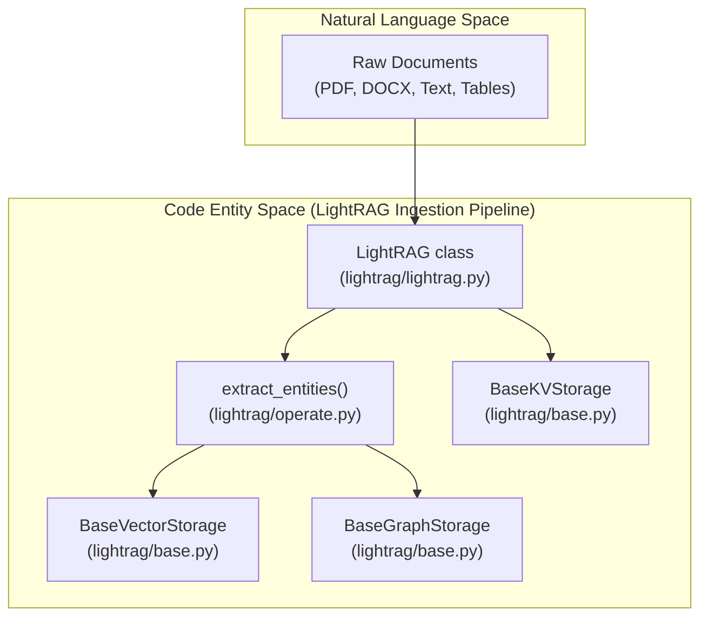

This diagram illustrates how raw documents from the natural language space are ingested by the `LightRAG` class [lightrag/lightrag.py:209-231](), processed by `extract_entities()` [lightrag/operate.py:143-147](), and stored across graph (`BaseGraphStorage`), vector (`BaseVectorStorage`), and key-value (`BaseKVStorage`) backends [lightrag/base.py:126-128]().

**Sources:** [lightrag/lightrag.py:143-231](), [lightrag/base.py:126-128](), [README.md:7-10]()

---

### Diagram: Query Retrieval - Natural Language Space to Code Entities

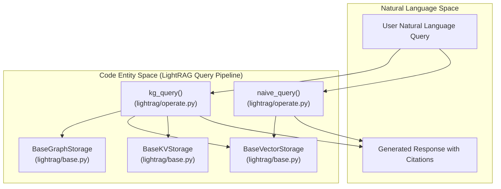

This diagram maps natural language queries to execution routines like `kg_query()` and `naive_query()` in `lightrag/operate.py` [lightrag/lightrag.py:143-152](), interacting with modular storage layers to assemble contexts and generate responses.

**Sources:** [lightrag/lightrag.py:143-152](), [lightrag/base.py:126-128]()

---

## Key Capabilities

- **Dual-Level Retrieval Modes:** Supports multiple query strategies including `local`, `global`, `hybrid`, `mix`, and `naive` retrieval, allowing fine-tuning for specific breadth and depth requirements [README.md:87-89]().
- **Multimodal Document Processing:** Integrates multimodal parsing capabilities (via MinerU/Docling services) to ingest complex formats such as PDFs, office documents, tables, images, and equations [README.md:79-82]().
- **Role-Specific LLM Configuration:** Provides independent configuration parameters for `EXTRACT`, `QUERY`, `KEYWORDS`, and `VLM` roles via `RoleLLMConfig` [lightrag/lightrag.py:215-223]().
- **Pluggable Storage Backends:** Offers modular storage abstractions (`BaseKVStorage`, `BaseVectorStorage`, `BaseGraphStorage`, `DocStatusStorage`) supporting backends like NetworkX, Neo4j, MongoDB, PostgreSQL, Milvus, Qdrant, and OpenSearch [README.md:82-85]().
- **Production Server & Web UI:** Includes a FastAPI REST server and an interactive React/TypeScript Web UI featuring knowledge graph visualization with Sigma.js, document managers, and query testing views [README.md:97-99]().

**Sources:** [lightrag/lightrag.py:209-223](), [README.md:79-99]()

---

## Major Subsystems and Their Relationships

LightRAG is organized into several cooperating subsystems that govern document processing, storage, retrieval, and presentation:

1. **Core RAG Engine & Ingestion Pipeline:** Manages text chunking strategies (Fixed, Recursive, Semantic Vector, Paragraph), entity-relation extraction, and document state tracking. For details, see [Core RAG Engine](#2) and [Document Ingestion Pipeline](#5).
2. **Retrieval and Query Subsystem:** Handles keyword extraction, token budgeting, context assembly, and reranking across graph and vector stores. For details, see [Retrieval and Query Modes](#2.3).
3. **Storage Backends:** Implements pluggable interfaces for key-value, vector, and graph databases with multi-process concurrency control. For details, see [Storage Backends](#4).
4. **LLM and Embedding Providers:** Houses unified binding layers for major model providers and manages role-specific configurations. For details, see [LLM and Embedding Providers](#3).
5. **REST API Server & Web UI:** Exposes programmatic endpoints via FastAPI and an interactive dashboard built with React and Sigma.js. For details, see [REST API Server](#6) and [Web UI (lightrag_webui)](#7).

**Sources:** [lightrag/lightrag.py:1-231](), [README.md:79-99]()

---

## Next Steps

To explore LightRAG in detail, proceed to the child sections:
- **[Getting Started](#1.1)**
- **[Core Concepts and Terminology](#1.2)**

**Sources:** [README.md:7-99](), [lightrag/lightrag.py:1-231]()

---

# Page: Getting Started

# Getting Started

<details>
<summary>Relevant source files</summary>

The following files were used as context for generating this wiki page:

- [.gitignore](.gitignore)
- [config.ini.example](config.ini.example)
- [env.example](env.example)
- [examples/generate_query.py](examples/generate_query.py)
- [examples/lightrag_azure_openai_demo.py](examples/lightrag_azure_openai_demo.py)
- [examples/lightrag_ollama_demo.py](examples/lightrag_ollama_demo.py)
- [examples/lightrag_openai_compatible_demo.py](examples/lightrag_openai_compatible_demo.py)
- [examples/lightrag_openai_demo.py](examples/lightrag_openai_demo.py)
- [examples/lightrag_openai_mongodb_graph_demo.py](examples/lightrag_openai_mongodb_graph_demo.py)
- [lightrag/api/config.py](lightrag/api/config.py)
- [lightrag/api/lightrag_server.py](lightrag/api/lightrag_server.py)
- [lightrag/api/utils_api.py](lightrag/api/utils_api.py)
- [lightrag/constants.py](lightrag/constants.py)
- [lightrag/llm/binding_options.py](lightrag/llm/binding_options.py)
- [pyproject.toml](pyproject.toml)
- [requirements-offline-llm.txt](requirements-offline-llm.txt)
- [requirements-offline-storage.txt](requirements-offline-storage.txt)
- [requirements-offline.txt](requirements-offline.txt)
- [uv.lock](uv.lock)

</details>


## Purpose and Scope

This page provides a comprehensive technical guide to begin using LightRAG. It details installation options (`uv`, `pip`, source, and offline requirements), environment configuration via `env.example` and `.env`, and demonstrates first insertions and queries via both the asynchronous Python API and the REST API server CLI. Quick-start demos for OpenAI and Ollama integrations illustrate end-to-end workflows.

---

## Installation

LightRAG is distributed as the package `lightrag-hku` on PyPI [pyproject.toml:6-6](). It supports various installation methods tailored to different workflows and environments.

### 1. Using `uv` (Recommended)

`uv` is a fast and reliable Python package manager preferred for its efficient dependency resolution and reproducibility.

```bash
# Install LightRAG server as a standalone tool
uv tool install "lightrag-hku[api]"

# Alternatively, add to a local project
uv add "lightrag-hku[api]"
```

This method automatically handles dependencies and is well-suited for local development and production deployments.

### 2. Using `pip`

You may also install LightRAG using `pip` in a Python virtual environment:

```bash
python -m venv .venv
source .venv/bin/activate   # On Windows: .venv\Scripts\activate
pip install "lightrag-hku[api]"
```

This ensures package isolation and avoids system-level conflicts.

### 3. From Source

For developers modifying LightRAG or needing unreleased changes, clone the repository and install it in editable mode:

```bash
git clone https://github.com/HKUDS/LightRAG.git
cd LightRAG
pip install -e ".[api]"
```

### 4. Offline Deployment

LightRAG supports fully offline usage with specialized requirements files for complete dependency sets [requirements-offline.txt:1-32]().

- `requirements-offline.txt` installs LightRAG and all offline dependencies (storage backends, LLM providers) [requirements-offline.txt:1-32]().
- Additional focused files exist for offline storage backends or LLMs if you want partial environments [pyproject.toml:144-170]().

| File | Description |
|---|---|
| `requirements-offline.txt` | Full offline package including API & LLMs [requirements-offline.txt:1-32]() |
| `requirements-offline-storage.txt` | Offline storage backends only [pyproject.toml:144-155]() |
| `requirements-offline-llm.txt` | Offline LLM providers only [pyproject.toml:157-170]() |

Sources: [pyproject.toml:6-170](), [requirements-offline.txt:1-32]()

---

## Environment Configuration

LightRAG uses environment variables configured in `.env` files. `env.example` serves as a template to create your own `.env` file with your API keys and runtime parameters [env.example:1-118]().

### Key Environment Variables

| Variable | Description | Example |
|---|---|---|
| `OPENAI_API_KEY` | API key for OpenAI LLM and embedding services | `sk-xxxxxx...` |
| `LLM_MODEL` | Model name for text generation | `gpt-4o-mini`, `qwen2.5-coder:7b` [examples/lightrag_ollama_demo.py:89-89]() |
| `LLM_BINDING_HOST` | URL for locally hosted models (e.g., Ollama) | `http://localhost:11434` [lightrag/api/config.py:80-80]() |
| `EMBEDDING_MODEL` | Model name for embedding provider | `text-embedding-3-small`, `bge-m3:latest` [examples/lightrag_ollama_demo.py:105-105]() |
| `LIGHTRAG_RUNTIME_TARGET` | Runtime environment target (`host`, `compose`) | `host` [env.example:4-5]() |
| `WEBUI_TITLE` | Web UI deployment title | `My Graph KB` [env.example:17-19]() |
| `WEBUI_DESCRIPTION` | Web UI subtitle description | `Simple and Fast Graph Based RAG System` [env.example:20-20]() |
| `LIGHTRAG_API_KEY` | API key for server authorization | `mysecretapikey` [env.example:11-15]() |

### Security Notice

If binding to `0.0.0.0` (all network interfaces), the server must be secured with API keys or authentication (`AUTH_ACCOUNTS`) to prevent unauthorized access to your knowledge graph [env.example:10-15](). Binding to `127.0.0.1` restricts access to local machine clients only.

Sources: [env.example:1-118](), [lightrag/api/config.py:71-94](), [examples/lightrag_openai_demo.py:93-98]()

---

## Python API Quick Start

LightRAG’s core interface is the asynchronous `LightRAG` class, which supports document ingestion and querying [examples/lightrag_openai_demo.py:79-88]().

### 1. OpenAI Demo: Insert & Query

```python
import asyncio
from lightrag import LightRAG, QueryParam
from lightrag.llm.openai import gpt_4o_mini_complete, openai_embed

async def run_demo():
    rag = LightRAG(
        working_dir="./my_rag_data",
        llm_model_func=gpt_4o_mini_complete,
        embedding_func=openai_embed,
    )

    await rag.initialize_storages()

    with open("book.txt", "r") as file:
        text = file.read()
    await rag.ainsert(text)

    response = await rag.aquery(
        "What are the main themes?",
        param=QueryParam(mode="hybrid")
    )

    print(response)

    await rag.finalize_storages()

if __name__ == "__main__":
    asyncio.run(run_demo())
```

- `ainsert(text)`: Asynchronously ingests text for parsing, chunking, embedding, KG extraction, and indexing [examples/lightrag_openai_demo.py:133-133]().
- `aquery(query, param)`: Executes retrieval-augmented generation queries with hybrid KG + vector options [examples/lightrag_openai_demo.py:171-175]().

### 2. Ollama Demo (Local Execution)

```python
from functools import partial
from lightrag import LightRAG
from lightrag.llm.ollama import ollama_model_complete, ollama_embed
from lightrag.utils import EmbeddingFunc

rag = LightRAG(
    working_dir="./local_rag",
    llm_model_func=ollama_model_complete,
    llm_model_name="qwen2.5-coder:7b",
    embedding_func=EmbeddingFunc(
        embedding_dim=1024,
        func=partial(ollama_embed.func, embed_model="bge-m3:latest")
    ),
)
```

Sources: [examples/lightrag_openai_demo.py:79-180](), [examples/lightrag_ollama_demo.py:85-109]()

---

## REST API Server Usage

The FastAPI-based server exposes a REST API and Web UIs (`lightrag_server.py`) [lightrag/api/lightrag_server.py:1-5]() supporting OpenAI- and Ollama-compatible endpoints.

### Starting the Server

```bash
lightrag-server
```

This command loads `.env` automatically and launches the FastAPI server binding on the configured host and port [lightrag/api/lightrag_server.py:102-102]().

### Query Data Flow Overview

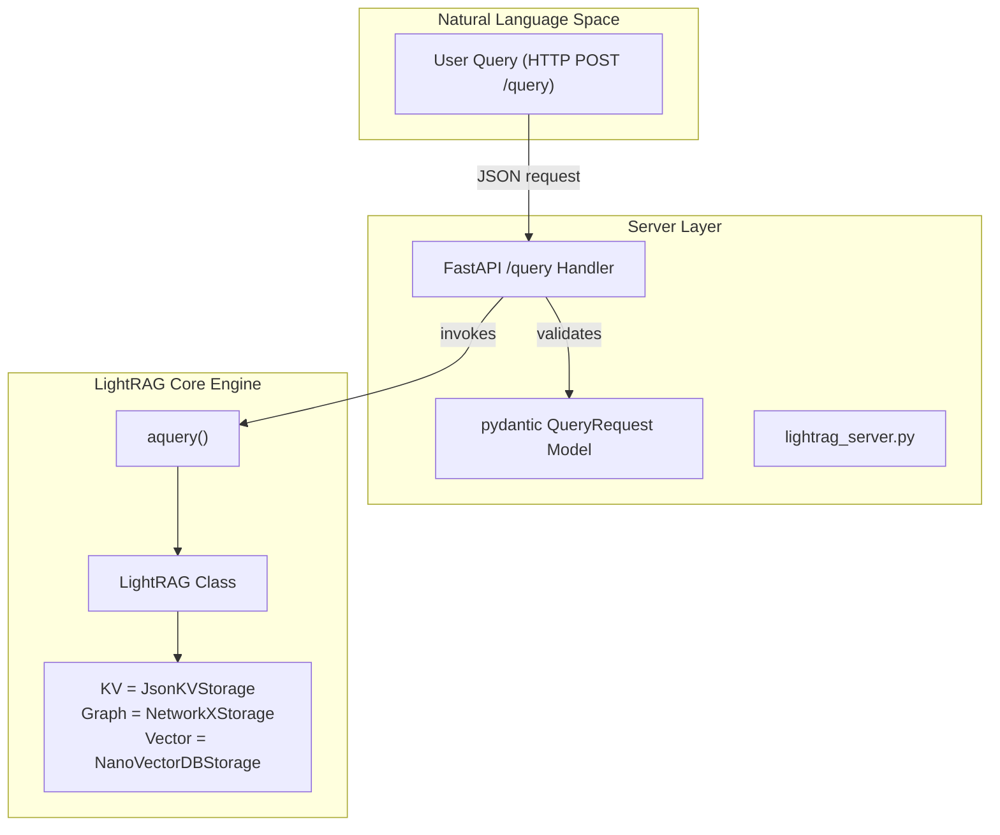

Sources: [lightrag/api/lightrag_server.py:1-175](), [examples/lightrag_openai_demo.py:159-162]()

### Workspace and Storage Initialization

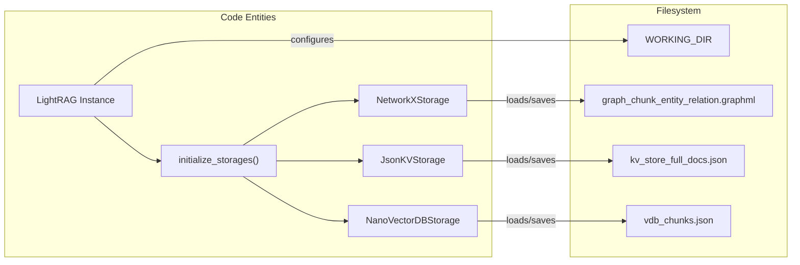

Sources: [examples/lightrag_openai_demo.py:102-130](), [examples/lightrag_ollama_demo.py:111-131]()

---

## Appendix: Dual-Level System Association Diagram

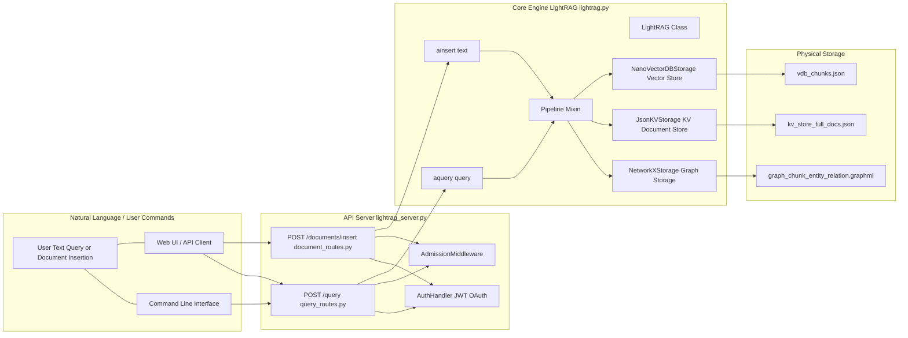

Sources: [lightrag/api/lightrag_server.py:1-175](), [examples/lightrag_openai_demo.py:79-180]()

---

# Page: Core Concepts and Terminology

# Core Concepts and Terminology

<details>
<summary>Relevant source files</summary>

The following files were used as context for generating this wiki page:

- [AGENTS.md](AGENTS.md)
- [CLAUDE.md](CLAUDE.md)
- [README-id.md](README-id.md)
- [README-ja.md](README-ja.md)
- [README-zh.md](README-zh.md)
- [README.md](README.md)
- [docs/FileProcessingPipeline-zh.md](docs/FileProcessingPipeline-zh.md)
- [docs/FileProcessingPipeline.md](docs/FileProcessingPipeline.md)
- [docs/design/PipelineConcurrencyContract.md](docs/design/PipelineConcurrencyContract.md)
- [docs/design/PurgeRecoveryContract.md](docs/design/PurgeRecoveryContract.md)
- [lightrag/exceptions.py](lightrag/exceptions.py)
- [lightrag/parser/param_schema.py](lightrag/parser/param_schema.py)
- [lightrag/parser/routing.py](lightrag/parser/routing.py)
- [tests/chunker/test_chunk_options_persistence.py](tests/chunker/test_chunk_options_persistence.py)
- [tests/parser/test_engine_params.py](tests/parser/test_engine_params.py)
- [tests/parser/test_hint_params.py](tests/parser/test_hint_params.py)
- [tests/pipeline/test_cache_reference_flush_order.py](tests/pipeline/test_cache_reference_flush_order.py)
- [tests/pipeline/test_insert_done_error_handling.py](tests/pipeline/test_insert_done_error_handling.py)
- [tests/utils/test_embedding_func_shape_validation.py](tests/utils/test_embedding_func_shape_validation.py)

</details>


This page defines the fundamental architectural concepts and terminology central to LightRAG. It covers how LightRAG models knowledge using knowledge graphs combined with vector retrieval, distinct query modes, storage layout via namespaces and workspaces, document ingestion options, role-specific LLM configurations, and the state machine tracking document lifecycles.

---

## Knowledge Graph and Dual-Level Retrieval

LightRAG employs a **dual-level retrieval** architecture combining:

1. **Knowledge Graph (KG):**  
   A structured graph constructed during document ingestion representing:
   - **Entities (Nodes):** Extracted key concepts or objects (e.g., “OpenAI”) [lightrag/operate.py:130-160]().
   - **Relationships (Edges):** Typed links describing connections between entities (e.g., “Created”) [lightrag/operate.py:130-160]().

   This graph captures complex, semantic interrelations beyond text similarity. It is constructed via the `extract_entities` function that parses LLM outputs into entities and relations, then upserts them into the KG storage interface (`BaseGraphStorage`) [lightrag/operate.py:130-160](), [lightrag/base.py:70-100]().

2. **Vector Retrieval:**  
   Unstructured text chunks, descriptions of entities, and relationship summaries are embedded into vector spaces by an embedding function (`EmbeddingFunc`). These vectors allow approximate nearest-neighbor search via `BaseVectorStorage` to supply semantically related context during query time [lightrag/lightrag.py:113-160](), [lightrag/base.py:120-135]().

This design enables a **hybrid querying** approach, where both symbolic knowledge and dense text similarity are used to provide rich and precise information.

### Code Implementation and Data Flow

- During document ingestion, raw text is split into chunks via chunking strategies (`ProcessOptions`, `chunker/`) producing structured text segments [lightrag/parser/routing.py:148-178]().
- `extract_entities` (in `lightrag/operate.py`) calls the LLM extractor, builds entity and relation tuples, then inserts or merges them into the KG storage [lightrag/operate.py:130-160]().
- The vector database (via `BaseVectorStorage`) stores embeddings computed from chunk content or entity descriptions [lightrag/base.py:120-135]().
- The main orchestrator class (`LightRAG` in `lightrag/lightrag.py`) coordinates the ingestion pipeline, calling all underlying components [lightrag/lightrag.py:100-150]().
- During query execution, retrieval functions collect relevant nodes/edges and text chunks from KG and vector storage, assisted by token budget controls [lightrag/operate.py:110-190]().

### Diagram: Mapping Natural Language Concepts to Code Entities

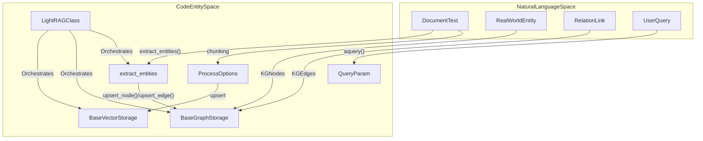

Sources:  
[lightrag/lightrag.py:100-150](), [lightrag/operate.py:130-160](), [lightrag/base.py:70-135](), [lightrag/parser/routing.py:148-178]()

---

## Query Modes

LightRAG’s query system supports multiple **modes** to balance graph and vector retrieval. These are encapsulated in the `QueryParam.mode` field [lightrag/base.py:90-180]():

| Mode    | Description                                                                 | Implementation Notes                                                      |
|---------|-----------------------------------------------------------------------------|---------------------------------------------------------------------------|
| `local` | Focus retrieval on context-dependent information near extracted entities.   | Query graph locally for neighborhood nodes related to keyword set.        |
| `global`| Employ global knowledge graph aggregates like relationship summaries.       | Aggregate graph data independent of local context.                        |
| `hybrid`| Combine `local` and `global` retrieval results for richer context.          | Merge node neighborhoods with global aggregates.                          |
| `naive` | Simple RAG vector search on text chunks only, without KG guidance.          | Basic vector search; fallback mode.                                       |
| `mix`   | (Default) Integrate both knowledge graph and vector-based retrieval.        | Run KG and vector queries combined with reranking.                        |
| `bypass`| Disable retrieval; pass prompt directly to LLM with no context.             | LLM generates answer without retrieval context (useful for debugging).    |

The core query functions implement these modes by interacting with KG and vector storage accordingly [lightrag/operate.py:110-190]().

Additional relevant query parameters:
- `top_k`: Number of entities/relations/chunks to retrieve initially.
- `chunk_top_k`: Number of chunks retrieved to keep after reranking.
- `max_entity_tokens` / `max_relation_tokens` / `max_total_tokens`: Unified token budgets controlling input context size to LLM [lightrag/base.py:110-140]().

Sources:  
[lightrag/base.py:90-180](), [lightrag/operate.py:110-190]()

---

## Storage Namespaces and Workspaces

To manage data modularity and isolation, LightRAG organizes storage into hierarchical **workspaces** and **namespaces**:

### Workspaces
- Represent logical partitions or tenants (projects, users).
- Each workspace isolates file paths and data segregation across storage layers [lightrag/lightrag.py:110-115]().

### Storage Namespaces
- Represented by logical data categories separated across key-value, vector, graph, and document status backends [lightrag/base.py:110-140]().
- Supported namespaces include:
  - `KV_STORE_FULL_DOCS`: Raw full documents.
  - `KV_STORE_CHUNKS`: Text chunks cache.
  - `VECTOR_STORE`: Vector embeddings of chunks/entities.
  - `GRAPH_STORE`: Knowledge graph nodes and edges.
- Interfaced via abstract base classes: `BaseKVStorage`, `BaseVectorStorage`, `BaseGraphStorage`, and `BaseDocStatusStorage` [lightrag/base.py:110-140]().
- Concurrency, locking, and reservations are managed at workspace+namespace granularity [lightrag/kg/shared_storage.py]().

### Diagram: Data Ingestion Flow Across Storage Layers

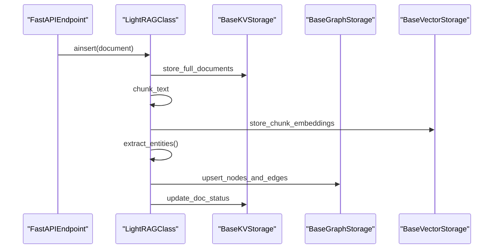

Sources:  
[lightrag/lightrag.py:110-115](), [lightrag/base.py:70-140](), [lightrag/kg/shared_storage.py]()

---

## Document Lifecycle State Machine

Documents in LightRAG traverse distinct states during ingestion and indexing to support fault tolerance, recovery, and concurrency control.

### States tracked via `DocStatus` and stored in `DocStatusStorage`:
- `pending`: Document uploaded or detected but not processed.
- `processing`: Currently under parsing, extraction, or indexing.
- `processed`: Fully extracted, indexed in KG and vector DB, ready for querying.
- `failed`: Processing encountered an error (timeout, parsing failure, etc.).

State transitions and worker queues are coordinated via `_PipelineMixin` [lightrag/pipeline.py]().

Sources:  
[lightrag/pipeline.py](), [lightrag/base.py:80-140]()

---

## Token Budgeting and Role-Specific LLM Configuration

The query system enforces unified token budgets, considering combined token counts from context elements (`max_entity_tokens`, `max_relation_tokens`, `max_total_tokens`) [lightrag/base.py:110-140]().

LightRAG also supports four primary LLM roles with separate configurations to optimize performance and cost [lightrag/llm_roles.py]():
- `EXTRACT`: For entity/relation extraction during ingestion.
- `QUERY`: For composing answers from retrieved context.
- `KEYWORDS`: For keyword extraction in the retrieval pipeline.
- `VLM`: For multimodal content analysis (Vision-Language Models).

Sources:  
[lightrag/llm_roles.py](), [lightrag/base.py:110-140]()

---

## Summary Table of Core Classes and Functions

| Concept                   | Code Entity                                      | Description                                                     |
|---------------------------|--------------------------------------------------|-----------------------------------------------------------------|
| Knowledge Graph           | `BaseGraphStorage` (`lightrag/base.py`)          | Graph data structure interface storing entities and relations.  |
| Dual-Level Retrieval      | `LightRAG` (`lightrag/lightrag.py`)              | Main orchestrator for ingestion, querying, and pipeline logic.  |
| Entity Extraction         | `extract_entities` (`lightrag/operate.py`)       | LLM extraction and parsing of entities and relations.           |
| Query Parameters          | `QueryParam` (`lightrag/base.py`)                | Parameters controlling query modes and token budgets.           |
| Vector Storage Interface  | `BaseVectorStorage` (`lightrag/base.py`)         | Abstract class for vector DB operations.                        |
| Document Status Tracking  | `DocStatusStorage` (`lightrag/base.py`)          | Persistence of ingestion lifecycle states.                      |
| Pipeline Coordination     | `_PipelineMixin` (`lightrag/pipeline.py`)        | Class mixin handling full document ingestion and worker queues. |

Sources:  
[lightrag/lightrag.py](), [lightrag/operate.py](), [lightrag/base.py](), [lightrag/pipeline.py]()

---

# Page: Core RAG Engine

# Core RAG Engine

<details>
<summary>Relevant source files</summary>

The following files were used as context for generating this wiki page:

- [docs/design/LatexEscapeRepairContract.md](docs/design/LatexEscapeRepairContract.md)
- [lightrag/lightrag.py](lightrag/lightrag.py)
- [lightrag/operate.py](lightrag/operate.py)
- [lightrag/prompt.py](lightrag/prompt.py)
- [lightrag/utils.py](lightrag/utils.py)
- [tests/llm/test_vlm_json_escape_repair.py](tests/llm/test_vlm_json_escape_repair.py)

</details>


The Core RAG Engine forms the computational backbone of the LightRAG Python library. It manages the conversion of raw text documents into a structured Knowledge Graph (KG) representation and executes flexible multi-level retrieval queries that combine symbolic graph search with vector semantic search.

This engine bridges natural language data and structured code entities through layered components handling text chunking, LLM-driven extraction of entities and relationships, vector indexing, graph storage, and query execution. It balances fully automated KG construction with efficient retrieval modes suitable for diverse user scenarios.

---

### High-Level Architecture and Code Mapping

To situate the core engine within the codebase, the diagram below visualizes the main logical components and the primary modules and classes that implement them:

Title: Core RAG Engine Components to Code Entities
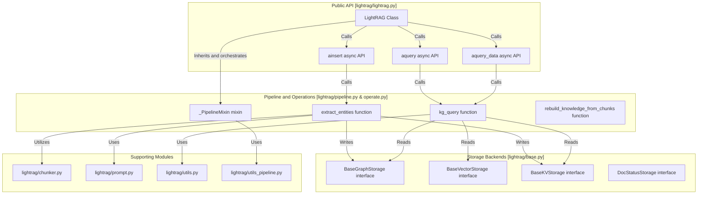
Sources: [lightrag/lightrag.py:162-231](), [lightrag/operate.py:114-196](), [lightrag/base.py:83-139]()

---

### Core Subsystems Overview

The Core RAG Engine is organized into five major subsystems. Each handles a distinct responsibility:

#### 1. LightRAG Class and Pipeline Orchestration
The `LightRAG` class serves as the primary orchestrator for the KG ingestion and query lifecycle [lightrag/lightrag.py:1-231](). It coordinates asynchronous insertion (`ainsert`) and query (`aquery`) APIs, document lifecycle management via `_PipelineMixin`, and safe concurrency controls [lightrag/lightrag.py:162-208]().

For details, see [LightRAG Class and Pipeline Orchestration](#2.1).
Sources: [lightrag/lightrag.py:162-231](), [lightrag/pipeline.py:1-100]()

#### 2. Entity and Relation Extraction
Transforming document text chunks into graph elements is accomplished via `extract_entities` [lightrag/operate.py:147](), driven by LLM prompts governed by templates defined in `lightrag/prompt.py` [lightrag/prompt.py:56-102](). It extracts structured entities and binary relationships with support for gleaning and deduplication.

For details, see [Entity and Relation Extraction](#2.2).
Sources: [lightrag/operate.py:114-196](), [lightrag/prompt.py:56-102]()

#### 3. Retrieval and Query Modes
Querying the KG supports local, global, hybrid, mix, and naive modes encapsulated by `QueryParam` [lightrag/base.py:133](). The core retrieval logic executes in `kg_query` [lightrag/operate.py:148](), managing token budgets, keyword extraction, vector search, and reranking.

For details, see [Retrieval and Query Modes](#2.3).
Sources: [lightrag/operate.py:114-196](), [lightrag/base.py:133-139]()

#### 4. Text Chunking Strategies
Input text is split into segments compatible with model token limits using strategies such as fixed-size token chunks, recursive semantic chunking, and vector semantic chunking via `chunking_by_token_size` [lightrag/lightrag.py:142]().

For details, see [Text Chunking Strategies](#2.4).
Sources: [lightrag/lightrag.py:142](), [lightrag/chunker.py:1-50]()

#### 5. Concurrency, Caching, and Utilities
Robust concurrent execution is managed via `priority_limit_async_func_call` [lightrag/utils.py:188](), storage locks, LLM response caches, vector DB operation wrappers (`safe_vdb_operation_with_exception`) [lightrag/utils.py:156](), and text sanitization utilities including LaTeX escape repair [lightrag/utils.py:27]().

For details, see [Concurrency, Caching, and Utilities](#2.5).
Sources: [lightrag/utils.py:156-209](), [lightrag/operate.py:15-63]()

---

### Data Flow: From Natural Language Input to Knowledge Graph

Title: Data Flow from Raw Text to KG Storage
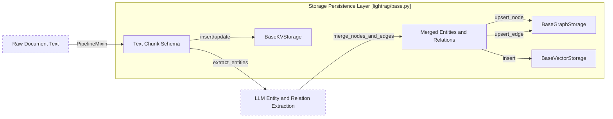
Sources: [lightrag/operate.py:146-152](), [lightrag/base.py:64-72]()

---

### Key Classes and Interfaces in the Core RAG Engine

| Class / Function | File Path | Role and Responsibility |
| --- | --- | --- |
| `LightRAG` | `lightrag/lightrag.py` | Entry point class managing pipeline, LLM roles, and storage backends [lightrag/lightrag.py:1-231](). |
| `_PipelineMixin` | `lightrag/pipeline.py` | Mixin implementing document ingestion lifecycle and chunk processing [lightrag/lightrag.py:209](). |
| `extract_entities` | `lightrag/operate.py` | Performs entity and relation extraction from text chunks [lightrag/operate.py:147](). |
| `kg_query` | `lightrag/operate.py` | Core query executor supporting multi-mode retrieval [lightrag/operate.py:148](). |
| `QueryParam` | `lightrag/base.py` | Typed dataclass specifying query modes and token budgets [lightrag/base.py:133](). |
| `BaseGraphStorage` | `lightrag/base.py` | Abstract interface for knowledge graph storage backends [lightrag/base.py:126](). |
| `BaseVectorStorage` | `lightrag/base.py` | Abstract interface for vector embedding storage backends [lightrag/base.py:128](). |
| `BaseKVStorage` | `lightrag/base.py` | Abstract interface for key-value storage backends [lightrag/base.py:127](). |

Sources: [lightrag/lightrag.py:1-231](), [lightrag/base.py:126-139]()

---

### Bridging Natural Language to Code Entities

Title: Natural Language Input to Extraction Code Path
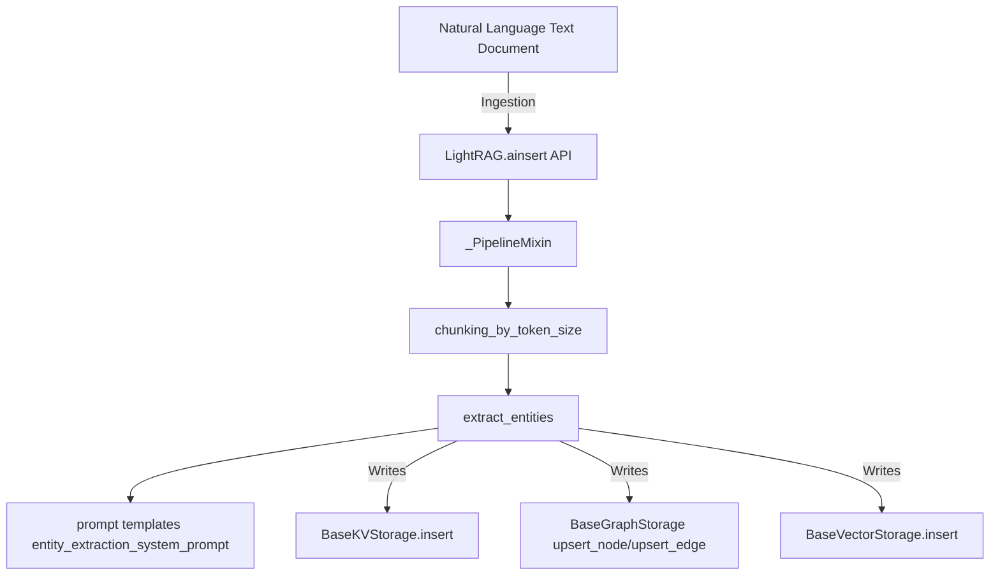
Sources: [lightrag/lightrag.py:162-231](), [lightrag/operate.py:147](), [lightrag/prompt.py:56-102]()

Title: Query Request to Retrieval Components
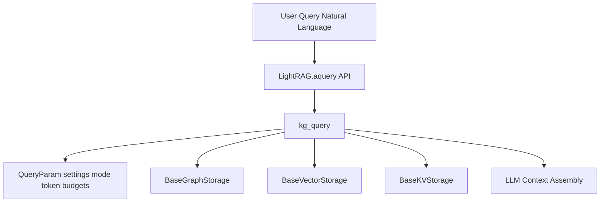
Sources: [lightrag/lightrag.py:162-231](), [lightrag/operate.py:148](), [lightrag/base.py:133-139]()

---

For a deeper technical dive, each subsystem is expanded in dedicated child pages:
- [LightRAG Class and Pipeline Orchestration](#2.1)
- [Entity and Relation Extraction](#2.2)
- [Retrieval and Query Modes](#2.3)
- [Text Chunking Strategies](#2.4)
- [Concurrency, Caching, and Utilities](#2.5)

---

# Summary

The Core RAG Engine is the central coordinator converting raw text into structured knowledge and enabling sophisticated querying powered by a hybrid KG + vector approach. Its architecture balances modular storage abstractions, LLM-driven extraction intelligence, and multi-mode retrieval to deliver scalable, extensible RAG capabilities in LightRAG.

Sources: [lightrag/lightrag.py:1-231](), [lightrag/operate.py:1-196](), [lightrag/base.py:64-139](), [lightrag/prompt.py:56-102](), [lightrag/utils.py:156-209]()

---

# Page: LightRAG Class and Pipeline Orchestration

# LightRAG Class and Pipeline Orchestration

<details>
<summary>Relevant source files</summary>

The following files were used as context for generating this wiki page:

- [docs/ProgramingWithCore.md](docs/ProgramingWithCore.md)
- [docs/design/LatexEscapeRepairContract.md](docs/design/LatexEscapeRepairContract.md)
- [lightrag/lightrag.py](lightrag/lightrag.py)
- [lightrag/operate.py](lightrag/operate.py)
- [lightrag/prompt.py](lightrag/prompt.py)
- [lightrag/tools/README_KG_INTEGRITY_REPAIR.md](lightrag/tools/README_KG_INTEGRITY_REPAIR.md)
- [lightrag/tools/kg_integrity_repair.py](lightrag/tools/kg_integrity_repair.py)
- [lightrag/utils.py](lightrag/utils.py)
- [lightrag/utils_graph.py](lightrag/utils_graph.py)
- [tests/extraction/test_vdb_content_truncation_coverage.py](tests/extraction/test_vdb_content_truncation_coverage.py)
- [tests/extraction/test_write_ahead_indexes.py](tests/extraction/test_write_ahead_indexes.py)
- [tests/kg/json_impl/test_json_commit_reconciliation.py](tests/kg/json_impl/test_json_commit_reconciliation.py)
- [tests/kg/networkx_impl/test_networkx_commit_gate.py](tests/kg/networkx_impl/test_networkx_commit_gate.py)
- [tests/kg/networkx_impl/test_networkx_index_done.py](tests/kg/networkx_impl/test_networkx_index_done.py)
- [tests/llm/test_vlm_json_escape_repair.py](tests/llm/test_vlm_json_escape_repair.py)
- [tests/pipeline/test_admin_write_gate.py](tests/pipeline/test_admin_write_gate.py)
- [tests/pipeline/test_delete_fail_closed.py](tests/pipeline/test_delete_fail_closed.py)
- [tests/pipeline/test_doc_status_reset_metadata.py](tests/pipeline/test_doc_status_reset_metadata.py)
- [tests/pipeline/test_fault_injection_matrix.py](tests/pipeline/test_fault_injection_matrix.py)
- [tests/pipeline/test_graph_deletion_tracking_ordering.py](tests/pipeline/test_graph_deletion_tracking_ordering.py)
- [tests/pipeline/test_graph_merge_rename_tracking_order.py](tests/pipeline/test_graph_merge_rename_tracking_order.py)
- [tests/pipeline/test_purge_fail_closed.py](tests/pipeline/test_purge_fail_closed.py)
- [tests/utils/test_deferred_cancellation_stamp.py](tests/utils/test_deferred_cancellation_stamp.py)

</details>


This page provides a comprehensive technical deep dive into the central `LightRAG` class and the orchestration of its core document ingestion and query pipelines. We analyze the lifecycle of `LightRAG`, its public asynchronous APIs (`ainsert`, `aquery`), the multi-stage Knowledge Graph (KG) construction pipeline, the role of the `_PipelineMixin`, and the administration-level write gate mechanism enforcing exclusive graph write access. This detailed exploration covers the interplay of code modules `lightrag/lightrag.py` and `lightrag/operate.py` for LightRAG's core logic.

---

## 1. LightRAG Class Lifecycle and Initialization

The `LightRAG` class is the primary orchestrator coordinating document ingestion, KG construction, storage access, and querying. It is declared as a `final` dataclass inheriting several mixins for role-based LLM configuration (`_RoleLLMMixin`), pipeline orchestration (`_PipelineMixin`), and schema migration support (`_StorageMigrationMixin`) [lightrag/lightrag.py:32](), [lightrag/lightrag.py:209-224]().

### Storage Backend Setup

- LightRAG supports pluggable backends for Key-Value, Vector, Graph, and Document Status storage. Backend types are specified by string keys and resolved via `get_storage_class` [lightrag/lightrag.py:210]().
- The asynchronous method `initialize_storages()` instantiates and initializes all required storage backends based on configuration parameters such as `kv_storage`, `vector_storage`, and `graph_storage` [lightrag/lightrag.py:440-496](), [lightrag/kg/factory.py:17-34]().
- The counterpart method `finalize_storages()` flushes and closes storages cleanly, guaranteeing that any buffered state is persisted by calling `finalize()` and `index_done_callback()` on storage instances [lightrag/lightrag.py:516-525]().

### Workspace Isolation and Namespaces

- The `workspace` parameter configures logical data isolation; it prefixes storage namespaces ensuring multiple LightRAG instances can share physical storage safely by namespace partitioning.
- Namespace data and locks are managed through helper functions from `shared_storage` such as `get_namespace_data` and `get_namespace_lock` to segregate pipeline status, reservations, and pipeline ingress [lightrag/lightrag.py:113-116]().

---

## 2. Core Asynchronous APIs: `ainsert`, `aquery`

LightRAG exposes three main async operations for client use, directly accessible from the `LightRAG` instance:

| API Method   | Purpose                                           | Key Parameters                                      |
|--------------|-------------------------------------------------|----------------------------------------------------|
| `ainsert`    | Ingest raw text content into the KG data system | `content`: `str` or list of strings to insert      |
| `aquery`     | Perform retrieval-augmented generation queries  | `query` string and a `QueryParam` specifying mode  |
| `aquery_data`| Retrieve raw context data without LLM completion| `query` string and a `QueryParam`                   |

- `ainsert`: This entry point triggers chunking, entity/relation extraction, merging with existing KG entries, and vector index updates [lightrag/lightrag.py:560-602]().
- `aquery`: Wraps different retrieval modes forwarding to `kg_query` (for graph-enhanced modes) or `naive_query` (for vector-only search), then assembles LLM prompt and invokes the completion functions [lightrag/lightrag.py:657-686]().
- `aquery_data`: Returns context chunks directly, suitable for raw context preview or offline processing needs [lightrag/lightrag.py:687-709]().

---

## 3. Knowledge Graph Construction Pipeline

The core KG construction logic integrates deep text analysis via LLMs with chunking and vectorization to build a dual-level KG + Vector index for semantic retrieval. This multi-stage pipeline is largely dispersed between `lightrag/operate.py`, `lightrag/lightrag.py`, and `lightrag/pipeline.py`.

### Pipeline Stages

1. **Chunking**: Input text is split into token-length bounded chunks using `chunking_by_token_size()`. Supports multiple chunking strategies (Fixed, Recursive, Semantic Vector, etc.) allowing flexibility depending on document type and scale [lightrag/lightrag.py:142]().

2. **Entity and Relation Extraction**: The `extract_entities` function calls an LLM (configured via `RoleLLMConfig`) to analyze chunk text and extract structured entity and relation tuples. It uses a system prompt template that guides the LLM specifically for KG extraction tasks [lightrag/operate.py:147](), [lightrag/prompt.py:56-102]().

3. **Merging and Summarization**: To reconcile multiple or conflicting extracted entity descriptions, `_handle_entity_relation_summary()` performs map-reduce style summarization, condensing multiple texts into unified entity and relation nodes with stable descriptions. This ensures KG coherence across many uploaded documents [lightrag/operate.py:212-230]().

4. **Indexing and Storage**:
   - Entities, relationships, and final text chunks are persisted into vector stores (`entities_vdb`, `relationships_vdb`, `chunks_vdb`) and KV stores, and linked to the main graph database (`chunk_entity_relation_graph`).
   - This dual-level storage supports powerful hybrid semantic search modes combining structured graph traversal and vector similarity search [lightrag/lightrag.py:460-475]().

---

### Diagram: Natural Language to Code and Storage Entity Mapping

This diagram maps the natural language concepts and text processing stages to their specific functions and storage namespaces within the LightRAG codebase:

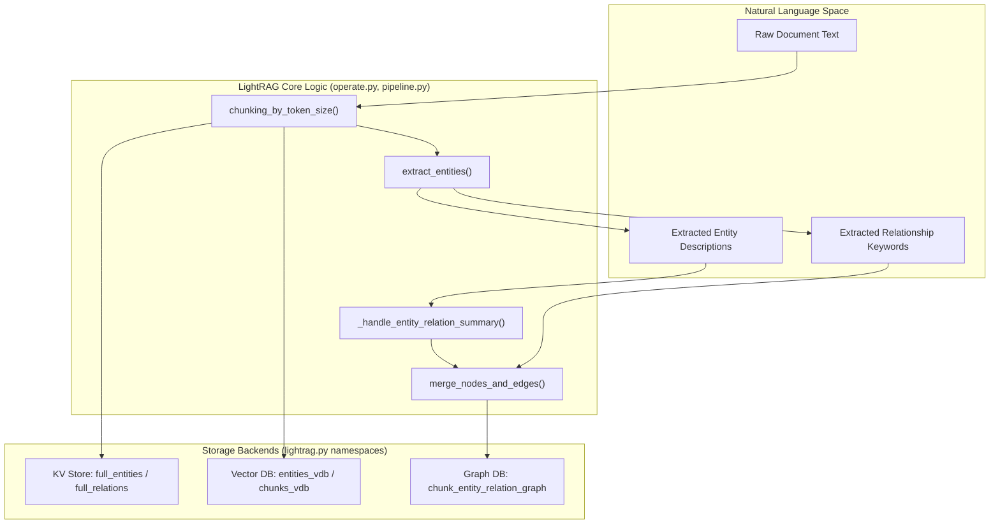

_Sources: [lightrag/lightrag.py:580-610](), [lightrag/operate.py:140-230](), [lightrag/pipeline.py:100-160]()_

---

## 4. The _PipelineMixin: Async Document Pipeline Control

The `_PipelineMixin` in `lightrag/pipeline.py` provides the asynchronous machinery managing document ingestion workflows including parsing, LLM extraction workers, and multimodal analysis.

### Key Responsibilities

- **Task Queues and Concurrency**: Maintains and schedules multiple async queues for parsing, native and external extraction workers, as well as multimodal (VLM) processing. Uses concurrency limits to ensure rate limits and resource fairness across different pipeline stages and LLM roles [lightrag/pipeline.py:100-160]().

- **Cancellation and Retry**: Supports task cancellation, deferred cancellations, and retry logic around pipeline steps, safeguarding stability against partial failures.

- **Metadata and State Tracking**: Updates document processing states using `DocStatusStorage`, marking each phase (e.g., PARSING, ANALYZING, PROCESSING) with detailed error messages/logs for observability [lightrag/base.py:130]().

- **Extraction Hooks and Validation**: Invokes `kg_extraction_validator` hooks between extraction and merging allowing custom filtering of candidate entities and relations, enhancing extraction quality control.

---

## 5. Admin Write Gate: Coordinating Exclusive Graph Writes

Graph backends like `NetworkXStorage` require serialization of graph writes to avoid lost updates or corrupted state due to concurrent modifications. LightRAG enforces exclusive graph write access via an **admin write gate** implemented at the core level.

- The gate uses the namespace reservation system with a special kind `"admin"` reservation that blocks the pipeline's `"busy"` reservation and vice versa, preventing pipeline ingestion tasks from running concurrently with admin-level graph writes [lightrag/lightrag.py:170-174](), [tests/pipeline/test_admin_write_gate.py:1-190]().

- If an admin write holds the gate, any new pipeline tasks attempting to start are deferred until the admin write releases the lock. This ensures strong consistency and serializability of graph mutations [lightrag/lightrag.py:180-183]().

- This mechanism is enforced transparently by LightRAG's core ingestion and mutation APIs, including `ainsert_custom_kg()` and graph mutation endpoints in the REST server, shielding users from concurrency anomalies.

---

## 6. Retrieval Pipeline Orchestration

The retrieval API `aquery()` supports multiple modes: local, global, hybrid, mix, naive, and bypass. It delegates processing to either:

- `kg_query()` which performs graph-enhanced semantic retrieval (local/global/hybrid/mix modes) [lightrag/operate.py:148]().

- `naive_query()` which is a simpler vector-only retrieval ignoring graph context [lightrag/operate.py:150]().

This modular design allows flexible control over the retrieval approach depending on user scenario and backend capabilities [lightrag/lightrag.py:650-690](), [lightrag/operate.py:112-150]().

---

### Diagram: Query Handling Workflow in LightRAG

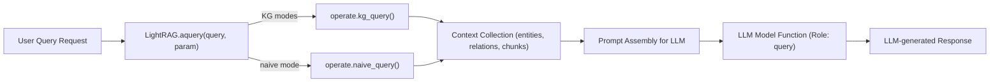

_Sources: [lightrag/lightrag.py:650-686](), [lightrag/operate.py:112-150](), [lightrag/llm_roles.py:210-230]()_

---

## 7. Summary of Key Functions and Classes

| File              | Key Function / Class           | Description                                      |
|-------------------|-------------------------------|------------------------------------------------|
| `lightrag/lightrag.py`  | `LightRAG`                     | Main orchestrator: lifecycle, API entrypoints  |
|                   | `ainsert()`                    | Text ingestion pipeline start                   |
|                   | `aquery()`                    | Query execution entrypoint                       |
| `lightrag/operate.py`   | `extract_entities()`           | Invokes LLM extraction of entities/relations   |
|                   | `kg_query()`                   | Graph-based retrieval modes                      |
|                   | `_handle_entity_relation_summary()` | Map-reduce summarization of merged entities     |
| `lightrag/pipeline.py`  | `_PipelineMixin`               | Async pipeline management for ingestion         |
| `lightrag/kg/shared_storage.py` | `acquire_reservation()` / admin write gate | Reservation locking methods for concurrency control |

---

This page synthesizes the core architecture and implementation details for the LightRAG class and its pipeline orchestration, connecting code entities with natural language concepts, and revealing how the complex ingestion and retrieval processes are managed in an asynchronous, consistent, and modular manner.

---

# References / Sources

- `lightrag/lightrag.py:32, 113-116, 170-183, 209-224, 440-496, 516-525, 560-602, 657-709`  
- `lightrag/operate.py:112-150, 147, 150, 212-230`  
- `lightrag/pipeline.py:100-160`  
- `lightrag/kg/factory.py:17-34`  
- `lightrag/base.py:130`  
- `lightrag/prompt.py:56-102`  
- `lightrag/llm_roles.py:210-230`  
- `tests/pipeline/test_admin_write_gate.py:1-190`

---

# Page: Entity and Relation Extraction

# Entity and Relation Extraction

<details>
<summary>Relevant source files</summary>

The following files were used as context for generating this wiki page:

- [docs/design/LatexEscapeRepairContract.md](docs/design/LatexEscapeRepairContract.md)
- [lightrag/chunk_schema.py](lightrag/chunk_schema.py)
- [lightrag/lightrag.py](lightrag/lightrag.py)
- [lightrag/llm/_vision_utils.py](lightrag/llm/_vision_utils.py)
- [lightrag/operate.py](lightrag/operate.py)
- [lightrag/prompt.py](lightrag/prompt.py)
- [lightrag/prompt_multimodal.py](lightrag/prompt_multimodal.py)
- [lightrag/utils.py](lightrag/utils.py)
- [prompts/samples/entity_type_prompt.sample.yml](prompts/samples/entity_type_prompt.sample.yml)
- [tests/extraction/test_entity_extraction_stability.py](tests/extraction/test_entity_extraction_stability.py)
- [tests/extraction/test_extract_cache_orphans.py](tests/extraction/test_extract_cache_orphans.py)
- [tests/extraction/test_keyword_prompt_template.py](tests/extraction/test_keyword_prompt_template.py)
- [tests/extraction/test_kg_extraction_validator.py](tests/extraction/test_kg_extraction_validator.py)
- [tests/llm/test_utils_llm_cache.py](tests/llm/test_utils_llm_cache.py)
- [tests/llm/test_vlm_json_escape_repair.py](tests/llm/test_vlm_json_escape_repair.py)
- [tests/utils/test_update_chunk_cache_list.py](tests/utils/test_update_chunk_cache_list.py)

</details>


Entity and Relation Extraction is the core stage of the LightRAG pipeline where unstructured text chunks are transformed into structured knowledge graph entities and relations. This process leverages Large Language Models (LLMs) via `extract_entities` [lightrag/operate.py:147-702]() to identify meaningful entities and their interconnections, which are subsequently indexed into the Knowledge Graph (KG) and Vector databases.

---

## Extraction Process Overview

The main orchestration of the extraction process is implemented in the `extract_entities` function located in `lightrag/operate.py` [lightrag/operate.py:147-702](). This function takes as input a dictionary of chunks (document fragments) and runs multi-stage extraction flows:

- **Primary extraction** of entities and relationships from chunk text using the `extract` LLM role.
- **Gleaning passes** (optional) that query the LLM for missed entities or relations, improving recall.
- **Token budget management** to avoid exceeding LLM context capacity (`DEFAULT_MAX_EXTRACT_INPUT_TOKENS`) [lightrag/constants.py:48-55]().
- **Parsing and validation** of LLM response, with support for both delimiter-separated tuples and JSON output (`json_repair`) [lightrag/operate.py:11-30]().
- **Extraction validation hook** (`kg_extraction_validator`) allowing custom per-chunk quality filtering before downstream persistence [tests/extraction/test_kg_extraction_validator.py:1-7]().
- **Data deduplication and normalization** before returning extraction results.

The outcome maps input text chunks into structured entity and relation records suitable for insertion into the knowledge graph backend.

---

### Data Flow: Natural Language to Code Entities

The entire flow from raw text chunks to final code-level data structures is outlined below:

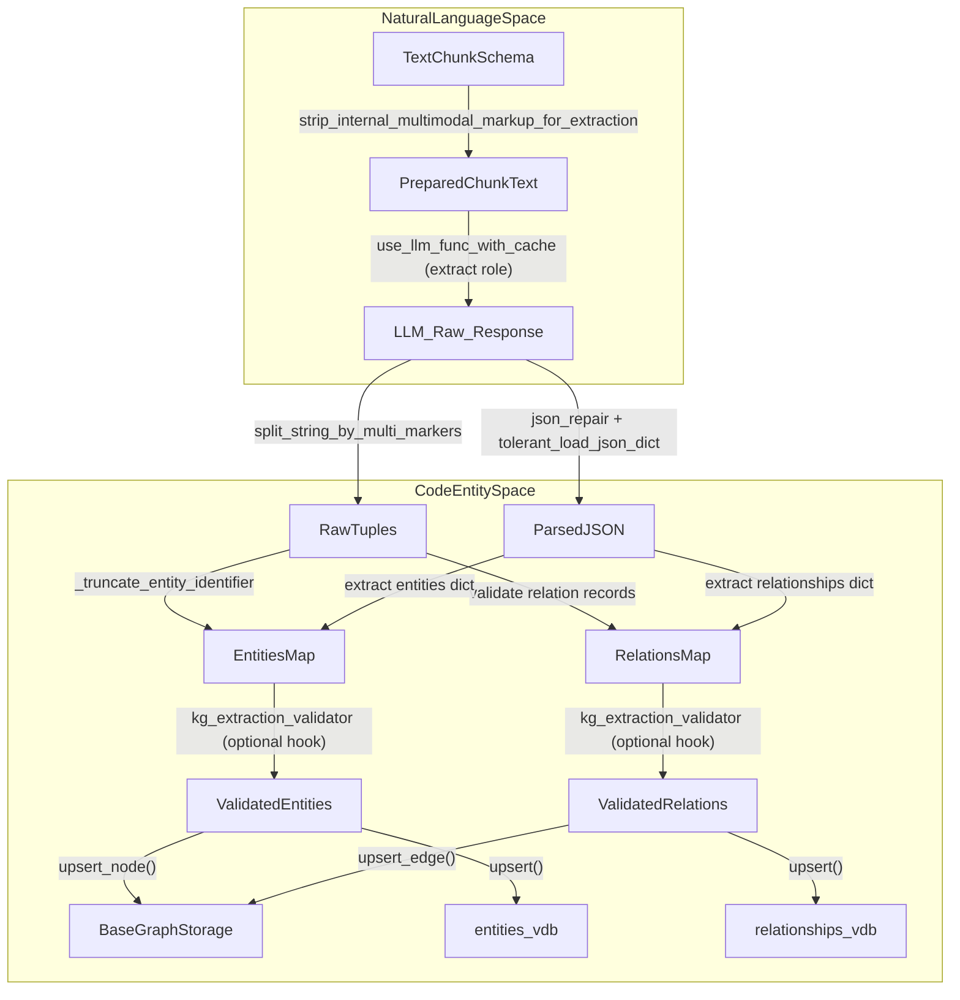

- **TextChunkSchema**: Raw chunk dictionary representing the text to extract from [lightrag/base.py:68-72]().
- **PreparedChunkText**: Chunk content cleaned from multimodal markup and with optional section breadcrumb injected [lightrag/chunk_schema.py:13-16]().
- **LLM_Raw_Response**: Raw LLM output string (either delimiter-separated lines or JSON) [lightrag/operate.py:410-480]().
- **RawTuples**: Split tuple lines extracted by tokenized delimiter [lightrag/operate.py:450-470]().
- **ParsedJSON**: JSON-mode parsing result with explicit entities and relationship lists [lightrag/operate.py:525-580]().
- **EntitiesMap**, **RelationsMap**: Dicts mapping normalized entity/relation names to their extraction records [lightrag/operate.py:480-520]().
- **BaseGraphStorage**: Graph storage interface updated with extracted nodes and edges [lightrag/base.py:126-130]().
- **entities_vdb** and **relationships_vdb**: Vector DB upserts for embeddings on entities and relations.

Sources: [lightrag/operate.py:410-580](), [lightrag/chunk_schema.py:13-16](), [lightrag/base.py:68-130]()

---

## LLM-Driven Extraction

Extraction employs a specialized LLM role denoted as `extract`. The extraction LLM call is controlled via role-specific configuration available in the main class `LightRAG` [lightrag/lightrag.py:215-223]().

Extraction prompts adhere to strict templates defined in `lightrag/prompt.py`:

- The **`entity_extraction_system_prompt`** describes the extraction role as a Knowledge Graph Specialist and details the expected output record types (entity vs relation rows) and formatting rules [lightrag/prompt.py:56-102]().
- An optional **`entity_extraction_section_context`** snippet can inject section heading breadcrumb context into the prompt to help disambiguate entity semantics from chunk hierarchy [lightrag/prompt.py:51-54]().
- The **`default_entity_types_guidance`** provides a standard classification scheme prompting the LLM to label entity types among a fixed set (e.g., Person, Organization, Location, etc.) [lightrag/prompt.py:20-34]().

---

### Prompt Formatting and Output Modes

LightRAG supports two output formats from the LLM extraction:

1. **Delimiter-based extraction (default)**:  
   Entities and relations are output as lines each containing fields separated by a fixed atomic delimiter `DEFAULT_TUPLE_DELIMITER` (`<|#|>` by default) [lightrag/prompt.py:13-16](). This plain-text format requires post-processing to split and map tuple parts [lightrag/operate.py:450-460]().
   
2. **JSON format extraction (optional)**:  
   When `entity_extraction_use_json` is enabled, the LLM is instructed to produce a structured JSON object with separate `entities` and `relationships` arrays. The system runs `json_repair` on outputs to handle common escape errors in LLM JSON strings [lightrag/operate.py:11-30](). This mode provides more robust parsing but requires JSON-valid outputs from the LLM.

Sources: [lightrag/prompt.py:13-102](), [lightrag/operate.py:11-30]()

---

### Gleaning: Iterative Refinement Passes

To improve extraction recall, LightRAG optionally performs one or more gleaning passes controlled by the `entity_extract_max_gleaning` configuration (default `1`) [lightrag/constants.py:48-55]().

- Each gleaning pass re-queries the LLM with a summary of previously extracted entities and relationships, politely asking if anything was missed.
- This process respects input token limits: if the token budget estimate plus the appended gleaning prompt exceeds `DEFAULT_MAX_EXTRACT_INPUT_TOKENS` (e.g., 20480 tokens), gleaning is safely skipped to avoid LLM errors.
- Gleaning outputs are merged with initial extractions for final deduplicated results.

Sources: [lightrag/constants.py:48-55](), [lightrag/lightrag.py:215-223]()

---

## Implementation Details

### Core `extract_entities` Workflow

`extract_entities` is an asynchronous function taking:

- `chunks`: `dict[str, TextChunkSchema]` representing document chunks.
- `global_config`: dict of extraction config including LLM function for extraction.
- Optional `max_gleaning` and `max_records` value overrides.

Key algorithm steps:

1. **Normalize Input Chunks**  
   Each text chunk is cleaned with `strip_internal_multimodal_markup_for_extraction` to remove internal XML-like tags for tables, figures, equations etc. [lightrag/chunk_schema.py:13-16]().

2. **Breadcrumb Context Injection**  
   If chunk headings are available, breadcrumb context is constructed and truncated for token budget using `format_heading_context` and private `_truncate_section_context` [lightrag/chunk_schema.py:148-164](), [lightrag/operate.py:150-176]().

3. **Form Extraction Prompt**  
   For each chunk, build prompt with system prompt + extracted contextual blocks + chunk text + entity types guidance + delimiter instructions [lightrag/prompt.py:56-102]().

4. **LLM Invocation**  
   Calls configured extraction LLM function (`extract` role) via `use_llm_func_with_cache` with assembled prompt and concurrency controls [lightrag/utils.py:37-45]().  

5. **Parse Output**  
   - In delimiter mode, the output is split by `DEFAULT_COMPLETION_DELIMITER` and `DEFAULT_TUPLE_DELIMITER` into entity & relation tuples.  
   - In JSON mode, LLM output is repaired by `json_repair` and parsed into structured entities/relationships.  
   Validation and token truncation of entity IDs occur to ensure compatibility with storage limits [lightrag/operate.py:11-30]().  

6. **Gleaning Loop**  
   If enabled, one or more gleaning passes execute, merging new entities/relations with prior ones to improve completeness.

7. **Extraction Validation Hook**  
   If `kg_extraction_validator` is configured in `global_config`, the extracted entity and relation records are passed through this custom callback function before returning, enabling downstream application-level filtering [tests/extraction/test_kg_extraction_validator.py:1-7]().

8. **Return**  
   The function returns a list of `(EntitiesMap, RelationsMap)` pairs for each chunk, ready for merging into the KG.

Sources: [lightrag/operate.py:147-702](), [lightrag/chunk_schema.py:13-16](), [tests/extraction/test_kg_extraction_validator.py:1-105]()

---

### Pipeline Execution and Storage Interaction

The following diagram illustrates how extracted entities and relations flow from the extraction function into storage interfaces:

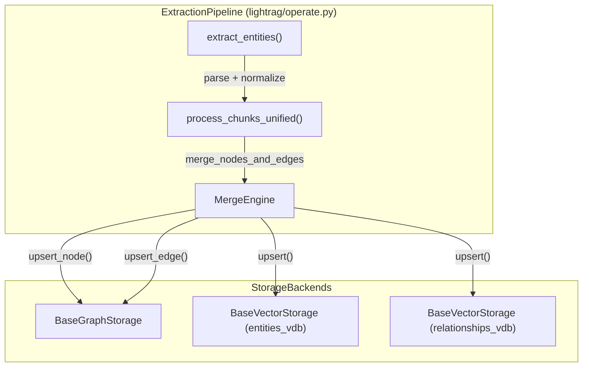

Sources: [lightrag/operate.py:147-702](), [lightrag/base.py:65-130]()

---

### Entity and Relation Identifier Truncation

Entities are truncated in length and byte width when generating IDs to avoid backend storage errors (e.g., Milvus key length limits):

- Character count truncated to `DEFAULT_ENTITY_NAME_MAX_LENGTH` (e.g., 256 chars) [lightrag/constants.py:97-98]().
- UTF-8 byte truncated to `DEFAULT_ENTITY_NAME_MAX_BYTES` (e.g., 512 bytes) [lightrag/constants.py:98-99]().
- This truncation happens during entity map construction.

This normalization ensures stable deduplication and graph storage compatibility [lightrag/operate.py:100-155]().

Sources: [lightrag/constants.py:97-99](), [lightrag/operate.py:100-155]()

---

### Map-Reduce Summarization of Entity and Relation Descriptions

The extraction and merging process can produce multiple textual descriptions for the same entity/relation. To consolidate these, LightRAG applies a Map-Reduce style summarization strategy in `_handle_entity_relation_summary` [lightrag/operate.py:210-280]():

- If the total token count of descriptions is under a small threshold, all combined texts are sent once to the `summary` LLM role for merging.
- For larger descriptions that exceed token limits, descriptions are chunked recursively:
  - **Map:** Split descriptions into token-budgeted parts and summarize each.
  - **Reduce:** Combine these summaries and recursively summarize until final condensed output.
- This approach manages LLM token constraints while producing a concise, merged description.

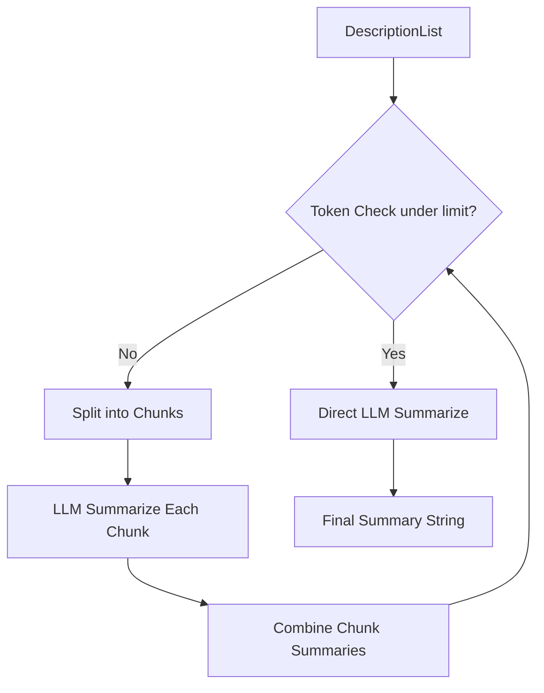

Sources: [lightrag/operate.py:210-280]()

---

## Summary of Key Constants for Extraction

| Constant                           | Default    | Description                                                       |
|----------------------------------|------------|-------------------------------------------------------------------|
| `DEFAULT_MAX_GLEANING`            | `1`        | Maximum iterative gleaning passes for recall enhancement.        |
| `DEFAULT_MAX_EXTRACTION_RECORDS`  | `100`      | Max total rows (entities + relations) returned in one LLM output. |
| `DEFAULT_MAX_EXTRACTION_ENTITIES` | `40`       | Max number of entity rows in a single LLM extraction response.    |
| `DEFAULT_ENTITY_NAME_MAX_LENGTH`  | `256`      | Max characters allowed for entity/relation names in storage.      |
| `DEFAULT_ENTITY_NAME_MAX_BYTES`   | `512`      | Max bytes UTF-8 encoded for entity/relation names.                |
| `DEFAULT_TUPLE_DELIMITER`         | `<|#|>`    | Delimiter string used to separate tuple fields in text mode.      |
| `DEFAULT_COMPLETION_DELIMITER`    | `<|COMPLETE|>` | Delimiter string indicating end of extraction output.          |
| `DEFAULT_MAX_EXTRACT_INPUT_TOKENS`| `20480`    | Token limit for LLM prompt inputs to avoid context overflow.      |

Sources: [lightrag/constants.py:48-55](), [lightrag/operate.py:50-100](), [lightrag/prompt.py:13-16]()

---

## Additional Details: LaTeX Escape Repair

LLM outputs containing LaTeX commands inside JSON strings may incur escape character corruption due to under-escaping backslashes (e.g., `"\frac"` is parsed as invalid JSON) [docs/design/LatexEscapeRepairContract.md:7-12]().

LightRAG uses a robust repair mechanism `repair_vlm_json_escape_damage_nested` to detect and correct such malformed escapes, preserving valid LaTeX in JSON extraction results [lightrag/utils.py:20-60](). The design contract and rules governing whitelist patterns (`_WS_LATEX_RESIDUES`, `_WS_LATEX_SUSPECT_PATTERN`, `_WS_LATEX_MATH_PATTERN`) are fully documented under `docs/design/LatexEscapeRepairContract.md` [docs/design/LatexEscapeRepairContract.md:1-128]().

Regression tests for this repair are present in the test suite `tests/llm/test_vlm_json_escape_repair.py` [tests/llm/test_vlm_json_escape_repair.py:1-35]().

Sources: [lightrag/utils.py:20-60](), [docs/design/LatexEscapeRepairContract.md:1-128](), [tests/llm/test_vlm_json_escape_repair.py:1-35]()

---

# Summary

The **Entity and Relation Extraction** subsystem is critical for converting free text chunks into structured KG data. It uses configurable LLM-driven methods with:

- Comprehensive prompt templates ensuring consistent entity typing and relationship extraction.
- Robust handling of delimiter-separated and JSON LLM outputs, including error repair.
- Multi-pass gleaning and map-reduce summarization to improve recall and data quality.
- Proper token budgeting, custom extraction validation hooks, and ID truncation to maintain backend compatibility.

Together, these mechanisms enable effective and scalable extraction of structured knowledge from diverse text content.

---

# Sources

- [lightrag/operate.py:147-702]()
- [lightrag/lightrag.py:215-223]()
- [lightrag/prompt.py:13-102]()
- [lightrag/chunk_schema.py:13-16]()
- [lightrag/base.py:65-130]()
- [lightrag/constants.py:48-55]()
- [lightrag/utils.py:20-60]()
- [docs/design/LatexEscapeRepairContract.md:1-128]()
- [tests/llm/test_vlm_json_escape_repair.py:1-35]()
- [tests/extraction/test_kg_extraction_validator.py:1-105]()

---

# Page: Retrieval and Query Modes

# Retrieval and Query Modes

<details>
<summary>Relevant source files</summary>

The following files were used as context for generating this wiki page:

- [docs/design/LatexEscapeRepairContract.md](docs/design/LatexEscapeRepairContract.md)
- [examples/rerank_example.py](examples/rerank_example.py)
- [lightrag/api/input_limits.py](lightrag/api/input_limits.py)
- [lightrag/lightrag.py](lightrag/lightrag.py)
- [lightrag/operate.py](lightrag/operate.py)
- [lightrag/prompt.py](lightrag/prompt.py)
- [lightrag/query_validation.py](lightrag/query_validation.py)
- [lightrag/rerank.py](lightrag/rerank.py)
- [lightrag/utils.py](lightrag/utils.py)
- [lightrag_webui/src/utils/queryValidation.test.ts](lightrag_webui/src/utils/queryValidation.test.ts)
- [lightrag_webui/src/utils/queryValidation.ts](lightrag_webui/src/utils/queryValidation.ts)
- [tests/api/routes/test_ollama_input_limits.py](tests/api/routes/test_ollama_input_limits.py)
- [tests/chunker/test_rerank_chunking.py](tests/chunker/test_rerank_chunking.py)
- [tests/llm/test_vlm_json_escape_repair.py](tests/llm/test_vlm_json_escape_repair.py)
- [tests/test_query_validation.py](tests/test_query_validation.py)

</details>


The retrieval and query subsystem in LightRAG bridges structured Knowledge Graph (KG) data with unstructured vector embeddings, providing context-aware information retrieval. This page documents the technical implementation of query modes (`local`, `global`, `hybrid`, `mix`, `naive`, `bypass`), LLM-driven keyword extraction, token budget enforcement, context assembly, chunk reranking, and query validation.

---

## 1. Retrieval Architecture and `QueryParam`

The core retrieval pipeline is driven by `kg_query` and `naive_query` defined in `lightrag/operate.py` [lightrag/operate.py:140-151](). Configuration options are encapsulated in the `QueryParam` dataclass defined in `lightrag/base.py` [lightrag/base.py:133](), which controls retrieval mode, token ceilings, search limits, and reranking flags.

### Natural Language to Code Entity Mapping

The following diagram maps user interaction from natural language input to internal LightRAG storage and execution primitives.

**Diagram: Natural Language to Retrieval Code Entities**
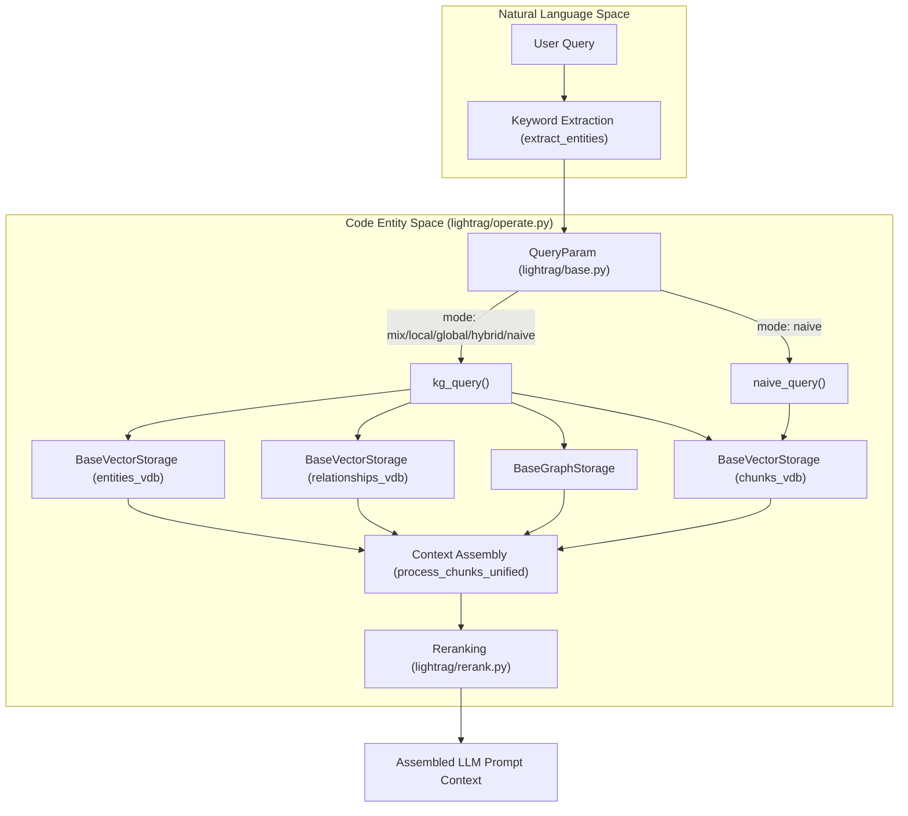

Sources: [lightrag/operate.py:140-152](), [lightrag/base.py:133](), [lightrag/rerank.py:3-140]()

---

## 2. Query Modes in Detail

LightRAG supports multiple retrieval modes via the `QueryParam.mode` attribute. Each mode governs how graph structures and vector indices are traversed.

| Mode | Description | Retrieval Strategy | Implementation |
| :--- | :--- | :--- | :--- |
| `local` | Focuses on context-dependent data around specific entities. | Vector search on entities, 1-hop graph expansion, and associated chunk retrieval. | `kg_query` local branch [lightrag/operate.py:1213-1240]() |
| `global` | Focuses on broad graph relationships and high-level summaries. | Searches relationship vectors and global summaries using abstract keywords. | `kg_query` global branch [lightrag/operate.py:1242-1253]() |
| `hybrid` | Combines local and global retrieval pathways. | Executes local and global graph paths concurrently, merging results. | `kg_query` hybrid branch [lightrag/operate.py:1255-1270]() |
| `mix` | Merges KG retrieval with raw vector chunk search. | Combines KG entity/relation context with direct keyword vector search on raw chunks. | `kg_query` mix branch [lightrag/operate.py:1272-1288]() |
| `naive` | Traditional vector search without knowledge graph structures. | Bypasses graph storage, executing vector similarity directly over text chunks. | `naive_query` [lightrag/operate.py:148-150]() |
| `bypass` | Direct LLM prompting without retrieval. | Skips storage lookups entirely, passing the prompt string straight to the LLM. | Handled via API routing [lightrag/base.py:133]() |

Sources: [lightrag/base.py:133](), [lightrag/operate.py:148-151]()

---

## 3. Keyword Extraction

Before querying vector or graph stores, LightRAG extracts low-level and high-level keywords from the user prompt. This is performed using LLM bindings with prompt templates defined in `lightrag/prompt.py` [lightrag/prompt.py:56-102](). The extracted terms serve as query vectors for semantic matching against `entities_vdb`, `relationships_vdb`, and `chunks_vdb`.

Sources: [lightrag/prompt.py:56-102](), [lightrag/operate.py:140-152]()

---

## 4. Token Budgeting and Context Assembly

To prevent context window overflow while maximizing semantic relevance, LightRAG enforces strict token limits during context aggregation.

### Key Token Budget Parameters

- `max_entity_tokens`: Ceiling for entity description contexts (default: `DEFAULT_MAX_ENTITY_TOKENS`, 1000).
- `max_relation_tokens`: Ceiling for relationship text contexts (default: `DEFAULT_MAX_RELATION_TOKENS`, 1000).
- `max_total_tokens`: Total token budget allowed across all retrieved context components (default: `DEFAULT_MAX_TOTAL_TOKENS`, 4000).

During assembly, retrieved lists are truncated dynamically using helper utilities such as `atruncate_list_by_token_size` [lightrag/operate.py:33]() to ensure items fit within these boundaries.

Sources: [lightrag/operate.py:25-34](), [lightrag/constants.py:55-57]()

---

## 5. Reranking Pipeline

If `enable_rerank=True` is set in `QueryParam`, candidate chunks pass through a reranking layer implemented in `lightrag/rerank.py`.

### Key Functions
- `chunk_documents_for_rerank`: Splits oversized documents into overlapping, token-limited windows (`DEFAULT_RERANK_MAX_TOKENS_PER_DOC = 4096`) [lightrag/rerank.py:36-41]().
- `achunk_documents_for_rerank`: Asynchronous wrapper executing document chunking inside a tokenizer executor [lightrag/rerank.py:142-162]().
- `aggregate_chunk_scores`: Aggregates chunk-level relevance scores back to parent documents using strategies like `max`, `mean`, or `first` [lightrag/rerank.py:165-178]().

**Diagram: Reranking Data Flow to Code Entities**
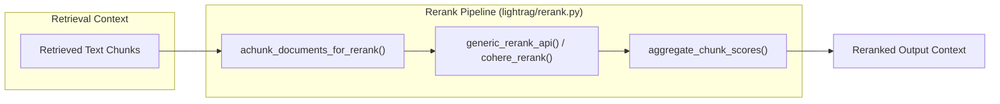

Sources: [lightrag/rerank.py:36-178]()

---

## 6. Query Validation and Multilingual Weighting

LightRAG validates queries before executing retrieval via functions in `lightrag/query_validation.py` [lightrag/query_validation.py:1-136]().

### Validation Rules
- `validate_query_not_empty`: Strips whitespace and raises `EmptyQueryError` if the query is blank [lightrag/query_validation.py:117-127]().
- `validate_rag_query`: Asserts that queries meet a minimum English-equivalent length threshold (`MIN_RAG_QUERY_WEIGHT = 3`), raising `RAGQueryTooShortError` otherwise [lightrag/query_validation.py:6-136]().

### East Asian Character Weighting
To ensure fair length validation across different writing systems, CJK characters are assigned a weight of `2`, while standard alphabetic characters count as `1`. This is computed efficiently via `rag_query_weight` and short-circuited via `meets_min_rag_query_weight` [lightrag/query_validation.py:81-114](). The frontend implementation mirrors this logic in `lightrag_webui/src/utils/queryValidation.ts` [lightrag_webui/src/utils/queryValidation.ts:1-71]().

Sources: [lightrag/query_validation.py:1-136](), [lightrag_webui/src/utils/queryValidation.ts:1-71]()

---

# Page: Text Chunking Strategies

# Text Chunking Strategies

<details>
<summary>Relevant source files</summary>

The following files were used as context for generating this wiki page:

- [docs/ParagraphSemanticChunking-zh.md](docs/ParagraphSemanticChunking-zh.md)
- [docs/ParagraphSemanticChunking.md](docs/ParagraphSemanticChunking.md)
- [docs/ThirdPartyChunker-zh.md](docs/ThirdPartyChunker-zh.md)
- [docs/ThirdPartyChunker.md](docs/ThirdPartyChunker.md)
- [lightrag/chunker/__init__.py](lightrag/chunker/__init__.py)
- [lightrag/chunker/paragraph_semantic.py](lightrag/chunker/paragraph_semantic.py)
- [lightrag/chunker/recursive_character.py](lightrag/chunker/recursive_character.py)
- [lightrag/chunker/registry.py](lightrag/chunker/registry.py)
- [lightrag/chunker/semantic_vector.py](lightrag/chunker/semantic_vector.py)
- [lightrag/chunker/token_size.py](lightrag/chunker/token_size.py)
- [lightrag/sidecar/__init__.py](lightrag/sidecar/__init__.py)
- [lightrag/sidecar/backfill.py](lightrag/sidecar/backfill.py)
- [lightrag/table_markup.py](lightrag/table_markup.py)
- [tests/chunker/test_chunker_recursive_character.py](tests/chunker/test_chunker_recursive_character.py)
- [tests/chunker/test_chunker_semantic_vector.py](tests/chunker/test_chunker_semantic_vector.py)
- [tests/chunker/test_chunking.py](tests/chunker/test_chunking.py)
- [tests/chunker/test_paragraph_semantic_drop_references.py](tests/chunker/test_paragraph_semantic_drop_references.py)
- [tests/chunker/test_paragraph_semantic_merge_and_fallback.py](tests/chunker/test_paragraph_semantic_merge_and_fallback.py)
- [tests/chunker/test_paragraph_semantic_split_long_block.py](tests/chunker/test_paragraph_semantic_split_long_block.py)
- [tests/chunker/test_paragraph_semantic_table_split.py](tests/chunker/test_paragraph_semantic_table_split.py)
- [tests/chunker/test_recursive_character_bounds.py](tests/chunker/test_recursive_character_bounds.py)
- [tests/chunker/test_registry.py](tests/chunker/test_registry.py)
- [tests/chunker/test_sidecar_backfill_integration.py](tests/chunker/test_sidecar_backfill_integration.py)
- [tests/chunker/test_token_window_source_span.py](tests/chunker/test_token_window_source_span.py)
- [tests/pipeline/test_custom_chunking_selector.py](tests/pipeline/test_custom_chunking_selector.py)
- [tests/sidecar/test_backfill.py](tests/sidecar/test_backfill.py)

</details>


LightRAG employs a multi-strategy chunking architecture designed to balance semantic integrity with strict token constraints. The system provides a flexible, per-document strategy dispatcher driven by `process_options` flags and custom registry integrations [lightrag/chunker/__init__.py:1-48](). This page details the available chunking strategies, selection mechanisms, API contracts, the chunker registry, and the underlying pipeline implementations.

---

## Overview of Chunking Strategies and Selection

LightRAG supports four primary chunking strategies, selected via `process_options` flags or environment variables like `LIGHTRAG_PARSER` [lightrag/chunker/__init__.py:1-48](). Each strategy fits different input types and goals:

| Flag | Strategy | Mechanism & Behavior | Best Suited For |
|---|---|---|---|
| **F** | Fixed Token Chunking | Splits text into fixed-size token windows, allowing overlap; optionally splits on delimiter characters [lightrag/chunker/token_size.py:1-148](). | Plain text, log files, and simple documents |
| **R** | Recursive Character | Uses recursive splitting by cascading separators (`\n\n` → `\n` → punctuation → space) and recursively splits oversized chunks [lightrag/chunker/recursive_character.py:1-35](). | Markdown, code, unstructured text |
| **V** | Semantic Vector | Splits by sentence embeddings and semantic cosine distance breakpoints using asynchronous embedding providers [lightrag/chunker/semantic_vector.py:1-30](). | Prose with shifting topics and semantic coherence |
| **P** | Paragraph Semantic | Leverages heading hierarchies, block boundaries, and preserves table integrity using `.blocks.jsonl` sidecars [lightrag/chunker/paragraph_semantic.py:1-47](). | Structured DOCX/PDF with tables and nested headings |

### Strategy Selection and Data Flow

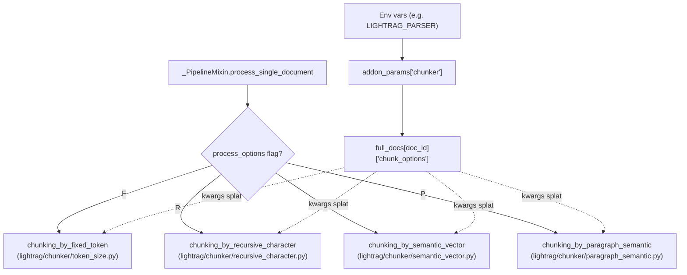

Sources: `[lightrag/chunker/__init__.py:1-48]()`, `[lightrag/chunker/token_size.py:1-148]()`, `[lightrag/chunker/recursive_character.py:1-35]`, `[lightrag/chunker/semantic_vector.py:1-30]()`, `[lightrag/chunker/paragraph_semantic.py:1-47]()`

---

## Dual API Contracts for Chunkers

LightRAG supports two chunker API contracts to ensure backward compatibility while enabling rich context-aware extensions:

1. **Legacy Contract:** Six positional arguments—`tokenizer, content, split_by_character, split_by_character_only, chunk_overlap_token_size, chunk_token_size`. Used by older code and when `process_options` do not designate a chunker explicitly [lightrag/chunker/__init__.py:10-25]().
2. **File-Chunker Contract:** Standardized signature for strategy chunkers with explicit keyword arguments for chunk sizes and options, plus optional `context` metadata [lightrag/chunker/__init__.py:15-30]().

For context-aware chunk functions, the `@accepts_chunking_context` decorator marks a callback to receive a `context=ChunkingContext` keyword argument [lightrag/chunker/registry.py:38-66](). `ChunkingContext` exposes document metadata such as `doc_id`, `file_path`, `sidecar_location`, and `process_options` [lightrag/chunker/registry.py:38-54]().

Sources: `[lightrag/chunker/__init__.py:10-30]()`, `[lightrag/chunker/registry.py:38-66]()`

---

## Detailed Strategy Implementations

### 1. Fixed Token Chunker (F)
Implemented in `lightrag/chunker/token_size.py`, `chunking_by_fixed_token()` and `chunking_by_token_size()` divide text into windows of at most `chunk_token_size` with `chunk_overlap_token_size` overlap [lightrag/chunker/token_size.py:1-148](). When `split_by_character` is provided, the text is first segmented on that delimiter before token-windowing [lightrag/chunker/token_size.py:133-170]().

Sources: `[lightrag/chunker/token_size.py:1-170]()`

### 2. Recursive Character Chunker (R)
Wrapped around LangChain's `RecursiveCharacterTextSplitter`, `chunking_by_recursive_character` cascades through separators (`\n\n`, `\n`, punctuation, space, character) [lightrag/chunker/recursive_character.py:1-35](). It uses LightRAG's `Tokenizer` for accurate token counting and records exact source character spans (`_source_span`) for sidecar backfilling [lightrag/chunker/recursive_character.py:1-25](), [lightrag/chunker/recursive_character.py:100-136]().

Sources: `[lightrag/chunker/recursive_character.py:1-136]()`

### 3. Semantic Vector Chunker (V)
Implemented in `lightrag/chunker/semantic_vector.py`, `chunking_by_semantic_vector` relies on `langchain_experimental`'s `SemanticChunker` to segment text by sentence-level embedding distance thresholds [lightrag/chunker/semantic_vector.py:1-30](). Because embedding functions in LightRAG are asynchronous, `_AsyncEmbeddingFuncAdapter` bridges sync LangChain calls back to the async event loop via worker threads, handling batching and concurrency limits [lightrag/chunker/semantic_vector.py:97-155]().

Sources: `[lightrag/chunker/semantic_vector.py:1-155]()`

### 4. Paragraph Semantic Chunker (P)
The most structured strategy, `chunking_by_paragraph_semantic` targets documents with clear sectional hierarchies and tables (DOCX, PDF) [lightrag/chunker/paragraph_semantic.py:1-47](), [docs/ParagraphSemanticChunking.md:1-17](). It requires a `.blocks.jsonl` sidecar produced by parsers such as `native`, `mineru`, or `docling` [lightrag/chunker/paragraph_semantic.py:1-17]()

#### Natural Language Structure to Code Mapping: P Strategy

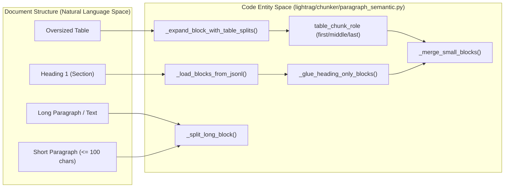

Sources: `[lightrag/chunker/paragraph_semantic.py:1-47]`, `[docs/ParagraphSemanticChunking.md:1-62]()`

---

## Chunker Registry and Third-Party Plugins

LightRAG maintains a closed set of built-in chunker aliases (`fixed_token`, `recursive_character`, `semantic_vector`, `paragraph_semantic`, plus short codes `f`, `r`, `v`, `p`, `c`) [lightrag/chunker/registry.py:22-34](). 

Third-party implementations register through `register_chunker()` by passing a `ChunkerSpec` dataclass [lightrag/chunker/registry.py:99-149](). The registry enforces lazy imports, preventing implementation loading during initial application startup until explicit selection [lightrag/chunker/registry.py:1-5](), [lightrag/chunker/registry.py:149-182]().

#### Natural Language Selection to Chunker Registry Mapping

```mermaid
graph TD
    subgraph "Configuration Space (Natural Language / Flags)"
        OPT["process_options='C!' or CUSTOM_CHUNKER='acme'"]
    end

    subgraph "Registry Code Space (lightrag/chunker/registry.py)"
        RESOLVE["resolve_chunker(name)"]
        REG["_REGISTRY[name] -> ChunkerSpec"]
        INVOKE["invoke_chunker(callback, *args, context)"]
        CHECK["callback_supports_context(callback)"]
    end

    OPT --> RESOLVE --> REG
    REG --> INVOKE --> CHECK
```

Sources: `[lightrag/chunker/registry.py:1-96]`, `[lightrag/chunker/registry.py:99-182]()`

---

## Sidecar Backfilling and Metadata Preservation

For chunkers (`F`, `R`, `V`) that do not natively emit hierarchical block metadata, LightRAG applies sidecar backfilling [lightrag/sidecar/backfill.py:1-20](). Each generated chunk is matched against the original `.blocks.jsonl` lines using exact character spans (`_source_span`), attaching parent headings, outline levels, and source provenance to the chunks prior to downstream vector and graph ingestion [lightrag/sidecar/backfill.py:1-20]().

Sources: `[lightrag/sidecar/backfill.py:1-20]()`

---

# Page: Concurrency, Caching, and Utilities

# Concurrency, Caching, and Utilities

<details>
<summary>Relevant source files</summary>

The following files were used as context for generating this wiki page:

- [docs/design/LatexEscapeRepairContract.md](docs/design/LatexEscapeRepairContract.md)
- [lightrag/file_atomic.py](lightrag/file_atomic.py)
- [lightrag/kg/write_seq.py](lightrag/kg/write_seq.py)
- [lightrag/lightrag.py](lightrag/lightrag.py)
- [lightrag/operate.py](lightrag/operate.py)
- [lightrag/prompt.py](lightrag/prompt.py)
- [lightrag/utils.py](lightrag/utils.py)
- [tests/api/routes/test_document_status_truncation_metadata.py](tests/api/routes/test_document_status_truncation_metadata.py)
- [tests/extraction/test_pipeline_log_delock.py](tests/extraction/test_pipeline_log_delock.py)
- [tests/extraction/test_truncation_reporting.py](tests/extraction/test_truncation_reporting.py)
- [tests/kg/faiss_impl/test_faiss_deferred_delete.py](tests/kg/faiss_impl/test_faiss_deferred_delete.py)
- [tests/kg/faiss_impl/test_faiss_deferred_embedding.py](tests/kg/faiss_impl/test_faiss_deferred_embedding.py)
- [tests/kg/faiss_impl/test_faiss_write_off_event_loop.py](tests/kg/faiss_impl/test_faiss_write_off_event_loop.py)
- [tests/kg/nano_impl/test_nano_deferred_delete.py](tests/kg/nano_impl/test_nano_deferred_delete.py)
- [tests/kg/nano_impl/test_nano_deferred_embedding.py](tests/kg/nano_impl/test_nano_deferred_embedding.py)
- [tests/kg/nano_impl/test_nano_save_off_event_loop.py](tests/kg/nano_impl/test_nano_save_off_event_loop.py)
- [tests/kg/test_file_atomic.py](tests/kg/test_file_atomic.py)
- [tests/kg/test_pipeline_status_logger.py](tests/kg/test_pipeline_status_logger.py)
- [tests/kg/test_write_seq.py](tests/kg/test_write_seq.py)
- [tests/llm/test_vlm_json_escape_repair.py](tests/llm/test_vlm_json_escape_repair.py)
- [tests/pipeline/test_custom_chunk_patch.py](tests/pipeline/test_custom_chunk_patch.py)
- [tests/pipeline/test_custom_chunk_rollback.py](tests/pipeline/test_custom_chunk_rollback.py)
- [tests/pipeline/test_doc_status_chunk_preservation.py](tests/pipeline/test_doc_status_chunk_preservation.py)
- [tests/pipeline/test_truncation_doc_status_metadata.py](tests/pipeline/test_truncation_doc_status_metadata.py)
- [tests/utils/test_truncation_tally.py](tests/utils/test_truncation_tally.py)

</details>


This page details the internal mechanisms LightRAG uses to manage asynchronous execution, ensure data consistency across processes, optimize LLM interactions through caching, perform atomic file operations, and provide robust utility functions for text normalization, JSON sanitization, and LaTeX escape damage repair.

---

## Asynchronous Execution and Concurrency Control

LightRAG leverages Python's `asyncio` for non-blocking I/O and coordinates concurrent invocations of expensive functions such as LLM completions or vector database operations. It employs throttling, cooperative scheduling, synchronization primitives, and process-level coordination to maintain responsiveness and resource limits.

### Priority-Limited Async Calls

The core concurrency control mechanism is the `priority_limit_async_func_call` function, which wraps asynchronous callable objects enforcing concurrency limits with priority awareness [lightrag/utils.py:188-197]().

- **Implementation Details:**
  - Provides a decorator/wrapper construction that enforces maximum concurrency based on semaphores keyed by concurrency group names.
  - Supports priority queues where higher priority calls preempt if slots are saturated.
  - Integrates optional timeout enforcement to ensure tasks do not stall indefinitely.
- **Use Cases:**
  - Rate limiting calls to LLM providers such as OpenAI or Ollama.
  - Throttling internal async workers that use limited resources.
- **Key Elements:**
  - `DEFAULT_MAX_ASYNC` constant defines the global default concurrency limit [lightrag/lightrag.py:67-75]().
  - `priority_limit_async_func_call` returns a wrapped async function respecting concurrency gating [lightrag/utils.py:188-197]().

Sources: [lightrag/utils.py:188-197](), [lightrag/lightrag.py:67-75]()

---

### Cooperative Yielding

To maintain event loop fairness during long-running synchronous or CPU-bound operations, LightRAG uses cooperative yielding via `_cooperative_yield()` [lightrag/operate.py:60-61]():

```python
async def _cooperative_yield():
    await asyncio.sleep(0)
```

- Called periodically during document parsing, graph merges, and heavy tasks to allow other async tasks to proceed.
- Avoids starvation of I/O, cancellation, or progress reporting tasks.

Sources: [lightrag/operate.py:60-61]()

---

### Multi-Process Synchronization and Locks

In multi-worker deployments, LightRAG synchronizes storage and stages across processes using unified locking constructs:

| Class / Function | Purpose | Reference |
|------------------|---------|-----------|
| `UnifiedLock` | Unified interface to `asyncio.Lock` and `multiprocessing.Lock` with async context manager | [lightrag/kg/shared_storage.py:146-163]() |
| `KeyedUnifiedLock` | Manages string-keyed locks for fine-grained entity or namespace synchronization | [lightrag/kg/shared_storage.py:91-115]() |
| `get_namespace_lock` | Provides namespace-scoped locking protecting entire logical namespaces during critical ops | [lightrag/kg/shared_storage.py:90-90]() |

Sources: [lightrag/kg/shared_storage.py:90-115](), [lightrag/kg/shared_storage.py:146-163]()

---

## Health Checks, Exceptions, and Worker Recovery

### Safe VDB Operations with Retries and Timeouts

To avoid indefinite stalls from vector database (VDB) operations involving remote I/O or embedding calls, LightRAG uses `safe_vdb_operation_with_exception` [lightrag/utils.py:156-209]().

- Enforces maximum retries, delays between attempts, and per-invocation timeouts.
- Logs warnings for slow or retried operations for operational awareness.

Sources: [lightrag/utils.py:156-209](), [lightrag/operate.py:184-192]()

---

### Custom Exceptions and Pipeline Fault Handling

LightRAG defines domain-specific exceptions to handle operational errors cleanly:
- `IndexFlushError`: Raised when flushing index changes or vector buffers fails [lightrag/exceptions.py:174-174]().
- `AdminWriteGateRefusedError` and `AdminWriteHoldExceededError`: Manage admin-level write locks and pipeline congestion [lightrag/exceptions.py:172-173]().
- `PipelineCancelledException`: Propagates cancellation signals cleanly through multi-stage ingestion tasks [lightrag/operate.py:17-17]().

Sources: [lightrag/exceptions.py:172-179](), [lightrag/operate.py:15-18]()

---

## LLM Response Caching

To optimize calls to LLMs and reduce cost/latency, LightRAG caches responses of LLM completions in its KV storage.

### Flattened Key Scheme and Data Flow

- Unique cache keys are computed by hashing a canonical representation of the LLM provider, model, parameters, and prompt input using `get_llm_cache_identity` and `compute_args_hash` [lightrag/operate.py:44-45]().
- The `use_llm_func_with_cache` function mediates cache lookup, API fallback, and storage insertion [lightrag/operate.py:42-42]().

```mermaid
graph TD
    subgraph "Code Entity Space"
        A["use_llm_func_with_cache (operate.py)"]
        B["compute_args_hash (operate.py)"]
        C["BaseKVStorage.get (base.py)"]
        D["LLM Function (llm providers)"]
        E["save_to_cache (operate.py)"]
    end

    subgraph "Cache Logic"
        Input["Prompt + Config"] --> B
        B -->|"Hash Key"| C
        C -->|"Hit"| Return["Cached Response"]
        C -->|"Miss"| D
        D -->|"New Response"| E
        E --> Return
    end
```

Sources: [lightrag/operate.py:26-45](), [lightrag/base.py:161-193]()

---

## Utilities, Atomic File Writes, and LaTeX Repair

### Atomic File Writes

To prevent index corruption and split-brain metadata states (such as `index > meta` on-disk skew during crashes), file operations across storage backends utilize atomic file write patterns (e.g., temporary file staging followed by an atomic `os.replace` rename). This guarantees that partially written indices or configuration files are never exposed to readers.

Sources: [tests/kg/faiss_impl/test_faiss_deferred_embedding.py:14-17]()

---

### LaTeX Escape Damage Repair for VLM Responses

Models writing LaTeX inside JSON strings routinely under-escape backslashes (e.g., emitting `\frac` as a form feed character followed by `rac`). LightRAG includes `repair_vlm_json_escape_damage` in `utils.py` to restore these zero-risk escape sequences and handle whitespace-class LaTeX damage inside dollar math spans safely [tests/llm/test_vlm_json_escape_repair.py:1-14]().

Sources: [tests/llm/test_vlm_json_escape_repair.py:1-25](), [docs/design/LatexEscapeRepairContract.md:1-12]()

---

## Natural Language Utility Concepts to Code Entities Mapping

```mermaid
graph LR
    subgraph "Natural Language Space"
        Throttler["Concurrency Limit"]
        Locker["Multi-process Lock"]
        TokenCounter["Token Counting"]
        CacheFunc["LLM Cache Handler"]
        LaTeXRepair["LaTeX Escape Repair"]
    end

    subgraph "Code Entity Space"
        Throttler --- PLAFC["priority_limit_async_func_call (utils.py)"]
        Locker --- KUL["KeyedUnifiedLock (shared_storage.py)"]
        TokenCounter --- TT["TiktokenTokenizer (utils.py)"]
        CacheFunc --- ULFC["use_llm_func_with_cache (operate.py)"]
        LaTeXRepair --- RLER["repair_vlm_json_escape_damage (utils.py)"]
    end
```

Sources: [lightrag/utils.py:184-197](), [lightrag/kg/shared_storage.py:91-115](), [lightrag/operate.py:42-42]()

---

# Summary

This section covered LightRAG's concurrency throttles, multi-process locking primitives, exception models, LLM response caching workflows, atomic file operations, and text/LaTeX sanitization utilities.

---

## Sources

- [lightrag/utils.py:156-209, 188-197]()
- [lightrag/lightrag.py:67-75]()
- [lightrag/operate.py:15-18, 42-45, 60-61]()
- [lightrag/kg/shared_storage.py:90-115, 146-163]()
- [lightrag/base.py:161-193]()
- [lightrag/exceptions.py:172-179]()
- [tests/llm/test_vlm_json_escape_repair.py:1-25]()
- [docs/design/LatexEscapeRepairContract.md:1-12]()
- [tests/kg/faiss_impl/test_faiss_deferred_embedding.py:14-17]()

---

# Page: LLM and Embedding Providers

# LLM and Embedding Providers

<details>
<summary>Relevant source files</summary>

The following files were used as context for generating this wiki page:

- [lightrag/llm/azure_openai.py](lightrag/llm/azure_openai.py)
- [lightrag/llm/bedrock.py](lightrag/llm/bedrock.py)
- [lightrag/llm/gemini.py](lightrag/llm/gemini.py)
- [lightrag/llm/hf.py](lightrag/llm/hf.py)
- [lightrag/llm/lmdeploy.py](lightrag/llm/lmdeploy.py)
- [lightrag/llm/lollms.py](lightrag/llm/lollms.py)
- [lightrag/llm/ollama.py](lightrag/llm/ollama.py)
- [lightrag/llm/openai.py](lightrag/llm/openai.py)
- [lightrag/llm/zhipu.py](lightrag/llm/zhipu.py)
- [tests/llm/hf_impl/test_hf_model_if_cache_device_placement.py](tests/llm/hf_impl/test_hf_model_if_cache_device_placement.py)
- [tests/llm/lmdeploy_impl/__init__.py](tests/llm/lmdeploy_impl/__init__.py)
- [tests/llm/lmdeploy_impl/test_lmdeploy_do_sample.py](tests/llm/lmdeploy_impl/test_lmdeploy_do_sample.py)
- [tests/llm/zhipu_impl/test_zhipu_llm.py](tests/llm/zhipu_impl/test_zhipu_llm.py)

</details>


LightRAG implements a modular provider binding layer in `lightrag/llm/` that decouples the core RAG logic from specific model implementations. This page serves as a high-level overview of completion bindings, embedding bindings, and role-specific configurations.

## Architecture Overview

The provider layer is composed of distinct functional bindings supporting text completions, embeddings, and role management. It leverages robust retry logic via `tenacity` [lightrag/llm/openai.py:23-29]() and dynamic dependency management via `pipmaster` [lightrag/llm/openai.py:8-13]().

### Provider to Code Entity Mapping

The following diagram bridges natural language provider concepts to their concrete implementation files in the codebase:

**Provider Binding Map**
```mermaid
graph TD
    subgraph "NaturalLanguageSpace"
        OAI["OpenAI and Azure"]
        LL_LOCAL["Local LLMs Ollama HF LMDeploy"]
        LL_CLOUD["Cloud LLMs Gemini Zhipu"]
        BED["Bedrock"]
    end

    subgraph "CodeEntitySpace"
        OAI_F["openai.py"]
        AZ_F["azure_openai.py"]
        OL_F["ollama.py"]
        HF_F["hf.py"]
        LMD_F["lmdeploy.py"]
        GEM_F["gemini.py"]
        ZHI_F["zhipu.py"]
        BED_F["bedrock.py"]
    end

    OAI --> OAI_F
    OAI --> AZ_F
    LL_LOCAL --> OL_F
    LL_LOCAL --> HF_F
    LL_LOCAL --> LMD_F
    LL_CLOUD --> GEM_F
    LL_CLOUD --> ZHI_F
    BED --> BED_F
```

Sources: [lightrag/llm/openai.py:12-22](), [lightrag/llm/ollama.py:8-12](), [lightrag/llm/gemini.py:41-48](), [lightrag/llm/zhipu.py:10-16](), [lightrag/llm/bedrock.py:9-15]()

---

## Completion Bindings

LightRAG supports a broad spectrum of LLM providers for text generation. The design targets OpenAI-compatible interfaces while providing specialized adapters for Anthropic, Bedrock, Gemini, Zhipu, and local engines.

Key characteristics include:
- **Unified Async Interface:** Standardized async functions (`*_complete_if_cache`) across providers [lightrag/llm/openai.py:314-335](), [lightrag/llm/ollama.py:90-108](), [lightrag/llm/zhipu.py:45-57]().
- **Retry Mechanics:** Exponential backoff and tenacity-based decorators handling rate limits (`429`), timeouts, and connection errors [lightrag/llm/openai.py:23-29](), [lightrag/llm/bedrock.py:178-186]().
- **Local Inference:** Native support for HuggingFace transformers (`hf.py`), LMDeploy (`lmdeploy.py`), and Ollama (`ollama.py`) [lightrag/llm/hf.py:116-123](), [lightrag/llm/lmdeploy.py:58-68](), [lightrag/llm/ollama.py:90-108]().

For details on completion bindings, retries, streaming, and binding options, see [LLM Completion Bindings](#3.1).

Sources: [lightrag/llm/openai.py:12-40](), [lightrag/llm/ollama.py:8-24](), [lightrag/llm/hf.py:109-115](), [lightrag/llm/gemini.py:19-25](), [lightrag/llm/bedrock.py:16-22](), [lightrag/llm/zhipu.py:21-27](), [lightrag/llm/lmdeploy.py:14-20]()

---

## Embedding Bindings and Asymmetric Support

Embedding functions are wrapped with metadata decorators to annotate dimensionality and token limits, enabling vector backends to configure indices correctly.

- **Metadata Decoration:** Functions use decorators like `wrap_embedding_func_with_attrs` to attach `embedding_dim` and `max_token_size` [lightrag/llm/lollms.py:191-193]().
- **Asymmetric Support:** Optimization for query vs. document vector generation across providers.
- **Payload Efficiency:** Base64 encoding support for high-throughput embedding calls [lightrag/llm/openai.py:147-154]().

For details on embedding functions, dimension handling, and vector space provenance, see [Embedding Bindings and Asymmetric Embedding](#3.2).

Sources: [lightrag/llm/lollms.py:191-200](), [lightrag/llm/openai.py:30-36]()

---

## Role-Specific LLM Configuration

LightRAG defines explicit pipeline roles (`EXTRACT`, `KEYWORD`, `QUERY`, `VLM`) to allocate different LLM configurations per task.

### Role Configuration Mapping

The following diagram maps pipeline role concepts to their internal configuration and factory structures:

**Role Configuration Map**
```mermaid
graph LR
    subgraph "NaturalLanguageSpace"
        R_EXTRACT["ExtractRole"]
        R_KEYWORD["KeywordRole"]
        R_QUERY["QueryRole"]
        R_VLM["VisionRole"]
    end

    subgraph "CodeEntitySpace"
        CFG["RoleLLMConfig"]
        SPEC["RoleSpec"]
        REG["ROLES"]
        CREATE["create_role_llm_func"]
    end

    R_EXTRACT --> CFG
    R_KEYWORD --> CFG
    R_QUERY --> CFG
    R_VLM --> CFG
    CFG --> SPEC
    SPEC --> REG
    REG --> CREATE
```

Sources: [lightrag/llm/openai.py:1-50]()

- **Specialization:** Assign powerful models to extraction and lightweight models to keyword extraction.
- **Vision Integration:** Dedicated VLM roles for multimodal processing [lightrag/llm/lollms.py:73-78]().
- **Runtime Switching:** Dynamic resolution via `create_role_llm_func` and global role registries.

For an in-depth exploration of role assignment and runtime switching, see [Role-Specific LLM Configuration](#3.3).

Sources: [lightrag/llm/lollms.py:73-78](), [lightrag/llm/openai.py:30-40]()

---

# Page: LLM Completion Bindings

# LLM Completion Bindings

<details>
<summary>Relevant source files</summary>

The following files were used as context for generating this wiki page:

- [lightrag/llm/anthropic.py](lightrag/llm/anthropic.py)
- [lightrag/llm/azure_openai.py](lightrag/llm/azure_openai.py)
- [lightrag/llm/bedrock.py](lightrag/llm/bedrock.py)
- [lightrag/llm/gemini.py](lightrag/llm/gemini.py)
- [lightrag/llm/hf.py](lightrag/llm/hf.py)
- [lightrag/llm/llama_index_impl.py](lightrag/llm/llama_index_impl.py)
- [lightrag/llm/lmdeploy.py](lightrag/llm/lmdeploy.py)
- [lightrag/llm/lollms.py](lightrag/llm/lollms.py)
- [lightrag/llm/ollama.py](lightrag/llm/ollama.py)
- [lightrag/llm/openai.py](lightrag/llm/openai.py)
- [lightrag/llm/zhipu.py](lightrag/llm/zhipu.py)
- [tests/api/conftest.py](tests/api/conftest.py)
- [tests/llm/anthropic_impl/__init__.py](tests/llm/anthropic_impl/__init__.py)
- [tests/llm/anthropic_impl/test_anthropic_client_cleanup.py](tests/llm/anthropic_impl/test_anthropic_client_cleanup.py)
- [tests/llm/anthropic_impl/test_anthropic_token_usage.py](tests/llm/anthropic_impl/test_anthropic_token_usage.py)
- [tests/llm/bedrock_impl/test_bedrock_llm.py](tests/llm/bedrock_impl/test_bedrock_llm.py)
- [tests/llm/gemini_impl/test_gemini_llm.py](tests/llm/gemini_impl/test_gemini_llm.py)
- [tests/llm/hf_impl/test_hf_model_if_cache_device_placement.py](tests/llm/hf_impl/test_hf_model_if_cache_device_placement.py)
- [tests/llm/llama_index_impl/__init__.py](tests/llm/llama_index_impl/__init__.py)
- [tests/llm/llama_index_impl/test_llama_index_complete_and_embed.py](tests/llm/llama_index_impl/test_llama_index_complete_and_embed.py)
- [tests/llm/lmdeploy_impl/__init__.py](tests/llm/lmdeploy_impl/__init__.py)
- [tests/llm/lmdeploy_impl/test_lmdeploy_do_sample.py](tests/llm/lmdeploy_impl/test_lmdeploy_do_sample.py)
- [tests/llm/ollama_impl/test_ollama_truncation.py](tests/llm/ollama_impl/test_ollama_truncation.py)
- [tests/llm/openai_impl/test_openai_length_finish_reason.py](tests/llm/openai_impl/test_openai_length_finish_reason.py)
- [tests/llm/test_bypass_truncated_response.py](tests/llm/test_bypass_truncated_response.py)
- [tests/llm/test_query_truncated_response_not_cached.py](tests/llm/test_query_truncated_response_not_cached.py)
- [tests/llm/zhipu_impl/test_zhipu_llm.py](tests/llm/zhipu_impl/test_zhipu_llm.py)

</details>


The LLM Completion Bindings layer in LightRAG provides a standardized, robust, and asynchronous interface to interact with various Large Language Model (LLM) providers. It normalizes disparate provider SDKs and APIs—handling retry logic, streaming, structured output, and configuration options—to enable seamless LLM usage within the LightRAG ecosystem.

---

## Core Architecture and Data Flow

LightRAG’s LLM bindings are integral in processing generation requests coming from the core RAG engine (e.g., `LightRAG` class), transforming input prompts and conversation history into API calls to various LLM providers.

### Key Patterns

- **`complete_if_cache` Functions:** These asynchronous functions execute low-level API calls, implement provider-specific request construction and retry logic, and return generation results or an async stream.
- **`complete` Wrappers:** Higher-level convenience wrappers wrapping `complete_if_cache` calls.

All completion bindings are highly configurable with parameters such as `model`, `prompt`, `system_prompt`, conversation `history_messages`, `enable_cot` (chain-of-thought), and `**kwargs` which may include `temperature`, `max_tokens`, `response_format`, and streaming toggles.

### Data Flow Diagram

This diagram shows how a natural language generation query flows through the LightRAG system and is dispatched to provider-specific bindings:

```mermaid
graph TD
    subgraph "NaturalLanguageSpace"["Natural Language Space"]
        PROMPT["User Prompt / Context"]
        SYS_PROMPT["System Instructions"]
    end

    subgraph "CodeEntitySpace"["Code Entity Space"]
        direction TB
        LRAG["LightRAG Class [lightrag/lightrag.py]"]
        ROLE_FUNC["Role LLM Func [lightrag/llm/]"]
        
        subgraph "ProviderBindings"["Provider Bindings [lightrag/llm/]"]
            OAI["openai_complete_if_cache [lightrag/llm/openai.py]"]
            OLL["_ollama_model_if_cache [lightrag/llm/ollama.py]"]
            BED["bedrock_complete_if_cache [lightrag/llm/bedrock.py]"]
            GEM["gemini_complete_if_cache [lightrag/llm/gemini.py]"]
            ANT["anthropic_complete_if_cache [lightrag/llm/anthropic.py]"]
            ZHIP["zhipu_complete_if_cache [lightrag/llm/zhipu.py]"]
            LLAMAIDX["llama_index_complete [lightrag/llm/llama_index_impl.py]"]
            HF["hf_model_if_cache [lightrag/llm/hf.py]"]
            LOLLMS["lollms_model_if_cache [lightrag/llm/lollms.py]"]
            LMDEPLOY["lmdeploy_model_if_cache [lightrag/llm/lmdeploy.py]"]
        end
        
        TEN["tenacity Retry Strategy"]
        CACHE["LLM Response Cache [lightrag/utils.py]"]
    end

    PROMPT --> LRAG
    SYS_PROMPT --> LRAG
    LRAG --> ROLE_FUNC
    ROLE_FUNC --> CACHE
    CACHE -- "Cache Miss" --> OAI & OLL & BED & GEM & ANT & ZHIP & LLAMAIDX & HF & LOLLMS & LMDEPLOY
    OAI & OLL & BED & GEM & ANT & ZHIP & LLAMAIDX & HF & LOLLMS & LMDEPLOY --> TEN
    TEN -- "On Success" --> CACHE
    CACHE -- "Return Response" --> LRAG
```

Sources: [lightrag/llm/openai.py:23-35](), [lightrag/llm/ollama.py:14-24](), [lightrag/llm/bedrock.py:178-186](), [lightrag/llm/gemini.py:19-25](), [lightrag/llm/anthropic.py:46-52](), [lightrag/llm/zhipu.py:38-44](), [lightrag/llm/llama_index_impl.py:92-98](), [lightrag/llm/hf.py:109-115](), [lightrag/llm/lollms.py:35-41](), [lightrag/llm/lmdeploy.py:51-57]()

---

## Supported LLM Providers and Key Binding Functions

| Provider | Key Binding Function(s) | Highlights |
|---|---|---|
| **OpenAI** | `openai_complete_if_cache` | Langfuse observability; tiktoken integration; base64 embeddings; detailed error handling and retry [lightrag/llm/openai.py:1-192](). |
| **Azure OpenAI** | `azure_openai_complete` (wrapper) | Re-exported for backward compatibility; actual logic in OpenAI [lightrag/llm/azure_openai.py:1-22](). |
| **Ollama** | `_ollama_model_if_cache` | Local inference + cloud model detection; OpenAI-like interface; image input support; streaming [lightrag/llm/ollama.py:1-174](). |
| **Bedrock** | `bedrock_complete_if_cache` | AWS SigV4 authentication; specialized retry on AWS-specific errors; reasoning content skipping [lightrag/llm/bedrock.py:177-202](). |
| **Gemini** | `gemini_complete_if_cache` | Vertex AI compatibility; native JSON schema translation; retry on Google client errors [lightrag/llm/gemini.py:19-75](). |
| **Anthropic** | `anthropic_complete_if_cache` | Message-based model interface; streaming with client cleanup; no JSON mode support; deprecation warnings for legacy flags [lightrag/llm/anthropic.py:45-128](). |
| **ZhipuAI** | `zhipu_complete_if_cache` | Official "thinking" support to enable reasoning tokens; GLM-4 optimized; structured output support [lightrag/llm/zhipu.py:38-73](). |
| **LlamaIndex** | `llama_index_complete` | Adapts llama-index library’s LLM wrappers; configures chat messages to LlamaIndex format; no JSON mode [lightrag/llm/llama_index_impl.py:99-160](). |
| **HuggingFace Transformers** | `hf_model_if_cache` | Local model loading with caching; single-threaded executor to avoid blocking event loop; no JSON mode support [lightrag/llm/hf.py:109-176](). |
| **lollms** | `lollms_model_if_cache` | Client for local lollms server; no JSON mode; no image input support; streaming supported [lightrag/llm/lollms.py:35-72](). |
| **lmdeploy** | `lmdeploy_model_if_cache` | Fully async turbomind pipeline with tensor parallelism and chat template support; no JSON mode; supports various local and HF hosted models [lightrag/llm/lmdeploy.py:51-103](). |

Sources: [lightrag/llm/openai.py:1-192](), [lightrag/llm/azure_openai.py:1-22](), [lightrag/llm/ollama.py:1-174](), [lightrag/llm/bedrock.py:177-202](), [lightrag/llm/gemini.py:19-75](), [lightrag/llm/anthropic.py:45-128](), [lightrag/llm/zhipu.py:38-73](), [lightrag/llm/llama_index_impl.py:99-160](), [lightrag/llm/hf.py:109-176](), [lightrag/llm/lollms.py:35-72](), [lightrag/llm/lmdeploy.py:51-103]()

---

## Implementation Details and Concepts

### Retry Logic and Exception Handling

All LLM completion functions use the `tenacity` library to implement retry logic on transient errors such as rate limits, connection drops, and timeouts. The typical strategy includes:
- Exponential backoff starting low (e.g., 1 second) growing up to a max (e.g., 10 or 60 seconds).
- Limited attempts (usually 3 to 5 retries).
- Custom predicates capturing provider-specific retryable exceptions.

For example, OpenAI handles rate limits and connection errors via predicates like `_is_retryable_rate_limit_error` [lightrag/llm/openai.py:117-130](). Bedrock converts AWS error codes into custom exceptions like `BedrockRateLimitError` and `BedrockConnectionError` and retries on these [lightrag/llm/bedrock.py:107-186](), while Gemini implements logic to retry on 429 rate-limit wrapped in Google client errors [lightrag/llm/gemini.py:58-76]().

Sources: [lightrag/llm/openai.py:109-130](), [lightrag/llm/bedrock.py:107-186](), [lightrag/llm/gemini.py:58-76]()

### Structured Output (JSON Mode Support)

Structured output enables downstream modules (e.g., entity extraction, summarization) to consume JSON rather than free text.

- **OpenAI and Zhipu:** Directly support `response_format={"type": "json_object"}` to receive structured JSON responses [lightrag/llm/openai.py:133-141](), [lightrag/llm/zhipu.py:109-133]().
- **Ollama:** Translates OpenAI-style `response_format` dict into `format="json"` or native JSON schema formats understood by Ollama [lightrag/llm/ollama.py:142-168]().
- **Gemini:** Converts structured output requests into `response_mime_type` and `response_json_schema` native Gemini config [lightrag/llm/gemini.py:174-195]().
- **Unsupported providers:** Anthropic, Bedrock, and LlamaIndex strip the `response_format` option and issue deprecation warnings if legacy boolean flags are used [lightrag/llm/anthropic.py:92-108](), [lightrag/llm/llama_index_impl.py:184-200]().

Sources: [lightrag/llm/openai.py:133-141](), [lightrag/llm/zhipu.py:109-133](), [lightrag/llm/ollama.py:142-168](), [lightrag/llm/gemini.py:174-195](), [lightrag/llm/anthropic.py:92-108](), [lightrag/llm/llama_index_impl.py:184-200]()

### Chain-of-Thought (CoT) and Reasoning Output

LightRAG optionally preserves complex reasoning or "Chain-of-Thought" tokens:

- **Zhipu:** Supports an official `thinking` parameter; if enabled, reasoning content can be handled or output [lightrag/llm/zhipu.py:51-73]().
- **Bedrock / OpenAI / Others:** Filter or adapt reasoning content blocks depending on configuration flags like `enable_cot` [lightrag/llm/anthropic.py:75-78](), [lightrag/llm/hf.py:124-127]().

Sources: [lightrag/llm/zhipu.py:51-73](), [lightrag/llm/anthropic.py:75-78](), [lightrag/llm/hf.py:124-127]()

### Streaming Support

Most bindings support streaming completions with asynchronous generators returning incremental text chunks:
- **OpenAI:** Uses streaming via OpenAI SDK async iterators, yielding partial chunks.
- **Anthropic:** Uses an async generator that yields streaming content and ensures proper client cleanup on completion or error [lightrag/llm/anthropic.py:173-191]().
- **Ollama:** Implements a streaming inner async generator yielding response chunks.

Bindings without streaming support (e.g., lmdeploy, lollms) return full string completions or custom iterators [lightrag/llm/lollms.py:141-153](), [lightrag/llm/lmdeploy.py:174-186]().

Sources: [lightrag/llm/anthropic.py:173-191](), [lightrag/llm/lollms.py:141-153](), [lightrag/llm/lmdeploy.py:174-186]()

---

## Technical Flow Inside Provider Bindings

The flow inside each binding generally follows these steps:

1. **Parameter normalization:** Input parameters such as `model`, `prompt`, `system_prompt`, `history_messages`, and LightRAG-specific flags are normalized.
2. **Handling structured output:** Options like `response_format` are validated or translated into provider-specific config fields [lightrag/llm/openai.py:133-141](), [lightrag/llm/ollama.py:142-168]().
3. **Retry wrapper:** The actual API call is wrapped in a `tenacity.retry` decorator specifying retry logic for transient exceptions [lightrag/llm/openai.py:23-29](), [lightrag/llm/anthropic.py:46-52]().
4. **API call construction:** A well-formed request is built, assembling messages from system prompt + chat history + user prompt.
5. **Execution:** The API call is performed asynchronously (or off event loop for blocking SDKs via `asyncio.to_thread` or `ThreadPoolExecutor`) [lightrag/llm/hf.py:91-107](), [lightrag/llm/zhipu.py:155-158]().
6. **Streaming handling:** If enabled, returns an async generator yielding content chunks.
7. **Token usage tracking:** Passes usage data to `token_tracker` if provided [lightrag/llm/zhipu.py:170-177]().
8. **Response validation & Post-processing:** Checks response validity and applies formatting transformations.
9. **Return final output:** Either a full string or async stream of text chunks.

The following diagram demonstrates relationships between core LightRAG components and typical provider binding normalization and SDK clients.

```mermaid
graph LR
    subgraph "LightRAGCore"
        INPUT["Prompt + History + Options"]
        ROLE["RoleLLMFunc [lightrag/llm/]"]
        CACHE["LLM Response Cache [lightrag/utils.py]"]
    end

    subgraph "BindingNormalization"
        OAI_NORM["_validate_openai_response_format [lightrag/llm/openai.py]"]
        OLL_NORM["_normalize_ollama_response_format [lightrag/llm/ollama.py]"]
        GEM_NORM["_build_generation_config [lightrag/llm/gemini.py]"]
        BED_NORM["_normalize_bedrock_endpoint_url [lightrag/llm/bedrock.py]"]
    end

    subgraph "SDKClients"
        OAI_SDK["openai.AsyncOpenAI client"]
        OLL_SDK["ollama.AsyncClient"]
        GEM_SDK["google.genai.Client"]
        BED_SDK["aioboto3 bedrock client"]
    end

    INPUT --> ROLE
    ROLE --> CACHE
    CACHE -- "Cache Miss" --> OAI_NORM & OLL_NORM & GEM_NORM & BED_NORM
    OAI_NORM --> OAI_SDK
    OLL_NORM --> OLL_SDK
    GEM_NORM --> GEM_SDK
    BED_NORM --> BED_SDK
```

Sources: [lightrag/llm/openai.py:133-141](), [lightrag/llm/ollama.py:142-168](), [lightrag/llm/gemini.py:174-195](), [lightrag/llm/bedrock.py:64-73]()

---

## Binding Options and Flags

### Common Parameters

| Parameter | Description |
|---|---|
| `model` | Model identifier string, e.g., `"gpt-4o"`, `"glm-4-flashx"` |
| `prompt` | User prompt or query string for generation |
| `system_prompt` | Optional system-level instructions (context) |
| `history_messages` | Chat conversation history as list of dicts with `role` and `content` |
| `enable_cot` | Boolean; preserve chain-of-thought reasoning tokens when supported |
| `response_format` | Dict specifying structured JSON output request (OpenAI style) |
| `stream` | Boolean; whether to use streaming output (async iterator) |
| Provider-specific flags | E.g., `base_url`, `api_key`, `timeout` |

### Deprecated Flags

Older boolean flags like `keyword_extraction` and `entity_extraction` are deprecated in favor of structured `response_format`. Bindings strip them and emit warnings if present to maintain backward compatibility [lightrag/llm/anthropic.py:94-107](), [lightrag/llm/zhipu.py:103-128]().

Sources: [lightrag/llm/anthropic.py:94-107](), [lightrag/llm/zhipu.py:103-128]()

---

## Summary

The LLM Completion Bindings provide a sophisticated abstraction over multiple provider SDKs, exposing a consistent async interface with:

- Unified retry logic via `tenacity`.
- Support for streaming incremental responses.
- Structured output JSON support or graceful degradation.
- Optional chain-of-thought / reasoning output.
- Transparent provider-specific normalization and error handling.
- Dynamic dependency installation via `pipmaster`.

This design enables LightRAG’s RAG pipelines to flexibly target an extensive set of LLMs while keeping the core system agnostic to provider-specific API quirks.

---

**This concludes the LLM Completion Bindings leaf documentation.**

---

### References

- `lightrag/llm/openai.py` lines 1–192  
- `lightrag/llm/ollama.py` lines 1–174  
- `lightrag/llm/bedrock.py` lines 1–202  
- `lightrag/llm/gemini.py` lines 1–195  
- `lightrag/llm/anthropic.py` lines 1–192  
- `lightrag/llm/zhipu.py` lines 1–177  
- `lightrag/llm/llama_index_impl.py` lines 1–202  
- `lightrag/llm/hf.py` lines 1–176  
- `lightrag/llm/lollms.py` lines 1–201  
- `lightrag/llm/lmdeploy.py` lines 1–190

---

# Page: Embedding Bindings and Asymmetric Embedding

# Embedding Bindings and Asymmetric Embedding

<details>
<summary>Relevant source files</summary>

The following files were used as context for generating this wiki page:

- [docs/design/VectorSpaceProvenance.md](docs/design/VectorSpaceProvenance.md)
- [lightrag/llm/jina.py](lightrag/llm/jina.py)
- [lightrag/llm/nvidia_openai.py](lightrag/llm/nvidia_openai.py)
- [tests/kg/milvus_impl/test_milvus_vector_space.py](tests/kg/milvus_impl/test_milvus_vector_space.py)
- [tests/kg/mongo_impl/test_mongo_deferred_embedding.py](tests/kg/mongo_impl/test_mongo_deferred_embedding.py)
- [tests/kg/mongo_impl/test_mongo_vector_space.py](tests/kg/mongo_impl/test_mongo_vector_space.py)
- [tests/kg/postgres_impl/test_postgres_halfvec.py](tests/kg/postgres_impl/test_postgres_halfvec.py)
- [tests/kg/postgres_impl/test_postgres_vector_deferred.py](tests/kg/postgres_impl/test_postgres_vector_deferred.py)
- [tests/kg/postgres_impl/test_postgres_vector_space.py](tests/kg/postgres_impl/test_postgres_vector_space.py)
- [tests/kg/qdrant_impl/test_qdrant_deferred_embedding.py](tests/kg/qdrant_impl/test_qdrant_deferred_embedding.py)
- [tests/kg/qdrant_impl/test_qdrant_upsert_batching.py](tests/kg/qdrant_impl/test_qdrant_upsert_batching.py)
- [tests/kg/qdrant_impl/test_qdrant_vector_space.py](tests/kg/qdrant_impl/test_qdrant_vector_space.py)
- [tests/kg/test_file_backed_vector_space.py](tests/kg/test_file_backed_vector_space.py)
- [tests/llm/jina_impl/test_jina_api_key_isolation.py](tests/llm/jina_impl/test_jina_api_key_isolation.py)
- [tests/llm/nvidia_impl/__init__.py](tests/llm/nvidia_impl/__init__.py)
- [tests/llm/nvidia_impl/test_nvidia_client_cleanup.py](tests/llm/nvidia_impl/test_nvidia_client_cleanup.py)
- [tests/llm/test_dimension_mismatch.py](tests/llm/test_dimension_mismatch.py)

</details>


This section documents the embedding provider bindings in LightRAG comprising multiple third-party services and local models with a unifying interface. It also explains how asymmetric embedding is implemented, embedding dimension handling, and vector space provenance critical for consistent retrieval across pluggable vector storage backends.

---

## Embedding Provider Architecture

LightRAG’s embedding layer provides an extensible framework that wraps provider-specific embedding functions with standardized metadata and interfaces. These providers include OpenAI, Jina AI, VoyageAI, Gemini, HuggingFace, Ollama, Bedrock, LlamaIndex, and ZhipuAI.

### `wrap_embedding_func_with_attrs`

At the core is the decorator `wrap_embedding_func_with_attrs` defined in `lightrag/utils.py` [lightrag/utils.py:27-30](). This decorator attaches essential attributes to the embedding functions:

- **embedding_dim**: Integer specifying the output vector dimension of the embedding.
- **max_token_size**: The maximum number of tokens the embedding model supports.
- **model_name**: A string naming the underlying model.
- **supports_asymmetric**: Boolean flag indicating if the model supports embedding queries and documents differently (asymmetric embedding).

This metadata helps the RAG engine manage embedding compatibility, vector store alignment, and execute asymmetric embedding logic.

### Provider Bindings and Characteristics

The following providers have dedicated embedding function implementations, each wrapped with `wrap_embedding_func_with_attrs`:

| Provider | Python Module and Lines | Details |
|:---------|:------------------------|:--------|
| **OpenAI** | `lightrag/llm/openai.py:1-664` | Supports large dimensions (1536), Base64 encoding for efficient API payloads [lightrag/llm/openai.py:110](), optional `dimensions` arg with env var toggle. |
| **Jina AI** | `lightrag/llm/jina.py:61-182` | Supports asymmetric embedding via `task` param (`retrieval.query` for queries, `retrieval.passage` for documents) [lightrag/llm/jina.py:130-146](). Embedding dim=2048. |
| **VoyageAI** | `lightrag/llm/voyageai.py:1-100` | Passes `input_type` `"query"` or `"document"` to API, enabling asymmetric support [lightrag/llm/voyageai.py:75-80](). |
| **NVIDIA NIM** | `lightrag/llm/nvidia_openai.py:35-86` | Maps `context` to `input_type` (`query` vs `passage`) for NVIDIA embedqa models, utilizing `AsyncOpenAI` with automated connection pool cleanup [lightrag/llm/nvidia_openai.py:65-85](). |
| **Gemini (Google GenAI)** | `lightrag/llm/gemini.py:1-400` | Uses Google `google-genai` SDK, configurable for Vertex AI mode, manages context mapping internally. |
| **HuggingFace** | `lightrag/llm/hf.py:1-213` | Local embedding on torch device, supports asymmetric embedding by prefixing queries or documents [lightrag/llm/hf.py:198-213](). |
| **Ollama** | `lightrag/llm/ollama.py:215-256` | Local client, supports embedding with configurable host/model; asymmetry handled by prefix wrapping. |
| **Bedrock (AWS)** | `lightrag/llm/bedrock.py:330-385` | Embedding via AWS Bedrock Runtime API with SigV4 signing. |
| **LlamaIndex** | `lightrag/llm/llama_index_impl.py:212-240` | Wraps `llama_index.embeddings.BaseEmbedding` subclasses as embedding functions. |
| **ZhipuAI** | `lightrag/llm/zhipu.py:230-265` | Dedicated integration for ZhipuAI models. |

Each embedding function is asynchronous, receives a list of texts, and returns a NumPy ndarray of embeddings. The wrapper decorator enforces embedding dimensionality and token size metadata constraints, which are critical for later storage and retrieval consistency.

Sources:  
`lightrag/utils.py:20-40`,  
`lightrag/llm/openai.py:1-664`,  
`lightrag/llm/jina.py:61-182`,  
`lightrag/llm/voyageai.py:1-100`,  
`lightrag/llm/nvidia_openai.py:35-86`,  
`lightrag/llm/gemini.py:1-400`,  
`lightrag/llm/hf.py:1-213`,  
`lightrag/llm/ollama.py:215-256`,  
`lightrag/llm/bedrock.py:330-385`,  
`lightrag/llm/llama_index_impl.py:212-240`,  
`lightrag/llm/zhipu.py:230-265`.

---

## Asymmetric Embedding

Asymmetric embedding allows queries and documents to be embedded into related but distinct vector subspaces, improving accuracy of nearest neighbor retrieval by explicitly encoding task context.

### How It Works

If a function is decorated with `supports_asymmetric=True`, the embedding caller injects a `context` parameter into the function call, whose canonical values are `"query"` or `"document"`.

- The embedding function adjusts its processing accordingly, sometimes switching model tasks or applying prefixes.
- This enables providers to treat search queries and stored passages differently, embedding for optimal similarity matching.

### Provider-specific Asymmetric Handling

- **Jina AI**: Translates `context` into a `task` string for the API request:
  - `"query"` → `"retrieval.query"`
  - `"document"` → `"retrieval.passage"`
  - Defaults to `"text-matching"` when no context given [lightrag/llm/jina.py:130-138]().

- **NVIDIA NIM**: Maps `context == "query"` to `input_type="query"` and otherwise defaults to `input_type="passage"` [lightrag/llm/nvidia_openai.py:65-66]().

- **HuggingFace**: Applies a prefix (configurable strings) before embedding input depending on context `[lightrag/llm/hf.py:209-213]()`. This is a local textual transform distinguishing queries from documents.

- **VoyageAI**: Passes `input_type` parameter as `"query"` or `"document"` directly to the API, matching LightRAG's context [lightrag/llm/voyageai.py:75-80]().

- **Custom Wrappers**: Users can manually wrap an embedding function using `wrap_embedding_func_with_attrs` and custom prefix logic for finer control [examples/unofficial-sample/lightrag_embedding_prefixes.py:116-129]().

### Diagram: Asymmetric Embedding Context Flow

Diagram: Asymmetric Embedding Context Flow
```mermaid
graph TD
    Query["UserQueryText"] --> EF["wrap_embedding_func_with_attrs"]
    Document["DocumentTextChunk"] --> EF
    
    EF --> Jina["jina_embed"]
    EF --> NVIDIA["nvidia_openai_embed"]
    EF --> HF["hf_embed"]
    EF --> Voyage["voyageai_embed"]

    Jina --> JinaAPI["JinaAPI"]
    NVIDIA --> NVIDIANIM["NIMEndpoint"]
    HF --> LocalTorch["TorchModel"]
    Voyage --> VoyageAPI["VoyageAIAPI"]
```

Sources:  
`lightrag/utils.py:20-40`,  
`lightrag/llm/jina.py:130-146`,  
`lightrag/llm/nvidia_openai.py:65-66`,  
`lightrag/llm/hf.py:198-213`,  
`lightrag/llm/voyageai.py:75-80`,  
`examples/unofficial-sample/lightrag_embedding_prefixes.py:116-129`.

---

## Embedding Dimension Handling and `send_dimensions`

LightRAG supports embedding models that allow clients to request smaller output dimensions than the model’s maximum (Matryoshka Embeddings). This improves flexibility and storage efficiency.

### Key Concepts

- **embedding_dim** from the decorator metadata dictates the dimension passed to storage backends and used for validation.
- Some providers accept an explicit `dimensions` parameter in their API request, asking the model to reduce its output vectors to a subset dimension.
- However, not all providers support this parameter, or their APIs may reject it with an error.

### OpenAI Binding Example

The OpenAI binding (`openai.py`) implements a configuration-controlled flag `EMBEDDING_SEND_DIMENSIONS` (an environment variable), which controls if the `dimensions` argument is sent to the embeddings API call.

- If `True`, the `dimensions` parameter is included when requesting embeddings, enabling smaller dimension vectors from a larger model.
- Providers or API-compliant third-party implementations might fail if this is sent unexpectedly, so this toggle avoids breakage [lightrag/llm/openai.py:590-645]().

### Summary Table: Dimension Flags

| Parameter | Description | Provider Impact |
|-----------|-------------|-----------------|
| `embedding_dim` | Decorator-set dimension for output vectors | Used by all providers to inform downstream storage and retrieval. |
| `send_dimensions` (env var) | Controls sending explicit dimension in API call | Mainly OpenAI and those compatible with its embedding API. |

Sources:  
`lightrag/llm/openai.py:590-645`,  
`lightrag/llm/jina.py:61-65`.

---

## Vector Space Provenance and Compatibility

Embedding vector spaces must be provenance-tracked for reliable operation to prevent silent errors when swapping embedding models or dimensions [docs/design/VectorSpaceProvenance.md:1-130]().

### Isolation Taxonomy

As detailed in `docs/design/VectorSpaceProvenance.md`, storage backends divide into two categories regarding how they isolate model spaces:

1. **Nano, FAISS, MongoDB, OpenSearch**: Carry no model information in their container names. A same-dimension model swap reuses the exact same container. Therefore, these backends **record explicit metadata markers** (`vector_space_marker(embedding_func)`) owning model name and dimension [docs/design/VectorSpaceProvenance.md:24-44]().
2. **Milvus, Qdrant, PostgreSQL**: Encode model names and dimensions directly into their container/table names (e.g., `{base_table}_{folded_model}_{dim}d`) [docs/design/VectorSpaceProvenance.md:31-38](). A model change automatically provisions a distinct container by construction, so they record no separate marker file.

### Fail-Closed Gate

LightRAG asserts embedding function attributes (`model_name`, `embedding_dim`) match stored vector space metadata on attach or initialization via `assert_vector_space_matches`, raising a typed `VectorSpaceMismatchError` if incompatible [tests/kg/test_file_backed_vector_space.py:13-36](). The server refuses to start if `EMBEDDING_MODEL` is unset or empty to prevent unprovenanced containers [docs/design/VectorSpaceProvenance.md:121-126]().

Sources:  
`docs/design/VectorSpaceProvenance.md:1-130`,  
`lightrag/kg/vector_space.py:1-100`,  
`tests/kg/test_file_backed_vector_space.py:1-40`,  
`tests/kg/postgres_impl/test_postgres_vector_space.py:1-35`.

---

## System Integration of Embedding Calls

Diagram: Embedding Integration Sequence
```mermaid
sequenceDiagram
    participant RAG as "LightRAGEngine"
    participant Wrap as "EmbeddingFuncWrapper"
    participant Prov as "ProviderEmbeddingFunc"
    participant API as "ExternalAPIOrLocalModel"

    RAG->>Wrap: "embedding_func(texts, context)"
    Wrap->>Prov: "Injects metadata and calls function"
    Prov->>API: "Requests embeddings (HTTP/RPC/Torch)"
    API-->>Prov: "Returns raw embedding vectors"
    Prov-->>Wrap: "Returns numpy ndarray"
    Wrap-->>RAG: "Returns validated embeddings"
```

This sequence demonstrates how the RAG core interacts with the embedding abstraction, which multiplexes calls to diverse provider implementations with uniform handling of attributes like dimension and asymmetric context.

Sources:  
`lightrag/utils.py:20-40`,  
`lightrag/llm/openai.py:1-664`,  
`lightrag/llm/jina.py:61-182`.

---

## Summary Table: Environment Variables and Their Roles

| Env Variable Name | Role / Effect | Providers Mentioned |
|-------------------|---------------|---------------------|
| `EMBEDDING_USE_BASE64` | OpenAI base64-encoded payloads to reduce data transfer size | OpenAI |
| `EMBEDDING_SEND_DIMENSIONS` | Whether to send `dimensions` param to OpenAI API | OpenAI |
| `JINA_API_KEY` | API key required for Jina AI embedding calls | Jina AI |
| `VOYAGE_API_KEY` | API key for VoyageAI embeddings | VoyageAI |
| `EMBEDDING_QUERY_PREFIX` | Default prefix strings for query asymmetric embedding | HuggingFace, Ollama |
| `GOOGLE_GENAI_USE_VERTEXAI` | Toggles Gemini binding to use Vertex AI mode | Gemini |
| `GOOGLE_CLOUD_PROJECT` | Needed for Gemini Vertex AI mode | Gemini |

Sources:  
`lightrag/llm/openai.py`,  
`lightrag/llm/jina.py`,  
`lightrag/llm/voyageai.py`,  
`lightrag/llm/gemini.py`,  
`examples/unofficial-sample/lightrag_embedding_prefixes.py`.

---

# Summary

This section described the embedding provider bindings, covering a variety of third-party and local models wrapped through a uniform interface with metadata, including support for:

- Asymmetric embeddings that distinguish queries/documents using a `context` parameter.
- Dimension management via decorator metadata and optionally sending dimension control to providers.
- Vector space provenance for strict embedding model and dimension validation on vector backend attach.

The encapsulation and unification allow the LightRAG core to operate seamlessly with multiple embedding sources while preserving retrieval accuracy and durability against model changes.

# End of 3.2 Embedding Bindings and Asymmetric Embedding

---

# Page: Role-Specific LLM Configuration

# Role-Specific LLM Configuration

<details>
<summary>Relevant source files</summary>

The following files were used as context for generating this wiki page:

- [docs/RoleSpecificLLMConfiguration-zh.md](docs/RoleSpecificLLMConfiguration-zh.md)
- [docs/RoleSpecificLLMConfiguration.md](docs/RoleSpecificLLMConfiguration.md)
- [lightrag/__init__.py](lightrag/__init__.py)
- [lightrag/api/__init__.py](lightrag/api/__init__.py)
- [setup.py](setup.py)

</details>


## Purpose and Scope
This page details the role-specific LLM and VLM configuration subsystem in LightRAG (`lightrag/llm_roles.py`), which allows operators to assign specialized language models to distinct pipeline stages. This includes resource optimization by deploying lightweight high-throughput models for extraction and keyword generation, robust reasoning models for final query answers, and dedicated vision-language models for multimodal content processing.

Sources: [lightrag/llm_roles.py:1-50](), [docs/RoleSpecificLLMConfiguration.md:1-15]()

---

## Role Overview

LightRAG defines four primary processing roles, each tailored to specific operational requirements within the insertion and retrieval pipelines:

| Role | Purpose | Recommended Specifications |
| --- | --- | --- |
| `EXTRACT` | Entity/relation extraction and description summarization during file ingestion [docs/RoleSpecificLLMConfiguration.md:11-11](). | High-throughput, complex reasoning disabled, 30B+ parameters, ≥32KB context [docs/RoleSpecificLLMConfiguration.md:11-11](). |
| `KEYWORD` | Query-stage keyword generation prior to dual-level retrieval [docs/RoleSpecificLLMConfiguration.md:12-12](). | Ultra-fast, thinking mode disabled, 7B+ parameters [docs/RoleSpecificLLMConfiguration.md:12-12](). |
| `QUERY` | Final answer generation based on retrieved context [docs/RoleSpecificLLMConfiguration.md:13-13](). | High-quality reasoning model enabled, 30B+ parameters, ≥32KB context [docs/RoleSpecificLLMConfiguration.md:13-13](). |
| `VLM` | Multimodal analysis of images, tables, and equations during insertion [docs/RoleSpecificLLMConfiguration.md:14-14](). | Vision-capable high-quality model, 30B+ parameters [docs/RoleSpecificLLMConfiguration.md:14-14](). |

If a specific role lacks an explicit configuration, LightRAG falls back to the base `LLM_*` configuration settings.

Sources: [lightrag/llm_roles.py:32-57](), [docs/RoleSpecificLLMConfiguration.md:7-16]()

---

## Natural Language to Code Entity Mapping

The following diagram bridges natural language configuration spaces (environment variables and role definitions) with the concrete classes and functions in the codebase (`lightrag/llm_roles.py` and `lightrag/lightrag.py`).

```mermaid
graph TD
    subgraph "Natural Language Space"
        NL_BASE["Base LLM Settings: LLM_BINDING, LLM_MODEL"]
        NL_ROLES["Role Overrides: EXTRACT, KEYWORD, QUERY, VLM"]
        NL_OPTS["Provider Parameters: {ROLE}_{PROVIDER}_LLM_{FIELD}"]
    end

    subgraph "Code Entity Space"
        RoleSpec["RoleSpec dataclass (lightrag/llm_roles.py)"]
        ROLES["ROLES tuple (lightrag/llm_roles.py)"]
        RoleLLMConfig["RoleLLMConfig class (lightrag/llm_roles.py)"]
        CreateFunc["create_role_llm_func() (lightrag/llm_roles.py)"]
        RoleMixin["_RoleLLMMixin class (lightrag/llm_roles.py)"]
        LightRAG["LightRAG engine (lightrag/lightrag.py)"]
    end

    NL_BASE --> RoleLLMConfig
    NL_ROLES --> RoleSpec
    NL_OPTS --> RoleLLMConfig
    
    RoleSpec --> ROLES
    ROLES --> RoleLLMConfig
    RoleLLMConfig --> CreateFunc
    CreateFunc --> RoleMixin
    RoleMixin --> LightRAG
```
Sources: [lightrag/llm_roles.py:32-100](), [lightrag/lightrag.py:1-50]()

---

## Core Classes and Functions

### `RoleSpec` and `ROLES`
Roles are modeled via the immutable `RoleSpec` dataclass, encapsulating the role name, its environment variable prefix, and its concurrency queue identifier. The global `ROLES` tuple aggregates all supported role specifications [lightrag/llm_roles.py:32-57]().

```python
@dataclass(frozen=True)
class RoleSpec:
    name: str
    env_prefix: str
    concurrency_queue: str

ROLES = (
    RoleSpec("EXTRACT", "EXTRACT", "llm:extract"),
    RoleSpec("KEYWORD", "KEYWORD", "llm:keyword"),
    RoleSpec("QUERY", "QUERY", "llm:query"),
    RoleSpec("VLM", "VLM", "llm:vlm"),
)
```
[lightrag/llm_roles.py:32-57]()

Sources: [lightrag/llm_roles.py:32-57]()

### `RoleLLMConfig`
`RoleLLMConfig` represents the evaluated configuration state for a single role, binding parameters such as the active async LLM function (`func`), provider-specific keyword arguments (`kwargs`), concurrency ceilings (`max_async`), and timeouts (`timeout`) [lightrag/llm_roles.py:63-79]().

Sources: [lightrag/llm_roles.py:63-79]()

### `create_role_llm_func`
The helper function `create_role_llm_func` initializes and wraps the low-level provider completion routine with rate-limiting semaphores, timeout controls, and caching wrappers based on the resolved `RoleLLMConfig` [lightrag/llm_roles.py:125-194]().

Sources: [lightrag/llm_roles.py:125-194]()

---

## Runtime Role Switching and Execution Architecture

The execution and switching of role-specific LLMs are governed by `_RoleLLMMixin`, which is mixed into the core `LightRAG` class. 

```mermaid
graph TD
    subgraph "Execution Flow Space"
        PipelineTask["Pipeline Task / Query Engine"]
        RoleWrapper["role_llm_funcs[role_name]"]
        Semaphore["priority_limit_async_func_call (Role Queue)"]
        LLMProvider["Provider Completion Binding"]
    end

    PipelineTask --> RoleWrapper
    RoleWrapper --> Semaphore
    Semaphore --> LLMProvider
    LLMProvider --> PipelineTask
```
Sources: [lightrag/llm_roles.py:125-194](), [tests/llm/test_global_concurrency_queue.py:88-90]()

- **Dynamic Registration**: `register_role_llm_builder()` enables runtime modification or hot-reloading of role LLM behaviors without restarting application worker processes [lightrag/llm_roles.py:125-132]().
- **Concurrency Isolation**: Each role maintains an isolated queue (`llm:extract`, `llm:query`, etc.) through `priority_limit_async_func_call`, ensuring that heavy document insertion tasks do not starve query responsiveness [lightrag/llm_roles.py:175-194]().

Sources: [lightrag/llm_roles.py:125-194](), [tests/llm/test_global_concurrency_queue.py:88-90]()

---

## Inheritance Rules and Provider Overrides

LightRAG applies strict hierarchy rules when resolving configuration values:
1. **Same-Provider Inheritance**: If `{ROLE}_LLM_BINDING` matches the base `LLM_BINDING` (or is unset), the role inherits base models, endpoints, API keys, timeouts, and concurrency settings [docs/RoleSpecificLLMConfiguration.md:117-124]().
2. **Cross-Provider Override**: If a role specifies a distinct provider, parameters do not inherit base provider options; the role configuration must explicitly define its model and credentials [docs/RoleSpecificLLMConfiguration.md:141-147]().
3. **Bedrock Authentication**: Amazon Bedrock utilizes IAM SigV4 credentials (either global or role-specific `{ROLE}_AWS_*` variables) instead of traditional API keys [docs/RoleSpecificLLMConfiguration.md:165-172]().

Sources: [docs/RoleSpecificLLMConfiguration.md:113-191]()

---

## Multimodal (VLM) Configuration

The `VLM` role handles vision-language execution during multimodal document ingestion. When `VLM_PROCESS_ENABLE=true` is set, the ingestion pipeline routes images and sidecar visual artifacts to the configured `VLM` role LLM binding [docs/RoleSpecificLLMConfiguration.md:14-14](), [lightrag/llm/ollama.py:165-170]().

Sources: [docs/RoleSpecificLLMConfiguration.md:14-14](), [lightrag/llm/ollama.py:165-170](), [tests/llm/bedrock_impl/test_bedrock_llm.py:112-168]()

---

# Page: Storage Backends

# Storage Backends

<details>
<summary>Relevant source files</summary>

The following files were used as context for generating this wiki page:

- [lightrag/base.py](lightrag/base.py)
- [lightrag/kg/__init__.py](lightrag/kg/__init__.py)
- [lightrag/kg/memgraph_impl.py](lightrag/kg/memgraph_impl.py)
- [lightrag/kg/mongo_impl.py](lightrag/kg/mongo_impl.py)
- [lightrag/kg/neo4j_impl.py](lightrag/kg/neo4j_impl.py)
- [lightrag/kg/postgres_impl.py](lightrag/kg/postgres_impl.py)
- [lightrag/kg/qdrant_impl.py](lightrag/kg/qdrant_impl.py)
- [lightrag/kg/redis_impl.py](lightrag/kg/redis_impl.py)
- [tests/kg/memgraph_impl/test_memgraph_all_edges_dedup.py](tests/kg/memgraph_impl/test_memgraph_all_edges_dedup.py)

</details>


LightRAG features a pluggable storage architecture designed to handle the diverse data persistence needs of a dual-level Knowledge Graph (KG) and Vector RAG system. It abstracts storage into four primary categories:

- **Key-Value (KV) Storage**
- **Vector Storage**
- **Graph Storage**
- **Document Status Storage**

This modular approach enables LightRAG to scale ranging from local JSON files for development to distributed, high-performance databases like Neo4j, Milvus, and PostgreSQL for production.

---

### Overview of Storage Abstractions

All storage implementations derive from core abstract base classes defined in `lightrag/base.py`:

- `BaseKVStorage`
- `BaseVectorStorage`
- `BaseGraphStorage`
- `DocStatusStorage`

These base classes provide lifecycle and interface methods—such as `initialize()`, `finalize()`, `upsert()`, and `get_by_id()`—that concrete storage classes implement. This abstraction enables LightRAG’s core components, including the `LightRAG` class, to operate independently of the underlying storage backend, improving flexibility and extensibility [lightrag/base.py:1-105](), [lightrag/kg/__init__.py:1-48]().

The storage types and their implementations are registered in the storage registry located in `lightrag/kg/__init__.py`. This registry maps storage categories to their concrete implementations and required methods, and links storage names to corresponding Python module paths. Environment variables controlling backend connectivity requirements are also tracked here [lightrag/kg/__init__.py:1-48]().

---

### High-Level Architecture Diagram

```mermaid
graph TD
    subgraph Core["LightRAG Core (lightrag/lightrag.py)"]
        LR["LightRAG"]
    end

    subgraph BaseClasses["Base Storage Classes (lightrag/base.py)"]
        BKV["BaseKVStorage"]
        BVDB["BaseVectorStorage"]
        BGS["BaseGraphStorage"]
        BDS["DocStatusStorage"]
    end

    subgraph StorageImpls["Storage Implementations (lightrag/kg/*.py)"]
        KVImpl["JsonKVStorage, RedisKVStorage, PGKVStorage, MongoKVStorage, OpenSearchKVStorage"]
        VectorImpl["NanoVectorDBStorage, MilvusVectorDBStorage, PGVectorStorage, FaissVectorDBStorage, QdrantVectorDBStorage, MongoVectorDBStorage, OpenSearchVectorDBStorage"]
        GraphImpl["NetworkXStorage, Neo4JStorage, PGGraphStorage, PGTableGraphStorage, MongoGraphStorage, MemgraphStorage, OpenSearchGraphStorage"]
        DocStatusImpl["JsonDocStatusStorage, RedisDocStatusStorage, PGDocStatusStorage, MongoDocStatusStorage, OpenSearchDocStatusStorage"]
    end

    LR --> BKV
    LR --> BVDB
    LR --> BGS
    LR --> BDS

    BKV --> KVImpl
    BVDB --> VectorImpl
    BGS --> GraphImpl
    BDS --> DocStatusImpl
```

This diagram shows how the LightRAG core manages each storage category through their respective base classes, with multiple pluggable concrete backend implementations [lightrag/kg/__init__.py:1-48](), [lightrag/base.py:1-105]().

Sources:
- [lightrag/kg/__init__.py:1-48]()
- [lightrag/base.py:1-105]()

---

### 1. Key-Value (KV) and Document Status Storage

KV storage holds unstructured or semi-structured data, such as LLM response cache and auxiliary mapping information. Document Status storage tracks document lifecycle states during ingestion and processing (e.g., `PENDING`, `PROCESSING`, `PROCESSED`), using enums such as `DocProcessingStatus` [lightrag/base.py:1-52]() [lightrag/kg/postgres_impl.py:29-49]().

Key KV implementations include:

- `JsonKVStorage` — Local JSON file storage
- `RedisKVStorage` — High-performance, in-memory key-value store [lightrag/kg/redis_impl.py:33-52]()
- `PGKVStorage` — PostgreSQL-backed key-value store [lightrag/kg/postgres_impl.py:29-49]()
- `MongoKVStorage` — MongoDB-based KV store [lightrag/kg/mongo_impl.py:15-35]()
- `OpenSearchKVStorage` — OpenSearch-backed key-value store

Document status storage uses similar backends:

- `JsonDocStatusStorage`
- `RedisDocStatusStorage`
- `PGDocStatusStorage`
- `MongoDocStatusStorage`
- `OpenSearchDocStatusStorage`

These backends offer fast, atomic operations such as `get_by_id`, `upsert` (KV), and `get_docs_by_status` (Doc Status) to support efficient ingestion scheduling and tracking [lightrag/kg/__init__.py:2-11, 38-47]().

For an in-depth discussion, see [KV and Document Status Storage](#4.3).

Sources:
- [lightrag/kg/__init__.py:1-48]()
- [lightrag/base.py:1-52]()
- [lightrag/kg/postgres_impl.py:29-49]()
- [lightrag/kg/mongo_impl.py:15-35]()
- [lightrag/kg/redis_impl.py:33-52]()

---

### 2. Vector Storage Backends

Vector storage manages embedding vectors essential for similarity search across text chunks, entities, and relations. Vector stores are central to LightRAG’s retrieval capabilities in "naive", "local", and "mix" query modes.

Default and production backends include:

- `NanoVectorDBStorage` — Default file-based vector store [lightrag/kg/__init__.py:24-37]()
- `MilvusVectorDBStorage` — High-performance vector database with advanced indexing [lightrag/kg/__init__.py:24-37]()
- `QdrantVectorDBStorage` — Vector DB with workspace-aware collection management and legacy collection migration support [lightrag/kg/qdrant_impl.py:170-198]()
- `FaissVectorDBStorage`, `PGVectorStorage`, `MongoVectorDBStorage`, `OpenSearchVectorDBStorage`

Responsibilities around upserting vectors, querying by similarity, deferred embedding, and managing collection suffixes for workspace isolation are implemented here [lightrag/kg/__init__.py:24-35](), [lightrag/base.py:1-100]().

For details, see [Vector Storage Backends](#4.2).

Sources:
- [lightrag/kg/__init__.py:24-37]()
- [lightrag/base.py:1-100]()
- [lightrag/kg/qdrant_impl.py:170-198]()

---

### 3. Graph Storage Backends

Graph storage persists the KG: entities as nodes and relationships as edges. This storage supports workspace isolation and graph traversal operations vital for local and hybrid retrieval strategies.

Notable implementations include:

- `NetworkXStorage` — Default in-memory graph with GraphML persistence [lightrag/kg/__init__.py:12-23]()
- `Neo4JStorage` — Production-grade graph DB offering ACID compliance and Cypher query support; workspace isolation is managed by careful label normalization and query parameterization to avoid injection [lightrag/kg/neo4j_impl.py:78-176]()
- `PGGraphStorage` (Apache AGE extension for PostgreSQL), `PGTableGraphStorage` [lightrag/kg/__init__.py:12-23]()
- `MongoGraphStorage` — Graph data modeled in MongoDB collections [lightrag/kg/__init__.py:12-23]()
- `MemgraphStorage` — Neo4j-compatible graph DB with similar workspace label management [lightrag/kg/memgraph_impl.py:33-177]()
- `OpenSearchGraphStorage` [lightrag/kg/__init__.py:12-23]()

This layer defines primary CRUD operations such as `upsert_node` and `upsert_edge`, plus graph BFS subgraph retrieval with batch loading optimizations. It is also responsible for migration and concurrency handling in graph contexts [lightrag/kg/__init__.py:12-22](), [lightrag/kg/memgraph_impl.py:33-177]().

For details, see [Graph Storage Backends](#4.1).

Sources:
- [lightrag/kg/__init__.py:12-23]()
- [lightrag/kg/neo4j_impl.py:78-176]()
- [lightrag/kg/memgraph_impl.py:33-177]()

---

### 4. Shared Storage and Multi-Process Concurrency

LightRAG operates in multi-process and multi-worker deployments requiring robust concurrency controls and resource synchronization.

Key mechanisms include:

- `KeyedUnifiedLock`, `NamespaceLock`, and `UnifiedLock` abstractions for cross-process locking in shared storage scenarios.
- Use of Python `multiprocessing.Manager` proxies to share locks, flags (e.g., `pipeline_status`), reservations, and file fingerprint fences between processes.
- Coordination for pipeline status flags, task reservations, and consistency fences around scan job stores, ensuring safe concurrent ingestion and indexing operations.

Workspace isolation is a major theme, using namespaced keys and controlled locking to prevent cross-workspace data leaks or race conditions.

For details, see [Shared Storage and Multi-Process Concurrency](#4.4).

Sources:
- [lightrag/kg/__init__.py:1-48]()

---

### Storage Implementation Registry

All known storage backends are enumerated in the storage registry (`lightrag/kg/__init__.py`) with these groupings and selected implementations:

| Storage Type       | Implementations (examples)                                                | Required Methods                |
|--------------------|--------------------------------------------------------------------------|--------------------------------|
| KV Storage         | JsonKVStorage, RedisKVStorage, PGKVStorage, MongoKVStorage, OpenSearchKVStorage | `get_by_id`, `upsert`           |
| Graph Storage      | NetworkXStorage, Neo4JStorage, PGGraphStorage, PGTableGraphStorage, MongoGraphStorage, MemgraphStorage, OpenSearchGraphStorage | `upsert_node`, `upsert_edge`    |
| Vector Storage     | NoopVectorDBStorage, NanoVectorDBStorage, MilvusVectorDBStorage, PGVectorStorage, FaissVectorDBStorage, QdrantVectorDBStorage, MongoVectorDBStorage, OpenSearchVectorDBStorage | `query`, `upsert`               |
| Doc Status Storage | JsonDocStatusStorage, RedisDocStatusStorage, PGDocStatusStorage, MongoDocStatusStorage, OpenSearchDocStatusStorage | `get_docs_by_statuses`          |

Environment variable requirements to connect these backends are also listed here for deployment reference [lightrag/kg/__init__.py:1-48]().

Sources:
- [lightrag/kg/__init__.py:1-48]()

---

This modular storage backend design allows LightRAG to flexibly adapt to various deployment contexts, trade-offs in performance versus operational complexity, and evolving technical needs.

---

### Child Pages for Details

This page offers a high-level introduction and architectural perspective. For technical deep-dives into each storage category and their individual backends, please see the following detailed child pages:

- [Graph Storage Backends](#4.1) — NetworkX, Neo4j, PostgreSQL AGE, pgtable, MongoDB, Memgraph, OpenSearch graph storage; workspace isolation, BFS subgraph retrieval, migration tooling.
- [Vector Storage Backends](#4.2) — NanoVectorDB, Milvus, Qdrant, FAISS, pgvector, OpenSearch, MongoDB Atlas vector search; deferred embedding, index configs, vector space markers.
- [KV and Document Status Storage](#4.3) — JsonKVStorage, JsonDocStatusStorage, PostgreSQL/Mongo/Redis/OpenSearch KV and doc-status; flattened cache keys, scheduling pages, track_id hydration.
- [Shared Storage and Multi-Process Concurrency](#4.4) — KeyedUnifiedLock, NamespaceLock, UnifiedLock, Manager proxies, pipeline_status flags, reservations, file fingerprint fences, scan job store.

---

Sources:  
- [lightrag/kg/__init__.py:1-48]()  
- [lightrag/base.py:1-105]()  
- [lightrag/kg/postgres_impl.py:29-49]()  
- [lightrag/kg/mongo_impl.py:15-35]()  
- [lightrag/kg/redis_impl.py:33-52]()  
- [lightrag/kg/qdrant_impl.py:170-198]()  
- [lightrag/kg/neo4j_impl.py:78-176]()  
- [lightrag/kg/memgraph_impl.py:33-177]()

---

# Page: Graph Storage Backends

# Graph Storage Backends

<details>
<summary>Relevant source files</summary>

The following files were used as context for generating this wiki page:

- [lightrag/base.py](lightrag/base.py)
- [lightrag/kg/memgraph_impl.py](lightrag/kg/memgraph_impl.py)
- [lightrag/kg/mongo_impl.py](lightrag/kg/mongo_impl.py)
- [lightrag/kg/neo4j_impl.py](lightrag/kg/neo4j_impl.py)
- [lightrag/kg/opensearch_impl.py](lightrag/kg/opensearch_impl.py)
- [lightrag/kg/pgtable_impl.py](lightrag/kg/pgtable_impl.py)
- [lightrag/kg/postgres_impl.py](lightrag/kg/postgres_impl.py)
- [lightrag/kg/qdrant_impl.py](lightrag/kg/qdrant_impl.py)
- [lightrag/kg/redis_impl.py](lightrag/kg/redis_impl.py)
- [lightrag/storage_migrations.py](lightrag/storage_migrations.py)
- [tests/api/routes/test_graph_attribute_validation.py](tests/api/routes/test_graph_attribute_validation.py)
- [tests/extraction/test_merge_entities_relation_weight.py](tests/extraction/test_merge_entities_relation_weight.py)
- [tests/kg/memgraph_impl/test_memgraph_all_edges_dedup.py](tests/kg/memgraph_impl/test_memgraph_all_edges_dedup.py)
- [tests/kg/memgraph_impl/test_memgraph_kg_tie_break.py](tests/kg/memgraph_impl/test_memgraph_kg_tie_break.py)
- [tests/kg/mongo_impl/test_mongo_attribute_names.py](tests/kg/mongo_impl/test_mongo_attribute_names.py)
- [tests/kg/mongo_impl/test_mongo_bfs_tie_break.py](tests/kg/mongo_impl/test_mongo_bfs_tie_break.py)
- [tests/kg/mongo_impl/test_mongo_edge_batch_methods.py](tests/kg/mongo_impl/test_mongo_edge_batch_methods.py)
- [tests/kg/mongo_impl/test_mongo_scheduling_pages.py](tests/kg/mongo_impl/test_mongo_scheduling_pages.py)
- [tests/kg/mongo_impl/test_mongo_storage.py](tests/kg/mongo_impl/test_mongo_storage.py)
- [tests/kg/neo4j_impl/test_neo4j_kg_tie_break.py](tests/kg/neo4j_impl/test_neo4j_kg_tie_break.py)
- [tests/kg/networkx_impl/test_networkx_attribute_validation.py](tests/kg/networkx_impl/test_networkx_attribute_validation.py)
- [tests/kg/opensearch_impl/test_opensearch_bfs_tie_break.py](tests/kg/opensearch_impl/test_opensearch_bfs_tie_break.py)
- [tests/kg/opensearch_impl/test_opensearch_storage.py](tests/kg/opensearch_impl/test_opensearch_storage.py)
- [tests/kg/opensearch_impl/test_opensearch_strict_reads.py](tests/kg/opensearch_impl/test_opensearch_strict_reads.py)
- [tests/kg/opensearch_impl/test_os_scheduling_pages.py](tests/kg/opensearch_impl/test_os_scheduling_pages.py)
- [tests/kg/pgtable_impl/__init__.py](tests/kg/pgtable_impl/__init__.py)
- [tests/kg/pgtable_impl/test_pgtable_graph_storage.py](tests/kg/pgtable_impl/test_pgtable_graph_storage.py)
- [tests/kg/pgtable_impl/test_pgtable_smoke.py](tests/kg/pgtable_impl/test_pgtable_smoke.py)
- [tests/kg/postgres_impl/test_postgres_cypher_injection.py](tests/kg/postgres_impl/test_postgres_cypher_injection.py)
- [tests/kg/postgres_impl/test_postgres_doc_status_lookup.py](tests/kg/postgres_impl/test_postgres_doc_status_lookup.py)
- [tests/kg/postgres_impl/test_postgres_graph_batch.py](tests/kg/postgres_impl/test_postgres_graph_batch.py)
- [tests/kg/postgres_impl/test_postgres_upsert_edge_cypher.py](tests/kg/postgres_impl/test_postgres_upsert_edge_cypher.py)
- [tests/kg/redis_impl/test_redis_doc_status_lookup.py](tests/kg/redis_impl/test_redis_doc_status_lookup.py)
- [tests/kg/test_batch_graph_operations.py](tests/kg/test_batch_graph_operations.py)
- [tests/kg/test_graph_storage.py](tests/kg/test_graph_storage.py)
- [tests/pipeline/test_graph_deletion_tracking.py](tests/pipeline/test_graph_deletion_tracking.py)
- [tests/utils/test_graph_attribute_validator.py](tests/utils/test_graph_attribute_validator.py)

</details>


LightRAG provides a modular and extensible architecture for Knowledge Graph (KG) storage through multiple backend implementations that adhere to the `BaseGraphStorage` interface (`lightrag/base.py`). These backends vary from simple in-memory graph persistence to powerful distributed graph databases, relational extensions, document stores, and search engines, enabling flexible deployment choices for different scale and performance needs.

This page covers the supported graph storage backends in full technical detail, outlining their implementation strategies, data flow, workspace isolation mechanisms, retrieval methods such as BFS-based subgraph queries, and migration tooling.

---

## Supported Graph Storage Backends

### 1. NetworkXStorage (File-backed in-memory graph)

- Implements `BaseGraphStorage` using the Python `networkx` library for graph representation in process memory [lightrag/kg/networkx_impl.py]().
- The entire graph is persisted as a GraphML file located at `working_dir/[workspace/]graph_<namespace>.graphml` for cross-process durability and synchronization [lightrag/kg/networkx_impl.py:36-152]().
- Enforces a **single-writer-per-workspace** concurrency contract to avoid race conditions; readers tolerate eventual consistency [lightrag/kg/networkx_impl.py:51-63]().
- The commit is atomic using a *two-channel commit fence* pattern: file writes are done via `atomic_write` (temporary file then rename) and coordinated update flags broadcast availability of fresh data [lightrag/kg/networkx_impl.py:102-110, 131-151]().
- All mutations run synchronously on the event loop thread, except serialization which offloads to a worker thread under lock exclusion [lightrag/kg/networkx_impl.py:59-61]().

Sources: `lightrag/kg/networkx_impl.py` [36-152]()

---

### 2. Neo4JStorage (Enterprise-grade graph database)

- Interfaces with a Neo4j instance via the official Async Python driver `neo4j.AsyncGraphDatabase` [lightrag/kg/neo4j_impl.py:27-32, 79-176]().
- Uses **workspace isolation** by assigning a sanitized workspace label to nodes; this label is escaped safely for use inside Cypher queries [lightrag/kg/neo4j_impl.py:117-142]().
- Implements robust **BFS subgraph retrieval** using Neo4j procedures when APOC plugin is available (e.g., `apoc.path.subgraphAll`) or fallback Cypher queries that perform breadth-first traversal [lightrag/kg/neo4j_impl.py]().
- Implements a specialized **full-text index for multilingual entity IDs**, identifying CJK (Chinese, Japanese, Korean) characters via regex to apply appropriate analyzers and query sanitization [lightrag/kg/neo4j_impl.py:146-176]().
- Resilient read operations use a `READ_RETRY` decorator implementing exponential backoff on transient errors like service unavailability or connection loss [lightrag/kg/neo4j_impl.py:49-63]().

Sources: `lightrag/kg/neo4j_impl.py` [27-63](), [79-176]()

---

### 3. PGGraphStorage (PostgreSQL + Apache AGE graph extension)

- Utilizes PostgreSQL with the Apache AGE extension to enable graph capabilities inside an RDBMS [lightrag/kg/postgres_impl.py:29-124]().
- Executes graph queries by embedding Cypher inside SQL calls via `ag_catalog.cypher`.
- Implements batching strategies for upserts and deletes to limit client memory usage and transaction times, with configurable payload and record count caps [lightrag/kg/postgres_impl.py:89-101]().
- Workspace isolation is enforced by naming AGE graphs using workspace and namespace identifiers, preventing data mixing across tenants [lightrag/kg/postgres_impl.py]().
- Contains logic to handle PostgreSQL's 63-byte identifier length limit: long identifier names are truncated and suffixed with hashes to avoid collisions [lightrag/kg/postgres_impl.py:87]().
- Respects constraints to avoid graph inconsistencies, with retries on transient failures (`TRANSIENT_DB_EXCEPTIONS`) [lightrag/kg/postgres_impl.py:106-117]().

Sources: `lightrag/kg/postgres_impl.py` [29-166]()

---

### 4. PGTableGraphStorage (PostgreSQL native plain tables)

- Implements `BaseGraphStorage` on ordinary indexed PostgreSQL tables (`lightrag_graph_nodes`, `lightrag_graph_edges`) without requiring the Apache AGE extension [lightrag/kg/pgtable_impl.py:1-21]().
- Stores edges in canonical order (`src_id = min(a, b)`, `tgt_id = max(a, b)`) normalized via Python `min`/`max` to prevent collation divergence and duplicate entries [lightrag/kg/pgtable_impl.py:14-16]().
- Uses an index-friendly UNION pattern for batch edge lookups and a frontier-capped iterative BFS (bounded by `max_depth` / `max_nodes`) for exact-label knowledge graph traversal [lightrag/kg/pgtable_impl.py:8-15, 173-188]().
- Integrates with the shared `ClientManager` pool and `POSTGRES_*` environment configuration [lightrag/kg/pgtable_impl.py:18-21]().

Sources: `lightrag/kg/pgtable_impl.py` [1-21](), [173-188]()

---

### 5. MongoGraphStorage (MongoDB Collections simulating graph)

- Uses MongoDB collections to represent nodes and edges as documents, leveraging aggregation operators like `$graphLookup` to simulate graph traversals [lightrag/kg/mongo_impl.py]().
- Supports BFS subgraph extraction over the graph by using aggregation with configurable traversal modes (`"bidirectional"`, `"upstream"`, or `"downstream"`) via environment variable `MONGO_GRAPH_BFS_MODE` [lightrag/kg/mongo_impl.py:85-86]().
- Uses a canonicalization function `_canonical_edge_endpoints` to store edges as direction-independent sorted pairs `(edge_lo, edge_hi)`, enabling a unique compound index and preventing insertion races on reversed edge directions [lightrag/kg/mongo_impl.py:147-161]().
- Performs degree lookups and BFS expansions efficiently by chunking operations and limiting query payload sizes (`_GRAPH_BATCH_QUERY_MAX_PAYLOAD_BYTES`) to avoid large round trips [lightrag/kg/mongo_impl.py:106-121]().

Sources: `lightrag/kg/mongo_impl.py` [85-161]()

---

### 6. MemgraphStorage (Memgraph native graph database)

- Implements `BaseGraphStorage` against a Memgraph database using the Neo4j bolt driver and Cypher queries [lightrag/kg/memgraph_impl.py:35-177]().
- Uses a workspace label isolation approach similar to Neo4j; the workspace name is sanitized and quoted backtick-style inside Cypher queries [lightrag/kg/memgraph_impl.py:62-75]().
- On initialization, creates indexes on `entity_id` nodes within the workspace to optimize entity lookups [lightrag/kg/memgraph_impl.py:102-105]().
- Persistence is automatically managed by Memgraph; the backend requires no explicit flush to disk.

Sources: `lightrag/kg/memgraph_impl.py` [35-177]()

---

### 7. OpenSearchGraphStorage (OpenSearch index-backed graph)

- Implements `BaseGraphStorage` using OpenSearch indices for nodes and edges, leveraging document-based storage and query analyzers for graph entities [lightrag/kg/opensearch_impl.py:1-35]().
- Integrates with OpenSearch bulk APIs and retry handlers (`_run_chunked_async_bulk`, `_RETRYABLE_BULK_STATUSES`) for robust batch writes [lightrag/kg/opensearch_impl.py:79-116]().
- Enforces workspace isolation via index naming conventions and mapping metadata (`_workspace_index_meta`) [lightrag/kg/opensearch_impl.py:39-40]().

Sources: `lightrag/kg/opensearch_impl.py` [1-86]()

---

## Workspace Isolation Across Backends

LightRAG supports multiple tenants/workspaces isolated logically within the same database instance. Strategies differ per backend:

| Backend       | Isolation Mechanism                                | Code Reference                          |
|---------------|--------------------------------------------------|---------------------------------------|
| **NetworkX**  | GraphML files stored under workspace directory   | File path: `working_dir/[workspace]/graph_<namespace>.graphml` [lightrag/kg/networkx_impl.py]() |
| **Neo4j**     | Nodes tagged with workspace label (`:workspace`) | `_get_workspace_label()` returns sanitized label [lightrag/kg/neo4j_impl.py:117-142]() |
| **PostgreSQL AGE** | AG_GRAPH name includes workspace name             | Graph creation SQL uses workspace names [lightrag/kg/postgres_impl.py]() |
| **PostgreSQL Table** | `workspace` column in primary keys (`lightrag_graph_nodes`) | `lightrag/kg/pgtable_impl.py:80-87]() |
| **MongoDB**   | Collection names prefixed with workspace          | `{workspace}_{namespace}` pattern [lightrag/kg/mongo_impl.py]() |
| **Memgraph**  | Nodes tagged with backtick-quoted workspace label | `_get_workspace_label()` [lightrag/kg/memgraph_impl.py:62-75]() |
| **OpenSearch** | Index naming and mapping metadata (`_meta`)       | `_workspace_index_meta()` [lightrag/kg/opensearch_impl.py]() |

Sources: `lightrag/kg/networkx_impl.py` [36-152](), `lightrag/kg/neo4j_impl.py` [117-142](), `lightrag/kg/pgtable_impl.py` [80-87](), `lightrag/kg/memgraph_impl.py` [62-75]()

---

## BFS Subgraph Retrieval

Most backends implement a Breadth-First Search (BFS) style retrieval of a subgraph centered on specific node(s), supporting graph queries and visualization:

- **Neo4j / Memgraph:** Use Cypher procedures (`apoc.path.subgraphAll`) or standard recursive Cypher traversals to fetch connected subgraphs up to a max depth [lightrag/kg/neo4j_impl.py]().
- **NetworkX:** Maintains graphs fully loaded in-memory, allowing synchronous BFS traversals using `collections.deque` for queue management over nodes and edges [lightrag/kg/networkx_impl.py]().
- **MongoDB:** Leverages the `$graphLookup` aggregation stage with `maxDepth` to emulate BFS traversal over documents [lightrag/kg/mongo_impl.py]().
- **PostgreSQL Table / AGE:** Executes SQL-wrapped Cypher or iterative frontier-bounded BFS queries over relational tables [lightrag/kg/pgtable_impl.py:8-15]() [lightrag/kg/postgres_impl.py]().

Sources: `lightrag/kg/networkx_impl.py` [210-253](), `lightrag/kg/neo4j_impl.py` [435-457](), `lightrag/kg/pgtable_impl.py` [8-15]()

---

## Migration Tooling

- Migration utilities (such as `migrate_graph_storage.py`) allow transitioning graph storage between backends or upgrading schemas [lightrag/tools/migrate_graph_storage.py]().
- Migration handles retention of workspace isolation keys, batching limits during data copying, and compatibility with vector and document status stores under namespace locks (`get_namespace_lock()`).

Sources: `lightrag/tools/migrate_graph_storage.py` (), `lightrag/kg/shared_storage.py` ()

---

## Summary Diagram: Natural Language Space to Code Entity Space

```mermaid
graph TD
    subgraph Natural_Language_Space["Natural Language Space"]
        NL_NX["File-Backed NetworkX Graph"]
        NL_NJ["Enterprise Neo4j Graph DB"]
        NL_PG["PostgreSQL Apache AGE Graph"]
        NL_PT["PostgreSQL Plain Table Graph"]
        NL_MG["MongoDB Collection Graph"]
        NL_MM["Memgraph Native Graph DB"]
        NL_OS["OpenSearch Graph Storage"]
    end

    subgraph Code_Entity_Space["Code Entity Space"]
        CE_NX["NetworkXStorage\nlightrag/kg/networkx_impl.py"]
        CE_NJ["Neo4JStorage\nlightrag/kg/neo4j_impl.py"]
        CE_PG["PGGraphStorage\nlightrag/kg/postgres_impl.py"]
        CE_PT["PGTableGraphStorage\nlightrag/kg/pgtable_impl.py"]
        CE_MG["MongoGraphStorage\nlightrag/kg/mongo_impl.py"]
        CE_MM["MemgraphStorage\nlightrag/kg/memgraph_impl.py"]
        CE_OS["OpenSearchGraphStorage\nlightrag/kg/opensearch_impl.py"]
    end

    NL_NX --> CE_NX
    NL_NJ --> CE_NJ
    NL_PG --> CE_PG
    NL_PT --> CE_PT
    NL_MG --> CE_MG
    NL_MM --> CE_MM
    NL_OS --> CE_OS
```

Sources: `lightrag/kg/networkx_impl.py` (), `lightrag/kg/neo4j_impl.py` (), `lightrag/kg/postgres_impl.py` (), `lightrag/kg/pgtable_impl.py` (), `lightrag/kg/mongo_impl.py` (), `lightrag/kg/memgraph_impl.py` (), `lightrag/kg/opensearch_impl.py` ()

---

## Data Flow: Core Pipeline to Graph Storage Backends

```mermaid
sequenceDiagram
    participant LightRAG as "LightRAG Core lightrag.py"
    participant BaseGS as "BaseGraphStorage Interface lightrag/base.py"
    participant NX as "NetworkXStorage networkx_impl.py"
    participant NJ as "Neo4JStorage neo4j_impl.py"
    participant PG as "PGGraphStorage postgres_impl.py"
    participant PT as "PGTableGraphStorage pgtable_impl.py"
    participant MG as "MongoGraphStorage mongo_impl.py"

    LightRAG->>BaseGS: Execute graph operations (upsert_node, get_knowledge_graph)
    BaseGS->>NX: In-memory graph + GraphML serialization
    BaseGS->>NJ: Async Cypher query execution via Neo4j Driver
    BaseGS->>PG: Cypher embedded in SQL via Apache AGE
    BaseGS->>PT: Indexed SQL queries & table operations
    BaseGS->>MG: MongoDB aggregation pipeline & $graphLookup
    Note over LightRAG,MG: Backends enforce workspace isolation & BFS traversal
```

Sources: `lightrag/base.py` (), `lightrag/kg/networkx_impl.py` (), `lightrag/kg/neo4j_impl.py` (), `lightrag/kg/postgres_impl.py` (), `lightrag/kg/pgtable_impl.py` (), `lightrag/kg/mongo_impl.py` ()

---

## Key Classes and Functions

| Feature                              | Class/Function                            | File Path                         | Notes                                          |
|------------------------------------|-----------------------------------------|----------------------------------|------------------------------------------------|
| Base graph storage interface        | `BaseGraphStorage`                      | `lightrag/base.py`               | Abstract base for all graph backends            |
| File-backed in-memory graph         | `NetworkXStorage`                       | `lightrag/kg/networkx_impl.py`  | Uses GraphML files, synchronous in-process ops  |
| Enterprise graph DB                 | `Neo4JStorage`                         | `lightrag/kg/neo4j_impl.py`     | Async Neo4j driver, workspace label isolation   |
| PostgreSQL + AGE integration         | `PGGraphStorage`                        | `lightrag/kg/postgres_impl.py`  | Cypher via SQL, batch upsert/delete, workspace  |
| PostgreSQL plain table graph        | `PGTableGraphStorage`                   | `lightrag/kg/pgtable_impl.py`   | Indexed tables, canonical edges, iterative BFS  |
| MongoDB graph with `$graphLookup`   | `MongoGraphStorage`                     | `lightrag/kg/mongo_impl.py`     | Aggregation pipelines for BFS, canonical edges  |
| Memgraph async graph client          | `MemgraphStorage`                      | `lightrag/kg/memgraph_impl.py`  | Async Cypher, workspace label isolation         |
| OpenSearch graph backend             | `OpenSearchGraphStorage`                | `lightrag/kg/opensearch_impl.py`| Index-backed graph storage with bulk APIs       |
| Workspace label function             | `_get_workspace_label()`                | Neo4j / Memgraph classes         | Sanitizes workspace names for query safety      |

Sources: `lightrag/base.py` (), `lightrag/kg/networkx_impl.py` (), `lightrag/kg/neo4j_impl.py` (), `lightrag/kg/postgres_impl.py` (), `lightrag/kg/pgtable_impl.py` (), `lightrag/kg/mongo_impl.py` (), `lightrag/kg/memgraph_impl.py` (), `lightrag/kg/opensearch_impl.py` ()

---

# Sources

- `lightrag/base.py` ()
- `lightrag/kg/networkx_impl.py` [36-152](), [210-253]()
- `lightrag/kg/neo4j_impl.py` [27-63](), [79-176](), [435-457]()
- `lightrag/kg/postgres_impl.py` [29-124](), [87-117]()
- `lightrag/kg/pgtable_impl.py` [1-21](), [8-15](), [80-87](), [173-188]()
- `lightrag/kg/mongo_impl.py` [85-161]()
- `lightrag/kg/memgraph_impl.py` [35-177](), [62-75]()
- `lightrag/kg/opensearch_impl.py` [1-86]()
- `lightrag/tools/migrate_graph_storage.py` ()

---

# Page: Vector Storage Backends

# Vector Storage Backends

<details>
<summary>Relevant source files</summary>

The following files were used as context for generating this wiki page:

- [docs/design/PgVectorFilteredSearch.md](docs/design/PgVectorFilteredSearch.md)
- [lightrag/kg/faiss_impl.py](lightrag/kg/faiss_impl.py)
- [lightrag/kg/json_doc_status_impl.py](lightrag/kg/json_doc_status_impl.py)
- [lightrag/kg/json_kv_impl.py](lightrag/kg/json_kv_impl.py)
- [lightrag/kg/milvus_impl.py](lightrag/kg/milvus_impl.py)
- [lightrag/kg/nano_vector_db_impl.py](lightrag/kg/nano_vector_db_impl.py)
- [lightrag/kg/networkx_impl.py](lightrag/kg/networkx_impl.py)
- [lightrag/kg/write_seq.py](lightrag/kg/write_seq.py)
- [tests/kg/faiss_impl/test_faiss_deferred_delete.py](tests/kg/faiss_impl/test_faiss_deferred_delete.py)
- [tests/kg/faiss_impl/test_faiss_deferred_embedding.py](tests/kg/faiss_impl/test_faiss_deferred_embedding.py)
- [tests/kg/faiss_impl/test_faiss_write_off_event_loop.py](tests/kg/faiss_impl/test_faiss_write_off_event_loop.py)
- [tests/kg/milvus_impl/test_milvus_deferred_embedding.py](tests/kg/milvus_impl/test_milvus_deferred_embedding.py)
- [tests/kg/milvus_impl/test_milvus_index_creation.py](tests/kg/milvus_impl/test_milvus_index_creation.py)
- [tests/kg/milvus_impl/test_milvus_off_event_loop.py](tests/kg/milvus_impl/test_milvus_off_event_loop.py)
- [tests/kg/nano_impl/test_nano_deferred_delete.py](tests/kg/nano_impl/test_nano_deferred_delete.py)
- [tests/kg/nano_impl/test_nano_deferred_embedding.py](tests/kg/nano_impl/test_nano_deferred_embedding.py)
- [tests/kg/nano_impl/test_nano_save_off_event_loop.py](tests/kg/nano_impl/test_nano_save_off_event_loop.py)
- [tests/kg/postgres_impl/test_postgres_iterative_scan.py](tests/kg/postgres_impl/test_postgres_iterative_scan.py)
- [tests/kg/test_write_seq.py](tests/kg/test_write_seq.py)

</details>


## Purpose and Scope

This wiki page documents the vector storage subsystem of LightRAG, covering the abstract interface `BaseVectorStorage` (`lightrag/base.py`), pluggable backend implementations (NanoVectorDB, Milvus, Qdrant, FAISS, PostgreSQL pgvector, OpenSearch, and MongoDB Atlas), deferred embedding optimization, concurrency protocols, index configuration, and vector space provenance markers.

Sources: [lightrag/base.py:1-180](), [lightrag/kg/nano_vector_db_impl.py:41-79](), [lightrag/kg/milvus_impl.py:1-125](), [lightrag/kg/faiss_impl.py:61-110]()

---

## Core Interface and Architecture

LightRAG abstracts similarity search and vector persistence behind `BaseVectorStorage`. Every backend manages three primary namespaces corresponding to knowledge graph components: chunks, entities, and relations.

```mermaid
graph TD
    subgraph NaturalLanguageSpace ["Natural Language Space"]
        NL["Text Inputs & Queries"]
    end

    subgraph CodeEntitySpace ["Code Entity Space"]
        LR["LightRAG Pipeline\n(lightrag.py)"]
        EF["Embedding Function\n(EmbeddingFunc)"]
        BVS["BaseVectorStorage\n(lightrag/base.py)"]
        
        NVDB["NanoVectorDBStorage\n(nano_vector_db_impl.py)"]
        MVDB["MilvusVectorDBStorage\n(milvus_impl.py)"]
        FVDB["FaissVectorDBStorage\n(faiss_impl.py)"]
        PVDB["PGVectorStorage\n(postgres_impl.py)"]
    end

    NL --> LR
    LR --> EF
    EF --> BVS
    BVS --> NVDB
    BVS --> MVDB
    BVS --> FVDB
    BVS --> PVDB
```

Title: Vector Storage Bridging Natural Language to Code Entities

Sources: [lightrag/base.py:1-180](), [lightrag/kg/nano_vector_db_impl.py:60-98](), [lightrag/kg/milvus_impl.py:37-44](), [lightrag/kg/faiss_impl.py:61-110]()

---

## Backend Implementation Details

### 1. NanoVectorDB and FAISS (File-Backed Snapshot Backends)

Both `NanoVectorDBStorage` (`lightrag/kg/nano_vector_db_impl.py`) and `FaissVectorDBStorage` (`lightrag/kg/faiss_impl.py`) maintain process-local memory synchronized via file snapshots and shared-storage update flags.

- **NanoVectorDB**: Serializes an in-memory `NanoVectorDB` instance to `vdb_<namespace>.json`. Uses `_PendingNanoDoc` to buffer documents before embedding [lightrag/kg/nano_vector_db_impl.py:41-58]().
- **FAISS**: Splits state between a FAISS index (`faiss_index_<namespace>.index`) and a metadata dictionary (`.index.meta.json`), with `.space.json` storing vector space provenance markers [lightrag/kg/faiss_impl.py:62-154](). Buffers inserts in `_PendingFaissDoc` using L2-normalized float32 numpy arrays [lightrag/kg/faiss_impl.py:42-59]().

```mermaid
sequenceDiagram
    participant Writer as "Writer Process"
    participant Disk as "File System (.json / .index)"
    participant Flags as "shared_storage Flags"
    participant Reader as "Reader Process"

    Writer->>Writer: Buffer upsert in _PendingNanoDoc
    Writer->>Disk: atomic_write() snapshot
    Writer->>Flags: set_all_update_flags()
    Flags-->>Reader: Update flag active
    Reader->>Disk: Reload snapshot if dirty
    Reader->>Flags: clear update flag
```

Title: File-Backed Synchronization Protocol

Sources: [lightrag/kg/nano_vector_db_impl.py:41-160](), [lightrag/kg/faiss_impl.py:42-154](), [lightrag/kg/shared_storage.py:23-37]()

---

### 2. MilvusVectorDBStorage

`MilvusVectorDBStorage` (`lightrag/kg/milvus_impl.py`) integrates with Milvus 2.x via `MilvusClient`. Because synchronous gRPC calls block the event loop, database operations run inside a dedicated thread pool (`_MILVUS_EXECUTOR`) managed by `run_in_milvus_executor` and `run_in_milvus_executor_uninterruptible` [lightrag/kg/milvus_impl.py:80-158]().

- **Index Configurations**: Parses parameters like `hnsw_m`, `ef_construction`, `ivf_nlist` via `MilvusIndexConfig`.
- **Payload Limits**: Chunks upserts to respect the ~64 MB gRPC message size ceiling.

Sources: [lightrag/kg/milvus_impl.py:80-158](), [lightrag/kg/milvus_impl.py:180-218]()

---

### 3. PostgreSQL Vector Storage (`pgvector`)

`PGVectorStorage` (`lightrag/kg/postgres_impl.py`) uses PostgreSQL with `pgvector` for vector persistence. 
- **Iterative Scan**: To overcome global HNSW index limitations across multiple workspaces, it utilizes `SET hnsw.iterative_scan = strict_order` (pgvector >= 0.8) within transactions via `_fetch_with_iterative_scan` [docs/design/PgVectorFilteredSearch.md:1-45]().
- **Budget Chunking**: Splits large upsert payloads via `_chunk_by_budget` to stay within statement limits [lightrag/kg/postgres_impl.py:10-100]().

Sources: [lightrag/kg/postgres_impl.py:10-100](), [docs/design/PgVectorFilteredSearch.md:1-45]()

---

## Deferred Embedding and Batching

To avoid redundant model invocation overhead, all major backends implement **deferred embedding**:
1. `upsert()` stores raw record content in a pending dictionary (`_pending_vector_docs`) without invoking the embedding function [lightrag/kg/nano_vector_db_impl.py:41-58]().
2. The embedding function is called in batched arrays only during `index_done_callback()` or lazy point lookups (`get_vectors_by_ids()`).
3. Cached vectors prevent re-computation during subsequent flushes.

Sources: [lightrag/kg/nano_vector_db_impl.py:41-60](), [lightrag/kg/faiss_impl.py:42-60](), [lightrag/kg/milvus_impl.py:180-210]()

---

## Vector Space Provenance

To guard against catastrophic failures from embedding model or dimension changes, backends employ **vector space markers**:
- Metadata or collection naming incorporates model identifiers and dimensions (e.g., `modelname_dim128`) [lightrag/kg/faiss_impl.py:24-32]().
- When loading storage, `assert_vector_space_matches` validates active configurations and raises `VectorSpaceMismatchError` on discrepancies [lightrag/kg/nano_vector_db_impl.py:27-32]().

Sources: [lightrag/kg/nano_vector_db_impl.py:27-32](), [lightrag/kg/faiss_impl.py:24-32](), [lightrag/exceptions.py:28-30]()

---

# Page: KV and Document Status Storage

# KV and Document Status Storage

<details>
<summary>Relevant source files</summary>

The following files were used as context for generating this wiki page:

- [lightrag/kg/faiss_impl.py](lightrag/kg/faiss_impl.py)
- [lightrag/kg/json_doc_status_impl.py](lightrag/kg/json_doc_status_impl.py)
- [lightrag/kg/json_kv_impl.py](lightrag/kg/json_kv_impl.py)
- [lightrag/kg/nano_vector_db_impl.py](lightrag/kg/nano_vector_db_impl.py)
- [lightrag/kg/networkx_impl.py](lightrag/kg/networkx_impl.py)
- [tests/kg/json_impl/test_json_doc_status_copy_on_read.py](tests/kg/json_impl/test_json_doc_status_copy_on_read.py)
- [tests/kg/json_impl/test_json_doc_status_track_id_hydration.py](tests/kg/json_impl/test_json_doc_status_track_id_hydration.py)
- [tests/kg/json_impl/test_json_kv_upsert_create_time.py](tests/kg/json_impl/test_json_kv_upsert_create_time.py)
- [tests/kg/mongo_impl/test_mongo_doc_status_track_id_hydration.py](tests/kg/mongo_impl/test_mongo_doc_status_track_id_hydration.py)
- [tests/kg/opensearch_impl/test_opensearch_kv_create_time_integration.py](tests/kg/opensearch_impl/test_opensearch_kv_create_time_integration.py)
- [tests/kg/opensearch_impl/test_opensearch_kv_upsert_create_time.py](tests/kg/opensearch_impl/test_opensearch_kv_upsert_create_time.py)
- [tests/kg/postgres_impl/test_postgres_doc_status_track_id_hydration.py](tests/kg/postgres_impl/test_postgres_doc_status_track_id_hydration.py)
- [tests/kg/redis_impl/fake_redis.py](tests/kg/redis_impl/fake_redis.py)
- [tests/kg/redis_impl/test_redis_doc_status_track_id_hydration.py](tests/kg/redis_impl/test_redis_doc_status_track_id_hydration.py)
- [tests/kg/redis_impl/test_redis_eviction_guard.py](tests/kg/redis_impl/test_redis_eviction_guard.py)
- [tests/kg/redis_impl/test_redis_kv_create_time_integration.py](tests/kg/redis_impl/test_redis_kv_create_time_integration.py)
- [tests/kg/redis_impl/test_redis_kv_upsert_create_time.py](tests/kg/redis_impl/test_redis_kv_upsert_create_time.py)
- [tests/kg/redis_impl/test_redis_scheduling_pages.py](tests/kg/redis_impl/test_redis_scheduling_pages.py)
- [tests/test_doc_processing_status_from_stored.py](tests/test_doc_processing_status_from_stored.py)

</details>


Key-Value (KV) and Document Status storage systems form the core persistence layer in LightRAG. They store metadata, text chunks, LLM cache data, and maintain the document lifecycle state machine during ingestion. To accommodate different deployment scenarios, LightRAG supports multiple pluggable backend implementations ranging from JSON-file based for simplicity to scalable storage using PostgreSQL, MongoDB, Redis, and OpenSearch.

This page details the architecture, implementation, and key mechanisms behind KV and Document Status storages. It covers the shared-memory and locking protocols, flattened cache key schemes, scheduling page support, and `track_id` hydration resilience used across backend systems.

---

## 1. Pluggable Storage Architecture

LightRAG’s KV and document status storages implement one of two primary base interfaces:

| Interface            | Purpose                                         |
|----------------------|------------------------------------------------|
| `BaseKVStorage`      | Generic key-value persistence for chunks, caches, and general metadata. |
| `DocStatusStorage`   | Specialized storage to track document lifecycle states and scheduling.  |

Both interfaces enforce support for asynchronous methods like `get_by_id`, `get_by_ids`, `upsert`, and paged querying for efficient scheduling.

Storage backends are initialized in LightRAG's core lifecycle (`_initialize_storages` in `lightrag.py`) and registered with namespaces like `text_chunks`, `full_docs`, `doc_status`, and cache namespaces. Different namespaces isolate persisted data logically per use case and workspace [lightrag/base.py:29-36](), [lightrag/lightrag.py:211-218]().

Sources: [lightrag/base.py:29-36](), [lightrag/lightrag.py:211-218]()

---

## 2. File-Based Implementations: JsonKVStorage and JsonDocStatusStorage

### Shared Memory and Concurrency Protocol

- Both `JsonKVStorage` and `JsonDocStatusStorage` provide JSON-file-backed storage while sharing in-memory state across multiple processes [lightrag/kg/json_kv_impl.py:32-66](), [lightrag/kg/json_doc_status_impl.py:57-97]().
- The shared data is managed via a cross-process `multiprocessing.Manager.dict()` proxy, enabling immediate mutation visibility among workers without explicit reloads.
- All accesses to the shared memory dictionary `_data` are guarded by an asynchronous `NamespaceLock` acquired via `get_namespace_lock`.
- The `storage_updated` flag operates with reversed semantics compared to vector/graph stores: it signals that there is dirty in-memory data awaiting disk persistence.

```mermaid
graph TD
    WorkerProcess["WorkerProcess"] -->|"Acquires NamespaceLock"| NSLock["NamespaceLock"]
    NSLock -->|"Mutates shared proxy"| SharedDict["ManagerDictProxy"]
    SharedDict -->|"Sets dirty flag"| DirtyFlag["storage_updated=True"]
    DirtyFlag -->|"Triggered by callback"| IndexCallback["JsonKVStorage.index_done_callback"]
    IndexCallback -->|"Writes asynchronously"| DiskJSON["JSON File Persistence"]
```

Sources: [lightrag/kg/json_kv_impl.py:32-159](), [lightrag/kg/json_doc_status_impl.py:57-174](), [lightrag/kg/shared_storage.py:10-54]()

### Copy-on-Read Protection and Cache Flattening

- **Copy-on-Read:** Read methods in `JsonDocStatusStorage` (such as `get_by_id`, `get_by_ids`, and `get_docs_paginated`) return deep copies of dictionaries and mutable structures (like `chunks_list` and nested `metadata`) to prevent external callers from corrupting internal storage state [tests/kg/json_impl/test_json_doc_status_copy_on_read.py:1-138]().
- **Flattened Cache Keys:** During `initialize`, legacy nested cache structures in `_cache` namespaces are migrated and flattened to unify access patterns and optimize point lookups [lightrag/kg/json_kv_impl.py:115-127]().

Sources: [lightrag/kg/json_kv_impl.py:115-127](), [tests/kg/json_impl/test_json_doc_status_copy_on_read.py:1-138]()

---

## 3. Database-Native Implementations

### PostgreSQL and MongoDB Storage Backends
- **PostgreSQL:** Implements batched upserts and retrievals via `asyncpg` with support for vector operations using `pgvector`. Keys are sanitized or hashed to respect database identifier constraints, and large batches are split using `_chunk_by_budget` heuristics [lightrag/kg/postgres_impl.py:69-171]().
- **MongoDB:** Manages KV and document status in dedicated collections combining workspace and namespace scoping. Bulk writes respect limits configured via `DEFAULT_MONGO_UPSERT_MAX_PAYLOAD_BYTES` [lightrag/kg/mongo_impl.py:64-121]().

### Redis KV Storage and Create-Time Preservation
- High-performance in-memory KV store using a connection pool managed by `RedisConnectionManager`.
- Resolves issue #3870 (replacement upserts dropping `create_time`) by utilizing a Lua script (`_CREATE_TIME_UPSERT_LUA`) combined with bounded `GETRANGE` prefix reads. This preserves the original `create_time` timestamp atomically on updates without pulling full values over the network [tests/kg/redis_impl/test_redis_kv_create_time_integration.py:1-120]().

Sources: [lightrag/kg/postgres_impl.py:69-171](), [lightrag/kg/mongo_impl.py:64-121](), [tests/kg/redis_impl/test_redis_kv_create_time_integration.py:1-120]()

---

## 4. Scheduling Pages for Document Processing

- Document Status Storage backends support paged listing of documents filtered by status (`get_docs_by_statuses_page`) to schedule pipeline workers efficiently [tests/kg/redis_impl/test_redis_scheduling_pages.py:100-122]().
- **Keyset Pagination:** Employs bounded memory heaps or composite cursors to page through large collections reliably without offset drift.
- **Filter Keys:** The `filter_keys` method quickly determines which document keys are absent or require retry processing [lightrag/kg/json_doc_status_impl.py:155-161]().

Sources: [lightrag/kg/json_doc_status_impl.py:155-161](), [tests/kg/redis_impl/test_redis_scheduling_pages.py:1-122]()

---

## 5. Track ID Hydration and Resilience

- Document status records group ingestion batches using a `track_id` field.
- **Hydration Resilience:** When executing `get_docs_by_track_id`, rows are hydrated using `_doc_processing_status_from_stored`. The implementation catches `KeyError` and `TypeError` exceptions to skip unhydratable or corrupted rows gracefully, preventing an invalid record in an upload batch from crashing queries for the entire `track_id` group [tests/kg/json_impl/test_json_doc_status_track_id_hydration.py:1-92]().
- **Backward/Forward Compatibility:** Unknown or future fields added by newer builds are safely ignored during instantiation rather than failing validation [tests/kg/json_impl/test_json_doc_status_track_id_hydration.py:94-118]().

Sources: [tests/kg/json_impl/test_json_doc_status_track_id_hydration.py:1-148]()

---

## 6. Architecture & Data Flow Diagrams

### Diagram 1: Natural Language Space to Storage Code Entity Space

```mermaid
graph TD
    subgraph "Natural_Language_Space"
        RawFile["RawDocumentSource"]
    end

    subgraph "Code_Entity_Space"
        LightRAGEngine["LightRAG.ainsert()"]
        PipelineMixin["_PipelineMixin.apipeline_process_enqueue_documents"]
        DocStatusStorage["JsonDocStatusStorage / RedisDocStatusStorage"]
        KVStorage["JsonKVStorage / RedisKVStorage"]
    end

    RawFile --> LightRAGEngine
    LightRAGEngine --> PipelineMixin
    PipelineMixin -->|"upsert doc status"| DocStatusStorage
    PipelineMixin -->|"upsert chunks & metadata"| KVStorage
    DocStatusStorage -->|"index_done_callback()"| PersistentLayer["Disk / Database Persistence"]
    KVStorage -->|"index_done_callback()"| PersistentLayer
```

Sources: [lightrag/lightrag.py:530-550](), [lightrag/kg/json_doc_status_impl.py:59-174](), [lightrag/kg/json_kv_impl.py:33-140]()

### Diagram 2: Commit and Shared-Memory Synchronization Flow

```mermaid
graph TD
    subgraph "Process_A_Space"
        Writer["WorkerProcessA"] -->|"Acquires lock"| LockManager["NamespaceLock"]
        Writer -->|"Updates"| SharedProxy["ManagerDictProxy"]
    end

    subgraph "Process_B_Space"
        Reader["WorkerProcessB"] -->|"Reads immediately"| SharedProxy
    end

    subgraph "Persistence_Layer"
        SharedProxy -->|"Flushes on index_done_callback"| AtomicWriter["atomic_write / write_json"]
        AtomicWriter -->|"Persists"| DiskStore["JSON Store File"]
    end
```

Sources: [lightrag/kg/json_kv_impl.py:90-159](), [lightrag/kg/json_doc_status_impl.py:125-154](), [lightrag/kg/shared_storage.py:10-54]()

---

## 7. Key Classes and Functions

| Class / Method                   | Description                                                                                   | Source                                                |
|--------------------------------|-----------------------------------------------------------------------------------------------|-------------------------------------------------------|
| `JsonKVStorage`                | Shared in-memory JSON KV store with atomic flush to disk and reversed flag semantics.        | [lightrag/kg/json_kv_impl.py:32-66]()                 |
| `JsonDocStatusStorage`         | Document status implementation with synchronous flush on upsert for process recovery.         | [lightrag/kg/json_doc_status_impl.py:57-97]()       |
| `JsonDocStatusStorage.get_docs_by_track_id` | Hydrates document batch by track_id with strict error trapping for malformed rows.     | [tests/kg/json_impl/test_json_doc_status_track_id_hydration.py:1-92]() |
| `get_namespace_lock`            | Returns async lock object for a namespace and workspace, critical for concurrency control.     | [lightrag/kg/shared_storage.py:14-28]()               |
| `try_initialize_namespace`      | Ensures only one process loads data from persistent store into shared dict at startup.          | [lightrag/kg/shared_storage.py:30-52]()               |

Sources: [lightrag/kg/json_kv_impl.py:32-66](), [lightrag/kg/json_doc_status_impl.py:57-97](), [lightrag/kg/shared_storage.py:10-52](), [tests/kg/json_impl/test_json_doc_status_track_id_hydration.py:1-92]()

---

# Page: Shared Storage and Multi-Process Concurrency

# Shared Storage and Multi-Process Concurrency

<details>
<summary>Relevant source files</summary>

The following files were used as context for generating this wiki page:

- [docs/design/FileBackedSnapshotContract.md](docs/design/FileBackedSnapshotContract.md)
- [lightrag/api/routers/document_routes.py](lightrag/api/routers/document_routes.py)
- [lightrag/kg/file_fingerprint.py](lightrag/kg/file_fingerprint.py)
- [lightrag/kg/scan_job_store.py](lightrag/kg/scan_job_store.py)
- [lightrag/kg/shared_storage.py](lightrag/kg/shared_storage.py)
- [lightrag/pipeline.py](lightrag/pipeline.py)
- [lightrag/utils_pipeline.py](lightrag/utils_pipeline.py)
- [tests/api/config/test_api_config_scan_batch.py](tests/api/config/test_api_config_scan_batch.py)
- [tests/api/routes/test_admission_released_before_processing.py](tests/api/routes/test_admission_released_before_processing.py)
- [tests/api/routes/test_document_routes_chunking.py](tests/api/routes/test_document_routes_chunking.py)
- [tests/api/routes/test_document_routes_docx_archive.py](tests/api/routes/test_document_routes_docx_archive.py)
- [tests/api/routes/test_force_reset_drops_stalled_enqueues.py](tests/api/routes/test_force_reset_drops_stalled_enqueues.py)
- [tests/api/routes/test_scan_job_record.py](tests/api/routes/test_scan_job_record.py)
- [tests/api/test_recovery_fence_visibility.py](tests/api/test_recovery_fence_visibility.py)
- [tests/kg/faiss_impl/test_faiss_fingerprint_fence.py](tests/kg/faiss_impl/test_faiss_fingerprint_fence.py)
- [tests/kg/nano_impl/test_nano_fingerprint_fence.py](tests/kg/nano_impl/test_nano_fingerprint_fence.py)
- [tests/kg/networkx_impl/test_networkx_fingerprint_fence.py](tests/kg/networkx_impl/test_networkx_fingerprint_fence.py)
- [tests/kg/test_reservation_dead_process_recovery.py](tests/kg/test_reservation_dead_process_recovery.py)
- [tests/kg/test_reservation_primitives.py](tests/kg/test_reservation_primitives.py)
- [tests/kg/test_scan_job_store.py](tests/kg/test_scan_job_store.py)
- [tests/pipeline/conftest.py](tests/pipeline/conftest.py)
- [tests/pipeline/test_enqueue_ingress_exclusion.py](tests/pipeline/test_enqueue_ingress_exclusion.py)
- [tests/pipeline/test_manual_drain_enqueue_stall_fence.py](tests/pipeline/test_manual_drain_enqueue_stall_fence.py)
- [tests/pipeline/test_manual_drain_progress.py](tests/pipeline/test_manual_drain_progress.py)
- [tests/pipeline/test_parse_failure_doc_status_fields.py](tests/pipeline/test_parse_failure_doc_status_fields.py)
- [tests/pipeline/test_pipeline_analyze_multimodal.py](tests/pipeline/test_pipeline_analyze_multimodal.py)
- [tests/pipeline/test_pipeline_release_closure.py](tests/pipeline/test_pipeline_release_closure.py)
- [tests/test_docstring_budget.py](tests/test_docstring_budget.py)

</details>


This section details the shared storage infrastructure and concurrency control mechanisms in LightRAG. It explains the multi-process synchronization model, the key locking primitives (`KeyedUnifiedLock`, `NamespaceLock`, and `UnifiedLock`), the usage of multiprocessing `Manager` proxies, pipeline status flags, reservation semantics, and file fingerprint fences. These components collectively ensure consistent, deadlock-free operations across multiple concurrent processes and asynchronous workers, especially relevant for production deployments with Gunicorn or similar multi-worker servers.

---

## Purpose and Scope

LightRAG’s storage and indexing subsystems operate in environments with multiple worker processes running asynchronously. To ensure consistency and reliable coordination, the system implements:

- **Cross-process locks** combining multiprocessing locks with asyncio coroutine locks for intra-process concurrency,
- **Keyed and namespace locks** to provide fine-grained synchronization per logical unit (document, storage namespace),
- **Shared state dictionaries** managed by a multiprocessing `SyncManager` for inter-process communication,
- **Pipeline status flags and reservation tokens** for coordinating pipeline task states and preventing conflicts,
- **File fingerprint fences** to detect stale local caches or lost update notifications,
- **Scan job stores with leasing** for multi-worker scan job concurrency control.

This page is a detailed technical reference explaining the classes, data flows, and key functions supporting this concurrency and synchronization layer.

Sources: `lightrag/kg/shared_storage.py:1-188]`, `lightrag/pipeline.py:60-85]()`

---

## Shared Data Infrastructure

LightRAG uses a hybrid combination of:

- **`multiprocessing.Manager`**: A server process manages shared proxy dictionaries, locks, and counters,
- **`asyncio` primitives**: Per-worker event loop coroutine locks to prevent deadlocks within a worker,
- **In-memory caching with explicit invalidation** through update flags.

### Initialization and Lifecycle

- Initialization is performed by calling `initialize_share_data(workers: int = 1)` which sets up shared Manager proxies for:

  - `_shared_dicts`: a global dict mapping `namespace -> dict` of shared data,
  - `_lock_registry`: keyed locks mapping string keys to process locks,
  - `_lock_registry_count`: reference counts for keyed locks,
  - `_async_locks`: per-process asyncio.Lock for each key to protect coroutine-level access [lightrag/kg/shared_storage.py:122-134]().
  
- If `workers > 1`, a multiprocessing `SyncManager` instance is created to serve these proxies; otherwise, single-process fallback mechanisms are used.

- `finalize_share_data()` cleanly shuts down the Manager [lightrag/kg/shared_storage.py:43-46]() (see also cleanup hooks).

- In typical Gunicorn deployments, this initialization occurs in the master process before forking workers, so all worker processes inherit the proxy references [lightrag/kg/shared_storage.py:137-142]().

### Workspace Isolation and Namespacing

- All shared keys are prefixed by a concatenation of `workspace:namespace` (called *final_namespace*), enforcing workspace-level data isolation.

- For example, pipeline status for workspace `"legal_docs"` is stored in `_shared_dicts["legal_docs:pipeline_status"]`, inaccessible by another workspace `"hr_docs"`.

- Locks and data structures are similarly namespaced, allowing parallel isolated operations without contention across different workspaces [lightrag/kg/shared_storage.py:168-179]().

### Multiprocess + Coroutine Dual-Lock Strategy

- Each `UnifiedLock` internally manages two locks:

  1. **A cross-process lock**: a `multiprocessing.Lock` (obtained from the Manager), which prevents simultaneous access from different OS processes.

  2. **An asynchronous coroutine lock**: an `asyncio.Lock` local to the worker process, which prevents concurrent tasks within the same process from blocking each other.

- This hybrid approach is crucial because `multiprocessing.Lock.acquire()` is blocking and cannot be awaited, so cross-process lock acquisition is done inside a thread executor, allowing the event loop to remain responsive.

- The `UnifiedLock` class offers a seamless async context manager interface that acquires both locks in order and releases them together [lightrag/kg/shared_storage.py:100-103]().

Sources: `lightrag/kg/shared_storage.py:120-188]()`

---

## Key Locking Primitives

### KeyedUnifiedLock

- Implements a registry of locks keyed by arbitrary strings (e.g., document IDs, resource names).

- On `.acquire(key)`:

  - Obtains or creates a cross-process `multiprocessing.Lock` for the key from `_lock_registry`.

  - Uses a per-process `asyncio.Lock` for local coroutine synchronization on the same key.

  - Maintains reference counts to track active users of each lock.

- Includes periodic cleanup of lock entries that are idle and unused to prevent memory bloat [lightrag/kg/shared_storage.py:109-115]().

- Logging via `direct_log()` ensures lock acquisition/release events are visible even in multi-process forks [lightrag/kg/shared_storage.py:64-98]().

#### Diagram: Multi-Process Lock Acquisition Flow

```mermaid
sequenceDiagram
    participant Worker as "Gunicorn Worker Process (lightrag/kg/shared_storage.py)"
    participant KUL as "KeyedUnifiedLock"
    participant Manager as "multiprocessing.managers.SyncManager"
    participant Registry as "_lock_registry (shared dict)"

    Worker->>KUL: acquire("doc_123")
    KUL->>KUL: check local _async_locks
    KUL->>Manager: request lock for "doc_123"
    alt lock exists
        Manager-->>KUL: return existing ProcessLock
    else new key
        Manager->>Manager: create new ProcessLock for "doc_123"
        Manager-->>KUL: return new ProcessLock
    end
    KUL->>Registry: increment reference count
    KUL->>Worker: grant UnifiedLock acquired
    Note over Worker: perform synchronized operation
    Worker->>KUL: release("doc_123")
    KUL->>Registry: decrement reference count
```
Sources: `lightrag/kg/shared_storage.py:100-135]()`

### NamespaceLock

- Built on top of `UnifiedLock` and `KeyedUnifiedLock`, namespace locks enforce concurrency bounds per workspace and storage namespace (e.g., `kv_storage`, `graph_storage`, `vector_storage`).

- Functions:

  - `get_namespace_lock(workspace: str, namespace: str)` returns a cached `UnifiedLock` for that combination [lightrag/kg/shared_storage.py:70-75]().

  - `get_data_init_lock(workspace)` returns a global process lock used exclusively during backend initialization [lightrag/kg/shared_storage.py:128]().

Sources: `lightrag/kg/shared_storage.py:70-76]()`

---

## Manager Proxies and Shared Dictionaries

- Using the multiprocessing manager, the system makes `Manager.dict()` proxies to hold:

  - Arbitrary state per workspace (e.g., pipeline status flags),

  - Job tracking and reservation structures (scan jobs, pipeline reservations),

  - Lock registries for keyed locks.

- These proxies are thread-safe and multiprocess-safe but impose some overhead on frequent RPC calls; thus, the system uses:

  - Local caching of namespace data (`_namespace_data_cache`),

  - Periodic pruning and explicit signal flags to minimize cross-process chatter [lightrag/kg/shared_storage.py:173-178]().

Sources: `lightrag/kg/shared_storage.py:120-188]()`

---

## Pipeline Status Flags and State Coordination

- The central pipeline state is stored in the `pipeline_status` namespace dictionary for each workspace.

- Key flags include:

  - `busy`: Indicates ongoing operations (inserts, queries).

  - `destructive_busy`: Marks critical operations that may disrupt normal processing.

  - `request_pending`: Signals an incoming exclusive pipeline request awaiting current tasks to finish.

- These flags enable external and internal components to understand and coordinate pipeline operation phases, facilitating admission gating, safe exclusive resets, and parallel routine queries.

Sources: `lightrag/kg/shared_storage.py:153-161]()`

---

## Reservations and Conflict Management

- Reservation tokens and locks prevent multiple workers from processing the same document concurrently or conflicting on batch operations.

- Reservations have lease timeouts and can be reaped if a worker dies unexpectedly via `reap_dead_reservations_locked()` [lightrag/kg/shared_storage.py:78-82]().

- Functions like `acquire_processing_reservation` provide atomic acquisition of reservation ownership [lightrag/kg/shared_storage.py:70]().

Sources: `lightrag/kg/shared_storage.py:60-82]`, `lightrag/pipeline.py:60-85]()`

---

## File Fingerprint Fences

- File-backed storage backends (e.g., `NetworkXStorage`, `NanoVectorDBStorage`, `FaissVectorDBStorage`) use a **dual channel fence** to detect changes:

  1. A volatile `storage_updated` flag distributed via the Manager (can be lost transiently),

  2. A persistent **file fingerprint** consisting of `(st_mtime_ns, st_size)` metadata sampled **before** reading the file [lightrag/kg/file_fingerprint.py:64-105]().

- The fence prevents a process from silently overwriting another process's committed changes due to missed flags.

- If an unreadable or partially available stat is detected, the system treats it conservatively (`UNREADABLE`), avoiding false reloads or data loss [lightrag/kg/file_fingerprint.py:60-102]().

Sources: `lightrag/kg/file_fingerprint.py:1-145]()`, `tests/kg/networkx_impl/test_networkx_fingerprint_fence.py:1-135]()`

---

## Scan Job Store and Multi-Worker Coordination

- `ScanJobStore` (backs read and write of scan jobs in shared storage) uses Manager proxies for synchronized job leasing and status updates [lightrag/kg/scan_job_store.py:54-58]().

- Key features:

  - Job leases have TTLs (`SCAN_JOB_LEASE_SECONDS`) to avoid indefinite lockouts [lightrag/kg/scan_job_store.py:102]().

  - Conflict detection and automatic retry protocols to handle multi-worker races [lightrag/kg/scan_job_store.py:106]().

Sources: `lightrag/kg/scan_job_store.py:53-58]()`

---

## Summary Diagram: Logical Namespace to Code Entity Mapping

```mermaid
graph TD
    subgraph "Natural Language Space"
        Workspace1["Workspace: 'legal_docs'"]
        Workspace2["Workspace: 'hr_docs'"]
    end

    subgraph "Shared Storage Code Entity Space (lightrag/kg/shared_storage.py)"
        SD["_shared_dicts (Manager.dict)"]
        LR["_lock_registry (Manager.dict)"]
        AsyncLocks["_async_locks (local dict)"]

        PS1["'legal_docs:pipeline_status'"]
        PS2["'hr_docs:pipeline_status'"]

        LockKV1["'legal_docs:kv_storage'"]
        LockKV2["'hr_docs:kv_storage'"]
    end

    Workspace1 --> PS1
    Workspace1 --> LockKV1
    Workspace2 --> PS2
    Workspace2 --> LockKV2

    PS1 -.-> SD
    PS2 -.-> SD
    LockKV1 -.-> LR
    LockKV2 -.-> LR

    LockKV1 --> AsyncLocks
    LockKV2 --> AsyncLocks
```
Sources: `lightrag/kg/shared_storage.py:120-188]()`

---

## Code Entity Overview

| Function / Class | Role | Source |
|------------------|------|--------|
| `initialize_share_data` | Initialize shared data and Manager proxies | [lightrag/kg/shared_storage.py:122-134]() |
| `UnifiedLock` | Async context manager combining multiprocessing and asyncio locks | [lightrag/kg/shared_storage.py:100-103]() |
| `KeyedUnifiedLock` | Registry of keyed locks with reference counting | [lightrag/kg/shared_storage.py:109-115]() |
| `acquire_processing_reservation` | Atomically acquire pipeline processing reservation | [lightrag/kg/shared_storage.py:70]() |
| `pipeline_status` dict in `_shared_dicts` | Flags for pipeline busy state, destructive operations, etc. | [lightrag/kg/shared_storage.py:153-161]() |
| `sample()` and `adopted()` | File fingerprinting for reload fence | [lightrag/kg/file_fingerprint.py:77-108]() |
| `ScanJobStore` and `ManagerScanJobStore` | Shared scan job state with leasing and conflict detection | [lightrag/kg/scan_job_store.py:54-58]() |

Sources: `lightrag/kg/shared_storage.py:1-188]`, `lightrag/kg/file_fingerprint.py:1-108]`, `lightrag/kg/scan_job_store.py:53-58]()`

---

# Page: Document Ingestion Pipeline

# Document Ingestion Pipeline

<details>
<summary>Relevant source files</summary>

The following files were used as context for generating this wiki page:

- [docs/FileProcessingPipeline-zh.md](docs/FileProcessingPipeline-zh.md)
- [docs/FileProcessingPipeline.md](docs/FileProcessingPipeline.md)
- [docs/design/PipelineConcurrencyContract.md](docs/design/PipelineConcurrencyContract.md)
- [lightrag/api/routers/document_routes.py](lightrag/api/routers/document_routes.py)
- [lightrag/exceptions.py](lightrag/exceptions.py)
- [lightrag/kg/shared_storage.py](lightrag/kg/shared_storage.py)
- [lightrag/parser/param_schema.py](lightrag/parser/param_schema.py)
- [lightrag/parser/routing.py](lightrag/parser/routing.py)
- [lightrag/pipeline.py](lightrag/pipeline.py)
- [lightrag/utils_pipeline.py](lightrag/utils_pipeline.py)
- [tests/api/routes/test_document_routes_chunking.py](tests/api/routes/test_document_routes_chunking.py)
- [tests/api/routes/test_document_routes_docx_archive.py](tests/api/routes/test_document_routes_docx_archive.py)
- [tests/chunker/test_chunk_options_persistence.py](tests/chunker/test_chunk_options_persistence.py)
- [tests/parser/test_engine_params.py](tests/parser/test_engine_params.py)
- [tests/parser/test_hint_params.py](tests/parser/test_hint_params.py)
- [tests/pipeline/conftest.py](tests/pipeline/conftest.py)
- [tests/pipeline/test_parse_failure_doc_status_fields.py](tests/pipeline/test_parse_failure_doc_status_fields.py)
- [tests/pipeline/test_pipeline_analyze_multimodal.py](tests/pipeline/test_pipeline_analyze_multimodal.py)
- [tests/pipeline/test_pipeline_release_closure.py](tests/pipeline/test_pipeline_release_closure.py)

</details>


The document ingestion pipeline is a multi-stage, asynchronous system designed to transform raw files into structured Knowledge Graph (KG) entities and vector indices. It manages file parsing, multimodal analysis (images, tables, equations), text chunking, and LLM-driven entity-relation extraction, supporting both internal and external parsing engines.

## Pipeline Overview

The pipeline operates as a cascading series of worker queues, with documents transitioning through well-defined states tracked in persistent storage (`DocStatusStorage`). It is implemented primarily via `_PipelineMixin` in `lightrag/pipeline.py`, which integrates tightly with the `LightRAG` class core. Multiple parsing engines and chunking strategies allow flexible processing of diverse file types and content modalities [lightrag/pipeline.py:1-200](), [lightrag/base.py:20-50](), [lightrag/parser/routing.py:20-70]().

### High-Level Flow

1. **Document Ingress:**
   - Users upload documents through API endpoints exposed in `lightrag/api/routers/document_routes.py` (e.g., `POST /documents/upload`, `POST /documents/scan`, `POST /documents/texts`) that return a `track_id` for tracking [lightrag/api/routers/document_routes.py:40-60]().
2. **Admission and Queueing:**
   - Using distributed locks and admission control (`adopt_admission_ticket`, `_reserve_enqueue_slot`), documents are marked with `DocStatus.PENDING` or `DocStatus.PARSING` and fed into asynchronous queues [lightrag/pipeline.py:170-210](), [lightrag/kg/shared_storage.py:120-180]().
3. **Parsing:**
   - Files are parsed into an Intermediate Representation (IR) or simple text blocks by parser engines resolved through `resolve_file_parser_directives` or filename hints [lightrag/parser/routing.py:50-120](), [lightrag/api/routers/document_routes.py:108-117]().
4. **Multimodal Analysis:**
   - Extracted modality sidecars (images, tables, equations) are processed via Vision Language Models (VLMs) based on `process_options` flags [lightrag/pipeline.py:900-980]().
5. **Entity and Relation Extraction:**
   - Text chunks and multimodal descriptions are processed via LLMs to extract structured entities and relations, merged via `merge_nodes_and_edges` into KG and vector stores [lightrag/pipeline.py:10-40](), [lightrag/operate.py:30-60]().
6. **Finalization:**
   - The final integration marks documents as `DocStatus.PROCESSED`.

### Diagram: Natural Language Space to Code Entity Space (Ingestion Flow)

```mermaid
graph TD
  subgraph "Natural Language Space"
    NLUpload["User Upload / Scan"] --> NLRoute["API Routing Layer"]
    NLRoute --> NLOrchestration["Pipeline Orchestration"]
    NLOrchestration --> NLParser["Document Parsing Engine"]
    NLParser --> NLExtract["KG Entity Extraction"]
  end

  subgraph "Code Entity Space"
    CodeUpload["POST /documents/upload<br/>(lightrag/api/routers/document_routes.py)"] --> CodeRoute["pipeline_enqueue_file<br/>(lightrag/api/routers/document_routes.py)"]
    CodeRoute --> CodeOrchestration["_PipelineMixin<br/>(lightrag/pipeline.py)"]
    CodeOrchestration --> CodeParser["resolve_file_parser_directives<br/>(lightrag/parser/routing.py)"]
    CodeParser --> CodeExtract["_process_extract_entities<br/>(lightrag/pipeline.py)"]
  end

  NLUpload -.-> CodeUpload
  NLRoute -.-> CodeRoute
  NLOrchestration -.-> CodeOrchestration
  NLParser -.-> CodeParser
  NLExtract -.-> CodeExtract
```

Sources:  
[lightrag/api/routers/document_routes.py:40-60](), [lightrag/pipeline.py:1-200](), [lightrag/parser/routing.py:50-120](), [lightrag/operate.py:30-60]()

---

## 5.1 Document Routes and Pipeline Orchestration

The API routing layer, implemented in `lightrag/api/routers/document_routes.py`, manages document ingestion endpoints including uploads, scans, and direct text insertion. It applies sophisticated locking and admission controls to prevent concurrency conflicts such as overlapping scans or destructive pipeline states (`destructive_busy`, `scanning_exclusive`) [lightrag/api/routers/document_routes.py:160-190]().

The actual pipeline orchestration is encapsulated in `_PipelineMixin` within `lightrag/pipeline.py`, which manages document state transitions through lifecycle states defined in `DocStatus` (`PENDING`, `PARSING`, `ANALYZING`, `PROCESSING`, `PROCESSED`, `FAILED`) [lightrag/pipeline.py:150-210]().

For details, see [Document Routes and Pipeline Orchestration](#5.1).

Sources:  
[lightrag/api/routers/document_routes.py:160-191](), [lightrag/pipeline.py:150-210](), [lightrag/base.py:20-40](), [lightrag/kg/shared_storage.py:160-180]()

---

## 5.2 Parser Engines and Routing

LightRAG supports multiple parsing engines to accommodate diverse document formats and extraction needs. Parsing engine selection respects a precedence order governed by `resolve_file_parser_directives` and filename hints [lightrag/parser/routing.py:50-120]().

- **Native:** Built-in support for `.docx`, `.md`, and `.textpack` formats, performing detailed document structure and multimodal element extraction [lightrag/parser/routing.py:30-70]().
- **MinerU and Docling:** External parser services for complex formats like PDFs and Office documents, configured via endpoint settings [lightrag/parser/routing.py:30-50](), [lightrag/parser/param_schema.py:150-180]().
- **Legacy:** Fallback parser for plaintext and unsupported files.

Parsing behavior can be configured using `ProcessOptions` flags controlling multimodal analysis (`i`, `t`, `e`), KG extraction bypass (`!`), and chunking strategies (`F`, `R`, `V`, `P`, `C`) [lightrag/parser/routing.py:140-180]().

For details, see [Parser Engines and Routing](#5.2).

Sources:  
[lightrag/parser/routing.py:50-180](), [lightrag/parser/param_schema.py:150-180](), [docs/FileProcessingPipeline.md:120-150](), [lightrag/api/routers/document_routes.py:108-117]()

---

## 5.3 Sidecar Format and Multimodal Processing

Advanced parsers (`native`, `mineru`, `docling`) produce an Intermediate Representation (IR) stored as sidecar files in the `__parsed__` directory. This includes structural blocks (`*.blocks.jsonl`), tables (`*.tables.json`), equations (`*.equations.json`), and assets (`*.blocks.assets/`) [docs/FileProcessingPipeline.md:90-105]().

Multimodal processing uses Vision Language Models (VLMs) via `analyze_multimodal` to generate summaries of images, tables, and equations, enriching downstream KG entity extraction [lightrag/pipeline.py:900-980]().

For details, see [Sidecar Format and Multimodal Processing](#5.3).

Sources:  
[lightrag/pipeline.py:900-980](), [lightrag/utils_pipeline.py:770-830](), [lightrag/constants.py:80-90]()

---

## Data Consistency and Storage

Document statuses are persisted in `DocStatusStorage`, ensuring reliable tracking and state durability across runs.

### Diagram: Natural Language Space to Code Entity Space (Lifecycle & State Transitions)

```mermaid
graph TD
  subgraph "Natural Language Space"
    NLStart["Document Submission"] --> NLPending["Pending State"]
    NLPending --> NLParse["Parsing Stage"]
    NLParse --> NLAnalyze["Multimodal Analysis"]
    NLAnalyze --> NLProcess["KG Extraction"]
    NLProcess --> NLDone["Processed State"]
    NLProcess --> NLError["Failed State"]
  end

  subgraph "Code Entity Space"
    CodeStart["apipeline_enqueue_documents<br/>(lightrag/pipeline.py)"] --> CodePending["DocStatus.PENDING<br/>(lightrag/base.py)"]
    CodePending --> CodeParse["get_parser().parse()<br/>(lightrag/parser/registry.py)"]
    CodeParse --> CodeAnalyze["analyze_multimodal<br/>(lightrag/pipeline.py)"]
    CodeAnalyze --> CodeProcess["_process_extract_entities<br/>(lightrag/pipeline.py)"]
    CodeProcess --> CodeDone["DocStatus.PROCESSED<br/>(lightrag/base.py)"]
    CodeProcess --> CodeError["DocStatus.FAILED<br/>(lightrag/base.py)"]
  end

  NLStart -.-> CodeStart
  NLPending -.-> CodePending
  NLParse -.-> CodeParse
  NLAnalyze -.-> CodeAnalyze
  NLProcess -.-> CodeProcess
  NLDone -.-> CodeDone
  NLError -.-> CodeError
```

### Pipeline States Summary Table

| State          | Responsible Worker / Class                 | Output Artifact                         |
|----------------|-------------------------------------------|---------------------------------------|
| `PENDING`      | Admission control & queue assignment      | Metadata, status update               |
| `PARSING`      | Parser registry (`get_parser`)            | IR sidecar files, blocks JSONL        |
| `ANALYZING`    | VLM analyzer (`analyze_multimodal`)       | Image/Table/Equation semantic metadata|
| `PROCESSING`   | KG extraction (`_process_extract_entities`) | KG nodes/edges, text chunks           |
| `PROCESSED`    | Finalization / status update              | Persisted graph, vector indices       |

Sources:  
[lightrag/pipeline.py:150-210](), [lightrag/base.py:20-40](), [lightrag/utils_pipeline.py:20-60]()

---

Refer to the dedicated child pages for in-depth technical details and implementation:

- [Document Routes and Pipeline Orchestration](#5.1)  
- [Parser Engines and Routing](#5.2)  
- [Sidecar Format and Multimodal Processing](#5.3)

---

# Page: Document Routes and Pipeline Orchestration

# Document Routes and Pipeline Orchestration

<details>
<summary>Relevant source files</summary>

The following files were used as context for generating this wiki page:

- [lightrag/api/routers/document_routes.py](lightrag/api/routers/document_routes.py)
- [lightrag/kg/pipeline_ingress.py](lightrag/kg/pipeline_ingress.py)
- [lightrag/kg/shared_storage.py](lightrag/kg/shared_storage.py)
- [lightrag/pipeline.py](lightrag/pipeline.py)
- [lightrag/tools/README_SOURCE_CONFLICT_REPAIR.md](lightrag/tools/README_SOURCE_CONFLICT_REPAIR.md)
- [lightrag/tools/source_conflict_repair.py](lightrag/tools/source_conflict_repair.py)
- [lightrag/utils_pipeline.py](lightrag/utils_pipeline.py)
- [tests/api/routes/test_document_routes_chunking.py](tests/api/routes/test_document_routes_chunking.py)
- [tests/api/routes/test_document_routes_docx_archive.py](tests/api/routes/test_document_routes_docx_archive.py)
- [tests/api/routes/test_scan_candidate_spool.py](tests/api/routes/test_scan_candidate_spool.py)
- [tests/api/routes/test_scan_classification_exits.py](tests/api/routes/test_scan_classification_exits.py)
- [tests/api/routes/test_scan_streaming_batches.py](tests/api/routes/test_scan_streaming_batches.py)
- [tests/api/routes/test_source_conflict_routes.py](tests/api/routes/test_source_conflict_routes.py)
- [tests/kg/test_pipeline_ingress.py](tests/kg/test_pipeline_ingress.py)
- [tests/pipeline/conftest.py](tests/pipeline/conftest.py)
- [tests/pipeline/test_parse_failure_doc_status_fields.py](tests/pipeline/test_parse_failure_doc_status_fields.py)
- [tests/pipeline/test_pipeline_analyze_multimodal.py](tests/pipeline/test_pipeline_analyze_multimodal.py)
- [tests/pipeline/test_pipeline_failed_retry_semantics.py](tests/pipeline/test_pipeline_failed_retry_semantics.py)
- [tests/pipeline/test_pipeline_ingress_exit.py](tests/pipeline/test_pipeline_ingress_exit.py)
- [tests/pipeline/test_pipeline_release_closure.py](tests/pipeline/test_pipeline_release_closure.py)
- [tests/pipeline/test_scheduler_memory_bounded.py](tests/pipeline/test_scheduler_memory_bounded.py)
- [tests/pipeline/test_scheduler_memory_bounded_e2e.py](tests/pipeline/test_scheduler_memory_bounded_e2e.py)
- [tests/tools/test_source_conflict_repair_cli.py](tests/tools/test_source_conflict_repair_cli.py)

</details>


This page details the FastAPI-based document management routes (`lightrag/api/routers/document_routes.py`) and the underlying multi-stage ingestion pipeline (`lightrag/pipeline.py`). It explains the implementation of document endpoints, the `_PipelineMixin` enqueue and processing lifecycle, cascading worker queues, pipeline ingress mechanisms (`lightrag/kg/pipeline_ingress.py`), admission control, hybrid locking (`lightrag/kg/shared_storage.py`), cancellation, and automatic or manual resumption.

---

## API Endpoints and Document Management

The API for document operations is defined in `lightrag/api/routers/document_routes.py`. It provides RESTful endpoints to manage documents through their lifecycle stages (upload, scan, insert text, delete, and status queries). These routes integrate with the `LightRAG` instance and its document status tracking system (`DocStatusStorage`).

### Core API Endpoints Summary

| Endpoint | HTTP Method | Handler Function | Description |
|---|---|---|---|
| `/documents/upload` | POST | `upload_documents` | Accepts multipart file uploads, sanitizes filenames, moves files to the workspace input directory. |
| `/documents/scan` | POST | `scan_documents` | Initiates a background directory scan to detect new, modified, or deleted files. |
| `/documents/insert_text` | POST | `insert_text` | Inserts raw text content directly into the document pipeline with per-request chunking options. |
| `/documents/delete` | DELETE | `delete_documents` | Deletes documents, cleaning up associated KG entities and vector embeddings. |
| `/documents/status` | GET | `get_document_status` | Retrieves processing status and metadata for specified documents. |
| `/documents/pipeline_status` | GET | `get_pipeline_status` | Returns global ingestion pipeline status flags (busy, scanning, etc.). |

Upload routes sanitize filenames to prevent path traversal or injection issues via `sanitize_filename` and enforce safe document source naming conventions using `find_unsafe_document_source_character`.

Sources: `[lightrag/api/routers/document_routes.py:522-754]()`, `[lightrag/api/routers/document_routes.py:1120-1280]()`

### Filename Sanitization and Parser Directives

- Filenames are checked against `_UNSAFE_DOCUMENT_SOURCE_CHAR_PATTERN` to block control characters, surrogates, and un-serializable symbols.
- LightRAG supports parser hints embedded in filenames (e.g. `document.[native-iet].pdf`) to specify parsing engines and options.
- The parser engine and options are resolved via `resolve_file_parser_directives` and `resolve_stored_document_parser_engine` in `lightrag/parser/routing.py` and `lightrag/pipeline.py`.

Sources: `[lightrag/api/routers/document_routes.py:118-183]()`, `[lightrag/pipeline.py:101-116]()`

Diagram: API Routing and Document Ingestion Entrypoint

```mermaid
graph TD
    Client["Client Request"] --> UploadRoute["upload_documents (document_routes.py)"]
    Client --> ScanRoute["scan_documents (document_routes.py)"]
    Client --> TextRoute["insert_text (document_routes.py)"]

    UploadRoute --> SanitizeName["sanitize_filename & find_unsafe_document_source_character"]
    ScanRoute --> ScanJob["scan_documents & pipeline_enqueue_scan_batch"]
    TextRoute --> ChunkConfig["TextChunkingConfig & _resolve_text_chunking"]

    SanSanitizeName --> Enqueue["apipeline_enqueue_documents (_PipelineMixin)"]
    ScanJob --> Enqueue
    ChunkConfig --> Enqueue

    classDef code fill:#f9f9f9,stroke:#333,stroke-width:1px;
    class UploadRoute,ScanRoute,TextRoute,SanitizeName,ScanJob,ChunkConfig,Enqueue code;
```
Sources: `[lightrag/api/routers/document_routes.py:522-780](), [lightrag/pipeline.py:168-213]()`

---

## Pipeline Orchestration via _PipelineMixin and Cascading Worker Queues

The core orchestration of document ingestion is implemented within the `_PipelineMixin` class in `lightrag/pipeline.py`. This mixin isolates the asynchronous processing pipeline from storage management and querying.

### Enqueueing and Workspace Ingress Mailbox

- Clients invoke `apipeline_enqueue_documents` to submit documents.
- The enqueue stage performs content hash deduplication, status initialization as `PENDING`, and chunking parameters snapshotting.
- Notifications are posted to the workspace-scoped `PipelineIngressMailbox` (`lightrag/kg/pipeline_ingress.py`), which manages document messages, auto-rescan dirty flags, and sticky manual retries.

### Cascading Worker Architecture

```mermaid
graph TD
    subgraph "API Layer"
        API["document_routes.py"] --> Enqueue["apipeline_enqueue_documents (pipeline.py)"]
    end

    subgraph "Ingress & Queues"
        Enqueue --> Mailbox["PipelineIngressMailbox (pipeline_ingress.py)"]
        Mailbox --> QNative["q_native (Parser Queue)"]
        Mailbox --> QExternal["q_external (MinerU/Docling)"]
    end

    subgraph "Worker Stages"
        QNative --> ParseNative["_pipeline_parse_native_worker"]
        QExternal --> ParseExt["_pipeline_parse_external_worker"]
        ParseNative --> QAnalyze["q_analyze"]
        ParseExt --> QAnalyze
        QAnalyze --> AnalyzeWorker["_pipeline_analyze_worker"]
        AnalyzeWorker --> QProcess["q_process"]
        QProcess --> ProcessWorker["_pipeline_process_worker"]
    end

    subgraph "Storage Layer"
        ProcessWorker --> KG["Knowledge Graph Storage"]
        ProcessWorker --> VDB["Vector Storage"]
        ProcessWorker --> DocStatus["DocStatusStorage"]
    end

    classDef code fill:#f9f9f9,stroke:#333,stroke-width:1px;
    class API,Enqueue,Mailbox,QNative,QExternal,ParseNative,ParseExt,QAnalyze,AnalyzeWorker,QProcess,ProcessWorker,KG,VDB,DocStatus code;
```
Sources: `[lightrag/pipeline.py:168-213]()`, `[lightrag/kg/pipeline_ingress.py:1-128]()`

### Worker Stage Responsibilities

| Stage | Worker Method | Description |
|---|---|---|
| Parsing | `_pipeline_parse_native_worker`, `_pipeline_parse_external_worker` | Consumes from parser-specific queues and parses documents via native or external (MinerU/Docling) engines. |
| Analysis | `_pipeline_analyze_worker` | Performs multimodal content analysis (images, drawings, tables, equations) using Vision Language Models (VLM). |
| Processing | `_pipeline_process_worker` | Final stage: chunks text, extracts entities/relations via LLM handlers, merges results into the KG, and marks the document as `PROCESSED`. |

Sources: `[lightrag/pipeline.py:615-700](), [lightrag/pipeline.py:720-760](), [lightrag/pipeline.py:809-860]()`

---

## Admission Control, Locking, Cancellation, and Resumption

### Admission Control and Backpressure

The pipeline uses explicit admission control to manage processing backpressure and prevent resource exhaustion.

- Upload, scan, or insert requests may be refused with HTTP 429 (`PipelineBackpressureError`) when active document counts or queue sizes exceed configured limits.
- Admission tickets are adopted via `adopt_admission_ticket` in `lightrag/api/admission.py`.
- If rejected, `_ADMISSION_RETRY_AFTER_SECONDS` (30 seconds) guides client retry intervals.

Sources: `[lightrag/api/routers/document_routes.py:168-182](), [lightrag/api/admission.py:1-50]()`

### Locking and Concurrency

LightRAG employs a hybrid locking mechanism (`lightrag/kg/shared_storage.py`) supporting both inter-process synchronization and async coroutine-safe locks:

- `KeyedUnifiedLock` and `UnifiedLock` manage lock keys globally across workers using `multiprocessing.Lock` and `asyncio.Lock`.
- Critical pipeline state flags (`busy`, `scanning_exclusive`, `destructive_busy`) protect against concurrent conflicting operations (e.g., running a directory scan during document deletion).
- `source_candidate_set_lock` and `ENQUEUE_SERIALIZE_LOCK_NAMESPACE` serialize document inserts and conflict resolutions.

Diagram: Concurrency and Shared State Locking

```mermaid
graph LR
    subgraph "Shared Storage Subsystem (shared_storage.py)"
        Manager["SyncManager Server"] --> HolderTable["_keyed_holder_table"]
        Manager --> IngressHub["PipelineIngressHub"]
        KeyedLock["KeyedUnifiedLock"] --> UnifiedLock["UnifiedLock"]
    end

    subgraph "Pipeline Orchestration (pipeline.py)"
        State["pipeline_status (DictProxy)"] --> BusyFlag["busy & busy_owner"]
        State --> ManualPhase["manual_phase"]
    end

    subgraph "API Routing Gates (document_routes.py)"
        ScanLock["scanning_exclusive (Lock Protected)"]
        DeleteLock["destructive_busy (Lock Protected)"]
    end

    KeyedLock -- protects --> ScanLock
    KeyedLock -- protects --> DeleteLock
    UnifiedLock -- serializes --> State

    classDef code fill:#f9f9f9,stroke:#333,stroke-width:1px;
    class Manager,HolderTable,IngressHub,KeyedLock,UnifiedLock,State,BusyFlag,ManualPhase,ScanLock,DeleteLock code;
```
Sources: `[lightrag/kg/shared_storage.py:120-190](), [lightrag/pipeline.py:40-70](), [lightrag/api/routers/document_routes.py:170-180]()`

### Cancellation and Resumption

- Ingestion tracking honors the `cancellation_requested` flag within `pipeline_status`.
- Worker coroutines check cancellation states at each loop iteration.
- Upon cancellation, affected documents are marked `FAILED`, and the worker terminates gracefully.
- The pipeline is resumable: documents stuck in intermediate states (`PROCESSING`, `PARSING`, `ANALYZING`) are automatically re-enqueued on subsequent startup (`_AUTO_RESUME_DOC_STATUSES`).
- Failed documents require explicit manual retry triggers.

Sources: `[lightrag/pipeline.py:165-190](), [lightrag/pipeline.py:540-600]()`

---

## References and Sources

- `lightrag/api/routers/document_routes.py:1-780, 1120-1280`
- `lightrag/pipeline.py:1-213, 367-600, 615-860`
- `lightrag/kg/shared_storage.py:100-190`
- `lightrag/kg/pipeline_ingress.py:1-128`
- `lightrag/utils_pipeline.py:70-140`
- `lightrag/base.py:20-45`

---

# Page: Parser Engines and Routing

# Parser Engines and Routing

<details>
<summary>Relevant source files</summary>

The following files were used as context for generating this wiki page:

- [docs/FileProcessingPipeline-zh.md](docs/FileProcessingPipeline-zh.md)
- [docs/FileProcessingPipeline.md](docs/FileProcessingPipeline.md)
- [docs/ParserDebugCLI-zh.md](docs/ParserDebugCLI-zh.md)
- [docs/ParserDebugCLI.md](docs/ParserDebugCLI.md)
- [docs/ThirdPartyParser-zh.md](docs/ThirdPartyParser-zh.md)
- [docs/ThirdPartyParser.md](docs/ThirdPartyParser.md)
- [docs/design/PipelineConcurrencyContract.md](docs/design/PipelineConcurrencyContract.md)
- [lightrag/exceptions.py](lightrag/exceptions.py)
- [lightrag/parser/cli.py](lightrag/parser/cli.py)
- [lightrag/parser/debug.py](lightrag/parser/debug.py)
- [lightrag/parser/external/_common.py](lightrag/parser/external/_common.py)
- [lightrag/parser/external/_zip.py](lightrag/parser/external/_zip.py)
- [lightrag/parser/external/docling/client.py](lightrag/parser/external/docling/client.py)
- [lightrag/parser/external/mineru/client.py](lightrag/parser/external/mineru/client.py)
- [lightrag/parser/legacy/extractors.py](lightrag/parser/legacy/extractors.py)
- [lightrag/parser/legacy/parser.py](lightrag/parser/legacy/parser.py)
- [lightrag/parser/markdown/extract.py](lightrag/parser/markdown/extract.py)
- [lightrag/parser/markdown/ir_builder.py](lightrag/parser/markdown/ir_builder.py)
- [lightrag/parser/markdown/parser.py](lightrag/parser/markdown/parser.py)
- [lightrag/parser/markdown/raw_cache.py](lightrag/parser/markdown/raw_cache.py)
- [lightrag/parser/param_schema.py](lightrag/parser/param_schema.py)
- [lightrag/parser/registry.py](lightrag/parser/registry.py)
- [lightrag/parser/routing.py](lightrag/parser/routing.py)
- [tests/chunker/test_chunk_options_persistence.py](tests/chunker/test_chunk_options_persistence.py)
- [tests/chunker/test_chunking_raw_lightrag_parity.py](tests/chunker/test_chunking_raw_lightrag_parity.py)
- [tests/conftest.py](tests/conftest.py)
- [tests/parser/docx/test_native_docx_golden.py](tests/parser/docx/test_native_docx_golden.py)
- [tests/parser/docx/test_validation_raises.py](tests/parser/docx/test_validation_raises.py)
- [tests/parser/external/docling/test_client.py](tests/parser/external/docling/test_client.py)
- [tests/parser/external/docling/test_docling_download_bounds.py](tests/parser/external/docling/test_docling_download_bounds.py)
- [tests/parser/external/docling/test_parse_docling_sidecar.py](tests/parser/external/docling/test_parse_docling_sidecar.py)
- [tests/parser/external/mineru/test_cache.py](tests/parser/external/mineru/test_cache.py)
- [tests/parser/external/mineru/test_client.py](tests/parser/external/mineru/test_client.py)
- [tests/parser/external/mineru/test_mineru_download_bounds.py](tests/parser/external/mineru/test_mineru_download_bounds.py)
- [tests/parser/external/test_common.py](tests/parser/external/test_common.py)
- [tests/parser/markdown/conftest.py](tests/parser/markdown/conftest.py)
- [tests/parser/markdown/test_e2e_sidecar.py](tests/parser/markdown/test_e2e_sidecar.py)
- [tests/parser/markdown/test_extract.py](tests/parser/markdown/test_extract.py)
- [tests/parser/markdown/test_image_budgets.py](tests/parser/markdown/test_image_budgets.py)
- [tests/parser/markdown/test_ir_builder.py](tests/parser/markdown/test_ir_builder.py)
- [tests/parser/markdown/test_parser.py](tests/parser/markdown/test_parser.py)
- [tests/parser/markdown/test_raw_cache.py](tests/parser/markdown/test_raw_cache.py)
- [tests/parser/markdown/test_redirect_guard.py](tests/parser/markdown/test_redirect_guard.py)
- [tests/parser/test_engine_params.py](tests/parser/test_engine_params.py)
- [tests/parser/test_hint_params.py](tests/parser/test_hint_params.py)
- [tests/parser/test_legacy_extractors.py](tests/parser/test_legacy_extractors.py)
- [tests/parser/test_legacy_parser.py](tests/parser/test_legacy_parser.py)
- [tests/parser/test_parse_native_lightrag_e2e.py](tests/parser/test_parse_native_lightrag_e2e.py)
- [tests/parser/test_parser_cli.py](tests/parser/test_parser_cli.py)
- [tests/parser/test_registry.py](tests/parser/test_registry.py)
- [tests/pipeline/test_chunk_options_regex_scrub.py](tests/pipeline/test_chunk_options_regex_scrub.py)
- [tests/pipeline/test_manual_exclusive_reset.py](tests/pipeline/test_manual_exclusive_reset.py)
- [tests/pipeline/test_parse_engine_early_persist.py](tests/pipeline/test_parse_engine_early_persist.py)
- [tests/pipeline/test_parse_warnings_split_persist.py](tests/pipeline/test_parse_warnings_split_persist.py)
- [tests/pipeline/test_pipeline_internal_abort.py](tests/pipeline/test_pipeline_internal_abort.py)
- [tests/pipeline/test_strict_capability_gate.py](tests/pipeline/test_strict_capability_gate.py)
- [tests/pipeline/test_validator_strict_content_probe.py](tests/pipeline/test_validator_strict_content_probe.py)

</details>


The LightRAG document ingestion pipeline employs a flexible and extensible routing system to decide how each uploaded file is parsed into a structured representation suitable for chunking, indexing, and knowledge graph construction. This section outlines the core concepts, resolution precedence, and key components involved in selecting and using parsing engines, configuring processing options, and integrating external parsers. This is a parent page describing the high-level orchestration; for detailed DOCX internals, see the child page [Native DOCX Parser and Smart Heading](#5.2.1).

---

## Purpose and Scope

This section focuses on:

- How `resolve_file_parser_directives` determines the parsing engine and process options for each file.
- The interpretation and role of process options flags affecting multimodal analysis, chunking, and KG extraction.
- The use of the environment variable `LIGHTRAG_PARSER` and filename hints for routing.
- Overview of the main parsing engines: native DOCX/Markdown, MinerU, Docling externals, and the legacy fallback.
- The parser registry and interaction with the CLI tool for developer testing.

Sources: `lightrag/parser/routing.py:80-142()`, `docs/FileProcessingPipeline.md:30-76()`

---

## Parser Directive Resolution and Routing Precedence

The core routing authority is implemented in `lightrag/parser/routing.py`. The directives resolved here determine which parser engine and what processing options apply to a given file throughout ingestion.

### Resolution Precedence

The resolution follows this strict precedence:

1. **Filename Hint Parsing**: Immediate overrides embedded in the filename, such as `report.[native-teP].docx`. `filename_parser_directives` extracts an explicit parse engine and option flags if present. If invalid, an error is raised. [lightrag/parser/routing.py:441-460]()

2. **Environment-Configured Rules (`LIGHTRAG_PARSER`)**: A globally scoped, comma-separated set of extension-based rules maps file types to engines and options. The first matching rule by file extension applies. Missing or invalid rules fall through. [lightrag/parser/routing.py:453-460](), [docs/FileProcessingPipeline.md:51-75]()

3. **Legacy Fallback**: When neither filename hint nor global routing matches, the system falls back to the `legacy` parser and `F` (fixed) chunking as a safe default. [lightrag/parser/routing.py:458-460]()

### Filename Hint Syntax

Filename hints allow per-file precise control without modifying global config:

- `[engine]` — sets only the parser engine; uses that engine's default options.
- `[engine-options]` — sets both engine and processing options (e.g., `native-teP`).
- `[-options]` — overrides options only, keeping the engine resolved by global rules.

This is parsed via the regex `_PARSER_HINT_RE` and associated helper functions. [lightrag/parser/routing.py:58-70]()

### Environment Variable `LIGHTRAG_PARSER`

This environment variable defines the default routing rules:

```
EXTENSION:ENGINE-OPTIONS[,EXTENSION:ENGINE-OPTIONS,...]
```

**Example:**
```bash
LIGHTRAG_PARSER=*:native-iteP,*:mineru-iteP,*:legacy-R
```

- `*:` as a wildcard matches any extension if no more specific rules apply.
- `native`, `mineru`, and `legacy` denote parsing engines.
- Options like `i` (images), `t` (tables), `e` (equations), and chunking strategies (`P`, `R`, etc.) tailor processing.

Rules are evaluated left to right by extension; the first applicable rule applies. If the engine specified requires an endpoint (e.g., MinerU local/official HTTP endpoint), the rule is skipped if not configured. [docs/FileProcessingPipeline.md:40-75](), [lightrag/parser/routing.py:418-455]()

Sources: `lightrag/parser/routing.py:58-70()`, `docs/FileProcessingPipeline.md:30-76()`

---

## Process Options Flags

File processing behavior is controlled by single-character flags encoded as a string, parsed into an immutable `ProcessOptions` dataclass instance [lightrag/parser/routing.py:149-163](). This class decodes these flags into booleans and an enum-like chunking strategy, influencing multimodal analysis and chunking algorithms.

| Flag | Description                              | Details                                                                                 |
|-------|----------------------------------------|-----------------------------------------------------------------------------------------|
| `i`   | Enable Image Analysis                   | Calls VLM to analyze images for summary embedding and metadata. [lightrag/parser/routing.py:158]() |
| `t`   | Enable Table Analysis                   | Enables VLM-powered processing of detected tables. [lightrag/parser/routing.py:159]() |
| `e`   | Enable Equation Analysis                | Extracts and analyzes mathematical formulas and equations. [lightrag/parser/routing.py:160]() |
| `!`   | Skip KG Entity/Relation Extraction     | Prevents entity and relation extraction, vector embedding only (naive/mix retrievals). [lightrag/parser/routing.py:161]() |
| `F`   | Fixed Chunking                         | Legacy fixed-length or split-by-delimiter chunking. [lightrag/parser/routing.py:162]() |
| `R`   | Recursive Chunking                     | Adaptive split on paragraph and sentence boundaries (Default fallback chunker). [docs/FileProcessingPipeline.md:131]() |
| `V`   | Vector Semantic Chunking               | Embedding-based semantic chunking, combined with recursive fallback for oversize chunks. [docs/FileProcessingPipeline.md:132]() |
| `P`   | Paragraph Semantic Chunking (native)  | Chunks strictly by heading paragraphs, avoiding cross-heading mixing; requires native IR. [docs/FileProcessingPipeline.md:133]() |

The `chunking_explicit` property indicates if chunking was explicitly set or fallen back to default. [lightrag/parser/routing.py:165-176]()

### Parameterized Hint Options

Hints and environment rules may embed parameter blocks, e.g., `[-R(chunk_ts=800,chunk_ol=80)]`, providing fine-grained control over chunk token sizes, chunk overlap, and engine-specific configurations.

- Chunking parameters:
  - `chunk_token_size` (`chunk_ts`): Number of tokens per chunk. [lightrag/parser/param_schema.py:145-151]()
  - `chunk_overlap_token_size` (`chunk_ol`): Overlap tokens between chunks. [lightrag/parser/param_schema.py:152-166]()
  - `drop_references` (`drop_rf`): Drop reference paragraphs before chunking (paragraph chunker only). [lightrag/parser/param_schema.py:170-175]()

- Engine parameters: Examples include `page_range`, `language` for MinerU, or `force_ocr` for Docling.

Parsing and validation of these parameters is handled in `lightrag/parser/param_schema.py`. [lightrag/parser/param_schema.py:60-103]()

Sources: `lightrag/parser/routing.py:149-176()`, `lightrag/parser/param_schema.py:60-175()`, `docs/FileProcessingPipeline.md:120-170()`

---

## Supported Parser Engines Overview

LightRAG supports multiple parsing engines, usable independently or combined by routing rules:

### 1. Native Parsers (`native`)

- **DOCX Parser**: Deeply inspects `.docx` files extracting paragraph, heading, numbering, table, and equation information. Uses `python-docx` to read document xml, applies guardrails for zip bomb risks and malformed content, and extracts a rich IR for paragraph semantic chunking. For details, see [Native DOCX Parser and Smart Heading](#5.2.1).

- **Markdown Parser**: Handles `.md` and `.textpack` (zipped TextBundle) formats. Features safe image handling including base64 decoding, file reference resolution with whitelists, SSRF-protected external HTTP image download with size and timeout limits, and SVG rasterization with `cairosvg`. [lightrag/parser/markdown/parser.py:1-39]()

### 2. External Service Parsers

- **MinerU (`mineru`)**: An external Microservice offering rich PDF, office, and image parsing with multimodal capabilities. Supports both official cloud and local endpoints, downloading parsed JSON bundles and converting them into LightRAG IR structures. [lightrag/parser/registry.py:45-62]()

- **Docling (`docling`)**: Another external parser focused on robust document IR building, preserving heading structure and complex coordinate systems from annotated JSON source. Produces IRDocs consumable by the pipeline.

### 3. Legacy Parser (`legacy`)

The fallback parser that uses basic text extraction from files without multimodal analysis or IR sidecars. Suitable for unsupported or simple file types.

Sources: `lightrag/parser/markdown/parser.py:1-39()`, `lightrag/parser/registry.py:45-62()`

---

## Parser Registry and Lazy Loader

The registry module `lightrag/parser/registry.py` holds metadata about all supported parsers including their suffixes, concurrency limits, and endpoint requirements via `ParserSpec`. Importing this module does *not* load any heavy implementations or dependencies; actual parser classes are imported lazily when first needed via `get_parser`, reducing startup cost and avoiding unnecessary external dependencies. [lightrag/parser/registry.py:1-12(), 141-162]()

Endpoint availability is checked via environment variables dynamically, informing rule application. For example, MinerU requires `MINERU_LOCAL_ENDPOINT` or a valid token depending on mode, disabling rules if absent. [lightrag/parser/registry.py:45-62]()

Sources: `lightrag/parser/registry.py:1-162()`

---

## CLI Tool for Parser Debugging

LightRAG includes a parser CLI for development and debugging (`python -m lightrag.parser.cli`). It accepts a filepath and engine argument, calls the selected parser's parse method, and outputs all sidecar files and artifacts into a specified or default directory, simulating the pipeline's local parse step. This facilitates iterative parser development and reproduction outside the server context.

Sources: `docs/ParserDebugCLI.md:1-50()`

---

## High-Level Workflow and Routing Diagram

Title: "Parser Routing and Resolution Architecture"

```mermaid
graph TD
    subgraph "NaturalLanguageSpace"
        UserFile["Upload: 'document.[mineru-iet].pdf' / 'memo.docx'"]
    end

    subgraph "RoutingLogic"
        A["document_routes.py: pipeline_index_file"] --> B["parser/routing.py: resolve_file_parser_directives(filename, addon_params)"]
        B --> C{"Filename Hint Present?"}
        C -- "Yes" --> D["filename_parser_directives() → (engine, options)"]
        C -- "No" --> E["Match extension against LIGHTRAG_PARSER rules"]
        E --> F{"Rule found?"}
        F -- "Yes" --> G["Use matched (engine, options)"]
        F -- "No" --> H["Fallback to legacy-F"]

        D --> I["_PipelineMixin.apipeline_enqueue_documents"]
        G --> I
        H --> I

        I --> J["_dispatch_parser(engine, source_path, options)"]
        J --> K{"Engine Type?"}
    end

    subgraph "EngineDispatch"
        K -- "native" --> L["NativeDocxParser / NativeMarkdownParser\nextract_docx_blocks(), extract_markdown()"]
        K -- "mineru" --> M["MinerURawClient.download_into(), external service"]
        K -- "docling" --> N["DoclingClient.download_into()"]
        K -- "legacy" --> O["LegacyParser: basic text extraction"]
    end
```

Sources: `lightrag/parser/routing.py:441-480()`, `docs/FileProcessingPipeline.md:60-110()`

---

## How Natural Language Processing Maps to Code Components

Title: "Code Entity Mapping for Parser Engines and Routing"

```mermaid
graph TD
    NLUser["User Upload with Optional Parser Hint"]
    EnvConfig["Env Var: LIGHTRAG_PARSER Rules"]
    FilenameHints["Filename Parser Hints e.g. [native-teP]"]

    RL["Routing Layer\nlightrag/parser/routing.py"]
    RO["ProcessOptions Dataclass\nlightrag/parser/routing.py"]

    Engines["Parser Registry\nlightrag/parser/registry.py"]
    NativeEngine["native: NativeDocxParser / NativeMarkdownParser\nlightrag/parser/markdown/parser.py"]
    MinerUEngine["mineru: MinerURawClient\nlightrag/parser/external/mineru/client.py"]
    DoclingEngine["docling: DoclingIRBuilder\nlightrag/parser/external/docling/ir_builder.py"]
    LegacyEngine["legacy: LegacyParser\nlightrag/parser/legacy/parser.py"]

    NLUser --> FilenameHints
    NLUser --> RL
    EnvConfig --> RL
    FilenameHints --> RL

    RL --> RO
    RL --> Engines

    Engines --> NativeEngine
    Engines --> MinerUEngine
    Engines --> DoclingEngine
    Engines --> LegacyEngine
```

Sources: `lightrag/parser/routing.py:1-180()`, `lightrag/parser/registry.py:1-162()`

---

## Summary

LightRAG's parser engines and routing mechanism provide:

- Flexible, multi-layered parse engine selection prioritized from explicit filename hints to environment rules to legacy fallbacks.
- Composable process options controlling multimodal analysis (images, tables, equations), KG construction, and chunking strategies.
- Native, lightweight DOCX and Markdown parsing with advanced IR and resource safeguards.
- External integrations (MinerU, Docling) for complex multimodal PDFs and office documents.
- A registry and CLI facilitating capability discovery, validation, and parser debugging.

For detailed DOCX parsing internals including smart heading handling, title block logic, table extraction, and zip-bomb defenses, see [Native DOCX Parser and Smart Heading](#5.2.1).

Sources: `lightrag/parser/routing.py:1-1575()`, `docs/FileProcessingPipeline.md:1-150()`

---

# Page: Native DOCX Parser and Smart Heading

# Native DOCX Parser and Smart Heading

<details>
<summary>Relevant source files</summary>

The following files were used as context for generating this wiki page:

- [lightrag/parser/docx/numbering_resolver.py](lightrag/parser/docx/numbering_resolver.py)
- [lightrag/parser/docx/omml/ommlparser.py](lightrag/parser/docx/omml/ommlparser.py)
- [lightrag/parser/docx/parse_document.py](lightrag/parser/docx/parse_document.py)
- [lightrag/parser/docx/parser.py](lightrag/parser/docx/parser.py)
- [lightrag/parser/docx/smart_heading/features.py](lightrag/parser/docx/smart_heading/features.py)
- [lightrag/parser/docx/smart_heading/guardrails.py](lightrag/parser/docx/smart_heading/guardrails.py)
- [lightrag/parser/docx/smart_heading/heading_flow.py](lightrag/parser/docx/smart_heading/heading_flow.py)
- [lightrag/parser/docx/smart_heading/nlp.py](lightrag/parser/docx/smart_heading/nlp.py)
- [lightrag/parser/docx/smart_heading/style_key.py](lightrag/parser/docx/smart_heading/style_key.py)
- [lightrag/parser/docx/smart_heading/title_block.py](lightrag/parser/docx/smart_heading/title_block.py)
- [lightrag/parser/docx/zip_budget.py](lightrag/parser/docx/zip_budget.py)
- [lightrag/parser/native_base.py](lightrag/parser/native_base.py)
- [tests/parser/docx/golden/smart_heading/citation_swallows_heading.docx](tests/parser/docx/golden/smart_heading/citation_swallows_heading.docx)
- [tests/parser/docx/test_numbering_resolver.py](tests/parser/docx/test_numbering_resolver.py)
- [tests/parser/docx/test_omml_latex_delimiters.py](tests/parser/docx/test_omml_latex_delimiters.py)
- [tests/parser/docx/test_smart_heading_e2e.py](tests/parser/docx/test_smart_heading_e2e.py)
- [tests/parser/docx/test_smart_heading_features.py](tests/parser/docx/test_smart_heading_features.py)
- [tests/parser/docx/test_smart_heading_flow.py](tests/parser/docx/test_smart_heading_flow.py)
- [tests/parser/docx/test_smart_heading_guardrails.py](tests/parser/docx/test_smart_heading_guardrails.py)
- [tests/parser/docx/test_smart_heading_guards.py](tests/parser/docx/test_smart_heading_guards.py)
- [tests/parser/docx/test_smart_heading_skeleton.py](tests/parser/docx/test_smart_heading_skeleton.py)
- [tests/parser/docx/test_smart_heading_style_key.py](tests/parser/docx/test_smart_heading_style_key.py)
- [tests/parser/docx/test_smart_heading_title_block.py](tests/parser/docx/test_smart_heading_title_block.py)
- [tests/parser/docx/test_smart_heading_wiring.py](tests/parser/docx/test_smart_heading_wiring.py)
- [tests/parser/docx/test_zip_budget.py](tests/parser/docx/test_zip_budget.py)
- [tests/pipeline/test_multimodal_path_containment.py](tests/pipeline/test_multimodal_path_containment.py)

</details>


## Purpose and Scope

The Native DOCX parser is a core subsystem within the document ingestion pipeline (`[lightrag/parser/native_base.py:59-116]()`). It reads `.docx` files, parses structural blocks, extracts headings using a sophisticated multi-stage **smart heading** pipeline, enforces resource and zip budgets, resolves automatic numbering schemes, and converts OMML equation blocks into LaTeX representations.

This page documents:
- The **smart_heading** pipeline (`[lightrag/parser/docx/smart_heading/heading_flow.py:1-183]()`), covering candidate gating, font-size leveling, top-level backfill, series alignment, and anchoring.
- Title block discovery and LLM-based verification with strict locate-back validation (`[lightrag/parser/docx/smart_heading/title_block.py:1-164]`).
- Defensive guardrails (`[lightrag/parser/docx/smart_heading/guardrails.py:1-123]()`) preventing false heading detections.
- Numbering resolvers (`[lightrag/parser/docx/numbering_resolver.py:1-138]()`) and style key classifications (`[lightrag/parser/docx/smart_heading/style_key.py:1-180]()`).
- OMML equation parsing (`[lightrag/parser/docx/omml/ommlparser.py:1-144]()`) and table extraction (`[lightrag/parser/docx/parse_document.py:1-179]()`).

Sources: `[lightrag/parser/native_base.py:59-116]()`, `[lightrag/parser/docx/smart_heading/heading_flow.py:1-183]()`, `[lightrag/parser/docx/smart_heading/title_block.py:1-164]()`, `[lightrag/parser/docx/smart_heading/guardrails.py:1-123]()`, `[lightrag/parser/docx/numbering_resolver.py:1-138]()`, `[lightrag/parser/docx/smart_heading/style_key.py:1-180]()`, `[lightrag/parser/docx/omml/ommlparser.py:1-144]()`, `[lightrag/parser/docx/parse_document.py:1-179]()`.

---

## 1. Smart Heading Parsing Flow

The smart heading workflow is orchestrated in `[lightrag/parser/docx/smart_heading/heading_flow.py:1-183]()`. It processes per-sub-document paragraph records through candidate gating, font-size leveling, numbering alignment, and outline anchoring.

### Pipeline Stages
1. **Candidate Gate**: Evaluates `outline_level`, font size tiers, numbering, bold formatting, and centered companion lines, while filtering out strong-body matches, homophones, and caption prefixes `[lightrag/parser/docx/smart_heading/heading_flow.py:5-8]()`.
2. **Font-Size Leveling**: Groups candidates into size bands and assigns consecutive levels `[lightrag/parser/docx/smart_heading/heading_flow.py:9-12]()`.
3. **Top-Level Backfill**: Absorbs chapter markers (`CnChapter`, `EnChapter`, `EnNum`) as level-1 headings based on ordinal linkage `[lightrag/parser/docx/smart_heading/heading_flow.py:13-14]()`.
4. **Numbering Series Alignment**: Aligns open-interval numbering series using shallow tie-breaks and subtree shifts `[lightrag/parser/docx/smart_heading/heading_flow.py:15-16]()`.

### Key Class: `HeadingDecision`
The `HeadingDecision` dataclass `[lightrag/parser/docx/smart_heading/heading_flow.py:136-181]()` threads mutable per-record verdicts through the pipeline, tracking heading state, level, font size, outline levels, numbering classifications, centering, boldness, and audit rule trails.

### Diagram: Smart Heading Flow to Code Entities

```mermaid
flowchart TD
    A["ParagraphRecord"] --> B["gate_candidates()"]
    B --> C["assign_levels_by_size()"]
    C --> D["backfill_top_level()"]
    D --> E["align_numbering_series()"]
    E --> F["HeadingDecision"]
    F --> |decisions| G["Smart Heading Output"]
```

Sources: `[lightrag/parser/docx/smart_heading/heading_flow.py:1-181]()`, `[tests/parser/docx/test_smart_heading_flow.py:9-102]()`.

---

## 2. Title Block Discovery and LLM Judgment

Document main title blocks are identified using heuristic windows and verified via a synchronous LLM judge in `[lightrag/parser/docx/smart_heading/title_block.py:1-164]()`.

### Candidate Windows and Validation
- **Candidate Windows**: Contiguous runs of paragraphs lacking strong-body evidence that contain a visually dominant title line `[lightrag/parser/docx/smart_heading/title_block.py:1-6]`.
- **Locate-Back Validation**: LLM-generated main/sub titles must match window text exactly, folded (case/punctuation/width-agnostic), or assembled from source-order fragments (`_assemble_from_window`). Invalid or hallucinated answers raise `TitleBlockLLMError` `[lightrag/parser/docx/smart_heading/title_block.py:7-30]()`.

### Key Classes & Functions
- `TitleBlockCandidate`: Holds metadata for candidate window spans.
- `judge_title_block()`: Invokes the synchronous LLM bridge and validates output structures `[lightrag/parser/docx/smart_heading/title_block.py:55-80]()`.
- `compose_doc_title()` and `compose_title_heading()`: Format the final H1 and document title strings.

### Diagram: Title Block to LLM Judgment Flow

```mermaid
flowchart TD
    P["ParagraphRecords"] --> Q["find_title_block_candidates()"]
    Q --> R["TitleBlockCandidate"]
    R --> S["judge_title_block()"]
    S --> T["LLM JSON Response"]
    T --> U["_assemble_from_window() / _locate()"]
    U --> V["TitleBlockLLMError"]
    U --> W["Valid Title Block Verdict"]
```

Sources: `[lightrag/parser/docx/smart_heading/title_block.py:1-164]()`, `[tests/parser/docx/test_smart_heading_title_block.py:1-79]()`.

---

## 3. Guardrails: Defensive Heading Classification

Guardrails in `[lightrag/parser/docx/smart_heading/guardrails.py:1-123]()` apply negative voting rules ("do-no-harm: ties break toward 'not a heading'") to prevent misclassification.

### Key Checks
- **Caption & Homophone Vetoes**: Filters out table/figure captions and NER-confused entities.
- **Strong-Body Heuristics**: Identifies multi-sentence or overly long prose using `strong_body_reason()` and explicit internal sentence boundaries.
- **Length Caps**: Enforces weighted character length caps (`heading_max_chars()`) with environment overrides (`DOCX_SMART_HEADING_MAX_CHARS`) and truncates headings with ellipses (`truncate_to_heading_length()`) `[lightrag/parser/docx/smart_heading/guardrails.py:69-149]()`.

Sources: `[lightrag/parser/docx/smart_heading/guardrails.py:1-149]()`.

---

## 4. Numbering Resolver and Style Keys

Automatic numbering resolution and regex style classification map document paragraphs to structured outline levels.

### NumberingResolver
- Defined in `[lightrag/parser/docx/numbering_resolver.py:1-138]`.
- Parses `numbering.xml` and `styles.xml` to resolve abstract numbering templates (`abstractNum`), levels (`ilvl`), number formats (`numFmt` such as `decimal`, `lowerLetter`, `chineseCounting`), and style-inheritance chains.
- Tracks active counters and handles out-of-range or unsupported format warnings.

### StyleKey Classification
- Defined in `[lightrag/parser/docx/smart_heading/style_key.py:1-125]`.
- Classifies twelve numbering shapes into distinct `styleKey` categories (e.g., `CnChapter`, `MultiLevelNum`, `EnNum`, `RomanNum`) with defined priority order and ordinal parsing rules.

Sources: `[lightrag/parser/docx/numbering_resolver.py:1-138]`, `[lightrag/parser/docx/smart_heading/style_key.py:1-125]()`, `[tests/parser/docx/test_numbering_resolver.py:1-130]()`.

---

## 5. OMML Equation Parsing and LaTeX Conversion

Embedded equations in Word's OMML format are converted to LaTeX in `[lightrag/parser/docx/omml/ommlparser.py:1-144]()`.

### OMMLParser Implementation
- Converts `m:oMath` XML trees into LaTeX strings `[lightrag/parser/docx/omml/ommlparser.py:92-144]()`.
- Normalizes delimiters and fullwidth/CJK brackets (`_normalize_delimiter`, `_normalize_separator`), correctly pairing `\left` and `\right` (escaping curly braces as `\left\{` and `\right\}`) `[lightrag/parser/docx/omml/ommlparser.py:62-90]()`.
- Maps standard math functions (`sin`, `cos`, `log`), symbols, and accents to LaTeX equivalents.

Sources: `[lightrag/parser/docx/omml/ommlparser.py:1-144]()`, `[tests/parser/docx/test_omml_latex_delimiters.py:1-72]()`.

---

## 6. Zip Budget Enforcement and Table Extraction

Parsing DOCX packages requires strict resource controls and robust table serialization.

- **Zip Budgets**: Managed via `[lightrag/parser/docx/zip_budget.py]()` to guard against archive bombs or excessive memory consumption during XML unzipping.
- **Table Extraction**: `TableExtractor` in `[lightrag/parser/docx/parse_document.py]()` parses XML table rows, columns, merged cells, and nested content into structured JSON representations for intermediate sidecar IR.

Sources: `[lightrag/parser/docx/parse_document.py:1-179]()`.

---

## 7. Natural Language to Code Entity Space Mapping

The following diagram illustrates how natural language document features and parsing concepts map onto the underlying LightRAG codebase entities.

```mermaid
graph LR
subgraph "Natural Language Space"
    NL1["Document Cover / Title"]
    NL2["Paragraph Headings & Outline"]
    NL3["Automatic Numbering Labels"]
    NL4["Embedded Equations (OMML)"]
    NL5["Tables & Layout Blocks"]
end

subgraph "Code Entity Space"
    CE1["TitleBlockCandidate<br/>title_block.py"]
    CE2["HeadingDecision & gate_candidates()<br/>heading_flow.py"]
    CE3["NumberingResolver & style_key.py<br/>numbering_resolver.py"]
    CE4["OMMLParser<br/>ommlparser.py"]
    CE5["TableExtractor<br/>parse_document.py"]
    CE6["NativeDocxParser<br/>docx/parser.py"]
end

NL1 --> CE1
NL2 --> CE2
NL3 --> CE3
NL4 --> CE4
NL5 --> CE5
CE1 --> CE6
CE2 --> CE6
CE3 --> CE6
CE4 --> CE6
CE5 --> CE6
```

Sources: `[lightrag/parser/docx/smart_heading/title_block.py:1-164]`, `[lightrag/parser/docx/smart_heading/heading_flow.py:1-183]`, `[lightrag/parser/docx/numbering_resolver.py:1-138]`, `[lightrag/parser/docx/smart_heading/style_key.py:1-125]`, `[lightrag/parser/docx/omml/ommlparser.py:1-144]`, `[lightrag/parser/docx/parse_document.py:1-179]`, `[lightrag/parser/docx/parser.py]()`.

---

# Page: Sidecar Format and Multimodal Processing

# Sidecar Format and Multimodal Processing

<details>
<summary>Relevant source files</summary>

The following files were used as context for generating this wiki page:

- [docs/LightRAGSidecarFormat-zh.md](docs/LightRAGSidecarFormat-zh.md)
- [docs/LightRAGSidecarFormat.md](docs/LightRAGSidecarFormat.md)
- [lightrag/multimodal_context.py](lightrag/multimodal_context.py)
- [lightrag/parser/_markdown.py](lightrag/parser/_markdown.py)
- [lightrag/parser/docx/table_extractor.py](lightrag/parser/docx/table_extractor.py)
- [lightrag/parser/external/docling/ir_builder.py](lightrag/parser/external/docling/ir_builder.py)
- [lightrag/parser/external/mineru/ir_builder.py](lightrag/parser/external/mineru/ir_builder.py)
- [lightrag/sidecar/ir.py](lightrag/sidecar/ir.py)
- [lightrag/sidecar/writer.py](lightrag/sidecar/writer.py)
- [tests/parser/docx/test_native_docx_extract.py](tests/parser/docx/test_native_docx_extract.py)
- [tests/parser/external/docling/test_ir_builder.py](tests/parser/external/docling/test_ir_builder.py)
- [tests/parser/external/mineru/test_ir_builder.py](tests/parser/external/mineru/test_ir_builder.py)
- [tests/parser/external/mineru/test_parse_mineru_sidecar.py](tests/parser/external/mineru/test_parse_mineru_sidecar.py)
- [tests/parser/test_markdown.py](tests/parser/test_markdown.py)
- [tests/pipeline/test_multimodal_content_truncation.py](tests/pipeline/test_multimodal_content_truncation.py)
- [tests/sidecar/test_writer.py](tests/sidecar/test_writer.py)

</details>


LightRAG employs a "Sidecar" architecture to effectively handle multimodal document content, specifically images, tables, and equations. When leveraging multimodal-capable parsing engines such as `native`, `mineru`, or `docling`, LightRAG separates the document’s textual content from its multimodal objects and metadata. These separated data pieces are stored following a standardized directory and file layout inside a `*.parsed/` directory. This design supports specialized downstream processing including Vision Language Model (VLM) analysis, multimodal context assembly, chunking strategies, entity extraction, and aids in traceable cache management.

## Purpose and Scope

The Sidecar format is the universal internal representation (IR) for multimodal documents within LightRAG. It standardizes how documents are parsed and represented internally to ensure consistency across different parsing engines and pipeline stages. The key purposes are:

- **Clear object separation**: Document body text is stored separately from multimodal objects (images, tables, equations) and metadata, maintaining clean boundaries between data types essential for specialized analysis [docs/LightRAGSidecarFormat-zh.md:3-20]().

- **Traceability and stable referencing**: Unique and stable `blockid`s link vector chunks downstream back to document blocks and multimodal objects for provenance and incremental updates [docs/LightRAGSidecarFormat-zh.md:124-125]().

- **Interoperability of parsing engines**: The Sidecar format acts as a canonical interchange format enabling different parsers (`native`, `mineru`, `docling`) to provide uniform output that feeds into a single RAG pipeline [docs/LightRAGSidecarFormat-zh.md:3-20]().

- **Facilitates multimodal analysis**: Provides well-defined placeholders and data structures facilitating the invocation of LLMs and VLMs for different object types with context [lightrag/sidecar/writer.py:5-20]().

Sources: [docs/LightRAGSidecarFormat-zh.md:1-20](), [lightrag/sidecar/writer.py:1-20]()

---

## The `__parsed__` Directory Layout

When a document is processed, LightRAG creates a sidecar directory for that document inside the workspace:

```text
inputs/space1/__parsed__/<canonical_filename>.parsed/
├── <canonical_filename>.blocks.jsonl       # Main text blocks + meta line
├── <canonical_filename>.drawings.json      # Drawing/image sidecar (keyed by IDs)
├── <canonical_filename>.tables.json         # Table sidecar objects
├── <canonical_filename>.equations.json      # Equation sidecar objects
├── <canonical_filename>.blocks.assets/      # Folder with original image asset files
└── <canonical_filename>.smart_audit.json    # Optional native DOCX smart-heading audit ledger
```

### Description of Sidecar Files

| File                       | Format   | Content & Role                                           |
|----------------------------|----------|---------------------------------------------------------|
| `blocks.jsonl`             | JSONL    | First line is a **meta** line describing document info; each subsequent line is a **content** block representing minimal document "block" units with textual content and embedded placeholders for multimodal objects [docs/LightRAGSidecarFormat-zh.md:40-110](). |
| `drawings.json`            | JSON     | Dictionary keyed by drawing IDs (`im-<hash>-NNNN`) storing image asset references, metadata, captions, and VLM analysis results [docs/LightRAGSidecarFormat-zh.md:151-160](). |
| `tables.json`              | JSON     | Dictionary keyed by table IDs (`tb-<hash>-NNNN`) storing table content either as JSON arrays or HTML, including captions and LLM analysis results [lightrag/sidecar/writer.py:160-166](). |
| `equations.json`           | JSON     | Dictionary keyed by equation IDs (`eq-<hash>-NNNN`) storing LaTeX content and captions, with LLM analysis results [lightrag/sidecar/writer.py:170-180](). |
| `blocks.assets/`           | Folder   | Contains original image asset files (byte contents) referenced by the drawings sidecar [docs/LightRAGSidecarFormat-zh.md:29-37](). |
| `smart_audit.json` (opt.) | JSON     | Audit ledger for native DOCX smart heading processing; not generated by other parsers [docs/LightRAGSidecarFormat-zh.md:14-14](). |

This directory structure cleanly segments concerns and supports incremental processing and caching.

Sources: [docs/LightRAGSidecarFormat-zh.md:22-38](), [lightrag/sidecar/writer.py:60-166]()

---

## Data Flow: From Parser Engines to Sidecar Files

The document ingestion pipeline transforms raw files into the Sidecar IR objects and finally into on-disk sidecar files via the writer component.

- Parser engines like `MinerUIRBuilder` in `lightrag/parser/external/mineru/ir_builder.py` read raw extracted content (e.g., MinerU's `content_list.json` plus images) and produce an in-memory `IRDoc` data structure representing the document's semantic blocks, tables, images, and equations [lightrag/parser/external/mineru/ir_builder.py:1-163]().

- The `IRDoc` contains `IRBlock` instances which hold block-level text and references to `IRTable`, `IRDrawing`, and `IREquation` objects [lightrag/sidecar/ir.py:33-150]().

- The sidecar writer (`write_sidecar` function) takes the `IRDoc` and serializes it according to the spec, allocating unique IDs (prefixes `tb-`, `im-`, `eq-` per document), computing block IDs as `md5(doc_id:block_index:heading:content)`, writing main block text with embedded placeholders like `{{TBL:...}}`, and materializing image assets into the asset folder [lightrag/sidecar/writer.py:60-166]().

**IRDoc to Sidecar Files and Ids Mapping**

```mermaid
graph TD
    DOC["RawDocumentFile"] --> MinerU_IR["MinerUIRBuilder"]
    MinerU_IR --> IRDoc["IRDoc"]
    IRDoc --> IRBlock["IRBlock"]
    IRBlock --> IRTable["IRTable"]
    IRBlock --> IRDrawing["IRDrawing"]
    IRBlock --> IREquation["IREquation"]

    IRDoc -->|write_sidecar| BlocksJSONL["blocks.jsonl"]
    IRTable -->|write_sidecar| TablesJSON["tables.json"]
    IRDrawing -->|write_sidecar| DrawingsJSON["drawings.json"]
    IREquation -->|write_sidecar| EquationsJSON["equations.json"]

    IRDrawing -->|_materialize_assets| AssetsFolder["blocks.assets"]
```

Sources: [lightrag/sidecar/ir.py:1-162](), [lightrag/parser/external/mineru/ir_builder.py:1-163](), [lightrag/sidecar/writer.py:60-166]()

---

## Multimodal Context Assembly and Analysis

### Purpose

To improve downstream LLM and VLM analyses of tables, equations, and images, LightRAG extracts surrounding textual context for each multimodal object within its containing block. This context is used to prompt the language models with relevant descriptive text before or after the object.

### Process Overview

- For each entry in `drawings.json`, `tables.json`, `equations.json`:
  - Locate the matching XML placeholder tag (`<drawing id="..."/>`, `<table id="...">...</table>`, `<equation id="...">...</equation>`) inside the single document block (`blocks.jsonl`) that references the object.
  - Extract `leading` and `trailing` textual content around the placeholder tag without crossing into other blocks.
  - For tables, remove other nested `<table>` tags in the surrounding text to avoid contamination.
  - Strip parser internal attributes (`id`, `path`, `src`, `refid`) from the extracted context but preserve visible citation tags (`<cite>` for images and equations) for disambiguation.
  - Cap the extracted context according to a token budget using recursive splitting by paragraph, sentence, and clause boundaries, falling back to character-level trimming if necessary.
  - This enrichment is stored in the multimodal item's `surrounding` field, containing trimmed `leading` and `trailing` strings [lightrag/multimodal_context.py:1-60]().

### Multimodal Prompt Routing

- Images route to the VLM role which runs a Vision-Language Model for image understanding and captioning.
- Tables and equations route to the EXTRACT role which uses text-based LLM prompts for analysis [lightrag/prompt_multimodal.py:1-224]().

### Budget Management and Truncation

- Image size is pre-checked; images below the `VLM_MIN_IMAGE_PIXEL` threshold (32px) skip VLM to avoid unproductive inference [tests/pipeline/test_pipeline_analyze_multimodal.py:15-18]().

- Large tables or equations exceeding token limits are trimmed by dedicated trimming functions which preserve structural markup but reduce rows or characters while appending truncation markers.

- The extracted context and VLM/LLM outputs (`llm_analyze_result`) are written back to the sidecar JSON files, augmenting the object records with semantic analysis for downstream RAG retrieval [docs/LightRAGSidecarFormat-zh.md:172-179]().

**Multimodal Analysis Pipeline**

```mermaid
sequenceDiagram
    participant Pipeline as "LightRAGAnalyzeMultimodal"
    participant Context as "multimodal_context.py"
    participant LLM as "LLMRoleBinding"
    participant Writer as "write_sidecar"

    Pipeline->>Context: LocatePlaceholdersAndExtractText
    Context->>Context: TrimAndCleanContext
    Pipeline->>LLM: SendImageAndContext
    LLM-->>Pipeline: ReturnAnalysisJSON
    Pipeline->>Writer: UpdateSidecarWithResult
    Writer-->>FS: PersistSidecarFiles
```

Sources: [lightrag/multimodal_context.py:1-179](), [lightrag/prompt_multimodal.py:100-224](), [tests/pipeline/test_pipeline_analyze_multimodal.py:1-20](), [docs/LightRAGSidecarFormat-zh.md:171-179]()

---

## Placeholder Tags: Format and Role

Inside the text blocks stored in `blocks.jsonl`:

| Tag Type    | Format Example                                            | Notes                                                                                                    |
|-------------|------------------------------------------------------------|----------------------------------------------------------------------------------------------------------|
| Table       | `<table id="tb-..." format="json">[...]</table>`          | Stored as JSON array or HTML inside; preserves original whitespace. Referenced in `tables.json` sidecar. |
| Drawing     | `<drawing id="im-..." format="png" path="..." caption="..." src="..." />` | Self-closing tag pointing to an image asset and metadata.                                               |
| Equation    | `<equation id="eq-..." format="latex" caption="...">...</equation>`      | Block-level equations have IDs, inline do not. Inline equations not stored separately.                   |

These tags maintain positional integrity in the text, allowing parsers to embed multimodal references inline without fragmenting the logical text blocks. The writer expands `{{TBL:k}}`, `{{IMG:k}}`, and `{{EQ:k}}` placeholders into these tags with allocated IDs during sidecar serialization [docs/LightRAGSidecarFormat-zh.md:129-140](), [lightrag/sidecar/writer.py:40-110]().

Sources: [docs/LightRAGSidecarFormat-zh.md:129-140](), [lightrag/sidecar/writer.py:40-110]()

---

## Key Classes and Functions

| Symbol                              | Purpose                                                                                                  | Location/Lines                        |
|-----------------------------------|----------------------------------------------------------------------------------------------------------|--------------------------------------|
| `IRDoc`                           | Intermediate Representation of the whole document: blocks, multimodal objects, document-level meta      | `lightrag/sidecar/ir.py:30-176`      |
| `IRBlock`                        | Contains text `content_template` with multimodal placeholders, headings, and multimodal object refs      | `lightrag/sidecar/ir.py:72-127`      |
| `IRTable`, `IRDrawing`, `IREquation` | Represent multimodal objects referencing asset bytes, raw content, captions, metadata                   | `lightrag/sidecar/ir.py:73-161`      |
| `write_sidecar()`                 | Takes an `IRDoc` and writes all sidecar files and asset folders with proper ID allocation and placeholders | `lightrag/sidecar/writer.py:60-166`  |
| `MinerUIRBuilder`                 | Adapter converting MinerU raw files (`content_list.json`) into `IRDoc`                                 | `lightrag/parser/external/mineru/ir_builder.py:112-163` |
| `multimodal_context.find_target_span` | Finds multimodal placeholder tag position in block text for extracting surrounding context             | `lightrag/multimodal_context.py:162-179` |
| `MULTIMODAL_PROMPTS`              | Prompt templates for VLM image analysis, table and equation LLM extraction                              | `lightrag/prompt_multimodal.py:83-224` |
| `build_chunks_dict_from_chunking_result()` | Aggregates chunk data with `llm_cache_list` for deletion and multimodal downstream processing tracking | `lightrag/utils_pipeline.py:43-100`  |

Sources: [lightrag/sidecar/ir.py:30-176](), [lightrag/sidecar/writer.py:60-166](), [lightrag/parser/external/mineru/ir_builder.py:112-163](), [lightrag/multimodal_context.py:162-179]()

---

## Additional Notes

- Sidecar file `document_hash` in the `meta` line of `blocks.jsonl` is calculated as a SHA256 hash of all concatenated non-empty block contents joined by `\n\n`. This aids in external deduplication and validation [docs/LightRAGSidecarFormat-zh.md:53-73]().

- The Sidecar format maintains a stable naming scheme for IDs in `tb-<hash>-NNNN`, `im-<hash>-NNNN`, `eq-<hash>-NNNN` form, where `<hash>` is the document hash and `NNNN` is a zero-padded sequence per object type [lightrag/sidecar/writer.py:9-13]().

- Multimodal surrounding text extraction uses recursive splitting by paragraphs, sentences, and clauses to truncate without losing meaningful boundaries; fallback to character-level trimming prevents exceeding token budgets [lightrag/multimodal_context.py:45-60]().

- Asset files referenced by drawings are materialized on disk inside the `blocks.assets` directory to ensure VLM modules can access original image bytes for analysis [lightrag/sidecar/writer.py:130-135]().

Sources: [docs/LightRAGSidecarFormat-zh.md:53-73](), [lightrag/sidecar/writer.py:9-13](), [lightrag/multimodal_context.py:45-60]()

---

# Summary Diagram: Natural Language Elements to Code Entities and Outputs

```mermaid
graph LR
    subgraph "NaturalLanguageSpace"
        raw_doc["RawDocumentFile"]
        multimodal_content["MultimodalContent"]
        vLLM_analysis["VisionLanguageModelAnalysis"]
    end

    subgraph "CodeEntitySpace"
        MinerUBuilder["MinerUIRBuilder"]
        IRDocEntity["IRDoc"]
        IRBlockEntity["IRBlock"]
        IRTableEntity["IRTable"]
        IRDrawingEntity["IRDrawing"]
        IREquationEntity["IREquation"]
        SidecarWriter["write_sidecar"]
        MultimodalCtx["multimodal_context"]
        PromptDefs["MULTIMODAL_PROMPTS"]
    end
    
    raw_doc --> MinerUBuilder
    MinerUBuilder --> IRDocEntity
    IRDocEntity --> IRBlockEntity
    IRBlockEntity --> IRTableEntity
    IRBlockEntity --> IRDrawingEntity
    IRBlockEntity --> IREquationEntity

    IRDocEntity --> SidecarWriter
    SidecarWriter --> SidecarDir["SidecarDirectoryParsed"]

    SidecarDir --> vLLM_analysis
    vLLM_analysis --> MultimodalCtx
    MultimodalCtx --> PromptDefs
```

Sources: [lightrag/parser/external/mineru/ir_builder.py:1-163](), [lightrag/sidecar/ir.py:30-176](), [lightrag/sidecar/writer.py:60-166](), [lightrag/multimodal_context.py:1-179](), [lightrag/prompt_multimodal.py:83-224]()

---

# References

- Sidecar Format Specification (Chinese): `docs/LightRAGSidecarFormat-zh.md`
- Sidecar Writer Implementation: `lightrag/sidecar/writer.py`
- Sidecar Intermediate Representation: `lightrag/sidecar/ir.py`
- MinerU IR Builder Adapter: `lightrag/parser/external/mineru/ir_builder.py`
- Multimodal Context Extraction: `lightrag/multimodal_context.py`
- Multimodal Prompt Definitions: `lightrag/prompt_multimodal.py`
- Testing Examples for Sidecar Writer: `tests/sidecar/test_writer.py`

Sources: [docs/LightRAGSidecarFormat-zh.md:1-20](), [lightrag/sidecar/writer.py:1-20](), [lightrag/sidecar/ir.py:1-30](), [lightrag/parser/external/mineru/ir_builder.py:1-50](), [lightrag/multimodal_context.py:1-40](), [tests/sidecar/test_writer.py:1-30]()

---

# Page: REST API Server

# REST API Server

<details>
<summary>Relevant source files</summary>

The following files were used as context for generating this wiki page:

- [docs/LightRAG-API-Server-zh.md](docs/LightRAG-API-Server-zh.md)
- [docs/LightRAG-API-Server.md](docs/LightRAG-API-Server.md)
- [env.docker-compose-full](env.docker-compose-full)
- [env.example](env.example)
- [lightrag/api/config.py](lightrag/api/config.py)
- [lightrag/api/lightrag_server.py](lightrag/api/lightrag_server.py)
- [lightrag/api/utils_api.py](lightrag/api/utils_api.py)
- [lightrag/constants.py](lightrag/constants.py)

</details>


The LightRAG REST API server is a modern FastAPI application (`lightrag_server.py`) that exposes the LightRAG core RAG engine over HTTP endpoints. It offers a comprehensive interface for document ingestion, knowledge graph interaction, and advanced querying while supporting multi-tenant workspaces and robust authentication. Additionally, it provides an Ollama-compatible API emulation layer to facilitate seamless integration with external AI chat frameworks like Open WebUI.

---

## System Overview and Architecture

The server acts as an orchestration and management layer wrapping the core `LightRAG` engine (`lightrag.py`). It handles workspace isolation via HTTP headers, user authentication, routing and request dispatch, and server lifecycle management.

Below is a system architecture diagram bridging natural language concepts to code entities in `lightrag/api/lightrag_server.py` and `lightrag/api/config.py`:

```mermaid
graph TD
    subgraph "NaturalLanguageSpace"
        Client[""WebUI / API Client""]
        Workspace[""Multi-Tenant Workspace Isolation""]
        AuthSystem[""User Authentication & Security""]
    end

    subgraph "CodeEntitySpace"
        FastAPIApp[""FastAPI App (lightrag_server.py)""]
        CreateApp[""create_app() factory""]
        GlobalArgs[""global_args & _GlobalArgsProxy (config.py)""]
        AuthHandler[""AuthHandler & get_combined_auth_dependency (auth.py)""]
        QueryRouter[""create_query_routes() (query_routes.py)""]
        DocRouter[""create_document_routes() (document_routes.py)""]
        GraphRouter[""create_graph_routes() (graph_routes.py)""]
        OllamaRouter[""OllamaAPI router (ollama_api.py)""]
    end

    Client --> FastAPIApp
    FastAPIApp --> CreateApp
    CreateApp --> GlobalArgs
    Workspace -.-> GlobalArgs
    AuthSystem --> AuthHandler
    FastAPIApp --> QueryRouter
    FastAPIApp --> DocRouter
    FastAPIApp --> GraphRouter
    FastAPIApp --> OllamaRouter
```
Sources: [lightrag/api/lightrag_server.py:1-85](), [lightrag/api/config.py:35-50]()

---

## Key Server Components

| Component | Code Entity | Responsibility |
|---|---|---|
| **App Factory** | `create_app` | Initializes FastAPI with all middleware, static file mounts, routers, and configuration [lightrag/api/lightrag_server.py:1-60]() |
| **Global Config** | `global_args` | Stores configuration arguments, embedding creation, and workspace-aware settings [lightrag/api/config.py:35-50]() |
| **Authentication** | `AuthHandler` | Performs JWT token creation/validation, OAuth2 password flow, and API key checking [lightrag/api/auth.py:20-60]() |
| **Workspace Isolation** | `LIGHTRAG-WORKSPACE` header | Multiplexes requests by logical workspace to isolate documents, graphs, and queries [lightrag/api/lightrag_server.py:1-50]() |
| **Ollama Emulation** | `OllamaAPI` | Emulates Ollama-compatible endpoints (`/api/chat`, `/api/generate`) for external chat clients [lightrag/api/routers/ollama_api.py:1-50]() |

Sources: [lightrag/api/lightrag_server.py:1-60](), [lightrag/api/config.py:35-50](), [lightrag/api/auth.py:20-60](), [lightrag/api/routers/ollama_api.py:1-50]()

---

## Server Configuration and Startup

The server derives its configuration from environment variables (loaded via `load_dotenv` in `lightrag/api/lightrag_server.py`) and optionally from CLI arguments parsed in `lightrag/api/config.py`. Variables such as `HOST`, `PORT`, `WORKERS`, and `WEBUI_TITLE` govern server execution.

The critical server initialization occurs within the `create_app` factory, which manages lifespan context (`asynccontextmanager`) to handle shared state initialization and cleanup across multi-worker deployments (such as Gunicorn/Uvicorn).

For full technical details, see the child page: [Server Configuration and Startup](#6.1).

Sources: [lightrag/api/lightrag_server.py:30-105](), [lightrag/api/config.py:35-60](), [env.example:8-30]()

---

## Query, Graph, and Ollama API Routes

The server organizes its HTTP API into specialized routers:
- **Query Routes**: Handles `/query`, `/query/stream`, and batch processing via `create_query_routes` [lightrag/api/routers/query_routes.py:1-30]().
- **Graph Routes**: Manages knowledge graph interactions including subgraphs, labels, and entity/relation editing via `create_graph_routes` [lightrag/api/routers/graph_routes.py:1-40]().
- **Ollama API Emulation**: Mimics Ollama endpoints (`/api/chat`, `/api/generate`) via the `OllamaAPI` class [lightrag/api/routers/ollama_api.py:1-50]().

For further details, refer to the child page: [Query, Graph, and Ollama API Routes](#6.2).

Sources: [lightrag/api/routers/query_routes.py:1-30](), [lightrag/api/routers/graph_routes.py:1-40](), [lightrag/api/routers/ollama_api.py:1-50]()

---

## Authentication and Security

LightRAG secures its API through a layered security model:
1. **JWT Authentication & OAuth2**: Managed by `AuthHandler` supporting token generation, validation, and login rate-limiting (`LoginRateLimiter`) [lightrag/api/auth.py:20-60](), [lightrag/api/login_rate_limit.py:1-30]().
2. **API Key Authentication**: Checks headers against `LIGHTRAG_API_KEY`.
3. **Token Auto-Renewal**: Implements sliding window token renewals via `_renew_token_if_needed` [lightrag/api/utils_api.py:135-175]().
4. **Whitelisting**: Bypasses authentication for designated paths like `/health` and Ollama routes.

Below is a sequence diagram illustrating request processing and authentication dispatch:

```mermaid
sequenceDiagram
    participant Client as ""Client""
    participant FastAPI as ""FastAPIApp (lightrag_server.py)""
    participant AuthDep as ""get_combined_auth_dependency() (utils_api.py)""
    participant AuthHandler as ""AuthHandler (auth.py)""
    participant Router as ""RouteHandler (query_routes.py)""

    Client->>FastAPI: "HTTP Request with Credentials"
    FastAPI->>AuthDep: "Evaluate Authentication"
    AuthDep->>AuthHandler: "Verify JWT / API Key"
    alt Authentication Fails
        AuthHandler-->>Client: "HTTP 401 / 403 Unauthorized"
    else Authentication Passes
        AuthHandler-->>AuthDep: "Token Validated"
        AuthDep->>Router: "Dispatch to Endpoint"
        Router-->>Client: "HTTP Response (with optional X-New-Token)"
    end
```
Sources: [lightrag/api/utils_api.py:135-175](), [lightrag/api/auth.py:20-60]()

For full technical details, see the child page: [Authentication and Security](#6.3).

---

### Summary and Navigation

This page serves as a high-level overview of the REST API server design in LightRAG. For deeper technical details, please explore the following child pages:
- [Server Configuration and Startup](#6.1)
- [Query, Graph, and Ollama API Routes](#6.2)
- [Authentication and Security](#6.3)

Sources: [lightrag/api/lightrag_server.py:1-105](), [lightrag/api/config.py:35-60](), [lightrag/api/auth.py:20-60]()

---

# Page: Server Configuration and Startup

# Server Configuration and Startup

<details>
<summary>Relevant source files</summary>

The following files were used as context for generating this wiki page:

- [docs/ui_templates_example/README.md](docs/ui_templates_example/README.md)
- [env.example](env.example)
- [lightrag/api/config.py](lightrag/api/config.py)
- [lightrag/api/gunicorn_config.py](lightrag/api/gunicorn_config.py)
- [lightrag/api/gunicorn_worker.py](lightrag/api/gunicorn_worker.py)
- [lightrag/api/lightrag_server.py](lightrag/api/lightrag_server.py)
- [lightrag/api/routers/ui_customization_routes.py](lightrag/api/routers/ui_customization_routes.py)
- [lightrag/api/run_with_gunicorn.py](lightrag/api/run_with_gunicorn.py)
- [lightrag/api/ui_customization.py](lightrag/api/ui_customization.py)
- [lightrag/api/utils_api.py](lightrag/api/utils_api.py)
- [lightrag/constants.py](lightrag/constants.py)
- [tests/api/test_gunicorn_worker_orphan_exit.py](tests/api/test_gunicorn_worker_orphan_exit.py)
- [tests/api/test_path_prefixes.py](tests/api/test_path_prefixes.py)
- [tests/api/test_ui_customization.py](tests/api/test_ui_customization.py)

</details>


The purpose of this page is to detail the technical architecture, configuration systems, workspace isolation mechanics, multi-process deployment strategies, and UI customization lifecycles of the LightRAG FastAPI server (`lightrag-server`).

---

## 1. Application Factory and Configuration (`create_app`, `_GlobalArgsProxy`, `parse_args`)

The LightRAG API server builds upon a modular application factory pattern. The central entry point is the `create_app` function defined in `lightrag/api/lightrag_server.py`. This function instantiates the `FastAPI` application, wires up middleware, registers routers, and sets up asynchronous lifespan contexts.

Configuration values flow from command-line arguments, environment variables, and `.env` files via `parse_args` and `_GlobalArgsProxy` in `lightrag/api/config.py`.

### Key Configuration Classes and Functions

- **`parse_args()`**: Parses runtime arguments using `argparse`, combining CLI flags, environment variables, and local `.env` values (loaded via `load_dotenv` in `lightrag/api/lightrag_server.py:102-102`() and `lightrag/api/config.py:61-61`()).
- **`_GlobalArgsProxy`**: A lazy-evaluation proxy that wraps parsed arguments to permit deferred property access across modules without premature instantiation [lightrag/api/config.py:338-349]().
- **`create_app(args)`**: Configures the FastAPI instance, root path prefix (`root_path`), CORS middleware (`CORSMiddleware`), body limit middleware, and static asset mounting.

### Diagram: Startup and Configuration Pipeline

Title: "Startup Configuration Flow from Natural Language Space to Code Entity Space"

```mermaid
graph TD
    subgraph NaturalLanguageSpace ["Natural Language Space"]
        EnvFile["Environment File (.env)"]
        CLIArgs["CLI Arguments (--port, --workers)"]
    end

    subgraph CodeEntitySpace ["Code Entity Space"]
        ParseArgs["parse_args() in lightrag/api/config.py"]
        GlobalProxy["_GlobalArgsProxy in lightrag/api/config.py"]
        CreateApp["create_app() in lightrag/api/lightrag_server.py"]
        FastAPIApp["FastAPI Instance (app)"]
    end

    EnvFile --> ParseArgs
    CLIArgs --> ParseArgs
    ParseArgs --> GlobalProxy
    GlobalProxy --> CreateApp
    CreateApp --> FastAPIApp
```

Sources: `lightrag/api/lightrag_server.py:5-102](), `lightrag/api/config.py:338-349]()

---

## 2. Embedding Function Creation and Asymmetric Binding

Embedding and LLM providers are initialized and bound during server startup. To prevent embedding request starvation or rate-limit violations, LightRAG wraps embedding functions with asynchronous priority limiters.

### Embedding Optimization and Asymmetric Configuration

- **`resolve_asymmetric_embedding_opt_in`**: Resolves whether query and document-aware embedding behavior should be enabled based on provider capabilities (`openai`, `gemini`, `jina`, `voyageai`, etc.) and prefix configurations (`EMBEDDING_QUERY_PREFIX`, `EMBEDDING_DOCUMENT_PREFIX`) [lightrag/api/config.py:96-145]().
- **Concurrency Limiting**: Cross-worker concurrency limits are derived using `_build_global_concurrency_limits` in `lightrag/api/run_with_gunicorn.py:32-59`(), enforcing `EMBEDDING_FUNC_MAX_ASYNC` and role-specific LLM async caps via `priority_limit_async_func_call`.

Sources: `lightrag/api/config.py:96-145](), `lightrag/api/run_with_gunicorn.py:32-59]()

---

## 3. Workspace Isolation and Request Routing

LightRAG supports multi-tenant namespace separation via workspaces. Incoming HTTP requests specify a target workspace through the `LIGHTRAG-WORKSPACE` header.

### Namespace Resolution Flow

When a request arrives, the server resolves the workspace and combines it with storage namespaces (KV, vector, graph, and doc status) to isolate data partitions.

### Diagram: Workspace Routing and Namespace Resolution

Title: "Workspace Resolution from HTTP Request to Storage Namespaces"

```mermaid
graph TD
    subgraph NaturalLanguageSpace ["Natural Language Space"]
        HTTPHeader["HTTP Header (LIGHTRAG-WORKSPACE)"]
    end

    subgraph CodeEntitySpace ["Code Entity Space"]
        FastAPIEndpoint["FastAPI Router Endpoint"]
        GetWorkspace["get_default_workspace() in shared_storage.py"]
        GetNamespace["get_namespace_data() / get_final_namespace()"]
        StorageEngine["Pluggable Storage Backends (KV, Vector, Graph)"]
    end

    HTTPHeader --> FastAPIEndpoint
    FastAPIEndpoint --> GetWorkspace
    GetWorkspace --> GetNamespace
    GetNamespace --> StorageEngine
```

Sources: `lightrag/kg/shared_storage.py:84-92]()

---

## 4. Server Lifespan, Gunicorn, and Uvicorn Deployment

LightRAG supports two primary operational modes: single-process development via Uvicorn and multi-process production via Gunicorn.

### Gunicorn Multi-Worker Deployment

- **`run_with_gunicorn.py`**: The production CLI script that validates environment settings, checks macOS Objective-C fork safety (`OBJC_DISABLE_INITIALIZE_FORK_SAFETY=YES`), and invokes Gunicorn's `BaseApplication` runner [lightrag/api/run_with_gunicorn.py:62-232]().
- **`gunicorn_config.py`**: Configures worker classes (`LightRAGUvicornWorker`), preloading (`preload_app = True`), rotating file logs, and lifecycle hooks (`on_starting`, `on_exit`, `post_fork`) [lightrag/api/gunicorn_config.py:31-163]().
- **Orphaned Worker Protection**: `LightRAGUvicornWorker` extends `UvicornWorker` to check parent process IDs (`ppid`), issuing graceful shutdown signals if the Gunicorn master process terminates unexpectedly [tests/api/test_gunicorn_worker_orphan_exit.py:1-116]().

Sources: `lightrag/api/run_with_gunicorn.py:62-232](), `lightrag/api/gunicorn_config.py:31-164](), `tests/api/test_gunicorn_worker_orphan_exit.py:1-117]()

---

## 5. UI Customization Bundle

Operators can inject custom branding, welcome pages, query empty-state descriptions, login blurbs, and user agreements via an external filesystem directory pointed to by `UI_TEMPLATES_DIR`.

### Validation and Snapshot Semantics

- **Strict Validation**: The server validates the entire bundle directory at startup by inspecting `manifest.json`. Missing required fields (such as `brand.logo` or locale-specific markdown files) trigger a `UICustomizationError` and halt server startup, preventing silent fallbacks to default branding [lightrag/api/ui_customization.py:1-110](), [docs/ui_templates_example/README.md:1-94]().
- **Immutable Snapshot**: Validated template bundles are loaded into an immutable in-memory snapshot (`UICustomizationSnapshot`), avoiding disk reads during request handling [lightrag/api/ui_customization.py:1-8]().

Sources: `lightrag/api/ui_customization.py:1-152](), `docs/ui_templates_example/README.md:1-95]()

---

# Page: Query, Graph, and Ollama API Routes

# Query, Graph, and Ollama API Routes

<details>
<summary>Relevant source files</summary>

The following files were used as context for generating this wiki page:

- [docs/ProgramingWithCore.md](docs/ProgramingWithCore.md)
- [lightrag/api/input_limits.py](lightrag/api/input_limits.py)
- [lightrag/api/routers/graph_routes.py](lightrag/api/routers/graph_routes.py)
- [lightrag/api/routers/ollama_api.py](lightrag/api/routers/ollama_api.py)
- [lightrag/api/routers/query_routes.py](lightrag/api/routers/query_routes.py)
- [lightrag/query_validation.py](lightrag/query_validation.py)
- [lightrag/utils_graph.py](lightrag/utils_graph.py)
- [lightrag_webui/src/utils/queryValidation.test.ts](lightrag_webui/src/utils/queryValidation.test.ts)
- [lightrag_webui/src/utils/queryValidation.ts](lightrag_webui/src/utils/queryValidation.ts)
- [tests/api/routes/test_graph_routes_pipeline_busy.py](tests/api/routes/test_graph_routes_pipeline_busy.py)
- [tests/api/routes/test_ollama_input_limits.py](tests/api/routes/test_ollama_input_limits.py)
- [tests/api/test_ollama_query_mode.py](tests/api/test_ollama_query_mode.py)
- [tests/extraction/test_vdb_content_truncation_coverage.py](tests/extraction/test_vdb_content_truncation_coverage.py)
- [tests/kg/json_impl/test_json_commit_reconciliation.py](tests/kg/json_impl/test_json_commit_reconciliation.py)
- [tests/kg/networkx_impl/test_networkx_commit_gate.py](tests/kg/networkx_impl/test_networkx_commit_gate.py)
- [tests/kg/networkx_impl/test_networkx_index_done.py](tests/kg/networkx_impl/test_networkx_index_done.py)
- [tests/pipeline/test_admin_write_gate.py](tests/pipeline/test_admin_write_gate.py)
- [tests/pipeline/test_content_hash_normalization.py](tests/pipeline/test_content_hash_normalization.py)
- [tests/pipeline/test_document_file_path_normalization.py](tests/pipeline/test_document_file_path_normalization.py)
- [tests/pipeline/test_graph_deletion_tracking_ordering.py](tests/pipeline/test_graph_deletion_tracking_ordering.py)
- [tests/pipeline/test_graph_keyed_locks.py](tests/pipeline/test_graph_keyed_locks.py)
- [tests/pipeline/test_graph_merge_rename_tracking_order.py](tests/pipeline/test_graph_merge_rename_tracking_order.py)
- [tests/test_query_validation.py](tests/test_query_validation.py)
- [tests/utils/test_deferred_cancellation_stamp.py](tests/utils/test_deferred_cancellation_stamp.py)

</details>


This section documents the REST API routes in the LightRAG Server related to query handling, knowledge graph management, and the Ollama API emulation. It details the implementation, data flow, input constraints, route organization, and important functionalities such as token budgeting and workspace isolation. All routes are implemented dynamically in factory functions to avoid duplications and to maintain workspace isolation in multi-tenant or testing environments.

Sources:  
[lightrag/api/routers/query_routes.py:1-174]()  
[lightrag/api/routers/graph_routes.py:1-170]()  
[lightrag/api/routers/ollama_api.py:1-219]()

---

## Query Endpoints

### Overview

The query routes accept natural language queries and perform retrieval-augmented generation (RAG), interacting with the core LightRAG engine to return answers formed from knowledge graph and vector document contexts.

There are three main query endpoints:

- `POST /query` - standard, non-streaming query response with generated text and references.
- `POST /query/stream` - streaming NDJSON response suited for client-side progressive rendering.
- `POST /query/data` - detailed response that includes all internal retrieval data (entities, relations, chunks) without LLM generation, useful for debugging or evaluation.

All utilize the shared input model `QueryRequest`, which translates API parameters into internal query controls including retrieval modes, token budgets, and keyword hints.

### QueryRequest Model Highlights

The `QueryRequest` Pydantic model validates and shapes requests. Key fields include:

| Parameter | Type | Description |
|---|---|---|
| `query` | `str` | Natural language input query; non-empty, max length enforced. |
| `mode` | Enum `["local", "global", "hybrid", "naive", "mix", "bypass"]` | Defines retrieval mode: local entity, global relation, hybrid, etc. |
| `top_k` | `int` | Limits number of top entities (local mode) or relations (global mode) to retrieve. |
| `chunk_top_k` | `int` | Number of text chunks to retrieve from vector store before reranking. |
| `max_entity_tokens`, `max_relation_tokens`, `max_total_tokens` | `int` | Token budget allocations for entity context, relation context, and overall combined token budget. |
| `hl_keywords`, `ll_keywords` | `List[str]` | Optional keywords used to bias retrieval; LLM generates if left empty. |
| `conversation_history` | `Optional[List[Dict[str, Any]]]` | Chat message history passed for context (not used in retrieval). |
| `only_need_context`, `only_need_prompt` | `bool` | Flags to return only retrieval context or the prompt without generation. |
| `include_references`, `include_chunk_content` | `bool` | Controls inclusion of source references and chunk text in responses. |
| `enable_rerank` | `bool` | Whether to rerank retrieved chunks (default true). |
| `stream` | `bool` | Enables streaming responses (`/query/stream`). |

Detailed validation enforces input size limits, token budget constraints, and interaction consistency via modules like `lightrag.query_validation`.

### Query Request Flow Diagram

Title: "Query Request Flow from Client to Engine"

```mermaid
graph TD
  ClientHTTP["Client HTTP POST Query (/query or /query/stream)"] --> QueryRequestModel["QueryRequest (validate and parse)"]
  QueryRequestModel --> QueryParamTransform["Transform to QueryParam (internal)"]
  QueryParamTransform --> LightRAGQueryAPI["LightRAG.aquery(query, QueryParam)"]
  LightRAGQueryAPI --> StorageQueries["KG and Vector Storage queries"]
  StorageQueries --> LLMCompletion["LLM Completion with context"]
  LLMCompletion --> Assembly["Assemble QueryResponse or StreamChunkResponse"]
  Assembly --> ClientResponse["HTTP Response to client"]
```

Sources:  
[lightrag/api/routers/query_routes.py:30-170]()  
[lightrag/query_validation.py:1-136]()

---

## Graph Management Routes

### Overview

These routes allow clients to inspect, search, and modify the knowledge graph (KG) underlying LightRAG. They cover listing entity labels, retrieving subgraphs, and editing or creating graph nodes (entities) and edges (relations).

Graph routes enforce a pipeline-busy check via `check_pipeline_busy_or_raise()` to prevent conflicts during background indexing operations. Combined authentication is required for all sensitive graph mutation endpoints.

### Graph Mutation Endpoints and Models

LightRAG exposes detailed request models for modifying KG entities and relations:

| HTTP Method | Path | Request Model | Purpose |
|---|---|---|---|
| `POST` | `/graph/entity/edit` | `EntityUpdateRequest` | Edit entity fields or optionally rename. |
| `POST` | `/graph/relation/edit` | `RelationUpdateRequest` | Edit relation attributes. |
| `POST` | `/graph/entities/merge` | `EntityMergeRequest` | Merge duplicate entities into a target one. |
| `POST` | `/graph/entity/create` | `EntityCreateRequest` | Create a new entity node with specified data. |
| `POST` | `/graph/relation/create` | `RelationCreateRequest` | Create a new relation edge between entities. |
| `DELETE` | `/graph/entity/delete` | `DeleteEntityRequest` | Delete entity by name. |
| `DELETE` | `/graph/relation/delete` | `DeleteRelationRequest` | Delete relation between two specified entities. |

All mutation requests validate the input, including non-empty entity names, permissible fields, and safe attribute values according to backend compatibility, enforcing validations via `utils_graph._sanitize_graph_fields` and other validation helpers [lightrag/utils_graph.py:58-155]().

### Graph Modification Route Flowchart

Title: "Graph Modification Execution Flow"

```mermaid
graph TD
  subgraph API_Layer ["API Layer (graph_routes.py)"]
    G1["POST /graph/entity/edit"]
    G2["POST /graph/relation/edit"]
    G3["POST /graph/entities/merge"]
    G4["POST /graph/entity/create"]
    G5["POST /graph/relation/create"]
    G6["DELETE /graph/entity/delete"]
    G7["DELETE /graph/relation/delete"]
  end

  subgraph Validations_And_Locks ["Validations and Locks"]
    V1["check_pipeline_busy_or_raise()"]
    V2["Input model validation"]
  end

  subgraph Core_Backend_APIs ["Core Backend APIs"]
    C1["LightRAG._edit_entity_impl()"]
    C2["LightRAG._edit_relation_impl()"]
    C3["LightRAG._merge_entities_impl()"]
    C4["LightRAG._create_entity_impl()"]
    C5["LightRAG._create_relation_impl()"]
    C6["LightRAG._delete_entity_impl()"]
    C7["LightRAG._delete_relation_impl()"]
  end

  G1 --> V1
  G2 --> V1
  G3 --> V1
  G4 --> V1
  G5 --> V1
  G6 --> V1
  G7 --> V1
  V1 --> V2 --> C1
  V1 --> V2 --> C2
  V1 --> V2 --> C3
  V1 --> V2 --> C4
  V1 --> V2 --> C5
  V1 --> V2 --> C6
  V1 --> V2 --> C7
```

Sources:  
[lightrag/api/routers/graph_routes.py:76-170]()  
[lightrag/utils_graph.py:58-155]()

---

## Ollama API Emulation

### Purpose

LightRAG provides an emulation of the Ollama API to be compatible with clients expecting that ecosystem, such as Open WebUI. This lets LightRAG replace Ollama as an LLM backend transparently.

### Main Features

- Implements key Ollama endpoints:
  - `POST /api/chat`
  - `POST /api/generate`
  - `GET /api/tags`
  - `GET /api/version`
  - `GET /api/ps`
- Supports payloads with messages modeled as `OllamaMessage` and `OllamaChatRequest` or generation prompts via `OllamaGenerateRequest` [lightrag/api/routers/ollama_api.py:88-146]().
- Parses search modes from query prefixes (e.g. `/local`, `/global`, `/hybrid`, `/context`) [lightrag/api/routers/ollama_api.py:35-43]().
- Enforces input size limits and aggregates character counts before querying LLM or retrieval [lightrag/api/routers/ollama_api.py:79-86]().

### Illustration: Ollama Query Mode Parsing and Request Processing

Title: "Ollama API Emulation Flow"

```mermaid
sequenceDiagram
  participant Client as "OllamaClient"
  participant OllamaAPI as "OllamaAPIRouter"
  participant LightRAGCore as "LightRAGCore"

  Client->>OllamaAPI: "POST /api/chat"
  OLLAMA_API_PARSE->>OllamaAPI: "parse_query_mode()"
  OllamaAPI->>LightRAGCore: "aquery(query, QueryParam)"
  LightRAGCore-->>OllamaAPI: "retrieved context & answer"
  OllamaAPI-->>Client: "Ollama compatible streaming response"
```

Sources:  
[lightrag/api/routers/ollama_api.py:35-146]()

---

## Input Limits and Token Budgeting

To maintain service stability and predictable resource usage, input requests are subjected to rigorous constraints including:

- Maximum allowed characters per query, message, role, and request text.
- Maximum number of messages and keywords per request (`MAX_KEYWORDS_PER_LIST`, `MAX_MESSAGES_PER_REQUEST`).
- Unified token budget limits (`MAX_QUERY_TOKEN_BUDGET`) that constrain entity tokens, relation tokens, and overall context size [lightrag/api/routers/query_routes.py:76-95]().
- Validation errors return HTTP 400 with detailed messages, while payload too large errors return HTTP 413 [lightrag/api/routers/ollama_api.py:45-51]().

Sources:  
[lightrag/api/routers/query_routes.py:76-95]()  
[lightrag/api/routers/ollama_api.py:45-86]()

---

## API Path Prefixes and Workspace Isolation

- The FastAPI app respects an optional `api_prefix` parameter configured at startup, mapping all routes to a specified subpath without breaking OpenAPI specs or route logic.
- Workspace-specific isolation is enforced by workspace headers or directory scoping, ensuring queries and graph edits affect only scoped data.

Sources:  
[lightrag/api/routers/query_routes.py:10-25]()

---

# Bridge Diagrams: Natural Language Space to Code Entity Space

Title: "Natural Language to Code Entity Bridge for Query and Graph Routes"

```mermaid
graph LR
  subgraph "Natural Language Space"
    NLQuery["POST /query & /query/stream"]
    NLGraphEdit["POST /graph/entity/edit"]
    NLOllama["POST /api/chat"]
  end

  subgraph "Code Entity Space"
    RouterQuery["lightrag.api.routers.query_routes.create_query_routes()"]
    RouterGraph["lightrag.api.routers.graph_routes.create_graph_routes()"]
    RouterOllama["lightrag.api.routers.ollama_api.OllamaAPI"]
    ModelQuery["lightrag.api.routers.query_routes.QueryRequest"]
    ModelGraph["lightrag.api.routers.graph_routes.EntityUpdateRequest"]
    CoreEngine["lightrag.LightRAG"]
  end

  NLQuery --> RouterQuery --> ModelQuery --> CoreEngine
  NLGraphEdit --> RouterGraph --> ModelGraph --> CoreEngine
  NLOllama --> RouterOllama --> CoreEngine
```

Sources:  
[lightrag/api/routers/query_routes.py:30-40]()  
[lightrag/api/routers/graph_routes.py:76-97]()  
[lightrag/api/routers/ollama_api.py:109-125]()

---

# Page: Authentication and Security

# Authentication and Security

<details>
<summary>Relevant source files</summary>

The following files were used as context for generating this wiki page:

- [lightrag/api/auth.py](lightrag/api/auth.py)
- [lightrag/api/login_rate_limit.py](lightrag/api/login_rate_limit.py)
- [lightrag/api/passwords.py](lightrag/api/passwords.py)
- [lightrag/tools/hash_password.py](lightrag/tools/hash_password.py)
- [tests/api/auth/test_auth.py](tests/api/auth/test_auth.py)
- [tests/api/auth/test_login_rate_limit.py](tests/api/auth/test_login_rate_limit.py)
- [tests/api/config/test_ollama_think_startup_validation.py](tests/api/config/test_ollama_think_startup_validation.py)
- [tests/api/routes/test_login_route.py](tests/api/routes/test_login_route.py)
- [tests/api/test_ai_content_notice.py](tests/api/test_ai_content_notice.py)
- [tests/api/test_api_docs_toggle.py](tests/api/test_api_docs_toggle.py)
- [tests/api/test_cors.py](tests/api/test_cors.py)
- [tests/api/test_embedding_model_required.py](tests/api/test_embedding_model_required.py)
- [tests/api/test_error_message_sanitization.py](tests/api/test_error_message_sanitization.py)
- [tests/api/test_health_auth.py](tests/api/test_health_auth.py)

</details>


This section details LightRAG's authentication and security architecture implemented in its FastAPI server. It covers the JWT-based `AuthHandler`, OAuth2 password flow, API key authentication, request path whitelisting, token auto-renew strategy, login rate limiting mechanisms, password hashing, error message sanitization, and key health auth tests verifying secure exposure of sensitive configuration data.

---

## Authentication Mechanisms

LightRAG supports multiple authentication methods ensuring flexible and secure access control. The central coordination point is the combined authentication handler that evaluates incoming headers and request paths.

### 1. JWT-Based Authentication (OAuth2 Password Flow)

- **AuthHandler**: The `AuthHandler` class encapsulates core JWT token lifecycle operations such as token creation, validation, and user password verification. It initializes from configured user credentials (via `AUTH_ACCOUNTS`) and enforces cryptographic security constraints, such as requiring an explicit secret and disallowing the `none` algorithm [lightrag/api/auth.py:50-73]().
- **TokenPayload**: Defines the JWT payload schema via Pydantic, incorporating the `sub` username claim, `exp` expiration time, user `role` (defaulting to `"user"`), and a `metadata` dictionary [lightrag/api/auth.py:43-48]().
- **Login Endpoint**: Users authenticate by POSTing to `/login` using form data containing `username` and `password`. Password verification is offloaded using `asyncio.to_thread` to prevent blocking the event loop during computationally expensive bcrypt hashing operations [tests/api/routes/test_login_route.py:164-188]().
- **Roles & Expiry**: Tokens carry role information supporting distinct token expiration policies for regular users versus guests [lightrag/api/auth.py:71-72]().

### 2. API Key Authentication (`X-API-Key` Header)

- Static API key authentication is supported via the `X-API-Key` request header, validated against the `LIGHTRAG_API_KEY` configuration argument.
- This mechanism is tailored for programmatic clients, automated workflows, and CI/CD pipelines.

### 3. Whitelist Paths

- Specific routes can bypass authentication by matching paths configured in `WHITELIST_PATHS` (such as `/health` or wildcard prefixes like `/api/*`) [tests/api/test_health_auth.py:39]().

Sources: [lightrag/api/auth.py:43-152](), [tests/api/routes/test_login_route.py:164-188]()

---

## Authentication Resolution Logic

The combined authentication mechanism determines access privileges per request based on whitelists, bearer tokens, or API keys.

Diagram: Authentication Resolution Flow

```mermaid
graph TD
    subgraph "Request Entry"
        REQ["FastAPI Request"]
    end

    subgraph "Auth Resolution Chokepoint"
        WHITE{"IsPathWhitelisted"}
        TOKEN_CHK{"BearerTokenProvided"}
        API_CHK{"X-API-KeyProvided"}
        
        VAL_TOKEN["AuthHandler.validate_token"]
        VAL_API["Verify API Key match"]
        
        RENEW["Token Auto-Renew Logic"]
        FAIL["401 Unauthorized"]
        SUCCESS["Allow Access"]
    end

    REQ --> WHITE
    WHITE -- "Yes" --> SUCCESS
    WHITE -- "No" --> TOKEN_CHK
    
    TOKEN_CHK -- "Yes" --> VAL_TOKEN
    TOKEN_CHK -- "No" --> API_CHK
    
    VAL_TOKEN -- "Valid" --> RENEW
    VAL_TOKEN -- "Invalid" --> FAIL
    
    API_CHK -- "Yes" --> VAL_API
    API_CHK -- "No" --> FAIL
    
    VAL_API -- "Match" --> SUCCESS
    VAL_API -- "Mismatch" --> FAIL
    
    RENEW --> SUCCESS
```

- Whitelisted paths bypass credential checks entirely.
- Bearer tokens are validated against the JWT secret, triggering optional auto-renewal headers.
- Requests lacking bearer tokens fall back to validating the `X-API-Key` header.

Sources: [lightrag/api/auth.py:50-70](), [tests/api/test_health_auth.py:1-197]()

---

## JWT Token Management and Auto-Renewal

LightRAG implements sliding-window token management to support active client sessions.

- **Expiration Windows**: Expiration timestamps are derived from `token_expire_hours` and `guest_token_expire_hours`.
- **Auto-Renewal Threshold**: Tokens nearing half of their total lifespan trigger automatic renewal when enabled.
- **Response Headers**: Renewed tokens are returned in the `X-New-Token` HTTP response header.
- **Caching & Exclusions**: Renewal checks utilize an in-memory cache to prevent excessive header generation, and high-frequency polling routes are excluded from renewal overhead [lightrag/api/auth.py:1-152]().

Sources: [lightrag/api/auth.py:1-152]()

---

## Password Hashing and Verification

- Passwords can be stored as plaintext or using explicit bcrypt hashes designated by the `{bcrypt}` prefix [lightrag/api/passwords.py:1-34]().
- **Timing Attack Mitigation**: `AuthHandler.verify_password` and `verify_password` in `passwords.py` ensure uniform execution time across all code paths (unknown users, plaintext accounts, and bcrypt accounts) by executing dummy bcrypt verifications when necessary, preventing username enumeration (CWE-208) [lightrag/api/auth.py:17-147]().
- **Constant-Time Comparison**: Plaintext comparisons use `hmac.compare_digest` to avoid short-circuit length leaks [lightrag/api/passwords.py:28-34]().

Sources: [lightrag/api/auth.py:17-147](), [lightrag/api/passwords.py:1-34]()

---

## Login Rate Limiting

Brute-force protection on `/login` is provided by an in-memory sliding-window rate limiter keyed by client IP and username [lightrag/api/login_rate_limit.py:1-37]().

- **Dual-State Tracking**: Tracks confirmed failure timestamps (`failures`) alongside in-flight request reservations (`pending`) to prevent TOCTOU race conditions [lightrag/api/login_rate_limit.py:6-16]().
- **Bounded Memory**: Limits tracked keys using an `OrderedDict` with eviction logic that protects active lockouts from denial-of-service clearing attacks [lightrag/api/login_rate_limit.py:29-36]().
- **Lifecycle**: Requests invoke `reserve_attempt` before processing, followed by `commit_failure` or `reset`, and always conclude with `release` [lightrag/api/login_rate_limit.py:18-20]().

Sources: [lightrag/api/login_rate_limit.py:1-155]()

---

## Health Endpoint and Authenticated Configuration Disclosure

- The `/health` endpoint serves unauthenticated liveness probes with an HTTP 200 response [tests/api/test_health_auth.py:1-17]().
- Sensitive runtime details (filesystem paths, backend connection strings, and full configuration dictionaries) are strictly gated and disclosed only to authenticated callers [tests/api/test_health_auth.py:1-17]().

Sources: [tests/api/test_health_auth.py:1-197]()

---

## Error Message Sanitization

- To prevent internal infrastructure details (database hosts, file paths, and credentials) from leaking to clients (CWE-209), API handlers funnel internal errors through an `internal_server_error` chokepoint [tests/api/test_error_message_sanitization.py:1-28]().
- Exception strings are stripped, replaced with generic messages, and tagged with a fresh correlation ID for server-side debugging [tests/api/test_error_message_sanitization.py:96-116]().

Sources: [tests/api/test_error_message_sanitization.py:1-211]()

---

## Code Entity Relationships

The following diagrams bridge natural language security concepts to their corresponding code components.

Diagram: Natural Language to Code Entity Space - Auth Subsystem

```mermaid
graph LR
    subgraph "NaturalLanguageSpace"
        NL_LOGIN["OAuth2 Login Route"]
        NL_LIMITER["Brute-Force Rate Limiter"]
        NL_PASS["Password Verifier"]
    end

    subgraph "CodeEntitySpace"
        CE_ROUTE["/login in lightrag_server.py"]
        CE_LIMITER["LoginRateLimiter in login_rate_limit.py"]
        CE_AUTH["AuthHandler in auth.py"]
        CE_PASS["verify_password in passwords.py"]
    end

    NL_LOGIN --> CE_ROUTE
    NL_LIMITER --> CE_LIMITER
    NL_PASS --> CE_AUTH
    CE_AUTH --> CE_PASS
```

Diagram: Natural Language to Code Entity Space - Verification & Security Chokepoints

```mermaid
graph TD
    subgraph "NaturalLanguageSpace"
        SEC_HEALTH["Health Disclosure Gate"]
        SEC_SANITIZE["Error Sanitization Chokepoint"]
    end

    subgraph "CodeEntitySpace"
        CE_HEALTH["GET /health in lightrag_server.py"]
        CE_SANITIZE["internal_server_error in utils_api.py"]
        CE_TEST["test_health_auth.py & test_error_message_sanitization.py"]
    end

    SEC_HEALTH --> CE_HEALTH
    SEC_HEALTH --> CE_TEST
    SEC_SANITIZE --> CE_SANITIZE
    SEC_SANITIZE --> CE_TEST
```

Sources: [lightrag/api/auth.py:50-152](), [lightrag/api/login_rate_limit.py:69-155](), [lightrag/api/passwords.py:15-34](), [tests/api/test_health_auth.py:1-197](), [tests/api/test_error_message_sanitization.py:96-116]()

---

## Summary Table of Key Security Files & Classes

| File | Key Class / Function | Responsibility |
| :--- | :--- | :--- |
| `lightrag/api/auth.py` | `AuthHandler`, `TokenPayload` | JWT generation, validation, and user authentication management |
| `lightrag/api/passwords.py` | `verify_password`, `hash_password` | Bcrypt hashing and constant-time plaintext verification |
| `lightrag/api/login_rate_limit.py` | `LoginRateLimiter` | Sliding-window brute force protection and IP/user rate throttling |
| `lightrag/api/utils_api.py` | `internal_server_error` | Sanitizing internal exceptions into correlation-tracked 500 responses |
| `tests/api/test_health_auth.py` | Test suite | Validating conditional configuration exposure on `/health` |

Sources: [lightrag/api/auth.py:43-152](), [lightrag/api/login_rate_limit.py:69-155](), [lightrag/api/passwords.py:1-34](), [tests/api/test_health_auth.py:1-197]()

---

# Page: Web UI (lightrag_webui)

# Web UI (lightrag_webui)

<details>
<summary>Relevant source files</summary>

The following files were used as context for generating this wiki page:

- [lightrag_webui/.env.development](lightrag_webui/.env.development)
- [lightrag_webui/bun.lock](lightrag_webui/bun.lock)
- [lightrag_webui/env.development.smaple](lightrag_webui/env.development.smaple)
- [lightrag_webui/env.local.sample](lightrag_webui/env.local.sample)
- [lightrag_webui/eslint.config.js](lightrag_webui/eslint.config.js)
- [lightrag_webui/package.json](lightrag_webui/package.json)
- [lightrag_webui/src/components/retrieval/ChatMessage.tsx](lightrag_webui/src/components/retrieval/ChatMessage.tsx)
- [lightrag_webui/src/components/ui/Table.tsx](lightrag_webui/src/components/ui/Table.tsx)
- [lightrag_webui/src/index.css](lightrag_webui/src/index.css)
- [lightrag_webui/src/main.tsx](lightrag_webui/src/main.tsx)
- [lightrag_webui/src/vite-env.d.ts](lightrag_webui/src/vite-env.d.ts)
- [lightrag_webui/tailwind.config.js](lightrag_webui/tailwind.config.js)
- [lightrag_webui/vite.config.ts](lightrag_webui/vite.config.ts)

</details>


The `lightrag_webui` is a modern, responsive React/TypeScript frontend designed to provide a comprehensive interface for managing documents, exploring knowledge graphs, and testing retrievals in LightRAG. Architected as a Single Page Application (SPA), it decouples view rendering from state management and backend communication.

For details on specific features, see the child pages:
- [Document Manager UI](#7.1)
- [Knowledge Graph Viewer](#7.2)
- [Retrieval Testing and Settings UI](#7.3)
- [Workspace Entry, Login, and Storage Migrations](#7.4)

---

## Overview and Tech Stack

The Web UI relies on a robust frontend ecosystem configured for high performance, maintainability, and strict typing:

- **Framework & Language:** React 19 with TypeScript [lightrag_webui/package.json:58-59]() for typed component hierarchies.
- **Build Tool:** Vite [lightrag_webui/package.json:114]() handles compilation and asset bundling, incorporating custom plugins for runtime configuration injection.
- **State Management:** Zustand [lightrag_webui/package.json:81]() manages lightweight global states (authentication, graphs, settings).
- **Graph Rendering:** Sigma.js [lightrag_webui/package.json:75]() and Graphology [lightrag_webui/package.json:47]() deliver performant, WebGL-accelerated interactive graph views.
- **Styling:** Tailwind CSS v4 [lightrag_webui/package.json:110]() with Radix UI primitives [lightrag_webui/package.json:20-30]() for accessible design systems.
- **Internationalization:** i18next [lightrag_webui/package.json:53]() provides multi-language localization support.

```mermaid
graph TD
  subgraph "Runtime & Build [vite.config.ts]"
    VC["vite.config.ts"] --> RC["lightragRuntimeConfigPlugin"]
    RC --> HC["window.__LIGHTRAG_CONFIG__"]
  end

  subgraph "Application Root [src/main.tsx]"
    MT["src/main.tsx"] --> SM["runSettingsStorageSplit"]
    MT --> AR["AppRouter.tsx"]
  end

  subgraph "State Stores [src/stores/]"
    US["useAuthStore"]
    GS["useGraphStore"]
    SS["useSettingsStore"]
  end

  HC -.-> AR
  AR -.-> US
  AR -.-> GS
  AR -.-> SS
```
*Sources:* [lightrag_webui/package.json:47-114](), [lightrag_webui/src/main.tsx:1-5](), [lightrag_webui/vite.config.ts:27-43]()

---

## Communication and Runtime Configuration

The frontend communicates with the FastAPI backend via Axios-based REST calls [lightrag_webui/package.json:43](). To support multi-site reverse proxies and custom path prefixes without requiring per-site builds, the application resolves its routing endpoints dynamically at runtime.

- **Runtime Configuration Injection:** In development mode, the Vite plugin `lightragRuntimeConfigPlugin` injects `window.__LIGHTRAG_CONFIG__` into `index.html` [lightrag_webui/vite.config.ts:27-43](). This mirrors the FastAPI backend's production request-time injection mechanism.
- **Migration Startup:** The application evaluates settings storage migrations (`runSettingsStorageSplit`) synchronously before any store module is parsed [lightrag_webui/src/main.tsx:1-4]().

```mermaid
sequenceDiagram
    participant Browser as "Browser Client"
    participant VitePlugin as "lightragRuntimeConfigPlugin"
    participant Server as "FastAPI Backend"
    participant SPA as "AppRouter / Axios"

    Browser->>VitePlugin: GET /index.html (Dev)
    VitePlugin-->>Browser: Injects window.__LIGHTRAG_CONFIG__
    
    Browser->>Server: GET /api/v1/auth-status
    Server-->>Browser: JSON Session Status
    
    SPA->>Server: POST /query [JWT / API-Key Header]
    Server-->>SPA: Stream Response
```
*Sources:* [lightrag_webui/vite.config.ts:27-43](), [lightrag_webui/src/main.tsx:1-4]()

---

## Sub-Topics and Child Pages

### 7.1 Document Manager UI
Handles the document ingestion lifecycle, tracking status, batch uploads, error recovery, and polling queues.
- For details, see [Document Manager UI](#7.1).

### 7.2 Knowledge Graph Viewer
Renders interactive graph structures using Sigma.js and Graphology, providing sub-graph search, spatial layouts, and node property inspection.
- For details, see [Knowledge Graph Viewer](#7.2).

### 7.3 Retrieval Testing and Settings UI
Powers query execution across query modes with real-time streaming responses, Markdown/KaTeX/Mermaid rendering via `ChatMessage`, and user preference management.
- For details, see [Retrieval Testing and Settings UI](#7.3).

### 7.4 Workspace Entry, Login, and Storage Migrations
Manages workspace initialization, credential verification, identity checks, and `localStorage` schema migrations for split settings.
- For details, see [Workspace Entry, Login, and Storage Migrations](#7.4).

---

# Page: Document Manager UI

# Document Manager UI

<details>
<summary>Relevant source files</summary>

The following files were used as context for generating this wiki page:

- [lightrag_webui/src/App.tsx](lightrag_webui/src/App.tsx)
- [lightrag_webui/src/AppRouter.tsx](lightrag_webui/src/AppRouter.tsx)
- [lightrag_webui/src/WorkspaceAppRouter.tsx](lightrag_webui/src/WorkspaceAppRouter.tsx)
- [lightrag_webui/src/api/lightrag.test.ts](lightrag_webui/src/api/lightrag.test.ts)
- [lightrag_webui/src/api/lightrag.ts](lightrag_webui/src/api/lightrag.ts)
- [lightrag_webui/src/components/documents/ClearDocumentsDialog.tsx](lightrag_webui/src/components/documents/ClearDocumentsDialog.tsx)
- [lightrag_webui/src/components/documents/PipelineStatusDialog.tsx](lightrag_webui/src/components/documents/PipelineStatusDialog.tsx)
- [lightrag_webui/src/components/documents/UploadDocumentsDialog.tsx](lightrag_webui/src/components/documents/UploadDocumentsDialog.tsx)
- [lightrag_webui/src/components/ui/Dialog.tsx](lightrag_webui/src/components/ui/Dialog.tsx)
- [lightrag_webui/src/components/ui/FileUploader.tsx](lightrag_webui/src/components/ui/FileUploader.tsx)
- [lightrag_webui/src/features/DocumentManager.tsx](lightrag_webui/src/features/DocumentManager.tsx)
- [lightrag_webui/src/features/LoginPage.tsx](lightrag_webui/src/features/LoginPage.tsx)
- [lightrag_webui/src/features/SiteHeader.tsx](lightrag_webui/src/features/SiteHeader.tsx)
- [lightrag_webui/src/features/documentRefreshCircuitBreaker.test.ts](lightrag_webui/src/features/documentRefreshCircuitBreaker.test.ts)
- [lightrag_webui/src/features/documentRefreshCircuitBreaker.ts](lightrag_webui/src/features/documentRefreshCircuitBreaker.ts)
- [lightrag_webui/src/features/documentRefreshErrors.test.ts](lightrag_webui/src/features/documentRefreshErrors.test.ts)
- [lightrag_webui/src/features/documentRefreshErrors.ts](lightrag_webui/src/features/documentRefreshErrors.ts)
- [lightrag_webui/src/features/documentRefreshQueue.test.ts](lightrag_webui/src/features/documentRefreshQueue.test.ts)
- [lightrag_webui/src/features/documentRefreshQueue.ts](lightrag_webui/src/features/documentRefreshQueue.ts)
- [lightrag_webui/src/services/navigation.ts](lightrag_webui/src/services/navigation.ts)
- [lightrag_webui/src/stores/state.ts](lightrag_webui/src/stores/state.ts)
- [tests/test_aclear_cache_contract.py](tests/test_aclear_cache_contract.py)

</details>


The Document Manager UI is a foundational feature of the LightRAG Web UI (`lightrag_webui`). It provides a comprehensive interface for managing document intake, lifecycle, and metadata inspection within the LightRAG system. This UI supports essential operations such as uploading new documents, scanning for new or retriable documents on the backend, displaying document statuses with paginated views, and managing document deletions or cache clears.

This page covers the technical implementation details of the `DocumentManager` React component, the underlying `lightrag.ts` API client interaction, throttled sync/update polling, circuit breaker logic to handle unstable requests, and key dialogs (`UploadDocumentsDialog`, `ClearDocumentsDialog`, and `PipelineStatusDialog`) that enable user control over document ingestion and pipeline monitoring.

---

## 1. DocumentManager Component Architecture

The main UI entry point is the `DocumentManager` React component located at `lightrag_webui/src/features/DocumentManager.tsx` [1-182](). This component encapsulates state management for pagination, status filtering, sorting, and row selection, while integrating directly with backend state via `useBackendState` [42-42]().

### Key Responsibilities

- **Document List Management:** Renders paginated document lists using `Table` components from `lightrag_webui/src/components/ui/Table.tsx` [7-13](), supporting sort columns and status badges.
- **Polling & Activity Sync:** Tracks pipeline busy flags from `useBackendState` and triggers periodic document list updates.
- **Circuit Breaker Integration:** Implements error classification and circuit breaker states (`admitCircuitBreakerRequest`, `recordCircuitBreakerFailure`) to safeguard against backend timeouts [54-61]().

Sources: [lightrag_webui/src/features/DocumentManager.tsx:1-182](), [lightrag_webui/src/stores/state.ts:1-156]()

---

## 2. API Client Integration (`lightrag.ts`)

The Document Manager relies heavily on the centralized API client defined in `lightrag_webui/src/api/lightrag.ts` [1-212](). This module wraps Axios calls and provides strong TypeScript types for backend status, queues, and responses.

### Principal API Functions

- `scanNewDocuments()`: Triggers backend discovery of unindexed files in the input directory [lightrag_webui/src/api/lightrag.ts:32-33]().
- `getDocumentsPaginatedWithTimeout()`: Fetches document status pages with built-in timeout handling [lightrag_webui/src/api/lightrag.ts:33-34]().
- `uploadDocument()`: Handles multipart file uploads with progress reporting callbacks [lightrag_webui/src/components/documents/UploadDocumentsDialog.tsx:139-145]().
- `clearDocuments()`: Executes storage-clearing operations (`clearCacheOption`) under destructive server reservation locks [lightrag_webui/src/components/documents/ClearDocumentsDialog.tsx:96-96]().
- `getPipelineStatus()` and `cancelPipeline()`: Monitor and abort active pipeline jobs [lightrag_webui/src/components/documents/PipelineStatusDialog.tsx:14-14]().

Sources: [lightrag_webui/src/api/lightrag.ts:1-212](), [lightrag_webui/src/components/documents/UploadDocumentsDialog.tsx:1-175]()

---

## 3. Polling, Throttle Sync, and Circuit Breaker Logic

To prevent browser lockups and server flooding during heavy ingestion jobs, the Document Manager UI coordinates polling with a circuit breaker module (`lightrag_webui/src/features/documentRefreshCircuitBreaker.ts`).

### Polling Cadence and Queue Management

- Document list refreshes adapt to backend activity states exposed by `useBackendState` [lightrag_webui/src/stores/state.ts:24-25]().
- Pipeline status dialogs poll the `/status/pipeline` endpoint on a fixed 2-second interval guarded by an `inFlight` check to prevent request stacking [lightrag_webui/src/components/documents/PipelineStatusDialog.tsx:73-102]().

### Circuit Breaker States

- `admitCircuitBreakerRequest()` evaluates whether a refresh attempt is permitted based on recent failure history [lightrag_webui/src/features/DocumentManager.tsx:54-56]().
- `recordCircuitBreakerFailure()` transitions the breaker to a cooldown state upon classification via `classifyDocumentRefreshError()` [lightrag_webui/src/features/DocumentManager.tsx:57-62]().

Sources: [lightrag_webui/src/features/DocumentManager.tsx:54-62](), [lightrag_webui/src/components/documents/PipelineStatusDialog.tsx:73-102]()

---

## 4. Dialog Components

### 4.1 UploadDocumentsDialog (`UploadDocumentsDialog.tsx`)

- Located at `lightrag_webui/src/components/documents/UploadDocumentsDialog.tsx` [1-175]().
- Fetches backend parser capabilities and allowlists via `getSupportedFileTypes()` [lightrag_webui/src/components/documents/UploadDocumentsDialog.tsx:55-56]().
- Sorts selected files using locale-aware comparison (`Intl.Collator`) before sequential upload execution [lightrag_webui/src/components/documents/UploadDocumentsDialog.tsx:122-131]().

### 4.2 ClearDocumentsDialog (`ClearDocumentsDialog.tsx`)

- Located at `lightrag_webui/src/components/documents/ClearDocumentsDialog.tsx` [1-190]().
- Requires explicit user confirmation matching `"yes"` to enable the destruction action [lightrag_webui/src/components/documents/ClearDocumentsDialog.tsx:48-48]().
- Implements a 30-second watchdog timer (`CLEAR_TIMEOUT`) to catch hanging server clear requests [lightrag_webui/src/components/documents/ClearDocumentsDialog.tsx:50-51]().

### 4.3 PipelineStatusDialog (`PipelineStatusDialog.tsx`)

- Located at `lightrag_webui/src/components/documents/PipelineStatusDialog.tsx` [1-190]().
- Displays batch processing metrics, job names, and streaming history messages.
- Provides user-triggered cancellation via `cancelPipeline()` [lightrag_webui/src/components/documents/PipelineStatusDialog.tsx:105-117]().

Sources: [lightrag_webui/src/components/documents/UploadDocumentsDialog.tsx:1-175](), [lightrag_webui/src/components/documents/ClearDocumentsDialog.tsx:1-190](), [lightrag_webui/src/components/documents/PipelineStatusDialog.tsx:1-190]()

---

## 5. Document Lifecycle and Status Management

The UI translates backend `DocStatus` enums into logical frontend buckets via helper functions:

| Frontend Bucket | Backend Document Statuses Mapped |
|-----------------|---------------------------------|
| `completed`     | `COMPLETED`                     |
| `parse`         | `PARSING`                       |
| `analyze`       | `ANALYZING`                     |
| `process`       | `PROCESSING`                    |
| `failed`        | `FAILED`                       |

Metadata timestamps (e.g., `parse_start_time`, `analyzing_end_time`) are parsed from Unix epoch numbers into localized date strings [lightrag_webui/src/features/DocumentManager.tsx:115-144]().

Sources: [lightrag_webui/src/features/DocumentManager.tsx:34-39](), [lightrag_webui/src/features/DocumentManager.tsx:115-144]()

---

## 6. System Architecture Diagrams

### Diagram 1: Natural Language Space to Code Entity Space (Document Operations)

```mermaid
graph TD
  UserUpload[""User Upload Action""] --> UploadComp[""lightrag_webui/src/components/documents/UploadDocumentsDialog.tsx""]
  UploadComp --> UploadApi[""uploadDocument() in lightrag_webui/src/api/lightrag.ts""]
  UploadApi --> FastAPIUpload[""POST /documents/upload route in document_routes.py""]

  UserScan[""User Scan Action""] --> DocMgr[""lightrag_webui/src/features/DocumentManager.tsx""]
  DocMgr --> ScanApi[""scanNewDocuments() in lightrag_webui/src/api/lightrag.ts""]
  ScanApi --> FastAPIScan[""POST /documents/scan route in document_rules.py""]

  UserClear[""User Clear Action""] --> ClearComp[""lightrag_webui/src/components/documents/ClearDocumentsDialog.tsx""]
  ClearComp --> ClearApi[""clearDocuments() in lightrag_webui/src/api/lightrag.ts""]
  ClearApi --> FastAPIClear[""POST /documents/clear route in document_routes.py""]
```
Sources: [lightrag_webui/src/features/DocumentManager.tsx:32-33](), [lightrag_webui/src/api/lightrag.ts:1-212](), [lightrag_webui/src/components/documents/UploadDocumentsDialog.tsx:23-23](), [lightrag_webui/src/components/documents/ClearDocumentsDialog.tsx:16-16]()

### Diagram 2: Frontend Component State and Circuit Breaker Class Mapping

```mermaid
classDiagram
  class DocumentManager {
    +useState() page, pageSize, filter
    +useEffect() pollingSync
    +admitCircuitBreakerRequest()
    +recordCircuitBreakerFailure()
  }

  class UploadDocumentsDialog {
    +handleDocumentsUpload()
    +uploadDocument()
  }

  class ClearDocumentsDialog {
    +handleClear()
    +clearDocuments()
  }

  class PipelineStatusDialog {
    +getPipelineStatus()
    +cancelPipeline()
  }

  class lightrag_ts_Client {
    +scanNewDocuments()
    +getDocumentsPaginatedWithTimeout()
    +uploadDocument()
    +clearDocuments()
    +getPipelineStatus()
    +cancelPipeline()
  }

  DocumentManager --> UploadDocumentsDialog : "renders"
  DocumentManager --> ClearDocumentsDialog : "renders"
  DocumentManager --> PipelineStatusDialog : "renders"
  DocumentManager --> lightrag_ts_Client : "calls"
  UploadDocumentsDialog --> lightrag_ts_Client : "calls"
  ClearDocumentsDialog --> lightrag_ts_Client : "calls"
  PipelineStatusDialog --> lightrag_ts_Client : "calls"
```
Sources: [lightrag_webui/src/features/DocumentManager.tsx:1-182](), [lightrag_webui/src/api/lightrag.ts:1-212](), [lightrag_webui/src/components/documents/UploadDocumentsDialog.tsx:1-175](), [lightrag_webui/src/components/documents/ClearDocumentsDialog.tsx:1-190](), [lightrag_webui/src/components/documents/PipelineStatusDialog.tsx:1-190]()

---

# Page: Knowledge Graph Viewer

# Knowledge Graph Viewer

<details>
<summary>Relevant source files</summary>

The following files were used as context for generating this wiki page:

- [lightrag_webui/src/components/ApiKeyAlert.tsx](lightrag_webui/src/components/ApiKeyAlert.tsx)
- [lightrag_webui/src/components/graph/EditablePropertyRow.tsx](lightrag_webui/src/components/graph/EditablePropertyRow.tsx)
- [lightrag_webui/src/components/graph/FocusOnNode.tsx](lightrag_webui/src/components/graph/FocusOnNode.tsx)
- [lightrag_webui/src/components/graph/GraphControl.tsx](lightrag_webui/src/components/graph/GraphControl.tsx)
- [lightrag_webui/src/components/graph/GraphLabels.tsx](lightrag_webui/src/components/graph/GraphLabels.tsx)
- [lightrag_webui/src/components/graph/GraphSearch.tsx](lightrag_webui/src/components/graph/GraphSearch.tsx)
- [lightrag_webui/src/components/graph/LayoutsControl.tsx](lightrag_webui/src/components/graph/LayoutsControl.tsx)
- [lightrag_webui/src/components/graph/PropertiesView.tsx](lightrag_webui/src/components/graph/PropertiesView.tsx)
- [lightrag_webui/src/components/graph/PropertyEditDialog.tsx](lightrag_webui/src/components/graph/PropertyEditDialog.tsx)
- [lightrag_webui/src/components/graph/PropertyRowComponents.tsx](lightrag_webui/src/components/graph/PropertyRowComponents.tsx)
- [lightrag_webui/src/components/graph/ZoomControl.tsx](lightrag_webui/src/components/graph/ZoomControl.tsx)
- [lightrag_webui/src/components/status/StatusCard.tsx](lightrag_webui/src/components/status/StatusCard.tsx)
- [lightrag_webui/src/components/status/StatusDialog.tsx](lightrag_webui/src/components/status/StatusDialog.tsx)
- [lightrag_webui/src/components/status/StatusIndicator.tsx](lightrag_webui/src/components/status/StatusIndicator.tsx)
- [lightrag_webui/src/components/ui/AlertDialog.tsx](lightrag_webui/src/components/ui/AlertDialog.tsx)
- [lightrag_webui/src/components/ui/AsyncSearch.tsx](lightrag_webui/src/components/ui/AsyncSearch.tsx)
- [lightrag_webui/src/components/ui/AsyncSelect.tsx](lightrag_webui/src/components/ui/AsyncSelect.tsx)
- [lightrag_webui/src/components/ui/NumberInput.tsx](lightrag_webui/src/components/ui/NumberInput.tsx)
- [lightrag_webui/src/features/GraphViewer.tsx](lightrag_webui/src/features/GraphViewer.tsx)
- [lightrag_webui/src/hooks/useLightragGraph.tsx](lightrag_webui/src/hooks/useLightragGraph.tsx)
- [lightrag_webui/src/hooks/useRandomGraph.tsx](lightrag_webui/src/hooks/useRandomGraph.tsx)
- [lightrag_webui/src/lib/constants.ts](lightrag_webui/src/lib/constants.ts)
- [lightrag_webui/src/stores/graph.ts](lightrag_webui/src/stores/graph.ts)

</details>


The **Knowledge Graph Viewer** is a core React-based component in the LightRAG WebUI designed to provide interactive exploration, visualization, search, and inline editing of the knowledge graph data. It integrates tightly with the LightRAG backend for data fetching while managing local state and rendering fully in the browser using GPU-accelerated WebGL and advanced graph data structures.

At its heart, the Knowledge Graph Viewer combines several subsystems:
- A **Zustand**-based global state store for graph data and UI state (`useGraphStore`) [lightrag_webui/src/stores/graph.ts:93-187]().
- The `useLightragGraph` hook managing fetching, transformation, and application of graph data [lightrag_webui/src/hooks/useLightragGraph.tsx:2-118]().
- Rendering through **Sigma.js** and **Graphology** for graph manipulations, using custom node and edge programs [lightrag_webui/src/features/GraphViewer.tsx:3-97]().
- A **MiniSearch** full-text index for efficient node search [lightrag_webui/src/components/graph/GraphSearch.tsx:94-116]().
- Interactive UI controls for graph layout, zoom, search, and node/edge property editing [lightrag_webui/src/features/GraphViewer.tsx:16-29]().
- Status cards presenting backend and model configuration statuses [lightrag_webui/src/components/status/StatusCard.tsx:148-182]().

This page details the internal architecture, data flow, components, state management, rendering strategies, and user interactions that form the Knowledge Graph Viewer.

---

## 7.2.1 System Architecture and Data Flow

The Knowledge Graph Viewer adopts an architecture where the backend serves raw graph data based on user queries (subgraph streaming by label and depth). This data is fetched and incrementally parsed inside the `useLightragGraph` hook [lightrag_webui/src/hooks/useLightragGraph.tsx:150-165](). It is transformed into a `RawGraph` plain structure for property access and also converted into a `graphology.DirectedGraph` for Sigma.js rendering [lightrag_webui/src/stores/graph.ts:55-101](). 

State is centralized in the `useGraphStore` Zustand store, which retains both raw and rendering graphs, selected/focused elements, search index, layout supervisors, and UI flags [lightrag_webui/src/stores/graph.ts:93-187]().

Search is powered by a local `MiniSearch` instance built from graph node labels on load or graph change [lightrag_webui/src/components/graph/GraphSearch.tsx:80-120]().

Sigma.js consumes the `graphology` graph to display an interactive canvas with performant rendering programs and manages camera controls such as zoom and rotation [lightrag_webui/src/features/GraphViewer.tsx:3-97]().

Several components cooperate in this system:

```mermaid
flowchart TD
    subgraph Backend["Backend"]
        B1["POST /graph/subgraph API"]
        B2["GET /graph/labels/popular API"]
    end

    subgraph Frontend["Frontend"]
        ULG["useLightragGraph Hook"]
        GS["useGraphStore Zustand Store"]
        SG["Sigma.js Visualization"]
        MS["MiniSearch Index"]
        GL["GraphLabels Component"]
    end

    B1 -->|"Fetch subgraph JSON"| ULG
    B2 -->|"Popular label list"| GL
    ULG -->|"Set RawGraph & SigmaGraph"| GS
    GS -->|"Render Graphology.DirectedGraph"| SG
    SG -->|"Build search index"| MS
    GL -->|"Requests label data"| B2
```

This flow depicts that the frontend only requests the subgraph JSON data from the backend for the current label/depth, then builds and updates its internal graph state accordingly.

Sources:  
[lightrag_webui/src/hooks/useLightragGraph.tsx:150-165]()  
[lightrag_webui/src/stores/graph.ts:55-91]()  
[lightrag_webui/src/components/graph/GraphLabels.tsx:18-173]()  
[lightrag_webui/src/components/graph/GraphSearch.tsx:87-120]()

---

## 7.2.2 Core Components

### 7.2.2.1 GraphViewer Component

The `GraphViewer` React component initializes and orchestrates the Sigma.js graph visualization and UI panels [lightrag_webui/src/features/GraphViewer.tsx:145-162](). Key features include:

- Instantiates `SigmaContainer` with graph rendering settings, tailored for dark/light theme colors and enabling/disabling edge picking events based on performance constraints [lightrag_webui/src/features/GraphViewer.tsx:38-97]().
- Uses customized WebGL render programs such as `NodeBorderProgram` (for node borders) and `EdgeCurvedArrowProgram` (for curved edges with arrows) [lightrag_webui/src/features/GraphViewer.tsx:10-14]().
- Manages interactive graph events: node dragging, mouse down/up for dragging state, and suppressing camera control during drag [lightrag_webui/src/features/GraphViewer.tsx:100-140]().
- Includes controls for layout selection, zoom, full screen toggle, legend display, and a property panel [lightrag_webui/src/features/GraphViewer.tsx:16-29]().
- Dynamically toggles rendering options such as label display and edge events based on graph size thresholds (e.g., disables edge events above 5000 edges to preserve performance) [lightrag_webui/src/features/GraphViewer.tsx:60-84]().

The component listens to graph store state changes (`selectedNode`, `focusedNode`, etc.) and passes settings from `useSettingsStore` [lightrag_webui/src/features/GraphViewer.tsx:145-160](). It also coordinates the initial layout run using ForceAtlas2 running in a web worker for responsiveness [lightrag_webui/src/components/graph/GraphControl.tsx:103-114]().

**Snippet excerpt:**

```tsx
const GraphViewer = () => {
  const sigmaRef = useRef<any>(null)
  const selectedNode = useGraphStore.use.selectedNode()
  const isFetching = useGraphStore.use.isFetching()
  const theme = useSettingsStore.use.theme()
  const enableEdgeEvents = useSettingsStore.use.enableEdgeEvents()
  const graphEdgeCount = useGraphStore.use.graphEdgeCount()

  const sigmaSettings = createSigmaSettings(
    theme === 'dark',
    enableEdgeEvents && graphEdgeCount <= Constants.EDGE_PERF_LIMIT
  )

  // Render SigmaContainer and UI controls (LayoutsControl, ZoomControl, PropertiesView, etc.)
}
```

Sources:  
[lightrag_webui/src/features/GraphViewer.tsx:38-97]()  
[lightrag_webui/src/features/GraphViewer.tsx:145-162]()

### 7.2.2.2 useLightragGraph Hook

The `useLightragGraph` is a critical hook that:

- Accepts graph query parameters, triggers backend calls to fetch subgraph JSON data [lightrag_webui/src/hooks/useLightragGraph.tsx:150-165]().
- Parses raw nodes and edges, applying defensive measures (e.g. safe label construction) [lightrag_webui/src/hooks/useLightragGraph.tsx:128-132]().
- Uses a deterministic positioning function (`hashNodeIdToPosition`) for consistent node coordinate assignment, avoiding randomness [lightrag_webui/src/hooks/useLightragGraph.tsx:46-57]().
- Performs cooperative fiber-style yielding (`yieldToBrowser()`) during intensive graph build loops to keep the UI responsive [lightrag_webui/src/hooks/useLightragGraph.tsx:65-76]().
- Creates a `RawGraph` instance to maintain raw node/edge data with indexing, alongside a `graphology.DirectedGraph` for Sigma [lightrag_webui/src/stores/graph.ts:55-101]().
- Updates the Zustand store graph state and triggers reactive UI updates [lightrag_webui/src/stores/graph.ts:137-142]().
- Manages retries for backend fetches with exponential backoff for transient errors [lightrag_webui/src/hooks/useLightragGraph.tsx:18-24]().

**Illustration of fetch and build flow:**

```mermaid
sequenceDiagram
  participant ULG as "useLightragGraph"
  participant API as "Backend API /graph/subgraph"
  participant GS as "useGraphStore Store"
  participant SG as "Sigma.js / graphology graph"

  ULG->>API: "Request subgraph JSON with label, depth, limit"
  API-->>ULG: "Subgraph JSON payload"
  ULG->>ULG: "Parse raw nodes and edges"
  ULG->>ULG: "Assign deterministic initial positions"
  ULG->>GS: "SetRawGraph(RawGraph), Build SigmaGraph(graphology)"
  GS-->>SG: "Reactive update triggers Sigma"
```

Sources:  
[lightrag_webui/src/hooks/useLightragGraph.tsx:45-133]()  
[lightrag_webui/src/hooks/useLightragGraph.tsx:150-165]()  
[lightrag_webui/src/stores/graph.ts:55-91]()

### 7.2.2.3 Graph Zustand Store (`useGraphStore`)

This Zustand store manages the global graph state, including:

- Raw graph (`RawGraph`), Sigma.js graph (`graphology.DirectedGraph`), and instance [lightrag_webui/src/stores/graph.ts:99-101]().
- Selection and focus of nodes and edges [lightrag_webui/src/stores/graph.ts:94-97]().
- Search engine instance (MiniSearch) rebuilt when graph changes [lightrag_webui/src/stores/graph.ts:112]().
- Layout state: tracking active layout supervisors to ensure a single mutator for node positions [lightrag_webui/src/stores/graph.ts:156-162]().
- UI flags: fetching loading state, graph emptiness, selected node movement flags [lightrag_webui/src/stores/graph.ts:114-116]().
- Color mappings from entity type to RGBA hex color strings (`typeColorMap`) [lightrag_webui/src/stores/graph.ts:119]().
- Incremental versioning on data changes to trigger re-renders [lightrag_webui/src/stores/graph.ts:184-185]().

The store exposes getters/setters for all these properties and convenience functions like resetting the graph or updating nodes [lightrag_webui/src/stores/graph.ts:125-187]().

**Key store state excerpt:**

```ts
interface GraphState {
  selectedNode: string | null;
  focusedNode: string | null;
  rawGraph: RawGraph | null;
  sigmaGraph: DirectedGraph | null;
  isFetching: boolean;
  graphNodeCount: number;
  graphEdgeCount: number;
  typeColorMap: Map<string, string>;
  searchEngine: MiniSearch | null;
  incrementGraphDataVersion: () => void;
  // ... more ...
}
```

Sources:  
[lightrag_webui/src/stores/graph.ts:19-187]()

---

## 7.2.3 Interactive Features

### 7.2.3.1 Graph Search (MiniSearch Index)

The viewer enables fast approximate full-text search on graph nodes:

- Constructs a `MiniSearch` instance configured to index node labels with prefix and fuzzy matching [lightrag_webui/src/components/graph/GraphSearch.tsx:94-104]().
- Builds the index on graph load or change [lightrag_webui/src/components/graph/GraphSearch.tsx:80-120]().
- The `GraphSearch` component triggers the index search on user input, providing relevant node suggestions [lightrag_webui/src/components/graph/GraphSearch.tsx:125-156]().
- Augments results with "middle-content" matching (substring search inside labels) if initial prefix-fuzzy search gives few results [lightrag_webui/src/components/graph/GraphSearch.tsx:160-188]().
- Displays a custom UI result list with color-coded nodes [lightrag_webui/src/components/graph/GraphSearch.tsx:37-50]().

Sources:  
[lightrag_webui/src/components/graph/GraphSearch.tsx:87-120]()

### 7.2.3.2 PropertiesView with Inline Editing

The `PropertiesView` panel displays properties of the currently selected or focused node/edge [lightrag_webui/src/components/graph/PropertiesView.tsx:14-64]().

- Uses `refineNodeProperties` and `refineEdgeProperties` to augment basic data with neighbor relationship summaries and connectivity details extracted from the Sigma graph [lightrag_webui/src/components/graph/PropertiesView.tsx:79-158]().
- Renders properties in rows, turning key fields like `entity_id`, `description`, and `keywords` editable inline via the `EditablePropertyRow` component [lightrag_webui/src/components/graph/PropertiesView.tsx:217-222]().
- Inline edits validate uniqueness (for `entity_id`) and can trigger server-side updates [lightrag_webui/src/components/graph/EditablePropertyRow.tsx:140-152]().
- Supports merging entities via the `updateEntity` API when renaming collisions occur, prompting a `MergeDialog` [lightrag_webui/src/components/graph/EditablePropertyRow.tsx:152-166]().
- The UI locks editing while backend pipeline updates are in-progress [lightrag_webui/src/components/graph/EditablePropertyRow.tsx:82]().

Sources:  
[lightrag_webui/src/components/graph/PropertiesView.tsx:14-64]()  
[lightrag_webui/src/components/graph/EditablePropertyRow.tsx:43-184]()

### 7.2.3.3 Graph Controls & Layouts

Various controls enhance user interaction:

- **GraphControl** component binds the Sigma.js graph instance, allows toggling rendering options (labels, edge events) [lightrag_webui/src/components/graph/GraphControl.tsx:23-57]().
- Performs initial layout using ForceAtlas2 (FA2) running in a web worker for scalability to large graphs [lightrag_webui/src/components/graph/GraphControl.tsx:103-110]().
- Filters edge rendering and edge events based on edge count threshold (`EDGE_PERF_LIMIT = 5000`) [lightrag_webui/src/components/graph/GraphControl.tsx:47]() [lightrag_webui/src/lib/constants.ts:127]().
- **LayoutsControl** component allows users to choose from multiple layout algorithms including Circular, Circlepack, Random, Noverlaps, Force Directed, and Force Atlas [lightrag_webui/src/components/graph/LayoutsControl.tsx:22-36]().
- Worker-based layouts run asynchronously with a timed budget scaled by graph size [lightrag_webui/src/components/graph/LayoutsControl.tsx:98-112]().
- **ZoomControl** supports camera zoom, rotation in fixed increments (PI/8), and centering on nodes or graph bounds.

Sources:  
[lightrag_webui/src/components/graph/GraphControl.tsx:23-143]()  
[lightrag_webui/src/components/graph/LayoutsControl.tsx:22-163]()  
[lightrag_webui/src/lib/constants.ts:113-131]()  
[lightrag_webui/src/features/GraphViewer.tsx:145-162]()

### 7.2.3.4 Status Cards

The viewer includes status cards displaying backend and model configuration/status info [lightrag_webui/src/components/status/StatusCard.tsx:148-182]().

- Shows LLM roles configuration and queue statuses [lightrag_webui/src/components/status/StatusCard.tsx:90-143]().
- Displays storage backend classes and workspaces [lightrag_webui/src/components/status/StatusCard.tsx:155-182]().
- Formats MinerU and Docling pipeline settings [lightrag_webui/src/components/status/StatusCard.tsx:59-87]().
- Provides compact UI rows and handles missing information gracefully [lightrag_webui/src/components/status/StatusCard.tsx:24-39]().

Sources:  
[lightrag_webui/src/components/status/StatusCard.tsx:10-195]()

---

## 7.2.4 Visual Styling and Theming

### Colors and Legend

- Colors per entity type are resolved by `createTypeColorResolver`, which caches mappings and updates the store atomically to keep the UI legend synchronized [lightrag_webui/src/hooks/useLightragGraph.tsx:89-118]().
- Uses utility functions to assign default colors if no specific color is found [lightrag_webui/src/hooks/useLightragGraph.tsx:106]().
- Supports dark/light themes by switching colors from constants such as `labelColorDarkTheme` and `edgeColorDarkTheme` [lightrag_webui/src/features/GraphViewer.tsx:86-94]().

### Performance Thresholds

| Feature                | Threshold     | Effect                                                               |
|------------------------|---------------|----------------------------------------------------------------------|
| Label Rendering        | 2000 nodes    | Labels are forcibly hidden above this to prevent large graph lag     |
| Edge Rendering Curves  | 5000 edges    | Curved edges disable and switch to straight edges for performance   |
| Edge Events Activation | 5000 edges    | Edge hover/click events disable above this, reducing GPU overhead   |

These thresholds balance performance and aesthetics on large graphs.

Sources:  
[lightrag_webui/src/hooks/useLightragGraph.tsx:89-115]()  
[lightrag_webui/src/features/GraphViewer.tsx:86-97]()  
[lightrag_webui/src/lib/constants.ts:112-131]()

---

# Summary

The **Knowledge Graph Viewer** in LightRAG WebUI tightly integrates backend data querying with advanced frontend graph rendering and state management. It leverages:

- `useLightragGraph` for data fetching and progressive graph build with cooperative yielding [lightrag_webui/src/hooks/useLightragGraph.tsx:2-118]()
- `useGraphStore` Zustand store for consistent and reactive state [lightrag_webui/src/stores/graph.ts:93-187]()
- Sigma.js and Graphology for GPU-accelerated, scalable graph visualization [lightrag_webui/src/features/GraphViewer.tsx:3-97]()
- MiniSearch for fast full-text graph node search [lightrag_webui/src/components/graph/GraphSearch.tsx:94-116]()
- Rich UI controls for graph exploration, layouts, zoom, and inline editing of knowledge graph properties [lightrag_webui/src/features/GraphViewer.tsx:16-29]()

These components together enable a fluid and responsive experience for exploring complex knowledge graphs, editing metadata inline, and performing targeted queries and analyses.

---

# Diagrams

### Mapping System Concepts to Code Entities

```mermaid
flowchart TD
  UI["GraphViewer (lightrag_webui/src/features/GraphViewer.tsx)"]
  H["useLightragGraph (lightrag_webui/src/hooks/useLightragGraph.tsx)"]
  GS["useGraphStore (lightrag_webui/src/stores/graph.ts)"]
  SG["SigmaContainer (react-sigma)"]
  MS["MiniSearch (lightrag_webui/src/components/graph/GraphSearch.tsx)"]
  API["queryGraphs / queryLabel (lightrag_webui/src/api/lightrag.ts)"]

  UI -->|"Render & Interact"| SG
  UI -->|"Update UI state"| GS
  UI -->|"Trigger data refresh"| H
  H -->|"Fetch graph JSON"| API
  H -->|"Set raw & sigma graph"| GS
  GS -->|"Reactive graph"| SG
  SG -->|"Build search index"| MS
  MS -->|"Search suggestions"| UI
```

### Data Flow From Label Query to Graph Rendering

```mermaid
sequenceDiagram
  participant UI as "GraphViewer (GraphViewer.tsx)"
  participant Hook as "useLightragGraph (useLightragGraph.tsx)"
  participant API as "queryGraphs (lightrag.ts)"
  participant Store as "useGraphStore (graph.ts)"
  participant Render as "SigmaContainer (GraphViewer.tsx)"

  UI->>Hook: "query label + params (depth, limit)"
  Hook->>API: "queryGraphs(queryLabel, maxDepth, maxNodes)"
  API-->>Hook: "Return raw graph data"
  Hook->>Hook: "Parse, hashNodeIdToPosition"
  Hook->>Store: "setRawGraph & setSigmaGraph"
  Store-)Render: "Reactive update triggers render"
  Render--)UI: "Display interactive graph"
```

Sources:  
[lightrag_webui/src/features/GraphViewer.tsx]()  
[lightrag_webui/src/hooks/useLightragGraph.tsx]()  
[lightrag_webui/src/stores/graph.ts]()  
[lightrag_webui/src/components/graph/GraphSearch.tsx]()

---

# Page: Retrieval Testing and Settings UI

# Retrieval Testing and Settings UI

<details>
<summary>Relevant source files</summary>

The following files were used as context for generating this wiki page:

- [.github/workflows/webui-tests.yml](.github/workflows/webui-tests.yml)
- [lightrag_webui/.env.development](lightrag_webui/.env.development)
- [lightrag_webui/bun.lock](lightrag_webui/bun.lock)
- [lightrag_webui/bunfig.toml](lightrag_webui/bunfig.toml)
- [lightrag_webui/env.development.smaple](lightrag_webui/env.development.smaple)
- [lightrag_webui/env.local.sample](lightrag_webui/env.local.sample)
- [lightrag_webui/eslint.config.js](lightrag_webui/eslint.config.js)
- [lightrag_webui/package.json](lightrag_webui/package.json)
- [lightrag_webui/src/api/lightrag-stream.test.ts](lightrag_webui/src/api/lightrag-stream.test.ts)
- [lightrag_webui/src/bootstrap/workspaceEntry.test.ts](lightrag_webui/src/bootstrap/workspaceEntry.test.ts)
- [lightrag_webui/src/components/AppSettings.tsx](lightrag_webui/src/components/AppSettings.tsx)
- [lightrag_webui/src/components/customization/brandTitle.test.ts](lightrag_webui/src/components/customization/brandTitle.test.ts)
- [lightrag_webui/src/components/customization/useCustomizedContent.ts](lightrag_webui/src/components/customization/useCustomizedContent.ts)
- [lightrag_webui/src/components/graph/Settings.tsx](lightrag_webui/src/components/graph/Settings.tsx)
- [lightrag_webui/src/components/retrieval/ChatMessage.tsx](lightrag_webui/src/components/retrieval/ChatMessage.tsx)
- [lightrag_webui/src/components/retrieval/QuerySettings.tsx](lightrag_webui/src/components/retrieval/QuerySettings.tsx)
- [lightrag_webui/src/components/ui/Table.tsx](lightrag_webui/src/components/ui/Table.tsx)
- [lightrag_webui/src/features/RetrievalView.tsx](lightrag_webui/src/features/RetrievalView.tsx)
- [lightrag_webui/src/features/retrieval/QueryComposer.tsx](lightrag_webui/src/features/retrieval/QueryComposer.tsx)
- [lightrag_webui/src/features/retrieval/serializeQueryRequest.ts](lightrag_webui/src/features/retrieval/serializeQueryRequest.ts)
- [lightrag_webui/src/features/retrieval/useQuerySession.ts](lightrag_webui/src/features/retrieval/useQuerySession.ts)
- [lightrag_webui/src/features/workspace/WorkspaceQueryView.tsx](lightrag_webui/src/features/workspace/WorkspaceQueryView.tsx)
- [lightrag_webui/src/features/workspace/querySettingsSnapshot.test.ts](lightrag_webui/src/features/workspace/querySettingsSnapshot.test.ts)
- [lightrag_webui/src/features/workspace/querySettingsSnapshot.ts](lightrag_webui/src/features/workspace/querySettingsSnapshot.ts)
- [lightrag_webui/src/i18n.ts](lightrag_webui/src/i18n.ts)
- [lightrag_webui/src/index.css](lightrag_webui/src/index.css)
- [lightrag_webui/src/lib/aiContentNotice.test.ts](lightrag_webui/src/lib/aiContentNotice.test.ts)
- [lightrag_webui/src/lib/aiContentNotice.ts](lightrag_webui/src/lib/aiContentNotice.ts)
- [lightrag_webui/src/lib/browserLanguage.test.ts](lightrag_webui/src/lib/browserLanguage.test.ts)
- [lightrag_webui/src/lib/browserLanguage.ts](lightrag_webui/src/lib/browserLanguage.ts)
- [lightrag_webui/src/lib/initialLanguage.test.ts](lightrag_webui/src/lib/initialLanguage.test.ts)
- [lightrag_webui/src/locales/ar.json](lightrag_webui/src/locales/ar.json)
- [lightrag_webui/src/locales/de.json](lightrag_webui/src/locales/de.json)
- [lightrag_webui/src/locales/en.json](lightrag_webui/src/locales/en.json)
- [lightrag_webui/src/locales/fr.json](lightrag_webui/src/locales/fr.json)
- [lightrag_webui/src/locales/ja.json](lightrag_webui/src/locales/ja.json)
- [lightrag_webui/src/locales/ko.json](lightrag_webui/src/locales/ko.json)
- [lightrag_webui/src/locales/ru.json](lightrag_webui/src/locales/ru.json)
- [lightrag_webui/src/locales/uk.json](lightrag_webui/src/locales/uk.json)
- [lightrag_webui/src/locales/vi.json](lightrag_webui/src/locales/vi.json)
- [lightrag_webui/src/locales/zh.json](lightrag_webui/src/locales/zh.json)
- [lightrag_webui/src/locales/zh_TW.json](lightrag_webui/src/locales/zh_TW.json)
- [lightrag_webui/src/main.tsx](lightrag_webui/src/main.tsx)
- [lightrag_webui/src/services/navigation.test.ts](lightrag_webui/src/services/navigation.test.ts)
- [lightrag_webui/src/stores/customization.test.ts](lightrag_webui/src/stores/customization.test.ts)
- [lightrag_webui/src/stores/customization.ts](lightrag_webui/src/stores/customization.ts)
- [lightrag_webui/src/stores/settings.ts](lightrag_webui/src/stores/settings.ts)
- [lightrag_webui/src/stores/storageSplit.test.ts](lightrag_webui/src/stores/storageSplit.test.ts)
- [lightrag_webui/src/stores/tokenValidation.test.ts](lightrag_webui/src/stores/tokenValidation.test.ts)
- [lightrag_webui/src/vite-env.d.ts](lightrag_webui/src/vite-env.d.ts)
- [lightrag_webui/tailwind.config.js](lightrag_webui/tailwind.config.js)
- [lightrag_webui/vite.config.ts](lightrag_webui/vite.config.ts)
- [tests/api/routes/test_query_stream_routes.py](tests/api/routes/test_query_stream_routes.py)

</details>


The **Retrieval Testing and Settings UI** constitutes a pivotal interface for interacting with the LightRAG core knowledge retrieval and generation (RAG) engine. It offers users facilities for performing retrieval queries with streaming responses, visualizing chat-like conversations rendered with markdown plus advanced math and diagram support, robust query and application settings management, and localization via i18n.

This interface is built with React + TypeScript using Zustand for state management with persistence, providing a responsive and customizable experience that integrates tightly with the backend and the core engine.

---

## 7.3.1 RetrievalView and Query Session Streaming

The central UI feature for retrieval testing is implemented by the `RetrievalView` component. It acts as a chat-style interface where the user can enter queries and see streamed responses from the LightRAG backend.

### Query Session and Streaming

- Query sessions maintain a message history of user queries and model responses [lightrag_webui/src/components/retrieval/ChatMessage.tsx:57-70]().
- Queries are sent to the backend's `/query/stream` endpoint using the client streaming utilities [lightrag_webui/src/components/retrieval/ChatMessage.tsx:57-70]().
- Responses are streamed back as NDJSON chunks for incremental message updates.
- The UI parses these chunks to update the "thinking" (streaming) and "display" states of messages dynamically [lightrag_webui/src/components/retrieval/ChatMessage.tsx:80-97]().
- This streaming approach enables low-latency feedback and progressive disclosure of answers.

### ChatMessage Rendering

To display the chat entries, the UI uses the `ChatMessage` component which applies rich rendering:

- **Markdown Rendering**: Markdown is parsed and rendered using `react-markdown` with extensions like `remark-gfm` for GitHub Flavored Markdown [lightrag_webui/src/components/retrieval/ChatMessage.tsx:6-12]().
- **KaTeX Math Support**: Support for LaTeX math is dynamically imported (`rehype-katex` plugin) and used in rendering both inline and display math expressions [lightrag_webui/src/components/retrieval/ChatMessage.tsx:107-121]().
- **Mermaid Diagrams**: Mermaid support allows rendering diagrams directly from Mermaid markdown blocks, dynamically loading the Mermaid library and memoizing rendered diagrams to avoid flickering during streaming updates [lightrag_webui/src/components/retrieval/ChatMessage.tsx:40-43]().
- **Scrollable Tables**: Markdown tables are rendered inside horizontally scrollable containers (`ScrollableTable`) to handle overflow on narrow screens [lightrag_webui/src/components/retrieval/ChatMessage.tsx:50-54]().
- **Chain-of-Thought Support**: Special reasoning blocks (`thinkingContent`) are detected and rendered with distinct styles to visualize chain-of-thought steps [lightrag_webui/src/components/retrieval/ChatMessage.tsx:80-100]().

---

**Query Execution and Rendering Flow**
```mermaid
sequenceDiagram
    participant User as "User (Natural Language Space)"
    participant RetrievalView as "RetrievalView [RetrievalView.tsx]"
    participant SettingsStore as "useSettingsStore [settings.ts]"
    participant ChatMessage as "ChatMessage [ChatMessage.tsx]"
    participant Backend as "LightRAG Backend (/query/stream)"

    User->>RetrievalView: "Submit Query"
    RetrievalView->>SettingsStore: "Read Query Settings"
    SettingsStore-->>RetrievalView: "Return Settings"
    RetrievalView->>Backend: "POST /query/stream"
    Backend-->>RetrievalView: "Response NDJSON Stream"
    loop For each stream chunk
        RetrievalView->>ChatMessage: "Update Message State (thinking/display)"
        ChatMessage->>User: "Render Markdown, KaTeX, Mermaid"
    end
    RetrievalView->>SettingsStore: "addUserPromptToHistory"
```

Sources:  
[lightrag_webui/src/components/retrieval/ChatMessage.tsx:1-168](),  
[lightrag_webui/src/stores/settings.ts:187-207]()

---

## 7.3.2 QuerySettings Component

The `QuerySettings` component provides a sidebar panel enabling users to control the retrieval query parameters precisely. It is mapped closely to the backend `QueryRequest` model, allowing tuning of retrieval modes, token limits, reranking, and user prompt customization [lightrag_webui/src/components/retrieval/QuerySettings.tsx:43-80]().

### Supported Parameters and Controls

| Parameter           | Type / Control                  | Description                                                                                     |
|---------------------|--------------------------------|-------------------------------------------------------------------------------------------------|
| `mode`              | Select dropdown                | Query retrieval mode: `'mix'` (default), `'hybrid'`, `'naive'`, `'local'`, `'global'`, `'bypass'` [lightrag_webui/src/components/retrieval/QuerySettings.tsx:70]() |
| `top_k`             | Numeric input                 | Number of top-ranked entities/relations to retrieve (default 40) [lightrag_webui/src/components/retrieval/QuerySettings.tsx:71]() |
| `chunk_top_k`       | Numeric input                 | Number of top ranked text chunks to retrieve (default 20) [lightrag_webui/src/components/retrieval/QuerySettings.tsx:72]() |
| `max_entity_tokens` | Numeric input                 | Token budget for entities (default 6000) [lightrag_webui/src/components/retrieval/QuerySettings.tsx:73]() |
| `max_relation_tokens` | Numeric input               | Token budget for relations (default 8000) [lightrag_webui/src/components/retrieval/QuerySettings.tsx:74]() |
| `max_total_tokens`  | Numeric input                 | Total token budget for all context (default 30,000) [lightrag_webui/src/components/retrieval/QuerySettings.tsx:75]() |
| `user_prompt`       | Text input with history       | Custom system prompt override with selection and deletion from prompt history [lightrag_webui/src/components/retrieval/QuerySettings.tsx:145-151]() |

### Additional Features

- Tooltips and help icons provide guidance on each setting [lightrag_webui/src/components/retrieval/QuerySettings.tsx:24-41]().
- Reset buttons revert parameters to default values [lightrag_webui/src/components/retrieval/QuerySettings.tsx:23-41]().
- Query mode selection warns users if modes with limited retrieval coverage are selected [lightrag_webui/src/components/retrieval/QuerySettings.tsx:84-85]().
- User prompt input has a dropdown backed by the stored prompt history, allowing quick reuse [lightrag_webui/src/components/retrieval/QuerySettings.tsx:145-151]().

Sources:  
[lightrag_webui/src/components/retrieval/QuerySettings.tsx:43-151]()

---

## 7.3.3 Persistent Settings Store (`useSettingsStore`)

State management is powered by `useSettingsStore`, implemented with **Zustand** and its `persist` middleware to enable persistence across browser reloads using `localStorage` [lightrag_webui/src/stores/settings.ts:1-102]().

### Responsibilities

- Maintains global application settings such as theme, language, and current UI tab [lightrag_webui/src/stores/settings.ts:23-98]().
- Tracks user prompt history with de-duplication and limits history size to 12 entries [lightrag_webui/src/stores/settings.ts:187-207]().
- Stores query label and API keys [lightrag_webui/src/stores/settings.ts:65-70]().
- Manages graph viewer preferences such as max nodes rendered, label visibility, and edge size ranges [lightrag_webui/src/stores/settings.ts:37-62]().

### Store Structure Overview

```mermaid
graph TD
    subgraph CodeEntitySpace["Code Entity Space (Zustand & Web Storage)"]
        Store["useSettingsStore [settings.ts]"]
        Persist["persist middleware [zustand/middleware]"]
        LocalStorage["localStorage ('settings-storage')"]
        
        Store -->|"updates state"| Persist
        Persist -->|"serializes JSON"| LocalStorage
        LocalStorage -->|"hydrates fields"| Store
    end

    subgraph NaturalLanguageSpace["Natural Language Space (User Interactions)"]
        UI["AppSettings Component"]
        History["Retrieval History (User Prompts)"]
        Params["QuerySettings Component"]
        
        UI -->|"setTheme / setLanguage"| Store
        History -->|"addUserPromptToHistory"| Store
        Params -->|"updateQuerySettings"| Store
    end
```

Sources:  
[lightrag_webui/src/stores/settings.ts:1-207]()

---

## 7.3.4 Application Settings (`AppSettings` Component)

The `AppSettings` component allows users to manage global UI configurations, notably:

- **Theme selection**: Light, Dark, or System default, persisted via `useSettingsStore` [lightrag_webui/src/stores/settings.ts:13-74]().
- **Language selection**: Changes the application's i18n language code, causing components to re-render with localized strings [lightrag_webui/src/stores/settings.ts:14-87]().
- These preferences are globally stored and read on app load to customize the UX.

Sources:  
[lightrag_webui/src/stores/settings.ts:13-98]()

---

## 7.3.5 Localization and i18n

LightRAG WebUI supports internationalization (i18n) via the `i18next` framework with `react-i18next` [lightrag_webui/package.json:53-62]().

### Supported Languages

- English (`en`) [lightrag_webui/src/locales/en.json:1-10]()
- Simplified Chinese (`zh`) [lightrag_webui/src/locales/zh.json:1-10]()
- Traditional Chinese (`zh_TW`) [lightrag_webui/src/locales/zh_TW.json:1-10]()
- French (`fr`) [lightrag_webui/src/locales/fr.json:1-10]()
- Arabic (`ar`) [lightrag_webui/src/locales/ar.json:1-10]()
- Korean (`ko`) [lightrag_webui/src/locales/ko.json:1-10]()
- Other bundled locales (ru, ja, de, uk, vi, id) [lightrag_webui/src/stores/settings.ts:14-15]()

### Implementation Details

- The `useTranslation()` hook from `react-i18next` provides a `t()` function used throughout UI components for dynamic string selection.
- Language changes trigger updates in `useSettingsStore` via the `setLanguage` action [lightrag_webui/src/stores/settings.ts:86-141]().
- On initialization, automatic detection of user locale or stored preference determines the active language.
- Key UI strings like headers, button labels, tooltips, and error messages are localized leveraging JSON namespaces such as `"settings"`, `"header"`, `"common"` [lightrag_webui/src/locales/en.json:1-49]().

Sources:  
[lightrag_webui/src/locales/en.json:1-49](),  
[lightrag_webui/src/stores/settings.ts:13-141]()

---

## 7.3.6 Rendering Chat Messages with Markdown, KaTeX, and Mermaid

The rendering of conversational messages that include rich content is handled by the `ChatMessage` component [lightrag_webui/src/components/retrieval/ChatMessage.tsx:57-70]().

### Markdown and Syntax Highlighting

- Utilizes `react-markdown` for markdown to React element conversion [lightrag_webui/src/components/retrieval/ChatMessage.tsx:6]()
- Supports GitHub Flavored Markdown via `remark-gfm` [lightrag_webui/src/components/retrieval/ChatMessage.tsx:7]()
- Code blocks are syntax-highlighted using `react-syntax-highlighter` Prism themes adapted for light/dark mode [lightrag_webui/src/components/retrieval/ChatMessage.tsx:16-18]()

### KaTeX Integration

- Dynamically imports `rehype-katex` to render LaTeX math blocks and inline math expressions [lightrag_webui/src/components/retrieval/ChatMessage.tsx:109-121]()
- Supports `remark-math` parsing for `$...$` and `$$...$$` delimiters [lightrag_webui/src/components/retrieval/ChatMessage.tsx:11]()

### Mermaid Diagram Support

- Dynamically loads Mermaid for rendering diagrams specified in markdown code blocks [lightrag_webui/src/components/retrieval/ChatMessage.tsx:40-43]()
- Mermaid output is cached per message to avoid flickering on streaming updates.

### Scrollable Tables

- Markdown tables render inside a horizontally scrollable container (`ScrollableTable`) to handle overflows in narrow UI layouts [lightrag_webui/src/components/retrieval/ChatMessage.tsx:50-54]()

---

**Rich ChatMessage Render Flow**
```mermaid
flowchart TD
    UserMessage["User Input / Stream Chunk"] -->|"Markdown + LaTeX"| ChatMessage["ChatMessage Component [ChatMessage.tsx]"]
    ChatMessage -->|"rehype-katex / remark-math"| KaTeXRenderer["KaTeX Math Rendering"]
    ChatMessage -->|"loadMermaid()"| MermaidRenderer["Mermaid Diagram Engine"]
    MermaidRenderer -->|"Cached SVG/Canvas"| UIOutput["Rendered React DOM"]
```

Sources:  
[lightrag_webui/src/components/retrieval/ChatMessage.tsx:1-168]()

---

# Summary

The **Retrieval Testing and Settings UI** in LightRAG WebUI delivers a robust environment for performing and visualizing complex query sessions with streaming response rendering. Its comprehensive settings panels give advanced control over retrieval parameters and global UI preferences. Persistent state management with Zustand ensures continuity between sessions, while extensive internationalization provides a seamless multilingual experience.

Sources:  
- [lightrag_webui/src/components/retrieval/ChatMessage.tsx:1-168]()  
- [lightrag_webui/src/components/retrieval/QuerySettings.tsx:43-151]()  
- [lightrag_webui/src/stores/settings.ts:1-207]()  
- [lightrag_webui/src/locales/en.json:1-49]()

---

# Page: Workspace Entry, Login, and Storage Migrations

# Workspace Entry, Login, and Storage Migrations

<details>
<summary>Relevant source files</summary>

The following files were used as context for generating this wiki page:

- [docs/MultiSiteDeployment.md](docs/MultiSiteDeployment.md)
- [lightrag_webui/index.html](lightrag_webui/index.html)
- [lightrag_webui/src/components/retrieval/mermaidLoadFailure.test.tsx](lightrag_webui/src/components/retrieval/mermaidLoadFailure.test.tsx)
- [lightrag_webui/src/components/retrieval/mermaidLoader.ts](lightrag_webui/src/components/retrieval/mermaidLoader.ts)
- [lightrag_webui/src/components/ui/TooltipWidth.test.tsx](lightrag_webui/src/components/ui/TooltipWidth.test.tsx)
- [lightrag_webui/src/features/RetrievalView.test.tsx](lightrag_webui/src/features/RetrievalView.test.tsx)
- [lightrag_webui/src/features/retrieval/queryEntryAlignment.test.tsx](lightrag_webui/src/features/retrieval/queryEntryAlignment.test.tsx)
- [lightrag_webui/src/features/retrieval/streamedContentKey.ts](lightrag_webui/src/features/retrieval/streamedContentKey.ts)
- [lightrag_webui/src/features/workspace/WorkspaceApp.test.tsx](lightrag_webui/src/features/workspace/WorkspaceApp.test.tsx)
- [lightrag_webui/src/features/workspace/WorkspaceApp.tsx](lightrag_webui/src/features/workspace/WorkspaceApp.tsx)
- [lightrag_webui/src/features/workspace/WorkspaceEmptyState.tsx](lightrag_webui/src/features/workspace/WorkspaceEmptyState.tsx)
- [lightrag_webui/src/features/workspace/WorkspaceWelcome.tsx](lightrag_webui/src/features/workspace/WorkspaceWelcome.tsx)
- [lightrag_webui/src/features/workspace/credentialProbe.test.ts](lightrag_webui/src/features/workspace/credentialProbe.test.ts)
- [lightrag_webui/src/features/workspace/credentialProbe.ts](lightrag_webui/src/features/workspace/credentialProbe.ts)
- [lightrag_webui/src/lib/base64url.test.ts](lightrag_webui/src/lib/base64url.test.ts)
- [lightrag_webui/src/lib/base64url.ts](lightrag_webui/src/lib/base64url.ts)
- [lightrag_webui/src/lib/documentTitle.test.ts](lightrag_webui/src/lib/documentTitle.test.ts)
- [lightrag_webui/src/lib/documentTitle.ts](lightrag_webui/src/lib/documentTitle.ts)
- [lightrag_webui/src/lib/loginIdentity.test.ts](lightrag_webui/src/lib/loginIdentity.test.ts)
- [lightrag_webui/src/lib/loginIdentity.ts](lightrag_webui/src/lib/loginIdentity.ts)
- [lightrag_webui/src/lib/runtimeConfig.ts](lightrag_webui/src/lib/runtimeConfig.ts)
- [lightrag_webui/src/migrations/splitSettingsStorage.test.ts](lightrag_webui/src/migrations/splitSettingsStorage.test.ts)
- [lightrag_webui/src/migrations/splitSettingsStorage.ts](lightrag_webui/src/migrations/splitSettingsStorage.ts)
- [lightrag_webui/src/stores/documentTitleSync.test.ts](lightrag_webui/src/stores/documentTitleSync.test.ts)
- [lightrag_webui/src/test/processState.ts](lightrag_webui/src/test/processState.ts)
- [lightrag_webui/src/test/sourceScan.test.ts](lightrag_webui/src/test/sourceScan.test.ts)
- [lightrag_webui/src/test/sourceScan.ts](lightrag_webui/src/test/sourceScan.ts)
- [lightrag_webui/workspace.html](lightrag_webui/workspace.html)
- [tests/api/test_webui_title_injection.py](tests/api/test_webui_title_injection.py)
- [tests/api/test_workspace_entry_mount.py](tests/api/test_workspace_entry_mount.py)

</details>


## 7.4.1 Purpose and Scope

The workspace entry provides a minimalistic, query-focused application shell (`WorkspaceApp`) separate from the main administrative UI (`RetrievalView` in `/webui`). It is engineered for authenticated or guest users to access knowledge retrieval capabilities without exposure to document management, graph viewers, or administrative controls.

Key technical domains covered:
- Application shell initialization and asynchronous auth reconciliation (`WorkspaceApp.tsx`) [lightrag_webui/src/features/workspace/WorkspaceApp.tsx:37-90]().
- Identity lifecycle management, JWT parsing, and session history isolation (`loginIdentity.ts`) [lightrag_webui/src/lib/loginIdentity.ts:1-149]().
- Credential probing for API-key enforced deployments (`credentialProbe.ts`) [lightrag_webui/src/features/workspace/credentialProbe.ts]().
- Multi-site runtime configuration injection (`MultiSiteDeployment.md`) [docs/MultiSiteDeployment.md:35-70]().
- Document title synchronization via runtime config structures [lightrag_webui/src/features/workspace/WorkspaceApp.tsx:136-138]().
- Monolithic-to-split `localStorage` settings migration (`splitSettingsStorage.ts`) [lightrag_webui/src/migrations/splitSettingsStorage.ts:1-62]().
- Unauthenticated welcome landing and guest activation flow (`WorkspaceWelcome.tsx`) [lightrag_webui/src/features/workspace/WorkspaceWelcome.tsx:28-95]().
- Automated test suites verifying UI stability, migration convergence, and session alignment [lightrag_webui/src/features/workspace/WorkspaceApp.test.tsx](), [lightrag_webui/src/migrations/splitSettingsStorage.test.ts]().

Sources: `lightrag_webui/src/features/workspace/WorkspaceApp.tsx:37-90`, `lightrag_webui/src/lib/loginIdentity.ts:1-149`, `docs/MultiSiteDeployment.md:35-70`, `lightrag_webui/src/migrations/splitSettingsStorage.ts:1-62`, `lightrag_webui/src/features/workspace/WorkspaceWelcome.tsx:28-95`

---

## 7.4.2 Workspace Query-Only Application Shell

The workspace entry point is encapsulated in `WorkspaceApp` (`lightrag_webui/src/features/workspace/WorkspaceApp.tsx`), responsible for mounting the query view while omitting management sidebars.

### Implementation Details
- **Lifecycle & Reconciliation**: On mount, an `useEffect` hook queries `getAuthStatus()` to reconcile token state and server configuration through `activateSessionFromAuthStatus()` [lightrag_webui/src/features/workspace/WorkspaceApp.tsx:61-89]().
- **Credential Probing**: After initialization, `runCredentialProbe()` verifies API key requirements. If credentials fail or are absent, `ApiKeyAlert` modal visibility is toggled via monotonically increasing dialog requests (`useCredentialProbeStore`) [lightrag_webui/src/features/workspace/WorkspaceApp.tsx:93-112]().
- **Header Structure**: Renders a deployment brand anchor (`entryHomeHref`), deployment description tooltips, guest mode badges (`isGuestMode`), and a logout trigger pointing to unauthenticated navigation routes [lightrag_webui/src/features/workspace/WorkspaceApp.tsx:119-154]().

### Diagram: Workspace Shell Lifecycle & Code Entities

```mermaid
graph TD
  subgraph NaturalLanguageSpace["Query-Only User Session"]
    Mount["Component Mount"]
    CheckVer["Check Version & Auth Status"]
    ProbeCred["Run Credential Probe"]
    QueryView["Mount WorkspaceQueryView"]
  end

  subgraph CodeEntitySpace["Code Entity Mapping"]
    WorkspaceApp["WorkspaceApp()"]
    GetAuthStatus["getAuthStatus()"]
    ActivateSession["activateSessionFromAuthStatus()"]
    RunCredProbe["runCredentialProbe()"]
    WorkspaceQueryView["WorkspaceQueryView()"]
  end

  Mount --> WorkspaceApp
  WorkspaceApp --> CheckVer
  CheckVer --> GetAuthStatus
  GetAuthStatus --> ActivateSession
  WorkspaceApp --> ProbeCred
  ProbeCred --> RunCredProbe
  WorkspaceApp --> QueryView
  QueryView --> WorkspaceQueryView
```
Sources: `lightrag_webui/src/features/workspace/WorkspaceApp.tsx:37-154`

---

## 7.4.3 Login Identity and Credential Probe

To maintain session integrity and isolate conversation logs, `lightrag_webui/src/lib/loginIdentity.ts` governs user transitions and history persistence.

### Identity Lifecycle Management
- **Token Decoding**: `loginIdentityFromToken(token: string)` extracts the `sub` claim from JWT payloads using `decodeBase64Url`, falling back to `"guest"` on parsing failures [lightrag_webui/src/lib/loginIdentity.ts:45-57]().
- **Identity Transition Check**: `isIdentityChange(previous, identity)` compares stored identifiers with incoming ones, recognizing legacy mojibake representations of non-ASCII usernames to prevent false-positive session wipes [lightrag_webui/src/lib/loginIdentity.ts:88-92]().
- **History Clearance**: When an identity change is detected, `applyLoginIdentity(identity)` purges persistent retrieval history keys (`WEBUI_RETRIEVAL_HISTORY_KEY` and `WORKSPACE_RETRIEVAL_HISTORY_KEY`) to prevent cross-user data leakage [lightrag_webui/src/lib/loginIdentity.ts:99-136]().

| Storage Key Constant | Target Store | Purpose |
|----------------------|--------------|---------|
| `WEBUI_RETRIEVAL_HISTORY_KEY` | Admin UI History | Stores debugging prompts for administrative users |
| `WORKSPACE_RETRIEVAL_HISTORY_KEY` | Workspace History | Stores isolated user-facing conversation threads |

Sources: `lightrag_webui/src/lib/loginIdentity.ts:1-149`, `lightrag_webui/src/lib/storageKeys.ts`

---

## 7.4.4 Navigation and Runtime Configuration

Multi-instance and reverse-proxy deployments rely on dynamic config injection rather than static build-time arguments.

### Runtime Prefix Injection
- The FastAPI server injects configuration parameters into `index.html` via `SmartStaticFiles` middleware (`lightrag/api/lightrag_server.py`), replacing the `<!-- __LIGHTRAG_RUNTIME_CONFIG__ -->` placeholder [docs/MultiSiteDeployment.md:35-44]().
- The injected payload conforms to `window.__LIGHTRAG_CONFIG__`:
  ```typescript
  {
    apiPrefix: string;
    webuiPrefix: string;
    webuiTitle: string;
  }
  ```
- **Forwarding Agnosticism**: Both strip and verbatim proxy forwarding modes are supported by an ASGI middleware layer that prepends `root_path` to request scopes where necessary [docs/MultiSiteDeployment.md:85-92]().

Sources: `docs/MultiSiteDeployment.md:10-100`

---

## 7.4.5 Document Title Synchronization

The frontend synchronizes browser tab titles and brand headers using deployment metadata received during auth initialization.
- `WorkspaceApp` extracts `webuiTitle` and `webuiDescription` from `useAuthStore` [lightrag_webui/src/features/workspace/WorkspaceApp.tsx:39]() and applies them directly to the brand anchor element and tooltip description popovers [lightrag_webui/src/features/workspace/WorkspaceApp.tsx:136-148]().

Sources: `lightrag_webui/src/features/workspace/WorkspaceApp.tsx:37-154`

---

## 7.4.6 LocalStorage Split Settings Migration

Legacy versions of the WebUI stored query settings and retrieval transcripts in a single monolithic `settings-storage` localStorage key. `lightrag_webui/src/migrations/splitSettingsStorage.ts` implements a deterministic, one-time migration splitting this envelope [lightrag_webui/src/migrations/splitSettingsStorage.ts:1-62].

### Migration Rules and Execution
1. **Version Normalization**: Envelopes $\le$ v21 are normalized through `legacySettingsChain.ts` prior to splitting [lightrag_webui/src/migrations/splitSettingsStorage.ts:18-19]().
2. **Exhaustive Field Mapping**:
   - `querySettings` $\rightarrow$ `lightrag::query-settings-storage` [lightrag_webui/src/migrations/splitSettingsStorage.ts:7]()
   - `retrievalHistory` $\rightarrow$ `lightrag::webui-retrieval-history` [lightrag_webui/src/migrations/splitSettingsStorage.ts:8]()
   - Unspecified $\rightarrow$ `lightrag::workspace-retrieval-history = []` (isolating workspace history from admin debug logs) [lightrag_webui/src/migrations/splitSettingsStorage.ts:9-15]().
3. **Safety Guarantees**: Migration values are written only to target keys that do not already exist (`writeIfAbsent`), preventing data clobbering [lightrag_webui/src/migrations/splitSettingsStorage.ts:30-31](). Legacy cleanup occurs exclusively after all target keys have been committed [lightrag_webui/src/migrations/splitSettingsStorage.ts:32-34]().

### Diagram: Split Settings Migration Pipeline

```mermaid
graph TD
  subgraph NaturalLanguageSpace["Migration Execution Flow"]
    Start["Startup Initialization"]
    CheckLegacy["Inspect legacy settings-storage"]
    Normalize["Normalize via legacySettingsChain"]
    Split["Map Fields to Split Keys"]
    WriteNew["Commit lightrag::* Keys"]
    Cleanup["Clean Legacy Envelope & Bump to v22"]
  end

  subgraph CodeEntitySpace["Code Entity Mapping"]
    RunMigration["runSettingsStorageSplitMigration()"]
    LegacyChain["migrateLegacySettingsState()"]
    WriteIfAbsent["writeIfAbsent()"]
    HasFuture["hasFutureSettingsEnvelope()"]
  end

  Start --> RunMigration
  RunMigration --> CheckLegacy
  CheckLegacy --> Normalize
  Normalize --> LegacyChain
  Normalize --> Split
  Split --> WriteNew
  WriteNew --> WriteIfAbsent
  WriteNew --> Cleanup
  CheckLegacy --> HasFuture
```
Sources: `lightrag_webui/src/migrations/splitSettingsStorage.ts:1-120`

---

## 7.4.7 Workspace Welcome Page and Guest Activation

For unauthenticated sessions, `WorkspaceWelcome` (`lightrag_webui/src/features/workspace/WorkspaceWelcome.tsx`) provides a landing view.

### Key Implementation Flow
- **Auth Probing**: Fires a lightweight `/auth-status` probe in parallel with branding configuration fetches on component mount [lightrag_webui/src/features/workspace/WorkspaceWelcome.tsx:40-52]().
- **Guest Activation**: When authentication is disabled server-side (`auth_configured === false`), clicking "Enter Workspace" fetches an access token, registers the identity via `activateLoginIdentityFromToken()`, updates `useAuthStore`, and redirects to `/` [lightrag_webui/src/features/workspace/WorkspaceWelcome.tsx:59-84]().

Sources: `lightrag_webui/src/features/workspace/WorkspaceWelcome.tsx:28-95`

---

## 7.4.8 WebUI Test Coverage for Workspace Entry

Automated tests validate workspace behaviors, identity transitions, and storage migrations:
- `WorkspaceApp.test.tsx`: Validates version reconciliation, credential alert dialog triggers, and title rendering [lightrag_webui/src/features/workspace/WorkspaceApp.test.tsx]().
- `loginIdentity.test.ts`: Asserts the identity change contract, guest vs. named user history clearing logic, and mojibake correction [lightrag_webui/src/lib/loginIdentity.test.ts:1-167]().
- `splitSettingsStorage.test.ts`: Simulates `Storage` double instances to test quota exhaustion recovery, version caps, and new-key preservation rules [lightrag_webui/src/migrations/splitSettingsStorage.test.ts:1-182]().
- `queryEntryAlignment.test.tsx`: Asserts request payload parity between admin retrieval views and workspace query composers [lightrag_webui/src/features/retrieval/queryEntryAlignment.test.tsx]().

Sources: `lightrag_webui/src/features/workspace/WorkspaceApp.test.tsx`, `lightrag_webui/src/lib/loginIdentity.test.ts:1-167`, `lightrag_webui/src/migrations/splitSettingsStorage.test.ts:1-182`, `lightrag_webui/src/features/retrieval/queryEntryAlignment.test.tsx`

---

### Sources
- `lightrag_webui/src/features/workspace/WorkspaceApp.tsx:37-154`
- `lightrag_webui/src/lib/loginIdentity.ts:1-149`
- `lightrag_webui/src/migrations/splitSettingsStorage.ts:1-120`
- `lightrag_webui/src/features/workspace/WorkspaceWelcome.tsx:28-95`
- `docs/MultiSiteDeployment.md:10-100`
- `lightrag_webui/src/features/workspace/WorkspaceApp.test.tsx`
- `lightrag_webui/src/lib/loginIdentity.test.ts:1-167`
- `lightrag_webui/src/migrations/splitSettingsStorage.test.ts:1-182`
- `lightrag_webui/src/features/retrieval/queryEntryAlignment.test.tsx`

---

# Page: Deployment and Infrastructure

# Deployment and Infrastructure

<details>
<summary>Relevant source files</summary>

The following files were used as context for generating this wiki page:

- [Dockerfile](Dockerfile)
- [Dockerfile.lite](Dockerfile.lite)
- [Makefile](Makefile)
- [docker-compose-full.yml](docker-compose-full.yml)
- [docker-compose.yml](docker-compose.yml)
- [docker-entrypoint.sh](docker-entrypoint.sh)
- [docs/DockerDeployment.md](docs/DockerDeployment.md)
- [docs/InteractiveSetup.md](docs/InteractiveSetup.md)
- [docs/UserDefinedUI-zh.md](docs/UserDefinedUI-zh.md)
- [docs/UserDefinedUI.md](docs/UserDefinedUI.md)
- [scripts/setup/lib/file_ops.sh](scripts/setup/lib/file_ops.sh)
- [scripts/setup/lib/presets.sh](scripts/setup/lib/presets.sh)
- [scripts/setup/lib/prompts.sh](scripts/setup/lib/prompts.sh)
- [scripts/setup/lib/validation.sh](scripts/setup/lib/validation.sh)
- [scripts/setup/setup.sh](scripts/setup/setup.sh)
- [tests/api/config/test_whitelist_exposes_api_routes.py](tests/api/config/test_whitelist_exposes_api_routes.py)
- [tests/setup/test_generate.py](tests/setup/test_generate.py)
- [tests/setup/test_misc.py](tests/setup/test_misc.py)

</details>


This section provides a high-level overview of the deployment options available for LightRAG. The system is designed to be flexible, supporting everything from local development on a host machine to large-scale production clusters using Kubernetes.

## Deployment Overview

LightRAG supports multiple deployment modes tailored to different infrastructure needs:

1. **Host-based Deployment**: Run the `lightrag-server` directly on a physical or virtual machine using Python environments managed by tools like `uv` or `pip`.
2. **Containerized Deployment (Docker Compose)**: Utilize containerization with the provided `Dockerfile` and `docker-compose.yml` to orchestrate the API server alongside storage backends such as PostgreSQL, Neo4j, Milvus, etc.
3. **Cloud-Native Deployment (Kubernetes/Helm)**: Employ Helm charts and Kubernetes manifests to deploy and manage LightRAG at scale with automated infrastructure provisioning and orchestration.

### System Architecture Mapping

The diagram below connects the logical deployment services to the concrete code artifacts and configurations within the codebase, illustrating how orchestration, containerization, and infrastructure services relate.

```mermaid
graph TD
  subgraph Orchestration_Layer
    Makefile["Makefile"] -- "calls" --> SetupScript["scripts/setup/setup.sh"]
    SetupScript -- "generates/modifies" --> DotEnv[".env"]
    SetupScript -- "generates" --> ComposeFinal["docker-compose.final.yml"]
  end

  subgraph Container_Space
    Dockerfile -- "builds" --> LightragImage["ghcr.io/hkuds/lightrag:latest"]
    LightragImage -- "runs" --> LightragServer["lightrag_server (FastAPI)"]
    LightragServer -- "accesses" --> GlobalArgsProxy["_GlobalArgsProxy (config proxy)"]
  end

  subgraph Infrastructure_Services
    LightragServer -- "connects to" --> Postgres["postgres"]
    LightragServer -- "connects to" --> Neo4j["neo4j"]
    LightragServer -- "connects to" --> VLLMEmbed["vllm-embed"]
    LightragServer -- "connects to" --> VLLMRerank["vllm-rerank"]
  end
```

**Sources:**  
[scripts/setup/setup.sh:1-30](), [Makefile:1-100](), [docker-compose.yml:1-28](), [Dockerfile:1-146]()

---

## Interactive Setup Wizard

LightRAG includes an **Interactive Setup Wizard** to simplify configuring environment variables, storage backends, and deployment artifacts.

- **Access**: Through `make` targets such as `make env-base`, `make env-storage`, and `make env-server` which invoke the main `scripts/setup/setup.sh` script [Makefile:20-100]() [scripts/setup/setup.sh:1-150]().
- **Features**:
  - **Environment Normalization**: Converts host-based URLs (e.g., `localhost`) to Docker-compatible ones (e.g., `host.docker.internal`) for container runtimes.
  - **Validation**: Includes URI format checks for supported storage backends like PostgreSQL, Neo4j, MongoDB, Redis, Milvus, Qdrant, and Memgraph using helper functions [scripts/setup/lib/validation.sh:3-134]().
  - **Preservation of Custom Values**: User-added environment variables are preserved in `.env` during regeneration, keeping customization safe [scripts/setup/lib/file_ops.sh:155-212]().
  - **SSL Staging**: Automatically stages and manages SSL certificate/key files for Docker use [scripts/setup/lib/file_ops.sh:85-107]().
  - **Security Audits**: `make env-security-check` identifies weak secrets and insecure settings prior to exposing the server publicly [docs/InteractiveSetup.md:160-200]().

The wizard drives the generation of `.env` and customized `docker-compose.final.yml` files for container orchestration.

For details, see [Docker Compose Deployment](#8.1).

---

## Deployment Options

### Docker Compose

Docker Compose deployment is the primary containerized mode, offering:

- A **multi-stage `Dockerfile`** to optimize build times and image size, compiling frontend assets with Bun and backend Python dependencies with UV [Dockerfile:1-146]().
- The included `docker-compose.yml` sets up the LightRAG service with required volume mounts for data persistence and configuration [docker-compose.yml:1-44]().
- The interactive wizard generates `docker-compose.final.yml` reflecting your service selections including optional local embedding (`vllm-embed`) and rerank (`vllm-rerank`) services [docs/DockerDeployment.md:5-135]().
- Containers run as non-root users (`lightrag` UID 1000), adopting file ownership seamlessly for bind mounts and volumes, improving security [Dockerfile:117-135]().
- SSL/TLS certificates can be staged into container mounts for HTTPS termination by the server [scripts/setup/lib/file_ops.sh:85-107]().

Local inference services for embedding and reranking can be run as additional containers managed via Docker Compose for offline or isolated environments.

For details, see [Docker Compose Deployment](#8.1).

### Kubernetes / Helm

LightRAG supports Kubernetes deployments using Helm charts located in `k8s-deploy/lightrag`:

- The Helm chart supports deployment in **lightweight/dev mode**, using local JSON and NetworkX storages for ease of testing.
- For production, it leverages **KubeBlocks operators** to deploy managed stateful databases like PostgreSQL with `pgvector` and Neo4j.
- Helm templates enable declarative management of `Deployment` and `StatefulSet` resources for the API server and backend databases with scaling policies.
- Scripts for database operator lifecycle management (install/uninstall) are provided.

For details, see [Kubernetes / Helm Deployment](#8.2).

### Multi-Site and Offline Deployment

LightRAG accommodates complex deployment scenarios with features such as:

- **Path Prefixes and Reverse Proxying**: Configuration injection to support multi-site hosting behind reverse proxies.
- **Offline Air-Gapped Installations**: Pre-download Python wheel packages (`uv sync --extra offline`) and tokenizers to avoid external downloads.
- **Local vLLM services**: Embeddings and reranking run locally without cloud LLM dependencies.
- **Web UI for air-gapped environments**: Frontend build optimized for isolated networks.

These configurations support enterprise and restricted-network use cases.

For details, see [Multi-Site and Offline Deployment](#8.3).

---

## Infrastructure Configuration Mapping

The table below connects key infrastructure requirements to code variables and files managing them:

| Requirement                 | Code Variable / Entity            | Relevant File & Lines                         |
|----------------------------|---------------------------------|----------------------------------------------|
| Runtime Target              | `LIGHTRAG_RUNTIME_TARGET`        | [scripts/setup/setup.sh:119-143]()           |
| Server API Port             | `PORT` (default 9621)            | [docker-compose.yml:10]()                      |
| Data Persistence Directory  | `WORKING_DIR`, `INPUT_DIR`, etc.| [Dockerfile:106-116](), [docker-compose.yml:11-18]() |
| SSL Certificate and Key     | `SSL_CERTFILE`, `SSL_KEYFILE`   | [scripts/setup/lib/file_ops.sh:85-107]()      |
| Storage Backend Services    | `STORAGE_SERVICES` array         | [scripts/setup/setup.sh:56-65]()               |
| Local Embedding Services    | `VLLM_SERVICES` array            | [scripts/setup/setup.sh:51-54]()               |

### Infrastructure Dependency Flow

```mermaid
graph LR
  subgraph "Managed cloud or external"
    OpenAI_API["OpenAI API"]
    Neo4j_Aura["Neo4j Aura"]
  end

  subgraph "Docker-based Stack (docker-compose.final.yml)"
    Lightrag["lightrag server"]
    Postgres["postgres"]
    VLLMEmbed["vllm-embed"]
    RagStorage["volume: rag_storage"]
  end

  Lightrag -- "depends_on" --> Postgres
  Lightrag -- "depends_on" --> VLLMEmbed
  Lightrag -- "mounts" --> RagStorage
  Lightrag -- "reads config" --> DotEnv[".env"]
  DotEnv -- "maintained by" --> SetupScript["setup.sh"]
```

**Sources:**  
[scripts/setup/setup.sh:50-65](), [scripts/setup/lib/file_ops.sh:155-197](), [docs/InteractiveSetup.md:20-196]()

---

For detailed step-by-step deployment instructions, environment variable configurations, Docker manifests, Kubernetes Helm deployments, and offline deployment considerations, consult the corresponding child pages:

- **[Docker Compose Deployment](#8.1)**
- **[Kubernetes / Helm Deployment](#8.2)**
- **[Multi-Site and Offline Deployment](#8.3)**

---

**Sources:**  
- [scripts/setup/setup.sh:1-150]()  
- [scripts/setup/lib/file_ops.sh:1-212]()  
- [scripts/setup/lib/validation.sh:1-134]()  
- [Makefile:1-100]()  
- [Dockerfile:1-146]()  
- [docker-compose.yml:1-44]()  
- [docs/InteractiveSetup.md:1-196]()  
- [docs/DockerDeployment.md:1-135]()

---

# Page: Docker Compose Deployment

# Docker Compose Deployment

<details>
<summary>Relevant source files</summary>

The following files were used as context for generating this wiki page:

- [Dockerfile](Dockerfile)
- [Dockerfile.lite](Dockerfile.lite)
- [Makefile](Makefile)
- [docker-compose-full.yml](docker-compose-full.yml)
- [docker-compose.yml](docker-compose.yml)
- [docker-entrypoint.sh](docker-entrypoint.sh)
- [docs/AppleContainerSetup.md](docs/AppleContainerSetup.md)
- [docs/DockerDeployment.md](docs/DockerDeployment.md)
- [docs/InteractiveSetup.md](docs/InteractiveSetup.md)
- [docs/UserDefinedUI-zh.md](docs/UserDefinedUI-zh.md)
- [docs/UserDefinedUI.md](docs/UserDefinedUI.md)
- [scripts/setup/apple-container.sh](scripts/setup/apple-container.sh)
- [scripts/setup/lib/file_ops.sh](scripts/setup/lib/file_ops.sh)
- [scripts/setup/lib/presets.sh](scripts/setup/lib/presets.sh)
- [scripts/setup/lib/prompts.sh](scripts/setup/lib/prompts.sh)
- [scripts/setup/lib/storage_requirements.sh](scripts/setup/lib/storage_requirements.sh)
- [scripts/setup/lib/validation.sh](scripts/setup/lib/validation.sh)
- [scripts/setup/setup.sh](scripts/setup/setup.sh)
- [scripts/setup/templates/memgraph.yml](scripts/setup/templates/memgraph.yml)
- [scripts/setup/templates/milvus-gpu.yml](scripts/setup/templates/milvus-gpu.yml)
- [scripts/setup/templates/milvus.yml](scripts/setup/templates/milvus.yml)
- [scripts/setup/templates/mongodb.yml](scripts/setup/templates/mongodb.yml)
- [scripts/setup/templates/neo4j.yml](scripts/setup/templates/neo4j.yml)
- [scripts/setup/templates/opensearch.yml](scripts/setup/templates/opensearch.yml)
- [scripts/setup/templates/postgres.yml](scripts/setup/templates/postgres.yml)
- [scripts/setup/templates/qdrant-gpu.yml](scripts/setup/templates/qdrant-gpu.yml)
- [scripts/setup/templates/qdrant.yml](scripts/setup/templates/qdrant.yml)
- [scripts/setup/templates/redis.yml](scripts/setup/templates/redis.yml)
- [tests/api/config/test_whitelist_exposes_api_routes.py](tests/api/config/test_whitelist_exposes_api_routes.py)
- [tests/setup/_helpers.py](tests/setup/_helpers.py)
- [tests/setup/test_apple_container.py](tests/setup/test_apple_container.py)
- [tests/setup/test_generate.py](tests/setup/test_generate.py)
- [tests/setup/test_misc.py](tests/setup/test_misc.py)
- [tests/setup/test_validate.py](tests/setup/test_validate.py)

</details>


This section details the Docker Compose deployment approach for LightRAG, covering the multi-stage Dockerfile variants, compose file generation, interactive setup wizards (`scripts/setup/setup.sh`), runtime target normalization, SSL certificate staging, service templates, and support for Apple container environments.

The deployment strategy emphasizes a flexible yet robust containerized environment that can be tuned for remote APIs, local inference services, or database-backed persistent storage.

---

## Docker Images and Build Process

LightRAG provides two Dockerfile variants optimized for different deployment scenarios:

### 1. Full `Dockerfile`

The standard `Dockerfile` builds a comprehensive image that includes all native dependencies and the web UI assets. It employs multi-stage builds with explicit caching optimizations and a secure runtime user model:

- **Frontend Build Stage:** Uses `oven/bun` on the native build platform (`$BUILDPLATFORM`) to compile React/TypeScript Web UI assets, avoiding cross-architecture emulation issues during multi-platform builds [Dockerfile:6-17]().
- **Python Builder Stage:** Utilizes `ghcr.io/astral-sh/uv` for fast concurrent dependency resolution of Python packages (`UV_SYSTEM_PYTHON=1`, `UV_COMPILE_BYTECODE=1`). Rust compiler and build essentials are installed for package wheel compilation, caching dependencies across builds [Dockerfile:20-60]().
- **Offline Cache Preparation:** Runs `lightrag-download-cache` to preload spaCy models and the `tiktoken` tokenizer cache inside `/app/data/tiktoken`, enabling offline, deterministic inference setups [Dockerfile:64-66]().
- **Final Runtime Stage:** Based on `python:3.12-slim-bookworm`, copies the pre-built virtual environment (`.app/.venv`), application code, and UI assets from previous stages. It creates a non-root user `lightrag` (UID/GID 1000) and uses `gosu` in `docker-entrypoint.sh` to adopt proper ownership of bind mounts and drop privileges for security compliance [Dockerfile:73-146]().

### 2. `Dockerfile.lite`

This variant omits optional extras like offline parser dependencies and extensive Python packages, yielding a lighter runtime image suited for environments utilizing remote parsers or external model endpoints exclusively.

Sources: [Dockerfile:1-146](), [docs/DockerDeployment.md:68-76](), [docs/DockerDeployment.md:118-128]()

---

## Interactive Setup Wizard and Make Targets

LightRAG provides a comprehensive interactive setup wizard implemented in Bash (`scripts/setup/setup.sh`) that guides operators through configuring environment variables and service selections, including database backends and local Docker-managed auxiliary services [scripts/setup/setup.sh:1-150]().

### Wizard Structure and Make Integration

The wizard is launched via predefined `make` targets defined in the root `Makefile` (e.g., `make env-base`, `make env-storage`, `make env-server`), each covering a specific configuration domain [Makefile:22-104]().

```mermaid
graph TD
  M["make target (e.g., env-base)"] --> B["SETUP_BASH (scripts/setup/setup.sh)"]
  B --> C["load_existing_env_if_present()"]
  C --> D["collect_base_config() / collect_storage_config()"]
  D --> E["generate_env_file()"]
  D --> F["generate_docker_compose()"]
  
  subgraph "Code Entity Space"
    B
    C
    D
    E
    F
  end

  Sources: [Makefile:85-105](), [scripts/setup/setup.sh:135-194]()
```

### Typical `make` Targets and Their Scope

| Make Target | Description | Key Logical Functions / Handlers |
|---|---|---|
| `make env-base` | Configure LLM, embedding, and optional reranker | `collect_base_config` |
| `make env-storage` | Configure KV, vector, graph, and doc status storage | `collect_storage_config` |
| `make env-server` | Configure server ports, authentication, SSL details | `collect_server_config` |
| `make env-validate` | Validate environment correctness, storage compatibility | Validation helpers in `validation.sh` |
| `make env-security-check` | Perform security audits on environment variables | `validate_sensitive_env_literals` |

Sources: [Makefile:22-104](), [scripts/setup/setup.sh:1-150](), [docs/InteractiveSetup.md:1-196]()

---

## Runtime Target Normalization and SSL Staging

### Runtime Target Handling

The wizard distinguishes between two runtime targets specified via `LIGHTRAG_RUNTIME_TARGET`:
- **`host`**: Runs directly on the host operating system.
- **`compose`**: Runs inside Docker Compose containers, requiring loopback translation and container-accessible path mappings.

### Hostname Translation for Compose

If local services use `localhost` or `127.0.0.1` in `.env` while executing under Docker Compose, these URIs are automatically rewritten to `host.docker.internal` during compose file generation (`generate_docker_compose`), ensuring containers can reach host-bound local endpoints [scripts/setup/setup.sh:119-133, 240-255]().

### SSL Certificate Staging

When SSL/TLS is enabled, `stage_ssl_assets` copies the specified certificate and key files into `./data/certs/` with naming disambiguation (prefixing `cert-` or `key-` if filenames collide) [scripts/setup/lib/file_ops.sh:85-107](). This directory is bind-mounted read-only into the container at `/app/data/certs/`.

Sources: [scripts/setup/setup.sh:119-194](), [scripts/setup/lib/file_ops.sh:85-107]()

---

## Docker Compose File and Service Template Management

### Base Compose File vs. Wizard-Generated Output

The base `docker-compose.yml` file defines the primary LightRAG FastAPI service, mounting persistent storage (`data/rag_storage`, `data/inputs`, `data/prompts`, and read-only `data/ui_templates`) and configuring `extra_hosts` for `host.docker.internal:host-gateway` [docker-compose.yml:1-44]().

When wizard-managed database or inference services are enabled, the setup utility generates `docker-compose.final.yml`, merging service YAML snippets from `scripts/setup/templates/*.yml` (such as `postgres.yml`, `neo4j.yml`, `milvus.yml`, `vllm-embed`) [scripts/setup/setup.sh:1-150]().

### Compose Stack Architecture

```mermaid
graph LR
  subgraph "Docker_Network"
    LR["lightrag (FastAPI lightrag_server)"]
    V_EMBED["vllm-embed (vLLM Inference)"]
    PG["postgres (KV + DocStatus Storage)"]
    N4J["neo4j (Graph Storage)"]
  end

  LR -- "EMBEDDING_BINDING_HOST" --> V_EMBED
  LR -- "POSTGRES_HOST" --> PG
  LR -- "NEO4J_URI" --> N4J

  subgraph "Host Volumes"
    DIR_RAG["./data/rag_storage"]
    DIR_IN["./data/inputs"]
    DIR_CERTS["./data/certs"]
  end

  LR -- "Mount" --> DIR_RAG
  LR -- "Mount" --> DIR_IN
  LR -- "Mount" --> DIR_CERTS

  Sources: [docker-compose.yml:1-44](), [scripts/setup/templates/postgres.yml:1-16]()
```

Sources: [docker-compose.yml:1-44](), [scripts/setup/templates/postgres.yml:1-16](), [scripts/setup/templates/neo4j.yml:1-17]()

---

## Apple Container Support and User-Defined UI Integration

### Apple Container Support

For macOS Apple Silicon environments lacking Docker Desktop, the repository supplies native Apple container management scripts (`scripts/setup/apple-container.sh`) invoked via `make apple-up`, `make apple-down`, and `make apple-status` [Makefile:113-129](). These wrap native container runtimes while maintaining identical storage and service topologies.

### User-Defined UI Templates (`UI_TEMPLATES_DIR`)

LightRAG supports replacing default welcome screens, login text, and branding without rebuilding the WebUI [docs/UserDefinedUI.md:1-50](). The bundled compose configuration maps `./data/ui_templates` read-only to `/app/data/ui_templates` inside the container [docker-compose.yml:15-44]().

Sources: [Makefile:113-129](), [docs/UserDefinedUI.md:1-50](), [docker-compose.yml:15-44]()

---

# Page: Kubernetes / Helm Deployment

# Kubernetes / Helm Deployment

<details>
<summary>Relevant source files</summary>

The following files were used as context for generating this wiki page:

- [k8s-deploy/K8S-README-zh.md](k8s-deploy/K8S-README-zh.md)
- [k8s-deploy/K8S-README.md](k8s-deploy/K8S-README.md)
- [k8s-deploy/databases/00-config.sh](k8s-deploy/databases/00-config.sh)
- [k8s-deploy/databases/01-prepare.sh](k8s-deploy/databases/01-prepare.sh)
- [k8s-deploy/databases/02-install-database.sh](k8s-deploy/databases/02-install-database.sh)
- [k8s-deploy/databases/03-uninstall-database.sh](k8s-deploy/databases/03-uninstall-database.sh)
- [k8s-deploy/databases/04-cleanup.sh](k8s-deploy/databases/04-cleanup.sh)
- [k8s-deploy/databases/install-kubeblocks.sh](k8s-deploy/databases/install-kubeblocks.sh)
- [k8s-deploy/databases/scripts/common.sh](k8s-deploy/databases/scripts/common.sh)
- [k8s-deploy/databases/uninstall-kubeblocks.sh](k8s-deploy/databases/uninstall-kubeblocks.sh)
- [k8s-deploy/install_lightrag.sh](k8s-deploy/install_lightrag.sh)
- [k8s-deploy/install_lightrag_dev.sh](k8s-deploy/install_lightrag_dev.sh)
- [k8s-deploy/lightrag/Chart.yaml](k8s-deploy/lightrag/Chart.yaml)
- [k8s-deploy/lightrag/templates/NOTES.txt](k8s-deploy/lightrag/templates/NOTES.txt)
- [k8s-deploy/lightrag/templates/_helpers.tpl](k8s-deploy/lightrag/templates/_helpers.tpl)
- [k8s-deploy/lightrag/templates/deployment.yaml](k8s-deploy/lightrag/templates/deployment.yaml)
- [k8s-deploy/lightrag/templates/pvc.yaml](k8s-deploy/lightrag/templates/pvc.yaml)
- [k8s-deploy/lightrag/templates/service.yaml](k8s-deploy/lightrag/templates/service.yaml)
- [k8s-deploy/lightrag/templates/statefulset.yaml](k8s-deploy/lightrag/templates/statefulset.yaml)
- [k8s-deploy/lightrag/values.yaml](k8s-deploy/lightrag/values.yaml)
- [tests/workspace/README_WORKSPACE_ISOLATION_TESTS.md](tests/workspace/README_WORKSPACE_ISOLATION_TESTS.md)

</details>


LightRAG provides a comprehensive Kubernetes deployment suite under `k8s-deploy/` designed to scale from local development environments to production-grade clusters [k8s-deploy/K8S-README.md:1-8](). Deployment is orchestrated via a Helm chart (`k8s-deploy/lightrag/`) and automated shell scripts that integrate with the **KubeBlocks** database operator for high-availability storage backends [k8s-deploy/K8S-README.md:72-87]().

---

## 1. Deployment Modes: Lightweight vs Production

LightRAG supports two primary deployment strategies in Kubernetes:

- **Lightweight Deployment**: Uses built-in lightweight storage components (`JsonKVStorage`, `NanoVectorDBStorage`, `NetworkXStorage`, `JsonDocStatusStorage`) configured via environment variables [k8s-deploy/K8S-README.md:28-32](), [k8s-deploy/install_lightrag_dev.sh:54-60](). Ideal for testing, demos, and small-scale usage without external database dependencies [k8s-deploy/K8S-README.md:28-30]().
- **Production Deployment**: Uses external managed database clusters (PostgreSQL for KV/vector/doc-status storage, Neo4j for graph storage) deployed via KubeBlocks [k8s-deploy/K8S-README.md:72-87](), [k8s-deploy/lightrag/values.yaml:102-107]().

```mermaid
graph TD
    subgraph "NaturalLanguageSpace"
        LW["LightweightDeployment"]
        PR["ProductionDeployment"]
    end

    subgraph "CodeEntitySpace"
        DEV_SH["install_lightrag_dev.sh"]
        PRO_SH["install_lightrag.sh"]
        VAL["values.yaml"]
        S_JSON["JsonKVStorage / NetworkXStorage"]
        S_PG["PGKVStorage / PGVectorStorage / Neo4JStorage"]
    end

    LW --> DEV_SH
    PR --> PRO_SH
    DEV_SH --> VAL
    PRO_SH --> VAL
    VAL --> S_JSON
    VAL --> S_PG
```
Sources: [k8s-deploy/K8S-README.md:28-87](), [k8s-deploy/install_lightrag_dev.sh:54-60](), [k8s-deploy/install_lightrag.sh:69-80](), [k8s-deploy/lightrag/values.yaml:102-107]()

---

## 2. Helm Chart Configuration and Workload Templates

The Helm chart defined in `k8s-deploy/lightrag/` parametrizes container execution, resource requests, environment variables, and persistence [k8s-deploy/lightrag/values.yaml:1-121]().

### Workload Kinds: Deployment vs. StatefulSet

- **`Deployment`**: The default workload kind (`workload.kind: Deployment`) [k8s-deploy/lightrag/values.yaml:41-42]() uses shared PersistentVolumeClaims defined in `k8s-deploy/lightrag/templates/pvc.yaml` [k8s-deploy/lightrag/templates/pvc.yaml:1-47](). Update strategy defaults to `Recreate` to prevent concurrent container writes during upgrades [k8s-deploy/lightrag/values.yaml:60-61]().
- **`StatefulSet`**: Used when ordered startup is required for advanced multi-instance query-only replicas (`workload.kind: StatefulSet`, `podManagementPolicy: OrderedReady`) [k8s-deploy/lightrag/values.yaml:41-48](), [k8s-deploy/lightrag/templates/statefulset.yaml:1-70](). It provisions per-pod `volumeClaimTemplates` with `ReadWriteOnce` access to eliminate file corruption risks [k8s-deploy/lightrag/templates/statefulset.yaml:41-69]().

```mermaid
graph TD
    subgraph "CodeEntitySpace"
        VAL_YML["values.yaml"]
        HLP_TPL["_helpers.tpl: lightrag.workloadKind"]
        DEP_YML["deployment.yaml"]
        STS_YML["statefulset.yaml"]
        SVC_YML["service.yaml"]
    end

    VAL_YML --> HLP_TPL
    HLP_TPL -->|"Deployment"| DEP_YML
    HLP_TPL -->|"StatefulSet"| STS_YML
    STS_YML --> SVC_YML
```
Sources: [k8s-deploy/lightrag/values.yaml:41-61](), [k8s-deploy/lightrag/templates/_helpers.tpl:80-95](), [k8s-deploy/lightrag/templates/deployment.yaml:1-17](), [k8s-deploy/lightrag/templates/statefulset.yaml:1-70](), [k8s-deploy/lightrag/templates/service.yaml:1-59]()

---

## 3. Storage Backend Mapping and Database Integration

Production deployments bind LightRAG storage classes to database endpoints via environment variables configured in `k8s-deploy/lightrag/values.yaml` [k8s-deploy/lightrag/values.yaml:102-121]() and populated by `k8s-deploy/install_lightrag.sh` [k8s-deploy/install_lightrag.sh:39-60]().

- **PostgreSQL Cluster**: Mapped to `pg-cluster-postgresql-postgresql:5432` providing `PGKVStorage`, `PGVectorStorage`, and `PGDocStatusStorage` [k8s-deploy/lightrag/values.yaml:102-114](). Requires the `vector` extension, created via `CREATE EXTENSION vector;` on the primary pod [k8s-deploy/install_lightrag.sh:30-37]().
- **Neo4j Cluster**: Mapped to `neo4j-cluster-neo4j:7687` providing `Neo4JStorage` [k8s-deploy/lightrag/values.yaml:106(),116-118]().

Sources: [k8s-deploy/lightrag/values.yaml:102-121](), [k8s-deploy/install_lightrag.sh:30-60]()

---

## 4. Installation, Upgrade, and Uninstallation Scripts

Deployment automation is provided by shell scripts in `k8s-deploy/`:

- **Lightweight Installation**: `install_lightrag_dev.sh` validates environment variables (`OPENAI_API_KEY`, `OPENAI_API_BASE`), creates the `rag` namespace, and executes `helm upgrade --install` with lightweight storage drivers [k8s-deploy/install_lightrag_dev.sh:1-68]().
- **Production Installation**: `install_lightrag.sh` invokes KubeBlocks preparation scripts, installs database operators and clusters, enables vector extensions, extracts credentials from Kubernetes Secrets, and deploys the Helm chart [k8s-deploy/install_lightrag.sh:1-81](), [k8s-deploy/databases/install-kubeblocks.sh:12-43]().
- **Cleanup and Uninstallation**: `uninstall-kubeblocks.sh` removes the KubeBlocks Helm charts, controllers, CRDs, and the `kb-system` namespace [k8s-deploy/databases/uninstall-kubeblocks.sh:26-48]().

Sources: [k8s-deploy/install_lightrag_dev.sh:1-68](), [k8s-deploy/install_lightrag.sh:1-81](), [k8s-deploy/databases/install-kubeblocks.sh:12-43](), [k8s-deploy/databases/uninstall-kubeblocks.sh:26-48]()

---

## 5. Operational Constraints and Replica Management

- **Single Writer Constraint (`replicaCount: 1`)**: A workspace supports exactly one ingesting LightRAG instance [k8s-deploy/lightrag/values.yaml:1-12](). Storage initialization, schema migration, and pipeline coordination occur via per-host shared memory (`lightrag/kg/shared_storage.py`) which does not cross pods [k8s-deploy/lightrag/values.yaml:1-6](). Running multiple concurrent writers results in race conditions, corrupted state, and duplicated document processing [k8s-deploy/lightrag/values.yaml:4-7]().
- **Advanced Query-Only Replicas**: Extra query-only instances require external database backends, `StatefulSet` with `podManagementPolicy: OrderedReady`, health check gating (`/health`), and strict ingress routing to direct write traffic exclusively to pod 0 (`<release>-writer` service) [k8s-deploy/K8S-README.md:128-156](), [k8s-deploy/lightrag/templates/service.yaml:38-59]().

Sources: [k8s-deploy/lightrag/values.yaml:1-12](), [k8s-deploy/lightrag/templates/service.yaml:38-59](), [k8s-deploy/K8S-README.md:128-156]()

---

# Page: Multi-Site and Offline Deployment

# Multi-Site and Offline Deployment

<details>
<summary>Relevant source files</summary>

The following files were used as context for generating this wiki page:

- [docs/MultiSiteDeployment.md](docs/MultiSiteDeployment.md)
- [lightrag/llm/binding_options.py](lightrag/llm/binding_options.py)
- [lightrag_webui/index.html](lightrag_webui/index.html)
- [lightrag_webui/src/lib/documentTitle.test.ts](lightrag_webui/src/lib/documentTitle.test.ts)
- [lightrag_webui/src/lib/documentTitle.ts](lightrag_webui/src/lib/documentTitle.ts)
- [lightrag_webui/src/lib/runtimeConfig.ts](lightrag_webui/src/lib/runtimeConfig.ts)
- [lightrag_webui/src/stores/documentTitleSync.test.ts](lightrag_webui/src/stores/documentTitleSync.test.ts)
- [lightrag_webui/workspace.html](lightrag_webui/workspace.html)
- [pyproject.toml](pyproject.toml)
- [requirements-offline-llm.txt](requirements-offline-llm.txt)
- [requirements-offline-storage.txt](requirements-offline-storage.txt)
- [requirements-offline.txt](requirements-offline.txt)
- [scripts/setup/templates/vllm-embed-gpu.yml](scripts/setup/templates/vllm-embed-gpu.yml)
- [scripts/setup/templates/vllm-embed.yml](scripts/setup/templates/vllm-embed.yml)
- [scripts/setup/templates/vllm-rerank-gpu.yml](scripts/setup/templates/vllm-rerank-gpu.yml)
- [scripts/setup/templates/vllm-rerank.yml](scripts/setup/templates/vllm-rerank.yml)
- [tests/api/test_webui_title_injection.py](tests/api/test_webui_title_injection.py)
- [tests/api/test_workspace_entry_mount.py](tests/api/test_workspace_entry_mount.py)
- [uv.lock](uv.lock)

</details>


This section covers advanced deployment configurations for LightRAG focused on multi-site hosting behind reverse proxies, offline dependency packaging, runtime model caches, local inference services via vLLM, and building the WebUI for air-gapped environments.

---

## Multi-Site Deployment

Multiple isolated LightRAG instances can be hosted on a single server behind a reverse proxy (e.g., Nginx, Traefik, Kubernetes Ingress) using a **"build once, deploy many"** architecture. Sites differ only by their runtime-configured URL path prefixes, eliminating per-site frontend builds [docs/MultiSiteDeployment.md:1-32]().

### Runtime Prefix Injection and Reverse Proxy Setup

The backend accepts a path prefix via `LIGHTRAG_API_PREFIX`, which is passed to FastAPI as `root_path` [docs/MultiSiteDeployment.md:72-76](). The backend injects a runtime configuration block into `index.html` via `SmartStaticFiles` (defined in `lightrag/api/lightrag_server.py`) [docs/MultiSiteDeployment.md:35-44](). 

The injected snippet defines:
```js
window.__LIGHTRAG_CONFIG__ = {
  apiPrefix: "<prefix>",
  webuiPrefix: "<prefix>/webui/",
  webuiTitle: "<optional title>"
};
```
[docs/MultiSiteDeployment.md:35-44]()

### Key Configuration Variables

| Variable | Default | Description |
| --- | --- | --- |
| `LIGHTRAG_API_PREFIX` | `""` | Reverse-proxy mount prefix. Passed to FastAPI as `root_path` [docs/MultiSiteDeployment.md:72-76](). |
| `LIGHTRAG_DEFAULT_UI` | `"webui"` | Frontend UI entry point for root path `/` (`webui` or `workspace`) [docs/MultiSiteDeployment.md:72-78](). |

Sources: [docs/MultiSiteDeployment.md:1-100]()

### Diagram: Multi-Site Reverse Proxy Flow (Code-Entity Mapped)

```mermaid
graph TD
  Browser["Browser Client"]
  Proxy["Nginx Reverse Proxy"]
  ServerA["FastAPIApp lightrag_server.py<br/>LIGHTRAG_API_PREFIX=/site01"]
  ServerB["FastAPIApp lightrag_server.py<br/>LIGHTRAG_API_PREFIX=/site02"]
  StaticFiles["SmartStaticFiles light_server.py"]

  Browser -->|GET /site01/webui/index.html| Proxy
  Browser -->|GET /site02/webui/index.html| Proxy
  Proxy -->|proxy_pass (strip /site01)| ServerA
  Proxy -->|proxy_pass (strip /site02)| ServerB
  ServerA -->|Invokes| StaticFiles
  ServerB -->|Invokes| StaticFiles
  StaticFiles -->|Injects window.__LIGHTRAG_CONFIG__ | Browser
```
Sources: [docs/MultiSiteDeployment.md:35-64]()

### Forwarding Modes and Whitelist Paths

- **Strip mode**: The proxy removes the prefix before forwarding (client `/site01/webui/` maps to backend `/webui/`) [docs/MultiSiteDeployment.md:85-92]().
- **Verbatim mode**: The proxy forwards the full prefixed path (client `/site01/webui/` maps to backend `/site01/webui/`) [docs/MultiSiteDeployment.md:85-92]().
- **`WHITELIST_PATHS`**: Evaluated *after* the mount prefix is stripped, matching internal route declarations precisely (e.g., `WHITELIST_PATHS=/health,/api/*`) [docs/MultiSiteDeployment.md:94-100]().

Sources: [docs/MultiSiteDeployment.md:72-100]()

---

## Offline Deployment and Dependency Layers

LightRAG supports fully air-gapped environments through modular extras defined in `pyproject.toml` and requirement files [pyproject.toml:143-174](), [requirements-offline.txt:1-32]().

### Modular Offline Extras

| Extra | Contents / Purpose | Source Reference |
| --- | --- | --- |
| `offline-storage` | Drivers for Redis, Neo4j, Milvus, Mongo, FAISS, OpenSearch, PostgreSQL AGE/pgvector | [pyproject.toml:144-155]() |
| `offline-llm` | Bindings for OpenAI, Anthropic, Ollama, ZhipuAI, AWS Bedrock (aioboto3), VoyageAI, LlamaIndex | [pyproject.toml:157-170]() |
| `offline` | Combines `api`, `offline-storage`, and `offline-llm` | [pyproject.toml:171-174]() |

To install offline using pre-downloaded wheels:
```bash
pip install --no-index --find-links=./packages -r requirements-offline.txt
```
[requirements-offline.txt:3-5]()

Sources: [pyproject.toml:143-174](), [requirements-offline.txt:1-32](), [requirements-offline-storage.txt:1-19](), [requirements-offline-llm.txt:1-20]()

---

## Local Inference Services: vLLM Embedding and Reranking

For air-gapped deployments requiring local neural network inference, LightRAG integrates with containerized vLLM endpoints [scripts/setup/templates/vllm-embed-gpu.yml:1-33](), [scripts/setup/templates/vllm-rerank-gpu.yml:1-33]().

Templates available in `scripts/setup/templates/`:
- `vllm-embed-gpu.yml`: GPU-accelerated embedding service (default port `8001`) [scripts/setup/templates/vllm-embed-gpu.yml:1-15]().
- `vllm-rerank-gpu.yml`: GPU-accelerated reranking service (default port `8000`) [scripts/setup/templates/vllm-rerank-gpu.yml:1-15]().
- `vllm-rerank.yml`: CPU fallback runtime for reranking [scripts/setup/templates/vllm-rerank.yml:1-12]().

### Diagram: Local Inference Data Flow

```mermaid
graph LR
  Core["class LightRAG lightrag.py"]
  EmbedSvc["vLLM Embed Container vllm-embed-gpu.yml"]
  RerankSvc["vLLM Rerank Container vllm-rerank-gpu.yml"]

  Core -->|Async Embedding API Calls| EmbedSvc
  Core -->|Async Rerank API Calls| RerankSvc
```
Sources: [scripts/setup/templates/vllm-embed-gpu.yml:1-33](), [scripts/setup/templates/vllm-rerank-gpu.yml:1-33](), [scripts/setup/templates/vllm-rerank.yml:1-21]()

---

## WebUI Build and Air-Gapped Configuration

The frontend (`lightrag_webui`) embeds runtime configuration markers into `index.html` to support dynamic multi-site resolution [lightrag_webui/index.html:1-17]().

### Document Title Resolution and Testing

Browser tab titles are governed by `WEBUI_TITLE` and resolved dynamically via `resolveInitialDocumentTitle` and tested thoroughly in `lightrag_webui/src/lib/documentTitle.test.ts` [lightrag_webui/src/lib/documentTitle.test.ts:1-36](). The logic checks `window.__LIGHTRAG_CONFIG__.webuiTitle` injected during server responses [lightrag_webui/index.html:11]().

Sources: [lightrag_webui/index.html:1-17](), [lightrag_webui/src/lib/documentTitle.test.ts:1-165]()

---

# Page: Evaluation, Tools, and Examples

# Evaluation, Tools, and Examples

<details>
<summary>Relevant source files</summary>

The following files were used as context for generating this wiki page:

- [lightrag/evaluation/__init__.py](lightrag/evaluation/__init__.py)
- [lightrag/evaluation/eval_rag_quality.py](lightrag/evaluation/eval_rag_quality.py)
- [lightrag/evaluation/sample_dataset.json](lightrag/evaluation/sample_dataset.json)
- [lightrag/evaluation/sample_documents/01_lightrag_overview.md](lightrag/evaluation/sample_documents/01_lightrag_overview.md)
- [lightrag/evaluation/sample_documents/02_rag_architecture.md](lightrag/evaluation/sample_documents/02_rag_architecture.md)
- [lightrag/evaluation/sample_documents/03_lightrag_improvements.md](lightrag/evaluation/sample_documents/03_lightrag_improvements.md)
- [lightrag/evaluation/sample_documents/04_supported_databases.md](lightrag/evaluation/sample_documents/04_supported_databases.md)
- [lightrag/evaluation/sample_documents/05_evaluation_and_deployment.md](lightrag/evaluation/sample_documents/05_evaluation_and_deployment.md)
- [lightrag/evaluation/sample_documents/README.md](lightrag/evaluation/sample_documents/README.md)
- [tests/evaluation/test_eval_rag_quality.py](tests/evaluation/test_eval_rag_quality.py)

</details>


This section outlines LightRAG's capabilities for quality evaluation, maintenance and developer utilities, and usage demonstrations. It provides a high-level view of how to verify system quality, maintain LightRAG instances, and leverage example scripts across different LLM and storage backends. This bridges core LightRAG functionality with practical deployment and development workflows.

---

## RAG Quality Evaluation

LightRAG provides a dedicated evaluation module built around the **RAGAS** (Retrieval Augmented Generation Assessment) metrics aimed at measuring retrieval-augmented generation performance with quantifiable quality scores [lightrag/evaluation/eval_rag_quality.py:3-9](). The evaluation focuses on correctness, relevance, and retrieval quality of RAG-generated answers relative to ground truth.

### Key Metrics Measured:
- **Faithfulness**: Verifies that the generated answer is factually grounded in the retrieved context and ensures hallucinations are minimized [lightrag/evaluation/eval_rag_quality.py:6-6]().  
- **Answer Relevance**: Measures whether the answer appropriately addresses the posed question [lightrag/evaluation/eval_rag_quality.py:7-7]().  
- **Context Recall**: Checks completeness of the retrieved evidence for answering the query [lightrag/evaluation/eval_rag_quality.py:8-8]().  
- **Context Precision**: Assesses retrieved context quality, ensuring it excludes irrelevant or noisy information [lightrag/evaluation/eval_rag_quality.py:9-9]().

These metrics are calculated for each test case and aggregated to provide an overall RAGAS score summarizing system quality [lightrag/evaluation/eval_rag_quality.py:5-9]().

### Evaluation Workflow

- The evaluation uses a curated **sample dataset** [lightrag/evaluation/sample_dataset.json:1-34]() containing questions paired with ground truth answers and aligned project metadata.
- The central orchestrator is the `RAGEvaluator` class, which loads test cases, submits queries to a local or specified LightRAG API endpoint, and computes RAGAS scores by invoking OpenAI-compatible models [lightrag/evaluation/eval_rag_quality.py:126-186]().
- Configuration for evaluation models and endpoints is controlled via environment variables such as `EVAL_LLM_BINDING_HOST` and related API keys, enabling flexible LLM backend testing [lightrag/evaluation/eval_rag_quality.py:138-144]().
- Results are output in both CSV and JSON formats under `lightrag/evaluation/results/` for detailed analysis [lightrag/evaluation/eval_rag_quality.py:29-31]().

For details, see [RAG Quality Evaluation](#9.1).

Sources:
- [lightrag/evaluation/eval_rag_quality.py:3-186]()
- [lightrag/evaluation/sample_dataset.json:1-34]()

---

## Maintenance and Developer Tools

To support ongoing maintenance, debugging, and system integrity, LightRAG includes a collection of developer utilities and repair tools accessible under `lightrag/tools/`.

### Core Tooling Highlights:

- **Storage and Cache Management**:
  - Tools like `migrate_llm_cache` and `migrate_graph_storage` help migrate stored data across backend versions or types.
  - Repair scripts such as `kg_integrity_repair`, `chunk_tracking_repair`, and `source_conflict_repair` assist in maintaining KG and chunk consistency.
  - Password hashing utilities and clean-up tools for LLM and query caches aid in safe and efficient maintenance.

For details, see [Maintenance and Developer Tools](#9.2).

Sources:
- [lightrag/evaluation/eval_rag_quality.py:1-186]()

---

## Usage Examples and Benchmarks

LightRAG's codebase features multiple curated example scripts demonstrating real-world usage patterns integrating various LLM providers and storage backends. This is aimed at helping developers quickly bootstrap their own RAG systems or reproduce benchmarks.

### Integration Demonstrations:

- **OpenAI**: Example demonstrating OpenAI models and embedding usage, including insertion and queries with multiple query modes.  
- **Ollama**: Demo using Ollama LLM backend with custom embedding function and streaming query responses.  
- **Azure OpenAI**: Integration snippet for Azure's OpenAI services with deployment-specific configuration.  
- **MongoDB Knowledge Graph**: Sample showcasing use of MongoDB as graph storage backend with embeddings and queries driven by OpenAI LLM.

### Benchmarking and Reproducibility

- Example scripts under `examples/` support query performance benchmarking and quality evaluation reproduction.
- Scripts also cover reranking workflows, multi-provider experimentation, and graph visualization capabilities.

For details, see [Usage Examples and Benchmarks](#9.3).

Sources:
- [lightrag/evaluation/eval_rag_quality.py:1-186]()

---

## System Architecture: Evaluation and Tools Integration

The diagrams below map the relationship between natural language concepts such as evaluation metrics and visualization features into the corresponding LightRAG code entities. This helps developers navigate between functional ideas and their code implementation in the repository.

### Evaluation and Tooling Integration Overview

```mermaid
graph TD
    subgraph "Evaluation_Space"
        E["eval_rag_quality.py"] --> R["RAGEvaluator"]
        R -->|"uses"| M["ragas.metrics"]
        R -->|"loads"| D["sample_dataset.json"]
    end

    subgraph "Core_Entity_Space"
        L["LightRAG"] 
        VS["BaseVectorStorage"]
        GS["BaseGraphStorage"]
    end

    subgraph "Developer_Tools"
        G["lightrag_visualizer"] -->|"renders"| GM["GraphML_File"]
        GM -.->|"exported_from"| GS
        C["clean_llm_query_cache"] -->|"cleans"| KV["BaseKVStorage"]
    end

    R -->|"HTTP POST Requests"| API["LightRAG_API Server"]
    API --> L
```
Sources:
- [lightrag/evaluation/eval_rag_quality.py:1-186]()
- [lightrag/evaluation/sample_dataset.json:1-34]()

### Natural Language Metrics and Tools to Code Entities

```mermaid
graph LR
    subgraph "Natural_Language_Concepts"
        NC1["Quality Metrics"]
        NC2["3D Graph Visualization"]
        NC3["Graph Layout Algorithms"]
        NC4["Benchmark Dataset"]
    end

    subgraph "Code_Entity_Space"
        CE1["ragas.metrics.Faithfulness"]
        CE2["lightrag.tools.lightrag_visualizer.GraphViewer"]
        CE3["networkx.spring_layout"]
        CE4["lightrag.evaluation.sample_dataset.json"]
    end

    NC1 --- CE1
    NC2 --- CE2
    NC3 --- CE3
    NC4 --- CE4
```
Sources:
- [lightrag/evaluation/eval_rag_quality.py:85-91]()
- [lightrag/evaluation/sample_dataset.json:1-34]()

---

## Summary Table of Key Files

| Category                 | File Path                                  | Purpose                                               |
| ------------------------ | ------------------------------------------ | ----------------------------------------------------- |
| **Evaluation**           | `lightrag/evaluation/eval_rag_quality.py`  | Main RAGAS evaluation script managing metrics and API calls [lightrag/evaluation/eval_rag_quality.py:3-37](). |
| **Sample Dataset**       | `lightrag/evaluation/sample_dataset.json`  | JSON test dataset with questions and ground truths [lightrag/evaluation/sample_dataset.json:1-34](). |
| **Evaluation Module**    | `lightrag/evaluation/__init__.py`          | Lazy loader for `RAGEvaluator` [lightrag/evaluation/__init__.py:1-25](). |

Sources:
- [lightrag/evaluation/eval_rag_quality.py:3-37]()
- [lightrag/evaluation/sample_dataset.json:1-34]()
- [lightrag/evaluation/__init__.py:1-25]()

---

This parent page summarizes the quality assessment capabilities, developer tooling environment, and extensive examples to accelerate LightRAG adoption. For detailed usage and implementation guidelines, refer to the respective child pages:

- [RAG Quality Evaluation](#9.1)  
- [Maintenance and Developer Tools](#9.2)  
- [Usage Examples and Benchmarks](#9.3)

---

# Page: RAG Quality Evaluation

# RAG Quality Evaluation

<details>
<summary>Relevant source files</summary>

The following files were used as context for generating this wiki page:

- [lightrag/evaluation/__init__.py](lightrag/evaluation/__init__.py)
- [lightrag/evaluation/eval_rag_quality.py](lightrag/evaluation/eval_rag_quality.py)
- [lightrag/evaluation/sample_dataset.json](lightrag/evaluation/sample_dataset.json)
- [lightrag/evaluation/sample_documents/01_lightrag_overview.md](lightrag/evaluation/sample_documents/01_lightrag_overview.md)
- [lightrag/evaluation/sample_documents/02_rag_architecture.md](lightrag/evaluation/sample_documents/02_rag_architecture.md)
- [lightrag/evaluation/sample_documents/03_lightrag_improvements.md](lightrag/evaluation/sample_documents/03_lightrag_improvements.md)
- [lightrag/evaluation/sample_documents/04_supported_databases.md](lightrag/evaluation/sample_documents/04_supported_databases.md)
- [lightrag/evaluation/sample_documents/05_evaluation_and_deployment.md](lightrag/evaluation/sample_documents/05_evaluation_and_deployment.md)
- [lightrag/evaluation/sample_documents/README.md](lightrag/evaluation/sample_documents/README.md)
- [tests/evaluation/test_eval_rag_quality.py](tests/evaluation/test_eval_rag_quality.py)

</details>


## Purpose and Scope

This page documents the RAG quality evaluation subsystem in LightRAG, which provides a quantitative benchmarking framework based on **RAGAS** (Retrieval Augmented Generation Assessment) [lightrag/evaluation/eval_rag_quality.py:3-9](). The subsystem is implemented primarily in `lightrag/evaluation/eval_rag_quality.py` and offers automated, reference-free assessment of retrieval accuracy, context precision, answer relevance, and faithfulness [lightrag/evaluation/eval_rag_quality.py:5-9](). It is designed for developers and operators looking to track regression, evaluate custom LLM and embedding bindings, and validate query performance against curated test datasets [lightrag/evaluation/eval_rag_quality.py:11-38]().

Sources: [lightrag/evaluation/eval_rag_quality.py:1-38](), [lightrag/evaluation/__init__.py:1-14]()

---

## RAGAS-based Evaluation Metrics

The evaluation framework measures five core indicators to evaluate generation and retrieval quality [lightrag/evaluation/eval_rag_quality.py:115-123]():

| Metric | Description | Target Score |
| :--- | :--- | :--- |
| **faithfulness** | Measures factual accuracy of the generated answer based exclusively on the retrieved context, detecting hallucinations [lightrag/evaluation/eval_rag_quality.py:5-6]() | > 0.80 |
| **answer_relevance** | Evaluates how directly and appropriately the generated answer addresses the user query [lightrag/evaluation/eval_rag_quality.py:7]() | > 0.80 |
| **context_recall** | Assesses whether all necessary information required to answer the question was successfully retrieved [lightrag/evaluation/eval_rag_quality.py:8]() | > 0.80 |
| **context_precision** | Measures the proportion of relevant content in the retrieved chunks relative to noise and irrelevant text [lightrag/evaluation/eval_rag_quality.py:9]() | > 0.80 |
| **ragas_score** | Composite average score combining all four component metrics [lightrag/evaluation/eval_rag_quality.py:115-123]() | > 0.80 |

### Robust NaN and Failure Handling

The evaluation harness includes built-in robustness mechanisms implemented via `_is_nan()` and statistical aggregation routines [lightrag/evaluation/eval_rag_quality.py:110-123](), [tests/evaluation/test_eval_rag_quality.py:119-180]():
- **Partial NaN Metrics**: If a specific metric evaluates to `float('nan')` due to LLM parsing errors or malformed inputs, the framework computes the average over the successfully scored metrics without penalizing the run as a complete zero [tests/evaluation/test_eval_rag_quality.py:128-136]().
- **All-NaN Failures**: If all metrics return `NaN`, the case is classified as an execution failure rather than a successful 0.0 score, preserving clean statistics in both CSV exports and benchmark summaries [tests/evaluation/test_eval_rag_quality.py:119-126]().

Sources: [lightrag/evaluation/eval_rag_quality.py:5-9, 110-123](), [tests/evaluation/test_eval_rag_quality.py:119-180]()

---

## Core Components and Data Flow

### Architecture and Interaction Flow

The following diagram bridges the natural language concepts of RAG evaluation to the concrete code entities within the LightRAG repository:

```mermaid
graph TD
    subgraph "Natural_Language_Space"
        UserQuery["User Test Question & Ground Truth"]
        EvaluatorModule["RAGAS Quality Evaluation Framework"]
        LightRAGServer["LightRAG FastAPI Service"]
        RAGASMetrics["RAGAS Scoring Metrics Engine"]
    end

    subgraph "Code_Entity_Space"
        DatasetLoader["RAGEvaluator._load_test_dataset()"]
        RunMethod["RAGEvaluator.run()"]
        EvalCase["RAGEvaluator.evaluate_single_case()"]
        StatsCalc["RAGEvaluator._calculate_benchmark_stats()"]
        APIClient["httpx Async Client POST /query"]
        RAGASWrapper["ragas.evaluate() & LangchainLLMWrapper"]
    end

    UserQuery --> DatasetLoader
    DatasetLoader --> RunMethod
    RunMethod --> EvalCase
    EvalCase --> APIClient
    APIClient -- "include_chunk_content=True" --> LightRAGServer
    LightRAGServer -- "Query Response & Context Chunks" --> EvalCase
    EvalCase --> RAGASWrapper
    RAGASWrapper --> RAGASMetrics
    RAGASMetrics --> StatsCalc

    style UserQuery fill:#f9f,stroke:#333,stroke-width:2px
    style EvaluatorModule fill:#bbf,stroke:#333,stroke-width:2px
    style LightRAGServer fill:#bbf,stroke:#333,stroke-width:2px
    style RAGASMetrics fill:#bbf,stroke:#333,stroke-width:2px
```

Sources: [lightrag/evaluation/eval_rag_quality.py:126-405](), [lightrag/api/routers/query_routes.py:14-191]()

---

## RAGEvaluator Implementation Details

The evaluation process is orchestrated by the `RAGEvaluator` class [lightrag/evaluation/eval_rag_quality.py:126-405]():

- **Initialization (`__init__`)**: Validates the availability of optional `ragas` and `datasets` dependencies [lightrag/evaluation/eval_rag_quality.py:150-156](). Configures evaluation LLMs and embeddings with fallback chains supporting custom endpoints and API keys (`EVAL_LLM_BINDING_API_KEY`, `OPENAI_API_KEY`) [lightrag/evaluation/eval_rag_quality.py:157-185]().
- **Dataset Loading (`_load_test_dataset`)**: Reads JSON test suites supporting UTF-8 encodings [tests/evaluation/test_eval_rag_quality.py:14-35]().
- **Single Case Evaluation (`evaluate_single_case`)**: Asynchronously queries the LightRAG API endpoint with `include_chunk_content=True`, packages responses into a dataset format, and invokes `ragas.evaluate()` [lightrag/evaluation/eval_rag_quality.py:304-370]().
- **Benchmark Statistics (`_calculate_benchmark_stats`)**: Aggregates successful/failed test counts, success rates, minimum/maximum scores, and averages across `_METRIC_NAMES` [lightrag/evaluation/eval_rag_quality.py:115-123](), [tests/evaluation/test_eval_rag_quality.py:138-180]().

Sources: [lightrag/evaluation/eval_rag_quality.py:126-405](), [tests/evaluation/test_eval_rag_quality.py:14-180]()

---

## Sample Dataset and Reference Documents

### Dataset Format (`sample_dataset.json`)

The evaluation pipeline consumes JSON datasets structured with test cases containing questions, ground truths, and project identifiers [lightrag/evaluation/sample_dataset.json:1-34]():

```json
{
  "test_cases": [
    {
      "question": "How does LightRAG solve the hallucination problem in large language models?",
      "ground_truth": "LightRAG solves the hallucination problem by combining large language models with external knowledge retrieval...",
      "project": "lightrag_evaluation_sample"
    }
  ]
}
```

### Reference Documents

A set of reference Markdown documents is provided under `lightrag/evaluation/sample_documents/` (e.g., `01_lightrag_overview.md`, `02_rag_architecture.md`, `03_lightrag_improvements.md`, `04_supported_databases.md`, `05_evaluation_and_deployment.md`) [lightrag/evaluation/sample_documents/README.md:1-17](). These documents are indexed into LightRAG prior to evaluation to ensure grounding context is available during retrieval [lightrag/evaluation/sample_documents/README.md:5-9]().

Sources: [lightrag/evaluation/sample_dataset.json:1-34](), [lightrag/evaluation/sample_documents/README.md:1-21]()

---

## Configuration: `EVAL_LLM_BINDING_HOST` and Environment Variables

The evaluation harness accepts several environment variables to configure scoring models and endpoints:

| Environment Variable | Default Value | Purpose |
| :--- | :--- | :--- |
| `EVAL_LLM_MODEL` | `gpt-4o-mini` | LLM model used by RAGAS to score answers [lightrag/evaluation/eval_rag_quality.py:168] |
| `EVAL_EMBEDDING_MODEL` | `text-embedding-3-large` | Embedding model used for vector comparisons in RAGAS [lightrag/evaluation/eval_rag_quality.py:179] |
| `EVAL_LLM_BINDING_API_KEY` | `OPENAI_API_KEY` fallback | API key for the evaluation LLM [lightrag/evaluation/eval_rag_quality.py:158-160] |
| `EVAL_LLM_BINDING_HOST` | `None` | Custom OpenAI-compatible endpoint URL for local LLMs (e.g., vLLM, Ollama) [lightrag/evaluation/eval_rag_quality.py:35, 169] |
| `EVAL_EMBEDDING_BINDING_HOST` | `EVAL_LLM_BINDING_HOST` fallback | Custom endpoint URL for embedding generation [lightrag/evaluation/eval_rag_quality.py:182-184] |
| `EVAL_MAX_CONCURRENT` | `2` | Maximum concurrent evaluation tasks [lightrag/evaluation/eval_rag_quality.py:308] |

Sources: [lightrag/evaluation/eval_rag_quality.py:35, 138-185]()

---

## Results Output

Once execution completes, the results are saved into `lightrag/evaluation/results/` in two formats [lightrag/evaluation/eval_rag_quality.py:29-31]():
- **JSON Export (`results_YYYYMMDD_HHMMSS.json`)**: Contains detailed records for every test case, including retrieved chunks, raw generated answers, and individual metric scores [lightrag/evaluation/eval_rag_quality.py:418-435]().
- **CSV Export (`results_YYYYMMDD_HHMMSS.csv`)**: Provides a tabular summary of scores per test case and aggregated metrics suitable for spreadsheet analysis [lightrag/evaluation/eval_rag_quality.py:437-458]().

Sources: [lightrag/evaluation/eval_rag_quality.py:29-31, 418-458]()

---

## Execution Flow Sequence Diagram

```mermaid
sequenceDiagram
    participant CLI as "User CLI (eval_rag_quality.py)"
    participant Evaluator as "RAGEvaluator Class"
    participant API as "LightRAG API Server (/query)"
    participant RAGAS as "RAGAS Framework (evaluate)"
    participant LLM as "Evaluation LLM (EVAL_LLM_BINDING_HOST)"

    CLI->>Evaluator: RAGEvaluator().run()
    Evaluator->>Evaluator: _load_test_dataset()
    loop For Each Test Case
        Evaluator->>API: POST /query (include_chunk_content=True)
        API-->>Evaluator: QueryResponse (Answer & ReferenceItems)
        Evaluator->>RAGAS: evaluate(Dataset with question, answer, contexts)
        RAGAS->>LLM: Send scoring prompts & query embeddings
        LLM-->>RAGAS: Return metric evaluations
        RAGAS-->>Evaluator: Return Dataset evaluation results
    end
    Evaluator->>Evaluator: _calculate_benchmark_stats()
    Evaluator->>CLI: Save JSON & CSV reports to results/ directory
```

Sources: [lightrag/evaluation/eval_rag_quality.py:304-458](), [lightrag/api/routers/query_routes.py:14-191]()

---

### Sources

- [lightrag/evaluation/eval_rag_quality.py:1-458]()
- [lightrag/evaluation/__init__.py:1-25]()
- [tests/evaluation/test_eval_rag_quality.py:1-193]()
- [lightrag/evaluation/sample_dataset.json:1-34]()
- [lightrag/evaluation/sample_documents/README.md:1-21]()
- [lightrag/api/routers/query_routes.py:14-191]()

---

# Page: Maintenance and Developer Tools

# Maintenance and Developer Tools

<details>
<summary>Relevant source files</summary>

The following files were used as context for generating this wiki page:

- [lightrag/kg/noop_vector_db_impl.py](lightrag/kg/noop_vector_db_impl.py)
- [lightrag/kg/vector_space.py](lightrag/kg/vector_space.py)
- [lightrag/tools/README_CHUNK_TRACKING_REPAIR.md](lightrag/tools/README_CHUNK_TRACKING_REPAIR.md)
- [lightrag/tools/README_CLEAN_LLM_QUERY_CACHE.md](lightrag/tools/README_CLEAN_LLM_QUERY_CACHE.md)
- [lightrag/tools/README_MIGRATE_GRAPH_STORAGE.md](lightrag/tools/README_MIGRATE_GRAPH_STORAGE.md)
- [lightrag/tools/README_MIGRATE_LLM_CACHE.md](lightrag/tools/README_MIGRATE_LLM_CACHE.md)
- [lightrag/tools/README_REBUILD_VDB.md](lightrag/tools/README_REBUILD_VDB.md)
- [lightrag/tools/README_SOURCE_CONFLICT_REPAIR.md](lightrag/tools/README_SOURCE_CONFLICT_REPAIR.md)
- [lightrag/tools/chunk_tracking_repair.py](lightrag/tools/chunk_tracking_repair.py)
- [lightrag/tools/clean_llm_query_cache.py](lightrag/tools/clean_llm_query_cache.py)
- [lightrag/tools/migrate_graph_storage.py](lightrag/tools/migrate_graph_storage.py)
- [lightrag/tools/migrate_llm_cache.py](lightrag/tools/migrate_llm_cache.py)
- [lightrag/tools/rebuild_vdb.py](lightrag/tools/rebuild_vdb.py)
- [lightrag/tools/source_conflict_repair.py](lightrag/tools/source_conflict_repair.py)
- [tests/api/routes/test_source_conflict_routes.py](tests/api/routes/test_source_conflict_routes.py)
- [tests/kg/noop_impl/__init__.py](tests/kg/noop_impl/__init__.py)
- [tests/kg/noop_impl/test_noop_vector_storage.py](tests/kg/noop_impl/test_noop_vector_storage.py)
- [tests/kg/opensearch_impl/test_llm_cache_tools_opensearch.py](tests/kg/opensearch_impl/test_llm_cache_tools_opensearch.py)
- [tests/kg/test_vector_space.py](tests/kg/test_vector_space.py)
- [tests/tools/__init__.py](tests/tools/__init__.py)
- [tests/tools/conftest.py](tests/tools/conftest.py)
- [tests/tools/test_chunk_tracking_repair.py](tests/tools/test_chunk_tracking_repair.py)
- [tests/tools/test_clean_llm_query_cache_modes.py](tests/tools/test_clean_llm_query_cache_modes.py)
- [tests/tools/test_migrate_graph_storage.py](tests/tools/test_migrate_graph_storage.py)
- [tests/tools/test_migrate_graph_storage_networkx.py](tests/tools/test_migrate_graph_storage_networkx.py)
- [tests/tools/test_migrate_llm_cache.py](tests/tools/test_migrate_llm_cache.py)
- [tests/tools/test_rebuild_vdb.py](tests/tools/test_rebuild_vdb.py)
- [tests/tools/test_source_conflict_repair_cli.py](tests/tools/test_source_conflict_repair_cli.py)

</details>


This page covers the maintenance, diagnostic, and developer tools located under the `lightrag/tools/` directory. These tools ensure data integrity, facilitate backend migrations, repair corrupted tracking or vector states, clean caches, and maintain consistency across knowledge graphs, vector storages, and KV caches.

---

## 1. Graph Storage Migration

The graph storage migration tool (`migrate_graph_storage.py`) migrates an already-extracted knowledge graph between different graph storage backends (Phase 1 supports migrating from Apache AGE `PGGraphStorage` to the plain-table `PGTableGraphStorage`) without requiring document re-extraction [lightrag/tools/migrate_graph_storage.py:2-7]().

### Purpose and Invariants

- **Public API Only**: Reads via `get_all_nodes()` / `get_all_edges()` and writes via `upsert_nodes_batch()` / `upsert_edges_batch()`, utilizing `remove_nodes()` / `remove_edges()` for compensation on partial failures [lightrag/tools/migrate_graph_storage.py:5-8]().
- **Canonical Edge Ordering**: Ensures each undirected edge is stored exactly once in canonical order using Python's `min()` and `max()` on endpoint IDs (`src_id = min(a, b)`, `tgt_id = max(a, b)`), avoiding SQL collation mismatches [lightrag/tools/migrate_graph_storage.py:22-27]().
- **Fail-Closed Validation**: Refuses migration on duplicate node IDs, reciprocal directed pairs, or self-loops (`source == target`) [lightrag/tools/migrate_graph_storage.py:29-36]().
- **Type-Strict Verification**: Uses `payloads_equal()` for structural comparison where every leaf must match in exact Python type and value, preventing silent type coercions [lightrag/tools/migrate_graph_storage.py:44-49]().

### Data Flow Diagram: Graph Storage Migration

```mermaid
graph TD
    subgraph "Natural Language Space"
        SourceGraph["PGGraphStorage: Apache AGE Backend"]
        TargetGraph["PGTableGraphStorage: Plain Table Backend"]
    end

    subgraph "Code Entity Space"
        ReadNodes["get_all_nodes()"]
        ReadEdges["get_all_edges()"]
        Canonicalize["canonicalize_edge()"]
        Validate["payloads_equal() / detect_reciprocal_pairs()"]
        WriteTarget["upsert_nodes_batch() / upsert_edges_batch()"]
        Compensate["compensate_partial_migration()"]
        Verify["verify_source_side()"]
    end

    SourceGraph --> ReadNodes
    SourceGraph --> ReadEdges
    ReadNodes --> Validate
    ReadEdges --> Validate
    Validate --> Canonicalize
    Canonicalize --> WriteTarget
    WriteTarget --> Verify
    Verify --> TargetGraph
    Compensate -.-> TargetGraph
```

Sources: [lightrag/tools/migrate_graph_storage.py:1-139](), [tests/tools/test_migrate_graph_storage.py:1-42](), [lightrag/tools/README_MIGRATE_GRAPH_STORAGE.md:1-65]()

---

## 2. Vector Storage Rebuild Tool

The `lightrag-rebuild-vdb` tool (`rebuild_vdb.py`) restores synchronization between LightRAG's authoritative data sources (graph nodes, graph edges, and the `text_chunks` KV store) and its vector storages (`entities_vdb`, `relationships_vdb`, and `chunks_vdb`) [lightrag/tools/rebuild_vdb.py:3-15]().

### Key Features and Behavior

- **Drop and Rebuild**: Resolves drift caused by runtime write failures or vector-graph divergence by dropping and re-populating vector indices from authoritative sources [lightrag/tools/rebuild_vdb.py:7-10]().
- **Vector Space Provenance**: Tolerates `VectorSpaceMismatchError` when attaching containers created under a different embedding model or dimension [lightrag/tools/rebuild_vdb.py:21-28](). It clears the refusal by calling `drop()` followed by `re-initialization` in the active embedding space [lightrag/tools/rebuild_vdb.py:152-166]().
- **Consistency Diagnostics**: Provides a diagnostic check mode to inspect missing vector records without triggering a full write operation [lightrag/tools/rebuild_vdb.py:38-47]().
- **Batch Processing**: Uses configurable batching (`DEFAULT_BATCH_SIZE = 500`) with periodic flushes to manage memory [lightrag/tools/rebuild_vdb.py:98-102]().

### Data Flow Diagram: VDB Rebuild

```mermaid
graph TD
    subgraph "Natural Language Space"
        Graph["Graph Storage (Nodes & Edges)"]
        TextChunks["text_chunks KV Store"]
        VDB["Entities / Relations / Chunks VDB"]
    end

    subgraph "Code Entity Space"
        ReadAuth["get_all_nodes() / get_all_edges() / enumerate_kv_keys()"]
        CheckSpace["_ensure_vector_rebuild_supported()"]
        HandleRefusal["clear_vector_space_refusal()"]
        BatchUpsert["rebuild_entities_vdb() / rebuild_relationships_vdb()"]
        Flush["index_done_callback()"]
    end

    Graph --> ReadAuth
    TextChunks --> ReadAuth
    ReadAuth --> CheckSpace
    CheckSpace --> HandleRefusal
    HandleRefusal --> BatchUpsert
    BatchUpsert --> Flush
    Flush --> VDB
```

Sources: [lightrag/tools/rebuild_vdb.py:1-166](), [tests/tools/test_rebuild_vdb.py:1-83](), [lightrag/tools/README_REBUILD_VDB.md:1-68]()

---

## 3. LLM Cache Migration Tool

The LLM Cache Migration Tool (`migrate_llm_cache.py`) transfers default-mode LLM response caches (`extract`, `summary`, and `analysis`) between different KV storage backends (`JsonKVStorage`, `RedisKVStorage`, `PGKVStorage`, `MongoKVStorage`, `OpenSearchKVStorage`) while respecting workspace isolation [lightrag/tools/migrate_llm_cache.py:2-20]().

### Implementation Details

- Filters keys matching default prefixes (`default:extract:*`, `default:summary:*`, `default:analysis:*`) [lightrag/tools/migrate_llm_cache.py:71-82]().
- Batches migration operations (default batch size 1000) and records detailed statistics (`MigrationStats`) covering successful batches, failed batches, and error payloads [lightrag/tools/migrate_llm_cache.py:65-127]().
- Resolves workspace scopes via backend-specific environment variables (`POSTGRES_WORKSPACE`, `MONGODB_WORKSPACE`, etc.) with fallback to the generic `WORKSPACE` variable [lightrag/tools/migrate_llm_cache.py:57-161]().

Sources: [lightrag/tools/migrate_llm_cache.py:1-212]()

---

## 4. LLM Query Cache Cleanup Tool

The LLM Query Cache Cleanup Tool (`clean_llm_query_cache.py`) cleans transient query and keyword caches across all active RAG query modes (`mix`, `hybrid`, `local`, `global`, `naive`) from KV storage backends [lightrag/tools/clean_llm_query_cache.py:3-19]().

### Features

- Evaluates cache key patterns (`*:query:*`, `*:keywords:*`) for each supported query mode [lightrag/tools/clean_llm_query_cache.py:65-71]().
- Computes pre- and post-cleanup counts and reports batch-level execution results via `CleanupStats` [lightrag/tools/clean_llm_query_cache.py:80-120]().
- Integrates shared update flags (`set_all_update_flags`) to signal storage cache invalidation [lightrag/kg/shared_storage.py](), [lightrag/tools/clean_llm_query_cache.py:35]().

Sources: [lightrag/tools/clean_llm_query_cache.py:1-211]()

---

## 5. Chunk Tracking Repair Tool

The offline chunk-tracking repair tool (`chunk_tracking_repair.py`) removes orphan tracking keys in `entity_chunks` and `relation_chunks` KV namespaces when corresponding objects no longer exist in the graph [lightrag/tools/chunk_tracking_repair.py:2-17]().

### Implementation Highlights

- **SQLite-Backed Durable Plan (`_DiskPlan`)**: Builds a local SQLite database plan (`_DiskPlan`) to hold object universes and replacement rows, allowing resumable execution and bounding memory consumption [lightrag/tools/chunk_tracking_repair.py:66-135]().
- **Offline-Only Invariant**: Requires all API servers, pipeline workers, and writers using the target backing store to be shut down before running `--apply`, avoiding race conditions with in-memory pipeline reservations [lightrag/tools/chunk_tracking_repair.py:7-17]().
- **Attribution Reconstruction**: Preserves authoritative rows for live graph objects and reconstructs missing tracking data from cached extraction results without relying on graph `source_id` truncation [tests/tools/test_chunk_tracking_repair.py:9-20]().

Sources: [lightrag/tools/chunk_tracking_repair.py:1-192](), [tests/tools/test_chunk_tracking_repair.py:1-205](), [lightrag/tools/README_CHUNK_TRACKING_REPAIR.md:1-85]()

---

## 6. Source Conflict Repair Tool

The Source Conflict Repair tool (`source_conflict_repair.py`) addresses canonical source key collisions where multiple primary documents claim the same hint-stripped base filename [lightrag/tools/source_conflict_repair.py:2-9]().

### Safety and Operation Model

- **No Deletion Policy**: Demoted candidates are marked as duplicates (`metadata.is_duplicate=true`) linked to the selected primary (`original_doc_id=<primary>`), while preserving status and `full_docs` entries [lightrag/tools/source_conflict_repair.py:10-17]().
- **Compare-And-Set (CAS)**: Commits execute via CAS guards, failing loudly if concurrent ingest or deletion operations alter the candidate set [lightrag/tools/source_conflict_repair.py:51-57]().
- **Ingress Fences**: Integrates with pipeline locks (`source_candidate_set_lock`, `enqueue_serialize_lock`) to coordinate with active workers during online repairs [lightrag/tools/source_conflict_repair.py:101-143]().

Sources: [lightrag/tools/source_conflict_repair.py:2-143](), [tests/tools/test_source_conflict_repair_cli.py:1-100]()

---

## 7. Additional Maintenance Utilities

LightRAG includes additional administrative tools and modules under `lightrag/tools/`:
- **`kg_integrity_repair.py`**: Audits and repairs knowledge graph structures, fixing missing references and recovery anchors (`full_entities`, `full_relations`).
- **Password Hashing**: Manages credential hashing to support OAuth2 password flows and JWT authentication in the FastAPI server.

Sources: [lightrag/tools/kg_integrity_repair.py](), [lightrag/tools/rebuild_vdb.py:1-62]()

---

## Summary Diagram: Natural Language System to Code Entities

```mermaid
graph TD
    subgraph "Natural Language Maintenance Operations"
        NL_GraphMigrate["Graph Storage Backend Migration"]
        NL_VDBRebuild["Vector Storage Index Rebuild"]
        NL_CacheMigrate["LLM Response Cache Transfer"]
        NL_QueryClean["Query Cache Cleanup"]
        NL_ChunkRepair["Orphan Chunk Tracking Repair"]
        NL_SourceConflict["Source Conflict Resolution"]
    end

    subgraph "Code Entity Space"
        CodeGraph["lightrag/tools/migrate_graph_storage.py"]
        CodeVDB["lightrag/tools/rebuild_vdb.py"]
        CodeCacheMigrate["lightrag/tools/migrate_llm_cache.py"]
        CodeQueryClean["lightrag/tools/clean_llm_query_cache.py"]
        CodeChunkRepair["lightrag/tools/chunk_tracking_repair.py"]
        CodeSourceConflict["lightrag/tools/source_conflict_repair.py"]
        CodeIntegrity["lightrag/tools/kg_integrity_repair.py"]
    end

    NL_GraphMigrate --> CodeGraph
    NL_VDBRebuild --> CodeVDB
    NL_CacheMigrate --> CodeCacheMigrate
    NL_QueryClean --> CodeQueryClean
    NL_ChunkRepair --> CodeChunkRepair
    NL_SourceConflict --> CodeSourceConflict
    NL_SourceConflict --> CodeIntegrity
```

Sources: [lightrag/tools/migrate_graph_storage.py:1-65](), [lightrag/tools/rebuild_vdb.py:1-62](), [lightrag/tools/migrate_llm_cache.py:1-20](), [lightrag/tools/clean_llm_query_cache.py:1-19](), [lightrag/tools/chunk_tracking_repair.py:1-17](), [lightrag/tools/source_conflict_repair.py:1-17]()

---

# Page: Usage Examples and Benchmarks

# Usage Examples and Benchmarks

<details>
<summary>Relevant source files</summary>

The following files were used as context for generating this wiki page:

- [.gitignore](.gitignore)
- [examples/generate_query.py](examples/generate_query.py)
- [examples/graph_visual_with_html.py](examples/graph_visual_with_html.py)
- [examples/graph_visual_with_neo4j.py](examples/graph_visual_with_neo4j.py)
- [examples/lightrag_azure_openai_demo.py](examples/lightrag_azure_openai_demo.py)
- [examples/lightrag_ollama_demo.py](examples/lightrag_ollama_demo.py)
- [examples/lightrag_openai_compatible_demo.py](examples/lightrag_openai_compatible_demo.py)
- [examples/lightrag_openai_demo.py](examples/lightrag_openai_demo.py)
- [examples/lightrag_openai_mongodb_graph_demo.py](examples/lightrag_openai_mongodb_graph_demo.py)
- [examples/rerank_example.py](examples/rerank_example.py)
- [lightrag/rerank.py](lightrag/rerank.py)
- [reproduce/Step_0.py](reproduce/Step_0.py)
- [reproduce/Step_1.py](reproduce/Step_1.py)
- [reproduce/Step_1_openai_compatible.py](reproduce/Step_1_openai_compatible.py)
- [reproduce/Step_2.py](reproduce/Step_2.py)
- [reproduce/Step_3.py](reproduce/Step_3.py)
- [reproduce/Step_3_openai_compatible.py](reproduce/Step_3_openai_compatible.py)
- [tests/chunker/test_rerank_chunking.py](tests/chunker/test_rerank_chunking.py)

</details>


This page details practical usage examples and benchmark setups for LightRAG, illustrating integration with various LLM providers, specialized storage backends, reranking mechanisms, graph visualization, as well as instructions to reproduce evaluation runs. It covers official demo scripts, community samples, and batch query processing for benchmarking.

---

## 9.3.1 Official Usage Examples

The `examples/` directory contains curated scripts that demonstrate initialization, insertion, and query with LightRAG across multiple LLM and embedding providers, plus advanced scenarios like reranking and graph visualization.

### OpenAI Demos

- **Standard OpenAI Demo**: Uses `gpt_4o_mini_complete` for LLM completion and `openai_embed` for embeddings. The demo clears previous files, performs insertion of a sample book, then executes queries in multiple retrieval modes (`naive`, `local`, `global`, and `hybrid`) [examples/lightrag_openai_demo.py:1-187]().
  
- **OpenAI-Compatible Demo**: Wraps OpenAI-compatible models such as DeepSeek or Upstage via `openai_complete_if_cache` with custom `base_url` and `api_key`. Embeddings use `ollama_embed` with manual wrapping to avoid double decorations [examples/lightrag_openai_compatible_demo.py:1-128](), [reproduce/Step_3_openai_compatible.py:12-83]().

Usage Flow:
1. Clear previous persistent files.
2. Initialize `LightRAG` with provider-specific LLM and embedding functions.
3. Run insertions with `rag.ainsert()` (async).
4. Query with `rag.aquery()`, specifying `QueryParam.mode`.
5. Print or stream query results.

Sources:  
[examples/lightrag_openai_demo.py:1-187](),  
[examples/lightrag_openai_compatible_demo.py:1-128](),  
[reproduce/Step_3_openai_compatible.py:12-83]()

### Ollama-Local Demo

Demonstrates local LLM model usage via Ollama binding:

- Uses `ollama_model_complete` and `ollama_embed`.
- Customizes LLM context window (`num_ctx`) in `llm_model_kwargs` for large context support.
- Wraps embedding function carefully to avoid double wrapping by accessing `.func` attribute on `EmbeddingFunc`.
- Supports async streaming of query responses [examples/lightrag_ollama_demo.py:1-190]().

Sources:  
[examples/lightrag_ollama_demo.py:1-190]()

### Azure OpenAI Demo

Illustrates integration with Azure OpenAI:

- Defines LLM and embedding clients using `openai.AzureOpenAI`.
- Uses environment-configured deployment names and endpoints.
- Demonstrates async LLM completion and embedding functions.
- Shows document insertion and queries using multiple retrieval modes [examples/lightrag_azure_openai_demo.py:1-125]().

Sources:  
[examples/lightrag_azure_openai_demo.py:1-125]()

---

## 9.3.2 Specialized Storage and Visualization Examples

LightRAG supports multiple storage backends beyond default local files.

| Storage Type         | Example Script                                      | Description                                  |
|----------------------|---------------------------------------------------|----------------------------------------------|
| MongoDB Graph Storage| `examples/lightrag_openai_mongodb_graph_demo.py`  | Demonstrates MongoDB graph integration.      |
| Neo4j Graph Storage  | `examples/graph_visual_with_neo4j.py`              | Imports graph data into Neo4j from GraphML XML, batching writes [examples/graph_visual_with_neo4j.py:1-186]().|
| Vector Storage       | `examples/unofficial-sample/lightrag_openai_neo4j_milvus_redis_demo.py` | Shows combination of Milvus vector DB and Neo4j storage. |
| HTML Visualization   | `examples/graph_visual_with_html.py`                | Uses NetworkX and Pyvis for interactive graph visualization in browser [examples/graph_visual_with_html.py:1-34](). |

These examples showcase transformations from serialized KG exports (GraphML) to graph databases and interactive graph UIs.

Sources:  
[examples/lightrag_openai_mongodb_graph_demo.py:1-30](),  
[examples/graph_visual_with_neo4j.py:1-186](),  
[examples/graph_visual_with_html.py:1-34]()

---

## 9.3.3 Reranking Example

Reranking is an important post-processing step to refine retrieved documents' order based on contextual relevance.

- The example script `examples/rerank_example.py` configures a rerank function using Cohere's API with chunking to respect token limits.
- It uses environment variables to control rerank settings such as `RERANK_MODEL`, `RERANK_BINDING_HOST`, and toggles chunking [examples/rerank_example.py:1-199]().
- Demonstrates creating a `LightRAG` instance configured with the rerank function and tests queries with and without rerank enabled.
- Shows direct rerank invocation over a document collection for debugging.

Key reranking functions (`cohere_rerank`, `chunk_documents_for_rerank`) handle splitting long documents into overlapping chunks, perform model scoring, and aggregate scores back to original documents [lightrag/rerank.py:1-179](), [tests/chunker/test_rerank_chunking.py:1-169]().

Sources:  
[examples/rerank_example.py:1-199](),  
[lightrag/rerank.py:1-179](),  
[tests/chunker/test_rerank_chunking.py:1-169]()

---

## 9.3.4 Reproduce and Benchmarking Scripts

Benchmarking and batch evaluation workflows come in staged scripts under the `reproduce/` directory:

- **Step_1.py** executes batch insertion of text documents into LightRAG with retry logic to ensure robustness [reproduce/Step_1.py:9-48]().
- **Step_3.py** reads queries from evaluation files, runs batch asynchronous queries through LightRAG's `aquery()`, and stores results/errors as JSON [reproduce/Step_3.py:7-66]().

### Batch Query Processing Data Flow

```mermaid
sequenceDiagram
    participant Step3 as "reproduce/Step_3.py"
    participant RAG as "LightRAG Instance"
    participant Param as "QueryParam"
    participant Out as "result.json"

    Step3->>Step3: "extract_queries()"
    loop For each query_text
        Step3->>RAG: "aquery(query_text, param=Param)"
        RAG-->>Step3: "return result"
        Step3->>Out: "json.dump(result)"
    end
```

Sources:  
[reproduce/Step_1.py:9-48](),  
[reproduce/Step_3.py:7-66]()

---

## 9.3.5 Overview Diagrams Bridging Natural Language Space to Code Entities

### Diagram 1: LLM Provider Integration to Code Entities

```mermaid
graph TD
    subgraph "Natural Language Space"
        OpenAI["OpenAI API"]
        Ollama["Ollama Local Server"]
        AzureOpenAI["Azure OpenAI Service"]
    end

    subgraph "Code Entity Space"
        GPTComplete["gpt_4o_mini_complete()"]
        OpenAIEmbed["openai_embed()"]
        OllamaComplete["ollama_model_complete()"]
        OllamaEmbed["ollama_embed()"]
        AzureLLMFunc["llm_model_func() @ Azure Demo"]
        AzureEmbedFunc["embedding_func() @ Azure Demo"]
    end

    OpenAI --> GPTComplete
    OpenAI --> OpenAIEmbed
    Ollama --> OllamaComplete
    Ollama --> OllamaEmbed
    AzureOpenAI --> AzureLLMFunc
    AzureOpenAI --> AzureEmbedFunc
```

Sources:  
[examples/lightrag_openai_demo.py:1-187](),  
[examples/lightrag_ollama_demo.py:1-190](),  
[examples/lightrag_azure_openai_demo.py:1-125]()

### Diagram 2: Storage Backend Usage & Graph Visualization

```mermaid
graph TD
    subgraph "Natural Language Space"
        UserGraphML["GraphML Export"]
        Neo4jDB["Neo4j Database"]
        HTMLVis["HTML Graph Visualization"]
    end

    subgraph "Code Entity Space"
        GraphVisualWithNeo4j["graph_visual_with_neo4j.py"]
        GraphVisualWithHtml["graph_visual_with_html.py"]
        Neo4jDriver["GraphDatabase.driver()"]
        NetNX["networkx.read_graphml()"]
        PyvisNet["pyvis.network.Network"]
    end

    UserGraphML --> GraphVisualWithNeo4j
    GraphVisualWithNeo4j --> Neo4jDriver
    UserGraphML --> NetNX
    NetNX --> GraphVisualWithHtml
    GraphVisualWithHtml --> PyvisNet
    Neo4jDB --> Neo4jDriver
    HTMLVis --> PyvisNet
```

Sources:  
[examples/graph_visual_with_neo4j.py:1-186](),  
[examples/graph_visual_with_html.py:1-34]()

---

## 9.3.6 Community Samples and Extended Examples

Several community-contributed and unofficial samples illustrate various scenarios:

- Cloudflare integration: `lightrag_cloudflare_demo.py`
- Bedrock (AWS) LLM integration: `lightrag_bedrock_demo.py`
- LlamaIndex integration with LightRAG: example integration pipelines.
- Local inference benchmarks using `vLLM`.
- NVIDIA and HuggingFace API integrations.
- LiteLLM and Opik examples for on-prem/local usage.

These samples demonstrate advanced usage patterns and multi-provider orchestration.

Sources:  
[examples/unofficial-sample/]()

---

## Summary Table of Key Example Categories

| Example Category            | Sample Script(s)                                      | Description                                                  |
|----------------------------|------------------------------------------------------|--------------------------------------------------------------|
| OpenAI Provider             | `examples/lightrag_openai_demo.py`                   | Basic OpenAI integration, multiple query modes               |
| OpenAI-Compatible Providers | `examples/lightrag_openai_compatible_demo.py`        | Compatible APIs with custom base URLs and tokens             |
| Ollama Local LLM            | `examples/lightrag_ollama_demo.py`                    | Runs local Ollama LLM server with streaming output           |
| Azure OpenAI                | `examples/lightrag_azure_openai_demo.py`              | Azure-specific setup for LLM and embedding clients           |
| Graph Storage               | `examples/lightrag_openai_mongodb_graph_demo.py`     | MongoDB graph backend example                                 |
| Graph DB Visualization      | `examples/graph_visual_with_neo4j.py`, `graph_visual_with_html.py` | Neo4j import and Pyvis HTML graph visualizations              |
| Rerank Demonstration        | `examples/rerank_example.py`                          | Integration of rerank APIs with custom chunking              |
| Reproduce Benchmark Steps   | `reproduce/Step_1.py`, `reproduce/Step_3.py`          | Batch ingestion and query benchmarking scripts               |

Sources:  
[examples/lightrag_openai_demo.py:1-187](),  
[examples/lightrag_openai_compatible_demo.py:1-128](),  
[examples/lightrag_ollama_demo.py:1-190](),  
[examples/lightrag_azure_openai_demo.py:1-125](),  
[examples/lightrag_openai_mongodb_graph_demo.py:1-30](),  
[examples/graph_visual_with_neo4j.py:1-186](),  
[examples/graph_visual_with_html.py:1-34](),  
[examples/rerank_example.py:1-199](),  
[reproduce/Step_1.py:9-48](),  
[reproduce/Step_3.py:7-66]()

---

# References

- Official example scripts demonstrating provider integration, insertion, query modes, and streaming: `examples/lightrag_openai_demo.py`, `examples/lightrag_openai_compatible_demo.py`, `examples/lightrag_ollama_demo.py`, `examples/lightrag_azure_openai_demo.py`
- Rerank utilities and example: `lightrag/rerank.py`, `examples/rerank_example.py`
- Graph visualization and Neo4j ingestion example: `examples/graph_visual_with_neo4j.py`, `examples/graph_visual_with_html.py`
- Batch evaluation and query reproduction: `reproduce/Step_1.py`, `reproduce/Step_3.py`
- Community and unofficial sample scripts in `examples/unofficial-sample/`

Sources:  
[examples/lightrag_openai_demo.py:1-187](),  
[examples/lightrag_openai_compatible_demo.py:1-128](),  
[examples/lightrag_ollama_demo.py:1-190](),  
[examples/lightrag_azure_openai_demo.py:1-125](),  
[examples/lightrag_openai_mongodb_graph_demo.py:1-30](),  
[examples/graph_visual_with_neo4j.py:1-186](),  
[examples/graph_visual_with_html.py:1-34](),  
[examples/rerank_example.py:1-199](),  
[lightrag/rerank.py:1-179](),  
[reproduce/Step_3.py:7-66](),  
[reproduce/Step_1.py:9-48]()

---

# Page: Testing and CI/CD

# Testing and CI/CD

<details>
<summary>Relevant source files</summary>

The following files were used as context for generating this wiki page:

- [.github/CONTRIBUTING.md](.github/CONTRIBUTING.md)
- [.github/workflows/copilot-setup-steps.yml](.github/workflows/copilot-setup-steps.yml)
- [.github/workflows/docker-build-lite.yml](.github/workflows/docker-build-lite.yml)
- [.github/workflows/docker-build-manual.yml](.github/workflows/docker-build-manual.yml)
- [.github/workflows/docker-publish.yml](.github/workflows/docker-publish.yml)
- [.github/workflows/linting.yaml](.github/workflows/linting.yaml)
- [.github/workflows/pg-smoke.yml](.github/workflows/pg-smoke.yml)
- [.github/workflows/pypi-publish.yml](.github/workflows/pypi-publish.yml)
- [.github/workflows/setup-tests.yml](.github/workflows/setup-tests.yml)
- [.github/workflows/stale.yaml](.github/workflows/stale.yaml)
- [.github/workflows/tests.yml](.github/workflows/tests.yml)
- [docs/ParserDebugCLI-zh.md](docs/ParserDebugCLI-zh.md)
- [docs/ParserDebugCLI.md](docs/ParserDebugCLI.md)
- [docs/ThirdPartyParser-zh.md](docs/ThirdPartyParser-zh.md)
- [docs/ThirdPartyParser.md](docs/ThirdPartyParser.md)
- [lightrag/parser/registry.py](lightrag/parser/registry.py)
- [tests/conftest.py](tests/conftest.py)
- [tests/parser/test_registry.py](tests/parser/test_registry.py)
- [tests/pipeline/test_chunk_options_regex_scrub.py](tests/pipeline/test_chunk_options_regex_scrub.py)
- [tests/pipeline/test_parse_warnings_split_persist.py](tests/pipeline/test_parse_warnings_split_persist.py)
- [tests/pipeline/test_strict_capability_gate.py](tests/pipeline/test_strict_capability_gate.py)

</details>


The LightRAG project maintains a comprehensive testing and automation infrastructure to ensure the reliability and quality of its dual-level Knowledge Graph and vector RAG architecture. This infrastructure covers a broad spectrum from local unit and integration tests to automated GitHub Actions workflows that build, lint, test, and publish Docker images and PyPI packages.

---

## Test Suite Overview

The test suite is structured to validate the core components of LightRAG, including engine orchestration, document parsing, storage backends, and API endpoints. It aims to balance fast local testing with thorough integration validation that involves external services.

### Test Suite Structure and Execution

- **Directory Organization:** Tests are arranged in subdirectories mirroring the core `lightrag/` architecture, such as `tests/api`, `tests/kg`, `tests/parser`, `tests/pipeline`, `tests/llm`, `tests/chunker`, `tests/setup`, and `tests/workspace` [.github/workflows/tests.yml:52-54]().
- **Test Categories:**
  - **Offline Tests:** Hermetic unit and functional tests requiring no external services [.github/workflows/tests.yml:45-54]().
  - **Integration Tests:** Require live database or API connections (e.g., PostgreSQL smoke tests via `.github/workflows/pg-smoke.yml:1-64]`).
- **Execution:** Automated in CI using `uv sync --frozen` to install dependencies with precise lockfile pinning [.github/workflows/tests.yml:33-44]().

For detailed organization, test categories, fixtures, and execution instructions, see the child page [Test Suite](#10.1).

Sources: [.github/workflows/tests.yml:11-64](), [.github/workflows/pg-smoke.yml:1-63]()

---

## CI/CD Workflows and Release Process

LightRAG’s continuous integration and delivery leverage GitHub Actions to enforce code quality, run tests, and automate multi-platform builds and publishing workflows.

### Key CI/CD Workflows

- **Linting and Pre-Commit Checks:** Validates Python formatting and linting using `pre-commit` and `ruff` [.github/workflows/linting.yaml:1-68]().
- **Offline Test Runs:** Executes hermetic tests across Python versions on Ubuntu runners [.github/workflows/tests.yml:11-55]().
- **PostgreSQL Smoke Tests:** Runs targeted integration smoke tests against PostgreSQL database service containers [.github/workflows/pg-smoke.yml:1-63]().
- **Docker Image Builds and Publishing:** Builds multi-architecture container images, signs them with `cosign`, and publishes to GitHub Container Registry [.github/workflows/docker-publish.yml:14-120](), [.github/workflows/docker-build-lite.yml:1-113](), [.github/workflows/docker-build-manual.yml:1-109]().
- **PyPI Package Publishing:** Builds frontend React components via Bun, verifies distribution assets, and publishes packages to PyPI [.github/workflows/pypi-publish.yml:21-101]().

### CI/CD High-Level Workflow Interaction

```mermaid
graph TD
    subgraph "Natural Language Space"
        RELEASE_TAG["GitTagRelease[vX.Y.Z]"]
        DEV_PUSH["DeveloperPush/PR"]
    end

    subgraph "Code Entity Space"
        VERS_FILE["lightrag/_version.py"]
        LINT_WORKFLOW[".github/workflows/linting.yaml"]
        TEST_WORKFLOW[".github/workflows/tests.yml"]
        PG_SMOKE[".github/workflows/pg-smoke.yml"]
        DOCKER_PUBLISH[".github/workflows/docker-publish.yml"]
        DOCKER_LITE[".github/workflows/docker-build-lite.yml"]
        PYPI_PUBLISH[".github/workflows/pypi-publish.yml"]
        SET_VERSION_SCRIPT["scripts/release/set_version.py"]
    end

    DEV_PUSH --> LINT_WORKFLOW
    DEV_PUSH --> TEST_WORKFLOW
    TEST_WORKFLOW --> PG_SMOKE
    RELEASE_TAG --> SET_VERSION_SCRIPT
    SET_VERSION_SCRIPT --> VERS_FILE
    VERS_FILE --> PYPI_PUBLISH
    VERS_FILE --> DOCKER_PUBLISH
    VERS_FILE --> DOCKER_LITE
```

Sources: [.github/workflows/tests.yml:11-55](), [.github/workflows/linting.yaml:1-68](), [.github/workflows/pg-smoke.yml:1-63](), [.github/workflows/docker-publish.yml:14-120](), [.github/workflows/docker-build-lite.yml:1-113](), [.github/workflows/pypi-publish.yml:21-101]()

For full details, see the child page [CI/CD Workflows and Release Process](#10.2).

---

## Contribution Guidelines for Testing and CI/CD

To maintain code quality and system stability, contributors should adhere to project testing conventions, environment isolation fixtures, and pre-commit checks.

### Test Environment Isolation

- The `tests/conftest.py` module enforces a hermetic test environment by neutralizing parser-routing and endpoint environment variables (e.g., clearing `MINERU_API_MODE`, `LIGHTRAG_PARSER`, and `DOCLING_ENDPOINT`) [tests/conftest.py:44-115]().
- Pytest fixtures automatically clear process-wide chunk separator caches between test runs to ensure state independence [tests/conftest.py:117-137]().

### Test Fixture and Option Summary

```mermaid
graph TD
    subgraph "Natural Language Space"
        TEST_ISOLATION["HermeticTestIsolation"]
        LOG_CAPTURE["LogRecordCollection"]
    end

    subgraph "Code Entity Space"
        CONFT["tests/conftest.py"]
        HERMETIC_ENV["_hermetic_mineru_env"]
        RESET_CACHES["_reset_r_separator_caches"]
        LOG_RECORDER["lightrag_log_records"]
    end

    TEST_ISOLATION --> CONFT
    CONFT --> HERMETIC_ENV
    CONFT --> RESET_CACHES
    LOG_CAPTURE --> CONFT
    CONFT --> LOG_RECORDER
```

Sources: [tests/conftest.py:10-142]()

For thorough explanations on test fixtures, contract tests, and execution steps, see the child page [Test Suite](#10.1).

---

This page provides an overarching view of the LightRAG testing and continuous integration/deployment practices. For detailed instructions, internal structures, and specific command invocations, consult the following child pages:

- [Test Suite](#10.1)
- [CI/CD Workflows and Release Process](#10.2)

---

# Page: Test Suite

# Test Suite

<details>
<summary>Relevant source files</summary>

The following files were used as context for generating this wiki page:

- [AGENTS.md](AGENTS.md)
- [CLAUDE.md](CLAUDE.md)
- [docs/ParserDebugCLI-zh.md](docs/ParserDebugCLI-zh.md)
- [docs/ParserDebugCLI.md](docs/ParserDebugCLI.md)
- [docs/ThirdPartyParser-zh.md](docs/ThirdPartyParser-zh.md)
- [docs/ThirdPartyParser.md](docs/ThirdPartyParser.md)
- [docs/design/PurgeRecoveryContract.md](docs/design/PurgeRecoveryContract.md)
- [lightrag/parser/exceptions.py](lightrag/parser/exceptions.py)
- [lightrag/parser/llm_bridge.py](lightrag/parser/llm_bridge.py)
- [lightrag/parser/registry.py](lightrag/parser/registry.py)
- [lightrag/tools/README_KG_INTEGRITY_REPAIR.md](lightrag/tools/README_KG_INTEGRITY_REPAIR.md)
- [lightrag/tools/kg_integrity_repair.py](lightrag/tools/kg_integrity_repair.py)
- [tests/api/routes/test_clear_documents_ingress.py](tests/api/routes/test_clear_documents_ingress.py)
- [tests/api/routes/test_scan_manual_retry.py](tests/api/routes/test_scan_manual_retry.py)
- [tests/conftest.py](tests/conftest.py)
- [tests/extraction/test_write_ahead_indexes.py](tests/extraction/test_write_ahead_indexes.py)
- [tests/kg/faiss_impl/test_faiss_drop.py](tests/kg/faiss_impl/test_faiss_drop.py)
- [tests/kg/nano_impl/test_nano_drop.py](tests/kg/nano_impl/test_nano_drop.py)
- [tests/kg/networkx_impl/test_networkx_drop.py](tests/kg/networkx_impl/test_networkx_drop.py)
- [tests/kg/test_committed_background_task.py](tests/kg/test_committed_background_task.py)
- [tests/llm/hf_impl/_fork_probe.py](tests/llm/hf_impl/_fork_probe.py)
- [tests/llm/hf_impl/conftest.py](tests/llm/hf_impl/conftest.py)
- [tests/llm/hf_impl/test_hf_off_event_loop.py](tests/llm/hf_impl/test_hf_off_event_loop.py)
- [tests/parser/markdown/test_download_deadline.py](tests/parser/markdown/test_download_deadline.py)
- [tests/parser/test_llm_bridge.py](tests/parser/test_llm_bridge.py)
- [tests/parser/test_parser_exceptions.py](tests/parser/test_parser_exceptions.py)
- [tests/parser/test_registry.py](tests/parser/test_registry.py)
- [tests/pipeline/test_cache_reference_flush_order.py](tests/pipeline/test_cache_reference_flush_order.py)
- [tests/pipeline/test_chunk_options_regex_scrub.py](tests/pipeline/test_chunk_options_regex_scrub.py)
- [tests/pipeline/test_delete_fail_closed.py](tests/pipeline/test_delete_fail_closed.py)
- [tests/pipeline/test_doc_status_reset_metadata.py](tests/pipeline/test_doc_status_reset_metadata.py)
- [tests/pipeline/test_fault_injection_matrix.py](tests/pipeline/test_fault_injection_matrix.py)
- [tests/pipeline/test_insert_done_error_handling.py](tests/pipeline/test_insert_done_error_handling.py)
- [tests/pipeline/test_parse_warnings_split_persist.py](tests/pipeline/test_parse_warnings_split_persist.py)
- [tests/pipeline/test_pipeline_cancellation.py](tests/pipeline/test_pipeline_cancellation.py)
- [tests/pipeline/test_purge_fail_closed.py](tests/pipeline/test_purge_fail_closed.py)
- [tests/pipeline/test_strict_capability_gate.py](tests/pipeline/test_strict_capability_gate.py)
- [tests/utils/test_log_without_raising.py](tests/utils/test_log_without_raising.py)

</details>


The LightRAG test suite provides a comprehensive framework to validate core functionality, storage backend contracts, document ingestion pipelines, and fault-tolerance mechanics. It ensures reliability across asynchronous operations, concurrency edge cases, and crash recovery scenarios. The suite is implemented primarily with `pytest` and extended with `pytest-asyncio` for testing asynchronous coroutines [AGENTS.md:13-14]().

## Test Organization

The test suite is organized under the `tests/` directory, mirroring the structure of the main codebase and grouping tests by subsystem and purpose [AGENTS.md:13-14]().

### Key Directories and Subsystems

- **`tests/api/`**: Tests for FastAPI service endpoints, authentication, CORS, document clearing ingress, and server configuration [AGENTS.md:13-14](), [tests/api/routes/test_clear_documents_ingress.py:1-1]().
- **`tests/kg/`**: Backend-specific tests for knowledge graph, vector, and KV storage implementations (`networkx_impl`, `faiss_impl`, `nano_impl`, `milvus_impl`, `postgres_impl`), covering deferred embedding and concurrency locks [AGENTS.md:13-14](), [tests/kg/nano_impl/test_nano_drop.py:1-1]().
- **`tests/parser/`**: Validation for parser engine registrations, routing rules, suffix capability environment variables, and the parser debug CLI [AGENTS.md:13-14](), [tests/parser/test_registry.py:1-10]().
- **`tests/pipeline/`**: Tests for the multi-stage document ingestion pipeline including chunking, document insertion completion (`_insert_done`), error handling, cancellation propagation, and purge recovery contracts [AGENTS.md:13-14](), [tests/pipeline/test_insert_done_error_handling.py:1-14](), [tests/pipeline/test_pipeline_cancellation.py:1-10]().
- **`tests/llm/`**: Tests for LLM and embedding provider bindings, thread-pool execution safety off the event loop, and role-specific configurations [AGENTS.md:13-14](), [tests/llm/hf_impl/test_hf_off_event_loop.py:1-10]().
- **`tests/chunker/`**: Tests for text chunking strategies like Paragraph Semantic chunking, table row splitting, and reference dropping [AGENTS.md:13-14]().
- **`tests/setup/`**: Fixtures and environment setup helpers like `conftest.py`, providing hermetic test environment configuration [AGENTS.md:13-14](), [tests/conftest.py:1-5]().
- **`tests/workspace/`**: Workspace isolation and multi-tenant data partitioning tests [AGENTS.md:13-14]().

Sources: [AGENTS.md:13-14](), [tests/conftest.py:1-5](), [tests/parser/test_registry.py:1-10]()

---

## Key Test Categories

### 1. Storage and Deferred Embedding Contract

Storage backends implement a delayed embedding flush mechanism to batch operations and reduce redundant LLM calls. The test suite validates:

- **Buffering Behavior**: Calls to `upsert()` queue items in local memory structures without triggering immediate remote database writes or embeddings. Actual flushes occur when `index_done_callback()` or `finalize()` are invoked [tests/kg/milvus_impl/test_milvus_deferred_embedding.py:118-130](), [tests/kg/nano_impl/test_nano_deferred_embedding.py:33-52]().
- **Batch Size Management**: Automatic splitting of large upsert sets into compliant batches when exceeding maximum token or item limits [tests/kg/milvus_impl/test_milvus_deferred_embedding.py:169-180]().

Sources: [tests/kg/milvus_impl/test_milvus_deferred_embedding.py:118-180](), [tests/kg/nano_impl/test_nano_deferred_embedding.py:33-52]()

### 2. Paragraph Semantic Chunking Strategy

The Paragraph Semantic chunker evaluates structural headers and semantic markers. Tests confirm:

- **Table Row Splitting**: Splitting tabular data by row boundaries and injecting structural role indicators for glued blocks [tests/chunker/test_paragraph_semantic_table_split.py:119-152]().
- **Reference Block Dropping**: Pruning trailing bibliography or reference sections based on heading hierarchies [tests/chunker/test_paragraph_semantic_drop_references.py:125-142]().
- **Heading Glue and Level Merge**: Structural merging of undersized sibling text blocks [lightrag/chunker/paragraph_semantic.py:15-47]().

Sources: [tests/chunker/test_paragraph_semantic_table_split.py:119-152](), [tests/chunker/test_paragraph_semantic_drop_references.py:125-142](), [lightrag/chunker/paragraph_semantic.py:15-47]()

### 3. Pipeline, Cancellation, and Error Handling

Pipeline tests assert robust behavior under exceptional conditions:

- **Storage Flush Error Handling (`IndexFlushError`)**: Validates that storage-flush failures during `LightRAG._insert_done` bubble up cleanly or trigger appropriate cleanups using spy storages (`_SpyStorage`) without cascading every subsequent document into a permanent `FAILED` state [tests/pipeline/test_insert_done_error_handling.py:1-126]().
- **Cache Reference Flush Ordering**: Asserts that chunk references are committed *before* LLM response cache rows to prevent orphaned cache entries on crash [tests/pipeline/test_cache_reference_flush_order.py:1-22]().
- **Worker Cancellation**: Verifies that cancellation flags (`cancellation_requested`) propagate into `_parse_worker`, `_analyze_worker`, and multimodal analysis tasks, draining queues safely with `PipelineCancelledException` [tests/pipeline/test_pipeline_cancellation.py:1-18]().

Sources: [tests/pipeline/test_insert_done_error_handling.py:1-126](), [tests/pipeline/test_cache_reference_flush_order.py:1-22](), [tests/pipeline/test_pipeline_cancellation.py:1-18]()

---

## Test Infrastructure and Fixtures

### Hermetic Environment Control (`conftest.py`)

Test runs are isolated via fixtures defined in `tests/conftest.py` and package conftests:

- **Environment Isolation**: The `_hermetic_mineru_env` fixture clears parser-related environment variables (`MINERU_API_MODE`, `LIGHTRAG_PARSER`, `DOCLING_ENDPOINT`, etc.) prior to each test to prevent local `.env` files from leaking into test processes [tests/conftest.py:44-115]().
- **Cache Resets**: The `_reset_r_separator_caches` fixture clears process-wide chunk separator caches between tests to prevent warning emission side effects [tests/conftest.py:117-137]().
- **Logging Capture**: The `lightrag_log_records` fixture attaches a dedicated handler to the `lightrag` logger to collect log records directly, bypassing non-propagating logger settings [tests/conftest.py:13-42]().

Sources: [tests/conftest.py:13-137]()

### Mocking and Test Doubles

- **Embedding Function Counters**: Counting embedding functions track call counts and dimensions without invoking remote models [tests/kg/milvus_impl/test_milvus_deferred_embedding.py:37-56]().
- **Thread Execution Offload**: Tests in `tests/llm/hf_impl/test_hf_off_event_loop.py` verify that synchronous PyTorch compute operations run on worker threads (`_run_hf_inference`) to prevent event loop blocking [tests/llm/hf_impl/test_hf_off_event_loop.py:1-10]().

Sources: [tests/kg/milvus_impl/test_milvus_deferred_embedding.py:37-56](), [tests/llm/hf_impl/test_hf_off_event_loop.py:1-10]()

---

## Fault-Injection and Contract Tests

### Purge Recovery and Fail-Closed Contract

Document deletion and graph contribution purges rely on recovery anchors (`full_entities`, `full_relations`) and write-state markers (`kg_write_state`, `kg_purge`) [docs/design/PurgeRecoveryContract.md:1-22](). 

- **Fail-Closed Protection**: `_purge_kg_contributions` fails closed with `RecoveryAnchorMissingError` (surfaced as HTTP 409) if recovery anchors are missing, preventing orphaned graph nodes from being left behind when chunks are removed [docs/design/PurgeRecoveryContract.md:1-12]().
- **Integrity Repair**: The offline audit tool `audit_kg_integrity` (`lightrag/tools/kg_integrity_repair.py`) rebuilds missing anchors from surviving chunk provenance and certifies graph state [docs/design/PurgeRecoveryContract.md:28-30](), [tests/pipeline/test_delete_fail_closed.py:1-17]().

Sources: [docs/design/PurgeRecoveryContract.md:1-30](), [tests/pipeline/test_delete_fail_closed.py:1-17]()

### Fault-Injection Matrix with Restart Simulation

The test suite includes matrix suites (`tests/pipeline/test_fault_injection_matrix.py`) that inject artificial persistence failures across ingestion boundaries (anchor pre-write flushes, graph mutations, derived store flushes, final status writes) [tests/pipeline/test_fault_injection_matrix.py:1-195](). 

- **Restart Simulation**: After injecting a failure, tests simulate a process restart by dropping storages, instantiating a fresh `LightRAG` over the working directory, and running a retry [tests/pipeline/test_fault_injection_matrix.py:1-11]().
- **Convergence Verification**: Asserts that documents reach `PROCESSED` state successfully upon retry, and `audit_kg_integrity` confirms zero orphan entities or relations [tests/pipeline/test_fault_injection_matrix.py:110-123]().

Sources: [tests/pipeline/test_fault_injection_matrix.py:1-195]()

---

## Running Tests

### Preferred Script Runner

Run the test aggregation script located in the repository root [AGENTS.md:13-13]():

```bash
scripts/test.sh
```

### Direct Pytest Invocation

Run specific test subsets or offline tests using `pytest`:

```bash
pytest tests/ -m offline -v --tb=short
```

Sources: [AGENTS.md:13-13]()

---

## Diagrams

### Deferred Embedding Flush Flow in Vector Storage

This diagram maps natural language ingestion actions to code entity calls inside `BaseVectorStorage` and counting embedding functions.

```mermaid
graph TD
    subgraph NaturalLanguageSpace
        A["IngestDocuments"]
        B["SignalEndOfBatch"]
        C["PersistToDatabase"]
    end

    subgraph CodeEntitySpace
        A --> D["BaseVectorStorage.upsert"]
        D --> E["_pending_vector_docs"]
        B --> F["BaseVectorStorage.index_done_callback"]
        F --> G["CountingEmbeddingFunc"]
        G --> H["_pending_vector_docs vector population"]
        H --> I["StorageImplementationFlush"]
        I --> J["VectorDBClient"]
    end
    
    J -- "Result" --> C
```

Sources: [tests/kg/milvus_impl/test_milvus_deferred_embedding.py:118-151](), [tests/kg/nano_impl/test_nano_deferred_embedding.py:33-88]()

---

### Paragraph Semantic Chunking Pipeline

This diagram traces blocks through structural splitting and merging functions within the chunker module.

```mermaid
graph LR
    subgraph InputSpace
        S["SidecarBlocksJSONL"]
    end

    subgraph ChunkingPipelineSpace
        S --> H["HeadingBlocks"]
        H --> T["TableRowSplit"]
        T --> A["AnchorSplit"]
        A --> G["HeadingGlue"]
        G --> M["LevelMerge"]
        M --> C["FinalChunkList"]
    end

    subgraph CodeEntities
        T --- f1["_split_rows_by_tokens"]
        A --- f2["_split_long_block"]
        M --- f3["_merge_small_blocks"]
    end
```

Sources: [lightrag/chunker/paragraph_semantic.py:15-47](), [tests/chunker/test_paragraph_semantic_table_split.py:119-152]()

---

### Test Suite Architecture Overview

This high-level diagram correlates test directories with underlying subsystems and modules.

```mermaid
graph TB
    subgraph TestSuite
        API["tests/api\nAPI Endpoints & Auth\n(test_api.py, test_routes.py)"]
        KG["tests/kg\nStorage Backends & Contract\n(test_networkx_impl.py, test_faiss_impl.py)"]
        Parser["tests/parser\nParser Registry & Routing\n(test_registry.py)"]
        Pipeline["tests/pipeline\nDocument Pipeline & Rollback\n(test_custom_chunk_rollback.py)"]
        LLM["tests/llm\nLLM & Embedding Providers\n(test_hf_off_event_loop.py)"]
        Chunker["tests/chunker\nChunking Strategies\n(test_paragraph_semantic_table_split.py)"]
        Setup["tests/setup\nFixtures & Env Setup\n(conftest.py)"]
        Workspace["tests/workspace\nWorkspace Isolation\n(test_workspace.py)"]

        API -->|Uses| FastAPIClient["FastAPI TestClient"]
        KG -->|Test| StorageClasses["LightRAG Storage Classes"]
        Parser -->|Validates| ParserSpec["ParserSpec Registry"]
        Pipeline -->|Uses| PipelineOrchestrator["_PipelineMixin & Chunker"]
        LLM -->|Mocks| LLMBindings["LLM & Embedding Bindings"]
        Chunker -->|Inspects| ChunkerFuncs["Chunker Functions"]
        Setup -->|Provides| Fixtures["Pytest Fixtures"]
        Workspace -->|Tests| Isolation["Workspace Isolation Mechanisms"]
    end
```

Sources: [AGENTS.md:13-14](), [tests/conftest.py:10-115](), [tests/kg/networkx_impl/test_networkx_drop.py:1-1](), [tests/parser/test_registry.py:1-10]()

---

# Page: CI/CD Workflows and Release Process

# CI/CD Workflows and Release Process

<details>
<summary>Relevant source files</summary>

The following files were used as context for generating this wiki page:

- [.github/CONTRIBUTING.md](.github/CONTRIBUTING.md)
- [.github/workflows/copilot-setup-steps.yml](.github/workflows/copilot-setup-steps.yml)
- [.github/workflows/docker-build-lite.yml](.github/workflows/docker-build-lite.yml)
- [.github/workflows/docker-build-manual.yml](.github/workflows/docker-build-manual.yml)
- [.github/workflows/docker-publish.yml](.github/workflows/docker-publish.yml)
- [.github/workflows/linting.yaml](.github/workflows/linting.yaml)
- [.github/workflows/pg-smoke.yml](.github/workflows/pg-smoke.yml)
- [.github/workflows/pypi-publish.yml](.github/workflows/pypi-publish.yml)
- [.github/workflows/setup-tests.yml](.github/workflows/setup-tests.yml)
- [.github/workflows/stale.yaml](.github/workflows/stale.yaml)
- [.github/workflows/tests.yml](.github/workflows/tests.yml)
- [lightrag/_version.py](lightrag/_version.py)
- [lightrag/llm/binding_options.py](lightrag/llm/binding_options.py)
- [pyproject.toml](pyproject.toml)
- [requirements-offline-llm.txt](requirements-offline-llm.txt)
- [requirements-offline-storage.txt](requirements-offline-storage.txt)
- [requirements-offline.txt](requirements-offline.txt)
- [uv.lock](uv.lock)

</details>


The LightRAG project uses a GitHub Actions-driven Continuous Integration and Continuous Deployment (CI/CD) pipeline to automate testing, dependency verification, linting, PostgreSQL smoke tests, multi-platform container publishing, and PyPI distribution[.github/workflows/tests.yml:1-15](), [.github/workflows/linting.yaml:1-18](), [.github/workflows/docker-publish.yml:1-15](), [.github/workflows/pypi-publish.yml:1-15](), [.github/workflows/pg-smoke.yml:1-15](). Version synchronization across Python core modules and frontend assets is handled by centralized version files and build scripts.

---

## Quality Assurance and Testing Workflows

Code quality, formatting compliance, and core stability are enforced via dedicated GitHub Actions workflows triggered on pushes and pull requests to `main`, `dev`, and wildcard branches (`dev-*`) [.github/workflows/tests.yml:3-8](), [.github/workflows/linting.yaml:3-8](), [.github/workflows/pg-smoke.yml:3-8]().

### Linting and Formatting (`linting.yaml`)

The linting pipeline executes pre-commit hooks to validate code style, trailing whitespace, file endings, and requirement sorting [.github/workflows/linting.yaml:13-36](). 
- **Tooling**: Uses `ruff` for linting and formatting, along with standard `pre-commit-hooks` [.github/workflows/linting.yaml:60-68]().
- **Automation**: If formatting checks fail on a pull request, the workflow automatically comments on the pull request with remediation steps and inline command instructions [.github/workflows/linting.yaml:72-134]().

### Offline Unit Tests (`tests.yml`)

Unit tests run across a Python version matrix (`3.12` and `3.14`) on `ubuntu-latest` runners [.github/workflows/tests.yml:11-19]().
- **Dependency Locking**: Uses `astral-sh/setup-uv` and executes `uv sync --frozen` with extras for API, offline storage, offline LLM, and pytest to guarantee exact parity with `uv.lock` [.github/workflows/tests.yml:28-44]().
- **Execution**: Runs `pytest tests/ -m offline -v --tb=short` to isolate tests that do not require external cloud endpoints or live database services [.github/workflows/tests.yml:45-54]().

### PostgreSQL Smoke Tests (`pg-smoke.yml`)

Integration smoke tests targeting relational and vector capabilities under PostgreSQL run against an ephemeral PostgreSQL service container [.github/workflows/pg-smoke.yml:11-35]().
- **Service Container**: Spins up `postgres:18` with health checks (`pg_isready`) [.github/workflows/pg-smoke.yml:21-34]().
- **Test Target**: Executes `pytest tests/kg/pgtable_impl/test_pgtable_smoke.py -m pg_smoke --run-integration` using `asyncpg` [.github/workflows/pg-smoke.yml:56-63]().

### CI Quality Control Flow

```mermaid
graph TD
    Trigger["Push / PR to main/dev"] --> LintWorkflow["github.workflows/linting.yaml"]
    Trigger --> TestWorkflow["github.workflows/tests.yml"]
    Trigger --> SmokeWorkflow["github.workflows/pg-smoke.yaml"]
    
    subgraph "Linting Domain"
        LintWorkflow --> PreCommit["pre-commit run --all-files"]
        PreCommit --> RuffCheck["ruff (lint & format)"]
    end
    
    subgraph "Test Domain"
        TestWorkflow --> PyMatrix["Python Matrix (3.12, 3.14)"]
        PyMatrix --> UvSync["uv sync --frozen --extra pytest"]
        UvSync --> PytestRun["pytest -m offline"]
    end
    
    subgraph "Integration Domain"
        SmokeWorkflow --> PgService["PostgreSQL Service Container (pg:18)"]
        PgService --> SmokeRun["pytest tests/kg/pgtable_impl/test_pgtable_smoke.py"]
    end
```
Sources: [.github/workflows/tests.yml:1-64](), [.github/workflows/linting.yaml:1-134](), [.github/workflows/pg-smoke.yml:1-63]()

---

## Release and Distribution Process

Releases are triggered when a GitHub Release is published or via manual workflow dispatch, driving container builds and PyPI distribution [.github/workflows/docker-publish.yml:3-7](), [.github/workflows/pypi-publish.yml:3-7]().

### Versioning Mechanism

Version state is shared between packaging metadata and runtime modules via `lightrag/_version.py`:
- `__version__` specifies the semantic release version (e.g., `"1.5.8"`) [lightrag/_version.py:3-3]().
- `__api_version__` tracks internal API schema numbering (e.g., `"0347"`) [lightrag/_version.py:4-4]().
- Release workflows extract Git tags and execute `scripts/release/set_version.py` to synchronize these definitions prior to building packages [.github/workflows/docker-publish.yml:40-74](), [.github/workflows/pypi-publish.yml:47-68]().

### PyPI Package Publishing (`pypi-publish.yml`)

1. **WebUI Build**: Sets up `oven-sh/setup-bun`, installs frontend dependencies with frozen lockfiles, and compiles the React application into `lightrag/api/webui/` [.github/workflows/pypi-publish.yml:21-39]().
2. **Distribution**: Runs `python -m build` to generate source distributions and universal wheels [.github/workflows/pypi-publish.yml:70-74]().
3. **Publishing**: Uploads the release distributions to PyPI via `pypa/gh-action-pypi-publish` using OIDC token authentication [.github/workflows/pypi-publish.yml:81-101]().

### Docker Image Publishing (`docker-publish.yml`)

1. **Tag Resolution**: Resolves release tags or Git descriptions, classifying tags containing `rc` or `dev` as pre-releases [.github/workflows/docker-publish.yml:40-67]().
2. **Multi-Platform Build**: Builds container images for `linux/amd64` and `linux/arm64` architectures using `docker/build-push-action` and GitHub Actions caching [.github/workflows/docker-publish.yml:27-96]().
3. **Supply Chain Security**: Signs container manifests using `sigstore/cosign` [.github/workflows/docker-publish.yml:37-111]().

### Release Data Flow

```mermaid
sequenceDiagram
    participant GH as "GitHub Release Event"
    participant Script as "scripts/release/set_version.py"
    participant VersionPy as "lightrag/_version.py"
    participant Bun as "Bun WebUI Builder"
    participant PyPI as "pypi-publish.yml"
    participant GHCR as "docker-publish.yml"

    GH->>Script: "Trigger with Tag (vX.Y.Z)"
    Script->>VersionPy: "Update __version__ = 'X.Y.Z'"
    GH->>Bun: "cd lightrag_webui && bun run build"
    Bun->>GH: "Output static assets to lightrag/api/webui/"
    GH->>PyPI: "python -m build & gh-action-pypi-publish"
    GH->>GHCR: "docker/build-push-action (linux/amd64, linux/arm64)"
    GHCR->>GHCR: "cosign sign manifest digest"
```
Sources: [.github/workflows/pypi-publish.yml:1-101](), [.github/workflows/docker-publish.yml:1-120](), [lightrag/_version.py:1-4]()

---

## Dependency Management and Optional Extras

Project dependencies and development environments are defined in `pyproject.toml` [pyproject.toml:1-179](). The repository uses `uv` for reproducible environment resolution, backed by `uv.lock` [uv.lock:1-18]().

### Optional Extras and Environments

- **`api`**: Core FastAPI server dependencies, document parsers, and processing utilities [pyproject.toml:66-141]().
- **`offline-storage`**: Pinning requirements for self-hosted database and vector storage providers (e.g., `asyncpg`, `neo4j`, `faiss-cpu`, `qdrant-client`, `redis`) [pyproject.toml:144-155](), [requirements-offline-storage.txt:1-19]().
- **`offline-llm`**: Self-hosted LLM and embedding provider SDKs (`openai`, `anthropic`, `ollama`, `voyageai`) [pyproject.toml:157-170](), [requirements-offline-llm.txt:1-20]().
- **`pytest`**: Test runner harness dependencies including `pytest`, `pytest-asyncio`, and `ruff` [pyproject.toml:57-64]().

### Dependency Ecosystem Flow

```mermaid
graph LR
    subgraph "Configuration Space"
        PyProj["pyproject.toml"] --> UvLock["uv.lock"]
    end
    
    subgraph "Dependency Groups"
        UvLock --> ApiExtra["[project.optional-dependencies] api"]
        UvLock --> StorageExtra["[project.optional-dependencies] offline-storage"]
        UvLock --> LlmExtra["[project.optional-dependencies] offline-llm"]
        UvLock --> TestExtra["[project.optional-dependencies] pytest"]
    end

    subgraph "Execution Target"
        ApiExtra --> CIEnvironment["uv sync --frozen"]
        StorageExtra --> CIEnvironment
        LlmExtra --> CIEnvironment
        TestEnvironment["pytest tests/ -m offline"] --> CIEnvironment
    end
```
Sources: [pyproject.toml:1-179](), [uv.lock:1-18](), [.github/workflows/tests.yml:33-54]()

---

# Page: Glossary

# Glossary

<details>
<summary>Relevant source files</summary>

The following files were used as context for generating this wiki page:

- [README-id.md](README-id.md)
- [README-ja.md](README-ja.md)
- [README-zh.md](README-zh.md)
- [README.md](README.md)
- [docs/FileProcessingPipeline-zh.md](docs/FileProcessingPipeline-zh.md)
- [docs/FileProcessingPipeline.md](docs/FileProcessingPipeline.md)
- [docs/design/LatexEscapeRepairContract.md](docs/design/LatexEscapeRepairContract.md)
- [docs/design/PipelineConcurrencyContract.md](docs/design/PipelineConcurrencyContract.md)
- [lightrag/base.py](lightrag/base.py)
- [lightrag/exceptions.py](lightrag/exceptions.py)
- [lightrag/kg/memgraph_impl.py](lightrag/kg/memgraph_impl.py)
- [lightrag/kg/mongo_impl.py](lightrag/kg/mongo_impl.py)
- [lightrag/kg/neo4j_impl.py](lightrag/kg/neo4j_impl.py)
- [lightrag/kg/postgres_impl.py](lightrag/kg/postgres_impl.py)
- [lightrag/kg/qdrant_impl.py](lightrag/kg/qdrant_impl.py)
- [lightrag/kg/redis_impl.py](lightrag/kg/redis_impl.py)
- [lightrag/lightrag.py](lightrag/lightrag.py)
- [lightrag/operate.py](lightrag/operate.py)
- [lightrag/parser/param_schema.py](lightrag/parser/param_schema.py)
- [lightrag/parser/routing.py](lightrag/parser/routing.py)
- [lightrag/prompt.py](lightrag/prompt.py)
- [lightrag/utils.py](lightrag/utils.py)
- [tests/chunker/test_chunk_options_persistence.py](tests/chunker/test_chunk_options_persistence.py)
- [tests/kg/memgraph_impl/test_memgraph_all_edges_dedup.py](tests/kg/memgraph_impl/test_memgraph_all_edges_dedup.py)
- [tests/llm/test_vlm_json_escape_repair.py](tests/llm/test_vlm_json_escape_repair.py)
- [tests/parser/test_engine_params.py](tests/parser/test_engine_params.py)
- [tests/parser/test_hint_params.py](tests/parser/test_hint_params.py)
- [tests/utils/test_embedding_func_shape_validation.py](tests/utils/test_embedding_func_shape_validation.py)

</details>


This page provides technical definitions and implementation details for core concepts, terms, and architectural components within the LightRAG codebase. It connects natural language concepts, domain terminology, and code entities, enabling developers to navigate the internals effectively.

---

## Core Architectural Concepts

### Dual-Level Retrieval
LightRAG implements retrieval-augmented generation using a **dual-level retrieval** strategy combining:

- **Knowledge Graph (KG) Retrieval**: Retrieves entities and relationships from a structured knowledge graph representation.
- **Vector Similarity Retrieval**: Retrieves relevant text chunks or embeddings from large documents.

This is orchestrated by functions in `lightrag/operate.py`, balancing token budgets among entities, relations, and chunks. It supports multiple retrieval modes such as `"local"`, `"global"`, `"hybrid"`, `"naive"`, and `"mix"` to tailor retrieval scope and strategy [lightrag/base.py:90-101]().

The retrieval logic integrates keyword extraction, reranking of chunks, and LLM prompt generation, ensuring high-quality context assembly for final answer generation.

Sources: [lightrag/base.py:90-101](), [lightrag/operate.py:1-63]()

---

### Workspace
A **workspace** is a logical isolation layer for data within the same physical storage backend. It enables multiple independent RAG datasets to coexist on the same database instance, separated by attributes or namespaces.

- In **Neo4j**, workspaces correspond to node labels or relationship types sanitized and quoted suitably to avoid Cypher injection [lightrag/kg/neo4j_impl.py:117-142]().
- In **MongoDB** and **PostgreSQL**, workspace strings are used to generate collection/table prefixes ensuring separation [lightrag/kg/mongo_impl.py:85-100](), [lightrag/kg/postgres_impl.py:89-101]().
- At runtime, the workspace context is managed via environment variables or explicit parameters in classes like `LightRAG` [lightrag/lightrag.py:1-231]().

Workspaces also govern resource locking, reservation, and concurrency controls ensuring multi-tenant operations remain isolated without collision [lightrag/lightrag.py:108-121]().

Sources: [lightrag/lightrag.py:108-121](), [lightrag/kg/mongo_impl.py:85-100](), [lightrag/kg/postgres_impl.py:89-101](), [lightrag/kg/neo4j_impl.py:117-142]()

---

### Namespace
A **namespace** controls types of stored data partitions under a workspace, categorizing information by function:

| Namespace       | Description                                       |
|-----------------|-------------------------------------------------|
| `full_docs`     | Raw documents and document metadata              |
| `text_chunks`   | Chunked text segments for embedding & retrieval  |
| `entities`      | Nodes of the knowledge graph, representing entities |
| `relationships` | Edges of the knowledge graph, representing relations |

These namespaces are formalized as constants within `StorageNameSpace` and used in storage backends to route data operations appropriately [lightrag/base.py:1-184]().

Sources: [lightrag/base.py:1-184]()

---

## Data Entities and Schemas

### TextChunkSchema
A dictionary schema representing a text chunk extracted from documents during ingestion. It supports retrieval, reranking, and KG extraction.

- `tokens`: Number of tokens in the chunk.
- `content`: Text content of the chunk.
- `full_doc_id`: ID of the parent full document.
- `chunk_order_index`: Position of the chunk within the parent document.

Defined as a `TypedDict` in `lightrag/base.py` [lightrag/base.py:79-84]().

Sources: [lightrag/base.py:79-84]()

---

### DocStatus
An enumeration of document ingestion pipeline states reflecting lifecycle progress:

- `PENDING`
- `PROCESSING`
- `PARSING`
- `ANALYZING`
- `PROCESSED`
- `FAILED`
- `UNLINKED`

This state machine facilitates automated resumption, failure handling, and consistency guarantees during document ingestion [lightrag/base.py:129-132]().

Sources: [lightrag/base.py:129-132]()

---

### QueryParam
A core dataclass representing query configuration parameters for LightRAG's query pipeline.

Key fields:

- `mode`: Retrieval mode (`local`, `global`, `hybrid`, `naive`, `mix`, `bypass`) [lightrag/base.py:90-101]().
- Token budgets: `max_entity_tokens`, `max_relation_tokens`, `max_total_tokens` [lightrag/base.py:122-136]().
- `top_k`, `chunk_top_k`: Controls quantity of retrieved results [lightrag/base.py:114-121]().
- `enable_rerank`: Whether to use reranker model for chunk sorting [lightrag/base.py:166-170]().
- `include_references`: Include citation sources in the response [lightrag/base.py:171-176]().
- `user_prompt`, `disable_user_prompt_prefix`: Prompt customization options [lightrag/base.py:149-183]().

This class centralizes query behavior and LLM prompt customization [lightrag/base.py:90-183]().

Sources: [lightrag/base.py:90-183]()

---

## Pipeline and Processing

### Chunker
Breaks documents into manageable text segments ("chunks") for embeddings and KG extraction. LightRAG supports four strategies configurable via `process_options` flags:

- **Fixed (`F`)**: Splits by fixed token window size (`chunking_by_token_size`) [lightrag/lightrag.py:141-142]().
- **Recursive (`R`)**: Hierarchical splitting using semantic and character delimiters.
- **Vector (`V`)**: Uses semantic vector similarity to define chunk boundaries.
- **Paragraph (`P`)**: Considers paragraph boundaries, tables, and semantic cues for chunking [docs/FileProcessingPipeline-zh.md:131-135]().

Chunkers are registered and called dynamically during ingestion by the pipeline to optimize chunk quality for downstream retrieval and KG construction.

Sources: [lightrag/lightrag.py:141-142](), [docs/FileProcessingPipeline-zh.md:131-135]()

---

### Extraction (Entity & Relation)
LLM-driven process extracting semantic nodes and edges as:

- **Entities**: Extracted from chunk text describing concepts, people, places, etc.
- **Relationships**: Binary relations linking two entities describing interactions or attributes [lightrag/prompt.py:56-102]().

Extraction uses prompt templates with strict delimiter syntax to parse tuples output by LLMs consistent with LightRAG's KG schema [lightrag/prompt.py:56-102]().

Sources: [lightrag/prompt.py:56-102]()

---

### Gleaning
An iterative LLM extraction refinement process which continues probing chunks for additional entities and relations beyond initial pass, controlled by constants like `DEFAULT_MAX_GLEANING` [lightrag/lightrag.py:47-52]().

Sources: [lightrag/lightrag.py:47-52]()

---

### Role-Specific LLM Configuration
To support distinct tasks, LightRAG defines multiple LLM roles with tailored settings:

- `EXTRACT`: Entity and relation extraction role.
- `QUERY`: Query answering role.
- `KEYWORDS`: Keyword extraction role.
- `VLM`: Vision-Language Model role (for multimodal inputs).

Each role has specific LLM configurations managed via `RoleLLMConfig` and exposed via the `ROLES` registry to select runtime behavior [lightrag/lightrag.py:215-223]().

Sources: [lightrag/lightrag.py:215-223]()

---

## Storage Backends

| Term                | Description                                                                            | Code Pointer                             |
|---------------------|----------------------------------------------------------------------------------------|----------------------------------------|
| **KV Storage**       | Key-Value store for document metadata, LLM cache, admission control                   | `BaseKVStorage` [lightrag/base.py:126-128]()       |
| **Graph Storage**    | Storage for the structured knowledge graph: entities and relations                    | `BaseGraphStorage` [lightrag/base.py:126-128]()    |
| **Vector Storage**   | Stores embeddings for text chunks, entities, and relations, enabling semantic search  | `BaseVectorStorage` [lightrag/base.py:126-128]()   |
| **DocStatus Storage**| Manages status and lifecycle states of document ingestion                              | `DocStatusStorage` [lightrag/base.py:130-132]()  |

Implementations exist for various backends like **MongoDB**, **Neo4j**, **PostgreSQL AGE**, **Milvus**, **NanoVectorDB**, **Qdrant**, and **FAISS** [lightrag/kg/mongo_impl.py:1-167](), [lightrag/kg/neo4j_impl.py:1-176](), [lightrag/kg/postgres_impl.py:1-166](), [lightrag/kg/qdrant_impl.py:1-198]().

Sources: [lightrag/base.py:126-132](), [lightrag/kg/mongo_impl.py:1-167](), [lightrag/kg/neo4j_impl.py:1-176](), [lightrag/kg/postgres_impl.py:1-166](), [lightrag/kg/qdrant_impl.py:1-198]()

---

## Technical Component Mapping

### Diagram: Natural Language Space to Code Entity Space: Querying
```mermaid
graph TD
    "UserQuery"["User Query (Natural Language)"] --> "QueryParam"["QueryParam Class (base.py)"]
    "QueryParam" --> "kg_query"["kg_query() Function (operate.py)"]

    subgraph "Retrieval Logic (Code Space)"
        "kg_query" --> "LocalRetriever"["Local Retrieval (Entity KG)"]
        "kg_query" --> "GlobalRetriever"["Global Retrieval (Relation KG)"]
        "kg_query" --> "NaiveRetriever"["naive_query() Function (operate.py)"]
    end

    "LocalRetriever" --> "EntitiesVDB"["entities_vdb (BaseVectorStorage)"]
    "GlobalRetriever" --> "RelationsVDB"["relationships_vdb (BaseVectorStorage)"]
    "NaiveRetriever" --> "ChunksVDB"["chunks_vdb (BaseVectorStorage)"]

    "EntitiesVDB" --> "LLM_Call"["use_llm_func_with_cache()"]
    "RelationsVDB" --> "LLM_Call"
    "ChunksVDB" --> "LLM_Call"

    "LLM_Call" --> "FinalResponse"["Final Natural Language Response"]
```
Sources: [lightrag/base.py:90-101](), [lightrag/operate.py:1-63]()

---

### Diagram: Natural Language Space to Code Entity Space: Ingestion Pipeline
```mermaid
graph TD
    "RawDoc"["Raw Document (PDF, DOCX)"] --> "DocumentRoutes"["document_routes.py Endpoint"]
    "DocumentRoutes" --> "PipelineEnqueue"["_PipelineMixin.apipeline_enqueue_documents() (lightrag.py)"]
    
    "PipelineEnqueue" --> "Chunker"["chunking_by_token_size() (chunker.py)"]

    subgraph "Extraction Phase"
        "Chunker" --> "ExtractEntities"["extract_entities() (operate.py)"]
        "ExtractEntities" --> "PromptTemplate"["PROMPTS['entity_extraction_system_prompt'] (prompt.py)"]
    end

    "ExtractEntities" --> "GraphStorage"["BaseGraphStorage: upsert_node/edge()"]
    "ExtractEntities" --> "VectorStorage"["BaseVectorStorage: upsert embeddings"]

    subgraph "Persisted Storage Backends"
        "GraphStorage" --> "MongoGraph"["MongoGraphStorage (mongo_impl.py)"]
        "GraphStorage" --> "PGGraph"["PGGraphStorage (postgres_impl.py)"]
        "VectorStorage" --> "QdrantVector"["QdrantVectorDBStorage (qdrant_impl.py)"]
    end
```
Sources: [lightrag/lightrag.py:1-231](), [lightrag/operate.py:1-196](), [lightrag/prompt.py:56-102](), [lightrag/kg/mongo_impl.py:1-167](), [lightrag/kg/postgres_impl.py:1-166](), [lightrag/kg/qdrant_impl.py:1-198]()

---

## Internal Abbreviations & Constants

| Term                       | Description                                                                                   | Code Location                              |
|----------------------------|-----------------------------------------------------------------------------------------------|--------------------------------------------|
| `VDB`                      | Vector Database: storage backend for embeddings                                              | [lightrag/base.py:126-128]()               |
| `KG`                       | Knowledge Graph: structured graph storage of entities and relations                          | [lightrag/base.py:126-128]()               |
| `MM`                       | Multimodal: Refers to images, tables, equations processed alongside text                      | [docs/FileProcessingPipeline-zh.md:1-152]() |
| `tuple_delimiter`           | The special delimiter separating LLM extraction fields, default: `<|#|>`                     | [lightrag/prompt.py:14-14]()               |
| `completion_delimiter`      | Marker indicating end of LLM generation, default: `<|COMPLETE|>`                             | [lightrag/prompt.py:15-15]()               |
| `GRAPH_FIELD_SEP`           | Internal separator string for complex graph fields, typically `"::&::"`                      | [lightrag/constants.py:1-100]()            |
| `PARSED_DIR_NAME`           | Directory name for parsed document artifacts, default `"__parsed__"`                          | [lightrag/utils.py:60-67]()                |
| `DocStatus`                 | Document ingestion lifecycle status flags                                                    | [lightrag/base.py:129-132]()               |

Sources: [lightrag/base.py:126-132](), [lightrag/prompt.py:14-15](), [lightrag/utils.py:60-67](), [docs/FileProcessingPipeline-zh.md:1-152]()