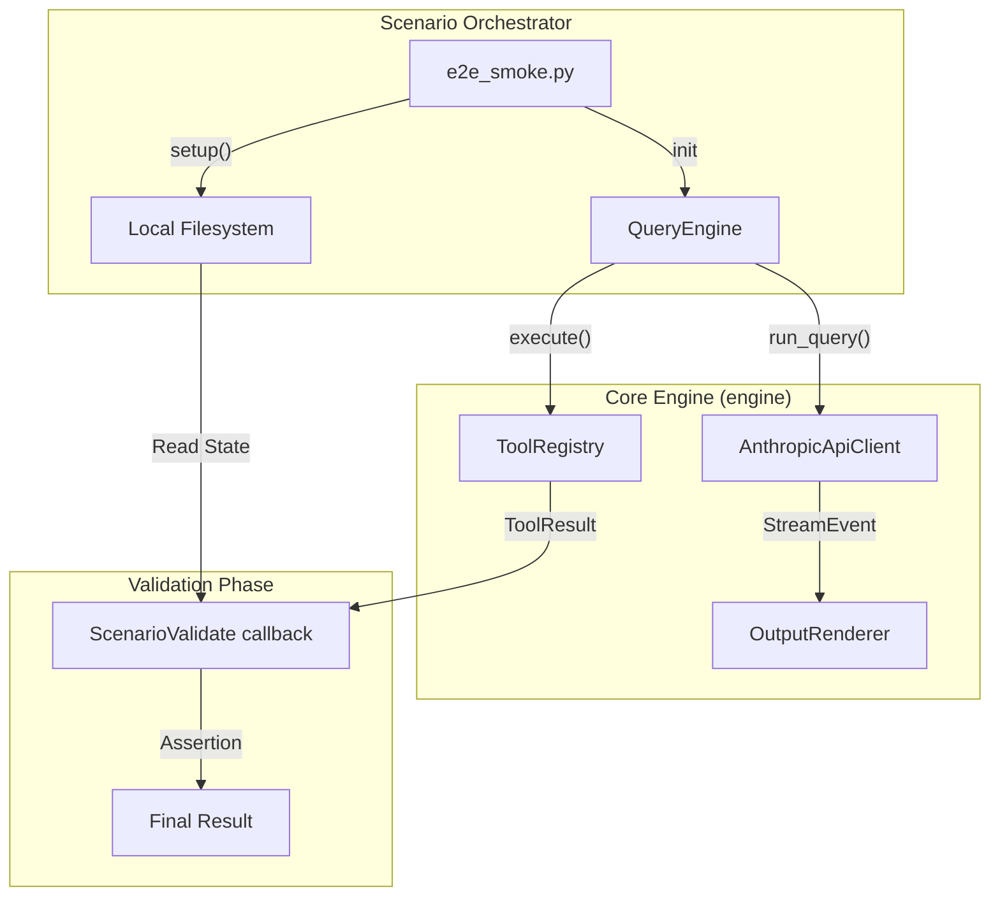
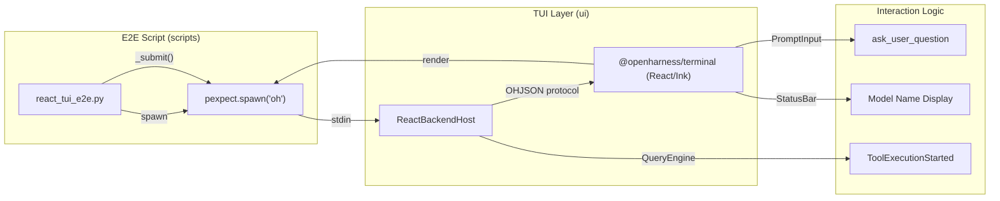

<!-- source: DeepWiki mcp.deepwiki.com · repo HKUDS/OpenHarness · page 16.2 End-to-End and Integration Scripts · fetched 2026-11-09 -->

# End-to-End and Integration Scripts

Relevant source files

The following files were used as context for generating this wiki page:

- [scripts/install.sh](scripts/install.sh)
- [scripts/install_dev.sh](scripts/install_dev.sh)
- [scripts/react_tui_e2e.py](scripts/react_tui_e2e.py)
- [src/openharness/prompts/environment.py](src/openharness/prompts/environment.py)
- [src/openharness/tools/__init__.py](src/openharness/tools/__init__.py)
- [src/openharness/tools/image_to_text_tool.py](src/openharness/tools/image_to_text_tool.py)
- [tests/test_hooks_skills_plugins_real.py](tests/test_hooks_skills_plugins_real.py)
- [tests/test_prompts/test_environment.py](tests/test_prompts/test_environment.py)
- [tests/test_prompts/test_system_prompt.py](tests/test_prompts/test_system_prompt.py)
- [tests/test_real_large_tasks.py](tests/test_real_large_tasks.py)
- [tests/test_swarm/test_imports.py](tests/test_swarm/test_imports.py)
- [tests/test_tools/test_integration_flows.py](tests/test_tools/test_integration_flows.py)
- [tests/test_untested_features.py](tests/test_untested_features.py)

The `scripts/` directory contains a comprehensive suite of end-to-end (E2E) and integration scripts designed to validate OpenHarness against real LLM providers (e.g., Anthropic, Moonshot/Kimi) and local system environments. These scripts bridge the gap between unit tests and production usage by simulating complex multi-turn scenarios, UI interactions, and tool-chaining.

## E2E Smoke Test Suite (`e2e_smoke.py`)

The `e2e_smoke.py` script is the primary validation tool for the core engine and toolset. It defines 18 distinct scenarios that exercise different subsystems using real model calls [scripts/e2e_smoke.py:1-43]().

### Scenario Architecture
Each test is encapsulated in a `Scenario` dataclass [scripts/e2e_smoke.py:42-53](). The execution flow involves:
1.  **Setup**: Preparing the environment (e.g., creating files, configuring MCP servers) [scripts/e2e_smoke.py:36]().
2.  **Execution**: Initializing a `QueryEngine` and running a prompt through the LLM loop [scripts/e2e_smoke.py:20-25]().
3.  **Validation**: A callback function that inspects the final state of the filesystem, tool call logs, and assistant response [scripts/e2e_smoke.py:37]().

### Key Scenarios
| Scenario | Subsystems Tested | Validation Logic |
| :--- | :--- | :--- |
| `file_io` | `read_file`, `write_file` | Verifies file contents match "OPENHARNESS_E2E_OK" [scripts/e2e_smoke.py:93-104](). |
| `search_edit` | `glob`, `grep`, `edit_file` | Checks for successful regex replacement in source files [scripts/e2e_smoke.py:107-117](). |
| `task_flow` | `BackgroundTaskManager` | Spawns a background task and waits for output [scripts/e2e_smoke.py:133-139](). |
| `skill_flow` | `SkillRegistry`, `skill` tool | Verifies on-demand loading of Markdown skills [scripts/e2e_smoke.py:142-149](). |
| `mcp_model` | `McpClientManager` | Connects to a local stdio MCP server and calls tools [scripts/e2e_smoke.py:152-159](). |
| `context_flow` | `CLAUDE.md`, Memory | Injects project rules and memory entries into the system prompt [scripts/e2e_smoke.py:161-167](). |

**Sources:** [scripts/e2e_smoke.py:1-188]()

## React TUI E2E Checks (`react_tui_e2e.py`)

The `react_tui_e2e.py` script performs scripted checks of the React-based Terminal UI using `pexpect` to drive the `oh` CLI entrypoint [scripts/react_tui_e2e.py:1-15]().

### UI Interaction Scenarios
*   **Permission and File I/O**: Spawns the TUI, waits for the app shell and model status, then submits a prompt to write a file. It validates that the assistant produces a specific marker (`FINAL_OK_REACT_TUI`) and the file is written correctly [scripts/react_tui_e2e.py:63-87]().
*   **Question Flow**: Tests the interactive `AskUserQuestionTool`. It verifies that the TUI displays a question modal, accepts user input ("teal"), and the assistant uses that input in subsequent tool calls [scripts/react_tui_e2e.py:89-117]().
*   **Command Flow**: Uses the `OPENHARNESS_FRONTEND_SCRIPT` environment variable to automate slash commands like `/plan`, verifying the "PLAN MODE" indicator appears in the TUI [scripts/react_tui_e2e.py:119-142]().

### Environment Isolation
The script uses `_isolated_env` to create temporary config and data directories, ensuring tests do not interfere with the user's local `~/.openharness` setup [scripts/react_tui_e2e.py:46-60]().

**Sources:** [scripts/react_tui_e2e.py:1-161]()

## TUI Interaction and Rendering Tests

*   **`test_tui_interactions.py`**: Simulates user keyboard input to test interactive components like the **Command Picker** (triggered by `/`) and the **Permission Modal** (sending "y" to allow tool execution) [tests/test_ui/test_tui_interactions.py:28-116]().
*   **`test_headless_rendering.py`**: Tests the `OutputRenderer` in print mode. It validates Markdown rendering via `rich`, tool output formatting in panels, and spinner logic for active tool execution [tests/test_ui/test_headless_rendering.py:31-114]().
*   **`test_react_tui_redesign.py`**: Verifies the conversational layout, checking for the "Oh my Harness!" welcome banner and ensuring the `StatusBar` correctly displays the active model name [tests/test_ui/test_react_tui_redesign.py:31-157]().

## Local System Scenarios (`local_system_scenarios.py`)

This script focuses on integration testing of local subsystems without requiring a live LLM connection. It uses a `FakeApiClient` to bypass model calls while exercising the full logic of the command registry, MCP manager, and plugin installer [scripts/local_system_scenarios.py:35-40]().

### Implementation Details
*   **Command Context**: Mocks a `CommandContext` including an `AppStateStore` and `QueryEngine` to test slash commands [scripts/local_system_scenarios.py:41-65]().
*   **Plugin Lifecycle**: Programmatically creates a fixture plugin, installs it using `install_plugin_from_path`, verifies tool registration, and then uninstalls it [scripts/local_system_scenarios.py:115-143]().
*   **Bridge Flow**: Validates session spawning and the encoding/decoding of `WorkSecret` tokens used for remote agent communication [scripts/local_system_scenarios.py:163-179]().

**Sources:** [scripts/local_system_scenarios.py:1-181]()

## Real-World Skills and Plugins (`test_real_skills_plugins.py`)

This script validates OpenHarness against external repositories, specifically the `anthropics/skills` library and compatible plugin repositories.

1.  **Skill Installation**: Copies real `.md` skills from a cloned `anthropics/skills` repo into the user config directory [scripts/test_real_skills_plugins.py:49-70]().
2.  **Registry Validation**: Uses `load_skill_registry` [scripts/test_real_skills_plugins.py:74-76]() to ensure that skills like `pdf` or `xlsx` are correctly parsed and assigned a `user` source [scripts/test_real_skills_plugins.py:72-86]().
3.  **Content Quality**: Iterates through loaded skills to verify substantial content length and valid descriptions [scripts/test_real_skills_plugins.py:89-109]().
4.  **Prompt Augmentation**: Checks `build_runtime_system_prompt` [scripts/test_real_skills_plugins.py:137-139]() to confirm that descriptions are successfully injected into the LLM's system instructions [scripts/test_real_skills_plugins.py:134-152]().

**Sources:** [scripts/test_real_skills_plugins.py:1-240]()

## Code Entity to System Space Diagrams

### Scenario Execution Data Flow
This diagram illustrates how `e2e_smoke.py` orchestrates the core engine components to validate a scenario.

Title: E2E Smoke Test Execution Flow

**Sources:** [scripts/e2e_smoke.py:20-37](), [scripts/e2e_smoke.py:93-104]()

### React TUI Interaction Flow
This diagram maps the TUI E2E script into the code entities responsible for terminal interaction.

Title: React TUI E2E Interaction Mapping

**Sources:** [scripts/react_tui_e2e.py:21-44](), [scripts/react_tui_e2e.py:89-117]()

---

