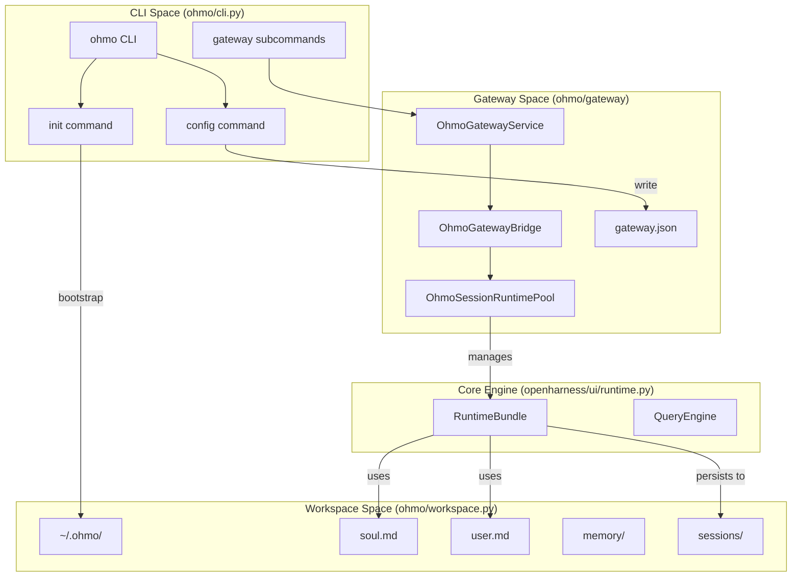
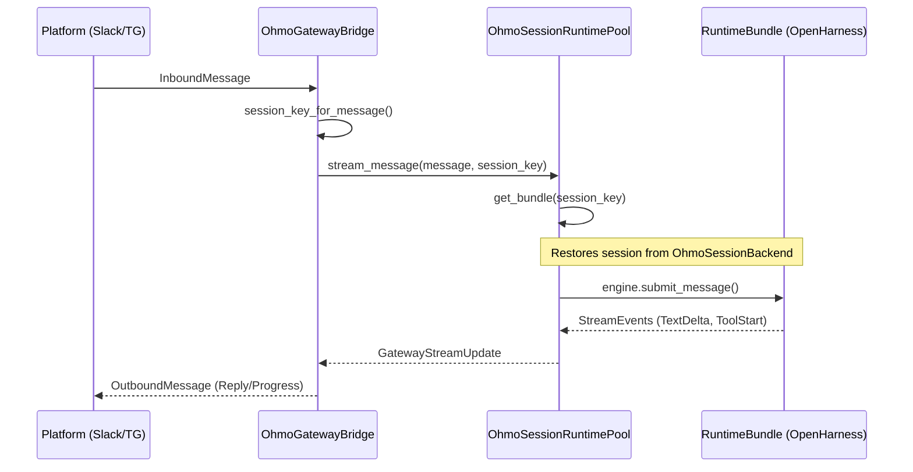

<!-- source: DeepWiki mcp.deepwiki.com · repo HKUDS/OpenHarness · page 17 ohmo Personal Agent · fetched 2026-11-09 -->

# ohmo Personal Agent

Relevant source files

The following files were used as context for generating this wiki page:

- [ohmo/cli.py](ohmo/cli.py)
- [ohmo/gateway/router.py](ohmo/gateway/router.py)
- [ohmo/gateway/service.py](ohmo/gateway/service.py)
- [ohmo/group_registry.py](ohmo/group_registry.py)
- [ohmo/workspace.py](ohmo/workspace.py)
- [tests/test_ohmo/test_cli.py](tests/test_ohmo/test_cli.py)

The `ohmo` application is a specialized personal-agent implementation built on top of the OpenHarness framework. While the core OpenHarness engine is designed for general-purpose tool-use and multi-agent coordination, `ohmo` focuses on a long-running, persistent relationship between a single user and their agent. It introduces a dedicated workspace concept, a multi-platform gateway for chat integration, and specialized prompts designed for personal continuity.

### System Overview

`ohmo` extends OpenHarness by providing:
*   **Workspace Management**: A structured directory (`~/.ohmo/`) for storing the agent's "soul," user preferences, and persistent memory.
*   **Gateway Service**: A background process that bridges OpenHarness to external messaging platforms like Telegram, Slack, and Discord.
*   **Session Persistence**: Automatic snapshotting and restoration of conversation states across different platforms and restarts.
*   **Personalized Prompting**: Dynamic system prompt construction that incorporates `soul.md` and `user.md` to maintain a consistent persona.

### Core Components and Entities

The following diagram illustrates how the `ohmo` application layers on top of the OpenHarness `RuntimeBundle` and how high-level CLI commands map to internal code structures.

**ohmo Application Architecture**

**Sources:**
* [ohmo/cli.py:38-52]()
* [ohmo/workspace.py:9-10]()
* [ohmo/gateway/service.py:39-73]()

---

### CLI and Workspace Management

The `ohmo` CLI serves as the primary interface for setting up and managing the personal agent. The `init` command bootstraps a workspace (defaulting to `~/.ohmo`) by creating essential markdown files that define the agent's identity and the user's preferences.

| File / Directory | Code Entity | Purpose |
| :--- | :--- | :--- |
| `soul.md` | `get_soul_path()` | Defines the agent's persona, boundaries, and "Core Truths". |
| `user.md` | `get_user_path()` | Stores user profile, timezone, and decision-making preferences. |
| `memory/` | `get_memory_dir()` | Directory for durable personal facts and long-term context. |
| `gateway.json` | `get_gateway_config_path()` | Stores credentials and configuration for messaging channels. |
| `sessions/` | `get_sessions_dir()` | Persistent storage for `OhmoSessionBackend` snapshots. |

The workspace is initialized via `initialize_workspace`, which ensures templates like `SOUL_TEMPLATE` and `USER_TEMPLATE` are written to disk if they do not exist.

For details on workspace initialization and prompt construction, see **[ohmo CLI and Workspace](#17.1)**.

**Sources:**
* [ohmo/workspace.py:11-105]()
* [ohmo/workspace.py:163-231]()
* [ohmo/cli.py:17-34]()

---

### Gateway and Messaging Integration

The `ohmo` gateway allows the agent to exist outside of a local terminal. It runs as a background service managed by `OhmoGatewayService`, which tracks the process via a PID file in the workspace.

The gateway architecture uses a "Bridge" pattern to connect a `MessageBus` (handling platform-specific traffic) to a pool of OpenHarness runtimes.

**Gateway Message Flow**

Key classes and functions in this flow include:
*   `OhmoGatewayBridge`: Handles message routing and provides the ability to interrupt sessions or request gateway restarts. [ohmo/gateway/service.py:65-73]()
*   `OhmoSessionRuntimePool`: Manages the lifecycle of multiple `RuntimeBundle` instances, ensuring that users on different platforms (or different threads) have isolated yet persistent sessions. [ohmo/gateway/service.py:56-62]()
*   `session_key_for_message()`: A routing utility in `ohmo/gateway/router.py` that generates unique session identifiers based on `channel`, `chat_id`, `sender_id`, and `thread_id`. [ohmo/gateway/router.py:8-31]()
*   `OhmoGatewayService`: Manages the background process, writing its state (PID, active sessions, errors) to `state.json`. [ohmo/gateway/service.py:94-103]()

For details on service management and platform configuration, see **[ohmo Gateway Service](#17.2)**.

**Sources:**
* [ohmo/gateway/service.py:39-103]()
* [ohmo/gateway/router.py:8-31]()
* [ohmo/cli.py:17-22]()

---

### Runtime and UI Modes

`ohmo` supports three primary execution modes, all of which utilize the `initialize_workspace` helper to ensure the environment is ready before starting the engine.

1.  **React TUI**: The standard interactive mode launched via `launch_ohmo_react_tui`. It connects a local React/Ink frontend to an `ohmo` backend host. [ohmo/cli.py:24-24]()
2.  **Print Mode**: A non-interactive mode for single-shot queries via `run_ohmo_print_mode`, useful for CLI piping. [ohmo/cli.py:24-24]()
3.  **Backend Mode**: A headless mode (`run_ohmo_backend`) used by the gateway or remote UI connections. [ohmo/cli.py:24-24]()

**Sources:**
* [ohmo/cli.py:24-24]()
* [ohmo/workspace.py:32-33]()

---

