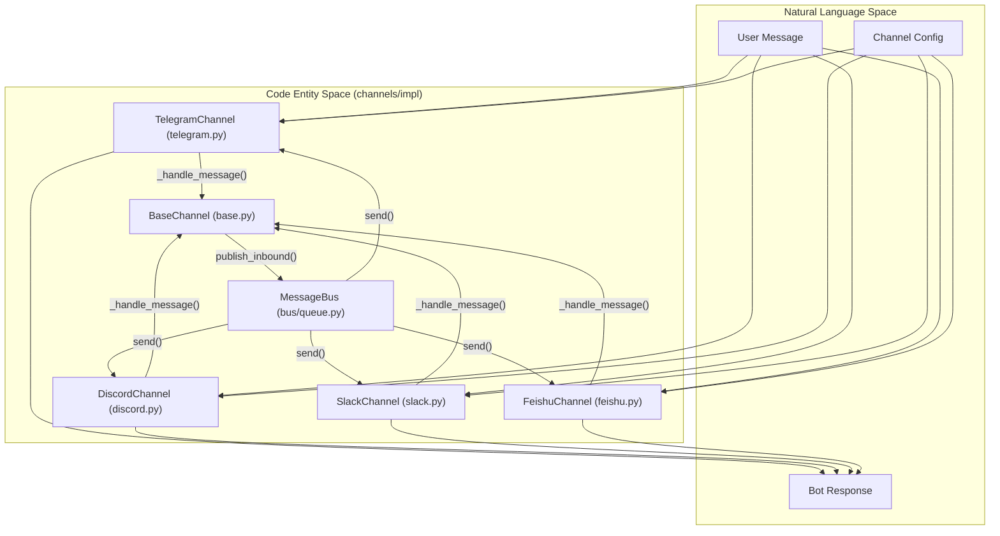
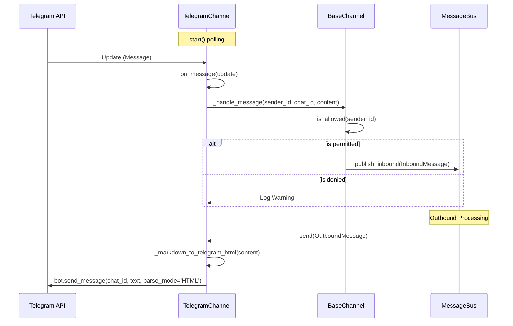
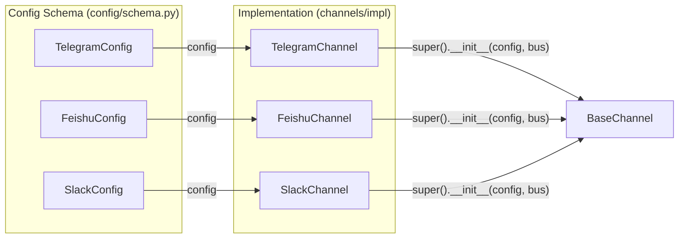

<!-- source: DeepWiki mcp.deepwiki.com · repo HKUDS/OpenHarness · page 18.2 Platform Channel Implementations · fetched 2026-11-09 -->

# Platform Channel Implementations

Relevant source files

The following files were used as context for generating this wiki page:

- [ohmo/gateway/bridge.py](ohmo/gateway/bridge.py)
- [ohmo/gateway/group_tool.py](ohmo/gateway/group_tool.py)
- [ohmo/gateway/runtime.py](ohmo/gateway/runtime.py)
- [src/openharness/channels/impl/dingtalk.py](src/openharness/channels/impl/dingtalk.py)
- [src/openharness/channels/impl/email.py](src/openharness/channels/impl/email.py)
- [src/openharness/channels/impl/feishu.py](src/openharness/channels/impl/feishu.py)
- [src/openharness/channels/impl/manager.py](src/openharness/channels/impl/manager.py)
- [src/openharness/channels/impl/matrix.py](src/openharness/channels/impl/matrix.py)
- [src/openharness/channels/impl/mochat.py](src/openharness/channels/impl/mochat.py)
- [src/openharness/channels/impl/qq.py](src/openharness/channels/impl/qq.py)
- [src/openharness/channels/impl/slack.py](src/openharness/channels/impl/slack.py)
- [src/openharness/channels/impl/telegram.py](src/openharness/channels/impl/telegram.py)
- [src/openharness/channels/impl/whatsapp.py](src/openharness/channels/impl/whatsapp.py)
- [src/openharness/config/schema.py](src/openharness/config/schema.py)
- [src/openharness/engine/messages.py](src/openharness/engine/messages.py)
- [tests/test_channels/test_feishu_security.py](tests/test_channels/test_feishu_security.py)
- [tests/test_channels/test_telegram_security.py](tests/test_channels/test_telegram_security.py)
- [tests/test_config/test_schema.py](tests/test_config/test_schema.py)

The Channels system provides a multi-platform messaging integration layer that allows the `ohmo` gateway to communicate with various chat services. Each implementation inherits from a common base and handles platform-specific protocols, message formatting, and media processing.

## Base Channel Architecture

All platform adapters extend the `BaseChannel` abstract class [src/openharness/channels/impl/base.py:34-42](). This base class defines the lifecycle methods (`start`, `stop`, `send`) and provides shared logic for access control via the `allow_from` configuration [src/openharness/channels/impl/base.py:83-95]().

### Message Flow: Platform to Bus
When a message is received from a platform, the implementation calls `_handle_message` [src/openharness/channels/impl/base.py:96-104](). This method performs a permission check using `is_allowed()` [src/openharness/channels/impl/base.py:118-124]() before publishing an `InboundMessage` to the `MessageBus` [src/openharness/channels/impl/base.py:126-136]().

### Media Handling
The `resolve_channel_media_dir` utility determines where inbound attachments (images, audio) should be stored locally [src/openharness/channels/impl/base.py:16-31](). It prioritizes the `OHMO_WORKSPACE` attachments directory if available [src/openharness/channels/impl/base.py:22-26]().

**Platform Implementation Entity Mapping**

Sources: [src/openharness/channels/impl/base.py:34-142](), [src/openharness/channels/impl/telegram.py:95-128](), [src/openharness/channels/impl/discord.py:24-37]()

---

## Supported Platform Adapters

### Telegram (`TelegramChannel`)
Uses long-polling via the `python-telegram-bot` library [src/openharness/channels/impl/telegram.py:129-184]().
- **Formatting**: Converts Markdown to Telegram-safe HTML using `_markdown_to_telegram_html` [src/openharness/channels/impl/telegram.py:32-92]().
- **Commands**: Registers standard bot commands like `/start`, `/new`, and `/help` [src/openharness/channels/impl/telegram.py:105-110]().
- **Media**: Supports photo, voice, audio, and document filters [src/openharness/channels/impl/telegram.py:154-160]().
- **Security**: Includes `silence_telegram_token_url_loggers` to prevent token leakage in logs [src/openharness/channels/impl/telegram.py:25-29]().

### Discord (`DiscordChannel`)
Implements the Discord Gateway protocol over WebSockets [src/openharness/channels/impl/discord.py:24-32]().
- **Gateway**: Handles `HELLO` (heartbeats), `IDENTIFY`, and `READY` events [src/openharness/channels/impl/discord.py:127-168]().
- **Rate Limiting**: Includes automatic retry logic for HTTP 429 responses in `_send_payload` [src/openharness/channels/impl/discord.py:105-125]().
- **Chunking**: Splits long messages exceeding Discord's 2000-character limit [src/openharness/channels/impl/discord.py:88-94]().

### Slack (`SlackChannel`)
Uses Slack Socket Mode to avoid requiring a public HTTP endpoint [src/openharness/channels/impl/slack.py:21-40]().
- **Mentions**: Specifically filters for `app_mention` events and handles bot user ID detection [src/openharness/channels/impl/slack.py:108-143]().
- **Threading**: Supports `reply_in_thread` configuration to maintain conversation context [src/openharness/channels/impl/slack.py:168-170]().
- **Formatting**: Uses `slackify_markdown` for Slack-specific `mrkdwn` blocks [src/openharness/channels/impl/slack.py:11-11]().

### Feishu/Lark (`FeishuChannel`)
Uses the `lark-oapi` SDK with WebSocket long connections [src/openharness/channels/impl/feishu.py:1-16]().
- **Group Policy**: Implements complex routing logic (`managed_or_mention`, `open`, `mention`) to determine if a group message should be processed [src/openharness/channels/impl/feishu.py:185-203]().
- **Rich Content**: Features extensive parsers for interactive cards, shared charts, and localized "post" (rich text) messages [src/openharness/channels/impl/feishu.py:210-216]().
- **Mentions**: Performs best-effort bot mention detection using `bot_open_id` and `bot_names` [src/openharness/channels/impl/feishu.py:126-148]().
- **Group Management**: Integrates with `OhmoCreateFeishuGroupTool` to allow the agent to create and bind workspace directories to Feishu groups [ohmo/gateway/group_tool.py:38-46]().

### Matrix (`MatrixChannel`)
Uses `matrix-nio` for communication [src/openharness/channels/impl/matrix.py:146-160]().
- **Sanitization**: Employs `nh3` to clean HTML generated from Markdown to ensure compatibility with Matrix clients [src/openharness/channels/impl/matrix.py:89-96]().
- **Sync Loop**: Implements long-polling sync with persistent store support for tokens [src/openharness/channels/impl/matrix.py:170-193]().

### Email (`EmailChannel`)
Integrates via IMAP polling and SMTP sending [src/openharness/channels/impl/email.py:27-37]().
- **Inbound**: Polls for `UNSEEN` messages and tracks `Message-ID` for threading [src/openharness/channels/impl/email.py:193-200]().
- **Outbound**: Constructs `In-Reply-To` and `References` headers to maintain email threads [src/openharness/channels/impl/email.py:144-148]().

### Specialized Adapters
- **WhatsApp**: Connects to a Node.js bridge using `@whiskeysockets/baileys` via WebSockets [src/openharness/channels/impl/whatsapp.py:17-23]().
- **QQ**: Uses the `botpy` SDK for C2C (private) and direct messages [src/openharness/channels/impl/qq.py:51-62]().
- **DingTalk**: Supports DingTalk's stream mode robot [src/openharness/channels/impl/dingtalk.py:45-55]().
- **Mochat**: Implements a Socket.IO client with complex buffering for multi-author message groups [src/openharness/channels/impl/mochat.py:217-218]().

---

## Data Flow and Sequence

The following diagram illustrates the interaction between a platform-specific implementation (using Telegram as an example) and the core message bus.

**Telegram Channel Sequence**

Sources: [src/openharness/channels/impl/telegram.py:129-184](), [src/openharness/channels/impl/telegram.py:195-210](), [src/openharness/channels/impl/base.py:96-136]()

---

## Access Control (`allow_from`)

Access is controlled per-channel using the `allow_from` list in the configuration [src/openharness/config/schema.py:31-31](). The logic is centralized in `BaseChannel.is_allowed()` [src/openharness/channels/impl/base.py:83-95]():

| Configuration Value | Behavior |
| :--- | :--- |
| `[]` (Empty) | **Deny All**. Logs a warning [src/openharness/channels/impl/base.py:86-88](). |
| `["*"]` | **Allow All**. Any sender ID is permitted [src/openharness/channels/impl/base.py:89-90](). |
| `["id1", "id2"]` | **Whitelist**. Only explicit IDs match [src/openharness/channels/impl/base.py:91-92](). |

The `ChannelManager` validates these configurations upon initialization, warning operators if a channel is enabled but lacks allowed identities [src/openharness/channels/impl/manager.py:155-162]().

**Channel Configuration to Code Mapping**

Sources: [src/openharness/config/schema.py:34-114](), [src/openharness/channels/impl/manager.py:35-153](), [src/openharness/channels/impl/base.py:44-50]()

---

