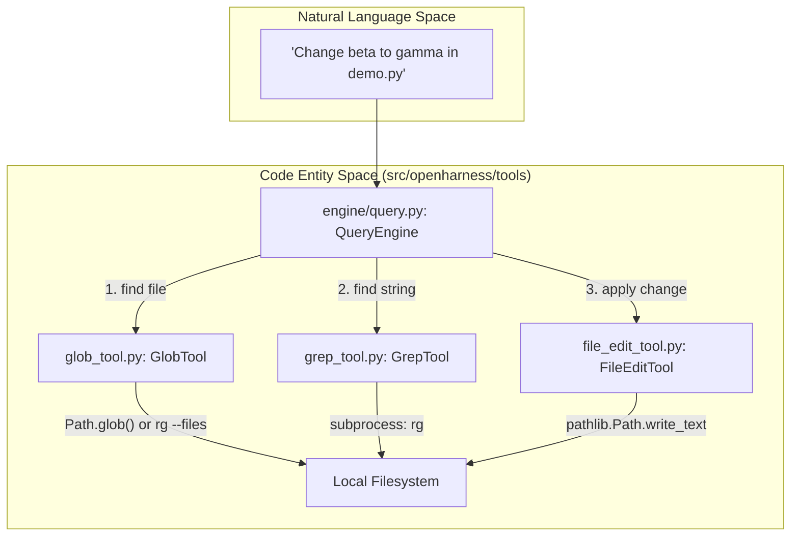
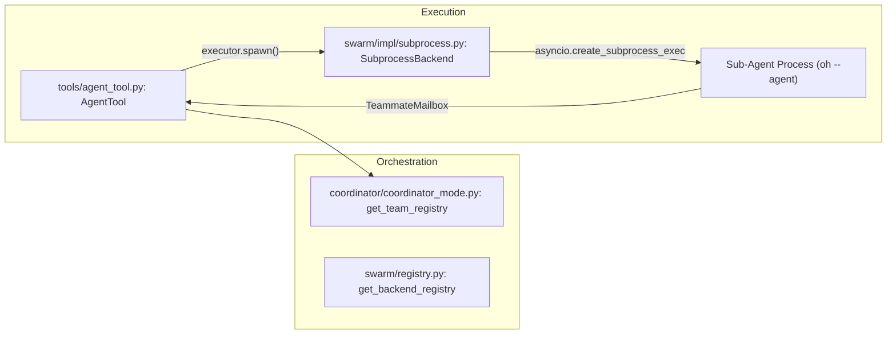

<!-- source: DeepWiki mcp.deepwiki.com · repo HKUDS/OpenHarness · page 4.2 Built-in Tool Reference · fetched 2026-11-09 -->

# Built-in Tool Reference

Relevant source files

The following files were used as context for generating this wiki page:

- [src/openharness/permissions/checker.py](src/openharness/permissions/checker.py)
- [src/openharness/tools/bash_tool.py](src/openharness/tools/bash_tool.py)
- [src/openharness/tools/config_tool.py](src/openharness/tools/config_tool.py)
- [src/openharness/tools/cron_toggle_tool.py](src/openharness/tools/cron_toggle_tool.py)
- [src/openharness/tools/file_read_tool.py](src/openharness/tools/file_read_tool.py)
- [src/openharness/tools/glob_tool.py](src/openharness/tools/glob_tool.py)
- [src/openharness/tools/grep_tool.py](src/openharness/tools/grep_tool.py)
- [src/openharness/tools/image_generation_tool.py](src/openharness/tools/image_generation_tool.py)
- [src/openharness/tools/todo_write_tool.py](src/openharness/tools/todo_write_tool.py)
- [src/openharness/utils/shell.py](src/openharness/utils/shell.py)
- [tests/test_permissions/test_checker.py](tests/test_permissions/test_checker.py)
- [tests/test_tools/test_bash_tool.py](tests/test_tools/test_bash_tool.py)
- [tests/test_tools/test_core_tools.py](tests/test_tools/test_core_tools.py)
- [tests/test_tools/test_grep_tool.py](tests/test_tools/test_grep_tool.py)
- [tests/test_utils/test_shell.py](tests/test_utils/test_shell.py)

OpenHarness provides a comprehensive suite of over 43 built-in tools designed to give the LLM agent deep integration with the local operating system, development environment, and external services. These tools are implemented as Pydantic-backed classes inheriting from `BaseTool` [src/openharness/tools/base.py:12-12](), ensuring strict input validation and consistent API schema generation for the LLM.

The tools are registered within the `ToolRegistry` [src/openharness/tools/base.py:46-46]() and invoked through the `QueryEngine` loop, which handles concurrent execution, permission gating, and result formatting.

## File I/O and Search Tools

These tools provide the primary interface for the agent to explore and modify the codebase. They implement safety checks and efficient searching using standard Unix-like utilities where possible.

| Tool Name | Class / Implementation | Purpose |
| :--- | :--- | :--- |
| `read_file` | `FileReadTool` | Reads the content of a specific file with optional line-based `offset` and `limit` [src/openharness/tools/file_read_tool.py:1-20](). |
| `write_file` | `FileWriteTool` | Overwrites or creates a file. Triggers `edit_approval_prompt` if configured in metadata [tests/test_tools/test_core_tools.py:60-84](). |
| `edit_file` | `FileEditTool` | Applies targeted search-and-replace edits to a file using `old_str` and `new_str` [tests/test_tools/test_core_tools.py:51-57](). |
| `glob` | `GlobTool` | Lists files matching a pattern. Prefers `ripgrep` (`rg --files`) for performance in large repositories [src/openharness/tools/glob_tool.py:107-115](). |
| `grep` | `GrepTool` | Searches for regex patterns within files using `ripgrep` or Python fallback [src/openharness/tools/grep_tool.py:73-94](). |

### Data Flow: Search and Edit
The `GrepTool` prefers `ripgrep` (`rg`) for performance [src/openharness/tools/grep_tool.py:174-176](), falling back to a pure-Python implementation `_python_grep_files` [src/openharness/tools/grep_tool.py:105-141]() if the binary is unavailable. It enforces a default 20s timeout and a 200-match limit [src/openharness/tools/grep_tool.py:25-26]().

**Code Entity Interaction: File Search and Edit**

Sources: [src/openharness/tools/grep_tool.py:29-94](), [src/openharness/tools/glob_tool.py:25-41](), [src/openharness/tools/base.py:12-46]()

## Shell and Task Management

OpenHarness distinguishes between immediate shell execution and long-running background tasks.

*   **`bash`**: Executes a command in a subshell using `create_shell_subprocess` [src/openharness/tools/bash_tool.py:45-52](). It captures `stdout`/`stderr` combined into one stream (`stderr=asyncio.subprocess.STDOUT`) and enforces a default 600s timeout [src/openharness/tools/bash_tool.py:24-24](). It includes "preflight" checks to detect interactive scaffolding commands like `npm init` that might hang [src/openharness/tools/bash_tool.py:155-164]().
*   **`task_create`**: Spawns a background process (shell or agent) managed by the `BackgroundTaskManager`.
*   **`task_list`**: Returns all active background tasks and their IDs.
*   **`task_get`**: Retrieves the current status and metadata of a specific task.
*   **`task_output`**: Reads the accumulated output from a running task.
*   **`task_stop`**: Terminates a running background process.
*   **`task_update`**: Sends input to the `stdin` of a running task via `write_to_task` [src/openharness/tools/send_message_tool.py:37-37]().

Sources: [src/openharness/tools/bash_tool.py:27-85](), [src/openharness/utils/shell.py:51-84](), [src/openharness/tools/send_message_tool.py:31-40]()

## Multi-Agent and Team Tools

These tools allow the primary agent to delegate work to sub-agents or coordinate within a "Team" structure.

*   **`agent`**: Spawns a sub-agent using the `subprocess` backend [src/openharness/tools/agent_tool.py:64-64](). It supports different modes: `local_agent`, `remote_agent`, or `in_process_teammate` [src/openharness/tools/agent_tool.py:44-48]().
*   **`team_create`**: Initializes a named team via `TeamRegistry.create_team()`.
*   **`team_delete`**: Dissolves a team and cleans up associated resources.
*   **`send_message`**: Routes messages to agents. If the ID contains `@`, it routes via `_send_swarm_message` using the `subprocess` executor [src/openharness/tools/send_message_tool.py:42-58]().

**Agent Lifecycle Flow**

Sources: [src/openharness/tools/agent_tool.py:36-94](), [src/openharness/tools/send_message_tool.py:24-59]()

## MCP (Model Context Protocol) Tools

OpenHarness acts as an MCP host, allowing the LLM to interact with external MCP servers via the `McpClientManager`.

*   **`mcp_tool`**: Invoked via `McpToolAdapter` [src/openharness/tools/__init__.py:93-93]().
*   **`mcp_auth`**: Handles authentication flows required by specific MCP servers.
*   **`list_mcp_resources`**: Lists available data resources [src/openharness/tools/list_mcp_resources_tool.py:1-20]().
*   **`read_mcp_resource`**: Fetches the content of a specific MCP resource [src/openharness/tools/read_mcp_resource_tool.py:1-20]().

Sources: [src/openharness/tools/__init__.py:89-94]()

## Utility and Specialized Tools

### Development Utilities
*   **`lsp`**: Interacts with Language Server Protocol servers for diagnostics and symbols [tests/test_tools/test_core_tools.py:24-24]().
*   **`notebook_edit`**: Specialized tool for manipulating Jupyter Notebook cells [tests/test_tools/test_core_tools.py:25-25]().
*   **`worktree_create` / `worktree_list`**: Manages Git worktrees for isolation [src/openharness/tools/__init__.py:67-68]().

### Knowledge and Context
*   **`skill`**: Dynamically loads a "Skill" definition into the context [src/openharness/tools/skill_tool.py:1-20]().
*   **`todo_write`**: Appends or updates items in the project's `TODO.md` [src/openharness/tools/todo_write_tool.py:1-20]().
*   **`tool_search`**: Searches for available tools and their documentation [tests/test_tools/test_core_tools.py:29-29]().
*   **`brief`**: Requests a summary of the current session state.

### System and Interaction
*   **`web_fetch` / `web_search`**: External information retrieval.
*   **`image_generation`**: Generates or edits raster images via `openai` or `codex` providers [src/openharness/tools/image_generation_tool.py:74-85]().
*   **`cron_create` / `cron_list` / `cron_delete` / `cron_toggle`**: Manages persistent scheduled tasks [src/openharness/services/cron.py:44-71](). `cron_toggle` uses `set_job_enabled` to flip the `enabled` flag in the registry [src/openharness/tools/cron_toggle_tool.py:31-31]().
*   **`sleep`**: Pauses execution for a specified duration.
*   **`config`**: Reads or updates agent-specific configuration settings using `load_settings` and `save_settings` [src/openharness/tools/config_tool.py:28-54]().
*   **`ask_user_question`**: Explicitly pauses the agent loop to request human input.
*   **`remote_trigger`**: Triggers a webhook or remote event [src/openharness/tools/remote_trigger_tool.py:1-20]().

Sources: [src/openharness/tools/config_tool.py:21-55](), [src/openharness/tools/image_generation_tool.py:74-126](), [src/openharness/tools/cron_toggle_tool.py:18-37](), [src/openharness/services/cron.py:1-105](), [src/openharness/tools/__init__.py:46-87]()

---

