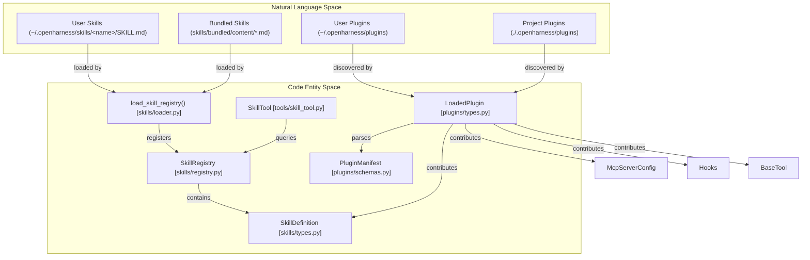
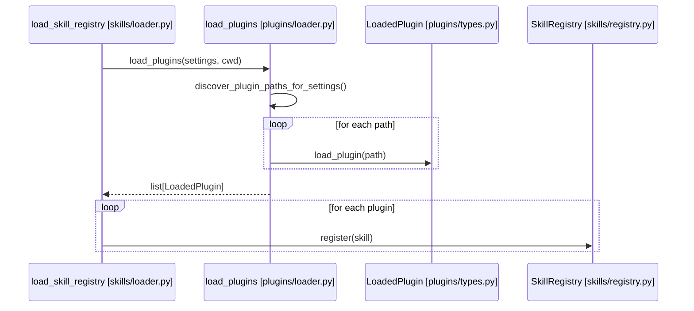

<!-- source: DeepWiki mcp.deepwiki.com · repo HKUDS/OpenHarness · page 8 Skills and Plugins · fetched 2026-11-09 -->

# Skills and Plugins

Relevant source files

The following files were used as context for generating this wiki page:

- [src/openharness/commands/__init__.py](src/openharness/commands/__init__.py)
- [src/openharness/plugins/loader.py](src/openharness/plugins/loader.py)
- [src/openharness/plugins/schemas.py](src/openharness/plugins/schemas.py)
- [src/openharness/plugins/types.py](src/openharness/plugins/types.py)
- [src/openharness/skills/_frontmatter.py](src/openharness/skills/_frontmatter.py)
- [src/openharness/skills/bundled/__init__.py](src/openharness/skills/bundled/__init__.py)
- [src/openharness/skills/bundled/content/skill-creator.md](src/openharness/skills/bundled/content/skill-creator.md)
- [src/openharness/skills/loader.py](src/openharness/skills/loader.py)
- [src/openharness/skills/registry.py](src/openharness/skills/registry.py)
- [src/openharness/skills/types.py](src/openharness/skills/types.py)
- [src/openharness/tools/skill_tool.py](src/openharness/tools/skill_tool.py)
- [tests/test_plugins/test_loader.py](tests/test_plugins/test_loader.py)
- [tests/test_skills/test_loader.py](tests/test_skills/test_loader.py)
- [tests/test_ui/test_project_plugin_security.py](tests/test_ui/test_project_plugin_security.py)
- [tests/test_ui/test_runtime_plugin_tools.py](tests/test_ui/test_runtime_plugin_tools.py)

OpenHarness provides a dual-layered system for extending the agent's capabilities: **Skills** for on-demand knowledge injection and **Plugins** for functional extensions. While Skills focus on providing the LLM with specialized instructions or documentation, Plugins serve as a distribution mechanism that can bundle Skills, Hooks, Tools, and MCP servers into a single package.

### Overview of Extension Systems

The extension architecture separates "what the agent knows" (Skills) from "how the agent is configured" (Plugins).

*   **Skills**: Markdown-based files (`SKILL.md`) containing specialized instructions. They are loaded into the LLM context only when the `SkillTool` (invoked via the `skill` tool) is used, preventing context window bloat [src/openharness/tools/skill_tool.py:17-43]().
*   **Plugins**: Directory-based packages containing a `plugin.json` manifest [src/openharness/plugins/loader.py:50-58](). They allow developers to distribute complex integrations that require multiple subsystems, such as a plugin that adds a new `BaseTool` and the skills to use it [src/openharness/plugins/types.py:40-51]().

### System Relationship

The following diagram illustrates how the `PluginManifest` bridges various subsystems and how the `SkillRegistry` manages knowledge sources.

**Extension Entity Mapping**

**Sources:** [src/openharness/plugins/types.py:40-51](), [src/openharness/skills/loader.py:30-49](), [src/openharness/skills/registry.py:8-19](), [src/openharness/tools/skill_tool.py:28-34]()

---

## Skills System

The Skills system allows OpenHarness to maintain a library of specialized knowledge without overwhelming the initial system prompt. Each skill is defined as a `SkillDefinition` [src/openharness/skills/types.py:5]() and managed via the `SkillRegistry` [src/openharness/skills/registry.py:8]().

### Key Components
- **On-Demand Loading**: Skills are not included in the system prompt by default. The LLM must use the `SkillTool` [src/openharness/tools/skill_tool.py:17]() to read the content of a specific skill when needed.
- **Discovery**: The `load_skill_registry` function [src/openharness/skills/loader.py:42]() aggregates skills from `get_bundled_skills()` [src/openharness/skills/bundled/__init__.py:18](), user-level directories like `~/.openharness/skills/` [src/openharness/skills/loader.py:30-34](), and enabled plugins [src/openharness/skills/loader.py:68-74]().
- **YAML Frontmatter**: Skills use YAML frontmatter to define metadata such as `user-invocable`, `disable-model-invocation`, and `model` overrides [src/openharness/skills/_frontmatter.py:34-82]().
- **Compatibility**: The system automatically discovers skills in legacy `.claude/skills` and `.agents/skills` directories [src/openharness/skills/loader.py:23-26]().

For implementation details and the `skill` tool specification, see **[Skills System](#8.1)**.

---

## Plugin System

Plugins are the primary method for extending OpenHarness functionality. A plugin is represented at runtime by the `LoadedPlugin` class [src/openharness/plugins/types.py:40](), which encapsulates a `PluginManifest` [src/openharness/plugins/schemas.py:11]().

### Plugin Discovery and Loading
The `load_plugins` function [src/openharness/plugins/loader.py:107]() identifies plugin directories and validates their structure. The system supports:
1.  **User Plugins**: Located in the global configuration directory via `get_user_plugins_dir()` [src/openharness/plugins/loader.py:36]().
2.  **Project Plugins**: Located in `.openharness/plugins/` relative to the current working directory [src/openharness/plugins/loader.py:43](). Note that project plugins are disabled by default for security and require `allow_project_plugins=true` [src/openharness/plugins/loader.py:110-117]().

### Capabilities
A `LoadedPlugin` [src/openharness/plugins/types.py:40]() can contribute multiple artifacts to the environment:
- **Skills**: Specialized knowledge defined in `SkillDefinition` objects [src/openharness/plugins/types.py:46]().
- **Commands**: Custom slash commands defined as `PluginCommandDefinition` [src/openharness/plugins/types.py:19]().
- **Tools**: Dynamic Python-based tools inheriting from `BaseTool` [src/openharness/plugins/types.py:49]().
- **Hooks & MCP**: Lifecycle event triggers and Model Context Protocol configurations [src/openharness/plugins/types.py:50-51]().

**Plugin Loading Flow**

**Sources:** [src/openharness/skills/loader.py:68-75](), [src/openharness/plugins/loader.py:107-123](), [src/openharness/plugins/types.py:40-51]()

For details on creating plugins and using the `plugin` CLI, see **[Plugin System](#8.2)**.

---

