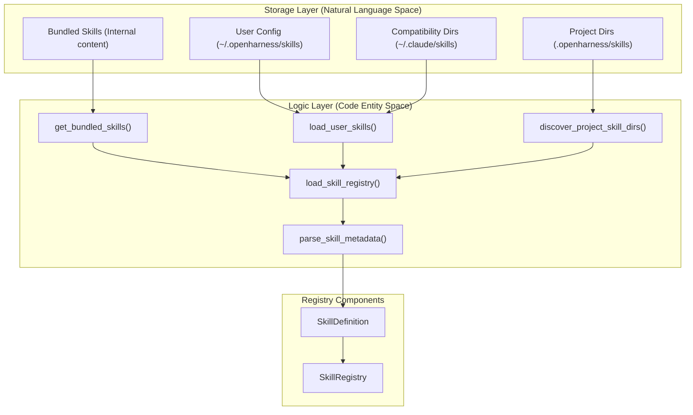
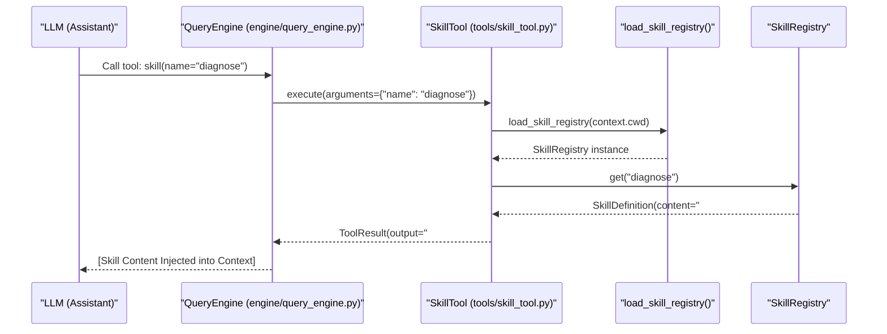

<!-- source: DeepWiki mcp.deepwiki.com · repo HKUDS/OpenHarness · page 8.1 Skills System · fetched 2026-11-09 -->

# Skills System

Relevant source files

The following files were used as context for generating this wiki page:

- [src/openharness/commands/__init__.py](src/openharness/commands/__init__.py)
- [src/openharness/skills/__init__.py](src/openharness/skills/__init__.py)
- [src/openharness/skills/_frontmatter.py](src/openharness/skills/_frontmatter.py)
- [src/openharness/skills/bundled/__init__.py](src/openharness/skills/bundled/__init__.py)
- [src/openharness/skills/bundled/content/diagnose.md](src/openharness/skills/bundled/content/diagnose.md)
- [src/openharness/skills/bundled/content/skill-creator.md](src/openharness/skills/bundled/content/skill-creator.md)
- [src/openharness/skills/loader.py](src/openharness/skills/loader.py)
- [src/openharness/skills/registry.py](src/openharness/skills/registry.py)
- [src/openharness/skills/types.py](src/openharness/skills/types.py)
- [src/openharness/tools/skill_tool.py](src/openharness/tools/skill_tool.py)
- [tests/test_skills/test_loader.py](tests/test_skills/test_loader.py)

The Skills System in OpenHarness provides a mechanism for providing the Large Language Model (LLM) with on-demand, specialized knowledge and procedures. Unlike the system prompt, which is static for the duration of a session, skills are indexed and can be dynamically injected into the conversation context using the `skill` tool. This allows the agent to maintain a lean context window while still having access to a vast library of documentation, best practices, and complex workflows.

## Core Architecture

The system is built around three primary components: the `SkillDefinition` data model, the `SkillRegistry` for management, and the `SkillTool` (invoked as `skill`) for execution.

### Data Models and Registry

Skills are represented by the `SkillDefinition` class, which encapsulates the content, metadata, and source of the skill. These are managed by a central `SkillRegistry`.

| Class | Responsibility |
| :--- | :--- |
| `SkillDefinition` | Stores the name, description, raw content, source, path, and execution flags like `disable_model_invocation`. [src/openharness/skills/types.py:9-25]() |
| `SkillRegistry` | A container that holds all discovered skills and provides lookup/registration methods. [src/openharness/skills/registry.py:8-30]() |

The `SkillRegistry` is populated by `load_skill_registry()`. This function aggregates skills from five distinct locations:
1.  **Bundled Skills**: Built-in skills located within the package `bundled/content/` directory. [src/openharness/skills/loader.py:51-52](), [src/openharness/skills/bundled/__init__.py:18-43]()
2.  **User Skills**: Markdown files in `~/.openharness/skills/` and compatibility directories like `~/.claude/skills/`. [src/openharness/skills/loader.py:37-40](), [src/openharness/skills/loader.py:78-80]()
3.  **Extra Skill Directories**: Optional paths provided via `extra_skill_dirs`. [src/openharness/skills/loader.py:55-56]()
4.  **Project Skills**: Skills discovered by walking up from the current working directory to the git root, checking for `.openharness/skills/`. [src/openharness/skills/loader.py:59-65](), [src/openharness/skills/loader.py:83-123]()
5.  **Plugin Skills**: Skills contributed by active plugins discovered in the project or user directories. [src/openharness/skills/loader.py:67-75]()

### Skill Discovery and Loading Flow

The following diagram illustrates how the `SkillRegistry` is assembled from various sources, mapping natural language concepts to code entities.

**Skill Registry Assembly Flow**

Sources: [src/openharness/skills/loader.py:42-75](), [src/openharness/skills/bundled/__init__.py:18-43](), [src/openharness/skills/registry.py:14-19]()

## Skill Definition and Parsing

Skills are authored as Markdown files. The system uses `parse_skill_metadata` to extract metadata from YAML frontmatter or Markdown structure. [src/openharness/skills/_frontmatter.py:34-82]()

### YAML Frontmatter Parsing
The system prioritizes YAML frontmatter delimited by `---`. It supports several fields:
* `name`: The display name of the skill.
* `description`: The trigger hint used by the LLM to decide when to load the skill.
* `user-invocable`: Whether a user can run this as a slash command (default: true). [src/openharness/skills/bundled/__init__.py:68]()
* `disable-model-invocation`: If true, the LLM cannot load this skill via the `skill` tool. [src/openharness/skills/bundled/__init__.py:69-72]()
* `model`: Specifies a preferred LLM for this skill. [src/openharness/skills/bundled/__init__.py:73]()

### Fallback Parsing
If no frontmatter is found, the system falls back to:
1.  **Name**: Extracted from the first Level 1 heading (`# Name`). [src/openharness/skills/_frontmatter.py:72-75]()
2.  **Description**: Extracted from the first non-empty paragraph (limited to 200 characters). [src/openharness/skills/_frontmatter.py:76-78]()

## The `skill` Tool

The `SkillTool` (exposed as `skill`) is the primary interface for the LLM to access the Skills System.

### Tool Execution Flow
When the LLM invokes the `skill` tool, the `execute()` method loads the registry and retrieves the content. [src/openharness/tools/skill_tool.py:28-43]()

**Skill Retrieval Sequence**

Sources: [src/openharness/tools/skill_tool.py:28-43](), [src/openharness/skills/registry.py:20-22]()

## User and Project Skills

Users can customize behavior by placing skills in specific directory structures.

### Directory Layout
The loader expects a directory-based layout: `<root>/<skill-dir>/SKILL.md`. [src/openharness/skills/loader.py:161-163]()
* **User Skills**: `~/.openharness/skills/my-skill/SKILL.md`
* **Project Skills**: `[project-root]/.openharness/skills/my-skill/SKILL.md`

### Project Skill Discovery
`discover_project_skill_dirs()` walks up from the current directory to the git root to find project-specific skills. Skills found closer to the working directory override skills found further up or in the user directory. [src/openharness/skills/loader.py:83-123](), [tests/test_skills/test_loader.py:164-172]()

## Bundled Skills Reference

OpenHarness includes several core skills by default:
* `skill-creator`: Guidance for creating new skills and verifying their loading. [src/openharness/skills/bundled/content/skill-creator.md:1-176]()
* `diagnose`: Procedures for analyzing failed agent runs using execution traces. [src/openharness/skills/bundled/content/diagnose.md:1-36]()
* `simplify`: Strategies for reducing code complexity. [tests/test_skills/test_loader.py:20]()
* `review`: Checklists for code reviews. [tests/test_skills/test_loader.py:21]()

Sources:
* [src/openharness/skills/loader.py:1-205]()
* [src/openharness/skills/registry.py:1-30]()
* [src/openharness/skills/types.py:1-25]()
* [src/openharness/skills/_frontmatter.py:1-98]()
* [src/openharness/tools/skill_tool.py:1-44]()
* [src/openharness/skills/bundled/__init__.py:1-76]()
* [tests/test_skills/test_loader.py:1-172]()

---

