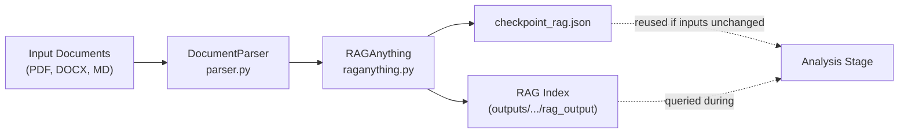
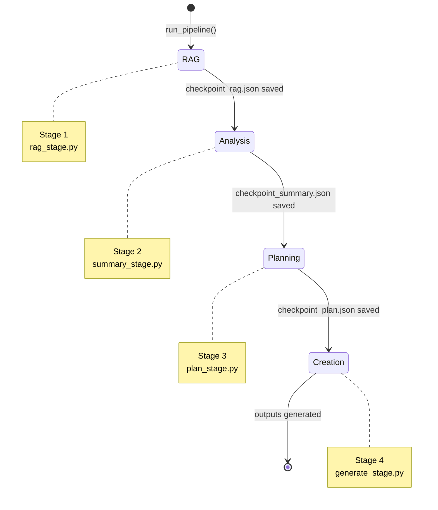
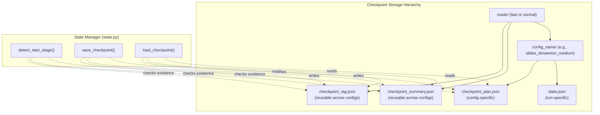
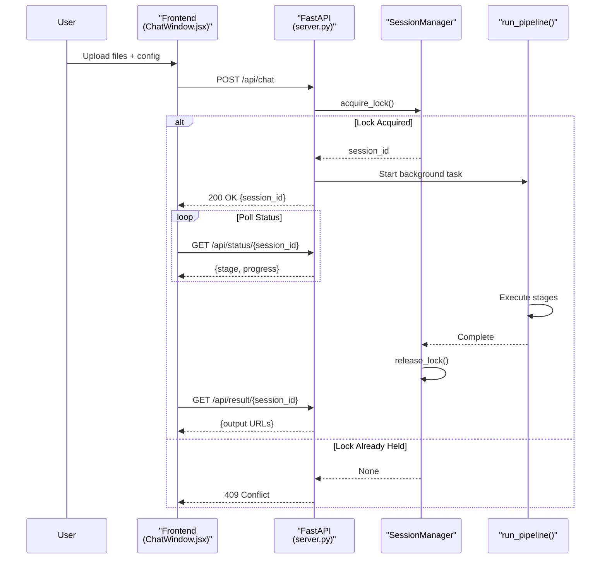
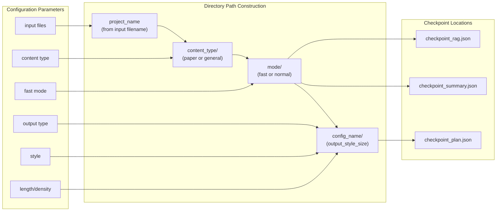

<!-- source: DeepWiki mcp.deepwiki.com · repo HKUDS/Paper2Slides · page 1.2 Key Concepts and Terminology · fetched 2026-11-09 -->

# Key Concepts and Terminology

<details>
<summary>Relevant source files</summary>

The following files were used as context for generating this wiki page:

- [README.md](README.md)

</details>


This page defines the fundamental concepts, terms, and system components used throughout Paper2Slides. Understanding these concepts is essential for working with the system effectively, whether through the CLI or web interface.

For detailed information about specific topics:
- Installation and first-time usage → see [Getting Started](#1.1)
- Detailed pipeline architecture → see [Core Pipeline Architecture](#2)
- Configuration options and parameters → see [Configuration Guide](#5)
- File organization and storage → see [File Management](#6)

---

## Core System Concepts

### RAG (Retrieval Augmented Generation)

**RAG** is the mechanism Paper2Slides uses to parse and intelligently query document content. Rather than passing entire documents to the LLM, RAG creates a searchable index that allows the system to retrieve only relevant sections for each processing stage.

**Implementation**: The RAG subsystem is located in [paper2slides/raganything/](). The core components are:
- `RAGAnything` class in [paper2slides/raganything/raganything.py]() - manages indexing and querying
- `DocumentParser` class in [paper2slides/raganything/parser.py]() - handles multi-format document parsing (PDF, Word, Markdown, etc.)

**Checkpoint**: RAG results are stored in `checkpoint_rag.json`, which contains:
- Parsed document content segments
- File paths to extracted figures and tables
- Metadata for efficient retrieval

**When RAG is Used**:
- **Normal Mode**: Full RAG indexing is performed for comprehensive document analysis
- **Fast Mode**: RAG indexing is skipped; content is directly queried via LLM



**Sources**: [README.md:204](), [README.md:216-228]()

---

### Stages and Pipeline

The Paper2Slides pipeline consists of **4 sequential stages**, each with a specific responsibility:

| Stage Number | Stage Name | Module | Checkpoint File | Purpose |
|--------------|------------|--------|-----------------|---------|
| 1 | **RAG** | [core/stages/rag_stage.py]() | `checkpoint_rag.json` | Parse documents and build searchable index |
| 2 | **Analysis** | [core/stages/summary_stage.py]() | `checkpoint_summary.json` | Extract structure, figures, tables, and content hierarchy |
| 3 | **Planning** | [core/stages/plan_stage.py]() | `checkpoint_plan.json` | Generate layout blueprint for slides/poster |
| 4 | **Creation** | [core/stages/generate_stage.py]() | Output files (PNG, PDF) | Render final presentation materials |

**Pipeline Orchestration**: The [paper2slides/core/pipeline.py]() module contains the `run_pipeline` function that coordinates stage execution.

**Stage Detection**: The system automatically detects which stage to start from using `detect_start_stage` logic in [paper2slides/core/state.py](), based on existing checkpoint files.



**Sources**: [README.md:202-208](), [README.md:304-309]()

---

### Checkpoints and State Management

**Checkpoints** are JSON files that save pipeline progress at the completion of each stage, enabling resumption without reprocessing.

#### Checkpoint Types

| Checkpoint File | Created By | Location | Contents | Reusable When |
|-----------------|------------|----------|----------|---------------|
| `checkpoint_rag.json` | RAG Stage | `<mode>/` directory | Parsed content, file paths | Input files unchanged |
| `checkpoint_summary.json` | Analysis Stage | `<mode>/` directory | Extracted figures, tables, structure | Input files unchanged |
| `checkpoint_plan.json` | Planning Stage | `<config_name>/` directory | Slide/poster layout plan | Style and size parameters unchanged |
| `state.json` | Pipeline Orchestrator | `<config_name>/` directory | Current stage, progress, errors | Per generation run |

**Checkpoint Hierarchy**: Notice that `checkpoint_rag.json` and `checkpoint_summary.json` are stored at the `<mode>` level (fast/normal), making them reusable across different style configurations. `checkpoint_plan.json` is stored at the `<config_name>` level, reusable only when all generation parameters match.

**State Manager**: The [paper2slides/core/state.py]() module provides:
- `PipelineState` class - tracks current stage and progress
- `save_checkpoint()` - writes checkpoint files
- `load_checkpoint()` - reads checkpoint files
- `detect_start_stage()` - determines resumption point



**Sources**: [README.md:153-165](), [README.md:256-262](), [README.md:303-304]()

---

### Sessions and Concurrency Control

**Sessions** are a web interface concept that represents a single document-to-presentation generation workflow. Each session has a unique `session_id` and ensures that only one generation can run at a time.

**SessionManager**: Located in [api/server.py](), this component implements:
- Single-threaded execution (one active generation at a time)
- Session locking mechanism
- Background task coordination
- Returns HTTP 409 (Conflict) when attempting concurrent generations

**Session Lifecycle**:
1. User uploads files via web interface
2. Backend assigns a `session_id` (UUID format)
3. Files stored in `sources/uploads/<session_id>/`
4. `SessionManager` acquires lock
5. Pipeline executes in background task
6. Frontend polls `/api/status/{session_id}` for progress
7. On completion, `SessionManager` releases lock
8. Frontend retrieves results from `/api/result/{session_id}`

**Note**: The CLI does not use sessions; it executes the pipeline directly in the main process.



**Sources**: [README.md:169-186](), System architecture diagrams (api/server.py cluster)

---

### Output Types

Paper2Slides supports two output types, each with distinct characteristics:

| Output Type | CLI Flag | Description | Size Parameters | Use Cases |
|-------------|----------|-------------|-----------------|-----------|
| **Slides** | `--output slides` | Multi-slide presentation deck | `--length`: `short`, `medium`, `long` | Conference talks, lectures, detailed presentations |
| **Poster** | `--output poster` | Single-page poster | `--density`: `sparse`, `medium`, `dense` | Conference posters, summaries, quick overviews |

**Code Mapping**:
- Output type affects [paper2slides/generator/content_planner.py]() - different planning strategies
- Slides generate multiple PNG files: `slide_01.png`, `slide_02.png`, etc.
- Posters generate a single `poster.png` file
- Both produce a final PDF: `slides.pdf` or `poster.pdf`

**Size Parameters**:
- **Length** (slides): Controls number of slides generated (short ≈ 5-10, medium ≈ 10-20, long ≈ 20-30)
- **Density** (posters): Controls information density on single page (sparse = minimal text, dense = comprehensive coverage)

**Sources**: [README.md:144](), [README.md:148]()

---

### Processing Modes

Paper2Slides operates in two modes that determine how documents are processed:

| Mode | CLI Flag | RAG Indexing | Processing Path | Best For |
|------|----------|--------------|-----------------|----------|
| **Normal** | (default) | ✓ Full indexing | Parse → Index → Query → Process | Long documents, multiple files, complex papers |
| **Fast** | `--fast` | ✗ Skipped | Parse → Direct LLM query | Short documents, quick previews, simple content |

**Decision Criteria**:

```mermaid
graph TD
    Start["User Specifies Mode"]
    FastFlag{"`--fast flag?`"}
    DocSize{"Document fits<br/>in LLM context?"}
    
    Start --> FastFlag
    
    FastFlag -->|Yes| FastMode["Fast Mode<br/>(skip RAG)"]
    FastFlag -->|No| NormalMode["Normal Mode<br/>(full RAG)"]
    
    FastMode --> DirectLLM["Direct LLM Query<br/>(no indexing)"]
    NormalMode --> FullRAG["Full RAG Pipeline<br/>(parse + index)"]
    
    note right of FastMode
        Checkpoint location:
        outputs/.../fast/
    end note
    
    note right of NormalMode
        Checkpoint location:
        outputs/.../normal/
    end note
```

**Mode Selection Logic**: 
- User explicitly sets with `--fast` flag (CLI) or via web interface toggle
- Mode is part of the output directory path: `outputs/<project>/<content>/<mode>/`
- Checkpoints from different modes are kept separate and not reused across modes

**Performance Impact**:
- **Normal Mode**: Initial RAG indexing adds overhead (~30s - 2min depending on document size)
- **Fast Mode**: Skips indexing, immediately processes content (~10s faster startup)

**Sources**: [README.md:149](), [README.md:212-228]()

---

### Content Types

The **content type** parameter indicates the nature of the input document:

| Content Type | CLI Flag | Description | Processing Adjustments |
|--------------|----------|-------------|------------------------|
| **Paper** | `--content paper` | Academic/research papers | Expects abstract, introduction, methodology, results, conclusion structure |
| **General** | `--content general` | Generic documents | Flexible structure, no assumptions about sections |

**Code Impact**:
- Affects prompts in [paper2slides/prompts/]() directory
- Changes extraction logic in [paper2slides/summary/paper.py]() - paper type uses specialized academic structure extraction
- Influences how [paper2slides/generator/content_planner.py]() organizes content

**Default**: `paper` is the default content type, optimized for academic/research documents.

**Sources**: [README.md:145]()

---

### Style Configuration

**Style** controls the visual appearance and design language of generated outputs. Paper2Slides supports both predefined and custom styles:

| Style Type | CLI Value | Description | Implementation |
|------------|-----------|-------------|----------------|
| **Academic** | `--style academic` | Clean, professional academic style | Predefined style prompts |
| **Doraemon** | `--style doraemon` | Colorful, friendly illustration style | Predefined style prompts |
| **Custom** | `--style "any text"` | Any natural language description | Passed directly to image generation LLM |

**Style in Code**:
- Style parameter is stored in configuration
- Used by [paper2slides/generator/image_generator.py]() to construct image generation prompts
- Affects prompt templates in [paper2slides/prompts/]() for image generation
- Part of `config_name` directory: `<output>_<style>_<size>/`

**Custom Style Examples**:
- `"minimalist with blue theme"`
- `"vibrant colors with nature elements"`
- `"dark mode with neon accents"`

**Image Generation Model**: The system uses `gemini-3-pro-image-preview` (referred to as "Nano Banana") for rendering, which interprets both predefined and custom style descriptions.

**Sources**: [README.md:146](), [README.md:263-270](), [README.md:271-280]()

---

### Configuration Parameters Summary

The following table summarizes all configuration parameters and their relationships:

| Parameter | Type | Values | Affects Stage(s) | Part of Config Hash | Example |
|-----------|------|--------|------------------|---------------------|---------|
| `input` | Required | File path(s) | RAG | ✗ (determines project name) | `paper.pdf` |
| `output` | Required | `slides`, `poster` | Planning, Creation | ✓ | `slides` |
| `content` | Optional | `paper`, `general` | RAG, Analysis | ✗ (directory level) | `paper` |
| `style` | Optional | `academic`, `doraemon`, custom text | Planning, Creation | ✓ | `doraemon` |
| `length` | Optional | `short`, `medium`, `long` | Planning | ✓ (slides only) | `medium` |
| `density` | Optional | `sparse`, `medium`, `dense` | Planning | ✓ (poster only) | `medium` |
| `fast` | Flag | `true`, `false` | All stages | ✗ (directory level) | `--fast` |
| `from-stage` | Optional | `rag`, `summary`, `plan`, `generate` | Pipeline control | ✗ | `--from-stage plan` |

**Config Hash**: The `config_name` directory name is computed from `output`, `style`, and size parameters:
- Slides: `slides_{style}_{length}` (e.g., `slides_doraemon_medium`)
- Poster: `poster_{style}_{density}` (e.g., `poster_academic_sparse`)



**Sources**: [README.md:139-151](), [README.md:233-254]()

---

## Related Code Entities

For reference, here are the key code modules and their responsibilities:

| Module Path | Primary Classes/Functions | Purpose |
|-------------|---------------------------|---------|
| [paper2slides/core/pipeline.py]() | `run_pipeline()` | Main pipeline orchestration |
| [paper2slides/core/state.py]() | `PipelineState`, `detect_start_stage()`, `save_checkpoint()`, `load_checkpoint()` | State and checkpoint management |
| [paper2slides/core/stages/rag_stage.py]() | Stage 1 execution | |
| [paper2slides/core/stages/summary_stage.py]() | Stage 2 execution | |
| [paper2slides/core/stages/plan_stage.py]() | Stage 3 execution | |
| [paper2slides/core/stages/generate_stage.py]() | Stage 4 execution | |
| [paper2slides/raganything/raganything.py]() | `RAGAnything` | RAG indexing and querying |
| [paper2slides/raganything/parser.py]() | `DocumentParser` | Multi-format document parsing |
| [paper2slides/summary/paper.py]() | Content extraction logic | |
| [paper2slides/generator/content_planner.py]() | `ContentPlanner` | Layout planning |
| [paper2slides/generator/image_generator.py]() | `ImageGenerator` | Image rendering via LLM |
| [api/server.py]() | `SessionManager`, FastAPI routes | Web interface backend |
| [frontend/src/components/ChatWindow.jsx]() | `ChatWindow` React component | Web interface state management |

**Sources**: [README.md:283-293](), [README.md:294-330]()

---

