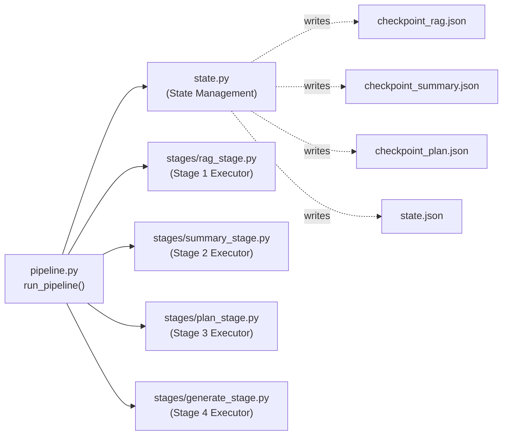
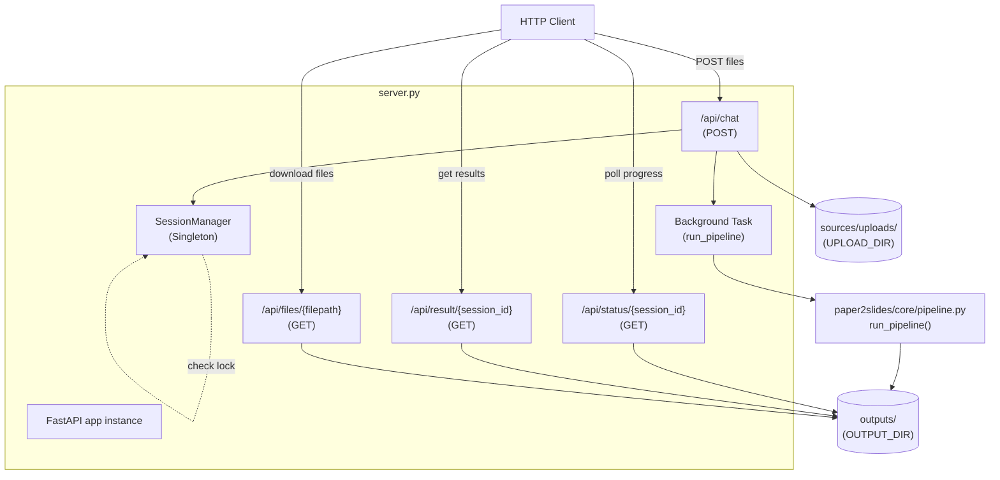
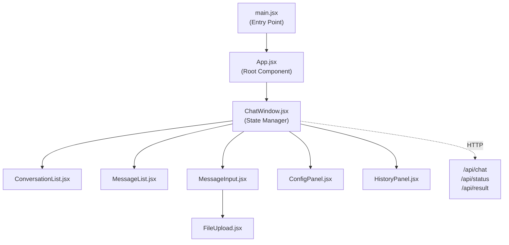
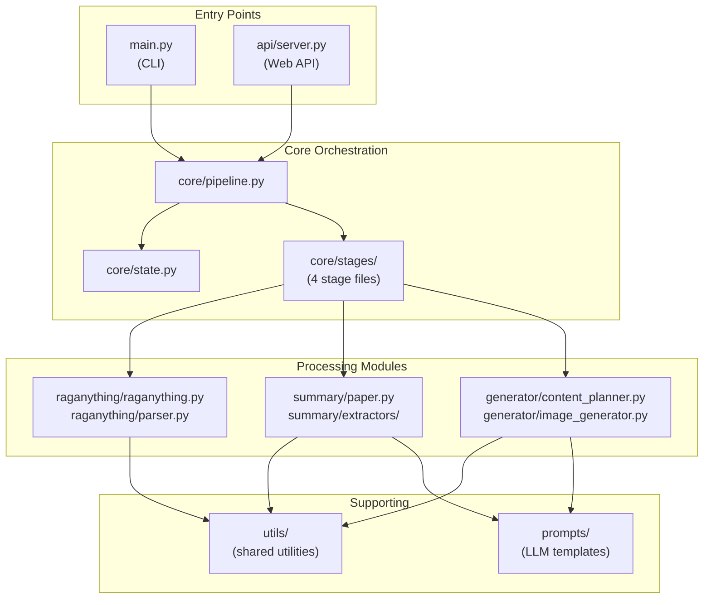

<!-- source: DeepWiki mcp.deepwiki.com · repo HKUDS/Paper2Slides · page 7.1 Project Structure · fetched 2026-11-09 -->

# Project Structure

<details>
<summary>Relevant source files</summary>

The following files were used as context for generating this wiki page:

- [.gitignore](.gitignore)
- [README.md](README.md)

</details>


This document provides an overview of the Paper2Slides codebase organization and the responsibilities of each module. It is intended for developers who want to understand the system architecture, contribute to the project, or customize functionality.

For instructions on setting up the development environment, see [Setting Up Development Environment](#7.2). For information on running the services, see [Running and Deploying](#7.3).

---

## Repository Layout

The Paper2Slides repository is organized into four primary areas: the core library, the web API backend, the React frontend, and auxiliary scripts.

```mermaid
graph TB
    Root["Paper2Slides/<br/>(Repository Root)"]
    
    Root --> CoreLib["paper2slides/<br/>(Core Python Library)"]
    Root --> API["api/<br/>(FastAPI Backend)"]
    Root --> Frontend["frontend/<br/>(React UI)"]
    Root --> Scripts["scripts/<br/>(Shell Scripts)"]
    Root --> Config["Configuration Files<br/>(.env, requirements.txt, etc.)"]
    Root --> Data["Runtime Data Directories<br/>(sources/, outputs)"]
    
    CoreLib --> Main["main.py<br/>(CLI Entry Point)"]
    CoreLib --> Core["core/<br/>(Pipeline Orchestration)"]
    CoreLib --> RAG["raganything/<br/>(Document Parsing & RAG)"]
    CoreLib --> Summary["summary/<br/>(Content Extraction)"]
    CoreLib --> Generator["generator/<br/>(Planning & Generation)"]
    CoreLib --> Prompts["prompts/<br/>(LLM Templates)"]
    CoreLib --> Utils["utils/<br/>(Shared Utilities)"]
    
    API --> Server["server.py<br/>(FastAPI Application)"]
    
    Frontend --> Src["src/<br/>(React Components)"]
    Frontend --> FrontendConfig["vite.config.js<br/>package.json"]
    
    Scripts --> StartScripts["start.sh<br/>start_backend.sh<br/>start_frontend.sh"]
```



**Sources**: [README.md:283-330]()

---

## Core Library (`paper2slides/`)

The `paper2slides/` directory contains the core Python library that implements the 4-stage pipeline. This library can be invoked via CLI or programmatically by the web backend.

### Entry Point: `main.py`

The [paper2slides/main.py]() file provides the command-line interface. It parses CLI arguments and invokes the pipeline orchestration logic.

**Key Responsibilities**:
- Parse command-line arguments (`--input`, `--output`, `--style`, etc.)
- Invoke `run_pipeline()` function from `core/pipeline.py`
- Handle the `--list` command to display existing outputs

### Core Pipeline Module (`core/`)

The `core/` subdirectory implements the pipeline orchestration system, state management, and the four processing stages.

#### `pipeline.py`

Contains the `run_pipeline()` function that orchestrates the entire 4-stage execution flow. This is the main entry point called by both the CLI and the web API.

**Key Functions**:
- `run_pipeline(config)` - Main orchestration function
- `detect_start_stage(output_dir)` - Determines which stage to start from based on existing checkpoints

#### `state.py`

Implements checkpoint state management. Handles reading and writing of `state.json` files that track pipeline progress.

**Key Classes/Functions**:
- State tracking for current stage and progress
- Checkpoint save/load operations
- State validation

#### `stages/` Subdirectory

Contains the implementation of each of the four pipeline stages:

| File | Stage | Purpose |
|------|-------|---------|
| `rag_stage.py` | Stage 1: RAG | Invokes document parsing and RAG indexing |
| `summary_stage.py` | Stage 2: Analysis | Invokes content extraction and figure/table detection |
| `plan_stage.py` | Stage 3: Planning | Invokes content planning for slides or posters |
| `generate_stage.py` | Stage 4: Creation | Invokes image generation and PDF creation |

Each stage file defines a main execution function that is called by `pipeline.py`.



**Sources**: [README.md:301-308]()

---

## RAG Module (`raganything/`)

The `raganything/` subdirectory implements document parsing and RAG (Retrieval Augmented Generation) indexing. This module is invoked by Stage 1 of the pipeline.

### `parser.py`

Handles parsing of various document formats (PDF, Word, Excel, PowerPoint, Markdown, etc.).

**Key Responsibilities**:
- Extract text content from documents
- Extract metadata (page numbers, sections)
- Handle multiple file formats

### `raganything.py`

Implements the RAG indexing system that creates a searchable knowledge base from parsed documents.

**Key Responsibilities**:
- Build vector index from document chunks
- Provide query interface for retrieval
- Store index to disk for reuse

**Outputs**: Produces `checkpoint_rag.json` and RAG index files in `outputs/<project>/rag_output/`

**Sources**: [README.md:310-312]()

---

## Summary Module (`summary/`)

The `summary/` subdirectory implements content extraction from documents, including identification of figures, tables, and structural hierarchy. This module is invoked by Stage 2 of the pipeline.

### `paper.py`

Extracts document structure, particularly for academic papers. Identifies sections like Abstract, Introduction, Methods, Results, Conclusion.

**Key Responsibilities**:
- Extract hierarchical section structure
- Identify key content areas
- Generate content summary

### `extractors/` Subdirectory

Contains specialized extractors for different content types:

| Component | Purpose |
|-----------|---------|
| Figure extractors | Identify and extract figures with captions |
| Table extractors | Identify and extract tables with captions |
| Citation extractors | Extract bibliography and citations |

**Outputs**: Produces `checkpoint_summary.json` and `summary.md`

**Sources**: [README.md:314-316]()

---

## Generator Module (`generator/`)

The `generator/` subdirectory implements content planning and image generation. This module is invoked by Stages 3 and 4 of the pipeline.

### `content_planner.py`

Creates the presentation blueprint—determining the number of slides/poster panels, content allocation, and layout structure.

**Key Responsibilities**:
- Determine slide count based on `--length` parameter (short/medium/long)
- Determine poster panel density based on `--density` parameter (sparse/medium/dense)
- Allocate content to slides/panels
- Generate layout specifications

**Outputs**: Produces `checkpoint_plan.json` containing the presentation blueprint

### `image_generator.py`

Handles image generation using the Gemini API (`gemini-3-pro-image-preview`).

**Key Responsibilities**:
- Generate images from layout specifications
- Apply style parameters
- Save individual slide/panel images as PNG
- Compile images into final PDF

**Outputs**: Produces PNG files (`slide_01.png`, `slide_02.png`, ...) and final PDF (`slides.pdf` or `poster.pdf`)

**Sources**: [README.md:318-320]()

---

## Supporting Modules

### `prompts/`

Contains LLM prompt templates used throughout the pipeline for various tasks:
- Document analysis prompts
- Content extraction prompts
- Planning prompts
- Image generation prompts

Templates are typically stored as text files or Python string constants.

### `utils/`

Contains shared utility functions:
- File I/O operations
- Path manipulation
- Logging configuration
- Configuration parsing

**Sources**: [README.md:322-323]()

---

## API Backend (`api/`)

The `api/` directory contains the FastAPI backend that provides a REST API for the web interface.

### `server.py`

The main FastAPI application file. Defines all HTTP endpoints and request handlers.

**Key Components**:

| Component | Purpose |
|-----------|---------|
| `app` (FastAPI instance) | Main application object |
| `SessionManager` class | Enforces single-threaded execution |
| `/api/chat` endpoint | Handles file upload and generation requests |
| `/api/status/{session_id}` endpoint | Returns current pipeline progress |
| `/api/result/{session_id}` endpoint | Returns final output files |
| `/api/files/{filepath:path}` endpoint | Serves generated files |



**Sources**: [README.md:325](), diagrams provided in context

---

## Frontend (`frontend/`)

The `frontend/` directory contains the React-based web user interface.

### Directory Structure

```
frontend/
├── src/
│   ├── App.jsx                    # Root component
│   ├── components/
│   │   ├── ChatWindow.jsx         # Main orchestrator component
│   │   ├── MessageList.jsx        # Displays chat messages
│   │   ├── MessageInput.jsx       # File upload interface
│   │   ├── FileUpload.jsx         # Drag-and-drop component
│   │   ├── ConfigPanel.jsx        # Generation settings
│   │   ├── ConversationList.jsx   # Conversation history
│   │   └── HistoryPanel.jsx       # History sidebar
│   └── main.jsx                   # Entry point
├── vite.config.js                 # Vite configuration
└── package.json                   # Dependencies
```

### Component Hierarchy



**Key Component Responsibilities**:

| Component | Responsibility |
|-----------|----------------|
| `ChatWindow.jsx` | Central state manager; coordinates all child components and API calls |
| `MessageList.jsx` | Renders conversation history and results |
| `MessageInput.jsx` | File upload interface and send button |
| `FileUpload.jsx` | Drag-and-drop file selection |
| `ConfigPanel.jsx` | Settings UI for output type, style, length/density |
| `ConversationList.jsx` | Navigation between different conversations |
| `HistoryPanel.jsx` | Sidebar showing conversation history |

**Sources**: [README.md:326](), diagrams provided in context

---

## Scripts (`scripts/`)

Shell scripts for starting and stopping services:

| Script | Purpose |
|--------|---------|
| `start.sh` | Starts both backend and frontend services |
| `start_backend.sh` | Starts only the FastAPI backend (`uvicorn api.server:app`) |
| `start_frontend.sh` | Starts only the Vite dev server (`npm run dev`) |
| `stop.sh` (if exists) | Stops running services |

**Sources**: [README.md:169-186](), [README.md:327]()

---

## Configuration Files

Located at repository root:

| File | Purpose |
|------|---------|
| `requirements.txt` | Python dependencies for the core library and backend |
| `package.json` | NPM dependencies for the frontend |
| `.env` | Environment variables (API keys, directory paths) |
| `.env.example` | Template for `.env` file |
| `.gitignore` | Specifies intentionally untracked files |
| `vite.config.js` | Vite build configuration |

**Environment Variables** (`.env` file):
- API keys for LLM services (e.g., `GEMINI_API_KEY`)
- Optional directory overrides for `UPLOAD_DIR` and `OUTPUT_DIR`

**Sources**: [README.md:121](), [.gitignore:38-40]()

---

## Data Directories

These directories are created at runtime and are excluded from version control via `.gitignore`.

### `sources/`

Contains uploaded source documents.

```
sources/
└── uploads/
    └── <session_id>/
        ├── document1.pdf
        ├── document2.docx
        └── ...
```

### `outputs/`

Contains all generated outputs, checkpoints, and intermediate files. The structure is hierarchical, encoding the processing context:

```
outputs/
└── <project_name>/           # Derived from PDF name or session_id
    └── <content_type>/       # "paper" or "general"
        └── <mode>/           # "fast" or "normal"
            ├── checkpoint_rag.json
            ├── checkpoint_summary.json
            ├── summary.md
            ├── rag_output/
            │   └── (RAG index files)
            └── <config_hash>/    # "slides_doraemon_medium"
                ├── state.json
                ├── checkpoint_plan.json
                └── <timestamp>/
                    ├── slide_01.png
                    ├── slide_02.png
                    └── slides.pdf
```

**Path Structure Explained**:

| Level | Purpose | Example Values |
|-------|---------|----------------|
| `<project_name>` | Identifies the source document(s) | `DeepSeek-V3-Paper`, `session_abc123` |
| `<content_type>` | Type of content | `paper`, `general` |
| `<mode>` | Processing mode | `fast`, `normal` |
| `<config_hash>` | Configuration identifier | `slides_doraemon_medium`, `poster_academic_dense` |
| `<timestamp>` | Generation timestamp | `20240115_143022` |

**Checkpoint Reusability**:
- `checkpoint_rag.json` and `checkpoint_summary.json` are stored at the `<mode>` level and can be reused across different configurations
- `checkpoint_plan.json` is stored at the `<config_hash>` level and is specific to that configuration

**Sources**: [README.md:234-254](), [README.md:256-262](), [.gitignore:58-59]()

---

## Module Dependencies

The following diagram shows how modules depend on each other:



**Dependency Notes**:
- The `core/` module depends on `raganything/`, `summary/`, and `generator/` modules
- Processing modules depend on `utils/` and `prompts/`
- The `api/server.py` backend imports from `paper2slides.core.pipeline`
- The frontend is completely decoupled; it communicates with the backend only via HTTP

**Sources**: [README.md:283-330]()

---

## Summary

The Paper2Slides codebase is organized into clearly separated concerns:

1. **Core Library** (`paper2slides/`) - Self-contained Python package implementing the 4-stage pipeline
2. **Web Backend** (`api/`) - Thin FastAPI wrapper providing HTTP endpoints
3. **Web Frontend** (`frontend/`) - React UI decoupled via REST API
4. **Scripts** - Shell utilities for service management
5. **Data Directories** - Runtime storage with hierarchical organization for caching and reuse

The modular design enables both CLI and web-based usage, with the core library being invokable from either entry point. The checkpoint system, implemented in `core/state.py`, provides resumability across all stages.

For detailed information on setting up the development environment, see [Setting Up Development Environment](#7.2).

**Sources**: [README.md:283-330]()

---

