# Page: Overview

# Overview

<details>
<summary>Relevant source files</summary>

The following files were used as context for generating this wiki page:

- [README.md](README.md)

</details>


## Purpose and Scope

This document provides a high-level introduction to the Paper2Slides system, its architecture, and how its major components interact. It is intended for developers and technical users who want to understand how the system works before diving into specific subsystems.

For step-by-step setup and usage instructions, see [Getting Started](#1.1). For definitions of key terms used throughout the system, see [Key Concepts and Terminology](#1.2). For detailed documentation of the 4-stage processing pipeline, see [Core Pipeline Architecture](#2).

**Sources:** [README.md:1-100]()

---

## What is Paper2Slides

Paper2Slides is a document-to-presentation conversion system that transforms research papers, reports, and other documents into professional slides or posters. The system processes input files through a multi-stage pipeline that:

1. Parses and indexes document content using RAG (Retrieval Augmented Generation)
2. Extracts structured content including figures, tables, and hierarchies
3. Plans optimal layout and organization for the target output format
4. Generates final presentation materials as high-quality images and PDFs

The system supports multiple input formats (PDF, Word, Excel, PowerPoint, Markdown) and provides two user interfaces: a command-line interface for automation and scripting, and a web-based interface for interactive use.

**Sources:** [README.md:20-50]()

---

## System Architecture

The Paper2Slides system consists of three major layers: user interfaces, processing pipeline, and storage management. The architecture emphasizes resumability through checkpoints and efficient regeneration through intelligent caching.

### High-Level Component Structure

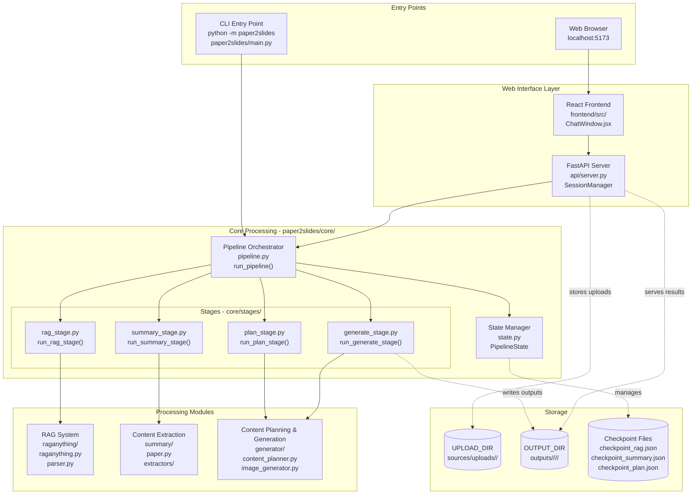

The system offers two entry points that converge on the same core pipeline. The CLI provides direct access via [paper2slides/main.py](), while the web interface adds a React frontend and FastAPI backend layer for session management and real-time progress tracking. Both paths execute the same 4-stage pipeline defined in [paper2slides/core/pipeline.py]().

**Sources:** [README.md:94-330](), [paper2slides/core/pipeline.py](), [api/server.py]()

---

## Core Processing Pipeline

The system implements a 4-stage pipeline where each stage produces checkpoints that enable resumption and selective regeneration:

| Stage | Module | Checkpoint | Purpose |
|-------|--------|------------|---------|
| **RAG** | `core/stages/rag_stage.py` | `checkpoint_rag.json` | Parse documents and build searchable index |
| **Analysis** | `core/stages/summary_stage.py` | `checkpoint_summary.json` | Extract structure, figures, tables |
| **Planning** | `core/stages/plan_stage.py` | `checkpoint_plan.json` | Generate layout blueprint |
| **Creation** | `core/stages/generate_stage.py` | Output directory | Render images and PDFs |

Each stage reads from the previous stage's checkpoint and writes its own checkpoint, creating a chain of resumable operations. The `PipelineState` class in [paper2slides/core/state.py]() manages checkpoint lifecycle and determines which stage to start from based on existing outputs.

### Stage Dependencies

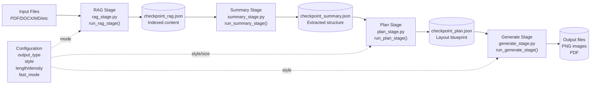

The configuration parameters influence different stages: `fast_mode` affects RAG processing, `output_type` affects planning, and `style` parameters affect both planning and generation. Checkpoints at the mode level (`checkpoint_rag.json`, `checkpoint_summary.json`) can be reused across different style configurations, while `checkpoint_plan.json` is specific to a particular style/length/density combination.

**Sources:** [README.md:198-229](), [paper2slides/core/pipeline.py](), [paper2slides/core/state.py]()

---

## Entry Points and Interfaces

### Command-Line Interface

The CLI is the primary interface for automation and batch processing. It is invoked via Python's module execution:

```bash
python -m paper2slides --input paper.pdf --output slides --style doraemon --length medium
```

The entry point is [paper2slides/main.py](), which parses arguments and invokes `run_pipeline()` from [paper2slides/core/pipeline.py](). The CLI supports all configuration parameters and provides direct access to stage control via `--from-stage`.

For complete CLI documentation, see [Command-Line Interface](#3).

### Web Interface

The web interface consists of two services:

1. **Frontend**: React application served by Vite at `localhost:5173`. Main component is `ChatWindow` in [frontend/src/components/ChatWindow.jsx]()
2. **Backend**: FastAPI server in [api/server.py]() that manages sessions and executes the pipeline in background tasks

The web interface enables interactive configuration, real-time progress monitoring via polling, and visual result display. The backend enforces single-threaded execution through the `SessionManager` class to prevent concurrent pipeline runs.

For web interface details, see [Web Interface](#4).

**Sources:** [README.md:103-195](), [paper2slides/main.py](), [api/server.py]()

---

## Data Flow and Execution

### Web Interface Request Lifecycle

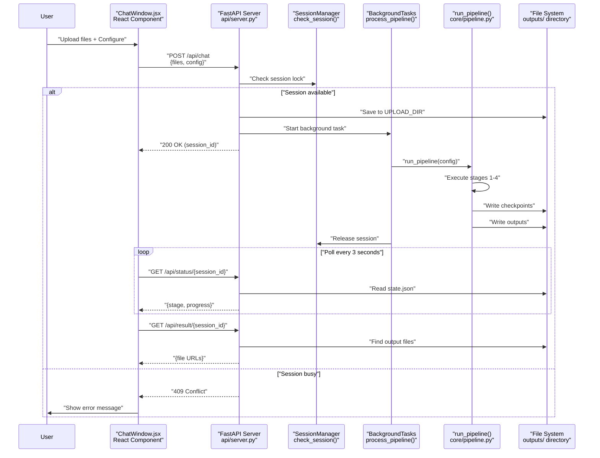

The web interface uses non-blocking asynchronous processing. The backend returns immediately with a `session_id`, allowing the frontend to poll `/api/status/{session_id}` for progress updates while the pipeline executes in the background. This architecture prevents HTTP timeout issues for long-running generations.

**Sources:** [api/server.py](), [frontend/src/components/ChatWindow.jsx]()

---

## Storage Organization

The system uses a hierarchical storage structure that enables intelligent caching and selective regeneration:

```
outputs/
├── <project_name>/              # Derived from PDF title or session_id
│   ├── <content_type>/          # "paper" or "general"
│   │   ├── <mode>/              # "fast" or "normal"
│   │   │   ├── checkpoint_rag.json
│   │   │   ├── checkpoint_summary.json
│   │   │   ├── summary.md
│   │   │   ├── <config_hash>/   # e.g., "slides_doraemon_medium"
│   │   │   │   ├── state.json
│   │   │   │   ├── checkpoint_plan.json
│   │   │   │   └── <timestamp>/
│   │   │   │       ├── slide_01.png
│   │   │   │       ├── slide_02.png
│   │   │   │       └── slides.pdf
│   │   │   └── rag_output/      # RAG index files
│   │   └── ...
```

### Checkpoint Reusability

| Checkpoint | Location | Reusable When |
|------------|----------|---------------|
| `checkpoint_rag.json` | `<mode>/` level | Same input files, same mode |
| `checkpoint_summary.json` | `<mode>/` level | Same input files, same mode |
| `checkpoint_plan.json` | `<config_hash>/` level | Same style + length/density |
| `state.json` | `<config_hash>/` level | Current pipeline execution state |

This structure allows regeneration with different styles without re-parsing documents. Changing from `style=doraemon` to `style=academic` reuses RAG and summary checkpoints but regenerates from the planning stage.

**Sources:** [README.md:231-263]()

---

## Key Design Principles

### 1. Resumability Through Checkpoints

Every pipeline stage writes structured checkpoint files. The `detect_start_stage()` function in [paper2slides/core/state.py]() examines existing checkpoints to determine the optimal starting point, enabling automatic recovery from interruptions and efficient regeneration when only downstream parameters change.

### 2. Single-Threaded Execution

The system enforces one active pipeline execution at a time through `SessionManager` in the web interface. This prevents resource conflicts and ensures consistent checkpoint state. The CLI naturally provides single-threaded execution per invocation.

### 3. Configuration-Driven Processing

All pipeline behavior is controlled by configuration parameters passed through `run_pipeline()`. The same core pipeline code handles both slides and posters, both normal and fast modes, through conditional logic based on configuration.

### 4. Separation of Concerns

- **Interfaces** (`main.py`, `api/server.py`) handle user interaction and input validation
- **Pipeline** (`core/pipeline.py`) orchestrates stage execution and checkpoint management
- **Stages** (`core/stages/`) implement specific processing logic
- **Modules** (`raganything/`, `summary/`, `generator/`) provide domain-specific functionality

This separation enables independent testing and modification of each layer.

**Sources:** [README.md:152-229](), [paper2slides/core/pipeline.py](), [paper2slides/core/state.py](), [api/server.py]()

---

## Summary

Paper2Slides transforms documents into presentations through a 4-stage pipeline (RAG → Analysis → Planning → Creation) accessible via CLI or web interface. The architecture prioritizes:

- **Reliability** through checkpoint-based recovery
- **Efficiency** through intelligent caching and stage skipping
- **Flexibility** through configuration-driven processing
- **Usability** through dual interfaces (CLI for automation, web for interaction)

The system's hierarchical storage structure and checkpoint strategy enable sophisticated workflows like regenerating with different styles without re-parsing, or resuming long-running generations after interruption.

For next steps:
- [Getting Started](#1.1) for installation and first use
- [Core Pipeline Architecture](#2) for detailed pipeline documentation
- [Command-Line Interface](#3) or [Web Interface](#4) for interface-specific details
- [Configuration Guide](#5) for all available parameters

**Sources:** [README.md:1-348]()

---

# Page: Getting Started

# Getting Started

<details>
<summary>Relevant source files</summary>

The following files were used as context for generating this wiki page:

- [README.md](README.md)

</details>


This page guides you through installing Paper2Slides, configuring API credentials, and running your first document-to-presentation conversion using either the command-line interface or web interface.

**Scope**: This page covers initial setup only. For detailed configuration options, see [Configuration Guide](#5). For comprehensive CLI usage, see [CLI Options Reference](#3.1). For understanding core concepts like RAG, checkpoints, and processing modes, see [Key Concepts and Terminology](#1.2).

---

## Prerequisites

Before installing Paper2Slides, ensure you have:

| Requirement | Version | Purpose |
|------------|---------|---------|
| Python | 3.10+ | Core runtime |
| Conda | Any recent version | Environment management |
| Git | Any recent version | Repository cloning |
| Google Gemini API Key | - | Image generation via `gemini-3-pro-image-preview` |

**Sources**: [README.md:106-118]()

---

## Installation

### Step 1: Clone and Setup Environment

```bash
# Clone the repository
git clone https://github.com/HKUDS/Paper2Slides.git
cd Paper2Slides

# Create isolated conda environment
conda create -n paper2slides python=3.10 -y
conda activate paper2slides

# Install Python dependencies
pip install -r requirements.txt
```

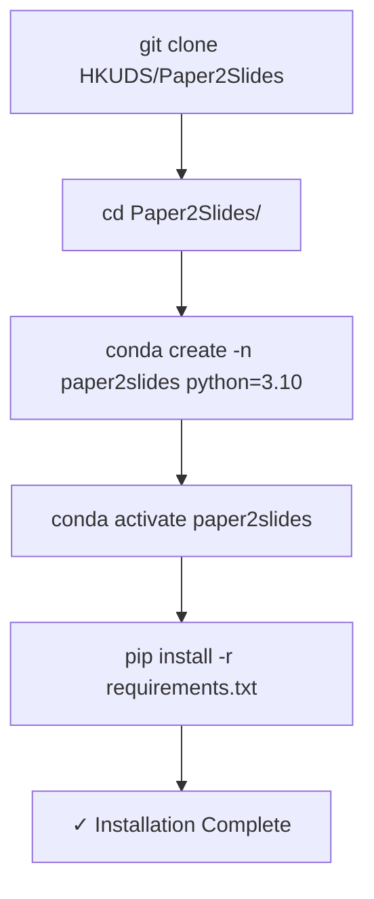

**Installation Flow**: The process creates an isolated conda environment named `paper2slides` and installs all dependencies specified in `requirements.txt`.

**Sources**: [README.md:106-118]()

---

## Configuration: API Keys Setup

Paper2Slides requires API credentials for LLM operations and image generation. These must be configured in a `.env` file before first use.

### Step 2: Create `.env` File

```bash
# Navigate to the paper2slides package directory
cd paper2slides/

# Copy the example environment file
cp .env.example .env

# Edit .env with your API keys
# Use your preferred text editor (nano, vim, code, etc.)
nano .env
```

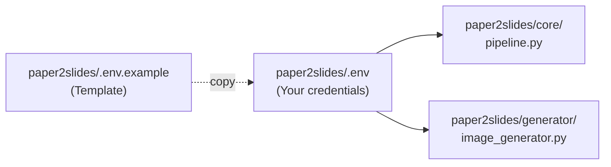

**Environment File Location**: The `.env` file must be placed in the `paper2slides/` subdirectory (the package directory), not the repository root. This is where the Python package code expects to load it.

### Required API Keys

The `.env.example` template specifies which API keys are required. At minimum, you need:

- **Google Gemini API Key**: Used by [paper2slides/generator/image_generator.py]() for rendering slides/posters via `gemini-3-pro-image-preview` model

**Sources**: [README.md:120-121]()

---

## First Conversion: Command Line

Once installation and configuration are complete, you can run your first conversion using the CLI.

### Step 3: Basic CLI Conversion

```bash
# Ensure you're in the repository root and environment is activated
conda activate paper2slides

# Basic example: Generate slides from a PDF
python -m paper2slides --input paper.pdf --output slides --length medium

# Generate a poster instead
python -m paper2slides --input paper.pdf --output poster --density medium

# Fast mode (skip RAG indexing for quick preview)
python -m paper2slides --input paper.pdf --output slides --fast
```

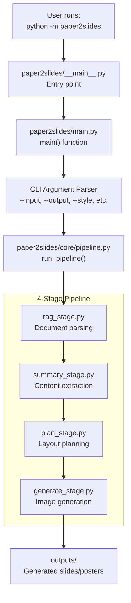

**CLI Entry Point**: Running `python -m paper2slides` invokes [paper2slides/__main__.py]() which calls [paper2slides/main.py:main()]() to parse arguments and execute [paper2slides/core/pipeline.py:run_pipeline()]().

### Understanding the Output

After execution completes, your generated files will be in the `outputs/` directory:

```
outputs/
└── <project_name>/          # Derived from input filename
    └── paper/               # content_type
        └── normal/          # mode (or "fast")
            ├── checkpoint_rag.json
            ├── checkpoint_summary.json
            └── slides_doraemon_medium/    # <output>_<style>_<length>
                ├── state.json
                ├── checkpoint_plan.json
                └── <timestamp>/
                    ├── slide_01.png
                    ├── slide_02.png
                    ├── ...
                    └── slides.pdf      # Final output
```

**Sources**: [README.md:123-165](), [README.md:234-254]()

---

## First Conversion: Web Interface

The web interface provides an interactive way to upload documents, configure options, and monitor generation progress in real-time.

### Step 4: Launch Web Services

Paper2Slides' web interface requires both a backend API server and a frontend development server.

**Option A: Launch Both Services Together**
```bash
# From repository root
./scripts/start.sh
```

**Option B: Launch Services Separately**
```bash
# Terminal 1: Start FastAPI backend
./scripts/start_backend.sh

# Terminal 2: Start React/Vite frontend
./scripts/start_frontend.sh
```

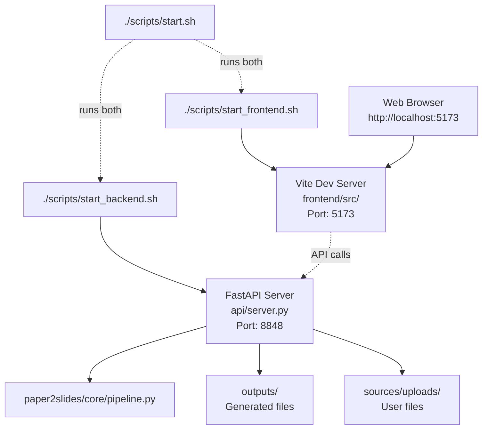

**Service Architecture**: [scripts/start_backend.sh]() launches [api/server.py]() which listens on port 8848. [scripts/start_frontend.sh]() launches the Vite development server on port 5173, which serves the React application from `frontend/src/`.

### Step 5: Access Web Interface

1. Open your browser to `http://localhost:5173`
2. Upload one or more document files (PDF, Word, Markdown, etc.)
3. Configure generation options:
   - **Output Type**: Slides or Poster
   - **Style**: Academic, Doraemon, or custom description
   - **Length/Density**: Short/Medium/Long for slides, Sparse/Medium/Dense for posters
   - **Mode**: Normal (with RAG) or Fast (skip RAG)
4. Click "Generate" and monitor real-time progress
5. Download generated slides/poster when complete

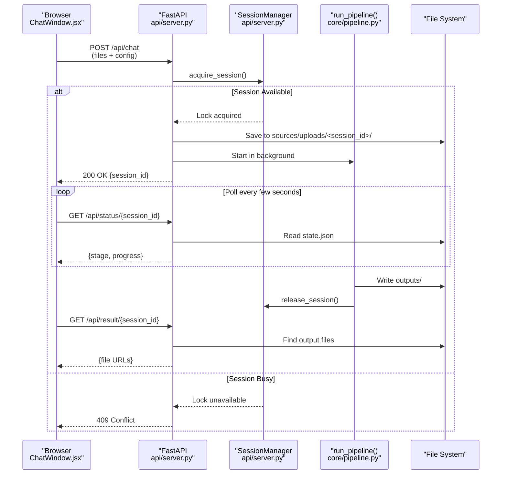

**Web Request Flow**: The frontend [frontend/src/components/ChatWindow.jsx]() sends file uploads to [api/server.py:/api/chat]() endpoint. The backend uses `SessionManager` to enforce single-threaded execution, stores files in `sources/uploads/<session_id>/`, and runs [paper2slides/core/pipeline.py:run_pipeline()]() in a background task. The frontend polls [api/server.py:/api/status]() for progress updates.

**Sources**: [README.md:167-194]()

---

## Verifying Your Setup

After completing your first conversion, verify that Paper2Slides is working correctly:

### Verification Checklist

| Check | Expected Result | How to Verify |
|-------|-----------------|---------------|
| **CLI runs without errors** | Exit code 0, no exceptions | `echo $?` after CLI command |
| **Output directory created** | `outputs/<project_name>/` exists | `ls outputs/` |
| **Checkpoint files present** | `checkpoint_rag.json`, `checkpoint_summary.json`, `checkpoint_plan.json` exist | Check output directory |
| **Final outputs generated** | PNG files and PDF in `<timestamp>/` directory | Check final output directory |
| **Web services accessible** | Backend on port 8848, frontend on port 5173 | `curl http://localhost:8848/health` and open browser to `http://localhost:5173` |

### Quick Test Commands

```bash
# Test CLI with fast mode (quickest verification)
python -m paper2slides --input sample.pdf --output slides --fast

# List all generated outputs
python -m paper2slides --list

# Verify web backend is running (if web interface launched)
curl http://localhost:8848/health
```

**Sources**: [README.md:123-137]()

---

## Common First-Run Issues

| Issue | Cause | Solution |
|-------|-------|----------|
| `ModuleNotFoundError` | Conda environment not activated | Run `conda activate paper2slides` |
| `API key not found` error | `.env` file missing or in wrong location | Ensure `.env` is in `paper2slides/` directory, not repository root |
| `Permission denied` on scripts | Shell scripts not executable | Run `chmod +x scripts/*.sh` |
| Web interface won't start | Port already in use | Stop other services on ports 5173/8848, or modify port in scripts |
| `No such file or directory` for input | Incorrect file path | Use absolute path or verify relative path from repository root |

**Sources**: [README.md:106-121]()

---

## Next Steps

Now that you have Paper2Slides installed and verified, explore these topics:

- **[Key Concepts and Terminology](#1.2)**: Understand RAG, checkpoints, sessions, and processing modes
- **[CLI Options Reference](#3.1)**: Learn about all available CLI flags and options
- **[Configuration Guide](#5)**: Deep dive into output types, styles, and optimization parameters
- **[Smart Recovery System](#2.5)**: Learn how to resume interrupted conversions and regenerate with different settings
- **[Web Interface](#4)**: Detailed guide to using the web UI effectively

For developers wanting to customize or extend Paper2Slides:
- **[Development Guide](#7)**: Setup development environment and understand codebase structure

**Sources**: [README.md:94-100]()

---

# Page: Key Concepts and Terminology

# Key Concepts and Terminology

<details>
<summary>Relevant source files</summary>

The following files were used as context for generating this wiki page:

- [README.md](README.md)

</details>


This page defines the fundamental concepts, terms, and system components used throughout Paper2Slides. Understanding these concepts is essential for working with the system effectively, whether through the CLI or web interface.

For detailed information about specific topics:
- Installation and first-time usage → see [Getting Started](#1.1)
- Detailed pipeline architecture → see [Core Pipeline Architecture](#2)
- Configuration options and parameters → see [Configuration Guide](#5)
- File organization and storage → see [File Management](#6)

---

## Core System Concepts

### RAG (Retrieval Augmented Generation)

**RAG** is the mechanism Paper2Slides uses to parse and intelligently query document content. Rather than passing entire documents to the LLM, RAG creates a searchable index that allows the system to retrieve only relevant sections for each processing stage.

**Implementation**: The RAG subsystem is located in [paper2slides/raganything/](). The core components are:
- `RAGAnything` class in [paper2slides/raganything/raganything.py]() - manages indexing and querying
- `DocumentParser` class in [paper2slides/raganything/parser.py]() - handles multi-format document parsing (PDF, Word, Markdown, etc.)

**Checkpoint**: RAG results are stored in `checkpoint_rag.json`, which contains:
- Parsed document content segments
- File paths to extracted figures and tables
- Metadata for efficient retrieval

**When RAG is Used**:
- **Normal Mode**: Full RAG indexing is performed for comprehensive document analysis
- **Fast Mode**: RAG indexing is skipped; content is directly queried via LLM

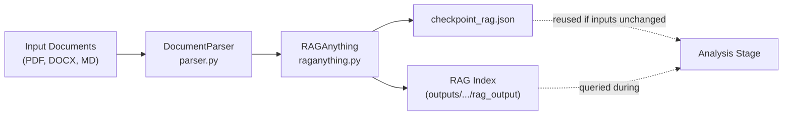

**Sources**: [README.md:204](), [README.md:216-228]()

---

### Stages and Pipeline

The Paper2Slides pipeline consists of **4 sequential stages**, each with a specific responsibility:

| Stage Number | Stage Name | Module | Checkpoint File | Purpose |
|--------------|------------|--------|-----------------|---------|
| 1 | **RAG** | [core/stages/rag_stage.py]() | `checkpoint_rag.json` | Parse documents and build searchable index |
| 2 | **Analysis** | [core/stages/summary_stage.py]() | `checkpoint_summary.json` | Extract structure, figures, tables, and content hierarchy |
| 3 | **Planning** | [core/stages/plan_stage.py]() | `checkpoint_plan.json` | Generate layout blueprint for slides/poster |
| 4 | **Creation** | [core/stages/generate_stage.py]() | Output files (PNG, PDF) | Render final presentation materials |

**Pipeline Orchestration**: The [paper2slides/core/pipeline.py]() module contains the `run_pipeline` function that coordinates stage execution.

**Stage Detection**: The system automatically detects which stage to start from using `detect_start_stage` logic in [paper2slides/core/state.py](), based on existing checkpoint files.

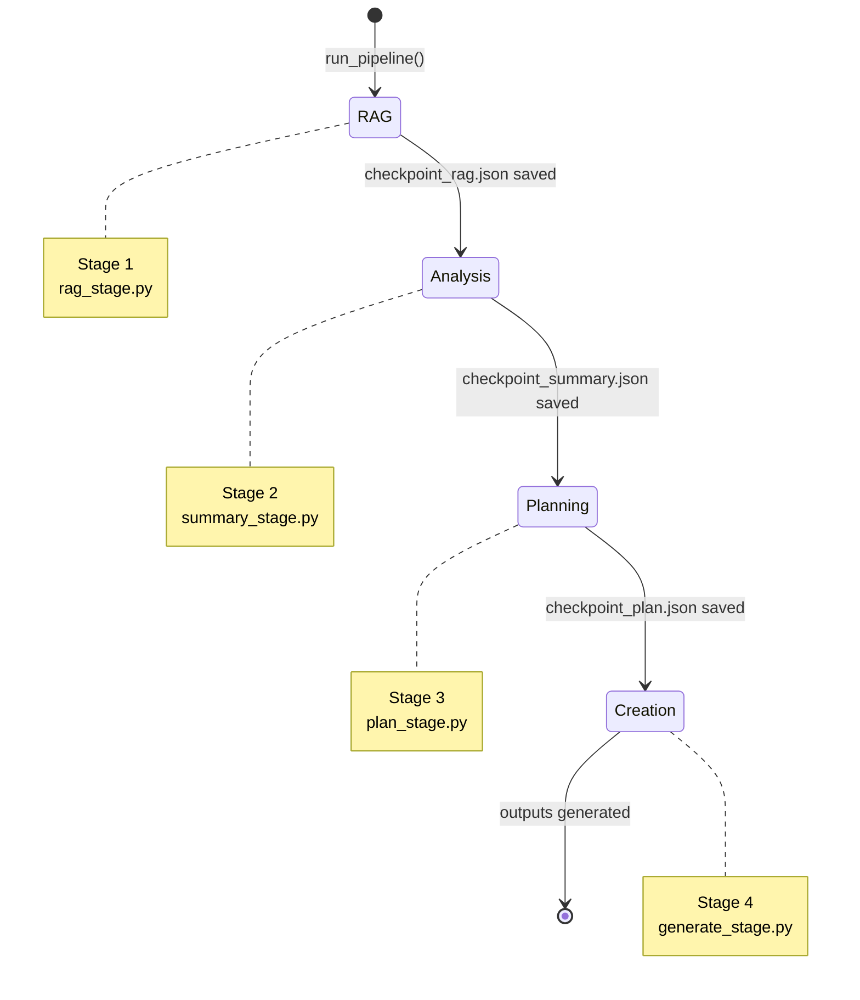

**Sources**: [README.md:202-208](), [README.md:304-309]()

---

### Checkpoints and State Management

**Checkpoints** are JSON files that save pipeline progress at the completion of each stage, enabling resumption without reprocessing.

#### Checkpoint Types

| Checkpoint File | Created By | Location | Contents | Reusable When |
|-----------------|------------|----------|----------|---------------|
| `checkpoint_rag.json` | RAG Stage | `<mode>/` directory | Parsed content, file paths | Input files unchanged |
| `checkpoint_summary.json` | Analysis Stage | `<mode>/` directory | Extracted figures, tables, structure | Input files unchanged |
| `checkpoint_plan.json` | Planning Stage | `<config_name>/` directory | Slide/poster layout plan | Style and size parameters unchanged |
| `state.json` | Pipeline Orchestrator | `<config_name>/` directory | Current stage, progress, errors | Per generation run |

**Checkpoint Hierarchy**: Notice that `checkpoint_rag.json` and `checkpoint_summary.json` are stored at the `<mode>` level (fast/normal), making them reusable across different style configurations. `checkpoint_plan.json` is stored at the `<config_name>` level, reusable only when all generation parameters match.

**State Manager**: The [paper2slides/core/state.py]() module provides:
- `PipelineState` class - tracks current stage and progress
- `save_checkpoint()` - writes checkpoint files
- `load_checkpoint()` - reads checkpoint files
- `detect_start_stage()` - determines resumption point

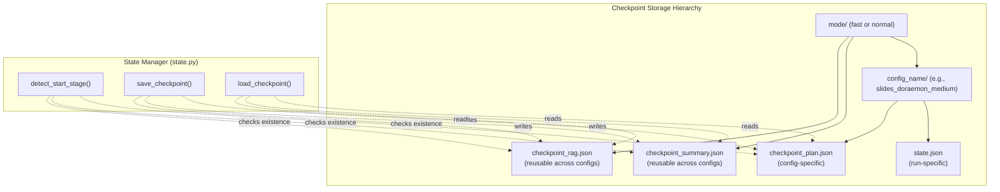

**Sources**: [README.md:153-165](), [README.md:256-262](), [README.md:303-304]()

---

### Sessions and Concurrency Control

**Sessions** are a web interface concept that represents a single document-to-presentation generation workflow. Each session has a unique `session_id` and ensures that only one generation can run at a time.

**SessionManager**: Located in [api/server.py](), this component implements:
- Single-threaded execution (one active generation at a time)
- Session locking mechanism
- Background task coordination
- Returns HTTP 409 (Conflict) when attempting concurrent generations

**Session Lifecycle**:
1. User uploads files via web interface
2. Backend assigns a `session_id` (UUID format)
3. Files stored in `sources/uploads/<session_id>/`
4. `SessionManager` acquires lock
5. Pipeline executes in background task
6. Frontend polls `/api/status/{session_id}` for progress
7. On completion, `SessionManager` releases lock
8. Frontend retrieves results from `/api/result/{session_id}`

**Note**: The CLI does not use sessions; it executes the pipeline directly in the main process.

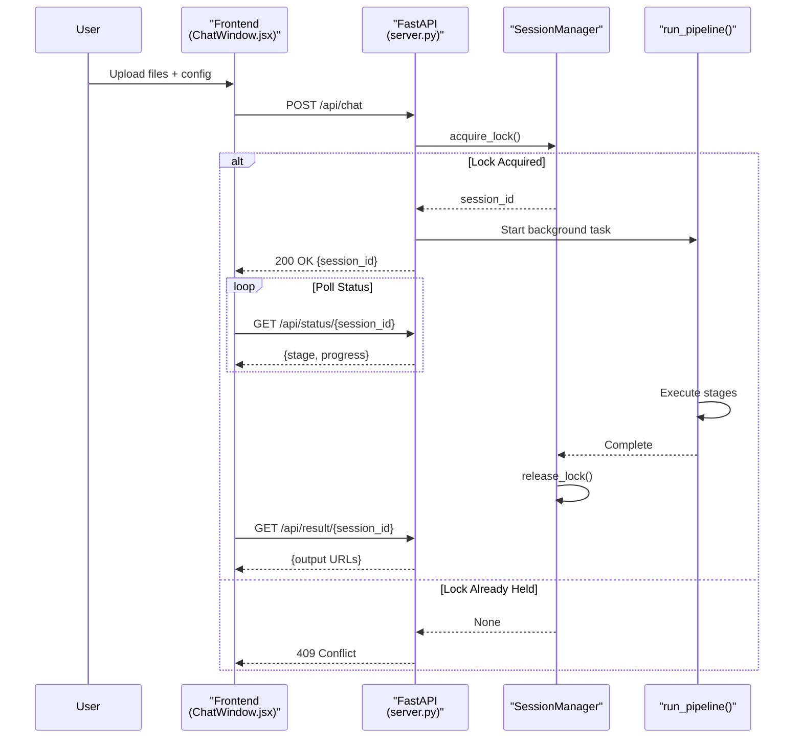

**Sources**: [README.md:169-186](), System architecture diagrams (api/server.py cluster)

---

### Output Types

Paper2Slides supports two output types, each with distinct characteristics:

| Output Type | CLI Flag | Description | Size Parameters | Use Cases |
|-------------|----------|-------------|-----------------|-----------|
| **Slides** | `--output slides` | Multi-slide presentation deck | `--length`: `short`, `medium`, `long` | Conference talks, lectures, detailed presentations |
| **Poster** | `--output poster` | Single-page poster | `--density`: `sparse`, `medium`, `dense` | Conference posters, summaries, quick overviews |

**Code Mapping**:
- Output type affects [paper2slides/generator/content_planner.py]() - different planning strategies
- Slides generate multiple PNG files: `slide_01.png`, `slide_02.png`, etc.
- Posters generate a single `poster.png` file
- Both produce a final PDF: `slides.pdf` or `poster.pdf`

**Size Parameters**:
- **Length** (slides): Controls number of slides generated (short ≈ 5-10, medium ≈ 10-20, long ≈ 20-30)
- **Density** (posters): Controls information density on single page (sparse = minimal text, dense = comprehensive coverage)

**Sources**: [README.md:144](), [README.md:148]()

---

### Processing Modes

Paper2Slides operates in two modes that determine how documents are processed:

| Mode | CLI Flag | RAG Indexing | Processing Path | Best For |
|------|----------|--------------|-----------------|----------|
| **Normal** | (default) | ✓ Full indexing | Parse → Index → Query → Process | Long documents, multiple files, complex papers |
| **Fast** | `--fast` | ✗ Skipped | Parse → Direct LLM query | Short documents, quick previews, simple content |

**Decision Criteria**:

```mermaid
graph TD
    Start["User Specifies Mode"]
    FastFlag{"`--fast flag?`"}
    DocSize{"Document fits<br/>in LLM context?"}
    
    Start --> FastFlag
    
    FastFlag -->|Yes| FastMode["Fast Mode<br/>(skip RAG)"]
    FastFlag -->|No| NormalMode["Normal Mode<br/>(full RAG)"]
    
    FastMode --> DirectLLM["Direct LLM Query<br/>(no indexing)"]
    NormalMode --> FullRAG["Full RAG Pipeline<br/>(parse + index)"]
    
    note right of FastMode
        Checkpoint location:
        outputs/.../fast/
    end note
    
    note right of NormalMode
        Checkpoint location:
        outputs/.../normal/
    end note
```

**Mode Selection Logic**: 
- User explicitly sets with `--fast` flag (CLI) or via web interface toggle
- Mode is part of the output directory path: `outputs/<project>/<content>/<mode>/`
- Checkpoints from different modes are kept separate and not reused across modes

**Performance Impact**:
- **Normal Mode**: Initial RAG indexing adds overhead (~30s - 2min depending on document size)
- **Fast Mode**: Skips indexing, immediately processes content (~10s faster startup)

**Sources**: [README.md:149](), [README.md:212-228]()

---

### Content Types

The **content type** parameter indicates the nature of the input document:

| Content Type | CLI Flag | Description | Processing Adjustments |
|--------------|----------|-------------|------------------------|
| **Paper** | `--content paper` | Academic/research papers | Expects abstract, introduction, methodology, results, conclusion structure |
| **General** | `--content general` | Generic documents | Flexible structure, no assumptions about sections |

**Code Impact**:
- Affects prompts in [paper2slides/prompts/]() directory
- Changes extraction logic in [paper2slides/summary/paper.py]() - paper type uses specialized academic structure extraction
- Influences how [paper2slides/generator/content_planner.py]() organizes content

**Default**: `paper` is the default content type, optimized for academic/research documents.

**Sources**: [README.md:145]()

---

### Style Configuration

**Style** controls the visual appearance and design language of generated outputs. Paper2Slides supports both predefined and custom styles:

| Style Type | CLI Value | Description | Implementation |
|------------|-----------|-------------|----------------|
| **Academic** | `--style academic` | Clean, professional academic style | Predefined style prompts |
| **Doraemon** | `--style doraemon` | Colorful, friendly illustration style | Predefined style prompts |
| **Custom** | `--style "any text"` | Any natural language description | Passed directly to image generation LLM |

**Style in Code**:
- Style parameter is stored in configuration
- Used by [paper2slides/generator/image_generator.py]() to construct image generation prompts
- Affects prompt templates in [paper2slides/prompts/]() for image generation
- Part of `config_name` directory: `<output>_<style>_<size>/`

**Custom Style Examples**:
- `"minimalist with blue theme"`
- `"vibrant colors with nature elements"`
- `"dark mode with neon accents"`

**Image Generation Model**: The system uses `gemini-3-pro-image-preview` (referred to as "Nano Banana") for rendering, which interprets both predefined and custom style descriptions.

**Sources**: [README.md:146](), [README.md:263-270](), [README.md:271-280]()

---

### Configuration Parameters Summary

The following table summarizes all configuration parameters and their relationships:

| Parameter | Type | Values | Affects Stage(s) | Part of Config Hash | Example |
|-----------|------|--------|------------------|---------------------|---------|
| `input` | Required | File path(s) | RAG | ✗ (determines project name) | `paper.pdf` |
| `output` | Required | `slides`, `poster` | Planning, Creation | ✓ | `slides` |
| `content` | Optional | `paper`, `general` | RAG, Analysis | ✗ (directory level) | `paper` |
| `style` | Optional | `academic`, `doraemon`, custom text | Planning, Creation | ✓ | `doraemon` |
| `length` | Optional | `short`, `medium`, `long` | Planning | ✓ (slides only) | `medium` |
| `density` | Optional | `sparse`, `medium`, `dense` | Planning | ✓ (poster only) | `medium` |
| `fast` | Flag | `true`, `false` | All stages | ✗ (directory level) | `--fast` |
| `from-stage` | Optional | `rag`, `summary`, `plan`, `generate` | Pipeline control | ✗ | `--from-stage plan` |

**Config Hash**: The `config_name` directory name is computed from `output`, `style`, and size parameters:
- Slides: `slides_{style}_{length}` (e.g., `slides_doraemon_medium`)
- Poster: `poster_{style}_{density}` (e.g., `poster_academic_sparse`)

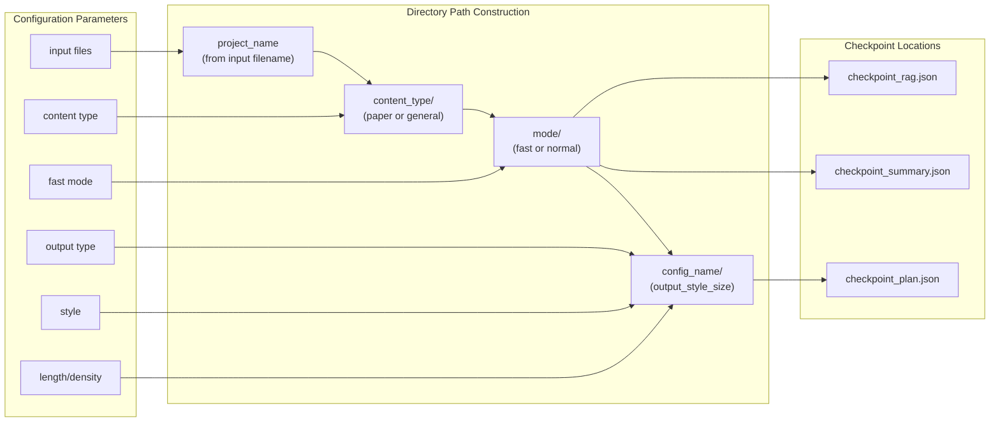

**Sources**: [README.md:139-151](), [README.md:233-254]()

---

## Related Code Entities

For reference, here are the key code modules and their responsibilities:

| Module Path | Primary Classes/Functions | Purpose |
|-------------|---------------------------|---------|
| [paper2slides/core/pipeline.py]() | `run_pipeline()` | Main pipeline orchestration |
| [paper2slides/core/state.py]() | `PipelineState`, `detect_start_stage()`, `save_checkpoint()`, `load_checkpoint()` | State and checkpoint management |
| [paper2slides/core/stages/rag_stage.py]() | Stage 1 execution | |
| [paper2slides/core/stages/summary_stage.py]() | Stage 2 execution | |
| [paper2slides/core/stages/plan_stage.py]() | Stage 3 execution | |
| [paper2slides/core/stages/generate_stage.py]() | Stage 4 execution | |
| [paper2slides/raganything/raganything.py]() | `RAGAnything` | RAG indexing and querying |
| [paper2slides/raganything/parser.py]() | `DocumentParser` | Multi-format document parsing |
| [paper2slides/summary/paper.py]() | Content extraction logic | |
| [paper2slides/generator/content_planner.py]() | `ContentPlanner` | Layout planning |
| [paper2slides/generator/image_generator.py]() | `ImageGenerator` | Image rendering via LLM |
| [api/server.py]() | `SessionManager`, FastAPI routes | Web interface backend |
| [frontend/src/components/ChatWindow.jsx]() | `ChatWindow` React component | Web interface state management |

**Sources**: [README.md:283-293](), [README.md:294-330]()

---

# Page: Core Pipeline Architecture

# Core Pipeline Architecture

<details>
<summary>Relevant source files</summary>

The following files were used as context for generating this wiki page:

- [README.md](README.md)
- [api/server.py](api/server.py)

</details>


## Purpose and Scope

This document describes the core 4-stage processing pipeline that transforms input documents into presentation materials. It covers the pipeline orchestration, stage sequencing, checkpoint mechanisms, and configuration flow. For detailed information about individual stages, see:
- Stage 1 (RAG): [Stage 1: RAG](#2.1)
- Stage 2 (Analysis): [Stage 2: Analysis and Content Extraction](#2.2)
- Stage 3 (Planning): [Stage 3: Planning and Layout](#2.3)
- Stage 4 (Creation): [Stage 4: Creation and Rendering](#2.4)
- Smart Recovery System: [Smart Recovery System](#2.5)

For user-facing configuration options, see [Configuration Guide](#5).

## Pipeline Overview

The Paper2Slides system processes documents through a linear 4-stage pipeline. Each stage produces checkpoint files that enable resumption and selective regeneration. The pipeline is orchestrated by the `run_pipeline` function in [paper2slides/core/pipeline.py]().

### Four Processing Stages

```mermaid
graph LR
    Input["Input Documents<br/>(PDF, MD, DOC, PPT)"]
    
    S1["Stage 1: rag<br/>RAG Indexing"]
    CP1[("checkpoint_rag.json")]
    
    S2["Stage 2: summary<br/>Content Extraction"]
    CP2[("checkpoint_summary.json")]
    
    S3["Stage 3: plan<br/>Layout Planning"]
    CP3[("checkpoint_plan.json")]
    
    S4["Stage 4: generate<br/>Image Generation"]
    Output["Output Files<br/>(PNG slides + PDF)"]
    
    Input --> S1
    S1 --> CP1
    CP1 --> S2
    S2 --> CP2
    CP2 --> S3
    S3 --> CP3
    CP3 --> S4
    S4 --> Output
```

**Stage Sequence**:
| Stage Number | Stage Name | Module | Primary Function | Checkpoint File |
|--------------|-----------|---------|------------------|-----------------|
| 1 | `rag` | `paper2slides.core.stages.rag_stage` | Document parsing and RAG indexing | `checkpoint_rag.json` |
| 2 | `summary` | `paper2slides.core.stages.summary_stage` | Extract structure, figures, tables | `checkpoint_summary.json` |
| 3 | `plan` | `paper2slides.core.stages.plan_stage` | Generate content layout blueprint | `checkpoint_plan.json` |
| 4 | `generate` | `paper2slides.core.stages.generate_stage` | Render final images and PDF | Output directory |

**Sources**: [README.md:202-207](), [paper2slides/core/pipeline.py]()

## Pipeline Orchestration

### Core Entry Points

The pipeline can be invoked through two interfaces that both converge on the same core execution logic:

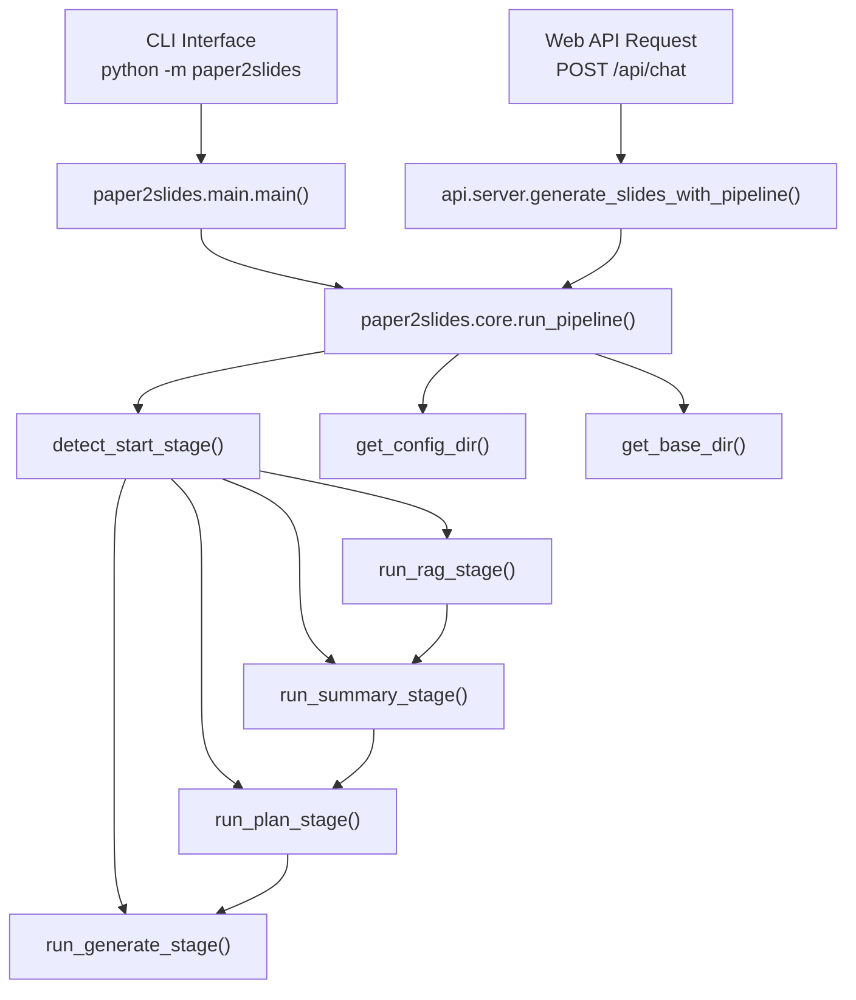

**Sources**: [api/server.py:294-430](), [paper2slides/main.py](), [paper2slides/core/pipeline.py]()

### Configuration Resolution

Before pipeline execution, the system resolves directory paths and determines which stage to start from:

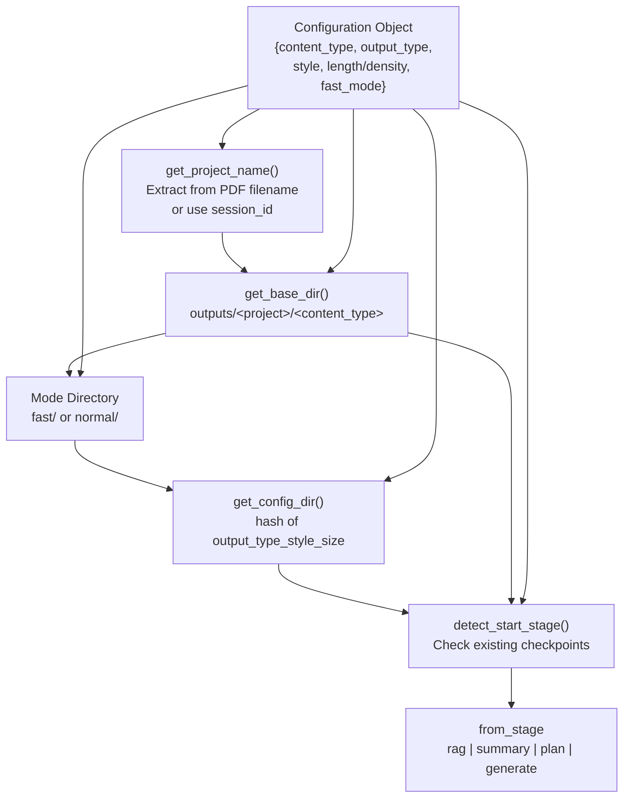

The `detect_start_stage` function implements the smart recovery logic by checking for existing checkpoint files and determining the earliest stage that needs execution:

**Logic Flow**:
1. Check if `checkpoint_plan.json` exists and is valid → start from `generate`
2. Check if `checkpoint_summary.json` exists and is valid → start from `plan`
3. Check if `checkpoint_rag.json` exists and is valid → start from `summary`
4. Otherwise → start from `rag`

**Sources**: [paper2slides/core/pipeline.py](), [api/server.py:388-404]()

## Stage Execution Flow

### Sequential Processing

Each stage follows a common execution pattern:

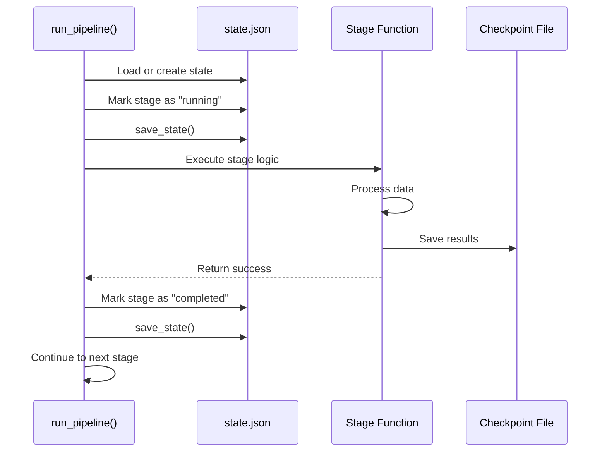

**State Tracking**: The `state.json` file maintains the current execution state. Each stage updates this file at the start and end of its execution:

```json
{
  "session_id": "uuid-string",
  "config": { /* configuration parameters */ },
  "stages": {
    "rag": "completed",
    "summary": "completed",
    "plan": "running",
    "generate": "pending"
  },
  "created_at": "2024-01-15T10:30:00",
  "updated_at": "2024-01-15T10:35:00"
}
```

**Sources**: [paper2slides/core/state.py](), [api/server.py:392-404]()

### Stage Interdependencies

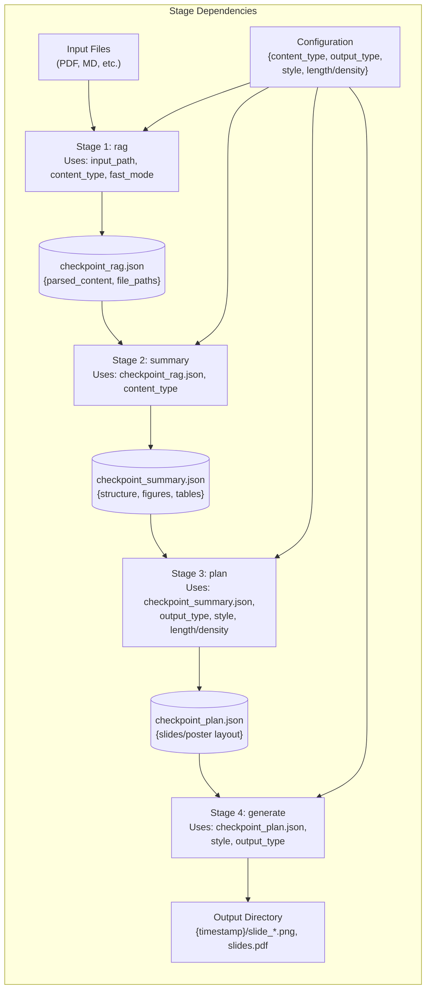

**Key Observations**:
- Stage 1 and 2 depend on `input_path` and `content_type` but not on `style` or `length`/`density`
- Stage 3 is the first stage influenced by `output_type`, `style`, and size parameters
- Stage 4 only depends on the plan checkpoint and style configuration

This dependency structure enables efficient regeneration: changing style only requires re-running stages 3-4, while the RAG and analysis results can be reused.

**Sources**: [README.md:202-228](), [paper2slides/core/pipeline.py]()

## Directory Structure and Checkpoints

### Hierarchical Output Organization

The output directory structure encodes processing context to enable checkpoint reuse:

```
outputs/
└── <project_name>/              # From PDF filename or session_id
    └── <content_type>/          # "paper" or "general"
        └── <mode>/              # "fast" or "normal"
            ├── checkpoint_rag.json        # Stage 1 output
            ├── checkpoint_summary.json    # Stage 2 output
            ├── summary.md                 # Human-readable summary
            ├── rag_output/                # RAG index files
            └── <config_hash>/             # e.g., "slides_doraemon_medium"
                ├── state.json             # Pipeline state tracker
                ├── checkpoint_plan.json   # Stage 3 output
                └── <timestamp>/           # e.g., "20240115_103045"
                    ├── slide_01.png
                    ├── slide_02.png
                    └── slides.pdf
```

### Checkpoint Reusability

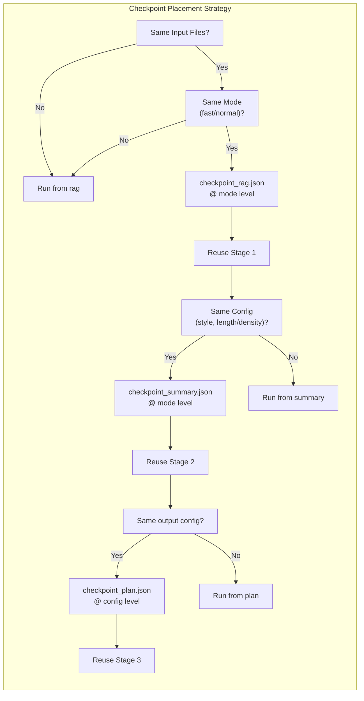

**Checkpoint Scope**:

| Checkpoint File | Location | Reusable When | Contains |
|-----------------|----------|---------------|----------|
| `checkpoint_rag.json` | `<mode>/` | Same input files + same mode | Parsed document content, file paths |
| `checkpoint_summary.json` | `<mode>/` | Same input files + same mode | Extracted figures, tables, structure |
| `checkpoint_plan.json` | `<config_hash>/` | Same config (style + length/density) | Content layout and slide/poster plan |
| `state.json` | `<config_hash>/` | Current generation | Stage statuses, timestamps |

**Sources**: [README.md:234-254](), [api/server.py:374-376]()

## Configuration Flow Through Pipeline

### Parameter Influence by Stage

Different configuration parameters affect different stages of the pipeline:

```mermaid
graph LR
    subgraph "Configuration Parameters"
        InputPath["input_path"]
        ContentType["content_type<br/>(paper/general)"]
        FastMode["fast_mode<br/>(true/false)"]
        OutputType["output_type<br/>(slides/poster)"]
        Style["style<br/>(academic/doraemon/custom)"]
        Length["length<br/>(short/medium/long)"]
        Density["density<br/>(sparse/medium/dense)"]
    end
    
    subgraph "Stage 1: rag"
        RAGStage["Document Parsing<br/>RAG Indexing"]
    end
    
    subgraph "Stage 2: summary"
        SumStage["Content Extraction<br/>Figure/Table Processing"]
    end
    
    subgraph "Stage 3: plan"
        PlanStage["Layout Planning<br/>Content Organization"]
    end
    
    subgraph "Stage 4: generate"
        GenStage["Image Generation<br/>PDF Creation"]
    end
    
    InputPath --> RAGStage
    ContentType --> RAGStage
    FastMode --> RAGStage
    
    ContentType --> SumStage
    
    OutputType --> PlanStage
    Style --> PlanStage
    Length --> PlanStage
    Density --> PlanStage
    
    Style --> GenStage
    OutputType --> GenStage
```

### Fast Mode vs Normal Mode

The `fast_mode` parameter creates a processing bifurcation at Stage 1:

```mermaid
graph TB
    Start["Pipeline Start"]
    CheckMode{"fast_mode<br/>enabled?"}
    
    subgraph "Normal Mode Path"
        FullRAG["Full RAG Indexing<br/>raganything.RAGAnything"]
        BuildIndex["Build vector index<br/>Chunk documents"]
        RAGOutput["checkpoint_rag.json<br/>with index references"]
    end
    
    subgraph "Fast Mode Path"
        SkipRAG["Skip RAG indexing<br/>Direct LLM query"]
        SimpleCP["checkpoint_rag.json<br/>with full text"]
    end
    
    Continue["Continue to summary stage"]
    
    Start --> CheckMode
    CheckMode -->|false| FullRAG
    CheckMode -->|true| SkipRAG
    
    FullRAG --> BuildIndex
    BuildIndex --> RAGOutput
    RAGOutput --> Continue
    
    SkipRAG --> SimpleCP
    SimpleCP --> Continue
```

**Use Cases**:
- **Normal Mode** (`fast_mode=false`): Default. Performs full RAG indexing. Suitable for long documents, multiple files, or when precise retrieval is needed.
- **Fast Mode** (`fast_mode=true`): Skips RAG indexing and uses direct LLM queries. Suitable for short documents that fit in context window, quick previews, or rapid iteration.

**Sources**: [README.md:212-228](), [api/server.py:236-237]()

## Pipeline Invocation Patterns

### CLI Invocation

The command-line interface directly calls the pipeline:

```mermaid
graph TB
    CLI["CLI Command<br/>python -m paper2slides"]
    
    Main["paper2slides.main.main()"]
    ArgParse["Parse CLI arguments<br/>--input, --output, --style, etc."]
    
    BuildConfig["Build config dict"]
    
    GetPaths["get_base_dir()<br/>get_config_dir()"]
    
    Detect["detect_start_stage()"]
    
    RunPipe["run_pipeline(base_dir, config_dir,<br/>config, from_stage)"]
    
    CLI --> Main
    Main --> ArgParse
    ArgParse --> BuildConfig
    BuildConfig --> GetPaths
    GetPaths --> Detect
    Detect --> RunPipe
```

**Sources**: [paper2slides/main.py](), [README.md:123-166]()

### Web API Invocation

The web interface adds asynchronous processing and session management:

```mermaid
graph TB
    Request["POST /api/chat"]
    
    SessionCheck["SessionManager.start_session()"]
    CheckLock{"Session<br/>available?"}
    
    SaveFiles["Save uploaded files<br/>to UPLOAD_DIR/session_id/"]
    
    CreateState["create_state()<br/>save_state()"]
    
    Background["background_tasks.add_task(<br/>run_pipeline_background)"]
    
    Response["Return 200 OK<br/>{session_id}"]
    
    AsyncRun["run_pipeline()<br/>in background"]
    
    EndSession["SessionManager.end_session()"]
    
    Request --> SessionCheck
    SessionCheck --> CheckLock
    CheckLock -->|Available| SaveFiles
    CheckLock -->|Locked| Return409["Return 409 Conflict"]
    
    SaveFiles --> CreateState
    CreateState --> Background
    Background --> Response
    
    Background -.async.-> AsyncRun
    AsyncRun -.when done.-> EndSession
```

**Concurrency Control**: The `SessionManager` class enforces single-threaded execution. Only one session can run at a time. Concurrent requests receive HTTP 409 status.

**Sources**: [api/server.py:45-86](), [api/server.py:145-292](), [api/server.py:489-548]()

## Error Handling and State Persistence

### Error Propagation

When a stage fails, the pipeline updates the state file and stops execution:

```mermaid
sequenceDiagram
    participant Pipeline as run_pipeline()
    participant Stage as Stage Function
    participant State as state.json
    participant Session as SessionManager
    
    Pipeline->>State: Mark stage as "running"
    Pipeline->>Stage: Execute stage
    
    alt Stage Success
        Stage-->>Pipeline: Return result
        Pipeline->>State: Mark stage as "completed"
        Pipeline->>Pipeline: Continue to next stage
    else Stage Failure
        Stage-->>Pipeline: Raise exception
        Pipeline->>State: Mark stage as "failed"
        Pipeline->>State: Store error message
        Pipeline->>Session: end_session()
        Pipeline-->>API: Propagate error
    end
```

**State File on Error**:
```json
{
  "stages": {
    "rag": "completed",
    "summary": "completed",
    "plan": "failed",
    "generate": "pending"
  },
  "error": "Error message from stage",
  "updated_at": "2024-01-15T10:40:00"
}
```

**Sources**: [api/server.py:433-487](), [api/server.py:532-543]()

### Cancellation Support

The web interface supports session cancellation through the `SessionManager`:

```mermaid
graph TB
    Running["Session Running"]
    
    Cancel["POST /api/cancel/session_id"]
    
    MarkCancel["SessionManager.cancel_session()<br/>Add to cancelled_sessions set"]
    
    StageCheck["Stage execution loop"]
    
    CheckFlag{"is_cancelled()?"}
    
    Abort["Abort execution<br/>Clean up resources"]
    
    Complete["Normal completion"]
    
    Running --> StageCheck
    
    Cancel --> MarkCancel
    MarkCancel -.sets flag.-> CheckFlag
    
    StageCheck --> CheckFlag
    CheckFlag -->|true| Abort
    CheckFlag -->|false| Complete
```

**Sources**: [api/server.py:68-79](), [api/server.py:131-143]()

## Summary

The Paper2Slides pipeline architecture provides:

1. **Linear 4-stage processing**: RAG → Analysis → Planning → Creation
2. **Checkpoint-based state**: Each stage saves recoverable checkpoints
3. **Smart resumption**: Auto-detection of completed stages enables selective regeneration
4. **Configuration-driven execution**: Parameters influence different stages appropriately
5. **Dual interfaces**: CLI for direct execution, Web API for asynchronous processing
6. **Session management**: Enforced single-threaded execution with cancellation support

The hierarchical directory structure and strategic checkpoint placement enable efficient regeneration when only style or output parameters change, while preserving computationally expensive RAG and analysis results.

**Sources**: [README.md:198-228](), [api/server.py:1-773](), [paper2slides/core/pipeline.py](), [paper2slides/core/state.py]()

---

# Page: Stage 1: RAG (Retrieval Augmented Generation)

# Stage 1: RAG (Retrieval Augmented Generation)

<details>
<summary>Relevant source files</summary>

The following files were used as context for generating this wiki page:

- [README.md](README.md)

</details>


## Purpose and Scope

This page documents Stage 1 of the Paper2Slides pipeline, which parses input documents and constructs a searchable knowledge base using Retrieval Augmented Generation (RAG). This stage transforms raw document files (PDF, DOC, PPT, MD, etc.) into an indexed, queryable format that enables precise content extraction in later stages.

For information about:
- The complete pipeline architecture, see [Core Pipeline Architecture](#2)
- Stage 2 (content extraction), see [Stage 2: Analysis and Content Extraction](#2.2)
- Fast mode configuration and when to skip RAG, see [Processing Modes: Normal vs Fast](#5.3)
- Checkpoint file management, see [Checkpoint Files](#6.2)

**Sources:** [README.md:198-228]()

## Overview

Stage 1 serves as the document ingestion and indexing layer of the Paper2Slides system. It performs two primary functions:

1. **Document Parsing**: Converts various file formats into structured text with metadata
2. **RAG Indexing**: Constructs a vector-based retrieval index for intelligent content querying

The stage produces `checkpoint_rag.json`, which contains parsed content, file paths, and RAG query results. This checkpoint enables subsequent stages to retrieve relevant document sections without reprocessing the original files.

**When This Stage Runs:**
- **Normal Mode** (default): Full RAG indexing is performed
- **Fast Mode** (`--fast` flag): This stage is skipped entirely; Stage 2 queries the LLM directly

**Sources:** [README.md:202-228]()

---

## Architecture and Components

The RAG stage consists of two main subsystems: the document parser and the RAG processor, orchestrated by the pipeline's RAG stage handler.

### Component Diagram

```mermaid
graph TB
    subgraph "Input Layer"
        InputFiles["Input Files<br/>(PDF, DOCX, PPTX, MD, TXT, XLSX)"]
        Config["Pipeline Configuration<br/>content_type, fast_mode"]
    end
    
    subgraph "paper2slides/core/stages/"
        RAGStage["rag_stage.py<br/>run_rag_stage()"]
    end
    
    subgraph "paper2slides/raganything/"
        Parser["parser.py<br/>UniversalParser class"]
        RAGProcessor["raganything.py<br/>RagAnything class"]
        
        subgraph "Parsing Layer"
            PDFParser["PDF extraction"]
            DocxParser["DOCX extraction"]
            PPTParser["PPTX extraction"]
            MDParser["Markdown parsing"]
            XLSXParser["Excel extraction"]
        end
        
        subgraph "RAG Layer"
            Embedder["Embedding Model<br/>text-embedding-004"]
            VectorStore["FAISS Vector Index"]
            Retriever["Similarity Search"]
        end
    end
    
    subgraph "Output"
        Checkpoint["checkpoint_rag.json<br/>Parsed content + RAG results"]
        RAGOutput["rag_output/<br/>FAISS index files"]
    end
    
    InputFiles --> RAGStage
    Config --> RAGStage
    
    RAGStage --> Parser
    Parser --> PDFParser
    Parser --> DocxParser
    Parser --> PPTParser
    Parser --> MDParser
    Parser --> XLSXParser
    
    PDFParser --> RAGProcessor
    DocxParser --> RAGProcessor
    PPTParser --> RAGProcessor
    MDParser --> RAGProcessor
    XLSXParser --> RAGProcessor
    
    RAGProcessor --> Embedder
    Embedder --> VectorStore
    VectorStore --> Retriever
    
    RAGProcessor --> Checkpoint
    RAGProcessor --> RAGOutput
    
    Checkpoint -.consumed by.-> Stage2["Stage 2: Analysis"]
```

**Sources:** [README.md:285-323](), [paper2slides/raganything/]()

---

## Document Parsing

The `UniversalParser` class in [paper2slides/raganything/parser.py]() handles multi-format document extraction. It identifies file types by extension and routes each file to the appropriate parser.

### Supported File Formats

| Format | Extensions | Parser Method | Extracted Content |
|--------|-----------|---------------|-------------------|
| PDF | `.pdf` | `parse_pdf()` | Text blocks, page numbers, layout |
| Word | `.docx`, `.doc` | `parse_docx()` | Paragraphs, headings, tables |
| PowerPoint | `.pptx`, `.ppt` | `parse_pptx()` | Slide text, notes, structure |
| Markdown | `.md` | `parse_markdown()` | Raw markdown content |
| Text | `.txt` | `parse_text()` | Raw text content |
| Excel | `.xlsx`, `.xls` | `parse_xlsx()` | Sheet data, cell values |

### Parsing Workflow

```mermaid
sequenceDiagram
    participant Pipeline as "run_rag_stage()"
    participant Parser as "UniversalParser"
    participant File as "File System"
    participant Processor as "Format-Specific Parser"
    
    Pipeline->>Parser: parse_files(file_paths)
    
    loop For each file
        Parser->>File: Read file
        File-->>Parser: Binary/text data
        
        Parser->>Parser: Detect format by extension
        
        alt PDF
            Parser->>Processor: parse_pdf(path)
        else DOCX
            Parser->>Processor: parse_docx(path)
        else PPTX
            Parser->>Processor: parse_pptx(path)
        else Markdown
            Parser->>Processor: parse_markdown(path)
        else Other
            Parser->>Processor: parse_text(path)
        end
        
        Processor-->>Parser: Structured text + metadata
        Parser->>Parser: Append to parsed_documents[]
    end
    
    Parser-->>Pipeline: List[ParsedDocument]
```

### Parsed Document Structure

Each parsed document is represented as a structured object containing:

```python
{
    "file_path": "path/to/document.pdf",
    "file_type": "pdf",
    "content": "Full extracted text content...",
    "metadata": {
        "page_count": 12,
        "title": "Document Title",
        "author": "Author Name",
        # Format-specific metadata
    },
    "chunks": [
        {
            "text": "Section content...",
            "page": 1,
            "chunk_id": 0
        },
        # Additional chunks...
    ]
}
```

The parser automatically chunks long documents to fit within embedding model token limits while preserving semantic boundaries.

**Sources:** [paper2slides/raganything/parser.py](), [README.md:26-27]()

---

## RAG Indexing

The `RagAnything` class in [paper2slides/raganything/raganything.py]() constructs a vector-based retrieval system using the parsed documents. This enables efficient similarity search during content extraction.

### RAG Processing Flow

```mermaid
graph TB
    subgraph "Input"
        ParsedDocs["Parsed Documents<br/>from UniversalParser"]
    end
    
    subgraph "RagAnything Class"
        Init["__init__()<br/>Initialize embedder"]
        BuildIndex["build_index()<br/>Create vector index"]
        Query["query()<br/>Retrieve relevant chunks"]
    end
    
    subgraph "Embedding Process"
        Chunker["Text Chunking<br/>Split into passages"]
        Embedder["Google Embedding API<br/>text-embedding-004"]
        Vectors["Vector Representations<br/>768-dimensional embeddings"]
    end
    
    subgraph "Vector Store"
        FAISS["FAISS Index<br/>Efficient similarity search"]
        Metadata["Chunk Metadata Store<br/>Source mapping"]
    end
    
    subgraph "Output Files"
        IndexFile["rag_output/index.faiss<br/>Vector index"]
        MetaFile["rag_output/metadata.json<br/>Chunk mappings"]
        CheckpointRAG["checkpoint_rag.json<br/>Query results + paths"]
    end
    
    ParsedDocs --> Init
    Init --> BuildIndex
    BuildIndex --> Chunker
    Chunker --> Embedder
    Embedder --> Vectors
    Vectors --> FAISS
    Chunker --> Metadata
    
    FAISS --> IndexFile
    Metadata --> MetaFile
    
    Query --> FAISS
    FAISS -.retrieves top-k.-> Query
    Query --> CheckpointRAG
    
    IndexFile -.loaded by.-> Query
    MetaFile -.loaded by.-> Query
```

### Embedding and Indexing

The RAG processor performs the following steps:

1. **Chunking**: Splits parsed documents into semantically coherent passages (typically 500-1000 tokens)
2. **Embedding**: Sends chunks to Google's `text-embedding-004` model to generate 768-dimensional vectors
3. **Indexing**: Stores vectors in a FAISS index for efficient similarity search
4. **Metadata Storage**: Maintains mapping between vector indices and source document chunks

### Query Mechanism

During Stage 2, the RAG index is queried with structured prompts to retrieve relevant document sections:

```mermaid
sequenceDiagram
    participant Stage2 as "Stage 2: Analysis"
    participant RAG as "RagAnything.query()"
    participant FAISS as "FAISS Index"
    participant LLM as "LLM (Gemini)"
    
    Stage2->>RAG: query(prompt, top_k=5)
    RAG->>RAG: Embed query prompt
    RAG->>FAISS: similarity_search(query_vector, k=5)
    FAISS-->>RAG: Top 5 matching chunks
    RAG->>RAG: Retrieve chunk metadata
    RAG->>LLM: Generate response with context
    LLM-->>RAG: Structured answer
    RAG-->>Stage2: Answer + source references
```

The `query()` method:
1. Embeds the query prompt using the same embedding model
2. Performs cosine similarity search in the FAISS index
3. Retrieves the top-k most relevant chunks
4. Augments the query with retrieved context
5. Sends to LLM for structured response generation
6. Returns answer with source chunk references

**Sources:** [paper2slides/raganything/raganything.py](), [README.md:28-29]()

---

## Checkpoint Format: checkpoint_rag.json

The RAG stage saves its output to `checkpoint_rag.json` in the mode-level directory (e.g., `outputs/<project>/paper/normal/checkpoint_rag.json`).

### Checkpoint Structure

```json
{
    "stage": "rag",
    "timestamp": "2024-01-15T10:30:00.000Z",
    "input_files": [
        "sources/uploads/session_abc123/paper.pdf"
    ],
    "parsed_files": [
        {
            "file_path": "sources/uploads/session_abc123/paper.pdf",
            "file_type": "pdf",
            "page_count": 15,
            "total_tokens": 12450,
            "chunk_count": 42
        }
    ],
    "rag_index_path": "outputs/project_name/paper/normal/rag_output/",
    "index_stats": {
        "total_chunks": 42,
        "embedding_dimension": 768,
        "index_type": "FAISS_FlatIP"
    },
    "query_results": {
        "document_structure": {
            "query": "Extract the main sections and their hierarchy",
            "top_chunks": [
                {
                    "chunk_id": 5,
                    "source_file": "paper.pdf",
                    "page": 2,
                    "text": "Section content...",
                    "similarity_score": 0.89
                }
            ],
            "answer": "Structured response from LLM..."
        },
        "key_contributions": {
            "query": "What are the main contributions?",
            "top_chunks": [...],
            "answer": "..."
        }
    }
}
```

### Checkpoint Fields

| Field | Type | Description |
|-------|------|-------------|
| `stage` | string | Always `"rag"` for this checkpoint |
| `timestamp` | string | ISO 8601 timestamp of completion |
| `input_files` | array | List of source file paths processed |
| `parsed_files` | array | Metadata for each parsed file |
| `rag_index_path` | string | Directory containing FAISS index files |
| `index_stats` | object | Vector index statistics |
| `query_results` | object | Pre-computed RAG queries for common questions |

### Checkpoint Reusability

`checkpoint_rag.json` can be reused when:
- ✅ Input files are identical (same file paths and content)
- ✅ Content type is the same (`paper` vs `general`)
- ❌ Style or length/density parameters change (checkpoint remains valid)

When the pipeline detects a valid `checkpoint_rag.json`, it skips Stage 1 entirely and proceeds directly to Stage 2, saving significant processing time.

**Sources:** [README.md:234-262](), [paper2slides/core/state.py]()

---

## Pipeline Integration

### Stage Execution Entry Point

The RAG stage is invoked through [paper2slides/core/stages/rag_stage.py]() via the `run_rag_stage()` function:

```mermaid
graph TB
    subgraph "paper2slides/core/pipeline.py"
        RunPipeline["run_pipeline(config)"]
        DetectStage["detect_start_stage()"]
        ExecuteStage["Execute from detected stage"]
    end
    
    subgraph "paper2slides/core/state.py"
        StateManager["StateManager class"]
        CheckCheckpoint["check_checkpoint('rag')"]
    end
    
    subgraph "Stage 1 Execution"
        RAGStageFunc["run_rag_stage(config, state_manager)"]
        
        subgraph "Conditional Logic"
            FastModeCheck{{"fast_mode == True?"}}
            SkipRAG["Skip RAG indexing<br/>Return empty checkpoint"]
            NormalMode["Execute full RAG"]
        end
    end
    
    RunPipeline --> DetectStage
    DetectStage --> StateManager
    StateManager --> CheckCheckpoint
    
    CheckCheckpoint -.checkpoint exists.-> Stage2["Jump to Stage 2"]
    CheckCheckpoint -.no checkpoint.-> ExecuteStage
    
    ExecuteStage --> RAGStageFunc
    RAGStageFunc --> FastModeCheck
    
    FastModeCheck -.Yes.-> SkipRAG
    FastModeCheck -.No.-> NormalMode
    
    NormalMode --> Parser["UniversalParser.parse_files()"]
    NormalMode --> RAGProc["RagAnything.build_index()"]
    
    SkipRAG --> SaveCheckpoint["Save minimal checkpoint"]
    Parser --> RAGProc
    RAGProc --> SaveCheckpoint
    SaveCheckpoint --> Stage2
```

### Fast Mode vs Normal Mode

The RAG stage behavior changes based on the `fast_mode` configuration:

| Mode | RAG Behavior | Use Case | Processing Time |
|------|-------------|----------|-----------------|
| **Normal** | Full parsing + indexing | Long documents, multi-file inputs | ~30-60 seconds for typical paper |
| **Fast** | Skip RAG entirely | Short documents that fit in context | ~0 seconds (instant skip) |

### Configuration Parameters Affecting Stage 1

```python
# From pipeline configuration
{
    "content_type": "paper",      # Affects parsing strategy
    "fast_mode": False,            # Determines if RAG runs
    "input_files": [...]           # Files to process
}
```

**Sources:** [paper2slides/core/stages/rag_stage.py](), [paper2slides/core/pipeline.py](), [README.md:212-228]()

---

## Technical Implementation Details

### Key Classes and Functions

#### UniversalParser Class

Located in [paper2slides/raganything/parser.py]():

| Method | Purpose | Returns |
|--------|---------|---------|
| `parse_files(file_paths)` | Main entry point for parsing multiple files | `List[ParsedDocument]` |
| `parse_pdf(path)` | Extract text and structure from PDF | `ParsedDocument` |
| `parse_docx(path)` | Extract content from Word documents | `ParsedDocument` |
| `parse_pptx(path)` | Extract slides from PowerPoint | `ParsedDocument` |
| `parse_markdown(path)` | Parse Markdown files | `ParsedDocument` |
| `parse_xlsx(path)` | Extract data from Excel spreadsheets | `ParsedDocument` |

#### RagAnything Class

Located in [paper2slides/raganything/raganything.py]():

| Method | Purpose | Returns |
|--------|---------|---------|
| `__init__(embedding_model)` | Initialize with embedding configuration | `None` |
| `build_index(documents)` | Construct FAISS vector index | `None` |
| `query(prompt, top_k)` | Retrieve relevant chunks for query | `Dict[str, Any]` |
| `save_index(path)` | Persist FAISS index to disk | `None` |
| `load_index(path)` | Load existing FAISS index | `None` |

#### Stage Orchestration Function

Located in [paper2slides/core/stages/rag_stage.py]():

```python
def run_rag_stage(config: Dict, state_manager: StateManager) -> Dict:
    """
    Execute Stage 1: RAG indexing
    
    Args:
        config: Pipeline configuration with input_files, fast_mode, etc.
        state_manager: Manages checkpoint persistence
    
    Returns:
        Checkpoint dictionary with parsed files and RAG results
    """
    # Implementation details in source file
```

### Error Handling

The RAG stage implements robust error handling for common failure modes:

| Error Scenario | Handling Strategy |
|---------------|-------------------|
| Unsupported file format | Skip file with warning, continue with others |
| Corrupted/unreadable file | Log error, mark file as failed, continue |
| Embedding API failure | Retry with exponential backoff (3 attempts) |
| FAISS index build failure | Fall back to in-memory similarity search |
| Out of memory | Reduce chunk size, process in batches |

### Performance Characteristics

Typical processing times for a research paper:

| Document Size | Parsing Time | Embedding Time | Index Build Time | Total |
|--------------|-------------|----------------|------------------|-------|
| 10 pages | ~2 seconds | ~8 seconds | ~1 second | ~11s |
| 30 pages | ~5 seconds | ~20 seconds | ~3 seconds | ~28s |
| 100 pages | ~15 seconds | ~60 seconds | ~10 seconds | ~85s |

Memory usage scales linearly with document size, approximately 50MB per 100 pages.

**Sources:** [paper2slides/raganything/parser.py](), [paper2slides/raganything/raganything.py](), [paper2slides/core/stages/rag_stage.py]()

---

## Stage Output and Consumption

### Output Artifacts

Stage 1 produces the following files in the output directory:

```
outputs/<project_name>/<content_type>/<mode>/
├── checkpoint_rag.json          # Main checkpoint file
└── rag_output/                  # RAG index directory
    ├── index.faiss              # FAISS vector index
    ├── metadata.json            # Chunk source mappings
    └── config.json              # Indexing configuration
```

### Consumption by Stage 2

Stage 2 (Analysis) consumes the RAG stage output in two ways:

1. **Direct Checkpoint Reading**: Loads `checkpoint_rag.json` to access pre-computed query results and file metadata
2. **Active Querying**: Uses the RAG index to perform additional targeted queries for specific content extraction needs

```mermaid
graph LR
    subgraph "Stage 1 Output"
        Checkpoint["checkpoint_rag.json"]
        Index["rag_output/index.faiss"]
    end
    
    subgraph "Stage 2 Consumption"
        SummaryStage["run_summary_stage()"]
        
        subgraph "Direct Access"
            ReadCheckpoint["Read checkpoint_rag.json"]
            ExtractMeta["Extract file metadata"]
        end
        
        subgraph "Query Access"
            LoadIndex["Load FAISS index"]
            QueryFigures["Query for figures"]
            QueryTables["Query for tables"]
            QueryStructure["Query for structure"]
        end
    end
    
    Checkpoint --> ReadCheckpoint
    ReadCheckpoint --> ExtractMeta
    
    Index --> LoadIndex
    LoadIndex --> QueryFigures
    LoadIndex --> QueryTables
    LoadIndex --> QueryStructure
    
    ExtractMeta --> SummaryStage
    QueryFigures --> SummaryStage
    QueryTables --> SummaryStage
    QueryStructure --> SummaryStage
```

**Sources:** [README.md:202-207](), [paper2slides/core/stages/summary_stage.py]()

---

## Summary

Stage 1 (RAG) serves as the foundational layer of the Paper2Slides pipeline:

- **Parses** multiple document formats into structured, chunked text
- **Indexes** content using FAISS-based vector search for efficient retrieval
- **Generates** reusable checkpoints that enable fast regeneration with different styles
- **Provides** a queryable knowledge base for precise content extraction in Stage 2

The stage is conditionally executed based on `fast_mode` configuration and can be skipped entirely for short documents, demonstrating the system's flexibility in balancing accuracy and speed.

**Sources:** [README.md:198-228](), [paper2slides/raganything/](), [paper2slides/core/stages/rag_stage.py]()

---

# Page: Stage 2: Analysis and Content Extraction

# Stage 2: Analysis and Content Extraction

<details>
<summary>Relevant source files</summary>

The following files were used as context for generating this wiki page:

- [README.md](README.md)

</details>


## Purpose and Scope

Stage 2 performs deep content analysis on documents that have been indexed by the RAG system in Stage 1. This stage extracts structured information including document hierarchy, sections, figures, tables, and key content elements. The output is a comprehensive content map that serves as the foundation for presentation planning.

For information about the RAG indexing that precedes this stage, see [Stage 1: RAG](#2.1). For details on how the extracted content is used to create presentation layouts, see [Stage 3: Planning and Layout](#2.3).

**Sources:** [README.md:198-208]()

---

## Stage Overview

Stage 2 transforms the searchable knowledge base created in Stage 1 into a structured content map optimized for presentation generation. The analysis process identifies:

- **Document Structure**: Section hierarchy, headings, and content organization
- **Visual Elements**: Figures, images, charts, and their captions
- **Tabular Data**: Tables with structure and content preservation
- **Key Content**: Important findings, methods, and results
- **Content Relationships**: Dependencies and logical flow between sections

The stage operates in two primary modes based on the `content_type` configuration:
- **Paper Mode** (`content_type=paper`): Optimized for academic papers with specialized extractors for abstract, methods, results, and conclusions
- **General Mode** (`content_type=general`): Flexible extraction for reports, documents, and general content

**Sources:** [README.md:203-207](), [README.md:285-291]()

---

## Input Requirements

### Primary Input: RAG Checkpoint

Stage 2 consumes the `checkpoint_rag.json` file produced by Stage 1, which contains:

| Field | Description |
|-------|-------------|
| **Parsed Files** | List of processed document paths |
| **RAG Query Results** | Indexed content segments with embeddings |
| **Document Metadata** | File types, page counts, structure hints |
| **Extraction State** | Information about successfully parsed content |

### Configuration Dependencies

The following configuration parameters influence Stage 2 behavior:

| Parameter | Impact on Analysis |
|-----------|-------------------|
| `content_type` | Determines extraction strategy (paper vs general) |
| `fast_mode` | May affect depth of analysis (though primary impact is in Stage 1) |
| Input file formats | Different extractors activated based on PDF, DOCX, PPTX, etc. |

**Sources:** [README.md:235-253](), [README.md:256-261]()

---

## Content Extraction Architecture

```mermaid
graph TB
    subgraph Input["Input from Stage 1"]
        CPRAG["checkpoint_rag.json<br/>Indexed Knowledge Base"]
        Config["Configuration<br/>content_type, file paths"]
    end
    
    subgraph Orchestration["Stage Orchestration"]
        SummaryStage["summary_stage.py<br/>Stage Coordinator"]
    end
    
    subgraph Extraction["Content Extraction Module"]
        PaperExtractor["paper.py<br/>Paper Structure Extractor"]
        
        subgraph Extractors["extractors/ Directory"]
            FigureExt["Figure Extractor<br/>Image identification"]
            TableExt["Table Extractor<br/>Tabular data parsing"]
            SectionExt["Section Extractor<br/>Hierarchy analysis"]
        end
    end
    
    subgraph Processing["Processing Steps"]
        P1["1. Parse Document Structure"]
        P2["2. Identify Visual Elements"]
        P3["3. Extract Tables"]
        P4["4. Build Content Hierarchy"]
        P5["5. Generate Summary"]
    end
    
    subgraph Output["Stage 2 Outputs"]
        CPSUM["checkpoint_summary.json<br/>Structured Content Map"]
        MD["summary.md<br/>Human-Readable Summary"]
    end
    
    CPRAG --> SummaryStage
    Config --> SummaryStage
    
    SummaryStage --> PaperExtractor
    PaperExtractor --> Extractors
    
    PaperExtractor --> P1
    P1 --> P2
    P2 --> P3
    P3 --> P4
    P4 --> P5
    
    P5 --> CPSUM
    P5 --> MD
    
    FigureExt -.contributes to.-> P2
    TableExt -.contributes to.-> P3
    SectionExt -.contributes to.-> P4
```

**Diagram: Content Extraction Data Flow**

**Sources:** [README.md:298-330](), [README.md:285-291]()

---

## Extraction Components

### Paper Structure Extractor

The `paper.py` module coordinates overall content extraction:

**Location:** [paper2slides/summary/paper.py]()

**Responsibilities:**
- Orchestrates the extraction process across all extractors
- Builds the document hierarchy (sections, subsections, paragraphs)
- Identifies key content sections (Abstract, Introduction, Methods, Results, Discussion, Conclusion)
- Synthesizes extracted elements into coherent content map
- Generates both machine-readable JSON and human-readable Markdown outputs

### Figure Extractor

**Location:** [paper2slides/summary/extractors/]()

**Capabilities:**
- Identifies images, charts, and diagrams within documents
- Extracts figure captions and numbers
- Associates figures with relevant text sections
- Preserves figure quality and format information
- Tracks figure references in the document text

### Table Extractor

**Location:** [paper2slides/summary/extractors/]()

**Capabilities:**
- Detects tabular structures in documents
- Preserves table headers, rows, and cell relationships
- Extracts table captions and numbers
- Maintains table formatting information
- Links tables to their contextual sections

### Section Hierarchy Analyzer

**Location:** [paper2slides/summary/extractors/]()

**Capabilities:**
- Identifies heading levels and document structure
- Builds hierarchical representation of content organization
- Detects section types (methodology, results, etc.)
- Tracks content flow and logical dependencies
- Supports both structured (academic papers) and unstructured (general documents) content

**Sources:** [README.md:313-321]()

---

## Content Type Strategies

### Paper Mode Processing

When `content_type=paper`, the system applies academic paper-specific heuristics:

```mermaid
graph LR
    Input["Paper Document"] --> Sections["Section Detection"]
    
    Sections --> Abstract["Abstract Extraction"]
    Sections --> Intro["Introduction Analysis"]
    Sections --> Methods["Methods Identification"]
    Sections --> Results["Results Processing"]
    Sections --> Discussion["Discussion Parsing"]
    Sections --> Conclusion["Conclusion Extraction"]
    
    Abstract --> Structure["Structured<br/>Content Map"]
    Intro --> Structure
    Methods --> Structure
    Results --> Structure
    Discussion --> Structure
    Conclusion --> Structure
    
    Results -.includes.-> Figures["Figures & Tables"]
    Methods -.includes.-> Figures
    
    Figures --> Structure
```

**Diagram: Paper Mode Extraction Strategy**

### General Mode Processing

When `content_type=general`, the system uses flexible content detection:

```mermaid
graph LR
    Input["General Document"] --> Analysis["Content Analysis"]
    
    Analysis --> Hierarchy["Hierarchical<br/>Structure"]
    Analysis --> KeyPoints["Key Points<br/>Identification"]
    Analysis --> Visuals["Visual Elements<br/>Detection"]
    
    Hierarchy --> Map["Structured<br/>Content Map"]
    KeyPoints --> Map
    Visuals --> Map
```

**Diagram: General Mode Extraction Strategy**

**Sources:** [README.md:144-151]()

---

## Checkpoint Output Structure

### checkpoint_summary.json Format

The primary output of Stage 2 is `checkpoint_summary.json`, a structured data file containing:

| Field | Type | Description |
|-------|------|-------------|
| `document_structure` | Object | Hierarchical section organization |
| `sections` | Array | List of sections with content and metadata |
| `figures` | Array | Extracted figures with captions and locations |
| `tables` | Array | Extracted tables with structure and captions |
| `key_findings` | Array | Important content points identified |
| `content_hierarchy` | Object | Nested structure showing content relationships |
| `metadata` | Object | Document-level metadata (title, authors, etc.) |

### File Location

```
outputs/<project_name>/<content_type>/<mode>/checkpoint_summary.json
```

The checkpoint is stored at the mode level (`fast/` or `normal/`), making it **reusable across different style and layout configurations**. Changing only `--style`, `--length`, or `--density` parameters will reuse this checkpoint without re-analysis.

### summary.md Output

A human-readable Markdown file is also generated alongside the JSON checkpoint:

**Purpose:**
- Provides developers with readable summary of extracted content
- Useful for debugging and validation
- Shows hierarchical structure in familiar format
- Lists all figures and tables with captions

**Location:** Same directory as `checkpoint_summary.json`

**Sources:** [README.md:235-253](), [README.md:256-261]()

---

## Processing Flow Sequence

```mermaid
sequenceDiagram
    participant Pipeline as "Pipeline Orchestrator<br/>core/pipeline.py"
    participant Stage as "summary_stage.py<br/>Stage 2 Entry Point"
    participant Paper as "paper.py<br/>Content Coordinator"
    participant FigExt as "Figure Extractor"
    participant TabExt as "Table Extractor"
    participant SecExt as "Section Extractor"
    participant FS as "File System"
    
    Pipeline->>Stage: Execute Stage 2
    Stage->>FS: Load checkpoint_rag.json
    FS-->>Stage: RAG data + parsed files
    
    Stage->>Paper: Extract content(rag_data, config)
    
    Paper->>SecExt: Analyze document structure
    SecExt-->>Paper: Section hierarchy
    
    Paper->>FigExt: Extract figures from sections
    FigExt-->>Paper: Figure list with metadata
    
    Paper->>TabExt: Extract tables from sections
    TabExt-->>Paper: Table list with metadata
    
    Paper->>Paper: Build content hierarchy
    Paper->>Paper: Identify key findings
    Paper->>Paper: Generate structured map
    
    Paper-->>Stage: Content map object
    
    Stage->>FS: Write checkpoint_summary.json
    Stage->>FS: Write summary.md
    
    Stage-->>Pipeline: Stage complete
```

**Diagram: Stage 2 Processing Sequence**

**Sources:** [README.md:298-330]()

---

## Integration with Pipeline

### Stage Detection and Resumption

The pipeline can automatically detect if Stage 2 has already completed:

**Detection Logic:**
1. Check for existence of `checkpoint_summary.json` in the expected output directory
2. Verify checkpoint integrity and completeness
3. Compare input files to ensure they haven't changed since checkpoint creation

**Resume Behavior:**
- If checkpoint exists and is valid: **Skip to Stage 3**
- If checkpoint exists but inputs changed: **Re-run Stage 2**
- If `--from-stage summary` specified: **Force re-run Stage 2**

### Reusability Conditions

The `checkpoint_summary.json` file is reusable when:

| Condition | Reusable? | Reason |
|-----------|-----------|--------|
| Same input files | ✅ Yes | Content hasn't changed |
| Same `content_type` | ✅ Yes | Extraction strategy unchanged |
| Same `fast_mode` setting | ✅ Yes | RAG vs non-RAG consistent |
| Different `--style` | ✅ Yes | Style doesn't affect content extraction |
| Different `--length` | ✅ Yes | Length only affects Stage 3 planning |
| Different `--density` | ✅ Yes | Density only affects Stage 3 planning |
| Changed input files | ❌ No | Must re-analyze new content |

This design enables efficient iteration: users can experiment with different styles and layouts without re-analyzing the source document.

**Sources:** [README.md:153-165](), [README.md:256-261]()

---

## Error Handling

### Common Issues

| Issue | Cause | Recovery Strategy |
|-------|-------|-------------------|
| Missing RAG checkpoint | Stage 1 incomplete or failed | Pipeline automatically runs Stage 1 first |
| Corrupted checkpoint file | Interrupted write or disk error | Delete checkpoint and re-run with `--from-stage summary` |
| Unsupported document format | File type not handled by extractors | Check supported formats; convert if necessary |
| Extraction timeout | Very large or complex document | Consider splitting document or using `--fast` mode |

### Debug Mode

Enable detailed logging for Stage 2:

```bash
python -m paper2slides --input paper.pdf --from-stage summary --debug
```

Debug output includes:
- Section detection results
- Figure and table counts
- Extraction warnings and errors
- Checkpoint writing status

**Sources:** [README.md:150-151]()

---

## Performance Considerations

### Processing Time

Stage 2 typically takes:
- **Short documents (< 10 pages):** 10-30 seconds
- **Medium documents (10-30 pages):** 30-90 seconds
- **Long documents (> 30 pages):** 1-3 minutes

### Memory Usage

Memory requirements scale with:
- Document size and complexity
- Number of figures and tables
- Depth of section hierarchy

### Optimization Tips

1. **Fast Mode:** If Stage 1 used fast mode, Stage 2 works with simpler data structure
2. **Checkpoint Reuse:** Maximize checkpoint reuse by batch-processing different style variations
3. **File Format:** PDF documents generally extract faster than DOCX or PPTX

**Sources:** [README.md:213-228]()

---

## Code Module Reference

| File Path | Primary Responsibility |
|-----------|----------------------|
| [paper2slides/core/stages/summary_stage.py]() | Stage 2 orchestration and pipeline integration |
| [paper2slides/summary/paper.py]() | Main content extraction coordinator |
| [paper2slides/summary/extractors/]() | Specialized extractors for figures, tables, sections |
| [paper2slides/core/state.py]() | Checkpoint reading/writing for Stage 2 |

**Sources:** [README.md:298-330]()

---

# Page: Stage 3: Planning and Layout

# Stage 3: Planning and Layout

<details>
<summary>Relevant source files</summary>

The following files were used as context for generating this wiki page:

- [README.md](README.md)

</details>


## Purpose and Scope

Stage 3 transforms the structured content extracted in [Stage 2: Analysis](#2.2) into an optimized presentation blueprint. This stage determines the organization, layout, and content distribution for the final slides or poster. The planning stage produces `checkpoint_plan.json`, which serves as a complete specification for the image generation stage.

For information about content extraction that feeds into planning, see [Stage 2: Analysis and Content Extraction](#2.2). For details about how the blueprint is rendered into images, see [Stage 4: Creation and Rendering](#2.4). For configuration options that influence planning decisions, see [Configuration Guide](#5).

---

## Overview

The planning stage is the strategic component of the Paper2Slides pipeline. It takes the structured content map from Stage 2 and makes decisions about:

- **Content selection**: Which elements to include and which to omit
- **Organization**: Logical flow and grouping of content
- **Layout structure**: Number of slides/poster sections and their arrangement
- **Element placement**: Where figures, tables, and text blocks appear

This stage is configuration-dependent, meaning the same input content can produce different plans based on user preferences for output type, style, length/density, and other parameters.

**Sources:** [README.md:198-210]()

---

## Data Flow

```mermaid
graph TB
    subgraph "Stage 2 Output"
        Summary["checkpoint_summary.json<br/>• Document structure<br/>• Extracted figures<br/>• Tables and data<br/>• Content hierarchy"]
    end
    
    subgraph "Configuration Inputs"
        OutputType["output_type<br/>(slides or poster)"]
        Style["style<br/>(academic/doraemon/custom)"]
        SizeParam["Size Parameter"]
        
        SizeParam --> Length["length<br/>(short/medium/long)"]
        SizeParam --> Density["density<br/>(sparse/medium/dense)"]
    end
    
    subgraph "Stage 3: Planning"
        Planner["content_planner.py<br/>ContentPlanner class"]
        Logic["Planning Logic:<br/>• Content prioritization<br/>• Layout optimization<br/>• Element allocation<br/>• Flow structuring"]
        
        Planner --> Logic
    end
    
    subgraph "Stage 3 Output"
        Plan["checkpoint_plan.json<br/>• Slide/section definitions<br/>• Content assignments<br/>• Layout specifications<br/>• Figure placements"]
    end
    
    Summary --> Planner
    OutputType --> Planner
    Style --> Planner
    Length --> Planner
    Density --> Planner
    
    Logic --> Plan
    
    style Summary fill:#f9f9f9
    style Plan fill:#f9f9f9
    style Planner fill:#e8e8e8
```

**Figure 1: Planning Stage Data Flow**

The planning stage receives two types of inputs:
1. **Content data** from `checkpoint_summary.json` (Stage 2 output)
2. **User configuration** parameters that control planning decisions

The stage processes these inputs through `content_planner.py` to produce `checkpoint_plan.json`, which contains the complete presentation blueprint.

**Sources:** [README.md:202-210](), [README.md:236-254]()

---

## Planning Process

### Slides Planning

When `output_type` is `slides`, the planner creates a sequential slide deck:

| Planning Aspect | Description |
|----------------|-------------|
| **Slide Count** | Determined by `length` parameter (short/medium/long) |
| **Content Flow** | Logical progression: intro → methodology → results → conclusion |
| **Figure Distribution** | Strategic placement of visual elements across slides |
| **Text Density** | Balanced per-slide content to avoid overcrowding |

### Poster Planning

When `output_type` is `poster`, the planner creates a single-page layout:

| Planning Aspect | Description |
|----------------|-------------|
| **Section Layout** | Grid-based organization (columns and rows) |
| **Content Density** | Controlled by `density` parameter (sparse/medium/dense) |
| **Visual Balance** | Strategic placement of figures for visual appeal |
| **Information Hierarchy** | Title, key points, supporting details |

**Sources:** [README.md:139-151](), [README.md:264-269]()

---

## Configuration Impact

```mermaid
graph TB
    subgraph "Configuration Parameters"
        OT["output_type"]
        ST["style"]
        LN["length (slides only)"]
        DN["density (poster only)"]
    end
    
    subgraph "Planning Decisions in content_planner.py"
        StructureDecision["Structure Decision<br/>• Slides: sequential pages<br/>• Poster: sections/grid"]
        CountDecision["Count/Density Decision<br/>• Slides: short=3-5, medium=6-10, long=11+<br/>• Poster: sparse/medium/dense content"]
        StyleDecision["Style Considerations<br/>• Layout templates<br/>• Element styling hints"]
        PrioritizationDecision["Content Prioritization<br/>• Essential vs optional<br/>• Figure selection"]
    end
    
    subgraph "checkpoint_plan.json Structure"
        SlidesDef["slides: [...]<br/>or<br/>sections: [...]"]
        ContentAssign["Content assignments<br/>per slide/section"]
        LayoutSpec["Layout specifications<br/>and constraints"]
    end
    
    OT --> StructureDecision
    LN --> CountDecision
    DN --> CountDecision
    ST --> StyleDecision
    
    StructureDecision --> SlidesDef
    CountDecision --> SlidesDef
    StyleDecision --> LayoutSpec
    PrioritizationDecision --> ContentAssign
    
    SlidesDef --> Plan["checkpoint_plan.json"]
    ContentAssign --> Plan
    LayoutSpec --> Plan
    
    style OT fill:#e8e8e8
    style ST fill:#e8e8e8
    style LN fill:#e8e8e8
    style DN fill:#e8e8e8
    style Plan fill:#f9f9f9
```

**Figure 2: Configuration Parameters Influence Planning Logic**

### Output Type Impact

- **`output_type: slides`**: Creates sequential slide objects, each with title, content, and optional figure
- **`output_type: poster`**: Creates section-based layout with spatial relationships

### Style Impact

The `style` parameter influences:
- Layout template selection (academic uses formal grids, doraemon uses playful layouts)
- Content density preferences (some styles favor more whitespace)
- Element arrangement patterns

### Length/Density Impact

| Parameter | Values | Impact |
|-----------|--------|--------|
| `length` (slides) | short / medium / long | Controls number of slides generated |
| `density` (poster) | sparse / medium / dense | Controls amount of content per section |

**Sources:** [README.md:139-151](), [README.md:264-269]()

---

## Checkpoint Plan Structure

The `checkpoint_plan.json` file contains the complete presentation blueprint:

```mermaid
graph TB
    subgraph "checkpoint_plan.json Contents"
        Meta["Metadata<br/>• output_type<br/>• style<br/>• length/density<br/>• timestamp"]
        
        SlidesList["For Slides:<br/>slides: [<br/>  {title, content, figure},<br/>  {title, content, figure},<br/>  ...<br/>]"]
        
        PosterLayout["For Poster:<br/>sections: [<br/>  {title, content, position},<br/>  {title, content, position},<br/>  ...<br/>]<br/>figures: [...]<br/>layout: grid/flow"]
    end
    
    subgraph "Usage"
        Stage4["Stage 4:<br/>generate_stage.py<br/>Reads plan and generates images"]
        Reuse["Checkpoint Reuse:<br/>Same style + size = reuse plan<br/>Different style = regenerate"]
    end
    
    Meta --> SlidesList
    Meta --> PosterLayout
    
    SlidesList --> Stage4
    PosterLayout --> Stage4
    
    SlidesList -.conditional.-> Reuse
    PosterLayout -.conditional.-> Reuse
    
    style Meta fill:#e8e8e8
    style SlidesList fill:#f9f9f9
    style PosterLayout fill:#f9f9f9
```

**Figure 3: Checkpoint Plan Structure and Usage**

### Reusability Conditions

The planning checkpoint is reusable when:
- Same `output_type` (slides vs poster)
- Same `style` parameter
- Same `length` (for slides) or `density` (for poster)

When these parameters match, Stage 3 is skipped and the existing plan is reused. When any differ, planning must be regenerated.

**Sources:** [README.md:256-262](), [README.md:236-254]()

---

## Code Organization

```mermaid
graph TB
    subgraph "paper2slides/core/stages/"
        PlanStage["plan_stage.py<br/>• run_plan_stage()<br/>• Orchestrates planning<br/>• Manages checkpoint I/O"]
    end
    
    subgraph "paper2slides/generator/"
        ContentPlanner["content_planner.py<br/>ContentPlanner class<br/>• Core planning logic<br/>• Layout algorithms<br/>• Content selection"]
        
        ImageGen["image_generator.py<br/>(Used in Stage 4)"]
    end
    
    subgraph "paper2slides/prompts/"
        PlanPrompts["Planning prompt templates<br/>• Slide structure prompts<br/>• Poster layout prompts"]
    end
    
    subgraph "Checkpoints"
        InputCP["checkpoint_summary.json<br/>(Read)"]
        OutputCP["checkpoint_plan.json<br/>(Write)"]
        StateFile["state.json<br/>(Update stage status)"]
    end
    
    PlanStage --> ContentPlanner
    ContentPlanner --> PlanPrompts
    
    InputCP --> PlanStage
    PlanStage --> OutputCP
    PlanStage --> StateFile
    
    ContentPlanner -.not used in Stage 3.-> ImageGen
    
    style PlanStage fill:#e8e8e8
    style ContentPlanner fill:#e8e8e8
    style OutputCP fill:#f9f9f9
```

**Figure 4: Planning Stage Code Components**

### Key Components

| Component | Location | Responsibility |
|-----------|----------|----------------|
| `plan_stage.py` | [paper2slides/core/stages/]() | Stage orchestration, checkpoint management |
| `content_planner.py` | [paper2slides/generator/]() | Core planning algorithms, layout generation |
| Planning prompts | [paper2slides/prompts/]() | LLM prompt templates for planning |

### Execution Flow

1. `run_plan_stage()` in `plan_stage.py` is called by pipeline orchestrator
2. Loads `checkpoint_summary.json` from Stage 2
3. Instantiates `ContentPlanner` from `content_planner.py`
4. Planner processes content based on configuration parameters
5. Generates presentation structure (slides array or poster sections)
6. Writes `checkpoint_plan.json` to disk
7. Updates `state.json` with stage completion status

**Sources:** [README.md:283-293](), [README.md:298-329]()

---

## Planning vs Generation Separation

The separation of planning (Stage 3) from generation (Stage 4) provides several benefits:

### Checkpoint Efficiency

| Scenario | Stage 3 Reused? | Stage 4 Behavior |
|----------|-----------------|-------------------|
| Same config, regenerate | ✓ Yes | Reads existing plan, generates images |
| Change style | ✗ No | New plan → new images |
| Change length/density | ✗ No | New plan → new images |
| Regenerate only | ✓ Yes | Uses `--from-stage generate` |

### Iterative Refinement

Users can:
1. Generate initial output with one style
2. Preview results
3. Run with `--from-stage generate` to regenerate images only
4. Experiment with different prompting strategies in Stage 4 without replanning

**Sources:** [README.md:153-166](), [README.md:256-262]()

---

## CLI Integration

Planning stage execution is controlled through CLI options:

```bash
# Automatic planning based on configuration
python -m paper2slides --input paper.pdf --output slides --length medium

# Force restart from planning stage
python -m paper2slides --input paper.pdf --output slides --from-stage plan

# Change style requires replanning
python -m paper2slides --input paper.pdf --output poster --style academic --from-stage plan
```

The pipeline automatically detects whether planning needs to run based on:
- Existence of `checkpoint_plan.json`
- Configuration hash matching
- `--from-stage` flag override

**Sources:** [README.md:124-166]()

---

## Planning and Smart Recovery

```mermaid
graph TB
    subgraph "Smart Recovery Detection"
        StartDetect["detect_start_stage()"]
        CheckPlan{"checkpoint_plan.json<br/>exists and valid?"}
        CheckConfig{"Config hash matches?"}
    end
    
    subgraph "Planning Execution Paths"
        SkipPlan["Skip Stage 3<br/>Proceed to Stage 4"]
        RunPlan["Execute Stage 3<br/>content_planner.py"]
        ForceReplan["Force replanning<br/>--from-stage plan"]
    end
    
    StartDetect --> CheckPlan
    CheckPlan -->|Yes| CheckConfig
    CheckPlan -->|No| RunPlan
    CheckConfig -->|Match| SkipPlan
    CheckConfig -->|Mismatch| RunPlan
    ForceReplan --> RunPlan
    
    RunPlan --> NewPlan["Generate new<br/>checkpoint_plan.json"]
    SkipPlan --> UsePlan["Use existing<br/>checkpoint_plan.json"]
    
    style CheckPlan fill:#e8e8e8
    style CheckConfig fill:#e8e8e8
    style NewPlan fill:#f9f9f9
    style UsePlan fill:#f9f9f9
```

**Figure 5: Smart Recovery Logic for Planning Stage**

The Smart Recovery System (see [Smart Recovery System](#2.5)) determines whether to execute Stage 3 based on:

1. **Checkpoint existence**: Does `checkpoint_plan.json` exist?
2. **Configuration match**: Does the config hash match the checkpoint?
3. **Explicit override**: Did user specify `--from-stage plan`?

This enables efficient workflows where users can change earlier parameters (like input files) and automatically regenerate from the appropriate stage.

**Sources:** [README.md:153-166](), [README.md:209-228]()

---

## Summary

Stage 3 Planning is the strategic decision-making component of Paper2Slides:

- **Input**: Structured content from `checkpoint_summary.json` + user configuration
- **Processing**: Content selection, organization, and layout optimization via `content_planner.py`
- **Output**: Presentation blueprint in `checkpoint_plan.json`
- **Reusability**: Checkpoint reused when `output_type`, `style`, and size parameters match
- **Integration**: Seamlessly works with Smart Recovery for efficient regeneration

The planning stage bridges the gap between raw extracted content and final visual generation, making strategic decisions about content presentation while deferring rendering details to Stage 4.

**Sources:** [README.md:198-228](), [README.md:236-262]()

---

# Page: Stage 4: Creation and Rendering

# Stage 4: Creation and Rendering

<details>
<summary>Relevant source files</summary>

The following files were used as context for generating this wiki page:

- [README.md](README.md)

</details>


## Purpose and Scope

Stage 4 is the final stage of the Paper2Slides pipeline that transforms the presentation blueprint into actual visual outputs. This stage takes the structured content plan from Stage 3 and generates high-quality PNG images for each slide or poster, then assembles them into a final PDF document.

This page covers:
- Input from Stage 3 planning checkpoint
- Image generation using the Gemini API
- Output file organization and formats
- Configuration parameters affecting visual generation

For information about how the content plan is created, see [Stage 3: Planning and Layout](#2.3). For details on output directory structure and checkpoint reusability, see [File Management](#6).

---

## Overview

Stage 4 executes the final generation step of the pipeline, converting the abstract content plan into concrete visual presentations. Unlike the earlier stages that focus on information extraction and organization, this stage focuses on rendering and visual composition.

```mermaid
graph TB
    subgraph "Input from Stage 3"
        Plan["checkpoint_plan.json<br/>Content blueprint"]
        State["state.json<br/>Pipeline state"]
    end
    
    subgraph "Stage 4: Creation and Rendering"
        Load["Load Plan<br/>generate_stage.py"]
        Iterate["Iterate Through<br/>Slides/Poster"]
        Prompt["Construct Image<br/>Generation Prompt"]
        API["Call Gemini API<br/>image_generator.py"]
        Save["Save PNG<br/>slide_XX.png"]
        PDF["Assemble PDF<br/>slides.pdf or poster.pdf"]
    end
    
    subgraph "Outputs"
        Timestamp["outputs/.../timestamp/<br/>PNG files + PDF"]
    end
    
    Plan --> Load
    State --> Load
    Load --> Iterate
    Iterate --> Prompt
    Prompt --> API
    API --> Save
    Save --> Iterate
    Iterate --> PDF
    PDF --> Timestamp
    
    style Plan fill:#e9dbfc
    style Timestamp fill:#e1f5ff
```

**Sources:** [README.md:198-228](), Diagram 1 and Diagram 3 from system overview

---

## Input: checkpoint_plan.json

Stage 4 begins by loading the `checkpoint_plan.json` file generated in Stage 3. This checkpoint contains the complete presentation blueprint including:

| Field | Description | Used For |
|-------|-------------|----------|
| `output_type` | `slides` or `poster` | Determines generation strategy |
| `style` | Style description (e.g., `academic`, `doraemon`, custom text) | Incorporated into image prompts |
| `slides` or `poster_sections` | Array of slide/section definitions | Individual image generation |
| `content` | Text content for each slide/section | Main content to visualize |
| `visual_elements` | Figures, diagrams, data to include | Elements to incorporate |
| `layout_hints` | Layout suggestions for each slide | Visual composition guidance |

Each slide or poster section in the plan defines:
- **Content text:** The main information to present
- **Visual elements:** References to figures, tables, or diagrams from earlier stages
- **Layout structure:** Organizational hints (title, sections, emphasis areas)
- **Styling context:** Thematic or stylistic notes

**Sources:** [README.md:206-207](), [README.md:256-262]()

---

## Image Generation Process

Stage 4 uses Google's Gemini API (`gemini-3-pro-image-preview`, also known as Nano Banana) for generating presentation images. The system employs an **iterative single-image generation** approach rather than batch generation to ensure consistency.

```mermaid
graph TB
    subgraph "For Each Slide/Section"
        Start["Read Slide Definition<br/>from plan"]
        BuildPrompt["Build Generation Prompt<br/>content + style + layout"]
        CallAPI["POST to Gemini API<br/>gemini-3-pro-image-preview"]
        Response["Receive Image Data<br/>Base64 encoded PNG"]
        Decode["Decode and Save<br/>slide_XX.png"]
    end
    
    subgraph "Prompt Construction"
        Content["Slide content text"]
        Style["Style description<br/>from config"]
        Layout["Layout hints<br/>from plan"]
        Visual["Visual element<br/>references"]
        
        Content --> BuildPrompt
        Style --> BuildPrompt
        Layout --> BuildPrompt
        Visual --> BuildPrompt
    end
    
    subgraph "API Configuration"
        Model["Model: gemini-3-pro-image-preview"]
        Params["Parameters:<br/>temperature, aspect_ratio"]
    end
    
    Start --> BuildPrompt
    BuildPrompt --> CallAPI
    Model --> CallAPI
    Params --> CallAPI
    CallAPI --> Response
    Response --> Decode
    Decode --> Next["Next Slide"]
    Next --> Start
```

**Sources:** [README.md:271-280](), [paper2slides/generator/image_generator.py]()

### Prompt Engineering

The README provides key insights into effective prompt construction for Gemini's image generation model:

| Finding | Implication | Implementation Strategy |
|---------|-------------|-------------------------|
| **Mood keywords** strongly influence palette | Words like "warm", "elegant", "vibrant" affect colors | Style descriptions emphasize mood adjectives |
| **Layout instructions** ground well | Spatial arrangement instructions are followed | Include explicit layout structure in prompts |
| **Element styling** does not ground well | Fine-grained styling details are ignored | Avoid over-specifying visual details |
| **Simple prompts** outperform detailed ones | Brevity is more effective | Focus on core content and high-level style |
| **Multi-image output** is story-like | Native batch generation creates narrative sequences | Use iterative single-image generation instead |

The system constructs prompts that:
1. Begin with the overall style description (e.g., "doraemon style: colorful, friendly, with illustrations")
2. Specify the slide content in clear, concise language
3. Include layout hints (title position, content sections, visual element placement)
4. Avoid excessive styling minutiae

**Sources:** [README.md:271-280]()

### Iterative Generation Strategy

Rather than generating all slides in a single API call, Stage 4 generates each slide individually in sequence:

```mermaid
sequenceDiagram
    participant GS as generate_stage.py
    participant IG as image_generator.py
    participant API as Gemini API
    participant FS as File System
    
    loop For each slide in plan
        GS->>IG: generate_image(content, style, layout)
        IG->>IG: construct_prompt()
        IG->>API: POST /generateContent
        API-->>IG: Image data (base64)
        IG->>IG: decode_image()
        IG->>FS: Save slide_XX.png
        IG-->>GS: Success
        GS->>GS: Update progress
    end
    
    GS->>GS: All slides generated
    GS->>FS: Assemble PDF
```

This approach ensures:
- **Consistency:** Each slide is generated with the same style parameters
- **Control:** Individual slides can be regenerated without affecting others
- **Error handling:** Failures affect only one slide, not the entire batch
- **Progress tracking:** Granular progress updates during generation

**Sources:** [README.md:279-280](), [paper2slides/core/stages/generate_stage.py]()

---

## Output File Generation

Stage 4 produces two types of output files:

### PNG Image Files

Each slide or poster section is saved as an individual PNG file with a standardized naming convention:

- **Slides:** `slide_01.png`, `slide_02.png`, ..., `slide_N.png`
- **Poster:** `poster.png` (single image)

PNG files are saved in the timestamped output directory immediately after generation, providing intermediate artifacts that can be reviewed independently of the final PDF.

### PDF Assembly

After all PNG images are generated, Stage 4 assembles them into a single PDF document:

- **Slides output:** `slides.pdf` containing all slides in sequence
- **Poster output:** `poster.pdf` containing the single poster image

The PDF assembly process:
1. Loads all generated PNG files in order
2. Converts each to PDF page format
3. Merges pages into a single document
4. Saves with appropriate filename

**Sources:** [README.md:246-251](), [README.md:207]()

---

## Output Directory Structure

Generated files are organized in a hierarchical directory structure that encodes the processing context:

```
outputs/
└── <content_type>/                    # paper or general
    └── <project_name>/                # From PDF name or session_id
        └── <mode>/                    # fast or normal
            └── <config_hash>/         # e.g., slides_doraemon_medium
                └── <timestamp>/       # ISO 8601 format: YYYYMMDD_HHMMSS
                    ├── slide_01.png
                    ├── slide_02.png
                    ├── ...
                    ├── slide_N.png
                    └── slides.pdf     # Final assembled PDF
```

### Directory Components

| Component | Purpose | Example |
|-----------|---------|---------|
| `content_type` | Distinguishes paper vs general documents | `paper/`, `general/` |
| `project_name` | Groups outputs from same source | `deepseek_v3_paper/` |
| `mode` | Separates fast vs normal mode outputs | `fast/`, `normal/` |
| `config_hash` | Identifies configuration: `{output}_{style}_{size}` | `slides_doraemon_medium/` |
| `timestamp` | Unique generation instance | `20240315_143022/` |

### Timestamp Directory

The timestamp directory (format: `YYYYMMDD_HHMMSS`) contains all outputs from a single generation run. Using timestamps ensures:
- **Multiple generations coexist:** Different style experiments don't overwrite each other
- **Historical tracking:** Previous outputs remain accessible
- **Rollback capability:** Can reference earlier versions if needed

**Sources:** [README.md:233-254](), Diagram 5 from system overview

---

## Configuration Impact on Generation

Several configuration parameters directly influence Stage 4's generation process:

```mermaid
graph TB
    subgraph "Configuration Parameters"
        OutputType["output_type<br/>slides or poster"]
        Style["style<br/>academic/doraemon/custom"]
        Length["length<br/>short/medium/long"]
        Density["density<br/>sparse/medium/dense"]
    end
    
    subgraph "Generation Process"
        NumImages["Number of Images<br/>to Generate"]
        PromptStyle["Style Component<br/>in Prompts"]
        ContentDensity["Content per Image<br/>Distribution"]
    end
    
    subgraph "Output Artifacts"
        PNGs["PNG Files<br/>slide_XX.png"]
        PDF["PDF Document<br/>slides.pdf or poster.pdf"]
    end
    
    OutputType --> NumImages
    OutputType --> PDF
    Style --> PromptStyle
    Length --> NumImages
    Length --> ContentDensity
    Density --> ContentDensity
    
    NumImages --> PNGs
    PromptStyle --> PNGs
    ContentDensity --> PNGs
    PNGs --> PDF
    
    style OutputType fill:#e1f5ff
    style Style fill:#e1f5ff
```

### Output Type: Slides vs Poster

| Output Type | Generation Behavior | File Outputs |
|-------------|---------------------|--------------|
| `slides` | Generates N separate images (one per slide) | `slide_01.png`, ..., `slide_N.png`, `slides.pdf` |
| `poster` | Generates single composite image | `poster.png`, `poster.pdf` |

### Style Configuration

The `style` parameter is incorporated directly into image generation prompts:

- **`academic`**: Clean, professional academic presentation style → Prompts emphasize clarity, minimal decoration, structured layout
- **`doraemon`**: Colorful, friendly style with illustrations → Prompts include mood keywords like "colorful", "friendly", "illustrated"
- **Custom text**: Any natural language description → Passed directly to API as style guidance

### Length and Density

For **slides** output:
- `length` determines the number of slides generated from the content plan
- More content is distributed across more slides for `long`, condensed for `short`

For **poster** output:
- `density` affects how much information is packed into the single poster
- `sparse`: Fewer elements, more whitespace
- `dense`: More information, tighter layout

These parameters are resolved during Stage 3 planning, but affect Stage 4 by determining how many images to generate and what each contains.

**Sources:** [README.md:139-151](), [README.md:263-270]()

---

## Error Handling and Retry

Stage 4 implements robust error handling for the image generation process:

### API Call Failures

When Gemini API calls fail:
1. **Retry logic**: Attempts are retried with exponential backoff
2. **Partial progress preservation**: Successfully generated slides are saved
3. **Resume capability**: On re-run, existing PNG files are detected and skipped
4. **Error logging**: Detailed error information is logged for debugging

### Common Failure Scenarios

| Failure Type | Handling Strategy | Recovery |
|--------------|------------------|----------|
| Network timeout | Retry with backoff | Resume from last successful slide |
| API rate limit | Wait and retry | Progress preserved, continues automatically |
| Invalid prompt | Log error, skip slide | Manual intervention required for that slide |
| Image decode error | Retry generation | Previous attempt discarded |

### State Tracking

During generation, Stage 4 updates `state.json` with progress information:

```json
{
  "current_stage": "generate",
  "stage_progress": {
    "total_slides": 10,
    "completed_slides": 7,
    "current_slide": 8
  },
  "last_updated": "2024-03-15T14:30:22Z"
}
```

This enables:
- Real-time progress monitoring (especially in web UI)
- Detection of incomplete generations for smart resume
- Granular error reporting (which specific slide failed)

**Sources:** [README.md:153-166](), [paper2slides/core/state.py](), Diagram 3 from system overview

---

## Relationship to Other Stages

Stage 4 is the final execution stage but depends critically on earlier stages:

```mermaid
graph LR
    subgraph "Stage 1: RAG"
        RAG["checkpoint_rag.json<br/>Document knowledge base"]
    end
    
    subgraph "Stage 2: Analysis"
        Summary["checkpoint_summary.json<br/>Figures, tables, structure"]
    end
    
    subgraph "Stage 3: Planning"
        Plan["checkpoint_plan.json<br/>Presentation blueprint"]
    end
    
    subgraph "Stage 4: Creation"
        Generate["Image Generation<br/>generate_stage.py"]
        Output["PNG + PDF outputs"]
    end
    
    RAG -.content source.-> Summary
    Summary -.visual elements.-> Plan
    Plan --> Generate
    Generate --> Output
    
    style Plan fill:#e9dbfc
    style Output fill:#e1f5ff
```

**Dependencies:**
- **From Stage 1:** Original document content for context (indirectly through later stages)
- **From Stage 2:** Extracted figures and tables that may be referenced in slides
- **From Stage 3:** Complete content plan with all slide definitions and layout instructions

**Outputs consumed by:**
- **Web UI:** Displays PNG previews and provides PDF download links
- **CLI:** Returns file paths to generated outputs
- **Users:** Final presentation materials ready for use

**Sources:** [README.md:198-228](), Diagram 1 and Diagram 3 from system overview

---

## Performance Considerations

### Generation Time

Stage 4 is typically the longest-running stage due to API call latency:

| Output Type | Typical Duration | Primary Factor |
|-------------|------------------|----------------|
| Poster (1 image) | 30-60 seconds | API response time |
| Short slides (5-8 slides) | 3-5 minutes | Number of API calls |
| Medium slides (10-15 slides) | 5-10 minutes | Number of API calls |
| Long slides (20+ slides) | 10-20 minutes | Number of API calls |

Each API call to Gemini typically takes 20-40 seconds per image.

### Optimization Strategies

1. **Checkpoint reuse**: If only non-visual parameters change (e.g., content text but not style), regenerate from Stage 3 planning
2. **Selective regeneration**: Modify `checkpoint_plan.json` to regenerate specific slides only
3. **Fast mode**: For quick iterations, use fast mode to skip RAG indexing in earlier stages
4. **Parallel generation**: Future enhancement could parallelize API calls (not currently implemented)

### Resource Usage

- **Memory**: Minimal; images are streamed and saved immediately
- **Disk**: PNG files typically 500KB-2MB each; PDF assembled in-memory then written once
- **Network**: Continuous API calls; requires stable internet connection

**Sources:** [README.md:214-228](), [paper2slides/core/stages/generate_stage.py]()

---

## Summary

Stage 4 completes the Paper2Slides pipeline by transforming the abstract content plan into concrete visual outputs. Key characteristics:

- **Input:** `checkpoint_plan.json` from Stage 3
- **Process:** Iterative single-image generation using Gemini API
- **Output:** PNG images and assembled PDF in timestamped directory
- **Configuration:** Influenced by `output_type`, `style`, `length`/`density`
- **Error handling:** Robust retry logic with progress preservation
- **Performance:** Longest stage due to API latency (seconds per image)

The generated outputs represent publication-ready presentation materials that can be used directly or further customized by users.

**Sources:** [README.md:198-280](), Diagram 1, Diagram 3, and Diagram 5 from system overview

---

# Page: Smart Recovery System

# Smart Recovery System

<details>
<summary>Relevant source files</summary>

The following files were used as context for generating this wiki page:

- [README.md](README.md)
- [api/server.py](api/server.py)

</details>


The Smart Recovery System is Paper2Slides' checkpoint and resumption mechanism that enables interrupted pipeline executions to continue from the last completed stage without restarting from scratch. This system automatically detects which stages have been completed, determines the appropriate starting point, and manages state transitions throughout the pipeline lifecycle.

For information about the overall pipeline architecture and the four stages themselves, see [Core Pipeline Architecture](#2). For details about file organization and checkpoint file formats, see [Checkpoint Files](#6.2).

---

## Overview

The Smart Recovery System operates through three core mechanisms:

1. **Checkpoint Persistence**: Each pipeline stage writes a checkpoint file upon completion containing all data needed to resume the next stage
2. **Automatic Stage Detection**: The `detect_start_stage` function analyzes existing outputs to determine the optimal restart point
3. **State Tracking**: A `state.json` file maintains real-time pipeline progress including stage status, timestamps, and error information

This design enables efficient regeneration workflows where changing only style parameters can reuse expensive computation from earlier stages (RAG indexing and content analysis).

**Sources:** [README.md:153-165](), [README.md:202-210](), [README.md:256-262]()

---

## Checkpoint Architecture

### Checkpoint File Hierarchy

The system creates three checkpoint files at strategic points in the pipeline, each containing progressively refined data:

```mermaid
graph TB
    Input["Input Document(s)"]
    
    subgraph Stage1["Stage 1: RAG"]
        RAGProc["Document Parsing<br/>& Indexing"]
        CP1["checkpoint_rag.json"]
    end
    
    subgraph Stage2["Stage 2: Analysis"]
        AnalysisProc["Content Extraction<br/>& Structure Analysis"]
        CP2["checkpoint_summary.json"]
    end
    
    subgraph Stage3["Stage 3: Planning"]
        PlanProc["Layout Planning<br/>& Organization"]
        CP3["checkpoint_plan.json"]
    end
    
    subgraph Stage4["Stage 4: Creation"]
        GenProc["Image Generation"]
        Output["Output Files<br/>(PNG + PDF)"]
    end
    
    subgraph StateTracking["State Tracking"]
        State["state.json<br/>(Stage Status)"]
    end
    
    Input --> RAGProc
    RAGProc --> CP1
    CP1 --> AnalysisProc
    AnalysisProc --> CP2
    CP2 --> PlanProc
    PlanProc --> CP3
    CP3 --> GenProc
    GenProc --> Output
    
    State -.tracks.-> RAGProc
    State -.tracks.-> AnalysisProc
    State -.tracks.-> PlanProc
    State -.tracks.-> GenProc
```

**Sources:** [README.md:202-210](), [README.md:235-254]()

### Checkpoint Storage Locations

Checkpoints are stored hierarchically to enable selective reuse based on configuration changes:

| Checkpoint File | Storage Location | Contains | Invalidated By |
|----------------|------------------|----------|----------------|
| `checkpoint_rag.json` | `outputs/<project>/<content>/<mode>/` | Parsed document content, RAG index metadata | Different input files or fast mode toggle |
| `checkpoint_summary.json` | `outputs/<project>/<content>/<mode>/` | Extracted figures, tables, document structure | Different input files |
| `checkpoint_plan.json` | `outputs/<project>/<content>/<mode>/<config>/` | Slide/poster layout plan, content organization | Different output type, style, or length/density |
| `state.json` | `outputs/<project>/<content>/<mode>/<config>/` | Current stage status, timestamps, errors | Not reused (always reflects current run) |

**Location Notes:**
- RAG and summary checkpoints are at the `<mode>` level (fast/normal), making them reusable across different styles
- Plan checkpoint is at the `<config>` level (e.g., `slides_doraemon_medium`), only reused for identical configurations
- The `<config>` directory name is generated by `get_config_name` function from output type, style, and size parameters

**Sources:** [README.md:235-254](), [README.md:256-262]()

---

## Stage Detection Logic

### Detection Function Flow

The `detect_start_stage` function determines the appropriate starting stage by checking for existing checkpoint files:

```mermaid
flowchart TD
    Start["detect_start_stage(base_dir, config_dir, config)"]
    
    CheckGen{"`checkpoint_plan.json<br/>exists?`"}
    CheckPlan{"`checkpoint_summary.json<br/>exists?`"}
    CheckSummary{"`checkpoint_rag.json<br/>exists?`"}
    
    GenStage["Return: 'generate'<br/>(Stage 4)"]
    PlanStage["Return: 'plan'<br/>(Stage 3)"]
    SummaryStage["Return: 'summary'<br/>(Stage 2)"]
    RAGStage["Return: 'rag'<br/>(Stage 1)"]
    
    Start --> CheckGen
    CheckGen -->|Yes| GenStage
    CheckGen -->|No| CheckPlan
    CheckPlan -->|Yes| PlanStage
    CheckPlan -->|No| CheckSummary
    CheckSummary -->|Yes| SummaryStage
    CheckSummary -->|No| RAGStage
```

**Detection Logic:** The function checks checkpoint files in reverse order (from latest stage backwards) and returns the first stage that needs to be executed. If all checkpoints exist, it starts from the generation stage to create new output.

**Sources:** [api/server.py:387-389]()

### Manual Override with `--from-stage`

Users can force the pipeline to restart from a specific stage regardless of existing checkpoints:

| CLI Flag | Effect | Use Case |
|----------|--------|----------|
| `--from-stage rag` | Delete all checkpoints, restart from Stage 1 | Complete reprocessing needed |
| `--from-stage summary` | Keep RAG checkpoint, reprocess from Stage 2 | RAG index is fine but need fresh analysis |
| `--from-stage plan` | Keep RAG and summary, replan from Stage 3 | Only style/layout changed |
| `--from-stage generate` | Keep all checkpoints, regenerate images | Regenerate with same plan |
| (no flag) | Auto-detect from existing checkpoints | Normal behavior |

**Implementation:** The `--from-stage` parameter is passed directly to `run_pipeline`, which respects it over auto-detection results.

**Sources:** [README.md:153-165]()

---

## State Management

### State File Structure

The `state.json` file tracks pipeline execution in real-time:

```mermaid
graph LR
    subgraph StateFile["state.json Contents"]
        SessionID["session_id:<br/>UUID identifier"]
        Config["config:<br/>Pipeline parameters"]
        Stages["stages:<br/>{stage: status}"]
        Timestamps["created_at,<br/>updated_at"]
        Error["error:<br/>Error message (if failed)"]
    end
    
    subgraph StageStatus["Stage Status Values"]
        Pending["'pending':<br/>Not started"]
        Running["'running':<br/>Currently executing"]
        Completed["'completed':<br/>Successfully finished"]
        Failed["'failed':<br/>Error occurred"]
    end
    
    Stages --> Pending
    Stages --> Running
    Stages --> Completed
    Stages --> Failed
```

**Sources:** [api/server.py:392-404]()

### State Initialization

Before pipeline execution begins, the system creates an initial state with stages before the starting point marked as completed:

```python
# From api/server.py:392-404
initial_state = create_state(config)
initial_state["session_id"] = session_id

# Mark stages before from_stage as completed (they are being reused)
start_idx = STAGES.index(from_stage)
for i in range(start_idx):
    initial_state["stages"][STAGES[i]] = "completed"

save_state(config_dir, initial_state)
```

**Rationale:** Marking reused stages as "completed" provides accurate progress tracking for the web interface and distinguishes between stages that haven't started vs. stages whose results are being reused.

**Sources:** [api/server.py:392-404]()

### State Updates During Execution

Each stage implementation updates its status at key points:

| Transition | When | Updated By |
|-----------|------|------------|
| `pending` → `running` | Stage begins execution | Stage entry point (e.g., `rag_stage.py`) |
| `running` → `completed` | Stage finishes successfully | Stage exit point after checkpoint save |
| `running` → `failed` | Stage encounters error | Exception handler or `_update_state_on_error` |

The web interface polls `/api/status/{session_id}` to read `state.json` and display progress to users.

**Sources:** [api/server.py:550-643]()

---

## Checkpoint Reusability Rules

### Configuration-Based Reuse

Different configuration changes trigger different levels of checkpoint reuse:

```mermaid
graph TB
    subgraph Changes["Configuration Changes"]
        InputChange["Input Files Changed"]
        ModeChange["Fast Mode Toggle"]
        OutputChange["Output Type Changed<br/>(slides ↔ poster)"]
        StyleChange["Style Changed"]
        SizeChange["Length/Density Changed"]
    end
    
    subgraph Invalidation["Checkpoint Invalidation"]
        InvalidRAG["Invalidate<br/>checkpoint_rag.json"]
        InvalidSummary["Invalidate<br/>checkpoint_summary.json"]
        InvalidPlan["Invalidate<br/>checkpoint_plan.json"]
    end
    
    subgraph RestartFrom["Restart From"]
        FromRAG["Stage 1: RAG"]
        FromSummary["Stage 2: Summary"]
        FromPlan["Stage 3: Plan"]
        FromGen["Stage 4: Generate"]
    end
    
    InputChange --> InvalidRAG
    ModeChange --> InvalidRAG
    InvalidRAG --> InvalidSummary
    InvalidSummary --> InvalidPlan
    
    OutputChange --> InvalidPlan
    StyleChange --> InvalidPlan
    SizeChange --> InvalidPlan
    
    InvalidRAG --> FromRAG
    InvalidSummary --> FromSummary
    InvalidPlan --> FromPlan
    InvalidPlan -.no invalidation.-> FromGen
```

**Sources:** [README.md:256-262]()

### Reusability Matrix

| Change Type | RAG Checkpoint | Summary Checkpoint | Plan Checkpoint | Restart From |
|------------|----------------|-------------------|-----------------|--------------|
| Input files changed | ❌ Invalid | ❌ Invalid | ❌ Invalid | Stage 1: RAG |
| Fast mode toggled | ❌ Invalid | ❌ Invalid | ❌ Invalid | Stage 1: RAG |
| Output type changed | ✅ Reusable | ✅ Reusable | ❌ Invalid | Stage 3: Plan |
| Style changed | ✅ Reusable | ✅ Reusable | ❌ Invalid | Stage 3: Plan |
| Length/density changed | ✅ Reusable | ✅ Reusable | ❌ Invalid | Stage 3: Plan |
| No changes | ✅ Reusable | ✅ Reusable | ✅ Reusable | Stage 4: Generate |

**Key Insight:** The most common user iteration pattern—experimenting with different styles—only requires replanning (Stage 3) and regeneration (Stage 4), bypassing expensive RAG indexing and content analysis.

**Sources:** [README.md:256-262]()

---

## Auto-Resume Behavior

### Interrupted Execution Recovery

When a pipeline execution is interrupted (e.g., process killed, system crash, API timeout), the Smart Recovery System automatically resumes on the next invocation:

**Scenario 1: Interruption During RAG Stage**
```bash
# First attempt - interrupted during RAG indexing
python -m paper2slides --input paper.pdf --output slides
# Process killed at 60% RAG completion

# Second attempt - automatically detects no checkpoint_rag.json exists
python -m paper2slides --input paper.pdf --output slides
# Restarts from Stage 1: RAG
```

**Scenario 2: Interruption After Planning**
```bash
# First attempt - completed planning, interrupted during generation
python -m paper2slides --input paper.pdf --output slides
# checkpoint_plan.json exists but no output images

# Second attempt - detects plan exists
python -m paper2slides --input paper.pdf --output slides
# Starts from Stage 4: Generate (reuses plan)
```

**Detection Mechanism:** The system checks for checkpoint file existence before starting, not process exit status. This approach is robust to any interruption type.

**Sources:** [README.md:153-165]()

### Web Interface Session Recovery

The web interface tracks session state differently due to its asynchronous nature:

```mermaid
sequenceDiagram
    participant User
    participant Frontend
    participant API as "FastAPI /api/status"
    participant State as "state.json"
    
    User->>Frontend: "Upload & Generate"
    Frontend->>API: "POST /api/chat"
    API->>State: "Create initial state<br/>(mark reused stages complete)"
    API-->>Frontend: "session_id"
    
    loop Poll Every 2 Seconds
        Frontend->>API: "GET /api/status/{session_id}"
        API->>State: "Read state.json"
        API-->>Frontend: "{stages: {rag: completed, summary: running}}"
        Frontend->>User: "Update progress bar"
    end
    
    Note over State: "Pipeline writes to state.json<br/>as stages complete"
    
    Frontend->>API: "GET /api/result/{session_id}"
    API-->>Frontend: "Output file URLs"
```

**Session Identification:** The web interface uses `session_id` stored in `state.json` to match status queries with the correct execution, enabling accurate progress tracking even with multiple historical runs in the same output directory.

**Sources:** [api/server.py:550-643](), [api/server.py:392-404]()

---

## Error Recovery

### Stage Failure Handling

When a stage fails, the system updates `state.json` to reflect the failure:

```mermaid
flowchart TD
    StageExec["Stage Execution"]
    
    Success{Success?}
    MarkComplete["Mark stage 'completed'<br/>Save checkpoint"]
    MarkFailed["Mark stage 'failed'<br/>Set error message"]
    
    NextStage["Proceed to next stage"]
    StopPipeline["Stop pipeline execution"]
    
    StateCheck["User checks state.json"]
    ViewError["View error message"]
    FixIssue["Fix underlying issue<br/>(API key, network, etc.)"]
    Retry["Rerun same command"]
    
    StageExec --> Success
    Success -->|Yes| MarkComplete
    Success -->|No| MarkFailed
    
    MarkComplete --> NextStage
    MarkFailed --> StopPipeline
    
    StopPipeline --> StateCheck
    StateCheck --> ViewError
    ViewError --> FixIssue
    FixIssue --> Retry
```

**Sources:** [api/server.py:532-547]()

### Error State Persistence

The `_update_state_on_error` function ensures failures are recorded even in background tasks:

**Key Behavior:**
- Identifies the stage that was running when error occurred
- Updates that stage's status to `"failed"`
- Stores error message in `state.json` under `"error"` field
- Preserves completed stages' status for potential resume

**Error Message Access:**
- CLI: Error printed to console and written to `state.json`
- Web Interface: `/api/status/{session_id}` returns `error` field from `state.json`

**Sources:** [api/server.py:433-486](), [api/server.py:532-547]()

### Retry After Failure

After fixing the underlying issue causing a failure, users can retry using the same command:

```bash
# First attempt - fails due to missing API key
python -m paper2slides --input paper.pdf --output slides
# Error: GEMINI_API_KEY not found

# User adds API key to .env file

# Retry - automatically resumes from failed stage
python -m paper2slides --input paper.pdf --output slides
# Detects checkpoint_summary.json exists (summary stage completed)
# Restarts from planning stage (which had failed)
```

**Recovery Logic:** The `detect_start_stage` function only checks checkpoint file existence, not failure status. If a stage failed but produced no checkpoint, the next run will retry that stage. If a stage completed before the failure, its checkpoint enables skipping.

**Sources:** [README.md:153-165]()

---

## Integration with Pipeline Components

### Pipeline Entry Point

The `run_pipeline` function in `paper2slides/core/pipeline.py` receives the detected start stage and initializes execution:

**Function Signature:**
```python
async def run_pipeline(
    base_dir: Path,
    config_dir: Path, 
    config: dict,
    from_stage: str,
    session_id: str,
    session_manager: SessionManager
)
```

**Parameters:**
- `base_dir`: Root directory for project outputs (`outputs/<project>/<content>/<mode>/`)
- `config_dir`: Configuration-specific directory (`base_dir/<config_name>/`)
- `config`: Full configuration dictionary including input paths and generation parameters
- `from_stage`: Stage to start from (either auto-detected or from `--from-stage` flag)
- `session_id`: Unique identifier for this execution (for web interface tracking)
- `session_manager`: Session lock manager (for web interface concurrency control)

**Sources:** [api/server.py:408]()

### Stage Execution Flow

Each stage checks for its corresponding checkpoint before executing:

```mermaid
graph TB
    Start["Pipeline starts at from_stage"]
    
    subgraph RAGCheck["RAG Stage"]
        CheckRAG{"`checkpoint_rag.json<br/>exists?`"}
        LoadRAG["Load from checkpoint"]
        RunRAG["Execute RAG indexing"]
        SaveRAG["Save checkpoint_rag.json"]
    end
    
    subgraph SummaryCheck["Summary Stage"]
        CheckSum{"`checkpoint_summary.json<br/>exists?`"}
        LoadSum["Load from checkpoint"]
        RunSum["Execute content extraction"]
        SaveSum["Save checkpoint_summary.json"]
    end
    
    subgraph PlanCheck["Plan Stage"]
        CheckPlan{"`checkpoint_plan.json<br/>exists?`"}
        LoadPlan["Load from checkpoint"]
        RunPlan["Execute layout planning"]
        SavePlan["Save checkpoint_plan.json"]
    end
    
    subgraph GenerateStage["Generate Stage"]
        RunGen["Execute image generation"]
        SaveOutput["Save output files"]
    end
    
    Start --> CheckRAG
    CheckRAG -->|Yes & from_stage > rag| LoadRAG
    CheckRAG -->|No or from_stage == rag| RunRAG
    RunRAG --> SaveRAG
    
    LoadRAG --> CheckSum
    SaveRAG --> CheckSum
    
    CheckSum -->|Yes & from_stage > summary| LoadSum
    CheckSum -->|No or from_stage == summary| RunSum
    RunSum --> SaveSum
    
    LoadSum --> CheckPlan
    SaveSum --> CheckPlan
    
    CheckPlan -->|Yes & from_stage > plan| LoadPlan
    CheckPlan -->|No or from_stage == plan| RunPlan
    RunPlan --> SavePlan
    
    LoadPlan --> RunGen
    SavePlan --> RunGen
    
    RunGen --> SaveOutput
```

**Stage Skipping:** If `from_stage` is later than the current stage and a checkpoint exists, the stage loads the checkpoint and immediately proceeds. If `from_stage` equals the current stage or no checkpoint exists, the stage executes fully.

**Sources:** [api/server.py:387-408]()

---

## Performance Optimization Through Smart Recovery

### Time Savings by Stage Reuse

Approximate execution times for a typical research paper (~20 pages, 10 figures):

| Stage | Typical Duration | Checkpoint Size | Reuse Benefit |
|-------|-----------------|-----------------|---------------|
| RAG | 30-120 seconds | 100-500 KB | Eliminates document parsing, chunk extraction, embedding generation |
| Analysis | 20-60 seconds | 50-200 KB | Eliminates figure extraction, structure analysis, LLM calls |
| Planning | 15-30 seconds | 10-50 KB | Eliminates layout optimization, content organization |
| Generation | 60-180 seconds | N/A (images) | Cannot reuse (always generates fresh images) |

**Common Iteration Patterns:**

1. **Style Experimentation** (3-5 iterations)
   - First run: ~150 seconds total (all stages)
   - Subsequent runs: ~90 seconds (plan + generate only)
   - Time saved: ~40% per iteration

2. **Length Adjustment** (2-3 iterations)
   - Same as style experimentation (plan checkpoint invalidated)
   - Time saved: ~40% per iteration

3. **Fast Mode vs Normal Mode** (comparison)
   - Cannot reuse checkpoints (mode directory changes)
   - But fast mode is inherently faster (~50% reduction)

**Sources:** [README.md:212-228]()

---

## CLI vs Web Interface Differences

### Detection Behavior Differences

| Aspect | CLI | Web Interface |
|--------|-----|---------------|
| Stage Detection | Runs synchronously before pipeline start | Runs in background task, status polled asynchronously |
| Session Tracking | Uses file paths only | Uses `session_id` in `state.json` |
| Progress Display | Console logs with stage transitions | Real-time progress bar from polling `/api/status` |
| Error Reporting | Immediate stack trace to console | Error stored in `state.json`, fetched by frontend |
| Manual Override | `--from-stage` flag | Not exposed (always auto-detects) |

### Session ID Usage in Web Interface

The web interface adds `session_id` tracking for accurate status queries across concurrent or historical runs:

**Problem Solved:** Multiple output directories may exist with different configurations. Without session tracking, `/api/status` might return progress from the wrong execution.

**Solution:** 
1. Generate unique `session_id` on upload [api/server.py:204]()
2. Store `session_id` in `state.json` [api/server.py:396]()
3. Match by exact `session_id` when querying status [api/server.py:589]()
4. Fall back to most recent timestamp if no match (for old runs) [api/server.py:595-601]()

**Sources:** [api/server.py:145-292](), [api/server.py:550-643]()

---

## Best Practices

### When to Force Restart

Use `--from-stage` to force restart in these scenarios:

| Scenario | Command | Reason |
|----------|---------|--------|
| Checkpoint corruption | `--from-stage rag` | Ensure clean state |
| Code changes in RAG parsing | `--from-stage rag` | Reprocess with new code |
| Code changes in content extraction | `--from-stage summary` | Reprocess analysis only |
| Debug prompt changes | `--from-stage plan` | Test planning prompts |
| API rate limit exceeded during generation | `--from-stage generate` | Retry generation only |

### Checkpoint File Maintenance

**When to Delete Checkpoints:**
- Significant code updates that change checkpoint format
- Experimenting with different document versions (to avoid confusion)
- Freeing disk space (checkpoints for old projects)

**When to Preserve Checkpoints:**
- Style iteration workflows (most common use case)
- Multi-configuration testing (same document, different outputs)
- Disaster recovery (allows restart after system failures)

**Sources:** [README.md:153-165]()

### Debugging Failed Stages

To investigate which stage failed and why:

1. **Check `state.json`** in the config directory:
   ```json
   {
     "stages": {
       "rag": "completed",
       "summary": "completed", 
       "plan": "failed",
       "generate": "pending"
     },
     "error": "GEMINI_API_KEY environment variable not set"
   }
   ```

2. **Review Console Output** (CLI) or backend logs (web interface) for detailed stack traces

3. **Verify Checkpoint Files** exist for completed stages:
   - `checkpoint_rag.json` present → RAG completed successfully
   - `checkpoint_summary.json` present → Analysis completed successfully
   - `checkpoint_plan.json` present → Planning completed successfully

4. **Retry with Appropriate Stage Override:**
   ```bash
   # If only generation failed
   python -m paper2slides --input paper.pdf --output slides --from-stage generate
   ```

**Sources:** [api/server.py:433-486](), [api/server.py:532-547]()

---

# Page: Command-Line Interface (CLI)

# Command-Line Interface (CLI)

<details>
<summary>Relevant source files</summary>

The following files were used as context for generating this wiki page:

- [README.md](README.md)

</details>


## Purpose and Scope

The Command-Line Interface (CLI) provides direct access to the Paper2Slides pipeline for power users, automation scripts, and batch processing workflows. The CLI accepts document inputs and configuration parameters, then executes the 4-stage processing pipeline to generate presentation materials.

This page covers the CLI's invocation, command structure, and core workflow. For detailed descriptions of individual options and flags, see [CLI Options Reference](#3.1). For practical examples and common workflows, see [CLI Usage Examples](#3.2). For information about the underlying pipeline stages, see [Core Pipeline Architecture](#2).

**Sources:** [README.md:103-165]()

---

## Invoking the CLI

The CLI is invoked as a Python module from the repository root:

```bash
python -m paper2slides [OPTIONS]
```

This command executes the entry point defined in [paper2slides/main.py:1-end](), which parses arguments and initiates the pipeline orchestration.

**Minimal Example:**
```bash
python -m paper2slides --input paper.pdf
```

**Complete Example:**
```bash
python -m paper2slides \
  --input paper.pdf \
  --output slides \
  --content paper \
  --style academic \
  --length medium \
  --fast \
  --debug
```

**Sources:** [README.md:123-137](), [README.md:300]()

---

## Command Structure and Argument Flow

The following diagram illustrates how CLI arguments are parsed and routed to the core pipeline components:

```mermaid
graph TB
    CLI["CLI Entry Point<br/>python -m paper2slides"]
    ArgParser["Argument Parser<br/>paper2slides/main.py"]
    
    subgraph "Parsed Arguments"
        InputArgs["--input<br/>--content"]
        OutputArgs["--output<br/>--style<br/>--length/--density"]
        ModeArgs["--fast"]
        ControlArgs["--from-stage<br/>--debug<br/>--list"]
    end
    
    subgraph "Core Pipeline - paper2slides/core/"
        StateDetector["detect_start_stage()<br/>state.py"]
        PipelineRunner["run_pipeline()<br/>pipeline.py"]
    end
    
    subgraph "Pipeline Stages"
        RAGStage["rag_stage.py"]
        SummaryStage["summary_stage.py"]
        PlanStage["plan_stage.py"]
        GenerateStage["generate_stage.py"]
    end
    
    subgraph "File System"
        InputFiles["Input Files"]
        Checkpoints["checkpoint_rag.json<br/>checkpoint_summary.json<br/>checkpoint_plan.json"]
        StateFile["state.json"]
        Outputs["Generated Outputs<br/>outputs/"]
    end
    
    CLI --> ArgParser
    ArgParser --> InputArgs
    ArgParser --> OutputArgs
    ArgParser --> ModeArgs
    ArgParser --> ControlArgs
    
    InputArgs --> StateDetector
    OutputArgs --> StateDetector
    ModeArgs --> StateDetector
    ControlArgs --> StateDetector
    
    StateDetector --> PipelineRunner
    StateDetector -.reads.-> Checkpoints
    StateDetector -.reads.-> StateFile
    
    PipelineRunner --> RAGStage
    PipelineRunner --> SummaryStage
    PipelineRunner --> PlanStage
    PipelineRunner --> GenerateStage
    
    InputArgs -.references.-> InputFiles
    
    RAGStage -.writes.-> Checkpoints
    SummaryStage -.writes.-> Checkpoints
    PlanStage -.writes.-> Checkpoints
    GenerateStage -.writes.-> StateFile
    GenerateStage -.writes.-> Outputs
```

**Key Code Entities:**
- **Entry Point:** [paper2slides/main.py]() - Argument parsing and validation
- **State Detection:** [paper2slides/core/state.py]() - `detect_start_stage()` function
- **Pipeline Orchestration:** [paper2slides/core/pipeline.py]() - `run_pipeline()` function
- **Stage Implementations:** [paper2slides/core/stages/]() - Individual stage modules

**Sources:** [README.md:285-329](), [README.md:300-308]()

---

## CLI Execution Sequence

This sequence diagram shows the detailed execution flow when a CLI command is invoked:

```mermaid
sequenceDiagram
    participant User
    participant MainPy as "main.py<br/>(Entry Point)"
    participant StatePy as "state.py<br/>(detect_start_stage)"
    participant PipelinePy as "pipeline.py<br/>(run_pipeline)"
    participant Stages as "Stage Modules<br/>(rag/summary/plan/generate)"
    participant FS as "File System"
    
    User->>MainPy: python -m paper2slides --input paper.pdf --output slides
    MainPy->>MainPy: Parse arguments
    MainPy->>MainPy: Validate inputs exist
    MainPy->>MainPy: Build config dict
    
    alt --list flag present
        MainPy->>FS: List existing outputs
        FS-->>MainPy: Output directories
        MainPy-->>User: Display list
    else Normal execution
        MainPy->>StatePy: detect_start_stage(config)
        StatePy->>FS: Check checkpoint_rag.json
        StatePy->>FS: Check checkpoint_summary.json
        StatePy->>FS: Check checkpoint_plan.json
        StatePy->>FS: Check state.json
        
        alt --from-stage specified
            StatePy-->>MainPy: Force start from specified stage
        else Auto-detect
            StatePy-->>MainPy: Start from latest incomplete stage
        end
        
        MainPy->>PipelinePy: run_pipeline(config, start_stage)
        
        loop For each stage from start_stage
            PipelinePy->>Stages: Execute stage
            Stages->>FS: Write checkpoint file
            Stages->>FS: Update state.json
            Stages-->>PipelinePy: Stage complete
        end
        
        PipelinePy->>FS: Write final outputs
        PipelinePy-->>MainPy: Pipeline complete
        MainPy-->>User: Success message + output path
    end
```

**Sources:** [README.md:153-165](), [README.md:300-308]()

---

## Configuration Parameters

CLI parameters are organized into functional categories:

| Category | Parameters | Purpose |
|----------|------------|---------|
| **Input** | `--input`, `-i` | Specify input file(s) or directory |
| **Content** | `--content` | Document type: `paper` or `general` |
| **Output Type** | `--output` | Generation target: `slides` or `poster` |
| **Style** | `--style` | Visual theme: `academic`, `doraemon`, or custom description |
| **Size** | `--length` (slides)<br/>`--density` (poster) | Content amount: `short`/`medium`/`long` or `sparse`/`medium`/`dense` |
| **Processing** | `--fast` | Skip RAG indexing for faster processing |
| **Control** | `--from-stage`<br/>`--debug`<br/>`--list` | Pipeline control and debugging |

**Parameter Interactions:**

```mermaid
graph LR
    subgraph "Input Processing"
        Input["--input"]
        Content["--content"]
    end
    
    subgraph "Output Configuration"
        OutputType["--output"]
        Style["--style"]
        Size["--length OR --density"]
    end
    
    subgraph "Processing Mode"
        Fast["--fast"]
    end
    
    subgraph "Determines"
        OutputPath["Output Directory Path<br/>outputs/project/content/mode/config/"]
        CheckpointLevel["Checkpoint Reuse Strategy"]
        PipelineStages["Stages Executed"]
    end
    
    Input --> OutputPath
    Content --> OutputPath
    OutputType --> OutputPath
    Style --> OutputPath
    Size --> OutputPath
    Fast --> OutputPath
    
    Input --> CheckpointLevel
    Content --> CheckpointLevel
    Fast --> CheckpointLevel
    
    OutputType --> PipelineStages
    Fast --> PipelineStages
```

**Sources:** [README.md:139-151]()

---

## Checkpoint and Resume Behavior

The CLI automatically detects existing checkpoints and resumes from the appropriate stage. This "Smart Recovery System" eliminates redundant computation when regenerating with different parameters.

### Auto-Detection Logic

The `detect_start_stage()` function in [paper2slides/core/state.py]() implements the following decision tree:

```mermaid
graph TB
    Start["CLI Invoked"]
    CheckForce{--from-stage<br/>specified?}
    
    ForceStage["Force start from<br/>specified stage"]
    
    CheckRAG{"checkpoint_rag.json<br/>exists?"}
    CheckSummary{"checkpoint_summary.json<br/>exists?"}
    CheckPlan{"checkpoint_plan.json<br/>exists?"}
    CheckState{"state.json<br/>exists?"}
    
    StartRAG["Start from RAG"]
    StartSummary["Start from Summary"]
    StartPlan["Start from Plan"]
    StartGenerate["Start from Generate"]
    
    Start --> CheckForce
    CheckForce -->|Yes| ForceStage
    CheckForce -->|No| CheckRAG
    
    CheckRAG -->|No| StartRAG
    CheckRAG -->|Yes| CheckSummary
    
    CheckSummary -->|No| StartSummary
    CheckSummary -->|Yes| CheckPlan
    
    CheckPlan -->|No| StartPlan
    CheckPlan -->|Yes| CheckState
    
    CheckState -->|state=completed| StartGenerate
    CheckState -->|state≠completed| StartGenerate
```

### Checkpoint Files

| Checkpoint File | Location | Reusable When | Stage |
|----------------|----------|---------------|-------|
| `checkpoint_rag.json` | `outputs/project/content/mode/` | Same input files + same mode | After RAG |
| `checkpoint_summary.json` | `outputs/project/content/mode/` | Same input files + same mode | After Analysis |
| `checkpoint_plan.json` | `outputs/project/content/mode/config/` | Same config (output, style, size) | After Planning |
| `state.json` | `outputs/project/content/mode/config/` | Tracks current execution state | During Creation |

**Checkpoint Reuse Examples:**

| Scenario | Checkpoints Reused | Stages Re-executed |
|----------|-------------------|-------------------|
| Change style only | RAG + Summary | Plan + Generate |
| Change length/density only | RAG + Summary | Plan + Generate |
| Change output type (slides↔poster) | RAG + Summary | Plan + Generate |
| Add/remove `--fast` flag | None | All stages |
| Same exact command | All | None (skips to end) |

**Sources:** [README.md:153-165](), [README.md:253-262]()

---

## Output Directory Structure

The CLI generates a hierarchical output directory that encodes the processing context:

```
outputs/
└── <project_name>/                    # Derived from PDF title or session_id
    └── <content_type>/                # paper or general
        └── <mode>/                    # fast or normal
            ├── checkpoint_rag.json
            ├── checkpoint_summary.json
            ├── summary.md
            ├── rag_output/            # RAG index files
            └── <config_hash>/         # e.g., slides_doraemon_medium
                ├── state.json
                ├── checkpoint_plan.json
                └── <timestamp>/       # e.g., 20240115_143022
                    ├── slide_01.png
                    ├── slide_02.png
                    ├── ...
                    └── slides.pdf     # or poster.pdf
```

**Path Component Derivation:**

| Component | CLI Parameter | Example Values |
|-----------|--------------|----------------|
| `project_name` | Extracted from `--input` filename | `deepseek_paper`, `session_abc123` |
| `content_type` | `--content` | `paper`, `general` |
| `mode` | `--fast` flag | `fast`, `normal` |
| `config_hash` | `--output`, `--style`, `--length`/`--density` | `slides_academic_medium`, `poster_doraemon_dense` |
| `timestamp` | Auto-generated | `20240115_143022` |

**Sources:** [README.md:234-254](), [README.md:253-262]()

---

## Special CLI Flags

### `--list` Flag

Lists all previously generated outputs without running the pipeline:

```bash
python -m paper2slides --list
```

This scans the `outputs/` directory and displays a tree of all projects with their configurations and timestamps.

### `--debug` Flag

Enables verbose logging for troubleshooting:

```bash
python -m paper2slides --input paper.pdf --debug
```

Debug mode outputs detailed information about:
- Argument parsing results
- Checkpoint detection logic
- Stage execution progress
- LLM API requests and responses
- File I/O operations

### `--from-stage` Flag

Forces pipeline execution to start from a specific stage, ignoring auto-detection:

```bash
# Force full restart
python -m paper2slides --input paper.pdf --from-stage rag

# Skip to planning (if changing style only)
python -m paper2slides --input paper.pdf --style minimalist --from-stage plan

# Regenerate images only
python -m paper2slides --input paper.pdf --from-stage generate
```

**Valid stage values:** `rag`, `summary`, `plan`, `generate`

**Sources:** [README.md:139-165]()

---

## Exit Codes and Error Handling

The CLI returns standard Unix exit codes:

| Exit Code | Meaning | Common Causes |
|-----------|---------|---------------|
| `0` | Success | Pipeline completed successfully |
| `1` | General error | Invalid arguments, missing files, API failures |
| `2` | Invalid arguments | Unrecognized flags, mutually exclusive options |

Error messages are written to `stderr` and follow the format:
```
ERROR: [stage_name] Description of error
  at [file:line]
  Suggestion: How to fix the error
```

**Sources:** [README.md:139-151]()

---

## Related Pages

- [CLI Options Reference](#3.1) - Comprehensive documentation of all CLI flags
- [CLI Usage Examples](#3.2) - Practical examples and common workflows
- [Core Pipeline Architecture](#2) - Understanding the stages executed by the CLI
- [Configuration Guide](#5) - Detailed explanation of configuration parameters
- [Smart Recovery System](#2.5) - How checkpoints enable efficient resumption

**Sources:** [README.md:1-348]()

---

# Page: CLI Options Reference

# CLI Options Reference

<details>
<summary>Relevant source files</summary>

The following files were used as context for generating this wiki page:

- [README.md](README.md)

</details>


## Purpose and Scope

This page provides a comprehensive reference for all command-line interface (CLI) options available in Paper2Slides. It documents each flag, its parameters, default values, and how options affect pipeline behavior and output organization.

For practical examples and common workflows using these options, see [CLI Usage Examples](#3.2). For information about the processing modes and stages referenced by these options, see [Core Pipeline Architecture](#2) and [Smart Recovery System](#2.5).

---

## CLI Invocation Pattern

The Paper2Slides CLI is invoked as a Python module:

```bash
python -m paper2slides [OPTIONS]
```

The entry point is located at [paper2slides/main.py](), which parses arguments and invokes the core pipeline orchestration in [paper2slides/core/pipeline.py]().

---

## Options Overview

Paper2Slides CLI options fall into four functional categories:

```mermaid
graph LR
    subgraph "Input Configuration"
        input["--input/-i"]
        content["--content"]
    end
    
    subgraph "Output Configuration"
        output["--output"]
        style["--style"]
        length["--length"]
        density["--density"]
    end
    
    subgraph "Processing Control"
        fast["--fast"]
        fromStage["--from-stage"]
    end
    
    subgraph "Utilities"
        debug["--debug"]
        list["--list"]
    end
    
    input --> Pipeline["Core Pipeline<br/>pipeline.py"]
    content --> Pipeline
    output --> Pipeline
    style --> Pipeline
    length --> Pipeline
    density --> Pipeline
    fast --> Pipeline
    fromStage --> Pipeline
    
    debug --> Logger["Logging System<br/>utils/logging"]
    list --> FileManager["Output Directory<br/>Enumeration"]
```

**Sources:** [README.md:139-151]()

---

## Input Configuration Options

### `--input` / `-i`

**Type:** String (file path or directory path)  
**Required:** Yes  
**Multiple:** Accepts multiple files or directories  

Specifies the input document(s) to process. Paper2Slides supports multiple formats simultaneously.

**Supported Formats:**
- PDF documents (`.pdf`)
- Microsoft Word (`.doc`, `.docx`)
- Microsoft Excel (`.xls`, `.xlsx`)
- Microsoft PowerPoint (`.ppt`, `.pptx`)
- Markdown (`.md`)

**Behavior:**
- **Single File:** `--input paper.pdf`
- **Multiple Files:** `--input paper.pdf supplement.pdf`
- **Directory:** `--input ./documents/` (processes all supported files in directory)

**File Processing Flow:**

```mermaid
graph TB
    InputArg["--input argument"]
    
    subgraph "Parser - raganything/parser.py"
        FileDetect["File Type Detection"]
        PDFParser["PDF Parser"]
        DocParser["Word/Excel/PPT Parser"]
        MDParser["Markdown Parser"]
    end
    
    subgraph "Storage"
        UploadDir["UPLOAD_DIR/<br/>session_id/"]
        ParsedContent["Parsed Text<br/>+ Metadata"]
    end
    
    InputArg --> FileDetect
    FileDetect --> PDFParser
    FileDetect --> DocParser
    FileDetect --> MDParser
    
    PDFParser --> ParsedContent
    DocParser --> ParsedContent
    MDParser --> ParsedContent
    
    ParsedContent --> UploadDir
```

**Related Code:**
- Document parsing: [paper2slides/raganything/parser.py]()
- File validation and upload handling: [api/server.py]() (web interface equivalent)

**Sources:** [README.md:143]()

---

### `--content`

**Type:** String enum  
**Required:** No  
**Default:** `paper`  
**Valid Values:** `paper`, `general`  

Specifies the content type of input documents, which affects parsing and analysis strategies.

| Value | Description | Processing Differences |
|-------|-------------|------------------------|
| `paper` | Academic research papers | Optimized for paper structure (abstract, methods, results, etc.) |
| `general` | General documents, reports, presentations | Flexible content extraction without paper-specific assumptions |

**Impact on Pipeline:**

```mermaid
graph TB
    ContentArg["--content flag"]
    
    subgraph "Stage 1: RAG"
        ContentSwitch{Content Type?}
        PaperRAG["Paper-Specific Parsing<br/>- Section detection<br/>- Citation extraction"]
        GeneralRAG["General Document Parsing<br/>- Flexible structure<br/>- Topic clustering"]
    end
    
    subgraph "Stage 2: Analysis"
        PaperAnalysis["Paper Structure<br/>summary/paper.py"]
        GeneralAnalysis["General Content<br/>summary/extractors/"]
    end
    
    ContentArg --> ContentSwitch
    ContentSwitch -->|paper| PaperRAG
    ContentSwitch -->|general| GeneralRAG
    
    PaperRAG --> PaperAnalysis
    GeneralRAG --> GeneralAnalysis
```

**Output Path Impact:**  
The content type is incorporated into the output directory structure:
```
outputs/<project_name>/<content_type>/...
```

**Related Code:**
- Paper structure extraction: [paper2slides/summary/paper.py]()
- RAG processing: [paper2slides/raganything/raganything.py]()

**Sources:** [README.md:145](), [README.md:237-238]()

---

## Output Configuration Options

### `--output`

**Type:** String enum  
**Required:** No  
**Default:** `poster`  
**Valid Values:** `slides`, `poster`  

Specifies the output format for generated presentations.

| Value | Description | Default Layout |
|-------|-------------|----------------|
| `slides` | Multi-page horizontal slides | 16:9 aspect ratio, sequential pages |
| `poster` | Single-page vertical poster | Portrait orientation, sectioned layout |

**Processing Differences:**

```mermaid
graph TB
    OutputArg["--output flag"]
    
    subgraph "Stage 3: Planning"
        OutputSwitch{Output Type?}
        SlidesPlanner["Slides Planner<br/>- Sequential flow<br/>- Title + content pages<br/>- Transitions"]
        PosterPlanner["Poster Planner<br/>- Single canvas<br/>- Sectioned layout<br/>- Visual hierarchy"]
    end
    
    subgraph "Stage 4: Creation"
        SlidesGen["Multi-Image Generation<br/>slide_01.png, slide_02.png, ...<br/>+ slides.pdf"]
        PosterGen["Single-Image Generation<br/>poster.png<br/>+ poster.pdf"]
    end
    
    OutputArg --> OutputSwitch
    OutputSwitch -->|slides| SlidesPlanner
    OutputSwitch -->|poster| PosterPlanner
    
    SlidesPlanner --> SlidesGen
    PosterPlanner --> PosterGen
```

**Length/Density Interaction:**
- When `--output slides`: Use `--length` to control number of slides
- When `--output poster`: Use `--density` to control information density

For detailed information on slides vs posters, see [Output Types: Slides vs Posters](#5.1).

**Related Code:**
- Content planning: [paper2slides/generator/content_planner.py]()
- Image generation: [paper2slides/generator/image_generator.py]()

**Sources:** [README.md:144]()

---

### `--style`

**Type:** String  
**Required:** No  
**Default:** `doraemon`  

Specifies the visual style for generated slides or posters. Accepts predefined style names or custom natural language descriptions.

**Predefined Styles:**

| Style Name | Description | Visual Characteristics |
|------------|-------------|------------------------|
| `academic` | Professional academic style | Clean layout, serif fonts, neutral colors |
| `doraemon` | Colorful, friendly style | Bright colors, illustrations, approachable design |

**Custom Styles:**  
Any text description not matching predefined styles is treated as a custom style prompt for the image generation model:

```bash
# Custom style examples
--style "minimalist with blue theme"
--style "warm and elegant presentation"
--style "vibrant tech startup aesthetic"
```

**Style Application in Pipeline:**

```mermaid
graph TB
    StyleArg["--style argument"]
    
    subgraph "Style Resolution"
        StyleCheck{Predefined?}
        PredefinedStyle["Load Template<br/>prompts/styles/"]
        CustomStyle["Use Raw Description"]
    end
    
    subgraph "Stage 3: Planning"
        StylePrompt["Inject Style<br/>into Plan Prompt"]
    end
    
    subgraph "Stage 4: Creation"
        ImageGen["Image Generator<br/>gemini-3-pro-image-preview<br/>Applies style to layout"]
    end
    
    StyleArg --> StyleCheck
    StyleCheck -->|academic/doraemon| PredefinedStyle
    StyleCheck -->|other| CustomStyle
    
    PredefinedStyle --> StylePrompt
    CustomStyle --> StylePrompt
    StylePrompt --> ImageGen
```

**Output Path Impact:**  
Style is part of the configuration hash in the output path:
```
outputs/<project>/<content>/<mode>/<output>_<style>_<length_or_density>/<timestamp>/
```

**Image Generation Notes:**  
The system uses `gemini-3-pro-image-preview` (Nano Banana) model, which responds well to:
- **Mood keywords:** "warm", "elegant", "vibrant" influence color palettes
- **Simple descriptions:** Concise prompts often outperform detailed ones
- **Layout instructions:** Ground better than fine-grained element styling

For detailed style configuration, see [Style Configuration](#5.2).

**Related Code:**
- Style templates: [paper2slides/prompts/]()
- Image generation with style application: [paper2slides/generator/image_generator.py]()

**Sources:** [README.md:146](), [README.md:264-269](), [README.md:271-279]()

---

### `--length`

**Type:** String enum  
**Required:** No  
**Default:** `short`  
**Valid Values:** `short`, `medium`, `long`  
**Applies To:** Slides output only (ignored for posters)

Controls the number of slides generated for `--output slides`.

| Length | Typical Slide Count | Use Case |
|--------|---------------------|----------|
| `short` | 5-10 slides | Quick overviews, elevator pitches |
| `medium` | 10-20 slides | Standard conference presentations |
| `long` | 20-40 slides | Detailed talks, comprehensive reviews |

**Impact on Content Planning:**

```mermaid
graph LR
    LengthArg["--length flag"]
    
    subgraph "Stage 3: Planning - content_planner.py"
        LengthLogic["Length Parameter"]
        ContentSelection["Content Selection<br/>Strategy"]
        SlideAllocation["Slide Allocation"]
    end
    
    subgraph "Planning Outcomes"
        ShortPlan["Short Plan<br/>- Key points only<br/>- 1 concept per slide"]
        MediumPlan["Medium Plan<br/>- Main sections<br/>- Supporting details"]
        LongPlan["Long Plan<br/>- Comprehensive<br/>- Multiple details per section"]
    end
    
    LengthArg --> LengthLogic
    LengthLogic --> ContentSelection
    ContentSelection --> SlideAllocation
    
    SlideAllocation -->|short| ShortPlan
    SlideAllocation -->|medium| MediumPlan
    SlideAllocation -->|long| LongPlan
```

**Checkpoint Reusability:**  
The `--length` parameter is part of the configuration hash. Changing length regenerates from the planning stage ([Stage 3](#2.3)), reusing RAG and analysis checkpoints.

**Related Code:**
- Content planning logic: [paper2slides/generator/content_planner.py]()
- Checkpoint plan: [checkpoint_plan.json]() (stage 3 output)

**Sources:** [README.md:147]()

---

### `--density`

**Type:** String enum  
**Required:** No  
**Default:** `medium`  
**Valid Values:** `sparse`, `medium`, `dense`  
**Applies To:** Poster output only (ignored for slides)

Controls the information density for `--output poster`.

| Density | Information Level | Visual Characteristics |
|---------|-------------------|------------------------|
| `sparse` | Key highlights only | Generous whitespace, large text, minimal sections |
| `medium` | Balanced content | Standard academic poster layout |
| `dense` | Comprehensive details | Detailed information, multiple subsections, smaller text |

**Poster Layout Impact:**

```mermaid
graph TB
    DensityArg["--density flag"]
    
    subgraph "Stage 3: Planning - content_planner.py"
        DensityLogic["Density Parameter"]
        LayoutStrategy["Layout Strategy"]
    end
    
    subgraph "Layout Outcomes"
        SparsePoster["Sparse Poster<br/>- 3-5 sections<br/>- Large visuals<br/>- Whitespace emphasis"]
        MediumPoster["Medium Poster<br/>- 5-8 sections<br/>- Balanced text/visuals<br/>- Standard density"]
        DensePoster["Dense Poster<br/>- 8-12 sections<br/>- Detailed content<br/>- Compact layout"]
    end
    
    DensityArg --> DensityLogic
    DensityLogic --> LayoutStrategy
    
    LayoutStrategy -->|sparse| SparsePoster
    LayoutStrategy -->|medium| MediumPoster
    LayoutStrategy -->|dense| DensePoster
```

**Checkpoint Reusability:**  
Like `--length`, `--density` affects only the planning stage and is part of the configuration hash.

**Related Code:**
- Poster planning: [paper2slides/generator/content_planner.py]()
- Planning stage: [paper2slides/core/stages/plan_stage.py]()

**Sources:** [README.md:148]()

---

## Processing Control Options

### `--fast`

**Type:** Boolean flag  
**Required:** No  
**Default:** `false` (normal mode)  

Enables fast mode, which skips RAG indexing and directly queries the LLM with document content.

**Mode Comparison:**

| Aspect | Normal Mode | Fast Mode (`--fast`) |
|--------|-------------|----------------------|
| **RAG Indexing** | Full indexing | Skipped |
| **Processing Time** | Longer (includes indexing) | Faster (direct LLM query) |
| **Suitable For** | Long documents, complex papers, multiple files | Short documents, quick previews |
| **Context Limit** | No limit (uses retrieval) | Document must fit in LLM context |
| **Checkpoint** | `checkpoint_rag.json` created | `checkpoint_rag.json` minimal |

**Processing Path Difference:**

```mermaid
graph TB
    FastArg["--fast flag"]
    
    subgraph "Stage 1: RAG"
        ModeSwitch{fast_mode?}
        NormalRAG["Full RAG Pipeline<br/>raganything.py<br/>- Document parsing<br/>- Chunk creation<br/>- Embedding generation<br/>- Index construction"]
        FastRAG["Minimal Processing<br/>- Document parsing only<br/>- No indexing<br/>- Direct text extraction"]
    end
    
    subgraph "Stage 2: Analysis"
        NormalAnalysis["RAG-Augmented Query<br/>- Retrieval from index<br/>- Context-aware extraction"]
        FastAnalysis["Direct LLM Query<br/>- Full document context<br/>- No retrieval"]
    end
    
    FastArg --> ModeSwitch
    ModeSwitch -->|false| NormalRAG
    ModeSwitch -->|true| FastRAG
    
    NormalRAG --> NormalAnalysis
    FastRAG --> FastAnalysis
```

**Output Directory Impact:**  
Fast mode creates a separate output path:
```
outputs/<project>/<content>/fast/...     # Fast mode
outputs/<project>/<content>/normal/...   # Normal mode
```

This separation allows both modes to coexist with their own checkpoints.

**When to Use Fast Mode:**
- Document text + figures fit in LLM context window
- Quick iteration/preview needed
- Simple documents without complex structure
- Time constraints

**When to Use Normal Mode (default):**
- Long research papers (>10 pages)
- Multiple input files processed together
- Complex document structure
- Need precise retrieval for content selection

For detailed mode comparison, see [Processing Modes: Normal vs Fast](#5.3).

**Related Code:**
- RAG stage logic: [paper2slides/core/stages/rag_stage.py]()
- RAG indexing: [paper2slides/raganything/raganything.py]()
- Document parser: [paper2slides/raganything/parser.py]()

**Sources:** [README.md:149](), [README.md:212-228]()

---

### `--from-stage`

**Type:** String enum  
**Required:** No  
**Default:** Auto-detect (Smart Recovery)  
**Valid Values:** `rag`, `summary`, `plan`, `generate`  

Forces the pipeline to restart from a specific stage, overriding the automatic checkpoint detection.

**Stage Mapping:**

| Value | Stage Number | Stage Name | Checkpoint File |
|-------|--------------|------------|-----------------|
| `rag` | 1 | RAG - Document Parsing & Indexing | `checkpoint_rag.json` |
| `summary` | 2 | Analysis - Content Extraction | `checkpoint_summary.json` |
| `plan` | 3 | Planning - Layout Generation | `checkpoint_plan.json` |
| `generate` | 4 | Creation - Image Rendering | Output directory |

**Smart Recovery System (Default Behavior):**

```mermaid
graph TB
    StartPipeline["Pipeline Start<br/>run_pipeline"]
    
    subgraph "Smart Detection - state.py"
        DetectStage["detect_start_stage"]
        CheckGen{Output files<br/>exist?}
        CheckPlan{checkpoint_plan.json<br/>exists?}
        CheckSummary{checkpoint_summary.json<br/>exists?}
        CheckRAG{checkpoint_rag.json<br/>exists?}
    end
    
    subgraph "Stage Selection"
        Stage4["Start from Generate"]
        Stage3["Start from Plan"]
        Stage2["Start from Summary"]
        Stage1["Start from RAG"]
    end
    
    StartPipeline --> DetectStage
    DetectStage --> CheckGen
    
    CheckGen -->|yes| Stage4
    CheckGen -->|no| CheckPlan
    CheckPlan -->|yes| Stage3
    CheckPlan -->|no| CheckSummary
    CheckSummary -->|yes| Stage2
    CheckSummary -->|no| CheckRAG
    CheckRAG -->|yes| Stage2
    CheckRAG -->|no| Stage1
```

**Force Restart Use Cases:**

| Scenario | Command Flag | Rationale |
|----------|--------------|-----------|
| **Full regeneration** | `--from-stage rag` | Start from scratch, ignore all checkpoints |
| **Change content extraction** | `--from-stage summary` | Re-extract content with different parameters |
| **Style/length change only** | `--from-stage plan` | Keep content, regenerate layout |
| **Fix image generation** | `--from-stage generate` | Retry rendering with same plan |

**Checkpoint Dependency Chain:**

```mermaid
graph LR
    RAG["Stage 1: RAG<br/>checkpoint_rag.json"]
    Summary["Stage 2: Summary<br/>checkpoint_summary.json"]
    Plan["Stage 3: Plan<br/>checkpoint_plan.json"]
    Generate["Stage 4: Generate<br/>slide_XX.png + PDF"]
    
    RAG -->|"Required by"| Summary
    Summary -->|"Required by"| Plan
    Plan -->|"Required by"| Generate
    
    FromRAG["--from-stage rag"]
    FromSummary["--from-stage summary"]
    FromPlan["--from-stage plan"]
    FromGenerate["--from-stage generate"]
    
    FromRAG -.->|"Invalidates all"| RAG
    FromSummary -.->|"Invalidates downstream"| Summary
    FromPlan -.->|"Invalidates downstream"| Plan
    FromGenerate -.->|"Reuses all checkpoints"| Generate
```

**Related Code:**
- Stage detection: [paper2slides/core/state.py]() (`detect_start_stage` function)
- Pipeline orchestration: [paper2slides/core/pipeline.py]() (`run_pipeline` function)
- Individual stage implementations: [paper2slides/core/stages/]()

**Sources:** [README.md:150](), [README.md:153-165]()

---

## Utility Options

### `--debug`

**Type:** Boolean flag  
**Required:** No  
**Default:** `false`  

Enables debug-level logging output for troubleshooting and development.

**Logging Levels:**

| Mode | Log Level | Output Includes |
|------|-----------|----------------|
| Normal (default) | INFO | High-level progress, stage transitions, errors |
| Debug (`--debug`) | DEBUG | Detailed execution traces, API calls, intermediate data |

**Debug Output Examples:**
```
[DEBUG] Loading checkpoint from: outputs/paper/paper/normal/checkpoint_rag.json
[DEBUG] RAG index contains 45 chunks
[DEBUG] Querying LLM with prompt length: 2,340 tokens
[DEBUG] Stage 2 complete: extracted 12 figures, 5 tables
```

**Related Code:**
- Logging configuration: [paper2slides/utils/]() (logging utilities)
- Stage-specific logging: Each stage in [paper2slides/core/stages/]()

**Sources:** [README.md:151]()

---

### `--list`

**Type:** Boolean flag  
**Required:** No  
**Default:** Not applicable (action flag)  

Lists all previously generated outputs in the `outputs/` directory and exits without processing.

**Output Format:**
```bash
$ python -m paper2slides --list

Processed Outputs:
==================

Project: deepseek-v3-paper
  Content: paper
  Mode: normal
  Configurations:
    - slides_doraemon_medium (2024-01-15 14:23:45)
    - poster_academic_dense (2024-01-15 15:10:22)

Project: meeting-notes
  Content: general
  Mode: fast
  Configurations:
    - slides_academic_short (2024-01-16 09:15:33)
```

**Directory Structure Traversed:**
```
outputs/
├── <project_1>/
│   └── <content_type>/
│       └── <mode>/
│           └── <config_hash>/
│               └── <timestamp>/   ← Listed with metadata
└── <project_2>/
    └── ...
```

**Related Code:**
- Output directory structure: [README.md:233-254]()
- File management utilities: [paper2slides/utils/]()

**Sources:** [README.md:136]()

---

## Option Interactions and Configuration Hash

Many CLI options combine to form a **configuration hash** that determines the output directory path and checkpoint reusability.

**Configuration Hash Components:**

```mermaid
graph TB
    subgraph "Configuration Parameters"
        Output["--output<br/>(slides/poster)"]
        Style["--style<br/>(academic/doraemon/custom)"]
        Size["--length or --density"]
    end
    
    subgraph "Hash Generation"
        Combine["Combine Parameters"]
        Hash["Configuration Hash"]
    end
    
    subgraph "Output Path Construction"
        BasePath["outputs/project_name/content_type/mode/"]
        ConfigDir["config_hash/<br/>e.g., slides_doraemon_medium"]
        TimestampDir["timestamp/"]
    end
    
    Output --> Combine
    Style --> Combine
    Size --> Combine
    
    Combine --> Hash
    Hash --> ConfigDir
    
    BasePath --> ConfigDir
    ConfigDir --> TimestampDir
```

**Path Construction Example:**

| Option Set | Output Directory |
|------------|------------------|
| `--output slides --style doraemon --length medium` | `outputs/paper_name/paper/normal/slides_doraemon_medium/20240115_142345/` |
| `--output poster --style academic --density dense` | `outputs/paper_name/paper/normal/poster_academic_dense/20240115_151022/` |
| `--output slides --style "minimalist blue" --length short --fast` | `outputs/paper_name/paper/fast/slides_minimalist_blue_short/20240116_091533/` |

**Checkpoint Reusability Rules:**

```mermaid
graph TB
    InputChange{Input files<br/>changed?}
    ModeChange{Mode changed<br/>(fast/normal)?}
    ConfigChange{Config changed<br/>(output/style/size)?}
    
    InputChange -->|Yes| RAG["Restart from<br/>Stage 1: RAG"]
    InputChange -->|No| ModeChange
    
    ModeChange -->|Yes| RAG
    ModeChange -->|No| ConfigChange
    
    ConfigChange -->|Yes| Plan["Restart from<br/>Stage 3: Plan"]
    ConfigChange -->|No| Resume["Resume from<br/>last checkpoint"]
    
    RAG -.->|Creates new| CPRAG["checkpoint_rag.json"]
    RAG -.->|Creates new| CPSummary["checkpoint_summary.json"]
    
    Plan -.->|Reuses| CPRAG
    Plan -.->|Reuses| CPSummary
    Plan -.->|Creates new| CPPlan["checkpoint_plan.json"]
    
    Resume -.->|Reuses all| CPRAG
    Resume -.->|Reuses all| CPSummary
    Resume -.->|Reuses all| CPPlan
```

**Sources:** [README.md:233-254](), [README.md:256-261]()

---

## Complete Option Reference Table

| Option | Type | Default | Valid Values | Description |
|--------|------|---------|--------------|-------------|
| `--input`, `-i` | String/Path | Required | File or directory path | Input document(s) to process |
| `--output` | Enum | `poster` | `slides`, `poster` | Output format type |
| `--content` | Enum | `paper` | `paper`, `general` | Content type for parsing |
| `--style` | String | `doraemon` | `academic`, `doraemon`, or custom text | Visual style for output |
| `--length` | Enum | `short` | `short`, `medium`, `long` | Number of slides (slides only) |
| `--density` | Enum | `medium` | `sparse`, `medium`, `dense` | Information density (poster only) |
| `--fast` | Boolean | `false` | N/A (flag) | Enable fast mode (skip RAG) |
| `--from-stage` | Enum | Auto-detect | `rag`, `summary`, `plan`, `generate` | Force restart from stage |
| `--debug` | Boolean | `false` | N/A (flag) | Enable debug logging |
| `--list` | Boolean | N/A | N/A (action flag) | List processed outputs |

**Sources:** [README.md:139-151]()

---

## Option Precedence and Validation

**Mutually Dependent Options:**

```mermaid
graph LR
    subgraph "Output Type Determines Size Parameter"
        OutputOpt["--output"]
        SlidesPath["slides"]
        PosterPath["poster"]
        
        OutputOpt --> SlidesPath
        OutputOpt --> PosterPath
        
        SlidesPath --> LengthOpt["--length<br/>(short/medium/long)"]
        PosterPath --> DensityOpt["--density<br/>(sparse/medium/dense)"]
        
        LengthOpt -.->|Ignored if| PosterPath
        DensityOpt -.->|Ignored if| SlidesPath
    end
```

**Validation Rules:**
1. `--input` is mandatory unless using `--list`
2. `--length` is only used when `--output slides`
3. `--density` is only used when `--output poster`
4. `--from-stage` values must match defined stages
5. Custom style descriptions are arbitrary strings (no validation)

**Related Code:**
- Argument parsing: [paper2slides/main.py]()
- Configuration validation: [paper2slides/core/pipeline.py]()

**Sources:** [README.md:139-151]()

---

# Page: CLI Usage Examples

# CLI Usage Examples

<details>
<summary>Relevant source files</summary>

The following files were used as context for generating this wiki page:

- [README.md](README.md)

</details>


This page provides practical, real-world examples of using the Paper2Slides command-line interface. Each example demonstrates common workflows and use cases with complete commands and expected outcomes.

For a comprehensive reference of all CLI flags and parameters, see [CLI Options Reference](#3.1). For conceptual background on configuration parameters, see [Configuration Guide](#5).

---

## Basic Workflows

### First-Time Generation

The simplest way to generate slides from a paper:

```bash
python -m paper2slides --input paper.pdf --output slides
```

This command:
- Uses default `doraemon` style
- Generates `short` length slides
- Uses `paper` content type (auto-detected from output type)
- Runs in normal mode (with full RAG indexing)

**Expected Output:**
```
outputs/
└── paper/
    └── paper/
        └── normal/
            ├── checkpoint_rag.json
            ├── checkpoint_summary.json
            └── slides_doraemon_short/
                ├── checkpoint_plan.json
                ├── state.json
                └── 20250101_120000/
                    ├── slide_01.png
                    ├── slide_02.png
                    ├── ...
                    └── slides.pdf
```

**Sources:** [README.md:126-128]()

---

### Generating a Poster

Create a poster with custom styling:

```bash
python -m paper2slides \
    --input paper.pdf \
    --output poster \
    --style "minimalist with blue theme" \
    --density medium
```

**Parameters Explained:**
- `--output poster`: Switches to single-page poster generation
- `--style "minimalist with blue theme"`: Custom style description (instead of `academic` or `doraemon`)
- `--density medium`: Controls content density on the poster

**Sources:** [README.md:129-130]()

---

## Working with Different Content Types

### Academic Papers (Default)

For research papers with complex structure:

```bash
python -m paper2slides \
    --input research_paper.pdf \
    --output slides \
    --content paper \
    --style academic \
    --length long
```

The `paper` content type:
- Extracts figures, tables, and equations
- Preserves hierarchical section structure
- Links citations and references
- Uses specialized academic layout prompts

**Sources:** [README.md:145]()

---

### General Documents

For reports, documentation, or non-academic content:

```bash
python -m paper2slides \
    --input quarterly_report.docx \
    --output slides \
    --content general \
    --style doraemon \
    --length medium
```

The `general` content type:
- Skips academic-specific extraction (equations, citations)
- Uses simplified structure detection
- Optimized for business/technical documents

**Sources:** [README.md:145]()

---

### Multiple Files

Process multiple documents together:

```bash
python -m paper2slides \
    --input doc1.pdf doc2.pdf slides.pptx \
    --output slides \
    --length long
```

Or process an entire directory:

```bash
python -m paper2slides \
    --input ./research_papers/ \
    --output poster \
    --density dense
```

**Multi-file Behavior:**
- All files are parsed and indexed together in the RAG stage
- Content is merged intelligently across documents
- Figures and tables from all sources are available
- Project name derived from first file or directory name

**Sources:** [README.md:143]()

---

## Styling and Customization

### Using Predefined Styles

```bash
# Academic style - clean, professional
python -m paper2slides --input paper.pdf --style academic

# Doraemon style - colorful, friendly
python -m paper2slides --input paper.pdf --style doraemon
```

**Sources:** [README.md:146](), [README.md:265-269]()

---

### Custom Style Descriptions

Describe your desired style in natural language:

```bash
python -m paper2slides \
    --input paper.pdf \
    --output slides \
    --style "warm and elegant design with earth tones, similar to Apple keynote presentations" \
    --length medium
```

**Style Description Guidelines:**
- Use mood keywords: "warm", "elegant", "vibrant", "professional"
- Reference visual styles: "minimalist", "modern", "vintage"
- Specify color preferences: "blue theme", "earth tones", "monochrome"
- Keep descriptions concise (1-2 sentences work best)

**Sources:** [README.md:273-279]()

---

### Adjusting Content Length/Density

For slides, control the number of slides generated:

```bash
# Short presentation (5-8 slides)
python -m paper2slides --input paper.pdf --length short

# Medium presentation (10-15 slides)
python -m paper2slides --input paper.pdf --length medium

# Long presentation (20+ slides)
python -m paper2slides --input paper.pdf --length long
```

For posters, control information density:

```bash
# Sparse layout - more whitespace
python -m paper2slides --input paper.pdf --output poster --density sparse

# Medium density - balanced
python -m paper2slides --input paper.pdf --output poster --density medium

# Dense layout - maximize content
python -m paper2slides --input paper.pdf --output poster --density dense
```

**Sources:** [README.md:147-148]()

---

## Performance and Optimization

### Fast Mode Usage

Skip RAG indexing for quick previews:

```bash
python -m paper2slides \
    --input short_paper.pdf \
    --output slides \
    --fast
```

**When to Use Fast Mode:**

| Document Characteristics | Recommended Mode |
|-------------------------|------------------|
| Short document (< 10 pages) | `--fast` |
| Single file, simple structure | `--fast` |
| Quick preview/iteration needed | `--fast` |
| Long document (> 20 pages) | Normal (no flag) |
| Multiple files | Normal (no flag) |
| Complex figures/tables | Normal (no flag) |

**Processing Difference:**

```mermaid
graph LR
    Input["Input File"]
    
    subgraph "Normal Mode"
        Parse1["Parse Document"]
        RAG["Build RAG Index"]
        Query1["Query RAG"]
        Extract1["Extract Content"]
    end
    
    subgraph "Fast Mode"
        Parse2["Parse Document"]
        Direct["Direct LLM Query"]
        Extract2["Extract Content"]
    end
    
    Input --> Parse1
    Input --> Parse2
    
    Parse1 --> RAG
    RAG --> Query1
    Query1 --> Extract1
    
    Parse2 --> Direct
    Direct --> Extract2
    
    Extract1 --> Plan["Planning Stage"]
    Extract2 --> Plan
```

**Sources:** [README.md:132-133](), [README.md:212-228]()

---

## Checkpoint and Recovery Workflows

### Resuming After Interruption

If generation is interrupted, simply re-run the same command:

```bash
# First run (interrupted)
python -m paper2slides --input paper.pdf --output slides --length medium

# Resume automatically
python -m paper2slides --input paper.pdf --output slides --length medium
```

**Auto-detection Logic:**

```mermaid
graph TB
    Start["Run CLI Command"]
    Check["detect_start_stage()"]
    
    CheckRAG{"checkpoint_rag.json<br/>exists?"}
    CheckSummary{"checkpoint_summary.json<br/>exists?"}
    CheckPlan{"checkpoint_plan.json<br/>exists?"}
    CheckOutput{"Output images<br/>exist?"}
    
    StageRAG["Start from RAG"]
    StageSummary["Start from Summary"]
    StagePlan["Start from Planning"]
    StageGenerate["Start from Generation"]
    Complete["Already Complete"]
    
    Start --> Check
    Check --> CheckOutput
    
    CheckOutput -- "Yes" --> Complete
    CheckOutput -- "No" --> CheckPlan
    
    CheckPlan -- "Yes" --> StageGenerate
    CheckPlan -- "No" --> CheckSummary
    
    CheckSummary -- "Yes" --> StagePlan
    CheckSummary -- "No" --> CheckRAG
    
    CheckRAG -- "Yes" --> StageSummary
    CheckRAG -- "No" --> StageRAG
```

**Sources:** [README.md:153-165]()

---

### Changing Only Style

To regenerate with a different style without re-parsing:

```bash
# Original generation
python -m paper2slides --input paper.pdf --style academic

# Change to doraemon style - reuse RAG and analysis
python -m paper2slides --input paper.pdf --style doraemon --from-stage plan
```

**What Happens:**
1. Skips RAG stage (reuses `checkpoint_rag.json`)
2. Skips Analysis stage (reuses `checkpoint_summary.json`)
3. Re-runs Planning with new style
4. Re-generates all images

**Directory Structure:**
```
outputs/paper/paper/normal/
├── checkpoint_rag.json              # Reused
├── checkpoint_summary.json          # Reused
├── slides_academic_short/           # Original
│   └── 20250101_120000/
└── slides_doraemon_short/           # New
    └── 20250101_130000/
```

**Sources:** [README.md:160]()

---

### Regenerating Only Images

Keep the same plan but regenerate images:

```bash
python -m paper2slides \
    --input paper.pdf \
    --output slides \
    --from-stage generate
```

**Use Cases:**
- Retry if image generation failed
- Get different image variations with same layout
- Continue from interrupted generation stage

**Sources:** [README.md:161]()

---

### Full Restart

Force complete regeneration from scratch:

```bash
python -m paper2slides \
    --input paper.pdf \
    --output slides \
    --from-stage rag
```

**When to Use:**
- Input document was modified
- Want to test with different RAG settings
- Previous checkpoints are corrupted

**Sources:** [README.md:162]()

---

## Advanced Use Cases

### Listing All Outputs

View all generated presentations:

```bash
python -m paper2slides --list
```

**Example Output:**
```
Generated Outputs:
==================

Project: deepseek_v3_paper
├── paper/normal/
│   ├── slides_doraemon_medium/
│   │   └── 20250101_120000/ ✓ Complete (12 slides)
│   ├── slides_academic_long/
│   │   └── 20250101_140000/ ✓ Complete (24 slides)
│   └── poster_academic_medium/
│       └── 20250101_160000/ ✓ Complete (1 poster)

Project: quarterly_report
├── general/fast/
│   └── slides_doraemon_short/
│       └── 20250102_100000/ ✓ Complete (6 slides)
```

**Sources:** [README.md:136-137]()

---

### Debug Mode

Enable detailed logging for troubleshooting:

```bash
python -m paper2slides \
    --input paper.pdf \
    --output slides \
    --debug
```

**Debug Output Includes:**
- Detailed stage progress
- LLM API calls and responses
- File parsing details
- Checkpoint save/load operations
- Error stack traces

**Sources:** [README.md:151]()

---

## Complete Example Workflows

### Workflow 1: Research Paper Presentation

```bash
# Step 1: Generate initial slides quickly
python -m paper2slides \
    --input deepseek_paper.pdf \
    --output slides \
    --style academic \
    --length short \
    --fast

# Step 2: Review and decide to make longer version
python -m paper2slides \
    --input deepseek_paper.pdf \
    --output slides \
    --style academic \
    --length long \
    --from-stage plan

# Step 3: Try different style
python -m paper2slides \
    --input deepseek_paper.pdf \
    --output slides \
    --style doraemon \
    --length long \
    --from-stage plan
```

---

### Workflow 2: Conference Poster

```bash
# Step 1: Generate dense academic poster
python -m paper2slides \
    --input research.pdf \
    --output poster \
    --style academic \
    --density dense

# Step 2: Try custom colorful style
python -m paper2slides \
    --input research.pdf \
    --output poster \
    --style "vibrant and modern with gradients, suitable for tech conference" \
    --density dense \
    --from-stage plan
```

---

### Workflow 3: Multi-Document Report

```bash
# Process multiple chapters together
python -m paper2slides \
    --input chapter1.pdf chapter2.pdf chapter3.docx appendix.md \
    --output slides \
    --content general \
    --style "professional corporate presentation" \
    --length long
```

---

## CLI Command Mapping to Code

The following diagram shows how CLI parameters map to pipeline execution:

```mermaid
graph TB
    CLI["python -m paper2slides"]
    Main["paper2slides/main.py<br/>parse_arguments()"]
    
    Input["--input<br/>--content<br/>--output"]
    Mode["--fast"]
    Style["--style<br/>--length/--density"]
    Recovery["--from-stage"]
    
    Pipeline["core/pipeline.py<br/>run_pipeline()"]
    DetectStage["core/state.py<br/>detect_start_stage()"]
    
    RAGStage["stages/rag_stage.py<br/>run_rag_stage()"]
    SummaryStage["stages/summary_stage.py<br/>run_summary_stage()"]
    PlanStage["stages/plan_stage.py<br/>run_plan_stage()"]
    GenerateStage["stages/generate_stage.py<br/>run_generate_stage()"]
    
    RAGCheck{"RAG checkpoint<br/>checkpoint_rag.json"}
    SummaryCheck{"Summary checkpoint<br/>checkpoint_summary.json"}
    PlanCheck{"Plan checkpoint<br/>checkpoint_plan.json"}
    
    CLI --> Main
    Main --> Input
    Main --> Mode
    Main --> Style
    Main --> Recovery
    
    Input --> Pipeline
    Mode --> Pipeline
    Style --> Pipeline
    Recovery --> DetectStage
    
    Pipeline --> DetectStage
    DetectStage --> RAGCheck
    
    RAGCheck -- "Missing" --> RAGStage
    RAGCheck -- "Exists" --> SummaryCheck
    
    RAGStage --> SummaryStage
    SummaryCheck -- "Missing" --> SummaryStage
    SummaryCheck -- "Exists" --> PlanCheck
    
    SummaryStage --> PlanStage
    PlanCheck -- "Missing" --> PlanStage
    PlanCheck -- "Exists" --> GenerateStage
    
    PlanStage --> GenerateStage
```

**Sources:** [README.md:300-303](), [README.md:304-310]()

---

## Summary Table: Common Commands

| Use Case | Command |
|----------|---------|
| **Quick slides from paper** | `python -m paper2slides --input paper.pdf --output slides --fast` |
| **Academic presentation** | `python -m paper2slides --input paper.pdf --style academic --length long` |
| **Conference poster** | `python -m paper2slides --input paper.pdf --output poster --density dense` |
| **Custom style** | `python -m paper2slides --input paper.pdf --style "your description"` |
| **Change style only** | `python -m paper2slides --input paper.pdf --style new_style --from-stage plan` |
| **Resume interrupted** | `python -m paper2slides --input paper.pdf` (same command) |
| **Multiple files** | `python -m paper2slides --input file1.pdf file2.docx --output slides` |
| **Debug mode** | `python -m paper2slides --input paper.pdf --debug` |
| **List outputs** | `python -m paper2slides --list` |

**Sources:** [README.md:126-137](), [README.md:153-165]()

---

# Page: Web Interface

# Web Interface

<details>
<summary>Relevant source files</summary>

The following files were used as context for generating this wiki page:

- [README.md](README.md)
- [assets/ui_1.png](assets/ui_1.png)
- [assets/ui_2.png](assets/ui_2.png)
- [frontend/src/App.jsx](frontend/src/App.jsx)

</details>


The web interface provides a browser-based user experience for Paper2Slides, enabling interactive document upload, configuration, generation monitoring, and results viewing. This page covers launching the interface, basic architecture, and the user workflow.

For detailed backend API documentation, see [Backend API Server](#4.1). For frontend implementation details, see [Frontend Architecture](#4.2).

---

## Launching the Web Interface

The web interface requires both backend and frontend services to be running.

### Starting Both Services

Use the combined startup script:

```bash
./scripts/start.sh
```

This script starts both the FastAPI backend server and the Vite frontend development server.

### Starting Services Independently

Alternatively, start each service in a separate terminal:

```bash
# Terminal 1: Start backend
./scripts/start_backend.sh

# Terminal 2: Start frontend
./scripts/start_frontend.sh
```

The backend runs on port 8000 by default, and the frontend runs on port 5173.

**Sources:** [README.md:167-186]()

---

## Accessing the Interface

Once both services are running, access the web interface at:

```
http://localhost:5173
```

The interface works in any modern web browser. The frontend communicates with the backend API at `http://localhost:8000`.

**Sources:** [README.md:185]()

---

## System Architecture

The web interface consists of three primary layers that coordinate to process documents:

```mermaid
graph TB
    subgraph "Browser Layer"
        Browser["Web Browser<br/>localhost:5173"]
    end
    
    subgraph "Frontend Layer - frontend/"
        App["App.jsx<br/>Root Component"]
        ChatWindow["ChatWindow.jsx<br/>Main Orchestrator"]
        Components["UI Components<br/>ConfigPanel, FileUpload,<br/>MessageList, etc."]
        LocalStorage["localStorage<br/>Conversation Persistence"]
    end
    
    subgraph "Backend Layer - api/"
        FastAPI["server.py<br/>FastAPI Application"]
        SessionMgr["SessionManager<br/>Concurrency Control"]
        Endpoints["/api/chat<br/>/api/status<br/>/api/result<br/>/api/files"]
    end
    
    subgraph "Processing Layer - paper2slides/"
        Pipeline["core/pipeline.py<br/>run_pipeline()"]
    end
    
    subgraph "Storage"
        Uploads["UPLOAD_DIR<br/>sources/uploads/"]
        Outputs["OUTPUT_DIR<br/>outputs/"]
    end
    
    Browser --> App
    App --> ChatWindow
    ChatWindow --> Components
    ChatWindow --> LocalStorage
    ChatWindow -- "HTTP Requests" --> FastAPI
    FastAPI --> SessionMgr
    FastAPI --> Endpoints
    SessionMgr --> Pipeline
    FastAPI -- "Save Uploads" --> Uploads
    Pipeline -- "Generate" --> Outputs
    FastAPI -- "Serve Files" --> Outputs
```

**Sources:** Diagram 1, Diagram 2, [README.md:291-293](), [frontend/src/App.jsx:1-14]()

---

## Request Flow

The following sequence diagram shows the complete lifecycle of a generation request through the web interface:

```mermaid
sequenceDiagram
    participant User
    participant React["ChatWindow.jsx"]
    participant API["FastAPI server.py"]
    participant Session["SessionManager"]
    participant BG["Background Task"]
    participant Core["run_pipeline()"]
    participant FS["File System"]
    
    User->>React: "Upload files + Configure settings"
    React->>API: "POST /api/chat<br/>{files, config}"
    API->>Session: "acquire_session()"
    
    alt "Session Available"
        API->>FS: "Save to UPLOAD_DIR"
        API->>BG: "Start async task"
        API-->>React: "200 OK {session_id}"
        
        BG->>Core: "run_pipeline(config)"
        Core->>FS: "Write checkpoints"
        Core->>FS: "Generate outputs"
        Core-->>BG: "Complete"
        BG->>Session: "release_session()"
        
        loop "Poll Every Few Seconds"
            React->>API: "GET /api/status/{session_id}"
            API->>FS: "Read state.json"
            API-->>React: "{stage, progress}"
        end
        
        React->>API: "GET /api/result/{session_id}"
        API->>FS: "Read output directory"
        API-->>React: "{slides/poster URLs}"
        React->>User: "Display Results"
    else "Session Busy"
        API-->>React: "409 Conflict"
        React->>User: "Another generation in progress"
    end
```

The backend enforces single-threaded execution via `SessionManager`, returning HTTP 409 for concurrent requests. The frontend immediately receives a `session_id` and polls for progress updates, decoupling generation time from HTTP timeout constraints.

**Sources:** Diagram 2, [README.md:291]()

---

## User Workflow

### 1. Upload Files

Users drag-and-drop or select files through the `FileUpload` component. Supported formats include PDF, Word, Excel, PowerPoint, and Markdown. Multiple files can be uploaded simultaneously.

### 2. Configure Generation

The `ConfigPanel` component allows users to set:
- **Output Type**: `slides` or `poster`
- **Content Type**: `paper` (academic) or `general`
- **Style**: `academic`, `doraemon`, or custom text description
- **Length/Density**: For slides (`short`/`medium`/`long`) or posters (`sparse`/`medium`/`dense`)
- **Fast Mode**: Skip RAG indexing for quick processing

For detailed configuration options, see [Configuration Guide](#5).

### 3. Generate

Clicking generate submits files and configuration to `POST /api/chat`. The backend:
1. Validates the session is not already processing
2. Saves uploaded files to `UPLOAD_DIR`
3. Starts a background task running the 4-stage pipeline
4. Returns a `session_id` for tracking

### 4. Monitor Progress

The frontend automatically polls `GET /api/status/{session_id}` every few seconds, displaying:
- Current stage (RAG, Analysis, Planning, Creation)
- Progress percentage
- Status messages

The `MessageList` component shows real-time updates as the pipeline executes each stage.

### 5. View Results

When generation completes, the frontend calls `GET /api/result/{session_id}` to retrieve:
- Generated slide/poster image URLs
- PDF download URL
- Metadata (timestamp, configuration used)

Results are displayed in the conversation history and persist in `localStorage` for later viewing.

**Sources:** Diagram 2, [README.md:81-91]()

---

## Component Hierarchy

The frontend follows a unidirectional data flow pattern with `ChatWindow` as the central state manager:

```mermaid
graph TB
    App["App.jsx<br/>Root Container"]
    ChatWindow["ChatWindow.jsx<br/>State Manager"]
    
    ConvList["ConversationList.jsx<br/>History Sidebar"]
    MsgList["MessageList.jsx<br/>Chat Display"]
    MsgInput["MessageInput.jsx<br/>Upload Interface"]
    ConfigPanel["ConfigPanel.jsx<br/>Settings Panel"]
    FileUpload["FileUpload.jsx<br/>Drag & Drop"]
    
    App --> ChatWindow
    ChatWindow --> ConvList
    ChatWindow --> MsgList
    ChatWindow --> MsgInput
    ChatWindow --> ConfigPanel
    MsgInput --> FileUpload
    
    ChatWindow -. "Props Down" .-> ConvList
    ChatWindow -. "Props Down" .-> MsgList
    ChatWindow -. "Props Down" .-> MsgInput
    ChatWindow -. "Props Down" .-> ConfigPanel
    
    ConvList -. "Callbacks Up" .-> ChatWindow
    MsgList -. "Callbacks Up" .-> ChatWindow
    MsgInput -. "Callbacks Up" .-> ChatWindow
    ConfigPanel -. "Callbacks Up" .-> ChatWindow
```

The `App` component ([frontend/src/App.jsx:1-14]()) is a minimal root that renders `ChatWindow` with styling. All application state, including conversations, active workflow, and configuration parameters, is managed by `ChatWindow`. Child components are presentational, receiving state via props and communicating actions through callbacks.

**Sources:** Diagram 4, [frontend/src/App.jsx:1-14]()

---

## API Endpoints

The backend exposes the following primary endpoints:

| Endpoint | Method | Purpose |
|----------|--------|---------|
| `/api/chat` | POST | Submit files and configuration to start generation |
| `/api/status/{session_id}` | GET | Poll for pipeline progress and current stage |
| `/api/result/{session_id}` | GET | Retrieve final output URLs and metadata |
| `/api/files/{path}` | GET | Serve generated images and PDFs |

For complete API documentation including request/response schemas and error codes, see [API Endpoints Reference](#4.1.1).

**Sources:** Diagram 2

---

## Session Management

The backend uses a `SessionManager` to enforce single-threaded pipeline execution. Only one generation can run at a time. When a request arrives:

1. `SessionManager.acquire_session()` attempts to acquire the lock
2. If successful, processing begins and returns `session_id`
3. If locked, returns HTTP 409 Conflict with a message

This prevents resource contention and ensures deterministic checkpoint behavior. The frontend handles 409 responses by displaying "Another generation in progress" and disabling the generate button.

For session lifecycle details, see [Session Management](#4.1.2).

**Sources:** Diagram 2

---

## File Management

### Uploads

Files uploaded through the web interface are stored in `UPLOAD_DIR` (typically `sources/uploads/`), organized by `session_id`:

```
sources/uploads/
└── {session_id}/
    ├── document1.pdf
    ├── document2.docx
    └── ...
```

### Outputs

Generated slides and posters are stored in `OUTPUT_DIR` (typically `outputs/`) following the hierarchical structure:

```
outputs/
└── {project_name}/
    └── {content_type}/
        └── {mode}/
            └── {config_hash}/
                └── {timestamp}/
                    ├── slide_01.png
                    ├── slide_02.png
                    ├── ...
                    └── slides.pdf
```

The frontend retrieves output files via `/api/files/{path}` endpoint, which serves static files from the output directory.

For detailed file organization, see [Directory Structure](#6.1).

**Sources:** Diagram 5, [README.md:235-254]()

---

## State Persistence

The frontend persists conversation history and configuration in browser `localStorage`. This allows users to:
- Return to previous conversations
- View past generation results
- Resume with the same configuration

State is stored as JSON under a key specific to the application. When the page loads, `ChatWindow` reads from `localStorage` to restore previous sessions.

**Sources:** Diagram 4

---

## Error Handling

The web interface handles several error scenarios:

| Error Type | Status Code | Frontend Behavior |
|------------|-------------|-------------------|
| Session busy | 409 | Display "Another generation in progress" message |
| Invalid files | 400 | Show validation error in chat |
| Server error | 500 | Display error message with retry option |
| Network error | - | Show connection error, enable retry |

Error messages appear in the `MessageList` component as system messages, maintaining the chat-like interaction pattern.

For backend error handling details, see [Error Handling and Recovery](#8.1).

**Sources:** Diagram 2

---

## Next Steps

- For detailed backend API documentation, including all endpoints, request/response formats, and session management, see [Backend API Server](#4.1)
- For frontend architecture details, including component specifications and state management patterns, see [Frontend Architecture](#4.2)
- For configuration options available through the web interface, see [Configuration Guide](#5)
- To understand the underlying pipeline being executed, see [Core Pipeline Architecture](#2)

---

# Page: Backend API Server

# Backend API Server

<details>
<summary>Relevant source files</summary>

The following files were used as context for generating this wiki page:

- [README.md](README.md)
- [api/server.py](api/server.py)

</details>


## Purpose and Scope

This document describes the FastAPI backend server that powers the Paper2Slides web interface. The backend coordinates file uploads, manages concurrent processing sessions, executes the core pipeline in background tasks, and serves generated outputs. For detailed API endpoint specifications, see [API Endpoints Reference](#4.1.1). For session lifecycle and concurrency control details, see [Session Management](#4.1.2). For information about the frontend that communicates with this backend, see [Frontend Architecture](#4.2).

**Sources:** [api/server.py:1-773]()

---

## Server Architecture

The backend is implemented as a FastAPI application in [api/server.py]() that bridges HTTP requests from the React frontend to the core Paper2Slides pipeline. The server enforces single-threaded execution through `SessionManager`, uses background tasks for non-blocking pipeline execution, and provides polling endpoints for status updates.

### Component Overview

```mermaid
graph TB
    subgraph "api/server.py"
        FastAPIApp["FastAPI app<br/>(line 39)"]
        SessionMgr["SessionManager<br/>(lines 45-84)"]
        BGTask["run_pipeline_background<br/>(lines 489-548)"]
        PipelineFunc["generate_slides_with_pipeline<br/>(lines 294-431)"]
    end
    
    subgraph "Directory Configuration"
        UploadDir["UPLOAD_DIR<br/>sources/uploads/<br/>(line 34)"]
        OutputDir["OUTPUT_DIR<br/>outputs/<br/>(line 35)"]
    end
    
    subgraph "Core Integration"
        RunPipeline["run_pipeline<br/>from paper2slides.core"]
        CoreState["create_state, save_state<br/>from paper2slides.core.state"]
        PathUtils["get_base_dir, get_config_dir<br/>from paper2slides.core"]
    end
    
    subgraph "HTTP Layer"
        CORS["CORSMiddleware<br/>(lines 87-94)"]
        StaticMount["StaticFiles mount<br/>(lines 96-99)"]
        Endpoints["POST /api/chat<br/>GET /api/status<br/>GET /api/result<br/>POST /api/cancel"]
    end
    
    FastAPIApp --> CORS
    FastAPIApp --> StaticMount
    FastAPIApp --> Endpoints
    FastAPIApp --> SessionMgr
    
    Endpoints --> SessionMgr
    Endpoints --> BGTask
    BGTask --> SessionMgr
    BGTask --> PipelineFunc
    PipelineFunc --> RunPipeline
    PipelineFunc --> CoreState
    PipelineFunc --> PathUtils
    
    PipelineFunc -.reads/writes.-> UploadDir
    PipelineFunc -.writes.-> OutputDir
    StaticMount -.serves.-> OutputDir
    StaticMount -.serves.-> UploadDir
```

**Sources:** [api/server.py:1-99](), [api/server.py:294-431](), [api/server.py:489-548]()

---

## Request Processing Flow

The backend implements an asynchronous request-response pattern where the initial request returns immediately with a `session_id`, while the actual pipeline execution happens in a background task. The frontend polls for status updates until completion.

### Complete Request Lifecycle

```mermaid
sequenceDiagram
    participant FE as "Frontend"
    participant Chat as "POST /api/chat<br/>(line 145)"
    participant SM as "SessionManager<br/>(lines 45-84)"
    participant BG as "run_pipeline_background<br/>(lines 489-548)"
    participant Gen as "generate_slides_with_pipeline<br/>(lines 294-431)"
    participant Core as "run_pipeline<br/>(paper2slides.core)"
    participant FS as "File System<br/>(UPLOAD_DIR/OUTPUT_DIR)"
    participant Status as "GET /api/status<br/>(line 550)"
    participant Result as "GET /api/result<br/>(line 646)"
    
    FE->>Chat: Upload files + config
    Chat->>SM: start_session(session_id)
    
    alt Session Lock Acquired
        SM-->>Chat: True
        Chat->>FS: Save files to UPLOAD_DIR/session_id/
        Chat->>BG: Add background task
        Chat-->>FE: 200 OK {session_id}
        
        BG->>Gen: generate_slides_with_pipeline()
        Gen->>FS: Read uploaded files
        Gen->>Core: run_pipeline(base_dir, config_dir, config)
        Core->>FS: Write checkpoints & state.json
        Core->>FS: Generate outputs
        Core-->>Gen: Complete
        Gen->>BG: Return result
        BG->>SM: end_session(session_id)
        BG->>BG: Store result in app.state.results
        
        loop Poll every 2 seconds
            FE->>Status: GET /api/status/session_id
            Status->>FS: Read state.json from OUTPUT_DIR
            Status-->>FE: {status, stages}
        end
        
        FE->>Result: GET /api/result/session_id
        Result->>Result: Check app.state.results[session_id]
        Result->>FS: Find output files in OUTPUT_DIR
        Result-->>FE: {slides[], ppt_url, poster_url}
        
    else Session Busy
        SM-->>Chat: False
        Chat-->>FE: 409 Conflict "Another session running"
    end
```

**Sources:** [api/server.py:145-292](), [api/server.py:489-548](), [api/server.py:550-644](), [api/server.py:646-727]()

---

## Core Components

### FastAPI Application

The server is initialized at [api/server.py:39]() with title "Paper2Slides API" and version "1.0.0". Logging is configured through `setup_logging(level=logging.INFO)` at [api/server.py:42]().

```python
app = FastAPI(title="Paper2Slides API", version="1.0.0")
```

**Sources:** [api/server.py:39-42]()

### SessionManager

The `SessionManager` class [api/server.py:45-84]() enforces single-threaded execution of the pipeline to prevent resource conflicts. It maintains:
- `running_session`: Currently active session ID or `None`
- `cancelled_sessions`: Set of session IDs marked for cancellation
- `lock`: Asyncio lock for thread-safe state access

| Method | Purpose | Returns |
|--------|---------|---------|
| `start_session(session_id)` | Acquire execution lock | `True` if acquired, `False` if busy |
| `end_session(session_id)` | Release execution lock | None |
| `cancel_session(session_id)` | Mark session for cancellation | `True` if was running |
| `is_cancelled(session_id)` | Check cancellation status | Boolean |
| `get_running_session()` | Get active session ID | Session ID or `None` |

The global instance is created at [api/server.py:85]():
```python
session_manager = SessionManager()
```

**Sources:** [api/server.py:45-85]()

### CORS Configuration

CORS middleware is configured at [api/server.py:87-94]() to allow requests from local development servers:

```python
allow_origins=["http://localhost:3000", "http://localhost:5173", 
               "http://127.0.0.1:3000", "http://127.0.0.1:5173"]
```

This permits the Vite development server (default port 5173) and React development server (port 3000) to communicate with the backend.

**Sources:** [api/server.py:87-94]()

### Static File Serving

Two static file mounts are configured at [api/server.py:96-99]():

| Mount Point | Directory | Purpose |
|-------------|-----------|---------|
| `/outputs` | `OUTPUT_DIR` | Serve generated slides/posters |
| `/uploads` | `UPLOAD_DIR` | Serve uploaded source files |

This allows the frontend to directly access files via HTTP paths like `/outputs/paper/project_name/normal/slides_doraemon_medium/20240101_120000/slide_01.png`.

**Sources:** [api/server.py:96-99]()

---

## File Management

### Directory Structure

Two main directories are initialized at server startup [api/server.py:34-37]():

```
PROJECT_ROOT/
├── sources/uploads/          # UPLOAD_DIR
│   └── <session_id>/         # Per-session upload directories
│       ├── paper.pdf
│       └── document.docx
└── outputs/                  # OUTPUT_DIR
    └── <content_type>/
        └── <project_name>/
            └── <mode>/
                ├── checkpoint_rag.json
                ├── checkpoint_summary.json
                └── <config_hash>/
                    ├── state.json
                    └── <timestamp>/
                        ├── slide_01.png
                        └── slides.pdf
```

**Session-Based Uploads:** When files are uploaded via `/api/chat`, they are saved to `UPLOAD_DIR/session_id/` [api/server.py:206-234](). The `session_id` is a UUID generated per upload request.

**Output Organization:** Generated files are organized according to the configuration-driven hierarchy documented in [File Management](#6). The backend uses utility functions from `paper2slides.core` to determine paths:
- `get_base_dir(OUTPUT_DIR, project_name, content_type)` [api/server.py:374]()
- `get_config_dir(base_dir, config)` [api/server.py:375]()

**Sources:** [api/server.py:34-37](), [api/server.py:206-234](), [api/server.py:374-375]()

### Project Name Resolution

The backend determines the project name based on uploaded files [api/server.py:349-360]():

| Scenario | Project Name Logic | Input Path |
|----------|-------------------|------------|
| Single PDF | Extract from filename via `get_project_name(pdf_path)` | PDF file path |
| Multiple PDFs | `session_{first_8_chars_of_uuid}` | Session directory path |

**Sources:** [api/server.py:349-360]()

---

## Background Processing

### Pipeline Execution

The `run_pipeline_background` function [api/server.py:489-548]() executes in a FastAPI `BackgroundTasks` context. It coordinates with `SessionManager` and handles the complete pipeline lifecycle:

```mermaid
graph TB
    Start["run_pipeline_background<br/>invoked"]
    TryLock["session_manager.start_session()"]
    CheckLock{Lock acquired?}
    StoreError1["Store error in<br/>app.state.results"]
    Return1["Return early"]
    
    GenPipeline["generate_slides_with_pipeline()"]
    CheckCancel{Cancelled?}
    RaiseCancel["Raise Exception:<br/>'Generation cancelled by user'"]
    StoreResult["Store result in<br/>app.state.results[session_id]"]
    CatchError["Catch Exception"]
    UpdateState["_update_state_on_error()<br/>Update state.json"]
    StoreError2["Store error in<br/>app.state.results"]
    Finally["Finally: end_session()"]
    
    Start --> TryLock
    TryLock --> CheckLock
    CheckLock -->|False| StoreError1
    StoreError1 --> Return1
    CheckLock -->|True| GenPipeline
    GenPipeline --> CheckCancel
    CheckCancel -->|Yes| RaiseCancel
    CheckCancel -->|No| StoreResult
    GenPipeline -.error.-> CatchError
    RaiseCancel --> CatchError
    CatchError --> UpdateState
    UpdateState --> StoreError2
    StoreResult --> Finally
    StoreError2 --> Finally
```

**Sources:** [api/server.py:489-548]()

### Configuration Building

The `generate_slides_with_pipeline` function [api/server.py:294-431]() builds a configuration dictionary matching the CLI format:

```python
config = {
    "input_path": input_path,
    "pdf_paths": pdf_paths,
    "content_type": content,
    "output_type": output_type,
    "style": style_type,
    "custom_style": custom_style,
    "slides_length": length or "medium",
    "poster_density": density or "medium",
    "fast_mode": fast_mode if content == "paper" else False,
}
```

This configuration is passed to `run_pipeline(base_dir, config_dir, config, from_stage, session_id, session_manager)` [api/server.py:408]().

**Style Priority Logic** [api/server.py:328-343]():
1. If user message is provided → use as custom style
2. If style is predefined (`academic`, `doraemon`) → use predefined
3. Otherwise → use style parameter as custom description

**Sources:** [api/server.py:294-431](), [api/server.py:328-343](), [api/server.py:362-373]()

### Initial State Creation

Before executing the pipeline, the backend creates and saves an initial state [api/server.py:391-404]():

```python
from paper2slides.core.state import create_state, save_state, STAGES

initial_state = create_state(config)
initial_state["session_id"] = session_id

# Mark stages before from_stage as completed
start_idx = STAGES.index(from_stage)
for i in range(start_idx):
    initial_state["stages"][STAGES[i]] = "completed"

save_state(config_dir, initial_state)
```

This allows the frontend to immediately start polling for status even before the pipeline begins execution.

**Sources:** [api/server.py:391-404]()

---

## State Tracking and Polling

### Status Endpoint Logic

The `/api/status/{session_id}` endpoint [api/server.py:550-644]() locates the `state.json` file for a session by:

1. Finding uploaded PDF files in `UPLOAD_DIR/session_id/` [api/server.py:555-562]()
2. Determining project name (single vs multiple PDFs) [api/server.py:565-569]()
3. Searching both `paper` and `general` content type directories [api/server.py:578-609]()
4. Prioritizing exact `session_id` match, falling back to most recent timestamp [api/server.py:588-608]()

**State.json Lookup Strategy:**
```mermaid
graph TB
    Start["GET /api/status/session_id"]
    FindPDFs["Find PDFs in<br/>UPLOAD_DIR/session_id/"]
    GetProject["Determine project_name"]
    SearchPaper["Search outputs/paper/<br/>for state.json files"]
    SearchGeneral["Search outputs/general/<br/>for state.json files"]
    CheckMatch{session_id<br/>matches?}
    UseExact["Use exact match<br/>(highest priority)"]
    CheckTime{Most recent<br/>timestamp?}
    UseFallback["Use as fallback"]
    NoState["Return pending status"]
    ReturnState["Return state.json data"]
    
    Start --> FindPDFs
    FindPDFs --> GetProject
    GetProject --> SearchPaper
    SearchPaper --> CheckMatch
    CheckMatch -->|Yes| UseExact
    CheckMatch -->|No| CheckTime
    CheckTime -->|Yes| UseFallback
    CheckTime -->|No| SearchGeneral
    SearchGeneral --> CheckMatch
    UseExact --> ReturnState
    UseFallback --> ReturnState
    SearchGeneral -.no files.-> NoState
```

**Status Determination** [api/server.py:623-631]():
- `failed`: Any stage has status "failed"
- `completed`: All stages have status "completed"
- `running`: Any stage has status "running"
- `pending`: Otherwise

**Sources:** [api/server.py:550-644]()

### Result Endpoint Logic

The `/api/result/{session_id}` endpoint [api/server.py:646-727]() retrieves completed results from the in-memory cache `app.state.results` [api/server.py:651-652]().

**Response Construction** [api/server.py:658-714]():
1. Extract output files from result dictionary
2. Find PDF file (final output)
3. Find image files (individual slides/poster)
4. Determine `output_type` from `state.json` to decide response format
5. Build response with relative URLs using `/outputs/` mount point

**Output Type Handling:**
- `slides`: PDF link returned in `ppt_url` field
- `poster`: PDF link returned in `poster_url` field, or first image if no PDF

**Sources:** [api/server.py:646-727]()

---

## Error Handling

### Error Propagation

Errors during pipeline execution are captured at two levels:

1. **In-Memory Cache** [api/server.py:532-537](): Stored in `app.state.results[session_id]` with `{"error": str(e)}`
2. **State File** [api/server.py:539-543](): Updated via `_update_state_on_error()` to mark failed stage in `state.json`

The `_update_state_on_error` function [api/server.py:433-487]() reconstructs the project structure to locate the correct `state.json` file and marks the currently running stage as "failed".

**Sources:** [api/server.py:433-487](), [api/server.py:532-543]()

### Concurrent Request Handling

When a request arrives while another session is running, the endpoint returns HTTP 409 Conflict [api/server.py:177-202]():

```python
if running_session and running_session != session_id:
    raise HTTPException(
        status_code=409, 
        detail=f"Another session is already running. Running session: {running_session[:8]}"
    )
```

**Sources:** [api/server.py:177-202]()

### File Security

The `/api/download/{filepath:path}` endpoint [api/server.py:729-750]() includes path traversal protection [api/server.py:735-741]():

```python
file_path = file_path.resolve()
OUTPUT_DIR.resolve()
if not str(file_path).startswith(str(OUTPUT_DIR.resolve())):
    raise HTTPException(status_code=403, detail="Access denied")
```

This prevents access to files outside the `OUTPUT_DIR`.

**Sources:** [api/server.py:729-750]()

---

## Server Launch

The server can be started directly using uvicorn [api/server.py:753-772]():

```bash
python api/server.py [port]
```

The default port is 8001. Configuration parameters [api/server.py:765-772]():

| Parameter | Value | Purpose |
|-----------|-------|---------|
| `host` | `0.0.0.0` | Accept connections from any network interface |
| `port` | 8001 (default) | HTTP port |
| `timeout_keep_alive` | 300 seconds | Keep connections alive for long-running requests |
| `limit_concurrency` | 10 | Maximum concurrent connections |
| `limit_max_requests` | 1000 | Maximum total requests before restart |

In practice, the server is typically launched via shell scripts `scripts/start_backend.sh` which may override these defaults.

**Sources:** [api/server.py:753-772](), [README.md:177-183]()

---

## Integration with Core Pipeline

### Pipeline Invocation

The backend invokes the core pipeline through the `run_pipeline` function imported from `paper2slides.core` [api/server.py:26-29]():

```python
from paper2slides.core import (
    run_pipeline, get_base_dir, get_config_dir,
    get_config_name, detect_start_stage
)
```

The invocation passes the `session_manager` to enable cancellation checks during pipeline execution [api/server.py:408]():

```python
await run_pipeline(base_dir, config_dir, config, from_stage, session_id, session_manager)
```

For details on how the pipeline processes stages, see [Core Pipeline Architecture](#2).

**Sources:** [api/server.py:26-29](), [api/server.py:408]()

### Stage Detection

Before executing the pipeline, the backend calls `detect_start_stage` [api/server.py:388-389]() to determine whether to resume from a checkpoint:

```python
from_stage = detect_start_stage(base_dir, config_dir, config)
```

This implements the Smart Recovery System documented in [Smart Recovery System](#2.5).

**Sources:** [api/server.py:388-389]()

---

# Page: API Endpoints Reference

# API Endpoints Reference

<details>
<summary>Relevant source files</summary>

The following files were used as context for generating this wiki page:

- [api/server.py](api/server.py)

</details>


This page provides a complete reference for all HTTP endpoints exposed by the Paper2Slides FastAPI backend server. For information about session lifecycle and concurrency control, see [Session Management](#4.1.2). For frontend integration patterns, see [ChatWindow Component](#4.2.1).

The API follows REST conventions and uses JSON for request/response bodies. All endpoints are defined in [api/server.py:1-773]().

## Server Configuration

The FastAPI application is instantiated at [api/server.py:39]() and runs on port 8001 by default [api/server.py:758](). The server is configured with:

- **Base directories**: Uploads stored in `sources/uploads/`, outputs in `outputs/` [api/server.py:34-37]()
- **CORS**: Allows origins `localhost:3000`, `localhost:5173`, `127.0.0.1:3000`, `127.0.0.1:5173` [api/server.py:88-94]()
- **Static mounts**: `/outputs` serves OUTPUT_DIR, `/uploads` serves UPLOAD_DIR [api/server.py:97-99]()
- **Timeout settings**: Keep-alive 300s, max 1000 requests [api/server.py:769-771]()

**Sources**: [api/server.py:34-99]()

## Endpoint Overview

The following table summarizes all available endpoints:

| Method | Path | Purpose | Response |
|--------|------|---------|----------|
| GET | `/` | Server status check | JSON with message and status |
| GET | `/health` | Health check endpoint | JSON with status |
| GET | `/api/session/running` | Query active session | Session status |
| POST | `/api/cancel/{session_id}` | Cancel running session | Cancellation confirmation |
| POST | `/api/chat` | Initiate document processing | Session ID and file info |
| GET | `/api/status/{session_id}` | Poll pipeline progress | Stage completion status |
| GET | `/api/result/{session_id}` | Retrieve generated outputs | URLs to slides/poster |
| GET | `/api/download/{filepath:path}` | Download output file | File stream |
| GET | `/outputs/{path}` | Static file serving | Output files |
| GET | `/uploads/{path}` | Static file serving | Uploaded source files |

**Sources**: [api/server.py:111-750]()

## Detailed Endpoint Documentation

### Root and Health Endpoints

#### `GET /`

Returns basic server information.

**Response** (200 OK):
```json
{
  "message": "Paper2Slides API Server",
  "status": "running"
}
```

**Implementation**: [api/server.py:111-113]()

#### `GET /health`

Health check endpoint for monitoring.

**Response** (200 OK):
```json
{
  "status": "healthy"
}
```

**Implementation**: [api/server.py:116-118]()

**Sources**: [api/server.py:111-118]()

### Session Management Endpoints

#### `GET /api/session/running`

Checks if a generation session is currently running. Used by frontend to prevent concurrent requests.

**Response** (200 OK):
```json
{
  "has_running_session": true,
  "running_session_id": "a1b2c3d4"
}
```

The `running_session_id` is truncated to 8 characters for display [api/server.py:127]().

**Implementation**: [api/server.py:121-128]()

#### `POST /api/cancel/{session_id}`

Requests cancellation of a running session. The session is marked for cancellation in `SessionManager.cancelled_sessions` [api/server.py:72]() and checked during pipeline execution.

**Path Parameters**:
- `session_id` (string): Full session UUID

**Response** (200 OK):
```json
{
  "message": "Session a1b2c3d4 cancellation requested",
  "cancelled": true
}
```

If session is not running:
```json
{
  "message": "Session a1b2c3d4 is not running",
  "cancelled": false
}
```

**Error Responses**:
- 500: Internal server error

**Implementation**: [api/server.py:131-142]()

**Sources**: [api/server.py:121-142]()

### Main Generation Endpoint

#### `POST /api/chat`

Initiates document processing pipeline. Accepts multipart form data with files and configuration parameters. Returns immediately with session ID; actual processing occurs in background task [api/server.py:272-284]().

**Request Parameters** (all as `Form` data):

| Parameter | Type | Required | Default | Description |
|-----------|------|----------|---------|-------------|
| `message` | string | No | "" | Custom style description (overrides `style`) |
| `content` | string | No | "paper" | Content type: `"paper"` or `"general"` |
| `output_type` | string | No | "slides" | Output format: `"slides"` or `"poster"` |
| `style` | string | No | "doraemon" | Predefined style or custom description |
| `length` | string | No | None | Slides length: `"short"`, `"medium"`, `"long"` |
| `density` | string | No | None | Poster density: `"sparse"`, `"medium"`, `"dense"` |
| `fast_mode` | string | No | None | Skip RAG indexing: `"true"` or `"false"` |
| `session_id` | string | No | None | Existing session ID for regeneration |
| `files` | File[] | No | [] | Uploaded PDF/DOC/MD files |

**Parameter Processing Logic**:
- If `message` is provided, it overrides `style` as custom style description [api/server.py:332-343]()
- `fast_mode` is parsed from string to boolean [api/server.py:237]()
- If `session_id` is provided without files, existing files are reused [api/server.py:180-195]()

**File Handling**:
- Files are saved to `UPLOAD_DIR/{session_id}/` [api/server.py:206]()
- Supports chunked upload (1MB chunks) [api/server.py:225-228]()
- File info includes filename, path, and size [api/server.py:229-233]()

**Response** (200 OK):
```json
{
  "message": "Processing 2 file(s)...",
  "session_id": "550e8400-e29b-41d4-a716-446655440000",
  "uploaded_files": [
    {
      "name": "paper.pdf",
      "size": 2048576,
      "url": "/uploads/550e8400-e29b-41d4-a716-446655440000/paper.pdf"
    }
  ],
  "slides": [],
  "ppt_url": null,
  "poster_url": null
}
```

**Error Responses**:
- **409 Conflict**: Another session is already running [api/server.py:190-193](), [api/server.py:199-202]()
- **404 Not Found**: Session ID not found (when reusing session) [api/server.py:195]()
- **500 Internal Server Error**: Processing error [api/server.py:289-291]()

**Concurrency Control**:
The endpoint enforces single-threaded execution via `SessionManager`. If another session is running, returns HTTP 409:
```json
{
  "detail": "Another session is already running. Please wait for it to complete. Running session: a1b2c3d4"
}
```

**Implementation**: [api/server.py:145-291]()

**Sources**: [api/server.py:145-291]()

### Pipeline Request Flow Diagram

```mermaid
sequenceDiagram
    participant C as "Client"
    participant API as "POST /api/chat"
    participant SM as "SessionManager"
    participant BG as "BackgroundTask"
    participant FS as "File System"
    
    C->>API: "POST with files + config"
    API->>SM: "start_session(session_id)"
    
    alt "Session Lock Acquired"
        SM-->>API: "True"
        API->>FS: "Save files to UPLOAD_DIR/{session_id}/"
        API->>BG: "background_tasks.add_task(run_pipeline_background)"
        API-->>C: "200 OK {session_id, uploaded_files}"
        Note over C: "Client starts polling /api/status"
        BG->>BG: "run_pipeline(...)"
        BG->>FS: "Generate outputs to OUTPUT_DIR"
        BG->>SM: "end_session(session_id)"
    else "Another Session Running"
        SM-->>API: "False"
        API-->>C: "409 Conflict"
    end
```

**Sources**: [api/server.py:145-291](), [api/server.py:489-547]()

### Status Polling Endpoint

#### `GET /api/status/{session_id}`

Returns real-time pipeline progress for a session. Frontend polls this endpoint every few seconds to update UI [api/server.py:550-643]().

**Path Parameters**:
- `session_id` (string): Full session UUID

**Status Detection Logic**:
1. Locates session directory in `UPLOAD_DIR/{session_id}` [api/server.py:555-557]()
2. Determines project name from PDF files [api/server.py:560-568]()
3. Searches for `state.json` matching session ID [api/server.py:574-608]()
4. Falls back to most recently updated state if no exact match [api/server.py:595-601]()

**Response** (200 OK):
```json
{
  "session_id": "550e8400-e29b-41d4-a716-446655440000",
  "status": "running",
  "stages": {
    "rag": "completed",
    "summary": "completed",
    "plan": "running",
    "generate": "pending"
  },
  "error": null,
  "updated_at": "2024-01-15T10:30:00Z"
}
```

**Stage Status Values**:
- `"pending"`: Not started
- `"running"`: Currently executing
- `"completed"`: Successfully finished
- `"failed"`: Encountered error

**Overall Status Values**:
- `"pending"`: No stages started
- `"running"`: At least one stage is running
- `"completed"`: All stages completed
- `"failed"`: At least one stage failed
- `"no_files"`: No PDF files found in session

**Status Determination Logic** [api/server.py:623-631]():
```
if any stage is "failed" -> overall = "failed"
else if all stages are "completed" -> overall = "completed"
else if any stage is "running" -> overall = "running"
else -> overall = "pending"
```

**Error Responses**:
- **404 Not Found**: Session does not exist [api/server.py:557]()
- **500 Internal Server Error**: Error reading state [api/server.py:641-643]()

**Implementation**: [api/server.py:550-643]()

**Sources**: [api/server.py:550-643]()

### Result Retrieval Endpoint

#### `GET /api/result/{session_id}`

Retrieves final outputs after pipeline completion. Should only be called after `/api/status` returns `"status": "completed"`.

**Path Parameters**:
- `session_id` (string): Full session UUID

**Result Caching**:
Results are stored in `app.state.results` dictionary [api/server.py:528-530]() by the background task [api/server.py:489-547]().

**Response** (200 OK):
```json
{
  "session_id": "550e8400-e29b-41d4-a716-446655440000",
  "slides": [
    {
      "title": "Slide 1",
      "image_url": "/outputs/paper/project_name/normal/slides_doraemon_medium/20240115_103000/slide_01.png"
    },
    {
      "title": "Slide 2",
      "image_url": "/outputs/paper/project_name/normal/slides_doraemon_medium/20240115_103000/slide_02.png"
    }
  ],
  "ppt_url": "/outputs/paper/project_name/normal/slides_doraemon_medium/20240115_103000/slides.pdf"
}
```

For poster output:
```json
{
  "session_id": "550e8400-e29b-41d4-a716-446655440000",
  "slides": [
    {
      "title": "Slide 1",
      "image_url": "/outputs/paper/project_name/normal/poster_academic_dense/20240115_103000/poster.png"
    }
  ],
  "poster_url": "/outputs/paper/project_name/normal/poster_academic_dense/20240115_103000/poster.pdf"
}
```

**Output Type Detection**:
The endpoint determines whether outputs are slides or poster by reading `state.json` [api/server.py:674-691](), defaulting to "slides" if not found [api/server.py:677]().

**File URL Construction**:
- Image URLs: `/outputs/{relative_path}` [api/server.py:698]()
- PDF URLs: `/outputs/{relative_path}` [api/server.py:707](), [api/server.py:709]()

**Error Responses**:
- **202 Accepted**: Result not ready yet (still processing) [api/server.py:717-720]()
- **500 Internal Server Error**: Pipeline failed with error [api/server.py:655]()

**Implementation**: [api/server.py:646-726]()

**Sources**: [api/server.py:646-726]()

### File Download and Serving

#### `GET /api/download/{filepath:path}`

Downloads a generated file from OUTPUT_DIR with security checks.

**Path Parameters**:
- `filepath` (string): Relative path within OUTPUT_DIR (supports subdirectories)

**Security**:
Resolves paths and verifies file is within OUTPUT_DIR to prevent directory traversal attacks [api/server.py:735-741]().

**Response**:
- **200 OK**: Returns file with `application/octet-stream` content type [api/server.py:746-750]()
- **403 Forbidden**: Path attempts to access outside OUTPUT_DIR [api/server.py:739]()
- **404 Not Found**: File does not exist [api/server.py:744]()

**Implementation**: [api/server.py:729-750]()

#### Static File Mounts

Two directories are mounted as static file servers:

1. **`/outputs`**: Serves files from OUTPUT_DIR [api/server.py:97]()
   - Access pattern: `/outputs/{content_type}/{project_name}/{mode}/{config_hash}/{timestamp}/{file}`
   
2. **`/uploads`**: Serves files from UPLOAD_DIR [api/server.py:99]()
   - Access pattern: `/uploads/{session_id}/{filename}`

**Sources**: [api/server.py:97-99](), [api/server.py:729-750]()

## Request/Response Models

### ChatResponse Model

Defined at [api/server.py:102-108](), used for structured responses from `/api/chat`:

```python
class ChatResponse(BaseModel):
    message: str                          # Status message
    slides: Optional[List[dict]] = None   # Slide image URLs
    ppt_url: Optional[str] = None         # Slides PDF URL
    poster_url: Optional[str] = None      # Poster PDF URL
    session_id: Optional[str] = None      # Session UUID
    uploaded_files: Optional[List[dict]] = None  # File metadata
```

**Sources**: [api/server.py:102-108]()

### Background Processing

The `/api/chat` endpoint delegates processing to `run_pipeline_background()` [api/server.py:489-547](), which:

1. Acquires session lock [api/server.py:506-513]()
2. Calls `generate_slides_with_pipeline()` [api/server.py:294-430]()
3. Stores result in `app.state.results` [api/server.py:528-530]()
4. Releases session lock on completion or error [api/server.py:546]()
5. Updates state.json on failure [api/server.py:540-543]()

The pipeline can check for cancellation via `session_manager.is_cancelled()` [api/server.py:77-79](), [api/server.py:521-523]().

**Sources**: [api/server.py:489-547](), [api/server.py:294-430]()

## Error Handling

### HTTP Status Codes

| Code | Meaning | When Used |
|------|---------|-----------|
| 200 | OK | Successful request |
| 202 | Accepted | Result not ready yet (still processing) |
| 404 | Not Found | Session or file not found |
| 409 | Conflict | Another session is already running |
| 500 | Internal Server Error | Pipeline or processing error |

### Error Response Format

All errors return JSON with `detail` field:
```json
{
  "detail": "Error message here"
}
```

**Sources**: [api/server.py:145-726]()

## API Workflow Diagram

```mermaid
graph TB
    subgraph "Client Actions"
        Upload["POST /api/chat<br/>(files + config)"]
        CheckRunning["GET /api/session/running"]
        Poll["GET /api/status/{id}"]
        GetResult["GET /api/result/{id}"]
        Cancel["POST /api/cancel/{id}"]
    end
    
    subgraph "Session State"
        SessionMgr["SessionManager<br/>running_session<br/>cancelled_sessions"]
        AppState["app.state.results<br/>{session_id: result}"]
    end
    
    subgraph "File System"
        UploadDir["UPLOAD_DIR<br/>/{session_id}/files"]
        OutputDir["OUTPUT_DIR<br/>/{content}/{project}/{mode}/<br/>{config}/{timestamp}/"]
        StateFile["state.json<br/>{stages, status, error}"]
    end
    
    subgraph "Background Task"
        RunPipeline["run_pipeline_background()"]
        GenSlides["generate_slides_with_pipeline()"]
        CorePipeline["paper2slides.core.run_pipeline()"]
    end
    
    Upload-->SessionMgr
    SessionMgr-->UploadDir
    Upload-->RunPipeline
    
    RunPipeline-->GenSlides
    GenSlides-->CorePipeline
    CorePipeline-->OutputDir
    CorePipeline-->StateFile
    
    RunPipeline-->AppState
    RunPipeline-->SessionMgr
    
    Poll-->StateFile
    GetResult-->AppState
    Cancel-->SessionMgr
    CheckRunning-->SessionMgr
    
    GetResult-->OutputDir
```

**Sources**: [api/server.py:1-773]()

## Code Entity Reference

Key classes and functions referenced by the API:

| Entity | Location | Purpose |
|--------|----------|---------|
| `SessionManager` | [api/server.py:45-84]() | Concurrency control for pipeline execution |
| `ChatResponse` | [api/server.py:102-108]() | Response model for /api/chat endpoint |
| `run_pipeline_background()` | [api/server.py:489-547]() | Background task for pipeline execution |
| `generate_slides_with_pipeline()` | [api/server.py:294-430]() | Core pipeline invocation logic |
| `_update_state_on_error()` | [api/server.py:433-486]() | Updates state.json when pipeline fails |
| `app.state.results` | [api/server.py:528-530]() | In-memory result cache |

**Sources**: [api/server.py:45-547]()

---

# Page: Session Management

# Session Management

<details>
<summary>Relevant source files</summary>

The following files were used as context for generating this wiki page:

- [api/server.py](api/server.py)

</details>


## Purpose and Scope

This document describes the session management system in the Paper2Slides backend API server. Session management controls concurrent access to the core pipeline, tracks generation progress, and coordinates file storage for multi-step processing workflows. The `SessionManager` class enforces single-threaded execution of the pipeline to prevent resource conflicts and coordinate cancellation requests.

For information about the API endpoints that use session management, see [API Endpoints Reference](#4.1.1). For details on pipeline execution within sessions, see [Core Pipeline Architecture](#2). For file organization per session, see [Directory Structure](#6.1).

---

## SessionManager Class

The `SessionManager` class [api/server.py:45-84]() provides the central coordination mechanism for managing concurrent pipeline execution. It maintains global state about running sessions and provides thread-safe methods for session lifecycle management.

### Class Structure

| Component | Type | Purpose |
|-----------|------|---------|
| `running_session` | `Optional[str]` | Currently executing session ID, or `None` if idle |
| `cancelled_sessions` | `Set[str]` | Set of session IDs that have been marked for cancellation |
| `lock` | `asyncio.Lock` | Async lock for thread-safe state access |

### Core Methods

| Method | Parameters | Returns | Purpose |
|--------|-----------|---------|---------|
| `start_session` | `session_id: str` | `bool` | Attempt to acquire execution lock; returns `False` if busy |
| `end_session` | `session_id: str` | `None` | Release execution lock when pipeline completes |
| `cancel_session` | `session_id: str` | `bool` | Mark session for cancellation; returns `True` if session was running |
| `is_cancelled` | `session_id: str` | `bool` | Check if session has been cancelled |
| `get_running_session` | - | `Optional[str]` | Retrieve currently running session ID |

**Sources:** [api/server.py:45-84]()

---

## Session Lifecycle

### State Machine

The following diagram shows the lifecycle of a session from creation through completion or cancellation:

```mermaid
stateDiagram-v2
    [*] --> Created: "UUID generation"
    Created --> Queued: "POST /api/chat"
    Queued --> Rejected: "start_session() returns False"
    Queued --> Running: "start_session() returns True"
    Running --> Cancelled: "POST /api/cancel/{id}"
    Running --> Completed: "Pipeline success"
    Running --> Failed: "Pipeline error"
    Cancelled --> Ended: "end_session()"
    Completed --> Ended: "end_session()"
    Failed --> Ended: "end_session()"
    Rejected --> [*]
    Ended --> [*]
```

**Sources:** [api/server.py:45-84](), [api/server.py:489-547]()

### Session Creation and Initialization

When a request arrives at `/api/chat` [api/server.py:145-291](), the server performs the following sequence:

```mermaid
sequenceDiagram
    participant Client
    participant chat_endpoint as "/api/chat endpoint"
    participant SM as "SessionManager"
    participant FS as "File System<br/>(UPLOAD_DIR)"
    participant BG as "BackgroundTasks"

    Client->>chat_endpoint: "POST with files + config"
    chat_endpoint->>SM: "get_running_session()"
    SM-->>chat_endpoint: "running_session_id or None"
    
    alt Another session running
        chat_endpoint-->>Client: "HTTP 409 Conflict"
    else Can proceed
        alt Reusing existing session
            chat_endpoint->>FS: "Check session_dir exists"
            FS-->>chat_endpoint: "Load existing files"
        else New session
            chat_endpoint->>chat_endpoint: "session_id = str(uuid.uuid4())"
            chat_endpoint->>FS: "Save uploaded files to<br/>UPLOAD_DIR/session_id/"
        end
        
        chat_endpoint->>BG: "add_task(run_pipeline_background)"
        chat_endpoint-->>Client: "200 OK + session_id"
        
        Note over BG: "Background execution begins"
        BG->>SM: "start_session(session_id)"
    end
```

**Sources:** [api/server.py:145-291](), [api/server.py:176-206]()

---

## Concurrency Control Mechanism

### Single-Threaded Execution Enforcement

The `SessionManager` enforces single-threaded pipeline execution using an async lock pattern. The `start_session` method [api/server.py:51-59]() implements optimistic locking:

```mermaid
flowchart TD
    A["start_session(session_id) called"] --> B["Acquire asyncio.Lock"]
    B --> C{"running_session == None?"}
    C -->|Yes| D["Set running_session = session_id"]
    C -->|No| E["Return False"]
    D --> F["Remove from cancelled_sessions"]
    F --> G["Release Lock"]
    G --> H["Return True"]
    E --> I["Release Lock"]
    I --> J["Return False"]
    
    H --> K["Pipeline can execute"]
    J --> L["Request rejected with HTTP 409"]
```

**Sources:** [api/server.py:51-59](), [api/server.py:176-202]()

### Lock Acquisition at Request Boundaries

The concurrency check occurs at two levels:

1. **Request validation** [api/server.py:176-202](): The `/api/chat` endpoint checks for running sessions before accepting new requests
2. **Background task initialization** [api/server.py:505-513](): The `run_pipeline_background` function attempts to acquire the session lock before starting pipeline execution

| Check Location | Purpose | Action on Conflict |
|----------------|---------|-------------------|
| `/api/chat` endpoint | Early rejection of concurrent requests | Return HTTP 409 immediately |
| `run_pipeline_background` | Final enforcement before execution | Store error in `app.state.results` |

**Sources:** [api/server.py:176-202](), [api/server.py:505-513]()

---

## Session Tracking and State Persistence

### Global Session Registry

The module maintains a singleton `SessionManager` instance [api/server.py:85]() and a global results cache [api/server.py:528-530]():

```mermaid
graph TB
    subgraph "Module-Level State"
        SM["session_manager: SessionManager<br/>(singleton instance)"]
        RS["app.state.results: Dict[str, dict]<br/>(in-memory cache)"]
    end
    
    subgraph "SessionManager State"
        RUN["running_session: Optional[str]"]
        CAN["cancelled_sessions: Set[str]"]
        LOCK["lock: asyncio.Lock"]
    end
    
    subgraph "Per-Session Storage"
        FS["UPLOAD_DIR/session_id/<br/>(uploaded files)"]
        OUT["OUTPUT_DIR/.../state.json<br/>(pipeline state)"]
    end
    
    SM --> RUN
    SM --> CAN
    SM --> LOCK
    
    RS -.stores.-> Result["Pipeline results<br/>or errors"]
    
    SM -.coordinates.-> FS
    SM -.coordinates.-> OUT
```

**Sources:** [api/server.py:85](), [api/server.py:528-530]()

### Session ID Tracking

Session IDs are tracked at multiple levels:

1. **SessionManager.running_session** [api/server.py:47](): Tracks the currently executing session
2. **SessionManager.cancelled_sessions** [api/server.py:48](): Tracks sessions marked for cancellation
3. **app.state.results** [api/server.py:528-530](): Caches pipeline results or errors keyed by session ID
4. **state.json files** [api/server.py:396](): Stores `session_id` in the pipeline state for correlation

**Sources:** [api/server.py:45-84](), [api/server.py:396]()

---

## Background Task Coordination

### Pipeline Execution in Background

The `run_pipeline_background` function [api/server.py:489-547]() orchestrates asynchronous pipeline execution:

```mermaid
flowchart TD
    A["run_pipeline_background() called"] --> B["await start_session(session_id)"]
    B --> C{"Can start?"}
    C -->|No| D["Store error in app.state.results"]
    C -->|Yes| E["await generate_slides_with_pipeline()"]
    
    E --> F["Pipeline executes<br/>(4 stages)"]
    F --> G{"Check is_cancelled()?"}
    
    G -->|Yes| H["Raise cancellation exception"]
    G -->|No| I{"Success?"}
    
    I -->|Yes| J["Store result in app.state.results"]
    I -->|No| K["Store error in app.state.results"]
    
    H --> L["Update state.json with error"]
    K --> L
    J --> M["Clean exit"]
    
    L --> N["await end_session(session_id)"]
    M --> N
    D --> N
    
    N --> O["Release session lock"]
    O --> P["Session complete"]
```

**Sources:** [api/server.py:489-547]()

### Cancellation Check Points

The session manager is passed to the pipeline execution [api/server.py:408]() to enable cancellation checks. After pipeline completion, the system verifies cancellation status [api/server.py:520-523]():

| Check Point | Code Location | Action |
|-------------|---------------|--------|
| Before pipeline start | [api/server.py:506-513]() | Reject if another session running |
| After pipeline completion | [api/server.py:520-523]() | Raise exception if cancelled during execution |
| During pipeline execution | Passed to `run_pipeline()` | Pipeline stages can check `is_cancelled()` |

**Sources:** [api/server.py:408](), [api/server.py:520-523]()

---

## Session Management API Endpoints

### GET /api/session/running

Returns information about whether a session is currently executing [api/server.py:121-128]():

**Response Format:**
```json
{
  "has_running_session": true,
  "running_session_id": "a1b2c3d4"
}
```

The endpoint truncates session IDs to 8 characters for display [api/server.py:127]().

**Sources:** [api/server.py:121-128]()

### POST /api/cancel/{session_id}

Requests cancellation of a running session [api/server.py:131-142]():

**Response Format (success):**
```json
{
  "message": "Session a1b2c3d4 cancellation requested",
  "cancelled": true
}
```

**Response Format (not running):**
```json
{
  "message": "Session a1b2c3d4 is not running",
  "cancelled": false
}
```

The cancellation is cooperative - it marks the session in `cancelled_sessions` [api/server.py:72]() but does not forcefully terminate execution. The pipeline must check `is_cancelled()` to honor the cancellation request.

**Sources:** [api/server.py:131-142](), [api/server.py:68-79]()

---

## Integration with Pipeline Execution

### Session State File Coordination

When the pipeline starts, the backend creates an initial `state.json` file [api/server.py:391-404]() that includes the session ID:

```mermaid
graph LR
    A["chat endpoint receives request"] --> B["generate_slides_with_pipeline()"]
    B --> C["detect_start_stage()"]
    C --> D["create_state()"]
    D --> E["state['session_id'] = session_id"]
    E --> F["save_state(config_dir, state)"]
    F --> G["run_pipeline()"]
    
    G -.updates.-> H["state.json"]
    
    style E fill:#f9f9f9
```

This allows the `/api/status/{session_id}` endpoint [api/server.py:550-643]() to correlate state files with sessions by checking the `session_id` field [api/server.py:589]().

**Sources:** [api/server.py:391-404](), [api/server.py:589]()

### Error State Synchronization

When a background pipeline fails, the system updates both the in-memory cache and the filesystem state [api/server.py:532-543]():

| Storage Location | Update Mechanism | Purpose |
|-----------------|------------------|---------|
| `app.state.results[session_id]` | Direct assignment in exception handler | Enables `/api/result` to return errors |
| `state.json` file | `_update_state_on_error()` function | Enables `/api/status` to report failures |

The `_update_state_on_error` function [api/server.py:433-486]() locates the failed stage by finding stages marked as `"running"` [api/server.py:480-483]() and updates them to `"failed"` [api/server.py:482]().

**Sources:** [api/server.py:433-486](), [api/server.py:532-543]()

---

## Session Reuse for Regeneration

The session management system supports file reuse for regeneration with different parameters [api/server.py:179-195]():

```mermaid
sequenceDiagram
    participant Client
    participant API as "/api/chat"
    participant FS as "UPLOAD_DIR"
    participant SM as "SessionManager"

    Client->>API: "POST with session_id, no files"
    API->>FS: "Check UPLOAD_DIR/session_id exists"
    
    alt Session directory exists
        FS-->>API: "Directory found"
        API->>FS: "Load existing file list"
        FS-->>API: "Return file metadata"
        
        API->>SM: "get_running_session()"
        alt Same session is running
            Note over API: "Allow regeneration with<br/>same session"
        else Different session running
            API-->>Client: "HTTP 409 Conflict"
        end
    else Session not found
        API-->>Client: "HTTP 404 Not Found"
    end
```

When `session_id` is provided without files [api/server.py:181](), the system:
1. Checks if the session directory exists [api/server.py:183-184]()
2. Loads existing files from the directory [api/server.py:211-219]()
3. Allows the same session to regenerate, but rejects concurrent requests from different sessions [api/server.py:189-193]()

**Sources:** [api/server.py:179-195](), [api/server.py:211-219]()

---

## Cleanup and Resource Management

### Session Termination

The `end_session` method [api/server.py:61-66]() releases the session lock unconditionally:

```python
async def end_session(self, session_id: str):
    """End a session"""
    async with self.lock:
        if self.running_session == session_id:
            self.running_session = None
        # Keep cancelled flag for a bit, clean up later if needed
```

This method is called in the `finally` block of `run_pipeline_background` [api/server.py:544-547](), ensuring the lock is released even if the pipeline raises an exception.

### Cancelled Session Tracking

The `cancelled_sessions` set [api/server.py:48]() persists entries after session completion. The comment [api/server.py:66]() indicates this is intentional to maintain cancellation history temporarily. The set is cleared when a session with the same ID starts again [api/server.py:58]().

**Sources:** [api/server.py:61-66](), [api/server.py:544-547](), [api/server.py:58]()

---

## Thread Safety Considerations

### Async Lock Usage

All `SessionManager` state mutations are protected by `asyncio.Lock` [api/server.py:49]():

| Method | Lock Acquisition | Protected State |
|--------|-----------------|-----------------|
| `start_session` | [api/server.py:53]() | `running_session`, `cancelled_sessions` |
| `end_session` | [api/server.py:63]() | `running_session` |
| `cancel_session` | [api/server.py:70]() | `running_session`, `cancelled_sessions` |

The `is_cancelled` and `get_running_session` methods [api/server.py:77-83]() read state without acquiring the lock, which is safe for the single-writer pattern implemented by the manager.

**Sources:** [api/server.py:45-84]()

### Concurrency Model

The system uses a single-writer, multiple-reader concurrency model:

```mermaid
graph TB
    subgraph "Write Operations (Locked)"
        W1["start_session()"]
        W2["end_session()"]
        W3["cancel_session()"]
    end
    
    subgraph "Read Operations (Unlocked)"
        R1["is_cancelled()"]
        R2["get_running_session()"]
    end
    
    subgraph "Protected State"
        S1["running_session"]
        S2["cancelled_sessions"]
    end
    
    W1 --> S1
    W1 --> S2
    W2 --> S1
    W3 --> S1
    W3 --> S2
    
    R1 -.reads.-> S2
    R2 -.reads.-> S1
```

**Sources:** [api/server.py:45-84]()

---

# Page: Frontend Architecture

# Frontend Architecture

<details>
<summary>Relevant source files</summary>

The following files were used as context for generating this wiki page:

- [frontend/index.html](frontend/index.html)
- [frontend/package.json](frontend/package.json)
- [frontend/src/App.jsx](frontend/src/App.jsx)
- [frontend/src/components/ChatWindow.jsx](frontend/src/components/ChatWindow.jsx)

</details>


## Purpose and Scope

This document provides an overview of the Paper2Slides React frontend architecture, including the technology stack, component hierarchy, state management patterns, and communication mechanisms with the backend. For detailed information about specific components, see:
- [ChatWindow Component](#4.2.1) - Main application orchestrator
- [Configuration Components](#4.2.2) - Settings and parameter controls
- [File Upload Components](#4.2.3) - File selection and drag-and-drop
- [Message and History Components](#4.2.4) - Chat display and conversation history

For backend API details, see [Backend API Server](#4.1).

---

## Technology Stack

The frontend is built using modern web technologies optimized for interactive single-page applications:

| Technology | Version | Purpose |
|------------|---------|---------|
| **React** | 18.2.0 | UI component framework with hooks |
| **React DOM** | 18.2.0 | React rendering to DOM |
| **Vite** | 4.3.9 | Build tool and dev server |
| **TailwindCSS** | 3.3.2 | Utility-first CSS framework |
| **Axios** | 1.4.0 | HTTP client (imported but fetch used primarily) |
| **lucide-react** | 0.263.1 | Icon library |
| **PostCSS** | 8.4.24 | CSS processing |
| **Autoprefixer** | 10.4.14 | CSS vendor prefixing |

**Sources:** [frontend/package.json:1-24]()

---

## Application Entry Points

The application follows a standard React initialization flow:

```mermaid
graph LR
    HTML["index.html<br/>(Entry HTML)"]
    Main["main.jsx<br/>(React Mount)"]
    App["App.jsx<br/>(Root Component)"]
    ChatWindow["ChatWindow.jsx<br/>(Main App)"]
    
    HTML -->|"#root div"| Main
    Main -->|"ReactDOM.createRoot"| App
    App -->|"renders"| ChatWindow
    
    style HTML fill:#f9f9f9
    style Main fill:#f9f9f9
    style App fill:#f9f9f9
    style ChatWindow fill:#e8f4f8
```

### index.html
The HTML entry point defines a minimal structure with:
- Document metadata and viewport configuration
- Root mounting point: `<div id="root"></div>`
- Module script import: `<script type="module" src="/src/main.jsx"></script>`

**Sources:** [frontend/index.html:1-13]()

### main.jsx
Initializes React and mounts the root component (not shown in provided files but referenced by [frontend/index.html:11]()).

### App.jsx
The root React component that wraps the entire application. It renders `ChatWindow` within a full-screen container with gradient background styling:

```jsx
<div className="h-screen w-screen bg-[#faf9f6] dark:bg-[#171717]">
  <ChatWindow />
</div>
```

**Sources:** [frontend/src/App.jsx:1-12]()

---

## Component Hierarchy

The frontend follows a hierarchical component structure with `ChatWindow` as the central orchestrator:

```mermaid
graph TB
    App["App.jsx<br/>(Root)"]
    ChatWindow["ChatWindow.jsx<br/>(Main Orchestrator)"]
    
    subgraph "Navigation & History"
        ConvList["ConversationList.jsx<br/>(Sidebar)"]
    end
    
    subgraph "Chat Interface"
        MsgList["MessageList.jsx<br/>(Message Display)"]
        MsgInput["MessageInput.jsx<br/>(Input Area)"]
    end
    
    subgraph "Configuration"
        ConfigPanel["ConfigPanel.jsx<br/>(Settings UI)"]
    end
    
    subgraph "File Handling"
        FileUpload["FileUpload.jsx<br/>(Drag & Drop)"]
    end
    
    subgraph "Generated Outputs Panel"
        OutputsPanel["Right Panel<br/>(Output History)"]
    end
    
    App --> ChatWindow
    ChatWindow --> ConvList
    ChatWindow --> MsgList
    ChatWindow --> MsgInput
    ChatWindow --> ConfigPanel
    ChatWindow --> OutputsPanel
    MsgInput --> FileUpload
    
    style ChatWindow fill:#e8f4f8
```

**Component Responsibilities:**

| Component | File | Primary Responsibility |
|-----------|------|----------------------|
| `App` | App.jsx | Root container with global styling |
| `ChatWindow` | ChatWindow.jsx | State management, API orchestration, conversation coordination |
| `ConversationList` | ConversationList.jsx | Display and manage conversation history |
| `MessageList` | MessageList.jsx | Render chat messages and workflow status |
| `MessageInput` | MessageInput.jsx | Handle user input and file selection |
| `ConfigPanel` | ConfigPanel.jsx | Display and modify generation parameters |
| `FileUpload` | FileUpload.jsx | Drag-and-drop file upload interface |

**Sources:** [frontend/src/App.jsx:1-12](), [frontend/src/components/ChatWindow.jsx:1-10]()

---

## State Management Architecture

The application uses React's built-in state management with `useState` hooks, following a centralized state pattern where `ChatWindow` acts as the single source of truth.

### State Structure

```mermaid
graph TB
    subgraph "ChatWindow State"
        Conversations["conversations[]<br/>(Array of conversation objects)"]
        CurrentConvId["currentConversationId<br/>(Active conversation ID)"]
        IsLoading["isLoading<br/>(Generation in progress)"]
        CurrentWorkflow["currentWorkflow<br/>(Pipeline stage tracking)"]
        
        subgraph "Configuration State"
            Content["content<br/>('paper' | 'general')"]
            Style["style<br/>('academic' | 'doraemon' | custom)"]
            Output["output<br/>('slides' | 'poster')"]
            Length["length<br/>('short' | 'medium' | 'long')"]
            Density["density<br/>('sparse' | 'medium' | 'dense')"]
            FastMode["fastMode<br/>(boolean)"]
        end
        
        subgraph "UI State"
            ShowLeftPanel["showLeftPanel<br/>(Sidebar visibility)"]
            PreviewFile["previewFile<br/>(File preview modal)"]
        end
    end
    
    subgraph "Conversation Object Structure"
        ConvObj["Conversation {<br/>  id: string,<br/>  title: string,<br/>  messages: Message[],<br/>  files: File[],<br/>  generatedOutputs: Output[],<br/>  config: Config,<br/>  createdAt: ISO string,<br/>  updatedAt: ISO string<br/>}"]
    end
    
    Conversations --> ConvObj
```

**Key State Variables:**

| State Variable | Type | Purpose | Location |
|----------------|------|---------|----------|
| `conversations` | Array | All conversation history | [ChatWindow.jsx:13]() |
| `currentConversationId` | String | Active conversation identifier | [ChatWindow.jsx:14]() |
| `isLoading` | Boolean | Generation process status | [ChatWindow.jsx:21]() |
| `currentWorkflow` | Object | Pipeline stage progress tracking | [ChatWindow.jsx:32]() |
| `content` | String | Content type ('paper'/'general') | [ChatWindow.jsx:24]() |
| `style` | String | Presentation style | [ChatWindow.jsx:25]() |
| `output` | String | Output type ('slides'/'poster') | [ChatWindow.jsx:26]() |
| `length` | String | Slides length parameter | [ChatWindow.jsx:27]() |
| `density` | String | Poster density parameter | [ChatWindow.jsx:28]() |
| `fastMode` | Boolean | Fast processing mode toggle | [ChatWindow.jsx:29]() |

**Sources:** [frontend/src/components/ChatWindow.jsx:13-35]()

### Persistence Strategy

Conversations are persisted to `localStorage` for session continuity:

```mermaid
sequenceDiagram
    participant User
    participant ChatWindow
    participant LocalStorage
    
    Note over ChatWindow,LocalStorage: Load on Mount
    ChatWindow->>LocalStorage: getItem('paper2slides_conversations')
    LocalStorage-->>ChatWindow: JSON string
    ChatWindow->>ChatWindow: Parse and setState
    
    Note over ChatWindow,LocalStorage: Auto-save on Change
    User->>ChatWindow: Modify conversations
    ChatWindow->>ChatWindow: useEffect triggered
    ChatWindow->>ChatWindow: Clean blob URLs
    ChatWindow->>LocalStorage: setItem(cleaned conversations)
    
    Note over ChatWindow,LocalStorage: Cleanup
    User->>ChatWindow: Delete all conversations
    ChatWindow->>LocalStorage: removeItem('paper2slides_conversations')
```

**Key Implementation Details:**
- Load: [ChatWindow.jsx:43-57]() - Reads from `localStorage` on component mount
- Save: [ChatWindow.jsx:61-80]() - Automatic save via `useEffect` dependency on `conversations`
- Cleanup: Blob URLs are stripped before saving to prevent stale references [ChatWindow.jsx:63-77]()

**Sources:** [frontend/src/components/ChatWindow.jsx:42-80]()

---

## Data Flow Architecture

The application follows React's unidirectional data flow pattern with a centralized state management approach:

```mermaid
graph TB
    subgraph "State Layer (ChatWindow)"
        State["Centralized State<br/>(conversations, config, workflow)"]
    end
    
    subgraph "Child Components (Presentational)"
        ConvList["ConversationList"]
        MsgList["MessageList"]
        MsgInput["MessageInput"]
        ConfigPanel["ConfigPanel"]
    end
    
    subgraph "User Interactions"
        UserActions["User Actions<br/>(clicks, inputs, uploads)"]
    end
    
    State -->|"Props (data)"| ConvList
    State -->|"Props (data)"| MsgList
    State -->|"Props (data)"| MsgInput
    State -->|"Props (data)"| ConfigPanel
    
    ConvList -.->|"Callbacks (events)"| State
    MsgList -.->|"Callbacks (events)"| State
    MsgInput -.->|"Callbacks (events)"| State
    ConfigPanel -.->|"Callbacks (events)"| State
    
    UserActions --> ConvList
    UserActions --> MsgList
    UserActions --> MsgInput
    UserActions --> ConfigPanel
    
    State -.->|"localStorage sync"| Storage[(localStorage)]
    
    style State fill:#e8f4f8
```

### Props Down Pattern

Child components receive read-only data and callback functions:

**Example: ConversationList Props**
```javascript
<ConversationList
  conversations={conversations}                    // Data prop
  currentConversationId={currentConversationId}   // Data prop
  onSelectConversation={handleSelectConversation}  // Callback
  onNewConversation={handleNewConversation}        // Callback
  onDeleteConversation={handleDeleteConversation}  // Callback
  onCollapse={() => setShowLeftPanel(false)}       // Callback
/>
```
**Sources:** [frontend/src/components/ChatWindow.jsx:987-994]()

**Example: MessageInput Props**
```javascript
<MessageInput
  onSendMessage={handleSendMessage}     // Callback
  isLoading={isLoading}                 // Data prop
  outputType={output}                   // Data prop
  style={style}                         // Data prop
  preSelectedFiles={[]}                 // Data prop
  onPreSelectedFilesClear={() => {}}    // Callback
  hasMessages={messages.length > 0}     // Data prop
/>
```
**Sources:** [frontend/src/components/ChatWindow.jsx:1139-1146]()

### State Update Functions

`ChatWindow` provides memoized callback functions using `useCallback` to prevent unnecessary re-renders:

| Function | Purpose | Location |
|----------|---------|----------|
| `updateConversation` | Update conversation properties | [ChatWindow.jsx:170-181]() |
| `addMessage` | Add message with duplicate detection | [ChatWindow.jsx:184-221]() |
| `addFilesToConversation` | Add files with duplicate prevention | [ChatWindow.jsx:224-237]() |
| `handleNewConversation` | Create or reuse empty conversation | [ChatWindow.jsx:249-274]() |
| `handleSelectConversation` | Switch active conversation | [ChatWindow.jsx:277-294]() |
| `handleDeleteConversation` | Remove conversation | [ChatWindow.jsx:297-312]() |
| `handleCancelGeneration` | Abort active pipeline | [ChatWindow.jsx:315-354]() |
| `handleSendMessage` | Process user input and start generation | [ChatWindow.jsx:458-766]() |
| `handleRegenerate` | Re-run pipeline with new config | [ChatWindow.jsx:768-975]() |

**Sources:** [frontend/src/components/ChatWindow.jsx:170-975]()

---

## Backend Communication

The frontend communicates with the FastAPI backend using the native `fetch` API, with a polling-based approach for long-running operations.

### API Interaction Flow

```mermaid
sequenceDiagram
    participant User
    participant ChatWindow
    participant Fetch["fetch API"]
    participant Backend["FastAPI /api/*"]
    participant FS["File System"]
    
    Note over User,Backend: File Upload & Generation Start
    User->>ChatWindow: Upload files + Generate
    ChatWindow->>ChatWindow: Create FormData with files + config
    ChatWindow->>Fetch: POST /api/chat
    Fetch->>Backend: Send multipart/form-data
    Backend->>FS: Save to UPLOAD_DIR
    Backend->>Backend: Start background task
    Backend-->>Fetch: 200 OK {session_id}
    Fetch-->>ChatWindow: Response data
    
    Note over ChatWindow,Backend: Status Polling Loop
    ChatWindow->>ChatWindow: Start polling interval (1.5s)
    loop Every 1.5 seconds
        ChatWindow->>Fetch: GET /api/status/{session_id}
        Fetch->>Backend: Request status
        Backend->>FS: Read state.json
        Backend-->>Fetch: {stages: {rag, summary, plan, generate}}
        Fetch-->>ChatWindow: Stage statuses
        ChatWindow->>ChatWindow: Update workflow UI
    end
    
    Note over ChatWindow,Backend: Completion & Results
    ChatWindow->>ChatWindow: Detect all stages completed
    ChatWindow->>ChatWindow: Clear polling interval
    ChatWindow->>Fetch: GET /api/result/{session_id}
    Fetch->>Backend: Request results
    Backend->>FS: Find output files
    Backend-->>Fetch: {slides[], ppt_url, poster_url}
    Fetch-->>ChatWindow: Result data
    ChatWindow->>ChatWindow: Display results in UI
```

### Key API Endpoints

| Endpoint | Method | Purpose | Implementation |
|----------|--------|---------|----------------|
| `/api/chat` | POST | Upload files and start generation | [ChatWindow.jsx:577-591]() |
| `/api/status/{session_id}` | GET | Poll pipeline progress | [ChatWindow.jsx:606-673]() |
| `/api/result/{session_id}` | GET | Fetch final outputs | [ChatWindow.jsx:367-441]() |
| `/api/cancel/{session_id}` | POST | Cancel active generation | [ChatWindow.jsx:331-343]() |

**Sources:** [frontend/src/components/ChatWindow.jsx:577-673]()

### Polling Mechanism

The application uses a session-based polling strategy with `setInterval`:

**Polling Management:**
- **Interval Storage:** `pollIntervalsRef` (useRef Map) stores interval IDs keyed by `session_id` [ChatWindow.jsx:38]()
- **Poll Frequency:** 1500ms (1.5 seconds) [ChatWindow.jsx:677](), [ChatWindow.jsx:933]()
- **Duplicate Prevention:** `fetchingResultsRef` (useRef Set) prevents concurrent result fetches [ChatWindow.jsx:40](), [ChatWindow.jsx:359-364]()
- **Cleanup:** Intervals are cleared on completion, error, or component unmount [ChatWindow.jsx:83-91](), [ChatWindow.jsx:649-654]()

**Polling Lifecycle:**
```javascript
// Start polling
const statusPollInterval = setInterval(async () => {
  const statusResponse = await fetch(`/api/status/${sessionId}`)
  const statusData = await statusResponse.json()
  // Update workflow stages...
  
  if (allCompleted || anyFailed) {
    clearInterval(intervalId)
    pollIntervalsRef.current.delete(sessionId)
  }
}, 1500)

pollIntervalsRef.current.set(sessionId, statusPollInterval)
```

**Sources:** [frontend/src/components/ChatWindow.jsx:604-681](), [frontend/src/components/ChatWindow.jsx:860-937]()

### File Upload Strategy

Files are uploaded using `FormData` with immediate blob URL creation for preview:

```javascript
const formData = new FormData()
formData.append('message', text)
formData.append('content', content)
formData.append('output_type', output)
formData.append('style', style)
formData.append('length', length)
formData.append('density', density)
formData.append('fast_mode', fastMode ? 'true' : 'false')

files.forEach((file) => {
  formData.append('files', file)
})

// Create blob URLs for immediate preview
const filesWithBlobUrls = files.map(f => ({
  name: f.name,
  blobUrl: URL.createObjectURL(f),
  url: null  // Set after backend response
}))
```

**Sources:** [frontend/src/components/ChatWindow.jsx:558-575](), [frontend/src/components/ChatWindow.jsx:487-497]()

---

## Workflow Stage Tracking

The frontend maintains real-time visual feedback of the 4-stage pipeline through the `currentWorkflow` state object:

```mermaid
stateDiagram-v2
    [*] --> Initializing: User submits
    Initializing --> RAG: Backend starts
    RAG --> Summary: Stage complete
    Summary --> Plan: Stage complete
    Plan --> Generate: Stage complete
    Generate --> [*]: All complete
    
    RAG --> Failed: Error
    Summary --> Failed: Error
    Plan --> Failed: Error
    Generate --> Failed: Error
    Failed --> [*]
```

**Workflow Object Structure:**
```javascript
const workflow = {
  outputType: 'slides',
  style: 'academic',
  content: 'paper',
  conversationId: 'conv-id-123',
  stages: [
    { 
      id: 'rag', 
      name: 'RAG', 
      status: 'pending',  // 'pending' | 'active' | 'completed' | 'failed'
      description: 'Building knowledge graph from documents' 
    },
    { id: 'summary', name: 'Summary', status: 'pending', ... },
    { id: 'plan', name: 'Plan', status: 'pending', ... },
    { id: 'generate', name: 'Generate', status: 'pending', ... }
  ],
  currentStep: 'Initializing...',
  error: null
}
```

**Status Mapping from Backend:**
The frontend maps backend stage statuses to UI states:
```javascript
const backendStatus = stages[stage.id]  // From /api/status
let status = 'pending'
if (backendStatus === 'completed') status = 'completed'
else if (backendStatus === 'running') status = 'active'
else if (backendStatus === 'failed') status = 'failed'
```

**Sources:** [frontend/src/components/ChatWindow.jsx:539-551](), [frontend/src/components/ChatWindow.jsx:622-629]()

---

## Build System and Development

The frontend uses **Vite** as the build tool and development server, offering fast Hot Module Replacement (HMR) and optimized production builds.

### Build Configuration

**Available Scripts:**

| Script | Command | Purpose |
|--------|---------|---------|
| `dev` | `vite` | Start development server with HMR |
| `build` | `vite build` | Create production build |
| `preview` | `vite preview` | Preview production build locally |

**Sources:** [frontend/package.json:6-9]()

### Vite Plugin Configuration

The application uses `@vitejs/plugin-react` for React Fast Refresh and JSX transformation:

```json
{
  "devDependencies": {
    "@vitejs/plugin-react": "^4.0.0",
    "vite": "^4.3.9"
  }
}
```

**Expected vite.config.js structure (referenced but not provided):**
```javascript
import { defineConfig } from 'vite'
import react from '@vitejs/plugin-react'

export default defineConfig({
  plugins: [react()],
  server: {
    proxy: {
      '/api': 'http://localhost:8000'  // Proxy to FastAPI backend
    }
  }
})
```

**Sources:** [frontend/package.json:18-22]()

### Development Server

When running `npm run dev`, Vite starts a development server (typically on `http://localhost:5173`) with:
- **Hot Module Replacement (HMR):** Instant updates without full page reload
- **API Proxy:** `/api/*` requests forwarded to FastAPI backend at `http://localhost:8000`
- **Fast Startup:** Sub-second server startup using native ES modules

---

## Component Communication Patterns

### Parent-Child Communication

```mermaid
graph LR
    subgraph "Parent (ChatWindow)"
        State["State & Logic"]
        Handlers["Event Handlers<br/>(handleSendMessage,<br/>handleRegenerate, etc.)"]
    end
    
    subgraph "Child (Presentational)"
        Props["Receive Props"]
        Events["Emit Events"]
        UI["Render UI"]
    end
    
    State -->|"Pass data as props"| Props
    Handlers -->|"Pass callbacks"| Props
    Props --> UI
    Events -->|"Invoke callbacks"| Handlers
    
    style State fill:#e8f4f8
```

**Example: Configuration Panel Communication**

**Data Flow:**
1. `ChatWindow` holds configuration state: `content`, `style`, `output`, `length`, `density`, `fastMode`
2. `ConfigPanel` receives both values and setter functions as props
3. User changes configuration in `ConfigPanel`
4. `ConfigPanel` calls setter functions (e.g., `setStyle('academic')`)
5. `ChatWindow` state updates
6. All dependent components re-render with new values

**Implementation:**
```jsx
<ConfigPanel
  content={content}
  setContent={setContent}
  style={style}
  setStyle={setStyle}
  output={output}
  setOutput={setOutput}
  length={length}
  setLength={setLength}
  density={density}
  setDensity={setDensity}
  fastMode={fastMode}
  setFastMode={setFastMode}
  compact={messages.length > 0}
  onRegenerate={handleRegenerate}
  isLoading={isLoading}
/>
```

**Sources:** [frontend/src/components/ChatWindow.jsx:1117-1133]()

---

## Error Handling and User Feedback

The frontend implements multiple error handling strategies:

### Network Error Handling

```javascript
try {
  const response = await fetch('/api/chat', {
    method: 'POST',
    body: formData,
    signal: abortControllerRef.current.signal
  })

  if (!response.ok) {
    const errorData = await response.json().catch(() => ({}))
    if (response.status === 409) {
      throw new Error('Another session is already running...')
    }
    throw new Error(`HTTP error! status: ${response.status}`)
  }
} catch (error) {
  if (error.name === 'AbortError') {
    // User cancelled
    addMessage(convId, { role: 'assistant', content: 'Generation cancelled' })
  } else {
    // Network or server error
    addMessage(convId, { role: 'assistant', content: 'Error occurred', isError: true })
  }
}
```

**Sources:** [frontend/src/components/ChatWindow.jsx:583-760]()

### Duplicate Prevention

The application prevents duplicate messages and outputs using content and URL matching:

**Message Deduplication:**
```javascript
const isDuplicate = conv.messages.some(existing => {
  // Check URL match for assistant messages
  if (message.role === 'assistant' && existing.role === 'assistant') {
    if (message.pptUrl && existing.pptUrl && message.pptUrl === existing.pptUrl) {
      return true
    }
  }
  
  // Check content and timestamp for other messages
  const sameContent = existing.content === message.content
  const sameRole = existing.role === message.role
  const recentTimestamp = Math.abs(existingTime - messageTime) < 3000
  return sameContent && sameRole && recentTimestamp
})
```

**Sources:** [frontend/src/components/ChatWindow.jsx:187-206]()

---

## Memory Management

### Blob URL Lifecycle

The application creates blob URLs for immediate file preview but manages their lifecycle carefully:

```mermaid
sequenceDiagram
    participant User
    participant ChatWindow
    participant Browser
    
    User->>ChatWindow: Upload PDF file
    ChatWindow->>Browser: URL.createObjectURL(file)
    Browser-->>ChatWindow: blob:http://localhost/abc123
    ChatWindow->>ChatWindow: Store blobUrl in state
    ChatWindow->>Browser: Render <iframe src={blobUrl} />
    
    Note over ChatWindow,Browser: After Backend Upload
    ChatWindow->>ChatWindow: Receive file URL from backend
    ChatWindow->>Browser: URL.revokeObjectURL(blobUrl)
    ChatWindow->>ChatWindow: Replace blobUrl with server URL
    
    Note over ChatWindow,Browser: Before localStorage Save
    ChatWindow->>ChatWindow: Strip all blobUrls
    ChatWindow->>Browser: localStorage.setItem(cleaned data)
```

**Blob URL Creation:**
```javascript
const filesWithBlobUrls = files.map(f => {
  const isPdf = f.type === 'application/pdf' || f.name?.toLowerCase().endsWith('.pdf')
  const blobUrl = isPdf ? URL.createObjectURL(f) : null
  return { name: f.name, blobUrl, url: null }
})
```

**Blob URL Cleanup:**
```javascript
// Clean up when server URL received
if (file.blobUrl) {
  URL.revokeObjectURL(file.blobUrl)
}
return { ...file, url: uploadedFile.url, blobUrl: null }
```

**localStorage Sanitization:**
```javascript
const cleanConversations = conversations.map(conv => ({
  ...conv,
  files: conv.files?.map(f => {
    const { blobUrl, ...cleanFile } = f  // Remove blobUrl
    return cleanFile
  })
}))
```

**Sources:** [frontend/src/components/ChatWindow.jsx:487-497](), [frontend/src/components/ChatWindow.jsx:691-698](), [frontend/src/components/ChatWindow.jsx:63-77]()

---

## UI Layout Structure

The application uses a three-panel layout with responsive behavior:

```mermaid
graph TB
    Container["Root Container<br/>(Gradient Background)"]
    
    subgraph "Left Panel (Optional)"
        ConvList2["ConversationList<br/>(w-80, collapsible)"]
    end
    
    subgraph "Center Panel (Main)"
        Header["Header Bar<br/>(Title, File Count)"]
        Messages["Message Area<br/>(Scrollable)"]
        Config["ConfigPanel<br/>(Settings Bar)"]
        Input["MessageInput<br/>(Fixed Bottom)"]
    end
    
    subgraph "Right Panel (Conditional)"
        Outputs["Generated Outputs<br/>(w-72, when available)"]
    end
    
    Container --> ConvList2
    Container --> Header
    Container --> Messages
    Container --> Config
    Container --> Input
    Container --> Outputs
    
    style Container fill:#f9f9f9
    style Messages fill:#e8f4f8
```

**Layout Implementation:**
- **Root:** `flex h-full w-full` - Flexbox container [ChatWindow.jsx:983]()
- **Left Panel:** `w-80 flex-shrink-0` - Fixed 320px width [ChatWindow.jsx:986]()
- **Center Panel:** `flex-1 min-w-0` - Grows to fill space [ChatWindow.jsx:999]()
- **Right Panel:** `w-72 flex-shrink-0` - Fixed 288px width, conditional render [ChatWindow.jsx:1153]()

**Panel Visibility:**
- Left panel controlled by `showLeftPanel` state [ChatWindow.jsx:31]()
- Right panel shown when `generatedOutputs.length > 0` [ChatWindow.jsx:1152]()

**Sources:** [frontend/src/components/ChatWindow.jsx:983-1189]()

---

## Summary

The Paper2Slides frontend is a modern React application built with:

1. **React 18** with hooks-based state management
2. **Vite** for fast development and optimized builds
3. **Centralized state** in `ChatWindow` with unidirectional data flow
4. **Polling-based** real-time progress updates
5. **localStorage persistence** for conversation history
6. **Careful memory management** with blob URL cleanup
7. **Component-based architecture** with clear separation of concerns

The architecture emphasizes **simplicity**, **maintainability**, and **user experience** through responsive UI updates, persistent sessions, and efficient communication with the backend pipeline.

**Sources:** [frontend/package.json:1-24](), [frontend/src/App.jsx:1-12](), [frontend/src/components/ChatWindow.jsx:1-1265](), [frontend/index.html:1-13]()

---

# Page: ChatWindow Component

# ChatWindow Component

<details>
<summary>Relevant source files</summary>

The following files were used as context for generating this wiki page:

- [frontend/src/components/ChatWindow.jsx](frontend/src/components/ChatWindow.jsx)

</details>


## Purpose and Scope

The `ChatWindow` component is the central orchestrator of the Paper2Slides web interface. It manages all application state, coordinates child components, handles API communication with the backend server, and persists conversation history to `localStorage`. This component implements the chat-style interface where users upload documents, configure generation parameters, and view results.

For information about the child components rendered by `ChatWindow`, see:
- [Configuration Components](#4.2.2) - `ConfigPanel` for output settings
- [File Upload Components](#4.2.3) - `MessageInput` and `FileUpload` for file selection
- [Message and History Components](#4.2.4) - `MessageList` and `ConversationList` for display

For details about the backend API that `ChatWindow` interacts with, see:
- [Backend API Server](#4.1) - Overview of FastAPI endpoints
- [API Endpoints Reference](#4.1.1) - Complete endpoint specifications
- [Session Management](#4.1.2) - Session lifecycle and concurrency control

**Sources:** [frontend/src/components/ChatWindow.jsx:1-1265]()

---

## Component Architecture

### Position in Component Hierarchy

The `ChatWindow` component serves as the root container for the entire chat interface, managing all child components through a unidirectional data flow pattern.

**Component Hierarchy Diagram**

```mermaid
graph TB
    App["App.jsx"]
    ChatWindow["ChatWindow.jsx<br/>(State Management Hub)"]
    
    subgraph "Left Panel"
        ConvList["ConversationList"]
    end
    
    subgraph "Center Panel"
        MsgList["MessageList"]
        ConfigPanel["ConfigPanel"]
        MsgInput["MessageInput"]
    end
    
    subgraph "Right Panel"
        GenOutputs["Generated Outputs List"]
    end
    
    subgraph "Modal"
        Preview["File Preview Modal"]
    end
    
    App --> ChatWindow
    ChatWindow --> ConvList
    ChatWindow --> MsgList
    ChatWindow --> ConfigPanel
    ChatWindow --> MsgInput
    ChatWindow --> GenOutputs
    ChatWindow --> Preview
    
    ConvList -.callbacks.-> ChatWindow
    MsgList -.callbacks.-> ChatWindow
    ConfigPanel -.callbacks.-> ChatWindow
    MsgInput -.callbacks.-> ChatWindow
```

**Sources:** [frontend/src/components/ChatWindow.jsx:982-1261]()

---

## State Management

### Primary State Variables

The `ChatWindow` component manages the following state categories:

| State Variable | Type | Purpose | Persistence |
|---|---|---|---|
| `conversations` | `Array<Conversation>` | List of all conversation objects | `localStorage` |
| `currentConversationId` | `string \| null` | ID of currently active conversation | Derived from selection |
| `isLoading` | `boolean` | Whether pipeline is executing | Transient |
| `currentWorkflow` | `WorkflowState \| null` | Stage progress for active pipeline run | Transient |
| `content` | `'paper' \| 'general'` | Content type configuration | Per-conversation |
| `style` | `string` | Style preset or custom description | Per-conversation |
| `output` | `'slides' \| 'poster'` | Output type configuration | Per-conversation |
| `length` | `'short' \| 'medium' \| 'long'` | Slides length parameter | Per-conversation |
| `density` | `'sparse' \| 'medium' \| 'dense'` | Poster density parameter | Per-conversation |
| `fastMode` | `boolean` | Whether to skip RAG indexing | Per-conversation |
| `showLeftPanel` | `boolean` | Sidebar visibility toggle | Transient |
| `previewFile` | `File \| null` | File selected for modal preview | Transient |

**Sources:** [frontend/src/components/ChatWindow.jsx:12-36]()

### Ref-based State

Three refs manage imperative operations and prevent race conditions:

| Ref | Type | Purpose |
|---|---|---|
| `pollIntervalsRef` | `Map<sessionId, intervalId>` | Track status polling intervals per session |
| `fetchingResultsRef` | `Set<sessionId>` | Prevent duplicate result fetches |
| `abortControllerRef` | `AbortController` | Enable request cancellation |
| `messagesEndRef` | `HTMLElement` | Auto-scroll anchor for messages |

**Sources:** [frontend/src/components/ChatWindow.jsx:34-40]()

### Conversation Data Structure

Each conversation object follows this schema:

```javascript
{
  id: string,                    // Generated UUID
  title: string,                 // Display name (derived from first file)
  messages: Array<Message>,      // User and assistant messages
  files: Array<FileInfo>,        // Uploaded files with URLs
  generatedOutputs: Array<Output>, // Historical generation results
  config: {                      // Snapshot of config when generated
    content: string,
    style: string,
    output: string,
    length: string,
    density: string,
    fastMode: boolean
  },
  createdAt: string,             // ISO timestamp
  updatedAt: string              // ISO timestamp
}
```

**Sources:** [frontend/src/components/ChatWindow.jsx:257-266](), [frontend/src/components/ChatWindow.jsx:469-478]()

---

## State Flow and Data Synchronization

### State Update Pattern

The component uses React's automatic batching (React 18) to efficiently update multiple state variables. Configuration state flows in both directions:

```mermaid
sequenceDiagram
    participant User
    participant ChatWindow
    participant localStorage
    participant ConfigPanel
    
    User->>ConfigPanel: Change configuration
    ConfigPanel->>ChatWindow: Callback with new values
    ChatWindow->>ChatWindow: Update state (content, style, etc.)
    ChatWindow->>ChatWindow: Update conversation.config
    ChatWindow->>localStorage: Persist conversations array
    
    User->>ChatWindow: Select different conversation
    ChatWindow->>ChatWindow: Load conversation.config
    ChatWindow->>ConfigPanel: Pass config as props
    ConfigPanel->>User: Display loaded settings
```

**Sources:** [frontend/src/components/ChatWindow.jsx:276-294](), [frontend/src/components/ChatWindow.jsx:532-534]()

### localStorage Persistence

Conversations are automatically persisted to `localStorage` with key `paper2slides_conversations`. Blob URLs (temporary file preview URLs) are excluded from persistence to avoid storing invalid references.

**Persistence Flow:**

```mermaid
graph LR
    conversations["conversations<br/>state array"]
    clean["cleanConversations()<br/>Remove blob URLs"]
    storage["localStorage<br/>'paper2slides_conversations'"]
    mount["useEffect on mount"]
    load["Load & parse JSON"]
    
    conversations --> clean
    clean --> storage
    storage --> mount
    mount --> load
    load --> conversations
```

**Sources:** [frontend/src/components/ChatWindow.jsx:42-80]()

---

## Component Lifecycle and Child Coordination

### Child Component Props Flow

The `ChatWindow` passes state down and receives callbacks up from child components:

| Child Component | Props Passed Down | Callbacks Received |
|---|---|---|
| `ConversationList` | `conversations`, `currentConversationId` | `onSelectConversation`, `onNewConversation`, `onDeleteConversation`, `onCollapse` |
| `MessageList` | `messages`, `uploadedFiles`, `currentWorkflow`, `isLoading`, `conversationId` | `onCancelGeneration` |
| `ConfigPanel` | `content`, `style`, `output`, `length`, `density`, `fastMode`, `compact`, `isLoading` | `setContent`, `setStyle`, `setOutput`, `setLength`, `setDensity`, `setFastMode`, `onRegenerate` |
| `MessageInput` | `isLoading`, `outputType`, `style`, `preSelectedFiles`, `hasMessages` | `onSendMessage`, `onPreSelectedFilesClear` |

**Sources:** [frontend/src/components/ChatWindow.jsx:987-1148]()

### Derived State Pattern

The component uses derived state to avoid redundant storage:

```javascript
const currentConversation = conversations.find(c => c.id === currentConversationId) || null
const messages = currentConversation?.messages || []
const conversationFiles = currentConversation?.files || []
```

This pattern ensures child components always receive consistent data without manual synchronization.

**Sources:** [frontend/src/components/ChatWindow.jsx:17-19]()

---

## Message Handling Flow

### Send Message Process

The `handleSendMessage` function orchestrates the complete generation flow:

**Message Handling Flow Diagram**

```mermaid
sequenceDiagram
    participant User
    participant handleSendMessage
    participant State
    participant API as POST /api/chat
    participant Poll as GET /api/status
    participant Result as GET /api/result
    
    User->>handleSendMessage: Submit files + config
    handleSendMessage->>State: Create/reuse conversation
    handleSendMessage->>State: Add user message
    handleSendMessage->>State: Add files with blob URLs
    handleSendMessage->>State: Set workflow stages to 'pending'
    handleSendMessage->>State: Set isLoading = true
    
    handleSendMessage->>API: POST FormData
    API-->>handleSendMessage: { session_id, uploaded_files }
    handleSendMessage->>State: Update files with server URLs
    handleSendMessage->>State: Revoke blob URLs
    
    handleSendMessage->>Poll: Start setInterval (1.5s)
    
    loop Every 1.5 seconds
        Poll->>Poll: GET /api/status/{sessionId}
        Poll->>State: Update workflow.stages status
        
        alt All stages completed
            Poll->>Poll: Clear interval
            Poll->>Result: fetchFinalResult()
            Result->>Result: Check fetchingResultsRef
            Result->>Result: GET /api/result/{sessionId}
            Result->>State: Add assistant message with URLs
            Result->>State: Add to generatedOutputs
            Result->>State: Set workflow = null, isLoading = false
        else Any stage failed
            Poll->>Poll: Clear interval
            Poll->>State: Add error message
            Poll->>State: Set workflow = null, isLoading = false
        end
    end
```

**Sources:** [frontend/src/components/ChatWindow.jsx:458-766]()

### Key Implementation Details

1. **Conversation Creation** - Reuses empty conversations before creating new ones [frontend/src/components/ChatWindow.jsx:462-484]()
2. **Blob URL Management** - Creates temporary preview URLs for immediate file display, replaces with server URLs after upload [frontend/src/components/ChatWindow.jsx:486-497]()
3. **FormData Construction** - Builds FormData with message, config parameters, and file blobs [frontend/src/components/ChatWindow.jsx:558-575]()
4. **AbortController** - Creates controller for cancellation support [frontend/src/components/ChatWindow.jsx:555-556]()
5. **Session-based Polling** - Uses `pollIntervalsRef.current.set(sessionId, intervalId)` to track intervals per session [frontend/src/components/ChatWindow.jsx:680]()

**Sources:** [frontend/src/components/ChatWindow.jsx:458-766]()

---

## Status Polling Mechanism

### Polling Architecture

The component maintains separate polling intervals for each active session, stored in `pollIntervalsRef`:

```mermaid
graph TB
    submit["handleSendMessage() or<br/>handleRegenerate()"]
    interval["setInterval(() => {...}, 1500)"]
    api["GET /api/status/{sessionId}"]
    map["pollIntervalsRef.current<br/>Map<sessionId, intervalId>"]
    check{{"Check stages"}}
    
    submit --> interval
    interval --> map
    
    map --> api
    api --> check
    
    check -->|"All completed"| clear["clearInterval(intervalId)<br/>pollIntervalsRef.delete(sessionId)"]
    check -->|"Any failed"| clear
    check -->|"Still running"| api
    
    clear --> fetch["fetchFinalResult()"]
```

**Sources:** [frontend/src/components/ChatWindow.jsx:604-681](), [frontend/src/components/ChatWindow.jsx:860-937]()

### Stage Status Mapping

The backend returns stage statuses that are mapped to UI states:

| Backend Status | UI Status | Visual Indicator |
|---|---|---|
| `'completed'` | `'completed'` | Checkmark, green |
| `'running'` | `'active'` | Spinner, blue |
| `'failed'` | `'failed'` | X mark, red |
| Not present | `'pending'` | Dot, gray |

**Mapping Logic:**

```javascript
const newStages = prev.stages.map(stage => {
  const backendStatus = stages[stage.id]
  let status = 'pending'
  if (backendStatus === 'completed') status = 'completed'
  else if (backendStatus === 'running') status = 'active'
  else if (backendStatus === 'failed') status = 'failed'
  return { ...stage, status }
})
```

**Sources:** [frontend/src/components/ChatWindow.jsx:622-629](), [frontend/src/components/ChatWindow.jsx:878-885]()

### Duplicate Result Prevention

The `fetchingResultsRef` Set prevents race conditions where multiple polling intervals try to fetch results simultaneously:

```javascript
if (fetchingResultsRef.current.has(sessionId)) {
  console.log(`Already fetching result for session ${sessionId}, skipping...`)
  return
}
fetchingResultsRef.current.add(sessionId)
```

**Sources:** [frontend/src/components/ChatWindow.jsx:359-364]()

---

## Regeneration Flow

The `handleRegenerate` function allows users to regenerate outputs with different configuration parameters while reusing uploaded files:

**Regeneration vs Initial Generation**

| Aspect | Initial Generation | Regeneration |
|---|---|---|
| Files | Uploaded in FormData | Reused via `session_id` parameter |
| API call | POST /api/chat with files | POST /api/chat with `session_id` |
| Conversation | Creates new or reuses empty | Uses current conversation |
| Message content | User's text input | Empty string to avoid custom style |

**Regeneration Implementation:**

```javascript
// Key difference: Pass session_id instead of files
formData.append('session_id', sessionId)  // Reuse existing files
formData.append('message', '')            // Empty to avoid custom style interpretation

// Same polling logic as initial generation
const statusPollInterval = setInterval(async () => { ... }, 1500)
pollIntervalsRef.current.set(sessionId, statusPollInterval)
```

**Sources:** [frontend/src/components/ChatWindow.jsx:768-975]()

---

## Conversation Management

### Conversation Lifecycle Operations

**Conversation Operations Diagram**

```mermaid
stateDiagram-v2
    [*] --> NoConversation: Page load
    NoConversation --> CheckEmpty: handleNewConversation()
    
    CheckEmpty --> ReuseEmpty: Empty conversation exists
    CheckEmpty --> CreateNew: No empty conversation
    
    ReuseEmpty --> Active: Set as current
    CreateNew --> Active: Add to conversations array
    
    Active --> Active: handleSelectConversation()
    Active --> Active: addMessage()
    Active --> Active: addFilesToConversation()
    Active --> Active: updateConversation()
    
    Active --> Deleted: handleDeleteConversation()
    Deleted --> Active: Auto-select next conversation
    Deleted --> NoConversation: No conversations left
```

**Sources:** [frontend/src/components/ChatWindow.jsx:249-312]()

### Empty Conversation Reuse Strategy

To avoid clutter, the component reuses empty conversations (those with no messages, files, or outputs) before creating new ones:

```javascript
const findEmptyConversation = useCallback(() => {
  return conversations.find(conv => 
    conv.messages.length === 0 && 
    conv.files.length === 0 &&
    (!conv.generatedOutputs || conv.generatedOutputs.length === 0)
  )
}, [conversations])
```

This pattern is applied in both `handleNewConversation` and `handleSendMessage`.

**Sources:** [frontend/src/components/ChatWindow.jsx:240-246](), [frontend/src/components/ChatWindow.jsx:249-255](), [frontend/src/components/ChatWindow.jsx:462-467]()

### Conversation Title Generation

Conversation titles are automatically derived from the first uploaded file name (with extension removed):

```javascript
if (conv && (!conv.files || conv.files.length === 0)) {
  const fileName = files[0].name.replace(/\.[^/.]+$/, '')
  updateConversation(convId, { title: fileName })
}
```

**Sources:** [frontend/src/components/ChatWindow.jsx:524-528]()

---

## File Management

### File Upload and Preview System

**File Lifecycle Diagram**

```mermaid
graph LR
    upload["User selects files"]
    blob["Create blob URLs<br/>URL.createObjectURL()"]
    preview["Immediate preview available"]
    backend["POST /api/chat"]
    server["Backend returns URLs"]
    replace["Replace blob with server URL"]
    revoke["URL.revokeObjectURL()"]
    persist["Save to localStorage<br/>(server URLs only)"]
    
    upload --> blob
    blob --> preview
    blob --> backend
    backend --> server
    server --> replace
    replace --> revoke
    replace --> persist
```

**File Object Structure in Conversation:**

```javascript
{
  name: string,           // Original filename
  filename: string,       // Alias for name
  size: number,           // File size in bytes
  type: string,           // MIME type
  blobUrl: string | null, // Temporary preview URL (not persisted)
  url: string | null,     // Server URL (persisted)
  sessionId: string       // Session identifier for regeneration
}
```

**Sources:** [frontend/src/components/ChatWindow.jsx:486-497](), [frontend/src/components/ChatWindow.jsx:513-521](), [frontend/src/components/ChatWindow.jsx:684-722]()

### File Preview Modal

The component renders a modal for previewing uploaded files:

- **PDF files**: Embedded in `<iframe>` using blob URL or server URL [frontend/src/components/ChatWindow.jsx:1218-1223]()
- **Other files**: Display file metadata with icon [frontend/src/components/ChatWindow.jsx:1224-1245]()
- **Activation**: Click eye icon on file chips [frontend/src/components/ChatWindow.jsx:1086-1094]()

**Sources:** [frontend/src/components/ChatWindow.jsx:1192-1260]()

---

## Cancellation and Cleanup

### Cancellation Flow

Users can cancel in-progress generations via the cancel button in `MessageList`:

```mermaid
sequenceDiagram
    participant User
    participant handleCancelGeneration
    participant AbortController
    participant Backend as POST /api/cancel
    participant pollIntervalsRef
    
    User->>handleCancelGeneration: Click cancel
    handleCancelGeneration->>AbortController: abort()
    handleCancelGeneration->>Backend: POST /api/cancel/{sessionId}
    handleCancelGeneration->>pollIntervalsRef: Clear interval for session
    handleCancelGeneration->>handleCancelGeneration: Set workflow = null
    handleCancelGeneration->>handleCancelGeneration: Set isLoading = false
```

**Sources:** [frontend/src/components/ChatWindow.jsx:315-354]()

### Component Unmount Cleanup

On unmount, the component clears all active polling intervals:

```javascript
useEffect(() => {
  return () => {
    // Clear all polling intervals
    pollIntervalsRef.current.forEach((intervalId) => {
      clearInterval(intervalId)
    })
    pollIntervalsRef.current.clear()
  }
}, [])
```

**Sources:** [frontend/src/components/ChatWindow.jsx:83-91]()

---

## API Integration

### API Endpoints Called

The `ChatWindow` component interacts with four primary endpoints:

| Endpoint | Method | Purpose | When Called |
|---|---|---|---|
| `/api/chat` | POST | Submit generation request | `handleSendMessage`, `handleRegenerate` |
| `/api/status/{sessionId}` | GET | Poll pipeline progress | Every 1.5s during generation |
| `/api/result/{sessionId}` | GET | Fetch final outputs | After all stages complete |
| `/api/cancel/{sessionId}` | POST | Cancel active generation | `handleCancelGeneration` |

**Sources:** [frontend/src/components/ChatWindow.jsx:577-581](), [frontend/src/components/ChatWindow.jsx:606](), [frontend/src/components/ChatWindow.jsx:367](), [frontend/src/components/ChatWindow.jsx:331]()

### Request Format: POST /api/chat

**FormData Structure:**

```javascript
formData.append('message', text)              // User message or empty string
formData.append('content', content)           // 'paper' | 'general'
formData.append('output_type', output)        // 'slides' | 'poster'
formData.append('style', style)               // Style preset or custom
formData.append('length', length)             // If output === 'slides'
formData.append('density', density)           // If output === 'poster'
formData.append('fast_mode', fastMode)        // 'true' | 'false' (only if content === 'paper')
formData.append('session_id', sessionId)      // For regeneration only
files.forEach(file => formData.append('files', file))  // File blobs (initial only)
```

**Sources:** [frontend/src/components/ChatWindow.jsx:558-575](), [frontend/src/components/ChatWindow.jsx:819-833]()

### Response Format: POST /api/chat

```json
{
  "message": "Processing your request...",
  "session_id": "1234567890-abc123",
  "uploaded_files": [
    {
      "name": "paper.pdf",
      "url": "/sources/uploads/1234567890-abc123/paper.pdf"
    }
  ]
}
```

**Sources:** [frontend/src/components/ChatWindow.jsx:592-722]()

### Response Format: GET /api/status/{sessionId}

```json
{
  "stages": {
    "rag": "completed",
    "summary": "completed",
    "plan": "running",
    "generate": "pending"
  },
  "error": null
}
```

**Sources:** [frontend/src/components/ChatWindow.jsx:606-641]()

### Response Format: GET /api/result/{sessionId}

```json
{
  "message": "Generation complete",
  "slides": [
    "/outputs/paper/example/normal/slides_doraemon_medium/20240101_120000/slide_01.png",
    "/outputs/paper/example/normal/slides_doraemon_medium/20240101_120000/slide_02.png"
  ],
  "ppt_url": "/outputs/paper/example/normal/slides_doraemon_medium/20240101_120000/slides.pdf",
  "poster_url": null
}
```

**Sources:** [frontend/src/components/ChatWindow.jsx:367-384]()

---

## Duplicate Message Prevention

The component implements deduplication logic to prevent the same message from appearing multiple times:

**Deduplication Strategies:**

1. **Assistant messages with URLs**: Match on `pptUrl` or `posterUrl` [frontend/src/components/ChatWindow.jsx:188-198]()
2. **Other messages**: Match on content, role, and timestamp within 3-second window [frontend/src/components/ChatWindow.jsx:201-206]()
3. **Generated outputs**: Match on `pptUrl` or `posterUrl` in `generatedOutputs` array [frontend/src/components/ChatWindow.jsx:405-410]()

This prevents duplicate messages when:
- Status polling completes multiple times due to race conditions
- User rapidly clicks regenerate
- Browser state updates trigger multiple renders

**Sources:** [frontend/src/components/ChatWindow.jsx:184-221](), [frontend/src/components/ChatWindow.jsx:401-424]()

---

## Configuration Synchronization

### Bidirectional Config Flow

Configuration state flows bidirectionally between `ChatWindow` and `ConfigPanel`:

**Forward Flow (User Changes Config):**
```
User → ConfigPanel → setContent/setStyle/etc → ChatWindow state → updateConversation
```

**Reverse Flow (User Switches Conversation):**
```
User → handleSelectConversation → Read conversation.config → setContent/setStyle/etc → ConfigPanel props
```

**Implementation:**

```javascript
// When selecting conversation, restore its config
if (conv?.config) {
  if (conv.config.content !== undefined) setContent(conv.config.content)
  if (conv.config.style !== undefined) setStyle(conv.config.style)
  if (conv.config.output !== undefined) setOutput(conv.config.output)
  if (conv.config.length !== undefined) setLength(conv.config.length)
  if (conv.config.density !== undefined) setDensity(conv.config.density)
  if (conv.config.fastMode !== undefined) setFastMode(conv.config.fastMode)
}
```

**Sources:** [frontend/src/components/ChatWindow.jsx:283-293](), [frontend/src/components/ChatWindow.jsx:532-534]()

---

## Workflow State Structure

The `currentWorkflow` object tracks pipeline progress during generation:

**Workflow Object Schema:**

```javascript
{
  outputType: string,           // 'slides' | 'poster'
  style: string,                // Style configuration
  content: string,              // 'paper' | 'general'
  conversationId: string,       // Which conversation this belongs to
  stages: [
    {
      id: 'rag',                // Stage identifier
      name: 'RAG',              // Display name
      status: 'completed',      // 'pending' | 'active' | 'completed' | 'failed'
      description: 'Building knowledge graph from documents'
    },
    { id: 'summary', name: 'Summary', status: 'active', ... },
    { id: 'plan', name: 'Plan', status: 'pending', ... },
    { id: 'generate', name: 'Generate', status: 'pending', ... }
  ],
  currentStep: 'Summary: Extracting and summarizing key content',
  error: null | string
}
```

**Sources:** [frontend/src/components/ChatWindow.jsx:539-551](), [frontend/src/components/ChatWindow.jsx:799-811]()

---

## Error Handling

### Error Scenarios and Responses

| Error Type | Detection | User Feedback | State Updates |
|---|---|---|---|
| HTTP error | `!response.ok` | Assistant error message | Clear workflow, set isLoading = false |
| Session conflict (409) | `response.status === 409` | "Another session is already running" message | Clear workflow, set isLoading = false |
| User cancellation | `error.name === 'AbortError'` | "Generation cancelled by user" message | Clear workflow, set isLoading = false |
| Stage failure | `anyFailed` in status poll | Error message with details | Clear workflow and interval |
| Result fetch failure | Exception in `fetchFinalResult` | "Failed to fetch results" message | Clear workflow, set isLoading = false |

**Sources:** [frontend/src/components/ChatWindow.jsx:583-590](), [frontend/src/components/ChatWindow.jsx:724-763](), [frontend/src/components/ChatWindow.jsx:660-671](), [frontend/src/components/ChatWindow.jsx:442-455]()

---

## UI Layout and Panels

### Three-Panel Layout

The `ChatWindow` renders a flexible three-panel layout:

```mermaid
graph LR
    subgraph "Left Panel (Optional)"
        conv["ConversationList<br/>Width: 320px"]
    end
    
    subgraph "Center Panel (Always Visible)"
        header["Header with title"]
        messages["MessageList or empty state"]
        config["ConfigPanel"]
        input["MessageInput"]
    end
    
    subgraph "Right Panel (Conditional)"
        outputs["Generated Outputs List<br/>Width: 288px<br/>Shows if generatedOutputs.length > 0"]
    end
    
    conv -.toggle.-> header
    header --> messages
    messages --> config
    config --> input
```

**Visibility Logic:**

- **Left panel**: Controlled by `showLeftPanel` state, can be toggled [frontend/src/components/ChatWindow.jsx:985-996]()
- **Center panel**: Always visible [frontend/src/components/ChatWindow.jsx:998-1149]()
- **Right panel**: Renders only if `currentConversation.generatedOutputs.length > 0` [frontend/src/components/ChatWindow.jsx:1152-1189]()

**Sources:** [frontend/src/components/ChatWindow.jsx:982-1261]()

---

## Summary

The `ChatWindow` component implements a sophisticated state management system that:

1. **Centralizes state** - All application state flows through this component
2. **Coordinates async operations** - Manages polling, cancellation, and result fetching
3. **Persists history** - Automatically saves conversations to `localStorage`
4. **Prevents race conditions** - Uses refs to track active sessions and prevent duplicates
5. **Optimizes renders** - Uses derived state and React 18 automatic batching
6. **Handles errors gracefully** - Provides user feedback for all error scenarios
7. **Enables resumability** - Stores session IDs for file reuse during regeneration

The component follows React best practices with unidirectional data flow, lifting state up, and passing callbacks down to child components.

**Sources:** [frontend/src/components/ChatWindow.jsx:1-1265]()

---

# Page: Configuration Components

# Configuration Components

<details>
<summary>Relevant source files</summary>

The following files were used as context for generating this wiki page:

- [frontend/src/components/ConfigPanel.jsx](frontend/src/components/ConfigPanel.jsx)

</details>


## Purpose and Scope

This page documents the `ConfigPanel` component located at [frontend/src/components/ConfigPanel.jsx](), which provides the user interface for configuring presentation generation settings in the Paper2Slides web application. The component manages output type selection (slides vs posters), style preferences, content type, processing mode, and size parameters.

For comprehensive information about the configuration options themselves (what each option means and when to use them), see [Configuration Guide](#5). For information about how `ConfigPanel` integrates with the parent state manager, see [ChatWindow Component](#4.2.1).

**Sources:** [frontend/src/components/ConfigPanel.jsx:1-446]()

---

## Component Overview

The `ConfigPanel` component serves as the primary interface for users to specify generation parameters. It operates in two distinct visual modes and manages a configuration modal for detailed settings. The component is a controlled component that receives state values and setter functions as props from its parent `ChatWindow`.

### Component Signature

```javascript
ConfigPanel({ 
  content, setContent,           // 'paper' or 'general'
  style, setStyle,               // 'academic', 'doraemon', or custom string
  output, setOutput,             // 'slides' or 'poster'
  length, setLength,             // 'short', 'medium', 'long'
  density, setDensity,           // 'sparse', 'medium', 'dense'
  fastMode, setFastMode,         // boolean
  compact,                       // boolean: controls layout mode
  onRegenerate,                  // callback function
  isLoading                      // boolean: generation in progress
})
```

**Sources:** [frontend/src/components/ConfigPanel.jsx:4-20]()

---

## Visual Modes and Layout States

The `ConfigPanel` operates in two distinct layout modes controlled by the `compact` prop:

| Mode | When Used | Layout | User Actions |
|------|-----------|--------|--------------|
| **Non-Compact** | Initial state, before first generation | Large card selection (slides/poster) | Click card → Opens modal |
| **Compact** | After generation completes | Small inline cards + Regenerate button | Click card → Opens modal |

**Diagram: Layout Mode State Machine**

```mermaid
stateDiagram-v2
    [*] --> NonCompactMode
    NonCompactMode: Large Card Layout<br/>frontend/src/components/ConfigPanel.jsx:98-181
    CompactMode: Small Cards + Regenerate Button<br/>frontend/src/components/ConfigPanel.jsx:183-290
    
    NonCompactMode --> ConfigModal: User clicks slides/poster card
    CompactMode --> ConfigModal: User clicks slides/poster card
    ConfigModal --> NonCompactMode: User closes modal (compact=false)
    ConfigModal --> CompactMode: User closes modal (compact=true)
    NonCompactMode --> CompactMode: Parent sets compact=true
    CompactMode --> CompactMode: User clicks Regenerate
```

**Sources:** [frontend/src/components/ConfigPanel.jsx:17,97-291]()

### Non-Compact Mode: Large Card Selection

In non-compact mode, the component displays two prominent cards for output type selection:

- **Slides Card** ([lines 100-139]()): Features `FileText` icon, purple/pink gradient styling when selected
- **Poster Card** ([lines 141-180]()): Features `Image` icon, same gradient styling when selected

Clicking either card sets the `output` state and automatically opens the configuration modal.

**Sources:** [frontend/src/components/ConfigPanel.jsx:98-181]()

### Compact Mode: Inline Cards with Regenerate

In compact mode, the component displays smaller inline cards with a regenerate button:

- **Compact Cards** ([lines 188-265]()): Smaller versions with 8x8 icons, horizontal layout
- **Regenerate Button** ([lines 268-288]()): Gradient button with `Send` icon, disabled during loading

The regenerate button triggers the `onRegenerate` callback passed from the parent `ChatWindow`.

**Sources:** [frontend/src/components/ConfigPanel.jsx:183-290]()

---

## Configuration Options Managed

The component manages six configuration parameters, each with its own UI control within the modal:

### Configuration Parameters

| Parameter | Type | Options | Applies To | Code Reference |
|-----------|------|---------|------------|----------------|
| `content` | string | 'paper', 'general' | All outputs | [line 5-6]() |
| `fastMode` | boolean | true, false | Paper content only | [line 15-16]() |
| `style` | string | 'academic', 'doraemon', or custom text | All outputs | [line 7-8]() |
| `length` | string | 'short', 'medium', 'long' | Slides only | [line 11-12]() |
| `density` | string | 'sparse', 'medium', 'dense' | Poster only | [line 13-14]() |
| `output` | string | 'slides', 'poster' | Primary selection | [line 9-10]() |

**Diagram: Configuration Parameters and Their UI Controls**

```mermaid
graph TB
    subgraph ConfigModal["Configuration Modal<br/>showConfigModal state"]
        ContentSeg["SegmentedControl: Content Type<br/>lines 319-327"]
        FastToggle["Fast Mode Toggle<br/>lines 330-360<br/>(conditional: content === 'paper')"]
        StyleSeg["Style Selection Buttons<br/>lines 363-402"]
        CustomInput["Custom Style Textarea<br/>lines 391-401<br/>(conditional: selectedStyleType === 'custom')"]
        OutputSeg["SegmentedControl: Length or Density<br/>lines 405-427<br/>(conditional: output type)"]
    end
    
    ContentSeg -->|"setContent('paper')"| ContentState["content state"]
    ContentSeg -->|"setContent('general')"| ContentState
    
    FastToggle -->|"setFastMode(boolean)"| FastState["fastMode state"]
    
    StyleSeg -->|"handleStyleSelect()"| StyleState["style state<br/>selectedStyleType state"]
    CustomInput -->|"handleCustomStyleChange()"| StyleState
    
    OutputSeg -->|"output === 'slides'"| LengthState["length state<br/>setLength()"]
    OutputSeg -->|"output === 'poster'"| DensityState["density state<br/>setDensity()"]
```

**Sources:** [frontend/src/components/ConfigPanel.jsx:4-16,294-441]()

---

## UI Component Hierarchy and Code Mapping

**Diagram: ConfigPanel Component Structure to Code Entities**

```mermaid
graph TB
    ConfigPanel["ConfigPanel Component<br/>frontend/src/components/ConfigPanel.jsx"]
    
    subgraph LocalState["Local State (useState)"]
        ShowModal["showConfigModal<br/>line 21"]
        StyleType["selectedStyleType<br/>line 22<br/>'academic'|'doraemon'|'custom'"]
        CustomText["customStyle<br/>line 23"]
    end
    
    subgraph Renders["Rendered Components"]
        OuterDiv["<div className='w-full'>"]
        
        subgraph NonCompact["!compact branch (lines 98-181)"]
            LargeCards["Two <button> cards"]
            SlidesCard["Slides Card<br/>FileText icon<br/>handleOutputSelect('slides')"]
            PosterCard["Poster Card<br/>Image icon<br/>handleOutputSelect('poster')"]
        end
        
        subgraph Compact["compact branch (lines 183-290)"]
            SmallCards["Inline <button> cards"]
            RegenBtn["Regenerate Button<br/>onRegenerate callback<br/>Send icon"]
        end
        
        subgraph Modal["showConfigModal && (...) (lines 294-441)"]
            ModalOverlay["Fixed overlay div<br/>bg-black/50"]
            ModalContent["Modal content div<br/>bg-white dark:bg-gray-800"]
            ModalHeader["Header with X button"]
            SegControl1["SegmentedControl<br/>Content Type"]
            FastModeUI["Fast Mode Toggle<br/>conditional render"]
            StyleUI["Style Selection<br/>3 buttons"]
            CustomTA["Custom Style <textarea><br/>conditional render"]
            SegControl2["SegmentedControl<br/>Length/Density"]
            DoneBtn["Done Button"]
        end
    end
    
    subgraph HelperFuncs["Helper Functions"]
        HandleOutput["handleOutputSelect()<br/>lines 36-41"]
        HandleStyle["handleStyleSelect()<br/>lines 43-56"]
        HandleCustom["handleCustomStyleChange()<br/>lines 58-64"]
        SegmentedControlComp["SegmentedControl()<br/>lines 67-93<br/>Reusable component"]
    end
    
    ConfigPanel --> LocalState
    ConfigPanel --> Renders
    ConfigPanel --> HelperFuncs
    
    OuterDiv --> NonCompact
    OuterDiv --> Compact
    OuterDiv --> Modal
    
    LargeCards --> SlidesCard
    LargeCards --> PosterCard
    
    SlidesCard -.onClick.-> HandleOutput
    PosterCard -.onClick.-> HandleOutput
    
    ModalContent --> ModalHeader
    ModalContent --> SegControl1
    ModalContent --> FastModeUI
    ModalContent --> StyleUI
    ModalContent --> CustomTA
    ModalContent --> SegControl2
    ModalContent --> DoneBtn
    
    SegControl1 -.uses.-> SegmentedControlComp
    SegControl2 -.uses.-> SegmentedControlComp
    StyleUI -.onClick.-> HandleStyle
    CustomTA -.onChange.-> HandleCustom
```

**Sources:** [frontend/src/components/ConfigPanel.jsx:1-446]()

---

## SegmentedControl: Reusable UI Component

The `SegmentedControl` is an internal utility component defined within `ConfigPanel` that provides a consistent UI pattern for selecting between multiple options. It is used for content type and length/density selection.

### SegmentedControl Interface

```javascript
SegmentedControl({ 
  label,      // string: Display label
  options,    // array: [{ label: string, value: string }, ...]
  value,      // string: Currently selected value
  onChange    // function: Callback with selected value
})
```

### Usage Examples in Code

1. **Content Type Selection** ([lines 319-327]()):
   ```javascript
   <SegmentedControl
     label="Content Type"
     options={[
       { label: 'Paper', value: 'paper' },
       { label: 'General', value: 'general' }
     ]}
     value={content}
     onChange={setContent}
   />
   ```

2. **Length Selection** ([lines 406-415]()):
   ```javascript
   <SegmentedControl
     label="Length"
     options={[
       { label: 'Short (5-8)', value: 'short' },
       { label: 'Medium (8-12)', value: 'medium' },
       { label: 'Long (12-15)', value: 'long' }
     ]}
     value={length}
     onChange={setLength}
   />
   ```

**Sources:** [frontend/src/components/ConfigPanel.jsx:67-93,319-327,406-427]()

---

## State Management and Data Flow

**Diagram: Props and State Flow Between ChatWindow and ConfigPanel**

```mermaid
graph TB
    ChatWindow["ChatWindow Component<br/>Parent State Manager"]
    
    subgraph ChatWindowState["ChatWindow State (via useState)"]
        ContentState["content"]
        StyleState["style"]
        OutputState["output"]
        LengthState["length"]
        DensityState["density"]
        FastModeState["fastMode"]
        IsLoadingState["isLoading"]
    end
    
    subgraph ConfigPanelProps["ConfigPanel Props"]
        PropContent["content, setContent"]
        PropStyle["style, setStyle"]
        PropOutput["output, setOutput"]
        PropLength["length, setLength"]
        PropDensity["density, setDensity"]
        PropFastMode["fastMode, setFastMode"]
        PropCompact["compact (boolean)"]
        PropOnRegen["onRegenerate (callback)"]
        PropIsLoading["isLoading"]
    end
    
    subgraph ConfigPanelLocal["ConfigPanel Local State"]
        ShowModal["showConfigModal<br/>Controls modal visibility"]
        SelectedStyle["selectedStyleType<br/>Tracks style selection mode"]
        CustomStyle["customStyle<br/>Holds custom style text"]
    end
    
    subgraph UserActions["User Interactions"]
        ClickCard["Click Slides/Poster Card"]
        ChangeConfig["Change Config in Modal"]
        ClickRegen["Click Regenerate Button"]
        ClickDone["Click Done Button"]
    end
    
    ChatWindowState -->|"passed as props"| ConfigPanelProps
    ConfigPanelProps -->|"received by"| ConfigPanel["ConfigPanel Component"]
    ConfigPanel --> ConfigPanelLocal
    
    ClickCard -->|"handleOutputSelect()"| PropOutput
    ClickCard -->|"setShowConfigModal(true)"| ShowModal
    
    ChangeConfig -->|"setContent()"| PropContent
    ChangeConfig -->|"setStyle()"| PropStyle
    ChangeConfig -->|"setLength()/setDensity()"| PropLength
    ChangeConfig -->|"setFastMode()"| PropFastMode
    
    ClickRegen -->|"invokes"| PropOnRegen
    ClickDone -->|"setShowConfigModal(false)"| ShowModal
    
    PropOnRegen -.triggers.-> ChatWindow
```

**Sources:** [frontend/src/components/ConfigPanel.jsx:4-20]()

---

## Modal Interaction Flow

The configuration modal (`showConfigModal` state) is the central interface for detailed settings. It appears conditionally and can be triggered from both layout modes.

**Diagram: Modal Lifecycle and User Interaction Flow**

```mermaid
sequenceDiagram
    participant User
    participant Card as "Output Type Card<br/>(Slides or Poster)"
    participant ConfigPanel as "ConfigPanel<br/>showConfigModal state"
    participant Modal as "Modal Component<br/>(lines 294-441)"
    participant Controls as "Modal Controls<br/>(SegmentedControl, etc.)"
    participant Parent as "ChatWindow<br/>(Parent Component)"
    
    User->>Card: Click Slides or Poster Card
    Card->>ConfigPanel: handleOutputSelect(output)
    ConfigPanel->>Parent: setOutput(output)
    ConfigPanel->>ConfigPanel: setShowConfigModal(true)
    ConfigPanel->>Modal: Render Modal
    
    User->>Controls: Change Content Type
    Controls->>Parent: setContent(value)
    
    User->>Controls: Change Style
    Controls->>ConfigPanel: handleStyleSelect(style)
    ConfigPanel->>Parent: setStyle(style)
    
    alt Custom Style Selected
        User->>Controls: Type in textarea
        Controls->>ConfigPanel: handleCustomStyleChange(e)
        ConfigPanel->>Parent: setStyle(customStyle)
    end
    
    alt Slides Output
        User->>Controls: Change Length
        Controls->>Parent: setLength(value)
    else Poster Output
        User->>Controls: Change Density
        Controls->>Parent: setDensity(value)
    end
    
    alt Paper Content Type
        User->>Controls: Toggle Fast Mode
        Controls->>Parent: setFastMode(boolean)
    end
    
    User->>Modal: Click Done or Click Overlay
    Modal->>ConfigPanel: setShowConfigModal(false)
    ConfigPanel->>ConfigPanel: Hide Modal
```

**Sources:** [frontend/src/components/ConfigPanel.jsx:36-64,294-441]()

---

## Conditional Rendering Logic

The component employs several conditional rendering patterns based on configuration state:

### Layout Mode Conditional

```javascript
{!compact ? (
  /* Large Card Selection - lines 98-181 */
) : (
  /* Compact Configuration - lines 183-290 */
)}
```

**Sources:** [frontend/src/components/ConfigPanel.jsx:97-291]()

### Fast Mode Conditional

Fast mode toggle only appears when content type is 'paper':

```javascript
{content === 'paper' && setFastMode && (
  /* Fast Mode Toggle UI - lines 330-360 */
)}
```

**Sources:** [frontend/src/components/ConfigPanel.jsx:330-360]()

### Custom Style Conditional

The custom style textarea appears when user selects 'custom' style option:

```javascript
{selectedStyleType === 'custom' && (
  <textarea
    value={customStyle}
    onChange={handleCustomStyleChange}
    /* lines 393-400 */
  />
)}
```

**Sources:** [frontend/src/components/ConfigPanel.jsx:391-401]()

### Output Type Conditional

Length control for slides, density control for posters:

```javascript
{output === 'slides' ? (
  <SegmentedControl label="Length" /* lines 406-415 */ />
) : (
  <SegmentedControl label="Density" /* lines 417-426 */ />
)}
```

**Sources:** [frontend/src/components/ConfigPanel.jsx:405-427]()

---

## Style Selection State Management

Style selection requires special handling to support three modes (academic, doraemon, custom) with a text input for custom descriptions.

**Diagram: Style Selection State Management**

```mermaid
stateDiagram-v2
    [*] --> Initialize
    Initialize: useEffect on mount<br/>lines 26-34
    
    Initialize --> Academic: style === 'academic'
    Initialize --> Doraemon: style === 'doraemon'
    Initialize --> Custom: style is other string
    
    Academic: selectedStyleType = 'academic'<br/>style = 'academic'
    Doraemon: selectedStyleType = 'doraemon'<br/>style = 'doraemon'
    Custom: selectedStyleType = 'custom'<br/>customStyle = style<br/>style = custom text
    
    Academic --> Academic: User clicks Academic button
    Academic --> Doraemon: User clicks Doraemon button
    Academic --> Custom: User clicks Custom button
    
    Doraemon --> Academic: User clicks Academic button
    Doraemon --> Doraemon: User clicks Doraemon button
    Doraemon --> Custom: User clicks Custom button
    
    Custom --> Academic: User clicks Academic button
    Custom --> Doraemon: User clicks Doraemon button
    Custom --> Custom: User types in textarea
    
    Custom --> UpdateStyle: handleCustomStyleChange()<br/>lines 58-64
    UpdateStyle --> Custom: setCustomStyle(value)<br/>setStyle(value.trim())
```

### Style Selection Logic

The `handleStyleSelect` function ([lines 43-56]()) manages transitions between style modes:

- For 'academic' or 'doraemon': Sets `selectedStyleType` and calls `setStyle(selectedStyle)` immediately
- For 'custom': Sets `selectedStyleType` to 'custom', uses existing `customStyle` if available

The `handleCustomStyleChange` function ([lines 58-64]()) updates both local `customStyle` state and parent `style` state as user types.

**Sources:** [frontend/src/components/ConfigPanel.jsx:21-64]()

---

## Integration with Parent ChatWindow

The `ConfigPanel` is a fully controlled component that relies on its parent `ChatWindow` for state management. All configuration changes flow through setter functions provided as props.

### Communication Pattern

| Action | ConfigPanel | ChatWindow | Backend Impact |
|--------|-------------|------------|----------------|
| User changes output type | Calls `setOutput()` | Updates `output` state | Passed to API on generation |
| User changes style | Calls `setStyle()` | Updates `style` state | Affects planning stage |
| User changes length/density | Calls `setLength()/setDensity()` | Updates respective state | Affects planning stage |
| User changes fast mode | Calls `setFastMode()` | Updates `fastMode` state | Skips RAG stage if true |
| User clicks Regenerate | Calls `onRegenerate()` | Triggers new API request | Starts new pipeline run |
| Pipeline completes | - | Sets `compact={true}` | Changes ConfigPanel layout |

For details on how `ChatWindow` uses these configuration values in API requests, see [ChatWindow Component](#4.2.1). For details on how these configuration options affect pipeline execution, see [Configuration Guide](#5).

**Sources:** [frontend/src/components/ConfigPanel.jsx:4-20]()

---

## Summary

The `ConfigPanel` component provides a two-mode interface for presentation configuration:

1. **Non-compact mode**: Large visual cards for initial output type selection
2. **Compact mode**: Inline controls with regenerate functionality for iterative refinement

Key architectural patterns:
- **Controlled component**: All state managed by parent `ChatWindow`
- **Modal-based configuration**: Detailed settings accessed via popup modal
- **Conditional rendering**: UI adapts based on output type, content type, and style selection
- **Reusable `SegmentedControl`**: Consistent UI pattern for multi-option selection
- **Three-state style system**: Predefined styles (academic, doraemon) plus custom text input

The component serves as the primary user interface for the six configuration parameters that control pipeline behavior: `content`, `output`, `style`, `length`/`density`, and `fastMode`.

**Sources:** [frontend/src/components/ConfigPanel.jsx:1-446]()

---

# Page: File Upload Components

# File Upload Components

<details>
<summary>Relevant source files</summary>

The following files were used as context for generating this wiki page:

- [frontend/src/components/FileUpload.jsx](frontend/src/components/FileUpload.jsx)
- [frontend/src/components/MessageInput.jsx](frontend/src/components/MessageInput.jsx)

</details>


## Purpose and Scope

This page documents the file upload components in the Paper2Slides web interface, specifically the `FileUpload` and `MessageInput` components that handle document selection, validation, and submission to the backend for processing. These components provide the primary user interaction mechanism for uploading papers and documents to be converted into slides or posters.

For information about the overall frontend architecture and how these components integrate into the application, see [Frontend Architecture](#4.2). For details on how the ChatWindow orchestrates these components, see [ChatWindow Component](#4.2.1).

---

## Component Architecture

The file upload system consists of two primary components working in tandem:

**Component Hierarchy Diagram**

```mermaid
graph TB
    ChatWindow["ChatWindow<br/>(Parent Orchestrator)"]
    MessageInput["MessageInput<br/>frontend/src/components/MessageInput.jsx"]
    FileUpload["FileUpload<br/>frontend/src/components/FileUpload.jsx"]
    HiddenInput["<input type='file' />"]
    
    ChatWindow -->|"props:<br/>onSendMessage<br/>isLoading<br/>outputType<br/>style<br/>hasMessages"| MessageInput
    MessageInput -->|"props:<br/>onFilesSelected<br/>disabled<br/>customButton"| FileUpload
    FileUpload -->|"renders & controls"| HiddenInput
    
    MessageInput -->|"calls on submit"| ChatWindow
    FileUpload -->|"callback with files"| MessageInput
```

**Component Responsibility Table**

| Component | Responsibility | Primary Functionality |
|-----------|---------------|----------------------|
| `FileUpload` | Low-level file input abstraction | File dialog trigger, file type validation, callback dispatch |
| `MessageInput` | User interaction orchestrator | File collection, drag-and-drop, preview, submission coordination |

**Sources:** [frontend/src/components/FileUpload.jsx:1-69](), [frontend/src/components/MessageInput.jsx:1-302]()

---

## FileUpload Component

The `FileUpload` component is a reusable utility component that wraps the native HTML file input with validation and customizable rendering.

### Component Interface

**Props:**

| Prop | Type | Description |
|------|------|-------------|
| `onFilesSelected` | `(files: File[]) => void` | Callback invoked with validated files |
| `disabled` | `boolean` | Disables file selection when true |
| `customButton` | `(onClick: () => void) => ReactElement` | Optional render prop for custom trigger UI |

**Sources:** [frontend/src/components/FileUpload.jsx:4-4]()

### File Validation Logic

The component validates files against both MIME types and file extensions to ensure compatibility with the backend processing pipeline.

**File Validation Flow Diagram**

```mermaid
flowchart TD
    UserSelect["User selects files<br/>via dialog or drag-drop"]
    GetFiles["Array.from(e.target.files)"]
    ValidateLoop["For each file"]
    CheckMIME{"MIME type in<br/>validTypes[]?"}
    CheckExt{"Extension in<br/>validExtensions[]?"}
    AddValid["Add to validFiles[]"]
    Skip["Skip file"]
    HasValid{"validFiles.length > 0?"}
    CallCallback["onFilesSelected(validFiles)"]
    Alert["alert('Please upload PDF...')"]
    ClearInput["Clear fileInputRef.value"]
    
    UserSelect --> GetFiles
    GetFiles --> ValidateLoop
    ValidateLoop --> CheckMIME
    CheckMIME -->|"Yes"| AddValid
    CheckMIME -->|"No"| CheckExt
    CheckExt -->|"Yes"| AddValid
    CheckExt -->|"No"| Skip
    AddValid --> HasValid
    Skip --> HasValid
    HasValid -->|"Yes"| CallCallback
    HasValid -->|"No"| Alert
    CallCallback --> ClearInput
    Alert --> ClearInput
```

**Supported File Types:**

```javascript
// MIME types accepted
const validTypes = [
  'application/pdf',
  'text/markdown',
  'text/x-markdown',
  'application/vnd.openxmlformats-officedocument.wordprocessingml.document',
  'application/msword',
  'application/vnd.openxmlformats-officedocument.presentationml.presentation',
  'application/vnd.ms-powerpoint'
]

// File extensions accepted
const validExtensions = ['.pdf', '.md', '.markdown', '.doc', '.docx', '.ppt', '.pptx']
```

**Sources:** [frontend/src/components/FileUpload.jsx:11-38]()

### Key Functions

| Function | Location | Purpose |
|----------|----------|---------|
| `handleFileSelect` | [frontend/src/components/FileUpload.jsx:7-9]() | Programmatically triggers native file dialog |
| `handleFileChange` | [frontend/src/components/FileUpload.jsx:11-39]() | Validates selected files and invokes callback |

### Rendering Modes

The component supports two rendering modes:

1. **Default Mode:** Renders a paperclip icon button ([frontend/src/components/FileUpload.jsx:46-54]())
2. **Custom Mode:** Accepts a render prop `customButton` for custom UI ([frontend/src/components/FileUpload.jsx:43-45]())

**Sources:** [frontend/src/components/FileUpload.jsx:41-64]()

---

## MessageInput Component

The `MessageInput` component is the primary user interface for file upload, providing drag-and-drop support, file management, preview capabilities, and submission orchestration.

### Component State Management

**State Variables:**

| State | Type | Purpose |
|-------|------|---------|
| `selectedFiles` | `File[]` | Array of files selected for processing |
| `previewFile` | `File \| null` | Currently previewed file |
| `previewUrl` | `string \| null` | Blob URL for PDF preview iframe |
| `isDragging` | `boolean` | Visual feedback for drag-over state |

**Sources:** [frontend/src/components/MessageInput.jsx:6-9]()

### Component Lifecycle

**State and Effect Relationships Diagram**

```mermaid
flowchart LR
    subgraph "Props"
        PreSelected["preSelectedFiles"]
        OnSend["onSendMessage"]
    end
    
    subgraph "State"
        Selected["selectedFiles<br/>(File[])"]
        Preview["previewFile<br/>(File|null)"]
        PreviewURL["previewUrl<br/>(string|null)"]
        Dragging["isDragging<br/>(boolean)"]
    end
    
    subgraph "Effects"
        Effect1["useEffect<br/>preSelectedFiles sync"]
        Effect2["useEffect<br/>cleanup previewUrl"]
    end
    
    PreSelected -->|"triggers"| Effect1
    Effect1 -->|"merges into"| Selected
    Selected -->|"submit"| OnSend
    Preview -->|"when set"| PreviewURL
    PreviewURL -->|"on unmount"| Effect2
    Effect2 -->|"URL.revokeObjectURL"| PreviewURL
```

**Sources:** [frontend/src/components/MessageInput.jsx:6-34]()

### File Selection Methods

The component supports three methods for file selection:

**File Selection Method Mapping**

```mermaid
graph TB
    User["User"]
    
    subgraph "Selection Methods"
        ClickUpload["Click Upload Area"]
        DragDrop["Drag & Drop"]
        PreSelected["Sidebar Re-upload"]
    end
    
    subgraph "Code Paths"
        FileUploadComp["FileUpload Component<br/>handleFileSelect()"]
        HandleDrop["handleDrop()<br/>line 108-117"]
        UseEffect["useEffect()<br/>line 12-25"]
    end
    
    subgraph "Consolidation"
        HandleFiles["handleFilesSelected()<br/>line 44-46"]
        SelectedState["selectedFiles state"]
    end
    
    User --> ClickUpload
    User --> DragDrop
    User --> PreSelected
    
    ClickUpload --> FileUploadComp
    DragDrop --> HandleDrop
    PreSelected --> UseEffect
    
    FileUploadComp --> HandleFiles
    HandleDrop --> HandleFiles
    UseEffect --> SelectedState
    
    HandleFiles --> SelectedState
```

**Sources:** [frontend/src/components/MessageInput.jsx:44-46](), [frontend/src/components/MessageInput.jsx:108-117](), [frontend/src/components/MessageInput.jsx:12-25]()

---

## Drag-and-Drop Implementation

The component implements native HTML5 drag-and-drop functionality with visual feedback.

### Event Handler Flow

**Drag-and-Drop Event Sequence Diagram**

```mermaid
sequenceDiagram
    participant User
    participant Browser
    participant Component as MessageInput
    participant State as isDragging
    participant Handler as handleFilesSelected
    
    User->>Browser: Drag file over window
    Browser->>Component: onDragEnter event
    Component->>State: setIsDragging(true)
    State-->>Component: Re-render with highlight
    
    User->>Browser: Move within drop zone
    Browser->>Component: onDragOver event
    Component->>Browser: e.preventDefault()
    
    User->>Browser: Drag outside drop zone
    Browser->>Component: onDragLeave event
    Component->>State: setIsDragging(false)
    
    User->>Browser: Drop files
    Browser->>Component: onDrop event
    Component->>State: setIsDragging(false)
    Component->>Browser: e.dataTransfer.files
    Component->>Handler: handleFilesSelected(files)
```

**Event Handler Implementation:**

| Handler | Location | Purpose |
|---------|----------|---------|
| `handleDragEnter` | [frontend/src/components/MessageInput.jsx:91-95]() | Sets dragging state to true |
| `handleDragLeave` | [frontend/src/components/MessageInput.jsx:97-101]() | Sets dragging state to false |
| `handleDragOver` | [frontend/src/components/MessageInput.jsx:103-106]() | Prevents default to enable drop |
| `handleDrop` | [frontend/src/components/MessageInput.jsx:108-117]() | Extracts files and processes them |

**Visual Feedback Classes:**

The component applies conditional styling based on `isDragging` state:

```javascript
className={`... ${
  isDragging 
    ? 'border-purple-400 bg-purple-50 dark:bg-purple-900/20' 
    : 'border-gray-300 dark:border-gray-700 hover:border-purple-300'
}`}
```

**Sources:** [frontend/src/components/MessageInput.jsx:91-117](), [frontend/src/components/MessageInput.jsx:125-129]()

---

## File Preview System

The component provides a modal-based file preview system, with full PDF rendering support and metadata display for non-previewable formats.

### Preview Modal Architecture

**Preview Modal Lifecycle Diagram**

```mermaid
stateDiagram-v2
    [*] --> Closed: Initial State
    Closed --> Opening: openPreview(file)
    
    Opening --> PDFCheck: Check file.type
    PDFCheck --> PDFPreview: type === 'application/pdf'
    PDFCheck --> MetadataOnly: other types
    
    state PDFPreview {
        CreateURL: URL.createObjectURL(file)
        SetState: setPreviewUrl(url)
        RenderIframe: <iframe src={previewUrl} />
    }
    
    state MetadataOnly {
        ShowIcon: Display file icon
        ShowMeta: Display name, size, type
    }
    
    PDFPreview --> Open
    MetadataOnly --> Open
    
    Open --> Closing: closePreview()
    Closing --> RevokeURL: URL.revokeObjectURL(previewUrl)
    RevokeURL --> Closed
    
    Closed --> [*]
```

**Sources:** [frontend/src/components/MessageInput.jsx:52-69]()

### Preview Modal Components

The preview modal renders differently based on file type:

| File Type | Rendering Method | Location |
|-----------|------------------|----------|
| PDF | `<iframe>` with blob URL | [frontend/src/components/MessageInput.jsx:254-259]() |
| Other | Metadata display with icon | [frontend/src/components/MessageInput.jsx:261-281]() |

**Helper Functions:**

| Function | Location | Purpose |
|----------|----------|---------|
| `formatFileSize` | [frontend/src/components/MessageInput.jsx:71-76]() | Converts bytes to human-readable format (B/KB/MB) |
| `getFileTypeName` | [frontend/src/components/MessageInput.jsx:78-86]() | Maps file extensions to display names |
| `openPreview` | [frontend/src/components/MessageInput.jsx:52-61]() | Initiates preview by creating blob URL for PDFs |
| `closePreview` | [frontend/src/components/MessageInput.jsx:63-69]() | Cleans up blob URL and closes modal |

**Sources:** [frontend/src/components/MessageInput.jsx:52-86](), [frontend/src/components/MessageInput.jsx:228-296]()

---

## File Management Interface

The component provides a compact file list with per-file actions.

### Selected Files Display

**File List Item Structure:**

```mermaid
graph LR
    FileItem["File List Item<br/>div.group"]
    
    subgraph "Item Content"
        Icon["FileText Icon"]
        Name["file.name<br/>(truncated)"]
        Actions["Action Buttons"]
    end
    
    subgraph "Actions"
        Preview["Eye icon<br/>openPreview()"]
        Remove["X icon<br/>removeFile(index)"]
    end
    
    FileItem --> Icon
    FileItem --> Name
    FileItem --> Actions
    Actions --> Preview
    Actions --> Remove
```

**Action Buttons Implementation:**

The component uses CSS hover states to reveal action buttons:

```css
opacity-0 group-hover:opacity-100
```

This provides a clean interface that exposes controls only when needed.

**Sources:** [frontend/src/components/MessageInput.jsx:189-221]()

### File Removal

The `removeFile` function removes a file from the selection by filtering the array:

```javascript
const removeFile = (index) => {
  setSelectedFiles(prev => prev.filter((_, i) => i !== index))
}
```

**Sources:** [frontend/src/components/MessageInput.jsx:48-50]()

---

## Integration with ChatWindow

The `MessageInput` component integrates with `ChatWindow` through callback props and coordinated state management.

**Integration Data Flow Diagram**

```mermaid
sequenceDiagram
    participant User
    participant MI as MessageInput
    participant CW as ChatWindow
    participant API as Backend API
    
    Note over CW: State: preSelectedFiles,<br/>isGenerating
    
    User->>MI: Select files
    MI->>MI: Update selectedFiles state
    
    User->>MI: Click Generate
    MI->>MI: handleSubmit(e)
    MI->>CW: onSendMessage('', selectedFiles)
    
    CW->>CW: Add user message to conversation
    CW->>API: POST /api/chat (FormData)
    CW->>MI: isLoading=true (prop)
    MI->>User: Show "Generating..." button
    
    API-->>CW: Response (session_id)
    CW->>CW: Start polling /api/status
    
    Note over MI: Component disables<br/>during isLoading
    
    API-->>CW: Generation complete
    CW->>MI: isLoading=false (prop)
    MI->>User: Enable Generate button
```

**ChatWindow Props Passed to MessageInput:**

| Prop | Source | Purpose |
|------|--------|---------|
| `onSendMessage` | ChatWindow callback | Submits files to backend via ChatWindow orchestration |
| `isLoading` | ChatWindow state | Disables UI during active generation |
| `outputType` | ChatWindow config | Display context (not directly used by MessageInput) |
| `style` | ChatWindow config | Display context (not directly used by MessageInput) |
| `preSelectedFiles` | ChatWindow state | Files selected from history sidebar for re-upload |
| `onPreSelectedFilesClear` | ChatWindow callback | Clears pre-selected files after adding to selection |
| `hasMessages` | ChatWindow state | Controls visibility of upload area vs compact mode |

**Sources:** [frontend/src/components/MessageInput.jsx:5-5](), [frontend/src/components/MessageInput.jsx:36-42]()

---

## Conditional Rendering Based on Conversation State

The component adapts its UI based on whether messages exist in the conversation.

### Rendering Modes

**Mode Selection Logic:**

```mermaid
flowchart TD
    Render["MessageInput render()"]
    Check{"hasMessages === false?"}
    ShowFull["Render full upload area<br/>lines 122-225"]
    HideArea["Upload area not rendered"]
    
    Render --> Check
    Check -->|"Yes (empty)"| ShowFull
    Check -->|"No (has msgs)"| HideArea
    
    ShowFull --> DragZone["Drag-drop border<br/>Upload button<br/>File list<br/>Generate button"]
    HideArea --> Compact["Compact mode<br/>(implementation in ChatWindow)"]
```

**Display Logic:**

The main upload interface is conditionally rendered:

```javascript
{!hasMessages && (
  <div className="w-full px-6 py-4">
    {/* Full upload area with drag-drop */}
  </div>
)}
```

When `hasMessages` is true, the upload area is hidden and ChatWindow typically displays a more compact input interface.

**Sources:** [frontend/src/components/MessageInput.jsx:122-225]()

---

## Submit Button State Management

The Generate button reflects multiple states to provide clear user feedback.

**Button State Table:**

| Condition | Visual State | Classes Applied |
|-----------|--------------|-----------------|
| Can send (`selectedFiles.length > 0` and not loading) | Gradient purple/pink, enabled | `bg-gradient-to-r from-purple-500 to-pink-500` |
| Loading | Gray with spinner | `bg-gray-200 text-gray-400` + spinner animation |
| Cannot send (no files) | Gray, disabled | `bg-gray-200 text-gray-400 disabled:cursor-not-allowed` |

**Button State Diagram:**

```mermaid
stateDiagram-v2
    [*] --> Disabled: No files selected
    Disabled --> Ready: Files selected
    Ready --> Disabled: All files removed
    Ready --> Loading: User clicks Generate
    Loading --> Ready: Generation complete/error
    Loading --> Disabled: onSendMessage callback executed
```

**Sources:** [frontend/src/components/MessageInput.jsx:88-88](), [frontend/src/components/MessageInput.jsx:164-185]()

---

## Memory Management

The component implements proper cleanup for blob URLs to prevent memory leaks.

### Blob URL Lifecycle

**Cleanup Implementation:**

```javascript
// Create blob URL when opening preview
const url = URL.createObjectURL(file)
setPreviewUrl(url)

// Cleanup effect on unmount
useEffect(() => {
  return () => {
    if (previewUrl) {
      URL.revokeObjectURL(previewUrl)
    }
  }
}, [previewUrl])

// Cleanup when closing preview
const closePreview = () => {
  if (previewUrl) {
    URL.revokeObjectURL(previewUrl)
  }
  setPreviewFile(null)
  setPreviewUrl(null)
}
```

**Memory Management Points:**

1. **Creation:** [frontend/src/components/MessageInput.jsx:56-56]() - URL created when PDF preview opens
2. **Unmount Cleanup:** [frontend/src/components/MessageInput.jsx:28-34]() - useEffect cleanup function
3. **Manual Cleanup:** [frontend/src/components/MessageInput.jsx:64-66]() - closePreview() revokes URL

**Sources:** [frontend/src/components/MessageInput.jsx:28-34](), [frontend/src/components/MessageInput.jsx:52-69]()

---

## Summary

The file upload components provide a comprehensive interface for document selection with the following key features:

| Feature | Implementation |
|---------|---------------|
| **File Validation** | MIME type and extension checking in FileUpload |
| **Multiple Selection Methods** | Click-to-upload, drag-and-drop, sidebar re-upload |
| **Visual Feedback** | Drag-over highlighting, file count display, loading states |
| **File Management** | Per-file preview and removal actions |
| **PDF Preview** | Blob URL-based iframe rendering with cleanup |
| **Memory Safety** | Proper blob URL revocation on cleanup |
| **Responsive UI** | Conditional rendering based on conversation state |
| **Integration** | Callback-based communication with ChatWindow |

These components work together to provide a seamless file upload experience that integrates with the broader Paper2Slides web interface architecture.

**Sources:** [frontend/src/components/FileUpload.jsx:1-69](), [frontend/src/components/MessageInput.jsx:1-302]()

---

# Page: Message and History Components

# Message and History Components

<details>
<summary>Relevant source files</summary>

The following files were used as context for generating this wiki page:

- [frontend/src/components/ConversationList.jsx](frontend/src/components/ConversationList.jsx)
- [frontend/src/components/HistoryPanel.jsx](frontend/src/components/HistoryPanel.jsx)
- [frontend/src/components/MessageList.jsx](frontend/src/components/MessageList.jsx)

</details>


This page documents the frontend components responsible for displaying conversation messages, file previews, generation progress, conversation history, and document management. These components form the core user interface for viewing results and navigating past generations.

For information about the main chat interface container, see [ChatWindow Component](#4.2.1). For configuration UI components, see [Configuration Components](#4.2.2).

---

## Overview

The message and history system consists of three primary components:

- **MessageList**: Displays messages within the active conversation, including uploaded files, generation progress, and results
- **ConversationList**: Manages the sidebar list of all conversations with metadata and navigation
- **HistoryPanel**: Provides access to previously generated files and uploaded documents for reuse

These components are presentational, receiving state via props from the parent `ChatWindow` component and communicating user actions through callbacks.

**Sources:** [frontend/src/components/MessageList.jsx:1-589](), [frontend/src/components/ConversationList.jsx:1-298](), [frontend/src/components/HistoryPanel.jsx:1-242]()

---

## Component Architecture

### Component Hierarchy

```mermaid
graph TB
    ChatWindow["ChatWindow<br/>(State Manager)"]
    
    subgraph "Conversation Navigation"
        ConvList["ConversationList<br/>frontend/src/components/ConversationList.jsx"]
    end
    
    subgraph "Main Display Area"
        MsgList["MessageList<br/>frontend/src/components/MessageList.jsx"]
    end
    
    subgraph "History & Documents"
        HistPanel["HistoryPanel<br/>frontend/src/components/HistoryPanel.jsx"]
    end
    
    subgraph "Shared State"
        ConvState["conversations[]<br/>currentConversationId<br/>messages[]<br/>history[]"]
    end
    
    ChatWindow --> ConvList
    ChatWindow --> MsgList
    ChatWindow --> HistPanel
    ChatWindow --> ConvState
    
    ConvState -.props.-> ConvList
    ConvState -.props.-> MsgList
    ConvState -.props.-> HistPanel
    
    ConvList -.callbacks.-> ChatWindow
    MsgList -.callbacks.-> ChatWindow
    HistPanel -.callbacks.-> ChatWindow
```

**Sources:** [frontend/src/components/ConversationList.jsx:4-11](), [frontend/src/components/MessageList.jsx:5-5](), [frontend/src/components/HistoryPanel.jsx:4-4]()

---

## MessageList Component

The `MessageList` component is responsible for rendering the conversation thread, showing both user inputs and system responses with rich media support.

### Props Interface

| Prop | Type | Purpose |
|------|------|---------|
| `messages` | Array | Array of message objects with `role`, `content`, `files`, etc. |
| `uploadedFiles` | Array | Files uploaded in current session for URL resolution |
| `currentWorkflow` | Object | Active generation workflow with stages and progress |
| `isLoading` | Boolean | Whether generation is in progress |
| `onCancelGeneration` | Function | Callback to cancel active generation |
| `conversationId` | String | ID of current conversation for workflow matching |

**Sources:** [frontend/src/components/MessageList.jsx:5-5]()

### Message Grouping Logic

Messages are grouped into "conversation rounds" pairing user messages with assistant responses:

```mermaid
graph LR
    Raw["Raw Message Array<br/>[user, assistant, user, assistant]"]
    Group["groupMessagesIntoRounds()"]
    Rounds["Conversation Rounds<br/>[{user, assistant, config}]"]
    
    Raw --> Group
    Group --> Rounds
    
    subgraph "Round Structure"
        Round["Round Object"]
        UserMsg["userMessage<br/>(files, content)"]
        AssistMsg["assistantMessage<br/>(pptUrl, posterUrl)"]
        Config["config<br/>(output, style, length)"]
        
        Round --> UserMsg
        Round --> AssistMsg
        Round --> Config
    end
```

The grouping algorithm [frontend/src/components/MessageList.jsx:65-103]() processes messages sequentially:
1. User message starts a new round
2. Assistant message completes the round
3. Orphan assistant messages (errors/cancels) form standalone rounds
4. Configuration metadata is attached to each round

**Sources:** [frontend/src/components/MessageList.jsx:64-103]()

### UI Structure

```mermaid
graph TB
    MsgList["MessageList Container"]
    
    subgraph "Conversation Rounds"
        Round["Round Card<br/>(white bg, rounded, shadow)"]
        ConfigHeader["Configuration Header<br/>(output, style, content badges)"]
        UserSection["User Message Section"]
        AssistSection["Assistant Message Section"]
    end
    
    subgraph "User Content"
        UserAvatar["User Avatar<br/>(sky blue gradient)"]
        UserText["Message Content"]
        UserFiles["File Chips<br/>(with preview button)"]
    end
    
    subgraph "Assistant Content"
        AssistAvatar["P2S Avatar<br/>(purple-pink gradient)"]
        AssistText["Response Content"]
        PDFViewer["PDF Iframe<br/>(80vh height)"]
        PosterImg["Poster Image"]
        DownloadBtn["Download Buttons"]
    end
    
    subgraph "Workflow Status"
        WorkflowCard["Workflow Status Card<br/>(gradient bg, loading state)"]
        StageList["Stage Progress List"]
        CancelBtn["Stop Button"]
    end
    
    MsgList --> Round
    Round --> ConfigHeader
    Round --> UserSection
    Round --> AssistSection
    
    UserSection --> UserAvatar
    UserSection --> UserText
    UserSection --> UserFiles
    
    AssistSection --> AssistAvatar
    AssistSection --> AssistText
    AssistSection --> PDFViewer
    AssistSection --> PosterImg
    AssistSection --> DownloadBtn
    
    MsgList --> WorkflowCard
    WorkflowCard --> StageList
    WorkflowCard --> CancelBtn
```

**Sources:** [frontend/src/components/MessageList.jsx:108-435]()

### File Preview System

The component implements a modal file preview system:

```mermaid
sequenceDiagram
    participant User
    participant FileChip as "File Chip Component"
    participant Preview as "Preview Modal"
    participant URL as "URL Resolution"
    
    User->>FileChip: Hover over file
    FileChip->>FileChip: Show Eye icon
    User->>FileChip: Click Eye icon
    FileChip->>URL: Resolve file.url or file.blobUrl
    URL->>URL: Search uploadedFiles array
    URL->>URL: Handle relative URLs (/uploads/...)
    URL-->>Preview: Open modal with resolved URL
    Preview->>User: Display PDF iframe or file info
    User->>Preview: Click Close
    Preview-->>FileChip: Close modal
```

File URL resolution logic [frontend/src/components/MessageList.jsx:170-191]() handles multiple sources:
- Direct `file.url` or `file.blobUrl` properties
- Fallback search in `uploadedFiles` array by name matching
- Relative backend URLs (e.g., `/uploads/...`) handled by Vite proxy

**Sources:** [frontend/src/components/MessageList.jsx:9-15](), [frontend/src/components/MessageList.jsx:170-234](), [frontend/src/components/MessageList.jsx:438-531]()

### Workflow Status Display

During active generation, a workflow status card displays stage progress:

| Stage Property | Visual Representation |
|----------------|----------------------|
| `status: 'completed'` | Green checkmark icon, green border |
| `status: 'active'` | Spinning loader, purple border, animated dots |
| `status: 'pending'` | Gray circle, muted colors |

The `getStageStatus()` function [frontend/src/components/MessageList.jsx:53-62]() determines stage status based on position in the stages array and current active stage index.

**Sources:** [frontend/src/components/MessageList.jsx:42-62](), [frontend/src/components/MessageList.jsx:338-435]()

### Result Display

Generated outputs are displayed inline with the assistant message:

- **Slides (PPT)**: PDF embedded in iframe at 80vh height [frontend/src/components/MessageList.jsx:277-288]()
- **Poster**: Image displayed with `contain` object-fit, max 80vh [frontend/src/components/MessageList.jsx:291-302]()
- **Downloads**: Gradient buttons for PDF/poster download [frontend/src/components/MessageList.jsx:305-326]()

**Sources:** [frontend/src/components/MessageList.jsx:274-328]()

---

## ConversationList Component

The `ConversationList` component manages the sidebar showing all conversations with chronological grouping and deletion support.

### Props Interface

| Prop | Type | Purpose |
|------|------|---------|
| `conversations` | Array | All conversation objects |
| `currentConversationId` | String | Active conversation ID for highlighting |
| `onSelectConversation` | Function | Callback when conversation is clicked |
| `onNewConversation` | Function | Callback to create new conversation |
| `onDeleteConversation` | Function | Callback to delete conversation |
| `onCollapse` | Function | Callback to collapse sidebar |

**Sources:** [frontend/src/components/ConversationList.jsx:4-11]()

### Date Grouping Algorithm

Conversations are grouped into four temporal categories:

```mermaid
graph TB
    Convs["conversations[]"]
    Group["groupByDate()"]
    
    subgraph "Grouping Logic"
        Check1{{"updatedAt == today?"}}
        Check2{{"updatedAt == yesterday?"}}
        Check3{{"updatedAt > weekAgo?"}}
    end
    
    Today["Today Group"]
    Yesterday["Yesterday Group"]
    ThisWeek["This Week Group"]
    Older["Older Group"]
    
    Convs --> Group
    Group --> Check1
    Check1 -->|Yes| Today
    Check1 -->|No| Check2
    Check2 -->|Yes| Yesterday
    Check2 -->|No| Check3
    Check3 -->|Yes| ThisWeek
    Check3 -->|No| Older
```

The `groupByDate()` function [frontend/src/components/ConversationList.jsx:80-111]() normalizes dates to midnight and compares timestamps to determine group membership.

**Sources:** [frontend/src/components/ConversationList.jsx:79-111]()

### Conversation Metadata Display

Each conversation item displays computed metadata:

```mermaid
graph LR
    Conv["Conversation Object"]
    
    subgraph "Display Functions"
        Title["getConversationTitle()"]
        Subtitle["getConversationSubtitle()"]
        Date["formatDate()"]
    end
    
    subgraph "UI Elements"
        TitleText["File-based Title<br/>(truncated to 30 chars)"]
        SubtitleText["'N files • M messages'"]
        DateText["'Just now' / '5m ago' / 'Jan 15'"]
    end
    
    Conv --> Title
    Conv --> Subtitle
    Conv --> Date
    
    Title --> TitleText
    Subtitle --> SubtitleText
    Date --> DateText
```

Title derivation [frontend/src/components/ConversationList.jsx:29-38]():
- Uses first file name without extension
- Truncates to 30 characters with ellipsis
- Falls back to `conv.title` or "New Chat"

**Sources:** [frontend/src/components/ConversationList.jsx:15-53]()

### Deletion Workflow

Conversation deletion uses a two-step confirmation pattern:

```mermaid
sequenceDiagram
    participant User
    participant Item as "Conversation Item"
    participant Menu as "Dropdown Menu"
    participant Modal as "Confirmation Modal"
    participant Parent as "ChatWindow"
    
    User->>Item: Hover conversation
    Item->>Item: Show MoreHorizontal icon
    User->>Item: Click menu icon
    Item->>Menu: Show dropdown
    User->>Menu: Click Delete
    Menu->>Modal: Show confirmation dialog
    Modal->>User: "Delete Conversation?"
    User->>Modal: Click "Delete" button
    Modal->>Parent: onDeleteConversation(convId)
    Parent->>Parent: Remove from conversations[]
    Parent->>Parent: Update localStorage
```

The deletion state is managed through `deleteConfirmId` [frontend/src/components/ConversationList.jsx:13-13](), which triggers the modal render when set.

**Sources:** [frontend/src/components/ConversationList.jsx:55-72](), [frontend/src/components/ConversationList.jsx:247-292]()

### Visual States

Conversation items have distinct visual states:

| State | CSS Classes | Visual Effect |
|-------|-------------|---------------|
| Active | `from-purple-100 to-pink-100`, `border-purple-300` | Gradient background, purple border |
| Inactive | `hover:bg-gray-100`, `border-transparent` | Subtle hover effect |
| Hover Actions | `opacity-0 group-hover:opacity-100` | Show menu button on hover |

**Sources:** [frontend/src/components/ConversationList.jsx:124-189]()

---

## HistoryPanel Component

The `HistoryPanel` component provides a tabbed interface for accessing generated files and uploaded documents.

### Props Interface

| Prop | Type | Purpose |
|------|------|---------|
| `history` | Array | Array of generation result objects |
| `uploadedDocuments` | Array | Array of uploaded document objects |
| `onSelectFile` | Function | Callback when document is clicked for reuse |
| `onSelectHistoryItem` | Function | Callback when history item is clicked |

**Sources:** [frontend/src/components/HistoryPanel.jsx:4-4]()

### Tab Structure

```mermaid
graph TB
    Panel["HistoryPanel Container"]
    
    subgraph "Tab System"
        TabBar["Tab Bar<br/>(activeTab state)"]
        GenTab["Generated Files Tab"]
        DocsTab["Documents Tab"]
    end
    
    subgraph "Generated Files View"
        HistList["History Item List"]
        HistItem["History Item Card"]
        SourceFiles["Expandable Source Files"]
        Download["Download Button"]
    end
    
    subgraph "Documents View"
        DocList["Document List"]
        DocItem["Document Card<br/>(clickable for reuse)"]
    end
    
    Panel --> TabBar
    TabBar --> GenTab
    TabBar --> DocsTab
    
    GenTab --> HistList
    HistList --> HistItem
    HistItem --> SourceFiles
    HistItem --> Download
    
    DocsTab --> DocList
    DocList --> DocItem
```

The `activeTab` state [frontend/src/components/HistoryPanel.jsx:6-6]() toggles between `'history'` and `'documents'` views.

**Sources:** [frontend/src/components/HistoryPanel.jsx:78-235]()

### History Item Display Name

History items are displayed with a computed name combining multiple configuration parameters:

```mermaid
graph LR
    Item["History Item Object"]
    
    subgraph "Name Components"
        Output["outputType<br/>'slides' or 'poster'"]
        File["sourceFiles[0].name<br/>(without extension)"]
        Style["style"]
        Content["content"]
        Size["length or density"]
    end
    
    Name["Display Name<br/>'Slides - paper_title - academic - paper - long'"]
    
    Item --> Output
    Item --> File
    Item --> Style
    Item --> Content
    Item --> Size
    
    Output --> Name
    File --> Name
    Style --> Name
    Content --> Name
    Size --> Name
```

The `getHistoryItemDisplayName()` function [frontend/src/components/HistoryPanel.jsx:30-62]() constructs names by joining configuration parameters with " - " separators.

**Sources:** [frontend/src/components/HistoryPanel.jsx:29-62]()

### Source File Expansion

History items include expandable source file lists:

```mermaid
stateDiagram-v2
    [*] --> Collapsed
    Collapsed --> Expanded: Click chevron
    Expanded --> Collapsed: Click chevron
    
    Collapsed: ChevronRight icon
    Collapsed: "Source Files (N)" text
    
    Expanded: ChevronDown icon
    Expanded: List of clickable files
    Expanded: File names with sizes
```

The `expandedItems` state object [frontend/src/components/HistoryPanel.jsx:5-5]() tracks which history items are expanded using item IDs as keys.

**Sources:** [frontend/src/components/HistoryPanel.jsx:8-13](), [frontend/src/components/HistoryPanel.jsx:159-198]()

### File Reuse Pattern

Both tabs support file reuse through click handlers:

```mermaid
sequenceDiagram
    participant User
    participant HistPanel as "HistoryPanel"
    participant ChatWindow as "ChatWindow"
    participant MsgInput as "MessageInput"
    
    User->>HistPanel: Click document in Documents tab
    HistPanel->>ChatWindow: onSelectFile(file)
    ChatWindow->>ChatWindow: Add to selectedFiles[]
    ChatWindow->>MsgInput: Update props
    MsgInput->>User: Show file in upload list
    
    Note over User,MsgInput: OR
    
    User->>HistPanel: Click source file in Generated Files
    HistPanel->>ChatWindow: onSelectFile(file)
    ChatWindow->>ChatWindow: Add to selectedFiles[]
    ChatWindow->>MsgInput: Update props
    MsgInput->>User: Show file in upload list
```

**Sources:** [frontend/src/components/HistoryPanel.jsx:64-75](), [frontend/src/components/HistoryPanel.jsx:177-194](), [frontend/src/components/HistoryPanel.jsx:213-230]()

---

## Data Flow Summary

### State Down, Callbacks Up

```mermaid
graph TB
    ChatWindow["ChatWindow<br/>(State Container)"]
    
    subgraph "Props (Data Down)"
        ConvData["conversations[]<br/>currentConversationId"]
        MsgData["messages[]<br/>uploadedFiles[]<br/>currentWorkflow"]
        HistData["history[]<br/>uploadedDocuments[]"]
    end
    
    subgraph "Callbacks (Actions Up)"
        ConvActions["onSelectConversation()<br/>onNewConversation()<br/>onDeleteConversation()"]
        MsgActions["onCancelGeneration()"]
        HistActions["onSelectFile()<br/>onSelectHistoryItem()"]
    end
    
    ChatWindow --> ConvData
    ChatWindow --> MsgData
    ChatWindow --> HistData
    
    ConvData --> ConversationList
    MsgData --> MessageList
    HistData --> HistoryPanel
    
    ConversationList --> ConvActions
    MessageList --> MsgActions
    HistoryPanel --> HistActions
    
    ConvActions --> ChatWindow
    MsgActions --> ChatWindow
    HistActions --> ChatWindow
```

**Sources:** [frontend/src/components/ConversationList.jsx:4-11](), [frontend/src/components/MessageList.jsx:5-5](), [frontend/src/components/HistoryPanel.jsx:4-4]()

---

## Key Features Summary

| Component | Primary Responsibilities | Key Functions |
|-----------|-------------------------|---------------|
| **MessageList** | Display conversation thread, show generation progress, preview files and results | `groupMessagesIntoRounds()` [frontend/src/components/MessageList.jsx:65-103](), `getStageStatus()` [frontend/src/components/MessageList.jsx:53-62]() |
| **ConversationList** | List conversations with date grouping, handle selection and deletion | `groupByDate()` [frontend/src/components/ConversationList.jsx:80-111](), `getConversationTitle()` [frontend/src/components/ConversationList.jsx:29-38]() |
| **HistoryPanel** | Provide access to generated files and documents for reuse | `getHistoryItemDisplayName()` [frontend/src/components/HistoryPanel.jsx:30-62]() |

All three components follow React best practices with unidirectional data flow and separation of presentation from state management.

**Sources:** [frontend/src/components/MessageList.jsx:1-589](), [frontend/src/components/ConversationList.jsx:1-298](), [frontend/src/components/HistoryPanel.jsx:1-242]()

---

# Page: Configuration Guide

# Configuration Guide

<details>
<summary>Relevant source files</summary>

The following files were used as context for generating this wiki page:

- [README.md](README.md)
- [frontend/src/components/ConfigPanel.jsx](frontend/src/components/ConfigPanel.jsx)

</details>


## Purpose and Scope

This document provides a comprehensive reference for all configuration options available in Paper2Slides. Configuration parameters control the processing pipeline behavior, output format, visual styling, and content organization. 

For specific details about output types (slides vs posters), see [Output Types: Slides vs Posters](#5.1). For styling options, see [Style Configuration](#5.2). For processing mode differences, see [Processing Modes: Normal vs Fast](#5.3). For content type and sizing parameters, see [Content Type and Length Options](#5.4).

---

## Configuration Parameters Overview

Paper2Slides accepts configuration through two interfaces: command-line arguments and web UI form controls. All configuration parameters ultimately flow into the core pipeline and affect processing stages, output organization, and file naming.

### Core Configuration Parameters

The following table lists all configuration parameters recognized by the system:

| Parameter | Type | Values | Default | Affects Stages | Description |
|-----------|------|--------|---------|---------------|-------------|
| `content_type` | string | `paper`, `general` | `paper` | RAG, Analysis | Document type for specialized processing |
| `output_type` | string | `slides`, `poster` | `poster` | Planning, Creation | Output format to generate |
| `style` | string | `academic`, `doraemon`, custom text | `doraemon` | Planning, Creation | Visual styling theme |
| `length` | string | `short`, `medium`, `long` | `short` | Planning | Slide count target (5-8, 8-12, 12-15) |
| `density` | string | `sparse`, `medium`, `dense` | `medium` | Planning | Poster content density |
| `fast_mode` | boolean | `true`, `false` | `false` | RAG | Skip RAG indexing for short documents |
| `from_stage` | string | `rag`, `summary`, `plan`, `generate` | auto-detect | Pipeline | Force restart from specific stage |

**Sources:** [README.md:139-151](), [README.md:214-228]()

---

## Configuration Flow Through System

The following diagram illustrates how configuration parameters are consumed by different system components and pipeline stages:

### Configuration Parameter Flow

```mermaid
graph TB
    subgraph "Configuration Sources"
        CLI["CLI Arguments<br/>--input, --output, --style, etc."]
        WebUI["Web UI Form<br/>ConfigPanel.jsx"]
    end
    
    subgraph "Configuration Processing"
        CLIParser["main.py:parse_args()"]
        APIEndpoint["/api/chat endpoint<br/>server.py"]
        ConfigDict["Config Dictionary<br/>{content, output, style, ...}"]
    end
    
    subgraph "Pipeline Entry - paper2slides/core/pipeline.py"
        RunPipeline["run_pipeline(config)"]
        StateManager["StateManager"]
        StageDetector["detect_start_stage()"]
    end
    
    subgraph "Stage Consumption"
        RAGStage["rag_stage.py<br/>Uses: content_type, fast_mode"]
        SummaryStage["summary_stage.py<br/>Uses: content_type"]
        PlanStage["plan_stage.py<br/>Uses: output_type, style, length/density"]
        GenerateStage["generate_stage.py<br/>Uses: style, output_type"]
    end
    
    subgraph "Output Organization"
        PathBuilder["Build output path:<br/>outputs/project/content_type/mode/config_hash/"]
        ConfigHash["config_hash =<br/>f'{output}_{style}_{length_or_density}'"]
    end
    
    CLI --> CLIParser
    WebUI --> APIEndpoint
    CLIParser --> ConfigDict
    APIEndpoint --> ConfigDict
    
    ConfigDict --> RunPipeline
    RunPipeline --> StateManager
    RunPipeline --> StageDetector
    
    StageDetector --> RAGStage
    StageDetector --> SummaryStage
    StageDetector --> PlanStage
    StageDetector --> GenerateStage
    
    ConfigDict --> PathBuilder
    PathBuilder --> ConfigHash
```

**Sources:** [README.md:139-151](), [frontend/src/components/ConfigPanel.jsx:4-20]()

---

## Command-Line Configuration

The CLI accepts configuration parameters as command-line flags. The entry point is [paper2slides/main.py]() which parses arguments and passes them to `run_pipeline()`.

### CLI Arguments

```bash
# Basic usage with configuration
python -m paper2slides \
  --input paper.pdf \
  --output slides \
  --content paper \
  --style doraemon \
  --length medium \
  --fast

# Custom style description
python -m paper2slides \
  --input report.pdf \
  --output poster \
  --style "minimalist with blue color scheme and modern typography" \
  --density dense

# Force restart from specific stage
python -m paper2slides \
  --input paper.pdf \
  --output slides \
  --from-stage plan
```

### CLI Flag Mapping

| CLI Flag | Config Key | Example |
|----------|-----------|---------|
| `--input, -i` | `input_files` | `--input paper.pdf` |
| `--output` | `output_type` | `--output slides` |
| `--content` | `content_type` | `--content paper` |
| `--style` | `style` | `--style academic` |
| `--length` | `length` | `--length medium` |
| `--density` | `density` | `--density sparse` |
| `--fast` | `fast_mode` | `--fast` (boolean flag) |
| `--from-stage` | `from_stage` | `--from-stage summary` |
| `--debug` | `debug` | `--debug` (boolean flag) |
| `--list` | N/A | List existing outputs |

**Sources:** [README.md:139-151]()

---

## Web UI Configuration

The web interface provides a visual form-based configuration panel implemented in [frontend/src/components/ConfigPanel.jsx](). Users select options through segmented controls and cards.

### Configuration Component Structure

```mermaid
graph TB
    subgraph "ConfigPanel Component State"
        OutputState["output: 'slides' | 'poster'"]
        ContentState["content: 'paper' | 'general'"]
        StyleState["style: string"]
        StyleTypeState["selectedStyleType: 'academic' | 'doraemon' | 'custom'"]
        CustomStyleState["customStyle: string"]
        LengthState["length: 'short' | 'medium' | 'long'"]
        DensityState["density: 'sparse' | 'medium' | 'dense'"]
        FastModeState["fastMode: boolean"]
    end
    
    subgraph "UI Components"
        OutputCards["Output Type Cards<br/>Large cards or compact buttons"]
        ConfigModal["Configuration Modal<br/>Opens after output selection"]
        SegmentedControls["SegmentedControl components<br/>Content Type, Length/Density"]
        StyleSelector["Style selector buttons<br/>academic, doraemon, custom"]
        CustomStyleInput["Custom style textarea<br/>Free-text description"]
        FastModeToggle["Fast mode toggle<br/>Normal vs Fast"]
    end
    
    subgraph "Callbacks to Parent"
        SetOutput["setOutput(value)"]
        SetContent["setContent(value)"]
        SetStyle["setStyle(value)"]
        SetLength["setLength(value)"]
        SetDensity["setDensity(value)"]
        SetFastMode["setFastMode(value)"]
    end
    
    OutputCards --> SetOutput
    SegmentedControls --> SetContent
    SegmentedControls --> SetLength
    SegmentedControls --> SetDensity
    StyleSelector --> StyleTypeState
    StyleTypeState --> SetStyle
    CustomStyleInput --> CustomStyleState
    CustomStyleState --> SetStyle
    FastModeToggle --> SetFastMode
    
    SetOutput --> OutputState
    SetContent --> ContentState
    SetStyle --> StyleState
    SetLength --> LengthState
    SetDensity --> DensityState
    SetFastMode --> FastModeState
```

**Sources:** [frontend/src/components/ConfigPanel.jsx:4-20](), [frontend/src/components/ConfigPanel.jsx:66-93]()

### Web UI Configuration Flow

When a user configures and submits:

1. User selects output type via cards [ConfigPanel.jsx:100-181]()
2. Modal opens for detailed configuration [ConfigPanel.jsx:294-441]()
3. User selects content type via `SegmentedControl` [ConfigPanel.jsx:318-327]()
4. User selects style (academic/doraemon/custom) [ConfigPanel.jsx:362-402]()
5. User selects length (for slides) or density (for posters) [ConfigPanel.jsx:404-427]()
6. User optionally enables fast mode [ConfigPanel.jsx:330-360]()
7. Configuration state is lifted to parent component via setter callbacks
8. Parent component sends configuration to backend API endpoint `/api/chat`

**Sources:** [frontend/src/components/ConfigPanel.jsx:36-65]()

---

## Configuration Impact on Pipeline

Different configuration parameters affect different stages of the 4-stage pipeline. Understanding this mapping helps optimize regeneration workflows.

### Configuration-to-Stage Mapping

```mermaid
graph LR
    subgraph "Configuration Parameters"
        ContentType["content_type<br/>(paper/general)"]
        FastMode["fast_mode<br/>(true/false)"]
        OutputType["output_type<br/>(slides/poster)"]
        Style["style<br/>(academic/doraemon/custom)"]
        Size["Size Parameter<br/>length or density"]
    end
    
    subgraph "Pipeline Stages"
        RAG["Stage 1: RAG<br/>checkpoint_rag.json"]
        Summary["Stage 2: Analysis<br/>checkpoint_summary.json"]
        Plan["Stage 3: Planning<br/>checkpoint_plan.json"]
        Generate["Stage 4: Creation<br/>outputs/"]
    end
    
    subgraph "Checkpoint Reusability"
        RAGReuse["Reusable if:<br/>same input files + same mode"]
        SummaryReuse["Reusable if:<br/>same input files + same mode"]
        PlanReuse["Reusable if:<br/>same config hash"]
    end
    
    ContentType -.determines parsing.-> RAG
    FastMode -.skip RAG if true.-> RAG
    
    ContentType -.affects extraction.-> Summary
    
    OutputType -.slide vs poster planning.-> Plan
    Style -.visual design.-> Plan
    Size -.content amount.-> Plan
    
    Style -.image generation prompts.-> Generate
    OutputType -.render format.-> Generate
    
    RAG --> RAGReuse
    Summary --> SummaryReuse
    Plan --> PlanReuse
```

**Implications for Regeneration:**

| Change Scenario | Can Reuse | Must Regenerate | Command Example |
|----------------|-----------|-----------------|-----------------|
| Change style only | RAG + Summary checkpoints | Plan + Generate | `--from-stage plan` |
| Change length/density only | RAG + Summary checkpoints | Plan + Generate | `--from-stage plan` |
| Change output type (slides ↔ poster) | RAG + Summary checkpoints | Plan + Generate | `--from-stage plan` |
| Change content type | Nothing | All stages | `--from-stage rag` |
| Toggle fast mode | Nothing | All stages | `--from-stage rag` |
| Same config, interrupted | All existing checkpoints | Only incomplete stages | No flag needed (auto-detect) |

**Sources:** [README.md:153-166](), [README.md:256-262]()

---

## Configuration Hash and Output Organization

The system generates a configuration hash to organize outputs and enable intelligent checkpoint reuse. This hash combines parameters that affect the planning stage.

### Configuration Hash Generation

The configuration hash format is:
```
{output_type}_{style}_{length_or_density}
```

Examples:
- `slides_doraemon_medium`
- `poster_academic_dense`
- `slides_minimalist_blue_theme_short` (custom style gets sanitized)

This hash determines the output directory path:

```
outputs/
  {project_name}/
    {content_type}/        # "paper" or "general"
      {mode}/              # "fast" or "normal"
        checkpoint_rag.json
        checkpoint_summary.json
        {config_hash}/     # e.g., "slides_doraemon_medium"
          state.json
          checkpoint_plan.json
          {timestamp}/
            slide_01.png
            slide_02.png
            ...
```

### Output Path Construction

```mermaid
graph TB
    subgraph "Input Determinants"
        ProjectName["project_name<br/>(from PDF filename or session_id)"]
        ContentType["content_type"]
        FastMode["fast_mode → mode"]
        ConfigParams["output_type + style + length/density"]
    end
    
    subgraph "Path Components"
        BaseDir["BASE_DIR = 'outputs/'"]
        ProjectDir["project_name/"]
        ContentDir["content_type/"]
        ModeDir["mode/"]
        ConfigDir["config_hash/"]
        TimestampDir["timestamp/"]
    end
    
    subgraph "Checkpoint Locations"
        CPRag["checkpoint_rag.json<br/>(at mode level)"]
        CPSummary["checkpoint_summary.json<br/>(at mode level)"]
        CPPlan["checkpoint_plan.json<br/>(at config level)"]
        StateFile["state.json<br/>(at config level)"]
    end
    
    BaseDir --> ProjectDir
    ProjectName --> ProjectDir
    ProjectDir --> ContentDir
    ContentType --> ContentDir
    ContentDir --> ModeDir
    FastMode --> ModeDir
    
    ModeDir --> CPRag
    ModeDir --> CPSummary
    
    ModeDir --> ConfigDir
    ConfigParams --> ConfigDir
    ConfigDir --> CPPlan
    ConfigDir --> StateFile
    ConfigDir --> TimestampDir
```

**Key Points:**

1. **Mode-level checkpoints** (`checkpoint_rag.json`, `checkpoint_summary.json`) are stored at the `{mode}/` directory level and are reusable across different styles/lengths/densities
2. **Config-level checkpoints** (`checkpoint_plan.json`, `state.json`) are stored at the `{config_hash}/` directory level and are only reusable for identical configurations
3. **Timestamp directories** contain the actual generated images and PDFs, allowing multiple generation runs with the same configuration to coexist

**Sources:** [README.md:233-254](), [README.md:256-262]()

---

## Configuration Examples

### Example 1: Academic Paper to Short Slides

```bash
python -m paper2slides \
  --input paper.pdf \
  --output slides \
  --content paper \
  --style academic \
  --length short
```

Configuration dictionary:
```python
{
    "input_files": ["paper.pdf"],
    "output_type": "slides",
    "content_type": "paper",
    "style": "academic",
    "length": "short",
    "fast_mode": False
}
```

Output path:
```
outputs/paper/paper/normal/slides_academic_short/{timestamp}/
```

### Example 2: General Document to Dense Poster (Fast Mode)

```bash
python -m paper2slides \
  --input report.pdf \
  --output poster \
  --content general \
  --style doraemon \
  --density dense \
  --fast
```

Configuration dictionary:
```python
{
    "input_files": ["report.pdf"],
    "output_type": "poster",
    "content_type": "general",
    "style": "doraemon",
    "density": "dense",
    "fast_mode": True
}
```

Output path:
```
outputs/report/general/fast/poster_doraemon_dense/{timestamp}/
```

### Example 3: Custom Style with Regeneration

Initial generation:
```bash
python -m paper2slides \
  --input paper.pdf \
  --output slides \
  --style "modern minimalist with teal accents" \
  --length medium
```

Change only the style (reuse RAG and analysis checkpoints):
```bash
python -m paper2slides \
  --input paper.pdf \
  --output slides \
  --style "vintage academic with warm colors" \
  --length medium \
  --from-stage plan
```

The second command will:
1. Skip RAG stage (reuse `checkpoint_rag.json`)
2. Skip analysis stage (reuse `checkpoint_summary.json`)
3. Regenerate from planning stage with new style
4. Create new output directory with new config hash

**Sources:** [README.md:126-137](), [README.md:153-166]()

---

## Configuration Validation

While configuration parameters have default values, certain combinations are validated:

| Validation Rule | Behavior |
|----------------|----------|
| `output_type == 'slides'` | Only `length` parameter is used; `density` is ignored |
| `output_type == 'poster'` | Only `density` parameter is used; `length` is ignored |
| `fast_mode == True` | RAG indexing is skipped; only affects `content_type == 'paper'` |
| Invalid `from_stage` value | Falls back to auto-detection based on existing checkpoints |
| Custom `style` with empty string | Falls back to `'doraemon'` default |

**Sources:** [frontend/src/components/ConfigPanel.jsx:404-427]()

---

## Related Configuration Topics

For more detailed information on specific configuration aspects:

- **[Output Types: Slides vs Posters](#5.1)** - Detailed comparison of slides and poster outputs, including use cases and type-specific parameters
- **[Style Configuration](#5.2)** - Complete guide to predefined styles and custom style descriptions
- **[Processing Modes: Normal vs Fast](#5.3)** - When to use normal mode (full RAG) vs fast mode (skip RAG)
- **[Content Type and Length Options](#5.4)** - Document content types and sizing parameters (length/density)

**Sources:** [README.md:95-100]()

---

# Page: Output Types: Slides vs Posters

# Output Types: Slides vs Posters

<details>
<summary>Relevant source files</summary>

The following files were used as context for generating this wiki page:

- [README.md](README.md)
- [assets/academic_poster.png](assets/academic_poster.png)
- [assets/academic_slides.pdf](assets/academic_slides.pdf)
- [assets/doraemon_poster.png](assets/doraemon_poster.png)
- [assets/doraemon_slides.pdf](assets/doraemon_slides.pdf)

</details>


## Purpose and Scope

This page documents the two output types supported by Paper2Slides: **slides** and **posters**. It explains the fundamental differences between these formats, when to use each, their type-specific configuration parameters, and how the choice affects pipeline execution and output organization.

For information about style customization that applies to both output types, see [Style Configuration](#5.2). For general configuration parameters like content type and processing mode, see [Content Type and Length Options](#5.4) and [Processing Modes: Normal vs Fast](#5.3).

---

## Overview of Output Types

Paper2Slides generates two fundamentally different presentation formats, each optimized for different use cases:

| Aspect | Slides | Poster |
|--------|--------|--------|
| **Format** | Multi-page presentation | Single-page visual |
| **Typical Use** | Oral presentations, lectures, conferences | Academic conferences, exhibitions, summaries |
| **Output Files** | Multiple PNG images + combined PDF | Single PNG image + PDF |
| **Content Organization** | Sequential narrative across pages | Hierarchical layout on one page |
| **Size Parameter** | `--length` (short/medium/long) | `--density` (sparse/medium/dense) |
| **Generated Files** | `slide_01.png`, `slide_02.png`, ..., `slides.pdf` | `poster.png`, `poster.pdf` |

**Sources:** [README.md:140-152](), [README.md:233-254]()

---

## Configuration: Specifying Output Type

### CLI Configuration

The output type is specified using the `--output` flag:

```bash
# Generate slides
python -m paper2slides --input paper.pdf --output slides --length medium

# Generate poster
python -m paper2slides --input paper.pdf --output poster --density medium
```

| Parameter | Type | Values | Default |
|-----------|------|--------|---------|
| `--output` | Required | `slides` or `poster` | `poster` |
| `--length` | Slides-specific | `short`, `medium`, `long` | `short` |
| `--density` | Poster-specific | `sparse`, `medium`, `dense` | `medium` |

**Sources:** [README.md:140-152]()

### Web Interface Configuration

In the web interface, output type is selected via the `ConfigPanel` component, which dynamically shows either the length or density parameter based on the selected output type.

```mermaid
graph LR
    User["User Selection"]
    ConfigPanel["ConfigPanel Component"]
    OutputType["output_type:<br/>slides | poster"]
    LengthParam["length parameter<br/>(if slides)"]
    DensityParam["density parameter<br/>(if poster)"]
    
    User --> ConfigPanel
    ConfigPanel --> OutputType
    OutputType -->|"slides"| LengthParam
    OutputType -->|"poster"| DensityParam
```

**Sources:** [frontend/src/components/ConfigPanel.jsx](), [README.md:140-152]()

---

## Slides Output Type

### Characteristics

Slides are designed for sequential presentation delivery, where content flows across multiple pages in a logical narrative structure.

**Content Distribution:**
- Title slide with paper metadata
- Introduction/background slides
- Methodology slides
- Results slides with figures/tables
- Conclusion slide

**File Output Pattern:**
```
outputs/
└── <project_name>/
    └── <content_type>/
        └── <mode>/
            └── slides_<style>_<length>/
                └── <timestamp>/
                    ├── slide_01.png    # Title
                    ├── slide_02.png    # Introduction
                    ├── slide_03.png    # Methods
                    ├── ...
                    └── slides.pdf      # Combined PDF
```

### Length Parameter

The `--length` parameter controls the number of slides generated:

| Length | Typical Slide Count | Use Case |
|--------|-------------------|----------|
| `short` | 5-8 slides | Quick overviews, lightning talks |
| `medium` | 10-15 slides | Standard conference presentations |
| `long` | 18-25 slides | Detailed seminars, thesis defenses |

**Sources:** [README.md:140-152](), [README.md:233-254]()

### Planning Stage for Slides

The planning stage (`plan_stage.py`) generates a content plan that includes slide-specific structure:

```mermaid
graph TB
    Summary["checkpoint_summary.json<br/>Extracted Content"]
    Planner["content_planner.py<br/>Planning Logic"]
    Config["Configuration<br/>output=slides<br/>length=medium"]
    Plan["checkpoint_plan.json<br/>Slide Plan"]
    
    Summary --> Planner
    Config --> Planner
    Planner --> Plan
    
    Plan -.contains.-> SlideList["slides: [<br/>{title, content, figures},<br/>...]"]
```

**Sources:** [paper2slides/core/stages/plan_stage.py](), [paper2slides/generator/content_planner.py]()

---

## Poster Output Type

### Characteristics

Posters present a complete visual summary on a single page, using spatial layout to organize information hierarchically.

**Layout Sections:**
- Header with title and author information
- Abstract/introduction section
- Methodology section (often with flowchart)
- Results section with figures/tables
- Conclusion section
- References (if applicable)

**File Output Pattern:**
```
outputs/
└── <project_name>/
    └── <content_type>/
        └── <mode>/
            └── poster_<style>_<density>/
                └── <timestamp>/
                    ├── poster.png      # Single image
                    └── poster.pdf      # PDF version
```

### Density Parameter

The `--density` parameter controls information density on the poster:

| Density | Visual Characteristics | Use Case |
|---------|----------------------|----------|
| `sparse` | Large fonts, generous whitespace, minimal text | High-level overview, visual emphasis |
| `medium` | Balanced layout, moderate text, clear sections | Standard academic posters |
| `dense` | Smaller fonts, more content, detailed information | Comprehensive technical posters |

**Sources:** [README.md:140-152](), [README.md:233-254]()

### Planning Stage for Posters

The planning stage generates a spatial layout plan for poster sections:

```mermaid
graph TB
    Summary["checkpoint_summary.json<br/>Extracted Content"]
    Planner["content_planner.py<br/>Planning Logic"]
    Config["Configuration<br/>output=poster<br/>density=medium"]
    Plan["checkpoint_plan.json<br/>Poster Plan"]
    
    Summary --> Planner
    Config --> Planner
    Planner --> Plan
    
    Plan -.contains.-> Layout["layout: {<br/>header, sections,<br/>spatial_arrangement<br/>}"]
```

**Sources:** [paper2slides/core/stages/plan_stage.py](), [paper2slides/generator/content_planner.py]()

---

## Pipeline Processing Differences

### Configuration Hash Generation

The output type and its associated size parameter are included in the configuration hash, which determines the output directory path:

```mermaid
graph LR
    OutputType["output_type"]
    Style["style"]
    Size["length OR density"]
    Hash["config_hash"]
    
    OutputType --> Hash
    Style --> Hash
    Size --> Hash
    
    Hash -.example.-> Example1["slides_doraemon_medium"]
    Hash -.example.-> Example2["poster_academic_dense"]
```

**Directory Structure Impact:**
```
outputs/paper_name/paper/normal/
├── slides_doraemon_short/      # slides + short
├── slides_doraemon_medium/     # slides + medium
├── slides_academic_long/       # slides + long
├── poster_doraemon_sparse/     # poster + sparse
└── poster_academic_dense/      # poster + dense
```

**Sources:** [README.md:233-254](), [api/server.py]()

### Generation Stage Processing

The generation stage (`generate_stage.py`) handles output types differently:

```mermaid
graph TB
    Plan["checkpoint_plan.json"]
    Generator["image_generator.py"]
    OutputType{output_type?}
    
    Plan --> Generator
    Generator --> OutputType
    
    OutputType -->|slides| MultiGen["Multi-Image Generation<br/>Iterate: slide_01.png,<br/>slide_02.png, ..."]
    OutputType -->|poster| SingleGen["Single Image Generation<br/>poster.png"]
    
    MultiGen --> CombinePDF["Combine to slides.pdf"]
    SingleGen --> ConvertPDF["Convert to poster.pdf"]
```

**Sources:** [paper2slides/core/stages/generate_stage.py](), [paper2slides/generator/image_generator.py]()

---

## Checkpoint Reusability

Checkpoints created in earlier stages (RAG and Summary) are **reusable across both output types** because they contain content-level information independent of presentation format. However, the planning checkpoint is **specific to the output type**.

### Checkpoint Dependency Table

| Checkpoint File | Location | Reusable Across Output Types? |
|----------------|----------|------------------------------|
| `checkpoint_rag.json` | `<mode>/` level | ✅ Yes - content is format-agnostic |
| `checkpoint_summary.json` | `<mode>/` level | ✅ Yes - extracted content structure |
| `checkpoint_plan.json` | `<config_hash>/` level | ❌ No - contains output-specific layout |
| `state.json` | `<config_hash>/` level | ❌ No - tracks config-specific progress |

### Smart Recovery Example

```bash
# Generate poster first
python -m paper2slides --input paper.pdf --output poster --density medium

# Now generate slides - reuses RAG and summary, regenerates plan
python -m paper2slides --input paper.pdf --output slides --length medium

# Change only density - regenerates from plan stage
python -m paper2slides --input paper.pdf --output poster --density dense
```

**Sources:** [README.md:153-166](), [README.md:233-262]()

---

## Output File Details

### Slides Output

Generated files for slides output:

```
<timestamp>/
├── slide_01.png    # Title slide
├── slide_02.png    # Content slide 1
├── slide_03.png    # Content slide 2
├── ...
├── slide_N.png     # Final slide
└── slides.pdf      # Combined PDF (all slides)
```

**Image Specifications:**
- Format: PNG
- Typical dimensions: 1920×1080 (16:9 aspect ratio)
- Each slide is generated separately by `image_generator.py`

**Sources:** [README.md:233-254](), [paper2slides/generator/image_generator.py]()

### Poster Output

Generated files for poster output:

```
<timestamp>/
├── poster.png      # Single poster image
└── poster.pdf      # PDF version
```

**Image Specifications:**
- Format: PNG
- Typical dimensions: 2400×3200 (portrait orientation, 3:4 aspect ratio)
- Single comprehensive image generation

**Sources:** [README.md:233-254](), [paper2slides/generator/image_generator.py]()

---

## Web Interface Result Display

The web interface displays results differently based on output type:

```mermaid
graph TB
    Result["/api/result endpoint"]
    OutputType{output_type?}
    
    Result --> OutputType
    
    OutputType -->|slides| SlidesList["Return array:<br/>[slide_01.png URL,<br/>slide_02.png URL, ...]<br/>+ slides.pdf URL"]
    OutputType -->|poster| PosterSingle["Return single:<br/>poster.png URL<br/>+ poster.pdf URL"]
    
    SlidesList --> Gallery["Gallery view with<br/>slide navigation"]
    PosterSingle --> SingleView["Single image view"]
```

**Frontend Components:**
- `MessageList.jsx` renders slides as a gallery or poster as a single image
- Download button links to the PDF version

**Sources:** [api/server.py](), [frontend/src/components/MessageList.jsx]()

---

## Image Generation Prompting

The prompting strategy differs between slides and posters:

### Slides Prompting

Each slide receives an individual prompt focused on:
- Slide number and total count context
- Specific content for that slide
- Visual consistency with previous slides
- Layout appropriate for sequential viewing

### Poster Prompting

Single comprehensive prompt including:
- Overall poster layout structure
- Section placement and hierarchy
- Dense information organization
- Visual balance across entire poster

**Note:** The system uses `gemini-3-pro-image-preview` model for image generation. According to the README, "Simple prompts generally outperform detailed ones" and "Fine-grained layout instructions ground well; fine-grained element styling does not."

**Sources:** [README.md:271-280](), [paper2slides/generator/image_generator.py]()

---

## Choosing Between Slides and Posters

### Decision Matrix

| Consideration | Choose Slides | Choose Poster |
|--------------|---------------|---------------|
| **Presentation Format** | Oral presentation with speaker | Self-contained visual display |
| **Time Available** | 5-30 minutes with speaker | Viewers scan independently |
| **Content Depth** | Detailed narrative with progression | High-level overview with details available |
| **Audience Interaction** | Guided by speaker | Self-guided exploration |
| **Physical Display** | Projected on screen | Printed or displayed vertically |
| **Content Volume** | Can distribute across many slides | Must fit on single page |

### Typical Use Cases

**Slides:**
- Conference presentations
- Classroom lectures
- Webinars and online talks
- Thesis defenses
- Workshop tutorials

**Posters:**
- Conference poster sessions
- Laboratory displays
- Research summaries
- Competition submissions
- Hallway exhibitions

**Sources:** [README.md:1-100]()

---

## Example Commands

### Complete Workflow Examples

```bash
# Quick 5-slide overview for a lightning talk
python -m paper2slides --input paper.pdf --output slides --length short --style academic

# Standard conference presentation
python -m paper2slides --input paper.pdf --output slides --length medium --style doraemon

# Detailed seminar with custom style
python -m paper2slides --input paper.pdf --output slides --length long \
  --style "minimalist with blue theme and technical diagrams"

# Academic conference poster
python -m paper2slides --input paper.pdf --output poster --density medium --style academic

# Dense technical poster
python -m paper2slides --input paper.pdf --output poster --density dense \
  --style "professional with emphasis on data visualization"

# Quick poster preview with fast mode
python -m paper2slides --input paper.pdf --output poster --density sparse --fast
```

**Sources:** [README.md:124-137]()

---

## API Integration

### Web Interface Request Format

The web interface sends output type configuration in the `/api/chat` endpoint:

```json
{
  "files": ["uploaded_file.pdf"],
  "config": {
    "content_type": "paper",
    "output_type": "slides",
    "style": "academic",
    "length": "medium",
    "fast_mode": false
  }
}
```

For posters:

```json
{
  "files": ["uploaded_file.pdf"],
  "config": {
    "content_type": "paper",
    "output_type": "poster",
    "style": "academic",
    "density": "dense",
    "fast_mode": false
  }
}
```

**Note:** The system validates that `length` is only used with `output_type="slides"` and `density` is only used with `output_type="poster"`.

**Sources:** [api/server.py](), [frontend/src/components/ChatWindow.jsx]()

---

## Summary

The output type is a fundamental configuration choice that determines:

1. **File structure**: Multiple images vs. single image
2. **Size parameter**: `length` for slides, `density` for posters
3. **Content organization**: Sequential narrative vs. spatial layout
4. **Planning logic**: Slide-by-slide vs. section-based
5. **Generation process**: Iterative vs. single-shot
6. **Directory naming**: Part of `config_hash` path component

Both output types share the same RAG and Summary stages, enabling efficient regeneration when switching between formats or adjusting type-specific parameters.

**Sources:** [README.md:140-152](), [README.md:233-254](), [paper2slides/core/stages/plan_stage.py](), [paper2slides/core/stages/generate_stage.py]()

---

# Page: Style Configuration

# Style Configuration

<details>
<summary>Relevant source files</summary>

The following files were used as context for generating this wiki page:

- [README.md](README.md)
- [assets/academic_slides.pdf](assets/academic_slides.pdf)
- [assets/doraemon_slides.pdf](assets/doraemon_slides.pdf)
- [assets/totoro_slides.pdf](assets/totoro_slides.pdf)

</details>


This document covers the style configuration system in Paper2Slides, including predefined styles (`academic`, `doraemon`), custom style descriptions, and how styles influence the generation pipeline. For information about other configuration options such as output types and length parameters, see [Output Types: Slides vs Posters](#5.1) and [Content Type and Length Options](#5.4).

---

## Overview

The `style` parameter controls the visual design and aesthetic of generated slides and posters. Paper2Slides supports two predefined styles and accepts custom natural language style descriptions. The style parameter influences the planning stage of the pipeline and affects how content is structured and presented visually.

**Sources:** [README.md:146](), [README.md:263-269]()

---

## Predefined Styles

Paper2Slides provides two built-in styles optimized for different presentation contexts:

| Style | Description | Use Case |
|-------|-------------|----------|
| `academic` | Clean, professional academic presentation style with minimal decoration | Research presentations, academic conferences, formal settings |
| `doraemon` | Colorful, friendly style with illustrations and playful visual elements | Educational content, engaging presentations, general audiences |

### Visual Examples

The following table shows example outputs for each predefined style:

| Style | Poster Example | Slides Example |
|-------|---------------|----------------|
| `academic` | Clean layout with structured sections | Professional slide design with clear typography |
| `doraemon` | Vibrant colors with illustrated elements | Friendly, approachable slide layouts |

**Sources:** [README.md:54-77](), [README.md:263-269]()

---

## Custom Style Descriptions

### Defining Custom Styles

Instead of using predefined styles, users can provide natural language descriptions of their desired style. The system accepts any text description and passes it to the image generation model to create custom-styled outputs.

**Example Custom Descriptions:**
- `"minimalist with blue theme"`
- `"corporate professional with navy and gold colors"`
- `"playful totoro-themed with forest elements"`
- `"elegant dark mode with purple accents"`

### Custom Style Processing

```mermaid
graph TB
    User["User Input<br/>Custom Style Description"]
    Validator["Style Parameter<br/>Validation"]
    Planner["content_planner.py<br/>Planning Stage"]
    Prompt["Prompt Template<br/>paper2slides/prompts/"]
    Generator["image_generator.py<br/>Gemini API"]
    Output["Generated Images<br/>with Custom Style"]
    
    User --> Validator
    Validator --> Planner
    Planner --> Prompt
    Prompt --> Generator
    Generator --> Output
    
    Note1["Natural language<br/>style description"]
    Note2["Incorporated into<br/>generation prompts"]
    
    User -.-> Note1
    Prompt -.-> Note2
```

**Sources:** [README.md:129-130](), [README.md:263-269]()

---

## Style Configuration Methods

### Command-Line Interface

The `--style` flag accepts either predefined style names or custom descriptions:

```bash
# Predefined style
python -m paper2slides --input paper.pdf --output slides --style academic

# Custom style description
python -m paper2slides --input paper.pdf --output slides --style "minimalist with blue theme"
```

**Default Value:** `doraemon`

**Sources:** [README.md:126-150]()

### Web Interface

In the web UI, users configure styles through the `ConfigPanel` component:

```mermaid
graph LR
    ChatWindow["ChatWindow.jsx<br/>State Management"]
    ConfigPanel["ConfigPanel.jsx<br/>Configuration UI"]
    API["FastAPI Server<br/>/api/chat"]
    Pipeline["Core Pipeline<br/>run_pipeline"]
    
    ChatWindow --> ConfigPanel
    ConfigPanel -->|"style parameter"| ChatWindow
    ChatWindow -->|"POST request<br/>with config"| API
    API -->|"config object"| Pipeline
```

The `ConfigPanel` component provides:
- Dropdown for predefined styles (`academic`, `doraemon`)
- Text input for custom style descriptions

**Sources:** [README.md:167-194](), Section 4.2.2 of wiki structure

---

## Style in the Pipeline Flow

### Pipeline Integration

The style parameter influences the **Planning Stage (Stage 3)** of the four-stage pipeline:

```mermaid
graph TB
    subgraph "Stage 1: RAG"
        RAG["Document Parsing<br/>raganything/parser.py"]
        CPRAG["checkpoint_rag.json"]
    end
    
    subgraph "Stage 2: Analysis"
        Analysis["Content Extraction<br/>summary/paper.py"]
        CPSummary["checkpoint_summary.json"]
    end
    
    subgraph "Stage 3: Planning"
        Style["Style Parameter<br/>academic/doraemon/custom"]
        Planner["content_planner.py<br/>Layout Generation"]
        CPPlan["checkpoint_plan.json<br/>Includes style info"]
    end
    
    subgraph "Stage 4: Creation"
        Generator["image_generator.py<br/>gemini-3-pro-image-preview"]
        Images["Generated Images<br/>PNG + PDF"]
    end
    
    RAG --> CPRAG
    CPRAG --> Analysis
    Analysis --> CPSummary
    CPSummary --> Planner
    Style --> Planner
    Planner --> CPPlan
    CPPlan --> Generator
    Generator --> Images
```

**Key Points:**
- Style does **not** affect RAG (Stage 1) or Analysis (Stage 2)
- Style information is embedded in `checkpoint_plan.json`
- Changing only style allows resumption from Stage 3 using `--from-stage plan`

**Sources:** [README.md:198-228](), Architecture Diagram 3 in system overview

---

## Output Organization and Style

The style parameter is part of the configuration hash used to organize outputs:

```mermaid
graph TB
    Base["outputs/<br/>content_type/project_name/"]
    Mode["mode/<br/>fast or normal"]
    Config["config_hash/<br/>outputtype_style_size"]
    Timestamp["timestamp/<br/>final outputs"]
    
    Base --> Mode
    Mode --> Config
    Config --> Timestamp
    
    Example1["Example:<br/>slides_academic_medium"]
    Example2["Example:<br/>poster_doraemon_dense"]
    Example3["Example:<br/>slides_custom_short"]
    
    Config -.-> Example1
    Config -.-> Example2
    Config -.-> Example3
    
    Note["Changing style creates<br/>new config_hash directory"]
    Config -.-> Note
```

**Directory Structure Example:**
```
outputs/
  paper/
    my_research_paper/
      normal/
        checkpoint_rag.json
        checkpoint_summary.json
        slides_academic_medium/
          checkpoint_plan.json
          20240115_143022/
            slide_01.png
            slide_02.png
            slides.pdf
        slides_doraemon_medium/
          checkpoint_plan.json
          20240115_150130/
            slide_01.png
            slide_02.png
            slides.pdf
```

This organization allows:
- Multiple styles for the same document without re-processing RAG/Analysis
- Easy comparison of different style outputs
- Efficient regeneration with style changes only

**Sources:** [README.md:230-262](), Architecture Diagram 5 in system overview

---

## Image Generation Model and Best Practices

### Model: gemini-3-pro-image-preview

Paper2Slides uses Google's `gemini-3-pro-image-preview` model (also known as Nano Banana) for generating slide and poster images. The model is accessed through the `image_generator.py` module.

```mermaid
graph LR
    Plan["checkpoint_plan.json<br/>Content + Style"]
    IG["image_generator.py<br/>Prompt Construction"]
    Gemini["Gemini API<br/>gemini-3-pro-image-preview"]
    Images["Individual Slide Images<br/>PNG format"]
    PDF["Compiled PDF<br/>slides.pdf / poster.pdf"]
    
    Plan --> IG
    IG -->|"Styled prompt"| Gemini
    Gemini -->|"Single image"| Images
    Images -->|"Iterative generation"| Gemini
    Images --> PDF
```

**Sources:** [README.md:271-280]()

### Style Best Practices

Based on empirical findings with the Gemini image generation model:

| Aspect | Recommendation | Reason |
|--------|----------------|---------|
| **Mood Keywords** | Use descriptive mood words like "warm", "elegant", "vibrant", "professional" | Strongly influences overall color palette and atmosphere |
| **Layout Instructions** | Provide detailed layout structure (sections, positions, hierarchy) | Fine-grained layout instructions ground well |
| **Element Styling** | Keep element-level styling general | Fine-grained element styling does not ground well |
| **Prompt Length** | Prefer simple, concise descriptions | Simple prompts generally outperform detailed ones |
| **Consistency** | Use iterative single-image generation | Native multi-image output is story-like; single-image iteration maintains consistency |

### Examples of Effective Style Descriptions

**Good (Simple + Mood):**
```
"professional academic style with clean layout"
"warm friendly design with soft colors"
"modern minimalist with blue accent"
```

**Less Effective (Overly Detailed):**
```
"use 18pt Helvetica font for titles in #2C3E50 color, 
12pt Arial for body text in #34495E, with 20px margins 
and rounded corners at 5px radius"
```

**Sources:** [README.md:271-280]()

---

## Style Configuration in Code

### Key Files and Components

```mermaid
graph TB
    subgraph "CLI Entry"
        Main["main.py<br/>CLI argument parsing"]
    end
    
    subgraph "Core Pipeline"
        Pipeline["core/pipeline.py<br/>run_pipeline function"]
        State["core/state.py<br/>Configuration state"]
    end
    
    subgraph "Planning Stage"
        PlanStage["core/stages/plan_stage.py<br/>Stage 3 execution"]
        Planner["generator/content_planner.py<br/>Style-aware planning"]
    end
    
    subgraph "Generation Stage"
        GenStage["core/stages/generate_stage.py<br/>Stage 4 execution"]
        Generator["generator/image_generator.py<br/>Gemini API calls"]
    end
    
    subgraph "Prompt System"
        Prompts["prompts/<br/>Template files"]
    end
    
    Main -->|"style parameter"| Pipeline
    Pipeline --> State
    State --> PlanStage
    PlanStage --> Planner
    Planner --> Prompts
    Planner --> GenStage
    GenStage --> Generator
    Generator --> Prompts
```

### Configuration Flow

1. **Input:** User provides `--style` flag or configures via `ConfigPanel.jsx`
2. **Validation:** Style parameter validated in `main.py` or `api/server.py`
3. **State Management:** Style stored in configuration state (`core/state.py`)
4. **Planning:** `content_planner.py` incorporates style into layout plan
5. **Checkpoint:** Style information saved in `checkpoint_plan.json`
6. **Generation:** `image_generator.py` applies style to image prompts
7. **Output:** Styled images saved in `config_hash` directory

**Sources:** [README.md:283-330]()

---

## Predefined vs Custom Style Comparison

| Aspect | Predefined Styles | Custom Style Descriptions |
|--------|-------------------|---------------------------|
| **Input Format** | Single keyword: `academic`, `doraemon` | Natural language text |
| **Prompt Templates** | Optimized pre-written prompts | User description incorporated into templates |
| **Consistency** | Highly consistent across generations | Varies based on description quality |
| **Customization** | None - fixed design | Fully customizable |
| **Best For** | Standard presentations, quick generation | Specific branding, unique requirements |
| **Learning Curve** | None | Requires understanding of effective descriptions |

**Sources:** [README.md:263-280]()

---

## Checkpoint and Resume with Style Changes

### Style-Only Regeneration

When changing only the style parameter, the system can resume from the Planning stage without reprocessing earlier stages:

```bash
# Initial generation with academic style
python -m paper2slides --input paper.pdf --output slides --style academic

# Regenerate with doraemon style (reuses RAG and Analysis)
python -m paper2slides --input paper.pdf --output slides --style doraemon

# Force restart from planning stage
python -m paper2slides --input paper.pdf --output slides --style "custom blue theme" --from-stage plan
```

### Checkpoint Reusability

```mermaid
graph TB
    Input["Same Input File"]
    
    subgraph "Reusable Checkpoints"
        CPRAG["checkpoint_rag.json<br/>At mode level"]
        CPSummary["checkpoint_summary.json<br/>At mode level"]
    end
    
    subgraph "Style-Specific Checkpoints"
        CPPlan1["checkpoint_plan.json<br/>slides_academic_medium/"]
        CPPlan2["checkpoint_plan.json<br/>slides_doraemon_medium/"]
        CPPlan3["checkpoint_plan.json<br/>slides_custom_medium/"]
    end
    
    Input --> CPRAG
    CPRAG --> CPSummary
    
    CPSummary --> CPPlan1
    CPSummary --> CPPlan2
    CPSummary --> CPPlan3
    
    CPPlan1 -->|"Style 1"| Output1["academic outputs"]
    CPPlan2 -->|"Style 2"| Output2["doraemon outputs"]
    CPPlan3 -->|"Style 3"| Output3["custom outputs"]
```

**Key Points:**
- `checkpoint_rag.json` and `checkpoint_summary.json` are reused across all styles
- Each unique style generates a separate `checkpoint_plan.json`
- Changing style does not invalidate earlier stage checkpoints
- Multiple style variants can coexist for the same document

**Sources:** [README.md:153-165](), [README.md:230-262]()

---

## Style Parameter Validation

The system validates style parameter values to ensure proper processing:

### Valid Inputs

- **Predefined:** `academic`, `doraemon` (case-insensitive)
- **Custom:** Any non-empty string describing desired style
- **Maximum Length:** Typically limited to reasonable prompt lengths (< 500 characters)

### Default Behavior

- If no `--style` flag provided: defaults to `doraemon`
- Empty string: uses default style
- Web UI: dropdown selection or text input validation

**Sources:** [README.md:146]()

---

## Integration with Other Configuration Parameters

The style parameter works in conjunction with other configuration options:

```mermaid
graph TB
    subgraph "Configuration Parameters"
        Content["content_type<br/>paper / general"]
        Output["output_type<br/>slides / poster"]
        Style["style<br/>academic/doraemon/custom"]
        Size["size<br/>length or density"]
        Mode["fast_mode<br/>boolean"]
    end
    
    subgraph "Pipeline Stages"
        Stage1["Stage 1: RAG"]
        Stage2["Stage 2: Analysis"]
        Stage3["Stage 3: Planning"]
        Stage4["Stage 4: Creation"]
    end
    
    Content --> Stage1
    Mode --> Stage1
    
    Content --> Stage2
    
    Output --> Stage3
    Style --> Stage3
    Size --> Stage3
    
    Style --> Stage4
    
    subgraph "Output Organization"
        ConfigHash["config_hash:<br/>outputtype_style_size"]
    end
    
    Output --> ConfigHash
    Style --> ConfigHash
    Size --> ConfigHash
```

**Parameter Interactions:**
- **content_type:** Affects RAG and Analysis, independent of style
- **output_type:** Works with style to determine layout approach (slides vs poster)
- **length/density:** Combines with style for configuration hash
- **fast_mode:** Affects pipeline path, independent of style

For detailed information about these parameters, see:
- [Output Types: Slides vs Posters](#5.1)
- [Processing Modes: Normal vs Fast](#5.3)
- [Content Type and Length Options](#5.4)

**Sources:** [README.md:139-151](), Architecture Diagram 6 in system overview

---

## API and Web Interface Style Configuration

### Backend API Configuration

The FastAPI backend accepts style configuration through the `/api/chat` endpoint:

```mermaid
graph LR
    Frontend["ConfigPanel.jsx<br/>User Input"]
    Request["POST /api/chat<br/>JSON payload"]
    Server["api/server.py<br/>Request handler"]
    Pipeline["run_pipeline<br/>config parameter"]
    
    Frontend -->|"config object"| Request
    Request -->|"{style: 'academic'}"| Server
    Server -->|"parsed config"| Pipeline
    
    Payload["Request Payload:<br/>{<br/> style: 'academic',<br/> output: 'slides',<br/> length: 'medium'<br/>}"]
    
    Request -.-> Payload
```

### Web UI State Management

The `ChatWindow` component manages style configuration as part of application state:

- **State Storage:** Style value stored in React component state
- **Persistence:** Saved to browser `localStorage` for session continuity
- **Validation:** Dropdown selection ensures valid predefined styles
- **Custom Input:** Text field allows custom style descriptions

**Sources:** Section 4.2.1 and 4.2.2 of wiki structure, Architecture Diagram 4 in system overview

---

## Summary Table

| Configuration Aspect | Details |
|---------------------|---------|
| **Parameter Name** | `--style` (CLI), `style` field (API) |
| **Predefined Options** | `academic`, `doraemon` |
| **Custom Options** | Any natural language description |
| **Default Value** | `doraemon` |
| **Pipeline Stage** | Influences Stage 3 (Planning) and Stage 4 (Creation) |
| **Checkpoint File** | Stored in `checkpoint_plan.json` |
| **Output Organization** | Part of `config_hash` directory name |
| **Resume Capability** | Can resume from Stage 3 with `--from-stage plan` |
| **Image Model** | `gemini-3-pro-image-preview` |
| **Best Practice** | Use simple mood keywords for custom styles |

**Sources:** [README.md:139-280](), Architecture diagrams 3, 5, and 6 in system overview

---

# Page: Processing Modes: Normal vs Fast

# Processing Modes: Normal vs Fast

<details>
<summary>Relevant source files</summary>

The following files were used as context for generating this wiki page:

- [README.md](README.md)

</details>


This document explains the two processing modes available in Paper2Slides: Normal Mode and Fast Mode. It covers their technical differences, performance characteristics, and guidelines for selecting the appropriate mode based on document characteristics and use case requirements.

For information about other configuration options, see [Configuration Guide](#5). For details on the RAG stage itself, see [Stage 1: RAG](#2.1). For checkpoint behavior, see [Smart Recovery System](#2.5).

---

## Overview

Paper2Slides supports two processing modes that differ in how they handle the RAG (Retrieval Augmented Generation) stage of the pipeline. The mode selection is controlled by the `--fast` CLI flag or the `fast_mode` configuration parameter in the web interface.

| Mode | Flag | RAG Behavior | Default |
|------|------|--------------|---------|
| **Normal** | (no flag) | Full RAG indexing with document parsing and vector storage | ✓ Yes |
| **Fast** | `--fast` | Skips RAG indexing, direct LLM query with full document context | No |

**Sources:** [README.md:212-228]()

---

## Mode Selection Decision Flow

The following diagram shows how the `fast_mode` configuration parameter determines the processing path through the pipeline stages:

```mermaid
graph TB
    Input["User Input<br/>Document + Configuration"]
    ConfigCheck{"fast_mode<br/>enabled?"}
    
    subgraph NormalPath["Normal Mode Pipeline"]
        RagStage["rag_stage.py<br/>Run Full RAG"]
        RagParser["parser.py<br/>Parse Documents"]
        RagIndexer["raganything.py<br/>Build Vector Index"]
        RagCheckpoint["checkpoint_rag.json<br/>Save RAG Results"]
    end
    
    subgraph FastPath["Fast Mode Pipeline"]
        SkipRag["Skip RAG Stage<br/>Direct to Summary"]
        DirectQuery["summary_stage.py<br/>Direct LLM Query"]
    end
    
    subgraph CommonStages["Common Downstream Stages"]
        SummaryStage["summary_stage.py<br/>Extract Content"]
        PlanStage["plan_stage.py<br/>Generate Layout"]
        GenStage["generate_stage.py<br/>Render Images"]
    end
    
    Input --> ConfigCheck
    ConfigCheck -->|"false (default)"| RagStage
    ConfigCheck -->|"true"| SkipRag
    
    RagStage --> RagParser
    RagParser --> RagIndexer
    RagIndexer --> RagCheckpoint
    RagCheckpoint --> SummaryStage
    
    SkipRag --> DirectQuery
    DirectQuery --> SummaryStage
    
    SummaryStage --> PlanStage
    PlanStage --> GenStage
```

**Sources:** [README.md:212-228](), Diagram 6 from system architecture overview

---

## Technical Implementation Differences

### Normal Mode Processing

Normal mode executes the complete 4-stage pipeline with full RAG indexing:

```mermaid
sequenceDiagram
    participant CLI as main.py --input file.pdf
    participant Pipeline as core/pipeline.py
    participant RagStage as stages/rag_stage.py
    participant RagParser as raganything/parser.py
    participant RagIndexer as raganything/raganything.py
    participant SummaryStage as stages/summary_stage.py
    participant CP as checkpoint_rag.json
    
    CLI->>Pipeline: run_pipeline(fast_mode=False)
    Pipeline->>RagStage: Execute RAG Stage
    RagStage->>RagParser: Parse PDF/DOC/MD files
    RagParser-->>RagStage: Parsed text + metadata
    RagStage->>RagIndexer: Build vector index
    RagIndexer-->>RagStage: Searchable knowledge base
    RagStage->>CP: Save RAG results
    CP-->>Pipeline: checkpoint_rag.json created
    Pipeline->>SummaryStage: Execute Summary Stage
    Note over SummaryStage: Uses RAG for context retrieval
    SummaryStage->>RagIndexer: Query relevant sections
    RagIndexer-->>SummaryStage: Retrieved context
```

In normal mode:
1. **Document Parsing:** All input files are parsed by `raganything/parser.py` to extract text, figures, and structure
2. **Vector Indexing:** Parsed content is indexed by `raganything/raganything.py` into a searchable vector database
3. **Checkpoint Creation:** Results are saved to `checkpoint_rag.json` at mode level (`outputs/<project>/<content_type>/<mode>/`)
4. **Context Retrieval:** Subsequent stages query the RAG index to retrieve relevant document sections

**Sources:** [README.md:202-210](), [README.md:287-292](), Diagram 3 from system architecture overview

---

### Fast Mode Processing

Fast mode bypasses RAG indexing and provides the full document directly to the LLM:

```mermaid
sequenceDiagram
    participant CLI as main.py --input file.pdf --fast
    participant Pipeline as core/pipeline.py
    participant RagStage as stages/rag_stage.py
    participant SummaryStage as stages/summary_stage.py
    participant LLM as LLM (Direct Query)
    participant CP as Checkpoint System
    
    CLI->>Pipeline: run_pipeline(fast_mode=True)
    Pipeline->>RagStage: Check fast_mode flag
    Note over RagStage: Skip RAG indexing
    RagStage-->>Pipeline: Stage skipped
    Note over CP: No checkpoint_rag.json created
    Pipeline->>SummaryStage: Execute Summary Stage
    Note over SummaryStage: Full document in context
    SummaryStage->>LLM: Query with full document text
    LLM-->>SummaryStage: Extracted content
```

In fast mode:
1. **RAG Stage Skipped:** The `rag_stage.py` detects `fast_mode=True` and terminates early
2. **No Vector Index:** No indexing occurs in `raganything/raganything.py`
3. **No RAG Checkpoint:** `checkpoint_rag.json` is not created
4. **Direct LLM Context:** `summary_stage.py` receives the full document text directly without retrieval

**Sources:** [README.md:212-228](), [README.md:300-312](), Diagram 3 and Diagram 6 from system architecture overview

---

## Directory Structure Impact

The processing mode determines the directory path where checkpoints and outputs are stored. The mode appears as a directory segment in the output hierarchy:

```
outputs/
└── <project_name>/
    └── <content_type>/          # paper or general
        ├── normal/              # Normal mode outputs
        │   ├── checkpoint_rag.json          # ✓ Created
        │   ├── checkpoint_summary.json      # ✓ Created
        │   ├── rag_output/                  # ✓ Vector index
        │   └── <config_name>/
        │       ├── checkpoint_plan.json
        │       └── <timestamp>/
        └── fast/                # Fast mode outputs
            ├── checkpoint_summary.json      # ✓ Created
            └── <config_name>/
                ├── checkpoint_plan.json
                └── <timestamp>/
            # ✗ No checkpoint_rag.json
            # ✗ No rag_output/
```

Key differences:
- **Normal mode** creates `checkpoint_rag.json` and `rag_output/` directory
- **Fast mode** omits these RAG-related artifacts
- Both modes create `checkpoint_summary.json` and downstream checkpoints
- Outputs from different modes are isolated and do not interfere

**Sources:** [README.md:234-254](), [README.md:256-261](), Diagram 5 from system architecture overview

---

## Checkpoint Reusability

The mode selection affects checkpoint reusability when regenerating with different configurations:

| Checkpoint File | Normal Mode | Fast Mode | Reusable Across Modes? |
|-----------------|-------------|-----------|------------------------|
| `checkpoint_rag.json` | Created at mode level | Not created | No - mode-specific |
| `checkpoint_summary.json` | Created at mode level | Created at mode level | No - mode-specific |
| `checkpoint_plan.json` | Created at config level | Created at config level | No - mode-specific |

**Mode-specific isolation means:**
- Switching between normal and fast mode requires re-execution of all stages
- Changing only `--style` or `--length`/`--density` can reuse checkpoints **within the same mode**
- The Smart Recovery System (see [Smart Recovery System](#2.5)) detects the start stage based on mode consistency

**Sources:** [README.md:256-261](), Diagram 5 from system architecture overview

---

## Performance Characteristics

### Processing Time Comparison

| Stage | Normal Mode | Fast Mode | Time Savings |
|-------|-------------|-----------|--------------|
| **RAG Stage** | Full indexing (30s - 5min depending on document size) | Skipped | ~95-99% |
| **Summary Stage** | Retrieval queries (~5-10s) | Direct context (~2-5s) | ~50% |
| **Plan Stage** | Same | Same | None |
| **Generate Stage** | Same | Same | None |
| **Total** | Baseline | 30-80% faster for short documents | Significant |

### Resource Usage

| Resource | Normal Mode | Fast Mode |
|----------|-------------|-----------|
| **Disk Space** | Higher (vector index stored in `rag_output/`) | Lower (no vector index) |
| **Memory** | Higher (index loaded into memory) | Lower (no index) |
| **LLM Context** | Smaller (retrieved chunks) | Larger (full document) |
| **API Calls** | More (multiple retrieval queries) | Fewer (single query) |

**Sources:** [README.md:212-228]()

---

## Decision Guide: When to Use Each Mode

### Use Normal Mode When:

```mermaid
graph LR
    subgraph NormalModeIndicators["Normal Mode Indicators"]
        Long["Long Document<br/>(>10 pages)"]
        Multi["Multiple Files<br/>(>1 file)"]
        Complex["Complex Structure<br/>(many sections)"]
        Figures["Many Figures<br/>(>10 figures)"]
        Precision["Need High Precision<br/>(research paper)"]
    end
    
    NormalModeIndicators --> Decision["Use Normal Mode<br/>--fast flag omitted"]
```

**Specific scenarios:**
- Document exceeds ~20,000 tokens (including text and figure descriptions)
- Processing multiple files simultaneously
- Document has complex multi-level section structure requiring selective retrieval
- Research papers with extensive references, equations, and detailed technical content
- Production use where accuracy is critical

**Example:**
```bash
# Research paper with 30 pages and 15 figures
python -m paper2slides --input research_paper.pdf --output slides --length long
```

**Sources:** [README.md:224-228]()

---

### Use Fast Mode When:

```mermaid
graph LR
    subgraph FastModeIndicators["Fast Mode Indicators"]
        Short["Short Document<br/>(<5 pages)"]
        Single["Single File<br/>(1 file)"]
        Preview["Quick Preview<br/>(iteration)"]
        Simple["Simple Structure<br/>(few sections)"]
        Speed["Speed Priority<br/>(rapid testing)"]
    end
    
    FastModeIndicators --> Decision["Use Fast Mode<br/>--fast flag"]
```

**Specific scenarios:**
- Document with text + figures fits comfortably in LLM context window (~20,000 tokens)
- Single file with simple structure
- Rapid iteration during style or layout experimentation
- Quick previews before committing to full processing
- Documents where retrieval is unnecessary (already concise)

**Example:**
```bash
# 3-page executive summary
python -m paper2slides --input summary.pdf --output poster --fast --density sparse
```

**Sources:** [README.md:219-223]()

---

## Configuration Examples

### CLI Configuration

```bash
# Normal mode (default) - full RAG processing
python -m paper2slides --input paper.pdf --output slides --length medium

# Fast mode - skip RAG for quick generation
python -m paper2slides --input paper.pdf --output slides --length medium --fast

# Forcing restart from RAG stage in normal mode
python -m paper2slides --input paper.pdf --from-stage rag

# Fast mode with custom style
python -m paper2slides --input report.pdf --output poster --fast \
  --style "minimalist blue theme" --density medium
```

**Sources:** [README.md:126-137](), [README.md:139-151]()

---

### Mode-Specific Restart Behavior

The Smart Recovery System interacts with processing modes:

| Scenario | Command | Behavior |
|----------|---------|----------|
| Resume in same mode | Same command | Auto-detects and continues from last checkpoint |
| Switch normal → fast | Add `--fast` | Restarts from beginning (no RAG checkpoint reuse) |
| Switch fast → normal | Remove `--fast` | Restarts from beginning (builds RAG index) |
| Change style (same mode) | Modify `--style` | Resumes from plan stage (reuses RAG/summary) |
| Force full restart | Add `--from-stage rag` | Clears all checkpoints, starts fresh |

**Sources:** [README.md:153-165](), Diagram 3 from system architecture overview

---

## Mode Selection Algorithm

When the pipeline initializes, it follows this logic to determine processing:

```mermaid
flowchart TD
    Start["Pipeline Initialization<br/>core/pipeline.py"]
    CheckConfig{"Check Configuration<br/>fast_mode parameter"}
    
    CheckFast["fast_mode = True"]
    CheckNormal["fast_mode = False"]
    
    FastPath["Set flag to skip RAG"]
    NormalPath["Set flag to execute RAG"]
    
    RagStage["stages/rag_stage.py<br/>execute()"]
    
    CheckFlag{"Check skip flag"}
    
    ExecuteRag["Build RAG Index<br/>raganything/raganything.py"]
    SkipRag["Return immediately<br/>No indexing"]
    
    SummaryStage["stages/summary_stage.py"]
    
    Start --> CheckConfig
    CheckConfig -->|"--fast flag present"| CheckFast
    CheckConfig -->|"no --fast flag"| CheckNormal
    
    CheckFast --> FastPath
    CheckNormal --> NormalPath
    
    FastPath --> RagStage
    NormalPath --> RagStage
    
    RagStage --> CheckFlag
    CheckFlag -->|"skip = True"| SkipRag
    CheckFlag -->|"skip = False"| ExecuteRag
    
    ExecuteRag --> SummaryStage
    SkipRag --> SummaryStage
```

**Sources:** [README.md:300-312](), Diagram 6 from system architecture overview

---

## Summary Table

| Aspect | Normal Mode | Fast Mode |
|--------|-------------|-----------|
| **RAG Indexing** | Full vector indexing | Skipped |
| **Processing Time** | Longer (includes indexing) | Shorter (30-80% faster) |
| **Accuracy** | Higher (retrieval-based) | Good (full context) |
| **Context Limit** | No limit (retrieval-based) | Limited by LLM window |
| **Multi-file Support** | Excellent | Limited |
| **Disk Usage** | Higher (`rag_output/` stored) | Lower (no index) |
| **Use Case** | Long/complex documents | Short/simple documents |
| **CLI Flag** | (default) | `--fast` |
| **Checkpoint** | `checkpoint_rag.json` created | `checkpoint_rag.json` not created |
| **Output Path** | `outputs/<project>/<content>/normal/` | `outputs/<project>/<content>/fast/` |

**Sources:** [README.md:212-228](), [README.md:234-254]()

---

# Page: Content Type and Length Options

# Content Type and Length Options

<details>
<summary>Relevant source files</summary>

The following files were used as context for generating this wiki page:

- [README.md](README.md)

</details>


## Purpose and Scope

This page documents the content type parameter (`--content`) and size parameters (`--length` for slides, `--density` for posters) that control how Paper2Slides processes and organizes content. These parameters determine processing behavior, content selection strategies, and output characteristics.

For output type selection (slides vs posters), see [Output Types: Slides vs Posters](#5.1). For styling options, see [Style Configuration](#5.2). For processing mode selection, see [Processing Modes: Normal vs Fast](#5.3).

---

## Content Type Parameter

The `--content` parameter specifies the document type being processed, which affects content extraction strategies and prompt selection throughout the pipeline.

### Available Content Types

| Content Type | Description | Use Cases | Default |
|--------------|-------------|-----------|---------|
| `paper` | Academic research papers | Scientific papers, research reports, technical documents with formal structure | Yes |
| `general` | General documents | Business reports, meeting notes, general presentations, non-academic content | No |

### Content Type Characteristics

**Paper Mode (`--content paper`)**
- Expects academic structure: abstract, introduction, methods, results, conclusion
- Prioritizes figures, tables, equations, and experimental results
- Uses academic-focused prompts for content extraction
- Optimized for citation management and technical terminology
- Applies paper-specific parsing heuristics for section detection

**General Mode (`--content general`)**
- Flexible structure detection for various document types
- Broader content selection strategy without academic assumptions
- Uses general-purpose prompts for content extraction
- Suitable for business documents, reports, and non-structured content

### How Content Type Affects Processing

```mermaid
graph TB
    ContentType["--content parameter<br/>(paper or general)"]
    
    subgraph "Stage 1: RAG"
        Parser["Document Parser<br/>raganything/parser.py"]
        ParsingStrategy["Parsing Strategy Selection"]
    end
    
    subgraph "Stage 2: Analysis"
        Extractor["Content Extractor<br/>summary/paper.py"]
        PromptSelection["Prompt Template Selection"]
    end
    
    subgraph "Output Organization"
        BasePath["outputs/&lt;content_type&gt;/"]
    end
    
    ContentType --> ParsingStrategy
    ContentType --> PromptSelection
    ContentType --> BasePath
    
    ParsingStrategy --> Parser
    PromptSelection --> Extractor
```

**Sources**: [README.md:145](), [README.md:236-238]()

---

## Length Options for Slides

The `--length` parameter controls the number of slides and detail level when generating slide presentations. This parameter is only applicable when `--output slides` is specified.

### Available Length Options

| Length | Approximate Slides | Content Coverage | Use Cases |
|--------|-------------------|------------------|-----------|
| `short` | 8-12 slides | Key highlights only | Quick overviews, brief presentations, time-limited talks |
| `medium` | 15-20 slides | Balanced coverage | Standard conference presentations, detailed overviews |
| `long` | 25-30+ slides | Comprehensive | In-depth seminars, full paper presentations, lectures |

### Length Impact on Content Planning

```mermaid
graph TB
    LengthParam["--length parameter<br/>(short/medium/long)"]
    OutputType["--output slides"]
    
    subgraph "Stage 3: Planning"
        Planner["ContentPlanner<br/>generator/content_planner.py"]
        SlideAllocation["Slide Count Allocation"]
        DetailLevel["Content Detail Level"]
        SectionSelection["Section Selection Strategy"]
    end
    
    subgraph "Output Characteristics"
        SlideCount["Total Slide Count"]
        ContentDepth["Content Depth per Slide"]
        FigureSelection["Figure Inclusion Criteria"]
    end
    
    OutputType --> Planner
    LengthParam --> SlideAllocation
    LengthParam --> DetailLevel
    LengthParam --> SectionSelection
    
    SlideAllocation --> SlideCount
    DetailLevel --> ContentDepth
    SectionSelection --> FigureSelection
    
    Planner --> SlideCount
    Planner --> ContentDepth
    Planner --> FigureSelection
```

### Length Selection Guidelines

**Choose `short` when:**
- Presentation time is limited (10-15 minutes)
- Audience needs only high-level overview
- Document is brief or straightforward
- Quick preview before detailed generation

**Choose `medium` when:**
- Standard conference presentation (20-25 minutes)
- Balanced detail without overwhelming audience
- Most common use case (default recommendation)
- Covering complete paper sections with key details

**Choose `long` when:**
- Comprehensive seminar or lecture (45+ minutes)
- Detailed coverage of methodology and results required
- Teaching or educational context
- Maximum content preservation desired

**Sources**: [README.md:147](), [README.md:261]()

---

## Density Options for Posters

The `--density` parameter controls content density and layout complexity when generating poster presentations. This parameter is only applicable when `--output poster` is specified.

### Available Density Options

| Density | Layout Characteristics | Content Amount | Use Cases |
|---------|----------------------|----------------|-----------|
| `sparse` | Spacious, minimal text | Essential highlights only | Conference posters with limited space, visual-first presentations |
| `medium` | Balanced layout | Standard information density | Standard academic posters, balanced text-visual ratio |
| `dense` | Information-rich | Comprehensive details | Technical posters, maximum information display, detailed references |

### Density Impact on Layout Planning

```mermaid
graph TB
    DensityParam["--density parameter<br/>(sparse/medium/dense)"]
    OutputType["--output poster"]
    
    subgraph "Stage 3: Planning"
        Planner["ContentPlanner<br/>generator/content_planner.py"]
        LayoutStrategy["Layout Strategy Selection"]
        TextAmount["Text Content Amount"]
        SectionLayout["Section Organization"]
    end
    
    subgraph "Output Characteristics"
        Whitespace["Whitespace Allocation"]
        FontSize["Font Size Guidelines"]
        FigureSize["Figure Size Allocation"]
        ContentSections["Number of Sections"]
    end
    
    OutputType --> Planner
    DensityParam --> LayoutStrategy
    DensityParam --> TextAmount
    DensityParam --> SectionLayout
    
    LayoutStrategy --> Whitespace
    TextAmount --> FontSize
    SectionLayout --> ContentSections
    LayoutStrategy --> FigureSize
    
    Planner --> Whitespace
    Planner --> FontSize
    Planner --> FigureSize
    Planner --> ContentSections
```

### Density Selection Guidelines

**Choose `sparse` when:**
- Poster will be viewed from distance
- Visual impact is priority over detail
- Space constraints require minimal text
- Audience has limited reading time

**Choose `medium` when:**
- Standard academic conference poster
- Balanced text-to-visual ratio desired
- Typical poster presentation context
- Most versatile option (default recommendation)

**Choose `dense` when:**
- Detailed technical information required
- Poster serves as standalone reference
- Maximum content coverage needed
- Viewers expected to read carefully

**Sources**: [README.md:148](), [README.md:261]()

---

## Configuration Hash and Output Organization

Content type and size parameters contribute to the configuration hash that determines output directory structure, enabling efficient checkpoint reuse.

### Directory Structure with Parameters

```mermaid
graph TB
    subgraph "Configuration Parameters"
        ContentType["content_type<br/>(paper/general)"]
        OutputType["output_type<br/>(slides/poster)"]
        Style["style<br/>(academic/doraemon/custom)"]
        SizeParam["size parameter"]
        
        SizeParam -.if slides.-> Length["length<br/>(short/medium/long)"]
        SizeParam -.if poster.-> Density["density<br/>(sparse/medium/dense)"]
    end
    
    subgraph "Output Directory Path"
        Root["outputs/"]
        ContentDir["&lt;content_type&gt;/"]
        ProjectDir["&lt;project_name&gt;/"]
        ModeDir["&lt;fast or normal&gt;/"]
        ConfigDir["&lt;config_hash&gt;/"]
        
        ConfigHash["outputtype_style_size<br/>e.g., slides_doraemon_medium"]
        
        Root --> ContentDir
        ContentDir --> ProjectDir
        ProjectDir --> ModeDir
        ModeDir --> ConfigDir
        
        ConfigDir -.contains.-> ConfigHash
    end
    
    ContentType --> ContentDir
    OutputType --> ConfigHash
    Style --> ConfigHash
    Length --> ConfigHash
    Density --> ConfigHash
    
    ConfigHash --> ConfigDir
```

### Example Directory Paths

| Configuration | Resulting Path |
|---------------|----------------|
| Paper, slides, medium, normal | `outputs/paper/<project>/normal/slides_doraemon_medium/` |
| General, poster, dense, fast | `outputs/general/<project>/fast/poster_academic_dense/` |
| Paper, slides, short, normal | `outputs/paper/<project>/normal/slides_academic_short/` |

### Checkpoint Reusability

Content type and size parameters affect which checkpoints can be reused:

| Checkpoint File | Reusable When | Affected By |
|-----------------|---------------|-------------|
| `checkpoint_rag.json` | Same input files, same mode | Content type (indirectly through parsing) |
| `checkpoint_summary.json` | Same input files, same mode | Content type (directly affects extraction) |
| `checkpoint_plan.json` | Same output, style, and size | Output type, style, length/density |

**Sources**: [README.md:236-254](), [README.md:256-261]()

---

## Parameter Flow Through Pipeline

### Complete Parameter Flow Diagram

```mermaid
graph TB
    subgraph "CLI Input"
        CLIContent["--content<br/>(paper/general)"]
        CLIOutput["--output<br/>(slides/poster)"]
        CLILength["--length<br/>(short/medium/long)"]
        CLIDensity["--density<br/>(sparse/medium/dense)"]
    end
    
    subgraph "Stage 1: RAG"
        Stage1["rag_stage.py"]
        ParserSelection["Parser configuration based on content_type"]
        CPRAG["checkpoint_rag.json"]
    end
    
    subgraph "Stage 2: Analysis"
        Stage2["summary_stage.py"]
        ExtractionStrategy["Extraction strategy based on content_type"]
        CPSummary["checkpoint_summary.json"]
    end
    
    subgraph "Stage 3: Planning"
        Stage3["plan_stage.py"]
        ContentPlanner["content_planner.py"]
        SizeLogic["Size logic: length for slides, density for posters"]
        CPPlan["checkpoint_plan.json"]
    end
    
    subgraph "Stage 4: Creation"
        Stage4["generate_stage.py"]
        ImageGen["Image generator produces N images"]
    end
    
    CLIContent --> ParserSelection
    CLIContent --> ExtractionStrategy
    ParserSelection --> Stage1
    Stage1 --> CPRAG
    
    CPRAG --> Stage2
    ExtractionStrategy --> Stage2
    Stage2 --> CPSummary
    
    CPSummary --> Stage3
    CLIOutput --> ContentPlanner
    CLILength -.if slides.-> SizeLogic
    CLIDensity -.if poster.-> SizeLogic
    SizeLogic --> ContentPlanner
    ContentPlanner --> Stage3
    Stage3 --> CPPlan
    
    CPPlan --> Stage4
    Stage4 --> ImageGen
```

**Sources**: [README.md:202-207](), [README.md:236-254]()

---

## Command-Line Examples

### Basic Usage with Default Parameters

```bash
# Paper with default parameters (short slides)
python -m paper2slides --input paper.pdf --output slides

# Equivalent explicit form
python -m paper2slides --input paper.pdf --output slides --content paper --length short
```

### Customizing Length for Slides

```bash
# Short presentation (8-12 slides)
python -m paper2slides --input paper.pdf --output slides --length short

# Medium presentation (15-20 slides)
python -m paper2slides --input paper.pdf --output slides --length medium

# Long presentation (25-30+ slides)
python -m paper2slides --input paper.pdf --output slides --length long
```

### Customizing Density for Posters

```bash
# Sparse poster (minimal text, spacious)
python -m paper2slides --input paper.pdf --output poster --density sparse

# Medium poster (balanced)
python -m paper2slides --input paper.pdf --output poster --density medium

# Dense poster (information-rich)
python -m paper2slides --input paper.pdf --output poster --density dense
```

### Content Type Selection

```bash
# Academic paper with paper mode (default)
python -m paper2slides --input research_paper.pdf --content paper --output slides

# Business report with general mode
python -m paper2slides --input business_report.docx --content general --output slides

# Meeting notes as poster
python -m paper2slides --input meeting_notes.md --content general --output poster
```

### Combined Configuration Examples

```bash
# Academic paper → long slides with academic style
python -m paper2slides --input paper.pdf --content paper --output slides --style academic --length long

# General document → medium density poster with custom style
python -m paper2slides --input report.docx --content general --output poster --density medium --style "minimalist blue theme"

# Fast mode with specific parameters
python -m paper2slides --input short_paper.pdf --content paper --output slides --length short --fast
```

**Sources**: [README.md:126-137](), [README.md:140-151]()

---

## Configuration Parameter Matrix

### Complete Parameter Interaction Table

| Content Type | Output Type | Size Parameter | Valid Values | Affects Stages | Config Hash Component |
|--------------|-------------|----------------|--------------|----------------|----------------------|
| `paper` | `slides` | `--length` | short/medium/long | RAG, Analysis, Planning | `slides_<style>_<length>` |
| `paper` | `poster` | `--density` | sparse/medium/dense | RAG, Analysis, Planning | `poster_<style>_<density>` |
| `general` | `slides` | `--length` | short/medium/long | RAG, Analysis, Planning | `slides_<style>_<length>` |
| `general` | `poster` | `--density` | sparse/medium/dense | RAG, Analysis, Planning | `poster_<style>_<density>` |

---

## Best Practices

### Choosing Content Type

1. **Use `paper` for:**
   - Published research papers
   - Technical reports with academic structure
   - Documents with formal methodology sections
   - Content with citations and references

2. **Use `general` for:**
   - Business presentations
   - Meeting summaries
   - Project documentation
   - Non-academic technical documents

### Choosing Size Parameters

1. **Start with defaults:**
   - `--length medium` for slides (good balance)
   - `--density medium` for posters (good balance)

2. **Adjust based on results:**
   - If output feels too brief → increase to next level
   - If output feels too crowded → decrease to previous level
   - Use `--from-stage plan` to regenerate quickly with new size

3. **Consider context:**
   - Presentation time available
   - Audience expertise level
   - Venue constraints (poster size, viewing distance)

### Regeneration Workflow

When experimenting with different size parameters:

```bash
# Initial generation
python -m paper2slides --input paper.pdf --output slides --length short

# Regenerate with different length (reuses RAG and analysis)
python -m paper2slides --input paper.pdf --output slides --length medium --from-stage plan

# Regenerate poster with different density (reuses RAG and analysis)
python -m paper2slides --input paper.pdf --output poster --density dense --from-stage plan
```

**Sources**: [README.md:153-165](), [README.md:256-261]()

---

## Web Interface Integration

These parameters are configurable through the web interface's ConfigPanel component. The frontend presents these options as dropdown selectors that map to the same backend parameters.

### Web UI Parameter Mapping

| Web UI Control | Backend Parameter | Component |
|----------------|-------------------|-----------|
| Content Type selector | `content_type` | ConfigPanel.jsx |
| Output Type selector | `output_type` | ConfigPanel.jsx |
| Length slider/selector | `length` | ConfigPanel.jsx (when slides selected) |
| Density slider/selector | `density` | ConfigPanel.jsx (when poster selected) |

The web interface dynamically shows length or density controls based on the selected output type, ensuring users cannot specify incompatible parameter combinations.

**Sources**: [README.md:169-195]()

---

# Page: File Management

# File Management

<details>
<summary>Relevant source files</summary>

The following files were used as context for generating this wiki page:

- [README.md](README.md)
- [api/server.py](api/server.py)

</details>


## Purpose and Scope

This document explains how Paper2Slides organizes and manages files throughout the document processing lifecycle. It covers the storage of uploaded source files, the hierarchical organization of generated outputs, and the checkpoint system that enables resumable processing.

For details on the internal structure of checkpoint files, see [Checkpoint Files](#6.2). For information about the `state.json` file and pipeline progress tracking, see [State Management](#6.3). For the complete directory hierarchy reference, see [Directory Structure](#6.1).

---

## Storage Architecture Overview

Paper2Slides maintains two primary storage locations for file management:

| Directory | Purpose | Location | Managed By |
|-----------|---------|----------|------------|
| `UPLOAD_DIR` | Stores user-uploaded source files organized by session | `sources/uploads/` | [api/server.py:34]() |
| `OUTPUT_DIR` | Stores generated outputs, checkpoints, and state files | `outputs/` | [api/server.py:35]() |

The separation between uploads and outputs enables:
- **Session-based upload management**: Files grouped by unique session identifiers
- **Configuration-based output isolation**: Different parameter combinations produce separate outputs
- **Checkpoint reusability**: Intermediate results shared across regenerations with different styling

**Sources:** [api/server.py:34-37](), [README.md:234-254]()

---

## Upload Directory Structure

### Session-Based Organization

Uploaded files are stored in session-specific directories under `sources/uploads/`:

```mermaid
graph TB
    UploadDir["UPLOAD_DIR<br/>sources/uploads/"]
    Session1["session_id_1/<br/>(UUID)"]
    Session2["session_id_2/<br/>(UUID)"]
    Files1["paper.pdf<br/>report.docx<br/>data.xlsx"]
    Files2["research.pdf"]
    
    UploadDir --> Session1
    UploadDir --> Session2
    Session1 --> Files1
    Session2 --> Files2
```

### Session ID Generation

When files are uploaded through the web interface, a unique session identifier is generated:

```mermaid
sequenceDiagram
    participant Client as "Web Client"
    participant API as "/api/chat endpoint"
    participant FS as "File System"
    
    Client->>API: "POST /api/chat<br/>files=[paper.pdf]"
    API->>API: "session_id = uuid.uuid4()"
    API->>FS: "Create UPLOAD_DIR/session_id/"
    API->>FS: "Save files to session dir"
    API-->>Client: "Return session_id"
```

The session ID serves multiple purposes:

| Purpose | Implementation |
|---------|----------------|
| **File isolation** | Each upload batch stored separately | 
| **File reuse** | Regeneration with different parameters reuses existing files |
| **Tracking** | Links uploaded files to generated outputs via `state.json` |

**Code Reference:**
- Session ID generation: [api/server.py:204]()
- Session directory creation: [api/server.py:205-206]()
- File saving logic: [api/server.py:222-234]()

### File Reuse for Regeneration

When regenerating with different parameters, the API accepts an existing `session_id` to reuse uploaded files:

```mermaid
graph LR
    Upload["Initial Upload<br/>session_abc123"]
    Files["paper.pdf<br/>figures.pptx"]
    Gen1["Generation 1<br/>style=academic"]
    Gen2["Generation 2<br/>style=doraemon"]
    Gen3["Generation 3<br/>length=long"]
    
    Upload --> Files
    Files --> Gen1
    Files --> Gen2
    Files --> Gen3
    
    Gen1 -.->|"Reuse files"| Gen2
    Gen2 -.->|"Reuse files"| Gen3
```

**Sources:** [api/server.py:179-196](), [api/server.py:210-219]()

---

## Output Directory Hierarchy

### Hierarchical Path Encoding

Generated outputs use a hierarchical directory structure that encodes processing context:

```
outputs/
└── <content_type>/           # "paper" or "general"
    └── <project_name>/       # From PDF name or session_id
        └── <mode>/           # "fast" or "normal"
            ├── checkpoint_rag.json
            ├── checkpoint_summary.json
            ├── summary.md
            └── <config_hash>/    # e.g., "slides_doraemon_medium"
                ├── checkpoint_plan.json
                ├── state.json
                └── <timestamp>/  # YYYYMMDD_HHMMSS
                    ├── slide_01.png
                    ├── slide_02.png
                    └── slides.pdf
```

### Path Component Functions

```mermaid
graph TB
    subgraph "Path Components"
        Content["content_type<br/>'paper' or 'general'"]
        Project["project_name<br/>PDF name or session_id"]
        Mode["mode<br/>'fast' or 'normal'"]
        Config["config_hash<br/>'outputtype_style_length'"]
        Time["timestamp<br/>'YYYYMMDD_HHMMSS'"]
    end
    
    subgraph "Reuse Boundaries"
        ModeBoundary["Mode Level<br/>RAG & Summary checkpoints"]
        ConfigBoundary["Config Level<br/>Plan checkpoint"]
        TimeBoundary["Timestamp Level<br/>Final outputs"]
    end
    
    Content --> Project
    Project --> Mode
    Mode --> ModeBoundary
    Mode --> Config
    Config --> ConfigBoundary
    Config --> Time
    Time --> TimeBoundary
```

| Component | Determines | Example Values |
|-----------|------------|----------------|
| `content_type` | Processing strategy | `paper`, `general` |
| `project_name` | Source document grouping | `deepseek_v3_paper`, `session_a3f4b2c1` |
| `mode` | RAG indexing behavior | `normal`, `fast` |
| `config_hash` | Output configuration | `slides_doraemon_medium`, `poster_academic_dense` |
| `timestamp` | Generation time | `20250115_143022` |

**Sources:** [README.md:234-254](), [api/server.py:374-376]()

### Project Name Resolution

The `project_name` component is determined by file input:

```mermaid
graph TB
    Input{"Input Type"}
    Single["Single PDF"]
    Multiple["Multiple PDFs"]
    
    PDFName["get_project_name(pdf_path)<br/>Extract from filename"]
    SessionName["session_&lt;session_id[:8]&gt;<br/>Use short session ID"]
    
    ProjectSingle["project_name = PDF stem"]
    ProjectMulti["project_name = 'session_abc12345'"]
    
    Input -->|"len(pdf_paths) == 1"| Single
    Input -->|"len(pdf_paths) > 1"| Multiple
    
    Single --> PDFName
    Multiple --> SessionName
    
    PDFName --> ProjectSingle
    SessionName --> ProjectMulti
```

**Code Reference:**
- Single PDF: [api/server.py:357]()
- Multiple PDFs: [api/server.py:351]()
- Project name function: [api/server.py:30]()

---

## Checkpoint System Architecture

### Checkpoint Placement Strategy

Checkpoints are strategically placed at different directory levels to maximize reusability:

```mermaid
graph TB
    subgraph "Mode Level - Reusable Across Styles"
        RAG["checkpoint_rag.json<br/>Document parsing & indexing"]
        Summary["checkpoint_summary.json<br/>Content extraction"]
    end
    
    subgraph "Config Level - Style-Specific"
        Plan["checkpoint_plan.json<br/>Layout blueprint"]
        State["state.json<br/>Progress tracking"]
    end
    
    subgraph "Timestamp Level - Generation Outputs"
        Images["slide_*.png<br/>Generated images"]
        PDF["slides.pdf or poster.pdf<br/>Final PDF"]
    end
    
    RAG -.->|"Reuse if inputs unchanged"| Summary
    Summary -.->|"Reuse if inputs unchanged"| Plan
    Plan -.->|"Reuse if config unchanged"| State
    State -.->|"New timestamp per generation"| Images
    Images --> PDF
```

### Reusability Conditions

| Checkpoint File | Location | Reusable When | Skip Stages |
|-----------------|----------|---------------|-------------|
| `checkpoint_rag.json` | `mode/` | Input files unchanged | None (required) |
| `checkpoint_summary.json` | `mode/` | Input files + content type unchanged | RAG |
| `checkpoint_plan.json` | `config_hash/` | Style + length/density unchanged | RAG + Summary |
| Final outputs | `timestamp/` | Never reused (always regenerated) | RAG + Summary + Plan |

### Path Resolution Functions

The system uses helper functions to compute directory paths based on configuration:

```mermaid
graph LR
    GetBase["get_base_dir()<br/>OUTPUT_DIR/content_type/project_name/mode/"]
    GetConfig["get_config_dir()<br/>base_dir/config_hash/"]
    GetName["get_config_name()<br/>outputtype_style_length"]
    
    Config["Configuration<br/>Dict"]
    BasePath["Base Directory<br/>Path"]
    ConfigPath["Config Directory<br/>Path"]
    
    Config --> GetBase
    GetBase --> BasePath
    BasePath --> GetConfig
    Config --> GetConfig
    GetConfig --> ConfigPath
    
    Config --> GetName
    GetName --> GetConfig
```

**Code Reference:**
- `get_base_dir()`: [api/server.py:27]()
- `get_config_dir()`: [api/server.py:27]()
- `get_config_name()`: [api/server.py:28]()
- Usage: [api/server.py:374-376]()

**Sources:** [README.md:256-261](), [api/server.py:374-404]()

---

## File Access and Serving

### Static File Mounting

The FastAPI server mounts both storage directories as static file endpoints:

| Mount Point | Directory | Purpose |
|-------------|-----------|---------|
| `/outputs` | `OUTPUT_DIR` | Serve generated slides/posters |
| `/uploads` | `UPLOAD_DIR` | Serve uploaded source files |

**Code Reference:** [api/server.py:97-99]()

### URL Construction

Generated files are accessible via HTTP URLs constructed from their relative paths:

```mermaid
sequenceDiagram
    participant Client as "Frontend"
    participant API as "/api/result"
    participant FS as "File System"
    
    Client->>API: "GET /api/result/{session_id}"
    API->>FS: "Find files in config_dir"
    FS-->>API: "output_files list"
    API->>API: "Build URLs:<br/>/outputs/{relative_path}"
    API-->>Client: "slides: [<br/>  {image_url: '/outputs/...'}<br/>]"
    Client->>Client: "Render images"
```

**Example URL Construction:**

```
File Path:
  outputs/paper/deepseek_paper/normal/slides_doraemon_medium/20250115_143022/slide_01.png

Relative Path (from OUTPUT_DIR):
  paper/deepseek_paper/normal/slides_doraemon_medium/20250115_143022/slide_01.png

Served URL:
  http://localhost:8001/outputs/paper/deepseek_paper/normal/slides_doraemon_medium/20250115_143022/slide_01.png
```

**Code Reference:**
- File discovery: [api/server.py:411-424]()
- URL construction: [api/server.py:695-701]()

---

## File Discovery and State Tracking

### Finding State Files by Session

The API must locate state files to track progress. It searches for `state.json` files matching the session ID:

```mermaid
graph TB
    Request["GET /api/status/{session_id}"]
    FindPDF["Find PDFs in<br/>UPLOAD_DIR/session_id/"]
    GetProject["Determine project_name"]
    
    SearchPaper["Search base_dir<br/>content_type='paper'"]
    SearchGeneral["Search base_dir<br/>content_type='general'"]
    
    FindState["Locate state.json files<br/>base_dir.rglob('state.json')"]
    
    Match{"state.session_id<br/>== session_id?"}
    Fallback{"Most recent<br/>updated_at?"}
    
    ReturnState["Return state data"]
    
    Request --> FindPDF
    FindPDF --> GetProject
    GetProject --> SearchPaper
    GetProject --> SearchGeneral
    SearchPaper --> FindState
    SearchGeneral --> FindState
    FindState --> Match
    Match -->|"Yes (exact match)"| ReturnState
    Match -->|"No"| Fallback
    Fallback -->|"Yes"| ReturnState
```

**Matching Priority:**

1. **Exact match**: `state["session_id"] == session_id` (highest priority)
2. **Most recent**: Fallback to most recent `updated_at` timestamp

**Code Reference:** [api/server.py:550-643]()

**Sources:** [api/server.py:550-643](), [api/server.py:374-404]()

---

## Security and Path Validation

### Upload Path Safety

Session IDs are UUIDs, preventing directory traversal attacks in upload paths:

```python
session_id = str(uuid.uuid4())  # e.g., "a3f4b2c1-..."
session_dir = UPLOAD_DIR / session_id  # Safe: no ".." possible
```

### Download Path Validation

The download endpoint validates that requested files are within `OUTPUT_DIR`:

```mermaid
graph TB
    Request["GET /api/download/{filepath:path}"]
    Construct["file_path = OUTPUT_DIR / filepath"]
    Resolve["Resolve absolute paths"]
    
    Check{"file_path starts with<br/>OUTPUT_DIR?"}
    Exists{"File exists?"}
    
    Serve["Return FileResponse"]
    Deny403["HTTP 403 Forbidden"]
    Deny404["HTTP 404 Not Found"]
    
    Request --> Construct
    Construct --> Resolve
    Resolve --> Check
    Check -->|"No"| Deny403
    Check -->|"Yes"| Exists
    Exists -->|"No"| Deny404
    Exists -->|"Yes"| Serve
```

**Code Reference:** [api/server.py:729-750]()

**Sources:** [api/server.py:206](), [api/server.py:729-750]()

---

## Multi-File Processing

### Handling Multiple PDFs

When multiple PDFs are uploaded in a single session, they are processed as a unified project:

```mermaid
graph TB
    Upload["Upload Multiple PDFs<br/>paper1.pdf, paper2.pdf, paper3.pdf"]
    SessionDir["UPLOAD_DIR/session_abc123/"]
    
    Check{"len(pdf_paths) > 1?"}
    
    MultiProject["project_name =<br/>'session_abc12345'"]
    SingleProject["project_name =<br/>get_project_name(pdf_path)"]
    
    MultiInput["input_path =<br/>session directory"]
    SingleInput["input_path =<br/>PDF file path"]
    
    Config["Build config with:<br/>input_path<br/>pdf_paths (list)"]
    
    Pipeline["Run pipeline with<br/>all PDFs combined"]
    
    Upload --> SessionDir
    SessionDir --> Check
    
    Check -->|"Yes"| MultiProject
    Check -->|"No"| SingleProject
    
    MultiProject --> MultiInput
    SingleProject --> SingleInput
    
    MultiInput --> Config
    SingleInput --> Config
    
    Config --> Pipeline
```

**Configuration Differences:**

| Scenario | `input_path` | `pdf_paths` | `project_name` |
|----------|--------------|-------------|----------------|
| Single PDF | `/path/to/paper.pdf` | `['/path/to/paper.pdf']` | `paper` |
| Multiple PDFs | `/uploads/session_id/` | `['.../paper1.pdf', '.../paper2.pdf']` | `session_a3f4b2c1` |

**Code Reference:**
- Multi-file detection: [api/server.py:349-359]()
- Config construction: [api/server.py:362-372]()

**Sources:** [api/server.py:323-372]()

---

## Summary

Paper2Slides implements a sophisticated file management system with:

- **Session-based uploads**: Isolated file storage per upload batch
- **Hierarchical outputs**: Configuration-encoded directory structure
- **Strategic checkpoints**: Placed at mode/config levels for optimal reuse
- **Path safety**: UUID-based sessions and validated download paths
- **Multi-file support**: Unified processing of multiple documents

This architecture enables efficient regeneration scenarios where style changes reuse expensive parsing and analysis work, while maintaining isolation between different configurations.

**Sources:** [api/server.py:1-773](), [README.md:234-254]()

---

# Page: Directory Structure

# Directory Structure

<details>
<summary>Relevant source files</summary>

The following files were used as context for generating this wiki page:

- [README.md](README.md)
- [api/server.py](api/server.py)

</details>


This page documents the complete directory hierarchy used by Paper2Slides for storing uploaded files, checkpoints, and generated outputs. The system uses a sophisticated hierarchical organization that enables efficient checkpoint reuse and supports multiple concurrent projects.

For information about the content and format of checkpoint files within these directories, see [Checkpoint Files](#6.2). For details about the `state.json` file and pipeline progress tracking, see [State Management](#6.3). For the codebase module organization, see [Project Structure](#7.1).

---

## Overview

Paper2Slides manages two primary directory trees:

| Directory | Purpose | Configuration | Contents |
|-----------|---------|---------------|----------|
| `sources/uploads/` | User-uploaded files | `UPLOAD_DIR` in [api/server.py:34]() | PDFs, DOCs, MD files organized by session |
| `outputs/` | Generated results and checkpoints | `OUTPUT_DIR` in [api/server.py:35]() | Slides, posters, PDFs, checkpoints organized hierarchically |

**Sources:** [api/server.py:34-37]()

---

## Upload Directory Structure

The upload directory stores user-submitted files organized by session ID, enabling file reuse across regenerations with different configuration parameters.

### Hierarchy

```mermaid
graph TB
    UploadRoot["sources/uploads/"]
    SessionDir["&lt;session_id&gt;/"]
    Files["file1.pdf<br/>file2.pdf<br/>document.md<br/>..."]
    
    UploadRoot --> SessionDir
    SessionDir --> Files
    
    style UploadRoot fill:#f9f9f9
    style SessionDir fill:#fff4e6
```

**Directory Structure Diagram: Upload Organization**

### Session-Based Organization

When files are uploaded via the web interface, they are stored in a directory named after the unique session ID:

```
sources/uploads/
└── <session_id>/              # UUID v4 format
    ├── paper.pdf
    ├── supplementary.pdf
    └── notes.md
```

**Key Characteristics:**
- Session IDs are generated using `uuid.uuid4()` in [api/server.py:204]()
- Each session maintains its own isolated directory
- Files persist across regenerations with different styles/configurations
- Multiple PDFs can coexist in a single session directory

**Sources:** [api/server.py:34](), [api/server.py:204-206](), [api/server.py:183-235]()

---

## Output Directory Structure

The output directory uses a multi-level hierarchy that encodes project identity, content type, processing mode, and configuration parameters. This design enables efficient checkpoint reuse.

### Complete Hierarchy

```mermaid
graph TB
    Root["outputs/"]
    Project["&lt;project_name&gt;/"]
    Content["&lt;content_type&gt;/<br/>(paper or general)"]
    Mode["&lt;mode&gt;/<br/>(fast or normal)"]
    CPRAG["checkpoint_rag.json"]
    CPSummary["checkpoint_summary.json"]
    SummaryMD["summary.md"]
    RAGOutput["rag_output/"]
    Config["&lt;config_hash&gt;/<br/>(e.g., slides_doraemon_medium)"]
    State["state.json"]
    CPPlan["checkpoint_plan.json"]
    Timestamp["&lt;timestamp&gt;/"]
    Outputs["slide_01.png<br/>slide_02.png<br/>...<br/>slides.pdf or poster.pdf"]
    
    Root --> Project
    Project --> Content
    Content --> Mode
    Mode --> CPRAG
    Mode --> CPSummary
    Mode --> SummaryMD
    Mode --> RAGOutput
    Mode --> Config
    Config --> State
    Config --> CPPlan
    Config --> Timestamp
    Timestamp --> Outputs
    
    style Root fill:#f9f9f9
    style Project fill:#fff4e6
    style Content fill:#e6f3ff
    style Mode fill:#f0e6ff
    style Config fill:#e6ffe6
    style Timestamp fill:#ffe6e6
```

**Directory Structure Diagram: Output Hierarchy**

### Level-by-Level Breakdown

| Level | Name | Description | Example Values | Determined By |
|-------|------|-------------|----------------|---------------|
| 1 | `<project_name>` | Identifies the document/project | `deepseek_v3_paper`, `session_a1b2c3d4` | PDF filename or session ID |
| 2 | `<content_type>` | Type of content being processed | `paper`, `general` | `--content` flag or `content` form field |
| 3 | `<mode>` | Processing mode | `fast`, `normal` | `--fast` flag or `fast_mode` form field |
| 4 | `checkpoint_rag.json` | RAG processing checkpoint | (file at mode level) | Reusable across all configs in this mode |
| 4 | `checkpoint_summary.json` | Content extraction checkpoint | (file at mode level) | Reusable across all configs in this mode |
| 4 | `summary.md` | Human-readable summary | (file at mode level) | Reusable across all configs in this mode |
| 4 | `rag_output/` | RAG index storage | (directory at mode level) | Contains vector index files |
| 5 | `<config_hash>` | Configuration-specific directory | `slides_doraemon_medium`, `poster_academic_dense` | Hash of output type, style, and size |
| 6 | `state.json` | Pipeline progress tracker | (file at config level) | Updated during pipeline execution |
| 6 | `checkpoint_plan.json` | Content plan checkpoint | (file at config level) | Specific to this configuration |
| 7 | `<timestamp>` | Generation timestamp | `20250101_120000` | Created when generation starts |
| 8 | Output files | Generated images and PDFs | `slide_01.png`, `slides.pdf` | Final outputs |

**Sources:** [README.md:234-254](), [api/server.py:373-376]()

### Example Structure

```
outputs/
└── deepseek_v3_paper/
    └── paper/
        ├── normal/
        │   ├── checkpoint_rag.json
        │   ├── checkpoint_summary.json
        │   ├── summary.md
        │   ├── rag_output/
        │   │   ├── chroma.sqlite3
        │   │   └── ...
        │   ├── slides_doraemon_medium/
        │   │   ├── state.json
        │   │   ├── checkpoint_plan.json
        │   │   └── 20250101_120000/
        │   │       ├── slide_01.png
        │   │       ├── slide_02.png
        │   │       ├── slide_03.png
        │   │       └── slides.pdf
        │   └── slides_academic_short/
        │       ├── state.json
        │       ├── checkpoint_plan.json
        │       └── 20250101_130000/
        │           ├── slide_01.png
        │           └── slides.pdf
        └── fast/
            ├── checkpoint_summary.json
            ├── summary.md
            └── poster_doraemon_medium/
                ├── state.json
                ├── checkpoint_plan.json
                └── 20250101_140000/
                    ├── poster_01.png
                    └── poster.pdf
```

**Sources:** [README.md:234-254]()

---

## Directory Naming Conventions

### Project Name Resolution

The project name is the first level of the output hierarchy and is determined by the input source:

```mermaid
graph LR
    Input["Input Files"]
    SinglePDF["Single PDF?"]
    ProjectName["Project Name"]
    
    SinglePDF -->|"Yes"| GetFilename["get_project_name(pdf_path)"]
    SinglePDF -->|"No"| UseSession["session_{session_id[:8]}"]
    
    GetFilename --> ProjectName
    UseSession --> ProjectName
    
    Input --> SinglePDF
```

**Project Name Resolution Diagram**

**Implementation:**
- Single PDF: Extracted from filename via `get_project_name()` in [api/server.py:357]()
- Multiple PDFs: Uses session-based naming `session_{session_id[:8]}` in [api/server.py:351]()

**Sources:** [api/server.py:349-359]()

### Configuration Hash

The configuration-specific directory name encodes three parameters:

| Format | Example | Components |
|--------|---------|------------|
| `<output_type>_<style>_<size>` | `slides_doraemon_medium` | output_type: slides, style: doraemon, size: medium |
| `<output_type>_<style>_<size>` | `poster_academic_dense` | output_type: poster, style: academic, size: dense |

The size parameter varies by output type:
- **Slides:** `length` parameter (`short`, `medium`, `long`)
- **Poster:** `density` parameter (`sparse`, `medium`, `dense`)

This naming is generated by `get_config_name()` referenced in [api/server.py:28]().

**Sources:** [api/server.py:28](), [README.md:146-149]()

### Timestamp Format

Timestamp directories use the format generated during pipeline execution. Multiple timestamp directories can coexist under the same configuration, preserving the history of regenerations.

**Sources:** [README.md:246-250]()

---

## Path Construction in Code

The following diagram illustrates how code components construct and utilize directory paths:

```mermaid
graph TB
    ServerConsts["UPLOAD_DIR = PROJECT_ROOT / 'sources' / 'uploads'<br/>OUTPUT_DIR = PROJECT_ROOT / 'outputs'<br/>[api/server.py:34-35]"]
    
    SessionID["session_id = str(uuid.uuid4())<br/>[api/server.py:204]"]
    SessionDir["session_dir = UPLOAD_DIR / session_id<br/>[api/server.py:205]"]
    
    ProjectName["project_name = get_project_name(pdf_path)<br/>or session_{session_id[:8]}<br/>[api/server.py:351-357]"]
    
    BaseDir["base_dir = get_base_dir(OUTPUT_DIR, project_name, content_type)<br/>[api/server.py:374]"]
    
    ConfigDir["config_dir = get_config_dir(base_dir, config)<br/>[api/server.py:375]"]
    
    StatePath["state_file = config_dir / 'state.json'<br/>[api/server.py:403]"]
    
    OutputFiles["timestamp_dir / 'slide_01.png'<br/>timestamp_dir / 'slides.pdf'<br/>[api/server.py:413-424]"]
    
    ServerConsts --> SessionDir
    SessionID --> SessionDir
    
    ServerConsts --> BaseDir
    ProjectName --> BaseDir
    
    BaseDir --> ConfigDir
    ConfigDir --> StatePath
    ConfigDir --> OutputFiles
    
    style ServerConsts fill:#f9f9f9
    style BaseDir fill:#fff4e6
    style ConfigDir fill:#e6f3ff
```

**Path Construction Flow Diagram**

### Key Functions

| Function | Purpose | Returns | Source |
|----------|---------|---------|--------|
| `get_project_name(path)` | Extract project identifier from file path | String (sanitized filename) | [api/server.py:357]() |
| `get_base_dir(output_dir, project_name, content_type)` | Construct base directory path | Path to `outputs/<project>/<content>/<mode>/` | [api/server.py:374]() |
| `get_config_dir(base_dir, config)` | Construct config-specific directory | Path to `.../<mode>/<config_hash>/` | [api/server.py:375]() |
| `get_config_name(config)` | Generate configuration hash string | String like `slides_doraemon_medium` | [api/server.py:28]() |
| `detect_start_stage(base_dir, config_dir, config)` | Determine resume point from existing files | Stage name (`rag`, `summary`, `plan`, `generate`) | [api/server.py:388]() |

**Sources:** [api/server.py:26-29](), [api/server.py:374-376](), [api/server.py:388]()

---

## Checkpoint Reusability

The hierarchical structure enables intelligent checkpoint reuse based on what has changed:

```mermaid
graph TB
    SameInput["Same Input Files?"]
    SameMode["Same Mode<br/>(fast/normal)?"]
    SameConfig["Same Config<br/>(output/style/size)?"]
    
    ReuseRAG["Reuse checkpoint_rag.json<br/>at mode level"]
    ReuseSummary["Reuse checkpoint_summary.json<br/>at mode level"]
    ReusePlan["Reuse checkpoint_plan.json<br/>at config level"]
    
    StartRAG["Start from RAG stage"]
    StartSummary["Start from Summary stage"]
    StartPlan["Start from Plan stage"]
    StartGenerate["Start from Generate stage"]
    
    SameInput -->|"Yes"| SameMode
    SameInput -->|"No"| StartRAG
    
    SameMode -->|"Yes"| ReuseRAG
    SameMode -->|"No"| StartSummary
    
    ReuseRAG --> ReuseSummary
    ReuseSummary --> SameConfig
    
    SameConfig -->|"Yes"| ReusePlan
    SameConfig -->|"No"| StartPlan
    
    ReusePlan --> StartGenerate
    
    style ReuseRAG fill:#e6ffe6
    style ReuseSummary fill:#e6ffe6
    style ReusePlan fill:#e6ffe6
```

**Checkpoint Reuse Logic Diagram**

### Reusability Rules

| Checkpoint | Location | Reusable When | Example Use Case |
|------------|----------|---------------|------------------|
| `checkpoint_rag.json` | Mode level | Input files unchanged, same mode | Change style from academic to doraemon |
| `checkpoint_summary.json` | Mode level | Input files unchanged, same mode | Change output type from slides to poster |
| `checkpoint_plan.json` | Config level | Exact same configuration | Regenerate after interrupted generation |

When configuration parameters change, the system automatically determines the appropriate starting stage using `detect_start_stage()` in [api/server.py:388]().

**Sources:** [README.md:257-262](), [api/server.py:388-389]()

---

## Directory Access Patterns

### Web Interface Access

The FastAPI server mounts both directories as static file endpoints:

| Endpoint | Directory | Purpose | Configuration |
|----------|-----------|---------|---------------|
| `/uploads` | `sources/uploads/` | Serve uploaded source files | [api/server.py:99]() |
| `/outputs` | `outputs/` | Serve generated slides/posters | [api/server.py:97]() |

**URL Pattern Examples:**
- Uploaded file: `http://localhost:8001/uploads/{session_id}/paper.pdf`
- Generated slide: `http://localhost:8001/outputs/{project}/{content}/{mode}/{config}/{timestamp}/slide_01.png`

**Sources:** [api/server.py:97-99]()

### Session-to-Output Mapping

The server maps session IDs to output directories by:

1. Determining project name from session's PDF files ([api/server.py:567-568]())
2. Searching for `state.json` files with matching `session_id` field ([api/server.py:589]())
3. Using the most recent `updated_at` timestamp as fallback ([api/server.py:595-601]())

**Sources:** [api/server.py:550-643]()

---

## Directory Initialization

### Upload Directory

Created during server initialization:

```python
UPLOAD_DIR = PROJECT_ROOT / "sources" / "uploads"
UPLOAD_DIR.mkdir(parents=True, exist_ok=True)
```

**Sources:** [api/server.py:34](), [api/server.py:36]()

### Output Directory

Created during server initialization:

```python
OUTPUT_DIR = PROJECT_ROOT / "outputs"
OUTPUT_DIR.mkdir(exist_ok=True)
```

Subdirectories are created automatically by the pipeline as needed during processing.

**Sources:** [api/server.py:35](), [api/server.py:37]()

### Session Directory

Created when files are uploaded:

```python
session_id = str(uuid.uuid4())
session_dir = UPLOAD_DIR / session_id
session_dir.mkdir(exist_ok=True)
```

**Sources:** [api/server.py:204-206]()

---

## Examples

### Example 1: Single PDF with Multiple Configurations

```
sources/uploads/
└── 3f7e8a9b-4c2d-1e5f-6g7h-8i9j0k1l2m3n/
    └── research_paper.pdf

outputs/
└── research_paper/
    └── paper/
        └── normal/
            ├── checkpoint_rag.json
            ├── checkpoint_summary.json
            ├── slides_academic_short/
            │   └── 20250101_100000/
            │       └── slides.pdf
            ├── slides_doraemon_medium/
            │   └── 20250101_110000/
            │       └── slides.pdf
            └── poster_academic_dense/
                └── 20250101_120000/
                    └── poster.pdf
```

All three outputs share the same RAG and summary checkpoints, regenerating only from the plan stage.

### Example 2: Multiple PDFs in One Session

```
sources/uploads/
└── a1b2c3d4-e5f6-7g8h-9i0j-k1l2m3n4o5p6/
    ├── main_paper.pdf
    ├── supplementary.pdf
    └── appendix.pdf

outputs/
└── session_a1b2c3d4/
    └── paper/
        └── normal/
            ├── checkpoint_rag.json
            ├── checkpoint_summary.json
            └── slides_doraemon_medium/
                └── 20250101_150000/
                    └── slides.pdf
```

Multiple PDFs are processed together under a session-based project name.

**Sources:** [api/server.py:349-354]()

---

## Summary

The Paper2Slides directory structure achieves three key goals:

1. **Isolation:** Session-based upload directories prevent file conflicts
2. **Reusability:** Hierarchical checkpoint placement enables selective regeneration
3. **Traceability:** Timestamp preservation maintains generation history

Understanding this structure is essential for debugging, managing storage, and customizing the system's behavior.

**Sources:** [README.md:234-254](), [api/server.py:34-37](), [api/server.py:97-99]()

---

# Page: Checkpoint Files

# Checkpoint Files

<details>
<summary>Relevant source files</summary>

The following files were used as context for generating this wiki page:

- [README.md](README.md)
- [api/server.py](api/server.py)

</details>


This page documents the checkpoint files that Paper2Slides creates during pipeline execution. These files enable the Smart Recovery System by preserving intermediate results at key stages. For information about the overall directory structure where these files are stored, see [Directory Structure](#6.1). For information about the `state.json` file that tracks pipeline progress, see [State Management](#6.3).

## Overview

Paper2Slides creates three checkpoint files during its 4-stage pipeline, each corresponding to a completed processing stage:

| Checkpoint File | Stage | Purpose | Storage Level |
|----------------|-------|---------|---------------|
| `checkpoint_rag.json` | Stage 1: RAG | Parsed document content and RAG query results | Mode level (`fast/` or `normal/`) |
| `checkpoint_summary.json` | Stage 2: Analysis | Extracted figures, tables, and document structure | Mode level (`fast/` or `normal/`) |
| `checkpoint_plan.json` | Stage 3: Planning | Presentation blueprint with slide/poster layout | Config level (e.g., `slides_doraemon_medium/`) |

These checkpoints enable resumption from any stage without reprocessing earlier stages, making the system efficient for style changes and regeneration.

**Sources:** [README.md:202-207](), [README.md:256-261]()

---

## Checkpoint File Locations

The checkpoint files are strategically placed at different levels of the directory hierarchy to optimize reusability:

```mermaid
graph TB
    subgraph "outputs/"
        Project["project_name/"]
        Content["content_type/<br/>(paper or general)"]
        Mode["mode/<br/>(fast or normal)"]
        
        CPRAG["checkpoint_rag.json"]
        CPSummary["checkpoint_summary.json"]
        SummaryMD["summary.md"]
        RAGOutput["rag_output/<br/>(RAG index files)"]
        
        Config["config_hash/<br/>(e.g., slides_doraemon_medium)"]
        CPPlan["checkpoint_plan.json"]
        StateFile["state.json"]
        Timestamp["timestamp/<br/>(final outputs)"]
        
        Project --> Content
        Content --> Mode
        Mode --> CPRAG
        Mode --> CPSummary
        Mode --> SummaryMD
        Mode --> RAGOutput
        Mode --> Config
        Config --> CPPlan
        Config --> StateFile
        Config --> Timestamp
    end
    
    CPRAG -.reusable across<br/>all configs.-> Config
    CPSummary -.reusable across<br/>all configs.-> Config
    CPPlan -.reusable only for<br/>identical config.-> Timestamp
```

**Hierarchy Explanation:**

- **Mode Level** (`fast/` or `normal/`): `checkpoint_rag.json` and `checkpoint_summary.json` are stored here because they depend only on the input documents and processing mode, not on style or layout parameters
- **Config Level** (e.g., `slides_doraemon_medium/`): `checkpoint_plan.json` is stored here because it depends on output type, style, and size parameters

This hierarchical placement enables efficient cache reuse—changing only the style parameter requires reprocessing only from the Planning stage, reusing the RAG and Analysis results.

**Sources:** [README.md:236-253](), [api/server.py:374-376]()

---

## checkpoint_rag.json

### Purpose

The `checkpoint_rag.json` file stores the results of Stage 1 (RAG - Retrieval Augmented Generation). It contains parsed document content and enables the system to skip document parsing and RAG indexing when regenerating with different styles.

### Contents

The RAG checkpoint contains:

- **Parsed document paths**: References to processed PDF, Markdown, Word, and other input files
- **RAG query results**: Pre-indexed content chunks that can be quickly retrieved
- **Document metadata**: File names, page counts, and structural information
- **Text extraction results**: Full text content from all input documents

The exact structure depends on the implementation in [paper2slides/raganything/raganything.py]().

### Storage Location

```
outputs/
└── <project_name>/
    └── <content_type>/           # paper or general
        └── <mode>/                # fast or normal
            ├── checkpoint_rag.json
            └── rag_output/         # Associated RAG index files
```

**Note:** In `fast_mode`, RAG indexing is skipped, so this checkpoint may contain minimal data or be absent entirely, as the system performs direct LLM queries instead of RAG retrieval.

### Reusability Conditions

`checkpoint_rag.json` can be reused when:

- ✅ Same input files (identical PDFs, documents)
- ✅ Same processing mode (`fast` vs `normal`)
- ✅ Different output types (slides vs poster)
- ✅ Different styles (academic, doraemon, custom)
- ✅ Different size parameters (length/density)

It **cannot** be reused when:
- ❌ Input files change
- ❌ Processing mode changes (switching between `fast` and `normal`)

**Sources:** [README.md:257-261](), [paper2slides/core/pipeline.py]()

---

## checkpoint_summary.json

### Purpose

The `checkpoint_summary.json` file stores the results of Stage 2 (Analysis). It contains extracted document structure, figures, tables, and content hierarchies. This checkpoint enables style changes without re-extracting content.

### Contents

The Analysis checkpoint contains:

- **Document structure**: Sections, subsections, and content hierarchy
- **Extracted figures**: References to figures with captions and context
- **Extracted tables**: Table data with descriptions
- **Key content**: Important sentences, concepts, and relationships
- **Content mapping**: Logical organization of extracted information

The extraction is performed by modules in [paper2slides/summary/](), including [paper2slides/summary/paper.py]() for structure and [paper2slides/summary/extractors/]() for figures and tables.

### Storage Location

```
outputs/
└── <project_name>/
    └── <content_type>/
        └── <mode>/
            ├── checkpoint_summary.json
            └── summary.md              # Human-readable summary
```

The `summary.md` file provides a human-readable version of the extracted content for review.

### Reusability Conditions

`checkpoint_summary.json` can be reused when:

- ✅ Same RAG checkpoint (same input files and mode)
- ✅ Different output types (slides vs poster)
- ✅ Different styles
- ✅ Different size parameters

It **cannot** be reused when:
- ❌ RAG checkpoint changes (input files or mode change)

**Sources:** [README.md:257-261](), [README.md:240-242]()

---

## checkpoint_plan.json

### Purpose

The `checkpoint_plan.json` file stores the results of Stage 3 (Planning). It contains the complete presentation blueprint, including slide/poster layout, content allocation, and visual organization. This is the most specific checkpoint, dependent on all configuration parameters.

### Contents

The Planning checkpoint contains:

- **Layout plan**: Number and organization of slides/poster sections
- **Content allocation**: Which extracted content goes on each slide
- **Visual structure**: Title, body, figure placements for each slide
- **Style interpretation**: How the chosen style affects layout decisions
- **Size parameters**: How length (for slides) or density (for poster) affects content distribution

The planning is performed by [paper2slides/generator/content_planner.py]().

### Storage Location

```
outputs/
└── <project_name>/
    └── <content_type>/
        └── <mode>/
            └── <config_hash>/         # e.g., slides_doraemon_medium
                ├── checkpoint_plan.json
                └── state.json
```

The `config_hash` directory name encodes the configuration: `<output_type>_<style>_<size>`, for example:
- `slides_doraemon_medium`
- `poster_academic_dense`
- `slides_custom_short`

**Sources:** [README.md:243-250](), [api/server.py:374-376]()

### Reusability Conditions

`checkpoint_plan.json` can be reused **only** when:

- ✅ Same RAG checkpoint
- ✅ Same Summary checkpoint
- ✅ Same output type (slides vs poster)
- ✅ Same style
- ✅ Same size parameter (length or density)

It **cannot** be reused when:
- ❌ Any of the above parameters change

This is why changing the style requires regenerating from the Planning stage—the plan is style-specific.

**Sources:** [README.md:257-261]()

---

## Checkpoint Reusability Matrix

The following table summarizes when each checkpoint can be reused:

| Change Scenario | RAG Reusable | Summary Reusable | Plan Reusable | Starts From Stage |
|----------------|--------------|------------------|---------------|-------------------|
| Same everything | ✅ | ✅ | ✅ | `generate` (Stage 4) |
| Change style only | ✅ | ✅ | ❌ | `plan` (Stage 3) |
| Change length/density only | ✅ | ✅ | ❌ | `plan` (Stage 3) |
| Change output type (slides↔poster) | ✅ | ✅ | ❌ | `plan` (Stage 3) |
| Change input files | ❌ | ❌ | ❌ | `rag` (Stage 1) |
| Change mode (fast↔normal) | ❌ | ❌ | ❌ | `rag` (Stage 1) |
| Change content type | ❌ | ❌ | ❌ | `rag` (Stage 1) |

**Sources:** [README.md:153-165]()

---

## Checkpoint Detection and Recovery

### Stage Detection Logic

The `detect_start_stage` function determines which stage to begin execution from by checking for existing checkpoint files:

```mermaid
flowchart TD
    Start["detect_start_stage()"]
    
    CheckRAG{"checkpoint_rag.json<br/>exists?"}
    CheckSummary{"checkpoint_summary.json<br/>exists?"}
    CheckPlan{"checkpoint_plan.json<br/>exists?"}
    CheckOutput{"output files<br/>exist?"}
    
    StageRAG["Return: 'rag'<br/>(Stage 1)"]
    StageSummary["Return: 'summary'<br/>(Stage 2)"]
    StagePlan["Return: 'plan'<br/>(Stage 3)"]
    StageGenerate["Return: 'generate'<br/>(Stage 4)"]
    
    Start --> CheckRAG
    CheckRAG -->|No| StageRAG
    CheckRAG -->|Yes| CheckSummary
    CheckSummary -->|No| StageSummary
    CheckSummary -->|Yes| CheckPlan
    CheckPlan -->|No| StagePlan
    CheckPlan -->|Yes| CheckOutput
    CheckOutput -->|No| StageGenerate
    CheckOutput -->|Yes| StageGenerate
```

The function is called from [api/server.py:388]() before starting the pipeline:

```python
from_stage = detect_start_stage(base_dir, config_dir, config)
```

This automatic detection enables the Smart Recovery System—users simply run the same command again, and the system automatically resumes from the appropriate stage.

**Sources:** [api/server.py:388-389](), [README.md:153-165]()

### Checkpoint Creation Flow

The following diagram shows how checkpoint files are created during pipeline execution:

```mermaid
sequenceDiagram
    participant Pipeline as "run_pipeline()"
    participant RAGStage as "Stage 1: RAG"
    participant SummaryStage as "Stage 2: Analysis"
    participant PlanStage as "Stage 3: Planning"
    participant GenStage as "Stage 4: Creation"
    participant FS as "File System"
    
    Pipeline->>RAGStage: Execute if from_stage <= 'rag'
    RAGStage->>RAGStage: Parse documents<br/>Build RAG index
    RAGStage->>FS: Write checkpoint_rag.json<br/>at mode level
    RAGStage-->>Pipeline: Complete
    
    Pipeline->>SummaryStage: Execute if from_stage <= 'summary'
    SummaryStage->>SummaryStage: Extract structure<br/>Extract figures & tables
    SummaryStage->>FS: Write checkpoint_summary.json<br/>at mode level
    SummaryStage->>FS: Write summary.md<br/>at mode level
    SummaryStage-->>Pipeline: Complete
    
    Pipeline->>PlanStage: Execute if from_stage <= 'plan'
    PlanStage->>PlanStage: Generate layout<br/>Plan content allocation
    PlanStage->>FS: Write checkpoint_plan.json<br/>at config level
    PlanStage-->>Pipeline: Complete
    
    Pipeline->>GenStage: Execute if from_stage <= 'generate'
    GenStage->>GenStage: Generate images<br/>Create PDF
    GenStage->>FS: Write slide_01.png, slide_02.png...<br/>at timestamp level
    GenStage->>FS: Write slides.pdf or poster.pdf<br/>at timestamp level
    GenStage-->>Pipeline: Complete
```

**Sources:** [paper2slides/core/pipeline.py](), [README.md:202-207]()

---

## File Format Details

### JSON Structure

All checkpoint files use JSON format for easy inspection and debugging. While the exact schema is implementation-specific, they generally follow this pattern:

```json
{
  "version": "1.0",
  "created_at": "2024-01-15T10:30:00Z",
  "config": {
    "input_path": "...",
    "content_type": "paper",
    "fast_mode": false
  },
  "data": {
    // Stage-specific data
  }
}
```

### Accessing Checkpoint Data

Checkpoint files are standard JSON and can be:

- **Inspected manually**: Open with any text editor to review extracted content
- **Read programmatically**: Use `json.load()` to access data in Python scripts
- **Backed up**: Copy for archival or sharing intermediate results

The human-readable `summary.md` file alongside `checkpoint_summary.json` provides an easier way to review extracted content without parsing JSON.

**Sources:** [README.md:240-242]()

---

## Integration with Command-Line Interface

### Forcing Stage Restart

The CLI provides the `--from-stage` flag to override automatic checkpoint detection:

```bash
# Force restart from RAG stage (ignore all checkpoints)
python -m paper2slides --input paper.pdf --from-stage rag

# Force restart from Planning stage (reuse RAG and Summary)
python -m paper2slides --input paper.pdf --style academic --from-stage plan

# Force restart from Generation stage (reuse plan, regenerate images)
python -m paper2slides --input paper.pdf --from-stage generate
```

This is useful when:
- Debugging specific stages
- Forcing a fresh start despite existing checkpoints
- Testing different stage implementations

Without `--from-stage`, the system automatically detects the appropriate starting stage based on existing checkpoints.

**Sources:** [README.md:150-165](), [api/server.py:388]()

---

## Checkpoint Lifecycle Management

### When Checkpoints Are Invalidated

Checkpoints are **not** automatically deleted but become invalid (ignored) when:

1. **Input files change**: New/different source documents invalidate RAG and Summary checkpoints
2. **Mode changes**: Switching between `fast` and `normal` invalidates all checkpoints at that mode level
3. **Configuration changes**: Changing style or size parameters invalidates the Plan checkpoint for the old config

The system detects these changes and automatically starts from the appropriate stage, leaving old checkpoints in place for potential reuse if you revert configurations.

### Manual Cleanup

To fully restart with no checkpoints:

```bash
# Remove all outputs for a project
rm -rf outputs/<project_name>/

# Or use --from-stage rag to ignore existing checkpoints
python -m paper2slides --input paper.pdf --from-stage rag
```

**Sources:** [README.md:158-162]()

---

## Performance Implications

### Stage Execution Times

The checkpoint system dramatically reduces regeneration time:

| Scenario | Stages Executed | Typical Time Savings |
|----------|-----------------|---------------------|
| Style change only | Plan + Generate | ~70-80% faster |
| Regenerate images | Generate only | ~85-90% faster |
| New input files | All stages | No savings (full pipeline) |

Stage 1 (RAG) and Stage 2 (Analysis) are typically the most time-consuming, so checkpoints at the mode level provide the most significant performance benefits.

### Storage Considerations

Checkpoint files are relatively small:

- `checkpoint_rag.json`: 100KB - 5MB (depends on document size)
- `checkpoint_summary.json`: 50KB - 2MB (depends on content extracted)
- `checkpoint_plan.json`: 10KB - 200KB (depends on number of slides)

The RAG index files in `rag_output/` can be larger (10-50MB for large documents) but are essential for retrieval functionality.

**Sources:** [README.md:209-228]()

---

## Summary

Checkpoint files are the foundation of Paper2Slides' Smart Recovery System:

- **`checkpoint_rag.json`**: Stores parsed documents and RAG index (mode level)
- **`checkpoint_summary.json`**: Stores extracted structure and content (mode level)
- **`checkpoint_plan.json`**: Stores presentation blueprint (config level)

Their hierarchical placement enables intelligent cache reuse—changing only presentation style requires reprocessing only the Planning and Creation stages, while keeping RAG and Analysis results intact. The `detect_start_stage` function automatically determines the optimal resumption point based on existing checkpoints, making the system efficient and user-friendly.

**Sources:** [README.md:202-261](), [api/server.py:374-408]()

---

# Page: State Management

# State Management

<details>
<summary>Relevant source files</summary>

The following files were used as context for generating this wiki page:

- [README.md](README.md)
- [api/server.py](api/server.py)

</details>


This page documents how the Paper2Slides system tracks pipeline execution progress through the `state.json` file. This state tracking enables the web interface to display real-time progress updates, facilitates error recovery, and links user sessions to their pipeline execution status.

For information about session concurrency control and the SessionManager, see [Session Management](#4.1.2). For details about checkpoint files that store intermediate pipeline results, see [Checkpoint Files](#6.2).

---

## Overview

The `state.json` file serves as the primary mechanism for tracking pipeline execution progress. It is created at the start of each pipeline run and updated as the pipeline progresses through its four stages. Unlike checkpoint files which store intermediate processing results, `state.json` stores only metadata about the pipeline's execution state.

**Key Functions:**
- Tracks which stage is currently executing
- Records completion status of each stage
- Stores error information when failures occur
- Links user sessions to pipeline executions
- Enables real-time progress polling by the web interface

**File Location:** `outputs/<project_name>/<content_type>/<mode>/<config_hash>/state.json`

Sources: [README.md:245](), [api/server.py:392-404]()

---

## State File Structure

The `state.json` file contains a JSON object with the following structure:

```json
{
  "session_id": "a1b2c3d4-e5f6-7890-abcd-ef1234567890",
  "config": {
    "output_type": "slides",
    "style": "doraemon",
    "slides_length": "medium",
    "poster_density": "medium",
    "fast_mode": false,
    "content_type": "paper"
  },
  "stages": {
    "rag": "completed",
    "summary": "completed",
    "plan": "running",
    "generate": "pending"
  },
  "created_at": "2024-01-15T10:30:00.123456",
  "updated_at": "2024-01-15T10:32:15.789012",
  "error": null
}
```

### Field Descriptions

| Field | Type | Description |
|-------|------|-------------|
| `session_id` | string | UUID linking this pipeline execution to a user session |
| `config` | object | Configuration parameters used for this pipeline run |
| `stages` | object | Map of stage names to their current status |
| `created_at` | string | ISO timestamp when state was created |
| `updated_at` | string | ISO timestamp of last state update |
| `error` | string or null | Error message if pipeline failed |

### Stage Names

The `stages` object contains exactly four keys corresponding to the pipeline stages:

| Stage Key | Pipeline Stage | Description |
|-----------|---------------|-------------|
| `"rag"` | RAG | Document parsing and indexing |
| `"summary"` | Analysis | Content extraction and structure analysis |
| `"plan"` | Planning | Layout generation and content organization |
| `"generate"` | Creation | Image rendering and PDF generation |

### Stage Status Values

Each stage can have one of four status values:

| Status | Description | Terminal |
|--------|-------------|----------|
| `"pending"` | Stage has not started yet | No |
| `"running"` | Stage is currently executing | No |
| `"completed"` | Stage finished successfully | Yes |
| `"failed"` | Stage encountered an error | Yes |

Sources: [api/server.py:392-404](), [README.md:202-207]()

---

## State Lifecycle

```mermaid
stateDiagram-v2
    [*] --> Created: create_state()
    
    Created --> Initialized: save_state()
    note right of Initialized
        Initial state saved at
        config_dir/state.json
        
        All stages: "pending"
        (except reused stages: "completed")
    end note
    
    Initialized --> StageRunning: Pipeline starts stage
    
    StageRunning --> StageCompleted: Stage succeeds
    StageRunning --> StageFailed: Stage fails
    
    StageCompleted --> StageRunning: Next stage starts
    StageCompleted --> AllCompleted: All stages done
    
    StageFailed --> [*]: Pipeline terminates
    AllCompleted --> [*]: Pipeline completes
    
    note right of StageRunning
        stages[stage_name] = "running"
        updated_at = current_time
    end note
    
    note right of StageCompleted
        stages[stage_name] = "completed"
        updated_at = current_time
    end note
    
    note right of StageFailed
        stages[stage_name] = "failed"
        error = error_message
        updated_at = current_time
    end note
```

### State Creation and Initialization

State creation occurs before the pipeline starts executing:

1. **Session Initiated**: User uploads files and submits configuration via web interface or CLI
2. **Initial State Created**: Function `create_state()` is called with configuration parameters
3. **Reused Stages Marked**: If checkpoints exist, stages before `from_stage` are marked `"completed"`
4. **Session ID Added**: The `session_id` is injected into the state for tracking
5. **State Persisted**: `save_state()` writes the initial state to disk

**Code Reference:** [api/server.py:392-404]()

```python
# Create initial state BEFORE starting pipeline
from paper2slides.core.state import create_state, save_state, STAGES
initial_state = create_state(config)

# Add session_id to state for tracking
initial_state["session_id"] = session_id

# Mark stages before from_stage as completed (they are being reused)
start_idx = STAGES.index(from_stage)
for i in range(start_idx):
    initial_state["stages"][STAGES[i]] = "completed"

save_state(config_dir, initial_state)
```

### State Updates During Execution

The pipeline updates state as it progresses through stages. While the exact update mechanism is in `paper2slides/core/state.py` (not provided), the system exhibits the following behavior:

- When a stage begins: `stages[stage_name] = "running"`
- When a stage succeeds: `stages[stage_name] = "completed"`
- When a stage fails: `stages[stage_name] = "failed"` and `error` field is populated
- Each update refreshes the `updated_at` timestamp

### Error State Updates

When the background pipeline fails, the error state is updated through `_update_state_on_error()`:

**Code Reference:** [api/server.py:433-487]()

```mermaid
graph TD
    A["Pipeline Exception"] --> B["run_pipeline_background() catches error"]
    B --> C["_update_state_on_error() called"]
    C --> D["load_state(config_dir)"]
    D --> E["Find running stage"]
    E --> F["Set stage status to 'failed'"]
    F --> G["Add error message"]
    G --> H["save_state(config_dir, state)"]
    
    B --> I["Store error in app.state.results"]
    I --> J["end_session() releases lock"]
```

Sources: [api/server.py:433-487](), [api/server.py:532-546]()

---

## State Persistence and Storage

### File Location Strategy

The `state.json` file is stored at the configuration level in the output directory hierarchy:

```
outputs/
└── <project_name>/
    └── <content_type>/          # "paper" or "general"
        └── <mode>/               # "normal" or "fast"
            └── <config_hash>/    # e.g., "slides_doraemon_medium"
                ├── state.json    ← State file location
                ├── checkpoint_plan.json
                └── <timestamp>/
                    └── ...outputs...
```

This placement strategy ensures that:
- **Configuration-specific**: Each unique configuration has its own state
- **Reusable checkpoints share state**: Multiple regenerations with same config update the same state
- **Session tracking**: The `session_id` field links the state to the user session

**Storage Functions:**

| Function | Module | Purpose |
|----------|--------|---------|
| `create_state(config)` | `paper2slides.core.state` | Create new state object |
| `save_state(config_dir, state)` | `paper2slides.core.state` | Write state to disk |
| `load_state(config_dir)` | `paper2slides.core.state` | Read state from disk |

Sources: [README.md:234-254](), [api/server.py:392](), [api/server.py:477]()

---

## State Querying and Status Polling

The web interface polls the `/api/status/{session_id}` endpoint to retrieve pipeline progress:

```mermaid
sequenceDiagram
    participant Frontend as "React Frontend"
    participant API as "/api/status/{session_id}"
    participant FS as "File System"
    participant State as "state.json"
    
    Frontend->>API: GET /api/status/{session_id}
    
    API->>FS: Find session directory
    FS-->>API: UPLOAD_DIR/{session_id}
    
    API->>FS: Get PDF files
    FS-->>API: pdf_files[]
    
    API->>API: Determine project_name
    
    API->>FS: Search for state.json files
    Note over API,FS: base_dir.rglob("state.json")
    
    FS-->>API: Multiple state.json candidates
    
    API->>State: Read each state.json
    State-->>API: state_data
    
    alt Exact Match Found
        API->>API: state["session_id"] == session_id
    else Fallback to Most Recent
        API->>API: Use state with latest updated_at
    end
    
    API->>API: Calculate overall_status
    Note over API: Check if any failed,<br/>all completed, or<br/>any running
    
    API-->>Frontend: {status, stages, error, updated_at}
    
    Frontend->>Frontend: Update progress UI
```

### Status Retrieval Logic

**Endpoint:** `GET /api/status/{session_id}`

**Code Reference:** [api/server.py:550-643]()

**Algorithm:**

1. **Locate Session**: Find session directory in `UPLOAD_DIR/{session_id}`
2. **Identify Project**: Determine `project_name` from PDF files
3. **Search State Files**: Use `base_dir.rglob("state.json")` to find all state files
4. **Match by Session ID**: Prioritize state files where `state["session_id"]` matches exactly
5. **Fallback Strategy**: If no exact match, use most recently updated state
6. **Calculate Overall Status**: Aggregate stage statuses into overall status

### Overall Status Calculation

The overall status is derived from individual stage statuses:

```python
# Determine overall status
stages = state_data.get("stages", {})
if any(status == "failed" for status in stages.values()):
    overall_status = "failed"
elif all(status == "completed" for status in stages.values()):
    overall_status = "completed"
elif any(status == "running" for status in stages.values()):
    overall_status = "running"
else:
    overall_status = "pending"
```

**Overall Status Values:**

| Status | Condition |
|--------|-----------|
| `"failed"` | Any stage has failed |
| `"completed"` | All stages are completed |
| `"running"` | Any stage is running (and none failed) |
| `"pending"` | No stages running or failed yet |

**Response Format:**

```json
{
  "session_id": "a1b2c3d4-e5f6-7890-abcd-ef1234567890",
  "status": "running",
  "stages": {
    "rag": "completed",
    "summary": "completed",
    "plan": "running",
    "generate": "pending"
  },
  "error": null,
  "updated_at": "2024-01-15T10:32:15.789012"
}
```

Sources: [api/server.py:550-643]()

---

## Session Tracking and State Association

### Session ID Injection

When a pipeline execution starts, the web interface's `session_id` is injected into the state:

**Code Reference:** [api/server.py:396]()

```python
# Add session_id to state for tracking
initial_state["session_id"] = session_id
```

This enables the system to associate multiple state files with their originating user sessions, which is critical when:
- Multiple configurations are tried with the same input files
- Users regenerate outputs with different parameters
- The system needs to track which session is currently executing

### State Matching Strategy

The `/api/status/{session_id}` endpoint uses a two-tier matching strategy:

```mermaid
graph TD
    A["Search all state.json files"] --> B["Read each state.json"]
    B --> C{"state['session_id']<br/>== session_id?"}
    
    C -->|Yes| D["EXACT MATCH FOUND"]
    D --> E["Use this state"]
    
    C -->|No| F["Track updated_at"]
    F --> G{"More files<br/>to check?"}
    
    G -->|Yes| B
    G -->|No| H{"Any exact<br/>match found?"}
    
    H -->|Yes| E
    H -->|No| I["FALLBACK:<br/>Use most recent<br/>by updated_at"]
    I --> E
    
    E --> J["Return status"]
```

**Priority Order:**

1. **Exact Match**: State file where `state["session_id"]` equals requested `session_id`
2. **Temporal Fallback**: State file with most recent `updated_at` timestamp (for legacy compatibility)

**Code Reference:** [api/server.py:582-608]()

```python
# Check both paper and general content types
state_data = None
most_recent_time = None

for content_type in ["paper", "general"]:
    base_dir = Path(get_base_dir(str(OUTPUT_DIR), project_name, content_type))
    if base_dir.exists():
        # Look for all state.json files in config directories
        for state_file_path in base_dir.rglob("state.json"):
            if state_file_path.is_file():
                try:
                    with open(state_file_path, 'r') as f:
                        current_state = json.load(f)
                    
                    # First priority: exact match by session_id
                    if current_state.get("session_id") == session_id:
                        state_data = current_state
                        logger.debug(f"Found exact session match: {state_file_path}")
                        break
                    
                    # Second priority: most recently updated (fallback)
                    updated_at = current_state.get("updated_at") or current_state.get("created_at")
                    if updated_at:
                        if most_recent_time is None or updated_at > most_recent_time:
                            most_recent_time = updated_at
                            if state_data is None or state_data.get("session_id") != session_id:
                                state_data = current_state
                except Exception as e:
                    logger.warning(f"Error reading state file {state_file_path}: {e}")
                    continue
```

### Multiple Configurations per Session

A single session can generate multiple state files when the user regenerates with different configurations:

```
outputs/
└── example_paper/
    └── paper/
        └── normal/
            ├── slides_doraemon_medium/
            │   └── state.json           # session_id: abc123
            ├── slides_academic_long/
            │   └── state.json           # session_id: abc123 (same session, different config)
            └── poster_doraemon_medium/
                └── state.json           # session_id: abc123 (same session, different output type)
```

The exact match by `session_id` ensures the status polling retrieves the correct state file corresponding to the current generation request.

Sources: [api/server.py:396](), [api/server.py:582-608]()

---

## State vs. Checkpoint Files

It's important to distinguish between state files and checkpoint files:

| Aspect | state.json | Checkpoint Files |
|--------|-----------|------------------|
| **Purpose** | Track execution progress | Store intermediate results |
| **Content** | Metadata only | Processing data |
| **Size** | Small (~1KB) | Large (MBs to GBs) |
| **Updates** | Frequent during execution | Once per stage completion |
| **Reusability** | Session-specific | Reusable across sessions |
| **Location** | Config directory | Mode directory (RAG, summary) or config directory (plan) |
| **Examples** | Stage statuses, errors | `checkpoint_rag.json`, `checkpoint_summary.json`, `checkpoint_plan.json` |

**Relationship Diagram:**

```mermaid
graph LR
    subgraph "Mode Directory: normal/"
        RAG["checkpoint_rag.json<br/>(Reusable)"]
        SUMM["checkpoint_summary.json<br/>(Reusable)"]
    end
    
    subgraph "Config Directory: slides_doraemon_medium/"
        STATE["state.json<br/>(Session-specific)"]
        PLAN["checkpoint_plan.json<br/>(Reusable)"]
        OUT["Outputs"]
    end
    
    RAG -.data reused by.-> STATE
    SUMM -.data reused by.-> STATE
    PLAN -.data reused by.-> STATE
    STATE -->|tracks progress of| OUT
    
    STATE -.session_id.-> SESSION["User Session<br/>abc123"]
```

**Key Distinction:** Checkpoint files contain *what was computed*, while state.json tracks *how far the computation has progressed*.

Sources: [README.md:245-261](), [README.md:202-210]()

---

## Integration with Pipeline and API

### Backend API Integration

The FastAPI backend creates and manages state throughout the request lifecycle:

```mermaid
graph TB
    subgraph "POST /api/chat"
        A["Receive request"] --> B["Generate session_id"]
        B --> C["Save uploaded files"]
        C --> D["create_state(config)"]
        D --> E["inject session_id"]
        E --> F["save_state(config_dir)"]
        F --> G["Start background task"]
    end
    
    subgraph "Background Task"
        G --> H["run_pipeline()"]
        H --> I["Pipeline updates state<br/>as stages execute"]
        I --> J{"Success?"}
        J -->|Yes| K["Mark all stages completed"]
        J -->|No| L["_update_state_on_error()"]
        L --> M["Mark stage as failed"]
    end
    
    subgraph "GET /api/status"
        N["Poll request"] --> O["Locate state.json"]
        O --> P["Match by session_id"]
        P --> Q["Calculate overall status"]
        Q --> R["Return to frontend"]
    end
    
    I -.state updates trigger.-> N
```

### Web Interface Polling

The React frontend polls the status endpoint to update the UI:

**Polling Behavior:**
- **Frequency**: Every few seconds (typically 2-3 seconds)
- **Duration**: Until `status` is `"completed"` or `"failed"`
- **UI Updates**: Progress bars, stage indicators, and status messages

**Frontend Flow:**

1. User submits files → receives `session_id`
2. Frontend starts polling `/api/status/{session_id}`
3. Display real-time progress based on `stages` object
4. On completion, fetch results from `/api/result/{session_id}`

Sources: [api/server.py:145-291](), [api/server.py:489-548](), [api/server.py:550-643]()

---

## Error Handling and Recovery

### Error State Capture

When a pipeline stage fails, the error information is captured in state:

```json
{
  "stages": {
    "rag": "completed",
    "summary": "completed",
    "plan": "failed",
    "generate": "pending"
  },
  "error": "ValueError: Invalid style configuration"
}
```

### Error Update Mechanism

**Code Reference:** [api/server.py:433-487]()

The `_update_state_on_error()` function:

1. Reconstructs the config directories from session information
2. Loads the existing state file
3. Finds the stage that was running
4. Marks that stage as `"failed"`
5. Stores the error message
6. Saves the updated state

**Fail-Safe Design:** If the state update itself fails, the error is logged but does not crash the system. The error is still available in the `app.state.results` cache.

### Client-Side Error Display

When the frontend polls and receives a `"failed"` status:

```json
{
  "status": "failed",
  "stages": { ... },
  "error": "Error message here"
}
```

The frontend displays the error to the user and stops polling.

Sources: [api/server.py:433-487](), [api/server.py:532-543]()

---

## Summary

The `state.json` file is the central mechanism for tracking pipeline execution progress in Paper2Slides. Key characteristics:

- **Location**: Stored at the config directory level
- **Content**: Stage statuses, session ID, configuration, timestamps, and errors
- **Updates**: Modified as pipeline progresses through stages
- **Querying**: Retrieved by the API to provide real-time status to the frontend
- **Session Tracking**: Links user sessions to pipeline executions via `session_id`
- **Error Recovery**: Captures failure information for debugging and user feedback

The state management system enables:
- Real-time progress monitoring in the web interface
- Error tracking and debugging
- Session-specific state isolation
- Resumability and checkpoint coordination

Sources: [README.md:245](), [api/server.py:392-404](), [api/server.py:550-643]()

---

# Page: Development Guide

# Development Guide

<details>
<summary>Relevant source files</summary>

The following files were used as context for generating this wiki page:

- [.gitignore](.gitignore)
- [README.md](README.md)
- [frontend/package.json](frontend/package.json)
- [frontend/postcss.config.js](frontend/postcss.config.js)

</details>


## Purpose and Scope

This document provides technical guidance for developers who want to contribute to, extend, or customize the Paper2Slides system. It covers the codebase architecture, technology stack, development setup, and extension points.

For installation and first-time setup instructions, see [Getting Started](#1.1). For information about running the backend and frontend services, see [Running and Deploying](#7.3). For detailed project structure documentation, see [Project Structure](#7.1).

**Sources:** [README.md:1-348]()

---

## Technology Stack

Paper2Slides is built using the following technologies:

| Component | Technology | Version | Purpose |
|-----------|-----------|---------|---------|
| **Backend Language** | Python | 3.10+ | Core pipeline and API server |
| **API Framework** | FastAPI | Latest | RESTful API endpoints |
| **Frontend Framework** | React | 18.2.0 | UI components |
| **Build Tool** | Vite | 4.3.9 | Frontend development and bundling |
| **Styling** | TailwindCSS | 3.3.2 | UI styling framework |
| **HTTP Client** | Axios | 1.4.0 | API communication |
| **Icons** | Lucide React | 0.263.1 | UI icons |
| **LLM Backend** | Gemini API | Latest | Image generation (gemini-3-pro-image-preview) |
| **Environment** | Conda | Any | Python environment management |

**Sources:** [README.md:107-118](), [frontend/package.json:1-25]()

---

## Codebase Architecture

### Module Organization

The codebase is organized into distinct modules with clear separation of concerns:

```mermaid
graph TB
    subgraph "CLI Entry Point"
        MainPy["paper2slides/main.py<br/>CLI argument parsing"]
    end
    
    subgraph "Core Pipeline - paper2slides/core/"
        Pipeline["pipeline.py<br/>run_pipeline()<br/>detect_start_stage()"]
        State["state.py<br/>PipelineState class<br/>Checkpoint management"]
        
        subgraph "Stage Implementations - core/stages/"
            RAGStage["rag_stage.py<br/>execute_rag_stage()"]
            SummaryStage["summary_stage.py<br/>execute_summary_stage()"]
            PlanStage["plan_stage.py<br/>execute_plan_stage()"]
            GenStage["generate_stage.py<br/>execute_generate_stage()"]
        end
    end
    
    subgraph "Document Processing - paper2slides/raganything/"
        Parser["parser.py<br/>DocumentParser class<br/>parse_document()"]
        RAGProc["raganything.py<br/>RAGProcessor class<br/>build_index()"]
    end
    
    subgraph "Content Extraction - paper2slides/summary/"
        PaperExtract["paper.py<br/>PaperExtractor class<br/>extract_structure()"]
        Extractors["extractors/<br/>FigureExtractor<br/>TableExtractor"]
    end
    
    subgraph "Generation - paper2slides/generator/"
        Planner["content_planner.py<br/>ContentPlanner class<br/>plan_slides()"]
        ImgGen["image_generator.py<br/>ImageGenerator class<br/>generate_image()"]
    end
    
    subgraph "Utilities"
        Prompts["prompts/<br/>Template definitions"]
        Utils["utils/<br/>Helper functions"]
    end
    
    subgraph "Web Interface"
        APIServer["api/server.py<br/>FastAPI app<br/>/api/chat endpoint<br/>SessionManager"]
        Frontend["frontend/src/<br/>React components<br/>ChatWindow.jsx"]
    end
    
    MainPy --> Pipeline
    APIServer --> Pipeline
    
    Pipeline --> State
    Pipeline --> RAGStage
    Pipeline --> SummaryStage
    Pipeline --> PlanStage
    Pipeline --> GenStage
    
    RAGStage --> Parser
    RAGStage --> RAGProc
    
    SummaryStage --> PaperExtract
    SummaryStage --> Extractors
    
    PlanStage --> Planner
    GenStage --> ImgGen
    
    RAGStage -.uses.-> Prompts
    SummaryStage -.uses.-> Prompts
    PlanStage -.uses.-> Prompts
    GenStage -.uses.-> Prompts
    
    Pipeline -.uses.-> Utils
    
    Frontend -.HTTP.-> APIServer
```

**Key Architectural Principles:**

1. **Modular Pipeline**: Each processing stage is implemented as a separate module in `core/stages/`
2. **State Isolation**: `PipelineState` class handles all checkpoint operations independently
3. **Pluggable Components**: Document parsers, extractors, and generators are designed for extensibility
4. **Dual Interface**: CLI (`main.py`) and API (`server.py`) both invoke the same core pipeline
5. **Template-Driven**: LLM prompts are centralized in the `prompts/` directory

**Sources:** [README.md:283-330]()

---

## Development Workflow

### Core Pipeline Execution Flow

The following diagram shows the actual function call flow through the core pipeline with real code entity names:

```mermaid
graph TB
    subgraph "Entry Points"
        CLI["main.py:main()<br/>CLI argument parser"]
        API["server.py:chat_endpoint()<br/>POST /api/chat"]
    end
    
    subgraph "Pipeline Orchestration - core/pipeline.py"
        RunPipeline["run_pipeline(config)<br/>Main entry function"]
        DetectStage["detect_start_stage(output_dir)<br/>Checkpoint detection"]
        StateInit["PipelineState.initialize()"]
    end
    
    subgraph "Stage Execution"
        RAGExec["rag_stage.py:execute_rag_stage()<br/>Returns checkpoint_rag.json"]
        SummaryExec["summary_stage.py:execute_summary_stage()<br/>Returns checkpoint_summary.json"]
        PlanExec["plan_stage.py:execute_plan_stage()<br/>Returns checkpoint_plan.json"]
        GenExec["generate_stage.py:execute_generate_stage()<br/>Returns output files"]
    end
    
    subgraph "State Management - core/state.py"
        SaveState["PipelineState.save_state()<br/>Write state.json"]
        LoadState["PipelineState.load_state()<br/>Read state.json"]
        UpdateProgress["PipelineState.update_stage_progress()"]
    end
    
    CLI --> RunPipeline
    API --> RunPipeline
    
    RunPipeline --> DetectStage
    DetectStage --> StateInit
    
    StateInit --> RAGExec
    RAGExec --> UpdateProgress
    UpdateProgress --> SaveState
    
    SaveState --> SummaryExec
    SummaryExec --> UpdateProgress
    UpdateProgress --> SaveState
    
    SaveState --> PlanExec
    PlanExec --> UpdateProgress
    UpdateProgress --> SaveState
    
    SaveState --> GenExec
    GenExec --> UpdateProgress
    UpdateProgress --> SaveState
    
    DetectStage -.existing checkpoint.-> LoadState
    LoadState -.resume from.-> SummaryExec
    LoadState -.resume from.-> PlanExec
    LoadState -.resume from.-> GenExec
```

**Key Functions to Understand:**

| Function | Location | Responsibility |
|----------|----------|----------------|
| `run_pipeline()` | `paper2slides/core/pipeline.py` | Orchestrates the entire 4-stage pipeline |
| `detect_start_stage()` | `paper2slides/core/pipeline.py` | Determines which stage to start from based on checkpoints |
| `execute_rag_stage()` | `paper2slides/core/stages/rag_stage.py` | Stage 1: Document parsing and RAG indexing |
| `execute_summary_stage()` | `paper2slides/core/stages/summary_stage.py` | Stage 2: Content extraction and analysis |
| `execute_plan_stage()` | `paper2slides/core/stages/plan_stage.py` | Stage 3: Layout planning |
| `execute_generate_stage()` | `paper2slides/core/stages/generate_stage.py` | Stage 4: Image generation |
| `PipelineState.save_state()` | `paper2slides/core/state.py` | Persists current pipeline state to disk |
| `PipelineState.load_state()` | `paper2slides/core/state.py` | Loads existing pipeline state from disk |

**Sources:** [README.md:198-228]()

---

## Key Entry Points for Development

### CLI Entry Point

The CLI is implemented as a Python module entry point:

**File:** `paper2slides/main.py`

The CLI parser handles:
- Input file validation
- Configuration parameter parsing
- Invocation of `run_pipeline()` with user-specified config
- Output listing (`--list` flag)
- Debug mode activation (`--debug` flag)

**Invocation:**
```bash
python -m paper2slides --input paper.pdf --output slides
```

The `-m` flag tells Python to run `paper2slides` as a module, which executes `paper2slides/main.py`.

**Sources:** [README.md:47-50](), [README.md:123-151]()

---

### API Entry Point

The web API is a FastAPI application:

**File:** `api/server.py`

**Key Components:**

| Component | Type | Purpose |
|-----------|------|---------|
| `app` | FastAPI instance | Main application object |
| `SessionManager` | Class | Enforces single-threaded execution, prevents concurrent generation |
| `chat_endpoint()` | Async function | POST `/api/chat` - Accepts files and config, starts background task |
| `status_endpoint()` | Async function | GET `/api/status/{session_id}` - Returns current pipeline progress |
| `result_endpoint()` | Async function | GET `/api/result/{session_id}` - Returns generated output file URLs |
| `UPLOAD_DIR` | Path constant | Directory for uploaded files (`sources/uploads/`) |
| `OUTPUT_DIR` | Path constant | Directory for generated outputs (`outputs/`) |

**API Workflow:**
1. Client uploads files to `/api/chat`
2. Server saves files to `UPLOAD_DIR/{session_id}/`
3. Server starts background task executing `run_pipeline()`
4. Client polls `/api/status/{session_id}` to track progress
5. Client retrieves results from `/api/result/{session_id}`

**Sources:** [README.md:169-195]()

---

### Frontend Entry Point

The React application is built with Vite:

**File:** `frontend/src/App.jsx` (root component)

**Build Configuration:**
- **Package Manager:** npm/yarn
- **Dev Server:** Vite dev server (port 5173 by default)
- **Build Output:** `frontend/dist/`
- **Styling:** TailwindCSS with PostCSS

**Key Frontend Files:**

| File | Purpose |
|------|---------|
| `frontend/src/App.jsx` | Root component, application setup |
| `frontend/src/components/ChatWindow.jsx` | Main UI orchestrator, state management |
| `frontend/src/components/ConfigPanel.jsx` | User configuration UI |
| `frontend/src/components/MessageInput.jsx` | File upload interface |
| `frontend/src/components/FileUpload.jsx` | Drag-and-drop file upload |
| `frontend/vite.config.js` | Vite build configuration |
| `frontend/tailwind.config.js` | TailwindCSS styling configuration |

**Development Commands:**
```bash
npm run dev     # Start dev server
npm run build   # Build for production
npm run preview # Preview production build
```

**Sources:** [frontend/package.json:1-25](), [frontend/postcss.config.js:1-7]()

---

## Extending the System

### Adding a New Pipeline Stage

To add a new stage to the pipeline:

1. **Create Stage Module:** Add `paper2slides/core/stages/new_stage.py`
2. **Implement Execute Function:**
   ```python
   def execute_new_stage(config: dict, state: PipelineState) -> dict:
       # Stage logic here
       checkpoint_data = {...}
       return checkpoint_data
   ```
3. **Update Pipeline Orchestrator:** Modify `paper2slides/core/pipeline.py`:
   - Add stage to execution sequence in `run_pipeline()`
   - Add stage detection logic to `detect_start_stage()`
4. **Define Checkpoint Schema:** Create checkpoint file format (e.g., `checkpoint_new_stage.json`)
5. **Update State Management:** Add stage to `PipelineState` class in `paper2slides/core/state.py`

**Sources:** [README.md:198-228]()

---

### Adding a Custom Document Parser

To support a new document format:

1. **Extend DocumentParser:** Create parser in `paper2slides/raganything/parser.py`
2. **Register Format Handler:** Add format detection and parsing logic
3. **Return Standardized Output:** Ensure parser returns text and metadata in expected format

**Example Parser Structure:**
```python
class CustomFormatParser:
    def can_parse(self, file_path: str) -> bool:
        # Check if file is supported format
        
    def parse(self, file_path: str) -> dict:
        # Return {"text": str, "metadata": dict, "figures": list}
```

**Sources:** [README.md:311-312]()

---

### Adding a Custom Content Extractor

To extract new types of content (e.g., code blocks, equations):

1. **Create Extractor:** Add to `paper2slides/summary/extractors/`
2. **Implement Extraction Logic:**
   ```python
   class CustomExtractor:
       def extract(self, document: dict) -> list:
           # Return list of extracted items
   ```
3. **Register Extractor:** Add to summary stage in `paper2slides/core/stages/summary_stage.py`
4. **Update Checkpoint Schema:** Extend `checkpoint_summary.json` format

**Sources:** [README.md:315-316]()

---

### Customizing Image Generation

The image generator uses the Gemini API. To customize:

**File:** `paper2slides/generator/image_generator.py`

**Key Class:** `ImageGenerator`

**Customization Points:**
- **Prompt Templates:** Modify prompts in `paper2slides/prompts/`
- **Model Selection:** Change model name (currently `gemini-3-pro-image-preview`)
- **Generation Parameters:** Adjust temperature, max_tokens, etc.
- **Post-processing:** Add filters, transformations to generated images

**Environment Configuration:**
The API key must be set in `paper2slides/.env`:
```
GEMINI_API_KEY=your_api_key_here
```

**Sources:** [README.md:271-280](), [README.md:121]()

---

## Code Organization Principles

### Directory Structure

```
Paper2Slides/
├── paper2slides/              # Core library (Python package)
│   ├── __init__.py
│   ├── main.py                # CLI entry point
│   ├── core/                  # Pipeline orchestration
│   │   ├── pipeline.py        # Main pipeline logic
│   │   ├── state.py           # State management
│   │   └── stages/            # Stage implementations
│   ├── raganything/           # Document parsing & RAG
│   ├── summary/               # Content extraction
│   ├── generator/             # Planning & generation
│   ├── prompts/               # LLM prompt templates
│   └── utils/                 # Shared utilities
│
├── api/                       # Web backend
│   └── server.py              # FastAPI application
│
├── frontend/                  # Web frontend
│   ├── src/                   # React source files
│   │   ├── App.jsx
│   │   └── components/
│   ├── package.json
│   ├── vite.config.js
│   └── tailwind.config.js
│
├── scripts/                   # Shell scripts
│   ├── start.sh               # Start both services
│   ├── start_backend.sh       # Start API only
│   └── start_frontend.sh      # Start frontend only
│
├── sources/                   # Runtime data (gitignored)
│   └── uploads/               # Uploaded files
│
├── outputs/                   # Generated outputs (gitignored)
│   └── [project_name]/
│
├── requirements.txt           # Python dependencies
├── .env.example               # Environment template
└── README.md
```

**Sources:** [README.md:283-330](), [.gitignore:1-64]()

---

### Naming Conventions

| Entity | Convention | Example |
|--------|-----------|---------|
| **Python Modules** | lowercase_with_underscores | `content_planner.py` |
| **Python Classes** | PascalCase | `PipelineState`, `ImageGenerator` |
| **Python Functions** | lowercase_with_underscores | `run_pipeline()`, `detect_start_stage()` |
| **React Components** | PascalCase | `ChatWindow.jsx`, `ConfigPanel.jsx` |
| **API Endpoints** | lowercase with hyphens | `/api/chat`, `/api/status` |
| **Checkpoint Files** | lowercase_with_underscores | `checkpoint_rag.json` |
| **Environment Variables** | UPPERCASE_WITH_UNDERSCORES | `GEMINI_API_KEY`, `UPLOAD_DIR` |

**Sources:** [README.md:283-330]()

---

### Configuration Management

Configuration flows through the system as a dictionary with the following structure:

| Key | Type | Values | Description |
|-----|------|--------|-------------|
| `input` | str/list | File path(s) | Input document(s) |
| `output` | str | `"slides"` \| `"poster"` | Output type |
| `content` | str | `"paper"` \| `"general"` | Content type |
| `style` | str | `"academic"` \| `"doraemon"` \| custom | Style specification |
| `length` | str | `"short"` \| `"medium"` \| `"long"` | Slides length (if output=slides) |
| `density` | str | `"sparse"` \| `"medium"` \| `"dense"` | Poster density (if output=poster) |
| `fast_mode` | bool | `true` \| `false` | Skip RAG indexing |
| `from_stage` | str | `"rag"` \| `"summary"` \| `"plan"` \| `"generate"` | Force start stage |

Configuration is passed through all stages and influences:
- **RAG Stage:** `content`, `fast_mode`
- **Summary Stage:** `content`
- **Plan Stage:** `output`, `style`, `length`/`density`
- **Generate Stage:** `output`, `style`

**Sources:** [README.md:139-151]()

---

## File System Conventions

### Generated Output Hierarchy

The output directory structure encodes processing context:

```
outputs/
└── {content_type}/           # "paper" or "general"
    └── {project_name}/       # Derived from PDF filename or session_id
        └── {mode}/           # "fast" or "normal"
            ├── checkpoint_rag.json        # Reusable across configs
            ├── checkpoint_summary.json    # Reusable across configs
            ├── summary.md                 # Human-readable
            └── {config_hash}/             # e.g., "slides_doraemon_medium"
                ├── state.json             # Current state
                ├── checkpoint_plan.json   # Config-specific
                └── {timestamp}/           # Generation timestamp
                    ├── slide_01.png
                    ├── slide_02.png
                    └── slides.pdf
```

**Key Design Decisions:**

1. **Checkpoints at Mode Level:** `checkpoint_rag.json` and `checkpoint_summary.json` are placed at the mode level (not config level), enabling reuse when only style/length changes
2. **Config Hash Directory:** Isolates outputs for different configurations while allowing checkpoint sharing
3. **Timestamp Directory:** Enables multiple generations with same config, preserving history
4. **Flat Checkpoint Files:** All checkpoint files are JSON for easy inspection and debugging

**Sources:** [README.md:234-261]()

---

### Ignored Files

The `.gitignore` excludes runtime-generated files:

| Pattern | Reason |
|---------|--------|
| `sources/` | User-uploaded files (potentially large, privacy-sensitive) |
| `outputs/` | Generated outputs (reproducible from source) |
| `__pycache__/`, `*.pyc` | Python bytecode |
| `node_modules/` | Frontend dependencies (reproducible from package.json) |
| `dist/`, `dist-ssr/` | Frontend build outputs |
| `.env` | API keys and secrets |
| `logs/`, `*.log` | Runtime logs |

**Sources:** [.gitignore:1-64]()

---

## Development Dependencies

### Python Dependencies

Installed via `pip install -r requirements.txt`:

**Core Dependencies:**
- **FastAPI:** Web API framework
- **Uvicorn:** ASGI server for FastAPI
- **LangChain:** LLM orchestration
- **Google Generative AI:** Gemini API client
- **PyMuPDF (fitz):** PDF parsing
- **python-docx:** Word document parsing
- **openpyxl:** Excel parsing
- **python-pptx:** PowerPoint parsing
- **pillow:** Image processing
- **markdown:** Markdown parsing

**Development Dependencies:**
- **pytest:** Unit testing
- **black:** Code formatting
- **flake8:** Linting

**Sources:** [README.md:107-118]()

---

### Frontend Dependencies

Installed via `npm install` in `frontend/`:

**Production Dependencies:**
- `react`: ^18.2.0 - UI framework
- `react-dom`: ^18.2.0 - React DOM renderer
- `lucide-react`: ^0.263.1 - Icon library
- `axios`: ^1.4.0 - HTTP client

**Development Dependencies:**
- `@vitejs/plugin-react`: ^4.0.0 - Vite React plugin
- `autoprefixer`: ^10.4.14 - CSS post-processor
- `postcss`: ^8.4.24 - CSS transformer
- `tailwindcss`: ^3.3.2 - Utility CSS framework
- `vite`: ^4.3.9 - Build tool

**Sources:** [frontend/package.json:1-25]()

---

## Testing and Debugging

### Debug Mode

Enable verbose logging with the `--debug` flag:

```bash
python -m paper2slides --input paper.pdf --output slides --debug
```

Debug mode enables:
- Detailed stage execution logs
- Checkpoint file contents logging
- API request/response logging
- Error stack traces

**Sources:** [README.md:151]()

---

### Checkpoint Inspection

All checkpoint files are JSON and can be inspected manually:

```bash
# View RAG checkpoint
cat outputs/paper/my_paper/normal/checkpoint_rag.json

# View summary checkpoint
cat outputs/paper/my_paper/normal/checkpoint_summary.json

# View plan checkpoint
cat outputs/paper/my_paper/normal/slides_doraemon_medium/checkpoint_plan.json

# View current state
cat outputs/paper/my_paper/normal/slides_doraemon_medium/state.json
```

**Sources:** [README.md:234-261]()

---

## Best Practices for Contributors

1. **Maintain Checkpoint Compatibility:** When modifying stage implementations, ensure checkpoint files remain backward-compatible or implement migration logic
2. **Use Type Hints:** Add Python type hints to all function signatures for better IDE support
3. **Document LLM Prompts:** Add comments explaining prompt design decisions in `paper2slides/prompts/`
4. **Test Both Modes:** Verify changes work in both normal and fast mode
5. **Handle File System Errors:** Always check for file existence and handle missing checkpoints gracefully
6. **Follow React Best Practices:** Use functional components with hooks, avoid class components
7. **Minimize API Calls:** Cache LLM responses when possible to reduce costs
8. **Log State Transitions:** Use structured logging to track pipeline stage transitions

**Sources:** [README.md:1-348]()

---

# Page: Project Structure

# Project Structure

<details>
<summary>Relevant source files</summary>

The following files were used as context for generating this wiki page:

- [.gitignore](.gitignore)
- [README.md](README.md)

</details>


This document provides an overview of the Paper2Slides codebase organization and the responsibilities of each module. It is intended for developers who want to understand the system architecture, contribute to the project, or customize functionality.

For instructions on setting up the development environment, see [Setting Up Development Environment](#7.2). For information on running the services, see [Running and Deploying](#7.3).

---

## Repository Layout

The Paper2Slides repository is organized into four primary areas: the core library, the web API backend, the React frontend, and auxiliary scripts.

```mermaid
graph TB
    Root["Paper2Slides/<br/>(Repository Root)"]
    
    Root --> CoreLib["paper2slides/<br/>(Core Python Library)"]
    Root --> API["api/<br/>(FastAPI Backend)"]
    Root --> Frontend["frontend/<br/>(React UI)"]
    Root --> Scripts["scripts/<br/>(Shell Scripts)"]
    Root --> Config["Configuration Files<br/>(.env, requirements.txt, etc.)"]
    Root --> Data["Runtime Data Directories<br/>(sources/, outputs)"]
    
    CoreLib --> Main["main.py<br/>(CLI Entry Point)"]
    CoreLib --> Core["core/<br/>(Pipeline Orchestration)"]
    CoreLib --> RAG["raganything/<br/>(Document Parsing & RAG)"]
    CoreLib --> Summary["summary/<br/>(Content Extraction)"]
    CoreLib --> Generator["generator/<br/>(Planning & Generation)"]
    CoreLib --> Prompts["prompts/<br/>(LLM Templates)"]
    CoreLib --> Utils["utils/<br/>(Shared Utilities)"]
    
    API --> Server["server.py<br/>(FastAPI Application)"]
    
    Frontend --> Src["src/<br/>(React Components)"]
    Frontend --> FrontendConfig["vite.config.js<br/>package.json"]
    
    Scripts --> StartScripts["start.sh<br/>start_backend.sh<br/>start_frontend.sh"]
```

**Sources**: [README.md:283-330]()

---

## Core Library (`paper2slides/`)

The `paper2slides/` directory contains the core Python library that implements the 4-stage pipeline. This library can be invoked via CLI or programmatically by the web backend.

### Entry Point: `main.py`

The [paper2slides/main.py]() file provides the command-line interface. It parses CLI arguments and invokes the pipeline orchestration logic.

**Key Responsibilities**:
- Parse command-line arguments (`--input`, `--output`, `--style`, etc.)
- Invoke `run_pipeline()` function from `core/pipeline.py`
- Handle the `--list` command to display existing outputs

### Core Pipeline Module (`core/`)

The `core/` subdirectory implements the pipeline orchestration system, state management, and the four processing stages.

#### `pipeline.py`

Contains the `run_pipeline()` function that orchestrates the entire 4-stage execution flow. This is the main entry point called by both the CLI and the web API.

**Key Functions**:
- `run_pipeline(config)` - Main orchestration function
- `detect_start_stage(output_dir)` - Determines which stage to start from based on existing checkpoints

#### `state.py`

Implements checkpoint state management. Handles reading and writing of `state.json` files that track pipeline progress.

**Key Classes/Functions**:
- State tracking for current stage and progress
- Checkpoint save/load operations
- State validation

#### `stages/` Subdirectory

Contains the implementation of each of the four pipeline stages:

| File | Stage | Purpose |
|------|-------|---------|
| `rag_stage.py` | Stage 1: RAG | Invokes document parsing and RAG indexing |
| `summary_stage.py` | Stage 2: Analysis | Invokes content extraction and figure/table detection |
| `plan_stage.py` | Stage 3: Planning | Invokes content planning for slides or posters |
| `generate_stage.py` | Stage 4: Creation | Invokes image generation and PDF creation |

Each stage file defines a main execution function that is called by `pipeline.py`.

```mermaid
graph LR
    pipeline["pipeline.py<br/>run_pipeline()"]
    state["state.py<br/>(State Management)"]
    
    rag["stages/rag_stage.py<br/>(Stage 1 Executor)"]
    summary["stages/summary_stage.py<br/>(Stage 2 Executor)"]
    plan["stages/plan_stage.py<br/>(Stage 3 Executor)"]
    generate["stages/generate_stage.py<br/>(Stage 4 Executor)"]
    
    pipeline --> state
    pipeline --> rag
    pipeline --> summary
    pipeline --> plan
    pipeline --> generate
    
    state -.writes.-> cp_rag["checkpoint_rag.json"]
    state -.writes.-> cp_summary["checkpoint_summary.json"]
    state -.writes.-> cp_plan["checkpoint_plan.json"]
    state -.writes.-> state_json["state.json"]
```

**Sources**: [README.md:301-308]()

---

## RAG Module (`raganything/`)

The `raganything/` subdirectory implements document parsing and RAG (Retrieval Augmented Generation) indexing. This module is invoked by Stage 1 of the pipeline.

### `parser.py`

Handles parsing of various document formats (PDF, Word, Excel, PowerPoint, Markdown, etc.).

**Key Responsibilities**:
- Extract text content from documents
- Extract metadata (page numbers, sections)
- Handle multiple file formats

### `raganything.py`

Implements the RAG indexing system that creates a searchable knowledge base from parsed documents.

**Key Responsibilities**:
- Build vector index from document chunks
- Provide query interface for retrieval
- Store index to disk for reuse

**Outputs**: Produces `checkpoint_rag.json` and RAG index files in `outputs/<project>/rag_output/`

**Sources**: [README.md:310-312]()

---

## Summary Module (`summary/`)

The `summary/` subdirectory implements content extraction from documents, including identification of figures, tables, and structural hierarchy. This module is invoked by Stage 2 of the pipeline.

### `paper.py`

Extracts document structure, particularly for academic papers. Identifies sections like Abstract, Introduction, Methods, Results, Conclusion.

**Key Responsibilities**:
- Extract hierarchical section structure
- Identify key content areas
- Generate content summary

### `extractors/` Subdirectory

Contains specialized extractors for different content types:

| Component | Purpose |
|-----------|---------|
| Figure extractors | Identify and extract figures with captions |
| Table extractors | Identify and extract tables with captions |
| Citation extractors | Extract bibliography and citations |

**Outputs**: Produces `checkpoint_summary.json` and `summary.md`

**Sources**: [README.md:314-316]()

---

## Generator Module (`generator/`)

The `generator/` subdirectory implements content planning and image generation. This module is invoked by Stages 3 and 4 of the pipeline.

### `content_planner.py`

Creates the presentation blueprint—determining the number of slides/poster panels, content allocation, and layout structure.

**Key Responsibilities**:
- Determine slide count based on `--length` parameter (short/medium/long)
- Determine poster panel density based on `--density` parameter (sparse/medium/dense)
- Allocate content to slides/panels
- Generate layout specifications

**Outputs**: Produces `checkpoint_plan.json` containing the presentation blueprint

### `image_generator.py`

Handles image generation using the Gemini API (`gemini-3-pro-image-preview`).

**Key Responsibilities**:
- Generate images from layout specifications
- Apply style parameters
- Save individual slide/panel images as PNG
- Compile images into final PDF

**Outputs**: Produces PNG files (`slide_01.png`, `slide_02.png`, ...) and final PDF (`slides.pdf` or `poster.pdf`)

**Sources**: [README.md:318-320]()

---

## Supporting Modules

### `prompts/`

Contains LLM prompt templates used throughout the pipeline for various tasks:
- Document analysis prompts
- Content extraction prompts
- Planning prompts
- Image generation prompts

Templates are typically stored as text files or Python string constants.

### `utils/`

Contains shared utility functions:
- File I/O operations
- Path manipulation
- Logging configuration
- Configuration parsing

**Sources**: [README.md:322-323]()

---

## API Backend (`api/`)

The `api/` directory contains the FastAPI backend that provides a REST API for the web interface.

### `server.py`

The main FastAPI application file. Defines all HTTP endpoints and request handlers.

**Key Components**:

| Component | Purpose |
|-----------|---------|
| `app` (FastAPI instance) | Main application object |
| `SessionManager` class | Enforces single-threaded execution |
| `/api/chat` endpoint | Handles file upload and generation requests |
| `/api/status/{session_id}` endpoint | Returns current pipeline progress |
| `/api/result/{session_id}` endpoint | Returns final output files |
| `/api/files/{filepath:path}` endpoint | Serves generated files |

```mermaid
graph TB
    Client["HTTP Client"]
    
    subgraph "server.py"
        FastAPI["FastAPI app instance"]
        SM["SessionManager<br/>(Singleton)"]
        
        ChatEndpoint["/api/chat<br/>(POST)"]
        StatusEndpoint["/api/status/{session_id}<br/>(GET)"]
        ResultEndpoint["/api/result/{session_id}<br/>(GET)"]
        FilesEndpoint["/api/files/{filepath}<br/>(GET)"]
        
        BgTask["Background Task<br/>(run_pipeline)"]
    end
    
    Pipeline["paper2slides/core/pipeline.py<br/>run_pipeline()"]
    
    Uploads[("sources/uploads/<br/>(UPLOAD_DIR)")]
    Outputs[("outputs/<br/>(OUTPUT_DIR)")]
    
    Client -->|"POST files"| ChatEndpoint
    Client -->|"poll progress"| StatusEndpoint
    Client -->|"get results"| ResultEndpoint
    Client -->|"download files"| FilesEndpoint
    
    ChatEndpoint --> SM
    SM -.check lock.-> SM
    ChatEndpoint --> Uploads
    ChatEndpoint --> BgTask
    
    BgTask --> Pipeline
    Pipeline --> Outputs
    
    StatusEndpoint --> Outputs
    ResultEndpoint --> Outputs
    FilesEndpoint --> Outputs
```

**Sources**: [README.md:325](), diagrams provided in context

---

## Frontend (`frontend/`)

The `frontend/` directory contains the React-based web user interface.

### Directory Structure

```
frontend/
├── src/
│   ├── App.jsx                    # Root component
│   ├── components/
│   │   ├── ChatWindow.jsx         # Main orchestrator component
│   │   ├── MessageList.jsx        # Displays chat messages
│   │   ├── MessageInput.jsx       # File upload interface
│   │   ├── FileUpload.jsx         # Drag-and-drop component
│   │   ├── ConfigPanel.jsx        # Generation settings
│   │   ├── ConversationList.jsx   # Conversation history
│   │   └── HistoryPanel.jsx       # History sidebar
│   └── main.jsx                   # Entry point
├── vite.config.js                 # Vite configuration
└── package.json                   # Dependencies
```

### Component Hierarchy

```mermaid
graph TB
    Main["main.jsx<br/>(Entry Point)"]
    App["App.jsx<br/>(Root Component)"]
    
    ChatWindow["ChatWindow.jsx<br/>(State Manager)"]
    
    ConvList["ConversationList.jsx"]
    MsgList["MessageList.jsx"]
    MsgInput["MessageInput.jsx"]
    ConfigPanel["ConfigPanel.jsx"]
    FileUpload["FileUpload.jsx"]
    HistoryPanel["HistoryPanel.jsx"]
    
    Main --> App
    App --> ChatWindow
    
    ChatWindow --> ConvList
    ChatWindow --> MsgList
    ChatWindow --> MsgInput
    ChatWindow --> ConfigPanel
    ChatWindow --> HistoryPanel
    
    MsgInput --> FileUpload
    
    ChatWindow -.HTTP.-> API["/api/chat<br/>/api/status<br/>/api/result"]
```

**Key Component Responsibilities**:

| Component | Responsibility |
|-----------|----------------|
| `ChatWindow.jsx` | Central state manager; coordinates all child components and API calls |
| `MessageList.jsx` | Renders conversation history and results |
| `MessageInput.jsx` | File upload interface and send button |
| `FileUpload.jsx` | Drag-and-drop file selection |
| `ConfigPanel.jsx` | Settings UI for output type, style, length/density |
| `ConversationList.jsx` | Navigation between different conversations |
| `HistoryPanel.jsx` | Sidebar showing conversation history |

**Sources**: [README.md:326](), diagrams provided in context

---

## Scripts (`scripts/`)

Shell scripts for starting and stopping services:

| Script | Purpose |
|--------|---------|
| `start.sh` | Starts both backend and frontend services |
| `start_backend.sh` | Starts only the FastAPI backend (`uvicorn api.server:app`) |
| `start_frontend.sh` | Starts only the Vite dev server (`npm run dev`) |
| `stop.sh` (if exists) | Stops running services |

**Sources**: [README.md:169-186](), [README.md:327]()

---

## Configuration Files

Located at repository root:

| File | Purpose |
|------|---------|
| `requirements.txt` | Python dependencies for the core library and backend |
| `package.json` | NPM dependencies for the frontend |
| `.env` | Environment variables (API keys, directory paths) |
| `.env.example` | Template for `.env` file |
| `.gitignore` | Specifies intentionally untracked files |
| `vite.config.js` | Vite build configuration |

**Environment Variables** (`.env` file):
- API keys for LLM services (e.g., `GEMINI_API_KEY`)
- Optional directory overrides for `UPLOAD_DIR` and `OUTPUT_DIR`

**Sources**: [README.md:121](), [.gitignore:38-40]()

---

## Data Directories

These directories are created at runtime and are excluded from version control via `.gitignore`.

### `sources/`

Contains uploaded source documents.

```
sources/
└── uploads/
    └── <session_id>/
        ├── document1.pdf
        ├── document2.docx
        └── ...
```

### `outputs/`

Contains all generated outputs, checkpoints, and intermediate files. The structure is hierarchical, encoding the processing context:

```
outputs/
└── <project_name>/           # Derived from PDF name or session_id
    └── <content_type>/       # "paper" or "general"
        └── <mode>/           # "fast" or "normal"
            ├── checkpoint_rag.json
            ├── checkpoint_summary.json
            ├── summary.md
            ├── rag_output/
            │   └── (RAG index files)
            └── <config_hash>/    # "slides_doraemon_medium"
                ├── state.json
                ├── checkpoint_plan.json
                └── <timestamp>/
                    ├── slide_01.png
                    ├── slide_02.png
                    └── slides.pdf
```

**Path Structure Explained**:

| Level | Purpose | Example Values |
|-------|---------|----------------|
| `<project_name>` | Identifies the source document(s) | `DeepSeek-V3-Paper`, `session_abc123` |
| `<content_type>` | Type of content | `paper`, `general` |
| `<mode>` | Processing mode | `fast`, `normal` |
| `<config_hash>` | Configuration identifier | `slides_doraemon_medium`, `poster_academic_dense` |
| `<timestamp>` | Generation timestamp | `20240115_143022` |

**Checkpoint Reusability**:
- `checkpoint_rag.json` and `checkpoint_summary.json` are stored at the `<mode>` level and can be reused across different configurations
- `checkpoint_plan.json` is stored at the `<config_hash>` level and is specific to that configuration

**Sources**: [README.md:234-254](), [README.md:256-262](), [.gitignore:58-59]()

---

## Module Dependencies

The following diagram shows how modules depend on each other:

```mermaid
graph TB
    subgraph "Entry Points"
        CLI["main.py<br/>(CLI)"]
        API["api/server.py<br/>(Web API)"]
    end
    
    subgraph "Core Orchestration"
        Pipeline["core/pipeline.py"]
        State["core/state.py"]
        Stages["core/stages/<br/>(4 stage files)"]
    end
    
    subgraph "Processing Modules"
        RAGMod["raganything/raganything.py<br/>raganything/parser.py"]
        SummaryMod["summary/paper.py<br/>summary/extractors/"]
        GenMod["generator/content_planner.py<br/>generator/image_generator.py"]
    end
    
    subgraph "Supporting"
        Prompts["prompts/<br/>(LLM templates)"]
        Utils["utils/<br/>(shared utilities)"]
    end
    
    CLI --> Pipeline
    API --> Pipeline
    
    Pipeline --> State
    Pipeline --> Stages
    
    Stages --> RAGMod
    Stages --> SummaryMod
    Stages --> GenMod
    
    RAGMod --> Utils
    SummaryMod --> Utils
    GenMod --> Utils
    
    GenMod --> Prompts
    SummaryMod --> Prompts
```

**Dependency Notes**:
- The `core/` module depends on `raganything/`, `summary/`, and `generator/` modules
- Processing modules depend on `utils/` and `prompts/`
- The `api/server.py` backend imports from `paper2slides.core.pipeline`
- The frontend is completely decoupled; it communicates with the backend only via HTTP

**Sources**: [README.md:283-330]()

---

## Summary

The Paper2Slides codebase is organized into clearly separated concerns:

1. **Core Library** (`paper2slides/`) - Self-contained Python package implementing the 4-stage pipeline
2. **Web Backend** (`api/`) - Thin FastAPI wrapper providing HTTP endpoints
3. **Web Frontend** (`frontend/`) - React UI decoupled via REST API
4. **Scripts** - Shell utilities for service management
5. **Data Directories** - Runtime storage with hierarchical organization for caching and reuse

The modular design enables both CLI and web-based usage, with the core library being invokable from either entry point. The checkpoint system, implemented in `core/state.py`, provides resumability across all stages.

For detailed information on setting up the development environment, see [Setting Up Development Environment](#7.2).

**Sources**: [README.md:283-330]()

---

# Page: Setting Up Development Environment

# Setting Up Development Environment

<details>
<summary>Relevant source files</summary>

The following files were used as context for generating this wiki page:

- [README.md](README.md)
- [frontend/package-lock.json](frontend/package-lock.json)
- [frontend/package.json](frontend/package.json)

</details>


This page provides instructions for setting up a local development environment for Paper2Slides. This includes installing dependencies for both the Python backend and React frontend, configuring environment variables, and verifying the setup. For information about project structure and code organization, see [Project Structure](#7.1). For deployment and running services, see [Running and Deploying](#7.3).

---

## Overview

Paper2Slides consists of two main components that require separate setup:

1. **Backend**: Python-based core processing pipeline and FastAPI server
2. **Frontend**: React application built with Vite

Both components must be configured to enable full-stack development.

**Development Environment Architecture**

```mermaid
graph TB
    subgraph "Developer Machine"
        subgraph "Backend Environment"
            Conda["conda environment<br/>paper2slides"]
            PythonPkg["Python 3.10+"]
            PipDeps["pip dependencies<br/>requirements.txt"]
            EnvFile[".env file<br/>paper2slides/.env"]
            
            Conda --> PythonPkg
            PythonPkg --> PipDeps
            PipDeps -.requires.-> EnvFile
        end
        
        subgraph "Frontend Environment"
            NodeJS["Node.js 14.18+"]
            NPM["npm package manager"]
            NodeModules["node_modules/<br/>frontend dependencies"]
            ViteServer["Vite Dev Server<br/>localhost:5173"]
            
            NodeJS --> NPM
            NPM --> NodeModules
            NodeModules --> ViteServer
        end
        
        subgraph "Shared Resources"
            SourceDir["sources/uploads/<br/>UPLOAD_DIR"]
            OutputDir["outputs/<br/>OUTPUT_DIR"]
        end
        
        EnvFile -.configures.-> SourceDir
        EnvFile -.configures.-> OutputDir
    end
    
    subgraph "External Services"
        LLMAPI["LLM API<br/>Gemini/OpenAI"]
    end
    
    EnvFile -.API keys.-> LLMAPI
```

Sources: [README.md:105-122](), [frontend/package.json:1-24]()

---

## Prerequisites

Before beginning setup, ensure the following tools are installed:

| Tool | Minimum Version | Purpose |
|------|----------------|---------|
| Python | 3.10 | Backend runtime |
| Conda | Any recent version | Python environment management |
| Node.js | 14.18.0 | Frontend runtime |
| npm | 8.0.0 | Frontend package management |
| Git | Any recent version | Repository cloning |

Sources: [README.md:7](), [frontend/package.json:6-9]()

---

## Backend Setup

### Step 1: Clone Repository

```bash
git clone https://github.com/HKUDS/Paper2Slides.git
cd Paper2Slides
```

Sources: [README.md:108-110]()

### Step 2: Create Python Environment

Paper2Slides uses Conda for Python environment management to ensure dependency isolation.

```bash
# Create environment with Python 3.10
conda create -n paper2slides python=3.10 -y

# Activate environment
conda activate paper2slides
```

The environment name `paper2slides` should be used consistently for development.

Sources: [README.md:112-114]()

### Step 3: Install Python Dependencies

```bash
# Install all required packages
pip install -r requirements.txt
```

This installs backend dependencies including:
- FastAPI for the API server
- LLM client libraries (Gemini, OpenAI)
- Document parsing libraries
- RAG processing tools
- Image generation utilities

Sources: [README.md:116-118]()

### Step 4: Configure Environment Variables

Create a `.env` file in the `paper2slides/` directory with required API keys and configuration:

```bash
# Navigate to paper2slides directory
cd paper2slides

# Create .env from example (if available)
cp .env.example .env

# Edit .env with your configuration
nano .env  # or use your preferred editor
```

**Required Environment Variables**

The `.env` file must contain API keys for external services. Refer to `paper2slides/.env.example` for the complete list of required variables.

Common variables include:
- LLM API keys (Gemini, OpenAI)
- Model configuration parameters
- Service endpoints

Sources: [README.md:120-122]()

---

## Frontend Setup

### Step 1: Navigate to Frontend Directory

```bash
cd frontend
```

### Step 2: Install Node Dependencies

```bash
# Install all dependencies from package.json
npm install
```

This installs frontend dependencies defined in `package.json`.

**Frontend Dependency Structure**

```mermaid
graph TB
    subgraph "Production Dependencies"
        React["react: ^18.2.0"]
        ReactDOM["react-dom: ^18.2.0"]
        LucideReact["lucide-react: ^0.263.1<br/>Icon library"]
        Axios["axios: ^1.4.0<br/>HTTP client"]
    end
    
    subgraph "Development Dependencies"
        ViteReact["@vitejs/plugin-react: ^4.0.0<br/>React plugin for Vite"]
        Vite["vite: ^4.3.9<br/>Build tool"]
        TailwindCSS["tailwindcss: ^3.3.2<br/>CSS framework"]
        PostCSS["postcss: ^8.4.24"]
        Autoprefixer["autoprefixer: ^10.4.14"]
    end
    
    React --> ReactDOM
    LucideReact -.used in.-> React
    Axios -.used in.-> React
    
    Vite --> ViteReact
    TailwindCSS --> PostCSS
    TailwindCSS --> Autoprefixer
```

Sources: [frontend/package.json:11-23]()

**Key Dependencies**

| Package | Version | Purpose |
|---------|---------|---------|
| `react` | ^18.2.0 | Core UI library |
| `react-dom` | ^18.2.0 | DOM rendering |
| `axios` | ^1.4.0 | API communication with backend |
| `lucide-react` | ^0.263.1 | Icon components |
| `vite` | ^4.3.9 | Development server and build tool |
| `tailwindcss` | ^3.3.2 | Utility-first CSS framework |

Sources: [frontend/package.json:11-23]()

### Step 3: Verify Frontend Configuration

The frontend uses Vite for development. Configuration files that should exist:

- `vite.config.js` - Vite configuration
- `tailwind.config.js` - Tailwind CSS configuration
- `postcss.config.js` - PostCSS configuration
- `index.html` - Entry HTML file

Sources: [frontend/package.json:6-9]()

---

## Directory Structure Initialization

After dependency installation, ensure the following directories exist for runtime operation:

**Storage Directories**

```mermaid
graph TB
    Root["Project Root"]
    
    subgraph "Backend Storage"
        Sources["sources/"]
        SourcesUploads["sources/uploads/<br/>UPLOAD_DIR<br/>Stores uploaded files"]
        
        Outputs["outputs/"]
        OutputsContent["outputs/&lt;content_type&gt;/<br/>Generated slides/posters"]
        
        Sources --> SourcesUploads
        Outputs --> OutputsContent
    end
    
    subgraph "Frontend Build"
        FrontendDist["frontend/dist/<br/>Built static files"]
    end
    
    Root --> Sources
    Root --> Outputs
    Root --> FrontendDist
```

These directories are typically created automatically by the application at runtime, but can be created manually:

```bash
# From project root
mkdir -p sources/uploads
mkdir -p outputs
```

Sources: [README.md:234-254]()

---

## Environment Variable Configuration

### Backend Environment Variables

Create `paper2slides/.env` file with the following structure:

```bash
# LLM API Configuration
GEMINI_API_KEY=your_gemini_api_key_here
OPENAI_API_KEY=your_openai_api_key_here

# Model Configuration
DEFAULT_MODEL=gemini-pro
IMAGE_MODEL=gemini-3-pro-image-preview

# Storage Configuration (optional, defaults exist)
UPLOAD_DIR=sources/uploads
OUTPUT_DIR=outputs

# Server Configuration (optional)
API_PORT=8000
FRONTEND_URL=http://localhost:5173
```

**Configuration Validation Flow**

```mermaid
graph LR
    Start["Application Start"]
    LoadEnv["Load .env file<br/>paper2slides/.env"]
    ValidateKeys["Validate API Keys"]
    CheckDirs["Check Storage Directories"]
    InitServices["Initialize Services"]
    Ready["Development Ready"]
    Error["Configuration Error"]
    
    Start --> LoadEnv
    LoadEnv --> ValidateKeys
    ValidateKeys -->|Valid| CheckDirs
    ValidateKeys -->|Invalid| Error
    CheckDirs --> InitServices
    InitServices --> Ready
```

Sources: [README.md:120-122]()

---

## Verification Steps

After completing setup, verify the environment is correctly configured.

### Backend Verification

```bash
# Activate conda environment
conda activate paper2slides

# Test Python imports
python -c "import paper2slides; print('Backend OK')"

# Check if .env is loaded (from project root)
python -c "from dotenv import load_dotenv; import os; load_dotenv('paper2slides/.env'); print('API Key loaded' if os.getenv('GEMINI_API_KEY') else 'API Key missing')"
```

### Frontend Verification

```bash
# Navigate to frontend directory
cd frontend

# Check if dependencies are installed
npm list --depth=0

# Test Vite dev server (should start without errors)
npm run dev
# Server should start at http://localhost:5173
# Press Ctrl+C to stop
```

Sources: [frontend/package.json:6-9](), [README.md:112-118]()

---

## Development Workflow Setup

**Typical Development Session**

```mermaid
sequenceDiagram
    participant Dev as Developer
    participant Backend as Backend Terminal
    participant Frontend as Frontend Terminal
    participant Browser as Browser
    
    Dev->>Backend: conda activate paper2slides
    Dev->>Backend: cd Paper2Slides
    Dev->>Backend: ./scripts/start_backend.sh
    Backend->>Backend: FastAPI starts on :8000
    
    Dev->>Frontend: cd frontend
    Dev->>Frontend: npm run dev
    Frontend->>Frontend: Vite starts on :5173
    
    Dev->>Browser: Open localhost:5173
    Browser->>Frontend: Request UI
    Frontend->>Backend: API calls to :8000
    Backend-->>Frontend: JSON responses
    Frontend-->>Browser: Rendered UI
```

Sources: [README.md:177-183]()

**Recommended Terminal Setup**

Use two terminal sessions for active development:

**Terminal 1 - Backend**
```bash
conda activate paper2slides
cd Paper2Slides
./scripts/start_backend.sh
# FastAPI server runs on http://localhost:8000
```

**Terminal 2 - Frontend**
```bash
cd Paper2Slides/frontend
npm run dev
# Vite dev server runs on http://localhost:5173
```

Sources: [README.md:177-186]()

---

## Common Issues and Solutions

### Issue: Python Import Errors

**Symptom**: `ModuleNotFoundError` when running Python code

**Solution**:
```bash
# Ensure conda environment is activated
conda activate paper2slides

# Reinstall dependencies
pip install -r requirements.txt
```

### Issue: Node Module Errors

**Symptom**: Frontend fails to start with missing module errors

**Solution**:
```bash
cd frontend
rm -rf node_modules package-lock.json
npm install
```

### Issue: Port Already in Use

**Symptom**: Backend or frontend fails to start due to port conflict

**Solution**:
```bash
# For backend (port 8000)
lsof -ti:8000 | xargs kill -9

# For frontend (port 5173)
lsof -ti:5173 | xargs kill -9
```

### Issue: .env File Not Found

**Symptom**: Application fails to start with configuration errors

**Solution**:
```bash
# Ensure .env exists in correct location
ls paper2slides/.env

# If missing, create from example
cp paper2slides/.env.example paper2slides/.env
# Edit with your API keys
```

Sources: [README.md:120-122]()

---

## Development Tools Recommendations

### Python Development

| Tool | Purpose |
|------|---------|
| `ipython` | Interactive Python shell for testing |
| `pytest` | Unit testing framework |
| `black` | Code formatting |
| `flake8` | Linting |

### Frontend Development

| Tool | Purpose |
|------|---------|
| Browser DevTools | Debugging React components |
| React Developer Tools | Chrome/Firefox extension for React debugging |
| Vite DevTools | Built-in hot module replacement (HMR) |

### IDE Configuration

Recommended IDE setup for optimal development experience:

- **VSCode**: Install Python and ESLint extensions
- **PyCharm**: Configure interpreter to use conda environment
- **WebStorm**: Enable ESLint and Prettier for frontend

---

## Next Steps

After completing development environment setup:

1. Familiarize yourself with the project structure - see [Project Structure](#7.1)
2. Learn how to run and deploy services - see [Running and Deploying](#7.3)
3. Start the development servers and test basic functionality
4. Review the core pipeline architecture - see [Core Pipeline Architecture](#2)

Sources: [README.md:103-196]()

---

# Page: Running and Deploying

# Running and Deploying

<details>
<summary>Relevant source files</summary>

The following files were used as context for generating this wiki page:

- [README.md](README.md)
- [api/server.py](api/server.py)

</details>


This document provides instructions for running the Paper2Slides backend and frontend services in development and production environments. It covers service startup, configuration, and deployment considerations.

For information about setting up the development environment and dependencies, see [Setting Up Development Environment](#7.2). For CLI usage without the web interface, see [Command-Line Interface (CLI)](#3).

---

## Service Architecture Overview

Paper2Slides consists of two independently deployable services that communicate via HTTP:

```mermaid
graph TB
    subgraph "Backend Service"
        FastAPI["FastAPI Application<br/>(api/server.py)"]
        Uvicorn["Uvicorn ASGI Server<br/>Port 8001 (default)"]
        SessionMgr["SessionManager<br/>Concurrency Control"]
        Pipeline["Core Pipeline<br/>paper2slides.core"]
    end
    
    subgraph "Frontend Service"
        Vite["Vite Dev Server<br/>Port 5173 (default)"]
        React["React Application<br/>frontend/src/"]
    end
    
    subgraph "Storage"
        Uploads["UPLOAD_DIR<br/>sources/uploads/"]
        Outputs["OUTPUT_DIR<br/>outputs/"]
    end
    
    subgraph "External Services"
        LLM["LLM APIs<br/>Gemini, etc"]
    end
    
    Browser["Web Browser"] --> Vite
    Vite --> FastAPI
    FastAPI --> Uvicorn
    Uvicorn --> SessionMgr
    SessionMgr --> Pipeline
    Pipeline --> LLM
    
    FastAPI -.stores.-> Uploads
    Pipeline -.writes.-> Outputs
    FastAPI -.serves static.-> Outputs
    FastAPI -.serves static.-> Uploads
```

**Sources:** [api/server.py:1-100](), [README.md:167-195]()

---

## Running Services in Development

### Backend Service

The backend is a FastAPI application served by Uvicorn. It can be started using the provided script or directly with Python.

**Using the startup script:**

```bash
./scripts/start_backend.sh
```

**Direct invocation:**

```bash
cd api
python server.py [port]
```

The server starts on port 8001 by default. To specify a different port, pass it as an argument: `python server.py 8080`.

**Backend startup sequence:**

```mermaid
sequenceDiagram
    participant Script as start_backend.sh
    participant Python as Python Interpreter
    participant Server as api/server.py
    participant Uvicorn as uvicorn.run()
    participant FastAPI as FastAPI app
    
    Script->>Python: Execute python api/server.py
    Python->>Server: Load module
    Server->>Server: Initialize UPLOAD_DIR, OUTPUT_DIR
    Server->>Server: Create FastAPI app instance
    Server->>Server: Configure CORS middleware
    Server->>Server: Mount static file routes
    Server->>Server: Create SessionManager
    Server->>Uvicorn: uvicorn.run(app, host, port, ...)
    Uvicorn->>FastAPI: Start application
    FastAPI-->>Uvicorn: Ready
    Uvicorn-->>Script: Server running on http://0.0.0.0:8001
```

**Sources:** [api/server.py:753-772](), [README.md:176-182]()

### Frontend Service

The frontend is a React application built with Vite. Start it using:

**Using the startup script:**

```bash
./scripts/start_frontend.sh
```

**Direct invocation:**

```bash
cd frontend
npm run dev
```

The Vite development server starts on port 5173 by default and provides hot module replacement for rapid development.

**Sources:** [README.md:176-186]()

### Starting Both Services

To launch both services simultaneously:

```bash
./scripts/start.sh
```

This script starts the backend in the background, then starts the frontend. Access the web interface at `http://localhost:5173`.

**Sources:** [README.md:169-186]()

---

## Backend Configuration

The FastAPI backend exposes several configuration points defined in [api/server.py]():

### Directory Configuration

| Directory | Path | Purpose | Line Reference |
|-----------|------|---------|----------------|
| `UPLOAD_DIR` | `sources/uploads/` | Stores uploaded files organized by session ID | [api/server.py:34]() |
| `OUTPUT_DIR` | `outputs/` | Stores generated outputs and checkpoints | [api/server.py:35]() |

Both directories are created automatically on startup if they don't exist [api/server.py:36-37]().

### Server Configuration

The Uvicorn server is configured with the following parameters at [api/server.py:765-772]():

| Parameter | Value | Purpose |
|-----------|-------|---------|
| `host` | `"0.0.0.0"` | Accept connections from all network interfaces |
| `port` | `8001` (default) | HTTP port, configurable via CLI argument |
| `timeout_keep_alive` | `300` | Keep-alive timeout (5 minutes) for long-running pipeline tasks |
| `limit_concurrency` | `10` | Maximum concurrent connections |
| `limit_max_requests` | `1000` | Maximum requests before worker restart |

### CORS Configuration

The CORS middleware allows requests from these origins [api/server.py:88-94]():

```python
allow_origins=["http://localhost:3000", "http://localhost:5173", 
               "http://127.0.0.1:3000", "http://127.0.0.1:5173"]
```

Update these origins for production deployments to match your domain.

**Sources:** [api/server.py:34-94](), [api/server.py:765-772]()

### Static File Serving

The backend mounts two static file directories [api/server.py:96-99]():

```python
app.mount("/outputs", StaticFiles(directory=str(OUTPUT_DIR)), name="outputs")
app.mount("/uploads", StaticFiles(directory=str(UPLOAD_DIR)), name="uploads")
```

These enable the frontend to directly access uploaded source files and generated outputs via HTTP.

**Sources:** [api/server.py:96-99]()

---

## Service Endpoints

The backend exposes the following API endpoints:

```mermaid
graph TB
    subgraph "API Routes"
        Root["/"]
        Health["/health"]
        Chat["/api/chat"]
        Status["/api/status/{session_id}"]
        Result["/api/result/{session_id}"]
        Cancel["/api/cancel/{session_id}"]
        Running["/api/session/running"]
        Download["/api/download/{filepath}"]
        StaticOutputs["/outputs/*"]
        StaticUploads["/uploads/*"]
    end
    
    subgraph "Handlers"
        RootHandler["root()<br/>Line 111"]
        HealthHandler["health()<br/>Line 117"]
        ChatHandler["chat()<br/>Line 145"]
        StatusHandler["get_status()<br/>Line 550"]
        ResultHandler["get_result()<br/>Line 646"]
        CancelHandler["cancel_session()<br/>Line 131"]
        RunningHandler["get_running_session()<br/>Line 121"]
        DownloadHandler["download_file()<br/>Line 729"]
    end
    
    Root --> RootHandler
    Health --> HealthHandler
    Chat --> ChatHandler
    Status --> StatusHandler
    Result --> ResultHandler
    Cancel --> CancelHandler
    Running --> RunningHandler
    Download --> DownloadHandler
```

| Endpoint | Method | Purpose | Handler |
|----------|--------|---------|---------|
| `/` | GET | Server status check | [api/server.py:111-113]() |
| `/health` | GET | Health check | [api/server.py:116-118]() |
| `/api/chat` | POST | Submit generation request | [api/server.py:145-291]() |
| `/api/status/{session_id}` | GET | Poll pipeline progress | [api/server.py:550-643]() |
| `/api/result/{session_id}` | GET | Retrieve completed results | [api/server.py:646-726]() |
| `/api/cancel/{session_id}` | POST | Cancel running generation | [api/server.py:131-142]() |
| `/api/session/running` | GET | Check if session is running | [api/server.py:121-128]() |
| `/api/download/{filepath}` | GET | Download output files | [api/server.py:729-750]() |

**Sources:** [api/server.py:111-750]()

---

## Session Management

The `SessionManager` class [api/server.py:45-84]() enforces single-threaded pipeline execution:

```mermaid
stateDiagram-v2
    [*] --> Idle: Initialize SessionManager
    Idle --> Running: start_session(session_id)
    Running --> Idle: end_session(session_id)
    Running --> Cancelled: cancel_session(session_id)
    Cancelled --> Idle: end_session(session_id)
    
    note right of Running
        Only one session can run
        Additional requests return HTTP 409
    end note
    
    note right of Cancelled
        Session marked in cancelled_sessions set
        Pipeline checks is_cancelled() periodically
    end note
```

Key methods:

| Method | Purpose | Line Reference |
|--------|---------|----------------|
| `start_session(session_id)` | Acquire execution lock, returns `False` if busy | [api/server.py:51-59]() |
| `end_session(session_id)` | Release execution lock | [api/server.py:61-66]() |
| `cancel_session(session_id)` | Mark session for cancellation | [api/server.py:68-75]() |
| `is_cancelled(session_id)` | Check if session cancelled | [api/server.py:77-79]() |
| `get_running_session()` | Get currently running session ID | [api/server.py:81-83]() |

**Sources:** [api/server.py:45-84]()

---

## Background Task Processing

Generation requests are processed asynchronously using FastAPI's `BackgroundTasks`:

```mermaid
sequenceDiagram
    participant Client
    participant ChatHandler as /api/chat handler
    participant BgTask as run_pipeline_background()
    participant SessionMgr as SessionManager
    participant Pipeline as run_pipeline()
    participant State as state.json
    
    Client->>ChatHandler: POST with files + config
    ChatHandler->>ChatHandler: Save files to UPLOAD_DIR
    ChatHandler->>ChatHandler: Create initial state.json
    ChatHandler->>BgTask: background_tasks.add_task()
    ChatHandler-->>Client: 200 OK {session_id}
    
    Note over BgTask: Runs asynchronously
    BgTask->>SessionMgr: start_session()
    SessionMgr-->>BgTask: True/False
    BgTask->>Pipeline: await run_pipeline()
    
    loop Pipeline Execution
        Pipeline->>State: Update stage progress
        Client->>ChatHandler: GET /api/status/{session_id}
        ChatHandler->>State: Read state.json
        ChatHandler-->>Client: {stage status}
    end
    
    Pipeline-->>BgTask: Complete
    BgTask->>SessionMgr: end_session()
    BgTask->>BgTask: Store result in app.state.results
    
    Client->>ChatHandler: GET /api/result/{session_id}
    ChatHandler->>BgTask: Check app.state.results
    ChatHandler-->>Client: {output_files, urls}
```

The background task handler [api/server.py:489-547]() performs the following:

1. **Acquire session lock** via `SessionManager.start_session()` [api/server.py:506]()
2. **Execute pipeline** by calling `generate_slides_with_pipeline()` [api/server.py:516-518]()
3. **Check cancellation** periodically via `session_manager.is_cancelled()` [api/server.py:521-523]()
4. **Store results** in `app.state.results` dictionary [api/server.py:528-530]()
5. **Release lock** via `SessionManager.end_session()` in finally block [api/server.py:546]()

**Sources:** [api/server.py:145-291](), [api/server.py:489-547]()

---

## Environment Variables

The backend requires API keys configured in a `.env` file located at `paper2slides/.env`:

```bash
# Create from template
cp paper2slides/.env.example paper2slides/.env

# Edit with your API keys
nano paper2slides/.env
```

The `.env` file should contain credentials for the LLM services used by the pipeline. Refer to `paper2slides/.env.example` for required variables.

**Sources:** [README.md:120-121]()

---

## Production Deployment Considerations

### Process Management

For production, use a process manager to ensure services stay running:

**Option 1: systemd (Linux)**

Create service files for backend and frontend:

```ini
# /etc/systemd/system/paper2slides-backend.service
[Unit]
Description=Paper2Slides Backend API
After=network.target

[Service]
Type=simple
User=www-data
WorkingDirectory=/path/to/Paper2Slides
ExecStart=/path/to/conda/envs/paper2slides/bin/python api/server.py 8001
Restart=always
RestartSec=10

[Install]
WantedBy=multi-user.target
```

**Option 2: Docker**

Containerize both services with separate Dockerfiles, mounting persistent volumes for `sources/uploads/` and `outputs/`.

**Option 3: PM2 (Node.js process manager)**

```bash
pm2 start api/server.py --interpreter python3 --name paper2slides-backend
pm2 start "npm run dev" --name paper2slides-frontend
pm2 save
pm2 startup
```

### Reverse Proxy Configuration

Use nginx or Apache as a reverse proxy:

```nginx
# nginx configuration example
server {
    listen 80;
    server_name paper2slides.example.com;
    
    # Frontend
    location / {
        proxy_pass http://localhost:5173;
        proxy_http_version 1.1;
        proxy_set_header Upgrade $http_upgrade;
        proxy_set_header Connection 'upgrade';
        proxy_set_header Host $host;
        proxy_cache_bypass $http_upgrade;
    }
    
    # Backend API
    location /api/ {
        proxy_pass http://localhost:8001;
        proxy_read_timeout 600s;  # Allow long-running pipeline tasks
        proxy_send_timeout 600s;
        proxy_set_header Host $host;
        proxy_set_header X-Real-IP $remote_addr;
    }
    
    # Static outputs
    location /outputs/ {
        proxy_pass http://localhost:8001/outputs/;
    }
    
    location /uploads/ {
        proxy_pass http://localhost:8001/uploads/;
    }
}
```

**Key configuration points:**

- **Timeouts:** Set `proxy_read_timeout` and `proxy_send_timeout` to at least 600s (10 minutes) to accommodate long-running generations [api/server.py:769]()
- **CORS origins:** Update `allow_origins` in [api/server.py:90]() to include your production domain
- **Static files:** Ensure `/outputs/` and `/uploads/` are proxied correctly

### Security Considerations

1. **File Path Validation:** The download endpoint includes path traversal protection [api/server.py:734-741]()
2. **CORS Restrictions:** Limit `allow_origins` to your production domains only [api/server.py:88-94]()
3. **API Keys:** Store `.env` file outside the web root and set restrictive permissions: `chmod 600 .env`
4. **Upload Limits:** Configure FastAPI/Uvicorn `limit_max_requests` appropriately [api/server.py:771]()
5. **Session IDs:** UUIDs are used to prevent session enumeration [api/server.py:204]()

**Sources:** [api/server.py:88-94](), [api/server.py:729-750](), [api/server.py:765-772]()

### Storage Management

Monitor and periodically clean old sessions:

```bash
# Find sessions older than 7 days
find sources/uploads/ -type d -mtime +7

# Clean old outputs (be careful with this!)
find outputs/ -type d -name "20*" -mtime +30 -exec rm -rf {} +
```

Consider implementing automated cleanup in your deployment:
- Set up cron jobs to remove old uploads after N days
- Archive completed outputs to cold storage
- Monitor disk usage on `OUTPUT_DIR` and `UPLOAD_DIR`

**Sources:** [api/server.py:34-37]()

---

## Port Configuration Summary

| Service | Default Port | Configuration | Reason |
|---------|--------------|---------------|--------|
| Backend | 8001 | [api/server.py:758]() command-line argument | FastAPI/Uvicorn server |
| Frontend | 5173 | Vite default | React development server |
| CORS Origins | 3000, 5173 | [api/server.py:90]() | Support both React dev server ports |

To change ports:

**Backend:**
```bash
python api/server.py 8080  # Run on port 8080
```

**Frontend:**
```bash
# Edit frontend/vite.config.js or use --port flag
npm run dev -- --port 3000
```

**Sources:** [api/server.py:758](), [api/server.py:88-94]()

---

## Monitoring and Logging

The backend uses Python's `logging` module, configured at [api/server.py:42]():

```python
setup_logging(level=logging.INFO)
```

Log output includes:
- Session start/end events [api/server.py:515](), [api/server.py:547]()
- Background task errors [api/server.py:533]()
- Pipeline progress from `paper2slides.core`

For production, configure log aggregation to capture:
- API request logs (access logs)
- Application logs (errors, session events)
- Pipeline execution logs (stage transitions, checkpoint saves)

Consider using structured logging (JSON format) for easier parsing by log aggregation tools like ELK stack or Splunk.

**Sources:** [api/server.py:8](), [api/server.py:42](), [api/server.py:489-547]()

---

## Health Checks

The backend provides health check endpoints for monitoring:

| Endpoint | Status Code | Response | Use Case |
|----------|-------------|----------|----------|
| `/` | 200 | `{"message": "Paper2Slides API Server", "status": "running"}` | Basic availability |
| `/health` | 200 | `{"status": "healthy"}` | Load balancer health checks |

Configure your load balancer or orchestration system to poll `/health` every 30-60 seconds.

**Sources:** [api/server.py:111-118]()

---

# Page: Advanced Topics

# Advanced Topics

<details>
<summary>Relevant source files</summary>

The following files were used as context for generating this wiki page:

- [README.md](README.md)
- [api/server.py](api/server.py)

</details>


This section covers advanced use cases, optimization strategies, and best practices for the Paper2Slides system. It is intended for users who want to understand deeper system behavior, optimize performance for specific scenarios, or troubleshoot complex issues.

**Scope**: This page provides an overview of advanced topics including concurrency control, checkpoint reuse strategies, resource optimization, and error recovery patterns. For specific guidance, see:
- Error handling details: [Error Handling and Recovery](#8.1)
- Performance tuning: [Performance Optimization](#8.2)  
- Issue resolution: [Troubleshooting Guide](#8.3)

Configuration basics are covered in [Configuration Guide](#5). This page assumes familiarity with the 4-stage pipeline architecture described in [Core Pipeline Architecture](#2).

---

## Session Management and Concurrency

The web interface enforces single-threaded execution to prevent resource conflicts and ensure predictable behavior. The `SessionManager` class coordinates request handling and prevents concurrent pipeline execution.

### Session Lifecycle

```mermaid
stateDiagram-v2
    [*] --> Idle: "System ready"
    
    Idle --> SessionAcquired: "POST /api/chat\nSessionManager.start_session()"
    SessionAcquired --> Running: "Background task starts"
    
    Running --> Completed: "Pipeline succeeds"
    Running --> Failed: "Pipeline throws exception"
    Running --> Cancelled: "POST /api/cancel/{session_id}"
    
    Completed --> Idle: "SessionManager.end_session()"
    Failed --> Idle: "SessionManager.end_session()"
    Cancelled --> Idle: "SessionManager.end_session()"
    
    SessionAcquired --> Rejected: "Another session already running"
    Rejected --> [*]: "HTTP 409 Conflict"
    
    note right of Running
        SessionManager tracks:
        - running_session ID
        - cancelled_sessions set
    end note
    
    note right of Rejected
        Only one session can
        run at a time
    end note
```

**Sources**: [api/server.py:45-84](), [api/server.py:176-202]()

### Concurrency Control Implementation

The `SessionManager` uses an asyncio lock to provide thread-safe session coordination:

| Method | Purpose | Return Value |
|--------|---------|--------------|
| `start_session(session_id)` | Attempt to acquire execution lock | `True` if acquired, `False` if busy |
| `end_session(session_id)` | Release execution lock | None |
| `cancel_session(session_id)` | Mark session for cancellation | `True` if was running |
| `is_cancelled(session_id)` | Check cancellation status | Boolean |
| `get_running_session()` | Get current session ID | Session ID or `None` |

When a request arrives while another session is running, the API returns HTTP 409 (Conflict) with the running session ID. The frontend detects this and displays a "generation in progress" message.

**Sources**: [api/server.py:45-84](), [api/server.py:121-128]()

### Session Cancellation

```mermaid
sequenceDiagram
    participant User
    participant Frontend as "React Frontend"
    participant API as "FastAPI /api/cancel"
    participant SM as "SessionManager"
    participant BG as "Background Task"
    
    User->>Frontend: "Click Cancel"
    Frontend->>API: "POST /api/cancel/{session_id}"
    API->>SM: "cancel_session(session_id)"
    SM->>SM: "Add to cancelled_sessions set"
    SM-->>API: "True (was running)"
    API-->>Frontend: "{cancelled: true}"
    
    Note over BG: "Pipeline continues running"
    
    BG->>BG: "Between stages..."
    BG->>SM: "is_cancelled(session_id)?"
    SM-->>BG: "True"
    BG->>BG: "Raise cancellation exception"
    BG->>SM: "end_session(session_id)"
    
    Note over BG: "Session cleaned up"
```

The cancellation mechanism is cooperative - the pipeline checks `session_manager.is_cancelled()` between stages rather than forcefully terminating threads. This allows graceful cleanup and prevents partial state corruption.

**Sources**: [api/server.py:131-142](), [api/server.py:520-523]()

---

## Checkpoint Reuse Strategy

The checkpoint system enables selective regeneration by caching intermediate results. Understanding checkpoint placement and reusability is key to efficient iteration.

### Checkpoint Hierarchy

```mermaid
graph TB
    subgraph "Inputs"
        InputFiles["Input Files<br/>(PDFs, docs)"]
        Config["Configuration<br/>(style, length, etc)"]
    end
    
    subgraph "Mode Level - Reusable Across Configs"
        RAGChk["checkpoint_rag.json<br/>• Document parsing<br/>• Text extraction<br/>• RAG index"]
        SummChk["checkpoint_summary.json<br/>• Content hierarchy<br/>• Figures/tables<br/>• Key sections"]
        SummMD["summary.md<br/>• Human-readable<br/>• Not used by pipeline"]
    end
    
    subgraph "Config Level - Specific to Style/Size"
        PlanChk["checkpoint_plan.json<br/>• Slide layout<br/>• Content selection<br/>• Style interpretation"]
        StateFile["state.json<br/>• Pipeline progress<br/>• Session tracking<br/>• Error status"]
    end
    
    subgraph "Timestamp Level - Final Outputs"
        Images["slide_01.png<br/>slide_02.png<br/>..."]
        PDF["slides.pdf or<br/>poster.pdf"]
    end
    
    InputFiles --> RAGChk
    InputFiles --> SummChk
    Config --> PlanChk
    
    RAGChk -.reuse if.-> InputFiles
    SummChk -.reuse if.-> InputFiles
    PlanChk -.reuse if.-> Config
    
    RAGChk --> SummChk
    SummChk --> PlanChk
    PlanChk --> Images
    Images --> PDF
    
    StateFile -.tracks.-> PlanChk
    StateFile -.tracks.-> Images
```

**Sources**: [README.md:233-262](), [api/server.py:373-404]()

### Reuse Decision Logic

The system automatically determines the starting stage based on existing checkpoints:

| Scenario | Starting Stage | Checkpoints Reused | Typical Use Case |
|----------|---------------|-------------------|------------------|
| First run on document | `rag` | None | Initial generation |
| Same inputs, different style | `plan` | RAG + Summary | Style experimentation |
| Same inputs+style, regenerate | `generate` | RAG + Summary + Plan | Image regeneration |
| User forces `--from-stage` | User-specified | All stages before | Manual control |
| Fast mode enabled | `summary` | None (RAG skipped) | Quick preview |

The `detect_start_stage()` function implements this logic by checking for checkpoint file existence:

```mermaid
graph TD
    Start["detect_start_stage()"] --> CheckForce{"--from-stage<br/>specified?"}
    
    CheckForce -->|"Yes"| ReturnForced["Return forced stage"]
    CheckForce -->|"No"| CheckGen{"checkpoint_plan.json<br/>exists?"}
    
    CheckGen -->|"Yes"| CheckImages{"Timestamped<br/>output exists?"}
    CheckImages -->|"Yes"| ReturnGen["Return 'generate'<br/>(regenerate images)"]
    CheckImages -->|"No"| ReturnGen
    
    CheckGen -->|"No"| CheckSumm{"checkpoint_summary.json<br/>exists?"}
    CheckSumm -->|"Yes"| ReturnPlan["Return 'plan'<br/>(create new plan)"]
    CheckSumm -->|"No"| CheckRAG{"checkpoint_rag.json<br/>exists?"}
    
    CheckRAG -->|"Yes"| ReturnSumm["Return 'summary'<br/>(extract content)"]
    CheckRAG -->|"No"| ReturnRAG["Return 'rag'<br/>(full pipeline)"]
```

**Sources**: [api/server.py:388-404](), [README.md:153-165]()

---

## Fast Mode Optimization

Fast mode trades indexing overhead for speed by skipping RAG stage when documents are small enough to fit in LLM context windows.

### Processing Path Comparison

```mermaid
graph TB
    subgraph "Normal Mode - Deep Analysis"
        N1["parse_documents()<br/>Extract all text"]
        N2["build_rag_index()<br/>Chunk + embed + index"]
        N3["query_rag(question)<br/>Retrieve relevant chunks"]
        N4["analyze_with_llm()<br/>Process retrieved context"]
        
        N1 --> N2
        N2 --> N3
        N3 --> N4
    end
    
    subgraph "Fast Mode - Direct Query"
        F1["parse_documents()<br/>Extract all text"]
        F2["analyze_with_llm()<br/>Process full document"]
        
        F1 --> F2
    end
    
    Decision{"fast_mode=true<br/>AND<br/>content_type='paper'"}
    
    Decision -->|"Yes"| F1
    Decision -->|"No"| N1
    
    style N2 fill:#ffe6e6
    style N3 fill:#ffe6e6
    
    Note1["RAG indexing overhead:<br/>• Chunking strategy<br/>• Embedding generation<br/>• Vector index build"]
    Note2["Direct LLM benefits:<br/>• No chunking artifacts<br/>• Full context preserved<br/>• Faster for short docs"]
    
    N2 -.-> Note1
    F2 -.-> Note2
```

**Sources**: [README.md:212-228](), [api/server.py:371-372]()

### When to Use Fast Mode

| Document Characteristics | Recommended Mode | Reason |
|--------------------------|------------------|--------|
| Single PDF < 10 pages | Fast | Fits in LLM context |
| Multiple files | Normal | Need retrieval for relevant content |
| Complex figures/tables | Normal | Better figure extraction with RAG |
| Quick preview needed | Fast | Skip indexing overhead |
| Conference paper (8-10 pages) | Either | Depends on complexity |
| Technical report (50+ pages) | Normal | Requires retrieval |

Fast mode only applies when `content_type='paper'`. General content always uses normal mode since it may lack academic structure that RAG helps parse.

**Sources**: [README.md:219-228](), [api/server.py:371-372]()

---

## State Tracking and Progress Monitoring

The `state.json` file tracks pipeline execution and enables progress polling in the web interface.

### State File Structure

```mermaid
graph LR
    subgraph "state.json Fields"
        Config["config:<br/>• output_type<br/>• style<br/>• length/density<br/>• fast_mode"]
        
        Stages["stages:<br/>• rag: status<br/>• summary: status<br/>• plan: status<br/>• generate: status"]
        
        Meta["metadata:<br/>• session_id<br/>• created_at<br/>• updated_at<br/>• error (if failed)"]
    end
    
    Status1["Status values:<br/>• 'pending'<br/>• 'running'<br/>• 'completed'<br/>• 'failed'"]
    
    Stages --> Status1
```

**Sources**: [api/server.py:392-404](), [api/server.py:623-638]()

### Progress Polling Flow

The frontend polls `/api/status/{session_id}` to track progress:

```mermaid
sequenceDiagram
    participant FE as "Frontend"
    participant API as "/api/status"
    participant FS as "File System"
    
    loop "Every 2-3 seconds"
        FE->>API: "GET /api/status/{session_id}"
        API->>FS: "Find state.json for session"
        
        alt "State file found"
            FS-->>API: "state.json contents"
            API->>API: "Determine overall status"
            
            alt "All stages completed"
                API-->>FE: "{status: 'completed'}"
                FE->>FE: "Stop polling"
                FE->>API: "GET /api/result/{session_id}"
            end
            
            alt "Any stage running"
                API-->>FE: "{status: 'running', stages: {...}}"
                FE->>FE: "Update progress UI"
            end
            
            alt "Any stage failed"
                API-->>FE: "{status: 'failed', error: '...'}"
                FE->>FE: "Stop polling, show error"
            end
        end
        
        alt "State file not found"
            API-->>FE: "{status: 'pending'}"
            FE->>FE: "Continue polling"
        end
    end
```

**Sources**: [api/server.py:550-643]()

### Error State Management

When a background task fails, the system updates `state.json` to mark the failed stage:

```mermaid
graph TD
    Exception["Exception in<br/>background task"] --> Catch["Exception caught<br/>in try/except"]
    
    Catch --> Store["Store error in<br/>app.state.results"]
    Catch --> Update["Call _update_state_on_error()"]
    
    Update --> Load["Load existing state.json"]
    Load --> Find["Find stage with<br/>status='running'"]
    Find --> Mark["Set stage status='failed'"]
    Mark --> AddError["Add error message<br/>to state"]
    AddError --> Save["save_state(config_dir, state)"]
    
    Store --> Finally["Finally block:<br/>end_session()"]
    Save --> Finally
    
    Finally --> Release["Release session lock"]
```

This ensures the frontend can detect failures through status polling and display appropriate error messages.

**Sources**: [api/server.py:433-486](), [api/server.py:532-546]()

---

## Resource Management Strategies

### Memory Optimization

The system handles large files through streaming and chunked processing:

| Component | Strategy | Implementation |
|-----------|----------|----------------|
| File uploads | 1MB chunk streaming | [api/server.py:225-228]() |
| PDF parsing | Page-by-page processing | RAG parser |
| Image generation | Single-image iteration | [README.md:273-279]() |
| Output delivery | Static file serving | [api/server.py:96-99]() |

### Directory Organization for Cache Efficiency

The hierarchical output structure enables efficient checkpoint reuse:

```
outputs/
└── {project_name}/
    └── {content_type}/              # paper or general
        └── {mode}/                  # fast or normal
            ├── checkpoint_rag.json       # ← Shared across all configs
            ├── checkpoint_summary.json   # ← Shared across all configs  
            └── {config_hash}/            # ← Unique per style/length/density
                ├── checkpoint_plan.json
                └── {timestamp}/
                    ├── slide_01.png
                    └── slides.pdf
```

This organization means:
- Changing only style regenerates from `plan` stage
- Multiple style experiments reuse the same RAG/summary work
- Each configuration maintains independent outputs
- Old outputs remain accessible by timestamp

**Sources**: [README.md:233-262](), [api/server.py:374-385]()

### API Server Configuration

The FastAPI server includes resource limits to prevent exhaustion:

| Parameter | Default Value | Purpose |
|-----------|---------------|---------|
| `timeout_keep_alive` | 300 seconds | Long-running generation support |
| `limit_concurrency` | 10 | Prevent connection exhaustion |
| `limit_max_requests` | 1000 | Request lifecycle limit |

These values balance responsiveness with stability for long-running document processing.

**Sources**: [api/server.py:765-772]()

---

## Configuration Hash System

The system generates configuration hashes to create unique directories for different parameter combinations:

```mermaid
graph LR
    Inputs["Configuration Inputs:<br/>• output_type<br/>• style<br/>• slides_length OR<br/>• poster_density"] --> Hash["get_config_name()"]
    
    Hash --> Format["Format:<br/>{output_type}_{style}_{size}"]
    
    Format --> Example1["slides_doraemon_medium"]
    Format --> Example2["poster_academic_dense"]
    Format --> Example3["slides_custom_short"]
    
    Example1 --> Dir1["outputs/.../slides_doraemon_medium/"]
    Example2 --> Dir2["outputs/.../poster_academic_dense/"]
    Example3 --> Dir3["outputs/.../slides_custom_short/"]
```

This ensures that:
- Different configurations never overwrite each other
- Each parameter set has its own checkpoint
- Users can regenerate with different styles without losing work

**Sources**: [api/server.py:362-372](), [README.md:243-250]()

---

## Best Practices Summary

### For Optimal Performance

1. **Use fast mode** for papers under 10 pages that fit in LLM context
2. **Reuse sessions** when experimenting with styles - pass `session_id` without new files
3. **Leverage checkpoints** - use `--from-stage` CLI flag to skip completed stages
4. **Organize inputs** - group related documents in a single session for coherent output

### For Reliable Operation

1. **Monitor state.json** - check pipeline progress and detect failures early
2. **Handle 409 conflicts** - only one generation can run at a time in web interface  
3. **Check cancellation** - system supports graceful cancellation between stages
4. **Validate uploads** - ensure at least one PDF is present before submission

### For Development

1. **Study SessionManager** - understand concurrency model before modifying API
2. **Test checkpoint reuse** - verify that stage skipping works correctly
3. **Handle long operations** - use background tasks and polling, not blocking requests
4. **Preserve state.json** - critical for progress tracking and error recovery

**Sources**: [README.md:212-228](), [api/server.py:45-84](), [api/server.py:489-547]()

---

# Page: Error Handling and Recovery

# Error Handling and Recovery

<details>
<summary>Relevant source files</summary>

The following files were used as context for generating this wiki page:

- [api/server.py](api/server.py)
- [frontend/src/components/MessageList.jsx](frontend/src/components/MessageList.jsx)

</details>


This page documents the error handling mechanisms throughout the Paper2Slides system, including error detection, classification, state tracking, user-initiated cancellation, and recovery strategies. For information about resuming from checkpoints after successful stage completion, see [Smart Recovery System](#2.5). For troubleshooting common issues, see [Troubleshooting Guide](#8.3).

## Error Detection and Classification

The Paper2Slides system implements multi-layered error handling across the API server, core pipeline, and frontend components. Errors are classified by their origin and handled at the appropriate layer.

### Error Categories

| Category | Origin | Handling Layer | Recovery Strategy |
|----------|--------|----------------|-------------------|
| Concurrency Conflicts | Multiple simultaneous requests | `SessionManager` | HTTP 409, user retry |
| File System Errors | Missing files, permission issues | API server | HTTP 404/500, error state |
| Pipeline Failures | LLM errors, processing exceptions | Background task | State file update, partial checkpoints |
| User Cancellation | Explicit user action | `SessionManager` + Pipeline | Graceful shutdown, cleanup |
| Configuration Errors | Invalid parameters | API validation | HTTP 400, error message |
| Network/Timeout | External API failures | Retry logic (in core) | Exponential backoff |

**Sources:** [api/server.py:45-86](), [api/server.py:289-291](), [api/server.py:532-547]()

## Session-Level Error Handling

The `SessionManager` class provides single-threaded execution guarantees and tracks session lifecycle, including error states and cancellation.

### SessionManager Error Flow

```mermaid
stateDiagram-v2
    [*] --> Idle
    Idle --> Starting: start_session()
    Starting --> Running: success
    Starting --> Idle: failure (409 Conflict)
    
    Running --> CheckCancelled: Pipeline stage begins
    CheckCancelled --> Running: not cancelled
    CheckCancelled --> Cancelling: is_cancelled() == true
    
    Running --> Failed: Exception caught
    Running --> Completed: Pipeline success
    Running --> Cancelling: cancel_session()
    
    Failed --> RecordError: _update_state_on_error()
    RecordError --> EndSession: end_session()
    
    Completed --> EndSession
    Cancelling --> EndSession
    
    EndSession --> Idle
    
    Idle --> [*]
```

### Concurrency Control Implementation

The `SessionManager` enforces single-threaded execution by maintaining a lock and tracking the currently running session:

```mermaid
graph TB
    Request["POST /api/chat"]
    CheckLock["SessionManager.start_session()"]
    HasRunning{"running_session<br/>!= None?"}
    SetRunning["Set running_session<br/>= session_id"]
    Return409["Return HTTP 409<br/>'Another session running'"]
    StartBG["Start Background Task<br/>run_pipeline_background()"]
    Pipeline["Execute Pipeline"]
    ClearLock["end_session()<br/>Clear running_session"]
    
    Request --> CheckLock
    CheckLock --> HasRunning
    HasRunning -->|Yes| Return409
    HasRunning -->|No| SetRunning
    SetRunning --> StartBG
    StartBG --> Pipeline
    Pipeline --> ClearLock
    
    Return409 --> End["Client retries later"]
    ClearLock --> End2["Session slot available"]
```

Key methods:
- `start_session(session_id)` - Acquires session lock [51-59]()
- `end_session(session_id)` - Releases session lock [61-66]()
- `get_running_session()` - Returns current session ID [81-83]()

When a request arrives while another session is running, the API immediately returns HTTP 409 Conflict without queuing the request [189-202]().

**Sources:** [api/server.py:45-86](), [api/server.py:176-202](), [api/server.py:505-513]()

## Pipeline Execution Error Handling

Pipeline errors are caught in the `run_pipeline_background` function, which wraps the entire generation process in a try-except block.

### Background Task Error Flow

```mermaid
sequenceDiagram
    participant API as FastAPI Endpoint
    participant BG as run_pipeline_background
    participant SM as SessionManager
    participant Pipeline as generate_slides_with_pipeline
    participant State as _update_state_on_error
    participant FS as File System
    
    API->>BG: Start background task
    BG->>SM: start_session(session_id)
    
    alt Session Available
        SM-->>BG: can_start = True
        BG->>Pipeline: Execute pipeline
        
        alt Pipeline Success
            Pipeline-->>BG: Return result
            BG->>FS: Store in app.state.results
            Note over BG: result = {output_dir, output_files}
        else Pipeline Failure
            Pipeline-->>BG: Raise Exception
            BG->>FS: Store error in app.state.results
            Note over BG: result = {error: str(e)}
            BG->>State: _update_state_on_error()
            State->>FS: Update state.json<br/>Mark stage as 'failed'
        end
        
        BG->>SM: end_session(session_id)
    else Session Unavailable
        SM-->>BG: can_start = False
        BG->>FS: Store error result
        Note over BG: error = "Another session running"
    end
```

The `run_pipeline_background` function implements comprehensive error handling [489-548]():

1. **Try to acquire session** [505-513]()
2. **Execute pipeline** [516-518]()
3. **Check for cancellation** [521-523]()
4. **Store result** [528-530]()
5. **Catch exceptions** [532-543]()
6. **Update state file** [540-543]()
7. **Always release session** [544-547]()

**Sources:** [api/server.py:489-548]()

## State Tracking and Error Recording

The system maintains a `state.json` file in each configuration directory to track pipeline progress and record errors.

### State File Structure on Error

```json
{
  "session_id": "abc123...",
  "config": { ... },
  "stages": {
    "rag": "completed",
    "summary": "completed",
    "plan": "failed",
    "generate": "pending"
  },
  "error": "Exception message text",
  "created_at": "2024-01-15T10:30:00",
  "updated_at": "2024-01-15T10:35:00"
}
```

### Error State Update Process

The `_update_state_on_error` function updates the state file when a background pipeline fails [433-487]():

```mermaid
graph TB
    Error["Exception in<br/>run_pipeline_background()"]
    FindPDF["Find PDF files<br/>from session"]
    GetProject["Determine project_name<br/>get_project_name()"]
    GetBaseDir["Calculate base_dir<br/>get_base_dir()"]
    BuildConfig["Build config dict<br/>to match"]
    GetConfigDir["Calculate config_dir<br/>get_config_dir()"]
    LoadState["load_state(config_dir)"]
    FindRunning["Find stage with<br/>status == 'running'"]
    MarkFailed["Set stage status<br/>to 'failed'"]
    AddError["Add error message<br/>to state['error']"]
    SaveState["save_state(config_dir, state)"]
    
    Error --> FindPDF
    FindPDF --> GetProject
    GetProject --> GetBaseDir
    GetBaseDir --> BuildConfig
    BuildConfig --> GetConfigDir
    GetConfigDir --> LoadState
    LoadState --> FindRunning
    FindRunning --> MarkFailed
    MarkFailed --> AddError
    AddError --> SaveState
```

Key steps:
1. Reconstruct project name and paths [449-458]()
2. Build config to locate correct state file [462-474]()
3. Load existing state [477]()
4. Find the running stage [480-483]()
5. Mark stage as failed [482]()
6. Add error message [484]()
7. Save updated state [485]()

**Sources:** [api/server.py:433-487]()

## User-Initiated Cancellation

Users can cancel ongoing generation through the web interface. The system implements cooperative cancellation by checking a flag between stages.

### Cancellation Mechanism

```mermaid
graph TB
    subgraph "Frontend"
        StopBtn["Stop Button<br/>MessageList.jsx:357-364"]
        ConfirmDlg["Confirmation Dialog<br/>MessageList.jsx:533-583"]
        CallCancel["onCancelGeneration()<br/>callback"]
    end
    
    subgraph "API Server"
        CancelEndpoint["POST /api/cancel/{session_id}<br/>server.py:131-142"]
        SM_Cancel["session_manager.cancel_session()<br/>server.py:68-75"]
        AddToSet["cancelled_sessions.add(session_id)<br/>server.py:72"]
    end
    
    subgraph "Background Pipeline"
        StageLoop["Between pipeline stages"]
        CheckFlag["session_manager.is_cancelled(session_id)<br/>server.py:77-79"]
        RaiseException["Raise Exception:<br/>'Cancelled by user'"]
        ErrorHandler["Catch in run_pipeline_background<br/>server.py:532"]
    end
    
    StopBtn --> ConfirmDlg
    ConfirmDlg -->|"User confirms"| CallCancel
    CallCancel --> CancelEndpoint
    CancelEndpoint --> SM_Cancel
    SM_Cancel --> AddToSet
    
    StageLoop --> CheckFlag
    CheckFlag -->|"is_cancelled == True"| RaiseException
    RaiseException --> ErrorHandler
```

### SessionManager Cancellation Methods

The `SessionManager` tracks cancelled sessions in a set:

```python
class SessionManager:
    def __init__(self):
        self.cancelled_sessions = set()  # Track cancelled session IDs
    
    async def cancel_session(self, session_id: str) -> bool:
        """Cancel a running session. Returns True if session was running"""
        async with self.lock:
            if self.running_session == session_id:
                self.cancelled_sessions.add(session_id)
                return True
            return False
    
    def is_cancelled(self, session_id: str) -> bool:
        """Check if a session has been cancelled"""
        return session_id in self.cancelled_sessions
```

The pipeline checks for cancellation at strategic points:
- After each stage completes [521-523]()
- Before expensive operations (in core pipeline implementation)

**Sources:** [api/server.py:45-86](), [api/server.py:131-142](), [api/server.py:521-523](), [frontend/src/components/MessageList.jsx:357-364](), [frontend/src/components/MessageList.jsx:533-583]()

## Frontend Error Display

The web interface displays errors to users through the message list and status polling.

### Error Message Rendering

```mermaid
graph TB
    Poll["Frontend polls<br/>GET /api/status/{session_id}"]
    ReadState["API reads state.json<br/>server.py:550-643"]
    CheckStages["Check stage statuses<br/>server.py:623-631"]
    
    HasFailed{"Any stage<br/>status == 'failed'?"}
    SetFailed["overall_status = 'failed'"]
    ReturnError["Return {status: 'failed',<br/>error: state['error']}"]
    
    UpdateUI["MessageList updates"]
    ShowError["Display error icon<br/>and message<br/>MessageList.jsx:256-261"]
    
    Poll --> ReadState
    ReadState --> CheckStages
    CheckStages --> HasFailed
    HasFailed -->|Yes| SetFailed
    SetFailed --> ReturnError
    ReturnError --> UpdateUI
    UpdateUI --> ShowError
    
    HasFailed -->|No| OtherStatus["Check other statuses"]
```

Error display components in `MessageList.jsx`:
- Error icon indicator [257-259]()
- Error message text [263-267]()
- Red styling for failed status [256]()

**Sources:** [api/server.py:550-643](), [frontend/src/components/MessageList.jsx:256-269]()

## Recovery from Failures

The system provides multiple recovery mechanisms depending on the failure type.

### Recovery Strategies by Failure Type

| Failure Type | Detection | Recovery Action | Preserved State |
|--------------|-----------|-----------------|-----------------|
| Stage 1 (RAG) failure | `state.json` shows `rag: failed` | Re-run from beginning | None |
| Stage 2 (Analysis) failure | `state.json` shows `summary: failed` | Re-run from stage 2 | `checkpoint_rag.json` |
| Stage 3 (Planning) failure | `state.json` shows `plan: failed` | Re-run from stage 3 | `checkpoint_rag.json`, `checkpoint_summary.json` |
| Stage 4 (Generation) failure | `state.json` shows `generate: failed` | Re-run from stage 4 | All checkpoints |
| User cancellation | `cancelled_sessions` set | Full restart | All checkpoints (reusable) |
| Concurrency conflict | HTTP 409 response | Wait and retry | N/A |

### Automatic Recovery on Regeneration

When a user regenerates with the same or modified configuration, the system automatically resumes from the appropriate checkpoint:

```mermaid
graph TB
    Regenerate["User clicks regenerate<br/>POST /api/chat with session_id"]
    ReuseFiles["Reuse existing files<br/>from session_id directory<br/>server.py:210-219"]
    DetectStage["detect_start_stage()<br/>Check existing checkpoints<br/>server.py:388"]
    
    CheckRAG{"checkpoint_rag.json<br/>exists?"}
    CheckSummary{"checkpoint_summary.json<br/>exists?"}
    CheckPlan{"checkpoint_plan.json<br/>exists?"}
    
    StartRAG["Start from RAG stage"]
    StartSummary["Start from summary stage"]
    StartPlan["Start from plan stage"]
    StartGenerate["Start from generate stage"]
    
    MarkCompleted["Mark earlier stages<br/>as 'completed' in state<br/>server.py:398-402"]
    RunPipeline["run_pipeline(from_stage)<br/>server.py:408"]
    
    Regenerate --> ReuseFiles
    ReuseFiles --> DetectStage
    DetectStage --> CheckRAG
    
    CheckRAG -->|No| StartRAG
    CheckRAG -->|Yes| CheckSummary
    CheckSummary -->|No| StartSummary
    CheckSummary -->|Yes| CheckPlan
    CheckPlan -->|No| StartPlan
    CheckPlan -->|Yes| StartGenerate
    
    StartRAG --> MarkCompleted
    StartSummary --> MarkCompleted
    StartPlan --> MarkCompleted
    StartGenerate --> MarkCompleted
    MarkCompleted --> RunPipeline
```

The `detect_start_stage` function determines the appropriate starting point based on existing checkpoint files and configuration changes [388]().

**Sources:** [api/server.py:210-219](), [api/server.py:388-404](), [api/server.py:408]()

## Logging and Debugging

The system uses Python's `logging` module for error tracking and debugging.

### Logging Configuration

Logger setup in `api/server.py`:
```python
import logging
logger = logging.getLogger(__name__)

# Configure logging for paper2slides
from paper2slides.utils import setup_logging
setup_logging(level=logging.INFO)
```

Key logging points [18](), [42]():

| Log Level | Location | Purpose |
|-----------|----------|---------|
| `ERROR` | [141](), [533](), [642]() | Error conditions, exceptions |
| `INFO` | [73](), [486](), [515](), [525](), [547]() | Session lifecycle, state updates |
| `WARNING` | [603]() | Non-critical issues (e.g., state file read failures) |
| `DEBUG` | [591]() | Detailed troubleshooting information |

### Error Logging Example

```python
# Log with exception traceback
logger.error(f"Background pipeline failed for session {session_id[:8]}: {e}", exc_info=True)

# Log state update
logger.info(f"Updated state.json with error for session {session_id[:8]}")
```

Console output also includes pipeline configuration and status [377-404]().

**Sources:** [api/server.py:8](), [api/server.py:18](), [api/server.py:42](), [api/server.py:141](), [api/server.py:486](), [api/server.py:533](), [api/server.py:642]()

## Error Response Codes

The API returns standard HTTP status codes for different error conditions:

| Status Code | Meaning | Trigger Condition | Response Body |
|-------------|---------|-------------------|---------------|
| 200 | Success | Pipeline started successfully | `{session_id, message, uploaded_files}` |
| 202 | Accepted | Result not ready yet | `{message: "Result not ready yet"}` |
| 400 | Bad Request | Invalid file path | `{detail: "Invalid file path"}` |
| 403 | Forbidden | File access denied | `{detail: "Access denied"}` |
| 404 | Not Found | Session or file not found | `{detail: "Session not found"}` |
| 409 | Conflict | Another session running | `{detail: "Another session is already running"}` |
| 500 | Internal Server Error | Pipeline or API failure | `{detail: error_message}` |

Error responses are raised using FastAPI's `HTTPException` [290-291](), [195](), [239](), [642-643](), [723-726]().

**Sources:** [api/server.py:189-202](), [api/server.py:289-291](), [api/server.py:640-643](), [api/server.py:722-726](), [api/server.py:733-750]()

---

# Page: Performance Optimization

# Performance Optimization

<details>
<summary>Relevant source files</summary>

The following files were used as context for generating this wiki page:

- [README.md](README.md)
- [api/server.py](api/server.py)

</details>


This page documents techniques for optimizing Paper2Slides generation speed, managing large documents efficiently, and controlling resource usage. Topics include the Fast Mode optimization, checkpoint reuse strategies, session management, and server configuration options.

For information about error handling and recovery mechanisms, see [Error Handling and Recovery](#8.1). For general troubleshooting, see [Troubleshooting Guide](#8.3).

## Processing Mode Selection

Paper2Slides offers two processing modes with significantly different performance characteristics. The choice between them depends on document size and processing requirements.

### Fast Mode vs Normal Mode

```mermaid
graph TB
    Input["Document Input"]
    ModeCheck{"fast_mode enabled?"}
    
    subgraph NormalMode["Normal Mode Pipeline"]
        Parse["Document Parser<br/>raganything/parser.py"]
        Index["RAG Indexer<br/>build_index()"]
        RAGQuery["RAG Query<br/>query_index()"]
        Analysis["Content Analysis"]
    end
    
    subgraph FastMode["Fast Mode Pipeline"]
        DirectLLM["Direct LLM Query<br/>Skip RAG"]
        FastAnalysis["Content Analysis"]
    end
    
    Planning["Content Planning<br/>generator/content_planner.py"]
    Generation["Image Generation<br/>generator/image_generator.py"]
    
    Input --> ModeCheck
    ModeCheck -->|"fast_mode=False"| Parse
    ModeCheck -->|"fast_mode=True"| DirectLLM
    
    Parse --> Index
    Index --> RAGQuery
    RAGQuery --> Analysis
    DirectLLM --> FastAnalysis
    
    Analysis --> Planning
    FastAnalysis --> Planning
    Planning --> Generation
```

**Sources:** [README.md:212-228](), [api/server.py:236-237](), [api/server.py:371]()

### Performance Comparison

| Aspect | Normal Mode | Fast Mode |
|--------|-------------|-----------|
| **RAG Indexing** | Full indexing required | Skipped entirely |
| **Processing Time** | 2-5 minutes typical | 30-90 seconds typical |
| **Document Limit** | No practical limit | Must fit in LLM context window |
| **Content Selection** | RAG-based retrieval | Direct LLM processing |
| **Best For** | Complex papers, multiple files | Short documents, quick iterations |
| **Use Cases** | Research papers, lengthy documents | Previews, style changes, simple docs |

**Sources:** [README.md:213-228]()

### When to Use Fast Mode

Fast mode is enabled with the `--fast` CLI flag or `fast_mode: true` in API requests. The mode is only applicable when `content_type` is `"paper"` [api/server.py:371]().

```python
# CLI usage
python -m paper2slides --input paper.pdf --fast

# API request
{
    "content": "paper",
    "fast_mode": "true"  # String 'true' in form data
}
```

**Configuration Logic:**
- Fast mode string is parsed to boolean at [api/server.py:236-237]()
- Mode is only enabled for paper content at [api/server.py:371]()
- Documents should be short enough to fit in context window
- Best for documents with text + figures under ~20 pages

**Sources:** [README.md:219-228](), [api/server.py:154](), [api/server.py:236-237](), [api/server.py:371]()

## Checkpoint System and Cache Reuse

The checkpoint system is the primary mechanism for optimizing repeated generations. It allows selective regeneration without reprocessing unchanged stages.

### Checkpoint File Hierarchy

```mermaid
graph TB
    BaseDir["outputs/<project_name>/<content_type>/"]
    ModeDir["<mode>/<br/>fast/ or normal/"]
    
    subgraph ModeLevelCheckpoints["Mode-Level Checkpoints<br/>(Reusable across configs)"]
        CPRAG["checkpoint_rag.json<br/>Parsed documents + index"]
        CPSummary["checkpoint_summary.json<br/>Figures, tables, structure"]
        SummaryMD["summary.md<br/>Human-readable"]
        RAGOutput["rag_output/<br/>Index files"]
    end
    
    ConfigDir["<config_hash>/<br/>outputtype_style_length"]
    
    subgraph ConfigLevelCheckpoints["Config-Level Checkpoints<br/>(Config-specific)"]
        CPPlan["checkpoint_plan.json<br/>Layout blueprint"]
        State["state.json<br/>Pipeline progress"]
    end
    
    TimestampDir["<timestamp>/<br/>Generated outputs"]
    
    BaseDir --> ModeDir
    ModeDir --> ModeLevelCheckpoints
    ModeDir --> ConfigDir
    ConfigDir --> ConfigLevelCheckpoints
    ConfigDir --> TimestampDir
```

**Sources:** [README.md:234-262]()

### Checkpoint Reusability Matrix

| Checkpoint | Stage | Reusable When | Invalidated By |
|------------|-------|---------------|----------------|
| `checkpoint_rag.json` | RAG | Same input files, same mode | Different files, mode change |
| `checkpoint_summary.json` | Analysis | Same input files, same mode | Different files, mode change |
| `checkpoint_plan.json` | Planning | Same config (style+length/density) | Style or length/density change |
| `state.json` | All | Same session config | Any config change |

**Directory Structure Impact:**
- Mode-level checkpoints stored at: `outputs/<project>/<content>/<mode>/` [README.md:240-242]()
- Config-level checkpoints at: `outputs/<project>/<content>/<mode>/<config_hash>/` [README.md:243-246]()
- This hierarchy enables efficient cache reuse across different configurations

**Sources:** [README.md:256-262]()

### Auto-Detection and Stage Resumption

The pipeline automatically detects which stage to start from using `detect_start_stage()` [api/server.py:388]().

```mermaid
graph TB
    Start["detect_start_stage()"]
    
    CheckGenerate{"checkpoint_plan.json<br/>exists?"}
    CheckPlan{"checkpoint_summary.json<br/>exists?"}
    CheckSummary{"checkpoint_rag.json<br/>exists?"}
    
    FromRAG["Start from RAG<br/>(stage 1)"]
    FromSummary["Start from Summary<br/>(stage 2)"]
    FromPlan["Start from Plan<br/>(stage 3)"]
    FromGenerate["Start from Generate<br/>(stage 4)"]
    
    Start --> CheckGenerate
    CheckGenerate -->|"Yes"| FromGenerate
    CheckGenerate -->|"No"| CheckPlan
    CheckPlan -->|"Yes"| FromPlan
    CheckPlan -->|"No"| CheckSummary
    CheckSummary -->|"Yes"| FromSummary
    CheckSummary -->|"No"| FromRAG
```

**Detection Logic:**
1. Check if latest config's checkpoint exists
2. If planning checkpoint exists → start from generation [README.md:161]()
3. If summary checkpoint exists → start from planning [README.md:160]()
4. If RAG checkpoint exists → start from summary
5. Otherwise → start from RAG (full pipeline)

**Sources:** [README.md:153-165](), [api/server.py:388-389]()

### Practical Optimization Scenarios

| Scenario | Command/Action | Stages Skipped | Time Saved |
|----------|----------------|----------------|------------|
| Change style only | `--from-stage plan` | RAG, Summary | ~70-80% |
| Regenerate images | `--from-stage generate` | RAG, Summary, Plan | ~85-90% |
| Resume after crash | Rerun same command | Auto-detects completed | Varies |
| Different length | Auto-detected | RAG, Summary | ~60-70% |

**Example: Changing Style**
```bash
# Initial generation (full pipeline)
python -m paper2slides --input paper.pdf --output slides --style doraemon --length medium

# Change to academic style (reuses RAG and summary)
python -m paper2slides --input paper.pdf --output slides --style academic --length medium
# Automatically starts from planning stage
```

**Sources:** [README.md:156-162]()

## Large Document Strategies

### Multi-File Processing

The system supports processing multiple PDFs simultaneously as a unified project [api/server.py:349-354]().

```mermaid
graph TB
    Upload["Multiple File Upload"]
    
    Detection{"Number of PDFs"}
    
    SinglePDF["Single PDF Path<br/>project_name = get_project_name(pdf)"]
    MultiplePDF["Session Directory<br/>project_name = session_{session_id}"]
    
    SingleInput["input_path = pdf_path"]
    MultiInput["input_path = session_dir<br/>pdf_paths = [path1, path2, ...]"]
    
    Pipeline["run_pipeline()<br/>core/pipeline.py"]
    
    Upload --> Detection
    Detection -->|"1 PDF"| SinglePDF
    Detection -->|"> 1 PDF"| MultiplePDF
    
    SinglePDF --> SingleInput
    MultiplePDF --> MultiInput
    
    SingleInput --> Pipeline
    MultiInput --> Pipeline
```

**Multi-File Logic:**
- Multiple PDFs detected at [api/server.py:349]()
- Project name becomes `session_{session_id[:8]}` [api/server.py:351]()
- All files grouped under single RAG index [api/server.py:353]()
- `input_path` set to session directory for RAG parser [api/server.py:353]()

**Sources:** [api/server.py:345-359]()

### Memory Management for Large Documents

**Chunked File Upload:**
```python
# Server uses 1MB chunks to avoid memory spikes
CHUNK_SIZE = 1024 * 1024  # 1MB chunks
with open(file_path, "wb") as buffer:
    while chunk := file.file.read(CHUNK_SIZE):
        buffer.write(chunk)
```
**Sources:** [api/server.py:225-228]()

**Recommendations:**
1. **Split Very Large PDFs**: For documents >100 pages, consider splitting into logical sections
2. **Use Normal Mode**: Large documents benefit from RAG's selective retrieval
3. **Monitor Checkpoints**: Verify intermediate checkpoints save successfully
4. **Session-Based Processing**: For multiple large files, process as single session

## Session Management and Concurrency

The system enforces single-threaded execution through the `SessionManager` class to prevent resource contention.

### Session Manager Architecture

```mermaid
graph TB
    Request1["API Request 1"]
    Request2["API Request 2"]
    
    SessionMgr["SessionManager<br/>api/server.py:45-84"]
    Lock["asyncio.Lock"]
    
    subgraph State["Session State"]
        RunningSession["running_session: str | None"]
        CancelledSet["cancelled_sessions: set"]
    end
    
    Check{"Session<br/>Available?"}
    
    Accept["Accept Request<br/>start_session()"]
    Reject["HTTP 409 Conflict<br/>'Another session running'"]
    
    Pipeline["Background Task<br/>run_pipeline_background()"]
    
    Request1 --> SessionMgr
    Request2 --> SessionMgr
    SessionMgr --> Lock
    Lock --> State
    State --> Check
    
    Check -->|"running_session == None"| Accept
    Check -->|"running_session != None"| Reject
    
    Accept --> Pipeline
    
    Pipeline -.end_session().-> SessionMgr
```

**Key Methods:**
- `start_session(session_id)` - Acquires lock, returns False if busy [api/server.py:51-59]()
- `end_session(session_id)` - Releases lock [api/server.py:61-66]()
- `cancel_session(session_id)` - Marks session for cancellation [api/server.py:68-75]()
- `is_cancelled(session_id)` - Checks cancellation status [api/server.py:77-79]()

**Sources:** [api/server.py:45-84]()

### Concurrency Control Flow

```mermaid
sequenceDiagram
    participant C1 as Client 1
    participant C2 as Client 2
    participant API as FastAPI /api/chat
    participant SM as SessionManager
    participant BG as Background Task
    
    C1->>API: POST /api/chat
    API->>SM: start_session(session_1)
    SM-->>API: True (acquired)
    API->>BG: Start pipeline
    API-->>C1: 200 OK (session_id)
    
    Note over BG: Pipeline running
    
    C2->>API: POST /api/chat
    API->>SM: start_session(session_2)
    SM-->>API: False (busy)
    API-->>C2: 409 Conflict
    
    BG->>BG: Complete pipeline
    BG->>SM: end_session(session_1)
    
    Note over SM: Now available
    
    C2->>API: POST /api/chat (retry)
    API->>SM: start_session(session_2)
    SM-->>API: True (acquired)
```

**Conflict Handling:**
- Concurrent requests return HTTP 409 [api/server.py:191-193](), [api/server.py:199-201]()
- Error message includes running session ID [api/server.py:192]()
- Frontend should display "Another generation in progress" message
- Clients should implement polling or retry with exponential backoff

**Sources:** [api/server.py:177-207](), [api/server.py:505-514]()

### Session Lifecycle Management

**Background Task Pattern:**
```python
async def run_pipeline_background(session_id, ...):
    try:
        # Acquire session
        can_start = await session_manager.start_session(session_id)
        if not can_start:
            # Store error and return
            return
        
        # Run pipeline
        result = await generate_slides_with_pipeline(...)
        
        # Check cancellation
        if session_manager.is_cancelled(session_id):
            raise Exception("Generation cancelled")
        
        # Store result
        app.state.results[session_id] = result
    finally:
        # Always release session
        await session_manager.end_session(session_id)
```

**Sources:** [api/server.py:489-547]()

## API Server Configuration

The FastAPI server includes several configuration options for performance tuning.

### Server Parameters

```python
uvicorn.run(
    app, 
    host="0.0.0.0", 
    port=port,
    timeout_keep_alive=300,  # Keep connections alive for 5 minutes
    limit_concurrency=10,     # Max concurrent connections
    limit_max_requests=1000   # Max requests before restart
)
```

**Parameter Descriptions:**

| Parameter | Value | Purpose |
|-----------|-------|---------|
| `timeout_keep_alive` | 300s | Prevents premature connection drops during long generations |
| `limit_concurrency` | 10 | Limits simultaneous HTTP connections (not generation sessions) |
| `limit_max_requests` | 1000 | Forces worker restart periodically to prevent memory leaks |

**Sources:** [api/server.py:765-772]()

### Connection Timeouts

**Long-Running Operations:**
- Initial request returns immediately with session_id [api/server.py:286-287]()
- Frontend polls `/api/status/{session_id}` for progress [api/server.py:550]()
- Final result retrieved via `/api/result/{session_id}` [api/server.py:646]()

**Benefits:**
- HTTP request timeouts decoupled from generation time
- Client can disconnect and reconnect without losing progress
- Enables progress reporting during generation

**Sources:** [api/server.py:145-291](), [api/server.py:550-643]()

## Resource Usage Optimization

### Memory Optimization Strategies

**Checkpoint File Management:**
1. **Lazy Loading**: Checkpoints loaded only when needed, not kept in memory
2. **Streaming Writes**: Large outputs written incrementally, not buffered
3. **Temporary Cleanup**: RAG index files can be cleared after summary stage if disk space is limited

**API Response Caching:**
```python
# Simple in-memory result cache
if not hasattr(app.state, 'results'):
    app.state.results = {}
app.state.results[session_id] = result
```
- Results cached temporarily in `app.state.results` [api/server.py:528-530]()
- Alternative: Use Redis or database for production deployments
- Cached data includes output file paths, not file contents

**Sources:** [api/server.py:528-530](), [api/server.py:651-652]()

### Disk Space Management

**Output Directory Structure:**
```
outputs/
├── <project_name>/
│   ├── <content_type>/
│   │   ├── <mode>/
│   │   │   ├── checkpoint_rag.json       # ~1-5 MB
│   │   │   ├── checkpoint_summary.json   # ~500 KB - 2 MB
│   │   │   ├── rag_output/               # 10-50 MB (can be deleted)
│   │   │   └── <config_hash>/
│   │   │       ├── checkpoint_plan.json  # ~100-500 KB
│   │   │       └── <timestamp>/
│   │   │           ├── slide_*.png       # ~500 KB each
│   │   │           └── slides.pdf        # ~2-10 MB
```

**Cleanup Strategies:**
1. **Delete Old Timestamps**: Keep only latest generation per config
2. **Remove RAG Output**: Delete `rag_output/` after analysis stage completes
3. **Archive Completed Sessions**: Move old session directories to archive storage
4. **Prune Orphaned Uploads**: Clean `sources/uploads/` for old session IDs

**Sources:** [README.md:234-254]()

## Best Practices Summary

### Performance Optimization Checklist

| Optimization | When to Apply | Expected Benefit |
|--------------|---------------|------------------|
| **Fast Mode** | Short documents (<20 pages) | 60-75% faster |
| **Checkpoint Reuse** | Style/length iterations | 70-90% faster |
| **Multi-file Sessions** | Related documents | Unified context |
| **Single Session Lock** | High-concurrency environments | Resource stability |
| **Background Tasks** | Web API deployments | Non-blocking responses |
| **Chunked Uploads** | Large file uploads | Reduced memory spikes |

### Configuration Recommendations by Use Case

**Quick Previews:**
```bash
python -m paper2slides --input paper.pdf --fast --length short
```
- Use fast mode to skip RAG
- Short length for minimal slides
- Ideal for initial reviews

**Production Slides:**
```bash
python -m paper2slides --input paper.pdf --length medium --style academic
```
- Normal mode for comprehensive analysis
- Medium length for balanced coverage
- Use predefined styles for consistency

**Style Iterations:**
```bash
# First generation
python -m paper2slides --input paper.pdf --output slides --style doraemon

# Style change (automatically reuses checkpoints)
python -m paper2slides --input paper.pdf --output slides --style academic

# Manual force from planning stage
python -m paper2slides --input paper.pdf --output slides --style "custom description" --from-stage plan
```

**Sources:** [README.md:124-165](), [api/server.py:236-252]()

### Monitoring and Diagnostics

**State File Tracking:**
```json
{
  "session_id": "abc123...",
  "stages": {
    "rag": "completed",
    "summary": "running",
    "plan": "pending",
    "generate": "pending"
  },
  "updated_at": "2024-01-15T10:30:00Z"
}
```

**Status Endpoint:**
- Poll `/api/status/{session_id}` for progress [api/server.py:550]()
- Returns stage completion status [api/server.py:623-638]()
- Detects failures via stage status "failed" [api/server.py:624-625]()

**Sources:** [api/server.py:550-643]()

---

# Page: Troubleshooting Guide

# Troubleshooting Guide

<details>
<summary>Relevant source files</summary>

The following files were used as context for generating this wiki page:

- [README.md](README.md)
- [api/server.py](api/server.py)

</details>


This page provides solutions to common issues encountered when using Paper2Slides, diagnostic procedures for identifying problems, and debugging techniques. For information about error handling mechanisms and recovery strategies, see [Error Handling and Recovery](#8.1). For optimization tips to prevent issues, see [Performance Optimization](#8.2).

---

## Common Issues and Solutions

### Environment and Configuration Issues

#### Missing or Invalid API Keys

**Symptoms:**
- Pipeline fails at RAG or generation stages with authentication errors
- Error messages containing "API key" or "authentication"

**Diagnosis:**
```bash
# Check if .env file exists
ls paper2slides/.env

# Verify API keys are set (without displaying them)
grep -q "GEMINI_API_KEY" paper2slides/.env && echo "GEMINI key found" || echo "GEMINI key missing"
```

**Solution:**
1. Create `.env` file in `paper2slides/` directory if it doesn't exist
2. Copy required variables from `paper2slides/.env.example`
3. Add your API keys:
   ```bash
   GEMINI_API_KEY=your_api_key_here
   ```
4. Restart any running services

**Sources:** [README.md:121]()

---

#### Python Version Mismatch

**Symptoms:**
- Import errors
- Syntax errors in core modules
- Package installation failures

**Diagnosis:**
```bash
python --version
```

**Solution:**
Ensure Python 3.10 or higher is installed:
```bash
conda create -n paper2slides python=3.10 -y
conda activate paper2slides
pip install -r requirements.txt
```

**Sources:** [README.md:112-118]()

---

### File Upload and Processing Issues

#### Session Directory Not Found

**Symptoms:**
- HTTP 404 error: "Session {session_id} not found"
- Unable to regenerate with existing session

**Diagnosis:**
```bash
# Check if session directory exists
ls sources/uploads/{session_id}
```

**Solution:**
- If regenerating, ensure you're using the correct session ID
- Upload files again if session directory was deleted
- Check `UPLOAD_DIR` configuration in [api/server.py:34]()

**Sources:** [api/server.py:183-195]()

---

#### Unsupported File Format

**Symptoms:**
- Parser errors during RAG stage
- "No PDF file found" errors

**Diagnosis:**
Check uploaded file extensions:
```bash
ls sources/uploads/{session_id}/
```

**Solution:**
Supported formats include PDF, Word, Excel, PowerPoint, and Markdown. For slides/poster generation:
- At least one PDF file is required in the session
- Other formats can supplement the PDF
- Ensure files are not corrupted

**Sources:** [api/server.py:324-326](), [README.md:25-26]()

---

### Pipeline Execution Failures

```mermaid
graph TB
    subgraph "Error Detection Flow"
        Start["Pipeline Start"]
        RAG["Stage 1: RAG"]
        Summary["Stage 2: Summary"]
        Plan["Stage 3: Plan"]
        Generate["Stage 4: Generate"]
        
        CheckState{"Check state.json"}
        ErrorDetected["Error Detected"]
        
        RAG --> CheckState
        Summary --> CheckState
        Plan --> CheckState
        Generate --> CheckState
        
        CheckState -->|"stage: failed"| ErrorDetected
        CheckState -->|"stage: running"| InProgress["Check Timeout"]
        CheckState -->|"stage: completed"| NextStage["Next Stage"]
        
        InProgress -->|"> 30 min"| Timeout["Likely Stuck"]
        
        Timeout --> Logs["Check Logs"]
        ErrorDetected --> Logs
        
        Logs --> Diagnose["Diagnose Issue"]
    end
    
    subgraph "State File Location"
        StateFile["outputs/project_name/content_type/mode/config_hash/state.json"]
        
        StateFile -->|"contains"| StateData["stages: \{rag, summary, plan, generate\}<br/>error: error_message<br/>session_id: uuid"]
    end
    
    Diagnose --> StateFile
```

**Sources:** [api/server.py:550-643](), [api/server.py:433-487]()

---

#### Stage Stuck in "running" Status

**Symptoms:**
- Status API returns stage as "running" for extended period (>30 minutes)
- No progress updates
- Process appears hung

**Diagnosis:**
1. Check the `state.json` file:
   ```bash
   # Find state file for your project
   find outputs/ -name "state.json" -exec cat {} \;
   ```
2. Check backend logs for errors
3. Verify backend process is still running:
   ```bash
   ps aux | grep "python -m uvicorn"
   ```

**Solution:**
1. **If backend crashed:** Restart backend and run same command - pipeline will auto-resume
   ```bash
   ./scripts/start_backend.sh
   ```
2. **If process is genuinely stuck:** Force restart from last completed stage
   ```bash
   # CLI: Use --from-stage to skip completed stages
   python -m paper2slides --input paper.pdf --from-stage plan
   ```
3. **Check for resource constraints:** See [Performance Optimization](#8.2)

**Sources:** [api/server.py:550-643](), [README.md:153-165]()

---

#### RAG Stage Failures

**Symptoms:**
- Error during document parsing
- "Failed to create RAG index" messages
- Checkpoint file `checkpoint_rag.json` not created

**Common Causes:**
- Corrupted or password-protected PDFs
- Extremely large documents exceeding memory limits
- Missing dependencies for specific file formats

**Diagnosis:**
```bash
# Enable debug logging
python -m paper2slides --input paper.pdf --debug

# Check RAG checkpoint
cat outputs/project_name/paper/normal/checkpoint_rag.json
```

**Solution:**
1. **For large documents:** Use fast mode to skip RAG indexing
   ```bash
   python -m paper2slides --input paper.pdf --fast
   ```
2. **For corrupted PDFs:** Try re-exporting or using OCR tools
3. **For password-protected PDFs:** Unlock the PDF before processing

**Sources:** [README.md:149](), [README.md:213-228]()

---

#### Generation Stage Failures

**Symptoms:**
- Images not generated
- PDF creation fails
- Error: "Image generation failed"

**Common Causes:**
- API rate limits exceeded
- Invalid style descriptions
- Gemini API issues

**Diagnosis:**
Check state file for error details:
```bash
# Look for error field in state.json
cat outputs/*/paper/*/*/state.json | grep -A 5 "error"
```

**Solution:**
1. **Rate limiting:** Wait and retry, or spread generation across time
2. **Invalid style:** Use predefined styles (`academic`, `doraemon`) or simplify custom description
3. **API issues:** Verify API key and check Gemini API status

**Sources:** [api/server.py:516-518](), [README.md:271-280]()

---

### Session Management Issues

```mermaid
sequenceDiagram
    participant U as User/Client
    participant API as FastAPI Server
    participant SM as SessionManager
    participant Pipeline as Core Pipeline
    
    Note over SM: running_session = None
    
    U->>API: POST /api/chat (session A)
    API->>SM: start_session(A)
    SM-->>API: True (session acquired)
    API->>Pipeline: run_pipeline_background(A)
    Note over SM: running_session = A
    
    U->>API: POST /api/chat (session B)
    API->>SM: start_session(B)
    SM-->>API: False (session A running)
    API-->>U: HTTP 409 Conflict
    
    Pipeline-->>SM: Pipeline completes
    SM->>SM: end_session(A)
    Note over SM: running_session = None
    
    U->>API: POST /api/chat (session B)
    API->>SM: start_session(B)
    SM-->>API: True (session acquired)
```

**Sources:** [api/server.py:45-84]()

---

#### HTTP 409 Conflict - Session Already Running

**Symptoms:**
- Error: "Another session is already running"
- Unable to start new generation
- Web interface shows "Another generation in progress"

**Explanation:**
Paper2Slides enforces single-threaded execution via `SessionManager` to prevent resource conflicts and ensure stable processing.

**Solution:**
1. **Wait for current session to complete:**
   - Check status: `GET /api/status/{session_id}`
   - Monitor backend logs for completion
   
2. **Cancel running session (Web Interface):**
   - Use cancel button in web UI
   - API endpoint: `POST /api/cancel/{session_id}`

3. **Force-stop backend (if needed):**
   ```bash
   # Find backend process
   ps aux | grep "api.server"
   
   # Kill process
   kill -9 <pid>
   
   # Restart backend
   ./scripts/start_backend.sh
   ```

**Sources:** [api/server.py:177-202](), [api/server.py:131-143]()

---

#### Session Results Not Found

**Symptoms:**
- `GET /api/result/{session_id}` returns HTTP 202 "Result not ready yet"
- Results never appear despite pipeline completion

**Diagnosis:**
```bash
# Check if result is cached in app.state.results
# This requires backend access or logs

# Alternative: Check output directory directly
ls -la outputs/*/paper/*/*/*/
```

**Solution:**
1. Verify pipeline actually completed by checking `state.json`
2. Check for errors in state file
3. If completed but no cache entry, query output directory directly:
   ```bash
   # Find latest output
   find outputs/ -name "*.pdf" -o -name "slide_*.png"
   ```
4. Restart backend if cache was lost due to restart

**Sources:** [api/server.py:646-726](), [api/server.py:528-530]()

---

### Web Interface Issues

#### Frontend Cannot Connect to Backend

**Symptoms:**
- "Network Error" in browser console
- Connection refused errors
- API calls timeout

**Diagnosis:**
```bash
# Check if backend is running
curl http://localhost:8001/health

# Check if correct port is used
grep -r "8001" frontend/src/
```

**Solution:**
1. **Start backend if not running:**
   ```bash
   ./scripts/start_backend.sh
   ```

2. **Check CORS configuration:**
   Backend allows origins on ports 3000 and 5173 [api/server.py:88-94]()

3. **Verify frontend API base URL:**
   Check frontend configuration for correct backend URL

**Sources:** [api/server.py:88-94](), [README.md:169-185]()

---

#### Uploaded Files Not Displaying

**Symptoms:**
- Files uploaded but not shown in UI
- Image URLs return 404

**Diagnosis:**
Check mounted static directories:
```bash
# Verify uploads directory is accessible
ls sources/uploads/{session_id}/

# Check if StaticFiles middleware is configured
curl http://localhost:8001/uploads/{session_id}/{filename}
```

**Solution:**
Ensure `UPLOAD_DIR` is mounted correctly in [api/server.py:99](). Files should be accessible at `/uploads/{session_id}/{filename}`.

**Sources:** [api/server.py:96-99]()

---

## Diagnostic Procedures

### Examining State Files

State files track pipeline progress and are critical for debugging:

| File | Location | Purpose | Key Fields |
|------|----------|---------|------------|
| `state.json` | `outputs/.../config_hash/` | Current pipeline state | `stages`, `error`, `session_id`, `updated_at` |
| `checkpoint_rag.json` | `outputs/.../mode/` | RAG results | Parsed content, file paths |
| `checkpoint_summary.json` | `outputs/.../mode/` | Extracted content | Figures, tables, structure |
| `checkpoint_plan.json` | `outputs/.../config_hash/` | Content plan | Slide/poster layout |

**Reading State:**
```python
import json
from pathlib import Path

# Load state file
state_path = Path("outputs/project/paper/normal/slides_doraemon_medium/state.json")
with open(state_path) as f:
    state = json.load(f)

# Check stage statuses
print(state["stages"])
# Output: {"rag": "completed", "summary": "completed", "plan": "running", "generate": "pending"}

# Check for errors
if "error" in state:
    print(f"Error: {state['error']}")
```

**Sources:** [api/server.py:550-643](), [README.md:234-262]()

---

### Debug Logging

```mermaid
graph LR
    subgraph "Logging Levels"
        CLI["CLI: --debug flag"]
        Backend["Backend: setup_logging"]
        
        CLI -->|"enables"| DetailedLogs["Detailed Logs"]
        Backend -->|"level=INFO"| StandardLogs["Standard Logs"]
    end
    
    subgraph "Log Locations"
        Console["Console Output"]
        StateFiles["state.json error field"]
    end
    
    DetailedLogs --> Console
    StandardLogs --> Console
    DetailedLogs --> StateFiles
    StandardLogs --> StateFiles
```

**Sources:** [README.md:151](), [api/server.py:42]()

---

#### Enabling Debug Mode

**CLI:**
```bash
python -m paper2slides --input paper.pdf --debug
```

**Backend:**
The backend uses INFO level logging by default [api/server.py:42](). To increase verbosity, modify:
```python
setup_logging(level=logging.DEBUG)
```

**What Debug Logging Shows:**
- File parsing details
- RAG indexing progress
- LLM API calls and responses
- Checkpoint save/load operations
- Stage transitions

**Sources:** [api/server.py:31](), [README.md:151]()

---

### Using `--from-stage` for Diagnosis

Force restart from specific stage to isolate issues:

```bash
# Test RAG stage only
python -m paper2slides --input paper.pdf --from-stage rag

# Skip RAG, test summary stage
python -m paper2slides --input paper.pdf --from-stage summary

# Test planning with existing summary
python -m paper2slides --input paper.pdf --from-stage plan

# Test generation only (change style without reprocessing)
python -m paper2slides --input paper.pdf --from-stage generate --style academic
```

**Use Cases:**

| Scenario | Command | Purpose |
|----------|---------|---------|
| RAG parsing fails | `--from-stage rag` | Force re-parse documents |
| Style change | `--from-stage plan` | Regenerate with new style |
| Image quality issues | `--from-stage generate` | Regenerate images only |
| Full restart | `--from-stage rag` | Clear all checkpoints |

**Sources:** [README.md:150](), [README.md:158-162]()

---

## Recovery Strategies

### Checkpoint-Based Recovery

Paper2Slides automatically resumes from checkpoints after interruption:

```mermaid
graph TB
    subgraph "Auto-Recovery Flow"
        Start["Run Pipeline"]
        Detect["detect_start_stage()"]
        
        Start --> Detect
        
        CheckRAG{"checkpoint_rag.json<br/>exists?"}
        CheckSummary{"checkpoint_summary.json<br/>exists?"}
        CheckPlan{"checkpoint_plan.json<br/>exists?"}
        
        Detect --> CheckPlan
        CheckPlan -->|"Yes"| FromGenerate["Resume from generate"]
        CheckPlan -->|"No"| CheckSummary
        
        CheckSummary -->|"Yes"| FromPlan["Resume from plan"]
        CheckSummary -->|"No"| CheckRAG
        
        CheckRAG -->|"Yes"| FromSummary["Resume from summary"]
        CheckRAG -->|"No"| FromRAG["Start from rag"]
    end
    
    subgraph "Checkpoint Reusability"
        Input["Same input files?"]
        Config["Same config?"]
        
        Input -->|"Yes"| ReuseRAG["Reuse checkpoint_rag.json<br/>+ checkpoint_summary.json"]
        Input -->|"No"| RecreateRAG["Recreate from rag"]
        
        Config -->|"Yes"| ReusePlan["Reuse checkpoint_plan.json"]
        Config -->|"No"| RecreatePlan["Recreate from plan"]
    end
```

**Sources:** [README.md:153-165](), [api/server.py:388](), [README.md:256-262]()

---

### Manual State Cleanup

If checkpoints are corrupted or you need a fresh start:

```bash
# Remove all checkpoints for a project
rm -rf outputs/project_name/

# Remove specific config outputs only
rm -rf outputs/project_name/paper/normal/slides_doraemon_medium/

# Keep RAG/summary, remove plan and outputs
rm -rf outputs/project_name/paper/normal/slides_*/
```

**Warning:** Checkpoint removal forces re-execution of those stages, which may be time-consuming for large documents.

**Sources:** [README.md:234-262]()

---

### Regeneration Best Practices

| What Changed | Recommended Approach | Reason |
|--------------|---------------------|--------|
| Style only | `--from-stage plan` or use same session_id in web UI | Reuses RAG and analysis |
| Length/density | `--from-stage plan` | Reuses document processing |
| Different document | Start fresh (new input) | Cannot reuse checkpoints |
| API failure during generation | Just re-run same command | Auto-resumes from last checkpoint |
| Want different images | `--from-stage generate` | Keeps same plan, new images |

**Sources:** [README.md:158-162]()

---

## Performance Issues

### Slow Processing

**Symptoms:**
- Pipeline takes unusually long (>15 min for normal documents)
- API timeouts

**Diagnosis:**
1. Check document size and complexity
2. Monitor system resources (CPU, memory)
3. Check for fast mode vs normal mode

**Solutions:**

1. **Use Fast Mode for short documents:**
   ```bash
   python -m paper2slides --input paper.pdf --fast
   ```
   Skips RAG indexing, suitable for documents that fit in LLM context [README.md:219-222]()

2. **Increase timeout settings:**
   In [api/server.py:769](), the backend sets `timeout_keep_alive=300` (5 minutes)

3. **Split large documents:**
   Process sections separately if document is extremely large

4. **Check concurrent requests:**
   Only one session can run at a time due to `SessionManager` constraints

**Sources:** [README.md:213-228](), [api/server.py:765-772]()

---

### Memory Issues

**Symptoms:**
- Out of memory errors
- System becomes unresponsive during processing

**Solutions:**
1. Close other applications to free memory
2. Use fast mode to reduce memory footprint
3. Process documents sequentially rather than in batch
4. Consider increasing system RAM for large document processing

For more optimization strategies, see [Performance Optimization](#8.2).

---

## Getting Additional Help

### Checking Logs

**Backend logs:**
```bash
# If started with start_backend.sh
tail -f logs/backend.log  # if logging to file

# Or check console output
./scripts/start_backend.sh  # logs appear in terminal
```

**Frontend logs:**
Check browser developer console (F12) for client-side errors.

---

### Community Support

For issues not covered in this guide, see [Community and Support](#9.2) for information about:
- Communication channels (Feishu, WeChat)
- Discussion groups
- Bug reporting on GitHub

**Sources:** [README.md:9-10]()

---

### Reporting Bugs

When reporting issues, include:
1. Command used or API request details
2. Relevant error messages from logs
3. Content of `state.json` file
4. Python version and OS
5. Steps to reproduce

This information helps maintainers diagnose and resolve issues quickly.

---

# Page: Reference

# Reference

<details>
<summary>Relevant source files</summary>

The following files were used as context for generating this wiki page:

- [COMMUNICATION.md](COMMUNICATION.md)
- [LICENSE](LICENSE)
- [README.md](README.md)

</details>


This page provides quick reference materials for the Paper2Slides system, including licensing information, community support channels, and additional resources. For detailed usage instructions, see [Getting Started](#1.1). For configuration options, see [Configuration Guide](#5).

## Overview

The reference materials are distributed across several files in the repository root:

| File | Purpose | Key Information |
|------|---------|-----------------|
| [LICENSE:1-22]() | Software license terms | MIT License, Copyright © 2025 HKUDS |
| [COMMUNICATION.md:1-5]() | Community contact information | WeChat and Feishu group QR codes |
| [README.md:1-348]() | Main documentation and badges | Repository links, status badges, quick start |

```mermaid
graph TB
    subgraph "Repository Root Files"
        README["README.md<br/>(Main Documentation)"]
        LICENSE["LICENSE<br/>(MIT License)"]
        COMM["COMMUNICATION.md<br/>(Community Channels)"]
    end
    
    subgraph "External Resources"
        GitHub["GitHub Repository<br/>github.com/HKUDS/Paper2Slides"]
        Feishu["Feishu Discussion Group"]
        WeChat["WeChat Discussion Group"]
        PyPI["Python Package Index<br/>(Python 3.10+)"]
        MIT["MIT License<br/>opensource.org/licenses/MIT"]
    end
    
    subgraph "Badge References (README.md:7-10)"
        PythonBadge["Python 3.10+ Badge"]
        LicenseBadge["MIT License Badge"]
        FeishuBadge["Feishu Group Badge"]
        WeChatBadge["WeChat Group Badge"]
    end
    
    README --> PythonBadge
    README --> LicenseBadge
    README --> FeishuBadge
    README --> WeChatBadge
    
    LICENSE --> MIT
    COMM --> Feishu
    COMM --> WeChat
    
    PythonBadge -.links to.-> PyPI
    LicenseBadge -.links to.-> MIT
    FeishuBadge -.links to.-> COMM
    WeChatBadge -.links to.-> COMM
    
    README -.hosted on.-> GitHub
```

**Sources:** [README.md:1-348](), [LICENSE:1-22](), [COMMUNICATION.md:1-5]()

---

## License Information

Paper2Slides is released under the **MIT License**, a permissive open-source license that allows for both commercial and non-commercial use with minimal restrictions.

### License Terms

The complete license is located at [LICENSE:1-22]() with the following key provisions:

| Term | Details |
|------|---------|
| **Copyright Holder** | HKUDS (2025) |
| **License Type** | MIT License |
| **Permissions** | Use, copy, modify, merge, publish, distribute, sublicense, sell |
| **Conditions** | Include copyright notice and license text in all copies |
| **Limitations** | No warranty; no liability for damages |

### Full License Text

```
MIT License

Copyright (c) 2025 HKUDS

Permission is hereby granted, free of charge, to any person obtaining a copy
of this software and associated documentation files (the "Software"), to deal
in the Software without restriction, including without limitation the rights
to use, copy, modify, merge, publish, distribute, sublicense, and/or sell
copies of the Software, and to permit persons to whom the Software is
furnished to do so, subject to the following conditions:

The above copyright notice and this permission notice shall be included in all
copies or substantial portions of the Software.

THE SOFTWARE IS PROVIDED "AS IS", WITHOUT WARRANTY OF ANY KIND, EXPRESS OR
IMPLIED, INCLUDING BUT NOT LIMITED TO THE WARRANTIES OF MERCHANTABILITY,
FITNESS FOR A PARTICULAR PURPOSE AND NONINFRINGEMENT. IN NO EVENT SHALL THE
AUTHORS OR COPYRIGHT HOLDERS BE LIABLE FOR ANY CLAIM, DAMAGES OR OTHER
LIABILITY, WHETHER IN AN ACTION OF CONTRACT, TORT OR OTHERWISE, ARISING FROM,
OUT OF OR IN CONNECTION WITH THE SOFTWARE OR THE USE OR OTHER DEALINGS IN THE
SOFTWARE.
```

### Including Attribution

When distributing or modifying Paper2Slides, include the copyright notice and license terms from [LICENSE:1-22]() in all copies or substantial portions of the software.

**Sources:** [LICENSE:1-22]()

---

## Communication Channels

The Paper2Slides project provides discussion groups for community support and collaboration.

### Available Channels

```mermaid
graph LR
    subgraph "README.md Badge Section (lines 9-10)"
        FeishuBadge["Feishu Badge<br/>style=flat"]
        WeChatBadge["WeChat Badge<br/>style=flat"]
    end
    
    subgraph "COMMUNICATION.md"
        QRSection["QR Code Image<br/>HKUDS/.github/profile/QR.png"]
        Description["Group Join Instructions"]
    end
    
    subgraph "Discussion Groups"
        Feishu["Feishu Group<br/>(HKUDS Discussion)"]
        WeChat["WeChat Group<br/>(HKUDS Discussion)"]
    end
    
    FeishuBadge -.links to.-> QRSection
    WeChatBadge -.links to.-> QRSection
    
    QRSection --> Feishu
    QRSection --> WeChat
    
    Description -.explains access to.-> Feishu
    Description -.explains access to.-> WeChat
```

**Sources:** [README.md:9-10](), [COMMUNICATION.md:1-5]()

### Joining Discussion Groups

Access to WeChat and Feishu groups is provided through QR codes in [COMMUNICATION.md:1-5]():

1. Navigate to the `COMMUNICATION.md` file in the repository root
2. Scan the QR code image to join either WeChat or Feishu discussion groups
3. The QR code image is hosted at: `https://github.com/HKUDS/.github/blob/main/profile/QR.png`

Both channels are maintained by HKUDS for community discussions, support requests, and feature discussions.

**Sources:** [COMMUNICATION.md:1-5]()

---

## Repository Information

### GitHub Repository

The official repository is hosted at: `https://github.com/HKUDS/Paper2Slides`

### Status Badges

The README includes several status badges ([README.md:7-10]()) that provide quick reference to system requirements and resources:

| Badge | Purpose | Link Target |
|-------|---------|-------------|
| Python 3.10+ | Minimum Python version requirement | `https://www.python.org/` |
| MIT License | License information | `https://opensource.org/licenses/MIT/` |
| Feishu Group | Community discussion channel | `./COMMUNICATION.md` |
| WeChat Group | Community discussion channel | `./COMMUNICATION.md` |

### Visitor Statistics

The repository tracks visitor statistics using a badge displayed at [README.md:346]():

```markdown

```

**Sources:** [README.md:7-10](), [README.md:346]()

---

## Quick Reference Links

### Common Tasks

| Task | Wiki Section |
|------|--------------|
| Install and run first generation | [Getting Started](#1.1) |
| Use CLI commands | [CLI Usage](#3) |
| Launch web interface | [Web Interface](#4) |
| Configure output types and styles | [Configuration Guide](#5) |
| Understand pipeline stages | [Core Pipeline Architecture](#2) |
| Resume from checkpoints | [Smart Recovery System](#2.5) |
| Troubleshoot issues | [Troubleshooting Guide](#8.3) |

### Configuration Quick Reference

| Configuration | Values | Wiki Section |
|---------------|--------|--------------|
| Output type | `slides`, `poster` | [Output Types](#5.1) |
| Style | `academic`, `doraemon`, custom text | [Style Configuration](#5.2) |
| Processing mode | normal (default), `--fast` flag | [Processing Modes](#5.3) |
| Content type | `paper`, `general` | [Content Type](#5.4) |
| Slides length | `short`, `medium`, `long` | [Content Type](#5.4) |
| Poster density | `sparse`, `medium`, `dense` | [Content Type](#5.4) |

### File Locations

| Resource | Path |
|----------|------|
| CLI entry point | `python -m paper2slides` |
| Environment configuration | `paper2slides/.env` (create from `.env.example`) |
| Upload directory | `sources/uploads/` |
| Output directory | `outputs/` |
| Backend API | `api/server.py` |
| Frontend source | `frontend/src/` |

**Sources:** [README.md:96-348]()

---

## API Keys and Environment Setup

Paper2Slides requires API keys for LLM services. Configuration is managed through environment variables.

### Environment File Location

Create a `.env` file at: `paper2slides/.env`

Reference the example template at: `paper2slides/.env.example` (mentioned in [README.md:121]())

### Required API Keys

The system uses external LLM services that require API credentials:

- **Image Generation**: Uses `gemini-3-pro-image-preview` (Nano Banana) as documented in [README.md:274]()
- Configure API keys in the `.env` file following the structure in `.env.example`

For details on configuring API keys, see [Setting Up Development Environment](#7.2).

**Sources:** [README.md:121](), [README.md:274]()

---

## Additional Resources

### Logo and Branding

The Paper2Slides logo is located at: `assets/paper2slides_logo.png` ([README.md:3]())

### Example Assets

The repository includes example outputs in the `assets/` directory ([README.md:56-77]()):

| Asset Type | Files |
|------------|-------|
| Poster examples | `doraemon_poster.png`, `academic_poster.png`, `totoro_poster.png` |
| Slide examples | `doraemon_slides.pdf`, `academic_slides.pdf`, `totoro_slides.pdf` |
| Slide previews | `doraemon_slides_preview.png`, `academic_slides_preview.png`, `totoro_slides_preview.png` |
| UI screenshots | `ui_1.png`, `ui_2.png` |

All examples are generated from: [DeepSeek-V3.2: Pushing the Frontier of Open Large Language Models](https://arxiv.org/abs/2512.02556) ([README.md:75]())

### Documentation Structure

```mermaid
graph TB
    subgraph "User Documentation"
        README["README.md<br/>Primary documentation"]
        Wiki["Wiki Pages<br/>(this documentation)"]
    end
    
    subgraph "Reference Materials"
        LICENSE["LICENSE<br/>MIT terms"]
        COMM["COMMUNICATION.md<br/>Community access"]
        ENV["paper2slides/.env.example<br/>Configuration template"]
    end
    
    subgraph "Code Documentation"
        Docstrings["Python Docstrings<br/>In-code documentation"]
        Comments["Inline Comments<br/>Implementation notes"]
    end
    
    subgraph "Visual Resources"
        Logo["assets/paper2slides_logo.png"]
        Examples["assets/*.png, *.pdf<br/>Example outputs"]
        Screenshots["assets/ui_*.png<br/>Interface screenshots"]
    end
    
    README --> LICENSE
    README --> COMM
    README --> ENV
    README --> Examples
    README --> Screenshots
    README --> Logo
    
    Wiki --> README
    Wiki --> LICENSE
    Wiki --> COMM
    
    Docstrings -.describes.-> CodeBase["Core codebase<br/>paper2slides/"]
    Comments -.explains.-> CodeBase
```

**Sources:** [README.md:1-348](), [LICENSE:1-22](), [COMMUNICATION.md:1-5]()

---

## External Dependencies

Paper2Slides relies on external services and libraries documented in the repository.

### Python Version Requirement

- **Minimum Version**: Python 3.10+ ([README.md:7](), [README.md:113]())
- Install using: `conda create -n paper2slides python=3.10 -y`

### Package Dependencies

All Python dependencies are listed in: `requirements.txt`

Install with: `pip install -r requirements.txt` ([README.md:117]())

For a complete list of dependencies and development setup, see [Setting Up Development Environment](#7.2).

**Sources:** [README.md:7](), [README.md:113](), [README.md:117]()

---

## Getting Help

### Troubleshooting

For common issues and solutions, see [Troubleshooting Guide](#8.3).

### Community Support

For questions and discussions:

1. Join the **WeChat** or **Feishu** discussion groups via [COMMUNICATION.md:1-5]()
2. Open an issue on GitHub: `https://github.com/HKUDS/Paper2Slides/issues`

### Contributing

For information on contributing to the project, see [Development Guide](#7).

**Sources:** [COMMUNICATION.md:1-5](), [README.md:336-338]()

---

# Page: License

# License

<details>
<summary>Relevant source files</summary>

The following files were used as context for generating this wiki page:

- [LICENSE](LICENSE)

</details>


This document specifies the licensing terms under which the Paper2Slides software is distributed, including copyright information, permissions granted, and obligations for users and contributors. For information about contributing to the project or getting support, see [Community and Support](#9.2).

---

## License Overview

The Paper2Slides project is released under the **MIT License**, one of the most permissive open-source licenses. The copyright is held by HKUDS (2025).

**Sources:** [LICENSE:1-21]()

---

## Copyright Holder

```
Copyright (c) 2025 HKUDS
```

The copyright notice identifies HKUDS as the legal owner of the Paper2Slides software and associated documentation.

**Sources:** [LICENSE:3]()

---

## Permissions Granted

The MIT License grants users extensive freedoms to use, modify, and distribute the Paper2Slides software.

### Permission Flow Diagram

```mermaid
graph TB
    License["MIT License<br/>(LICENSE file)"]
    
    subgraph Permissions["Permissions Granted - No Restrictions"]
        Use["Use<br/>Run the software for any purpose"]
        Copy["Copy<br/>Make copies of the software"]
        Modify["Modify<br/>Change and adapt the source code"]
        Merge["Merge<br/>Combine with other software"]
        Publish["Publish<br/>Make available to others"]
        Distribute["Distribute<br/>Share copies with others"]
        Sublicense["Sublicense<br/>Grant sublicenses"]
        Sell["Sell<br/>Sell copies of the software"]
    end
    
    subgraph Requirements["Requirements"]
        Notice["Include copyright notice"]
        LicenseText["Include license text"]
    end
    
    License --> Use
    License --> Copy
    License --> Modify
    License --> Merge
    License --> Publish
    License --> Distribute
    License --> Sublicense
    License --> Sell
    
    Use -.requires.-> Notice
    Copy -.requires.-> Notice
    Modify -.requires.-> Notice
    Distribute -.requires.-> LicenseText
    Publish -.requires.-> LicenseText
    Sell -.requires.-> LicenseText
```

**Permitted Actions:**
- **Use**: Execute the software for any purpose (commercial or non-commercial)
- **Copy**: Create copies of the software
- **Modify**: Alter the source code to suit your needs
- **Merge**: Integrate Paper2Slides into other projects
- **Publish**: Make the software publicly available
- **Distribute**: Share the software with others
- **Sublicense**: Grant these same rights to others
- **Sell**: Include the software in commercial products

**Sources:** [LICENSE:5-9]()

---

## License Requirements

While the MIT License is highly permissive, it includes minimal obligations to protect the original authors.

### Required Actions

| Requirement | Description | Applies To |
|------------|-------------|------------|
| **Copyright Notice** | Include the copyright notice: "Copyright (c) 2025 HKUDS" | All copies or substantial portions |
| **License Text** | Include the full MIT License text | All copies or substantial portions |

**Inclusion Locations:**
- Source code distributions: Include [LICENSE:1-21]() file
- Binary distributions: Include license in documentation or about dialog
- Derivative works: Retain original copyright and license notices

**Sources:** [LICENSE:10-13]()

---

## Warranty and Liability Disclaimer

The MIT License explicitly disclaims warranties and limits liability to protect the copyright holder.

```mermaid
graph TB
    Software["Paper2Slides Software"]
    
    subgraph Disclaimer["'AS IS' Provision"]
        NoWarranty["NO WARRANTY<br/>Express or implied"]
        NoMerchant["No merchantability warranty"]
        NoFitness["No fitness for purpose warranty"]
        NoNonInfringe["No non-infringement warranty"]
    end
    
    subgraph Liability["Liability Limitation"]
        NoClaims["No liability for claims"]
        NoDamages["No liability for damages"]
        NoLiability["No liability arising from use"]
    end
    
    Software --> NoWarranty
    NoWarranty --> NoMerchant
    NoWarranty --> NoFitness
    NoWarranty --> NoNonInfringe
    
    Software --> NoClaims
    NoClaims --> NoDamages
    NoClaims --> NoLiability
```

### No Warranty

The software is provided **"AS IS"** without warranty of any kind, including but not limited to:
- **Merchantability**: No guarantee the software is suitable for sale or use
- **Fitness for a particular purpose**: No guarantee it meets your specific needs
- **Non-infringement**: No guarantee it doesn't violate third-party rights

### No Liability

The authors and copyright holders are not liable for:
- Claims arising from the software
- Damages caused by the software
- Any other liability related to the software, whether in contract, tort, or otherwise

**Sources:** [LICENSE:15-21]()

---

## Practical Implications

### For Users

**What You Can Do:**
- Use Paper2Slides for personal projects ✓
- Use Paper2Slides for commercial products ✓
- Modify the code for your needs ✓
- Distribute modified versions ✓
- Integrate into proprietary software ✓

**What You Must Do:**
- Include the copyright notice in distributions
- Include the license text in distributions

**What You Cannot Do:**
- Hold HKUDS liable for issues arising from the software
- Claim warranty coverage

### For Contributors

Contributions to Paper2Slides are assumed to be licensed under the same MIT License terms. By contributing, you:
- Grant permission for your contributions to be distributed under the MIT License
- Retain copyright to your contributions
- Do not receive compensation beyond attribution

### For Distributors

If you distribute Paper2Slides (original or modified):

| Distribution Type | Requirements |
|------------------|-------------|
| Source code | Include [LICENSE:1-21]() file unchanged |
| Binary/Compiled | Include license in documentation or accessible location |
| Modified versions | Retain original copyright notice, add your own if you added substantial modifications |
| Integrated products | Include full license text in product documentation |

**Sources:** [LICENSE:1-21]()

---

## Full License Text

The complete MIT License text as it appears in the repository:

```
MIT License

Copyright (c) 2025 HKUDS

Permission is hereby granted, free of charge, to any person obtaining a copy
of this software and associated documentation files (the "Software"), to deal
in the Software without restriction, including without limitation the rights
to use, copy, modify, merge, publish, distribute, sublicense, and/or sell
copies of the Software, and to permit persons to whom the Software is
furnished to do so, subject to the following conditions:

The above copyright notice and this permission notice shall be included in all
copies or substantial portions of the Software.

THE SOFTWARE IS PROVIDED "AS IS", WITHOUT WARRANTY OF ANY KIND, EXPRESS OR
IMPLIED, INCLUDING BUT NOT LIMITED TO THE WARRANTIES OF MERCHANTABILITY,
FITNESS FOR A PARTICULAR PURPOSE AND NONINFRINGEMENT. IN NO EVENT SHALL THE
AUTHORS OR COPYRIGHT HOLDERS BE LIABLE FOR ANY CLAIM, DAMAGES OR OTHER
LIABILITY, WHETHER IN AN ACTION OF CONTRACT, TORT OR OTHERWISE, ARISING FROM,
OUT OF OR IN CONNECTION WITH THE SOFTWARE OR THE USE OR OTHER DEALINGS IN THE
SOFTWARE.
```

**Sources:** [LICENSE:1-21]()

---

## License File Location

The canonical license file is located at the repository root:

```
Paper2Slides/
├── LICENSE          # MIT License text
├── README.md
├── paper2slides/
├── api/
├── frontend/
└── ...
```

This file must be preserved in all distributions of the software.

**Sources:** [LICENSE:1-21]()

---

## Summary

| Aspect | Details |
|--------|---------|
| **License Type** | MIT License |
| **Copyright Holder** | HKUDS |
| **Copyright Year** | 2025 |
| **Permissions** | Use, copy, modify, merge, publish, distribute, sublicense, sell |
| **Requirements** | Include copyright notice and license text |
| **Warranty** | None ("AS IS") |
| **Liability** | None |

The MIT License provides maximum freedom to users while requiring only attribution to the original authors. This makes Paper2Slides suitable for use in both open-source and proprietary projects.

**Sources:** [LICENSE:1-21]()

---

# Page: Community and Support

# Community and Support

<details>
<summary>Relevant source files</summary>

The following files were used as context for generating this wiki page:

- [COMMUNICATION.md](COMMUNICATION.md)

</details>


**Purpose and Scope**

This page provides information about available communication channels, discussion groups, and how to get help with Paper2Slides. For license information, see [License](#9.1). For resolving specific technical issues, see [Troubleshooting Guide](#8.3).

---

## Communication Channels Overview

The Paper2Slides project offers multiple channels for community interaction, support, and collaboration. Each channel serves specific purposes in the support ecosystem.

### Communication Channels by Purpose

```mermaid
graph TB
    User["User Seeking Help"]
    
    subgraph "Primary Channels"
        GitHub["GitHub Repository<br/>github.com/HKUDS/Paper2Slides"]
        Issues["GitHub Issues<br/>Bug Reports & Features"]
        Discussions["Discussion Groups<br/>WeChat & Feishu"]
    end
    
    subgraph "Documentation Resources"
        Wiki["Wiki Documentation<br/>Technical Reference"]
        README["README.md<br/>Quick Start Guide"]
        Code["Source Code<br/>Implementation Details"]
    end
    
    User -->|"Bug Reports<br/>Feature Requests"| Issues
    User -->|"General Questions<br/>Community Discussion"| Discussions
    User -->|"Technical Documentation"| Wiki
    User -->|"Code Reference"| Code
    
    GitHub --> Issues
    GitHub --> Code
    GitHub --> README
    
    README -->|"Links to"| Wiki
    Issues -->|"May require"| Code
    Wiki -->|"References"| Code
```

**Sources:**
- COMMUNICATION.md:1-5

---

## GitHub Repository

The primary hub for Paper2Slides development and support is the GitHub repository:

**Repository URL:** `https://github.com/HKUDS/Paper2Slides`

### Repository Components

| Component | Purpose | Access |
|-----------|---------|--------|
| **Source Code** | View implementation, browse files | Navigate repository file tree |
| **Issues** | Report bugs, request features, track problems | `/issues` endpoint |
| **Releases** | Download stable versions, view changelogs | `/releases` endpoint |
| **README** | Quick start guide, installation instructions | Root `README.md` file |
| **Documentation** | Technical wiki (this document) | Linked from README |

**Sources:**
- COMMUNICATION.md:1-5

---

## Discussion Groups

The HKUDS team maintains discussion groups for real-time community interaction and support. These groups are accessible through WeChat and Feishu platforms.

### Joining Discussion Groups

To join the HKUDS discussion groups, scan the QR codes provided in the `COMMUNICATION.md` file located at the repository root:

[COMMUNICATION.md:1-5]()

### Discussion Group Use Cases

Discussion groups are appropriate for:

- **General Questions**: Installation help, usage clarification, configuration advice
- **Community Interaction**: Sharing use cases, discussing best practices, networking
- **Quick Support**: Real-time responses from community members and maintainers
- **Announcements**: Updates about new features, releases, and project news

Discussion groups are **not** suitable for:

- **Bug Reports**: Use GitHub Issues instead for trackable problem reports
- **Feature Requests**: Use GitHub Issues for formal feature proposals
- **Long-Term Tracking**: Discussions are ephemeral; use GitHub for persistent records

**Sources:**
- COMMUNICATION.md:1-5

---

## Getting Help

### Issue Reporting Workflow

When encountering problems with Paper2Slides, follow this workflow to get help efficiently:

```mermaid
flowchart TD
    Problem["Encounter Problem"]
    
    CheckDoc{"Problem documented<br/>in wiki?"}
    TryFix["Apply documented solution"]
    Fixed{"Problem resolved?"}
    
    Search{"Existing GitHub<br/>issue?"}
    Comment["Comment on existing issue"]
    Create["Create new issue"]
    
    Gather["Gather information:<br/>- Error messages<br/>- Configuration<br/>- Reproduction steps<br/>- Environment details"]
    
    Submit["Submit to GitHub Issues"]
    Track["Track issue for updates"]
    
    Problem --> CheckDoc
    CheckDoc -->|"Yes"| TryFix
    CheckDoc -->|"No"| Search
    
    TryFix --> Fixed
    Fixed -->|"Yes"| Done["Problem Resolved"]
    Fixed -->|"No"| Search
    
    Search -->|"Yes"| Comment
    Search -->|"No"| Create
    
    Comment --> Track
    Create --> Gather
    Gather --> Submit
    Submit --> Track
```

**Sources:**
- COMMUNICATION.md:1-5

### Required Information for Bug Reports

When creating a GitHub issue for a bug report, include the following information:

```markdown
**Environment:**
- Operating System: [e.g., Ubuntu 22.04, macOS 14.0, Windows 11]
- Python Version: [e.g., 3.10.12]
- Installation Method: [pip, source]

**Configuration:**
- Content Type: [paper/general]
- Output Type: [slides/poster]
- Processing Mode: [normal/fast]
- Style: [academic/doraemon/custom]
- Length/Density: [short/medium/long or sparse/medium/dense]

**Steps to Reproduce:**
1. [First step]
2. [Second step]
3. [And so on...]

**Expected Behavior:**
[What you expected to happen]

**Actual Behavior:**
[What actually happened]

**Error Messages:**
[Paste complete error output or attach log files]

**Additional Context:**
[Attach input files if possible, screenshots, etc.]
```

**Sources:**
- COMMUNICATION.md:1-5

---

## Documentation Navigation

### Finding Information by Topic

```mermaid
graph TB
    Question["I need help with..."]
    
    subgraph "Installation & Setup"
        GS["Getting Started<br/>Page 1.1"]
        DevEnv["Development Environment<br/>Page 7.2"]
    end
    
    subgraph "Usage & Configuration"
        CLI["CLI Usage<br/>Pages 3, 3.1, 3.2"]
        Web["Web Interface<br/>Pages 4, 4.1, 4.2"]
        Config["Configuration Options<br/>Pages 5, 5.1-5.4"]
    end
    
    subgraph "Understanding Internals"
        Pipeline["Pipeline Architecture<br/>Pages 2, 2.1-2.5"]
        Files["File Management<br/>Pages 6, 6.1-6.3"]
        Dev["Development Guide<br/>Pages 7, 7.1-7.3"]
    end
    
    subgraph "Problem Solving"
        Troubleshoot["Troubleshooting<br/>Page 8.3"]
        Error["Error Handling<br/>Page 8.1"]
        Performance["Performance<br/>Page 8.2"]
    end
    
    Question -->|"Installing"| GS
    Question -->|"Developing"| DevEnv
    Question -->|"Running CLI"| CLI
    Question -->|"Using Web UI"| Web
    Question -->|"Configuring"| Config
    Question -->|"Understanding system"| Pipeline
    Question -->|"File organization"| Files
    Question -->|"Contributing code"| Dev
    Question -->|"Solving problems"| Troubleshoot
    Question -->|"Handling errors"| Error
    Question -->|"Optimizing speed"| Performance
```

**Sources:**
- COMMUNICATION.md:1-5

### Quick Reference by Error Type

| Error Type | First Check | Documentation Page |
|------------|-------------|-------------------|
| **Installation fails** | Python version, dependencies | [Getting Started](#1.1) |
| **File upload rejected** | File format, size limits | [File Upload Components](#4.2.3) |
| **Pipeline stage fails** | Checkpoint files, logs | [Smart Recovery System](#2.5) |
| **API returns 409 Conflict** | Concurrent requests | [Session Management](#4.1.2) |
| **Generation incomplete** | State file, stage progress | [State Management](#6.3) |
| **Output quality issues** | Configuration parameters | [Configuration Guide](#5) |
| **Performance problems** | Mode selection, document size | [Performance Optimization](#8.2) |

**Sources:**
- COMMUNICATION.md:1-5

---

## Contributing to the Project

### Contribution Pathways

For developers interested in contributing to Paper2Slides, several pathways are available:

```mermaid
graph LR
    Contributor["Contributor"]
    
    subgraph "Code Contributions"
        Fork["Fork Repository"]
        Branch["Create Feature Branch"]
        Develop["Implement Changes"]
        Test["Test Changes"]
        PR["Submit Pull Request"]
    end
    
    subgraph "Non-Code Contributions"
        Docs["Improve Documentation"]
        Issues["Report Bugs"]
        Features["Propose Features"]
        Community["Help in Discussion Groups"]
    end
    
    subgraph "Prerequisites"
        Read["Read Development Guide<br/>Page 7"]
        Setup["Setup Dev Environment<br/>Page 7.2"]
        Structure["Understand Project Structure<br/>Page 7.1"]
    end
    
    Contributor --> Read
    Read --> Structure
    Structure --> Setup
    
    Setup --> Fork
    Setup --> Docs
    Setup --> Issues
    Setup --> Features
    
    Fork --> Branch
    Branch --> Develop
    Develop --> Test
    Test --> PR
    
    Contributor --> Community
```

**Sources:**
- COMMUNICATION.md:1-5

### Contribution Guidelines

Before contributing code:

1. **Review the Development Guide**: See [Development Guide](#7) for project structure and conventions
2. **Setup Development Environment**: Follow instructions in [Setting Up Development Environment](#7.2)
3. **Check Existing Issues**: Avoid duplicate work by reviewing open issues
4. **Start Small**: Begin with documentation improvements or small bug fixes
5. **Follow Code Style**: Maintain consistency with existing codebase

For development-related questions:
- See [Project Structure](#7.1) for codebase organization
- See [Running and Deploying](#7.3) for testing your changes locally

**Sources:**
- COMMUNICATION.md:1-5

---

## Support Resources Summary

### Quick Access Table

| Need | Resource | Location |
|------|----------|----------|
| **Quick Start** | Getting Started guide | [Page 1.1](#1.1) |
| **All Features** | Configuration reference | [Page 5](#5) |
| **CLI Commands** | CLI options reference | [Page 3.1](#3.1) |
| **API Endpoints** | API reference | [Page 4.1.1](#4.1.1) |
| **Common Issues** | Troubleshooting guide | [Page 8.3](#8.3) |
| **Bug Reports** | GitHub Issues | `github.com/HKUDS/Paper2Slides/issues` |
| **Live Discussion** | WeChat/Feishu groups | [COMMUNICATION.md:1-5]() |
| **Code Reference** | GitHub repository | `github.com/HKUDS/Paper2Slides` |
| **License Info** | License page | [Page 9.1](#9.1) |

**Sources:**
- COMMUNICATION.md:1-5

---

## Best Practices for Getting Help

### Effective Communication

When seeking help through any channel:

1. **Be Specific**: Describe the exact problem, not general symptoms
2. **Provide Context**: Include configuration, environment, and steps taken
3. **Include Evidence**: Attach error messages, logs, or screenshots
4. **Search First**: Check documentation and existing issues before asking
5. **Follow Up**: Update issues with additional information or resolution

### Choosing the Right Channel

| Question Type | Best Channel | Reason |
|---------------|--------------|--------|
| "How do I install?" | Wiki [1.1](#1.1), then Discussion Groups | Documentation first, clarification if needed |
| "What does this error mean?" | Troubleshooting [8.3](#8.3), then GitHub Issues | Documentation may have answer, issue for bugs |
| "Can I add feature X?" | GitHub Issues | Trackable feature request |
| "Which style should I use?" | Discussion Groups | Subjective, benefits from community input |
| "My pipeline crashes at stage 2" | GitHub Issues | Bug report requiring tracking |
| "What's the difference between modes?" | Wiki [5.3](#5.3) | Documented in configuration guide |

**Sources:**
- COMMUNICATION.md:1-5