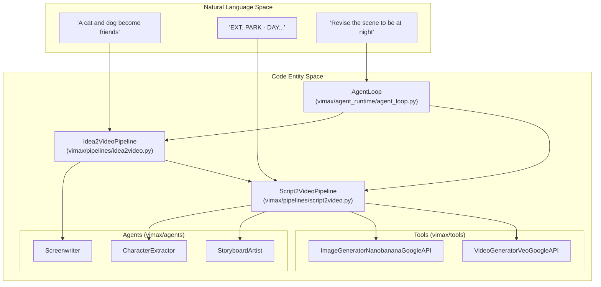
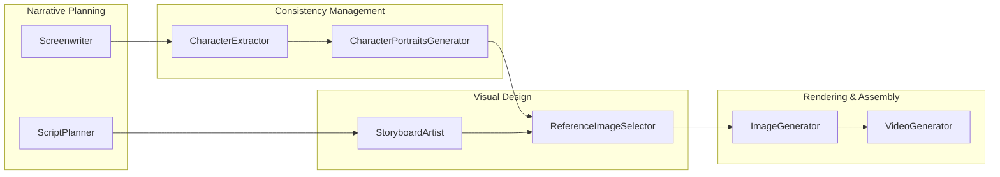

<!-- source: DeepWiki mcp.deepwiki.com · repo HKUDS/ViMax · page 1 Overview · fetched 2026-11-09 -->

# Overview

Relevant source files

The following files were used as context for generating this wiki page:

- [README_ZH.md](README_ZH.md)
- [assets/vimax.png](assets/vimax.png)
- [pyproject.toml](pyproject.toml)
- [readme.md](readme.md)
- [uv.lock](uv.lock)
- [vimax](vimax)

## Introduction

ViMax is an agentic video generation system that automates professional-grade video production from narrative inputs through a multi-agent pipeline. By orchestrating specialized agents for script development, character management, visual planning, and synthesis, ViMax addresses core industry challenges including visual consistency, narrative depth, and production efficiency [readme.md:35-41](), [readme.md:144-164]().

**Key Capabilities:**
- **Idea2Video**: Transforms raw concepts into structured stories, characters, scripts, and finished videos [readme.md:78-78]().
- **Novel2Video**: Adapts long-form fiction into episodic narratives with narrative compression and character tracking [readme.md:80-80]().
- **Script2Video**: Converts explicit screenplays into multi-scene, multi-shot videos while preserving creative intent [readme.md:79-79]().
- **AutoCameo**: Integrates a person or pet from a reference photo into generated stories with consistent appearance [readme.md:81-81]().
- **Interactive Workspace**: Features an **Agent Loop** with TUI and Web UI for real-time discussion, plan revision, and rendering control [readme.md:82-83]().

For details, see [What is ViMax](#1.1).

**Sources**: [readme.md:35-41](), [readme.md:74-86](), [readme.md:144-164]()

---

## System Overview

ViMax operates as a configuration-driven framework implemented in Python 3.12. It leverages the `uv` package manager for high-performance dependency resolution and environment isolation [pyproject.toml:1-23](), [readme.md:199-205]().

### Core Architecture Components

| Component | Code Entity / Path | Role |
|-----------|--------------------|------|
| **Entry Points** | `main_idea2video.py`, `main_script2video.py` | Direct pipeline execution via CLI [main_idea2video.py:1-20](), [main_script2video.py:1-20]() |
| **Pipeline Core** | `Idea2VideoPipeline`, `Script2VideoPipeline` | Orchestration of narrative and visual stages [vimax/pipelines/]() |
| **Agent Runtime** | `AgentLoop`, `ToolRegistry` | Manages interactive agentic sessions and tool execution [vimax/agent_runtime/]() |
| **Interactive UI** | `ui/src/cli.tsx` (TUI), `web/` (React Web UI) | Event-driven interfaces for human-in-the-loop control [readme.md:209-247]() |
| **External Tools** | `tools.ImageGenerator...`, `tools.VideoGenerator...` | Service-agnostic wrappers for AI generation APIs [vimax/tools/]() |

For details, see [Architecture Overview](#3.1).

**Sources**: [readme.md:54-62](), [readme.md:199-205](), [pyproject.toml:1-23](), [vimax/pipelines/]()

---

## Entry Points and Pipeline Flow

### Natural Language to Code Entity Mapping

The following diagram bridges user-facing concepts to the specific code entities that handle them.

**Sources**: [readme.md:74-86](), [main_idea2video.py](), [main_script2video.py](), [vimax/agent_runtime/]()

---

## Multi-Agent Collaboration System

ViMax utilizes a hierarchical agent ecosystem where specialized agents communicate via structured Pydantic models (e.g., `ShotDescription`, `CharacterInScene`) [vimax/models/]() and shared data registries.

### Functional Agent Grouping

For details, see [Agent Architecture](#5.1) and [Multi-Stage Pipeline](#3.2).

**Sources**: [readme.md:74-86](), [readme.md:144-164]()

---

## Technology Stack and Integration

### Core Dependencies

ViMax relies on a robust stack for media processing and AI orchestration:
- **LLM Orchestration**: `langchain`, `langchain-openai`, and `google-genai` [pyproject.toml:11-14]().
- **Media Processing**: `moviepy` for assembly, `opencv-python` and `scenedetect` for frame/scene analysis [pyproject.toml:15-21]().
- **Vector Search**: `faiss-cpu` for character and environment reference retrieval [pyproject.toml:10]().
- **GPU Acceleration**: Optimized for CUDA 12.8 for parallel asset generation [pyproject.toml:25-39]().

### Service Integration

The system abstracts external AI providers, allowing configuration-based switching between:
- **Chat Models**: OpenRouter, OpenAI, MiniMax, Gemini [readme.md:54-62]().
- **Image Generators**: Nanobanana (Google), GPT Image 2 (OpenRouter), Doubao Seedream [readme.md:54-62]().
- **Video Generators**: Veo (Google), Seedance 2.0 Fast, Omni [readme.md:54-62]().

For details, see [External Services and Dependencies](#9).

**Sources**: [pyproject.toml:1-44](), [readme.md:52-62]()

---

## Problems Solved

ViMax is designed to eliminate common AI video production bottlenecks:
1. **Consistency Chaos**: Maintains character and environment identity across shots using `CharacterPortraitsGenerator` and reference selection logic [readme.md:37-37](), [readme.md:158-158]().
2. **Short Clip Limitation**: Orchestrates multi-scene pipelines to produce long-form episodic content [readme.md:36-36](), [readme.md:162-162]().
3. **Missing Narrative**: Automates scriptwriting and storyboard design, ensuring cinematic language and storytelling depth [readme.md:38-38](), [readme.md:152-154]().

For details, see [Problems Solved](#1.3).

**Sources**: [readme.md:35-41](), [readme.md:144-164]()

---

