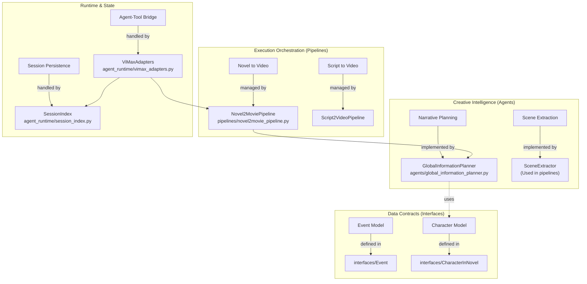
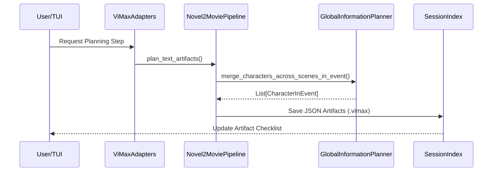

<!-- source: DeepWiki mcp.deepwiki.com · repo HKUDS/ViMax · page 12.2 Contributing · fetched 2026-11-09 -->

# Contributing

<details>
<summary>Relevant source files</summary>

The following files were used as context for generating this wiki page:

- [.gitignore](.gitignore)
- [README_ZH.md](README_ZH.md)
- [assets/vimax-web-ui.png](assets/vimax-web-ui.png)
- [assets/vimax.png](assets/vimax.png)
- [readme.md](readme.md)
- [tests/test_novel2video_adapter.py](tests/test_novel2video_adapter.py)

</details>


This page provides guidelines for contributing to the ViMax project, including code contributions, documentation improvements, and issue reporting. Whether you're fixing bugs, adding new agents, integrating new service providers, or improving documentation, this guide will help you navigate the contribution process.

For information about getting help or support, see [12.1 Getting Help](). For licensing details, see [12.3 License]().

---

## Overview

ViMax is an agentic video generation system that orchestrates complex workflows from ideas to finished videos [readme.md:40-42](). We welcome contributions from the community to enhance our capabilities in narrative planning, visual consistency, and automated production [readme.md:74-76]().

### Contribution Types

| Contribution Type | Description | Key Code Entities |
|-------------------|-------------|-------------------|
| **New Agents** | Specialized AI roles for creative/analytical tasks | `agents/` classes [agents/global_information_planner.py:16-17]() |
| **Tool Integration** | New Image/Video generation backends | `tools/` protocols [readme.md:54-61]() |
| **Pipeline Logic** | Workflow orchestration and stage management | `pipelines/` classes [pipelines/novel2movie_pipeline.py:17]() |
| **Data Models** | Enhancing interfaces for better state management | `interfaces/` Pydantic models [interfaces/__init__.py:11-12]() |
| **UI/UX** | Improvements to the Web UI or Agent TUI | `web/`, `ui/src/cli.tsx` [readme.md:149-155]() |

---

## Development Setup

### Prerequisites

ViMax requires **Python 3.12** [readme.md:15]() and uses **uv** for dependency management [readme.md:200-205]().

### Environment Installation

```bash
# Clone the repository
git clone https://github.com/HKUDS/ViMax.git
cd ViMax

# Sync dependencies using uv
uv sync [readme.md:204-205]()
```

### Configuration for Development

To begin development, you must set up a local configuration file that is ignored by git to protect your API keys.

```bash
# Copy example configuration to local
cp configs/agent.example.yaml configs/agent.local.yaml [README_ZH.md:214-215]()
```

Edit `configs/agent.local.yaml` to include your LLM, image, and video provider credentials [README_ZH.md:217]().

---

## Codebase Structure for Contributors

Understanding the relationship between natural language concepts and code entities is crucial for contributing effectively.

### System Entity Map (Natural Language to Code)

The following diagram maps high-level system components to their specific implementation classes and files.


**Sources:** [pipelines/novel2movie_pipeline.py:17](), [agent_runtime/vimax_adapters.py:15](), [agent_runtime/session_index.py:13](), [interfaces/__init__.py:11-12]()

---

## Contribution Workflows

### Workflow: Adding a New AI Agent

When adding a new agent, follow the pattern established in existing agents like `GlobalInformationPlanner`.

1. **Define the Data Model**: Ensure the agent's output is structured using Pydantic models in `interfaces/`.
2. **Implement the Agent**: Create a class in `agents/` that accepts a `chat_model` and implements `async` methods for its tasks.
3. **Register Adapter**: Add a tool or planning step in `agent_runtime/vimax_adapters.py` to make the agent accessible to the Agent Loop [agent_runtime/vimax_adapters.py:15-16]().

### Workflow: Testing Changes

ViMax uses `unittest` for validation. New features should include corresponding tests in the `tests/` directory.

```bash
# Example: Running Novel2Video adapter tests
pytest tests/test_novel2video_adapter.py [tests/test_novel2video_adapter.py:110]()
```

**Key Testing Components:**
* **Mocking**: Use `unittest.mock.patch` to simulate expensive API calls [tests/test_novel2video_adapter.py:9]().
* **Suppression**: Use `_run_planning_step` logic to ensure clean logs during automated tests [tests/test_novel2video_adapter.py:126-135]().

---

## Technical Standards

### Code Quality and Style

* **Asynchronous Execution**: All I/O bound operations (API calls, file writes) must use `async/await` patterns [tests/test_novel2video_adapter.py:111]().
* **Type Safety**: Use Pydantic models for all complex data structures to ensure validation at the boundaries [interfaces/__init__.py:11]().
* **Output Suppression**: When running automated steps, use context managers to suppress `stdout`/`stderr` to keep the TUI/Web UI clean [tests/test_novel2video_adapter.py:134-135]().

### Data Flow Architecture

The following diagram illustrates how data flows from a raw input (like a novel) through the agentic layers to produce structured artifacts.


**Sources:** [tests/test_novel2video_adapter.py:69-95](), [agent_runtime/vimax_adapters.py:15-16](), [agent_runtime/session_index.py:13]()

---

## Reporting Issues

If you encounter a bug or have a feature request, please use the [GitHub Issue Tracker](https://github.com/HKUDS/ViMax/issues).

**When reporting a bug, please include:**
1. Your environment details (OS, Python version).
2. A minimal `configs/agent.local.yaml` (with secrets redacted).
3. The specific command run (e.g., `vimax tui new` [README_ZH.md:224]()).
4. Full stack trace if an error occurred.

---

## Community and Support

* **Communication**: Join our WeChat or Feishu groups for real-time discussion [readme.md:24-25]().
* **License**: ViMax is licensed under the **MIT License** [readme.md:17](). All contributions are expected to adhere to this license.

**Sources:** [readme.md:1-29](), [README_ZH.md:211-244]()

---

