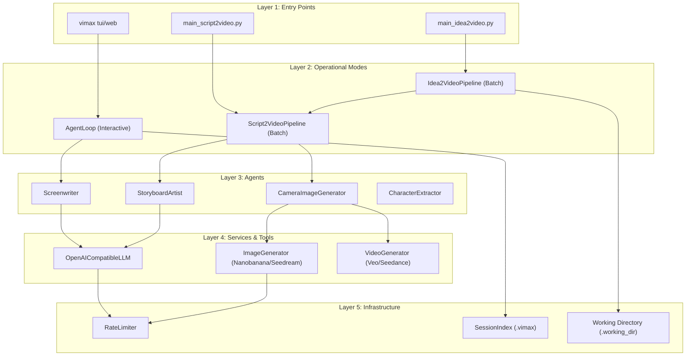
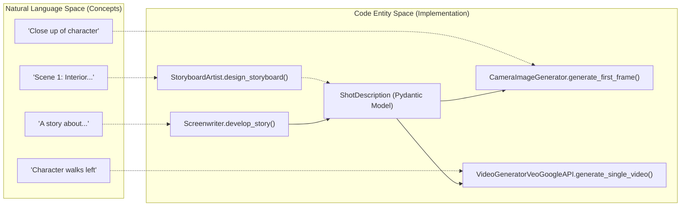

<!-- source: DeepWiki mcp.deepwiki.com · repo HKUDS/ViMax · page 3.1 Architecture Overview · fetched 2026-11-09 -->

# Architecture Overview

Relevant source files

The following files were used as context for generating this wiki page:

- [README_ZH.md](README_ZH.md)
- [assets/vimax.png](assets/vimax.png)
- [pyproject.toml](pyproject.toml)
- [readme.md](readme.md)
- [uv.lock](uv.lock)
- [vimax](vimax)

ViMax is organized into an agentic architecture that transforms text inputs into complete videos through narrative planning, visual design, and asset generation. This page presents the high-level system architecture, explaining how layers interact and the two primary operational modes: direct pipeline execution and the interactive agent loop.

## Architectural Principles

The ViMax architecture is built on three core principles:

1.  **Layered Separation**: Distinct responsibilities for entry points, pipelines, agents, and infrastructure tools.
2.  **Operational Duality**: Supports both linear batch processing (Pipelines) and interactive, session-based iteration (Agent Loop).
3.  **Consistency-First Design**: Uses shared registries (character portraits) and hierarchical structures (camera trees) to maintain visual continuity.

Sources: [readme.md:74-86](), [pipelines/script2video_pipeline.py:18-46]()

---

## System Layers

ViMax follows a top-down dependency flow where upper layers orchestrate lower layers.

### Layer Summary

| Layer | Responsibility | Key Entities | Primary Code Locations |
| :--- | :--- | :--- | :--- |
| **1. Entry Points** | User interfaces and script entry points | `main_idea2video.py`, `vimax` (CLI/TUI), Web UI | [readme.md:149-164](), [vimax:34-112]() |
| **2. Operational Mode** | Batch orchestration vs. Interactive loop | `Idea2VideoPipeline`, `AgentLoop` | [pipelines/idea2video_pipeline.py](), [agent_runtime/agent_loop.py]() |
| **3. Agent Layer** | Specialized AI tasks (Narrative, Visual, Camera) | `Screenwriter`, `StoryboardArtist`, `CameraImageGenerator` | [agents/]() directory |
| **4. Service Layer** | Standardized interfaces for external AI models | `ImageGenerator`, `VideoGenerator`, `ChatModel` | [tools/](), [agent_runtime/llm.py]() |
| **5. Infrastructure** | Core utilities and persistence | `RateLimiter`, `SessionIndex`, `VideoProcessor` | [utils/rate_limiter.py](), [agent_runtime/session_index.py]() |

### System Architecture Diagram

The following diagram maps the high-level system components to their specific code entities.

Sources: [readme.md:74-86](), [pipelines/idea2video_pipeline.py:16-35](), [agent_runtime/agent_loop.py:1-50](), [vimax:34-112]()

---

## Operational Modes

ViMax operates in two distinct modes depending on the desired level of user intervention.

### 1. Direct Pipeline Mode (Batch)
In this mode, the system executes a predefined sequence of stages from start to finish. It is ideal for automated production where the user provides an initial input and expects a final video.

*   **Idea2VideoPipeline**: Orchestrates the expansion of a short concept into a story, characters, and multiple scene scripts, then delegates to the script pipeline [pipelines/idea2video_pipeline.py:16-35]().
*   **Script2VideoPipeline**: Handles shot decomposition, camera tree construction, parallel frame generation, and video assembly [pipelines/script2video_pipeline.py:18-46]().

### 2. Agent Loop Mode (Interactive)
The Agent Loop allows users to interact with the system via a TUI or Web UI. Users can discuss ideas, revise scripts, and trigger rendering of specific components.

*   **AgentLoop**: Manages the conversation state, tool calls, and context compaction [agent_runtime/agent_loop.py:1-50]().
*   **SessionIndex**: Persists the session state, history, and generated artifacts in the `.vimax` directory.
*   **Adapters**: Specialized tools like `vimax_narrative_planning` bridge the interactive loop to the underlying pipeline logic.

Sources: [readme.md:82-83](), [vimax:57-103](), [agent_runtime/agent_loop.py:1-50]()

---

## Bridge: Natural Language to Code Entity Space

The following diagram illustrates how abstract creative concepts (Natural Language Space) are mapped to specific software components (Code Entity Space) within the ViMax architecture.

Sources: [agents/screenwriter.py:1-20](), [agents/storyboard_artist.py:1-20](), [agents/camera_image_generator.py:1-30](), [tools/video_generator_veo_google_api.py:13-30]()

---

## Data Flow and Persistence

### Batch Data Flow
1.  **Entry**: `main_idea2video.py` loads `configs/idea2video.yaml`.
2.  **Orchestration**: `Idea2VideoPipeline` calls `Screenwriter` to generate `story.txt`.
3.  **Delegation**: `Idea2VideoPipeline` instantiates `Script2VideoPipeline` for each scene.
4.  **Generation**: `CameraImageGenerator` produces frames; `VideoGenerator` produces `.mp4` clips.
5.  **Assembly**: MoviePy concatenates clips into the final output in the `working_dir`.

### Interactive Data Flow
1.  **Entry**: `vimax tui` starts the `cli.tsx` interface.
2.  **Event Stream**: User input is sent to `AgentLoop.stream_events()`.
3.  **Tool Execution**: The LLM calls tools like `vimax_render_video`.
4.  **Persistence**: `SessionIndex` writes to `loop_history.jsonl` and saves artifacts to the session folder.
5.  **UI Sync**: The Web UI polls the session directory to display storyboard previews and render progress.

Sources: [pipelines/idea2video_pipeline.py:283-311](), [agent_runtime/agent_loop.py:1-100](), [vimax:57-103](), [readme.md:149-164]()

---

