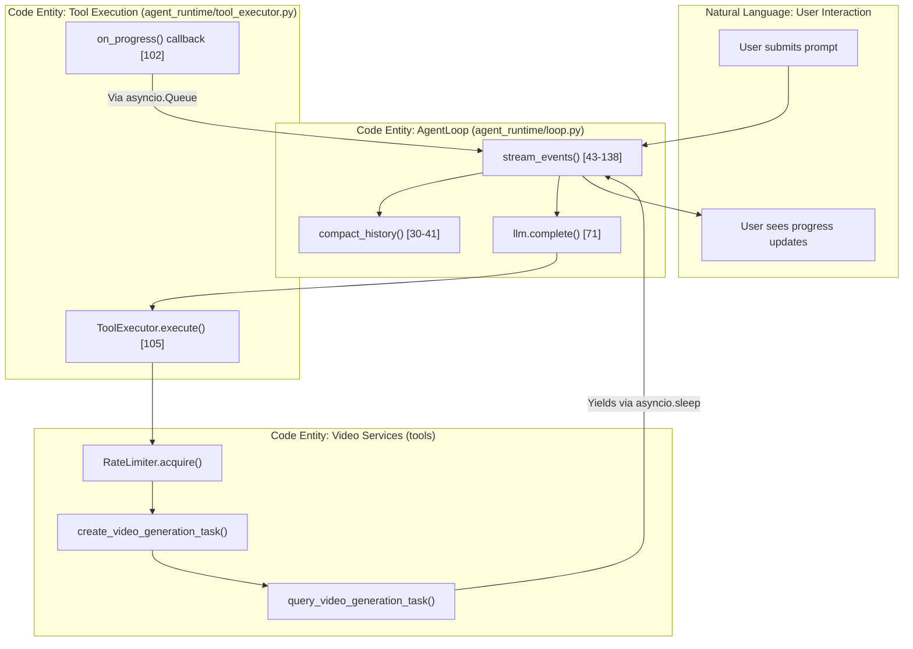

<!-- source: DeepWiki mcp.deepwiki.com · repo HKUDS/ViMax · page 3.3 Asynchronous Execution Model · fetched 2026-11-09 -->

# Asynchronous Execution Model

<details>
<summary>Relevant source files</summary>

The following files were used as context for generating this wiki page:

- [agent_runtime/loop.py](agent_runtime/loop.py)
- [tests/test_agent_loop.py](tests/test_agent_loop.py)
- [tests/test_hang_guards.py](tests/test_hang_guards.py)
- [tests/test_openrouter_video_generator.py](tests/test_openrouter_video_generator.py)
- [tools/video_generator_omni_yunwu_api.py](tools/video_generator_omni_yunwu_api.py)
- [utils/image.py](utils/image.py)
- [utils/retry.py](utils/retry.py)

</details>


This page documents ViMax's asyncio-based execution architecture, which enables efficient parallel processing of I/O-bound operations during video generation. The system leverages Python's `asyncio` library to concurrently execute frame generation, video synthesis, and API calls while maintaining precise dependency ordering through event-based coordination.

---

## Overview: Why Asyncio?

ViMax's video generation workflow is dominated by I/O-bound operations: API calls to external services (LLM, image generator, video generator), disk I/O for saving/loading intermediate results, and polling for long-running video generation operations. The asynchronous execution model provides:

1.  **Concurrent API Utilization**: Multiple shots can request frame generation simultaneously, maximizing throughput within rate limit constraints.
2.  **Efficient Resource Usage**: CPU remains available for other tasks while waiting for I/O operations.
3.  **Dependency Management**: `asyncio.Event` objects coordinate tasks that have ordering requirements (e.g., video generation must wait for frame generation).
4.  **Scalability**: Hundreds of shots can be processed in parallel without thread overhead.

All major pipeline methods use `async def` and `await` keywords, enabling cooperative multitasking throughout the execution flow.

**Sources**: [agent_runtime/loop.py:4-7](), [tools/video_generator_omni_yunwu_api.py:1-5](), [agent_runtime/loop.py:100-113]()

---

## Event-Based Dependency Coordination

### Agent Loop Event Streaming

The `AgentLoop` class implements an asynchronous event stream using `AsyncIterator`. This allows the UI to receive real-time updates (status, tool starts, tool results, tokens) as they occur without blocking the main execution loop.

```python
# agent_runtime/loop.py
async def stream_events(self, user_input: str) -> AsyncIterator[dict[str, Any]]:
    # ... setup ...
    while True:
        yield {"type": "status", "phase": "sampling_assistant", ...}
        assistant = await self.llm.complete(runtime_messages, tools=tool_schemas)
        # ... process tool calls ...
```

**Sources**: [agent_runtime/loop.py:43-71]()

### Tool Execution Coordination

When the LLM requests tool calls, the `AgentLoop` creates asynchronous tasks for execution. It uses an `asyncio.Queue` to capture progress events from within tools and stream them back to the caller while the tool task is still running.

```mermaid
sequenceDiagram
    participant Loop as AgentLoop.stream_events
    participant Queue as asyncio.Queue
    participant Task as asyncio.create_task(ToolExecutor.execute)
    
    Loop->>Task: Start tool execution
    Task->>Queue: put_nowait({"type": "tool_progress", ...})
    Loop->>Queue: await wait_for(queue.get())
    Queue-->>Loop: Progress Event
    Loop-->>Loop: yield event to UI
    Task->>Loop: Task Done (Result)
```

**Sources**: [agent_runtime/loop.py:98-113](), [tests/test_agent_loop.py:74-98]()

---

## Parallel Task Execution Patterns

### Concurrent Tool Execution

While the current `AgentLoop` processes tool calls in a loop [agent_runtime/loop.py:98](), the underlying architecture supports concurrent execution. In specific pipelines like `Script2VideoPipeline`, `asyncio.gather()` is used to launch all frame and video generation tasks concurrently.

### asyncio.as_completed() for Incremental Progress

For character portrait generation and other batch tasks, ViMax uses `asyncio.as_completed()` to handle results as they finish. This allows the system to persist data incrementally, providing fault tolerance against crashes.

**Sources**: [tests/test_agent_loop.py:89-98]()

---

## Rate Limiter Integration

The asynchronous execution model integrates with a `RateLimiter` to manage API quotas across concurrent tasks.

### Async Acquire Pattern

Before initiating high-cost API requests (like video generation), the generator awaits permission from the rate limiter.

```python
# tools/video_generator_omni_yunwu_api.py
async def create_video_generation_task(self, ...):
    # ...
    if self.rate_limiter:
        await self.rate_limiter.acquire()
    
    async with aiohttp.ClientSession() as session:
        async with session.post(url, ...) as response:
            # ...
```

**Sources**: [tools/video_generator_omni_yunwu_api.py:112-121]()

### Rate Limit Distribution

The rate limiter ensures that concurrent coroutines do not overwhelm external providers. If a limit is hit, the `acquire()` call will internally `await asyncio.sleep()`, allowing the event loop to switch to other tasks that aren't blocked by rate limits.

**Sources**: [tools/video_generator_omni_yunwu_api.py:133-144](), [tests/test_hang_guards.py:25-29]()

---

## Polling for Long-Running Operations

Video generation is typically an asynchronous process at the provider level. ViMax implements an async polling loop to monitor task status without blocking.

```python
# tools/video_generator_omni_yunwu_api.py
async def query_video_generation_task(self, task_id: str, model: str) -> str:
    while True:
        # ... check max attempts ...
        async with aiohttp.ClientSession() as session:
            async with session.get(url, ...) as response:
                response_json = await response.json()
        
        status = response_json.get("status")
        if status == "completed":
            return response_json.get("video_url")
        
        # Yield control to the event loop
        await asyncio.sleep(self.poll_interval)
```

**Sources**: [tools/video_generator_omni_yunwu_api.py:156-189](), [tests/test_hang_guards.py:148-155]()

---

## Complete Execution Flow Diagram

The following diagram maps the Natural Language Space of "Running an Agent" to the Code Entity Space of the asynchronous execution model.



**Sources**: [agent_runtime/loop.py:43-118](), [tools/video_generator_omni_yunwu_api.py:90-189](), [tests/test_agent_loop.py:74-98]()

---

## Error Handling and Hang Guards

To prevent the asynchronous model from hanging indefinitely (e.g., due to an API that never returns "completed"), ViMax implements several guards:

1.  **Bounded Polling**: All polling loops have a `max_poll_attempts`.
2.  **Request Timeouts**: `aiohttp` and `requests` calls are configured with explicit timeouts.
3.  **Fast Failure for 4xx**: The system distinguishes between retryable errors (5xx, network) and fatal errors (4xx), failing fast on the latter to avoid wasting resources.

| Guard Type | Code Entity | File Location |
| :--- | :--- | :--- |
| Polling Limit | `max_poll_attempts` | [tools/video_generator_omni_yunwu_api.py:162]() |
| Retry Logic | `@download_retry` | [utils/image.py:11]() |
| HTTP Timeout | `timeout=(10, 300)` | [utils/image.py:16]() |
| Error Filtering | `is_retryable_download_error` | [utils/retry.py:14-20]() |

**Sources**: [tests/test_hang_guards.py:36-92](), [utils/retry.py:1-30](), [tools/video_generator_omni_yunwu_api.py:162-163]()

---

