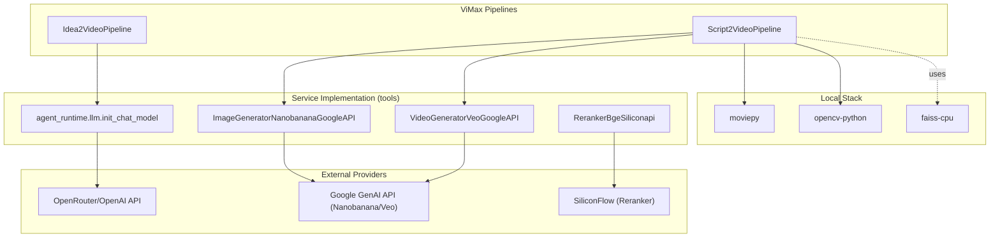
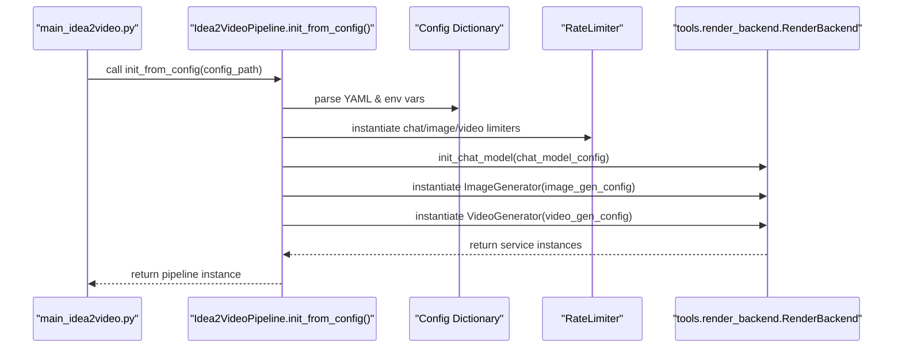

<!-- source: DeepWiki mcp.deepwiki.com · repo HKUDS/ViMax · page 9 External Services and Dependencies · fetched 2026-11-09 -->

# External Services and Dependencies

<details>
<summary>Relevant source files</summary>

The following files were used as context for generating this wiki page:

- [pyproject.toml](pyproject.toml)
- [tools/__init__.py](tools/__init__.py)
- [uv.lock](uv.lock)
- [vimax](vimax)

</details>


This page provides an overview of all external services, APIs, and Python dependencies used by ViMax. It covers the service integration architecture, configuration patterns, and cross-cutting concerns such as authentication and rate limiting.

For detailed information on specific dependency categories, see the subsections:

- **[Dependency Overview](#9.1)** - High-level overview of the technology stack and dependency categories (AI/LLM, media processing, vector search, web).
- **[LLM and Chat Services](#9.2)** - Document LangChain integration, OpenRouter/OpenAI configuration, Gemini API usage, and the `OpenAICompatibleLLM` wrapper.
- **[Image and Video Generation Services](#9.3)** - Document all image and video generator implementations (Google, Yunwu, Seedance, Omni, OpenRouter).
- **[Video Processing Stack](#9.4)** - Document MoviePy, OpenCV, and SceneDetect usage for video manipulation.
- **[PyTorch and GPU Acceleration](#9.5)** - Explain CUDA 12.8 requirements, GPU utilization, and custom package index configuration.
- **[Vector Search with FAISS](#9.6)** - Explain FAISS integration for similarity search and asset retrieval.

## Service Integration Architecture

ViMax relies on three categories of external dependencies: remote AI services accessed via API, local video processing libraries, and ML infrastructure for optional GPU acceleration and vector search.

### External Service Categories

| Service Category | Provider | Primary Classes | Purpose |
|------------------|----------|----------------|---------|
| **LLM/Chat** | OpenAI/OpenRouter/Gemini | `init_chat_model` | Narrative planning and script generation |
| **Image Generation** | Google/Yunwu/Seedream | `ImageGenerator` protocols | Character portraits and storyboard frames |
| **Video Generation** | Google Veo/Seedance/Omni | `VideoGenerator` protocols | Shot rendering and motion generation |
| **Video Processing** | Local libraries | `moviepy`, `opencv-python` | Assembly, frame extraction, analysis |
| **Vector Search** | Local library | `faiss-cpu` | RAG for long script generation |
| **GPU Acceleration** | PyTorch CUDA 12.8 | `torch`, `torchaudio` | Local ML acceleration |

**Sources:** [pyproject.toml:1-38](), [tools/__init__.py:1-37]()

### Service-to-Code Mapping

The following diagram bridges the high-level service categories to the specific code entities that implement them.



**Sources:** [tools/__init__.py:1-37](), [pyproject.toml:7-23]()

## Configuration and Service Initialization

Both `Idea2VideoPipeline` and `Script2VideoPipeline` use the `init_from_config()` class method pattern to instantiate services from YAML configuration files. This pattern enables declarative service configuration without code changes.

### Service Instantiation Flow



The pipeline prints rate limiter configurations to stdout during initialization to verify quotas:
```text
Chat model rate limiting: 500 req/min, 10000 req/day
Image generator rate limiting: 10 req/min, 200 req/day
Video generator rate limiting: 2 req/min, 50 req/day
```

**Sources:** [pipelines/script2video_pipeline.py:49-125](), [pipelines/idea2video_pipeline.py:36-116]()

## API Authentication

All external API services require authentication via API keys. ViMax uses a flexible configuration pattern that supports environment variable substitution in YAML files using the `${VAR_NAME}` syntax.

| Environment Variable | Service | Required For |
|---------------------|---------|--------------|
| `OPENROUTER_API_KEY` | OpenRouter | LLM services via `OpenAICompatibleLLM` |
| `GOOGLE_API_KEY` | Google Cloud | Nanobanana (Image) and Veo (Video) |
| `YUNWU_API_KEY` | Yunwu API | Alternative Image/Video generation backends |

For detailed configuration file structure and advanced authentication patterns, see [Service Provider Configuration](#8.5).

**Sources:** [pipelines/idea2video_pipeline.py:36-116]()

## Rate Limiting and Error Handling

All external API services implement two-layer protection against quota exhaustion: proactive rate limiting via `RateLimiter` instances, and reactive retry logic with exponential backoff.

### Rate Limiting Architecture

**Layer 1 (Proactive):** The `RateLimiter` class prevents requests from being sent when quotas are exhausted. It tracks per-minute and per-day request counts.
**Layer 2 (Reactive):** Generator classes implement exponential backoff retry logic for unexpected HTTP 429 errors.

### Retry Logic Implementation
Both `ImageGeneratorNanobananaGoogleAPI` and `VideoGeneratorVeoGoogleAPI` implement identical retry patterns:

```python
# Simplified pattern used in tools/
for attempt in range(max_retries):
    try:
        # API Call
        break
    except ClientError as e:
        if e.status_code == 429 and attempt < max_retries - 1:
            wait_time = retry_delay * (2 ** attempt)
            await asyncio.sleep(wait_time)
```

**Sources:** [utils/rate_limiter.py:1-106](), [tools/image_generator_nanobanana_google_api.py:49-72](), [tools/video_generator_veo_google_api.py:67-84]()

## Media and ML Dependencies

ViMax utilizes a robust local stack for video manipulation and machine learning.

- **Video Processing:** `moviepy` is the primary engine for assembling shots into the final movie, while `opencv-python` and `scenedetect` are used for frame extraction and visual analysis.
- **ML Infrastructure:** The project requires **CUDA 12.8** for GPU acceleration. The `uv` package manager is configured to fetch specific PyTorch wheels from the `pytorch-cu128` index.
- **Vector Search:** `faiss-cpu` provides the similarity search backend for the Novel2Video RAG workflow.

For details on local setup, see [PyTorch and GPU Acceleration](#9.5) and [Video Processing Stack](#9.4).

**Sources:** [pyproject.toml:25-38](), [pyproject.toml:7-23]()

---

