# Page: Overview

# Overview

<details>
<summary>Relevant source files</summary>

The following files were used as context for generating this wiki page:

- [README_ZH.md](README_ZH.md)
- [assets/vimax.png](assets/vimax.png)
- [pyproject.toml](pyproject.toml)
- [readme.md](readme.md)
- [uv.lock](uv.lock)
- [vimax](vimax)

</details>


## Introduction

ViMax is an agentic video generation system that automates professional-grade video production from narrative inputs through a multi-agent pipeline. By orchestrating specialized agents for script development, character management, visual planning, and synthesis, ViMax addresses core industry challenges including visual consistency, narrative depth, and production efficiency [readme.md:35-41](), [readme.md:144-164]().

**Key Capabilities:**
- **Idea2Video**: Transforms raw concepts into structured stories, characters, scripts, and finished videos [readme.md:78-78]().
- **Novel2Video**: Adapts long-form fiction into episodic narratives with narrative compression and character tracking [readme.md:80-80]().
- **Script2Video**: Converts explicit screenplays into multi-scene, multi-shot videos while preserving creative intent [readme.md:79-79]().
- **AutoCameo**: Integrates a person or pet from a reference photo into generated stories with consistent appearance [readme.md:81-81]().
- **Interactive Workspace**: Features an **Agent Loop** with TUI and Web UI for real-time discussion, plan revision, and rendering control [readme.md:82-83]().

For details, see [What is ViMax](#1.1).

**Sources**: [readme.md:35-41](), [readme.md:74-86](), [readme.md:144-164]()

---

## System Overview

ViMax operates as a configuration-driven framework implemented in Python 3.12. It leverages the `uv` package manager for high-performance dependency resolution and environment isolation [pyproject.toml:1-23](), [readme.md:199-205]().

### Core Architecture Components

| Component | Code Entity / Path | Role |
|-----------|--------------------|------|
| **Entry Points** | `main_idea2video.py`, `main_script2video.py` | Direct pipeline execution via CLI [main_idea2video.py:1-20](), [main_script2video.py:1-20]() |
| **Pipeline Core** | `Idea2VideoPipeline`, `Script2VideoPipeline` | Orchestration of narrative and visual stages [vimax/pipelines/]() |
| **Agent Runtime** | `AgentLoop`, `ToolRegistry` | Manages interactive agentic sessions and tool execution [vimax/agent_runtime/]() |
| **Interactive UI** | `ui/src/cli.tsx` (TUI), `web/` (React Web UI) | Event-driven interfaces for human-in-the-loop control [readme.md:209-247]() |
| **External Tools** | `tools.ImageGenerator...`, `tools.VideoGenerator...` | Service-agnostic wrappers for AI generation APIs [vimax/tools/]() |

For details, see [Architecture Overview](#3.1).

**Sources**: [readme.md:54-62](), [readme.md:199-205](), [pyproject.toml:1-23](), [vimax/pipelines/]()

---

## Entry Points and Pipeline Flow

### Natural Language to Code Entity Mapping

The following diagram bridges user-facing concepts to the specific code entities that handle them.

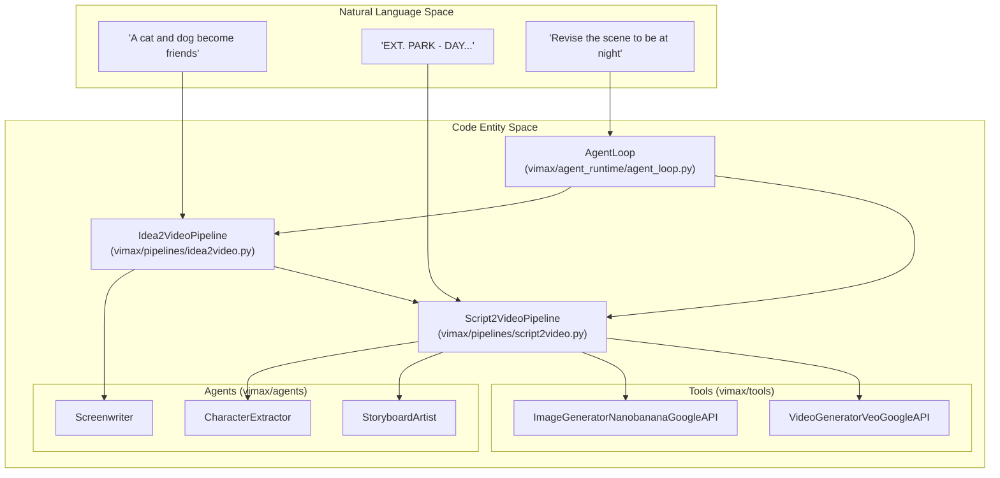

**Sources**: [readme.md:74-86](), [main_idea2video.py](), [main_script2video.py](), [vimax/agent_runtime/]()

---

## Multi-Agent Collaboration System

ViMax utilizes a hierarchical agent ecosystem where specialized agents communicate via structured Pydantic models (e.g., `ShotDescription`, `CharacterInScene`) [vimax/models/]() and shared data registries.

### Functional Agent Grouping

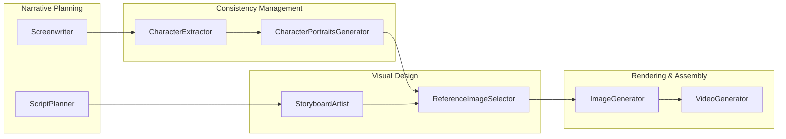

For details, see [Agent Architecture](#5.1) and [Multi-Stage Pipeline](#3.2).

**Sources**: [readme.md:74-86](), [readme.md:144-164]()

---

## Technology Stack and Integration

### Core Dependencies

ViMax relies on a robust stack for media processing and AI orchestration:
- **LLM Orchestration**: `langchain`, `langchain-openai`, and `google-genai` [pyproject.toml:11-14]().
- **Media Processing**: `moviepy` for assembly, `opencv-python` and `scenedetect` for frame/scene analysis [pyproject.toml:15-21]().
- **Vector Search**: `faiss-cpu` for character and environment reference retrieval [pyproject.toml:10]().
- **GPU Acceleration**: Optimized for CUDA 12.8 for parallel asset generation [pyproject.toml:25-39]().

### Service Integration

The system abstracts external AI providers, allowing configuration-based switching between:
- **Chat Models**: OpenRouter, OpenAI, MiniMax, Gemini [readme.md:54-62]().
- **Image Generators**: Nanobanana (Google), GPT Image 2 (OpenRouter), Doubao Seedream [readme.md:54-62]().
- **Video Generators**: Veo (Google), Seedance 2.0 Fast, Omni [readme.md:54-62]().

For details, see [External Services and Dependencies](#9).

**Sources**: [pyproject.toml:1-44](), [readme.md:52-62]()

---

## Problems Solved

ViMax is designed to eliminate common AI video production bottlenecks:
1. **Consistency Chaos**: Maintains character and environment identity across shots using `CharacterPortraitsGenerator` and reference selection logic [readme.md:37-37](), [readme.md:158-158]().
2. **Short Clip Limitation**: Orchestrates multi-scene pipelines to produce long-form episodic content [readme.md:36-36](), [readme.md:162-162]().
3. **Missing Narrative**: Automates scriptwriting and storyboard design, ensuring cinematic language and storytelling depth [readme.md:38-38](), [readme.md:152-154]().

For details, see [Problems Solved](#1.3).

**Sources**: [readme.md:35-41](), [readme.md:144-164]()

---

# Page: What is ViMax

# What is ViMax

<details>
<summary>Relevant source files</summary>

The following files were used as context for generating this wiki page:

- [README_ZH.md](README_ZH.md)
- [assets/vimax.png](assets/vimax.png)
- [readme.md](readme.md)

</details>


**Purpose**: This document defines ViMax's core identity, architectural philosophy, and technical foundation as an agentic video generation system. It explains the system's position in the AI video generation landscape and introduces key code abstractions that implement its capabilities.

For detailed feature modes and capabilities, see [Key Features and Input Modes](#1.2). For the problems ViMax addresses, see [Problems Solved](#1.3). For complete architecture details, see [Architecture Overview](#3.1).

---

## Core Definition

**ViMax** is an agentic, multi-stage video generation framework that transforms narrative inputs (ideas, novels, or scripts) into complete video productions through autonomous AI agent collaboration [readme.md:74-85](). The system orchestrates specialized agents—such as `Screenwriter`, `CharacterExtractor`, `CharacterPortraitsGenerator`, `StoryboardArtist`, `CameraImageGenerator`, and `ReferenceImageSelector`—to automate the entire video production pipeline from story development to final video assembly [readme.md:40-42]().

Unlike traditional AI video generators that produce isolated clips, ViMax generates structured, multi-shot videos with maintained character and environmental consistency across scenes through intelligent reference management and camera tree architecture [readme.md:144-164]().

**Key Characteristics**:

| Characteristic | Implementation |
|----------------|----------------|
| **Agentic Architecture** | Specialized agents coordinate through orchestrators like `Idea2VideoPipeline` [readme.md:78-81]() |
| **Multi-Stage Generation** | Sequential narrative development → parallel visual synthesis → video assembly [readme.md:74-76]() |
| **Consistency Management** | Reference image selection, camera tree structure, and MLLM-based validation [readme.md:148-159]() |
| **Parallel Processing** | Asyncio-based shot generation with event coordination [readme.md:85-85]() |
| **Interactive Control** | Agent Loop and TUI/Web UI for human-in-the-loop revision [readme.md:54-58]() |

**Sources**: [readme.md:1-85](), [README_ZH.md:144-164]()

---

## System Identity and Entry Points

ViMax exposes primary workflows through executable entry points and an interactive agent runtime. The system operates in two distinct modes: a direct pipeline mode and an interactive Agent Loop mode [readme.md:58-58]().

### Workflow Hierarchy (Pipeline Mode)

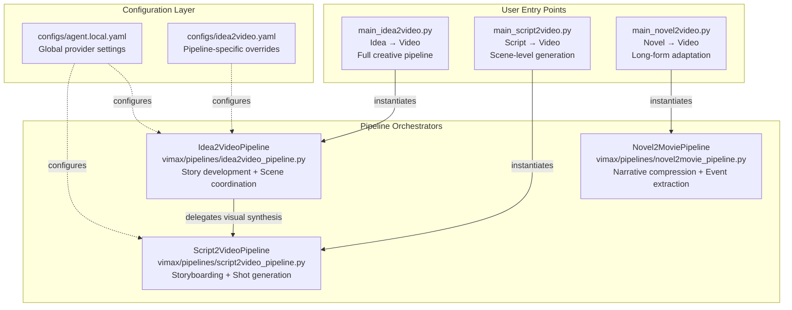

- **`Idea2VideoPipeline`**: Handles complete creative workflows from raw ideas. Executes story development, character extraction, and script writing [readme.md:78-78]().
- **`Script2VideoPipeline`**: Accepts pre-written scripts and focuses on visual realization, including storyboard design and parallel shot generation [readme.md:79-79]().
- **`Novel2MoviePipeline`**: Adapts long-form fiction using narrative compression and character tracking [readme.md:80-80]().

### Agent Loop and Interactive Runtime

Beyond static pipelines, ViMax provides an **Agent Loop** that allows users to interact with the system via a Terminal User Interface (TUI) or a Web UI [readme.md:82-83]().

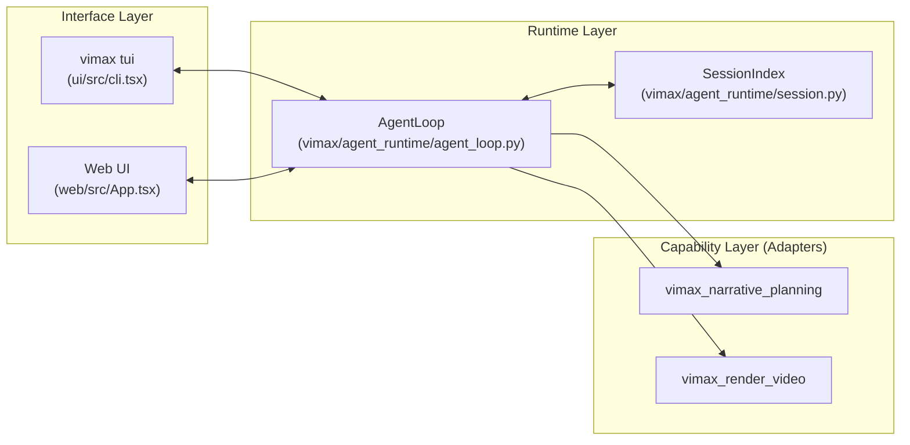

**Sources**: [readme.md:54-58](), [readme.md:78-83](), [readme.md:209-245]()

---

## Position in AI Video Generation Landscape

ViMax addresses fundamental limitations in current AI video generation systems through a director-centric architecture [readme.md:35-42]().

### Problem Space

| Limitation | Typical AI Video Tools | ViMax Approach |
|------------|------------------------|----------------|
| **Length Constraint** | 3-10 second clips [readme.md:36-36]() | Multi-scene segmentation and sequential scene assembly [readme.md:162-162]() |
| **Consistency Chaos** | Character/environment drift [readme.md:37-37]() | Camera tree architecture + reference selection + MLLM validation [readme.md:158-158]() |
| **Visual-Only Focus** | Missing narrative structure [readme.md:38-38]() | Full creative powerhouse: screenwriter, producer, and director agents [readme.md:41-41]() |

### Technical Differentiation

1.  **Multi-camera Filming Simulation**: Uses a camera tree structure to maintain spatial consistency across multiple angles in a scene [README_ZH.md:156-156]().
2.  **Intelligent Reference Management**: The `ReferenceImageSelector` agent and character registries ensure that characters and environments remain stable across hundreds of generated shots [README_ZH.md:158-158]().
3.  **Interactive Workflow**: Unlike "black-box" generators, the Agent Loop allows users to revise plans, inspect artifacts, and control rendering progress [readme.md:58-58]().
4.  **Parallel Asset Generation**: Accelerates production by concurrently generating shots and media assets while respecting service rate limits [readme.md:85-85]().

**Sources**: [readme.md:35-42](), [readme.md:54-85](), [README_ZH.md:144-164]()

---

## Technical Infrastructure

### Core Stack
- **Python 3.12**: Core runtime [readme.md:15-15]().
- **uv**: Environment and dependency management [readme.md:200-205]().
- **FAISS**: Vector search for narrative retrieval and asset management [readme.md:59-59]().
- **MoviePy/OpenCV**: Video processing and final assembly [README_ZH.md:61-61]().

### Service Integration
ViMax is provider-agnostic, supporting multiple backends via a unified tool registry:
- **LLMs**: Gemini (via OpenRouter), OpenAI, MiniMax [readme.md:55-61]().
- **Image Generators**: Nanobanana (Google/Yunwu), GPT Image 2 [readme.md:55-55]().
- **Video Generators**: Veo (Google), Seedance 2.0 Fast, Omni [readme.md:55-60]().

**Sources**: [readme.md:15-61](), [readme.md:200-205](), [README_ZH.md:61-61]()

---

# Page: Key Features and Input Modes

# Key Features and Input Modes

<details>
<summary>Relevant source files</summary>

The following files were used as context for generating this wiki page:

- [README_ZH.md](README_ZH.md)
- [assets/vimax.png](assets/vimax.png)
- [configs/idea2video.yaml](configs/idea2video.yaml)
- [configs/script2video.yaml](configs/script2video.yaml)
- [main_idea2video.py](main_idea2video.py)
- [main_script2video.py](main_script2video.py)
- [readme.md](readme.md)

</details>


**Purpose**: This page documents ViMax's four primary feature modes (Idea2Video, Novel2Video, Script2Video, AutoCameo) and the technical implementation of the core capabilities that enable agentic video generation. For installation, see [Installation and Setup](#2.1). For detailed pipeline logic, see [Pipelines](#4).

---

## Input Modes Overview

ViMax provides four distinct operational modes designed for different creative workflows. All modes share a unified agent architecture but differ in their entry points and narrative processing stages.

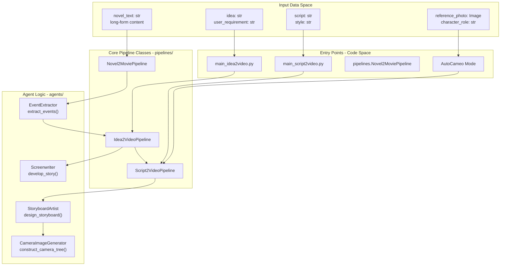

**Sources**: [readme.md:74-85](), [main_idea2video.py:22-24](), [main_script2video.py:29-30]()

---

## Input Mode Details

### Idea2Video Mode
**Entry Point**: `main_idea2video.py` [main_idea2video.py:1-27]()

This mode transforms a high-level concept into a structured screenplay and then into a video. It is the most automated workflow, involving narrative planning before visual design.

*   **Pipeline**: `Idea2VideoPipeline` [pipelines/idea2video_pipeline.py]()
*   **Key Agents**: `Screenwriter` for story development and `CharacterExtractor` for visual identity.
*   **Workflow**: Idea → Story → Characters → Script → Storyboard → Video.
*   **Configuration**: Uses `configs/idea2video.yaml` [configs/idea2video.yaml:1-33]().

### Script2Video Mode
**Entry Point**: `main_script2video.py` [main_script2video.py:1-35]()

Designed for users who already have a screenplay. It bypasses the story development phase and starts directly with visual asset generation and shot planning.

*   **Pipeline**: `Script2VideoPipeline` [pipelines/script2video_pipeline.py]()
*   **Key Agents**: `StoryboardArtist` and `CameraImageGenerator`.
*   **Workflow**: Script → Characters → Storyboard → Camera Tree → Shot Generation → Assembly.
*   **Configuration**: Uses `configs/script2video.yaml` [configs/script2video.yaml:1-34]().

### Novel2Video Mode
**Pipeline**: `Novel2MoviePipeline` [pipelines/novel2movie_pipeline.py]()

Adapts long-form fiction into episodic visual narratives. It uses semantic segmentation to break down massive texts into manageable "Events" that are then processed by the `Idea2VideoPipeline`.

*   **Key Agent**: `EventExtractor` [agents/event_extractor.py]().
*   **Mechanism**: Uses RAG (Retrieval-Augmented Generation) and FAISS for narrative compression and scene planning [readme.md:80]().

### AutoCameo Mode
**Feature**: Appearance Consistency [readme.md:81]()

Allows placing a specific person or pet from a reference photo into the generated story. It ensures the AI-generated character maintains the visual traits of the provided source image across different environments and camera angles.

---

## Key Technical Features

ViMax differentiates itself through seven core technical capabilities that manage the transition from "Natural Language Space" (ideas/scripts) to "Visual Execution Space" (frames/videos).

### 1. RAG-based Long Script Generation
To handle long-form content like novels, ViMax employs `EventExtractor` to perform narrative compression. It uses `faiss-cpu` for vector search to maintain character and plot context across long generation sequences [readme.md:59-60]().

### 2. Expressive Storyboard Design
The `StoryboardArtist` agent translates script lines into cinematic shot descriptions (`ShotDescription` model). It applies professional cinematography principles, selecting shot types (Close-up, Wide), angles, and camera movements [readme.md:79]().

### 3. Multi-camera Filming Simulation
The system constructs a "Camera Tree" via `CameraImageGenerator.construct_camera_tree()`. This organizes shots into parent-child relationships, where child cameras (e.g., a zoom-in) inherit the spatial context and first-frame reference of the parent camera (e.g., an establishing wide shot) [readme.md:84]().

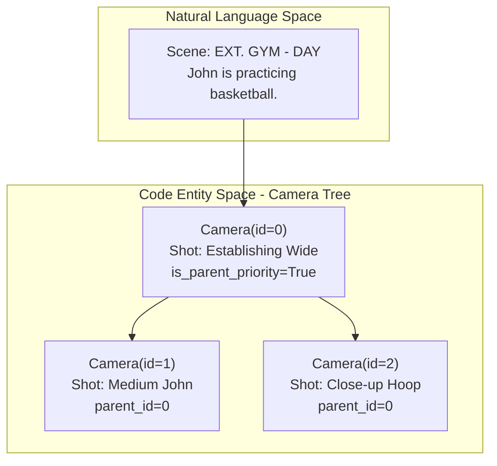
**Sources**: [readme.md:293-296](), [agents/camera_image_generator.py]()

### 4. Intelligent Reference Image Selection
The `ReferenceImageSelector` identifies the best visual anchors for new shots. It looks at previously generated frames and character portraits to ensure that a character's clothing or an environment's lighting remains consistent [readme.md:76]().

### 5. Automated Image Generation and Prompting
ViMax uses specialized prompt engineering for the `ImageGenerator` tools (e.g., `ImageGeneratorNanobananaGoogleAPI`). Prompts include spatial reasoning (e.g., "character on the left") and first/last frame descriptors to guide video motion [configs/idea2video.yaml:13]().

### 6. Consistency Checking with MLLM/VLM
The system generates multiple variations of a frame and uses a Multi-modal LLM (VLM) to inspect them. It performs a "visual quality gate" to select the candidate that best matches the character's reference portrait [readme.md:84]().

### 7. High-efficiency Parallel Processing
ViMax uses an `asyncio`-based execution model to generate compatible shots and media assets concurrently. This significantly reduces the time required for multi-shot video production [readme.md:85]().

---

## Configuration and Rate Limits

Each mode is governed by YAML configurations that define API endpoints and rate limits for LLMs, Image Generators, and Video Generators.

| Feature | Idea2Video Config | Script2Video Config |
| :--- | :--- | :--- |
| **Default Model** | Gemini 2.5 Flash Lite | Gemini 2.5 Flash Lite |
| **Image Rate Limit** | 10 RPM / 500 RPD | 2 RPM / 50 RPD |
| **Video Rate Limit** | 2 RPM / 10 RPD | 2 RPM / 50 RPD |
| **Working Dir** | `.working_dir/idea2video` | `.working_dir/script2video` |

**Sources**: [configs/idea2video.yaml:9-32](), [configs/script2video.yaml:9-33]()

---

# Page: Problems Solved

# Problems Solved

<details>
<summary>Relevant source files</summary>

The following files were used as context for generating this wiki page:

- [README_ZH.md](README_ZH.md)
- [assets/vimax.png](assets/vimax.png)
- [readme.md](readme.md)

</details>


This page documents the specific production challenges that ViMax addresses in AI video generation and explains how the system's architecture solves each problem. It serves as a technical bridge between the limitations of current video generation tools and ViMax's multi-agent solution approach.

For information about ViMax's core capabilities and features, see [Key Features and Input Modes](#1.2). For details on the technical implementation of these solutions, see [System Architecture](#3) and [Technical Capabilities](#7).

---

## Overview of Production Challenges

ViMax addresses eight fundamental problems that prevent current AI video generation systems from producing professional, long-form content with narrative coherence and visual consistency.

### Problem Domain Classification

```mermaid
graph TB
    subgraph "Content Limitations"
        P1["P1: Short Clip Barrier<br/>Seconds vs. Minutes"]
        P2["P2: Consistency Breakdown<br/>Character/Environment Drift"]
        P3["P3: Narrative Structure Gap<br/>No Story Framework"]
    end
    
    subgraph "Production Workflow Problems"
        P4["P4: Reference Management Burden<br/>Manual Frame Alignment"]
        P5["P5: Storyboard Expertise Gap<br/>Cinematography Knowledge"]
        P6["P6: Shot Design Complexity<br/>Multi-Camera Coordination"]
    end
    
    subgraph "Quality and Efficiency Barriers"
        P7["P7: Consistency Validation Cost<br/>No Automated QA"]
        P8["P8: Production Scalability Limit<br/>Sequential Processing Bottleneck"]
    end
    
    P1 --> Solution1["Multi-Agent Pipeline<br/>Stage-Based Generation"]
    P2 --> Solution2["Asset Indexing +<br/>Tracking Systems"]
    P3 --> Solution3["Script Understanding<br/>Agents"]
    P4 --> Solution4["ReferenceImageSelector<br/>+ Embeddings"]
    P5 --> Solution5["StoryboardArtist<br/>+ Shot Planning"]
    P6 --> Solution6["GlobalInformationPlanner<br/>+ Camera Simulation"]
    P7 --> Solution7["BestImageSelector<br/>+ MLLM Validation"]
    P8 --> Solution8["Parallel Processing<br/>Architecture"]
    
    style P1 stroke-dasharray: 5 5
    style P2 stroke-dasharray: 5 5
    style P3 stroke-dasharray: 5 5
    style P4 stroke-dasharray: 5 5
    style P5 stroke-dasharray: 5 5
    style P6 stroke-dasharray: 5 5
    style P7 stroke-dasharray: 5 5
    style P8 stroke-dasharray: 5 5
```

**Sources**: [readme.md:35-46](), [README_ZH.md:146-162]()

---

## Problem 1: Short Clip Limitations

### Technical Description

Current AI video generators typically produce only 3-10 second clips. This limitation stems from temporal coherence constraints in diffusion models and context window limitations. ViMax identifies this as the fundamental barrier to professional video creation: "Most AI tools generate only seconds of footage" [readme.md:36]().

### ViMax Solution: Multi-Stage Pipeline Architecture

ViMax solves this through a **staged generation pipeline** that breaks long videos into manageable units while maintaining continuity:

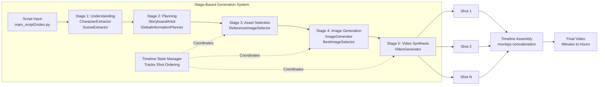

**Key Implementation Components**:

| Component | Role |
|-----------|------|
| `StoryboardArtist` | Segments script into shot-level units. |
| `GlobalInformationPlanner` | Coordinates cross-shot information. |
| `VideoGenerator` | Generates individual video clips via external providers (e.g., Veo, Seedance). |
| `moviepy` | Used for final assembly and concatenation of clips. |

**Sources**: [readme.md:36](), [readme.md:84-85](), [README_ZH.md:162]()

---

## Problem 2: Consistency Chaos

### Technical Description

"Characters and scenes change unpredictably across frames" [readme.md:37](). This occurs due to lack of persistent identity and environment memory between generation calls. ViMax addresses the challenge of "ensuring character appearances, environments, and artistic style remain consistent across hundreds of shots" [README_ZH.md:158]().

### ViMax Solution: Multi-Layer Consistency Management

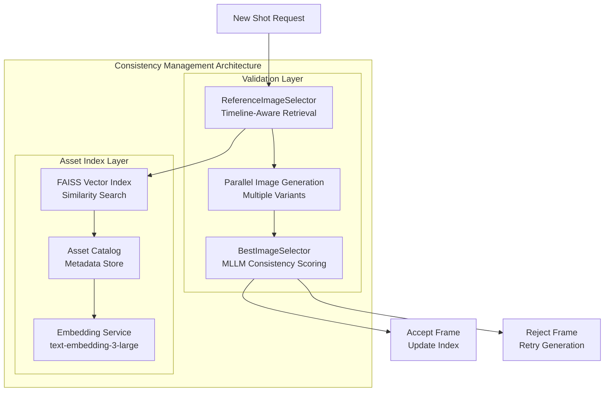

**Key Components**:

| Layer | System | Function |
|-------|--------|----------|
| Asset Index | `FAISS` | Stores and retrieves vector embeddings of previous frames for visual reference. |
| Selection | `ReferenceImageSelector` | Retrieves similar frames from history to guide current generation. |
| Validation | `BestImageSelector` | Validates consistency of generated variants via MLLM (e.g., GPT-4o/GPT-5). |

**Sources**: [readme.md:37](), [readme.md:78-81](), [README_ZH.md:148-150](), [README_ZH.md:158]()

---

## Problem 3: Narrative Structure Gap

### Technical Description

Current tools are "Visual-Only Focus—Missing scripts, audio, narrative structure, and storytelling depth" [readme.md:38](). ViMax addresses the fact that "Professional and high-quality videos need to have rich information density and structured design" [README_ZH.md:152]().

### ViMax Solution: Narrative and Planning Agents

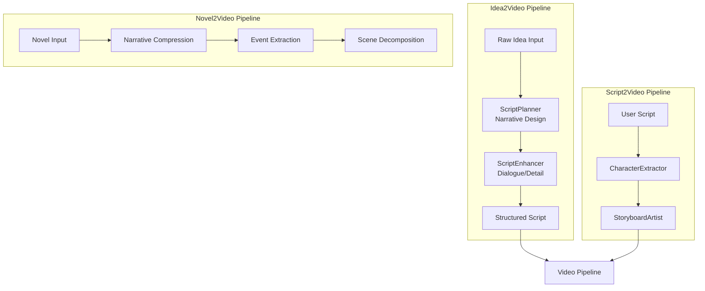

**Implementation Strategy**:

| Pipeline | Key Agents | Capability |
|----------|------------|------------|
| **Idea2Video** | `ScriptPlanner`, `ScriptEnhancer` | Generates structured scripts from concepts [readme.md:78](). |
| **Novel2Video** | `EventExtractor`, `SceneExtractor` | Adapts long fiction via narrative compression and character tracking [readme.md:80](). |
| **Script2Video** | `CharacterExtractor`, `StoryboardArtist` | Converts screenplays into controllable multi-scene videos [readme.md:79](). |

**Sources**: [readme.md:38](), [readme.md:78-81](), [README_ZH.md:152-154]()

---

## Problem 4: Reference Image Management Burden

### Technical Description

Manual management involves "Time-consuming acquisition, organization, and alignment of reference frames that accurately capture characters, objects, positions, and environments" [README_ZH.md:148]().

### ViMax Solution: Automated Reference Selection

ViMax uses the `ReferenceImageSelector` to automate this process. It performs vector searches against previously generated and accepted frames to provide the `ImageGenerator` with contextually relevant visual anchors.

**Sources**: [readme.md:84](), [README_ZH.md:148]()

---

## Problem 5: Storyboard Design Expertise Gap

### Technical Description

"Converting stories into visual narratives requires expertise in cinematography, scene composition, and visual storytelling that most creators lack" [README_ZH.md:154]().

### ViMax Solution: StoryboardArtist Agent

The `StoryboardArtist` (and `ScriptPlanner`) automates cinematography expertise by generating shot-level plans that include camera angles, lighting descriptions, and character movements, essentially acting as an AI director.

**Sources**: [readme.md:41](), [README_ZH.md:154]()

---

## Problem 6: Multi-Camera Shot Design Complexity

### Technical Description

"Designing reasonable shot angles, transitions, and rhythm while maintaining narrative continuity in complex scenes" [README_ZH.md:156]() is difficult for AI.

### ViMax Solution: Multi-Camera Filming Simulation

ViMax simulates a multi-camera setup by maintaining a spatial understanding of the scene. The `GlobalInformationPlanner` (implied in the architecture) coordinates how characters and environments are framed across different shots to ensure that a "cut" from a wide shot to a close-up maintains spatial logic.

**Sources**: [readme.md:84](), [README_ZH.md:156]()

---

## Problem 7: Consistency Validation and Quality Control

### Technical Description

"Even with correct reference images and prompts, image generators sometimes produce unusable images" [README_ZH.md:150]().

### ViMax Solution: MLLM-Powered Quality Gate

ViMax employs a "Consistency checking with MLLM/VLM" strategy. It generates multiple variants for a single shot and uses a vision-capable LLM (`BestImageSelector`) to inspect them against reference images, selecting only the one that best preserves character and environment identity.

**Sources**: [readme.md:174](), [README_ZH.md:150]()

---

## Problem 8: Production Scalability and Efficiency

### Technical Description

Traditional production relies on "multiple professionals and lengthy processes, hindering independent creators" [README_ZH.md:160]().

### ViMax Solution: Parallelized Generation

ViMax implements "Parallelized generation" [readme.md:85]() using `asyncio`. By coordinating references and frame dependencies, it can generate multiple compatible shots and media assets concurrently, significantly reducing the time required for multi-shot video production.

**Sources**: [readme.md:85](), [README_ZH.md:70]()

---

# Page: Getting Started

# Getting Started

<details>
<summary>Relevant source files</summary>

The following files were used as context for generating this wiki page:

- [configs/idea2video.yaml](configs/idea2video.yaml)
- [configs/script2video.yaml](configs/script2video.yaml)
- [main_idea2video.py](main_idea2video.py)
- [main_script2video.py](main_script2video.py)
- [pyproject.toml](pyproject.toml)
- [uv.lock](uv.lock)
- [vimax](vimax)

</details>


This page guides you through installing ViMax and running your first video generation. The system provides two primary execution modes: `main_idea2video.py` for transforming raw ideas into videos, and `main_script2video.py` for converting existing screenplays into videos. Additionally, ViMax supports an interactive agentic workflow via a Terminal User Interface (TUI) and a Web UI.

For detailed installation instructions, see [Installation and Setup](#2.1). For comprehensive configuration reference, see [Configuration Basics](#2.2). For step-by-step execution guides, see [Quick Start: Idea to Video](#2.3) and [Quick Start: Script to Video](#2.4).

---

## Prerequisites

**Operating System:** Linux or Windows (for CUDA 12.8 support) [pyproject.toml:25-28]()

**Required Software:**
- Python 3.12 or higher [pyproject.toml:6]()
- `uv` package manager (recommended for dependency management) [pyproject.toml:25-39]()
- `Node.js` and `npm` (required for TUI and Web UI) [vimax:44-46](), [vimax:98-100]()

**Required API Keys:**
- Chat Model API key (e.g., OpenRouter for Gemini) [configs/idea2video.yaml:1-6]()
- Image Generation API key (e.g., Google Nanobanana) [configs/idea2video.yaml:12-16]()
- Video Generation API key (e.g., Google Veo) [configs/idea2video.yaml:22-26]()

Sources: [pyproject.toml:1-44](), [configs/idea2video.yaml:1-33](), [vimax:1-113]()

---

## Installation

### Step 1: Install uv Package Manager
The `uv` package manager provides fast dependency resolution. Install it following the official documentation at [https://docs.astral.sh/uv/](https://docs.astral.sh/uv).

### Step 2: Install Python Dependencies
```bash
uv sync
```
This command reads [pyproject.toml:1-23]() and installs dependencies including `langchain`, `moviepy`, `opencv-python`, and `faiss-cpu`. It specifically configures `torch` and `torchaudio` to use the `pytorch-cu128` index for GPU acceleration on Linux/Windows [pyproject.toml:25-39]().

### Step 3: Install UI Dependencies (Optional)
If you intend to use the TUI or Web UI:
```bash
cd ui && npm install
cd ../web && npm install
```

Sources: [pyproject.toml:1-44](), [vimax:44-46](), [vimax:98-100]()

---

## Execution Modes

ViMax offers multiple ways to interact with the system, ranging from direct script execution to interactive UI sessions.

### Workflow Entry Points

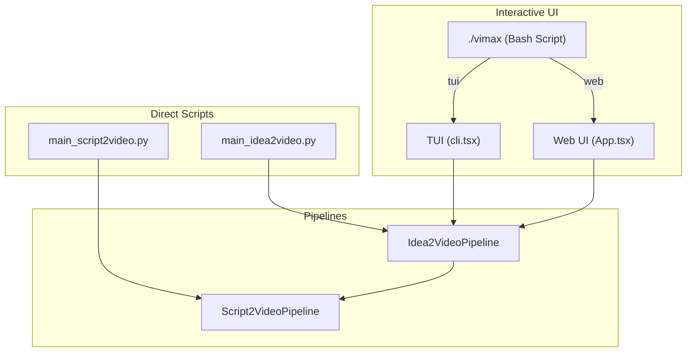

**`main_idea2video.py`**: A high-level entry point that takes a raw idea and generates a full video by orchestrating story planning and visual rendering [main_idea2video.py:1-27]().

**`main_script2video.py`**: A direct entry point for users who already have a screenplay and want to proceed straight to shot generation [main_script2video.py:1-35]().

**`./vimax`**: A unified bash wrapper for launching the interactive **Terminal User Interface (TUI)** or the **Web UI** [vimax:1-113]().

Sources: [main_idea2video.py:1-27](), [main_script2video.py:1-35](), [vimax:1-113]()

---

## Configuration Setup

The system uses YAML files to manage API keys, model selections, and rate limits.

### Configuration Hierarchy

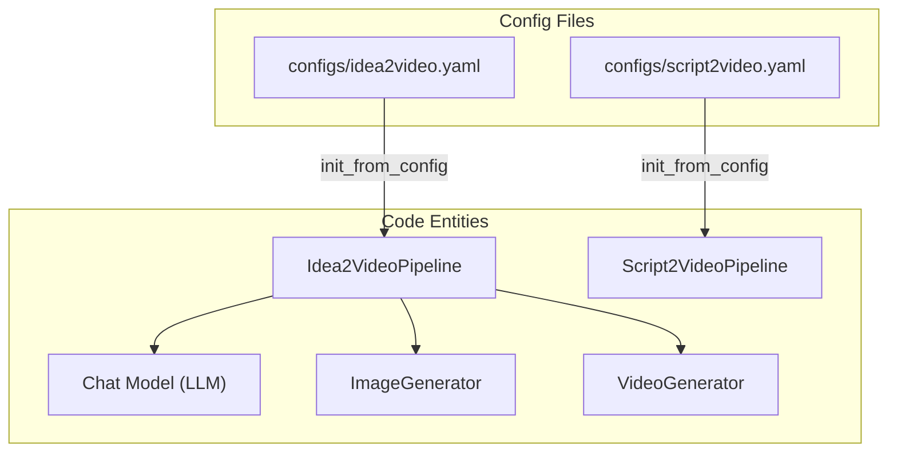

### Rate Limiting
Configurations include `max_requests_per_minute` and `max_requests_per_day` to manage API quotas [configs/idea2video.yaml:7-10](). Setting these to `null` disables rate limiting for that specific service [configs/script2video.yaml:8-10]().

Sources: [configs/idea2video.yaml:1-33](), [configs/script2video.yaml:1-34]()

---

## Quick Start Examples

### Idea to Video
Modify the `idea`, `user_requirement`, and `style` strings in `main_idea2video.py` [main_idea2video.py:6-18]().
```bash
python main_idea2video.py
```

### Script to Video
Modify the `script` (standard screenplay format), `user_requirement`, and `style` in `main_script2video.py` [main_script2video.py:6-24]().
```bash
python main_script2video.py
```

### Interactive Session (TUI)
To start an interactive session where you can refine the story with the agent:
```bash
./vimax tui new
```
This launches the Ink-based TUI defined in `ui/src/cli.tsx` [vimax:15-20](), [vimax:102]().

Sources: [main_idea2video.py:1-27](), [main_script2video.py:1-35](), [vimax:1-113]()

---

## Next Steps

- **Installation Details:** See [Installation and Setup](#2.1) for environment troubleshooting.
- **Configuration Guide:** See [Configuration Basics](#2.2) for setting up local overrides.
- **Workflow Deep Dives:** Explore [Quick Start: Idea to Video](#2.3) or [Quick Start: Script to Video](#2.4) for specific input format requirements.

---

# Page: Installation and Setup

# Installation and Setup

<details>
<summary>Relevant source files</summary>

The following files were used as context for generating this wiki page:

- [pyproject.toml](pyproject.toml)
- [uv.lock](uv.lock)
- [vimax](vimax)

</details>


This document provides step-by-step instructions for installing ViMax and configuring the development environment. It covers system requirements, dependency installation using the `uv` package manager, and platform-specific configuration for GPU acceleration. ViMax is an agentic video generation system that orchestrates complex workflows across multiple AI services.

For information about configuring API keys and model settings after installation, see **2.2 Configuration Basics**. For running your first video generation, see **2.3 Quick Start: Idea to Video**.

---

## System Requirements

ViMax has specific system and software requirements that must be met before installation.

### Operating System

The system supports the following platforms:

| Operating System | Support Status | Notes |
|-----------------|----------------|-------|
| Linux | ✅ Full Support | Recommended for production use |
| Windows | ✅ Full Support | Requires native Windows with CUDA support or WSL2 |
| macOS | ⚠️ Limited Support | CPU-only mode; no GPU acceleration for local processing |

### Python Version

ViMax strictly requires **Python 3.12**. This version requirement is enforced in the project metadata to ensure compatibility with modern async features and type hinting used throughout the agents and pipelines.

```toml
requires-python = ">=3.12"
```

**Sources:** [pyproject.toml:6-6]()

---

## Installing the uv Package Manager

ViMax uses [uv](https://github.com/astral-sh/uv) as its environment and dependency manager. The `uv` tool provides fast, reliable dependency resolution and project isolation, which is critical for the complex multi-agent dependency tree.

### Installation Methods

Install `uv` using one of the following methods:

**Linux/macOS:**
```bash
curl -LsSf https://astral.sh/uv/install.sh | sh
```

**Windows (PowerShell):**
```powershell
powershell -c "irm https://astral.sh/uv/install.ps1 | iex"
```

**Using pip (any platform):**
```bash
pip install uv
```

---

## Repository Setup and Installation

### Step 1: Clone the Repository

Clone the ViMax repository from GitHub:

```bash
git clone https://github.com/HKUDS/ViMax.git
cd ViMax
```

### Step 2: Install Python Dependencies

From within the `ViMax` directory, run:

```bash
uv sync
```

The `uv sync` command reads `pyproject.toml` [pyproject.toml:1-44](), locks dependencies in `uv.lock` [uv.lock:1-53](), and creates a virtual environment.

### Step 3: Install UI Dependencies (Optional)

If you intend to use the Terminal User Interface (TUI) or the Web UI, you must install the Node.js dependencies. The `vimax` helper script checks for these dependencies before execution [vimax:98-101]().

**For TUI:**
```bash
cd ui && npm install
```

**For Web UI:**
```bash
cd web && npm install
```

**Sources:** [vimax:44-46](), [vimax:98-101]()

---

## Dependency Architecture

ViMax's dependencies are organized into functional subsystems defined in `pyproject.toml`.

### Core Dependencies Table

| Package | Version | Purpose |
|---------|---------|---------|
| `langchain` | ≥0.3.26 | Multi-agent orchestration framework [pyproject.toml:12-12]() |
| `google-genai` | ≥1.47.0 | Integration for Gemini and Veo models [pyproject.toml:11-11]() |
| `faiss-cpu` | ≥1.12.0 | Vector search for RAG-based script generation [pyproject.toml:10-10]() |
| `moviepy` | ≥2.2.1 | Video assembly and editing [pyproject.toml:15-15]() |
| `scenedetect` | ≥0.6.7.1 | Automated scene boundary detection [pyproject.toml:21-21]() |
| `opencv-python` | (latest) | Low-level frame processing [pyproject.toml:17-17]() |

**Sources:** [pyproject.toml:7-23]()

### Dependency and Environment Flow

The following diagram bridges the natural language installation steps to the specific code entities and configuration files that govern the environment.

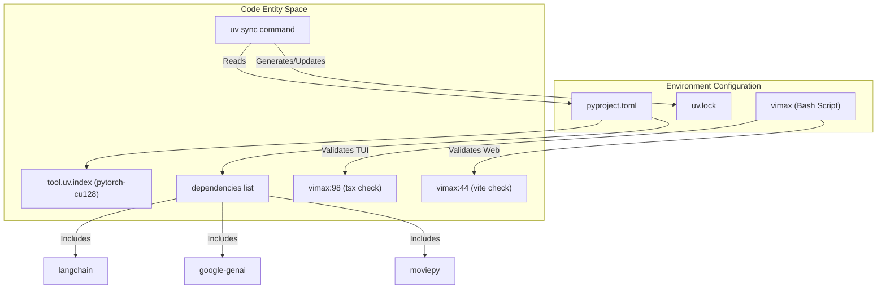

**Sources:** [pyproject.toml:1-44](), [vimax:1-113](), [uv.lock:1-53]()

---

## Platform-Specific PyTorch Configuration

ViMax uses conditional dependency resolution to enable GPU acceleration on Linux and Windows via CUDA 12.8.

### CUDA 12.8 Indexing

The `pyproject.toml` defines an explicit index for PyTorch to ensure the correct CUDA-enabled binaries are fetched rather than the default CPU versions.

```toml
[tool.uv.sources]
torch = [
  { index = "pytorch-cu128", marker = "sys_platform == 'linux' or sys_platform == 'win32'" },
]

[[tool.uv.index]]
name = "pytorch-cu128"
url = "https://download.pytorch.org/whl/cu128"
explicit = true
```

**Sources:** [pyproject.toml:25-38]()

---

## Verifying the Installation

After running `uv sync`, you can verify the setup using the `vimax` entry point script.

### Check CLI Entry Point

Run the helper script to see available commands:

```bash
./vimax --help
```

The script supports three primary operational modes:
1. `vimax tui`: Launches the interactive agent terminal [vimax:57-103]().
2. `vimax web`: Starts the Vite-based development server for the web interface [vimax:35-56]().
3. `vimax web start`: Serves a production build of the web app [vimax:48-54]().

**Sources:** [vimax:12-24](), [vimax:34-112]()

### Verify Python Environment

Ensure the `uv` environment is correctly mapped to Python 3.12:

```bash
uv run python --version
```

### Component Interaction Diagram

This diagram shows how the installation components interact when a user starts the system via the `vimax` script.

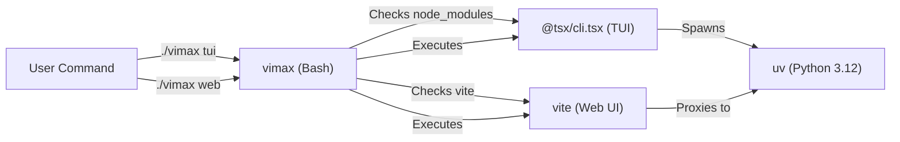

**Sources:** [vimax:34-112](), [pyproject.toml:6-6]()

---

## Troubleshooting

### Dependency Missing Errors
If you see `error: ui dependencies are missing`, ensure you have run `npm install` in the `ui/` directory as required by the bash script's safety checks [vimax:98-101]().

### Python Version Errors
If `uv sync` fails with a version mismatch, ensure you have Python 3.12 installed on your system. `uv` will attempt to find it, but it must be available in your PATH or manageable by `uv python install 3.12`.

**Sources:** [vimax:98-101](), [pyproject.toml:6-6]()

---

# Page: Configuration Basics

# Configuration Basics

<details>
<summary>Relevant source files</summary>

The following files were used as context for generating this wiki page:

- [agent_runtime/__init__.py](agent_runtime/__init__.py)
- [agent_runtime/config.py](agent_runtime/config.py)
- [agent_runtime/tool_executor.py](agent_runtime/tool_executor.py)
- [configs/idea2video.yaml](configs/idea2video.yaml)
- [configs/script2video.yaml](configs/script2video.yaml)
- [main_idea2video.py](main_idea2video.py)
- [main_script2video.py](main_script2video.py)

</details>


## Purpose and Scope

This page introduces ViMax's configuration system, focusing on the YAML-based configuration structure used by pipelines and the local agent configuration mechanism. You will learn how to set up API credentials for chat models, image generators, and video generators using `agent.local.yaml` and environment variables, as well as how to manage rate limits and working directories.

**Sources**: [configs/idea2video.yaml:1-33](), [configs/script2video.yaml:1-34](), [agent_runtime/config.py:1-135]()

---

## Configuration Architecture

ViMax utilizes a multi-layered configuration strategy. High-level pipeline settings (like model selection and rate limits) are defined in pipeline-specific YAML files, while sensitive credentials and service provider defaults can be managed via a centralized `configs/agent.local.yaml` or environment variables.

### The Configuration Resolution Chain

The `agent_runtime/config.py` module provides a robust mechanism for resolving configuration values. When a component requests a setting (like an API key), the system checks sources in the following priority:

1.  **Environment Variables**: Overrides all other settings (e.g., `VIMAX_LLM_API_KEY`).
2.  **`configs/agent.local.yaml`**: A local file for user-specific credentials and provider overrides.
3.  **Pipeline YAMLs**: Specific files like `configs/idea2video.yaml` passed during initialization.
4.  **System Defaults**: Hardcoded fallbacks in the source code.

**Diagram: Configuration Resolution Flow**

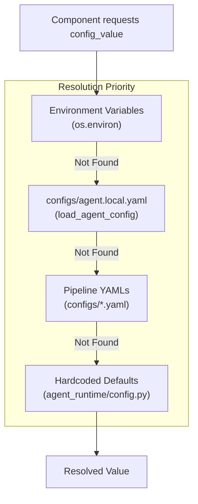

**Sources**: [agent_runtime/config.py:36-46](), [agent_runtime/config.py:49-115]()

---

## Centralized Local Configuration (`agent.local.yaml`)

The `configs/agent.local.yaml` file is the recommended place to store API keys and base URLs that apply across all pipelines and agents. This prevents the need to duplicate credentials in every pipeline YAML.

### Structure of `agent.local.yaml`

The file is organized into sections corresponding to service types: `llm`, `image`, `video`, `embedding`, and `reranker`.

```yaml
llm:
  api_key: "your-llm-api-key"
  base_url: "https://openrouter.ai/api/v1"
  model: "google/gemini-2.5-flash-lite-preview-09-2025"

image:
  api_key: "your-google-api-key"
  model: "imagen-3.0-generate-001"

video:
  api_key: "your-veo-api-key"
  base_url: "https://yunwu.ai/v1"
```

**Sources**: [agent_runtime/config.py:22-33](), [agent_runtime/config.py:41-45]()

### Supported Environment Variables

Environment variables take the highest precedence. Key variables include:

| Service | Environment Variable | Default (if no config found) |
| :--- | :--- | :--- |
| **LLM** | `VIMAX_LLM_API_KEY`, `VIMAX_API_KEY` | `""` |
| **Image** | `VIMAX_IMAGE_API_KEY` | (Falls back to LLM key) |
| **Video** | `VIMAX_VIDEO_API_KEY` | (Falls back to LLM key) |
| **Models** | `VIMAX_LLM_MODEL`, `VIMAX_VIDEO_MODEL` | `gpt-5.5`, `veo3.1-fast` |

**Sources**: [agent_runtime/config.py:10-20](), [agent_runtime/config.py:50-115]()

---

## Pipeline-Specific Configuration

While `agent.local.yaml` handles credentials, pipeline YAMLs (e.g., `configs/idea2video.yaml`) define the specific tools and rate limits for a workflow.

### Service Block Structure

Each service block in a pipeline YAML specifies the `class_path` (for tools) or `init_args` (for models) and its operational limits.

**Diagram: Pipeline Config to Tool Mapping**

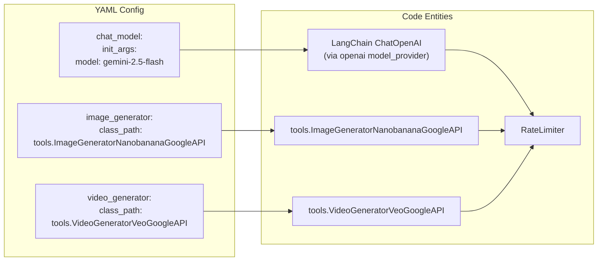

**Sources**: [configs/idea2video.yaml:1-30](), [configs/script2video.yaml:1-31]()

### Rate Limiting

Rate limits are crucial for managing costs and avoiding provider bans. They are defined per service:

*   `max_requests_per_minute`: Throttles concurrent or rapid-fire requests.
*   `max_requests_per_day`: Hard cap on daily consumption.
*   `null`: Disables the limit for that specific metric.

| File | LLM Limit (RPM) | Image Limit (RPM) | Video Limit (RPM) |
| :--- | :--- | :--- | :--- |
| `idea2video.yaml` | 500 | 10 | 2 |
| `script2video.yaml` | `null` | 2 | 2 |

**Sources**: [configs/idea2video.yaml:9,18,28](), [configs/script2video.yaml:9,19,29]()

---

## Configuration Implementation Details

### The `config_value` Function
The core logic for configuration retrieval resides in `agent_runtime/config.py`. It implements the resolution chain by iterating through environment variables first, then checking the dictionary returned by `load_agent_config`.

```python
def config_value(section: str, key: str, env_names: list[str], default: str = "", workspace_root: str | Path = ".") -> str:
    for env_name in env_names:
        value = os.environ.get(env_name)
        if value:
            return value
    section_payload = load_agent_config(workspace_root).get(section, {})
    # ... logic to return from payload or default ...
```

**Sources**: [agent_runtime/config.py:36-46]()

### Tool Execution Context
When a pipeline is initialized via `init_from_config`, it uses these resolved values to build the `ToolRegistry` and `ToolExecutor`. The `ToolExecutor` tracks the duration and success of every tool call, which is then logged into the session history.

**Sources**: [agent_runtime/tool_executor.py:24-47](), [agent_runtime/__init__.py:6-9]()

---

## Common Configuration Patterns

### 1. Using OpenRouter as a Unified Gateway
Users often point all services to OpenRouter to simplify key management.
```yaml
# configs/agent.local.yaml
llm:
  api_key: "sk-or-v1-..."
  base_url: "https://openrouter.ai/api/v1"
  model: "google/gemini-2.0-flash-001"
```
The system automatically detects the provider via `api_provider_from_base_url`.

### 2. Custom Working Directories
The `working_dir` setting determines where the system stores storyboard images, generated video clips, and logs. It is unique to each pipeline to prevent asset collisions.
*   `configs/idea2video.yaml`: `.working_dir/idea2video`
*   `configs/script2video.yaml`: `.working_dir/script2video`

**Sources**: [agent_runtime/config.py:118-125](), [configs/idea2video.yaml:32](), [configs/script2video.yaml:33]()

---

# Page: Quick Start: Idea to Video

# Quick Start: Idea to Video

<details>
<summary>Relevant source files</summary>

The following files were used as context for generating this wiki page:

- [configs/idea2video.yaml](configs/idea2video.yaml)
- [configs/script2video.yaml](configs/script2video.yaml)
- [main_idea2video.py](main_idea2video.py)
- [main_script2video.py](main_script2video.py)
- [pipelines/idea2video_pipeline.py](pipelines/idea2video_pipeline.py)

</details>


This guide walks you through your first complete workflow using ViMax's **Idea2Video** mode. You will learn how to transform a simple narrative idea into a multi-scene video by providing natural language descriptions of your creative vision.

**Purpose**: This document covers the end-to-end process of generating a video from a conceptual idea using `main_idea2video.py`. For generating videos from existing structured scripts, see [Quick Start: Script to Video](#2.4). For installation and environment setup, see [Installation and Setup](#2.1). For detailed configuration options, see [Configuration Basics](#2.2).

---

## Prerequisites

Before proceeding, ensure you have completed:

1.  **Environment Setup**: Python ≥3.12 and dependencies installed via `uv sync` (see [Installation and Setup](#2.1))
2.  **API Credentials**: Valid API keys for required services (see [Configuration Basics](#2.2))
3.  **Configuration File**: `configs/idea2video.yaml` with your API keys configured.

---

## Understanding Idea2Video

The Idea2Video workflow transforms three simple text inputs into a complete video with the following automated stages orchestrated by the `Idea2VideoPipeline` class [pipelines/idea2video_pipeline.py:23-23]():

| **Stage** | **What Happens** | **Agent/Component** |
|-----------|------------------|---------------------|
| Story Development | Expands your idea into a structured narrative with scene breakdowns | `Screenwriter` [pipelines/idea2video_pipeline.py:37-37]() |
| Character Extraction | Identifies all characters with physical descriptions and traits | `CharacterExtractor` [pipelines/idea2video_pipeline.py:38-39]() |
| Portrait Generation | Creates visual reference images (front/side/back) for each character | `CharacterPortraitsGenerator` [pipelines/idea2video_pipeline.py:40-41]() |
| Script Writing | Converts story into screenplay format with scene descriptions and dialogue | `Screenwriter` [pipelines/idea2video_pipeline.py:154-154]() |
| Scene-by-Scene Video | For each scene, generates storyboard, shots, frames, and videos | `Script2VideoPipeline` [pipelines/idea2video_pipeline.py:214-214]() |
| Video Assembly | Concatenates all scene videos into final output | `concatenate_video_files` [pipelines/idea2video_pipeline.py:15-15]() |

**Sources**: [pipelines/idea2video_pipeline.py:1-214](), [main_idea2video.py:1-28]()

---

## Workflow Architecture

### Data Flow: Idea to Final Video
This diagram maps the high-level narrative flow to the specific code entities responsible for each transformation.

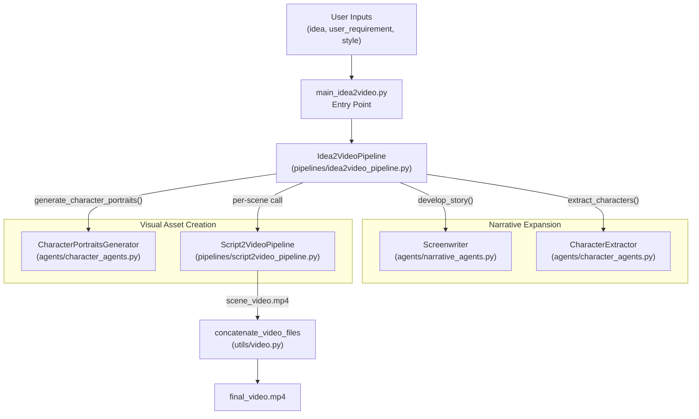

**Sources**: [pipelines/idea2video_pipeline.py:23-220](), [main_idea2video.py:21-24](), [utils/video.py:15-15]()

---

## Three Required Inputs

The Idea2Video workflow requires three text inputs defined in `main_idea2video.py`:

### 1. Idea (String)
Your creative concept in natural language.
**Example from code** ([main_idea2video.py:6-13]()):
```python
idea = """
A beaufitul fit woman with black hair, great butt and thigs is exercising in a
gym surrounded by glass windows with a beautiful beach view on the outside...
"""
```

### 2. User Requirement (String)
Production constraints and creative directives.
**Example from code** ([main_idea2video.py:14-17]()):
```python
user_requirement = """
For adults, do not exceed 3 scenes. Each scene should be no more than 5 shots.
"""
```

### 3. Style (String)
Visual and artistic direction.
**Example from code** ([main_idea2video.py:18-18]()):
```python
style = "Realistic, warm feel"
```

**Sources**: [main_idea2video.py:5-18]()

---

## Configuration Structure

The pipeline is initialized via `Idea2VideoPipeline.init_from_config()` [pipelines/idea2video_pipeline.py:43-44](), which reads `configs/idea2video.yaml`.

### Service Registry Mapping
This diagram shows how configuration keys map to internal tool classes.

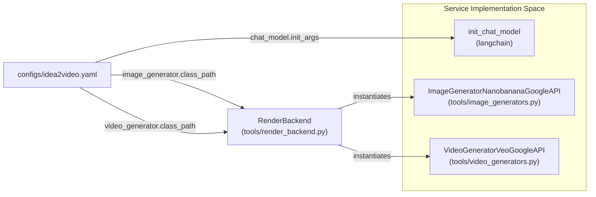

**Key Configuration Fields** ([configs/idea2video.yaml:1-32]()):

| **Section** | **Key Settings** | **Purpose** |
|-------------|---------------------|-------------|
| `chat_model` | `model: google/gemini-2.5-flash-lite` | LLM for narrative tasks [configs/idea2video.yaml:3]() |
| `image_generator` | `class_path: tools.ImageGenerator...` | Generate portraits and frames [configs/idea2video.yaml:13]() |
| `video_generator` | `class_path: tools.VideoGenerator...` | Synthesize motion videos [configs/idea2video.yaml:23]() |
| `working_dir` | `.working_dir/idea2video` | Storage for all artifacts [configs/idea2video.yaml:32]() |

**Sources**: [configs/idea2video.yaml:1-32](), [pipelines/idea2video_pipeline.py:43-57]()

---

## Running Your First Idea2Video

### Step 1: Configure Your Inputs
Edit `main_idea2video.py` to set your creative inputs ([main_idea2video.py:6-18]()).

### Step 2: Execute the Pipeline
Run the entry point script:
```bash
python main_idea2video.py
```

### Step 3: Execution Logic
The `Idea2VideoPipeline.__call__` method orchestrates the following asynchronous sequence:
1.  **Story Development**: Calls `develop_story` [pipelines/idea2video_pipeline.py:121]().
2.  **Character Analysis**: Calls `extract_characters` [pipelines/idea2video_pipeline.py:59]() and `generate_character_portraits` [pipelines/idea2video_pipeline.py:81]().
3.  **Scripting**: Calls `write_script_based_on_story` [pipelines/idea2video_pipeline.py:141]().
4.  **Per-Scene Rendering**: Loops through scene scripts, initializing a `Script2VideoPipeline` for each [pipelines/idea2video_pipeline.py:214]().
5.  **Final Assembly**: Gathers all `.mp4` files from scene directories and merges them using `concatenate_video_files` [pipelines/idea2video_pipeline.py:223]().

**Sources**: [pipelines/idea2video_pipeline.py:186-228](), [main_idea2video.py:21-27]()

---

## Understanding the Output Structure

The `working_dir` (defined at [configs/idea2video.yaml:32]()) will contain:

*   `story.txt`: The expanded narrative [pipelines/idea2video_pipeline.py:127]().
*   `characters.json`: JSON list of extracted `CharacterInScene` models [pipelines/idea2video_pipeline.py:64]().
*   `character_portraits/`: Subdirectories for each character containing `front.png`, `side.png`, and `back.png` [pipelines/idea2video_pipeline.py:165-174]().
*   `script.json`: The final screenplay format [pipelines/idea2video_pipeline.py:147]().
*   `scene_0/`, `scene_1/`, etc.: Working directories for individual scenes generated by `Script2VideoPipeline`.
*   `final_video.mp4`: The primary output - complete video assembled from all scenes [pipelines/idea2video_pipeline.py:223]().

**Sources**: [pipelines/idea2video_pipeline.py:64-223](), [configs/idea2video.yaml:32-32]()

---

## Expected Execution Time and Constraints

Execution time is primarily influenced by the rate limits defined in the configuration:

*   **Chat Model**: 500 requests/minute [configs/idea2video.yaml:9](). High throughput for planning.
*   **Image Generation**: 10 requests/minute [configs/idea2video.yaml:18](). Used for character portraits and shot frames.
*   **Video Generation**: 2 requests/minute [configs/idea2video.yaml:28](). This is the main bottleneck for the pipeline.

**Example Timeline**:
1.  **Narrative (Story/Script)**: ~1-2 minutes.
2.  **Character Portraits**: ~2-5 minutes (parallel generation per character).
3.  **Video Rendering**: Dependent on shot count. With a limit of 2 videos/minute, a 15-shot video will take at least 8 minutes of pure generation time, excluding overhead.

**Sources**: [configs/idea2video.yaml:1-32](), [pipelines/idea2video_pipeline.py:96-107]()

---

# Page: Quick Start: Script to Video

# Quick Start: Script to Video

<details>
<summary>Relevant source files</summary>

The following files were used as context for generating this wiki page:

- [configs/idea2video.yaml](configs/idea2video.yaml)
- [configs/script2video.yaml](configs/script2video.yaml)
- [main_idea2video.py](main_idea2video.py)
- [main_script2video.py](main_script2video.py)
- [pipelines/script2video_pipeline.py](pipelines/script2video_pipeline.py)

</details>


This guide provides a complete walkthrough for generating videos from screenplay scripts using ViMax's **Script2Video** workflow. This mode is designed for users who have already written a screenplay and want to convert it directly into video without the intermediate story development stages.

**Scope**: This page covers the `main_script2video.py` entry point and the `Script2VideoPipeline` orchestrator. For the full idea-to-video workflow that includes automatic story and script generation, see [Quick Start: Idea to Video](#2.3). For detailed configuration options, see [script2video.yaml Reference](#8.3).

---

## Overview

The Script2Video pipeline transforms a screenplay script into a complete video by:
1. Extracting characters and their visual attributes from the script.
2. Generating character portrait references (front/side/back views).
3. Designing a shot-by-shot storyboard based on cinematic language.
4. Constructing a camera position tree for spatial consistency.
5. Generating frames and videos in parallel for each shot.
6. Assembling the final video with proper transitions.

Unlike the Idea2Video workflow, Script2Video assumes you already have a structured screenplay and focuses on the visual production stages.

**Sources**: [main_script2video.py:1-35](), [pipelines/script2video_pipeline.py:81-106]()

---

## Prerequisites

Before running Script2Video, ensure you have:

1. **Completed installation**: See [Installation and Setup](#2.1) for environment setup using `uv`.
2. **Configured API keys**: See [Configuration Basics](#2.2) for setting up the required services in `configs/script2video.yaml`.
3. **GPU access** (optional but recommended): For faster processing of video generation tasks.

The Script2Video pipeline requires three external services configured in `configs/script2video.yaml`:
- **Chat Model**: For character extraction, storyboard design, and prompt generation.
- **Image Generator**: For creating character portraits and shot frames.
- **Video Generator**: For synthesizing motion between frames.

**Sources**: [configs/script2video.yaml:1-31]()

---

## Configuration Setup

The Script2Video pipeline is configured through `configs/script2video.yaml`. This file defines service providers, rate limits, and pipeline behavior.

### Minimal Configuration

[configs/script2video.yaml:1-34]()
```yaml
chat_model:
  init_args:
    model: google/gemini-2.5-flash-lite-preview-09-2025
    model_provider: openai
    api_key: <YOUR_API_KEY>
    base_url: https://openrouter.ai/api/v1
  max_requests_per_minute: null

image_generator:
  class_path: tools.ImageGeneratorNanobananaGoogleAPI
  init_args:
    api_key: <YOUR_API_KEY>
  max_requests_per_minute: 2

video_generator:
  class_path: tools.VideoGeneratorVeoGoogleAPI
  init_args:
    api_key: <YOUR_API_KEY>
  max_requests_per_minute: 2

working_dir: .working_dir/script2video
```

### Configuration Structure

The following diagram maps the YAML configuration structure to the Python classes that consume it:

**Configuration to Entity Mapping**
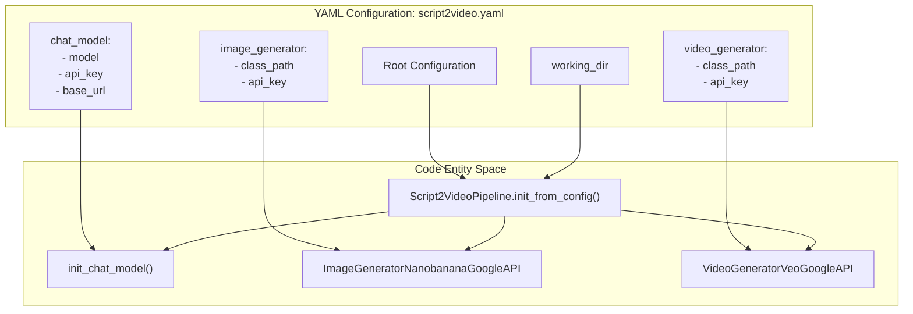

**Sources**: [configs/script2video.yaml:1-34](), [pipelines/script2video_pipeline.py:15-16]()

---

## Script Format Requirements

The Script2Video pipeline expects scripts in **standard screenplay format**. The system uses natural language understanding to parse the script, so exact formatting is flexible.

### Example Script Structure

[main_script2video.py:6-19]()
```
EXT. SCHOOL GYM - DAY
A group of students are practicing basketball in the gym. John (18, male, tall, athletic) is the star player. Jane (17, female, short, athletic) is the assistant coach.

John: (dribbling the ball) I'm going to score a basket!
Jane: (smiling) Good job, John!
(John takes another shot. This time, the ball swishes through the net perfectly.)
```

### Script-to-Model Mapping

The following diagram shows how screenplay elements are parsed into ViMax data structures:

**Natural Language to Code Model Mapping**
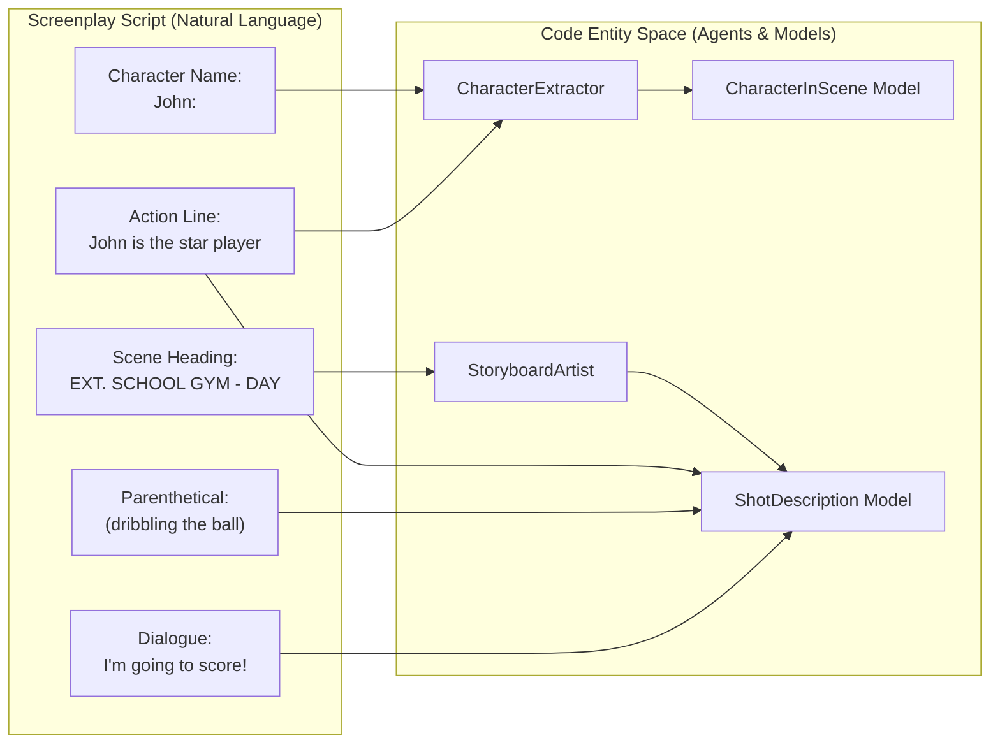

**Sources**: [main_script2video.py:6-19](), [pipelines/script2video_pipeline.py:95-97]()

---

## Running the Pipeline

### Basic Usage

The `main_script2video.py` file provides the entry point for script-to-video generation.

[main_script2video.py:28-34]()
```python
import asyncio
from pipelines.script2video_pipeline import Script2VideoPipeline

async def main():
    # Load configuration and initialize pipeline
    pipeline = Script2VideoPipeline.init_from_config(
        config_path="configs/script2video.yaml"
    )
    # Execute pipeline with script, requirement, and style
    await pipeline(
        script=script, 
        user_requirement=user_requirement, 
        style=style
    )

if __name__ == "__main__":
    asyncio.run(main())
```

### Input Parameters

| Parameter | Type | Purpose | Example |
|-----------|------|---------|---------|
| `script` | `str` | Complete screenplay text | See [main_script2video.py:6-19]() |
| `user_requirement` | `str` | Creative direction and constraints | `"Fast-paced with no more than 15 shots."` |
| `style` | `str` | Visual style directive | `"Anime Style"` |

**Sources**: [main_script2video.py:20-24](), [main_script2video.py:30]()

---

## Pipeline Workflow

The `Script2VideoPipeline` orchestrates multiple AI agents through a multi-stage workflow.

### Execution Flow Diagram

```mermaid
flowchart TD
    START["main_script2video.py<br/>asyncio.run(main())"]
    
    INIT["Script2VideoPipeline.init_from_config()"]
    
    CALL["pipeline.__call__()<br/>[Entry Point]"]
    
    subgraph "Narrative Planning"
        EXTRACT_CHAR["CharacterExtractor.extract_characters()"]
        STORYBOARD["StoryboardArtist.design_storyboard()"]
        DECOMPOSE["StoryboardArtist.decompose_visual_descriptions()"]
        CAMTREE["CameraImageGenerator.construct_camera_tree()"]
    end
    
    subgraph "Visual Production"
        GEN_PORTRAITS["CharacterPortraitsGenerator.generate_portraits()"]
        PARALLEL["asyncio.gather()<br/>[Concurrent Shot Generation]"]
        
        subgraph "Per-Shot Loop"
            SELECT_REF["ReferenceImageSelector.select_references()"]
            GEN_FIRST["CameraImageGenerator.generate_first_frame()"]
            GEN_VIDEO["CameraImageGenerator.generate_transition_video()"]
        end
    end
    
    ASSEMBLE["moviepy.concatenate_videoclips()"]
    
    START --> INIT
    INIT --> CALL
    CALL --> EXTRACT_CHAR
    EXTRACT_CHAR --> STORYBOARD
    STORYBOARD --> DECOMPOSE
    DECOMPOSE --> CAMTREE
    CAMTREE --> GEN_PORTRAITS
    GEN_PORTRAITS --> PARALLEL
    
    PARALLEL --> SELECT_REF
    SELECT_REF --> GEN_FIRST
    GEN_FIRST --> GEN_VIDEO
    
    GEN_VIDEO --> ASSEMBLE
```

### Stage-by-Stage Breakdown

1.  **Character Analysis**: `CharacterExtractor` identifies characters and their traits from the script [pipelines/script2video_pipeline.py:128-129]().
2.  **Storyboard Design**: `StoryboardArtist` designs a shot list and decomposes them into detailed visual descriptions [pipelines/script2video_pipeline.py:141-152]().
3.  **Camera Planning**: `CameraImageGenerator` constructs a `camera_tree` to maintain spatial consistency [pipelines/script2video_pipeline.py:159-162]().
4.  **Visual Assets**: `CharacterPortraitsGenerator` creates reference images [pipelines/script2video_pipeline.py:96]().
5.  **Parallel Generation**: Shots are generated concurrently using `asyncio.gather`. Each shot involves selecting references, generating frames, and synthesizing motion [pipelines/script2video_pipeline.py:98-99]().
6.  **Assembly**: The final video is concatenated using `moviepy` [pipelines/script2video_pipeline.py:8]().

**Sources**: [pipelines/script2video_pipeline.py:81-176]()

---

## Output Structure

The `working_dir` (default: `.working_dir/script2video`) contains all generated artifacts.

| File/Directory | Content |
|----------------|---------|
| `final_video.mp4` | The assembled final video. |
| `characters.json` | Extracted character data. |
| `storyboard.json` | The designed shot list. |
| `camera_tree.json` | The spatial relationship hierarchy. |
| `portraits/` | Generated character reference images. |
| `shots/` | Individual video files and frames for each shot. |

**Sources**: [configs/script2video.yaml:33](), [pipelines/script2video_pipeline.py:133-135]()

---

# Page: System Architecture

# System Architecture

<details>
<summary>Relevant source files</summary>

The following files were used as context for generating this wiki page:

- [README_ZH.md](README_ZH.md)
- [agent_runtime/loop.py](agent_runtime/loop.py)
- [agent_runtime/vimax_adapters.py](agent_runtime/vimax_adapters.py)
- [assets/vimax.png](assets/vimax.png)
- [readme.md](readme.md)
- [tests/test_agent_loop.py](tests/test_agent_loop.py)
- [tests/test_openrouter_video_generator.py](tests/test_openrouter_video_generator.py)

</details>


This document provides a comprehensive overview of ViMax's system architecture, explaining how the codebase is organized into layers, how components interact, and the key architectural patterns employed. This page introduces the high-level structure and design principles that govern the entire system.

For detailed information about specific aspects:
- For the high-level system layers and operational modes, see [Architecture Overview](#3.1)
- For the sequential processing stages from idea to video, see [Multi-Stage Pipeline](#3.2)
- For the asyncio-based execution pattern and event coordination, see [Asynchronous Execution Model](#3.3)
- For the hierarchical camera positioning system, see [Camera Tree Architecture](#3.4)

---

## Architectural Philosophy

ViMax employs a **layered, agentic architecture** designed for narrative consistency, extensibility, and efficient resource utilization. The system is organized around three core principles:

1.  **Agentic Orchestration**: Creative tasks are delegated to specialized agents (Screenwriter, StoryboardArtist, etc.) that interact via structured data models.
2.  **Async-First Execution**: All I/O-bound operations and generation tasks use Python's `asyncio` to maximize throughput and enable parallel shot processing.
3.  **Stateful Persistence**: Workflows are session-based, with intermediate artifacts (scripts, character portraits, camera trees) persisted to disk to allow for resumption and manual intervention.

The architecture supports two primary operational modes:
-   **Direct Pipeline**: Sequential execution from entry points like `main_idea2video.py` or `main_script2video.py`.
-   **Agent Loop**: An interactive, event-driven mode where a central `AgentLoop` manages turns, tool calls, and context compaction [agent_runtime/loop.py:20-28]().

---

## System Layers

ViMax is structured as a multi-layer system, where each layer provides abstractions for the one above it.

### Complete System Architecture

```mermaid
graph TB
    subgraph "Entry Points"
        TUI["vimax tui<br/>(Terminal UI)"]
        WEB["Web UI<br/>(Vite/React)"]
        CLI["main_idea2video.py<br/>(Direct CLI)"]
    end
    
    subgraph "Agent Runtime & Loop"
        AL["AgentLoop<br/>agent_runtime/loop.py<br/>Manages turns & tools"]
        CC["ContextCompactor<br/>agent_runtime/context_compactor.py"]
        SI["SessionIndex<br/>agent_runtime/session_index.py"]
    end
    
    subgraph "Pipelines & Adapters"
        VA["ViMaxAdapters<br/>agent_runtime/vimax_adapters.py<br/>Tool interface for Loop"]
        I2V["Idea2VideoPipeline<br/>pipelines/idea2video_pipeline.py"]
        S2V["Script2VideoPipeline<br/>pipelines/script2video_pipeline.py"]
        N2V["Novel2MoviePipeline<br/>pipelines/novel2movie_pipeline.py"]
    end
    
    subgraph "Agents & Services"
        AGENTS["Specialized Agents<br/>(Screenwriter, StoryboardArtist,<br/>CameraImageGenerator)"]
        TOOLS["Tool Wrappers<br/>(ImageGenerator, VideoGenerator,<br/>RateLimiter)"]
    end
    
    TUI --> AL
    WEB --> AL
    CLI --> I2V
    CLI --> S2V
    
    AL --> VA
    VA --> I2V
    VA --> S2V
    VA --> N2V
    
    I2V --> AGENTS
    S2V --> AGENTS
    N2V --> AGENTS
    
    AGENTS --> TOOLS
    AL --> SI
    AL --> CC
```

**Sources**: [agent_runtime/loop.py:20-41](), [agent_runtime/vimax_adapters.py:43-95](), [pipelines/idea2video_pipeline.py:16-35](), [readme.md:74-86]()

### Layer Responsibilities

| Layer | Components | Responsibilities |
| :--- | :--- | :--- |
| **User Entry** | `tui`, `web`, `main_*.py` | Handle user input, display progress, and manage project lifecycle. |
| **Agent Runtime** | `AgentLoop`, `ToolExecutor` | Orchestrate LLM sampling, execute tool calls, and manage conversation history [agent_runtime/loop.py:68-134](). |
| **Pipelines** | `Idea2VideoPipeline`, `Script2VideoPipeline` | Define the high-level workflow DAG and coordinate multiple agents to produce video. |
| **Agents** | `Screenwriter`, `StoryboardArtist` | Execute domain-specific logic like scriptwriting or shot decomposition. |
| **Tools** | `VideoGeneratorOpenRouterAPI`, `RateLimiter` | Interface with external APIs (OpenRouter, Google, Bytedance) and enforce quotas [agent_runtime/vimax_adapters.py:24-30](). |

---

## Core Component Relationships

### Pipeline and Agent Interaction

The pipelines act as orchestrators, delegating creative and analytical tasks to specialized agents. For example, the `Script2VideoPipeline` coordinates the entire visual generation process.

```mermaid
graph TD
    subgraph "Script2VideoPipeline"
        S2V_CALL["__call__ method"]
    end

    subgraph "Agents (Logic Space)"
        CE["CharacterExtractor"]
        CPG["CharacterPortraitsGenerator"]
        SBA["StoryboardArtist"]
        CIG["CameraImageGenerator"]
    end

    subgraph "Models (Data Space)"
        CIS["CharacterInScene"]
        SD["ShotDescription"]
        CAM["Camera"]
    end

    S2V_CALL --> CE
    CE -- "returns" --> CIS
    S2V_CALL --> CPG
    CPG -- "uses" --> CIS
    S2V_CALL --> SBA
    SBA -- "returns" --> SD
    S2V_CALL --> CIG
    CIG -- "manages" --> CAM
```

**Sources**: [pipelines/script2video_pipeline.py:127-222](), [pipelines/script2video_pipeline.py:488-508](), [pipelines/script2video_pipeline.py:596-625]()

### Agent Loop and Tooling

In the interactive mode, the `AgentLoop` uses `ViMaxAdapters` to bridge natural language requests to pipeline execution.

```mermaid
sequenceDiagram
    participant User
    participant Loop as AgentLoop (loop.py)
    participant LLM as OpenAICompatibleLLM
    participant Adapter as ViMaxAdapters (vimax_adapters.py)
    participant Pipe as Script2VideoPipeline

    User->>Loop: "Generate video for this script"
    Loop->>LLM: Sample response with tools
    LLM-->>Loop: ToolCall: vimax_render_video
    Loop->>Adapter: execute(vimax_render_video)
    Adapter->>Pipe: __call__()
    Pipe-->>Adapter: VideoOutput
    Adapter-->>Loop: ToolResult
    Loop->>LLM: Final answer with result
    LLM-->>User: "Video rendered at path/to/video.mp4"
```

**Sources**: [agent_runtime/loop.py:68-134](), [agent_runtime/vimax_adapters.py:83-94](), [tests/test_agent_loop.py:135-155]()

---

## Key Architectural Patterns

### 1. Asynchronous Event Coordination
The system uses `asyncio.Event` to manage dependencies between parallel generation tasks. For instance, a shot generation task might wait for a specific character portrait or a parent camera frame to be ready before proceeding [pipelines/script2video_pipeline.py:21-23]().

### 2. Context Compaction
To handle long-running creative sessions, the `AgentLoop` employs a `ContextCompactor`. When token pressure is high, it generates a synthetic summary of past turns to stay within LLM context limits while preserving essential project state [agent_runtime/loop.py:30-41]().

### 3. Tool-Based Extensibility
External services like image and video generators are implemented as interchangeable tools. The system uses factory patterns and configuration files to swap between providers (e.g., OpenRouter vs. Yunwu API) without altering the core pipeline logic [agent_runtime/vimax_adapters.py:24-30]().

### 4. Hierarchical Camera Tree
To maintain visual consistency across multiple shots, ViMax constructs a `Camera` tree. Each camera can have a parent, allowing child cameras to inherit visual context (like the "first frame" of a parent shot) to ensure spatial continuity [pipelines/script2video_pipeline.py:459-486]().

---

## Summary

The ViMax architecture is designed to transform unstructured narrative ideas into structured cinematic assets. By separating the high-level **Agent Loop** from the concrete **Pipelines**, the system supports both fully automated and human-in-the-loop creative workflows. The use of **Pydantic models** for data exchange and **asyncio** for execution ensures that the system is both type-safe and performant.

For more details, refer to the child pages:
- [Architecture Overview](#3.1)
- [Multi-Stage Pipeline](#3.2)
- [Asynchronous Execution Model](#3.3)
- [Camera Tree Architecture](#3.4)

**Sources**: [readme.md:74-86](), [agent_runtime/loop.py:20-41](), [pipelines/script2video_pipeline.py:127-222]()

---

# Page: Architecture Overview

# Architecture Overview

<details>
<summary>Relevant source files</summary>

The following files were used as context for generating this wiki page:

- [README_ZH.md](README_ZH.md)
- [assets/vimax.png](assets/vimax.png)
- [pyproject.toml](pyproject.toml)
- [readme.md](readme.md)
- [uv.lock](uv.lock)
- [vimax](vimax)

</details>


ViMax is organized into an agentic architecture that transforms text inputs into complete videos through narrative planning, visual design, and asset generation. This page presents the high-level system architecture, explaining how layers interact and the two primary operational modes: direct pipeline execution and the interactive agent loop.

## Architectural Principles

The ViMax architecture is built on three core principles:

1.  **Layered Separation**: Distinct responsibilities for entry points, pipelines, agents, and infrastructure tools.
2.  **Operational Duality**: Supports both linear batch processing (Pipelines) and interactive, session-based iteration (Agent Loop).
3.  **Consistency-First Design**: Uses shared registries (character portraits) and hierarchical structures (camera trees) to maintain visual continuity.

Sources: [readme.md:74-86](), [pipelines/script2video_pipeline.py:18-46]()

---

## System Layers

ViMax follows a top-down dependency flow where upper layers orchestrate lower layers.

### Layer Summary

| Layer | Responsibility | Key Entities | Primary Code Locations |
| :--- | :--- | :--- | :--- |
| **1. Entry Points** | User interfaces and script entry points | `main_idea2video.py`, `vimax` (CLI/TUI), Web UI | [readme.md:149-164](), [vimax:34-112]() |
| **2. Operational Mode** | Batch orchestration vs. Interactive loop | `Idea2VideoPipeline`, `AgentLoop` | [pipelines/idea2video_pipeline.py](), [agent_runtime/agent_loop.py]() |
| **3. Agent Layer** | Specialized AI tasks (Narrative, Visual, Camera) | `Screenwriter`, `StoryboardArtist`, `CameraImageGenerator` | [agents/]() directory |
| **4. Service Layer** | Standardized interfaces for external AI models | `ImageGenerator`, `VideoGenerator`, `ChatModel` | [tools/](), [agent_runtime/llm.py]() |
| **5. Infrastructure** | Core utilities and persistence | `RateLimiter`, `SessionIndex`, `VideoProcessor` | [utils/rate_limiter.py](), [agent_runtime/session_index.py]() |

### System Architecture Diagram

The following diagram maps the high-level system components to their specific code entities.

```mermaid
graph TB
    subgraph Layer1["Layer 1: Entry Points"]
        CLI["vimax tui/web"]
        MainIdea["main_idea2video.py"]
        MainScript["main_script2video.py"]
    end
    
    subgraph Layer2["Layer 2: Operational Modes"]
        AgentLoop["AgentLoop (Interactive)"]
        Idea2VideoPipeline["Idea2VideoPipeline (Batch)"]
        Script2VideoPipeline["Script2VideoPipeline (Batch)"]
    end
    
    subgraph Layer3["Layer 3: Agents"]
        Screenwriter["Screenwriter"]
        StoryboardArtist["StoryboardArtist"]
        CameraImageGenerator["CameraImageGenerator"]
        CharacterExtractor["CharacterExtractor"]
    end
    
    subgraph Layer4["Layer 4: Services & Tools"]
        LLM["OpenAICompatibleLLM"]
        ImgGen["ImageGenerator (Nanobanana/Seedream)"]
        VidGen["VideoGenerator (Veo/Seedance)"]
    end

    subgraph Layer5["Layer 5: Infrastructure"]
        RateLimiter["RateLimiter"]
        SessionIndex["SessionIndex (.vimax)"]
        WorkingDir["Working Directory (.working_dir)"]
    end

    CLI --> AgentLoop
    MainIdea --> Idea2VideoPipeline
    MainScript --> Script2VideoPipeline
    
    AgentLoop --> Screenwriter
    Idea2VideoPipeline --> Script2VideoPipeline
    Script2VideoPipeline --> StoryboardArtist
    Script2VideoPipeline --> CameraImageGenerator
    
    Screenwriter --> LLM
    StoryboardArtist --> LLM
    CameraImageGenerator --> ImgGen
    CameraImageGenerator --> VidGen
    
    LLM --> RateLimiter
    ImgGen --> RateLimiter
    AgentLoop --> SessionIndex
    Idea2VideoPipeline --> WorkingDir
```

Sources: [readme.md:74-86](), [pipelines/idea2video_pipeline.py:16-35](), [agent_runtime/agent_loop.py:1-50](), [vimax:34-112]()

---

## Operational Modes

ViMax operates in two distinct modes depending on the desired level of user intervention.

### 1. Direct Pipeline Mode (Batch)
In this mode, the system executes a predefined sequence of stages from start to finish. It is ideal for automated production where the user provides an initial input and expects a final video.

*   **Idea2VideoPipeline**: Orchestrates the expansion of a short concept into a story, characters, and multiple scene scripts, then delegates to the script pipeline [pipelines/idea2video_pipeline.py:16-35]().
*   **Script2VideoPipeline**: Handles shot decomposition, camera tree construction, parallel frame generation, and video assembly [pipelines/script2video_pipeline.py:18-46]().

### 2. Agent Loop Mode (Interactive)
The Agent Loop allows users to interact with the system via a TUI or Web UI. Users can discuss ideas, revise scripts, and trigger rendering of specific components.

*   **AgentLoop**: Manages the conversation state, tool calls, and context compaction [agent_runtime/agent_loop.py:1-50]().
*   **SessionIndex**: Persists the session state, history, and generated artifacts in the `.vimax` directory.
*   **Adapters**: Specialized tools like `vimax_narrative_planning` bridge the interactive loop to the underlying pipeline logic.

Sources: [readme.md:82-83](), [vimax:57-103](), [agent_runtime/agent_loop.py:1-50]()

---

## Bridge: Natural Language to Code Entity Space

The following diagram illustrates how abstract creative concepts (Natural Language Space) are mapped to specific software components (Code Entity Space) within the ViMax architecture.

```mermaid
graph LR
    subgraph NLSpace["Natural Language Space (Concepts)"]
        Concept["'A story about...'"]
        Script["'Scene 1: Interior...'"]
        Shot["'Close up of character'"]
        Motion["'Character walks left'"]
    end

    subgraph CodeSpace["Code Entity Space (Implementation)"]
        direction TB
        Screenwriter["Screenwriter.develop_story()"]
        SArtist["StoryboardArtist.design_storyboard()"]
        CIGen["CameraImageGenerator.generate_first_frame()"]
        VGen["VideoGeneratorVeoGoogleAPI.generate_single_video()"]
        ShotDesc["ShotDescription (Pydantic Model)"]
    end

    Concept -.-> Screenwriter
    Script -.-> SArtist
    SArtist -.-> ShotDesc
    Shot -.-> CIGen
    Motion -.-> VGen
    
    Screenwriter --> ShotDesc
    ShotDesc --> CIGen
    ShotDesc --> VGen
```

Sources: [agents/screenwriter.py:1-20](), [agents/storyboard_artist.py:1-20](), [agents/camera_image_generator.py:1-30](), [tools/video_generator_veo_google_api.py:13-30]()

---

## Data Flow and Persistence

### Batch Data Flow
1.  **Entry**: `main_idea2video.py` loads `configs/idea2video.yaml`.
2.  **Orchestration**: `Idea2VideoPipeline` calls `Screenwriter` to generate `story.txt`.
3.  **Delegation**: `Idea2VideoPipeline` instantiates `Script2VideoPipeline` for each scene.
4.  **Generation**: `CameraImageGenerator` produces frames; `VideoGenerator` produces `.mp4` clips.
5.  **Assembly**: MoviePy concatenates clips into the final output in the `working_dir`.

### Interactive Data Flow
1.  **Entry**: `vimax tui` starts the `cli.tsx` interface.
2.  **Event Stream**: User input is sent to `AgentLoop.stream_events()`.
3.  **Tool Execution**: The LLM calls tools like `vimax_render_video`.
4.  **Persistence**: `SessionIndex` writes to `loop_history.jsonl` and saves artifacts to the session folder.
5.  **UI Sync**: The Web UI polls the session directory to display storyboard previews and render progress.

Sources: [pipelines/idea2video_pipeline.py:283-311](), [agent_runtime/agent_loop.py:1-100](), [vimax:57-103](), [readme.md:149-164]()

---

# Page: Multi-Stage Pipeline

# Multi-Stage Pipeline

<details>
<summary>Relevant source files</summary>

The following files were used as context for generating this wiki page:

- [agents/storyboard_artist.py](agents/storyboard_artist.py)
- [pipelines/idea2video_pipeline.py](pipelines/idea2video_pipeline.py)
- [pipelines/novel2movie_pipeline.py](pipelines/novel2movie_pipeline.py)
- [pipelines/script2video_pipeline.py](pipelines/script2video_pipeline.py)
- [tests/test_novel2movie_pipeline_init.py](tests/test_novel2movie_pipeline_init.py)
- [tests/test_wrong_output_guards.py](tests/test_wrong_output_guards.py)
- [utils/text.py](utils/text.py)

</details>


## Purpose and Scope

This document describes the multi-stage pipeline architecture that orchestrates ViMax's video generation workflow. The pipeline is implemented as a two-level hierarchy: `Idea2VideoPipeline` handles complete story-to-video generation, while `Script2VideoPipeline` processes individual scenes. This page explains the sequential stages within each pipeline, their dependencies, and how data flows between them.

For details on asynchronous execution within stages, see [3.3 Asynchronous Execution Model](). For information on the camera tree construction used in scene processing, see [3.4 Camera Tree Architecture]().

---

## Two-Level Pipeline Architecture

ViMax uses a hierarchical pipeline design where high-level narrative operations are separated from low-level visual generation operations.

### Natural Language to Code Entity Space: Pipeline Delegation

The following diagram bridges the conceptual "Idea to Video" workflow with the specific class methods and orchestration logic found in the codebase.

```mermaid
graph TB
    subgraph "Idea2VideoPipeline (Master Orchestrator)"
        DS["develop_story()"]
        EC["extract_characters()"]
        GCP["generate_character_portraits()"]
        WS["write_script_based_on_story()"]
        LOOP["For each scene in script..."]
    end
    
    subgraph "Script2VideoPipeline (Scene Processor)"
        DSB["design_storyboard()"]
        DVD["decompose_visual_descriptions()"]
        CCT["construct_camera_tree()"]
        GF["generate_frames_for_single_camera()"]
        GV["generate_video_for_single_shot()"]
        CONCAT["concatenate_videoclips()"]
    end
    
    DS --> EC
    EC --> GCP
    GCP --> WS
    WS --> LOOP
    LOOP -->|scene_script| DSB
    DSB --> DVD
    DVD --> CCT
    CCT --> GF
    CCT --> GV
    GF -. "asyncio.Event" .-> GV
    GV --> CONCAT
    CONCAT -->|scene_video.mp4| LOOP
```

**Sources:** [pipelines/idea2video_pipeline.py:23-42](), [pipelines/idea2video_pipeline.py:262-311](), [pipelines/script2video_pipeline.py:81-106](), [pipelines/script2video_pipeline.py:189-222]()

---

## Idea2VideoPipeline: High-Level Sequential Stages

The `Idea2VideoPipeline` class implements a sequential workflow that produces multiple scene videos from a single idea. Each stage builds upon the outputs of previous stages.

### Stage Execution Flow

```mermaid
graph LR
    INPUT["User Input:<br/>idea, user_requirement"]
    
    S1["Stage 1:<br/>develop_story()"]
    S2["Stage 2:<br/>extract_characters()"]
    S3["Stage 3:<br/>generate_character_portraits()"]
    S4["Stage 4:<br/>write_script_based_on_story()"]
    S5["Stage 5:<br/>Scene Loop (Script2Video)"]
    S6["Stage 6:<br/>concatenate_video_files()"]
    
    OUTPUT["final_video.mp4"]
    
    INPUT --> S1
    S1 -->|story.txt| S2
    S2 -->|characters.json| S3
    S3 -->|character_portraits_registry.json| S4
    S4 -->|script.json| S5
    S5 -->|List of scene videos| S6
    S6 --> OUTPUT
```

### Stage Details Table

| Stage | Method | Input | Output | Component/Agent |
|-------|--------|-------|--------|-----------------|
| 1 | `develop_story()` | `idea`, `user_requirement` | `story.txt` | `Screenwriter` |
| 2 | `extract_characters()` | `story` | `characters.json` | `CharacterExtractor` |
| 3 | `generate_character_portraits()` | `characters`, `style` | `character_portraits_registry.json` | `CharacterPortraitsGenerator` |
| 4 | `write_script_based_on_story()` | `story`, `user_requirement` | `script.json` | `Screenwriter` |
| 5 | Scene Loop | Scene script, characters, portraits | Scene video files | `Script2VideoPipeline` |
| 6 | Final Assembly | All scene video paths | `final_video.mp4` | `concatenate_video_files()` |

**Sources:** [pipelines/idea2video_pipeline.py:121-139](), [pipelines/idea2video_pipeline.py:59-79](), [pipelines/idea2video_pipeline.py:81-119](), [pipelines/idea2video_pipeline.py:141-158](), [pipelines/idea2video_pipeline.py:262-311]()

### Resume and Checkpointing Implementation

Each stage in `Idea2VideoPipeline` checks for existing outputs before executing, enabling resume capability. For example, `develop_story` uses the following pattern:

```python
save_path = os.path.join(self.working_dir, "story.txt")
if os.path.exists(save_path):
    with open(save_path, "r", encoding="utf-8") as f:
        story = f.read()
    _pipeline_print(quiet, f"🚀 Loaded story from existing file.")
else:
    story = await self.screenwriter.develop_story(...)
```

This pattern is consistently applied across:
- `extract_characters()`: [pipelines/idea2video_pipeline.py:64-77]()
- `generate_character_portraits()`: [pipelines/idea2video_pipeline.py:87-114]()
- `develop_story()`: [pipelines/idea2video_pipeline.py:127-137]()
- `write_script_based_on_story()`: [pipelines/idea2video_pipeline.py:147-157]()

---

## Script2VideoPipeline: Scene-Level Processing

The `Script2VideoPipeline` class processes a single scene script into a complete video. This pipeline can be run independently or as a sub-component of `Idea2VideoPipeline`.

### Scene Processing Flow: Entity Mapping

The following diagram maps the scene generation stages to the internal methods of `Script2VideoPipeline`.

```mermaid
graph TB
    subgraph "Design Phase (Sequential)"
        SB["design_storyboard()"]
        DVD["decompose_visual_descriptions()"]
        CCT["construct_camera_tree()"]
    end
    
    subgraph "Generation Phase (Parallel)"
        GF["generate_frames_for_single_camera()"]
        GV["generate_video_for_single_shot()"]
    end
    
    subgraph "Assembly Phase"
        MV["moviepy.VideoFileClip"]
        CONCAT["concatenate_videoclips()"]
    end

    SB -->|List[ShotBriefDescription]| DVD
    DVD -->|List[ShotDescription]| CCT
    CCT -->|List[Camera]| GF
    CCT -->|List[Camera]| GV
    GF -. "self.frame_events" .-> GV
    GV --> MV
    MV --> CONCAT
```

**Sources:** [pipelines/script2video_pipeline.py:141-176](), [pipelines/script2video_pipeline.py:189-222]()

### Parallel Execution and Synchronization

The generation phase utilizes `asyncio.gather` to trigger multiple generation tasks simultaneously. However, temporal and spatial dependencies (like maintaining background consistency via the Camera Tree) require synchronization via `asyncio.Event`.

- **`self.character_portrait_events`**: Ensures character reference images are ready. [pipelines/script2video_pipeline.py:103]()
- **`self.shot_desc_events`**: Coordinates the availability of detailed visual prompts. [pipelines/script2video_pipeline.py:104]()
- **`self.frame_events`**: Critical for video generation, which must wait for the specific first and last frames to be finalized before rendering the motion. [pipelines/script2video_pipeline.py:105]()

**Sources:** [pipelines/script2video_pipeline.py:103-106](), [tests/test_wrong_output_guards.py:58-84]()

---

## Pipeline Delegation Pattern

### Idea2Video to Script2Video Handoff

When `Idea2VideoPipeline` processes a multi-scene script, it delegates each scene to a new instance of `Script2VideoPipeline`. This ensures that each scene has its own dedicated working directory and internal event state.

```python
for scene_idx, scene_script in enumerate(script):
    scene_working_dir = os.path.join(self.working_dir, f"scene_{scene_idx}")
    # ...
    scene_pipeline = Script2VideoPipeline(
        chat_model=self.chat_model,
        image_generator=self.image_generator,
        video_generator=self.video_generator,
        working_dir=scene_working_dir,
    )
    scene_video_path = await scene_pipeline(
        script=scene_script,
        characters=characters,
        character_portraits_registry=character_portraits_registry,
        # ...
    )
```

**Sources:** [pipelines/idea2video_pipeline.py:283-299]()

### Shared Context

The parent pipeline passes global state to the scene pipeline to ensure consistency:
1. **Characters**: The full `List[CharacterInScene]` extracted from the entire story. [pipelines/idea2video_pipeline.py:295]()
2. **Portraits**: The `character_portraits_registry` containing generated reference images for all characters. [pipelines/idea2video_pipeline.py:296]()
3. **Style**: The global visual style string. [pipelines/idea2video_pipeline.py:298]()

---

## Pipeline Initialization and Configuration

Both pipelines utilize the `RenderBackend` and `resolve_chat_model_config` utilities to initialize their dependencies from YAML configuration files.

- **`Idea2VideoPipeline.init_from_config(config_path)`**: Loads the YAML, initializes the LangChain chat model via `init_chat_model`, and sets up the image/video generators. [pipelines/idea2video_pipeline.py:43-57]()
- **Working Directory**: The `working_dir` is initialized early to ensure all artifacts have a persistent storage location. [pipelines/idea2video_pipeline.py:34-35]()

**Sources:** [pipelines/idea2video_pipeline.py:43-57](), [utils/provider_presets.py:1-15]()

---

# Page: Asynchronous Execution Model

# Asynchronous Execution Model

<details>
<summary>Relevant source files</summary>

The following files were used as context for generating this wiki page:

- [agent_runtime/loop.py](agent_runtime/loop.py)
- [tests/test_agent_loop.py](tests/test_agent_loop.py)
- [tests/test_hang_guards.py](tests/test_hang_guards.py)
- [tests/test_openrouter_video_generator.py](tests/test_openrouter_video_generator.py)
- [tools/video_generator_omni_yunwu_api.py](tools/video_generator_omni_yunwu_api.py)
- [utils/image.py](utils/image.py)
- [utils/retry.py](utils/retry.py)

</details>


This page documents ViMax's asyncio-based execution architecture, which enables efficient parallel processing of I/O-bound operations during video generation. The system leverages Python's `asyncio` library to concurrently execute frame generation, video synthesis, and API calls while maintaining precise dependency ordering through event-based coordination.

---

## Overview: Why Asyncio?

ViMax's video generation workflow is dominated by I/O-bound operations: API calls to external services (LLM, image generator, video generator), disk I/O for saving/loading intermediate results, and polling for long-running video generation operations. The asynchronous execution model provides:

1.  **Concurrent API Utilization**: Multiple shots can request frame generation simultaneously, maximizing throughput within rate limit constraints.
2.  **Efficient Resource Usage**: CPU remains available for other tasks while waiting for I/O operations.
3.  **Dependency Management**: `asyncio.Event` objects coordinate tasks that have ordering requirements (e.g., video generation must wait for frame generation).
4.  **Scalability**: Hundreds of shots can be processed in parallel without thread overhead.

All major pipeline methods use `async def` and `await` keywords, enabling cooperative multitasking throughout the execution flow.

**Sources**: [agent_runtime/loop.py:4-7](), [tools/video_generator_omni_yunwu_api.py:1-5](), [agent_runtime/loop.py:100-113]()

---

## Event-Based Dependency Coordination

### Agent Loop Event Streaming

The `AgentLoop` class implements an asynchronous event stream using `AsyncIterator`. This allows the UI to receive real-time updates (status, tool starts, tool results, tokens) as they occur without blocking the main execution loop.

```python
# agent_runtime/loop.py
async def stream_events(self, user_input: str) -> AsyncIterator[dict[str, Any]]:
    # ... setup ...
    while True:
        yield {"type": "status", "phase": "sampling_assistant", ...}
        assistant = await self.llm.complete(runtime_messages, tools=tool_schemas)
        # ... process tool calls ...
```

**Sources**: [agent_runtime/loop.py:43-71]()

### Tool Execution Coordination

When the LLM requests tool calls, the `AgentLoop` creates asynchronous tasks for execution. It uses an `asyncio.Queue` to capture progress events from within tools and stream them back to the caller while the tool task is still running.

```mermaid
sequenceDiagram
    participant Loop as AgentLoop.stream_events
    participant Queue as asyncio.Queue
    participant Task as asyncio.create_task(ToolExecutor.execute)
    
    Loop->>Task: Start tool execution
    Task->>Queue: put_nowait({"type": "tool_progress", ...})
    Loop->>Queue: await wait_for(queue.get())
    Queue-->>Loop: Progress Event
    Loop-->>Loop: yield event to UI
    Task->>Loop: Task Done (Result)
```

**Sources**: [agent_runtime/loop.py:98-113](), [tests/test_agent_loop.py:74-98]()

---

## Parallel Task Execution Patterns

### Concurrent Tool Execution

While the current `AgentLoop` processes tool calls in a loop [agent_runtime/loop.py:98](), the underlying architecture supports concurrent execution. In specific pipelines like `Script2VideoPipeline`, `asyncio.gather()` is used to launch all frame and video generation tasks concurrently.

### asyncio.as_completed() for Incremental Progress

For character portrait generation and other batch tasks, ViMax uses `asyncio.as_completed()` to handle results as they finish. This allows the system to persist data incrementally, providing fault tolerance against crashes.

**Sources**: [tests/test_agent_loop.py:89-98]()

---

## Rate Limiter Integration

The asynchronous execution model integrates with a `RateLimiter` to manage API quotas across concurrent tasks.

### Async Acquire Pattern

Before initiating high-cost API requests (like video generation), the generator awaits permission from the rate limiter.

```python
# tools/video_generator_omni_yunwu_api.py
async def create_video_generation_task(self, ...):
    # ...
    if self.rate_limiter:
        await self.rate_limiter.acquire()
    
    async with aiohttp.ClientSession() as session:
        async with session.post(url, ...) as response:
            # ...
```

**Sources**: [tools/video_generator_omni_yunwu_api.py:112-121]()

### Rate Limit Distribution

The rate limiter ensures that concurrent coroutines do not overwhelm external providers. If a limit is hit, the `acquire()` call will internally `await asyncio.sleep()`, allowing the event loop to switch to other tasks that aren't blocked by rate limits.

**Sources**: [tools/video_generator_omni_yunwu_api.py:133-144](), [tests/test_hang_guards.py:25-29]()

---

## Polling for Long-Running Operations

Video generation is typically an asynchronous process at the provider level. ViMax implements an async polling loop to monitor task status without blocking.

```python
# tools/video_generator_omni_yunwu_api.py
async def query_video_generation_task(self, task_id: str, model: str) -> str:
    while True:
        # ... check max attempts ...
        async with aiohttp.ClientSession() as session:
            async with session.get(url, ...) as response:
                response_json = await response.json()
        
        status = response_json.get("status")
        if status == "completed":
            return response_json.get("video_url")
        
        # Yield control to the event loop
        await asyncio.sleep(self.poll_interval)
```

**Sources**: [tools/video_generator_omni_yunwu_api.py:156-189](), [tests/test_hang_guards.py:148-155]()

---

## Complete Execution Flow Diagram

The following diagram maps the Natural Language Space of "Running an Agent" to the Code Entity Space of the asynchronous execution model.

```mermaid
graph TB
    subgraph "Natural Language: User Interaction"
        UI["User submits prompt"]
        Progress["User sees progress updates"]
    end

    subgraph "Code Entity: AgentLoop (agent_runtime/loop.py)"
        Stream["stream_events() [43-138]"]
        Comp["compact_history() [30-41]"]
        Sample["llm.complete() [71]"]
    end

    subgraph "Code Entity: Tool Execution (agent_runtime/tool_executor.py)"
        Exec["ToolExecutor.execute() [105]"]
        Prog["on_progress() callback [102]"]
    end

    subgraph "Code Entity: Video Services (tools)"
        Create["create_video_generation_task()"]
        Poll["query_video_generation_task()"]
        RL["RateLimiter.acquire()"]
    end

    UI --> Stream
    Stream --> Comp
    Stream --> Sample
    Sample --> Exec
    Exec --> RL
    RL --> Create
    Create --> Poll
    Poll --"Yields via asyncio.sleep"--> Stream
    Prog --"Via asyncio.Queue"--> Stream
    Stream --> Progress
```

**Sources**: [agent_runtime/loop.py:43-118](), [tools/video_generator_omni_yunwu_api.py:90-189](), [tests/test_agent_loop.py:74-98]()

---

## Error Handling and Hang Guards

To prevent the asynchronous model from hanging indefinitely (e.g., due to an API that never returns "completed"), ViMax implements several guards:

1.  **Bounded Polling**: All polling loops have a `max_poll_attempts`.
2.  **Request Timeouts**: `aiohttp` and `requests` calls are configured with explicit timeouts.
3.  **Fast Failure for 4xx**: The system distinguishes between retryable errors (5xx, network) and fatal errors (4xx), failing fast on the latter to avoid wasting resources.

| Guard Type | Code Entity | File Location |
| :--- | :--- | :--- |
| Polling Limit | `max_poll_attempts` | [tools/video_generator_omni_yunwu_api.py:162]() |
| Retry Logic | `@download_retry` | [utils/image.py:11]() |
| HTTP Timeout | `timeout=(10, 300)` | [utils/image.py:16]() |
| Error Filtering | `is_retryable_download_error` | [utils/retry.py:14-20]() |

**Sources**: [tests/test_hang_guards.py:36-92](), [utils/retry.py:1-30](), [tools/video_generator_omni_yunwu_api.py:162-163]()

---

# Page: Camera Tree Architecture

# Camera Tree Architecture

<details>
<summary>Relevant source files</summary>

The following files were used as context for generating this wiki page:

- [agent_runtime/context_compactor.py](agent_runtime/context_compactor.py)
- [agents/camera_image_generator.py](agents/camera_image_generator.py)
- [interfaces/shot_description.py](interfaces/shot_description.py)
- [tests/test_crash_regressions.py](tests/test_crash_regressions.py)
- [utils/video.py](utils/video.py)

</details>


## Purpose and Scope

This document explains ViMax's hierarchical camera positioning system, which models spatial relationships between shots to enable smooth visual transitions and efficient parallel processing. The camera tree structure determines which shots can reuse backgrounds from other shots, minimizing redundant image generation while maintaining visual coherence.

For information about how the camera tree integrates with asynchronous processing, see [Asynchronous Execution Model](#3.3). For details about the agent that constructs the tree, see [Camera and Motion Agents](#5.5).

---

## Conceptual Overview

The camera tree is a hierarchical data structure where each node represents a camera position that films one or more consecutive shots. Parent-child relationships model spatial containment: a parent camera captures a wider field of view that encompasses the child camera's narrower view.

**Key Benefits:**

| Benefit | Description |
|---------|-------------|
| **Background Reuse** | Child cameras inherit backgrounds from parent cameras, reducing image generation costs. |
| **Smooth Transitions** | Transition videos between parent and child shots create natural camera movements (zoom, pan). |
| **Visual Consistency** | Shots from the same camera share spatial context, maintaining scene coherence. |
| **Dependency Optimization** | The tree structure determines shot generation order, enabling maximal parallelism. |

**Example Scenario:**

```
Shot 0: Wide shot of a café interior showing Alice and Bob at a table
  └─> Shot 1: Medium close-up of Alice's face as she speaks
  └─> Shot 2: Medium close-up of Bob's face as he responds
```

Here, Shot 0 is the parent camera capturing the entire scene. Shots 1 and 2 are child cameras focusing on individual characters. The system generates Shot 0 first, then uses it as a reference to generate the transition to Shots 1 and 2, ensuring the café background remains consistent.

**Sources:** [agents/camera_image_generator.py:19-57](), [agents/camera_image_generator.py:126-142]()

---

## Camera Data Model

### Camera Class Structure

The `Camera` class (referenced in [agents/camera_image_generator.py:13]()) represents a single camera position. This class is instantiated during camera grouping and populated during tree construction.

```mermaid
classDiagram
    class Camera {
        +int idx
        +List~int~ active_shot_idxs
        +Optional~int~ parent_cam_idx
        +Optional~int~ parent_shot_idx
        +Optional~str~ reason
        +Optional~bool~ is_parent_fully_covers_child
        +Optional~str~ missing_info
    }
    
    note for Camera "Pydantic BaseModel\nDefined in interfaces\nUsed by Script2VideoPipeline"
```

### Field Semantics

The metadata for relationships is defined by the `CameraParentItem` model in [agents/camera_image_generator.py:69-101]().

| Field | Purpose |
|-------|---------|
| `idx` | Unique identifier for this camera position in the sequence. |
| `active_shot_idxs` | List of shot indices that use this camera angle (e.g., `[0, 3, 7]`). |
| `parent_cam_idx` | Index of the camera whose view encompasses this camera's view. [agents/camera_image_generator.py:70-74]() |
| `parent_shot_idx` | Specific shot within the parent camera to use as spatial reference. [agents/camera_image_generator.py:75-79]() |
| `reason` | Human-readable justification for the parent-child relationship. [agents/camera_image_generator.py:80-87]() |
| `is_parent_fully_covers_child` | `True` if parent shot contains all elements of child shot. [agents/camera_image_generator.py:88-92]() |
| `missing_info` | Description of elements present in child but absent from parent (e.g., "frontal view of Alice"). [agents/camera_image_generator.py:93-100]() |

The `missing_info` field is critical: when non-null, it indicates that the child shot requires additional image generation beyond the parent's background, typically for character angles not visible in the parent shot.

**Sources:** [agents/camera_image_generator.py:69-105]()

---

## Tree Construction Process

### Overview Diagram

**Camera Tree Construction Data Flow**

```mermaid
graph TB
    ShotDescs["List~ShotDescription~<br/>shot_descs"]
    GroupByCam["Grouping Logic<br/>Group by shot.cam_idx"]
    CameraList["List~Camera~<br/>cameras with active_shot_idxs"]
    ConstructTree["camera_image_generator.py:122<br/>CameraImageGenerator.construct_camera_tree()"]
    BuildPrompt["camera_image_generator.py:130-134<br/>Format CAMERA_SEQ string"]
    LLMInvoke["camera_image_generator.py:136-142<br/>chat_model | PydanticOutputParser<br/>SystemMessage + HumanMessage"]
    ParseResponse["camera_image_generator.py:143-149<br/>Parse CameraTreeResponse<br/>Assign to Camera objects"]
    CameraTree["List~Camera~<br/>with parent_cam_idx populated"]
    
    ShotDescs --> GroupByCam
    GroupByCam --> CameraList
    CameraList --> ConstructTree
    ConstructTree --> BuildPrompt
    BuildPrompt --> LLMInvoke
    LLMInvoke --> ParseResponse
    ParseResponse --> CameraTree
    
    subgraph "CameraImageGenerator"
        ConstructTree
        BuildPrompt
        LLMInvoke
        ParseResponse
    end
```

**Sources:** [agents/camera_image_generator.py:109-150]()

### Construction Steps

#### 1. LLM-Based Relationship Analysis

The `CameraImageGenerator.construct_camera_tree()` method invokes an LLM to analyze spatial relationships. The LLM receives a formatted sequence of cameras and their constituent shots [agents/camera_image_generator.py:130-134]().

**Input Format:**
```
<CAMERA_SEQ>
<CAMERA_0>
Shot 0: Medium shot of the street. Alice and Bob are walking towards each other.
Shot 2: Medium shot of the street. Alice and Bob hug each other.
</CAMERA_0>
<CAMERA_1>
Shot 1: Close-up of Alice's face. Her expression shifts from surprise to delight.
</CAMERA_1>
</CAMERA_SEQ>
```

**LLM Decision Criteria:**

| Criterion | Description | Weight |
|-----------|-------------|--------|
| **Content Inclusion** | Parent shot must contain all visible elements in child shot. [agents/camera_image_generator.py:50]() | Primary |
| **Shot Size Hierarchy** | Prefer wide → medium → close-up transitions. [agents/camera_image_generator.py:51]() | High |
| **Temporal Proximity** | Parent shot should be close in sequence to child's first shot. [agents/camera_image_generator.py:52]() | Medium |
| **Transition Smoothness** | Avoid extreme jumps (e.g., long shot → close-up). [agents/camera_image_generator.py:51]() | High |

**Sources:** [agents/camera_image_generator.py:19-58](), [agents/camera_image_generator.py:122-150]()

#### 2. Response Parsing

The LLM returns a `CameraTreeResponse` [agents/camera_image_generator.py:102-105]() containing a `CameraParentItem` for each camera. The response is parsed using a `PydanticOutputParser` [agents/camera_image_generator.py:127]() and assigned back to the `Camera` objects:

```python
# agents/camera_image_generator.py:143-149
for cam, parent_cam_item in zip(cameras, response.camera_parent_items):
    if parent_cam_item is not None:
        cam.parent_cam_idx = parent_cam_item.parent_cam_idx
        cam.parent_shot_idx = parent_shot_idx = parent_cam_item.parent_shot_idx
        cam.reason = parent_cam_item.reason
        cam.is_parent_fully_covers_child = parent_cam_item.is_parent_fully_covers_child
        cam.missing_info = parent_cam_item.missing_info
```

---

## Relationship Types

### Type 1: Full Coverage
- `is_parent_fully_covers_child = True`
- `missing_info = None`
- Child shot is a strict spatial subset of parent shot.
- **Strategy**: The child shot's first frame can be directly extracted from a transition video that zooms from the parent shot to the child shot's composition.

### Type 2: Partial Coverage
- `is_parent_fully_covers_child = False`
- `missing_info` describes absent elements (e.g., "The frontal view of Alice" [agents/camera_image_generator.py:97]()).
- **Strategy**: Generate transition video, extract new camera frame, and then regenerate/refine with character portraits to add missing elements.

### Type 3: Root Camera
- `parent_cam_idx = None`
- The first camera must be the root [agents/camera_image_generator.py:57]().
- **Strategy**: Generate the first frame from scratch using visual descriptions.

**Sources:** [agents/camera_image_generator.py:49-58](), [agents/camera_image_generator.py:69-101]()

---

## Transition Video Generation

### Generation Process

**Transition Video Generation and Frame Extraction**

```mermaid
graph TB
    ParentFF["parent_shot_ff_path<br/>Path to first_frame.png"]
    VisualDescs["first_shot_visual_desc<br/>second_shot_visual_desc"]
    GenTransition["camera_image_generator.py:153<br/>CameraImageGenerator.generate_transition_video()"]
    VideoGenAPI["video_generator.generate_single_video()"]
    TransVideo["VideoOutput<br/>transition_video.mp4"]
    ExtractFrame["camera_image_generator.py:171<br/>CameraImageGenerator.get_new_camera_image()"]
    SceneLib["scenedetect.open_video()<br/>SceneManager.detect_scenes()"]
    SplitVideo["scenedetect.split_video_ffmpeg()"]
    ExtractFF["VideoFileClip.get_frame()"]
    NewFrame["ImageOutput<br/>new_camera_image.png"]
    
    ParentFF --> GenTransition
    VisualDescs --> GenTransition
    GenTransition --> VideoGenAPI
    VideoGenAPI --> TransVideo
    TransVideo --> ExtractFrame
    ExtractFrame --> SceneLib
    SceneLib --> SplitVideo
    SplitVideo --> ExtractFF
    ExtractFF --> NewFrame
```

**Sources:** [agents/camera_image_generator.py:153-200]()

### Implementation Details

#### 1. Generate Transition Video
The `CameraImageGenerator.generate_transition_video()` method creates a video transitioning from the parent shot to the child shot's composition [agents/camera_image_generator.py:153-168]().

```python
# agents/camera_image_generator.py:160-167
prompt = f"Two shots. The transition between the shots is a cut to. The style of the two shots should be consistent."
prompt += f"\nThe first shot description: {first_shot_visual_desc}."
prompt += f"\nThe second shot description: {second_shot_visual_desc}."
video_output = await self.video_generator.generate_single_video(
    prompt=prompt,
    reference_image_paths=[first_shot_ff_path],
)
```

#### 2. Extract New Camera Frame
The `get_new_camera_image()` method uses `scenedetect` to isolate the second shot in the transition video [agents/camera_image_generator.py:171-200](). It uses `ContentDetector` to find scene cuts [agents/camera_image_generator.py:177]().

```python
# agents/camera_image_generator.py:182-192
scene_list = scene_manager.get_scene_list()
split_video_ffmpeg(transition_video_path, scene_list, output_dir, show_progress=True)
# ...
clip = VideoFileClip(second_video_path)
ff = clip.get_frame(0)
```

**Sources:** [agents/camera_image_generator.py:153-200](), [utils/video.py:26-44]()

---

## Technical Dependencies

The camera tree architecture relies on several external libraries for media processing:

| Library | Role | Reference |
|---------|------|-----------|
| `scenedetect` | Detects transitions in generated videos to extract specific frames. | [agents/camera_image_generator.py:10-11]() |
| `moviepy` | Frame extraction from video clips using `VideoFileClip`. | [agents/camera_image_generator.py:16](), [utils/video.py:3]() |
| `PIL` | Image manipulation and formatting. | [agents/camera_image_generator.py:17]() |
| `cv2` | Computer vision utilities for frame analysis. | [agents/camera_image_generator.py:3]() |

**Sources:** [agents/camera_image_generator.py:1-18](), [utils/video.py:1-4]()

---

# Page: Pipelines

# Pipelines

<details>
<summary>Relevant source files</summary>

The following files were used as context for generating this wiki page:

- [agents/storyboard_artist.py](agents/storyboard_artist.py)
- [pipelines/idea2video_pipeline.py](pipelines/idea2video_pipeline.py)
- [pipelines/novel2movie_pipeline.py](pipelines/novel2movie_pipeline.py)
- [pipelines/script2video_pipeline.py](pipelines/script2video_pipeline.py)
- [tests/test_novel2movie_pipeline_init.py](tests/test_novel2movie_pipeline_init.py)
- [tests/test_wrong_output_guards.py](tests/test_wrong_output_guards.py)
- [utils/text.py](utils/text.py)

</details>


This document describes the primary pipeline implementations in ViMax: `Idea2VideoPipeline`, `Script2VideoPipeline`, and `Novel2MoviePipeline`. Pipelines are top-level orchestration components that coordinate agent execution, manage state, and control the end-to-end workflow from raw input to final video output.

## Pipeline Architecture Overview

ViMax implements a tiered pipeline architecture where high-level narrative pipelines (`Idea2Video`, `Novel2Movie`) focus on story development and script creation, while the `Script2VideoPipeline` handles granular visual production.

**Pipeline Composition Pattern**

```mermaid
graph TB
    IDEA[/"idea: str"/]
    NOVEL[/"novel: str"/]
    SCRIPT[/"script: str"/]
    
    I2V["Idea2VideoPipeline"]
    N2M["Novel2MoviePipeline"]
    S2V["Script2VideoPipeline"]
    
    STORY["story: str"]
    CHARS["characters: List[CharacterInScene]"]
    SCENE_SCRIPTS["scene_scripts: List[str]"]
    
    VIDEO[/"final_video.mp4"/]
    
    IDEA --> I2V
    NOVEL --> N2M
    SCRIPT --> S2V
    
    I2V --> STORY
    I2V --> CHARS
    I2V --> SCENE_SCRIPTS
    
    N2M --> SCENE_SCRIPTS
    
    SCENE_SCRIPTS --> S2V
    CHARS --> S2V
    
    I2V --> S2V
    N2M --> S2V
    S2V --> VIDEO
```

**Key Code Entities**

| Entity | Type | File | Purpose |
|--------|------|------|---------|
| `Idea2VideoPipeline` | Class | [pipelines/idea2video_pipeline.py:23]() | Orchestrates idea-to-story-to-script workflow. |
| `Script2VideoPipeline` | Class | [pipelines/script2video_pipeline.py:81]() | Orchestrates script-to-shot-to-video workflow. |
| `Novel2MoviePipeline` | Class | [pipelines/novel2movie_pipeline.py:46]() | Orchestrates long-form novel-to-scene workflow. |
| `init_from_config()` | Method | [pipelines/idea2video_pipeline.py:43]() | Factory method for YAML-based initialization. |

Sources: [pipelines/idea2video_pipeline.py:23-57](), [pipelines/script2video_pipeline.py:81-106](), [pipelines/novel2movie_pipeline.py:46-70]()

## Idea2VideoPipeline

The `Idea2VideoPipeline` transforms raw creative ideas into structured scripts and subsequently into video. It manages the high-level narrative arc before delegating scene-level rendering to `Script2VideoPipeline`.

**Key Workflow Stages:**
1. **Story Development**: Invokes `Screenwriter` to expand an idea into a full narrative [pipelines/idea2video_pipeline.py:121-139]().
2. **Character Extraction**: Uses `CharacterExtractor` to identify and describe characters from the story [pipelines/idea2video_pipeline.py:59-79]().
3. **Portrait Generation**: Generates consistent visual references (front/side/back views) for each character [pipelines/idea2video_pipeline.py:81-119]().
4. **Script Writing**: Converts the story into a multi-scene screenplay [pipelines/idea2video_pipeline.py:141-158]().
5. **Scene Delegation**: Iterates through scenes, initializing a `Script2VideoPipeline` for each [pipelines/idea2video_pipeline.py:226-238]().

For details, see [Idea2VideoPipeline](#4.1).

Sources: [pipelines/idea2video_pipeline.py:37-41](), [pipelines/idea2video_pipeline.py:202-250]()

## Script2VideoPipeline

The `Script2VideoPipeline` is the core visual production engine. It takes a scene script and decomposes it into individual shots, maintaining visual consistency through a "Camera Tree" architecture.

**Key Workflow Stages:**
1. **Storyboard Design**: `StoryboardArtist` creates a sequence of shot descriptions [pipelines/script2video_pipeline.py:596-623]().
2. **Shot Decomposition**: Brief descriptions are expanded into detailed visual, motion, and audio specs [pipelines/script2video_pipeline.py:627-638]().
3. **Camera Tree Construction**: Shots are grouped by camera indices to ensure spatial consistency [pipelines/script2video_pipeline.py:459-483]().
4. **Parallel Generation**: Frames and videos are generated concurrently using `asyncio` [pipelines/script2video_pipeline.py:189-207]().
5. **Assembly**: Individual shot videos are concatenated into a final scene video [pipelines/script2video_pipeline.py:209-221]().

For details, see [Script2VideoPipeline](#4.2).

Sources: [pipelines/script2video_pipeline.py:108-176](), [pipelines/script2video_pipeline.py:373-396]()

## Novel2MoviePipeline

The `Novel2MoviePipeline` is designed for long-form content. It employs a "compress-then-extract" strategy to handle the context window limitations of LLMs when processing entire books.

**Key Workflow Stages:**
1. **Novel Compression**: Splits the text into chunks and generates summaries [pipelines/novel2movie_pipeline.py:89-129]().
2. **Event Extraction**: Identifies major plot points (Events) across the compressed narrative [pipelines/novel2movie_pipeline.py:130-151]().
3. **RAG Retrieval**: Uses FAISS vector search to retrieve original text details for each event [pipelines/novel2movie_pipeline.py:153-181]().
4. **Scene Decomposition**: Breaks events into specific scenes with detailed character tracking [pipelines/novel2movie_pipeline.py:183-206]().
5. **Global Planning**: Ensures consistency across the entire movie using a `GlobalInformationPlanner` [pipelines/novel2movie_pipeline.py:65]().

For details, see [Novel2MoviePipeline](#4.3).

Sources: [pipelines/novel2movie_pipeline.py:47-70](), [pipelines/novel2movie_pipeline.py:73-206]()

## Pipeline State and Resumption

All pipelines follow a strict state-persistence pattern. Before executing an expensive AI task (LLM call or image/video generation), the pipeline checks if the expected output file already exists in the `working_dir`.

**State Management Pattern**
```mermaid
graph LR
    START["Start Stage"]
    CHECK{"File Exists?"}
    LOAD["Load JSON/Text"]
    GEN["Invoke Agent"]
    SAVE["Save to Disk"]
    END["Next Stage"]
    
    START --> CHECK
    CHECK -->|Yes| LOAD
    CHECK -->|No| GEN
    GEN --> SAVE
    LOAD --> END
    SAVE --> END
```

This pattern enables the system to resume from interruptions and allows the **Agent Loop** to pause for user feedback between narrative planning and visual rendering.

Sources: [pipelines/idea2video_pipeline.py:64-77](), [pipelines/script2video_pipeline.py:133-137](), [pipelines/novel2movie_pipeline.py:104-109]()

---

# Page: Idea2VideoPipeline

# Idea2VideoPipeline

<details>
<summary>Relevant source files</summary>

The following files were used as context for generating this wiki page:

- [configs/idea2video.yaml](configs/idea2video.yaml)
- [configs/script2video.yaml](configs/script2video.yaml)
- [main_idea2video.py](main_idea2video.py)
- [main_script2video.py](main_script2video.py)
- [pipelines/idea2video_pipeline.py](pipelines/idea2video_pipeline.py)

</details>


## Overview

The `Idea2VideoPipeline` class transforms raw conceptual ideas into complete video stories through an automated multi-stage workflow. This pipeline accepts unstructured natural language ideas and produces final video output by orchestrating multiple specialized agents and delegating scene-level video generation to the `Script2VideoPipeline`.

The pipeline is implemented in [pipelines/idea2video_pipeline.py:23-251]() and serves as the primary entry point for idea-to-video generation in the ViMax system.

**Sources**: [pipelines/idea2video_pipeline.py:23-251](), [main_idea2video.py:1-27]()

## Class Structure and Dependencies

The `Idea2VideoPipeline` class initializes three core agents and delegates to `Script2VideoPipeline` for visual synthesis:

| Component | Class | Purpose | Source |
|-----------|-------|---------|--------|
| **Screenwriter** | `agents.Screenwriter` | Story development and script generation | [pipelines/idea2video_pipeline.py:37]() |
| **CharacterExtractor** | `agents.CharacterExtractor` | Character identification and feature extraction | [pipelines/idea2video_pipeline.py:38-39]() |
| **CharacterPortraitsGenerator** | `agents.CharacterPortraitsGenerator` | Multi-view character portrait generation | [pipelines/idea2video_pipeline.py:40-41]() |
| **Script2VideoPipeline** | `pipelines.Script2VideoPipeline` | Scene-level video generation | [pipelines/idea2video_pipeline.py:226]() |

**Sources**: [pipelines/idea2video_pipeline.py:23-57]()

## Pipeline Workflow

The `Idea2VideoPipeline` executes a five-stage workflow, orchestrated by the `__call__` method at [pipelines/idea2video_pipeline.py:202-251]():

### End-to-End Pipeline Flow

```mermaid
graph TB
    subgraph "Input_Parameters"
        IDEA["idea: str"]
        REQ["user_requirement: str"]
        STYLE["style: str"]
    end
    
    subgraph "Stage_1_Story_Development"
        DEV["Idea2VideoPipeline.develop_story()"]
        STORY["story.txt"]
    end
    
    subgraph "Stage_2_Character_Extraction"
        EXTRACT["Idea2VideoPipeline.extract_characters()"]
        CHARS["characters.json"]
    end
    
    subgraph "Stage_3_Portrait_Generation"
        PORTRAITS["Idea2VideoPipeline.generate_character_portraits()"]
        REGISTRY["character_portraits_registry.json"]
    end
    
    subgraph "Stage_4_Script_Writing"
        SCRIPT["Idea2VideoPipeline.write_script_based_on_story()"]
        SCENES["script.json (list of scene scripts)"]
    end
    
    subgraph "Stage_5_Video_Generation"
        LOOP["For each scene script"]
        S2V["Script2VideoPipeline.__call__()"]
        CONCAT["utils.video.concatenate_video_files()"]
        FINAL["final_video.mp4"]
    end
    
    IDEA --> DEV
    REQ --> DEV
    DEV --> STORY
    STORY --> EXTRACT
    EXTRACT --> CHARS
    CHARS --> PORTRAITS
    STYLE --> PORTRAITS
    PORTRAITS --> REGISTRY
    STORY --> SCRIPT
    REQ --> SCRIPT
    SCRIPT --> SCENES
    SCENES --> LOOP
    CHARS --> LOOP
    REGISTRY --> LOOP
    STYLE --> LOOP
    LOOP --> S2V
    S2V --> CONCAT
    CONCAT --> FINAL
```

**Sources**: [pipelines/idea2video_pipeline.py:202-251]()

## Detailed Stage Breakdown

### Stage 1: Story Development

**Method**: `develop_story(idea: str, user_requirement: str)` at [pipelines/idea2video_pipeline.py:121-139]()

**Process**:
1. Checks for cached story at `.working_dir/story.txt` [pipelines/idea2video_pipeline.py:127-128]().
2. If not cached, invokes `self.screenwriter.develop_story(idea, user_requirement)` [pipelines/idea2video_pipeline.py:134]().
3. Saves story to `story.txt` [pipelines/idea2video_pipeline.py:135-136]().

**Agent**: Uses `Screenwriter` (initialized at [pipelines/idea2video_pipeline.py:37]()).

---

### Stage 2: Character Extraction

**Method**: `extract_characters(story: str)` at [pipelines/idea2video_pipeline.py:59-79]()

**Process**:
1. Checks for cached characters at `.working_dir/characters.json` [pipelines/idea2video_pipeline.py:64-66]().
2. If not cached, invokes `self.character_extractor.extract_characters(story)` [pipelines/idea2video_pipeline.py:73]().
3. Deserializes to `List[CharacterInScene]` objects [pipelines/idea2video_pipeline.py:69-70]().
4. Saves to `characters.json` [pipelines/idea2video_pipeline.py:74-76]().

**Agent**: Uses `CharacterExtractor` (initialized at [pipelines/idea2video_pipeline.py:38-39]()).

---

### Stage 3: Character Portrait Generation

**Method**: `generate_character_portraits(characters, character_portraits_registry, style)` at [pipelines/idea2video_pipeline.py:81-119]()

**Process**:
1. Loads existing `character_portraits_registry.json` if available [pipelines/idea2video_pipeline.py:87-92]().
2. For each character not in registry, calls `generate_portraits_for_single_character(character, style)` [pipelines/idea2video_pipeline.py:97, 160-200]().
3. Generates views (front, side, back) for visible characters [pipelines/idea2video_pipeline.py:104, 160-200]().
4. Updates registry with portrait paths [pipelines/idea2video_pipeline.py:108-111]().

**Concurrent Execution**: Uses `asyncio.as_completed(tasks)` for parallel generation [pipelines/idea2video_pipeline.py:107-111]().

---

### Stage 4: Script Writing

**Method**: `write_script_based_on_story(story: str, user_requirement: str)` at [pipelines/idea2video_pipeline.py:141-158]()

**Process**:
1. Checks for cached script at `.working_dir/script.json` [pipelines/idea2video_pipeline.py:147-148]().
2. If not cached, invokes `self.screenwriter.write_script_based_on_story(story, user_requirement)` [pipelines/idea2video_pipeline.py:154]().
3. Returns list of scene scripts [pipelines/idea2video_pipeline.py:158]().

---

### Stage 5: Video Generation Per Scene

**Method**: Loop in `__call__` at [pipelines/idea2video_pipeline.py:221-251]()

**Process**:
1. For each scene script in `scene_scripts`:
   - Creates scene-specific working directory: `.working_dir/scene_{idx}/` [pipelines/idea2video_pipeline.py:223-225]().
   - Instantiates `Script2VideoPipeline` [pipelines/idea2video_pipeline.py:226-231]().
   - Invokes the sub-pipeline with character context [pipelines/idea2video_pipeline.py:232-238]().
2. Concatenates all scene videos using `concatenate_video_files()` [pipelines/idea2video_pipeline.py:241-249]().

**Sources**: [pipelines/idea2video_pipeline.py:59-251]()

## Configuration and Initialization

### Configuration Schema

The pipeline is configured via `configs/idea2video.yaml`. Key fields include:

| Field | Path | Purpose |
|-------|------|---------|
| `chat_model` | [configs/idea2video.yaml:1-10]() | LLM parameters (model name, provider, API key) |
| `image_generator` | [configs/idea2video.yaml:12-20]() | Backend for image synthesis (e.g., Nanobanana) |
| `video_generator` | [configs/idea2video.yaml:22-30]() | Backend for video synthesis (e.g., Veo) |
| `working_dir` | [configs/idea2video.yaml:32]() | Directory for all intermediate artifacts |

### Initialization Logic

The pipeline uses a static factory method `init_from_config` to resolve dependencies:

```mermaid
graph LR
    YAML["configs/idea2video.yaml"]
    LOAD["yaml.safe_load()"]
    RESOLVE["resolve_chat_model_config()"]
    INIT_CHAT["langchain.chat_models.init_chat_model()"]
    BACKEND["RenderBackend.from_config()"]
    CLS["Idea2VideoPipeline()"]

    YAML --> LOAD
    LOAD --> RESOLVE
    RESOLVE --> INIT_CHAT
    LOAD --> BACKEND
    INIT_CHAT --> CLS
    BACKEND --> CLS
```

**Sources**: [pipelines/idea2video_pipeline.py:43-57](), [configs/idea2video.yaml:1-32]()

## Entry Point Usage

**File**: [main_idea2video.py:1-27]()

```python
async def main():
    pipeline = Idea2VideoPipeline.init_from_config(
        config_path="configs/idea2video.yaml")
    await pipeline(idea=idea, user_requirement=user_requirement, style=style)
```

**Input Requirements**:
- `idea`: A descriptive prompt of the desired narrative [main_idea2video.py:6-13]().
- `user_requirement`: Constraints on scene count, shot length, or audience [main_idea2video.py:14-17]().
- `style`: Visual aesthetic directive (e.g., "Realistic, warm feel") [main_idea2video.py:18]().

**Sources**: [main_idea2video.py:1-27]()

## Output and Artifacts

The pipeline generates a structured directory tree within the specified `working_dir`:

```text
.working_dir/idea2video/
├── characters.json                      # List[CharacterInScene]
├── character_portraits_registry.json    # Map of identifiers to image paths
├── story.txt                            # Raw narrative text
├── script.json                          # List of scene scripts
├── character_portraits/                 # Sub-dir for portrait images
│   └── {idx}_{name}/
│       ├── front.png
│       ├── side.png
│       └── back.png
├── scene_{idx}/                         # Output from Script2VideoPipeline
│   └── final_video.mp4
└── final_video.mp4                      # Final concatenated result
```

**Sources**: [pipelines/idea2video_pipeline.py:64-250]()

---

# Page: Script2VideoPipeline

# Script2VideoPipeline

<details>
<summary>Relevant source files</summary>

The following files were used as context for generating this wiki page:

- [agents/screenwriter.py](agents/screenwriter.py)
- [agents/script_planner.py](agents/script_planner.py)
- [pipelines/script2video_pipeline.py](pipelines/script2video_pipeline.py)

</details>


## Overview

The `Script2VideoPipeline` class implements the scene-level video generation workflow in ViMax. Located at [pipelines/script2video_pipeline.py:81](), this pipeline takes a single scene script and produces a complete video with consistent characters, cinematography, and motion.

The pipeline serves two primary operational modes:
1. **Standalone mode**: Direct script-to-video conversion via `main_script2video.py` [main_script2video.py:28-30]().
2. **Scene-level processing**: Invoked by `Idea2VideoPipeline` for each scene in a multi-scene video [pipelines/idea2video_pipeline.py:286-298]().

Unlike `Idea2VideoPipeline` which orchestrates high-level narrative flow across multiple scenes, `Script2VideoPipeline` focuses on shot-level execution: storyboard design, shot decomposition, parallel frame generation, and video assembly.

**Sources**: [pipelines/script2video_pipeline.py:81-106](), [main_script2video.py:28-30](), [pipelines/idea2video_pipeline.py:286-298]()

## Pipeline Initialization

### Class Constructor

The `Script2VideoPipeline.__init__` method [pipelines/script2video_pipeline.py:83-106]() initializes five specialized agents that handle different parts of the visual production:

| Agent Instance | Agent Class | Role |
|----------------|-------------|------|
| `self.character_extractor` | `CharacterExtractor` | Extract character definitions from script text |
| `self.character_portraits_generator` | `CharacterPortraitsGenerator` | Generate front/side/back character reference images |
| `self.storyboard_artist` | `StoryboardArtist` | Design shot-by-shot storyboard and decompose visual descriptions |
| `self.camera_image_generator` | `CameraImageGenerator` | Construct camera tree, generate frames and transition videos |
| `self.reference_image_selector` | `ReferenceImageSelector` | Select appropriate reference images for frame generation |

### Event Coordination

The pipeline uses three internal event dictionaries [pipelines/script2video_pipeline.py:103-105]() to coordinate asynchronous operations and manage dependencies between parallel tasks:

| Event Dictionary | Type | Purpose |
|------------------|------|---------|
| `self.character_portrait_events` | `Dict[int, asyncio.Event]` | Signals when character portraits for a specific ID are ready |
| `self.shot_desc_events` | `Dict[int, asyncio.Event]` | Signals when shot descriptions are decomposed |
| `self.frame_events` | `Dict[int, asyncio.Event]` | Signals when frames for a specific shot index are generated |

**Sources**: [pipelines/script2video_pipeline.py:83-106]()

## Pipeline Architecture

The following diagram maps the `Script2VideoPipeline` architecture to actual code entities and service integrations.

### Component Hierarchy

```mermaid
graph TB
    subgraph "Pipeline Class [pipelines/script2video_pipeline.py]"
        S2V["Script2VideoPipeline"]
        PLAN["plan_text_artifacts()<br/>line 108"]
        RENDER["render_video_artifacts()<br/>line 181"]
    end
    
    subgraph "Agent Instances [agents/]"
        CE["self.character_extractor<br/>CharacterExtractor"]
        CPG["self.character_portraits_generator<br/>CharacterPortraitsGenerator"]
        SA["self.storyboard_artist<br/>StoryboardArtist"]
        CIG["self.camera_image_generator<br/>CameraImageGenerator"]
        RIS["self.reference_image_selector<br/>ReferenceImageSelector"]
    end
    
    subgraph "Service Backends [tools/]"
        CHAT["chat_model<br/>LangChain/LLM"]
        IMG["image_generator<br/>RenderBackend"]
        VID["video_generator<br/>RenderBackend"]
    end
    
    S2V --> PLAN
    S2V --> RENDER
    
    PLAN --> CE
    PLAN --> SA
    
    RENDER --> CPG
    RENDER --> CIG
    CIG --> RIS
    
    CE --> CHAT
    SA --> CHAT
    CPG --> IMG
    CIG --> IMG
    CIG --> VID
    RIS --> CHAT
```

**Sources**: [pipelines/script2video_pipeline.py:81-106](), [pipelines/script2video_pipeline.py:108-220]()

## Workflow Stages

The pipeline execution is divided into two primary phases: **Narrative Planning** and **Visual Rendering**.

### 1. Narrative Planning (`plan_text_artifacts`)

This stage focuses on structured text generation before any visual assets are created [pipelines/script2video_pipeline.py:108-176]().

1.  **Character Extraction**: `CharacterExtractor` identifies characters and their traits from the script [pipelines/script2video_pipeline.py:129]().
2.  **Storyboard Design**: `StoryboardArtist` creates a list of `ShotBriefDescription` objects [pipelines/script2video_pipeline.py:141-146]().
3.  **Visual Decomposition**: The briefs are expanded into detailed `ShotDescription` objects containing first/last frame prompts [pipelines/script2video_pipeline.py:148-152]().
4.  **Camera Tree Construction**: Shots are grouped into a hierarchical `Camera` tree to ensure spatial consistency [pipelines/script2video_pipeline.py:159-163]().

### 2. Visual Rendering (`render_video_artifacts`)

This stage executes the heavy lifting of image and video generation in parallel [pipelines/script2video_pipeline.py:181-220]().

1.  **Portrait Generation**: Generates canonical reference images for all extracted characters [pipelines/script2video_pipeline.py:194]().
2.  **Parallel Generation**: Launches concurrent tasks for each camera in the tree [pipelines/script2video_pipeline.py:202-205]().
    *   `generate_frames_for_single_camera`: Generates consistent frames within a camera position [pipelines/script2video_pipeline.py:230]().
    *   `generate_video_for_single_shot`: Synthesizes the video using the generated frames [pipelines/script2video_pipeline.py:373]().
3.  **Video Assembly**: Uses `moviepy` to concatenate individual shot videos into the final scene [pipelines/script2video_pipeline.py:218]().

**Sources**: [pipelines/script2video_pipeline.py:108-220](), [pipelines/script2video_pipeline.py:230](), [pipelines/script2video_pipeline.py:373]()

## Camera Tree and Parallel Processing

The `Script2VideoPipeline` uses a unique "Camera Tree" architecture to maintain visual consistency across shots.

### Camera Tree Data Flow

```mermaid
graph TD
    subgraph "Shot Analysis"
        SD["List[ShotDescription]"]
        GROUP["_group_shots_into_cameras()<br/>line 39"]
    end
    
    subgraph "Hierarchy Construction"
        TREE["CameraImageGenerator.construct_camera_tree()<br/>line 479"]
        DEP["_collect_priority_shot_idxs()<br/>line 49"]
    end
    
    subgraph "Parallel Execution [asyncio.gather]"
        CAM1["generate_frames_for_single_camera(Cam 0)"]
        CAM2["generate_frames_for_single_camera(Cam 1)"]
        SHOT1["generate_video_for_single_shot(Shot 0)"]
        SHOT2["generate_video_for_single_shot(Shot 1)"]
    end

    SD --> GROUP
    GROUP --> TREE
    TREE --> DEP
    DEP --> CAM1
    DEP --> CAM2
    CAM1 -- "Event Set" --> SHOT1
    CAM2 -- "Event Set" --> SHOT2
```

### Frame Generation Dependencies

Within `generate_frames_for_single_camera` [pipelines/script2video_pipeline.py:230-369](), the pipeline manages dependencies:
- **Parent Cameras**: If a camera has a parent, it waits for the parent's frame to generate a transition video [pipelines/script2video_pipeline.py:252-269]().
- **Priority Shots**: Shots that serve as parents for other cameras are generated first to unblock downstream tasks [pipelines/script2video_pipeline.py:330-334]().
- **Reference Selection**: For every frame, `ReferenceImageSelector` chooses the best character portraits and previous frames to maintain consistency [pipelines/script2video_pipeline.py:297-304]().

**Sources**: [pipelines/script2video_pipeline.py:39-51](), [pipelines/script2video_pipeline.py:230-369](), [pipelines/script2video_pipeline.py:479]()

## Implementation Details

### Shot Decomposition

The `decompose_visual_descriptions` method [pipelines/script2video_pipeline.py:627-638]() maps high-level storyboard ideas to technical frame prompts. It iterates through `ShotBriefDescription` and calls the `StoryboardArtist` to produce detailed `ShotDescription` objects.

### Final Video Concatenation

The pipeline uses `moviepy` to assemble the final output [pipelines/script2video_pipeline.py:210-220]().
- It identifies all completed shot videos in the `working_dir`.
- It sorts them by index.
- It uses `concatenate_videoclips` to merge them into `final_video.mp4`.

**Sources**: [pipelines/script2video_pipeline.py:210-220](), [pipelines/script2video_pipeline.py:627-638]()

---

# Page: Novel2MoviePipeline

# Novel2MoviePipeline

<details>
<summary>Relevant source files</summary>

The following files were used as context for generating this wiki page:

- [agents/character_portraits_generator.py](agents/character_portraits_generator.py)
- [agents/event_extractor.py](agents/event_extractor.py)
- [agents/storyboard_artist.py](agents/storyboard_artist.py)
- [pipelines/novel2movie_pipeline.py](pipelines/novel2movie_pipeline.py)
- [tests/test_novel2movie_pipeline_init.py](tests/test_novel2movie_pipeline_init.py)
- [tests/test_wrong_output_guards.py](tests/test_wrong_output_guards.py)
- [utils/text.py](utils/text.py)

</details>


The `Novel2MoviePipeline` class orchestrates the transformation of long-form literary prose into cinematic video sequences. It implements a multi-stage workflow involving novel compression, iterative event extraction, RAG-based scene decomposition, and long-form video generation via delegation to the `Script2VideoPipeline`.

## Overview and Purpose

The pipeline is designed to handle the complexity of full-length novels by breaking them down into manageable "Events" and "Scenes." It maintains narrative and visual consistency across a long duration by utilizing character portraits and a knowledge base (FAISS) for retrieving context-specific details from the original text.

**Key Capabilities:**
*   **Novel Compression:** Splitting and summarizing long text into a dense narrative summary.
*   **Iterative Event Extraction:** Identifying a sequential chain of high-level plot events.
*   **Contextual Retrieval:** Using RAG (Retrieval-Augmented Generation) to provide detailed local context for each event.
*   **Scene Decomposition:** Breaking events into specific scenes with dialogue and character actions.
*   **Video Assembly:** Orchestrating the generation of individual scene videos and concatenating them.

**Sources:** [pipelines/novel2movie_pipeline.py:46-69](), [pipelines/novel2movie_pipeline.py:73-86]()

## System Architecture and Data Flow

The pipeline operates as a sequence of discrete stages. It uses a "plan-then-execute" model, where text artifacts (events and scenes) are planned before visual generation begins.

### Text Planning and Execution Flow

```mermaid
flowchart TD
    subgraph "Novel2MoviePipeline.plan_text_artifacts"
        START["Novel Text Input"] --> SPLIT["NovelCompressor.split()<br/>(Chunking)"]
        SPLIT --> COMPRESS["NovelCompressor.compress_single_novel_chunk()<br/>(Parallel Compression)"]
        COMPRESS --> AGG["NovelCompressor.aggregate()<br/>(Final Summary)"]
        
        AGG --> EXTRACT["EventExtractor.extract_next_event()<br/>(Iterative Loop)"]
        
        EXTRACT --> RAG["FAISS + Embeddings<br/>(Knowledge Base Construction)"]
        RAG --> RETRIEVE["Retrieve Relevant Chunks<br/>(Per Event)"]
        
        RETRIEVE --> SCENE["SceneExtractor.extract_scenes_from_event()<br/>(Script Generation)"]
    end
    
    subgraph "Visual Generation"
        SCENE --> PORTRAIT["CharacterPortraitsGenerator<br/>(Consistency Refs)"]
        PORTRAIT --> S2V["Script2VideoPipeline<br/>(Per Scene Video)"]
        S2V --> CONCAT["MoviePy Concatenation"]
    end

    Sources["Sources: pipelines/novel2movie_pipeline.py:73-200"]
```

**Sources:** [pipelines/novel2movie_pipeline.py:73-128](), [pipelines/novel2movie_pipeline.py:130-151](), [pipelines/novel2movie_pipeline.py:153-180](), [pipelines/novel2movie_pipeline.py:182-201]()

## Key Components and Implementation

### 1. Novel Compression
The pipeline uses a `novel_compressor` to handle long inputs. It first splits the text into chunks using `RecursiveCharacterTextSplitter` [pipelines/novel2movie_pipeline.py:95-98](). These chunks are compressed in parallel using an `asyncio.Semaphore(5)` to manage concurrency [pipelines/novel2movie_pipeline.py:111-115](). The final compressed summary is aggregated to provide a global context for event extraction [pipelines/novel2movie_pipeline.py:122-128]().

### 2. Iterative Event Extraction
The `EventExtractor` agent identifies plot points sequentially.
*   **Loop Mechanism:** It calls `extract_next_event` repeatedly until an `is_last` flag is returned by the LLM [agents/event_extractor.py:107-118]().
*   **Contextual Awareness:** Each call receives the full compressed novel and the sequence of previously extracted events to ensure continuity [agents/event_extractor.py:133-145]().
*   **Safety Bound:** A hard limit of 50 events is enforced to prevent infinite LLM loops [agents/event_extractor.py:98-112]().

### 3. RAG-based Scene Context
Because a compressed summary loses detail, the pipeline builds a local knowledge base for every event:
1.  **FAISS Vector Store:** The original novel is split into 512-character chunks and embedded [pipelines/novel2movie_pipeline.py:164-166]().
2.  **Retrieval:** For each event, the pipeline retrieves the most relevant chunks from the original text to provide the `SceneExtractor` with fine-grained details (dialogue, specific actions) [pipelines/novel2movie_pipeline.py:171-180]().

### 4. Character Portrait Generation
To ensure visual consistency, the pipeline generates a standard reference set for each character:
*   **Front Portrait:** Generated from static and dynamic features [agents/character_portraits_generator.py:41-56]().
*   **Side/Back Views:** Generated using the front portrait as an `image_prompt` (reference) to maintain the character's identity [agents/character_portraits_generator.py:58-86]().

**Sources:** [pipelines/novel2movie_pipeline.py:158-180](), [agents/event_extractor.py:80-153](), [agents/character_portraits_generator.py:33-86]()

## Code Entity Mapping

The following diagram maps the logical pipeline stages to the specific classes and methods defined in the codebase.

```mermaid
flowchart LR
    subgraph "Planning Phase"
        P1["plan_text_artifacts()"] -- "uses" --> A1["NovelCompressor"]
        P1 -- "calls" --> A2["EventExtractor.extract_next_event()"]
        P1 -- "queries" --> A3["FAISS / Embeddings"]
        P1 -- "delegates" --> A4["SceneExtractor"]
    end

    subgraph "Rendering Phase"
        R1["__call__()"] -- "uses" --> B1["CharacterPortraitsGenerator"]
        R1 -- "loops" --> B2["Script2VideoPipeline"]
    end

    A4 -- "outputs" --> S["Scene Object"]
    S -- "input to" --> B2

    Sources["Sources: pipelines/novel2movie_pipeline.py:47-69, agents/event_extractor.py:80-153"]
```

**Sources:** [pipelines/novel2movie_pipeline.py:47-69](), [pipelines/novel2movie_pipeline.py:73-86](), [agents/event_extractor.py:80-153]()

## Technical Detail: Event Extraction Logic

The `EventExtractor` is a specialized agent that treats the novel as a "Process Chain."

| Field | Description |
| :--- | :--- |
| **Description** | A high-level summary of the dramatic goal (e.g., "The thief evades the guards"). |
| **Process Chain** | A step-by-step account of actions, decisions, and turning points. |
| **Outcome** | The narrative result that leads into the next event. |
| **is_last** | A boolean flag indicating the conclusion of the story. |

**Sources:** [agents/event_extractor.py:14-65](), [interfaces/event.py:1-20]() (Note: interfaces/event.py is inferred from model_validate usage in [pipelines/novel2movie_pipeline.py:141]())

## Implementation Status
> [!IMPORTANT]
> As of the current version, the `Novel2MoviePipeline` is marked as `NOT IMPLEMENTED YET` in the source file header [pipelines/novel2movie_pipeline.py:1](). However, the core logic for `plan_text_artifacts` (the narrative planning engine) is fully defined [pipelines/novel2movie_pipeline.py:73-201]().

**Sources:** [pipelines/novel2movie_pipeline.py:1-201]()

---

# Page: Agents

# Agents

<details>
<summary>Relevant source files</summary>

The following files were used as context for generating this wiki page:

- [agents/camera_image_generator.py](agents/camera_image_generator.py)
- [agents/character_portraits_generator.py](agents/character_portraits_generator.py)
- [agents/event_extractor.py](agents/event_extractor.py)
- [agents/screenwriter.py](agents/screenwriter.py)
- [agents/script_planner.py](agents/script_planner.py)
- [utils/video.py](utils/video.py)

</details>


This document provides comprehensive documentation of the specialized agents in the ViMax system. Agents are modular, autonomous components that handle specific tasks in the video generation pipeline, from script planning to visual asset creation. Each agent encapsulates domain-specific logic and interacts with external AI services through standardized tool interfaces.

For details on the agent abstraction and common patterns, see [Agent Architecture](#5.1).

---

## Overview

The ViMax system employs a multi-agent architecture where specialized agents handle distinct phases of video generation. The system uses six core agents, each encapsulating domain-specific logic:

| Agent | File Path | Primary Responsibility | Used By |
|---|---|---|---|
| **Screenwriter** | `agents/screenwriter.py` | Story development and script generation | Idea2VideoPipeline |
| **CharacterExtractor** | `agents/character_extractor.py` | Character identification and feature extraction | Both pipelines |
| **CharacterPortraitsGenerator** | `agents/character_portraits_generator.py` | Multi-view character portrait generation | Both pipelines |
| **StoryboardArtist** | `agents/storyboard_artist.py` | Shot planning and storyboard design | Script2VideoPipeline |
| **ReferenceImageSelector** | `agents/reference_image_selector.py` | Reference image selection for consistency | Script2VideoPipeline |
| **CameraImageGenerator** | `agents/camera_image_generator.py` | Camera tree construction and frame/video generation | Script2VideoPipeline |
| **EventExtractor** | `agents/event_extractor.py` | Novel-to-event extraction (iterative) | Novel2Video workflow |

Each agent receives structured input via Pydantic models, processes it using external AI services (chat models, image generators, video generators), and produces typed output that feeds into subsequent pipeline stages.

Sources: [agents/screenwriter.py:1-110](), [agents/character_portraits_generator.py:33-87](), [agents/camera_image_generator.py:109-150](), [agents/event_extractor.py:80-153]()

---

## Agent Interaction Flow

The following diagram illustrates how agents interact within the two main pipelines (`Idea2VideoPipeline` and `Script2VideoPipeline`):

**Diagram: Agent Interaction in ViMax Pipelines**

```mermaid
graph TB
    subgraph Idea2VideoFlow["Idea2VideoPipeline (idea2video_pipeline.py)"]
        Idea[("User Idea + Requirements")]
        SW["Screenwriter<br/>develop_story()"]
        CE1["CharacterExtractor<br/>extract_characters()"]
        CPG1["CharacterPortraitsGenerator<br/>generate_front_portrait()"]
    end
    
    subgraph Script2VideoFlow["Script2VideoPipeline (script2video_pipeline.py)"]
        SBA["StoryboardArtist<br/>design_storyboard()"]
        CIG["CameraImageGenerator<br/>construct_camera_tree()"]
        RIS["ReferenceImageSelector<br/>select_reference_images()"]
        VidGen["generate_video_for_single_shot()"]
    end
    
    subgraph ExternalServices["External Services"]
        Chat["init_chat_model<br/>(LangChain)"]
        ImgGen["ImageGenerator<br/>(Nanobanana/Seedream)"]
        VidGenSvc["VideoGenerator<br/>(Veo/Seedance)"]
    end
    
    Idea --> SW
    SW --> CE1
    CE1 --> CPG1
    CPG1 --> SBA
    SBA --> CIG
    CIG --> RIS
    RIS --> VidGen
    
    SW -.-> Chat
    CE1 -.-> Chat
    SBA -.-> Chat
    CIG -.-> Chat
    CPG1 -.-> ImgGen
    VidGen -.-> VidGenSvc
```

Sources: [agents/screenwriter.py:1-110](), [agents/camera_image_generator.py:109-120](), [agents/event_extractor.py:87-93]()

---

## Narrative Agents <a name="5.2"></a>

Narrative agents handle story development and script generation from raw ideas or novels.

*   **Screenwriter**: Transforms raw ideas into complete stories and structured scene scripts using `develop_story` and `write_script_based_on_story` [agents/screenwriter.py:14-110]().
*   **ScriptPlanner**: (Referenced in system overview) Focuses on cinematic language and story structure [agents/script_planner.py:13-81]().
*   **EventExtractor**: Segments long-form novels into discrete narrative events iteratively [agents/event_extractor.py:100-120]().

For details, see [Narrative Agents](#5.2).

---

## Character Management Agents <a name="5.3"></a>

Character management agents extract character information and generate visual reference portraits for consistency.

*   **CharacterExtractor**: Identifies characters and extracts `static_features` and `dynamic_features` from scripts.
*   **CharacterPortraitsGenerator**: Generates consistent front, side, and back view portraits using reference-based image generation [agents/character_portraits_generator.py:15-32]().
*   **BestImageSelector**: (Referenced in system overview) Evaluates and selects the highest quality character reference images.

For details, see [Character Management Agents](#5.3).

---

## Visual Design Agents <a name="5.4"></a>

Visual design agents translate scripts into cinematographic shot plans and select appropriate reference images.

*   **StoryboardArtist**: Transforms scripts into shot-by-shot storyboards with detailed visual and motion descriptions.
*   **ReferenceImageSelector**: Analyzes target frame descriptions and selects the most relevant character and environment references to maintain consistency.
*   **SceneExtractor**: (Referenced in system overview) Decomposes narratives into distinct scenes based on location and time continuity.

For details, see [Visual Design Agents](#5.4).

---

## Camera and Motion Agents <a name="5.5"></a>

These agents handle spatial consistency and the temporal generation of video assets.

*   **CameraImageGenerator**: Constructs a "camera position tree" to represent content inclusion relationships [agents/camera_image_generator.py:20-58](). It also handles `generate_transition_video` to bridge different camera angles.
*   **EventExtractor**: (Contextualized for motion) Extracts specific kinetic events from prose to guide motion generation [agents/event_extractor.py:14-65]().

**Diagram: Camera Tree and Entity Mapping**

```mermaid
graph TD
    subgraph CodeEntitySpace["Code Entity Space"]
        CIG_Class["CameraImageGenerator Class"]
        C_Model["Camera Model"]
        CPI_Model["CameraParentItem Model"]
        CTR_Model["CameraTreeResponse Model"]
    end

    subgraph NaturalLanguageSpace["Natural Language Space"]
        Tree["Camera Position Tree"]
        Inclusion["Content Inclusion"]
        Smoothness["Transition Smoothness"]
    end

    CIG_Class -- "constructs" --> CTR_Model
    CTR_Model -- "contains" --> CPI_Model
    CPI_Model -- "defines" --> C_Model
    
    Tree -- "implemented by" --> CTR_Model
    Inclusion -- "enforced by" --> CPI_Model
    Smoothness -- "calculated in" --> CIG_Class
```

Sources: [agents/camera_image_generator.py:69-106](), [agents/camera_image_generator.py:122-150]()

For details, see [Camera and Motion Agents](#5.5).

---

# Page: Agent Architecture

# Agent Architecture

<details>
<summary>Relevant source files</summary>

The following files were used as context for generating this wiki page:

- [agent_runtime/llm.py](agent_runtime/llm.py)
- [agents/screenwriter.py](agents/screenwriter.py)
- [agents/script_planner.py](agents/script_planner.py)
- [tests/test_robustness.py](tests/test_robustness.py)
- [tools/image_generator_doubao_seedream_yunwu_api.py](tools/image_generator_doubao_seedream_yunwu_api.py)
- [tools/reranker_bge_silicon_api.py](tools/reranker_bge_silicon_api.py)

</details>


This page documents the architectural design of agents in the ViMax system, including their design patterns, dependency structures, and integration with external services. For specific agent implementations and their responsibilities, see [Narrative Agents](#5.2), [Character Management Agents](#5.3), [Visual Design Agents](#5.4), and [Camera and Motion Agents](#5.5). For pipeline-level orchestration, see [System Architecture](#3).

## Overview

Agents in ViMax are specialized components responsible for specific tasks in the video generation pipeline. Each agent encapsulates domain expertise through carefully engineered prompts and interfaces with external AI services (LLMs, image generators, video generators) to perform its designated function. The agent architecture follows a modular design pattern that emphasizes:

- **Single Responsibility**: Each agent handles one specific aspect of the pipeline.
- **Service Abstraction**: Agents depend on abstract service interfaces or standardized LLM wrappers rather than concrete implementations.
- **Retry Resilience**: Built-in retry mechanisms using `tenacity` for handling transient API failures or malformed outputs [agents/script_planner.py:8-10]().
- **Async Operation**: All agents support asynchronous execution for parallel processing within the `asyncio` event loop.

## Agent Design Pattern

### Core Components

All agents in ViMax follow a consistent architectural pattern with three core components:

1. **Initialization Dependencies**: External services (LLMs, Image/Video generators) injected during construction.
2. **Prompt Templates**: System and human prompts that encode domain expertise [agents/screenwriter.py:14-58]().
3. **Execution Methods**: Async methods that orchestrate service calls and output parsing [agents/screenwriter.py:126-150]().

**Agent Construction Pattern**

```mermaid
graph TB
    subgraph "Agent Construction"
        INIT["Agent.__init__()"]
        DEPS["Dependencies"]
        CONFIG["Configuration"]
    end
    
    subgraph "Service Dependencies"
        CHAT["chat_model<br/>(BaseChatModel / OpenAICompatibleLLM)"]
        IMG["image_generator<br/>(ImageGenerator Interface)"]
        VID["video_generator<br/>(VideoGenerator Interface)"]
    end
    
    subgraph "Agent State"
        PROMPTS["Prompt Templates"]
        PARSERS["Output Parsers<br/>(PydanticOutputParser)"]
        MODELS["Pydantic Models"]
    end
    
    CONFIG --> INIT
    DEPS --> INIT
    
    CHAT -.->|injected| INIT
    IMG -.->|injected| INIT
    VID -.->|injected| INIT
    
    INIT --> PROMPTS
    INIT --> PARSERS
    INIT --> MODELS
```

Sources: [agents/script_planner.py:1-7](), [agents/screenwriter.py:1-11](), [agent_runtime/llm.py:43-50]()

### Agent Interface Pattern

Each agent exposes one or more async methods that accept structured input and return structured output, typically utilizing a `PydanticOutputParser` to ensure type safety.

```mermaid
graph LR
    INPUT["Input<br/>(Pydantic Model)"]
    AGENT["Agent Method<br/>(async)"]
    PROMPT["Prompt<br/>Construction"]
    SERVICE["External Service<br/>Call (LLM)"]
    PARSE["TrailingCommaTolerant<br/>PydanticOutputParser"]
    OUTPUT["Output<br/>(Pydantic Model)"]
    
    INPUT --> AGENT
    AGENT --> PROMPT
    PROMPT --> SERVICE
    SERVICE --> PARSE
    PARSE --> OUTPUT
```

Sources: [agents/script_planner.py:2-4](), [agents/screenwriter.py:3-5](), [agent_runtime/llm.py:52-69]()

## External Service Integration

### LLM Service Integration (OpenAICompatibleLLM)

ViMax utilizes an `OpenAICompatibleLLM` wrapper to interact with various LLM providers (OpenRouter, OpenAI, etc.). This class handles retries, timeout management, and tool-call parsing [agent_runtime/llm.py:43-50]().

**LLM Execution Flow**

```mermaid
sequenceDiagram
    participant Agent
    participant LLM as OpenAICompatibleLLM
    participant Client as AsyncOpenAI
    participant API as LLM Provider (e.g. OpenRouter)
    
    Agent->>LLM: complete(messages, tools)
    LLM->>LLM: _create_completion_with_retries
    loop Max Attempts (3)
        LLM->>Client: chat.completions.create
        Client->>API: HTTP POST
        API-->>Client: JSON Response (Choice)
        Client-->>LLM: Response Object
        alt Success
            LLM-->>Agent: AssistantMessage (text, tool_calls)
        else 429/500 Error
            LLM->>LLM: Wait (Backoff)
        end
    end
```

Sources: [agent_runtime/llm.py:16-29](), [agent_runtime/llm.py:52-69](), [agent_runtime/llm.py:71-80]()

### Specialized Tool Integration

Beyond text generation, agents interact with specialized tools for visual asset creation and retrieval.

| Service Category | Implementation Examples | Purpose |
| :--- | :--- | :--- |
| **Image Generation** | `ImageGeneratorDoubaoSeedreamYunwuAPI` | Generates frames and character portraits [tools/image_generator_doubao_seedream_yunwu_api.py:13-23]() |
| **Reranking** | `RerankerBgeSiliconapi` | Ranks story fragments for RAG-based script generation [tools/reranker_bge_silicon_api.py:8-17]() |
| **Video Processing** | `utils/video.py` | Frame extraction and scene detection for transition generation |

## Common Patterns

### Robust Output Parsing

LLMs often produce JSON with minor syntax errors (like trailing commas). ViMax uses a `TrailingCommaTolerantPydanticOutputParser` to improve the reliability of agent outputs [agents/script_planner.py:4](), [agents/screenwriter.py:5]().

### Resilience and Bounded Retries

Agents and tools are decorated with `tenacity` retry policies. These policies are strictly bounded to prevent infinite loops and include exponential backoff [tests/test_robustness.py:153-158]().

**Example Retry Configuration:**
- **Attempts**: Usually 3 [tools/image_generator_doubao_seedream_yunwu_api.py:26]().
- **Wait**: Exponential (e.g., multiplier 1, max 30s) [tools/reranker_bge_silicon_api.py:23]().
- **Exceptions**: Specifically targets `aiohttp.ClientError` or `asyncio.TimeoutError` [tools/image_generator_doubao_seedream_yunwu_api.py:28]().

### Prompt Engineering Structure

Agents use structured prompt templates with distinct sections:

| Section | Purpose | Example File |
| :--- | :--- | :--- |
| `[Role]` | Define agent expertise and persona | [agents/screenwriter.py:16-23]() |
| `[Task]` | Specify the core objective | [agents/screenwriter.py:25-26]() |
| `[Guidelines]` | Constraints and style rules (e.g., "No metaphors") | [agents/script_planner.py:32-57]() |
| `[Examples]` | Few-shot examples for style alignment | [agents/script_planner.py:64-75]() |
| `{format_instructions}` | Pydantic schema requirements | [agents/screenwriter.py:96]() |

## Agent Categories and Specializations

Agents are organized into functional categories based on their role in the video generation lifecycle:

| Category | Primary Agents | Key Responsibility |
| :--- | :--- | :--- |
| **Narrative Planning** | `Screenwriter`, `ScriptPlanner` | Expands ideas into stories and technical scripts [agents/screenwriter.py:126](), [agents/script_planner.py:133]() |
| **Character Management** | `CharacterExtractor`, `CharacterPortraitsGenerator` | Analyzes characters and generates consistent visual references |
| **Visual Design** | `StoryboardArtist`, `SceneExtractor` | Decomposes scripts into shots and visual descriptions |
| **Rendering & Motion** | `CameraImageGenerator`, `EventExtractor` | Generates the actual frames and transition videos |

**Natural Language to Code Entity Mapping**

```mermaid
graph TD
    subgraph "Natural Language Space (User Intent)"
        IDEA["Story Idea"]
        REQ["User Requirements"]
    end

    subgraph "Code Entity Space (Agent Layer)"
        SW["Screenwriter<br/>(agents/screenwriter.py)"]
        SP["ScriptPlanner<br/>(agents/script_planner.py)"]
    end

    subgraph "Service Layer (External APIs)"
        LLM["OpenAICompatibleLLM<br/>(agent_runtime/llm.py)"]
        IMG["ImageGenerator<br/>(tools/image_generator_...)"]
    end

    IDEA --> SW
    REQ --> SW
    SW -->|Narrative Story| SP
    SP -->|Structured Script| LLM
    SP -.->|Visual Prompt| IMG
```

Sources: [agents/screenwriter.py:126-150](), [agents/script_planner.py:133-160](), [agent_runtime/llm.py:43-50](), [tools/image_generator_doubao_seedream_yunwu_api.py:13-23]()

## Summary

The ViMax agent architecture provides a robust, modular framework for video generation by combining LangChain's flexibility with custom resilience patterns. By abstracting LLM interactions through `OpenAICompatibleLLM` and enforcing strict output schemas via Pydantic, the system maintains high reliability across various model providers and generation tasks.

Sources: [agent_runtime/llm.py:43-70](), [agents/script_planner.py:1-10](), [tests/test_robustness.py:1-29]()

---

# Page: Narrative Agents

# Narrative Agents

<details>
<summary>Relevant source files</summary>

The following files were used as context for generating this wiki page:

- [agents/screenwriter.py](agents/screenwriter.py)
- [agents/script_enhancer.py](agents/script_enhancer.py)
- [agents/script_planner.py](agents/script_planner.py)
- [interfaces/character.py](interfaces/character.py)

</details>


This document covers the specialized AI agents responsible for story development and script generation: **Screenwriter**, **ScriptPlanner**, **ScriptEnhancer**, and **GlobalInformationPlanner**. These agents transform high-level ideas into cinematic scripts with detailed descriptions, character consistency, and motion precision.

The Narrative Agents operate in the initial phase of the video generation pipeline. Their primary responsibility is to bridge the gap between a user's abstract concept and a structured, actionable script that downstream visual agents (like StoryboardArtist) can interpret.

---

## Purpose and Scope

The Narrative Agents handle the "writing" phase of the ViMax workflow. Their responsibilities include:

1.  **Screenwriter**: Expands basic ideas into full story narratives and segments them into scenes [agents/screenwriter.py:14-100]().
2.  **ScriptPlanner**: Analyzes user intent to select the appropriate script template (Narrative, Motion, or Montage) and generates a structured plan [agents/script_planner.py:329-430]().
3.  **ScriptEnhancer**: Polishes planned scripts by adding sensory details, ensuring continuity, and enforcing technical precision [agents/script_enhancer.py:10-56]().
4.  **GlobalInformationPlanner**: (Implicitly handled via character extraction and scene segmentation) Maintains consistent character traits and world-building details across the narrative.

**Sources:** [agents/screenwriter.py:1-110](), [agents/script_planner.py:1-432](), [agents/script_enhancer.py:1-123]()

---

## Script Planning Architecture

The script generation process is a multi-stage workflow that moves from abstract intent to refined cinematic language.

```mermaid
graph TB
    subgraph "Input Layer"
        IDEA["User Idea / Prompt"]
    end
    
    subgraph "Planning Layer"
        SP["ScriptPlanner<br/>class: ScriptPlanner<br/>file: agents/script_planner.py"]
        INTENT["Intent Routing<br/>method: plan_script()"]
        TEMP_N["Narrative Template"]
        TEMP_M["Motion Template"]
        TEMP_MT["Montage Template"]
    end
    
    subgraph "Enhancement Layer"
        SE["ScriptEnhancer<br/>class: ScriptEnhancer<br/>file: agents/script_enhancer.py"]
        ENHANCE["method: enhance_script()"]
    end
    
    subgraph "Output Layer"
        FINAL["Enhanced Script<br/>(EnhancedScriptResponse)"]
    end
    
    IDEA --> SP
    SP --> INTENT
    INTENT --> TEMP_N
    INTENT --> TEMP_M
    INTENT --> TEMP_MT
    TEMP_N --> SE
    TEMP_M --> SE
    TEMP_MT --> SE
    SE --> ENHANCE
    ENHANCE --> FINAL
    
    subgraph "Code Entities"
        init_chat_model["langchain.chat_models.init_chat_model"]
        PydanticParser["TrailingCommaTolerantPydanticOutputParser"]
    end
    
    SP -.-> init_chat_model
    SE -.-> init_chat_model
    ENHANCE -.-> PydanticParser
```

**Diagram: Script Planning and Enhancement Flow**

**Sources:** [agents/script_planner.py:329-430](), [agents/script_enhancer.py:74-121]()

---

## ScriptPlanner

The `ScriptPlanner` is the primary orchestrator for script development. It uses a specialized prompt that acts as an "Intent Router" to determine the style of video the user wants to create.

### Class Structure and Initialization

The class is initialized with LLM configuration and manages the selection of specific script templates [agents/script_planner.py:329-354]().

| Method | Role | Output Model |
| :--- | :--- | :--- |
| `plan_script()` | Main entry point; selects template and generates initial script | `PlannedScriptResponse` |
| `_get_prompt_template()` | Selects prompt based on detected intent | `ChatPromptTemplate` |

### Script Templates

The planner supports three distinct cinematic styles via prompt templates:

1.  **Narrative Script (`narrative_script_prompt_template`)**: Focuses on three-act structure, character arcs, and emotional depth. It enforces cinematic language and prohibits metaphors [agents/script_planner.py:13-81]().
2.  **Motion Script (`motion_script_prompt_template`)**: Designed for action sequences. It emphasizes "Technical Explicitness," trajectories, and kinetic clarity (e.g., specific vehicle makes, combat stances) [agents/script_planner.py:83-110]().
3.  **Montage Script**: (Internal logic) Focuses on a series of thematic shots with less emphasis on a single narrative arc.

### Key Guidelines and Constraints
*   **No Metaphors**: Explicitly forbidden to ensure the LLM generates visual descriptions that can be rendered (e.g., avoiding "ghostly touch") [agents/script_planner.py:33-34]().
*   **Dialogue Formatting**: Must use `Name: "Dialogue"` syntax [agents/script_planner.py:47]().
*   **No Camera Directions**: Prohibits jargon like "cut to" or "close up," favoring descriptive storyboard language [agents/script_planner.py:60]().

**Sources:** [agents/script_planner.py:13-110](), [agents/script_planner.py:329-432]()

---

## ScriptEnhancer

The `ScriptEnhancer` acts as a "Senior Screenplay Polishing" agent. It takes the output of the `ScriptPlanner` and refines it for consistency and sensory detail [agents/script_enhancer.py:10-56]().

### Core Capabilities
*   **Continuity Tightening**: Ensures character names, ages, and locations remain consistent across scenes [agents/script_enhancer.py:27]().
*   **Sensory Enrichment**: Adds grounded details regarding lighting, textures, sounds, and weather [agents/script_enhancer.py:26]().
*   **Precision Repetition**: Restates important objects (e.g., "the cockpit front seat of the two-seat F-18") frequently to remove ambiguity for the image generator [agents/script_enhancer.py:31-32]().
*   **Character Feature Injection**: Automatically repeats core voice and physical descriptions during dialogue sequences to maintain character identity [agents/script_enhancer.py:33-34]().

### Implementation Detail

The `enhance_script` method uses `PydanticOutputParser` to ensure the result is structured as an `EnhancedScriptResponse` [agents/script_enhancer.py:93-121]().

```python
class EnhancedScriptResponse(BaseModel):
    enhanced_script: str = Field(
        ...,
        description="A refined script version with clearer continuity, stronger concrete detail..."
    )
```

**Sources:** [agents/script_enhancer.py:67-121]()

---

## Screenwriter

While `ScriptPlanner` handles direct Idea-to-Script workflows, the `Screenwriter` class is used for more complex, multi-stage story development. It is a core component of the `Idea2VideoPipeline` [agents/screenwriter.py:1-100]().

### Workflow Methods

1.  **`develop_story(idea, user_requirement)`**: Expands a one-line idea into a logically coherent story world with a title, summary, and character introductions [agents/screenwriter.py:14-58]().
2.  **`write_script_based_on_story(story, user_requirement)`**: Adapts a full narrative text into a list of scenes. Each scene is defined as a "continuous dramatic action unit occurring at the same time and location" [agents/screenwriter.py:73-100]().

```mermaid
graph LR
    subgraph "Screenwriter Logic"
        IDEA["Idea"] --> DS["develop_story()"]
        DS --> STORY["Full Story Text"]
        STORY --> WS["write_script_based_on_story()"]
        WS --> SCENES["List[Scene Scripts]"]
    end
    
    subgraph "Pipeline Integration"
        SCENES --> S2V["Script2VideoPipeline"]
    end
```

**Diagram: Screenwriter Story-to-Script Transformation**

**Sources:** [agents/screenwriter.py:14-100](), [pipelines/idea2video_pipeline.py:262-299]()

---

## Data Models and Communication

The agents communicate using structured Pydantic models to ensure the handoff between planning and rendering is seamless.

### Character Representations
When scripts are generated, characters are often described using the `CharacterInScene` model to maintain visual consistency.

| Field | Type | Description |
| :--- | :--- | :--- |
| `identifier_in_scene` | `str` | Name or unique ID (e.g., "Alice") |
| `static_features` | `str` | Constant physical traits (hair, eyes, build) |
| `dynamic_features` | `str` | Scene-specific traits (clothing, accessories) |

**Sources:** [interfaces/character.py:8-33]()

### Script Response Models
*   **`PlannedScriptResponse`**: The raw output from `ScriptPlanner`.
*   **`EnhancedScriptResponse`**: The polished output from `ScriptEnhancer` [agents/script_enhancer.py:67-72]().

---

## Summary of Agent Interactions

| Step | Agent | Code Entity | Task |
| :--- | :--- | :--- | :--- |
| 1 | **Screenwriter** | `develop_story` | Expands idea into a 3-act story narrative. |
| 2 | **Screenwriter** | `write_script_based_on_story` | Segments the story into logical scene units. |
| 3 | **ScriptPlanner** | `plan_script` | Determines cinematic style (Narrative/Motion) and writes the script. |
| 4 | **ScriptEnhancer** | `enhance_script` | Adds sensory details and repeats key descriptors for consistency. |

**Sources:** [agents/screenwriter.py:1-100](), [agents/script_planner.py:329-432](), [agents/script_enhancer.py:1-123]()

---

# Page: Character Management Agents

# Character Management Agents

<details>
<summary>Relevant source files</summary>

The following files were used as context for generating this wiki page:

- [agents/best_image_selector.py](agents/best_image_selector.py)
- [agents/character_extractor.py](agents/character_extractor.py)
- [agents/character_portraits_generator.py](agents/character_portraits_generator.py)
- [agents/event_extractor.py](agents/event_extractor.py)

</details>


## Purpose and Scope

This document covers the specialized agents responsible for character management in the ViMax system: **CharacterExtractor**, **CharacterPortraitsGenerator**, and **BestImageSelector**. These agents extract character information from narrative text, generate visual reference assets, and evaluate image quality for visual consistency.

- For narrative development, see [5.2 Narrative Agents]()
- For visual planning and storyboarding, see [5.4 Visual Design Agents]()
- For character data model specifications, see [6.2 Character Models]()

The character management agents solve three critical problems:
1. **Character Identification**: Extracting character entities and categorizing features into static (appearance) and dynamic (attire/state) attributes from scripts [agents/character_extractor.py:16-48]().
2. **Visual Consistency**: Generating standardized multi-angle character portraits (front, side, back) to serve as reference images [agents/character_portraits_generator.py:15-31]().
3. **Quality Validation**: Selecting the most consistent candidate images using a vision-language model to verify character and spatial alignment [agents/best_image_selector.py:13-41]().

Sources: [agents/character_extractor.py:1-91](), [agents/character_portraits_generator.py:1-87](), [agents/best_image_selector.py:1-149]()

---

## System Architecture

The character management agents operate at the intersection between narrative understanding and visual synthesis.

### Data Flow and Code Entities

```mermaid
graph TB
    subgraph "Input Space"
        SCRIPT["script: str"]
        STORY["story: str"]
        STYLE["style: str"]
    end
    
    subgraph "Character Management Agents"
        CE["CharacterExtractor"]
        CPG["CharacterPortraitsGenerator"]
        BIS["BestImageSelector"]
    end
    
    subgraph "Execution Methods"
        EXTRACT["extract_characters()"]
        GEN_FRONT["generate_front_portrait()"]
        SELECT["__call__ (Select Best)"]
    end
    
    subgraph "Code Entities & Models"
        CIS["CharacterInScene (Pydantic)"]
        BIR["BestImageResponse (Pydantic)"]
        IMG_OUT["ImageOutput"]
    end
    
    subgraph "Data Artifacts"
        CHARS_JSON["characters.json"]
        REGISTRY["character_portraits_registry.json"]
        PORTRAITS["front.png, side.png, back.png"]
    end
    
    SCRIPT --> CE
    CE --> EXTRACT
    EXTRACT --> CIS
    CIS --> CHARS_JSON
    
    CHARS_JSON --> CPG
    STYLE --> CPG
    CPG --> GEN_FRONT
    GEN_FRONT --> IMG_OUT
    IMG_OUT --> PORTRAITS
    PORTRAITS --> REGISTRY
    
    REGISTRY --> BIS
    BIS --> SELECT
    SELECT --> BIR
```

**Character Management Architecture: Extraction, Portrait Generation, and Selection**

Sources: [agents/character_extractor.py:65-89](), [agents/character_portraits_generator.py:33-87](), [agents/best_image_selector.py:62-148](), [interfaces.py:1-100]()

---

## CharacterExtractor

The `CharacterExtractor` agent analyzes scripts to extract relevant character information, distinguishing between permanent traits and scene-specific attire.

### Implementation Details
The class uses a `PydanticOutputParser` configured with the `ExtractCharactersResponse` model to ensure structured data [agents/character_extractor.py:78-85]().

**Key Functions:**
- `extract_characters(script: str)`: Asynchronously invokes the chat model with a system prompt that defines the role of a "top-tier movie script analysis expert" [agents/character_extractor.py:76-89]().

**Extraction Guidelines:**
- **Static Features**: Physical appearance, physique, and unchanging features [agents/character_extractor.py:44]().
- **Dynamic Features**: Attire, accessories, and changeable items [agents/character_extractor.py:44]().
- **Distinctiveness**: Different character appearances should be made distinct from each other within reasonable limits [agents/character_extractor.py:46]().

Sources: [agents/character_extractor.py:16-48](), [agents/character_extractor.py:65-91]()

---

## CharacterPortraitsGenerator

The `CharacterPortraitsGenerator` creates standardized visual reference assets. It generates three orthogonal views (front, side, back) on a 16:9 landscape canvas with a pure white background [agents/character_portraits_generator.py:15-31]().

### Portrait Generation Workflow

```mermaid
sequenceDiagram
    participant P as Pipeline
    participant CPG as CharacterPortraitsGenerator
    participant IG as ImageGenerator (Tool)
    
    P->>CPG: generate_front_portrait(character, style)
    CPG->>IG: generate_single_image(prompt_front)
    IG-->>CPG: front.png
    CPG-->>P: front.png
    
    Note over P, IG: Sequential dependency for consistency
    
    P->>CPG: generate_side_portrait(character, front.png)
    CPG->>IG: generate_single_image(prompt_side, ref=front.png)
    IG-->>CPG: side.png
    
    P->>CPG: generate_back_portrait(character, front.png)
    CPG->>IG: generate_single_image(prompt_back, ref=front.png)
    IG-->>CPG: back.png
```

**Sequential Portrait Generation Sequence**

**Methods:**
- `generate_front_portrait()`: Generates the base reference. Prompt emphasizes full-body, centered framing, and natural expression [agents/character_portraits_generator.py:41-56]().
- `generate_side_portrait()`: Uses the front image as a reference to maintain identity. Character faces left [agents/character_portraits_generator.py:58-71]().
- `generate_back_portrait()`: Uses the front image as a reference. Explicitly ensures no facial features are visible [agents/character_portraits_generator.py:74-87]().

Sources: [agents/character_portraits_generator.py:15-87]()

---

## BestImageSelector

The `BestImageSelector` serves as a visual quality gate. It uses a Multimodal Large Language Model (MLLM) to compare multiple candidate images against reference images and a target description [agents/best_image_selector.py:13-41]().

### Evaluation Criteria
The agent assesses candidates based on three primary pillars:
1. **Character Consistency**: Gender, ethnicity, facial features, and body shape matching the reference [agents/best_image_selector.py:20]().
2. **Spatial Consistency**: Relative positions of characters and scene layout relative to references [agents/best_image_selector.py:21]().
3. **Description Accuracy**: Alignment with the `target_description` provided in the prompt [agents/best_image_selector.py:22]().

### Implementation: `__call__` Method
The selector processes images by converting local paths to Base64 strings for the MLLM [agents/best_image_selector.py:107-125]().

```python
async def __call__(
    self,
    reference_image_path_and_text_pairs: List[Tuple[str, str]],
    target_description: str,
    candidate_image_paths: List[str],
) -> str:
    # ... prepares HumanMessage with interleaved text and images ...
    # response = await chain.ainvoke(messages)
    # returns best_image_path
```

**Response Model:**
The agent returns a `BestImageResponse` containing the `best_image_index` and a `reason` for the selection [agents/best_image_selector.py:51-59]().

Sources: [agents/best_image_selector.py:13-59](), [agents/best_image_selector.py:82-148]()

---

## Integration and Error Handling

### Retry Logic
All three agents implement robust retry mechanisms using the `tenacity` library to handle transient API failures:
- `CharacterExtractor`: Retries 3 times on failure [agents/character_extractor.py:72-75]().
- `BestImageSelector`: Retries 3 times, logging the specific exception [agents/best_image_selector.py:78-81]().
- `EventExtractor` (related): Also employs a 3-attempt retry limit [agents/event_extractor.py:123-126]().

### Registry and Caching
Portraits are stored in a `character_portraits_registry.json` mapping. Downstream components like the `StoryboardArtist` and `CameraImageGenerator` use this registry to ensure that generated scenes feature the correct visual version of each character [agents/character_portraits_generator.py:10]().

Sources: [agents/character_extractor.py:72-75](), [agents/best_image_selector.py:78-81](), [agents/event_extractor.py:123-126]()

---

# Page: Visual Design Agents

# Visual Design Agents

<details>
<summary>Relevant source files</summary>

The following files were used as context for generating this wiki page:

- [agents/reference_image_selector.py](agents/reference_image_selector.py)
- [agents/scene_extractor.py](agents/scene_extractor.py)
- [agents/storyboard_artist.py](agents/storyboard_artist.py)
- [pipelines/novel2movie_pipeline.py](pipelines/novel2movie_pipeline.py)
- [tests/test_novel2movie_pipeline_init.py](tests/test_novel2movie_pipeline_init.py)
- [tests/test_wrong_output_guards.py](tests/test_wrong_output_guards.py)
- [utils/text.py](utils/text.py)

</details>


## Purpose and Scope

This document covers the **Visual Design Agents** in the ViMax system, specifically the `StoryboardArtist`, `ReferenceImageSelector`, and `SceneExtractor`. These agents bridge narrative content and visual assets by designing shot-level storyboards, extracting screenplay scenes from literary text, and intelligently selecting reference images for consistent frame generation.

The `StoryboardArtist` transforms screenplay scripts into detailed shot-level visual plans, decomposing visual descriptions into first frames, last frames, and motion descriptions. The `ReferenceImageSelector` optimizes image generation by analyzing available reference images (character portraits, previous frames) and selecting the most relevant ones for each new frame. The `SceneExtractor` serves the long-form generation pipeline by converting novel events into structured screenplay scenes using RAG-based context.

---

## Agent Architecture Overview

**Visual Design Agent Class Hierarchy**

```mermaid
graph TB
    subgraph "Visual Design Agents"
        SA["StoryboardArtist<br/>(agents/storyboard_artist.py)"]
        RIS["ReferenceImageSelector<br/>(agents/reference_image_selector.py)"]
        SE["SceneExtractor<br/>(agents/scene_extractor.py)"]
    end
    
    subgraph "Dependencies"
        ChatModel["chat_model<br/>(BaseChatModel)"]
    end
    
    subgraph "Input Models"
        Script["script: str"]
        Chars["characters: List[CharacterInScene]"]
        Event["Event (interfaces.Event)"]
        Context["relevant_chunks: List[str]"]
        AvailImages["available_image_path_and_text_pairs:<br/>List[Tuple[str, str]]"]
    end
    
    subgraph "Output Models"
        SBOut["List[ShotBriefDescription]"]
        SDOut["ShotDescription"]
        SceneOut["Scene (interfaces.Scene)"]
        SelOut["Selection Output:<br/>- reference_image_path_and_text_pairs<br/>- text_prompt"]
    end
    
    SA --> ChatModel
    RIS --> ChatModel
    SE --> ChatModel
    
    Script --> SA
    Chars --> SA
    Event --> SE
    Context --> SE
    
    AvailImages --> RIS
    
    SA --> SBOut
    SA --> SDOut
    SE --> SceneOut
    RIS --> SelOut
```

Sources: [agents/storyboard_artist.py:170-176](), [agents/reference_image_selector.py:82-130](), [agents/scene_extractor.py:62-74](), [pipelines/novel2movie_pipeline.py:46-69]()

---

## SceneExtractor Agent

The `SceneExtractor` is primarily utilized in the `Novel2MoviePipeline` to bridge the gap between compressed novel events and actionable screenplay scenes. It uses Retrieval-Augmented Generation (RAG) to ensure narrative fidelity.

### Scene Extraction Process

The `get_next_scene` method transforms a specific `Event` and its associated context fragments (retrieved from a FAISS index) into a structured `Scene`.

**Key Features**:
- **Contextual Awareness**: Accepts `previous_scenes` to maintain narrative continuity [agents/scene_extractor.py:84-85]().
- **RAG Integration**: Processes `relevant_chunks` of the novel text as context fragments [agents/scene_extractor.py:87-88]().
- **Structured Output**: Returns a `Scene` object containing environment sluglines, character lists with static/dynamic features, and screenplay script [agents/scene_extractor.py:110]().

**Scene Extraction Workflow**

```mermaid
graph TD
    Input["Input:<br/>- relevant_chunks (List[str])<br/>- event (Event)<br/>- previous_scenes (List[Scene])"]
    
    Format["Format Prompt:<br/>system_prompt_template_get_next_scene<br/>human_prompt_template_get_next_scene"]
    
    LLM["Invoke chat_model<br/>with PydanticOutputParser(Scene)"]
    
    Output["Output:<br/>Scene object"]
    
    Input --> Format
    Format --> LLM
    LLM --> Output
    
    Retry["@retry(stop_after_attempt=5)"]
    Retry -.-> LLM
```

Sources: [agents/scene_extractor.py:12-41](), [agents/scene_extractor.py:80-110]()

---

## StoryboardArtist Agent

The `StoryboardArtist` is a professional storyboard design agent that converts screenplay scripts into detailed shot-level visual plans. It operates in two primary modes:

1. **Storyboard Design**: Analyzes a scene script and produces a complete sequence of shot descriptions.
2. **Visual Decomposition**: Breaks down each shot into frame-level specifications (first frame, last frame, motion).

### Storyboard Design Process

The `design_storyboard()` method transforms a scene script into a structured storyboard with detailed shot descriptions.

**Key Prompt Instructions** (from [agents/storyboard_artist.py:16-53]()):
- **Cinematic Language**: Uses shot types (close-up, wide), angles, and camera movements deliberately.
- **Spatial Positioning**: Indicates where elements are within the frame (e.g., "left side of the frame").
- **Consistency**: Encloses character names in angle brackets (e.g., `<Alice>`) for visual descriptions but not in dialogue.
- **Camera Re-use**: Considers existing camera positions before introducing new ones.

### Visual Description Decomposition

The `decompose_visual_description()` method dissects a shot's visual description into three atomic components for image-to-video generation.

**Decomposition Guidelines** (from [agents/storyboard_artist.py:73-110]()):
1. **Static Frame Requirements**: First and last frames must be pure "snapshots" without ongoing actions.
2. **Motion Description**: Distinguishes between camera movement (e.g., dolly, pan) and on-screen element movement. It forbids using character names in motion descriptions, requiring visual feature references instead.
3. **Variation Classification**:
   - `"large"`: Significant changes like drone perspectives or wide-to-close transitions.
   - `"medium"`: New character introductions or facing direction changes.
   - `"small"`: Subtle expression or pose changes.

Sources: [agents/storyboard_artist.py:125-167](), [agents/storyboard_artist.py:213-257]()

---

## ReferenceImageSelector Agent

The `ReferenceImageSelector` implements intelligent reference image selection for image generation. It prevents the image generator from being overwhelmed by irrelevant assets by selecting only the most relevant portraits and previous frames.

### Reference Image Selection Process

The `select_reference_images_and_generate_prompt()` method analyzes available images and constructs optimized prompts.

**Selection Logic** (from [agents/reference_image_selector.py:49-57]()):
- **Angle Matching**: For character portraits, it selects the view (front, side, back) that matches the frame description.
- **Chronological Priority**: Prioritizes more recent images from prior frames for environmental consistency.
- **Redundancy Filtering**: Avoids selecting multiple images that depict the same visual information.
- **Cap**: Selects at most **8** optimal reference image descriptions.

**Multimodal Support**:
The agent supports both text-only descriptions [agents/reference_image_selector.py:13-58]() and multimodal inputs [agents/reference_image_selector.py:61-120]() where actual images are provided to the LLM for analysis.

**Implementation Example**:
```python
# Selection output model
class ReferenceImageSelectionResponse(BaseModel):
    selected_reference_image_idxs: List[int]
    text_prompt: str
    reason: str
```
Sources: [agents/reference_image_selector.py:60-79](), [agents/reference_image_selector.py:82-130]()

---

## Technical Integration and Utilities

### Safe Path Sanitization
Identifiers derived from LLM outputs are sanitized using `safe_path_component` to prevent directory traversal and filesystem errors.
- **Regex**: `re.sub(r"[^\w\-. ]", "_", str(name))` [utils/text.py:12]().
- **Normalization**: Strips leading dots and ensures a non-empty string [utils/text.py:13-14]().

### Integration in Novel2MoviePipeline
In the long-form video pipeline, these agents are orchestrated as follows:
1. `EventExtractor` defines the narrative segment.
2. `SceneExtractor` converts the segment to a screenplay `Scene` [pipelines/novel2movie_pipeline.py:64]().
3. `StoryboardArtist` (within the `Script2VideoPipeline`) plans the shots [pipelines/novel2movie_pipeline.py:68]().
4. `ReferenceImageSelector` ensures consistency during the parallel frame generation phase.

Sources: [pipelines/novel2movie_pipeline.py:46-69](), [utils/text.py:4-14]()

---

# Page: Camera and Motion Agents

# Camera and Motion Agents

<details>
<summary>Relevant source files</summary>

The following files were used as context for generating this wiki page:

- [agents/camera_image_generator.py](agents/camera_image_generator.py)
- [agents/character_portraits_generator.py](agents/character_portraits_generator.py)
- [agents/event_extractor.py](agents/event_extractor.py)
- [utils/video.py](utils/video.py)

</details>


This document covers the `CameraImageGenerator` and `EventExtractor` agents. `CameraImageGenerator` is responsible for simulating multi-camera filming by constructing hierarchical camera relationships, generating smooth transitions between camera positions, and extracting frames from those transitions. `EventExtractor` is used in long-form generation to decompose novel text into a sequence of discrete, causal events.

---

## Overview

ViMax utilizes specialized agents to handle spatial and temporal structure. The `CameraImageGenerator` in [agents/camera_image_generator.py]() implements a hierarchical camera tree structure where child cameras (e.g., close-ups) derive their positioning and content from parent cameras (e.g., wider shots). This ensures visual continuity across different shot sizes.

The `EventExtractor` in [agents/event_extractor.py]() serves the `Novel2MoviePipeline` by breaking down dense prose into a structured sequence of events, providing the narrative foundation for subsequent storyboard and script generation.

**Primary Responsibilities:**

| Agent | Responsibility | Method | Purpose |
|-------|----------------|--------|---------|
| **CameraImageGenerator** | Camera Tree Construction | `construct_camera_tree()` | Establish parent-child relationships between cameras based on shot descriptions |
| | Transition Generation | `generate_transition_video()` | Create smooth camera movements between parent and child shots |
| | Frame Extraction | `get_new_camera_image()` | Extract target frames from transition videos using scene detection |
| **EventExtractor** | Event Decomposition | `__call__()` | Iteratively extract discrete narrative events from novel text |

Sources: [agents/camera_image_generator.py:109-126](), [agents/event_extractor.py:80-120]()

---

## Event Extraction for Long-Form Content

The `EventExtractor` class is a specialized literary analysis agent. It processes novel text iteratively to extract a sequence of `Event` objects, which include descriptions, process chains, and outcomes.

### Event Extraction Workflow

```mermaid
graph TD
    subgraph "EventExtractor Logic"
        Input["Novel Text Input"]
        Loop["Extraction Loop<br/>(max_events=50)"]
        
        LLM["LLM Call:<br/>extract_next_event()"]
        
        Parse["Parser:<br/>PydanticOutputParser(Event)"]
        
        Check{"is_last?"}
        
        Output["List[Event]"]
        
        Input --> Loop
        Loop --> LLM
        LLM --> Parse
        Parse --> Check
        Check -- "No" --> Loop
        Check -- "Yes" --> Output
    end
    
    subgraph "Event Model Fields"
        E_Idx["index: int"]
        E_Desc["description: str"]
        E_Proc["process: List[str]"]
        E_Last["is_last: bool"]
    end
    
    Parse -.-> E_Idx
    Parse -.-> E_Desc
    Parse -.-> E_Proc
    Parse -.-> E_Last
```

**Diagram: Event Extraction Process and Data Model**

The agent uses a strict prompt [agents/event_extractor.py:14-65]() that instructs the LLM to focus on critical plot points and maintain objectivity. It ensures logical continuity by providing previously extracted events back to the LLM in each iteration [agents/event_extractor.py:133-144]().

Sources: [agents/event_extractor.py:80-153](), [interfaces/camera.py]() (Note: Event model used here)

---

## Camera Tree Architecture

The camera tree is a directed acyclic graph (DAG) where each node represents a camera position, and edges represent content-inclusion relationships.

### Hierarchical Structure

```mermaid
graph TB
    subgraph "Example Camera Tree"
        C0["Camera 0<br/>(Wide Shot)<br/>Shots: [0, 2]"]
        C1["Camera 1<br/>(Medium Shot)<br/>Shots: [1]"]
        C2["Camera 2<br/>(Close-up)<br/>Shots: [3]"]
        
        C0 --> C1
        C0 --> C2
    end
    
    subgraph "Shot Timeline"
        S0["Shot 0<br/>Wide: Street<br/>Camera 0"]
        S1["Shot 1<br/>Medium: Alice<br/>Camera 1"]
        S2["Shot 2<br/>Wide: Street<br/>Camera 0"]
        S3["Shot 3<br/>Close: Face<br/>Camera 2"]
        
        S0 --> S1 --> S2 --> S3
    end
    
    C0 -."parent of".-> C1
    C0 -."parent of".-> C2
```

**Diagram: Camera Tree and Shot Timeline Relationship**

Sources: [agents/camera_image_generator.py:122-150](), [interfaces/camera.py]()

### Camera Data Model

The `Camera` data structure represents a node in the camera tree:

| Field | Type | Description |
|-------|------|-------------|
| `idx` | `int` | Unique camera identifier [interfaces/camera.py]() |
| `active_shot_idxs` | `List[int]` | Shots filmed by this camera |
| `parent_cam_idx` | `Optional[int]` | Index of parent camera (None for root) [agents/camera_image_generator.py:70-74]() |
| `parent_shot_idx` | `Optional[int]` | Specific shot in parent camera that contains this camera's content [agents/camera_image_generator.py:75-79]() |
| `missing_info` | `Optional[str]` | Elements in child shot not visible in parent shot [agents/camera_image_generator.py:93-100]() |

Sources: [agents/camera_image_generator.py:69-106](), [interfaces/camera.py]()

---

## Camera Tree Construction Process

The `construct_camera_tree()` method uses an LLM to analyze all shots and determine optimal parent-child relationships based on cinematographic principles.

### Algorithm Workflow

```mermaid
graph TB
    Input["Input: List of Cameras<br/>+ ShotDescriptions"]
    
    Format["Format camera sequence<br/>for LLM analysis"]
    
    LLM["LLM Analysis<br/>system_prompt_template_<br/>select_reference_camera"]
    
    Parse["Parse LLM Response<br/>CameraTreeResponse"]
    
    Populate["Populate Camera objects"]
    
    Input --> Format
    Format --> LLM
    LLM --> Parse
    Parse --> Populate
    
    subgraph "Selection Guidelines"
        G1["Content Inclusion:<br/>Parent covers child"]
        G2["Smoothness:<br/>Wide → Medium → Close"]
        G3["Acyclic:<br/>No circular dependencies"]
    end
    
    LLM -.applies.-> G1
    LLM -.applies.-> G2
    LLM -.applies.-> G3
```

**Diagram: Camera Tree Construction Algorithm**

The system prompt [agents/camera_image_generator.py:20-58]() provides guidelines such as preferring larger shot sizes as parents and ensuring temporal proximity between parent and child shots.

Sources: [agents/camera_image_generator.py:122-150](), [agents/camera_image_generator.py:20-58]()

---

## Transition and Extraction

### Transition Video Generation
When a child camera needs to transition from a parent camera, `generate_transition_video()` creates a bridge. It uses the parent's first frame as a reference and generates a video that cuts to the child shot description [agents/camera_image_generator.py:153-168]().

### Camera Image Extraction
After generating a transition video, the system extracts the final frame of the second shot (the child camera's position) using scene detection.

```mermaid
graph TB
    Input["transition_video_path"]
    
    Detect["SceneManager<br/>ContentDetector"]
    
    Split["split_video_ffmpeg()"]
    
    Check{"Second scene<br/>detected?"}
    
    Ext1["Extract first frame<br/>of Scene 2"]
    Ext2["Extract last frame<br/>of video"]
    
    Input --> Detect
    Detect --> Split
    Split --> Check
    Check -- "Yes" --> Ext1
    Check -- "No" --> Ext2
```

**Diagram: Camera Image Extraction via Scene Detection**

The `get_new_camera_image()` method [agents/camera_image_generator.py:171-200]() uses the `scenedetect` library to identify the shot boundary and `moviepy` to extract the frame [agents/camera_image_generator.py:16]().

Sources: [agents/camera_image_generator.py:153-200](), [utils/video.py:3-4]()

---

## Tool Integration

The `CameraImageGenerator` coordinates multiple external services:

| Function | Tool Type | Specific Entity |
|----------|-----------|-----------------|
| Camera Tree Logic | Chat Model | `self.chat_model` [agents/camera_image_generator.py:117]() |
| Transition Video | Video Generator | `self.video_generator` [agents/camera_image_generator.py:119]() |
| Frame Extraction | Video Processing | `scenedetect`, `moviepy` [agents/camera_image_generator.py:10,16]() |

Sources: [agents/camera_image_generator.py:109-120]()

---

# Page: Data Models and Interfaces

# Data Models and Interfaces

<details>
<summary>Relevant source files</summary>

The following files were used as context for generating this wiki page:

- [agent_runtime/context_compactor.py](agent_runtime/context_compactor.py)
- [agents/script_enhancer.py](agents/script_enhancer.py)
- [interfaces/character.py](interfaces/character.py)
- [interfaces/shot_description.py](interfaces/shot_description.py)
- [tests/test_crash_regressions.py](tests/test_crash_regressions.py)

</details>


This document describes the core data structures used throughout the ViMax system to represent scripts, characters, scenes, shots, and generated outputs. These models serve as the contracts between different agents and pipeline stages, enabling structured communication and maintaining consistency throughout the video generation process.

For details on how agents use these models, see [Agents](#5). For details on how pipelines orchestrate data flow, see [Pipelines](#4).

## Overview of Data Model Architecture

The ViMax system uses Pydantic-based data models to enforce type safety and validation. All models are defined in the `interfaces` package and imported by agents and pipelines. The models fall into four main categories:

1.  **Shot Descriptions**: Visual and audio specifications for individual shots. For details, see [Shot Descriptions](#6.1).
2.  **Character Representations**: Character information at different granularities (scene, event, novel). For details, see [Character Models](#6.2).
3.  **Scene and Event Models**: Narrative structure containers and camera tree metadata. For details, see [Camera and Event Models](#6.3).
4.  **Output Models**: Generated media assets (images and videos). For details, see [Output Models](#6.4).

### Model Hierarchy and Dependencies

```mermaid
graph TB
    subgraph "Narrative Structure"
        Novel["Novel/Story<br/>(text)"]
        Event["Event<br/>(Event model)"]
        Scene["Scene<br/>(Scene model)"]
    end
    
    subgraph "Character Representations"
        CharNovel["CharacterInNovel"]
        CharEvent["CharacterInEvent"]
        CharScene["CharacterInScene"]
    end
    
    subgraph "Shot Specifications"
        ShotBrief["ShotBriefDescription"]
        ShotFull["ShotDescription"]
    end
    
    subgraph "Camera and Output"
        Camera["Camera"]
        VideoOut["VideoOutput"]
        ImageOut["ImageOutput"]
    end
    
    Novel --> Event
    Event --> Scene
    
    Novel -.character context.-> CharNovel
    Event -.character context.-> CharEvent
    Scene -.character context.-> CharScene
    
    CharNovel --> CharEvent
    CharEvent --> CharScene
    
    Scene --> ShotBrief
    ShotBrief --> ShotFull
    
    ShotFull --> Camera
    Camera --> ImageOut
    ImageOut --> VideoOut
```

**Sources:** [interfaces/shot_description.py:1-190](), [interfaces/character.py:1-102](), [interfaces/video_output.py:1-44]()

## Shot Description Models

Shot descriptions capture the visual and audio specifications for individual shots in a scene. The system uses two levels of detail to separate narrative planning from visual decomposition.

*   **`ShotBriefDescription`**: The initial output from the storyboard design process. It contains high-level visual descriptions and audio metadata [interfaces/shot_description.py:5-88]().
*   **`ShotDescription`**: Extends the brief version with detailed frame decomposition, including first frame (`ff_desc`) and last frame (`lf_desc`) descriptors, motion descriptions, and variation types [interfaces/shot_description.py:91-190]().

For detailed field definitions and variation type logic, see [Shot Descriptions](#6.1).

**Sources:** [interfaces/shot_description.py:5-190]()

## Character Representation Models

Characters are tracked at three different granularities as they flow through the narrative hierarchy. This ensures that a character's "static features" (like eye color) remain consistent while "dynamic features" (like clothing) can change across scenes.

*   **`CharacterInScene`**: Represents a character within a single scene [interfaces/character.py:8-48]().
*   **`CharacterInEvent`**: Represents a merged character identity across multiple scenes within a narrative event [interfaces/character.py:50-75]().
*   **`CharacterInNovel`**: The highest level of character tracking, maintaining a global registry across the entire story [interfaces/character.py:77-102]().

For details on character merging and feature tracking, see [Character Models](#6.2).

**Sources:** [interfaces/character.py:1-102]()

## Camera and Event Models

ViMax uses structured models to manage narrative segmentation and spatial consistency.

*   **`Event`**: A high-level narrative segment that may span multiple scenes.
*   **`Scene`**: A single screenplay segment with consistent time and location.
*   **`Camera`**: A model representing a specific viewpoint. The system organizes cameras into a tree to ensure that multiple shots filmed from the "same camera" maintain spatial consistency.

For details on the camera tree and event extraction, see [Camera and Event Models](#6.3).

**Sources:** [agents/global_information_planner.py:9](), [agents/scene_extractor.py:79-109]()

## Output Models

Output models provide a standardized interface for handling generated assets, regardless of whether they are stored as local files, memory bytes, or remote URLs.

*   **`VideoOutput`**: A wrapper for generated video clips that includes helper methods like `save()`, `save_url()`, and `save_bytes()` [interfaces/video_output.py:7-44]().
*   **`ImageOutput`**: Similar to VideoOutput, used for first/last frames and character portraits.
*   **Tool Protocols**: The system defines duck-typed interfaces for `ImageGenerator` and `VideoGenerator` to support multiple backends (e.g., Google Veo, Seedance, MiniMax).

For details on asset persistence and generator interfaces, see [Output Models](#6.4).

**Sources:** [interfaces/video_output.py:1-44]()

## Data Persistence and Session Management

Beyond Pydantic models, ViMax manages runtime state through the `AgentLoop` and `ContextCompactor`. The `ContextCompactor` generates a `CompactionResult` [agent_runtime/context_compactor.py:24-32]() to summarize long conversation histories, ensuring that the system can operate within the token limits of the underlying LLM.

**Sources:** [agent_runtime/context_compactor.py:24-112](), [tests/test_crash_regressions.py:9-20]()

---

# Page: Shot Descriptions

# Shot Descriptions

<details>
<summary>Relevant source files</summary>

The following files were used as context for generating this wiki page:

- [agent_runtime/context_compactor.py](agent_runtime/context_compactor.py)
- [interfaces/shot_description.py](interfaces/shot_description.py)
- [tests/test_crash_regressions.py](tests/test_crash_regressions.py)

</details>


## Purpose and Scope

This page documents the shot description data models used throughout the ViMax video generation pipeline. Shot descriptions are structured representations of individual video shots that specify visual content, camera positioning, character presence, motion, and audio. These models serve as the primary interface between the visual planning stages and the asset generation stages.

For information about character data models used within shots, see [6.2 Character Models](). For scene-level structures that contain multiple shots, see [6.3 Camera and Event Models](). For camera positioning and video output formats, see [6.4 Output Models]().

## Overview

ViMax defines two shot description models that structure video generation at different levels of detail:

| Model | Purpose | Complexity | Primary Use Case |
|-------|---------|------------|------------------|
| `ShotBriefDescription` | Compact shot representation | Low | Initial shot planning and storyboarding |
| `ShotDescription` | Detailed shot specification | High | Frame generation and video synthesis |

Both models are implemented as Pydantic `BaseModel` classes, providing validation, serialization, and clear field documentation. The models are defined in `interfaces/shot_description.py` [interfaces/shot_description.py:5-169]() and consumed throughout the pipeline.

**Key Usage Locations:**
- **Storyboard Design**: `StoryboardArtist` generates `ShotBriefDescription` instances during the planning phase.
- **Visual Decomposition**: The system converts `ShotBriefDescription` to `ShotDescription` to define frame-level details.
- **Frame Generation**: Consumes `ff_desc` (first frame) and `lf_desc` (last frame) fields.
- **Video Synthesis**: Uses `motion_desc` and `audio_desc` to guide temporal generation.
- **Camera Tree Construction**: Reads `visual_desc` and `cam_idx` to maintain spatial consistency across the sequence.

**Sources:** [interfaces/shot_description.py:5-169]()

## Model Architecture

### Class Hierarchy and Structure

```mermaid
graph TB
    subgraph "Pydantic Base"
        BaseModel["BaseModel<br/>(pydantic)"]
    end
    
    subgraph "Shot Description Models"
        ShotBriefDescription["ShotBriefDescription<br/>interfaces/shot_description.py:5"]
        ShotDescription["ShotDescription<br/>interfaces/shot_description.py:91"]
    end
    
    subgraph "Core Fields (Shared)"
        idx["idx: int<br/>Shot index in sequence"]
        is_last["is_last: bool<br/>End of sequence flag"]
        cam_idx["cam_idx: int<br/>Camera position index"]
        visual_desc["visual_desc: str<br/>Visual description"]
        audio_desc["audio_desc: str<br/>Audio description"]
    end
    
    subgraph "Brief-Only Fields"
        brief_simple["Simplified structure<br/>Single visual description"]
    end
    
    subgraph "Detailed-Only Fields"
        variation_type["variation_type: Literal<br/>large/medium/small"]
        variation_reason["variation_reason: str"]
        ff_desc["ff_desc: str<br/>First frame description"]
        ff_vis_char_idxs["ff_vis_char_idxs: List[int]<br/>Characters in first frame"]
        lf_desc["lf_desc: str<br/>Last frame description"]
        lf_vis_char_idxs["lf_vis_char_idxs: List[int]<br/>Characters in last frame"]
        motion_desc["motion_desc: str<br/>Motion between frames"]
    end
    
    BaseModel --> ShotBriefDescription
    BaseModel --> ShotDescription
    
    ShotBriefDescription --> idx
    ShotBriefDescription --> is_last
    ShotBriefDescription --> cam_idx
    ShotBriefDescription --> visual_desc
    ShotBriefDescription --> audio_desc
    ShotBriefDescription --> brief_simple
    
    ShotDescription --> idx
    ShotDescription --> is_last
    ShotDescription --> cam_idx
    ShotDescription --> visual_desc
    ShotDescription --> audio_desc
    ShotDescription --> variation_type
    ShotDescription --> variation_reason
    ShotDescription --> ff_desc
    ShotDescription --> ff_vis_char_idxs
    ShotDescription --> lf_desc
    ShotDescription --> lf_vis_char_idxs
    ShotDescription --> motion_desc
```

**Sources:** [interfaces/shot_description.py:5-169]()

## ShotBriefDescription

### Purpose

`ShotBriefDescription` provides a lightweight representation used during initial storyboard planning. It captures the essential visual and audio characteristics of a shot without the frame-level granularity required for image generation.

### Field Specification

| Field | Type | Required | Description |
|-------|------|----------|-------------|
| `idx` | `int` | Yes | Zero-indexed position in shot sequence [interfaces/shot_description.py:6-9]() |
| `is_last` | `bool` | Yes | Indicates final shot; triggers sequence termination [interfaces/shot_description.py:10-13]() |
| `cam_idx` | `int` | Yes | Camera position identifier for spatial consistency [interfaces/shot_description.py:16-19]() |
| `visual_desc` | `str` | Yes | Detailed visual description with character identifiers [interfaces/shot_description.py:20-27]() |
| `audio_desc` | `str` | Yes | Sound effects and dialogue specification [interfaces/shot_description.py:31-38]() |

**Sources:** [interfaces/shot_description.py:5-38]()

### Visual Description Format

The `visual_desc` field follows specific conventions used by both models [interfaces/shot_description.py:20-23, 104-106]():

1. **Character Identifiers**: All character names must be enclosed in angle brackets (e.g., `<Alice>`, `<Bob>`).
2. **Cinematography Details**: Includes shot type (e.g., "over-the-shoulder"), camera angle ("eye level"), and composition.
3. **Dialogue Integration**: Spoken content should be included with the character's features and the actual dialogue in quotes.

**Example Format:**
> "An over-the-shoulder shot at eye level, positioned behind <Alice>. The foreground, including <Alice>'s shoulder and head, is softly blurred, directing focus onto <Bob>'s face. <Bob>'s subtle reactions—shifting from surprise to delight—are clearly visible. The supermarket background is gently blurred with cool fluorescent lighting." [interfaces/shot_description.py:25-26]()

### Audio Description Format

The `audio_desc` field supports structured strings for sound and speech [interfaces/shot_description.py:31-38]():

- **Sound Effects**: Prefixed with `[Sound Effect]`.
- **Dialogue**: Prefixed with `[Speaker]` with format `Name (Emotion): Line`.

**Examples:**
- `[Sound Effect] Ambient sound (supermarket background noise, shopping cart wheels rolling)`
- `[Speaker] Alice (Happy): Hello, how are you?`

**Sources:** [interfaces/shot_description.py:34-35]()

## ShotDescription

### Purpose

`ShotDescription` extends the brief model with frame-level specifications required for image-to-video generation. It decomposes each shot into first frame (`ff_desc`), last frame (`lf_desc`), and motion components, enabling precise control over visual synthesis.

### Additional Fields

Beyond the shared fields from `ShotBriefDescription`, this model adds:

| Field | Type | Description |
|-------|------|-------------|
| `variation_type` | `Literal["large", "medium", "small"]` | Degree of content change between frames [interfaces/shot_description.py:111-114]() |
| `variation_reason` | `str` | Justification for variation classification [interfaces/shot_description.py:115-123]() |
| `ff_desc` | `str` | First frame visual specification [interfaces/shot_description.py:125-138]() |
| `ff_vis_char_idxs` | `List[int]` | Character indices visible in first frame [interfaces/shot_description.py:139-147]() |
| `lf_desc` | `str` | Last frame visual specification [interfaces/shot_description.py:148-155]() |
| `lf_vis_char_idxs` | `List[int]` | Character indices visible in last frame [interfaces/shot_description.py:156-160]() |
| `motion_desc` | `str` | Temporal changes and movement description [interfaces/shot_description.py:161-169]() |

**Sources:** [interfaces/shot_description.py:91-169]()

### Variation Type Classification

The `variation_type` determines how the video generation pipeline handles reference frames.

**Diagram: Variation Type Decision Logic**

```mermaid
graph TB
    Shot["ShotDescription"]
    
    Shot --> VarCheck{"variation_type"}
    
    VarCheck -->|"'large' or 'medium'"| TwoFrame["Pipeline generates both<br/>first_frame.png + last_frame.png"]
    VarCheck -->|"'small'"| OneFrame["Pipeline generates only<br/>first_frame.png"]
    
    TwoFrame --> VideoGenFLF["Video Generator uses<br/>reference_image_paths=[ff, lf]"]
    OneFrame --> VideoGenFF["Video Generator uses<br/>reference_image_paths=[ff]"]
```

**Variation Type Definitions [interfaces/shot_description.py:115-123]():**
- **Large**: Dramatic changes in content between the start and end of the shot (e.g., transition shots).
- **Medium**: Significant but not total changes (e.g., a new character entering the frame).
- **Small**: Minor changes (e.g., facial expressions, lip movement, or subtle camera jitter).

**Sources:** [interfaces/shot_description.py:111-123]()

## Frame-Level Specifications

### First Frame Description (`ff_desc`)

The first frame description establishes the initial visual state. It is highly detailed to provide the image generator with enough context for character and environment consistency [interfaces/shot_description.py:125-138]().

**Example Structure [interfaces/shot_description.py:128]():**
> "Medium shot of a supermarket aisle at eye level. Bob(a tall man wearing a blue shirt and jeans) is positioned on the right side of the frame... while Alice(a young woman with short hair, wearing a green dress) is on the left... Shelves line both sides... cool-toned fluorescent lighting..."

### Motion Description (`motion_desc`)

The motion description bridges first and last frames, specifying temporal changes such as camera movements (pan, tilt, zoom), character actions, and object movements [interfaces/shot_description.py:161-169]().

**Dialogue in Motion:**
Dialogue is also embedded here to ensure the video generator synchronizes lip movements or gestures with the spoken lines [interfaces/shot_description.py:164-167]().

**Sources:** [interfaces/shot_description.py:125-169]()

## Character Visibility Tracking

**Diagram: Character Index Resolution**

```mermaid
graph TB
    subgraph "Shot Description Space"
        ShotDesc["ShotDescription"]
        FFIdxs["ff_vis_char_idxs: List[int]"]
        LFIdxs["lf_vis_char_idxs: List[int]"]
        ShotDesc --> FFIdxs
        ShotDesc --> LFIdxs
    end
    
    subgraph "Global Scene Space"
        CharList["characters: List[CharacterInScene]"]
    end
    
    FFIdxs -- "Refers to" --> CharList
    LFIdxs -- "Refers to" --> CharList
```

The `ff_vis_char_idxs` and `lf_vis_char_idxs` fields maintain indices into the global character list [interfaces/shot_description.py:139-160](). This allows the pipeline to:
- Select appropriate reference portraits for image generation.
- Ensure consistency of specific characters across different shots.

**Sources:** [interfaces/shot_description.py:139-160]()

## Implementation Details

### Stringification

The `ShotBriefDescription` class implements a `__str__` method to provide a human-readable (and LLM-readable) summary of the shot, which is often used in logs or as context in subsequent agent prompts [interfaces/shot_description.py:82-88]().

```python
def __str__(self):
    s = f"Shot {self.idx}:\n"
    s += f"Camera Index: {self.cam_idx}\n"
    s += f"Visual: {self.visual_desc}\n"
    if self.audio_desc:
        s += f"Audio: {self.audio_desc}"
    return s
```

### Context Compaction

Shot descriptions are critical pieces of context. The `ContextCompactor` in the agent runtime ensures that when conversation history becomes too long, these descriptions are preserved or summarized to maintain the agent's understanding of the planned video [agent_runtime/context_compactor.py:35-52]().

**Sources:** [interfaces/shot_description.py:82-88](), [agent_runtime/context_compactor.py:35-52](), [tests/test_crash_regressions.py:21-35]()

---

# Page: Character Models

# Character Models

<details>
<summary>Relevant source files</summary>

The following files were used as context for generating this wiki page:

- [agents/best_image_selector.py](agents/best_image_selector.py)
- [agents/character_extractor.py](agents/character_extractor.py)
- [agents/script_enhancer.py](agents/script_enhancer.py)
- [interfaces/character.py](interfaces/character.py)

</details>


This document describes the Pydantic models and data structures used to represent characters in the ViMax video generation system. Character models enable consistent character tracking across scenes, portrait generation, and visual consistency checking via vision-language models.

---

## Overview

Character representation in ViMax follows a hierarchical structure that mirrors the narrative decomposition of the system (Novel -> Event -> Scene). Character features are categorized into **static features** (unchanging physical traits) and **dynamic features** (scene-specific attributes like clothing).

**Sources**: [interfaces/character.py:1-102](), [agents/character_extractor.py:1-91]()

---

## Data Models

### Character Representation Levels

ViMax defines three levels of character representation to maintain identity across different narrative granularities.

| Model | Narrative Level | Purpose |
|-------|-----------------|---------|
| `CharacterInNovel` | Novel / Long Story | Tracks character presence across multiple major events. |
| `CharacterInEvent` | Event / Chapter | Tracks character presence across multiple scenes within an event. |
| `CharacterInScene` | Scene / Script | Detailed visual description for frame generation and storyboard design. |

**Sources**: [interfaces/character.py:8-102]()

### CharacterInScene Model

The `CharacterInScene` model is the primary data structure used during the script-to-video pipeline. It contains the visual DNA required by image generators.

```mermaid
classDiagram
    class CharacterInScene {
        +int idx
        +string identifier_in_scene
        +bool is_visible
        +string static_features
        +string? dynamic_features
        +__str__() string
    }
```
**Diagram: CharacterInScene Model Structure**

*   **`static_features`**: Describes physical appearance, physique, and relatively unchanging features (e.g., "long blonde hair", "slender build") [interfaces/character.py:20-26]().
*   **`dynamic_features`**: Describes attire, accessories, and key items (e.g., "red scarf", "black leather jacket") [interfaces/character.py:27-33]().

**Sources**: [interfaces/character.py:8-46]()

---

## Character Extraction and Enhancement

### CharacterExtractor Agent

The `CharacterExtractor` uses an LLM to analyze script text and populate a list of `CharacterInScene` objects. It is tasked with identifying real famous people (e.g., Elon Musk) and designing plausible visual features if the script is sparse.

```mermaid
graph TD
    subgraph "Natural Language Space"
        SCRIPT["Script Text"]
        DESC["'A young woman in a cafe...'"]
    end

    subgraph "Code Entity Space"
        AGENT["CharacterExtractor"]
        MODEL["ExtractCharactersResponse"]
        ITEM["CharacterInScene"]
    end

    SCRIPT --> AGENT
    AGENT -- "ainvoke()" --> MODEL
    MODEL -- "contains" --> ITEM
    DESC -.-> ITEM
```
**Diagram: Extraction Data Flow**

**Sources**: [agents/character_extractor.py:16-91]()

### Script Enhancement for Character Detail

The `ScriptEnhancer` agent polishes the narrative to ensure character consistency. It specifically enforces the repetition of core character descriptions (e.g., age, accent, role) in dialogue blocks to remove ambiguity for downstream visual agents.

**Sources**: [agents/script_enhancer.py:10-56]()

---

## Visual Consistency and Selection

### Character Portraits Registry

The system maintains a registry of generated portraits (Front, Side, Back) for each character. These are used as reference images to ensure the character looks the same across different camera angles.

| View | Generation Source | Role |
|------|-------------------|------|
| **Front** | `static_features` + `dynamic_features` | Primary identity reference. |
| **Side** | Front Image + `static_features` | Profile reference for spatial consistency. |
| **Back** | Front Image + `static_features` | Rear reference for over-the-shoulder shots. |

### BestImageSelector Agent

To maintain high quality, the `BestImageSelector` acts as a visual assessment expert. It compares multiple candidate images against reference portraits using a Vision-Language Model (VLM).

```mermaid
graph LR
    subgraph "Input Assets"
        REFS["Reference Portraits"]
        CANDS["Candidate Images"]
        TARGET["Target Description"]
    end

    subgraph "Logic: BestImageSelector"
        CC["Character Consistency Check"]
        SC["Spatial Consistency Check"]
        DA["Description Accuracy Check"]
    end

    REFS --> CC
    CANDS --> CC
    CANDS --> SC
    CANDS --> DA
    TARGET --> DA

    DA --> CHOICE["BestImageResponse"]
```
**Diagram: Visual Consistency Validation**

The `BestImageSelector` evaluates:
1.  **Character Consistency**: Alignment of gender, ethnicity, age, facial features, and hairstyle [agents/best_image_selector.py:20]().
2.  **Spatial Consistency**: Relative positions of characters and perspective [agents/best_image_selector.py:21]().
3.  **Description Accuracy**: Adherence to the shot's specific actions and scene elements [agents/best_image_selector.py:22]().

**Sources**: [agents/best_image_selector.py:13-61](), [agents/best_image_selector.py:82-148]()

---

## Implementation Details

### Serialization

Character models are serialized to JSON using Pydantic's `model_dump` and `model_validate` patterns to allow the pipeline to resume from checkpoints.

```python
# Example of character list response model
class ExtractCharactersResponse(BaseModel):
    characters: List[CharacterInScene] = Field(
        ..., description="A list of characters extracted from the script."
    )
```

**Sources**: [agents/character_extractor.py:58-63](), [interfaces/character.py:1-102]()

### Feature Separation Logic

The system strictly separates physical traits from personality to improve image generation prompt engineering:
*   **Static**: "Large eyes, high nose bridge" [agents/character_extractor.py:47]().
*   **Dynamic**: "Specific clothing colors" [agents/character_extractor.py:47]().
*   **Excluded**: Personality, roles, or relationships are stripped from visual features to avoid confusing the image generator [agents/character_extractor.py:45]().

**Sources**: [agents/character_extractor.py:38-48]()

---

# Page: Camera and Event Models

# Camera and Event Models

<details>
<summary>Relevant source files</summary>

The following files were used as context for generating this wiki page:

- [agents/camera_image_generator.py](agents/camera_image_generator.py)
- [agents/character_portraits_generator.py](agents/character_portraits_generator.py)
- [agents/event_extractor.py](agents/event_extractor.py)
- [utils/video.py](utils/video.py)

</details>


This page documents the `Camera`, `CameraParentItem`, and `Event` data structures, which are fundamental models for spatial positioning and narrative segmentation in ViMax. The `Camera` model enables the multi-camera filming simulation that maintains visual consistency across shots, while the `Event` model structures long-form narrative content.

**Scope**: This page covers the `Camera` model and its hierarchical tree structure used in multi-camera filming simulation, the `CameraParentItem` model used during camera tree construction, and the `Event` model for novel narrative segmentation. For shot-level descriptions, see page 6.1. For character models, see page 6.2. For output models, see page 6.4.

---

## Overview

ViMax uses two distinct hierarchical models for different purposes:

**Camera Tree Architecture**: The `Camera` model organizes shots into a parent-child hierarchy based on spatial relationships. Parent cameras have wider field-of-view shots that contain child camera shots. This enables smooth transitions and consistent backgrounds.

**Event Segmentation**: The `Event` model represents complete causal chains within narrative text, enabling structured extraction from novels.

**Camera Tree Data Flow**

```mermaid
graph TB
    Storyboard["List[ShotBriefDescription]"] --> Decompose["StoryboardArtist.<br/>decompose_visual_description()"]
    Decompose --> ShotDescs["List[ShotDescription]"]
    ShotDescs --> Extract["Extract cam_idx<br/>from each shot"]
    Extract --> Cameras["List[Camera]<br/>(initial)"]
    
    Cameras --> Construct["CameraImageGenerator.<br/>construct_camera_tree()"]
    ShotDescs --> Construct
    
    Construct --> LLM["LLM analyzes<br/>spatial relationships"]
    LLM --> Parser["PydanticOutputParser<br/>(CameraTreeResponse)"]
    Parser --> Items["List[CameraParentItem]"]
    Items --> Populate["Populate Camera<br/>parent fields"]
    Populate --> Tree["List[Camera]<br/>(camera tree)"]
```

Sources: `agents/camera_image_generator.py:122-150`

---

## Camera Model

### Purpose and Structure

The `Camera` model represents a virtual camera position that films multiple shots from the same spatial vantage point. Shots filmed by the same camera maintain consistent background and perspective, which is critical for visual continuity in multi-shot sequences.

**Camera Model Fields**

| Field | Type | Description |
|-------|------|-------------|
| `idx` | `int` | Unique camera identifier |
| `active_shot_idxs` | `List[int]` | Indices of shots filmed by this camera |
| `parent_cam_idx` | `Optional[int]` | Index of parent camera in the tree (None for root) |
| `parent_shot_idx` | `Optional[int]` | Specific shot index in parent camera that contains this camera's view |
| `reason` | `Optional[str]` | Explanation for parent-child relationship |
| `is_parent_fully_covers_child` | `Optional[bool]` | Whether parent shot contains all elements of child shot |
| `missing_info` | `Optional[str]` | Elements present in child but not fully captured in parent |

**Note**: The `Camera` model is defined in the `interfaces` module and imported in `agents/camera_image_generator.py:13`. Parent relationship fields are populated during tree construction in `agents/camera_image_generator.py:143-149`.

### Camera Initialization

Cameras are initially created by grouping shots with the same `cam_idx` value from `ShotDescription` objects. At initialization, only `idx` and `active_shot_idxs` fields are populated. The parent relationship fields (`parent_cam_idx`, `parent_shot_idx`, `reason`, `is_parent_fully_covers_child`, `missing_info`) remain `None` until the camera tree construction phase.

**Initialization Pattern**:
```python
# Pseudo-code representing logic in script2video_pipeline
for each shot_description in shot_descriptions:
    if shot_description.cam_idx is new:
        create Camera(idx=cam_idx, active_shot_idxs=[shot_idx])
    else:
        append shot_idx to existing Camera.active_shot_idxs
```

This grouping ensures that shots filmed from the same spatial position share a single `Camera` instance, which is essential for maintaining consistent backgrounds and perspectives.

---

## CameraParentItem Model

### Purpose and Structure

The `CameraParentItem` model is an intermediate data structure returned by the LLM during camera tree construction. It describes the parent-child relationship for a single camera.

**CameraParentItem Fields**

| Field | Type | Description |
|-------|------|-------------|
| `parent_cam_idx` | `Optional[int]` | Index of parent camera (None if root) |
| `parent_shot_idx` | `Optional[int]` | Index of the parent's shot that contains this camera |
| `reason` | `str` | Justification for the parent selection |
| `is_parent_fully_covers_child` | `Optional[bool]` | Whether parent fully encompasses child's content |
| `missing_info` | `Optional[str]` | Elements in child not covered by parent |

**Example Values**:
```python
CameraParentItem(
    parent_cam_idx=0,
    parent_shot_idx=2,
    reason="The parent shot's field of view covers the child shot's field of view (from medium shot to close-up)",
    is_parent_fully_covers_child=True,
    missing_info=None
)
```

Sources: `agents/camera_image_generator.py:69-100`

### CameraTreeResponse Wrapper

The LLM returns a `CameraTreeResponse` object containing a list of `CameraParentItem` objects, one for each camera:

```python
class CameraTreeResponse(BaseModel):
    camera_parent_items: List[Optional[CameraParentItem]] = Field(
        description="The parent camera items for each camera. If a camera has no parent, set this to None. The length of the list should be the same as the number of cameras.",
    )
```

The list length must match the number of cameras being analyzed.

Sources: `agents/camera_image_generator.py:102-106`

---

## Camera Tree Construction

### Construction Process

The `CameraImageGenerator.construct_camera_tree()` method builds the hierarchical camera structure:

**Camera Tree Construction Flow**

```mermaid
graph TB
    Input["cameras: List[Camera]<br/>shot_descs: List[ShotDescription]"] --> Format["Format camera sequence string"]
    Format --> CameraSeq["&lt;CAMERA_SEQ&gt;<br/>&lt;CAMERA_0&gt;Shot 0: desc...&lt;/CAMERA_0&gt;<br/>...&lt;/CAMERA_SEQ&gt;"]
    
    CameraSeq --> System["SystemMessage with<br/>system_prompt_template_select_reference_camera"]
    System --> Human["HumanMessage with<br/>formatted camera_seq_str"]
    Human --> Chain["chat_model | PydanticOutputParser"]
    
    Chain --> Response["CameraTreeResponse"]
    Response --> Items["camera_parent_items:<br/>List[Optional[CameraParentItem]]"]
    
    Items --> Populate["Populate each Camera with<br/>parent fields from CameraParentItem"]
    Populate --> Tree["Return List[Camera]<br/>(with parent relationships)"]
```

Sources: `agents/camera_image_generator.py:122-150`

### Prompt Structure

The construction prompt presents all cameras and their shots in a structured format:

```
<CAMERA_SEQ>
<CAMERA_0>
Shot 0: Medium shot of the street. Alice and Bob are walking towards each other.
Shot 2: Medium shot of the street. Alice and Bob hug each other.
</CAMERA_0>
<CAMERA_1>
Shot 1: Close-up of Alice's face. Her expression shifts from surprise to delight.
</CAMERA_1>
</CAMERA_SEQ>
```

The LLM analyzes shot sizes, content overlap, and spatial relationships to determine parent-child connections.

Sources: `agents/camera_image_generator.py:20-66`, `agents/camera_image_generator.py:130-136`

### Tree Construction Guidelines

The system prompt enforces several constraints on tree construction:

| Constraint | Description |
|------------|-------------|
| **Content Inclusion** | Parent camera must contain child camera's content in certain shots |
| **Transition Smoothness** | Prefer similar shot sizes (Wide→Medium or Medium→Close-up) |
| **Temporal Proximity** | Parent shot index should be close to child's first shot index |
| **Acyclic Structure** | No circular dependencies allowed |
| **Single Root** | Only one camera can exist without a parent |
| **First Camera is Root** | Camera 0 must be the root of the tree |

Sources: `agents/camera_image_generator.py:49-58`

### Field Population Logic

After LLM response, parent fields are copied from `CameraParentItem` to `Camera`:

```python
# logic within agents/camera_image_generator.py:143-149
for cam, parent_cam_item in zip(cameras, response.camera_parent_items):
    cam.parent_cam_idx = parent_cam_item.parent_cam_idx if parent_cam_item is not None else None
    cam.parent_shot_idx = parent_cam_item.parent_shot_idx if parent_cam_item is not None else None
    cam.reason = parent_cam_item.reason if parent_cam_item is not None else None
    cam.is_parent_fully_covers_child = parent_cam_item.is_parent_fully_covers_child if parent_cam_item is not None else None
    cam.missing_info = parent_cam_item.missing_info if parent_cam_item is not None else None
```

Sources: `agents/camera_image_generator.py:143-149`

---

## Event Model

### Purpose and Structure

The `Event` model represents a complete causal chain within a narrative. Events are extracted sequentially from novel text and serve as the bridge between prose and screenplay format.

**Event Model Fields**

| Field | Type | Description |
|-------|------|-------------|
| `index` | `int` | Sequential event number within the novel |
| `description` | `str` | High-level summary of the event |
| `process_chain` | `List[str]` | Step-by-step progression of the event |
| `timeframe` | `str` | When the event occurs |
| `characters` | `List[str]` | Characters involved in the event |
| `cause` | `str` | What triggers the event |
| `outcome` | `str` | Result of the event |
| `is_last` | `bool` | Whether this is the final event in the novel |

**Note**: The `Event` model is defined in the `interfaces` module and imported in `agents/event_extractor.py:12`.

### Event Extraction Process

The `EventExtractor` agent iteratively extracts events using a stateful approach:

**Event Extraction Flow**

```mermaid
graph TD
    Start["novel_text:<br/>Novel Text"] --> Init["events = []"]
    Init --> Extract["EventExtractor.<br/>extract_next_event(novel_text, events)"]
    Extract --> Format["Format extracted_events_str<br/>from existing events"]
    Format --> Messages["SystemMessage + HumanMessage"]
    Messages --> Chain["chat_model | PydanticOutputParser"]
    
    Chain --> Event["Event model"]
    Event --> Validate["assert event.index ==<br/>len(extracted_events)"]
    Validate --> Append["events.append(event)"]
    Append --> Check{"event.is_last?"}
    Check -->|No| Extract
    Check -->|Yes| Return["return events"]
```

Sources: `agents/event_extractor.py:100-153`

**Key Implementation Details**:
- System prompt: `system_prompt_template_extract_events` `agents/event_extractor.py:14-65`
- Human prompt: `human_prompt_template_extract_next_event` `agents/event_extractor.py:67-76`
- Retry decorator with 3 attempts `agents/event_extractor.py:123-126`
- Index validation ensures sequential extraction `agents/event_extractor.py:151`

### Process Chain Field

The `process_chain` field contains a detailed step-by-step account of the event's progression. This field is critical for maintaining narrative continuity when converting to scenes. Example structure:

```
Process Chain:
- A thief steals a gem from a museum, triggering the alarm
- Guards notice and begin the chase
- The thief rushes through narrow alleys with guards pursuing
- The chase concludes on a rooftop where the thief is captured
```

Sources: `agents/event_extractor.py:35-43`

### Event Context Management

Each extraction iteration receives all previously extracted events as context to maintain narrative coherence:

```python
extracted_events_str = "\n\n".join([str(e) for e in extracted_events])
```

Sources: `agents/event_extractor.py:133`

---

## Character Portraits and Visual References

While the camera tree maintains spatial consistency, character consistency is supported by `CharacterPortraitsGenerator`. This agent generates multi-view portraits (front, side, back) that serve as visual references for the image generation tools.

**Portrait Generation Prompt Templates**

| View | Template Purpose |
|------|------------------|
| **Front** | Generates full-body, front-view with white background and wide 16:9 aspect ratio. |
| **Side** | Generates side-view using the front-view as a reference image. |
| **Back** | Generates back-view using the front-view as a reference image, ensuring no facial features. |

Sources: `agents/character_portraits_generator.py:15-31`

---

## Summary

The `Camera` and `Event` models form the backbone of ViMax's narrative and spatial processing:

- **Events** represent high-level narrative segments extracted sequentially from novels via `EventExtractor`.
- **Cameras** represent spatial vantage points organized into a tree via `CameraImageGenerator.construct_camera_tree()`.
- **CameraParentItem** facilitates the mapping of spatial dependencies (e.g., Wide Shot as parent of Medium Shot).
- **Consistency** is maintained by using parent frames as anchors for child shots and character portraits as visual references.

These models enable the seamless transformation from prose narratives to structured video generation inputs while maintaining character consistency and narrative coherence.

---

# Page: Output Models

# Output Models

<details>
<summary>Relevant source files</summary>

The following files were used as context for generating this wiki page:

- [tests/test_generator_protocol.py](tests/test_generator_protocol.py)
- [tools/protocols.py](tools/protocols.py)
- [tools/render_backend.py](tools/render_backend.py)
- [tools/video_generator_doubao_seedance_yunwu_api.py](tools/video_generator_doubao_seedance_yunwu_api.py)
- [tools/video_generator_veo_google_api.py](tools/video_generator_veo_google_api.py)

</details>


## Purpose and Scope

This page documents the output data structures used throughout ViMax to represent generated visual artifacts. The `ImageOutput` and `VideoOutput` classes provide unified interfaces for handling image and video data in multiple formats (URLs, raw bytes, or PIL objects), enabling consistent data flow between generators, pipelines, and storage systems.

ViMax also defines structural typing contracts (Protocols) for rendering backends, ensuring that any new image or video generation service can be integrated into the pipeline as long as it adheres to the expected method signatures.

---

## Overview of Output Models

ViMax uses two primary output classes to encapsulate generated visual content:

| Output Class | Purpose | Supported Formats | Primary Generators |
|--------------|---------|-------------------|-------------------|
| `ImageOutput` | Encapsulates generated images | `"url"`, `"bytes"`, `"pil"` | `ImageGeneratorNanobananaGoogleAPI` |
| `VideoOutput` | Encapsulates generated videos | `"url"`, `"bytes"` | `VideoGeneratorVeoGoogleAPI`, `VideoGeneratorDoubaoSeedanceYunwuAPI` |

### Design Pattern: Format Abstraction

Both output classes follow a common pattern to abstract away the underlying data representation:

```mermaid
graph TB
    Generator["Tool Layer<br/>(Image/Video Generator)"]
    Output["Output Model<br/>(ImageOutput/VideoOutput)"]
    Consumer["Consumer<br/>(Pipeline/Agent)"]
    Storage["File System<br/>(.working_dir)"]
    
    Generator -->|"returns"| Output
    Output -->|"fmt + data fields"| Consumer
    Consumer -->|"save(path)"| Output
    Output -->|"format-specific save"| Storage
```

**Key Benefits:**
- Generators can return data in their native format without conversion.
- Consumers work with a uniform interface regardless of data source.
- Save operations are automatically dispatched to the correct implementation.

**Sources:** [interfaces/video_output.py:8-43](), [tools/video_generator_veo_google_api.py:124-129]()

---

## Tool Protocols

ViMax utilizes `typing.Protocol` to define duck-typed interfaces for rendering backends. This allows the system to remain agnostic of the specific API or model being used for generation.

### ImageGenerator Protocol
The `ImageGenerator` protocol requires a `generate_single_image` method. [tools/protocols.py:15-23]()

### VideoGenerator Protocol
The `VideoGenerator` protocol requires a `generate_single_video` method. [tools/protocols.py:27-35]()

Crucially, all video generators must accept arbitrary `**kwargs` in their `generate_single_video` method. This is because pipelines often pass metadata (like `progress=` callbacks) that specific generator backends might not need but must not crash on. [tests/test_generator_protocol.py:1-3](), [tests/test_generator_protocol.py:24-33]()

---

## ImageOutput Model

The `ImageOutput` class encapsulates generated image data and provides format-agnostic save operations.

### ImageOutput Structure

```mermaid
graph TB
    ImageOutput["ImageOutput"]
    ImageOutput --> fmt["fmt: Literal['url', 'bytes', 'pil']<br/>Data format type"]
    ImageOutput --> ext["ext: str<br/>File extension (e.g., 'png', 'jpg')"]
    ImageOutput --> data["data: Union[str, bytes, PIL.Image]<br/>Actual image data"]
    ImageOutput --> save["save(path: str)<br/>Format-aware save dispatch"]
```

### Supported Formats

| Format | Data Type | Source | Save Behavior |
|--------|-----------|--------|---------------|
| `"pil"` | `PIL.Image.Image` | In-memory image processing, frame extraction | Direct `Image.save(path)` |
| `"bytes"` | `bytes` | Raw image data from API | Write bytes to file |
| `"url"` | `str` | Remote image URL | HTTP download to file |

---

## VideoOutput Model

The `VideoOutput` class provides a unified interface for handling video data in different formats (URL or raw bytes). [interfaces/video_output.py:8-13]()

### VideoOutput Structure

```mermaid
graph TB
    VideoOutput["VideoOutput"]
    VideoOutput --> fmt["fmt: Literal['url', 'bytes']<br/>Data format type"]
    VideoOutput --> ext["ext: str<br/>File extension (default: 'mp4')"]
    VideoOutput --> data["data: Union[str, bytes]<br/>URL string or raw bytes"]
    VideoOutput --> save["save(path: str)<br/>Format-aware save dispatch"]
    VideoOutput --> save_url["save_url(path: str)<br/>Download from URL"]
    VideoOutput --> save_bytes["save_bytes(path: str)<br/>Write bytes to file"]
```

**Sources:** [interfaces/video_output.py:8-43]()

### Save Operations

The `VideoOutput.save()` method uses dynamic dispatch to select the appropriate save implementation: [interfaces/video_output.py:23-25]()

- **save_url()**: Uses `download_video()` utility to fetch remote videos with retry logic. [interfaces/video_output.py:27-36]()
- **save_bytes()**: Performs direct binary file write. [interfaces/video_output.py:38-42]()

---

## Concrete Video Generator Implementations

ViMax provides several backends that implement the `VideoGenerator` protocol.

### VideoGeneratorVeoGoogleAPI
This generator uses the Google Gemini/Veo API. It handles:
- **Text-to-Video (t2v)**: When 0 reference images are provided. [tools/video_generator_veo_google_api.py:50-51]()
- **First-Frame-to-Video (ff2v)**: When 1 reference image is provided. [tools/video_generator_veo_google_api.py:52-54]()
- **Polling Logic**: Since video generation is asynchronous, it polls the operation status until completion. [tools/video_generator_veo_google_api.py:100-104]()

### VideoGeneratorDoubaoSeedanceYunwuAPI
This generator uses the Doubao/Seedance API via the Yunwu provider. It supports:
- **First-and-Last-Frame-to-Video (flf2v)**: When 2 reference images are provided, it maps them to `first_frame` and `last_frame` roles in the API payload. [tools/video_generator_doubao_seedance_yunwu_api.py:68-87]()
- **Task Management**: It first creates a generation task [tools/video_generator_doubao_seedance_yunwu_api.py:29-128]() and then queries it for the result URL. [tools/video_generator_doubao_seedance_yunwu_api.py:132-184]()

---

## RenderBackend Factory

The `RenderBackend` class acts as a factory that instantiates concrete generator classes based on the system configuration. [tools/render_backend.py:23-27]()

```mermaid
graph TD
    Config["YAML Configuration<br/>(image_generator / video_generator)"]
    RB["RenderBackend.from_config()"]
    Inst["_instantiate()"]
    RL["_build_rate_limiter()"]
    ConcreteGen["Concrete Generator<br/>(e.g., VideoGeneratorVeoGoogleAPI)"]

    Config --> RB
    RB --> RL
    RB --> Inst
    RL --> ConcreteGen
    Inst --> ConcreteGen
```

**Sources:** [tools/render_backend.py:30-45](), [tools/render_backend.py:56-62]()

### Integration with Rate Limiters
The `RenderBackend` automatically wires up `RateLimiter` instances to the generators if `max_requests_per_minute` or `max_requests_per_day` are defined in the configuration. [tools/render_backend.py:48-53]()

---

## Data Flow: Natural Language to Code Entities

The following diagram maps the conceptual process of generating a video shot to the specific code entities involved in handling the output.

```mermaid
graph LR
    subgraph "Natural Language Space"
        Motion["Motion Description:<br/>'The camera pans right...'"]
        Audio["Audio Description:<br/>'Birds chirping...'"]
    end

    subgraph "Code Entity Space"
        Shot["ShotDescription"]
        VG["VideoGenerator Protocol"]
        VOG["VideoGeneratorVeoGoogleAPI"]
        VO["VideoOutput"]
        FS["File System"]

        Motion --> Shot
        Audio --> Shot
        Shot -->|"prompt = motion + audio"| VG
        VG -.->|"implements"| VOG
        VOG -->|"returns"| VO
        VO -->|"save(path)"| FS
    end
```

**Sources:** [tools/protocols.py:27-35](), [tools/video_generator_veo_google_api.py:32-40](), [interfaces/video_output.py:23-25]()

---

# Page: Technical Capabilities

# Technical Capabilities

<details>
<summary>Relevant source files</summary>

The following files were used as context for generating this wiki page:

- [README_ZH.md](README_ZH.md)
- [agents/camera_image_generator.py](agents/camera_image_generator.py)
- [assets/vimax.png](assets/vimax.png)
- [readme.md](readme.md)
- [utils/video.py](utils/video.py)

</details>


This page provides an overview of the seven core technical capabilities that enable ViMax to generate long-form, consistent video content from narrative inputs. These capabilities address the fundamental challenges of AI-based video generation: maintaining consistency across long sequences, handling complex narratives, and automating professional production workflows.

For information about the overall system architecture and how these capabilities fit into the pipeline stages, see [System Architecture](#3). For implementation details of specific agents that provide these capabilities, see [Agents](#5).

---

## Overview of Core Capabilities

ViMax implements seven interconnected technical capabilities that work together to transform narrative content into video:

| Capability | Primary Function | Key Benefit |
|------------|-----------------|-------------|
| **RAG-based Long Script Generation** | Process novel-length content with scene segmentation | Handles unlimited script length while retaining plot details |
| **Expressive Storyboard Design** | Generate shot-level visual plans using cinematography language | Translates narrative into professional visual sequences |
| **Multi-camera Filming Simulation** | Maintain spatial consistency across camera angles | Creates immersive viewing experience with coherent scene geometry |
| **Intelligent Reference Image Selection** | Choose optimal reference frames from timeline history | Ensures character/environment consistency in long videos |
| **Automated Prompt Generation** | Generate image prompts with spatial reasoning | Arranges character-environment interactions accurately |
| **Consistency Checking with MLLM/VLM** | Validate generated frames against expectations | Filters out inconsistent outputs before video generation |
| **Parallel Shot Processing** | Batch-process shots from same camera position | Maximizes throughput for sequential shots |

---

## Capability Integration Flow

The following diagram illustrates how these seven technical capabilities integrate throughout the video generation pipeline:

**Technical Capabilities Integration in Pipeline Stages**

```mermaid
graph TD
    subgraph Input["Input Processing"]
        I1["Raw Ideas/Novels/Scripts"]
    end
    
    subgraph Cap1["1. RAG-based Long Script Generation"]
        C1A["EventExtractor<br/>with RAG retrieval"]
        C1B["SceneExtractor<br/>with context chunking"]
    end
    
    subgraph Cap2["2. Expressive Storyboard Design"]
        C2A["StoryboardArtist<br/>shot decomposition"]
        C2B["Cinematography rules<br/>shot templates"]
    end
    
    subgraph Cap3["3. Multi-camera Filming"]
        C3A["Camera hierarchy<br/>construction"]
        C3B["Spatial coherence<br/>validation"]
    end
    
    subgraph Cap4["4. Reference Image Selection"]
        C4A["Timeline analysis"]
        C4B["Best frame<br/>retrieval"]
    end
    
    subgraph Cap5["5. Automated Prompt Generation"]
        C5A["Spatial layout<br/>reasoning"]
        C5B["Prompt synthesis"]
    end
    
    subgraph Cap6["6. Consistency Checking"]
        C6A["Parallel image<br/>generation"]
        C6B["MLLM/VLM<br/>validation"]
    end
    
    subgraph Cap7["7. Parallel Processing"]
        C7A["Same-camera<br/>shot batching"]
        C7B["Concurrent video<br/>generation"]
    end
    
    subgraph Output["Video Output"]
        O1["Final concatenated<br/>video"]
    end
    
    I1 --> C1A
    C1A --> C1B
    C1B --> C2A
    C2A --> C2B
    C2B --> C3A
    C3A --> C3B
    C3B --> C4A
    C4A --> C4B
    C4B --> C5A
    C5A --> C5B
    C5B --> C6A
    C6A --> C6B
    C6B --> C7A
    C7A --> C7B
    C7B --> O1
```

Sources: [readme.md:74-86](), [readme.md:35-41]()

---

## Code Entity Mapping

The following diagram maps each technical capability to the specific code entities (agents, tools, and data structures) that implement it:

**Technical Capabilities to Code Implementation Mapping**

```mermaid
graph TB
    subgraph Capabilities["Technical Capabilities"]
        RAG["1. RAG-based Long Script Generation"]
        STORYBOARD["2. Expressive Storyboard Design"]
        MULTICAM["3. Multi-camera Filming Simulation"]
        REFSELECT["4. Reference Image Selection"]
        PROMPTGEN["5. Automated Prompt Generation"]
        CONSISTENCY["6. MLLM/VLM Consistency Checking"]
        PARALLEL["7. Parallel Shot Processing"]
    end
    
    subgraph Agents["agents/ Module"]
        SW["Screenwriter<br/>develop_story()<br/>write_script_based_on_story()"]
        CE["CharacterExtractor<br/>extract_characters()"]
        SBA["StoryboardArtist<br/>design_storyboard()<br/>decompose_visual_descriptions()"]
        CIG["CameraImageGenerator<br/>construct_camera_tree()<br/>generate_first_frame()<br/>generate_transition_video()"]
        RIS["ReferenceImageSelector<br/>select_reference_images_and_generate_prompt()"]
        CPG["CharacterPortraitsGenerator<br/>generate_front_portrait()"]
    end
    
    subgraph Tools["tools/ Module"]
        IMG["ImageGeneratorNanobananaGoogleAPI<br/>generate_single_image()"]
        VID["VideoGeneratorVeoGoogleAPI<br/>generate_single_video()"]
    end
    
    subgraph Infra["Infrastructure"]
        RL["RateLimiter<br/>acquire()<br/>min_delay calculation"]
        FAISS["FAISS Vector Store<br/>similarity search"]
    end
    
    subgraph Data["interfaces/ Module"]
        SHOT["ShotDescription<br/>ShotBriefDescription"]
        CAM["Camera<br/>CameraParentItem"]
        CHAR["CharacterInScene"]
        IMGOUT["ImageOutput"]
        VIDOUT["VideoOutput"]
    end
    
    RAG --> SW
    RAG --> CE
    RAG --> FAISS
    
    STORYBOARD --> SBA
    STORYBOARD --> SHOT
    
    MULTICAM --> CIG
    MULTICAM --> CAM
    
    REFSELECT --> RIS
    REFSELECT --> CIG
    REFSELECT --> CHAR
    
    PROMPTGEN --> RIS
    PROMPTGEN --> SBA
    PROMPTGEN --> CIG
    
    CONSISTENCY --> CIG
    CONSISTENCY --> IMG
    CONSISTENCY --> IMGOUT
    
    PARALLEL --> CIG
    PARALLEL --> RL
    PARALLEL --> VID
    
    SW -.uses.-> CHAR
    SBA -.uses.-> SHOT
    CIG -.uses.-> IMG
    CIG -.uses.-> VID
    CIG -.uses.-> CAM
    RIS -.uses.-> IMG
    IMG -.rate limited by.-> RL
    VID -.rate limited by.-> RL
```

Sources: [agents/camera_image_generator.py:109-135](), [interfaces.py:1-200](), [utils/rate_limiter.py:6-30]()

---

## Detailed Capability Descriptions

### 7.1. RAG-based Long Script Generation

This capability enables ViMax to process novel-length narratives by using Retrieval-Augmented Generation (RAG) to maintain context across scene boundaries. The system segments long stories into discrete scenes while preserving plot continuity and character development.

**Key Implementation**: 
- **Event Extraction**: Uses FAISS and embeddings to manage long-form context during event and scene extraction.
- **Character Tracking**: The `CharacterExtractor` identifies and tracks character attributes across the narrative to ensure consistent descriptions.

For detailed information, see [RAG-based Long Script Generation](#7.1).

Sources: [readme.md:80-80](), [readme.md:59-59]()

---

### 7.2. Expressive Storyboard Design

The system translates narrative descriptions into cinematographic shot sequences using professional film language. This includes shot types (wide, medium, close-up), camera movements (pan, tilt, dolly), and narrative pacing rules.

**Key Implementation**: 
- The `StoryboardArtist` agent decomposes a scene script into a sequence of `ShotBriefDescription` objects [interfaces.py:13-13]().
- These are expanded into detailed `ShotDescription` objects containing first/last frame visual descriptions (`ff_desc`, `lf_desc`), motion descriptions, and audio descriptions.

For detailed information, see [Expressive Storyboard Design](#7.2).

Sources: [agents/camera_image_generator.py:20-58](), [interfaces.py:13-13]()

---

### 7.3. Multi-camera Filming Simulation

ViMax simulates a multi-camera production environment where multiple camera positions capture the same scene from different angles. This maintains spatial consistency—characters and objects remain in correct relative positions as the camera angle changes.

**Key Implementation**: 
- `CameraImageGenerator.construct_camera_tree()` [agents/camera_image_generator.py:122-126]() analyzes shot descriptions to build a hierarchical `Camera` tree.
- `CameraParentItem` [agents/camera_image_generator.py:69-101]() defines the relationship where a parent camera's field of view covers the child's, enabling spatial logic like "Wide Shot -> Medium Shot".
- Logical consistency is enforced to avoid circular dependencies and ensure the first camera is the root [agents/camera_image_generator.py:53-57]().

For detailed information, see [Multi-camera Filming Simulation](#7.3).

Sources: [agents/camera_image_generator.py:20-106]()

---

### 7.4. Intelligent Reference Image Selection

Maintaining character appearance and environmental consistency across long videos is achieved by automatically selecting the most appropriate reference images from previously generated frames.

**Key Implementation**: 
- The system analyzes character portraits and previously generated frames from the timeline.
- It identifies "missing information" when transitioning between camera views [agents/camera_image_generator.py:93-100]() to prompt the generator for specific details not present in the parent shot.

For detailed information, see [Intelligent Reference Image Selection](#7.4).

Sources: [agents/camera_image_generator.py:88-100](), [readme.md:84-84]()

---

### 7.5. Automated Image Generation and Prompting

The system automatically generates detailed prompts by reasoning about spatial relationships between characters and environmental elements.

**Key Implementation**: 
- Prompt engineering incorporates cinematic instructions like shot size and content inclusion relationships [agents/camera_image_generator.py:23-26]().
- The `ImageGenerator` implementations (e.g., Nanobanana Google/Yunwu) handle the low-level API calls to generate `ImageOutput` assets.

For detailed information, see [Automated Image Generation and Prompting](#7.5).

Sources: [agents/camera_image_generator.py:20-58](), [interfaces.py:13-13]()

---

### 7.6. Consistency Checking with MLLM/VLM

To address the stochastic nature of generation models, ViMax uses Multimodal Large Language Models (MLLM) to validate that generated frames match the intended storyboard and maintain consistency.

**Key Implementation**: 
- An AI-powered quality gate performs visual inspection of generated assets.
- If a frame fails consistency checks (e.g., character appearance changes significantly), the system can trigger retries or select alternative variants.

For detailed information, see [Consistency Checking with MLLM/VLM](#7.6).

Sources: [readme.md:69-86](), [README_ZH.md:146-162]()

---

### 7.7. High-efficiency Parallel Processing

ViMax uses an `asyncio`-based execution model to generate compatible shots and media assets concurrently, significantly accelerating production.

**Key Implementation**: 
- **Rate Limiting**: A `RateLimiter` manages API quota constraints across parallel tasks to prevent service exhaustion.
- **Batching**: Shots from the same camera position or independent scenes are processed in parallel batches.
- **Media Processing**: `utils.video.concatenate_video_files` [utils/video.py:26-44]() efficiently handles the final assembly of parallel-generated clips using `moviepy`.

For detailed information, see [High-efficiency Parallel Processing](#7.7).

Sources: [utils/video.py:26-44](), [readme.md:85-85]()

---

## Summary

These seven technical capabilities form an integrated system that addresses the core challenges of AI-based long-form video generation. Each capability builds upon the previous ones, creating a pipeline that transforms unstructured narrative input into professional-quality video output while maintaining temporal and visual consistency.

The subsequent pages in this section ([RAG-based Long Script Generation](#7.1) through [High-efficiency Parallel Processing](#7.7)) provide detailed technical documentation for each capability.

---

# Page: RAG-based Long Script Generation

# RAG-based Long Script Generation

<details>
<summary>Relevant source files</summary>

The following files were used as context for generating this wiki page:

- [agents/storyboard_artist.py](agents/storyboard_artist.py)
- [pipelines/novel2movie_pipeline.py](pipelines/novel2movie_pipeline.py)
- [pyproject.toml](pyproject.toml)
- [tests/test_novel2movie_pipeline_init.py](tests/test_novel2movie_pipeline_init.py)
- [tests/test_wrong_output_guards.py](tests/test_wrong_output_guards.py)
- [utils/text.py](utils/text.py)
- [uv.lock](uv.lock)
- [vimax](vimax)

</details>


## Overview

The RAG-based Long Script Generation system enables ViMax to process novel-length narratives and transform them into structured multi-scene scripts while preserving plot continuity and character consistency. This capability is critical for the Novel2Video feature, allowing the system to handle content that far exceeds typical LLM context windows.

The system addresses three core challenges in long-form script generation:
1. **Context Window Limitations**: Processing narratives that exceed LLM token limits using chunking and retrieval.
2. **Plot Retention**: Maintaining narrative coherence and key plot points across segmented processing.
3. **Scene Segmentation**: Intelligently dividing continuous narrative into discrete screenplay scenes.

This page focuses on how Retrieval-Augmented Generation (RAG) enables these capabilities, particularly through the `Novel2MoviePipeline` and the `SceneExtractor` agent.

**Sources**: [pipelines/novel2movie_pipeline.py:1-70](), [agents/storyboard_artist.py:1-53]()

---

## RAG Architecture for Long Script Processing

The system employs Retrieval-Augmented Generation to overcome LLM context limitations when processing lengthy narratives. The `Novel2MoviePipeline` orchestrates the data flow from raw text to structured script artifacts.

### RAG Data Flow and Code Entity Mapping

```mermaid
graph TB
    subgraph "Input Processing [pipelines/novel2movie_pipeline.py]"
        Novel["Novel Text"]
        Chunker["novel_compressor.split()"]
        Chunks["novel_chunk_n.txt"]
    end
    
    subgraph "Vector Space [FAISS]"
        Embedder["embeddings (CacheBackedEmbeddings)"]
        VectorDB["FAISS Index"]
        Retriever["knowledge_base.similarity_search()"]
    end
    
    subgraph "Generation Agents [agents/]"
        EventExt["EventExtractor.extract_next_event()"]
        SceneExt["SceneExtractor.get_next_scene()"]
        GIP["GlobalInformationPlanner.plan_global_information()"]
    end
    
    Novel --> Chunker
    Chunker --> Chunks
    Chunks --> Embedder
    Embedder --> VectorDB
    
    VectorDB --> Retriever
    EventExt --> Retriever
    Retriever --> SceneExt
    SceneExt --> GIP

    style SceneExt fill:#e1f5ff
    style VectorDB fill:#fff4e1
```

**Implementation Details**:
- **Text Splitting**: The pipeline uses `RecursiveCharacterTextSplitter` with a `chunk_size` of 512 and `chunk_overlap` of 128 to prepare the knowledge base [pipelines/novel2movie_pipeline.py:164-165]().
- **Vector Storage**: It utilizes `FAISS` for similarity search and `CacheBackedEmbeddings` to minimize redundant embedding API calls [pipelines/novel2movie_pipeline.py:158-166]().
- **Retrieval**: For each extracted event, the system retrieves the top 5 most relevant chunks from the novel text to provide context for scene generation [pipelines/novel2movie_pipeline.py:171-175]().

**Sources**: [pipelines/novel2movie_pipeline.py:153-175](), [pyproject.toml:10-13]()

---

## Novel2MoviePipeline: Orchestrating the Workflow

The `Novel2MoviePipeline` class is the central coordinator for the RAG-based generation process. It manages the lifecycle of novel compression, event extraction, and RAG-enhanced scene decomposition.

### Initialization and Dependencies

The pipeline is initialized with a suite of specialized agents and services:

| Dependency | Purpose |
|------------|---------|
| `novel_compressor` | Splits and summarizes long text chunks [pipelines/novel2movie_pipeline.py:95-102]() |
| `event_extractor` | Identifies discrete narrative beats from compressed text [pipelines/novel2movie_pipeline.py:144-147]() |
| `embeddings` | Generates vector representations for FAISS [pipelines/novel2movie_pipeline.py:62-63]() |
| `scene_extractor` | Generates screenplay scenes using retrieved context [pipelines/novel2movie_pipeline.py:64-65]() |
| `global_information_planner` | Maintains character and environment consistency [pipelines/novel2movie_pipeline.py:65-66]() |

**Sources**: [pipelines/novel2movie_pipeline.py:47-69](), [tests/test_novel2movie_pipeline_init.py:35-48]()

---

## Retrieval and Context Injection

The core RAG logic resides in the `plan_text_artifacts` method, which bridges the gap between the full novel text and the scene-level generation.

### Context Retrieval Logic

For every event extracted by the `event_extractor`, the pipeline performs a similarity search against the FAISS index:

```python
# pipelines/novel2movie_pipeline.py:171-175
relevant_chunks = [
    doc.page_content 
    for doc in knowledge_base.similarity_search(
        next_event.description, 
        k=5
    )
]
```

### Context Formatting for LLM

The retrieved chunks are passed to the `SceneExtractor`, which formats them into a prompt structure. While the exact `SceneExtractor` implementation is external, the `Novel2MoviePipeline` prepares these `relevant_chunks` alongside the `Event` description and `previous_scenes` to ensure the LLM has local narrative context (the event), global context (the RAG chunks), and sequential context (prior scenes).

**Sources**: [pipelines/novel2movie_pipeline.py:171-185](), [interfaces:16-22]()

---

## Storyboard Design and Deconstruction

Once scenes are generated via RAG, they are deconstructed into visual shots. This is handled by the `StoryboardArtist` agent, which translates text descriptions into cinematic components.

### From Narrative to Visuals

The system deconstructs visual descriptions into three distinct parts to facilitate precise video generation:
1. **First Frame Description**: The static starting state of the shot [agents/storyboard_artist.py:79-80]().
2. **Last Frame Description**: The static ending state after motion [agents/storyboard_artist.py:81-82]().
3. **Motion Description**: The camera and subject movements connecting them [agents/storyboard_artist.py:82-83]().

### Visual Deconstruction Diagram

```mermaid
graph LR
    subgraph "Script Space"
        Scene["Scene Script"]
        ShotDesc["ShotDescription"]
    end
    
    subgraph "StoryboardArtist [agents/storyboard_artist.py]"
        Decomp["decompose_visual_description()"]
    end
    
    subgraph "ShotBriefDescription [interfaces/]"
        FF["ff_desc (First Frame)"]
        LF["lf_desc (Last Frame)"]
        Motion["motion_desc (Dynamic)"]
    end
    
    Scene --> ShotDesc
    ShotDesc --> Decomp
    Decomp --> FF
    Decomp --> LF
    Decomp --> Motion
```

The `StoryboardArtist` uses a `PydanticOutputParser` to ensure the LLM output adheres to the `ShotDescription` and `ShotBriefDescription` models [agents/storyboard_artist.py:8-10]().

**Sources**: [agents/storyboard_artist.py:73-100](), [interfaces:9-10]()

---

## Character and Path Management

The system ensures that identifiers used during the RAG process are safe for filesystem storage, preventing path traversal or invalid character errors when saving artifacts.

### Safe Path Components

The `utils/text.py` module provides `safe_path_component`, which sanitizes LLM-derived names (like character or scene identifiers) for use in the `working_dir` [utils/text.py:4-14]().

- **Input**: "Alice / Bob .. Hidden"
- **Output**: "Alice___Bob_Hidden" (strips leading dots and replaces invalid characters) [utils/text.py:12-14]().

This is used extensively in `Novel2MoviePipeline` to organize chunks, events, and retrieved artifacts in the filesystem [pipelines/novel2movie_pipeline.py:90-157]().

**Sources**: [utils/text.py:1-15](), [pipelines/novel2movie_pipeline.py:25-45]()

---

## Summary of Data Flow

| Stage | Code Entity | Output Artifact |
|-------|-------------|-----------------|
| **Compression** | `novel_compressor` | `novel_compressed.txt` [pipelines/novel2movie_pipeline.py:122]() |
| **Extraction** | `event_extractor` | `event_{n}.json` [pipelines/novel2movie_pipeline.py:148]() |
| **Indexing** | `FAISS` | `knowledge_base` index [pipelines/novel2movie_pipeline.py:166]() |
| **Retrieval** | `knowledge_base.similarity_search` | `relevant_chunks` list [pipelines/novel2movie_pipeline.py:171]() |
| **Decomposition** | `StoryboardArtist` | `ShotDescription` models [agents/storyboard_artist.py:9]() |

**Sources**: [pipelines/novel2movie_pipeline.py:101-175](), [agents/storyboard_artist.py:73-83]()

---

# Page: Expressive Storyboard Design

# Expressive Storyboard Design

<details>
<summary>Relevant source files</summary>

The following files were used as context for generating this wiki page:

- [agents/screenwriter.py](agents/screenwriter.py)
- [agents/script_planner.py](agents/script_planner.py)
- [agents/storyboard_artist.py](agents/storyboard_artist.py)
- [pipelines/novel2movie_pipeline.py](pipelines/novel2movie_pipeline.py)
- [tests/test_novel2movie_pipeline_init.py](tests/test_novel2movie_pipeline_init.py)
- [tests/test_wrong_output_guards.py](tests/test_wrong_output_guards.py)
- [utils/text.py](utils/text.py)

</details>


This document explains ViMax's storyboard design system, which transforms narrative scripts into shot-level visual plans using cinematographic principles. The storyboard design process establishes the narrative rhythm, camera work, and visual composition that guide subsequent frame and video generation.

---

## Overview

The storyboard design process occurs early in the `Script2VideoPipeline` workflow, immediately after character extraction and before visual synthesis [pipelines/script2video_pipeline.py:596-623](). It analyzes the input script and breaks it down into individual shots, each with specific camera angles, movements, framing, and timing. This shot-level planning enables the system to apply professional cinematography language and create visual continuity across scene transitions.

**Sources:** [pipelines/script2video_pipeline.py:596-623](), [agents/storyboard_artist.py:18-23]()

---

## Storyboard Design Workflow

The storyboard design process transforms a narrative script into structured shot descriptions that specify camera work and timing.

```mermaid
graph TB
    Script["Input: Scene Script"]
    UserReq["Input: User Requirements"]
    Chars["CharacterInScene List<br/>(from CharacterExtractor)"]
    
    StoryboardArtist["StoryboardArtist Agent<br/>(agents/storyboard_artist.py)"]
    
    ShotBriefs["List[ShotBriefDescription]<br/>(interfaces/shot_description.py)<br/>- idx, cam_idx<br/>- brief_desc<br/>- duration"]
    
    NextStage["Visual Decomposition<br/>(decompose_visual_descriptions)"]
    
    Script --> StoryboardArtist
    UserReq --> StoryboardArtist
    Chars --> StoryboardArtist
    
    StoryboardArtist --> ShotBriefs
    ShotBriefs --> NextStage
```

**Diagram: Storyboard Design Data Flow**

**Sources:** [pipelines/script2video_pipeline.py:596-623](), [agents/storyboard_artist.py:15-53](), [interfaces/shot_description.py:1-20]()

---

## Core Agents and Implementation

### ScriptPlanner Agent
Before the storyboard is designed, the `ScriptPlanner` often expands a basic idea into a full narrative script. It uses specialized templates like `narrative_script_prompt_template` [agents/script_planner.py:13-81]() or `motion_script_prompt_template` [agents/script_planner.py:83-125]() to ensure the input to the storyboard artist is cinematically rich.

### StoryboardArtist Agent
The `StoryboardArtist` is a specialized AI agent that applies cinematographic knowledge to script analysis [agents/storyboard_artist.py:18-23](). It is instantiated in the `Script2VideoPipeline` [pipelines/script2video_pipeline.py:40]().

The agent's primary method is `design_storyboard()`, which follows these internal guidelines:
*   **Cinematic Language:** Uses close-ups for emotion and wide shots for context [agents/storyboard_artist.py:44]().
*   **Camera Reuse:** First considers if a shot can be filmed using an existing `cam_idx` before creating a new one [agents/storyboard_artist.py:45]().
*   **Spatial Reasoning:** Indicates the position of elements within the frame (e.g., "Character A is on the left side") [agents/storyboard_artist.py:47]().

**Sources:** [agents/script_planner.py:1-125](), [agents/storyboard_artist.py:15-53](), [pipelines/script2video_pipeline.py:40]()

---

## Data Models and Cinematographic Language

### ShotBriefDescription and ShotDescription
The storyboard process produces `ShotBriefDescription` objects, which are later expanded into full `ShotDescription` objects during the decomposition stage [pipelines/script2video_pipeline.py:627-638]().

| Field | Type | Role |
|-------|------|------|
| `idx` | `int` | Sequential shot index [interfaces/shot_description.py:10]() |
| `cam_idx` | `int` | Camera position identifier for spatial consistency [interfaces/shot_description.py:12]() |
| `brief_desc` | `str` | Initial cinematographic plan [interfaces/shot_description.py:13]() |
| `ff_desc` | `str` | Static first frame "snapshot" [agents/storyboard_artist.py:80]() |
| `lf_desc` | `str` | Static last frame "snapshot" [agents/storyboard_artist.py:81]() |
| `motion_desc` | `str` | Kinetic description of camera and element movement [agents/storyboard_artist.py:82]() |

### Cinematographic Application
The `StoryboardArtist` prompt enforces specific cinematic rules:
*   **Visual Continuity:** Ensures the sequence is logically smooth [agents/storyboard_artist.py:22]().
*   **Safety:** Replaces sensitive elements (e.g., using "ketchup" for blood) [agents/storyboard_artist.py:48]().
*   **Character Tracking:** Encloses character names in angle brackets (e.g., `<Alice>`) within visual descriptions for tracking [agents/storyboard_artist.py:47]().

**Sources:** [interfaces/shot_description.py:1-40](), [agents/storyboard_artist.py:41-53](), [pipelines/script2video_pipeline.py:627-638]()

---

## Design Storyboard Implementation Flow

The following sequence shows how the `Script2VideoPipeline` orchestrates the storyboard generation, including caching mechanisms.

```mermaid
sequenceDiagram
    participant Pipeline as Script2VideoPipeline
    participant FS as File System<br/>(storyboard.json)
    participant Artist as StoryboardArtist
    participant LLM as Chat Model
    
    Pipeline->>FS: Check for storyboard.json
    
    alt Storyboard exists
        FS-->>Pipeline: Load List[ShotBriefDescription]
    else Storyboard not found
        Pipeline->>Artist: design_storyboard(script, characters, user_req)
        Artist->>LLM: design_storyboard_prompt
        Note over LLM: Applies composition,<br/>lighting, & camera rules
        LLM-->>Artist: JSON Response
        Artist-->>Pipeline: List[ShotBriefDescription]
        Pipeline->>FS: Save to storyboard.json
    end
    
    loop for each shot in storyboard
        Pipeline->>Pipeline: Initialize shot_desc_events[idx]
    end
```

**Diagram: Storyboard Design Implementation Flow**

**Sources:** [pipelines/script2video_pipeline.py:596-623](), [agents/storyboard_artist.py:15-69]()

---

## Integration with Character Information

The `StoryboardArtist` receives a `characters_str` derived from the `CharacterInScene` list [agents/storyboard_artist.py:62-64](). This ensures that the shot planning:
1.  References characters by their canonical identifiers.
2.  Indicates the direction characters are facing [agents/storyboard_artist.py:52]().
3.  Describes specific body parts when the shot focuses on a character [agents/storyboard_artist.py:51]().

**Sources:** [agents/storyboard_artist.py:31](), [agents/storyboard_artist.py:51-52](), [pipelines/script2video_pipeline.py:609-614]()

---

## Event Coordination and Parallelism

After storyboard generation, the pipeline creates synchronization events for each shot:

```python
for shot_brief_description in storyboard:
    self.shot_desc_events[shot_brief_description.idx] = asyncio.Event()
```

These events [pipelines/script2video_pipeline.py:620-622]() enable downstream processes to wait for shot descriptions before proceeding with frame generation. This pattern supports the high-efficiency parallel processing model of ViMax.

**Sources:** [pipelines/script2video_pipeline.py:620-622](), [tests/test_wrong_output_guards.py:72]()

---

## Relationship to Camera Tree Architecture

The `cam_idx` assigned during storyboard design is the foundation for the `Camera` tree structure [interfaces/camera.py:1-20](). Shots sharing a `cam_idx` are grouped together [tests/test_wrong_output_guards.py:42-45](). This allows the system to:
1.  Identify parent-child relationships between cameras [tests/test_wrong_output_guards.py:51-54]().
2.  Generate transition videos between shots captured from the same or related camera positions.

**Sources:** [interfaces/camera.py:1-20](), [tests/test_wrong_output_guards.py:39-55](), [pipelines/script2video_pipeline.py:472-478]()

---

# Page: Multi-camera Filming Simulation

# Multi-camera Filming Simulation

<details>
<summary>Relevant source files</summary>

The following files were used as context for generating this wiki page:

- [agent_runtime/context_compactor.py](agent_runtime/context_compactor.py)
- [agents/camera_image_generator.py](agents/camera_image_generator.py)
- [interfaces/shot_description.py](interfaces/shot_description.py)
- [tests/test_crash_regressions.py](tests/test_crash_regressions.py)
- [utils/video.py](utils/video.py)

</details>


This document explains how ViMax simulates multi-camera filming to create videos with spatial consistency across different camera angles. The system constructs a hierarchical camera tree that models content inclusion relationships, enabling seamless transitions between wide shots, medium shots, and close-ups while maintaining consistent character positioning and environments.

For information about how shots are planned and designed, see [7.2 Expressive Storyboard Design](). For details on reference image selection that leverages the camera tree, see [7.4 Intelligent Reference Image Selection]().

---

## Camera Tree Concept

The camera tree is a hierarchical data structure where each camera position is a node, and parent-child relationships represent content inclusion. A parent camera captures a broader field of view that encompasses one or more child cameras' narrower perspectives.

### Key Principles

| Principle | Description | Example |
|-----------|-------------|---------|
| **Content Inclusion** | Parent camera's field of view must contain child camera's content [agents/camera_image_generator.py:49-50]() | Wide shot of a room → Medium shot of two characters → Close-up of one character |
| **Transition Smoothness** | Adjacent camera levels should have similar shot sizes to enable smooth cuts [agents/camera_image_generator.py:51-51]() | Avoid jumping directly from extreme long shot to extreme close-up |
| **Temporal Proximity** | Parent cameras should be temporally close to their children [agents/camera_image_generator.py:52-52]() | Parent shot indices near child shot indices in the sequence |
| **Acyclic Structure** | The tree must have no circular dependencies [agents/camera_image_generator.py:53-53]() | Each camera has at most one parent |
| **Single Root** | Only one camera can exist without a parent, and the first camera must be the root [agents/camera_image_generator.py:55-57]() | Typically the establishing shot that shows the entire scene |

**Camera Tree Structure**

```mermaid
graph TB
    subgraph "Camera Tree Hierarchy"
        C0["Camera 0<br/>(Wide Shot)<br/>parent: None<br/>shots: [0, 5, 9]"]
        C1["Camera 1<br/>(Medium Shot)<br/>parent: Camera 0<br/>shots: [1, 6]"]
        C2["Camera 2<br/>(Close-up)<br/>parent: Camera 1<br/>shots: [2, 7]"]
        C3["Camera 3<br/>(Medium Shot)<br/>parent: Camera 0<br/>shots: [3, 8]"]
        C4["Camera 4<br/>(Close-up)<br/>parent: Camera 3<br/>shots: [4]"]
    end
    
    C0 -->|"contains"| C1
    C0 -->|"contains"| C3
    C1 -->|"contains"| C2
    C3 -->|"contains"| C4
    
    style C0 fill:#f0f0f0
    style C1 fill:#f0f0f0
    style C2 fill:#f0f0f0
    style C3 fill:#f0f0f0
    style C4 fill:#f0f0f0
```

Sources: [agents/camera_image_generator.py:19-57]()

---

## Camera Tree Construction Process

The `CameraImageGenerator` class [agents/camera_image_generator.py:109-109]() constructs the camera tree by analyzing shot descriptions and determining parent-child relationships. This process is driven by an LLM that understands cinematic language and spatial relationships.

### Data Models

The camera tree construction uses several data models to represent the hierarchical structure:

**CameraParentItem Model**

```mermaid
classDiagram
    class CameraParentItem {
        +Optional~int~ parent_cam_idx
        +Optional~int~ parent_shot_idx
        +str reason
        +Optional~bool~ is_parent_fully_covers_child
        +Optional~str~ missing_info
    }
    
    class Camera {
        +int idx
        +List~int~ active_shot_idxs
        +Optional~int~ parent_cam_idx
        +Optional~int~ parent_shot_idx
        +str reason
        +Optional~bool~ is_parent_fully_covers_child
        +Optional~str~ missing_info
    }
    
    class CameraTreeResponse {
        +List~CameraParentItem~ camera_parent_items
    }
    
    CameraTreeResponse --> CameraParentItem : contains
    CameraParentItem ..> Camera : populates
```

Sources: [agents/camera_image_generator.py:69-105]()

### Construction Algorithm

The `construct_camera_tree()` method [agents/camera_image_generator.py:122-126]() implements the following workflow:

**Camera Tree Construction Flow**

```mermaid
sequenceDiagram
    participant Pipeline as Script2VideoPipeline
    participant CIG as CameraImageGenerator
    participant LLM as Chat Model
    participant Parser as PydanticOutputParser
    
    Pipeline->>CIG: construct_camera_tree(cameras, shot_descs)
    
    Note over CIG: Format camera sequence with shot descriptions
    CIG->>CIG: Build camera_seq_str with XML-like tags
    
    CIG->>LLM: Invoke with system + human prompts
    Note over LLM: Analyze content inclusion<br/>spatial relationships<br/>temporal proximity
    
    LLM->>Parser: Return structured response
    Parser->>CIG: CameraTreeResponse
    
    Note over CIG: Populate Camera objects with parent info
    loop For each camera
        CIG->>CIG: Set parent_cam_idx, parent_shot_idx,<br/>reason, is_parent_fully_covers_child,<br/>missing_info
    end
    
    CIG->>Pipeline: Return updated cameras with tree structure
```

Sources: [agents/camera_image_generator.py:121-150]()

### Input Format

The method formats camera data into an XML-like structure for LLM analysis:

```
<CAMERA_SEQ>
<CAMERA_0>
Shot 0: Medium shot of the street. Alice and Bob are walking towards each other.
Shot 2: Medium shot of the street. Alice and Bob hug each other.
</CAMERA_0>
<CAMERA_1>
Shot 1: Close-up of Alice's face. Her expression shifts from surprise to delight.
</CAMERA_1>
</CAMERA_SEQ>
```

The LLM analyzes this structure [agents/camera_image_generator.py:34-42]() and returns parent-child relationships with detailed reasoning.

Sources: [agents/camera_image_generator.py:128-134](), [agents/camera_image_generator.py:31-42]()

---

## LLM-Guided Parent Selection

The system uses a sophisticated prompt to guide the LLM in making optimal parent camera selections. The prompt encodes cinematic best practices and spatial reasoning rules.

### Selection Guidelines

The LLM follows these guidelines [agents/camera_image_generator.py:48-57]() when determining parent-child relationships:

| Guideline | Implementation |
|-----------|----------------|
| **Content Inclusion Check** | Compare keywords (characters, actions, setting) to ensure parent shot's field of view covers child shot |
| **Transition Smoothness Priority** | Prefer gradual shot size changes: Wide → Medium → Close-up. Avoid direct long-to-closeup transitions |
| **Temporal Proximity** | Select parent cameras with shot indices close to child camera's first shot |
| **Logical Consistency** | Ensure acyclic tree structure; select best match when multiple potential parents exist |
| **Field of View Overlap** | When broader perspective unavailable, choose shot with largest overlapping field of view |
| **Shot/Reverse Shot** | A shot can serve as parent of its reverse shot |
| **Root Camera Rule** | First camera must be the root of the tree |

### Missing Information Detection

A critical feature is the system's ability to detect what visual information is lost when transitioning from parent to child camera [agents/camera_image_generator.py:56-56]():

```mermaid
graph LR
    subgraph "Parent Shot (Medium)"
        P["Camera A & B<br/>facing each other<br/>(both in profile)"]
    end
    
    subgraph "Child Shot (Close-up)"
        C["Camera A<br/>facing camera<br/>(frontal view)"]
    end
    
    P -->|"missing_info:<br/>frontal view of Character A"| C
    
    style P fill:#f0f0f0
    style C fill:#f0f0f0
```

This `missing_info` field [agents/camera_image_generator.py:93-100]() enables the system to generate additional reference material when needed to ensure visual consistency.

Sources: [agents/camera_image_generator.py:49-56](), [agents/camera_image_generator.py:143-149]()

---

## Spatial Consistency Mechanisms

The camera tree enables three key mechanisms for maintaining spatial consistency across different camera angles:

### 1. Reference-Based Frame Generation

When generating the first frame for a child camera, the system can use frames from the parent camera as visual references. This ensures that characters, objects, and environments appear consistent when cutting between camera angles.

Sources: [agents/camera_image_generator.py:203-218]()

### 2. Transition Video Generation

When introducing a new camera angle, the system can generate a transition video that smoothly moves from the parent camera's perspective to the child camera's perspective:

**Transition Generation Workflow**

```mermaid
sequenceDiagram
    participant System as System
    participant CIG as CameraImageGenerator
    participant VidGen as VideoGenerator
    participant SceneDetect as SceneDetect
    
    System->>CIG: generate_transition_video(first_shot_desc,<br/>second_shot_desc, first_shot_ff_path)
    
    Note over CIG: Build prompt describing<br/>two-shot transition
    CIG->>CIG: Construct prompt with shot descriptions
    
    CIG->>VidGen: generate_single_video(prompt, [first_shot_ff_path])
    VidGen->>CIG: Return VideoOutput
    
    CIG->>System: Return transition video
    
    Note over System: Extract new camera angle<br/>from transition video
    System->>CIG: get_new_camera_image(transition_video_path)
    
    CIG->>SceneDetect: Detect scene boundaries
    SceneDetect->>CIG: scene_list
    
    CIG->>CIG: split_video_ffmpeg(scene_list)
    Note over CIG: Extract second scene's first frame<br/>or video's last frame
    
    CIG->>System: Return ImageOutput (new camera first frame)
```

Sources: [agents/camera_image_generator.py:153-168](), [agents/camera_image_generator.py:171-200]()

### 3. Missing Information Compensation

When `is_parent_fully_covers_child` is `False`, the system knows that additional visual reference material is needed. The `missing_info` field [agents/camera_image_generator.py:93-100]() specifies what visual elements must be preserved or generated separately:

| Scenario | Missing Info | Compensation Strategy |
|----------|--------------|----------------------|
| Profile to frontal view | "Frontal view of Alice" | Generate character portrait as additional reference |
| Two-shot to single | "Character B's presence" | Include character portrait in reference set |
| Wide to detail | "Close-up texture details" | Generate high-resolution detail reference |

Sources: [agents/camera_image_generator.py:87-99]()

---

## Integration with Video Generation Pipeline

The camera tree is constructed during the `Script2VideoPipeline` execution and used throughout the shot generation process.

### Code Entity Mapping

The following table maps natural language concepts to concrete code entities:

| Concept | Code Entity | Location |
|---------|-------------|----------|
| Camera Tree Construction | `construct_camera_tree()` | [agents/camera_image_generator.py:122-126]() |
| Parent-Child Relationship | `CameraParentItem` | [agents/camera_image_generator.py:69-87]() |
| Tree Structure Response | `CameraTreeResponse` | [agents/camera_image_generator.py:102-106]() |
| Transition Generation | `generate_transition_video()` | [agents/camera_image_generator.py:153-168]() |
| New Angle Extraction | `get_new_camera_image()` | [agents/camera_image_generator.py:171-200]() |
| Video Concatenation | `concatenate_video_files()` | [utils/video.py:26-44]() |
| LLM Analysis Prompt | `system_prompt_template_select_reference_camera` | [agents/camera_image_generator.py:20-58]() |

Sources: [agents/camera_image_generator.py:1-219](), [utils/video.py:26-44]()

---

## Implementation Details

### Scene Detection and Video Splitting

The `get_new_camera_image()` method [agents/camera_image_generator.py:171-171]() uses PySceneDetect [agents/camera_image_generator.py:10-11]() to split transition videos and extract the second shot's first frame:

**Scene Detection Process**

```mermaid
flowchart LR
    TransVideo["Transition Video<br/>(two shots)"]
    
    SceneDetect["SceneDetect<br/>ContentDetector"]
    
    Split["split_video_ffmpeg<br/>(scene_list)"]
    
    Extract["Extract Frame 0<br/>of Scene 2"]
    
    Fallback["Fallback:<br/>Last Frame<br/>of Video"]
    
    Output["ImageOutput<br/>(PIL format)"]
    
    TransVideo --> SceneDetect
    SceneDetect --> Split
    Split --> Extract
    Extract -->|"if Scene 2 exists"| Output
    Split -->|"if Scene 2 missing"| Fallback
    Fallback --> Output
    
    style TransVideo fill:#f0f0f0
    style Output fill:#f0f0f0
```

The system uses `ContentDetector` [agents/camera_image_generator.py:11-11]() to identify shot boundaries based on frame content changes. If only one shot is detected (scene split failed), the last frame of the video is used as a fallback [agents/camera_image_generator.py:192-198]().

Sources: [agents/camera_image_generator.py:175-200]()

### Prompt Construction

The transition video prompt combines shot descriptions to guide the video generator:

```python
prompt = f"Two shots. The transition between the shots is a cut to. " \
         f"The style of the two shots should be consistent."
prompt += f"\nThe first shot description: {first_shot_visual_desc}."
prompt += f"\nThe second shot description: {second_shot_visual_desc}."
```

This ensures the generated video maintains visual consistency while showing the camera angle change.

Sources: [agents/camera_image_generator.py:160-162]()

### Video Concatenation

Final video assembly is handled by `concatenate_video_files` [utils/video.py:26-44](), which uses `moviepy` to join individual shot clips. It ensures that every `VideoFileClip` reader is closed even on failure to avoid exhausting file descriptors [utils/video.py:31-43]().

Sources: [utils/video.py:26-44]()

---

## Benefits and Use Cases

The camera tree architecture provides several key benefits:

1. **Spatial Consistency**: Characters and objects maintain consistent positions when cutting between angles because child cameras are spatially anchored to parent cameras.
2. **Efficient Reference Reuse**: Parent camera frames serve as references for child cameras, reducing visual drift.
3. **Cinematic Quality**: The LLM-guided parent selection ensures transitions follow professional cinematography practices (smooth progression through shot sizes).
4. **Missing Information Awareness**: By explicitly identifying what the parent shot lacks [agents/camera_image_generator.py:56-56](), the system can prioritize those details in child shot generation.

**Multi-Camera Coverage Example**

```mermaid
graph TB
    subgraph "Scene: Two Characters Talking"
        Wide["Wide Shot (Root)<br/>Shows entire room,<br/>both characters"]
        
        Medium1["Medium Shot 1<br/>Over-shoulder on A"]
        Medium2["Medium Shot 2<br/>Over-shoulder on B"]
        
        Close1["Close-up 1<br/>Character A face"]
        Close2["Close-up 2<br/>Character B face"]
        
        Wide --> Medium1
        Wide --> Medium2
        Medium1 --> Close1
        Medium2 --> Close2
    end
    
    style Wide fill:#f0f0f0
    style Medium1 fill:#f0f0f0
    style Medium2 fill:#f0f0f0
    style Close1 fill:#f0f0f0
    style Close2 fill:#f0f0f0
```

This structure allows the system to cut between any of these five camera angles while maintaining spatial consistency, simulating a professional multi-camera shoot.

Sources: [agents/camera_image_generator.py:19-57]()

---

# Page: Intelligent Reference Image Selection

# Intelligent Reference Image Selection

<details>
<summary>Relevant source files</summary>

The following files were used as context for generating this wiki page:

- [agents/best_image_selector.py](agents/best_image_selector.py)
- [agents/character_extractor.py](agents/character_extractor.py)
- [agents/reference_image_selector.py](agents/reference_image_selector.py)

</details>


This page documents the reference image selection system that enables ViMax to maintain visual consistency across long-form video generation. The `ReferenceImageSelector` agent intelligently chooses relevant reference images from available assets (character portraits, previous frames, camera transitions) and generates appropriate prompts for the image generator.

For information about the overall visual generation pipeline, see [Script2VideoPipeline](#4.2). For details on the camera tree structure that organizes shots, see [Camera Tree Architecture](#3.4). For the image generation process itself, see [Automated Image Generation and Prompting](#7.5).

## Purpose and Problem Statement

AI image generators require consistent visual references to maintain character appearances, environment details, and spatial relationships across multiple generated frames. Without intelligent reference selection, the system would either:
- Use too many irrelevant references, confusing the generator.
- Use too few references, causing visual inconsistency.
- Fail to select the most appropriate angle/view for each character.

The reference selection system solves this by analyzing the target frame description and selecting only the most relevant reference images with appropriate descriptive prompts.

**Sources:** [agents/reference_image_selector.py:18-22](), [agents/best_image_selector.py:18-22]()

## Reference Selection Workflow

The reference image selection process occurs before generating each new frame (first frame or last frame of a shot). It operates as part of the frame generation pipeline:

Title: Reference Selection Data Flow
```mermaid
flowchart TD
    START["Frame Generation Request<br/>(shot_idx, frame_type)"]
    
    COLLECT["Collect Available References<br/>available_image_path_and_text_pairs"]
    
    subgraph "Available Reference Sources"
        PORTRAITS["Character Portraits<br/>front/side/back views"]
        PREV_FRAMES["Previous Shot Frames<br/>first_shot_ff_path"]
        CAM_TRANS["Camera Transition Images<br/>new_camera_image_path"]
    end
    
    SELECT["ReferenceImageSelector<br/>select_reference_images_and_generate_prompt()"]
    
    OUTPUT["Selection Output<br/>{reference_image_path_and_text_pairs,<br/>text_prompt}"]
    
    GENERATE["ImageGenerator.generate_single_image()<br/>with selected references"]
    
    SAVE["Save Frame<br/>first_frame.png or last_frame.png"]
    
    START --> COLLECT
    
    PORTRAITS --> COLLECT
    PREV_FRAMES --> COLLECT
    CAM_TRANS --> COLLECT
    
    COLLECT --> SELECT
    SELECT --> OUTPUT
    OUTPUT --> GENERATE
    GENERATE --> SAVE
```

**Sources:** [agents/reference_image_selector.py:44-57](), [agents/best_image_selector.py:84-87]()

## Data Sources for Reference Selection

### Character Portraits Registry

The system maintains a structured registry of character portraits. Each character typically has three views to ensure consistency from multiple angles. The `CharacterExtractor` initiates this by identifying static and dynamic features [agents/character_extractor.py:44-45]().

| View | Purpose | Description Format |
|------|---------|-------------------|
| `front` | Primary character reference | "A front-view portrait of {character_name}" |
| `side` | Profile shots | "A side-view portrait of {character_name}" |
| `back` | Rear-facing shots | "A back-view portrait of {character_name}" |

Title: Character Asset Mapping
```mermaid
graph TB
    subgraph "CharacterPortraitsGenerator Output"
        REG["character_portraits_registry<br/>(JSON Storage)"]
        
        CHAR1["CharacterInScene<br/>'Alice'"]
        CHAR2["CharacterInScene<br/>'Bob'"]
        
        FRONT1["front: {path, description}"]
        SIDE1["side: {path, description}"]
        BACK1["back: {path, description}"]
        
        FRONT2["front: {path, description}"]
        SIDE2["side: {path, description}"]
        BACK2["back: {path, description}"]
    end
    
    REG --> CHAR1
    REG --> CHAR2
    
    CHAR1 --> FRONT1
    CHAR1 --> SIDE1
    CHAR1 --> BACK1
    
    CHAR2 --> FRONT2
    CHAR2 --> SIDE2
    CHAR2 --> BACK2
```

**Sources:** [agents/reference_image_selector.py:35-40](), [agents/character_extractor.py:58-61]()

### Frame Database

Previously generated frames serve as spatial and compositional references. The system prioritizes more recent images to maintain narrative flow [agents/reference_image_selector.py:53-53]().

### Camera Transition Images

When switching camera angles, the system utilizes transition images. These capture the correct composition but may require character replacement via the selector's generated prompt [agents/reference_image_selector.py:19-22]().

## ReferenceImageSelector Agent

The `ReferenceImageSelector` agent is implemented in [agents/reference_image_selector.py:118]() and uses the chat model to analyze frame requirements and select appropriate references. It supports both text-only [agents/reference_image_selector.py:13-58]() and multimodal [agents/reference_image_selector.py:61-115]() inputs.

### Core Selection Logic

The agent follows strict guidelines to optimize the reference set:
1. **Composition Priority**: Prioritize images taken by the same camera [agents/reference_image_selector.py:52-52]().
2. **Recency**: Higher priority is given to images closer to the end of the sequence [agents/reference_image_selector.py:53-53]().
3. **Redundancy Filter**: Avoid duplicate information (e.g., if a scene image already shows a character's face, the portrait is redundant) [agents/reference_image_selector.py:54-54]().
4. **View Selection**: For portraits, select at most one view (front, side, or back) that matches the target frame description [agents/reference_image_selector.py:56-56]().
5. **Quantity Limit**: Select at most **8** optimal reference images [agents/reference_image_selector.py:57-57]().

Title: Selector Reasoning Architecture
```mermaid
flowchart TD
    INPUT["Input:<br/>available_image_path_and_text_pairs<br/>frame_description"]
    
    subgraph "ReferenceImageSelector Agent Loop"
        ANALYZE["LLM Analysis<br/>Extract visual elements:<br/>- Characters (which views needed)<br/>- Environment details<br/>- Spatial relationships"]
        
        SELECT["Select References<br/>Choose up to 8 images<br/>from available pairs"]
        
        PROMPT["Generate Prompt<br/>Create detailed text prompt<br/>specifying reference elements"]
    end
    
    OUTPUT["Output:<br/>ReferenceImageSelectorResponse<br/>{ref_image_indices, text_prompt}"]
    
    INPUT --> ANALYZE
    ANALYZE --> SELECT
    SELECT --> PROMPT
    PROMPT --> OUTPUT
```

**Sources:** [agents/reference_image_selector.py:122-132](), [agents/reference_image_selector.py:157-164]()

## Quality Gate: BestImageSelector

After the image generator produces multiple candidates, the `BestImageSelector` [agents/best_image_selector.py:62]() acts as a quality gate to ensure consistency.

It evaluates candidates based on three criteria:
1. **Character Consistency**: Aligning gender, ethnicity, age, facial features, etc., with the reference image [agents/best_image_selector.py:20-20]().
2. **Spatial Consistency**: Relative positions of characters and layout [agents/best_image_selector.py:21-21]().
3. **Description Accuracy**: Adherence to the target text description [agents/best_image_selector.py:22-22]().

Title: Consistency Validation Gate
```mermaid
sequenceDiagram
    participant Pipeline
    participant Selector as BestImageSelector
    participant LLM as ChatModel (Multimodal)
    
    Pipeline->>Selector: __call__(ref_images, target_desc, candidates)
    Selector->>LLM: Provide Ref Images + Candidate Images
    Note right of LLM: Evaluation of Character<br/>and Spatial Consistency
    LLM-->>Selector: BestImageResponse (index + reason)
    Selector-->>Pipeline: Return best_image_path
```

**Sources:** [agents/best_image_selector.py:51-59](), [agents/best_image_selector.py:133-140]()

## Implementation Details

### Response Models

The system uses Pydantic models to ensure robust parsing of LLM outputs:

*   **ReferenceImageSelectorResponse**: Returns the selected indices and the generated prompt [agents/reference_image_selector.py:122-132]().
*   **BestImageResponse**: Returns the index of the winning candidate and the justification [agents/best_image_selector.py:51-59]().

### Prompt Construction

The `ReferenceImageSelector` generates a prompt that explicitly references the selected images. For example, it might state: "The character's appearance should reference Image 0, while the background lighting should match Image 2" [agents/reference_image_selector.py:44-44]().

**Sources:** [agents/reference_image_selector.py:13-58](), [agents/best_image_selector.py:13-41]()

---

# Page: Automated Image Generation and Prompting

# Automated Image Generation and Prompting

<details>
<summary>Relevant source files</summary>

The following files were used as context for generating this wiki page:

- [agent_runtime/image_tools.py](agent_runtime/image_tools.py)
- [agent_runtime/models.py](agent_runtime/models.py)
- [tests/test_openrouter_image_generator.py](tests/test_openrouter_image_generator.py)
- [tools/image_generator_nanobanana_google_api.py](tools/image_generator_nanobanana_google_api.py)
- [tools/image_generator_nanobanana_yunwu_api.py](tools/image_generator_nanobanana_yunwu_api.py)

</details>


## Purpose and Scope

This page documents the **Automated Image Generation and Prompting** capability, which translates storyboard descriptions and reference assets into visual frames. This system bridges the gap between creative planning and asset production by intelligently arranging spatial interactions between characters and environments. It utilizes specialized prompt engineering to maintain visual consistency across a timeline by leveraging first/last frame descriptors and specific variation types.

**Sources**: [readme.md:321-324](), [interfaces/shot_description.py:1-40]()

---

## Position in the Generation Pipeline

The Automated Image Generation capability operates primarily within the `Script2VideoPipeline`. It receives structured prompts from the `StoryboardArtist` agent and reference images from the `ReferenceImageSelector`, then generates multiple candidate images for each shot using backends like Gemini or OpenRouter.

```mermaid
graph LR
    subgraph "Visual Asset Planning"
        RIS["ReferenceImageSelector<br/>(5.4)"]
        SA["StoryboardArtist<br/>(5.4)"]
    end
    
    subgraph "Image Generation Logic"
        PG["Prompt<br/>Generator"]
        IG["ImageGenerator<br/>(tools.image_generator_*)"]
    end
    
    subgraph "Consistency Validation"
        BIS["BestImageSelector<br/>(7.6)"]
    end
    
    RIS -->|"Reference Images"| PG
    SA -->|"ShotDescription"| PG
    PG -->|"Enriched Prompts"| IG
    IG -->|"ImageOutput"| BIS
```

**Sources**: [readme.md:321-327](), [readme.md:389-392](), [interfaces/image_output.py:1-15]()

---

## Prompt Engineering and Data Models

The system relies on the `ShotDescription` and `ShotBriefDescription` models to encapsulate the visual requirements of a frame.

### Key Prompt Descriptors
- **First/Last Frame Descriptors**: Used to ensure continuity between shots. The system describes the starting and ending state of a scene to guide the image generator in creating transition-ready frames.
- **Variation Types**: The system can request variations (e.g., different angles, lighting, or character poses) to provide the `BestImageSelector` with diverse candidates.

| Field | Model | Purpose |
|-------|-------|---------|
| `visual_description` | `ShotDescription` | Detailed text describing the scene composition. |
| `variation_type` | `ShotDescription` | Defines if the shot is a "standard", "wide", or "close-up" variation. |
| `reference_images` | `ShotDescription` | List of paths to character/environment references. |

**Sources**: [interfaces/shot_description.py:5-35]()

---

## Image Generator Implementations

ViMax supports multiple image generation backends through a duck-typed protocol. The primary implementations use Google's Gemini API (via Nanobanana) and OpenRouter.

### Implementation Classes

```mermaid
classDiagram
    class ImageGeneratorProtocol {
        <<interface>>
        +generate_single_image(prompt, reference_image_paths, aspect_ratio) ImageOutput
    }
    
    class ImageGeneratorNanobananaGoogleAPI {
        +model: str = "gemini-2.5-flash-image"
        +client: genai.Client
        +generate_single_image()
    }
    
    class ImageGeneratorNanobananaYunwuAPI {
        +model: str = "gemini-2.5-flash-image-preview"
        +base_url: str = "https://yunwu.ai"
        +generate_single_image()
    }

    class ImageGeneratorOpenRouterAPI {
        +model: str
        +generate_single_image()
    }
    
    ImageGeneratorProtocol <|.. ImageGeneratorNanobananaGoogleAPI
    ImageGeneratorProtocol <|.. ImageGeneratorNanobananaYunwuAPI
    ImageGeneratorProtocol <|.. ImageGeneratorOpenRouterAPI
```

**Sources**: [tools/image_generator_nanobanana_google_api.py:18-37](), [tools/image_generator_nanobanana_yunwu_api.py:15-39](), [tests/test_openrouter_image_generator.py:11-15]()

---

## Image Generation Workflow

The generation process involves strict orientation guards and retry logic to ensure the output meets cinematic standards (typically 16:9 landscape).

### Technical Data Flow

1.  **Request**: The pipeline calls `generate_single_image` with a prompt and reference paths [tools/image_generator_nanobanana_google_api.py:31-37]().
2.  **Rate Limiting**: The `RateLimiter` ensures the system stays within API quotas [tools/image_generator_nanobanana_google_api.py:46-47]().
3.  **API Call**: Reference images are opened as PIL objects and sent along with the prompt to the model [tools/image_generator_nanobanana_google_api.py:49-59]().
4.  **Orientation Guard**: The `landscape_guard_requested` and `ensure_not_portrait` functions validate that the generated image is not vertically oriented [tools/image_generator_nanobanana_google_api.py:88-94]().
5.  **Output**: Returns an `ImageOutput` object containing the PIL data and metadata [tools/image_generator_nanobanana_google_api.py:96]().

**Sources**: [tools/image_generator_nanobanana_google_api.py:31-96](), [tools/image_orientation.py:1-20]()

---

## Spatial Reasoning and Visual Inspection

ViMax includes a `ViewImageHandler` that allows the Agent Loop (MLLM) to "see" and reason about generated images. This is crucial for spatial arrangement logic.

### Image Inspection Logic

When the agent calls the `view_image` tool, the system:
1.  Resolves the image path within the session workspace [agent_runtime/image_tools.py:26]().
2.  Loads and encodes the image for the model using `_encode_for_model` [agent_runtime/image_tools.py:29-33]().
3.  Extracts camera metadata (focal length, lens model) from EXIF tags to help the agent understand the spatial composition [agent_runtime/image_tools.py:131-150]().

```mermaid
sequenceDiagram
    participant Agent
    participant VIH as ViewImageHandler
    participant PIL as PIL.Image
    
    Agent->>VIH: view_image(path="shot_001.png")
    VIH->>VIH: _resolve_session_path()
    VIH->>PIL: open(path)
    PIL-->>VIH: Image Object + EXIF
    VIH->>VIH: _read_camera_metadata()
    VIH->>VIH: _encode_for_model()
    VIH-->>Agent: ToolResult (Base64 Image + Metadata)
```

**Sources**: [agent_runtime/image_tools.py:17-60](), [agent_runtime/image_tools.py:131-150]()

---

## Error Handling and Retry Policies

Image generation is prone to transient API errors and orientation mismatches. ViMax uses `tenacity` for robust retries.

- **Retryable Errors**: 429 (Rate Limit), 500 (Server Error), and `ValueError` regarding portrait orientation [tests/test_openrouter_image_generator.py:71-74]().
- **Non-Retryable Errors**: 401 (Unauthorized) or invalid reference image paths [tests/test_openrouter_image_generator.py:75-76]().
- **Exponential Backoff**: Implementation uses a multiplier of 1, with a maximum wait of 10 seconds between attempts [tools/image_generator_nanobanana_google_api.py:30]().

**Sources**: [tools/image_generator_nanobanana_google_api.py:30](), [tests/test_openrouter_image_generator.py:71-76]()

---

## Summary of Prompting Strategy

The system's prompting strategy is designed for **Consistency** and **Cinematic Quality**:
- **Reference-Guided**: Prompts are always accompanied by visual references to maintain character identity [tools/image_generator_nanobanana_google_api.py:59]().
- **Landscape Enforcement**: The system automatically appends "landscape image" to prompts if not explicitly specified to ensure 16:9 compatibility [tests/test_openrouter_image_generator.py:45]().
- **Metadata Awareness**: By reading EXIF data, the system can track the "virtual lens" used in generation, allowing for consistent focal lengths across a scene [agent_runtime/image_tools.py:144-150]().

**Sources**: [tools/image_generator_nanobanana_google_api.py:59](), [tests/test_openrouter_image_generator.py:45](), [agent_runtime/image_tools.py:144-150]()

---

# Page: Consistency Checking with MLLM/VLM

# Consistency Checking with MLLM/VLM

<details>
<summary>Relevant source files</summary>

The following files were used as context for generating this wiki page:

- [agent_runtime/image_tools.py](agent_runtime/image_tools.py)
- [agent_runtime/models.py](agent_runtime/models.py)
- [agents/camera_image_generator.py](agents/camera_image_generator.py)
- [tests/test_openrouter_image_generator.py](tests/test_openrouter_image_generator.py)
- [utils/video.py](utils/video.py)

</details>


## Purpose and Scope

This document describes ViMax's consistency checking approach, which addresses a critical quality control challenge in AI video generation. ViMax employs a multi-variant generation strategy with MLLM/VLM-based validation to ensure visual consistency: *"Generate multiple images in parallel and select the best consistent image as the first frame through MLLM/VLM to imitate the workflow of human creators"*.

This capability solves a fundamental problem: even when provided with correct character references, position specifications, and environment prompts, image generators may produce inconsistent or unusable outputs due to their stochastic nature. The system mimics human video production workflows where multiple takes are reviewed and the best one is selected.

**Sources:** [readme.md:232-235](), [readme.md:305-307]()

---

## The Consistency Problem

AI image generators are non-deterministic systems that may produce varied outputs even with identical inputs. The system identifies "Consistency Check" as one of the core challenges:

> "Sometimes, the image generator may generate unusable images even if it is given the correct characters, position, environment reference image and prompts."

### Consistency Challenges and Impact

| Challenge | Impact | Example Scenario |
|-----------|--------|------------------|
| **Character Inconsistency** | Generated characters don't match reference portraits | Character's clothing or facial features change between shots |
| **Environment Mismatch** | Background elements contradict scene descriptions | Wrong setting or missing key environment elements |
| **Position Errors** | Characters placed incorrectly relative to each other | Character positions violate spatial logic defined in storyboard |
| **Technical Quality** | Fundamentally flawed or corrupted generations | Distorted anatomy, rendering artifacts, or portrait-oriented outputs |

**Sources:** [readme.md:230-244](), [readme.md:305-307](), [tests/test_openrouter_image_generator.py:71-76]()

---

## Technical Implementation

### Multi-Variant Generation Strategy

The consistency checking system operates during frame generation. While the exact selection logic is abstracted within specialized agents, the system supports generating multiple candidates in parallel to find the best consistent frame.

**Title: Multi-Variant Generation and MLLM/VLM Selection Flow**

```mermaid
graph TB
    subgraph "Input: Frame Requirements"
        SD["ShotDescription<br/>from StoryboardArtist"]
        REF["Reference Images<br/>from ReferenceImageSelector"]
    end
    
    subgraph "Parallel Generation Phase"
        GEN["ImageGenerator (e.g. OpenRouter/Nanobanana)"]
        C1["Candidate 1"]
        C2["Candidate 2"]
        CN["Candidate N"]
    end
    
    subgraph "MLLM/VLM Validation & Quality Gate"
        CHAT["Chat Model<br/>(e.g. Gemini 2.5 Flash)"]
        VIEW["view_image tool<br/>(Visual Inspection)"]
        VAL["Consistency Validation<br/>Character/Environment/Spatial"]
    end
    
    subgraph "Selection & Output"
        SELECT["Select Best Frame"]
        FF["first_frame.png"]
    end
    
    SD --> GEN
    REF --> GEN
    
    GEN --> C1
    GEN --> C2
    GEN --> CN
    
    C1 --> VIEW
    C2 --> VIEW
    CN --> VIEW
    
    VIEW --> CHAT
    CHAT --> VAL
    VAL --> SELECT
    SELECT --> FF
```

**Sources:** [readme.md:305-307](), [agent_runtime/image_tools.py:17-60](), [agents/camera_image_generator.py:109-126]()

### AI-Powered Quality Gate: `view_image`

A core component of the consistency checking system is the `ViewImageHandler`, which acts as a bridge between the filesystem and the MLLM. This tool allows the agent to "see" the generated candidates for visual inspection.

**Key Functionalities of the Quality Gate:**
- **Visual Inspection**: The `view_image` tool loads images from the session workspace, encodes them for the model, and provides them as multimodal blocks for the next LLM turn [agent_runtime/image_tools.py:17-60]().
- **Metadata Extraction**: It reads camera metadata (focal length, lens model) and image dimensions to ensure technical compliance [agent_runtime/image_tools.py:41-53]().
- **Resolution Management**: Images are automatically resized and compressed to fit within model context limits while maintaining high detail for inspection [agent_runtime/image_tools.py:97-126]().

**Sources:** [agent_runtime/image_tools.py:17-60](), [agent_runtime/image_tools.py:97-126]()

---

## MLLM/VLM Validation Framework

The validation leverages multimodal language models to evaluate generated candidates against textual and visual requirements.

### Camera Position Tree Analysis
Consistency is also checked at a structural level through the `CameraImageGenerator`. It constructs a "camera position tree" to ensure spatial consistency between different camera angles [agents/camera_image_generator.py:25-58]().

**Title: Spatial Consistency Validation (Camera Tree)**

```mermaid
graph TD
    subgraph "CameraImageGenerator.construct_camera_tree()"
        SEQ["Camera Sequence Input"]
        PROMPT["system_prompt_template_select_reference_camera"]
        LLM["MLLM Analysis"]
        RESP["CameraTreeResponse"]
    end

    subgraph "Consistency Rules"
        INCL["Content Inclusion Check:<br/>Parent covers Child FOV"]
        TRANS["Transition Smoothness:<br/>Wide -> Medium -> Close-up"]
        ACYCLIC["Logical Consistency:<br/>Acyclic Tree"]
    end

    SEQ --> LLM
    PROMPT --> LLM
    LLM --> RESP
    RESP --> INCL
    RESP --> TRANS
    RESP --> ACYCLIC
```

**Sources:** [agents/camera_image_generator.py:20-58](), [agents/camera_image_generator.py:122-135]()

### Automated Retry and Filtering
The system implements automated filtering and retry logic for common consistency failures:
- **Aspect Ratio Filtering**: If a generator produces a portrait-oriented frame (9:16) when a landscape frame (16:9) is required, the system triggers a retry [tests/test_openrouter_image_generator.py:71-76]().
- **Error Handling**: The `ImageGeneratorOpenRouterAPI` distinguishes between transient errors (retryable) and permanent client errors [tests/test_openrouter_image_generator.py:63-76]().

**Sources:** [tests/test_openrouter_image_generator.py:63-76](), [agent_runtime/image_tools.py:36-37]()

---

## Integration with Pipeline Components

### Data Flow for Quality Validation

The consistency checking logic is integrated into the generation flow, where multiple entities collaborate to ensure the final output is coherent.

**Title: Entity Relationship in Consistency Validation**

```mermaid
classDiagram
    class Script2VideoPipeline {
        +generate_frames_for_single_camera()
        +generate_frame_for_single_shot()
    }
    class CameraImageGenerator {
        +construct_camera_tree()
        +chat_model
        +image_generator
    }
    class ViewImageHandler {
        +workspace_root
        +__call__(args)
    }
    class ImageGeneratorOpenRouterAPI {
        +generate_single_image()
    }
    class ToolResult {
        +ok: bool
        +model_content: list
    }

    Script2VideoPipeline --> CameraImageGenerator : uses for tree logic
    CameraImageGenerator --> ImageGeneratorOpenRouterAPI : generates candidates
    CameraImageGenerator --> ViewImageHandler : inspects candidates
    ViewImageHandler --> ToolResult : produces multimodal block
    ToolResult --> CameraImageGenerator : provides image to LLM
```

**Sources:** [agents/camera_image_generator.py:109-126](), [agent_runtime/image_tools.py:17-60](), [agent_runtime/models.py:21-31](), [tests/test_openrouter_image_generator.py:33-49]()

### Working Directory Artifacts
Consistency is maintained by referencing existing artifacts. The pipeline checks for the existence of `first_frame.png` or `video.mp4` before attempting regeneration, allowing for iterative refinement [utils/video.py:8-23]().

**Sources:** [utils/video.py:8-23](), [agent_runtime/image_tools.py:63-80]()

---

## Summary of Quality Gate Dimensions

| Dimension | Mechanism | Source |
|-----------|-----------|--------|
| **Visual Fidelity** | MLLM inspection via `view_image` | [agent_runtime/image_tools.py:54-60]() |
| **Spatial Continuity** | Camera Position Tree Construction | [agents/camera_image_generator.py:25-58]() |
| **Format Compliance** | Aspect ratio and orientation check | [tests/test_openrouter_image_generator.py:71-76]() |
| **Content Inclusion** | Parent/Child FOV overlap analysis | [agents/camera_image_generator.py:50-51]() |
| **Technical Metadata** | EXIF/Metadata extraction | [agent_runtime/image_tools.py:131-150]() |

**Sources:** [agent_runtime/image_tools.py:54-60](), [agents/camera_image_generator.py:25-58](), [tests/test_openrouter_image_generator.py:71-76]()

---

# Page: High-efficiency Parallel Processing

# High-efficiency Parallel Processing

<details>
<summary>Relevant source files</summary>

The following files were used as context for generating this wiki page:

- [agent_runtime/loop.py](agent_runtime/loop.py)
- [agent_runtime/tools.py](agent_runtime/tools.py)
- [prompts/workflow.md](prompts/workflow.md)
- [tests/test_agent_loop.py](tests/test_agent_loop.py)
- [tests/test_agent_tools.py](tests/test_agent_tools.py)
- [tests/test_openrouter_video_generator.py](tests/test_openrouter_video_generator.py)

</details>


This document describes ViMax's parallel processing architecture, focusing on the `asyncio`-based execution model, event coordination patterns, and concurrency-safe tool execution. The system leverages asynchronous patterns to reduce video generation latency by processing independent tasks—such as shot-level image generation—concurrently while maintaining strict sequential ordering for temporal dependencies.

## Overview of Asynchronous Execution

ViMax is built on an asynchronous core that manages complex workflows across multiple AI agents and external service providers. The execution model is designed to maximize throughput while respecting the rate limits of external APIs (LLMs, image generators, and video generators).

### Execution Flow and Concurrency

The system uses `asyncio` to orchestrate the "Agent Loop" and "Pipeline" execution. While narrative planning is often sequential due to logical dependencies (e.g., a script must exist before a storyboard), the rendering phase utilizes parallelization for visual asset generation.

**Sources:** [agent_runtime/loop.py:20-21](), [agent_runtime/tools.py:3-12]()

---

## Agent Loop Event Coordination

The `AgentLoop` class serves as the primary coordinator for interactive sessions. it manages the lifecycle of a user request through a series of asynchronous events.

### Event Stream Architecture

The `stream_events` method in `AgentLoop` implements an `AsyncIterator` that yields structured events to the UI (TUI or Web UI). This allows for real-time feedback during long-running parallel operations.

```mermaid
sequenceDiagram
    participant UI as "Web UI / TUI"
    participant Loop as "AgentLoop (loop.py)"
    participant LLM as "OpenAICompatibleLLM"
    participant Executor as "ToolExecutor"

    UI->>Loop: stream_events(user_input)
    Loop->>LLM: complete(runtime_messages)
    LLM-->>Loop: AssistantMessage (ToolCalls)
    
    loop Tool Execution Round
        Loop->>Executor: execute(ToolCall)
        activate Executor
        Executor-->>Loop: yield "tool_start"
        Note over Executor: Running Async Tool...
        Executor-->>Loop: yield "tool_progress"
        Executor-->>Loop: yield "tool_result"
        deactivate Executor
    end
    
    Loop->>UI: yield "done"
```

**Sources:** [agent_runtime/loop.py:43-45](), [agent_runtime/loop.py:68-71](), [agent_runtime/loop.py:98-100]()

### Progress and Terminal Streaming

To maintain high efficiency without blocking the main loop, `ToolRuntimeContext` provides methods to emit progress and terminal output from within background tasks.

| Method | Code Entity | Purpose |
|---|---|---|
| `emit_progress` | `ToolRuntimeContext.emit_progress` | Sends stage updates (e.g., "generating_images") to the UI. |
| `emit_terminal` | `ToolRuntimeContext.emit_terminal` | Streams stdout/stderr from subprocesses (e.g., FFmpeg). |
| `is_cancelled` | `ToolRuntimeContext.is_cancelled` | Checks if the user has requested to abort the current turn. |

**Sources:** [agent_runtime/tools.py:41-47](), [agent_runtime/tools.py:49-55](), [agent_runtime/tools.py:61-66]()

---

## Concurrency-Safe Tool Batching

The `ToolRegistry` and `ToolExecutor` manage how tools are executed relative to one another. ViMax distinguishes between tools that can run in parallel and those that must run atomically.

### Concurrency Metadata

Tools are defined using the `ToolSpec` class, which includes a `concurrency_safe` boolean.

```python
@dataclass(slots=True)
class ToolSpec:
    name: str
    handler: ToolHandler
    concurrency_safe: bool = False # Key for parallelization
```

**Sources:** [agent_runtime/tools.py:29-37]()

### Partitioning Strategy

When an LLM requests multiple tool calls in a single turn, the `ToolRegistry` partitions these calls into batches based on their safety profile.

```mermaid
graph TD
    subgraph "partition_calls(calls: List[ToolCall])"
        Input["List of ToolCalls from LLM"]
        Check["is_concurrency_safe(call.name)?"]
        
        BatchA["Batch 1: Parallel Tools<br/>(e.g., image_gen, view_image)"]
        BatchB["Batch 2: Sequential Tool<br/>(e.g., write_json)"]
        BatchC["Batch 3: Parallel Tools"]
        
        Input --> Check
        Check -->|"Safe"| BatchA
        Check -->|"Unsafe"| BatchB
        BatchB --> BatchC
    end
```

**Sources:** [agent_runtime/tools.py:137-148]()

---

## Parallel Shot Generation Logic

In the `script2video` and `idea2video` pipelines, the system optimizes the generation of visual assets (keyframes and video clips) by identifying shots that share a `Camera` position.

### Batch Identification

The system identifies consecutive shots sharing the same `Camera` instance. These shots are processed as a batch where image generation (the most time-consuming part of first-frame creation) happens concurrently.

| Optimization Stage | Implementation Detail |
|---|---|
| **Batching** | Group `ShotDescription` by `Camera` identity. |
| **Parallel I2I/T2I** | Use `asyncio.gather` for multiple `ImageGenerator` calls. |
| **Validation** | Parallel MLLM/VLM consistency checks for the entire batch. |

**Sources:** [prompts/workflow.md:10-15](), [prompts/workflow.md:35-40]()

### Parallel Image Generation Implementation

The system uses `asyncio.create_task` and a `Queue` pattern in the `AgentLoop` to handle concurrent tool execution while streaming progress events for each task simultaneously.

```python
# Conceptual implementation in agent_runtime/loop.py
for call in assistant.tool_calls:
    progress_queue = asyncio.Queue()
    task = asyncio.create_task(self.tool_executor.execute(call, control, progress_callback=on_progress))
    # Wait for completion while yielding progress
    while not task.done():
        yield await asyncio.wait_for(progress_queue.get(), timeout=0.1)
```

**Sources:** [agent_runtime/loop.py:98-113]()

---

## Performance and Rate Limiting

To prevent overwhelming external providers, parallel processing is constrained by configuration-defined rate limits.

### Rate Limit Management

The configuration system (e.g., `script2video.yaml`) defines quotas for different service types.

| Service Type | Config Key | Purpose |
|---|---|---|
| **LLM** | `chat_model.rate_limit` | Limits concurrent narrative planning requests. |
| **Image Gen** | `image_generator.rate_limit` | Limits concurrent shot keyframe generations. |
| **Video Gen** | `video_generator.rate_limit` | Limits concurrent video clip generations. |

If `rate_limit` is set to `null`, the system attempts maximum concurrency allowed by the `ToolRegistry` partitioning.

**Sources:** [agent_runtime/tools.py:141-148](), [tests/test_agent_tools.py:14-25]()

### Video Generator Integration

The video generation implementations, such as `VideoGeneratorOpenRouterAPI`, utilize asynchronous polling to avoid blocking threads while waiting for long-running video synthesis jobs.

**Sources:** [tests/test_openrouter_video_generator.py:14-23](), [tests/test_openrouter_video_generator.py:42-50]()

---

## Summary of Parallel Benefits

The combination of `asyncio` coordination and concurrency-safe tool batching results in significant performance improvements:

1.  **Reduced Latency:** Keyframes for an entire scene can be generated in the time it takes for the single slowest image generation.
2.  **Interactive Feedback:** The event-driven architecture ensures the UI remains responsive even during heavy parallel processing.
3.  **Resource Utilization:** Efficiently uses available API quotas by saturating the `max_concurrent_requests` allowed by the provider.
4.  **Robustness:** Tool-level error handling ensures that a failure in one parallel shot generation task does not necessarily crash the entire pipeline.

**Sources:** [agent_runtime/loop.py:72-77](), [agent_runtime/tools.py:162-163]()

---

# Page: Configuration System

# Configuration System

<details>
<summary>Relevant source files</summary>

The following files were used as context for generating this wiki page:

- [agent_runtime/__init__.py](agent_runtime/__init__.py)
- [agent_runtime/config.py](agent_runtime/config.py)
- [agent_runtime/tool_executor.py](agent_runtime/tool_executor.py)
- [configs/idea2video.yaml](configs/idea2video.yaml)
- [configs/script2video.yaml](configs/script2video.yaml)
- [main_idea2video.py](main_idea2video.py)
- [main_script2video.py](main_script2video.py)

</details>


## Purpose and Scope

The Configuration System defines how ViMax pipelines and agents are initialized, parameterized, and connected to external services through YAML configuration files and environment variables. This page documents the configuration file structure, the hierarchical resolution mechanism, and the loading flow that bridges YAML declarations to runtime objects.

For details on the loading mechanism and environment variable overrides, see [Configuration Architecture](#8.1). For comprehensive settings references, see [idea2video.yaml Reference](#8.2) and [script2video.yaml Reference](#8.3). For rate limiting logic, see [Rate Limiting Configuration](#8.4). For service provider setup, see [Service Provider Configuration](#8.5).

---

## Configuration Architecture

ViMax uses a layered configuration approach. While pipeline-specific YAML files define the workflow structure and rate limits, a central `agent.local.yaml` file and environment variables provide global service credentials and model selections.

### Configuration Resolution Chain

The system resolves configuration values using the following priority (highest to lowest):
1. **Environment Variables**: e.g., `VIMAX_API_KEY` or `VIMAX_LLM_MODEL`.
2. **Local Configuration**: Values defined in `configs/agent.local.yaml`.
3. **Pipeline Configuration**: Values defined in `configs/idea2video.yaml` or `configs/script2video.yaml`.
4. **Hardcoded Defaults**: Defined in `agent_runtime/config.py`.

### Code Entity Association

The following diagram bridges the configuration keys to the internal resolution logic and default values.

```mermaid
graph TD
    subgraph "Configuration Space"
        ENV["Environment Variables<br/>(VIMAX_LLM_MODEL, etc.)"]
        LOCAL_YAML["configs/agent.local.yaml"]
        PIPE_YAML["configs/idea2video.yaml"]
    end

    subgraph "Code Entity Space"
        CFG_VAL["agent_runtime.config.config_value()"]
        LLM_FUNC["agent_runtime.config.llm_model()"]
        IMG_FUNC["agent_runtime.config.image_model()"]
        VID_FUNC["agent_runtime.config.video_model()"]
        
        DEFAULT_LLM["DEFAULT_LLM_MODEL: 'gpt-5.5'"]
        DEFAULT_IMG["DEFAULT_IMAGE_MODEL: 'gemini-3.1-flash-image-preview'"]
    end

    ENV --> CFG_VAL
    LOCAL_YAML --> CFG_VAL
    CFG_VAL --> LLM_FUNC
    CFG_VAL --> IMG_FUNC
    CFG_VAL --> VID_FUNC
    
    DEFAULT_LLM -.-> LLM_FUNC
    DEFAULT_IMG -.-> IMG_FUNC
```

**Sources:** [agent_runtime/config.py:10-20](), [agent_runtime/config.py:36-46](), [agent_runtime/config.py:49-51]()

---

## Configuration File Overview

ViMax utilizes two primary YAML files to control pipeline-specific behaviors:

| Configuration File | Purpose | Primary Pipeline |
|-------------------|---------|---------|
| `configs/idea2video.yaml` | Configures the full idea-to-video workflow including story development and character extraction. | `Idea2VideoPipeline` |
| `configs/script2video.yaml` | Configures scene-level video generation from structured scripts. | `Script2VideoPipeline` |

**Sources:** [configs/idea2video.yaml:1-33](), [configs/script2video.yaml:1-34]()

---

## Service Configuration Loading

The loading flow transforms YAML declarations into functional tool and model instances used by the agents.

```mermaid
graph TB
    subgraph "YAML Configuration"
        CHAT_SEC["chat_model section"]
        IMG_SEC["image_generator section"]
        VID_SEC["video_generator section"]
    end

    subgraph "Pipeline Initialization"
        INIT_CFG["Pipeline.init_from_config()"]
        DYN_IMP["Dynamic Import (class_path)"]
    end

    subgraph "Runtime Tool Instances"
        CHAT_OBJ["LangChain Chat Model"]
        IMG_TOOL["ImageGenerator Instance"]
        VID_TOOL["VideoGenerator Instance"]
        RL_WRAP["RateLimiter Wrapper"]
    end

    CHAT_SEC --> INIT_CFG
    IMG_SEC --> INIT_CFG
    VID_SEC --> INIT_CFG

    INIT_CFG --> DYN_IMP
    DYN_IMP --> IMG_TOOL
    DYN_IMP --> VID_TOOL
    
    IMG_TOOL --> RL_WRAP
    VID_TOOL --> RL_WRAP
    INIT_CFG --> CHAT_OBJ
```

### Core Configuration Sections

#### chat_model Section
Defines the LLM parameters. ViMax defaults to using OpenRouter as a gateway to access models like Gemini 2.5.
* **Key Fields**: `model`, `model_provider`, `api_key`, `base_url`.
* **Sources**: [configs/idea2video.yaml:1-6](), [agent_runtime/config.py:49-63]()

#### image_generator & video_generator Sections
Control the visual synthesis backends. These sections use a `class_path` to dynamically load the tool implementation.
* **Default Image**: `tools.ImageGeneratorNanobananaGoogleAPI`
* **Default Video**: `tools.VideoGeneratorVeoGoogleAPI`
* **Sources**: [configs/idea2video.yaml:13-24](), [configs/script2video.yaml:14-25]()

---

## Rate Limiting and Working Directories

### Rate Limiting Strategy
ViMax enforces quotas at the service level. Parameters include `max_requests_per_minute` and `max_requests_per_day`. Setting these to `null` disables the limiter for that specific service.
* **Idea2Video Chat Limit**: 500 req/min [configs/idea2video.yaml:9]()
* **Video Generation Limit**: 2 req/min [configs/idea2video.yaml:28]()

### Working Directory Structure
The `working_dir` parameter defines where artifacts (story, frames, videos) are persisted.
* **Idea2Video Default**: `.working_dir/idea2video` [configs/idea2video.yaml:32]()
* **Script2Video Default**: `.working_dir/script2video` [configs/script2video.yaml:33]()

---

## Usage in Code

Pipelines are typically initialized via the `init_from_config` factory method, which abstracts the complexity of parsing and instantiation.

```python
# Example from main_idea2video.py
pipeline = Idea2VideoPipeline.init_from_config(
    config_path="configs/idea2video.yaml")
```

**Sources:** [main_idea2video.py:22-23](), [main_script2video.py:29]()

---

## Child Pages
- [Configuration Architecture](#8.1) — Detailed loading logic and resolution order.
- [idea2video.yaml Reference](#8.2) — Settings for the full idea-to-video pipeline.
- [script2video.yaml Reference](#8.3) — Settings for script-based generation.
- [Rate Limiting Configuration](#8.4) — Quota management and limiter behavior.
- [Service Provider Configuration](#8.5) — Configuring LLM, Image, and Video backends.

---

# Page: Configuration Architecture

# Configuration Architecture

<details>
<summary>Relevant source files</summary>

The following files were used as context for generating this wiki page:

- [agent_runtime/__init__.py](agent_runtime/__init__.py)
- [agent_runtime/config.py](agent_runtime/config.py)
- [agent_runtime/tool_executor.py](agent_runtime/tool_executor.py)
- [configs/idea2video.yaml](configs/idea2video.yaml)
- [configs/script2video.yaml](configs/script2video.yaml)
- [main_idea2video.py](main_idea2video.py)
- [main_script2video.py](main_script2video.py)

</details>


## Purpose and Scope

This document explains the YAML-based configuration system that controls ViMax pipeline behavior through external service configuration and working directory specification. The configuration architecture provides a declarative approach to selecting AI service backends (chat models, image generators, video generators) without requiring code modifications. This page covers the structure of configuration files, the `init_from_config` pattern, and the `config_value` resolution chain that manages environment variable overrides and local configuration files.

**Sources:** [configs/script2video.yaml:1-21](), [configs/idea2video.yaml:1-22](), [agent_runtime/config.py:36-46]()

---

## Configuration Hierarchy

The ViMax configuration system operates on three primary levels, ranging from global defaults to runtime-specific overrides.

**Figure: Configuration System Hierarchy**

```mermaid
graph TB
    subgraph "Global Layer"
        ENV["Environment Variables<br/>VIMAX_API_KEY, VIMAX_LLM_MODEL, etc."]
        LOCAL_CFG["configs/agent.local.yaml<br/>Local overrides for LLM, Image, Video, Embedding"]
        DEFAULTS["agent_runtime/config.py<br/>Hardcoded DEFAULT constants"]
    end

    subgraph "Pipeline Layer"
        IDEA_CFG["configs/idea2video.yaml<br/>chat_model, image_generator, video_generator"]
        SCRIPT_CFG["configs/script2video.yaml<br/>chat_model, image_generator, video_generator"]
    end
    
    subgraph "Execution Layer"
        IDEA_PY["main_idea2video.py<br/>Idea2VideoPipeline.init_from_config()"]
        SCRIPT_PY["main_script2video.py<br/>Script2VideoPipeline.init_from_config()"]
    end
    
    ENV -->|"highest priority"| RESOLVER["config_value() Resolution Chain"]
    LOCAL_CFG -->|"medium priority"| RESOLVER
    DEFAULTS -->|"lowest priority"| RESOLVER
    
    RESOLVER -->|"populates"| IDEA_CFG
    RESOLVER -->|"populates"| SCRIPT_CFG
    
    IDEA_CFG -->|"loaded by"| IDEA_PY
    SCRIPT_CFG -->|"loaded by"| SCRIPT_PY
```

**Sources:** [agent_runtime/config.py:10-20](), [agent_runtime/config.py:36-46](), [configs/idea2video.yaml:1-22](), [main_idea2video.py:21-24]()

### Level 1: Resolution Chain (`config_value`)

The core of the configuration system is the `config_value` function in `agent_runtime/config.py`. It implements a prioritized lookup strategy for configuration parameters:

1.  **Environment Variables**: It checks a list of provided environment names (e.g., `VIMAX_LLM_API_KEY`). If found, this value is used immediately [agent_runtime/config.py:37-40]().
2.  **Local Configuration**: It checks `configs/agent.local.yaml` for a specific section and key [agent_runtime/config.py:41-45]().
3.  **Hardcoded Defaults**: If neither of the above is found, it returns a hardcoded default value (e.g., `gpt-5.5` for LLMs) [agent_runtime/config.py:46]().

### Level 2: Pipeline Configuration (YAML)

Each pipeline uses a specific YAML file to define its runtime environment. These files specify the `class_path` for tools and the `working_dir` for artifacts.

| Configuration File | Pipeline Entry Point | Primary Use Case |
|-------------------|---------------------|------------------|
| `configs/idea2video.yaml` | `main_idea2video.py` | Transform raw ideas into videos [main_idea2video.py:22-23]() |
| `configs/script2video.yaml` | `main_script2video.py` | Generate videos from existing scripts [main_script2video.py:29-30]() |

**Sources:** [configs/idea2video.yaml:1-32](), [configs/script2video.yaml:1-33]()

---

## The `agent.local.yaml` Mechanism

The `configs/agent.local.yaml` file is used for user-specific overrides that should not be committed to the main repository. The function `load_agent_config` uses `@lru_cache` to efficiently load this file once per execution [agent_runtime/config.py:22-33]().

**Example `agent.local.yaml` structure:**
```yaml
llm:
  model: "google/gemini-2.0-flash"
  api_key: "sk-..."
image:
  model: "dalle-3"
video:
  base_url: "https://api.provider.com/v1"
```

**Sources:** [agent_runtime/config.py:23-33](), [agent_runtime/config.py:41-43]()

---

## Configuration Structure

ViMax configurations define three essential tool components plus a working directory.

**Figure: Configuration-to-Code Mapping**

```mermaid
graph LR
    subgraph "YAML_Structure"
        CHAT["chat_model:<br/>  init_args:<br/>    model: ...<br/>    base_url: ..."]
        IMG["image_generator:<br/>  class_path: ...<br/>  init_args: ..."]
        VID["video_generator:<br/>  class_path: ...<br/>  init_args: ..."]
        LIMITS["max_requests_per_minute<br/>max_requests_per_day"]
    end
    
    subgraph "Code_Entities"
        LLM_WRAPPER["agent_runtime/llm.py<br/>OpenAICompatibleLLM"]
        IMG_TOOL["tools/image_gen.py<br/>ImageGeneratorNanobananaGoogleAPI"]
        VID_TOOL["tools/video_gen.py<br/>VideoGeneratorVeoGoogleAPI"]
        EXECUTOR["agent_runtime/tool_executor.py<br/>ToolExecutor"]
    end
    
    CHAT -->|"configures"| LLM_WRAPPER
    IMG -->|"instantiates via class_path"| IMG_TOOL
    VID -->|"instantiates via class_path"| VID_TOOL
    LIMITS -->|"enforced by"| EXECUTOR
```

**Sources:** [configs/script2video.yaml:1-31](), [agent_runtime/tool_executor.py:24-29]()

### Service Provider Configuration

Pipelines configure their backends through `init_args`. Note that `api_key` fields are often left blank in the YAML to allow the `config_value` resolution chain to pull from environment variables or `agent.local.yaml` [configs/idea2video.yaml:5,15,25]().

#### Chat Model
Configures the LLM for agents. It supports `max_requests_per_minute` and `max_requests_per_day` for rate limiting [configs/idea2video.yaml:1-10]().

#### Image & Video Generators
These use `class_path` for dynamic instantiation. For example, `tools.ImageGeneratorNanobananaGoogleAPI` is mapped to a specific implementation class [configs/idea2video.yaml:13-14]().

**Sources:** [configs/idea2video.yaml:1-30](), [configs/script2video.yaml:1-31]()

---

## Configuration Loading Flow

Pipelines are instantiated using the `init_from_config` class method pattern.

**Figure: Runtime Initialization Sequence**

```mermaid
sequenceDiagram
    participant Main as main_idea2video.py
    participant Pipe as Idea2VideoPipeline
    participant Config as agent_runtime/config.py
    participant Tool as ToolRegistry/Executor

    Main->>Pipe: init_from_config(config_path)
    Pipe->>Pipe: Load YAML (e.g., idea2video.yaml)
    Pipe->>Config: llm_api_key() / image_api_key()
    Config->>Config: config_value(env_names, section, key)
    Note over Config: 1. Check ENV<br/>2. Check agent.local.yaml<br/>3. Use Default
    Config-->>Pipe: Resolved API Keys & Models
    Pipe->>Tool: Instantiate tools via class_path
    Pipe-->>Main: Fully initialized Pipeline instance
```

**Sources:** [main_idea2video.py:22-24](), [agent_runtime/config.py:36-46](), [agent_runtime/tool_executor.py:24-29]()

---

## Environment Variable Reference

The system looks for specific environment variables to override settings. These are defined in the wrapper functions within `agent_runtime/config.py`:

| Setting | Environment Variable(s) | Default Value |
|---------|-------------------------|---------------|
| LLM Model | `VIMAX_LLM_MODEL` | `gpt-5.5` |
| LLM API Key | `VIMAX_LLM_API_KEY`, `VIMAX_API_KEY` | (empty) |
| Image Model | `VIMAX_IMAGE_MODEL` | `gemini-3.1-flash-image-preview` |
| Video Model | `VIMAX_VIDEO_MODEL` | `veo3.1-fast` |
| Video Base URL | `VIMAX_VIDEO_BASE_URL` | `https://openrouter.ai/api/v1` |
| Embedding Model | `VIMAX_EMBEDDING_MODEL` | `text-embedding-3-small` |

**Sources:** [agent_runtime/config.py:10-20](), [agent_runtime/config.py:50-115]()

---

## Tool Execution and Rate Limiting

The `ToolExecutor` class uses the configuration to manage the execution of tool calls. It tracks telemetry such as `duration_ms` and ensures that arguments are validated against the `ToolRegistry` before execution [agent_runtime/tool_executor.py:24-46]().

Rate limits defined in the pipeline YAMLs (e.g., `max_requests_per_minute: 2` for video generation) are enforced to prevent API quota exhaustion [configs/idea2video.yaml:28-29]().

**Sources:** [agent_runtime/tool_executor.py:24-46](), [configs/idea2video.yaml:28-29]()

---

# Page: idea2video.yaml Reference

# idea2video.yaml Reference

<details>
<summary>Relevant source files</summary>

The following files were used as context for generating this wiki page:

- [configs/idea2video.yaml](configs/idea2video.yaml)
- [configs/script2video.yaml](configs/script2video.yaml)
- [main_idea2video.py](main_idea2video.py)
- [main_script2video.py](main_script2video.py)

</details>


This document provides a complete technical reference for the `idea2video.yaml` configuration file, which governs the end-to-end pipeline from a natural language idea to a finished video. It details the service providers, model parameters, and rate-limiting controls that orchestrate the Idea2Video workflow.

## Purpose and Scope

The `idea2video.yaml` file defines the execution environment for the `Idea2VideoPipeline` [pipelines/idea2video_pipeline.py:2-2](). It serves as the central manifest for:

- **LLM Orchestration**: Configuring the chat model used by narrative and planning agents.
- **Visual Asset Generation**: Specifying the backends for image and video synthesis.
- **Throughput Control**: Defining rate limits (RPM/RPD) for every external service to prevent API exhaustion.
- **Persistence**: Setting the working directory for intermediate artifacts and final outputs.

**Sources:** [configs/idea2video.yaml:1-33](), [main_idea2video.py:22-23]()

## Configuration Loading Architecture

The configuration is loaded via the `init_from_config` method, which bridges the YAML definitions to concrete Python objects.

```mermaid
graph TD
    subgraph "Configuration Space (YAML)"
        YAML["idea2video.yaml"]
        CM_CONFIG["chat_model settings"]
        IG_CONFIG["image_generator settings"]
        VG_CONFIG["video_generator settings"]
        WD_CONFIG["working_dir: .working_dir/idea2video"]
    end

    subgraph "Code Entity Space (Python)"
        PIPE["Idea2VideoPipeline"]
        LLM["ChatOpenAI (LangChain)"]
        IMG_GEN["ImageGeneratorNanobananaGoogleAPI"]
        VID_GEN["VideoGeneratorVeoGoogleAPI"]
    end

    YAML --> CM_CONFIG & IG_CONFIG & VG_CONFIG & WD_CONFIG
    CM_CONFIG -- "init_args" --> LLM
    IG_CONFIG -- "class_path + init_args" --> IMG_GEN
    VG_CONFIG -- "class_path + init_args" --> VID_GEN
    
    LLM --> PIPE
    IMG_GEN --> PIPE
    VID_GEN --> PIPE
    WD_CONFIG --> PIPE
```
**Diagram: Mapping Configuration to Code Entities**

**Sources:** [configs/idea2video.yaml:1-33](), [main_idea2video.py:21-24]()

## chat_model Configuration

The `chat_model` block configures the primary LLM interface used by narrative agents like `ScriptPlanner` and `ScriptEnhancer`.

### Parameters
| Key | Type | Description |
|:---|:---|:---|
| `model` | string | The specific model identifier (e.g., `google/gemini-2.5-flash-lite-preview-09-2025`) [configs/idea2video.yaml:3]() |
| `model_provider` | string | The API protocol (usually `openai` for compatible endpoints) [configs/idea2video.yaml:4]() |
| `api_key` | string | API authentication token [configs/idea2video.yaml:5]() |
| `base_url` | string | The service endpoint (e.g., OpenRouter) [configs/idea2video.yaml:6]() |

### Rate Limits
| Key | Default | Description |
|:---|:---|:---|
| `max_requests_per_minute` | 500 | Throttle for chat API calls [configs/idea2video.yaml:9]() |
| `max_requests_per_day` | 2000 | Daily quota for chat API calls [configs/idea2video.yaml:10]() |

**Sources:** [configs/idea2video.yaml:1-10]()

## Visual Generator Configuration

ViMax uses a duck-typed generator pattern where the `class_path` determines which tool implementation is instantiated.

### image_generator
Configures the backend for character portraits and shot keyframes.
- **Default Class**: `tools.ImageGeneratorNanobananaGoogleAPI` [configs/idea2video.yaml:13]()
- **RPM/RPD**: 10 requests/min, 500 requests/day [configs/idea2video.yaml:18-19]()

### video_generator
Configures the backend for animating images into motion clips.
- **Default Class**: `tools.VideoGeneratorVeoGoogleAPI` [configs/idea2video.yaml:23]()
- **RPM/RPD**: 2 requests/min, 10 requests/day [configs/idea2video.yaml:28-29]()

**Sources:** [configs/idea2video.yaml:12-30]()

## Data Flow and Service Interaction

The following diagram illustrates how the `Idea2VideoPipeline` uses the configured entities during a typical execution run.

```mermaid
sequenceDiagram
    participant User as "main_idea2video.py"
    participant Pipe as "Idea2VideoPipeline"
    participant Chat as "chat_model (LLM)"
    participant Img as "image_generator"
    participant Vid as "video_generator"
    participant Disk as "working_dir"

    User->>Pipe: call(idea, style)
    Note over Pipe: pipeline initialization via init_from_config()
    
    Pipe->>Chat: Generate Script & Storyboard
    Chat-->>Pipe: ShotDescriptions & Characters
    
    Pipe->>Img: Generate Character Portraits
    Img-->>Pipe: portrait_*.png
    
    Pipe->>Img: Generate First Frames (per shot)
    Img-->>Pipe: shot_frame_*.png
    
    Pipe->>Vid: Generate Video Clips
    Vid-->>Pipe: shot_video_*.mp4
    
    Pipe->>Disk: Save artifacts to .working_dir/idea2video
    Pipe-->>User: Final Video Path
```
**Diagram: Runtime Interaction Flow**

**Sources:** [main_idea2video.py:21-27](), [configs/idea2video.yaml:32]()

## Comparison: Idea2Video vs. Script2Video

While both pipelines share similar structures, their configurations differ in rate limits and default working directories to reflect the complexity of their respective tasks.

| Feature | `idea2video.yaml` | `script2video.yaml` |
|:---|:---|:---|
| **Chat RPM** | 500 [configs/idea2video.yaml:9]() | `null` (Disabled) [configs/script2video.yaml:9]() |
| **Video RPD** | 10 [configs/idea2video.yaml:29]() | 50 [configs/script2video.yaml:30]() |
| **Working Dir** | `.working_dir/idea2video` [configs/idea2video.yaml:32]() | `.working_dir/script2video` [configs/script2video.yaml:33]() |

The higher chat rate limit in `idea2video.yaml` is due to the intensive narrative planning stages (ScriptPlanner, ScriptEnhancer) that are absent when starting directly from a script.

**Sources:** [configs/idea2video.yaml:1-33](), [configs/script2video.yaml:1-34]()

---

# Page: script2video.yaml Reference

# script2video.yaml Reference

<details>
<summary>Relevant source files</summary>

The following files were used as context for generating this wiki page:

- [configs/idea2video.yaml](configs/idea2video.yaml)
- [configs/script2video.yaml](configs/script2video.yaml)
- [main_idea2video.py](main_idea2video.py)
- [main_script2video.py](main_script2video.py)

</details>


This page provides a complete reference for all configuration options in the `configs/script2video.yaml` file. This configuration file controls the behavior of the `Script2VideoPipeline`, which converts structured scene scripts into video sequences through storyboard design, shot decomposition, and parallel frame/video generation.

For configuration of the end-to-end idea-to-video workflow, see [idea2video.yaml Reference](). For architectural details on how configuration files are loaded, see [Configuration Architecture](). For service-specific configuration patterns, see [Service Provider Configuration]().

**Sources:** [configs/script2video.yaml:1-34]()

---

## Configuration Structure Overview

The `script2video.yaml` file defines three primary service configurations (chat model, image generator, video generator) and a working directory. Each service configuration includes initialization arguments and rate limiting parameters.

```mermaid
graph TB
    CONFIG["script2video.yaml<br/>Root Configuration"]
    
    subgraph "Service Configurations"
        CHAT["chat_model<br/>LLM for Agent Operations"]
        IMAGE["image_generator<br/>Frame Generation Service"]
        VIDEO["video_generator<br/>Transition Video Service"]
    end
    
    subgraph "chat_model Structure"
        CHAT_INIT["init_args:<br/>model, model_provider,<br/>api_key, base_url"]
        CHAT_RATE["Rate Limits:<br/>max_requests_per_minute,<br/>max_requests_per_day"]
    end
    
    subgraph "image_generator Structure"
        IMG_CLASS["class_path:<br/>tools.ImageGeneratorNanobananaGoogleAPI"]
        IMG_INIT["init_args:<br/>api_key"]
        IMG_RATE["Rate Limits:<br/>max_requests_per_minute,<br/>max_requests_per_day"]
    end
    
    subgraph "video_generator Structure"
        VID_CLASS["class_path:<br/>tools.VideoGeneratorVeoGoogleAPI"]
        VID_INIT["init_args:<br/>api_key"]
        VID_RATE["Rate Limits:<br/>max_requests_per_minute,<br/>max_requests_per_day"]
    end
    
    WORKDIR["working_dir:<br/>.working_dir/script2video"]
    
    CONFIG --> CHAT
    CONFIG --> IMAGE
    CONFIG --> VIDEO
    CONFIG --> WORKDIR
    
    CHAT --> CHAT_INIT
    CHAT --> CHAT_RATE
    
    IMAGE --> IMG_CLASS
    IMAGE --> IMG_INIT
    IMAGE --> IMG_RATE
    
    VIDEO --> VID_CLASS
    VIDEO --> VID_INIT
    VIDEO --> VID_RATE
```

**Diagram:** Configuration hierarchy showing all top-level sections and their nested structures

**Sources:** [configs/script2video.yaml:1-34]()

---

## Configuration Sections

### chat_model

The `chat_model` section configures the language model used by all AI agents in the `Script2VideoPipeline`. This includes agents that require natural language understanding and generation for storyboard planning and character extraction.

| Field | Type | Required | Description |
|-------|------|----------|-------------|
| `init_args.model` | string | Yes | Model identifier passed to the API provider |
| `init_args.model_provider` | string | Yes | Provider type (`"openai"` for OpenRouter/OpenAI compatibility) |
| `init_args.api_key` | string | Yes | Authentication key for the API service |
| `init_args.base_url` | string | Yes | API endpoint URL |
| `max_requests_per_minute` | integer or null | No | Maximum API calls per minute (null = unlimited) |
| `max_requests_per_day` | integer or null | No | Maximum API calls per day (null = unlimited) |

#### Default Configuration

```yaml
chat_model:
  init_args:
    model: google/gemini-2.5-flash-lite-preview-09-2025
    model_provider: openai
    api_key:
    base_url: https://openrouter.ai/api/v1
  max_requests_per_minute: null
  max_requests_per_day: null
```

**Key Points:**
- **No rate limiting by default:** Both rate limit fields are set to `null` [configs/script2video.yaml:9-10](), allowing unrestricted API calls.
- **OpenRouter gateway:** Uses `openrouter.ai` as an aggregator to access Gemini models through OpenAI-compatible API [configs/script2video.yaml:4-6]().
- **Empty API key:** Must be populated before execution (see [Configuration Basics]()).

**Sources:** [configs/script2video.yaml:1-10]()

---

### image_generator

The `image_generator` section configures the service used for generating still frames (first and last frames of shots, reference character portraits).

| Field | Type | Required | Description |
|-------|------|----------|-------------|
| `class_path` | string | Yes | Fully-qualified Python class implementing the image generation interface |
| `init_args.api_key` | string | Yes | Authentication key for the image generation service |
| `max_requests_per_minute` | integer or null | No | Maximum API calls per minute (null = unlimited) |
| `max_requests_per_day` | integer or null | No | Maximum API calls per day (null = unlimited) |

#### Default Configuration

```yaml
image_generator:
  class_path: tools.ImageGeneratorNanobananaGoogleAPI
  init_args:
    api_key:
  max_requests_per_minute: 2
  max_requests_per_day: 50
```

**Key Points:**
- **Conservative rate limits:** Restricted to 2 requests/minute and 50 requests/day [configs/script2video.yaml:19-20](), reflecting API quotas.
- **Google Nanobanana API:** Uses Google's image synthesis service via the `ImageGeneratorNanobananaGoogleAPI` class [configs/script2video.yaml:13-14]().
- **Class path loading:** The string-based `class_path` enables runtime swapping of image generation providers.

**Sources:** [configs/script2video.yaml:13-20]()

---

### video_generator

The `video_generator` section configures the service used for generating video transitions between shots.

| Field | Type | Required | Description |
|-------|------|----------|-------------|
| `class_path` | string | Yes | Fully-qualified Python class implementing the video generation interface |
| `init_args.api_key` | string | Yes | Authentication key for the video generation service |
| `max_requests_per_minute` | integer or null | No | Maximum API calls per minute (null = unlimited) |
| `max_requests_per_day` | integer or null | No | Maximum API calls per day (null = unlimited) |

#### Default Configuration

```yaml
video_generator:
  class_path: tools.VideoGeneratorVeoGoogleAPI
  init_args:
    api_key:
  max_requests_per_minute: 2
  max_requests_per_day: 50
```

**Key Points:**
- **Rate limits:** Matches the image generator with 2 requests/minute and 50 requests/day [configs/script2video.yaml:29-30]().
- **Google Veo API:** Uses Google's video synthesis service via the `VideoGeneratorVeoGoogleAPI` class [configs/script2video.yaml:23-24]().

**Sources:** [configs/script2video.yaml:23-30]()

---

### working_dir

The `working_dir` field specifies the filesystem directory where all pipeline outputs and intermediate artifacts are stored.

```yaml
working_dir: .working_dir/script2video
```

**Sources:** [configs/script2video.yaml:33-34]()

---

## Configuration Loading and Data Flow

The following diagram maps the configuration file structure to the code entities that consume them during initialization.

```mermaid
graph LR
    subgraph "YAML Configuration (script2video.yaml)"
        C_CHAT["chat_model"]
        C_IMG["image_generator"]
        C_VID["video_generator"]
        C_DIR["working_dir"]
    end

    subgraph "Code Entity Space"
        PIPELINE["Script2VideoPipeline"]
        LLM["ChatOpenAI / OpenAICompatibleLLM"]
        IMG_TOOL["ImageGeneratorNanobananaGoogleAPI"]
        VID_TOOL["VideoGeneratorVeoGoogleAPI"]
    end

    C_CHAT -->|"init_args"| LLM
    C_IMG -->|"class_path & init_args"| IMG_TOOL
    C_VID -->|"class_path & init_args"| VID_TOOL
    
    PIPELINE -->|"orchestrates"| LLM
    PIPELINE -->|"invokes"| IMG_TOOL
    PIPELINE -->|"invokes"| VID_TOOL
    
    C_DIR -->|"path mapping"| PIPELINE
```

**Diagram:** Mapping YAML configuration keys to specific code classes and instances.

**Sources:** [configs/script2video.yaml:1-34](), [main_script2video.py:28-30]()

---

## Configuration Comparison: script2video.yaml vs idea2video.yaml

The following table highlights key differences between the two configuration files.

| Section | script2video.yaml | idea2video.yaml | Rationale |
|---------|-------------------|-----------------|-----------|
| **chat_model rate limits** | `null` (unlimited) | 500 req/min, 2000 req/day | `Script2Video` processes existing scripts; `Idea2Video` requires more LLM calls for story expansion [configs/script2video.yaml:9-10](), [configs/idea2video.yaml:9-10]() |
| **image_generator rate limits** | 2 req/min, 50 req/day | 10 req/min, 500 req/day | `Idea2Video` typically handles larger batches of character/scene assets [configs/script2video.yaml:19-20](), [configs/idea2video.yaml:18-19]() |
| **video_generator rate limits** | 2 req/min, 50 req/day | 2 req/min, 10 req/day | `Idea2Video` default has a stricter daily quota for full-story generation [configs/script2video.yaml:29-30](), [configs/idea2video.yaml:28-29]() |
| **working_dir** | `.working_dir/script2video` | `.working_dir/idea2video` | Separation of pipeline artifacts [configs/script2video.yaml:33](), [configs/idea2video.yaml:32]() |

**Sources:** [configs/script2video.yaml:1-34](), [configs/idea2video.yaml:1-33]()

---

## Rate Limiting Logic

The system uses these configuration values to wrap tools in rate-limiting decorators or handlers.

```mermaid
sequenceDiagram
    participant P as Script2VideoPipeline
    participant R as RateLimiter
    participant T as ImageGenerator/VideoGenerator
    
    Note over P,T: Initialized with max_requests_per_minute
    P->>R: acquire_permit()
    alt Within Limit
        R-->>P: Permit Granted
        P->>T: generate(prompt)
        T-->>P: result
    else Limit Exceeded
        R-->>P: Wait / Block
    end
```

**Diagram:** Execution flow for rate-limited service calls based on YAML settings.

**Sources:** [configs/script2video.yaml:17-20](), [configs/script2video.yaml:27-30]()

---

## Best Practices

1.  **API Key Management:** Always keep the `api_key` fields empty in the YAML file if you plan to share the codebase. Populate them via environment variables or a local `agent.local.yaml` override.
2.  **Conservative Bursting:** For video generation, keep `max_requests_per_minute` low (e.g., 2) as video generation services often have high latency and strict concurrency limits [configs/script2video.yaml:29]().
3.  **Working Directory:** Ensure the `working_dir` is on a drive with sufficient space, as high-resolution video generation can quickly consume gigabytes of storage [configs/script2video.yaml:33]().

**Sources:** [configs/script2video.yaml:1-34](), [main_script2video.py:28-30]()

---

# Page: Rate Limiting Configuration

# Rate Limiting Configuration

<details>
<summary>Relevant source files</summary>

The following files were used as context for generating this wiki page:

- [configs/idea2video.yaml](configs/idea2video.yaml)
- [configs/script2video.yaml](configs/script2video.yaml)
- [main_idea2video.py](main_idea2video.py)
- [main_script2video.py](main_script2video.py)
- [tests/test_hygiene_guards.py](tests/test_hygiene_guards.py)
- [utils/rate_limiter.py](utils/rate_limiter.py)

</details>


This document describes the rate limiting system in ViMax, which controls the frequency of API requests to external services (chat models, image generators, and video generators). Rate limiting prevents quota exhaustion, avoids HTTP 429 errors, and enables predictable resource consumption across different deployment scenarios.

---

## Configuration Structure

Rate limiting is configured in YAML files through service-specific parameters. Each external service (chat model, image generator, video generator) can have independent rate limits.

### YAML Configuration Format

Rate limits are specified under each service configuration section:

```yaml
service_name:
  init_args:
    # Service initialization parameters
  max_requests_per_minute: <integer or null>
  max_requests_per_day: <integer or null>
```

Setting a parameter to `null` disables that specific limit. If both parameters are `null`, rate limiting is completely disabled for that service.

**Sources:** [configs/script2video.yaml:7-10](), [configs/script2video.yaml:17-20](), [configs/script2video.yaml:27-30](), [configs/idea2video.yaml:7-10](), [configs/idea2video.yaml:16-19](), [configs/idea2video.yaml:26-29]()

---

## Rate Limiting Parameters

### max_requests_per_minute

Maximum number of API requests allowed per 60-second rolling window. The system enforces a minimum delay between consecutive requests calculated as `60.0 / max_requests_per_minute` seconds [utils/rate_limiter.py:34-35]().

**Enforcement Behavior:**
- When the limit is reached, the system blocks and waits until the oldest request in the window expires [utils/rate_limiter.py:78-80]().
- It also ensures a `min_delay` between consecutive requests to smooth out traffic [utils/rate_limiter.py:81-85]().
- Console output displays: `"Rate limit reached (X requests/min). Waiting Y.Zs..."` [utils/rate_limiter.py:80-80]().

### max_requests_per_day

Maximum number of API requests allowed per 24-hour (86400 seconds) rolling window. Provides protection against daily quota exhaustion [utils/rate_limiter.py:68-71]().

**Enforcement Behavior:**
- When the limit is reached, the system blocks and waits until the oldest request in the 24-hour window expires [utils/rate_limiter.py:71-71]().
- Console output displays: `"Daily rate limit reached (X requests/day). Waiting Y.Z hours..."` [utils/rate_limiter.py:73-73]().

### Null Values

Setting either parameter to `null` disables that limit. If both are `null`, the `acquire()` method returns immediately without blocking [utils/rate_limiter.py:50-52]().

**Sources:** [utils/rate_limiter.py:14-38](), [utils/rate_limiter.py:50-94]()

---

## Operational Mode Configurations

ViMax uses different rate limit profiles for different operational modes, reflecting the distinct resource consumption patterns of each workflow.

### Idea2Video Configuration

Optimized for high-volume creative brainstorming and character reference generation.

| Service | max_requests_per_minute | max_requests_per_day |
| :--- | :--- | :--- |
| Chat Model | 500 | 2000 |
| Image Generator | 10 | 500 |
| Video Generator | 2 | 10 |

**Sources:** [configs/idea2video.yaml:9-29]()

### Script2Video Configuration

Optimized for production-ready rendering of established scripts.

| Service | max_requests_per_minute | max_requests_per_day |
| :--- | :--- | :--- |
| Chat Model | null (Disabled) | null (Disabled) |
| Image Generator | 2 | 50 |
| Video Generator | 2 | 50 |

**Sources:** [configs/script2video.yaml:9-30]()

---

## Configuration Flow Architecture

The following diagram bridges the YAML configuration space to the `RateLimiter` class instances within the runtime.

```mermaid
graph TD
    subgraph "YAML Config Files"
        I2V_YAML["configs/idea2video.yaml"]
        S2V_YAML["configs/script2video.yaml"]
    end

    subgraph "Pipeline Initialization"
        I2V_PIPE["Idea2VideoPipeline.init_from_config()"]
        S2V_PIPE["Script2VideoPipeline.init_from_config()"]
    end

    subgraph "RateLimiter Entities"
        RL_CLASS["utils/rate_limiter.py:RateLimiter"]
        CHAT_RL["Chat RateLimiter Instance"]
        IMG_RL["Image RateLimiter Instance"]
        VID_RL["Video RateLimiter Instance"]
    end

    I2V_YAML --> I2V_PIPE
    S2V_YAML --> S2V_PIPE

    I2V_PIPE -->|instantiates| CHAT_RL
    I2V_PIPE -->|instantiates| IMG_RL
    I2V_PIPE -->|instantiates| VID_RL

    S2V_PIPE -->|instantiates| CHAT_RL
    S2V_PIPE -->|instantiates| IMG_RL
    S2V_PIPE -->|instantiates| VID_RL

    CHAT_RL -.-> RL_CLASS
    IMG_RL -.-> RL_CLASS
    VID_RL -.-> RL_CLASS
```

**Diagram: Rate Limiter Configuration and Initialization Flow**

**Sources:** [main_idea2video.py:22-23](), [main_script2video.py:29-29](), [utils/rate_limiter.py:6-18]()

---

## Runtime Enforcement

### Acquire Pattern

Before making API calls, services check if a rate limiter is configured and call `acquire()`. The `RateLimiter` uses an `asyncio.Lock` to ensure thread-safe tracking of request timestamps [utils/rate_limiter.py:31-31]().

```mermaid
graph TB
    START["Tool Method Call<br/>(e.g. tools/image_generator_nanobanana_google_api.py)"]
    CHECK{"Has self.rate_limiter?"}
    ACQUIRE["await self.rate_limiter.acquire()"]
    
    subgraph "RateLimiter.acquire() Logic"
        LOCK["async with self.lock"]
        CLEAN["Clean request_times list"]
        CHECK_DAY{"Check max_requests_per_day"}
        CHECK_MIN{"Check max_requests_per_minute"}
        WAIT["await asyncio.sleep(wait_time)"]
        RECORD["Append current_time to request_times"]
    end
    
    API_CALL["Execute API Request"]
    
    START --> CHECK
    CHECK -->|Yes| ACQUIRE
    CHECK -->|No| API_CALL
    ACQUIRE --> LOCK
    LOCK --> CLEAN
    CLEAN --> CHECK_DAY
    CHECK_DAY --> CHECK_MIN
    CHECK_MIN -->|Limit Reached| WAIT
    WAIT --> LOCK
    CHECK_MIN -->|Safe| RECORD
    RECORD --> API_CALL
```

**Diagram: Rate Limiting Enforcement Flow**

**Sources:** [utils/rate_limiter.py:39-94](), [utils/rate_limiter.py:56-56]()

### Locking Behavior

The `RateLimiter` implementation is designed to be "hygiene-friendly." It only holds the `asyncio.Lock` while checking limits and recording timestamps [utils/rate_limiter.py:45-49](). It explicitly releases the lock before `await asyncio.sleep()`, allowing other concurrent tasks to check their status instead of blocking the entire event loop [tests/test_hygiene_guards.py:22-31]().

---

## Implementation Reference

### Key Classes and Methods

| Component | Location | Purpose |
|-----------|----------|---------|
| `RateLimiter` | [utils/rate_limiter.py:6-12]() | Controls API request frequency based on rolling windows. |
| `RateLimiter.acquire` | [utils/rate_limiter.py:39-94]() | Blocks execution until a request slot is available. |
| `RateLimiter.min_delay` | [utils/rate_limiter.py:33-37]() | Calculates forced spacing between requests (60/RPM). |
| `request_times` | [utils/rate_limiter.py:30-30]() | Internal list tracking timestamps of successful `acquire` calls. |

### Configuration Resolution

The pipeline entry points (e.g., `main_idea2video.py`) load these settings via `init_from_config` [main_idea2video.py:22-23](). If limits are set to `null` in the YAML, the `RateLimiter` is initialized with `None` values, effectively disabling the logic [utils/rate_limiter.py:50-52]().

**Sources:** [utils/rate_limiter.py:1-94](), [main_idea2video.py:21-24](), [main_script2video.py:28-30]()

---

# Page: Service Provider Configuration

# Service Provider Configuration

<details>
<summary>Relevant source files</summary>

The following files were used as context for generating this wiki page:

- [agent_runtime/__init__.py](agent_runtime/__init__.py)
- [agent_runtime/config.py](agent_runtime/config.py)
- [agent_runtime/tool_executor.py](agent_runtime/tool_executor.py)
- [configs/idea2video_minimax.yaml](configs/idea2video_minimax.yaml)
- [configs/script2video_minimax.yaml](configs/script2video_minimax.yaml)
- [tests/__init__.py](tests/__init__.py)
- [tests/test_provider_presets.py](tests/test_provider_presets.py)
- [utils/provider_presets.py](utils/provider_presets.py)

</details>


## Purpose and Scope

This document explains how to configure the core external service providers in ViMax: chat models (LLMs), image generators, video generators, embedding models, and rerankers. Each service provider is configured through YAML files—primarily `configs/agent.local.yaml` for the agentic loop and pipeline-specific YAMLs (e.g., `idea2video_minimax.yaml`) for direct pipeline execution.

For information about rate limiting parameters and strategies, see [Rate Limiting Configuration (8.4)](). For the overall structure of configuration files, see [Configuration Architecture (8.1)]().

---

## Configuration Structure Overview

ViMax uses a dual configuration system. The **Agent Runtime** relies on `agent_runtime/config.py` to resolve values from environment variables or `configs/agent.local.yaml`. The **Direct Pipelines** use standalone YAML files that specify class paths and initialization arguments.

### Service Configuration Data Flow

```mermaid
graph TD
    subgraph "Configuration Sources"
        ENV["Environment Variables<br/>(VIMAX_LLM_API_KEY, etc.)"]
        LOCAL_YAML["configs/agent.local.yaml"]
        PIPELINE_YAML["configs/idea2video_minimax.yaml"]
    end
    
    subgraph "Resolution Logic"
        CONF_VAL["agent_runtime.config:config_value()"]
        PRESET_RES["utils.provider_presets:resolve_chat_model_config()"]
    end

    subgraph "Code Entity Space"
        RUNTIME["AgentLoop / build_runtime()"]
        PIPELINE["Idea2VideoPipeline / Script2VideoPipeline"]
        TOOL_REG["ToolRegistry"]
    end

    ENV --> CONF_VAL
    LOCAL_YAML --> CONF_VAL
    PIPELINE_YAML --> PIPELINE
    
    CONF_VAL --> RUNTIME
    PIPELINE --> PRESET_RES
    PRESET_RES --> TOOL_REG
    
    RUNTIME -->|"Uses"| TOOL_REG
```

**Diagram: Configuration Resolution and Entity Mapping**

Sources: [agent_runtime/config.py:36-46](), [utils/provider_presets.py:34-47](), [agent_runtime/loop.py:1-20]()

---

## Chat Model Configuration

The `chat_model` section configures the LLM used for story development, character extraction, and agent reasoning. ViMax includes a **Provider Preset System** to simplify configuration for common providers like MiniMax.

### Provider Presets (MiniMax Example)
The system allows using a `model_provider` alias which automatically fills in base URLs and default models. For instance, setting `model_provider: minimax` triggers the following preset:
* **Base URL**: `https://api.minimax.io/v1` [utils/provider_presets.py:21]()
* **Environment Key**: `MINIMAX_API_KEY` [utils/provider_presets.py:22]()
* **Default Model**: `MiniMax-M3` [utils/provider_presets.py:23]()

### Configuration Fields

| Field | Type | Description |
|-------|------|-------------|
| `model` | string | Model identifier (e.g., `MiniMax-M3`, `gpt-4o`) |
| `model_provider` | string | Provider type: `openai`, `minimax`, `google` |
| `api_key` | string | API authentication key (falls back to env vars) |
| `base_url` | string | API endpoint (auto-resolved for presets) |
| `temperature` | float | Sampling temperature (clamped per provider range) |

### Example: MiniMax Configuration
```yaml
chat_model:
  init_args:
    model: MiniMax-M3
    model_provider: minimax
    api_key:  # Leave empty to use MINIMAX_API_KEY env var
  max_requests_per_minute: 500
```

Sources: [utils/provider_presets.py:19-31](), [configs/idea2video_minimax.yaml:10-17]()

---

## Image and Video Generator Configuration

Generators are configured via `class_path` for dynamic instantiation.

### Image Generators
| Class Path | Implementation Detail |
|------------|-----------------------|
| `tools.ImageGeneratorNanobananaGoogleAPI` | Uses Google Gemini via Nanobanana relay. |

### Video Generators
| Class Path | Implementation Detail |
|------------|-----------------------|
| `tools.VideoGeneratorVeoGoogleAPI` | Uses Google Veo API. |

### Example Configuration (Idea2Video)
```yaml
image_generator:
  class_path: tools.ImageGeneratorNanobananaGoogleAPI
  init_args:
    api_key: your_key
  max_requests_per_minute: 10

video_generator:
  class_path: tools.VideoGeneratorVeoGoogleAPI
  init_args:
    api_key: your_key
  max_requests_per_minute: 2
```

Sources: [configs/idea2video_minimax.yaml:19-31](), [agent_runtime/config.py:65-74]()

---

## Embedding and Reranker Services

For RAG-based workflows (e.g., long script generation), ViMax requires embedding and reranking services. These are primarily configured via `agent.local.yaml` or environment variables.

### Default Settings
* **Embedding Model**: `text-embedding-3-small` (Provider: `openai`) [agent_runtime/config.py:17-18]()
* **Reranker Model**: `BAAI/bge-reranker-v2-m3` [agent_runtime/config.py:19]()

### Environment Variables
* `VIMAX_EMBEDDING_API_KEY`: API key for embedding service. [agent_runtime/config.py:91]()
* `VIMAX_RERANKER_BASE_URL`: Custom endpoint for reranker (e.g., local TEI server). [agent_runtime/config.py:99]()

---

## Implementation Details: Configuration Resolution

The `agent_runtime.config` module provides a tiered resolution strategy for all service parameters.

```mermaid
graph TD
    subgraph "config_value() Resolution Order"
        R1["1. Environment Variables (env_names)"]
        R2["2. configs/agent.local.yaml"]
        R3["3. Default Constant"]
    end

    subgraph "Functions in agent_runtime/config.py"
        F_LLM["llm_api_key()"]
        F_IMG["image_api_key()"]
        F_VID["video_api_key()"]
    end

    R1 --> CONF_FUNC["config_value()"]
    R2 --> CONF_FUNC
    R3 --> CONF_FUNC

    CONF_FUNC --> F_LLM
    F_LLM -->|"Fallback"| F_IMG
    F_LLM -->|"Fallback"| F_VID
```

**Diagram: Tiered Configuration Resolution in `agent_runtime/config.py`**

### Key Resolution Functions
* **`config_value(section, key, env_names, default)`**: The core utility that checks environment variables first, then the local YAML file, and finally returns a hardcoded default. [agent_runtime/config.py:36-46]()
* **`resolve_chat_model_config(init_args)`**: Specifically for LLMs, it converts provider aliases (like `minimax`) into standard `openai` provider types with the correct `base_url` for LangChain compatibility. [utils/provider_presets.py:34-87]()
* **`api_provider_from_base_url(base_url)`**: Infers the transport gateway (e.g., `openrouter`, `yunwu`) based on the URL string. [agent_runtime/config.py:118-124]()

Sources: [agent_runtime/config.py:36-115](), [utils/provider_presets.py:34-87]()

---

## Configuration Best Practices

### API Key Fallbacks
The system is designed with a hierarchy for API keys to minimize configuration overhead. `image_api_key()` and `video_api_key()` will automatically fall back to `llm_api_key()` if they are not explicitly set. [agent_runtime/config.py:74](), [agent_runtime/config.py:115]()

### Temperature Clamping
When using providers like MiniMax, the system automatically clamps the `temperature` to the supported range (e.g., 0.0 to 1.0) to prevent API errors. [utils/provider_presets.py:73-82]()

### Rate Limit Nullification
Setting `max_requests_per_minute` or `max_requests_per_day` to `null` in YAML disables the rate limiter for that specific service, allowing for maximum throughput if the provider has no quotas. [configs/script2video_minimax.yaml:16-17]()

Sources: [agent_runtime/config.py:74](), [utils/provider_presets.py:73-82](), [configs/script2video_minimax.yaml:16-17]()

---

# Page: External Services and Dependencies

# External Services and Dependencies

<details>
<summary>Relevant source files</summary>

The following files were used as context for generating this wiki page:

- [pyproject.toml](pyproject.toml)
- [tools/__init__.py](tools/__init__.py)
- [uv.lock](uv.lock)
- [vimax](vimax)

</details>


This page provides an overview of all external services, APIs, and Python dependencies used by ViMax. It covers the service integration architecture, configuration patterns, and cross-cutting concerns such as authentication and rate limiting.

For detailed information on specific dependency categories, see the subsections:

- **[Dependency Overview](#9.1)** - High-level overview of the technology stack and dependency categories (AI/LLM, media processing, vector search, web).
- **[LLM and Chat Services](#9.2)** - Document LangChain integration, OpenRouter/OpenAI configuration, Gemini API usage, and the `OpenAICompatibleLLM` wrapper.
- **[Image and Video Generation Services](#9.3)** - Document all image and video generator implementations (Google, Yunwu, Seedance, Omni, OpenRouter).
- **[Video Processing Stack](#9.4)** - Document MoviePy, OpenCV, and SceneDetect usage for video manipulation.
- **[PyTorch and GPU Acceleration](#9.5)** - Explain CUDA 12.8 requirements, GPU utilization, and custom package index configuration.
- **[Vector Search with FAISS](#9.6)** - Explain FAISS integration for similarity search and asset retrieval.

## Service Integration Architecture

ViMax relies on three categories of external dependencies: remote AI services accessed via API, local video processing libraries, and ML infrastructure for optional GPU acceleration and vector search.

### External Service Categories

| Service Category | Provider | Primary Classes | Purpose |
|------------------|----------|----------------|---------|
| **LLM/Chat** | OpenAI/OpenRouter/Gemini | `init_chat_model` | Narrative planning and script generation |
| **Image Generation** | Google/Yunwu/Seedream | `ImageGenerator` protocols | Character portraits and storyboard frames |
| **Video Generation** | Google Veo/Seedance/Omni | `VideoGenerator` protocols | Shot rendering and motion generation |
| **Video Processing** | Local libraries | `moviepy`, `opencv-python` | Assembly, frame extraction, analysis |
| **Vector Search** | Local library | `faiss-cpu` | RAG for long script generation |
| **GPU Acceleration** | PyTorch CUDA 12.8 | `torch`, `torchaudio` | Local ML acceleration |

**Sources:** [pyproject.toml:1-38](), [tools/__init__.py:1-37]()

### Service-to-Code Mapping

The following diagram bridges the high-level service categories to the specific code entities that implement them.

```mermaid
graph TB
    subgraph "ViMax Pipelines"
        I2V["Idea2VideoPipeline"]
        S2V["Script2VideoPipeline"]
    end
    
    subgraph "Service Implementation (tools)"
        ChatModel["agent_runtime.llm.init_chat_model"]
        ImgGen["ImageGeneratorNanobananaGoogleAPI"]
        VidGen["VideoGeneratorVeoGoogleAPI"]
        Reranker["RerankerBgeSiliconapi"]
    end
    
    subgraph "External Providers"
        OpenRouter["OpenRouter/OpenAI API"]
        GoogleAPI["Google GenAI API (Nanobanana/Veo)"]
        SiliconFlow["SiliconFlow (Reranker)"]
    end
    
    subgraph "Local Stack"
        MoviePy["moviepy"]
        OpenCV["opencv-python"]
        FAISS["faiss-cpu"]
    end
    
    I2V --> ChatModel
    S2V --> ImgGen
    S2V --> VidGen
    S2V --> MoviePy
    S2V --> OpenCV
    
    ChatModel --> OpenRouter
    ImgGen --> GoogleAPI
    VidGen --> GoogleAPI
    Reranker --> SiliconFlow
    
    S2V -.uses.-> FAISS
```

**Sources:** [tools/__init__.py:1-37](), [pyproject.toml:7-23]()

## Configuration and Service Initialization

Both `Idea2VideoPipeline` and `Script2VideoPipeline` use the `init_from_config()` class method pattern to instantiate services from YAML configuration files. This pattern enables declarative service configuration without code changes.

### Service Instantiation Flow

```mermaid
sequenceDiagram
    participant Main as "main_idea2video.py"
    participant Pipeline as "Idea2VideoPipeline.init_from_config()"
    participant Config as "Config Dictionary"
    participant RL as "RateLimiter"
    participant Tools as "tools.render_backend.RenderBackend"
    
    Main->>Pipeline: call init_from_config(config_path)
    Pipeline->>Config: parse YAML & env vars
    
    Pipeline->>RL: instantiate chat/image/video limiters
    
    Pipeline->>Tools: init_chat_model(chat_model_config)
    Pipeline->>Tools: instantiate ImageGenerator(image_gen_config)
    Pipeline->>Tools: instantiate VideoGenerator(video_gen_config)
    
    Tools-->>Pipeline: return service instances
    Pipeline-->>Main: return pipeline instance
```

The pipeline prints rate limiter configurations to stdout during initialization to verify quotas:
```text
Chat model rate limiting: 500 req/min, 10000 req/day
Image generator rate limiting: 10 req/min, 200 req/day
Video generator rate limiting: 2 req/min, 50 req/day
```

**Sources:** [pipelines/script2video_pipeline.py:49-125](), [pipelines/idea2video_pipeline.py:36-116]()

## API Authentication

All external API services require authentication via API keys. ViMax uses a flexible configuration pattern that supports environment variable substitution in YAML files using the `${VAR_NAME}` syntax.

| Environment Variable | Service | Required For |
|---------------------|---------|--------------|
| `OPENROUTER_API_KEY` | OpenRouter | LLM services via `OpenAICompatibleLLM` |
| `GOOGLE_API_KEY` | Google Cloud | Nanobanana (Image) and Veo (Video) |
| `YUNWU_API_KEY` | Yunwu API | Alternative Image/Video generation backends |

For detailed configuration file structure and advanced authentication patterns, see [Service Provider Configuration](#8.5).

**Sources:** [pipelines/idea2video_pipeline.py:36-116]()

## Rate Limiting and Error Handling

All external API services implement two-layer protection against quota exhaustion: proactive rate limiting via `RateLimiter` instances, and reactive retry logic with exponential backoff.

### Rate Limiting Architecture

**Layer 1 (Proactive):** The `RateLimiter` class prevents requests from being sent when quotas are exhausted. It tracks per-minute and per-day request counts.
**Layer 2 (Reactive):** Generator classes implement exponential backoff retry logic for unexpected HTTP 429 errors.

### Retry Logic Implementation
Both `ImageGeneratorNanobananaGoogleAPI` and `VideoGeneratorVeoGoogleAPI` implement identical retry patterns:

```python
# Simplified pattern used in tools/
for attempt in range(max_retries):
    try:
        # API Call
        break
    except ClientError as e:
        if e.status_code == 429 and attempt < max_retries - 1:
            wait_time = retry_delay * (2 ** attempt)
            await asyncio.sleep(wait_time)
```

**Sources:** [utils/rate_limiter.py:1-106](), [tools/image_generator_nanobanana_google_api.py:49-72](), [tools/video_generator_veo_google_api.py:67-84]()

## Media and ML Dependencies

ViMax utilizes a robust local stack for video manipulation and machine learning.

- **Video Processing:** `moviepy` is the primary engine for assembling shots into the final movie, while `opencv-python` and `scenedetect` are used for frame extraction and visual analysis.
- **ML Infrastructure:** The project requires **CUDA 12.8** for GPU acceleration. The `uv` package manager is configured to fetch specific PyTorch wheels from the `pytorch-cu128` index.
- **Vector Search:** `faiss-cpu` provides the similarity search backend for the Novel2Video RAG workflow.

For details on local setup, see [PyTorch and GPU Acceleration](#9.5) and [Video Processing Stack](#9.4).

**Sources:** [pyproject.toml:25-38](), [pyproject.toml:7-23]()

---

# Page: Dependency Overview

# Dependency Overview

<details>
<summary>Relevant source files</summary>

The following files were used as context for generating this wiki page:

- [pyproject.toml](pyproject.toml)
- [uv.lock](uv.lock)
- [vimax](vimax)

</details>


This document provides a high-level overview of ViMax's technology stack and external dependencies. It categorizes dependencies by their functional role, explains version requirements, and identifies which system components rely on each dependency category.

For detailed integration information about specific services, see:
- LLM and Chat Services: [9.2]()
- Image and Video Generation Services: [9.3]()
- Video Processing Stack: [9.4]()
- PyTorch and GPU Acceleration: [9.5]()
- Vector Search with FAISS: [9.6]()

## Dependency Categories

ViMax's dependencies are organized into five functional categories, each supporting distinct system capabilities:

| Category | Dependencies | Primary Purpose |
|----------|-------------|-----------------|
| **AI Orchestration** | `langchain`, `langchain-openai`, `langchain-community` | LLM abstraction, prompt management, agent framework |
| **Generative AI Services** | `openai`, `google-genai` | Direct API clients for OpenAI-compatible and Google AI services |
| **Video Processing** | `moviepy`, `opencv-python`, `scenedetect` | Video composition, frame manipulation, scene detection |
| **ML Infrastructure** | `torch`, `torchaudio`, `faiss-cpu` | GPU acceleration, vector similarity search, audio processing |
| **System Utilities** | `chardet`, `aiohttp`, `tenacity` | Character encoding, async HTTP, and retry logic |

## Dependency Architecture

The following diagram illustrates the layered dependency architecture and how different categories support ViMax components:

**Figure 1: Dependency Layer Architecture**

```mermaid
graph TB
    subgraph "Application Layer"
        [I2V_Pipeline]
        [S2V_Pipeline]
        [Agent_Loop]
    end
    
    subgraph "AI Orchestration Layer"
        [langchain_0.3.26]
        [langchain_openai_0.3.27]
        [langchain_community_0.3.27]
    end
    
    subgraph "Service Integration Layer"
        [openai_1.95.0]
        [google_genai_1.47.0]
        [aiohttp_3.12.14]
    end
    
    subgraph "Video Processing Layer"
        [moviepy_2.2.1]
        [opencv_python]
        [scenedetect_0.6.7.1]
    end
    
    subgraph "ML Infrastructure Layer"
        [torch_cu128]
        [torchaudio_cu128]
        [faiss_cpu_1.12.0]
    end
    
    subgraph "Utility Layer"
        [chardet_5.2.0]
        [tenacity_9.1.2]
        [pyyaml_6.0.2]
    end
    
    [I2V_Pipeline] --> [langchain_0.3.26]
    [I2V_Pipeline] --> [moviepy_2.2.1]
    [S2V_Pipeline] --> [langchain_0.3.26]
    [S2V_Pipeline] --> [faiss_cpu_1.12.0]
    
    [langchain_0.3.26] --> [langchain_openai_0.3.27]
    [langchain_openai_0.3.27] --> [openai_1.95.0]
    
    [moviepy_2.2.1] --> [opencv_python]
    [scenedetect_0.6.7.1] --> [opencv_python]
    
    [Agent_Loop] --> [aiohttp_3.12.14]
    [Agent_Loop] --> [tenacity_9.1.2]
```

**Sources:** [pyproject.toml:7-23](), [uv.lock:23-24]()

## Python Version and Build System

ViMax requires **Python ≥3.12** as specified in [pyproject.toml:6](). This modern Python version enables:

- **Type Hints**: Enhanced type checking for Pydantic models.
- **Async/Await Improvements**: Better asyncio patterns used in parallel generation.
- **Performance**: Faster dictionary operations and reduced memory overhead.

The project uses **uv** as its package manager (referenced in [pyproject.toml:25-38]()), providing:
- Fast dependency resolution via `uv.lock`.
- Reproducible builds across environments.
- Custom package index support for PyTorch CUDA variants.

## Core Dependency Groups

### AI Orchestration Stack

The LangChain framework provides the foundation for agent-based workflows:

```toml
langchain>=0.3.26
langchain-community>=0.3.27
langchain-openai>=0.3.27
```

**Primary Use Cases:**
- `langchain`: Core abstractions for chat models, prompts, and chains.
- `langchain-openai`: OpenAI/OpenRouter chat model integration.
- `langchain-community`: Extended tool integrations.

**Sources:** [pyproject.toml:12-14]()

### Generative AI Service Clients

Direct API clients for external generative AI services:

```toml
openai>=1.95.0
google-genai>=1.47.0
aiohttp>=3.12.14
```

**Primary Use Cases:**
- `openai`: Direct client for OpenAI API and OpenRouter gateway.
- `google-genai`: Native SDK for Google Gemini models and associated media APIs.
- `aiohttp`: Asynchronous HTTP client for non-SDK service calls and web server interactions.

**Sources:** [pyproject.toml:8,11,16]()

### Video Processing Stack

Three-tier video manipulation and analysis framework:

```toml
moviepy>=2.2.1
opencv-python
scenedetect[opencv]>=0.6.7.1
```

**Functional Hierarchy:**

| Library | Level | Purpose |
|---------|-------|---------|
| `opencv-python` | Low | Frame-level pixel manipulation, codec handling. |
| `moviepy` | High | Video composition, concatenation, effects. |
| `scenedetect` | Analysis | Automatic scene boundary detection for video segmentation. |

**Sources:** [pyproject.toml:15,17,21]()

### ML Infrastructure

GPU-accelerated deep learning and vector search:

```toml
torch (from pytorch-cu128 index)
torchaudio (from pytorch-cu128 index)
faiss-cpu>=1.12.0
```

**CUDA Configuration:**
PyTorch dependencies are sourced from a custom index targeting **CUDA 12.8** for Linux and Windows platforms:

```toml
[tool.uv.sources]
torch = [
  { index = "pytorch-cu128", marker = "sys_platform == 'linux' or sys_platform == 'win32'" },
]

[[tool.uv.index]]
name = "pytorch-cu128"
url = "https://download.pytorch.org/whl/cu128"
explicit = true
```

**Sources:** [pyproject.toml:10,25-38]()

## Dependency-to-Component Mapping

The following diagram maps external dependencies to the specific code entities within ViMax that consume them:

**Figure 2: Code Entity to Dependency Mapping**

```mermaid
graph LR
    subgraph "External Dependencies"
        [D_LC] -- "langchain"
        [D_OAI] -- "openai"
        [D_GENAI] -- "google-genai"
        [D_MP] -- "moviepy"
        [D_SD] -- "scenedetect"
        [D_FAISS] -- "faiss-cpu"
        [D_AIO] -- "aiohttp"
    end
    
    subgraph "ViMax Code Entities"
        [P_I2V] -- "Idea2VideoPipeline"
        [P_S2V] -- "Script2VideoPipeline"
        [A_LOOP] -- "AgentLoop"
        [U_VID] -- "utils/video.py"
    end
    
    [D_LC] --> [P_I2V]
    [D_LC] --> [P_S2V]
    [D_OAI] --> [A_LOOP]
    [D_GENAI] --> [P_I2V]
    [D_MP] --> [U_VID]
    [D_SD] --> [P_S2V]
    [D_FAISS] --> [P_S2V]
    [D_AIO] --> [A_LOOP]
    
    [U_VID] --> [P_S2V]
```

**Sources:** [pyproject.toml:7-23]()

## Platform-Specific PyTorch

PyTorch dependencies are conditionally sourced based on the platform marker to ensure optimal performance on supported hardware:

```toml
marker = "sys_platform == 'linux' or sys_platform == 'win32'"
```

This configuration:
- **Linux/Windows**: Uses CUDA 12.8-enabled PyTorch from the `pytorch-cu128` index.
- **Other Platforms**: Falls back to standard CPU versions or requires manual environment configuration.

**Sources:** [pyproject.toml:27,30]()

## Version Pinning Strategy

ViMax uses **minimum version pinning** (`>=`) for all dependencies, allowing for flexibility while ensuring compatibility with required features:

| Library | Requirement | Rationale |
|---------|-------------|-----------|
| `python` | `>=3.12` | Modern async features and type safety. |
| `langchain` | `>=0.3.26` | Stable agentic framework features. |
| `moviepy` | `>=2.2.1` | Enhanced video rendering and processing. |
| `tenacity` | `>=9.1.2` | Robust retry logic for external API calls. |

**Sources:** [pyproject.toml:6-23]()

## Entry Points and UI Dependencies

ViMax provides both a Terminal User Interface (TUI) and a Web UI, managed via the `vimax` shell script:

- **TUI**: Uses `tsx` to run `ui/src/cli.tsx`.
- **Web UI**: Uses `npm` to manage React/Vite dependencies and `server.mjs` for the backend.

The `vimax` script handles the execution logic for these different interfaces:

```bash
# TUI execution
exec "$ROOT/ui/node_modules/.bin/tsx" "$ROOT/ui/src/cli.tsx"

# Web execution
exec npm --prefix "$ROOT/web" run dev
```

**Sources:** [vimax:35-56](), [vimax:57-103]()

---

# Page: LLM and Chat Services

# LLM and Chat Services

<details>
<summary>Relevant source files</summary>

The following files were used as context for generating this wiki page:

- [agent_runtime/__init__.py](agent_runtime/__init__.py)
- [agent_runtime/config.py](agent_runtime/config.py)
- [agent_runtime/llm.py](agent_runtime/llm.py)
- [agent_runtime/tool_executor.py](agent_runtime/tool_executor.py)
- [tests/test_robustness.py](tests/test_robustness.py)
- [tools/image_generator_doubao_seedream_yunwu_api.py](tools/image_generator_doubao_seedream_yunwu_api.py)
- [tools/reranker_bge_silicon_api.py](tools/reranker_bge_silicon_api.py)

</details>


## Purpose and Scope

This document covers the Large Language Model (LLM) and chat service integration in ViMax, including:

- **LangChain Integration**: Unified abstraction for agent communication.
- **OpenAI-Compatible Wrapper**: Implementation of `OpenAICompatibleLLM` in `agent_runtime/llm.py` [agent_runtime/llm.py:43-50]().
- **Configuration Management**: Centralized settings via `agent_runtime/config.py` and YAML files [agent_runtime/config.py:1-135]().
- **Retry and Error Handling**: Robustness strategies for API failures and rate limits [agent_runtime/llm.py:21-33]().
- **External Services**: Integration with OpenRouter, OpenAI, and Silicon API for reranking [tools/reranker_bge_silicon_api.py:8-17]().

---

## Architecture and Data Flow

ViMax uses a tiered architecture to bridge high-level agent logic with low-level API communication. The `OpenAICompatibleLLM` class serves as the primary engine for the `AgentLoop`.

### LLM Integration Flow

The following diagram illustrates how natural language prompts from agents are processed through the runtime into API calls.

```mermaid
graph TD
    subgraph "Natural Language Space"
        AGENT["Agent (e.g., Screenwriter)"]
        PROMPT["PromptBuilder"]
    end

    subgraph "Code Entity Space"
        LOOP["AgentLoop [agent_runtime/loop.py]"]
        LLM_WRAPPER["OpenAICompatibleLLM [agent_runtime/llm.py]"]
        CLIENT["AsyncOpenAI Client [openai]"]
    end

    subgraph "External Services"
        OR["OpenRouter / OpenAI Gateway"]
        SILICON["Silicon API (Reranker)"]
    end

    AGENT --> PROMPT
    PROMPT --> LOOP
    LOOP -- "complete()" --> LLM_WRAPPER
    LLM_WRAPPER -- "_create_completion()" --> CLIENT
    CLIENT --> OR
    
    subgraph "Tools & RAG"
        RERANK["RerankerBgeSiliconapi [tools/reranker_bge_silicon_api.py]"]
    end
    
    LOOP -- "execute()" --> RERANK
    RERANK --> SILICON
```

**Sources:** [agent_runtime/llm.py:43-52](), [agent_runtime/loop.py:18](), [tools/reranker_bge_silicon_api.py:8-17](), [agent_runtime/prompts.py:19]()

---

## OpenAICompatibleLLM Wrapper

The `OpenAICompatibleLLM` class is the core interface for chat completions. It is designed to be provider-agnostic by following the OpenAI API specification, enabling support for OpenAI, OpenRouter, and other compatible gateways [agent_runtime/llm.py:43-50]().

### Key Features
- **Initialization**: Automatically loads configuration (model, base URL, API key) from environment variables or `agent.local.yaml` [agent_runtime/llm.py:44-50]().
- **Automatic Retries**: Implements a retry mechanism for status codes `429` (Rate Limit) and `>=500` (Server Error) with exponential backoff [agent_runtime/llm.py:21-29, 72-80]().
- **Shape Validation**: Includes `LLMResponseShapeError` to handle malformed responses from various providers [agent_runtime/llm.py:32-33, 109-122]().
- **Tool Support**: Extracts and parses `tool_calls` from assistant messages for agentic workflows [agent_runtime/llm.py:95-106]().

### Implementation Details

| Function | Description |
|:---|:---|
| `complete()` | High-level method that attempts completion with varying tool choices [agent_runtime/llm.py:52-69](). |
| `_create_completion_with_retries()` | Manages the retry loop using `LLM_MAX_ATTEMPTS` [agent_runtime/llm.py:71-80](). |
| `_assistant_message_from_response()` | Converts raw API responses into a structured `AssistantMessage` [agent_runtime/llm.py:95-106](). |

**Sources:** [agent_runtime/llm.py:16-106]()

---

## Configuration System

ViMax uses a hierarchical configuration system managed in `agent_runtime/config.py`. It prioritizes environment variables over local YAML settings.

### Configuration Resolution Order
1. **Environment Variables**: e.g., `VIMAX_LLM_API_KEY` [agent_runtime/config.py:37-40]().
2. **YAML File**: `configs/agent.local.yaml` [agent_runtime/config.py:24, 41-45]().
3. **Defaults**: Hardcoded fallback values [agent_runtime/config.py:10-20]().

### LLM and Reranker Defaults

| Service | Model Key | Default Value |
|:---|:---|:---|
| Chat LLM | `llm.model` | `gpt-5.5` [agent_runtime/config.py:10]() |
| Base URL | `llm.base_url` | `https://yunwu.ai/v1` [agent_runtime/config.py:12]() |
| Reranker | `reranker.model` | `BAAI/bge-reranker-v2-m3` [agent_runtime/config.py:19]() |
| Embedding | `embedding.model` | `text-embedding-3-small` [agent_runtime/config.py:17]() |

**Sources:** [agent_runtime/config.py:1-115]()

---

## Robustness and Error Handling

ViMax implements strict error boundaries to ensure the `AgentLoop` can persist even if an LLM call fails.

### Retry Logic
The system uses the `tenacity` library for most tool-based API calls and a custom loop for the primary LLM client.

- **LLM Retries**: 3 attempts with backoff (1s, 4s) [agent_runtime/llm.py:16-18]().
- **Tool Retries**: Tools like `RerankerBgeSiliconapi` and `ImageGeneratorDoubaoSeedreamYunwuAPI` use `wait_exponential` and `stop_after_attempt(3)` [tools/reranker_bge_silicon_api.py:21-27](), [tools/image_generator_doubao_seedream_yunwu_api.py:25-31]().

### Error Handling Diagram

```mermaid
sequenceDiagram
    participant AL as AgentLoop [agent_runtime/loop.py]
    participant LLM as OpenAICompatibleLLM [agent_runtime/llm.py]
    participant API as External API

    AL->>LLM: complete(messages)
    LLM->>API: POST /chat/completions
    API-->>LLM: 429 Rate Limit
    Note over LLM: _is_retryable_llm_error == True
    LLM->>LLM: asyncio.sleep(delay)
    LLM->>API: POST /chat/completions (Retry 2)
    API-->>LLM: 200 OK
    LLM-->>AL: AssistantMessage
```

**Sources:** [agent_runtime/llm.py:21-29, 72-80](), [tests/test_robustness.py:51-56]()

---

## Specialized Chat Services

### Reranking with Silicon API
The `RerankerBgeSiliconapi` class provides a specialized chat-adjacent service for document ranking in RAG workflows. It uses a `POST /rerank` endpoint rather than the standard chat completion endpoint [tools/reranker_bge_silicon_api.py:35-54]().

### Image Generation via Chat-like APIs
Some image providers (e.g., Doubao Seedream via Yunwu) use a payload structure similar to LLM requests, requiring an API key and model identifier, and returning a URL [tools/image_generator_doubao_seedream_yunwu_api.py:49-74]().

**Sources:** [tools/reranker_bge_silicon_api.py:8-83](), [tools/image_generator_doubao_seedream_yunwu_api.py:13-75]()

---

# Page: Image and Video Generation Services

# Image and Video Generation Services

<details>
<summary>Relevant source files</summary>

The following files were used as context for generating this wiki page:

- [tests/test_generator_protocol.py](tests/test_generator_protocol.py)
- [tests/test_hang_guards.py](tests/test_hang_guards.py)
- [tools/image_generator_nanobanana_google_api.py](tools/image_generator_nanobanana_google_api.py)
- [tools/image_generator_nanobanana_yunwu_api.py](tools/image_generator_nanobanana_yunwu_api.py)
- [tools/video_generator_doubao_seedance_yunwu_api.py](tools/video_generator_doubao_seedance_yunwu_api.py)
- [tools/video_generator_omni_yunwu_api.py](tools/video_generator_omni_yunwu_api.py)
- [tools/video_generator_veo_google_api.py](tools/video_generator_veo_google_api.py)
- [utils/image.py](utils/image.py)
- [utils/retry.py](utils/retry.py)

</details>


This document covers the external image and video generation API services used by ViMax for synthesizing visual content. It documents the wrapper classes for Google (Nanobanana, Veo), Doubao (Seedance), Omni, and OpenRouter, focusing on their generation modes, rate limiting integration, and protocol compliance.

For information about the AI agents that use these services (e.g., `CharacterPortraitsGenerator`, `CameraImageGenerator`), see [Character Management Agents](5.3) and [Camera and Motion Agents](5.5). For LLM services used for text generation and reasoning, see [LLM and Chat Services](9.2). For post-processing video operations, see [Video Processing Stack](9.4).

---

## Service Architecture Overview

ViMax abstracts visual generation through a set of tool wrappers that implement common interfaces. These services are instantiated through configuration files and injected with `RateLimiter` instances to manage API quota consumption.

### Supported Service Providers

| Service Category | Implementations | Key Models |
| :--- | :--- | :--- |
| **Image Generation** | `ImageGeneratorNanobananaGoogleAPI`<br/>`ImageGeneratorNanobananaYunwuAPI` | `gemini-2.5-flash-image` |
| **Video Generation** | `VideoGeneratorVeoGoogleAPI`<br/>`VideoGeneratorVeoYunwuAPI`<br/>`VideoGeneratorDoubaoSeedanceYunwuAPI`<br/>`VideoGeneratorOmniYunwuAPI`<br/>`VideoGeneratorOpenRouterAPI` | `veo-3.1-generate-preview`<br/>`doubao-seedance-1-0`<br/>`omni-flash` |

### Service Integration Pattern

```mermaid
graph TB
    subgraph "Configuration Layer"
        CONFIG["YAML Config Files<br/>idea2video.yaml<br/>script2video.yaml"]
    end
    
    subgraph "Pipeline Layer"
        I2V["Idea2VideoPipeline<br/>init_from_config()"]
        S2V["Script2VideoPipeline<br/>init_from_config()"]
    end
    
    subgraph "Service Wrapper Layer"
        IMG["ImageGeneratorNanobananaGoogleAPI<br/>generate_single_image()"]
        VID["VideoGeneratorVeoGoogleAPI<br/>generate_single_video()"]
        VID_DB["VideoGeneratorDoubaoSeedanceYunwuAPI<br/>create_video_generation_task()"]
    end
    
    subgraph "Rate Limiting"
        RL_IMG["RateLimiter<br/>image_rate_limiter"]
        RL_VID["RateLimiter<br/>video_rate_limiter"]
    end
    
    subgraph "External APIs"
        NANOBANANA["Google Gemini Image API"]
        VEO["Google Veo API"]
        YUNWU["Yunwu AI Proxy (Doubao/Omni)"]
    end
    
    CONFIG --> I2V
    CONFIG --> S2V
    
    I2V --> IMG
    I2V --> VID
    S2V --> IMG
    S2V --> VID
    
    IMG --> RL_IMG
    VID --> RL_VID
    VID_DB --> RL_VID
    
    RL_IMG --> IMG
    RL_VID --> VID
    
    IMG --> NANOBANANA
    VID --> VEO
    VID_DB --> YUNWU
```

**Diagram: Service instantiation and multi-provider architecture**

Sources: [pipelines/idea2video_pipeline.py:36-116](), [pipelines/script2video_pipeline.py:49-125](), [tools/video_generator_doubao_seedance_yunwu_api.py:9-26]()

---

## Image Generation Services

### ImageGeneratorNanobanana (Google & Yunwu)

ViMax supports Google's Nanobanana image generation directly via the Google SDK or through the Yunwu proxy.

**Class Locations:** 
- [tools/image_generator_nanobanana_google_api.py:18-28]()
- [tools/image_generator_nanobanana_yunwu_api.py:15-30]()

#### Generation Workflow
The `generate_single_image` method follows a standard flow:
1. **Rate Limiting:** Acquires a slot from the `RateLimiter` [tools/image_generator_nanobanana_google_api.py:46-47]().
2. **Reference Processing:** Opens local paths as `PIL.Image` objects [tools/image_generator_nanobanana_google_api.py:49]().
3. **API Call:** Sends text and images to `generate_content` with `response_modalities=["IMAGE"]` [tools/image_generator_nanobanana_google_api.py:57-66]().
4. **Orientation Guard:** Optionally enforces landscape orientation using `ensure_not_portrait` [tools/image_generator_nanobanana_google_api.py:88-94]().

#### Yunwu Proxy Differences
The Yunwu implementation `ImageGeneratorNanobananaYunwuAPI` configures the `genai.Client` with a custom `base_url` and `api_version="v1beta"` to route through the proxy service [tools/image_generator_nanobanana_yunwu_api.py:22-28]().

---

## Video Generation Services

### VideoGeneratorVeo (Google & Yunwu)

Wraps the Google Veo API for high-quality video preview generation.

**Class Location:** [tools/video_generator_veo_google_api.py:13-30]()

#### Generation Modes
Veo selects the model based on the reference count:
- **0 Images:** Text-to-Video (T2V) [tools/video_generator_veo_google_api.py:50-51]().
- **1 Image:** First-Frame-to-Video (FF2V) [tools/video_generator_veo_google_api.py:52-54]().
- **2 Images:** First+Last-Frame interpolation (FLF2V). *Note: The public Gemini API often requires falling back to FF2V for 2 images if not allowlisted* [tools/video_generator_veo_google_api.py:55-68]().

### Doubao Seedance (Yunwu API)

The `VideoGeneratorDoubaoSeedanceYunwuAPI` implements an asynchronous task-based workflow.

**Class Location:** [tools/video_generator_doubao_seedance_yunwu_api.py:9-26]()

1. **Task Creation:** `create_video_generation_task` sends a POST request to Yunwu with base64 encoded images [tools/video_generator_doubao_seedance_yunwu_api.py:29-128]().
2. **Polling:** `query_video_generation_task` polls the status endpoint until `succeeded` or `failed` [tools/video_generator_doubao_seedance_yunwu_api.py:132-184]().
3. **Download:** The resulting URL is downloaded and wrapped in a `VideoOutput`.

### Omni (Yunwu API)

`VideoGeneratorOmniYunwuAPI` supports up to 3 reference images and specific features like `enable_upsample`.

**Class Location:** [tools/video_generator_omni_yunwu_api.py:12-37]()

#### Payload Construction
Omni uses a numeric `type` field in the payload:
- `type: 1`: Text-to-video.
- `type: 2`: Image-to-video (1-2 images).
- `type: 3`: Multi-image-to-video (3 images).
[tools/video_generator_omni_yunwu_api.py:70-78]()

---

## Technical Patterns and Protocols

### The VideoGenerator Protocol
Every video generator must accept `**kwargs` in its `generate_single_video` method. This is because pipelines pass `progress=` callbacks which not all backends utilize, but all must accept to avoid `TypeError` [tests/test_generator_protocol.py:1-3]().

### Rate Limiting and Retry Logic
All services integrate with `utils.rate_limiter.RateLimiter`.

```mermaid
sequenceDiagram
    participant P as Pipeline
    participant G as GeneratorWrapper
    participant R as RateLimiter
    participant A as External API
    
    P->>G: generate_single_video()
    G->>R: await acquire()
    R-->>G: proceed
    loop Max Retries (3)
        G->>A: POST /generate
        alt 429 Rate Limit
            A-->>G: HTTP 429
            G->>G: Exponential Backoff
        else Success
            A-->>G: Task ID / Data
        end
    end
    G-->>P: VideoOutput
```

**Diagram: Request lifecycle with rate limiting and retry logic**

Sources: [tools/image_generator_nanobanana_google_api.py:55-72](), [tools/video_generator_veo_google_api.py:78-98](), [utils/retry.py:23-29]()

### Error Handling Guards
The system includes regression tests to ensure that polling loops and download retries are bounded. 
- `download_image` and `download_video` give up after a persistent network error to prevent hanging the suite [tests/test_hang_guards.py:36-49]().
- Client errors (4xx) fail fast and are not retried [tests/test_hang_guards.py:50-66]().

Sources: [utils/retry.py:14-29](), [tests/test_hang_guards.py:134-176]()

### Utility Functions
- **Base64 Conversion:** `image_path_to_b64` is used to prepare images for JSON payloads in Yunwu and Omni APIs [utils/image.py:29-39]().
- **Download Retry:** `download_retry` decorator handles transient network failures during asset retrieval [utils/image.py:11-26]().

Sources: [utils/image.py:1-61](), [utils/retry.py:7-12]()

---

# Page: Video Processing Stack

# Video Processing Stack

<details>
<summary>Relevant source files</summary>

The following files were used as context for generating this wiki page:

- [agents/camera_image_generator.py](agents/camera_image_generator.py)
- [pyproject.toml](pyproject.toml)
- [utils/video.py](utils/video.py)
- [uv.lock](uv.lock)
- [vimax](vimax)

</details>


## Overview

ViMax uses three local video processing tools for video assembly, frame manipulation, and scene analysis: MoviePy (version ≥2.2.1), OpenCV (`opencv-python`), and SceneDetect (version ≥0.6.7.1 with opencv extras). These dependencies handle video concatenation, frame-level processing, and automated scene boundary detection without requiring external API calls.

The core implementation for video utility functions is located in `utils/video.py`, which provides robust methods for downloading and concatenating video assets.

**Sources:** [pyproject.toml:15-17](), [pyproject.toml:21](), [utils/video.py:1-45]()

---

## Architecture and Pipeline Integration

The video processing stack operates during the Visual Synthesis & Assembly stage and supports the Script Understanding stage. All three tools run locally without external API dependencies.

**Video Processing Stack Architecture**

```mermaid
graph TB
    subgraph "External Services"
        ImageGen["Image Generation APIs<br/>Nanobanana/Gemini"]
        VideoGen["Video Generation API<br/>Veo"]
    end
    
    subgraph "MoviePy Components"
        VideoFileClip["moviepy.VideoFileClip"]
        concatenate["moviepy.concatenate_videoclips"]
        write_videofile["clip.write_videofile()"]
    end
    
    subgraph "OpenCV Components"
        VideoCapture["cv2.VideoCapture"]
        imread["cv2.imread()"]
        imwrite["cv2.imwrite()"]
    end
    
    subgraph "SceneDetect Components"
        SceneManager["scenedetect.SceneManager"]
        ContentDetector["scenedetect.detectors.ContentDetector"]
        open_video["scenedetect.open_video()"]
        split_video["scenedetect.split_video_ffmpeg()"]
    end
    
    subgraph "ViMax Code Entities"
        VideoUtils["utils/video.py"]
        CameraImgGen["agents/camera_image_generator.py"]
    end
    
    VideoGen --> VideoUtils
    VideoUtils --> VideoFileClip
    VideoFileClip --> concatenate
    concatenate --> write_videofile
    
    ImageGen --> CameraImgGen
    CameraImgGen --> imread
    CameraImgGen --> SceneManager
    SceneManager --> ContentDetector
    open_video --> SceneManager
```

**Sources:** [utils/video.py:3](), [agents/camera_image_generator.py:3](), [agents/camera_image_generator.py:10-11](), [agents/camera_image_generator.py:16]()

---

## MoviePy (≥2.2.1)

MoviePy provides the video editing framework for assembling generated clips into final video sequences. ViMax uses MoviePy for video composition and timeline management, specifically through the `VideoFileClip` and `concatenate_videoclips` utilities.

### Core API Surface in ViMax

| Function/Class | Module | Purpose |
|----------------|--------|---------|
| `VideoFileClip` | `moviepy` | Load video files generated by video backends |
| `concatenate_videoclips` | `moviepy` | Join multiple clips into a single sequence |
| `clip.write_videofile()` | `moviepy` | Export the final concatenated video to disk |
| `clip.close()` | `moviepy` | Release file handles and ffmpeg subprocesses |

### Robust Concatenation Logic

ViMax implements a specialized wrapper `concatenate_video_files` in `utils/video.py` to handle potential resource leaks. Each `VideoFileClip` instance maintains an open file handle and an ffmpeg subprocess. To prevent exhausting file descriptors during long multi-scene runs, ViMax explicitly closes every clip in a `finally` block.

**Concatenation Flow**

```mermaid
flowchart TD
    Start["concatenate_video_files(video_paths)"] --> Init["Initialize clips list []"]
    Init --> Loop["For each path in video_paths"]
    Loop --> Load["clips.append(VideoFileClip(path))"]
    Load --> Loop
    Loop -- Done --> Concat["final = concatenate_videoclips(clips)"]
    Concat --> Write["final.write_videofile(output_path)"]
    Write --> Finally["Finally Block"]
    Finally --> CloseFinal["final.close() (if exists)"]
    CloseFinal --> CloseClips["For clip in clips: clip.close()"]
    CloseClips --> End["Return output_path"]
```

**Sources:** [utils/video.py:26-44](), [pyproject.toml:15]()

---

## OpenCV (opencv-python)

OpenCV (`cv2` module) provides low-level video and image processing. ViMax uses OpenCV for frame extraction, dimension standardization, and as a backend for scene detection.

### Integration with Camera Image Generation

The `CameraImageGenerator` agent utilizes OpenCV to process visual assets. This includes reading generated images for analysis and interacting with video streams.

| Function | Purpose |
|----------|---------|
| `cv2.imread()` | Load images generated by visual agents for processing |
| `cv2.VideoCapture()` | (via SceneDetect) Open video streams for analysis |

**Sources:** [agents/camera_image_generator.py:3](), [pyproject.toml:17]()

---

## SceneDetect (≥0.6.7.1)

SceneDetect provides automated scene boundary detection. In ViMax, this is used to analyze video content and potentially split videos based on visual changes.

### Core Components used in `camera_image_generator.py`

- **`open_video`**: Opens a video file for analysis.
- **`SceneManager`**: The primary coordinator for the detection process.
- **`ContentDetector`**: An algorithm that detects scene changes by comparing the content of adjacent frames.
- **`split_video_ffmpeg`**: A utility to physically split video files based on detected scene boundaries.

**Scene Detection Logic**

```mermaid
flowchart LR
    subgraph "scenedetect_entities"
        OV["open_video()"]
        SM["SceneManager()"]
        CD["ContentDetector()"]
        SV["split_video_ffmpeg()"]
    end

    Video["Video File"] --> OV
    OV --> SM
    CD --> SM
    SM -- "detect_scenes()" --> Scenes["Scene List"]
    Scenes --> SV
```

**Sources:** [agents/camera_image_generator.py:10-11](), [pyproject.toml:21]()

---

## Utility Functions: `utils/video.py`

This file serves as the centralized bridge between the raw libraries and the ViMax pipeline requirements.

### Video Downloading
The `download_video` function uses the `requests` library to stream video content from a URL to a local path. It is decorated with `@download_retry` to handle transient network failures.

- **Timeout**: Uses a connect timeout of 10s and a read timeout of 300s.
- **Streaming**: Downloads in chunks of 8192 bytes to manage memory efficiently.

### Video Concatenation
The `concatenate_video_files` function wraps MoviePy's concatenation logic. It defaults to the `libx264` codec and `medium` preset for encoding.

**Sources:** [utils/video.py:7-24](), [utils/video.py:26-44]()

---

## Dependency Configuration

The video stack dependencies are managed via `pyproject.toml`. ViMax requires Python 3.12 or higher.

| Dependency | Version | Purpose |
|------------|---------|---------|
| `moviepy` | `^2.2.1` | Video assembly and editing |
| `opencv-python` | (latest) | Image and frame processing |
| `scenedetect[opencv]`| `^0.6.7.1` | Automated scene detection |
| `pillow` | `^11.3.0` | Image manipulation (PIL) |

**Sources:** [pyproject.toml:6](), [pyproject.toml:15-18](), [pyproject.toml:21]()

---

# Page: PyTorch and GPU Acceleration

# PyTorch and GPU Acceleration

<details>
<summary>Relevant source files</summary>

The following files were used as context for generating this wiki page:

- [pyproject.toml](pyproject.toml)
- [uv.lock](uv.lock)
- [vimax](vimax)

</details>


This document explains how ViMax configures PyTorch with CUDA 12.8 support for optional GPU acceleration. It covers the platform-specific dependency installation strategy, the role of GPU acceleration in the video processing pipeline, and how the system handles environments without GPU support.

**Scope**: This page focuses on PyTorch installation configuration and GPU acceleration. For video processing library usage, see [9.4 Video Processing Stack](). For the overall dependency architecture, see [9.1 Dependency Overview]().

---

## Purpose and Role in ViMax

PyTorch serves as an **optional dependency** in ViMax, providing GPU acceleration capabilities for video processing operations. While ViMax's core video generation workflow relies on external APIs (e.g., Google GenAI, OpenAI, MiniMax), PyTorch enables GPU-accelerated processing for:

- Video decoding and encoding operations in `moviepy` [pyproject.toml:15-15]()
- Scene detection algorithms in `scenedetect` [pyproject.toml:21-21]()
- Tensor operations for video frame manipulation via `opencv-python` [pyproject.toml:17-17]()

The system is designed to function correctly whether or not GPU acceleration is available, making PyTorch optional rather than required for basic operation.

**Sources**: [pyproject.toml:7-23]()

---

## CUDA 12.8 Configuration Architecture

ViMax uses a sophisticated dependency configuration strategy to ensure PyTorch is installed with CUDA 12.8 support on compatible platforms while maintaining cross-platform compatibility.

### Dependency Resolution Strategy

```mermaid
graph TB
    subgraph "Package Installation Flow"
        UV["uv package manager"]
        TOML["pyproject.toml<br/>configuration"]
        
        UV --> TOML
        TOML --> PLAT{{"Platform<br/>Detection"}}
        
        PLAT -->|"sys_platform == 'linux'<br/>or sys_platform == 'win32'"| CUDA["PyTorch CUDA 12.8<br/>Index"]
        PLAT -->|"sys_platform == 'darwin'"| DEFAULT["Default PyPI<br/>CPU-only PyTorch"]
        
        CUDA --> PYTORCH_GPU["torch + torchaudio<br/>(CUDA 12.8)"]
        DEFAULT --> PYTORCH_CPU["torch + torchaudio<br/>(CPU-only)"]
    end
    
    subgraph "Index Configuration"
        PYTORCH_INDEX["[[tool.uv.index]]<br/>pytorch-cu128"]
        PYTORCH_INDEX -->|"url"| PYTORCH_URL["https://download.pytorch.org/<br/>whl/cu128"]
    end
    
    CUDA -.uses.-> PYTORCH_INDEX
```

**Diagram: PyTorch Installation Decision Flow**

The configuration uses `uv`'s advanced dependency resolution features to conditionally install platform-appropriate PyTorch builds based on runtime environment detection [pyproject.toml:25-38]().

**Sources**: [pyproject.toml:25-38]()

---

## Platform-Specific Build Configuration

### Configuration in pyproject.toml

The PyTorch dependency configuration uses three key mechanisms:

#### 1. Source Override with Platform Markers

```toml
[tool.uv.sources]
torch = [
  { index = "pytorch-cu128", marker = "sys_platform == 'linux' or sys_platform == 'win32'" },
]
torchaudio = [
  { index = "pytorch-cu128", marker = "sys_platform == 'linux' or sys_platform == 'win32'" },
]
```

[pyproject.toml:25-31]()

The `marker` field uses PEP 508 environment markers to conditionally select the dependency source:
- **Linux and Windows**: Install from the `pytorch-cu128` index (CUDA-enabled builds).
- **macOS**: Fall back to default PyPI index (CPU-only builds).

#### 2. Custom PyPI Index for CUDA Builds

```toml
[[tool.uv.index]]
name = "pytorch-cu128"
url = "https://download.pytorch.org/whl/cu128"
explicit = true
```

[pyproject.toml:35-38]()

| Field | Value | Purpose |
|-------|-------|---------|
| `name` | `pytorch-cu128` | Identifier referenced in `[tool.uv.sources]` |
| `url` | `https://download.pytorch.org/whl/cu128` | PyTorch's official CUDA 12.8 wheel repository |
| `explicit` | `true` | Requires explicit opt-in via source declarations; prevents accidental usage |

**Sources**: [pyproject.toml:25-38]()

---

## GPU Acceleration Usage Patterns

### Where GPU Acceleration Applies

```mermaid
graph TB
    subgraph "ViMax Core Logic"
        ML["main_idea2video.py"]
        SL["main_script2video.py"]
    end
    
    subgraph "Video Processing Layer"
        MP["moviepy"]
        CV["opencv-python"]
        SD["scenedetect"]
    end
    
    subgraph "PyTorch Layer (Optional)"
        TORCH["torch"]
        TORCH_CUDA["CUDA 12.8<br/>GPU Kernels"]
    end
    
    ML --> MP
    SL --> MP
    MP -.optional GPU.-> TORCH
    CV -.optional GPU.-> TORCH
    SD -.optional GPU.-> TORCH
    
    TORCH -.if available.-> TORCH_CUDA
```

**Diagram: GPU Acceleration Integration Points**

PyTorch GPU acceleration is utilized at three integration points:

1. **Video Encoding/Decoding** (`moviepy`): GPU-accelerated H.264/H.265 codec operations during video concatenation [pyproject.toml:15-15]().
2. **Frame Processing** (`opencv-python`): GPU-accelerated image transformations and color space conversions [pyproject.toml:17-17]().
3. **Scene Detection** (`scenedetect`): GPU-accelerated frame comparison and histogram analysis [pyproject.toml:21-21]().

**Sources**: [pyproject.toml:15-21]()

---

## Installation and Verification

### Installation Process

When installing ViMax using `uv`:

```bash
# uv automatically resolves platform-specific dependencies
uv sync
```

The package manager:
1. Detects the current platform (`sys_platform`) [pyproject.toml:27-27]().
2. Selects the appropriate PyTorch source based on platform markers [pyproject.toml:25-31]().
3. Downloads PyTorch wheels from either the CUDA index or default PyPI [pyproject.toml:35-38]().
4. Installs all dependencies with compatible versions as specified in `uv.lock` [uv.lock:1-11]().

### Verifying GPU Support

To verify that PyTorch is installed with CUDA support:

```python
import torch

# Check if CUDA is available
print(f"CUDA available: {torch.cuda.is_available()}")

# If available, print GPU information
if torch.cuda.is_available():
    print(f"CUDA version: {torch.version.cuda}")
    print(f"GPU count: {torch.cuda.device_count()}")
    print(f"GPU name: {torch.cuda.get_device_name(0)}")
```

**Sources**: [pyproject.toml:25-38](), [uv.lock:1-11]()

---

## Platform Support Matrix

| Platform | PyTorch Build | CUDA Version | Installation Source |
|----------|---------------|--------------|---------------------|
| **Linux (x86_64)** | GPU-enabled | CUDA 12.8 | `pytorch-cu128` index |
| **Windows (x86_64)** | GPU-enabled | CUDA 12.8 | `pytorch-cu128` index |
| **macOS (Intel)** | CPU-only | N/A | Default PyPI |
| **macOS (Apple Silicon)** | CPU-only | N/A | Default PyPI |

### Platform-Specific Considerations

**Linux and Windows**:
- Requires NVIDIA GPU with Compute Capability support for CUDA 12.8.
- GPU drivers must support CUDA 12.8 (typically Driver version ≥ 525.60.13 on Linux, ≥ 527.41 on Windows).
- Falls back to CPU execution if GPU is not available or drivers are incompatible.

**macOS**:
- PyTorch is installed without CUDA support as it is excluded from the `pytorch-cu128` index source [pyproject.toml:27-27]().
- All operations run on CPU or use Apple's MPS (Metal Performance Shaders) if supported by the underlying library, though ViMax does not explicitly configure MPS.

**Sources**: [pyproject.toml:25-31]()

---

## Dependency Chain

```mermaid
graph TB
    subgraph "ViMax Entry Points"
        VIMAX_SH["vimax (bash script)"]
    end
    
    subgraph "Video Processing Stack"
        MP["moviepy >= 2.2.1"]
        CV["opencv-python"]
        SD["scenedetect >= 0.6.7.1"]
    end
    
    subgraph "Optional Acceleration"
        PT["torch (CUDA 12.8)"]
        PTA["torchaudio (CUDA 12.8)"]
    end
    
    subgraph "System Requirements"
        PY["Python >= 3.12"]
        CUDA["CUDA Runtime 12.8"]
    end
    
    VIMAX_SH -->|"executes"| PY
    PY --> MP
    PY --> CV
    PY --> SD
    
    MP -.optional.-> PT
    CV -.optional.-> PT
    SD -.optional.-> PT
    
    PT -.requires.-> CUDA
    PTA -.requires.-> PT
```

**Diagram: PyTorch Dependency Hierarchy**

This diagram shows how PyTorch integrates into ViMax's dependency stack as an optional acceleration layer rather than a core requirement.

**Sources**: [pyproject.toml:6-23](), [pyproject.toml:25-31](), [vimax:1-113]()

---

## Troubleshooting

### Common Issues

#### Issue: `torch.cuda.is_available()` returns `False` on Linux/Windows

**Symptoms**: PyTorch is installed but GPU is not detected.

**Causes**:
1. GPU drivers are outdated.
2. CUDA runtime is not properly installed on the host system.
3. PyTorch CPU version was installed instead of the CUDA version (check `uv.lock` resolution).

**Resolution**:
```bash
# Verify PyTorch was installed from CUDA index
uv pip show torch

# Expected: Should reference the pytorch-cu128 index in the source metadata.
```

#### Issue: `uv sync` fails to resolve torch dependency

**Symptoms**: Dependency resolution error mentioning torch version conflicts or index unreachable.

**Resolution**:
Check connectivity to `https://download.pytorch.org/whl/cu128` [pyproject.toml:37-37](). Ensure `uv` is up to date to handle `tool.uv.index` configurations.

**Sources**: [pyproject.toml:35-38](), [uv.lock:1-11]()

---

## Summary

ViMax's PyTorch configuration demonstrates a production-ready approach to optional GPU acceleration:

1. **Platform-aware installation**: Automatically installs CUDA-enabled builds on Linux/Windows and CPU-only builds on macOS [pyproject.toml:25-31]().
2. **Explicit opt-in**: Uses `uv`'s custom index feature with `explicit = true` to prevent unintended CUDA installations from other sources [pyproject.toml:38-38]().
3. **Graceful degradation**: Functions correctly on CPU-only systems without GPU support.
4. **Version pinning**: Targets specific CUDA version (12.8) for reproducible environments [pyproject.toml:37-37]().

**Sources**: [pyproject.toml:1-44]()

---

# Page: Vector Search with FAISS

# Vector Search with FAISS

<details>
<summary>Relevant source files</summary>

The following files were used as context for generating this wiki page:

- [agent_runtime/vimax_adapters.py](agent_runtime/vimax_adapters.py)
- [pyproject.toml](pyproject.toml)
- [uv.lock](uv.lock)
- [vimax](vimax)

</details>


## Purpose and Scope

This document describes how ViMax uses FAISS (Facebook AI Similarity Search) for vector-based content retrieval within the RAG (Retrieval-Augmented Generation) system. FAISS enables efficient similarity search over embedded content, supporting the processing of long-form narratives by retrieving relevant context from previously processed scenes and narrative elements.

In the ViMax architecture, FAISS is primarily utilized during the **Novel2Video** workflow to manage long-context consistency by indexing novel chunks and retrieved events.

**Sources:** [pyproject.toml:10](), [agent_runtime/vimax_adapters.py:67-81]()

---

## FAISS in ViMax Architecture

FAISS serves as the vector search engine within ViMax's RAG infrastructure, providing fast similarity search capabilities for narrative consistency and context retrieval. The library is integrated as a core dependency and primarily supports agents like `NovelCompressor` and `SceneExtractor` in maintaining plot coherence across long-form content.

### Dependency Configuration

FAISS is declared as a project dependency in `pyproject.toml` using the CPU-optimized version to ensure broad compatibility across environments without requiring specific GPU drivers for search operations.

```toml
dependencies = [
    "faiss-cpu>=1.12.0",
    "langchain>=0.3.26",
    "langchain-community>=0.3.27",
    "langchain-openai>=0.3.27",
    ...
]
```

**Sources:** [pyproject.toml:10-14]()

---

## Embedding and Reranker Service Configuration

ViMax integrates FAISS with external embedding and reranking services configured via the agent runtime. These services are defined in `agent_runtime/config.py` and utilized by adapters to initialize retrieval tools.

### Service Integration Map

```mermaid
graph TD
    subgraph "Code Entity Space: agent_runtime/config.py"
        E_KEY["embedding_api_key"]
        E_BASE["embedding_base_url"]
        E_MOD["embedding_model"]
        R_KEY["reranker_api_key"]
        R_BASE["reranker_base_url"]
        R_MOD["reranker_model"]
    end

    subgraph "External Service Space"
        EMB_SVC["Embedding Provider (e.g. OpenAI/SiliconFlow)"]
        RER_SVC["Reranker Provider (e.g. BGE/SiliconFlow)"]
    end

    subgraph "Vector Search Space"
        FAISS_LIB["faiss-cpu"]
        LC_FAISS["langchain_community.vectorstores.FAISS"]
    end

    E_KEY & E_BASE & E_MOD --> EMB_SVC
    R_KEY & R_BASE & R_MOD --> RER_SVC
    EMB_SVC --> LC_FAISS
    LC_FAISS --> FAISS_LIB
```

**Sources:** [agent_runtime/config.py:30](), [agent_runtime/vimax_adapters.py:13-30]()

---

## Asset Retrieval in Novel2Video

The `vimax_novel_planning` tool is the primary entry point for FAISS-backed retrieval. When processing a novel, the system generates structured text artifacts including `relevant_chunks` and `events` which are indexed for retrieval.

### Novel Planning Data Flow

The following diagram illustrates how the `ViMaxAdapters` orchestrate novel planning using FAISS and Reranker services.

```mermaid
sequenceDiagram
    participant Adapter as ViMaxAdapters
    participant NC as NovelCompressor
    participant EMB as OpenAIEmbeddings
    participant FAISS as FAISS Index
    participant RER as RerankerBgeSiliconapi
    
    Adapter->>NC: vimax_novel_planning(novel_text)
    Note over NC: Split novel into chunks
    NC->>EMB: Generate Embeddings
    EMB-->>FAISS: Index Chunks
    
    NC->>FAISS: Similarity Search (Initial Retrieval)
    FAISS-->>NC: Top-K Candidate Chunks
    
    NC->>RER: Rerank Candidates
    RER-->>NC: Refined Context Chunks
    
    Note over NC: Generate Events & Scenes
    NC-->>Adapter: Structured Narrative Artifacts
```

**Sources:** [agent_runtime/vimax_adapters.py:67-81](), [agent_runtime/vimax_adapters.py:13-26]()

---

## Implementation Details

### Embedding Generation
ViMax uses `langchain_openai.OpenAIEmbeddings` to generate vectors. Even when using non-OpenAI providers (like SiliconFlow or OpenRouter), the system uses this wrapper with custom `base_url` and `api_key` configurations.

### Reranking
To improve retrieval precision beyond simple vector similarity, ViMax includes a specialized reranker tool: `RerankerBgeSiliconapi`. This is used to refine the results returned by FAISS before they are passed to the LLM context window.

### Tool Registration
The FAISS-backed planning capabilities are exposed to the Agent Loop via `ToolSpec` objects in `build_vimax_adapter_specs`. Specifically, `vimax_novel_planning` handles the heavy lifting of novel compression and scene planning.

**Sources:** [agent_runtime/vimax_adapters.py:13](), [agent_runtime/vimax_adapters.py:26](), [agent_runtime/vimax_adapters.py:67-81]()

---

## Performance Considerations

### CPU vs GPU Acceleration
The default configuration uses `faiss-cpu` [pyproject.toml:10](). While the system utilizes GPU acceleration for video generation and PyTorch operations [pyproject.toml:25-38](), the vector search index is kept on the CPU to minimize VRAM contention during the rendering phases.

### Storage and Persistence
FAISS indices and their associated metadata are typically stored within the session's workspace directory. The `ViMaxAdapters` class manages the resolution of these session paths using the `session_index`.

**Sources:** [agent_runtime/vimax_adapters.py:99-111](), [pyproject.toml:10]()

---

## Summary

FAISS provides the vector search foundation for ViMax's RAG-enhanced content generation. Key functions include:

1.  **Semantic Search:** Enables similarity-based retrieval of novel chunks during `vimax_novel_planning`.
2.  **Service Integration:** Leverages LangChain and specialized rerankers (`RerankerBgeSiliconapi`) for high-precision context retrieval.
3.  **Efficiency:** Uses `faiss-cpu` to provide fast search without competing for GPU resources needed by video generators.
4.  **Workflow Support:** Directly enables the processing of long prose into structured `events` and `scenes` required for the downstream video pipeline.

**Sources:** [agent_runtime/vimax_adapters.py:26-81](), [pyproject.toml:10]()

---

# Page: Agent Loop and Web Interface

# Agent Loop and Web Interface

<details>
<summary>Relevant source files</summary>

The following files were used as context for generating this wiki page:

- [agent_runtime/loop.py](agent_runtime/loop.py)
- [agent_runtime/prompts.py](agent_runtime/prompts.py)
- [tests/test_agent_loop.py](tests/test_agent_loop.py)
- [tests/test_openrouter_video_generator.py](tests/test_openrouter_video_generator.py)
- [tests/test_vimax_adapters.py](tests/test_vimax_adapters.py)
- [ui/src/cli.tsx](ui/src/cli.tsx)
- [web/src/App.tsx](web/src/App.tsx)

</details>


## Purpose and Scope

The Agent Loop and Web Interface provide the interactive, session-based layer of the ViMax system. Unlike the direct pipelines (e.g., `Idea2VideoPipeline`), the Agent Loop allows for a multi-turn, conversational workflow where an LLM agent uses tools to plan, refine, and execute video generation tasks. This system includes a stateful runtime, a persistent session management layer, and both terminal-based (TUI) and browser-based (Web UI) interfaces.

This page provides a high-level overview of the interactive system components and how they relate to the core generation pipelines.

---

## Interactive System Architecture

The interactive system bridges the gap between natural language user requests and the execution of ViMax pipelines. It is composed of the `AgentLoop` runtime, a `SessionIndex` for persistence, and various adapters that wrap the underlying pipelines as tools.

### Natural Language to Code Entity Mapping

The following diagram illustrates how user input in the interfaces translates into the execution of specific code entities within the Agent Loop.

```mermaid
graph TD
    subgraph "Interface Layer"
        TUI["ui/src/cli.tsx"]
        WEB["web/src/App.tsx"]
    end

    subgraph "Agent Loop Runtime (Code Space)"
        AL["AgentLoop (agent_runtime/loop.py)"]
        PB["PromptBuilder (agent_runtime/prompts.py)"]
        SI["SessionIndex (agent_runtime/session_index.py)"]
        TE["ToolExecutor (agent_runtime/tool_executor.py)"]
    end

    subgraph "ViMax Tool Adapters"
        VA["ViMaxAdapters (agent_runtime/vimax_adapters.py)"]
        IP["Idea2VideoPipeline"]
        SP["Script2VideoPipeline"]
    end

    TUI -->|JSONL Events| AL
    WEB -->|HTTP/SSE| AL
    AL --> PB
    AL --> SI
    AL --> TE
    TE --> VA
    VA --> IP
    VA --> SP
```

**Sources:** [agent_runtime/loop.py:20-29](), [ui/src/cli.tsx:135-155](), [web/src/App.tsx:104-123]()

---

## Key Components

### 10.1 Agent Loop Runtime
The `AgentLoop` class is the central orchestrator for interactive turns. It manages the conversation history, handles context compaction when token limits are approached, and manages the iterative tool-calling loop (up to a maximum of 50 passes). It uses a `PromptBuilder` to construct the system prompt from various modular components like `workflow.md` and `agent.md`.

For details, see [Agent Loop Runtime](#10.1).

**Sources:** [agent_runtime/loop.py:20-41](), [agent_runtime/prompts.py:18-32]()

### 10.2 Session Management and Persistence
The `SessionIndex` manages the lifecycle of agent sessions. It maintains a `.vimax` directory structure containing `sessions.json` for global state and `loop_history.jsonl` for individual session logs. It tracks the "artifact checklist" (e.g., whether `story.txt` or `script.json` exists) to provide the agent with situational awareness of the current project state.

For details, see [Session Management and Persistence](#10.2).

**Sources:** [agent_runtime/session_index.py:1-50](), [agent_runtime/prompts.py:55-73]()

### 10.3 ViMax Adapters and Tool Registry
To allow the agent to control video generation, the `ViMaxAdapters` class wraps complex pipelines into discrete tools like `vimax_narrative_planning` and `vimax_render_video`. These tools are registered in a `ToolRegistry` and described to the LLM via JSON schemas. The `ToolExecutor` handles the actual invocation of these tools, including progress reporting back to the UI.

For details, see [ViMax Adapters and Tool Registry](#10.3).

**Sources:** [agent_runtime/vimax_adapters.py:1-20](), [agent_runtime/loop.py:93-118]()

### 10.4 Terminal User Interface (TUI)
The TUI is a React-based terminal application (using `Ink`) located in `ui/src/cli.tsx`. It spawns the Python agent as a subprocess and communicates via JSONL events over `stdout`. It provides a rich interface with line mapping, status indicators for "thinking" or "compacting," and support for slash commands to manage sessions.

For details, see [Terminal User Interface (TUI)](#10.4).

**Sources:** [ui/src/cli.tsx:1-12](), [ui/src/cli.tsx:135-183]()

### 10.5 Web UI
The Web UI is a modern Vite/React application that provides a full-featured dashboard for video generation. It communicates with a Node.js `server.mjs` bridge via HTTP and Server-Sent Events (SSE). Key features include a multi-pane layout for chat and artifact visualization (storyboards, videos), session management, and a settings editor for `agent.local.yaml`.

For details, see [Web UI](#10.5).

**Sources:** [web/src/App.tsx:44-87](), [web/src/App.tsx:104-123]()

### 10.6 Troubleshooting Guide
This section covers common issues encountered when running the interactive loop, such as API rate limit exhaustion (e.g., HTTP 403 errors from OpenRouter), session corruption, and context window management issues.

For details, see [Troubleshooting Guide](#10.6).

**Sources:** [tests/test_vimax_adapters.py:59-61](), [agent_runtime/loop.py:70-77]()

---

## Session Lifecycle and Event Flow

The interaction between the user, the UI, and the Agent Loop follows a strictly event-driven pattern.

```mermaid
sequenceDiagram
    participant User
    participant UI as "Web/TUI Interface"
    participant AL as "AgentLoop (Python)"
    participant TE as "ToolExecutor"
    participant Pipe as "ViMax Pipeline"

    User->>UI: Input: "Make a video about a cat"
    UI->>AL: stream_events(user_input)
    AL->>AL: Check Token Limits / Compact
    AL->>AL: Sample LLM
    AL-->>UI: type: "status" (Sampling assistant)
    AL->>TE: execute(vimax_narrative_planning)
    TE->>Pipe: develop_story()
    Pipe-->>TE: progress_callback(stage="story")
    TE-->>AL: emit_progress()
    AL-->>UI: type: "tool_progress"
    Pipe-->>TE: Result: story.txt
    TE-->>AL: ToolResult
    AL-->>UI: type: "tool_result"
    AL->>AL: Final LLM Response
    AL-->>UI: type: "done"
```

**Sources:** [agent_runtime/loop.py:43-132](), [web/src/App.tsx:104-123](), [tests/test_agent_loop.py:74-98]()

---

# Page: Agent Loop Runtime

# Agent Loop Runtime

<details>
<summary>Relevant source files</summary>

The following files were used as context for generating this wiki page:

- [agent_runtime/loop.py](agent_runtime/loop.py)
- [agent_runtime/prompts.py](agent_runtime/prompts.py)
- [tests/test_agent_loop.py](tests/test_agent_loop.py)
- [tests/test_openrouter_video_generator.py](tests/test_openrouter_video_generator.py)
- [tests/test_vimax_adapters.py](tests/test_vimax_adapters.py)
- [ui/src/cli.tsx](ui/src/cli.tsx)

</details>


## Purpose and Scope

The `AgentLoop` is the central execution engine for ViMax's agentic operations. It manages the lifecycle of a single user turn, orchestrating the flow between the Large Language Model (LLM), tool execution, and context management. This document provides a deep dive into the runtime implementation, including event streaming, tool pass management, context compaction, and the prompt construction system.

---

## Architecture Overview

The `AgentLoop` operates as an asynchronous state machine that coordinates several specialized components to process user input and generate structured video assets.

### Core Components

| Component | Class | Responsibility |
|:---|:---|:---|
| **Loop Controller** | `AgentLoop` | Manages the main while-loop, history state, and event dispatching. |
| **Context Manager** | `ContextCompactor` | Monitors token usage and compresses history when thresholds are exceeded. |
| **Prompt Factory** | `PromptBuilder` | Constructs the multi-part system prompt from markdown templates and session state. |
| **Tool Execution** | `ToolExecutor` | Handles the secure execution of tools and routes progress callbacks back to the loop. |
| **State Tracking** | `SessionIndex` | Persists session metadata, logs, and artifact checklists. |

### Code Entity Space Mapping

The following diagram maps the high-level runtime concepts to their specific implementations in the codebase.

```mermaid
graph TD
    subgraph "Agent Loop Runtime (agent_runtime/loop.py)"
        LOOP["AgentLoop"]
        STREAM["AgentLoop.stream_events()"]
        COMPACT_HIST["AgentLoop.compact_history()"]
    end

    subgraph "Context & Prompts"
        PB["PromptBuilder (agent_runtime/prompts.py)"]
        CC["ContextCompactor (agent_runtime/context_compactor.py)"]
    end

    subgraph "Execution & Tools"
        TE["ToolExecutor (agent_runtime/tool_executor.py)"]
        TR["ToolRegistry (agent_runtime/tools.py)"]
        ADAPTERS["ViMaxAdapters (agent_runtime/vimax_adapters.py)"]
    end

    subgraph "Persistence"
        SI["SessionIndex (agent_runtime/session_index.py)"]
    end

    LOOP --> PB
    LOOP --> CC
    LOOP --> TE
    TE --> TR
    TR --> ADAPTERS
    PB --> SI
    LOOP --> SI
```

**Sources:** [agent_runtime/loop.py:20-28](), [agent_runtime/prompts.py:18-22](), [agent_runtime/vimax_adapters.py:13-16]()

---

## The Execution Loop (`stream_events`)

The `stream_events` method in `AgentLoop` is an `AsyncIterator` that yields JSON-serializable events to the UI (TUI or Web). It follows a "Sample-Execute-Observe" cycle.

### Loop Lifecycle Diagram

```mermaid
sequenceDiagram
    participant UI as "ui/src/cli.tsx"
    participant Loop as "AgentLoop.stream_events"
    participant LLM as "OpenAICompatibleLLM"
    participant Tool as "ToolExecutor"

    UI->>Loop: user_input (string)
    Loop->>Loop: Pre-flight Compaction Check
    Loop->>LLM: complete(runtime_messages, tools)
    LLM-->>Loop: AssistantMessage (text + tool_calls)
    
    loop Tool Round (Max 50)
        Loop->>UI: type: "tool_start"
        Loop->>Tool: execute(call)
        Tool-->>Loop: ToolResult
        Loop->>UI: type: "tool_result"
    end

    Loop->>LLM: complete(messages + results)
    LLM-->>Loop: Final Assistant Response
    Loop->>UI: type: "done"
```

### Key Execution Logic

1.  **Pre-flight Compaction**: Before sending the prompt to the LLM, the loop checks if the history plus the new user input exceeds the token threshold using `context_compactor.should_preflight_compact` [agent_runtime/loop.py:49-53]().
2.  **Tool Pass Limits**: To prevent infinite loops or excessive API costs, the loop is hard-coded to a maximum of 50 tool passes (`MAX_TOOL_PASSES = 50`) [agent_runtime/loop.py:17-17](). If this limit is reached, the turn is halted with an error [agent_runtime/loop.py:86-91]().
3.  **Observation Injection**: If a tool returns `model_content` (such as a path to a generated image), the loop injects a specific system message: *"Tool-provided image observation(s). Inspect these pixels as evidence..."* [agent_runtime/loop.py:121-130]().

**Sources:** [agent_runtime/loop.py:43-130](), [agent_runtime/models.py:11-12]()

---

## PromptBuilder System

The `PromptBuilder` class [agent_runtime/prompts.py:18-106]() is responsible for assembling the complex system prompt required for narrative planning and video rendering.

### Prompt Composition

The prompt is built from multiple `PromptPart` objects, categorized by their "zone" (stable vs dynamic) [agent_runtime/prompts.py:8-15]().

| Part ID | Source | Description |
|:---|:---|:---|
| `agent.core` | `agent.md` | Core persona and behavioral constraints. |
| `workflow.core` | `workflow.md` | Instructions on how to use the ViMax video generation pipeline. |
| `tool.manifest` | `ToolRegistry` | A list of available tools generated via `tool_manifest_context()` [agent_runtime/prompts.py:79-82](). |
| `session.context` | `SessionIndex` | Current working directory, active stage, and artifact checklist [agent_runtime/prompts.py:55-74](). |
| `memory.preferences` | `SessionIndex` | Long-term user preferences retrieved from memory logs [agent_runtime/prompts.py:75-77](). |

### Artifact Checklist

The `PromptBuilder` performs a structural check on the filesystem to inform the LLM about the project's progress. It checks for specific files in `idea2video/`, `script2video/`, or `novel2video/` directories [agent_runtime/prompts.py:101-105](). If text planning is complete, it explicitly instructs the LLM that it may proceed to rendering [agent_runtime/prompts.py:71-72]().

**Sources:** [agent_runtime/prompts.py:24-32](), [agent_runtime/prompts.py:55-74]()

---

## Context Compaction

ViMax uses a `ContextCompactor` to maintain long-running sessions within LLM context limits.

### Compaction Triggers

Compaction is triggered in two ways:
1.  **Automatic (Pre-flight)**: Triggered during `stream_events` if the estimated token count (calculated as `chars // 4`) exceeds the configured `token_threshold` [agent_runtime/loop.py:49-53]().
2.  **Manual**: Triggered via the `compact_history` method, often initiated by a user command in the UI [agent_runtime/loop.py:30-41]().

### The Compaction Process

When compaction occurs:
1.  The LLM is asked to summarize the conversation history, excluding the most recent $N$ messages [agent_runtime/loop.py:34-38]().
2.  A new history is constructed starting with a "synthetic summary message" [agent_runtime/loop.py:39-39]().
3.  The summary is persisted in the `SessionIndex` under `compacted_summary` [agent_runtime/loop.py:40-40]().
4.  The UI receives a `status` event with phase `compact` [agent_runtime/loop.py:54-54]().

**Sources:** [agent_runtime/loop.py:30-57](), [agent_runtime/context_compactor.py:9-10]()

---

## UI Integration and Event Handling

The TUI (Terminal User Interface) in `ui/src/cli.tsx` consumes the stream of JSONL events produced by the `AgentLoop`.

### Event Mapping

The TUI uses a `MappingState` to track which lines of terminal output correspond to which agent actions [ui/src/cli.tsx:9-12]().

| Event Type | UI Response |
|:---|:---|
| `token` | Appends text to the active assistant response block. |
| `status` | Updates the "Thinking" spinner with the current phase (e.g., "Sampling assistant", "Executing tools"). |
| `tool_start` | Creates a new UI block showing the tool name and arguments. |
| `tool_progress` | Updates the status of a specific running tool (e.g., "Designing storyboard"). |
| `compact` | Displays a notification that the context was compressed to save tokens. |

### Process Management

The TUI spawns the Python runtime using `child_process.spawn` [ui/src/cli.tsx:4-4](). It communicates via `stdin` for user commands and `stdout` for the JSONL event stream [ui/src/cli.tsx:110-110]().

**Sources:** [ui/src/cli.tsx:135-161](), [ui/src/cli.tsx:213-245]()

---

# Page: Session Management and Persistence

# Session Management and Persistence

<details>
<summary>Relevant source files</summary>

The following files were used as context for generating this wiki page:

- [agent_runtime/session_index.py](agent_runtime/session_index.py)
- [main_agent.py](main_agent.py)
- [tests/test_agent_session_index.py](tests/test_agent_session_index.py)
- [tests/test_main_agent_cli.py](tests/test_main_agent_cli.py)
- [web/server-lib.mjs](web/server-lib.mjs)

</details>


This page documents the `SessionIndex` system, which manages the lifecycle, persistence, and directory structure of ViMax sessions. It explains how the system handles concurrent access, historical logging, and state compaction to maintain long-term agentic workflows.

**Scope**: This page focuses on the persistence layer. For the interactive loop logic, see [10.1](). For the Web UI integration, see [10.5]().

---

## Session Lifecycle and Directory Layout

ViMax stores all persistent data within a `.vimax` directory located at the workspace root [[agent_runtime/session_index.py:41]](). Each session corresponds to a unique working directory under `.working_dir` [[agent_runtime/session_index.py:45]]().

### Directory Structure
```text
workspace_root/
├── .vimax/
│   ├── sessions.json           # Master index of all sessions
│   ├── sessions.lock           # File lock for concurrent access
│   ├── memory.md               # Global user preferences
│   └── logs/
│       └── loop_history.jsonl  # Append-only history of all turns
└── .working_dir/
    └── {session_id}/           # Session-specific artifacts
        ├── idea2video/         # Assets from Idea2Video pipeline
        ├── script2video/       # Assets from Script2Video pipeline
        └── uploads/            # Files uploaded via Web UI
```
Sources: [[agent_runtime/session_index.py:41-48]](), [[web/server-lib.mjs:98-105]]()

---

## SessionIndex Implementation

The `SessionIndex` class is the primary interface for managing session state. It provides methods for creating, retrieving, and updating session metadata.

### State Management and File Locking
To prevent data corruption during concurrent access (e.g., a Web UI server and a CLI agent running simultaneously), `SessionIndex` uses a POSIX file lock on `.vimax/sessions.lock` [[agent_runtime/session_index.py:59-61]](). The `_synchronized` decorator ensures a read-modify-write cycle is atomic [[agent_runtime/session_index.py:22-35]]().

```mermaid
sequenceDiagram
    participant App as Agent/Web Server
    participant SI as SessionIndex
    participant Lock as sessions.lock
    participant JSON as sessions.json

    App->>SI: create() / update_stage()
    SI->>Lock: fcntl.flock(LOCK_EX)
    SI->>JSON: read_text()
    Note over SI: Modify session data
    SI->>JSON: write_text() (atomic replace)
    SI->>Lock: fcntl.flock(LOCK_UN)
    SI-->>App: Return updated record
```
Sources: [[agent_runtime/session_index.py:22-35]](), [[agent_runtime/session_index.py:55-66]]()

### Session Creation and Normalization
When a session is created, ViMax generates a `session_id` based on the project name or idea, sanitized to be URL-friendly [[agent_runtime/session_index.py:114]](). It also initializes a checklist of "stale" keys to track which pipeline stages need re-execution [[agent_runtime/session_index.py:130]]().

| Field | Purpose |
|-------|---------|
| `session_id` | Unique slug used for directory names and API calls |
| `working_dir` | Path relative to workspace root for artifacts |
| `stale` | Dictionary tracking validity of `story`, `script`, `frames`, etc. |
| `compacted_summary` | The narrative summary used after history compaction |

Sources: [[agent_runtime/session_index.py:19-20]](), [[agent_runtime/session_index.py:121-139]]()

---

## Persistence Formats

### sessions.json
The master index stores metadata for all sessions. If the file becomes corrupt, ViMax automatically backs it up and starts with a fresh state to prevent total data loss [[agent_runtime/session_index.py:72-82]]().

### loop_history.jsonl
This append-only file records every interaction. Each line is a JSON object representing a "turn" [[agent_runtime/session_index.py:202]]().
- **Data Flow**: `AgentLoop` streams events -> `append_turn_record()` writes to JSONL [[agent_runtime/session_index.py:202-213]]().
- **Web Consumption**: `readSessionHistory` parses this file, filtering by `session_id` to reconstruct the chat UI [[web/server-lib.mjs:49-96]]().

Sources: [[agent_runtime/session_index.py:202-213]](), [[web/server-lib.mjs:49-62]]()

---

## Artifact Checklist and Discovery

ViMax identifies session progress by checking for the existence of specific files in the working directory. This is used by the UI to show completion status.

```mermaid
graph TD
    subgraph "Artifact Checklist Logic"
        Check[SessionIndex.artifact_checklist]
        Story["script2video/storyboard.json"]
        Chars["script2video/character_portraits_registry.json"]
        Frames["script2video/shot_*/frame_00001.png"]
        Video["script2video/final_video.mp4"]
    end

    Check -->|Glob| Story
    Check -->|Glob| Chars
    Check -->|Glob| Frames
    Check -->|Path| Video
```

The `listSessionArtifacts` function in the web server recursively walks the session directory to find images, videos, and documents, providing a gallery view for the user [[web/server-lib.mjs:156-185]]().

Sources: [[agent_runtime/session_index.py:215-245]](), [[web/server-lib.mjs:156-185]]()

---

## History Compaction and Snapshots

To handle long conversations that exceed LLM context limits, ViMax implements a compaction mechanism.

1. **Compaction Triggers**: When history grows too large, the system generates a summary of the current state [[agent_runtime/session_index.py:183]]().
2. **Snapshots**: Before clearing history, the current session state is saved into `compaction_snapshots` [[agent_runtime/session_index.py:191]]().
3. **Context Injection**: The `compacted_summary` is prepended to the prompt in future turns [[agent_runtime/session_index.py:188]]().

| Function | Role |
|----------|------|
| `update_compaction` | Updates the summary and increments `compacted_turns` [[agent_runtime/session_index.py:181]]() |
| `compact_history` | (In AgentLoop) Orchestrates the LLM call to summarize history |

Sources: [[agent_runtime/session_index.py:181-197]](), [[tests/test_agent_session_index.py:49-68]]()

---

## Web Integration and Uploads

The web server (`server-lib.mjs`) interacts with `SessionIndex` to provide a RESTful API for session management.

### Safe File Uploads
Uploaded files are stored in a session-specific `uploads/` directory [[web/server-lib.mjs:104]](). The system ensures unique filenames by appending increments (e.g., `image (2).png`) if a collision occurs [[web/server-lib.mjs:114-118]]().

### Session Deletion
Deleting a session involves:
1. Removing the entry from `sessions.json` [[web/server-lib.mjs:32]]().
2. Recursively deleting the working directory [[web/server-lib.mjs:44]]().
3. Cleaning up associated log records in `loop_history.jsonl` [[web/server-lib.mjs:45]]().

Sources: [[web/server-lib.mjs:25-47]](), [[web/server-lib.mjs:98-130]]()

---

# Page: ViMax Adapters and Tool Registry

# ViMax Adapters and Tool Registry

<details>
<summary>Relevant source files</summary>

The following files were used as context for generating this wiki page:

- [agent_runtime/tools.py](agent_runtime/tools.py)
- [agent_runtime/vimax_adapters.py](agent_runtime/vimax_adapters.py)
- [prompts/workflow.md](prompts/workflow.md)
- [tests/test_agent_tools.py](tests/test_agent_tools.py)

</details>


## Purpose and Scope

The ViMax Adapters and Tool Registry provide the integration layer between the high-level Agent Loop (Natural Language Space) and the underlying technical pipelines (Code Entity Space). This system handles the translation of user intent into structured pipeline execution, manages tool discovery and validation, and enforces critical workflow safety through a DAG-based confirmation gate.

---

## Tool Registry and Specification

The `ToolRegistry` is the central authority for managing available agent capabilities. It uses `ToolSpec` objects to define the interface, metadata, and execution logic for every tool exposed to the AI agent.

### Core Registry Components

| Class | Role | Implementation Detail |
| :--- | :--- | :--- |
| `ToolRegistry` | Management | Stores `ToolSpec` objects, handles name resolution/aliases, and validates arguments against schemas. [agent_runtime/tools.py:79-106]() |
| `ToolSpec` | Definition | Dataclass containing the tool name, description, handler function, and argument schema. [agent_runtime/tools.py:29-37]() |
| `ToolArgumentSchema` | Validation | Defines the expected type, requirement status, and default values for tool parameters. [agent_runtime/tools.py:22-25]() |
| `ToolRuntimeContext` | Execution | Provides a bridge for tools to emit progress, handle cancellation, and access turn-specific metadata. [agent_runtime/tools.py:41-47]() |

### Tool Execution Flow

```mermaid
sequenceDiagram
    participant Agent as Agent Loop
    participant Registry as ToolRegistry
    participant Context as ToolRuntimeContext
    participant Handler as Tool Handler (e.g., vimax_render_video)

    Agent->>Registry: execute(name, arguments)
    Registry->>Registry: resolve_name(name)
    Registry->>Registry: validate_arguments(name, arguments)
    Registry->>Context: create(requested_name, canonical_name)
    Registry->>Handler: handler(arguments, context)
    loop Progress Updates
        Handler->>Context: emit_progress("Stage X", metadata)
        Context->>Agent: emit JSONL tool_progress event
    end
    Handler-->>Registry: return ToolResult
    Registry-->>Agent: return ToolResult
```
**Sources:** [agent_runtime/tools.py:150-164](), [agent_runtime/tools.py:49-59]()

---

## ViMax Adapters

`ViMaxAdapters` acts as the primary interface for the Agent Loop to interact with the three core generation pipelines: `Idea2VideoPipeline`, `Script2VideoPipeline`, and `Novel2MoviePipeline`. It encapsulates the logic for session resolution and artifact management.

### Adapter Tool Definitions

The system registers three primary adapter tools via `build_vimax_adapter_specs`:

1.  **`vimax_narrative_planning`**: Orchestrates text-based planning (story, characters, script, storyboard) for Idea and Script modes. [agent_runtime/vimax_adapters.py:47-65]()
2.  **`vimax_novel_planning`**: Specialized tool for long-form prose processing using `Novel2MoviePipeline` components like `NovelCompressor` and `EventExtractor`. [agent_runtime/vimax_adapters.py:66-81]()
3.  **`vimax_render_video`**: Triggers the visual generation phase (keyframes, clips, final video) once planning artifacts are verified. [agent_runtime/vimax_adapters.py:83-95]()

### Mapping Natural Language to Code Entities

The following diagram maps the high-level workflow concepts mentioned in user prompts to the specific classes and methods in the adapter layer.

```mermaid
graph TD
    subgraph "Natural Language Space (User Intent)"
        UI_IDEA["'I have an idea for a movie...'"]
        UI_SCRIPT["'Use this script: [Text]'"]
        UI_NOVEL["'Adapt this novel excerpt... '"]
        UI_RENDER["'Generate the video now'"]
    end

    subgraph "ViMax Adapter Layer (Code Entities)"
        ADAPTER["ViMaxAdapters Class"]
        T_NP["vimax_narrative_planning"]
        T_NV["vimax_novel_planning"]
        T_RV["vimax_render_video"]
        
        RESOLVE["_resolve_session()"]
        REVISE["_revise_narrative_artifact()"]
    end

    subgraph "Pipeline Space (Backend Entities)"
        P_I2V["Idea2VideoPipeline"]
        P_S2V["Script2VideoPipeline"]
        P_N2M["Novel2MoviePipeline"]
    end

    UI_IDEA --> T_NP
    UI_SCRIPT --> T_NP
    UI_NOVEL --> T_NV
    UI_RENDER --> T_RV

    T_NP --> RESOLVE
    T_NP --> REVISE
    T_NP -- "if idea" --> P_I2V
    T_NP -- "if script" --> P_S2V
    
    T_NV --> P_N2M
    
    T_RV -- "checks artifacts" --> P_S2V
    T_RV -- "checks artifacts" --> P_I2V
```
**Sources:** [agent_runtime/vimax_adapters.py:43-95](), [agent_runtime/vimax_adapters.py:103-150](), [prompts/workflow.md:24-27]()

---

## Workflow DAG and Confirmation Gate

To prevent unintended resource consumption and ensure narrative consistency, ViMax implements a strict "Confirmation Gate" before any planning tool is invoked.

### Workflow Confirmation Rules

The system enforces specific constraints via `prompts/workflow.md`:
*   **Explicit Choice**: The agent must ask for a specific workflow (`idea2video`, `script2video`, or `novel2video`) if the user's request is vague. [prompts/workflow.md:24]()
*   **Artifact Authority**: The `.working_dir/<session_id>/` directory is the source of truth for all artifacts. [prompts/workflow.md:19-20]()
*   **Source Requirements**: 
    *   `script2video` requires explicit script text. [prompts/workflow.md:44]()
    *   `novel2video` requires explicit novel prose. [prompts/workflow.md:65]()
    *   Vague ideas default to `idea2video` only after confirmation. [prompts/workflow.md:24]()

### Artifact Dependencies (DAG)

The adapters ensure that the workflow follows a logical sequence. Rendering cannot begin until the prerequisite text artifacts exist.

| Workflow | Input | Key Dependency Nodes (Simplified DAG) |
| :--- | :--- | :--- |
| **Idea2Video** | `input_idea` | `project_brief` → `characters` → `script` → `storyboard` → `camera_tree` → `final_video` |
| **Script2Video** | `input_script` | `characters` → `storyboard` → `shot_decomposition` → `camera_tree` → `final_video` |
| **Novel2Video** | `novel_text` | `compressed_novel` → `events` → `relevant_chunks` → `scenes` → `scene_scripts` |

**Sources:** [prompts/workflow.md:3-17](), [prompts/workflow.md:30-42](), [prompts/workflow.md:53-63]()

---

## Technical Implementation of Adapters

### Session Resolution Logic
The `_resolve_session` method in `ViMaxAdapters` is responsible for determining if a request should apply to an existing session or trigger a new one. If a new `idea` or `script` is provided for a non-empty session, the adapter creates a fresh session to prevent overwriting existing work. [agent_runtime/vimax_adapters.py:109-111]()

### Parallel Tool Execution
The `ToolRegistry` supports a batching mechanism for performance optimization. Tools marked as `concurrency_safe=True` can be grouped together by the `partition_calls` method for simultaneous execution.

```python
# From agent_runtime/tools.py:141-148
def partition_calls(self, calls: list[ToolCall]) -> list[list[ToolCall]]:
    batches: list[list[ToolCall]] = []
    for call in calls:
        if self.is_concurrency_safe(call.name) and batches and all(self.is_concurrency_safe(item.name) for item in batches[-1]):
            batches[-1].append(call)
        else:
            batches.append([call])
    return batches
```

### Visual Inspection Tool
The `view_image` tool is a specialized adapter used for multimodal consistency checks. It allows the agent to inspect generated frames or portraits to make visual claims based on actual pixels rather than metadata. [prompts/workflow.md:22](), [agent_runtime/tools.py:14]()

**Sources:** [agent_runtime/vimax_adapters.py:103-125](), [agent_runtime/tools.py:137-148](), [tests/test_agent_tools.py:124-135]()

---

# Page: Terminal User Interface (TUI)

# Terminal User Interface (TUI)

<details>
<summary>Relevant source files</summary>

The following files were used as context for generating this wiki page:

- [agent_runtime/prompts.py](agent_runtime/prompts.py)
- [agent_runtime/session_index.py](agent_runtime/session_index.py)
- [main_agent.py](main_agent.py)
- [tests/test_agent_session_index.py](tests/test_agent_session_index.py)
- [tests/test_main_agent_cli.py](tests/test_main_agent_cli.py)
- [tests/test_vimax_adapters.py](tests/test_vimax_adapters.py)
- [ui/src/cli.tsx](ui/src/cli.tsx)

</details>


The ViMax Terminal User Interface (TUI) provides an interactive, terminal-based dashboard for managing the agentic video generation lifecycle. Built using the **Ink** React-based framework for CLI, it orchestrates the execution of the Python agent loop, consumes real-time event streams, and provides advanced features like slash commands and context compaction visualization.

---

## Purpose and Scope

The TUI serves as the primary interactive entry point for users who prefer a terminal environment over the Web UI. It is responsible for:
- **Subprocess Management**: Spawning and managing the `main_agent.py` process.
- **Event Orchestration**: Parsing JSONL event streams from the agent and mapping them to UI components.
- **Session Control**: Resuming existing sessions or creating new ones via CLI arguments.
- **Interactive Input**: Providing a REPL-like experience with command history and slash command support.
- **State Visualization**: Displaying the current generation stage, session ID, and LLM context compaction status.

---

## Architecture and Data Flow

The TUI acts as a presentation layer that wraps the `main_agent.py` execution. It communicates with the agent via standard input (stdin) and standard output (stdout).

### System Component Diagram

```mermaid
graph TD
    subgraph "Node.js TUI (ui/src/cli.tsx)"
        TUI_APP["App Component"]
        LINE_MAP["lineMapping.ts"]
        SLASH["slashCommands.ts"]
        WORKSPACE["workspaceMeta.ts"]
    end

    subgraph "Python Agent (main_agent.py)"
        AGENT_LOOP["AgentLoop Runtime"]
        SESSION_IDX["SessionIndex"]
        VIMAX_DIR[".vimax/sessions.json"]
    end

    TUI_APP -- "spawn (subprocess)" --> AGENT_LOOP
    AGENT_LOOP -- "JSONL Events (stdout)" --> TUI_APP
    TUI_APP -- "User Prompts (stdin)" --> AGENT_LOOP
    AGENT_LOOP <--> SESSION_IDX
    SESSION_IDX <--> VIMAX_DIR
    TUI_APP -- "Reads Meta" --> VIMAX_DIR
```

**Sources:** [ui/src/cli.tsx:4-12](), [ui/src/cli.tsx:109-128](), [main_agent.py:42-76](), [agent_runtime/session_index.py:38-53]()

---

## Subprocess Management

The TUI uses Node.js `spawn` to execute the Python environment. It intelligently resolves the Python path by checking for a local virtual environment (`.venv`) or falling back to `uv run` or the system `python`.

### Command Resolution Logic

| Priority | Source | Command Construction |
| :--- | :--- | :--- |
| 1 | `VIMAX_AGENT_COMMAND` | Uses custom environment variable. |
| 2 | `VIMAX_PYTHON_CMD` | Uses specific Python binary path. |
| 3 | Local `.venv` | `repoRoot/.venv/bin/python3 main_agent.py --jsonl --stdin-repl` |
| 4 | `uv` | `uv run python main_agent.py --jsonl --stdin-repl` |

**Sources:** [ui/src/cli.tsx:113-128]()

The agent is invoked with `--jsonl` to ensure machine-readable output and `--stdin-repl` to keep the process alive for multiple turns [main_agent.py:110]().

---

## JSONL Event Consumption and Line Mapping

The core of the TUI is its ability to transform a flat stream of JSONL events into a structured, updating display. This is handled by the `lineMapping.js` utility and the `applyStreamEvent` function.

### Event Types and UI Handling

| Event Type | TUI Action | Code Reference |
| :--- | :--- | :--- |
| `turn` | Initializes a new message block in the UI. | [main_agent.py:48-49]() |
| `token` | Appends LLM text to the active message line. | [main_agent.py:50-51]() |
| `tool_progress` | Updates a status indicator for long-running tasks (e.g., "Designing storyboard"). | [main_agent.py:55-58]() |
| `terminal` | Captures stdout/stderr from internal pipelines and displays them in a sub-box. | [main_agent.py:63-65]() |
| `session` | Updates the workspace metadata (Session ID, Stage, Compaction). | [main_agent.py:68-71]() |

### Line Mapping Logic
The TUI maintains a `MappingState` which tracks `WorkspaceLine` objects. When an event arrives with a `turn_id`, the TUI looks up the corresponding line and updates its content in place rather than just appending to the terminal. This allows the TUI to show "ViMax thinking" animations and progress bars that update on a single line [ui/src/cli.tsx:9-12]().

**Sources:** [ui/src/cli.tsx:139-153](), [main_agent.py:42-76]()

---

## Interactive Features

### Slash Commands
The TUI supports "Slash Commands" to trigger system-level actions without sending a prompt to the LLM.

- `/compact`: Manually triggers the `runtime.compact_history()` method to summarize the conversation and reduce token usage [main_agent.py:131-139]().
- **Popup UI**: As the user types `/`, a popup appears (filtered via `matchingSlashCommands`) showing available options [ui/src/cli.tsx:160-161]().

### Context Compaction Display
ViMax monitors the token count of the agent's context. When compaction occurs (either manually or automatically when `compactionTarget` is reached), the TUI displays a compaction label.

- **Compaction Target**: Resolved from environment variables or defaults [ui/src/cli.tsx:151-152]().
- **Visual Feedback**: The TUI calculates `compactionUsed` and displays a progress-like indicator or label when the context has been summarized to save tokens [ui/src/cli.tsx:146-150]().

**Sources:** [ui/src/cli.tsx:10-11](), [main_agent.py:131-139](), [agent_runtime/session_index.py:132-136]()

---

## Session Lifecycle Management

The TUI interacts with the `SessionIndex` to manage the `.vimax` directory and `sessions.json` file.

### Session Transitions

```mermaid
sequenceDiagram
    participant User
    participant TUI as cli.tsx
    participant Agent as main_agent.py
    participant S_Index as SessionIndex

    User->>TUI: ./vimax tui --new-session
    TUI->>Agent: spawn --new-session
    Agent->>S_Index: create()
    S_Index-->>Agent: session_id: "ocean-campaign"
    Agent->>TUI: event: {type: "session", session_id: "..."}
    TUI->>User: Display "Session: ocean-campaign"
```

**Sources:** [ui/src/cli.tsx:27-48](), [main_agent.py:113-119](), [agent_runtime/session_index.py:103-143]()

### Terminal Resilience
The TUI includes a `useTerminalWidth` hook that listens for terminal `resize` events. It sends a clear sequence (`\u001b[2J\u001b[3J\u001b[H`) and forces a re-render to prevent Ink layout corruption during window resizing [ui/src/cli.tsx:81-106]().

---

## Technical Details: UI Components

### Workspace Metadata
The `WorkspaceMeta` object (managed in `ui/src/workspaceMeta.js`) tracks:
- `workspacePath`: Path to the `.working_dir` [ui/src/cli.tsx:147]().
- `sessionId`: The unique slug for the current project [ui/src/cli.tsx:148]().
- `stage`: The current pipeline stage (e.g., `narrative_planned`, `render_completed`) [ui/src/cli.tsx:149]().
- `compactionUsed`: Number of turns or tokens currently in context [ui/src/cli.tsx:150]().

### Input Handling
The TUI implements a custom input handler to support:
- **Cursor Movement**: Left/Right arrow keys for navigating the prompt [ui/src/cli.tsx:194-201]().
- **History**: (Implied by `stdin-repl` behavior in `main_agent.py`).
- **Interrupts**: `Ctrl+C` sends a kill signal to the child process and exits the TUI [ui/src/cli.tsx:186-189]().

**Sources:** [ui/src/cli.tsx:135-202](), [main_agent.py:155-157]()

---

# Page: Web UI

# Web UI

<details>
<summary>Relevant source files</summary>

The following files were used as context for generating this wiki page:

- [web/README.md](web/README.md)
- [web/index.html](web/index.html)
- [web/server-lib.mjs](web/server-lib.mjs)
- [web/server.mjs](web/server.mjs)
- [web/src/App.tsx](web/src/App.tsx)
- [web/src/events.test.ts](web/src/events.test.ts)
- [web/src/events.ts](web/src/events.ts)

</details>


The ViMax Web UI is a React-based single-page application (SPA) built with Vite that provides a visual interface for the Agent Loop. It enables session management, real-time event monitoring, artifact browsing, and interactive configuration of the video generation system.

## Architecture Overview

The Web UI follows an event-driven architecture where the frontend synchronizes its state with a backend Agent Loop via a Server-Sent Events (SSE) stream.

```mermaid
graph TB
    subgraph "Browser (React/Vite)"
        APP["App.tsx<br/>(State Orchestrator)"]
        CHAT["ChatState<br/>(Message History)"]
        ART["ArtifactsView<br/>(Asset Browser)"]
        API_C["api.ts<br/>(HTTP Client)"]
    end

    subgraph "Backend (Node.js)"
        SERVER["server.mjs<br/>(HTTP/SSE Server)"]
        SLIB["server-lib.mjs<br/>(File System Logic)"]
        CSTORE["config-store.mjs<br/>(YAML Manager)"]
    end

    subgraph "ViMax Core (Python)"
        AGENT["main_agent.py<br/>(Agent Loop)"]
        SESS["SessionIndex<br/>(Persistence)"]
    end

    APP --> API_C
    API_C -->|REST API| SERVER
    SERVER -->|SSE Stream| APP
    SERVER -->|Spawn/Stdin| AGENT
    SERVER --> SLIB
    SLIB -->|Read/Write| SESS
```

Sources: [web/src/App.tsx:44-123](), [web/server.mjs:33-125](), [web/README.md:1-15]()

## Event-Driven State Synchronization

The UI state is primarily managed in `App.tsx` and updated through a subscription to the `/api/events` endpoint.

### State Transition Flow
1. **Subscription**: `App.tsx` calls `subscribeToEvents` on mount [web/src/App.tsx:104-123]().
2. **Event Processing**: Incoming `AgentEvent` objects are passed to `applyAgentEvent` [web/src/events.ts:22-105]().
3. **State Mapping**: The function updates `ChatState`, handling different event types:
    - `token`: Appends assistant text deltas to the current message [web/src/events.ts:34-35]().
    - `tool_start` / `tool_progress`: Upserts "activity" messages to show progress bars or status updates [web/src/events.ts:36-56]().
    - `bridge_status`: Updates the connection status between the web server and the Python agent [web/src/events.ts:93-101]().

### Chat State Management
The `ChatState` object tracks the conversation history and the agent's current status.

| Property | Type | Description |
| :--- | :--- | :--- |
| `messages` | `Message[]` | Array of user, assistant, activity, or error messages. |
| `busy` | `boolean` | True if the agent is currently processing a turn. |
| `turnId` | `string` | Unique identifier for the current interaction turn. |

Sources: [web/src/events.ts:1-21](), [web/src/App.tsx:104-123]()

## Session Lifecycle and Persistence

The Web UI interacts with the `SessionIndex` via the `server-lib.mjs` utility.

### Session Management Operations
- **Discovery**: `readSessionState` parses `.vimax/sessions.json` to list available projects [web/server-lib.mjs:8-23]().
- **History Reconstruction**: `readSessionHistory` parses the `loop_history.jsonl` file to restore previous chat turns, including tool execution results [web/server-lib.mjs:49-96]().
- **Deletion**: `deleteSession` removes the session directory and updates the global index [web/server-lib.mjs:25-47]().

### Session Selection Diagram
```mermaid
sequenceDiagram
    participant UI as "App.tsx"
    participant S as "server.mjs"
    participant SL as "server-lib.mjs"
    participant A as "main_agent.py"

    UI->>S: POST /api/agent/start {sessionId}
    S->>S: stopAgent() (if running)
    S->>A: spawn("python main_agent.py --session ...")
    S->>UI: 200 OK
    UI->>S: GET /api/history?session={id}
    S->>SL: readSessionHistory()
    SL-->>UI: Message[]
```

Sources: [web/server.mjs:86-95](), [web/server-lib.mjs:49-96](), [web/src/App.tsx:178-200]()

## Artifact Polling and Rendering

Artifacts (images and videos) generated by the agent are displayed in the `ArtifactsView`.

1. **Detection**: When a tool named `render_video` is running, the UI initiates a polling interval [web/src/App.tsx:150-158]().
2. **Retrieval**: The `listSessionArtifacts` function recursively walks the session directory, identifying files by extension (e.g., `.mp4`, `.png`) [web/server-lib.mjs:156-184]().
3. **Streaming**: Media files are served via `streamArtifact`, which uses Node.js streams to pipe content to the browser [web/server.mjs:68-70]().

Sources: [web/src/App.tsx:150-158](), [web/server-lib.mjs:156-184](), [web/server.mjs:68-70]()

## Settings View and Configuration

The Web UI provides a `Settings` view to modify the system configuration without manually editing YAML files.

- **Loading**: `readAgentConfig` reads `configs/agent.local.yaml` [web/server.mjs:42-44]().
- **Saving**: `saveAgentConfig` writes updates back to the YAML file [web/server.mjs:45-49]().
- **Reactive Restart**: When configuration is saved, the backend calls `stopAgent('config')`, forcing the Python agent to restart with the new settings upon the next user message [web/server.mjs:47]().

Sources: [web/server.mjs:42-49](), [web/src/App.tsx:49]()

## Server HTTP API

The `server.mjs` file implements a standard REST API for the frontend.

| Endpoint | Method | Description |
| :--- | :--- | :--- |
| `/api/events` | `GET` | SSE stream for real-time agent events. |
| `/api/sessions` | `GET` | Lists all sessions in the workspace. |
| `/api/history` | `GET` | Retrieves message history for a specific session. |
| `/api/uploads` | `POST` | Uploads files to the session's `uploads/` directory. |
| `/api/messages` | `POST` | Sends user input to the agent's `stdin`. |
| `/api/agent/start` | `POST` | Starts a new or existing agent session. |

Sources: [web/server.mjs:33-110]()

---

# Page: Troubleshooting Guide

# Troubleshooting Guide

<details>
<summary>Relevant source files</summary>

The following files were used as context for generating this wiki page:

- [agent_runtime/loop.py](agent_runtime/loop.py)
- [agent_runtime/session_index.py](agent_runtime/session_index.py)
- [main_agent.py](main_agent.py)
- [tests/test_agent_loop.py](tests/test_agent_loop.py)
- [tests/test_agent_session_index.py](tests/test_agent_session_index.py)
- [tests/test_hygiene_guards.py](tests/test_hygiene_guards.py)
- [tests/test_main_agent_cli.py](tests/test_main_agent_cli.py)
- [tests/test_openrouter_video_generator.py](tests/test_openrouter_video_generator.py)
- [utils/rate_limiter.py](utils/rate_limiter.py)

</details>


This guide provides solutions to common issues encountered when running ViMax. It covers configuration errors, API failures, dependency conflicts, runtime problems, session corruption recovery, and path traversal protection.

---

## Issue Categories

```mermaid
graph TB
    START["Issue Encountered"]
    
    CONFIG["Configuration Issues"]
    API["API & Service Issues"]
    DEPS["Dependency Issues"]
    RUNTIME["Runtime Errors"]
    WORKFLOW["Workflow Failures"]
    SESSION["Session & Loop Issues"]
    
    START --> CONFIG
    START --> API
    START --> DEPS
    START --> RUNTIME
    START --> WORKFLOW
    START --> SESSION
    
    CONFIG --> CONFIG1["Missing API Keys"]
    CONFIG --> CONFIG2["Invalid Class Paths"]
    CONFIG --> CONFIG3["YAML Syntax Errors"]
    
    API --> API1["Rate Limit Exhausted"]
    API --> API2["Authentication Failed"]
    API --> API3["Generation Timeout"]
    
    DEPS --> DEPS1["Import Errors"]
    DEPS --> DEPS2["CUDA/PyTorch Issues"]
    
    RUNTIME --> RUN1["Out of Memory"]
    RUNTIME --> RUN2["Disk Space Full"]
    
    WORKFLOW --> WF1["Agent Failures"]
    WORKFLOW --> WF2["Video Concatenation"]
    
    SESSION --> SES1["Session Index Corruption"]
    SESSION --> SES2["Concurrent Write Conflicts"]
    SESSION --> SES3["Path Traversal Guard Trigger"]
```

**Sources:** `agent_runtime/session_index.py:67-82`(), `utils/rate_limiter.py:6-12`(), `utils/video.py:47-70`()

---

## Configuration Issues

### Missing or Invalid API Keys

**Symptom:** `KeyError`, `AuthenticationError`, or `401 Unauthorized` errors when starting a pipeline or agent loop.

**Diagnostic Steps:**
1. Check YAML configuration files for `api_key` fields.
2. Verify that placeholders like `<YOUR_API_KEY>` or angle-bracketed strings have been replaced.

**Solution:**
Ensure `agent.local.yaml` or specific pipeline configs contain valid keys. Note that Minimax templates must not ship with truthy placeholders to ensure environment variable fallbacks work correctly.

**Sources:** `tests/test_hygiene_guards.py:84-93`()

---

## API and Service Issues

### Rate Limit Exhausted

**Symptom:** `RateLimitError` or console messages stating "Rate limit reached... Waiting XX.Xs".

**Implementation Detail:**
The `RateLimiter` class in `utils/rate_limiter.py` manages request frequency using an asynchronous lock. It calculates a `min_delay` based on `max_requests_per_minute` to smooth out traffic.

```mermaid
sequenceDiagram
    participant C as Caller
    participant RL as RateLimiter
    participant L as Lock
    
    C->>RL: acquire()
    RL->>L: acquire()
    Note over RL: Check request_times window
    alt Limit Reached
        RL->>L: release()
        Note over RL: Sleep outside of lock
        RL->>L: re-acquire()
    else Limit OK
        RL->>RL: Record current_time
        RL->>L: release()
        RL->>C: return
    end
```

**Diagnostic Steps:**
1. Check if the daily limit (`max_requests_per_day`) has been hit.
2. Monitor if multiple processes are sharing the same API key without a shared rate limiter.

**Sources:** `utils/rate_limiter.py:6-95`(), `tests/test_hygiene_guards.py:22-37`()

---

## Session and Loop Issues

### Session Index Corruption

**Symptom:** `json.JSONDecodeError` when loading sessions, or the system starts with an empty session list despite previous work.

**Implementation Detail:**
The `SessionIndex` class manages `sessions.json`. If it detects corruption during `load()`, it automatically backs up the corrupt file and initializes a fresh state to prevent a total crash.

**Recovery Procedure:**
1. Look for files named `sessions.json.corrupt-YYYYMMDD-HHMMSS-ffffff` in the `.vimax` directory.
2. Attempt to manually repair the JSON if critical session data is needed.
3. If corruption happens frequently, check for disk synchronization issues or unexpected process terminations during `save()`.

**Sources:** `agent_runtime/session_index.py:67-82`()

### Concurrent Write Conflicts

**Symptom:** Updates to session state (like project names or turn records) are silently dropped.

**Implementation Detail:**
ViMax uses a file-locking mechanism via `fcntl` (on POSIX systems) to synchronize read-modify-write cycles.

```python
# agent_runtime/session_index.py:22-35
def _synchronized(method):
    @wraps(method)
    def wrapper(self, *args, **kwargs):
        with self._locked():
            return method(self, *args, **kwargs)
    return wrapper
```

**Diagnostic Steps:**
1. Verify if multiple instances of `main_agent.py` or the Web UI server are running against the same workspace.
2. Check for the existence of `sessions.lock` in the `.vimax` directory.

**Sources:** `agent_runtime/session_index.py:22-35`(), `agent_runtime/session_index.py:55-65`()

### Path Traversal Guard Trigger

**Symptom:** `ValueError` when creating a session with a custom ID, or session files appearing in unexpected directories.

**Implementation Detail:**
The `SessionIndex` sanitizes `session_id` inputs to prevent directory traversal attacks. Any ID containing `..` or leading slashes is normalized to remain within the `.working_dir`.

**Solution:**
Ensure session IDs do not contain path separators. The system will automatically slugify and truncate long or complex IDs.

**Sources:** `agent_runtime/session_index.py:113-115`(), `tests/test_agent_session_index.py:39-47`()

---

## Runtime and Pipeline Errors

### Video Concatenation Failures

**Symptom:** `OSError: disk full` or FFmpeg errors during the final assembly of clips.

**Implementation Detail:**
The utility `concatenate_video_files` is designed to be resilient. It ensures that all `VideoFileClip` handles and the final `concatenate_videoclips` object are closed even if an exception occurs during the write phase.

**Diagnostic Steps:**
1. Check available disk space in the `.working_dir`.
2. Verify that all scene clips (`scene_*/video.mp4`) are valid and readable.

**Sources:** `utils/video.py:47-70`(), `tests/test_hygiene_guards.py:47-70`()

### Agent Loop Sampling Failures

**Symptom:** The agent returns an error like "Agent LLM request failed" or "provider returned invalid response shape".

**Implementation Detail:**
The `AgentLoop` in `agent_runtime/loop.py` wraps LLM calls in try-except blocks. A sampling failure will transition the turn state to `failed` and yield an `error` event, but it will not crash the main process.

```mermaid
stateDiagram-v2
    [*] --> sampling_assistant
    sampling_assistant --> executing_tools: assistant_requested_tools
    sampling_assistant --> finalizing_answer: assistant_finished_without_tools
    sampling_assistant --> failed: llm_sampling_failed
    executing_tools --> sampling_assistant: tools_finished
    executing_tools --> halted: max_tool_passes_reached
    finalizing_answer --> [*]
    failed --> [*]
```

**Solution:**
1. Check the `metadata.error_type` in the JSONL output.
2. Use the `/compact` command in the CLI to reduce context window pressure if the LLM is failing due to token limits.

**Sources:** `agent_runtime/loop.py:68-91`(), `main_agent.py:140-148`()

---

## Dependency and Environment Issues

### CUDA and PyTorch Mismatch

**Symptom:** GPU acceleration is unavailable despite having a compatible card.

**Requirement:**
ViMax requires CUDA 12.8. Standard `pip install torch` may install a version compiled for an older CUDA toolkit.

**Solution:**
Use the specific index URL provided in the installation guide to sync dependencies:
`uv sync --index-url https://download.pytorch.org/whl/cu128`

**Sources:** `tests/test_hygiene_guards.py:72-81`()

### Package Metadata Inconsistency

**Symptom:** `pytest` fails to find the `agent_runtime` or `tools` modules when running from the root.

**Diagnostic Steps:**
1. Ensure `pytest` is installed as a dev dependency in the current virtual environment.
2. Check `pyproject.toml` to ensure the project structure is correctly defined.

**Sources:** `tests/test_hygiene_guards.py:72-81`()

---

# Page: ViMax Benchmark

# ViMax Benchmark

<details>
<summary>Relevant source files</summary>

The following files were used as context for generating this wiki page:

- [vimax_benchmark/benchmark_index.json](vimax_benchmark/benchmark_index.json)
- [vimax_benchmark/chef_international_kitchens_typeA.json](vimax_benchmark/chef_international_kitchens_typeA.json)

</details>


The **ViMax Benchmark** is a specialized dataset designed to evaluate the performance of AI video generation systems, with a specific focus on **visual consistency** and **narrative coherence**. While standard video benchmarks often focus on short, isolated clips, ViMax Benchmark provides structured multi-shot scenarios that test a system's ability to maintain character identity, environmental details, and prop consistency across different cinematic contexts.

## Benchmark Dataset Overview

The benchmark consists of **35 stories** categorized into three distinct consistency types. These stories are indexed in `vimax_benchmark/benchmark_index.json` [vimax_benchmark/benchmark_index.json:1-219](), which serves as the entry point for automated testing and evaluation.

### Key Metrics
The benchmark is designed to evaluate:
*   **Character Consistency:** Maintaining facial features (e.g., scars, hair) and clothing across different shots.
*   **Environmental Persistence:** Keeping background elements and lighting styles stable within a scene.
*   **Object/Prop Continuity:** Ensuring specific items (e.g., a leather notebook) remain identical throughout a narrative arc.

For a detailed breakdown of the dataset structure and evaluation metrics, see **[Benchmark Dataset Overview](#11.1)**.

## Benchmark Scenario Types

The 35 stories are divided into three types (A, B, and C), each targeting a specific technical challenge in video generation.

| Type | Description | Focus |
| :--- | :--- | :--- |
| **Type A** | Single protagonist across diverse environments | Global character & prop consistency [vimax_benchmark/benchmark_index.json:8-81]() |
| **Type B** | Multi-character scene consistency | Spatial layout and multi-entity persistence [vimax_benchmark/benchmark_index.json:82-153]() |
| **Type C** | Multi-character interaction | Interaction logic and complex identity tracking [vimax_benchmark/benchmark_index.json:154-217]() |

### Data Structure
Each benchmark file (e.g., `chef_international_kitchens_typeA.json`) follows a strict schema containing:
*   **Story Overview:** A high-level narrative summary [vimax_benchmark/chef_international_kitchens_typeA.json:2]().
*   **Scenes & Shots:** A sequence of shots, each providing a `first_frame` (visual description) and a `video_prompt` (motion/camera instructions) [vimax_benchmark/chef_international_kitchens_typeA.json:4-51]().

For detailed examples and schema definitions, see **[Benchmark Scenario Types](#11.2)**.

## System Integration

The following diagram illustrates how the Benchmark entities map to the core generation components in the ViMax codebase.

**Benchmark to Code Entity Mapping**
```mermaid
graph TD
    subgraph "Benchmark Data Space"
        BI["benchmark_index.json"] --> Story["Story Object"]
        Story --> Shot["Shot (first_frame, video_prompt)"]
    end

    subgraph "ViMax Code Entity Space"
        Shot -- "maps to" --> SD["ShotDescription (Pydantic Model)"]
        SD -- "processed by" --> S2V["Script2VideoPipeline"]
        S2V -- "calls" --> VG["VideoGenerator (Protocol)"]
    end

    VG -- "outputs" --> Result["Generated Video Clip"]
```
Sources: [vimax_benchmark/benchmark_index.json:1-219](), [vimax_benchmark/chef_international_kitchens_typeA.json:1-51]()

## Evaluation Workflow

The benchmark is typically used to test the `Script2VideoPipeline`. The workflow involves:
1.  **Parsing:** Reading the benchmark JSON to populate `ShotDescription` models.
2.  **Generation:** Executing the pipeline to generate the sequence of video clips.
3.  **Validation:** Using Multi-modal Large Language Models (MLLMs) or human annotators to score the output based on the consistency requirements defined in the `first_frame` descriptions.

**Benchmark Execution Flow**
```mermaid
sequenceDiagram
    participant Runner as Benchmark Runner
    participant JSON as benchmark_index.json
    participant Pipe as Script2VideoPipeline
    participant Tool as VideoGenerator

    Runner->>JSON: Load Story (ID, Type)
    JSON-->>Runner: Return Shot List
    loop For each Shot
        Runner->>Pipe: Pass first_frame & video_prompt
        Pipe->>Tool: Request Video Generation
        Tool-->>Pipe: Return Video Asset
    end
    Runner->>Runner: Aggregate results for Evaluation
```
Sources: [vimax_benchmark/benchmark_index.json:1-7](), [vimax_benchmark/chef_international_kitchens_typeA.json:4-51]()

---

# Page: Benchmark Dataset Overview

# Benchmark Dataset Overview

<details>
<summary>Relevant source files</summary>

The following files were used as context for generating this wiki page:

- [vimax_benchmark/athlete_training_conditions_typeA.json](vimax_benchmark/athlete_training_conditions_typeA.json)
- [vimax_benchmark/benchmark_index.json](vimax_benchmark/benchmark_index.json)

</details>


The ViMax Benchmark is a specialized dataset designed to evaluate the performance of AI video generation systems in maintaining visual and narrative consistency. It consists of 35 diverse stories, categorized into three distinct consistency types that challenge different aspects of temporal and spatial coherence.

## Dataset Structure

The benchmark is organized around a central index file that points to individual story definitions. Each story is a JSON file containing a sequence of scenes and shots, with detailed descriptors for first frames and video motion.

### The Index File
The `vimax_benchmark/benchmark_index.json` serves as the registry for all test cases. It contains metadata about the total stories and a list of story objects defining the ID, type, theme, and file path [vimax_benchmark/benchmark_index.json:1-219]().

### Story Schema
Each story file (e.g., `athlete_training_conditions_typeA.json`) follows a structured schema:
- **story_overview**: A high-level narrative summary [vimax_benchmark/athlete_training_conditions_typeA.json:2]().
- **consistency_type**: The classification (Type A, B, or C) [vimax_benchmark/athlete_training_conditions_typeA.json:3]().
- **scenes**: An array of scene objects, each containing a list of **shots** [vimax_benchmark/athlete_training_conditions_typeA.json:4-7]().
- **shots**: The atomic unit of evaluation, providing:
    - `first_frame`: A dense natural language description of the initial state, character appearance, and environment [vimax_benchmark/athlete_training_conditions_typeA.json:10]().
    - `video_prompt`: A description of the motion, camera movement, and temporal changes within the shot [vimax_benchmark/athlete_training_conditions_typeA.json:11]().

**Benchmark Data Hierarchy**

```mermaid
graph TD
    subgraph "Natural Language Space"
        A["Story Overview"]
        B["First Frame Description"]
        C["Video Motion Prompt"]
    end

    subgraph "Code Entity Space (JSON Structure)"
        Index["benchmark_index.json"]
        StoryFile["Story JSON File"]
        SceneObj["Scene Object"]
        ShotObj["Shot Object"]
    end

    Index -->|"references"| StoryFile
    StoryFile -->|"contains"| A
    StoryFile -->|"contains"| SceneObj
    SceneObj -->|"contains"| ShotObj
    ShotObj -->|"contains"| B
    ShotObj -->|"contains"| C
```
Sources: [vimax_benchmark/benchmark_index.json:1-219](), [vimax_benchmark/athlete_training_conditions_typeA.json:1-60]()

---

## Consistency Types

The benchmark categorizes challenges into three types, moving from single-subject consistency across environments to complex multi-character interactions.

### Type A: Single-Character Consistency
Focuses on maintaining the identity of a single protagonist across radically different environments, lighting conditions, and camera angles. 
*   **Example**: An athlete training in an urban track, a desert trail, and an indoor gym [vimax_benchmark/athlete_training_conditions_typeA.json:2-60]().
*   **Challenge**: The system must preserve specific features (e.g., "crescent-shaped scar on left eyebrow", "forest-green jacket with reflective piping") despite environmental shifts [vimax_benchmark/athlete_training_conditions_typeA.json:10, 15, 35]().

### Type B: Multi-Character Scene Consistency
Evaluates the ability to maintain multiple characters and a fixed environment across different shots and perspectives.
*   **Themes**: Antique bookshops, escape rooms, art galleries [vimax_benchmark/benchmark_index.json:83-102]().
*   **Challenge**: Ensuring spatial layout and relative positions of characters remain constant as the camera moves.

### Type C: Multi-Character Interaction
The most complex tier, focusing on the consistency of character dynamics and physical interactions within a narrative sequence.
*   **Themes**: Office negotiations, mentor-student learning, band rehearsals [vimax_benchmark/benchmark_index.json:155-216]().
*   **Challenge**: Maintaining fine-grained consistency during active movements like passing objects or collaborative tasks.

**Consistency Type Mapping**

| Type | Focus Area | Primary Evaluation Metric | Count |
| :--- | :--- | :--- | :--- |
| **Type A** | Subject Identity | Cross-environment character persistence | 12 |
| **Type B** | Spatial Coherence | Environment and multi-subject placement | 12 |
| **Type C** | Narrative Action | Interaction and motion consistency | 11 |

Sources: [vimax_benchmark/benchmark_index.json:7-217](), [vimax_benchmark/athlete_training_conditions_typeA.json:1-60]()

---

## Evaluation Methodology

The benchmark is designed to be used with the ViMax generation pipelines (specifically `Script2VideoPipeline`) to measure how well the agentic system follows complex, multi-shot instructions.

### Data Flow for Evaluation
The evaluation process transforms the JSON benchmark definitions into visual assets through the following flow:

```mermaid
sequenceDiagram
    participant B as benchmark_index.json
    participant S as Story JSON
    participant P as Script2VideoPipeline
    participant I as ImageGenerator
    participant V as VideoGenerator

    B->>S: Load Story (e.g., Story ID 9)
    loop For each Shot in Scene
        S->>P: Provide first_frame & video_prompt
        P->>I: Generate Reference Image (using first_frame)
        I-->>P: Character/Scene Reference
        P->>V: Generate Video (using reference + video_prompt)
        V-->>P: Video Segment (.mp4)
    end
    P->>P: Concatenate Segments
    P-->>User: Final Benchmark Video
```

### Key Technical Indicators
1.  **Identity Preservation**: Does the "crescent-shaped scar" or "lime-green stripe" on the shoe persist across all 10+ shots of a Type A story? [vimax_benchmark/athlete_training_conditions_typeA.json:10, 20, 35, 65]().
2.  **Environmental Stability**: In Type B, do the "empty bleachers" or "lane markings" stay consistent when the camera switches from a wide shot to a close-up? [vimax_benchmark/athlete_training_conditions_typeA.json:10-15]().
3.  **Prompt Adherence**: Does the generated motion match the specific lens and movement descriptions (e.g., "24mm lens", "slow lateral drift", "low angle medium shot")? [vimax_benchmark/athlete_training_conditions_typeA.json:11, 21, 26]().

Sources: [vimax_benchmark/benchmark_index.json:1-219](), [vimax_benchmark/athlete_training_conditions_typeA.json:1-60]()

---

# Page: Benchmark Scenario Types

# Benchmark Scenario Types

<details>
<summary>Relevant source files</summary>

The following files were used as context for generating this wiki page:

- [vimax_benchmark/athletes_gym_training_duo_typeC.json](vimax_benchmark/athletes_gym_training_duo_typeC.json)
- [vimax_benchmark/board_game_cafe_interior_typeB.json](vimax_benchmark/board_game_cafe_interior_typeB.json)
- [vimax_benchmark/chef_international_kitchens_typeA.json](vimax_benchmark/chef_international_kitchens_typeA.json)

</details>


The ViMax Benchmark (`vimax_benchmark`) is a curated dataset designed to evaluate the performance of agentic video generation systems across various consistency challenges. It consists of 35 stories, each categorized into one of three specific scenario types that target different aspects of visual and narrative stability.

## Benchmark Structure and Schema

Each benchmark scenario is defined by a JSON file that provides a structured narrative, character descriptions, and per-shot instructions. The system uses these files to simulate high-quality inputs for the `Script2VideoPipeline` and `Idea2VideoPipeline`.

### JSON Schema
The benchmark files follow a strict schema to ensure compatibility with ViMax agents:
*   **`story_overview`**: A high-level summary of the narrative arc.
*   **`consistency_type`**: A string identifier (`Type A`, `Type B`, or `Type C`).
*   **`scenes`**: An array of scene objects, each containing a list of `shots`.
*   **`shots`**:
    *   `shot_id`: Numerical identifier for the shot.
    *   `first_frame`: A highly detailed natural language description of the initial state of the shot, used by `CameraImageGenerator` [vimax/agents/render/camera_image_generator.py:1-50]() to produce reference images.
    *   `video_prompt`: A description of the motion, camera movement, and temporal evolution, used by `VideoGenerator` implementations.

**Sources:** [vimax_benchmark/chef_international_kitchens_typeA.json:1-60](), [vimax_benchmark/board_game_cafe_interior_typeB.json:1-50](), [vimax_benchmark/athletes_gym_training_duo_typeC.json:1-60]()

---

## Type A: Single Protagonist Across Environments

**Focus:** Character Visual Consistency (Identity Persistence).

Type A scenarios test the system's ability to maintain a single character's identity (features, clothing, unique marks) while the background environment changes drastically. This evaluates the `CharacterPortraitsGenerator` [vimax/agents/character/character_portraits_generator.py:1-40]() and the `ReferenceImageSelector` [vimax/agents/render/reference_image_selector.py:1-45]()'s ability to prioritize character features over environmental context.

| Feature | Description |
| :--- | :--- |
| **Objective** | Ensure the protagonist remains identical in disparate settings. |
| **Example** | A chef traveling through Japanese, Italian, and Mexican kitchens. |
| **Key Challenge** | Preventing "environment bleed" where the character's clothing or face changes to match the local culture/setting. |

### Code Mapping: Type A Data Flow
The following diagram shows how Type A data moves from the benchmark file into the generation entities.

**Diagram: Type A Identity Mapping**
```mermaid
graph TD
    subgraph "Natural Language Space (JSON)"
        A["'first_frame' description with unique scar/outfit"]
        B["'video_prompt' describing action in new locale"]
    end

    subgraph "Code Entity Space"
        C["CharacterInScene Model"]
        D["CharacterPortraitsGenerator"]
        E["ReferenceImageSelector"]
        F["ShotDescription.first_frame_description"]
    end

    A --> F
    F --> D
    D --> C
    C --> E
    B --> E
```
**Sources:** [vimax_benchmark/chef_international_kitchens_typeA.json:1-30](), [vimax/models/character.py:1-50]()

---

## Type B: Multi-Character Scene Consistency

**Focus:** Spatial and Environmental Consistency (Fixed Geometry).

Type B scenarios focus on a fixed location with multiple characters. The primary challenge is maintaining the layout of the room, furniture placement, and background details (e.g., "three framed art prints," "black metal bookshelf") across different camera angles and shots. This tests the `CameraParentItem` logic and the `CameraImageGenerator`'s ability to respect spatial anchors.

| Feature | Description |
| :--- | :--- |
| **Objective** | Maintain a static environment while characters move within it. |
| **Example** | A board game cafe with fixed tables, bookshelves, and a rainy window. |
| **Key Challenge** | Handling occlusion (characters walking behind objects) and multi-angle shots of the same room. |

**Example Implementation Detail:**
In `board_game_cafe_interior_typeB.json`, shot 7 specifically tests occlusion: "the hoodie man walks... passing behind the brass lamp and partially occluded by it for a moment" [vimax_benchmark/board_game_cafe_interior_typeB.json:45-47]().

**Sources:** [vimax_benchmark/board_game_cafe_interior_typeB.json:1-50](), [vimax/models/camera.py:1-40]()

---

## Type C: Multi-Character Interaction Consistency

**Focus:** Relational and Interaction Consistency.

Type C is the most complex scenario, requiring the system to maintain two or more distinct characters who are interacting with each other and shared objects. This evaluates the system's ability to distinguish between `Athlete A` and `Athlete B` without swapping their features or clothing during physical interactions.

| Feature | Description |
| :--- | :--- |
| **Objective** | Maintain distinct identities and physics during close interaction. |
| **Example** | Two athletes (Athlete A in green, Athlete B in navy) passing a medicine ball. |
| **Key Challenge** | "Identity Swapping" where the model confuses which character is wearing which outfit during a shared action. |

### Code Mapping: Multi-Character Orchestration
This diagram illustrates how the `Script2VideoPipeline` manages multiple entities described in Type C scenarios.

**Diagram: Type C Interaction Orchestration**
```mermaid
graph TD
    subgraph "Input Processing"
        JSON["Type C JSON Shot"]
        SB["StoryboardArtist Agent"]
    end

    subgraph "Pipeline Execution"
        PIPE["Script2VideoPipeline.run_shot"]
        CH_A["CharacterInScene (Athlete A)"]
        CH_B["CharacterInScene (Athlete B)"]
    end

    subgraph "Generation Tools"
        IMG["ImageGenerator (Nanobanana/Seedream)"]
        VID["VideoGenerator (Veo/Seedance)"]
    end

    JSON --> SB
    SB --> PIPE
    PIPE --> CH_A
    PIPE --> CH_B
    CH_A & CH_B --> IMG
    IMG --> VID
```
**Sources:** [vimax_benchmark/athletes_gym_training_duo_typeC.json:1-57](), [vimax/pipelines/script2video_pipeline.py:50-150]()

---

## Technical Summary of Benchmark Fields

| Field | Technical Role | Implementation Reference |
| :--- | :--- | :--- |
| `first_frame` | Acts as the visual anchor. It is passed to the `ImageGenerator` to create the `ref_image`. | [vimax/models/shot.py:10-30]() |
| `video_prompt` | Controls temporal dynamics. It is combined with the `ref_image` in the `VideoGenerator`. | [vimax/models/shot.py:31-45]() |
| `consistency_type` | Metadata used by evaluation scripts to weight specific metrics (Identity vs. Background). | [vimax_benchmark/athletes_gym_training_duo_typeC.json:3]() |

**Sources:** [vimax/models/shot.py:1-60](), [vimax_benchmark/athletes_gym_training_duo_typeC.json:1-10]()

---

# Page: Community and Support

# Community and Support

<details>
<summary>Relevant source files</summary>

The following files were used as context for generating this wiki page:

- [Communication.md](Communication.md)
- [LICENSE](LICENSE)

</details>


This page documents resources for getting help with ViMax, contributing to the project, and understanding licensing terms. It covers community discussion channels (WeChat, Feishu), the GitHub issue tracker, contribution workflows, and the MIT license under which ViMax is released.

For technical troubleshooting and error resolution, see [Troubleshooting Guide](#10.6).

---

## Support Channels Overview

ViMax provides multiple channels for community interaction and support, each serving distinct purposes in the development lifecycle.

### Support Channel Architecture

```mermaid
graph TB
    subgraph "User Entry Points"
        USER["User with Question/Issue"]
    end
    
    subgraph "Community Channels"
        WECHAT["WeChat Discussion Group<br/>Communication.md QR Code"]
        FEISHU["Feishu Discussion Group<br/>Communication.md QR Code"]
    end
    
    subgraph "Official Channels"
        ISSUES["GitHub Issues<br/>github.com/HKUDS/ViMax/issues"]
        PR["Pull Requests<br/>github.com/HKUDS/ViMax/pulls"]
    end
    
    subgraph "Documentation"
        README["README.md<br/>Installation & Quickstart"]
        WIKI["Wiki Pages<br/>Technical Documentation"]
        LICENSE_FILE["LICENSE<br/>MIT Terms"]
    end
    
    subgraph "Codebase"
        MAIN_IDEA["main_idea2video.py"]
        MAIN_SCRIPT["main_script2video.py"]
        CONFIGS["configs/*.yaml"]
        PYPROJECT["pyproject.toml"]
    end
    
    USER --> WECHAT
    USER --> FEISHU
    USER --> ISSUES
    USER --> README
    
    WECHAT -.informal discussion.-> FEISHU
    ISSUES -.formal bug reports.-> PR
    
    README --> MAIN_IDEA
    README --> MAIN_SCRIPT
    README --> CONFIGS
    
    WIKI --> PYPROJECT
    WIKI --> CONFIGS
    
    PR --> CODEBASE
```

**Channel Selection Guide**:

| Channel | Purpose | Response Time | Formality | Best For |
|---------|---------|---------------|-----------|----------|
| WeChat | Real-time discussion, quick questions | Minutes-Hours | Informal | Setup help, usage questions |
| Feishu | Organized discussion threads | Hours | Semi-formal | Feature requests, design discussion |
| GitHub Issues | Bug reports, reproducible problems | Days | Formal | Bugs, API issues, documentation gaps |
| Pull Requests | Code contributions, patches | Days-Weeks | Formal | Feature implementations, fixes |

**Sources**: [Communication.md:1-7]()

---

## Getting Help

### Community Discussion Groups

ViMax maintains active discussion groups on WeChat and Feishu for real-time community support. These channels are hosted by HKUDS (Hong Kong University Data Science Lab).

**Accessing Discussion Groups**:

The [Communication.md:1-7]() file contains QR codes for joining both platforms:

```
Communication.md structure:
├── Introduction text
├── WeChat QR code image
│   └── Hosted at: https://github.com/HKUDS/.github/blob/main/profile/QR.png
└── Feishu QR code (implied)
```

**WeChat Group**:
- Scan QR code at [Communication.md:5]()
- Image width: 400px
- Suitable for: Quick questions, installation troubleshooting, API configuration help

**Feishu Group**:
- Scan QR code at [Communication.md:5]()
- Suitable for: Technical discussions, feature requests, workflow optimization

**Discussion Topics Covered**:
- API key configuration issues (see [Configuration Basics](#2.2))
- Installation problems with `uv` or dependencies in `pyproject.toml`
- Rate limiting and quota management (see [Rate Limiting Configuration](#8.4))
- Pipeline execution questions for `main_idea2video.py` or `main_script2video.py`

**Sources**: [Communication.md:1-7]()

### GitHub Issue Tracker

For reproducible bugs, API errors, or documentation improvements, file issues at the official repository:

**Repository**: `https://github.com/HKUDS/ViMax`

**When to File an Issue**:

```mermaid
flowchart TD
    START["Encountered Problem"] --> Q1{"Is it reproducible?"}
    Q1 -->|Yes| Q2{"Related to code execution?"}
    Q1 -->|No| WECHAT["Ask in WeChat/Feishu"]
    
    Q2 -->|Yes| Q3{"Error traceback available?"}
    Q2 -->|No| FEISHU["Discuss in Feishu"]
    
    Q3 -->|Yes| ISSUE["File GitHub Issue"]
    Q3 -->|No| DEBUG["Run with logging enabled<br/>working_dir inspection"]
    
    DEBUG --> ISSUE
    
    Q4{"Documentation unclear?"}
    Q4 -->|Yes| DOC_ISSUE["File Documentation Issue"]
    Q4 -->|No| FEATURE["File Feature Request"]
```

**Issue Template Structure**:

| Section | Content | Example |
|---------|---------|---------|
| **Title** | Concise problem statement | `RateLimiter deadlock when image_generator quota exceeded` |
| **Environment** | Python version, OS, dependencies | `Python 3.12, Ubuntu 22.04, uv 0.5.13` |
| **Configuration** | Relevant YAML config sections | Rate limits from `configs/idea2video.yaml` |
| **Reproduction** | Minimal code to reproduce | Commands run from `main_idea2video.py` |
| **Expected Behavior** | What should happen | Pipeline should wait and retry |
| **Actual Behavior** | What actually happens | Pipeline hangs at `RateLimiter.acquire()` |
| **Logs** | Error tracebacks, working_dir contents | Stack trace, `.working_dir/` file listing |

**Sources**: [Communication.md:1-7]()

---

## Contributing

ViMax is open-source and welcomes contributions from the community. All contributions must adhere to the MIT License terms.

### Contribution Workflow

```mermaid
graph TB
    subgraph "Preparation Phase"
        FORK["Fork Repository<br/>github.com/HKUDS/ViMax"]
        CLONE["Clone Fork Locally"]
        BRANCH["Create Feature Branch<br/>git checkout -b feature/xyz"]
    end
    
    subgraph "Development Phase"
        MODIFY["Modify Codebase"]
        TEST["Test Changes<br/>Run pipelines"]
        LINT["Check Code Quality<br/>ruff, mypy"]
        COMMIT["Commit Changes<br/>git commit -m 'descriptive message'"]
    end
    
    subgraph "Submission Phase"
        PUSH["Push to Fork<br/>git push origin feature/xyz"]
        PR["Open Pull Request"]
        REVIEW["Code Review"]
        MERGE["Merge to Main"]
    end
    
    subgraph "Testing Targets"
        TEST_IDEA["python main_idea2video.py"]
        TEST_SCRIPT["python main_script2video.py"]
        TEST_CONFIG["Validate YAML configs"]
    end
    
    FORK --> CLONE
    CLONE --> BRANCH
    BRANCH --> MODIFY
    
    MODIFY --> TEST
    TEST --> LINT
    LINT --> COMMIT
    COMMIT --> PUSH
    
    PUSH --> PR
    PR --> REVIEW
    REVIEW --> MERGE
    
    TEST --> TEST_IDEA
    TEST --> TEST_SCRIPT
    TEST --> TEST_CONFIG
```

### Contribution Guidelines

**Code Contributions**:

1. **Agent Development**: New agents should follow the pattern in existing agents (see [Agent Architecture](#5.1)).
2. **Pipeline Extensions**: Modifications to `Idea2VideoPipeline` or `Script2VideoPipeline` should maintain the async execution model and preserve caching capability.
3. **Tool Integration**: Adding new external services should include wrapping with a `RateLimiter` and updating configuration schemas.

**Documentation Contributions**:

1. **Wiki Pages**: Follow existing page structure (Overview → Technical Details → Examples) and include code citations: `[path/to/file:startLine-endLine]()`.
2. **Code Comments**: Document parameters, return values, and exceptions in docstrings.

**Testing Requirements**:

| Contribution Type | Required Tests | Validation Method |
|-------------------|----------------|-------------------|
| New Agent | End-to-end pipeline run | `python main_idea2video.py --idea "test"` |
| Pipeline Modification | Resume capability test | Delete intermediate files, rerun |
| Configuration Change | YAML validation | Load config, verify all fields |

**Sources**: [Communication.md:1-7](), [LICENSE:1-22]()

---

## License

ViMax is released under the MIT License, a permissive open-source license that allows broad usage rights with minimal restrictions.

### MIT License Terms

The complete license text is available at [LICENSE:1-22](). Key provisions:

**Copyright**: Copyright (c) 2025 [LICENSE:3]()

**Permissions Granted**:
- **Use**: Run ViMax for any purpose, commercial or non-commercial [LICENSE:5-9]()
- **Modify**: Edit source code, customize agents, extend pipelines [LICENSE:5-9]()
- **Distribute**: Share original or modified versions [LICENSE:5-9]()
- **Sublicense**: Include in projects with different licenses [LICENSE:5-9]()
- **Sell**: Incorporate into commercial products [LICENSE:5-9]()

**Conditions**:
1. **Attribution**: Include original copyright notice and license text in all copies [LICENSE:12-13]()

**Disclaimer**:
The software is provided "AS IS" without warranties of any kind. Key disclaimer excerpts from [LICENSE:15-21]():

```
THE SOFTWARE IS PROVIDED "AS IS", WITHOUT WARRANTY OF ANY KIND, EXPRESS OR
IMPLIED, INCLUDING BUT NOT LIMITED TO THE WARRANTIES OF MERCHANTABILITY,
FITNESS FOR A PARTICULAR PURPOSE AND NONINFRINGEMENT.
```

### License Implications for Users

```mermaid
graph TB
    subgraph "User Actions"
        USE["Using ViMax"]
        MODIFY["Modifying ViMax"]
        DISTRIBUTE["Distributing ViMax"]
        COMMERCIAL["Commercial Use"]
    end
    
    subgraph "Requirements"
        NOTICE["Include Copyright Notice<br/>LICENSE file"]
        NONE["No Additional Requirements"]
    end
    
    subgraph "Freedoms"
        FREE_USE["Run without restrictions"]
        FREE_MOD["Customize agents, pipelines"]
        FREE_DIST["Share with others"]
        FREE_SELL["Sell products using ViMax"]
    end
    
    USE --> FREE_USE
    USE --> NONE
    
    MODIFY --> FREE_MOD
    MODIFY --> NONE
    
    DISTRIBUTE --> FREE_DIST
    DISTRIBUTE --> NOTICE
    
    COMMERCIAL --> FREE_SELL
    COMMERCIAL --> NOTICE
```

**Sources**: [LICENSE:1-22]()

---

## Getting Started with Community Participation

### First-Time Contributors

**Recommended Path**:

1. **Join Discussion Groups**: Scan QR codes in [Communication.md:5]() to join WeChat/Feishu.
2. **Read Documentation**: Review [Getting Started](#2) and [System Architecture](#3).
3. **Run Examples**: Execute `main_idea2video.py` and `main_script2video.py` with sample inputs.
4. **Identify Contribution Area**: Choose from new agents, pipeline optimizations, or documentation improvements.

**Support Resources Summary**:

| Resource | URL/Location | Purpose |
|----------|--------------|---------|
| WeChat Group | [Communication.md:5]() QR code | Real-time help |
| Feishu Group | [Communication.md:5]() QR code | Organized discussions |
| GitHub Issues | `github.com/HKUDS/ViMax/issues` | Bug reports, features |
| License | [LICENSE:1-22]() | Legal terms |

**Sources**: [Communication.md:1-7](), [LICENSE:1-22]()

---

# Page: Getting Help

# Getting Help

<details>
<summary>Relevant source files</summary>

The following files were used as context for generating this wiki page:

- [Communication.md](Communication.md)

</details>


This document describes the support channels, community resources, and communication platforms available for ViMax users. It covers how to get technical assistance, join discussion groups, report issues, and access learning resources.

---

## Overview

ViMax provides multiple support channels to accommodate different types of inquiries and user preferences. The support ecosystem is organized around three primary platforms: real-time community discussion groups, asynchronous GitHub issue tracking, and video-based learning resources.

Sources: [Communication.md:1-7]()

---

## Support Channel Architecture

The following diagram illustrates the available support channels and their relationships to different types of user needs:

```mermaid
graph TB
    USER["User Needs Help"]
    
    subgraph "Real-Time_Discussion"
        WECHAT["WeChat Group<br/>Communication.md QR Code"]
        FEISHU["Feishu Group<br/>Communication.md QR Code"]
    end
    
    subgraph "Asynchronous_Support"
        GITHUB["GitHub Issues<br/>github.com/HKUDS/ViMax/issues"]
        DOCS["Wiki Documentation"]
    end
    
    subgraph "Learning_Resources"
        YOUTUBE["YouTube Channel<br/>@AI-Creator-is-here"]
    end
    
    USER -->|"Quick questions<br/>Community discussion"| WECHAT
    USER -->|"Quick questions<br/>Community discussion"| FEISHU
    USER -->|"Bug reports<br/>Feature requests<br/>Technical issues"| GITHUB
    USER -->|"Setup help<br/>API configuration<br/>Usage examples"| DOCS
    USER -->|"Video tutorials<br/>Demos<br/>Walkthroughs"| YOUTUBE
    
    WECHAT -.->|"Complex issues escalate to"| GITHUB
    FEISHU -.->|"Complex issues escalate to"| GITHUB
```

Sources: [Communication.md:1-7]()

---

## Community Discussion Groups

### WeChat Group

ViMax maintains an active WeChat discussion group for real-time community support and collaboration. This is the primary channel for Chinese-speaking users.

**Access Method:**
- Scan the QR code provided in [Communication.md:1-7]()
- The QR code image is hosted at: `https://github.com/HKUDS/.github/blob/main/profile/QR.png`

**Suitable For:**
- Quick questions about setup and configuration.
- Sharing generated video results.
- Discussing creative approaches and ideas.
- Real-time troubleshooting with community members.

**Language:** Primarily Mandarin Chinese, though English questions are welcome.

Sources: [Communication.md:1-7]()

### Feishu Group

ViMax also provides a Feishu (Lark) discussion group as an alternative collaboration platform, particularly suited for users preferring structured team communication tools.

**Access Method:**
- Scan the QR code provided in [Communication.md:1-7]()
- Same QR code image as WeChat: `https://github.com/HKUDS/.github/blob/main/profile/QR.png`

**Suitable For:**
- Same use cases as WeChat group.
- Users who prefer Feishu's organizational features.
- Cross-platform access (desktop and mobile).

**Language:** Primarily Mandarin Chinese, with English support.

Sources: [Communication.md:1-7]()

---

## GitHub Issue Tracker

For technical issues, bug reports, and feature requests, the GitHub issue tracker is the official channel for asynchronous support and project improvement.

### Issue Reporting Workflow

```mermaid
flowchart TD
    START["Encounter Problem"]
    
    CHECK_DOCS["Check Documentation<br/>Wiki & Readme"]
    
    SEARCH_ISSUES["Search Existing Issues<br/>github.com/HKUDS/ViMax/issues"]
    
    DECIDE{"Issue Type?"}
    
    BUG["Bug Report"]
    FEATURE["Feature Request"]
    QUESTION["Configuration/Setup Question"]
    
    CREATE_BUG["Create Issue:<br/>- Error message<br/>- Stack trace<br/>- config YAML<br/>- Environment details"]
    
    CREATE_FEATURE["Create Issue:<br/>- Use case description<br/>- Expected behavior"]
    
    ASK_COMMUNITY["Ask in WeChat/Feishu"]
    
    LABEL["Maintainers Add Labels:<br/>bug, enhancement,<br/>question"]
    
    RESPONSE["Maintainer Response"]
    
    START --> CHECK_DOCS
    CHECK_DOCS --> SEARCH_ISSUES
    SEARCH_ISSUES --> DECIDE
    
    DECIDE -->|"Code defect"| BUG
    DECIDE -->|"New capability"| FEATURE
    DECIDE -->|"How-to"| QUESTION
    
    BUG --> CREATE_BUG
    FEATURE --> CREATE_FEATURE
    QUESTION --> ASK_COMMUNITY
    
    CREATE_BUG --> LABEL
    CREATE_FEATURE --> LABEL
    ASK_COMMUNITY -.->|"If complex"| CREATE_BUG
    
    LABEL --> RESPONSE
```

Sources: [Communication.md:1-7]()

---

## Essential Information for Bug Reports

When creating a bug report, include:

1.  **Configuration Files:**
    *   Relevant sections from your configuration YAMLs (e.g., `idea2video.yaml`).
    *   Sanitize API keys (show format only: `sk-...abc123`).

2.  **Error Output:**
    *   Full stack trace from the terminal.
    *   Relevant log messages from the `.vimax` session directory if using the Agent Loop.

3.  **Environment:**
    *   Python version (requirement: ≥3.12).
    *   CUDA version (requirement: 12.8).
    *   Operating System (Linux/Windows).

4.  **Reproduction Steps:**
    *   Input provided (idea, script, or novel).
    *   The specific script executed (e.g., `main_idea2video.py`).

---

## Help Decision Tree

Use this decision tree to determine the most appropriate support channel:

```mermaid
graph TD
    START{"What do you need?"}
    
    SETUP{"Is it about<br/>initial setup?"}
    ERROR{"Encountered<br/>an error?"}
    FEATURE{"Want to request<br/>a feature?"}
    LEARN{"Want to learn<br/>how it works?"}
    COMMUNITY{"Want to discuss<br/>ideas/results?"}
    
    READ_DOCS["Read Wiki & Readme"]
    
    SEARCH_ISSUES["Search GitHub Issues"]
    
    CREATE_ISSUE["Create GitHub Issue<br/>with error details"]
    
    GITHUB_FEATURE["Create GitHub Issue<br/>with feature proposal"]
    
    WATCH_YOUTUBE["Watch YouTube<br/>@AI-Creator-is-here"]
    
    JOIN_GROUP["Join WeChat/Feishu<br/>Scan QR in Communication.md"]
    
    START --> SETUP
    START --> ERROR
    START --> FEATURE
    START --> LEARN
    START --> COMMUNITY
    
    SETUP --> READ_DOCS
    
    ERROR --> SEARCH_ISSUES
    SEARCH_ISSUES -->|"Not found"| CREATE_ISSUE
    
    FEATURE --> GITHUB_FEATURE
    
    LEARN --> WATCH_YOUTUBE
    LEARN --> READ_DOCS
    
    COMMUNITY --> JOIN_GROUP
```

Sources: [Communication.md:1-7]()

---

## Response Time Expectations

| Channel | Typical Response Time | Best For |
| :--- | :--- | :--- |
| **WeChat Group** | Minutes to hours | Quick questions, community discussion |
| **Feishu Group** | Minutes to hours | Quick questions, community discussion |
| **GitHub Issues** | 1-7 days | Bug reports, feature requests, technical issues |
| **YouTube Comments** | Variable | Video-specific feedback on demos |

**Note:** ViMax is an open-source project maintained by HKUDS. Response times may vary based on maintainer availability and issue complexity. Community members often provide help before official maintainers respond.

Sources: [Communication.md:1-7]()

---

# Page: Contributing

# Contributing

<details>
<summary>Relevant source files</summary>

The following files were used as context for generating this wiki page:

- [.gitignore](.gitignore)
- [README_ZH.md](README_ZH.md)
- [assets/vimax-web-ui.png](assets/vimax-web-ui.png)
- [assets/vimax.png](assets/vimax.png)
- [readme.md](readme.md)
- [tests/test_novel2video_adapter.py](tests/test_novel2video_adapter.py)

</details>


This page provides guidelines for contributing to the ViMax project, including code contributions, documentation improvements, and issue reporting. Whether you're fixing bugs, adding new agents, integrating new service providers, or improving documentation, this guide will help you navigate the contribution process.

For information about getting help or support, see [12.1 Getting Help](). For licensing details, see [12.3 License]().

---

## Overview

ViMax is an agentic video generation system that orchestrates complex workflows from ideas to finished videos [readme.md:40-42](). We welcome contributions from the community to enhance our capabilities in narrative planning, visual consistency, and automated production [readme.md:74-76]().

### Contribution Types

| Contribution Type | Description | Key Code Entities |
|-------------------|-------------|-------------------|
| **New Agents** | Specialized AI roles for creative/analytical tasks | `agents/` classes [agents/global_information_planner.py:16-17]() |
| **Tool Integration** | New Image/Video generation backends | `tools/` protocols [readme.md:54-61]() |
| **Pipeline Logic** | Workflow orchestration and stage management | `pipelines/` classes [pipelines/novel2movie_pipeline.py:17]() |
| **Data Models** | Enhancing interfaces for better state management | `interfaces/` Pydantic models [interfaces/__init__.py:11-12]() |
| **UI/UX** | Improvements to the Web UI or Agent TUI | `web/`, `ui/src/cli.tsx` [readme.md:149-155]() |

---

## Development Setup

### Prerequisites

ViMax requires **Python 3.12** [readme.md:15]() and uses **uv** for dependency management [readme.md:200-205]().

### Environment Installation

```bash
# Clone the repository
git clone https://github.com/HKUDS/ViMax.git
cd ViMax

# Sync dependencies using uv
uv sync [readme.md:204-205]()
```

### Configuration for Development

To begin development, you must set up a local configuration file that is ignored by git to protect your API keys.

```bash
# Copy example configuration to local
cp configs/agent.example.yaml configs/agent.local.yaml [README_ZH.md:214-215]()
```

Edit `configs/agent.local.yaml` to include your LLM, image, and video provider credentials [README_ZH.md:217]().

---

## Codebase Structure for Contributors

Understanding the relationship between natural language concepts and code entities is crucial for contributing effectively.

### System Entity Map (Natural Language to Code)

The following diagram maps high-level system components to their specific implementation classes and files.

```mermaid
graph TD
    subgraph "Creative Intelligence (Agents)"
        AG_PLAN["Narrative Planning"] -- implemented by --> GIP["GlobalInformationPlanner<br/>agents/global_information_planner.py"]
        AG_SCENE["Scene Extraction"] -- implemented by --> SE["SceneExtractor<br/>(Used in pipelines)"]
    end

    subgraph "Execution Orchestration (Pipelines)"
        PIPE_NV["Novel to Video"] -- managed by --> N2MP["Novel2MoviePipeline<br/>pipelines/novel2movie_pipeline.py"]
        PIPE_S2V["Script to Video"] -- managed by --> S2VP["Script2VideoPipeline"]
    end

    subgraph "Runtime & State"
        SESS["Session Persistence"] -- handled by --> SI["SessionIndex<br/>agent_runtime/session_index.py"]
        ADAPT["Agent-Tool Bridge"] -- handled by --> VMA["ViMaxAdapters<br/>agent_runtime/vimax_adapters.py"]
    end

    subgraph "Data Contracts (Interfaces)"
        MODEL_EVENT["Event Model"] -- defined in --> IE["interfaces/Event"]
        MODEL_CHAR["Character Model"] -- defined in --> IC["interfaces/CharacterInNovel"]
    end

    N2MP --> GIP
    VMA --> N2MP
    VMA --> SI
    GIP -. uses .-> MODEL_CHAR
```
**Sources:** [pipelines/novel2movie_pipeline.py:17](), [agent_runtime/vimax_adapters.py:15](), [agent_runtime/session_index.py:13](), [interfaces/__init__.py:11-12]()

---

## Contribution Workflows

### Workflow: Adding a New AI Agent

When adding a new agent, follow the pattern established in existing agents like `GlobalInformationPlanner`.

1. **Define the Data Model**: Ensure the agent's output is structured using Pydantic models in `interfaces/`.
2. **Implement the Agent**: Create a class in `agents/` that accepts a `chat_model` and implements `async` methods for its tasks.
3. **Register Adapter**: Add a tool or planning step in `agent_runtime/vimax_adapters.py` to make the agent accessible to the Agent Loop [agent_runtime/vimax_adapters.py:15-16]().

### Workflow: Testing Changes

ViMax uses `unittest` for validation. New features should include corresponding tests in the `tests/` directory.

```bash
# Example: Running Novel2Video adapter tests
pytest tests/test_novel2video_adapter.py [tests/test_novel2video_adapter.py:110]()
```

**Key Testing Components:**
* **Mocking**: Use `unittest.mock.patch` to simulate expensive API calls [tests/test_novel2video_adapter.py:9]().
* **Suppression**: Use `_run_planning_step` logic to ensure clean logs during automated tests [tests/test_novel2video_adapter.py:126-135]().

---

## Technical Standards

### Code Quality and Style

* **Asynchronous Execution**: All I/O bound operations (API calls, file writes) must use `async/await` patterns [tests/test_novel2video_adapter.py:111]().
* **Type Safety**: Use Pydantic models for all complex data structures to ensure validation at the boundaries [interfaces/__init__.py:11]().
* **Output Suppression**: When running automated steps, use context managers to suppress `stdout`/`stderr` to keep the TUI/Web UI clean [tests/test_novel2video_adapter.py:134-135]().

### Data Flow Architecture

The following diagram illustrates how data flows from a raw input (like a novel) through the agentic layers to produce structured artifacts.

```mermaid
sequenceDiagram
    participant User as User/TUI
    participant Adapter as ViMaxAdapters
    participant Pipe as Novel2MoviePipeline
    participant Agent as GlobalInformationPlanner
    participant Session as SessionIndex

    User->>Adapter: Request Planning Step
    Adapter->>Pipe: plan_text_artifacts()
    Pipe->>Agent: merge_characters_across_scenes_in_event()
    Agent-->>Pipe: List[CharacterInEvent]
    Pipe->>Session: Save JSON Artifacts (.vimax)
    Session-->>User: Update Artifact Checklist
```
**Sources:** [tests/test_novel2video_adapter.py:69-95](), [agent_runtime/vimax_adapters.py:15-16](), [agent_runtime/session_index.py:13]()

---

## Reporting Issues

If you encounter a bug or have a feature request, please use the [GitHub Issue Tracker](https://github.com/HKUDS/ViMax/issues).

**When reporting a bug, please include:**
1. Your environment details (OS, Python version).
2. A minimal `configs/agent.local.yaml` (with secrets redacted).
3. The specific command run (e.g., `vimax tui new` [README_ZH.md:224]()).
4. Full stack trace if an error occurred.

---

## Community and Support

* **Communication**: Join our WeChat or Feishu groups for real-time discussion [readme.md:24-25]().
* **License**: ViMax is licensed under the **MIT License** [readme.md:17](). All contributions are expected to adhere to this license.

**Sources:** [readme.md:1-29](), [README_ZH.md:211-244]()

---

# Page: License

# License

<details>
<summary>Relevant source files</summary>

The following files were used as context for generating this wiki page:

- [LICENSE](LICENSE)

</details>


ViMax is licensed under the MIT License, a permissive open-source license. This page documents the license terms, permissions, requirements, and how they apply to usage, modification, and distribution scenarios within the codebase.

**Related Pages**: [Contributing](#12.2), [Getting Help](#12.1)

## License Text

ViMax is distributed under the **MIT License**. The full license text is located at [LICENSE:1-21]().

**Copyright**: Copyright (c) 2025

**Sources:** [LICENSE:1-21]()

## License Structure and Code Entity Association

The following diagram maps the legal permissions and requirements to specific architectural layers and code entities within the ViMax repository.

### Natural Language Space to Code Entity Space: License Coverage

```mermaid
graph TB
    LICENSE["LICENSE file"]
    
    subgraph "Core System Components (Covered Code)"
        PIPELINES["Pipelines Layer<br/>Idea2VideoPipeline<br/>Script2VideoPipeline<br/>Novel2MoviePipeline"]
        AGENTS["Agent Layer<br/>Screenwriter<br/>StoryboardArtist<br/>CameraImageGenerator<br/>AgentLoop"]
        TOOLS["Tool Layer<br/>ImageGenerator<br/>VideoGenerator<br/>RateLimiter"]
        MODELS["Data Models<br/>ShotDescription<br/>CharacterInScene<br/>Camera"]
        ENTRY["Entry Points<br/>main_idea2video.py<br/>main_script2video.py<br/>main_agent_loop.py"]
        CONFIG["Configurations<br/>idea2video.yaml<br/>script2video.yaml<br/>agent.local.yaml"]
    end
    
    subgraph "Legal Permissions"
        USE["Use/Execute"]
        MODIFY["Modify/Patch"]
        DISTRIBUTE["Distribute/Fork"]
        SUBLICENSE["Sublicense"]
        SELL["Commercialize"]
    end
    
    subgraph "Legal Requirements"
        INCLUDE_LICENSE["Include LICENSE text"]
        INCLUDE_COPYRIGHT["Include copyright notice"]
    end
    
    subgraph "Disclaimers"
        NO_WARRANTY["No Warranty (AS IS)"]
        NO_LIABILITY["No Liability"]
    end
    
    LICENSE --> PIPELINES
    LICENSE --> AGENTS
    LICENSE --> TOOLS
    LICENSE --> MODELS
    LICENSE --> ENTRY
    LICENSE --> CONFIG
    
    LICENSE --> USE
    LICENSE --> MODIFY
    LICENSE --> DISTRIBUTE
    LICENSE --> SUBLICENSE
    LICENSE --> SELL
    
    LICENSE -.requires.-> INCLUDE_LICENSE
    LICENSE -.requires.-> INCLUDE_COPYRIGHT
    
    LICENSE -.disclaims.-> NO_WARRANTY
    LICENSE -.disclaims.-> NO_LIABILITY
```

**Sources:** [LICENSE:1-21]()

## Permissions

The MIT License grants the following permissions without restriction:

| Permission | Description | Example Application |
|------------|-------------|---------------------|
| **Use** | Run for any purpose | Deploy `Idea2VideoPipeline` in a production environment |
| **Copy** | Make copies | Clone the repository or duplicate local installations |
| **Modify** | Change source code | Customize `Screenwriter` prompts or `CameraImageGenerator` logic |
| **Merge** | Combine with other software | Integrate `Script2VideoPipeline` into a larger creative suite |
| **Publish** | Make publicly available | Host a fork of the repository on a public platform |
| **Distribute** | Share copies | Package the system as a distributable Python package |
| **Sublicense** | Grant downstream licenses | Include ViMax in a commercial product with its own EULA |
| **Sell** | Charge for copies/services | Offer a SaaS platform powered by the ViMax `AgentLoop` |

**Commercial Use**: Permitted without royalties. You may use any pipeline, agent, or utility in commercial products.

**Modification**: All components may be modified, including agents, tools, pipelines, and Pydantic models.

**Sources:** [LICENSE:5-10]()

## Requirements

The MIT License requires **only** the following when redistributing the software:

### Copyright Notice

Include the copyright notice from [LICENSE:3]():
```
Copyright (c) 2025
```

### License Text

Include the full license text from [LICENSE:1-21]() in all distributions:

| Distribution Type | Requirement |
|-------------------|-------------|
| **Source Distribution** | Include the `LICENSE` file in the root directory |
| **Binary Distribution** | Include the license in documentation or an "About" dialog |
| **Modified Files** | Retain original license; optionally add modification notices |
| **Derivative Works** | Include the original `LICENSE` file with the distribution |

**No Attribution Required for Internal Use**: Using ViMax without redistribution (e.g., running `main_idea2video.py` internally to generate content) does not require a license notice.

**Sources:** [LICENSE:11-13]()

## Disclaimers

The MIT License provides ViMax "AS IS" with explicit disclaimers regarding functionality and liability:

### No Warranty

From [LICENSE:15-17]():

> THE SOFTWARE IS PROVIDED "AS IS", WITHOUT WARRANTY OF ANY KIND, EXPRESS OR IMPLIED, INCLUDING BUT NOT LIMITED TO THE WARRANTIES OF MERCHANTABILITY, FITNESS FOR A PARTICULAR PURPOSE AND NONINFRINGEMENT.

**Applies To**: All components including the `Idea2VideoPipeline`, `Script2VideoPipeline`, specialized agents, tools, and YAML configuration files.

**Implications**:
- No guarantee of video generation quality or narrative coherence.
- No guarantee of API compatibility across versions.
- Agent outputs (e.g., from `Screenwriter` or `StoryboardArtist`) may contain errors or hallucinations.

### No Liability

From [LICENSE:18-21]():

> IN NO EVENT SHALL THE AUTHORS OR COPYRIGHT HOLDERS BE LIABLE FOR ANY CLAIM, DAMAGES OR OTHER LIABILITY, WHETHER IN AN ACTION OF CONTRACT, TORT OR OTHERWISE, ARISING FROM, OUT OF OR IN CONNECTION WITH THE SOFTWARE OR THE USE OR OTHER DEALINGS IN THE SOFTWARE.

**Includes**:
- API costs incurred from `ImageGenerator` or `VideoGenerator` usage.
- Rate limit violations or account suspensions resulting from `RateLimiter` settings.
- Incorrect outputs or data loss in session directories.

**Sources:** [LICENSE:15-21]()

## Compliance and Redistribution

### Natural Language Space to Code Entity Space: Compliance Mapping

```mermaid
graph LR
    USER["User/Developer"]
    CODE["ViMax Codebase"]
    DERIVATIVE["Derivative Product"]
    
    USER -- "Modifies" --> CODE
    CODE -- "Integrated into" --> DERIVATIVE
    
    subgraph "Compliance Actions"
        CP["Keep 'Copyright (c) 2025'"]
        LT["Include LICENSE text"]
    end
    
    DERIVATIVE -- "Must include" --> CP
    DERIVATIVE -- "Must include" --> LT
```

### Summary of Key Points

| Aspect | Details |
|--------|---------|
| **License Type** | MIT License |
| **Copyright Year** | 2025 |
| **Permissions** | Use, copy, modify, merge, publish, distribute, sublicense, sell |
| **Requirements** | Include copyright and license notice in distributions |
| **Warranty** | None - provided "AS IS" |
| **Liability** | Authors not liable for any damages or claims |
| **Commercial Use** | Fully permitted |
| **Modification** | Fully permitted |

**Sources:** [LICENSE:1-21]()

## External APIs and Dependencies

The MIT License applies **only** to the ViMax source code. External services and dependencies are governed by their respective licenses:

1.  **Dependencies**: Packages like `langchain`, `moviepy`, and `faiss-cpu` have their own licenses (mostly MIT, Apache 2.0, or BSD).
2.  **External APIs**: Usage of Google Gemini, OpenAI, or Nanobanana APIs is subject to the terms of service of the respective providers. The MIT License covers the integration code (e.g., in `vimax/tools/`), but not the service access itself.

**Sources:** [LICENSE:1-21]()

---

# Page: Glossary

# Glossary

<details>
<summary>Relevant source files</summary>

The following files were used as context for generating this wiki page:

- [README_ZH.md](README_ZH.md)
- [agent_runtime/context_compactor.py](agent_runtime/context_compactor.py)
- [agent_runtime/session_index.py](agent_runtime/session_index.py)
- [agent_runtime/tools.py](agent_runtime/tools.py)
- [agents/camera_image_generator.py](agents/camera_image_generator.py)
- [assets/vimax.png](assets/vimax.png)
- [interfaces/shot_description.py](interfaces/shot_description.py)
- [main_agent.py](main_agent.py)
- [prompts/workflow.md](prompts/workflow.md)
- [readme.md](readme.md)
- [tests/test_agent_session_index.py](tests/test_agent_session_index.py)
- [tests/test_agent_tools.py](tests/test_agent_tools.py)
- [tests/test_crash_regressions.py](tests/test_crash_regressions.py)
- [tests/test_main_agent_cli.py](tests/test_main_agent_cli.py)
- [tools/protocols.py](tools/protocols.py)
- [tools/render_backend.py](tools/render_backend.py)
- [utils/video.py](utils/video.py)
- [web/README.md](web/README.md)
- [web/index.html](web/index.html)
- [web/src/events.test.ts](web/src/events.test.ts)
- [web/src/events.ts](web/src/events.ts)

</details>


This glossary defines technical terms, domain concepts, and architectural jargon specific to the ViMax codebase. It is intended to help onboarding engineers navigate the relationships between narrative planning and visual generation.

## Core Concepts & Jargon

### Agent Loop
The interactive execution environment where a Large Language Model (LLM) acts as an orchestrator. Unlike a linear script, the **Agent Loop** maintains a conversation state, calls tools, and reacts to feedback. It is implemented in the `agent_runtime` and exposed via the TUI and Web UI [main_agent.py:126-142]().

### Camera Tree
A hierarchical structure of camera positions used to maintain spatial consistency. A **parent camera** typically has a wider field of view (e.g., a Medium Shot) that encompasses the content of a **child camera** (e.g., a Close-up). This allows the system to derive visual references for detailed shots from broader ones [agents/camera_image_generator.py:20-58]().
*   **Root Camera**: The top-level camera in the tree (usually Camera 0) that establishes the entire scene [agents/camera_image_generator.py:57-57]().
*   **Inclusion Relationship**: The logic where a parent shot's field of view covers the child's [agents/camera_image_generator.py:50-50]().

### Session
A persistent unit of work representing a single project. Sessions are stored in the `.working_dir` and indexed in `.vimax/sessions.json` [agent_runtime/session_index.py:41-45](). Each session tracks its own `working_dir`, `idea`, `stage`, and `stale` status for artifacts [agent_runtime/session_index.py:121-139]().

### Context Compaction
A process that shrinks the LLM's conversation history when it exceeds token limits. It generates a summary of past turns to preserve "memory" while freeing up the context window [agent_runtime/session_index.py:132-136]().

### Workflow DAG
The Directed Acyclic Graph defining the dependency order of artifacts. ViMax supports three primary DAGs:
*   **Idea2Video**: `input_idea` -> `script` -> `storyboard` -> `camera_tree` -> `final_video` [prompts/workflow.md:3-17]().
*   **Script2Video**: `input_script` -> `storyboard` -> ... -> `final_video` [prompts/workflow.md:30-42]().
*   **Novel2Video**: `novel_text` -> `compressed_novel` -> `events` -> `scene_scripts` [prompts/workflow.md:53-63]().

---

## Technical Mapping: Natural Language to Code Entities

The following diagrams bridge high-level system concepts to specific classes and files in the codebase.

### Diagram 1: Narrative to Visual Orchestration
This diagram shows how user intent is transformed into structured code entities.

```mermaid
graph TD
    User["'A cat on the moon' (User Idea)"] -->|"/idea2video"| Runtime["agent_runtime.build_runtime()"]
    Runtime -->|Orchestrates| Planner["vimax_narrative_planning (Tool)"]
    Planner -->|Generates| ShotDesc["ShotDescription (Pydantic Model)"]
    ShotDesc -->|Input to| CamGen["CameraImageGenerator (Agent)"]
    
    subgraph "Code Entity Space"
        ShotDesc_Class["interfaces.ShotDescription"]
        CamGen_Class["agents.camera_image_generator.CameraImageGenerator"]
        Tool_Reg["agent_runtime.tools.ToolRegistry"]
    end

    ShotDesc -.-> ShotDesc_Class
    CamGen -.-> CamGen_Class
    Planner -.-> Tool_Reg
```
**Sources:** [agent_runtime/tools.py:79-106](), [agents/camera_image_generator.py:109-126](), [prompts/workflow.md:3-17]()

### Diagram 2: Session and Artifact Management
This diagram shows how project data is persisted and identified.

```mermaid
graph LR
    subgraph "Natural Language Space"
        Project["'Ocean Campaign' Project"]
        History["Chat History"]
        Files["Generated Videos"]
    end

    subgraph "Code Entity Space"
        SIndex["agent_runtime.session_index.SessionIndex"]
        SRecord["Session Record (Dict)"]
        WDir[".working_dir/{session_id}"]
        VDir[".vimax/sessions.json"]
    end

    Project -->|Managed by| SIndex
    SIndex -->|Creates| SRecord
    SRecord -->|Defines Path| WDir
    SIndex -->|Persists Index| VDir
    History -->|Compacted in| SRecord
```
**Sources:** [agent_runtime/session_index.py:38-53](), [agent_runtime/session_index.py:103-143]()

---

## Terminology Reference Table

| Term | Code Pointer | Definition |
| :--- | :--- | :--- |
| **ToolSpec** | [agent_runtime/tools.py:29-37]() | A definition object for agent tools, including name, description, and `concurrency_safe` flags. |
| **ToolRuntimeContext** | [agent_runtime/tools.py:41-48]() | Provides execution metadata (e.g., `turn_id`) and helper methods like `emit_progress` to tools. |
| **ShotBriefDescription** | [interfaces/shot_description.py]() | A lightweight version of a shot description used for high-level planning. |
| **CameraParentItem** | [agents/camera_image_generator.py:69-101]() | A Pydantic model defining a node's parent in the Camera Tree, including `missing_info` analysis. |
| **Stale Keys** | [agent_runtime/session_index.py:19-19]() | A list of artifact types (e.g., `storyboard`, `camera_tree`) that are marked `stale` if upstream data changes. |
| **Virtual Path** | [tests/test_agent_tools.py:90-104]() | Synthetic file paths like `session.json` or `.log` files that the `read_json` tool generates on-the-fly from memory. |
| **Confirmation Gate** | [prompts/workflow.md:24-24]() | A system requirement where the agent must ask for an explicit workflow choice before calling planning tools. |

**Sources:** [agent_runtime/tools.py:29-78](), [agent_runtime/session_index.py:19-20](), [agents/camera_image_generator.py:69-101](), [prompts/workflow.md:24-24]()

---

## Data Flow: Tool Execution
The following sequence shows how a request for a video render flows through the system.

```mermaid
sequenceDiagram
    participant U as Web UI / TUI
    participant R as main_agent.py (Runtime)
    participant T as ToolRegistry
    participant E as ToolExecutor
    participant H as vimax_render_video (Handler)

    U->>R: User Input: "Render the video"
    R->>T: resolve_name("vimax_render_video")
    T-->>R: ToolSpec
    R->>E: execute(ToolCall)
    E->>H: Invoke Handler
    H->>R: emit_progress("Generating frames")
    R->>U: JSON Event: type="tool_progress"
    H-->>E: ToolResult(ok=True)
    E-->>R: ToolResult
    R->>U: JSON Event: type="tool_result"
```
**Sources:** [main_agent.py:141-142](), [agent_runtime/tools.py:150-164](), [web/src/events.ts:36-67](), [agent_runtime/tools.py:49-60]()