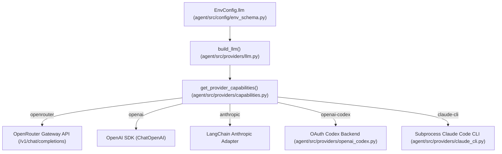
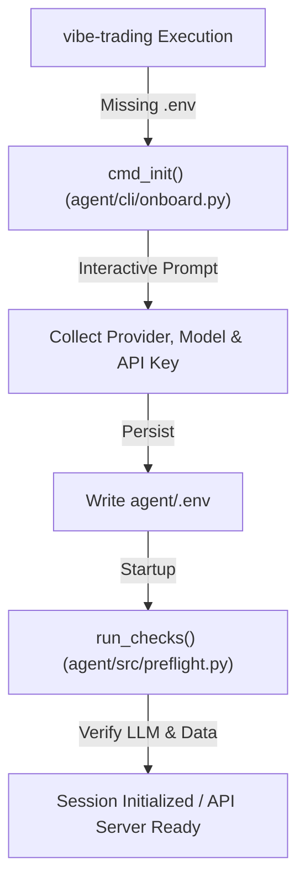
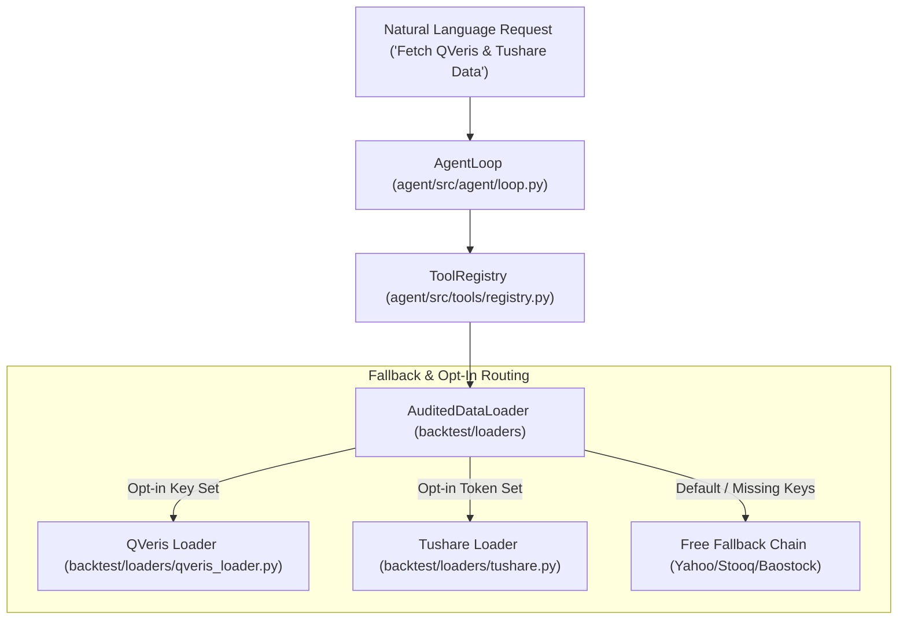

<!-- source: DeepWiki mcp.deepwiki.com · repo HKUDS/Vibe-Trading · page 1.1 Getting Started & Configuration · fetched 2026-11-09 -->

# Getting Started & Configuration

<details>
<summary>Relevant source files</summary>

The following files were used as context for generating this wiki page:

- [.github/dependabot.yml](.github/dependabot.yml)
- [.gitignore](.gitignore)
- [agent/.env.example](agent/.env.example)
- [agent/cli/_legacy.py](agent/cli/_legacy.py)
- [agent/cli/onboard.py](agent/cli/onboard.py)
- [agent/requirements.txt](agent/requirements.txt)
- [agent/src/api/custom_provider_routes.py](agent/src/api/custom_provider_routes.py)
- [agent/src/config/env_schema.py](agent/src/config/env_schema.py)
- [agent/src/providers/capabilities.py](agent/src/providers/capabilities.py)
- [agent/src/providers/chat.py](agent/src/providers/chat.py)
- [agent/src/providers/endpoint_guard.py](agent/src/providers/endpoint_guard.py)
- [agent/src/providers/llm.py](agent/src/providers/llm.py)
- [agent/src/providers/llm_providers.json](agent/src/providers/llm_providers.json)
- [agent/src/skills/options-strategy/SKILL.md](agent/src/skills/options-strategy/SKILL.md)
- [agent/src/tools/fund_nav_tool.py](agent/src/tools/fund_nav_tool.py)
- [agent/tests/test_chat_llm_streaming.py](agent/tests/test_chat_llm_streaming.py)
- [agent/tests/test_cli_init.py](agent/tests/test_cli_init.py)
- [agent/tests/test_custom_provider_routes.py](agent/tests/test_custom_provider_routes.py)
- [agent/tests/test_env_schema.py](agent/tests/test_env_schema.py)
- [agent/tests/test_fund_nav_tool.py](agent/tests/test_fund_nav_tool.py)
- [agent/tests/test_gitignore_runtime_files.py](agent/tests/test_gitignore_runtime_files.py)
- [agent/tests/test_kimi_reasoning_content.py](agent/tests/test_kimi_reasoning_content.py)
- [agent/tests/test_llm.py](agent/tests/test_llm.py)
- [agent/tests/test_llm_provider_defaults.py](agent/tests/test_llm_provider_defaults.py)
- [agent/tests/test_llm_reasoning_effort.py](agent/tests/test_llm_reasoning_effort.py)
- [agent/tests/test_packaging_dependencies.py](agent/tests/test_packaging_dependencies.py)
- [agent/tests/test_provider_diagnostics.py](agent/tests/test_provider_diagnostics.py)
- [agent/tests/test_provider_endpoint_guard.py](agent/tests/test_provider_endpoint_guard.py)
- [agent/tests/test_provider_header_isolation.py](agent/tests/test_provider_header_isolation.py)
- [agent/tests/test_session_service_mcp.py](agent/tests/test_session_service_mcp.py)
- [pyproject.toml](pyproject.toml)
- [requirements-channels-lock.txt](requirements-channels-lock.txt)
- [requirements-lock.txt](requirements-lock.txt)
- [tools/requirements-loader-health.txt](tools/requirements-loader-health.txt)

</details>


## Purpose & Scope
This page details the setup, environment configuration schema, API key management, CLI installation via `pyproject.toml`, onboarding wizard, default gateway routing (Requesty/OpenRouter), and QVeris paid data opt-in for Vibe-Trading. It covers how the environment schema (`EnvConfig`) validates settings, how providers map through `build_llm()`, and how the system boots via preflight verification.

Sources: [pyproject.toml:1-107](), [agent/src/config/env_schema.py:1-180](), [agent/src/providers/llm.py:1-201]()

---

## CLI Installation via pyproject.toml

Vibe-Trading is distributed as a Python package requiring **Python 3.11+** [pyproject.toml:5-5](). The core logic resides under `agent/`, while package entrypoints are registered in `pyproject.toml` [pyproject.toml:96-102]().

### Entrypoint Mapping
| Command | Target Function | Implementation File | Purpose |
| :--- | :--- | :--- | :--- |
| `vibe-trading` | `cli:main` | `agent/cli/_legacy.py` [pyproject.toml:97-97]() | Interactive TUI, single-run execution, and API server control |
| `vibe-trading-mcp` | `mcp_server:main` | `agent/mcp_server.py` [pyproject.toml:98-98]() | Model Context Protocol server for IDE and tool client integration |

### Installation Commands
To install the package with full development, exchange, and market extras:
```bash
pip install -e ".[dev,ashare,harmonic,ibkr,channels]"
```
Core dependencies include `rich`, `langchain`, `pandas`, `fastapi`, and specialized finance libraries [pyproject.toml:20-88](). Optional extras (e.g., `ibkr`, `longbridge`, `mt5`, `zerodha`, `deepseek`, `anthropic`, `openbb`, `krx`, `stats`) are lazy-imported or registered through optional dependency groups [pyproject.toml:132-189]().

Sources: [pyproject.toml:1-189](), [agent/cli/_legacy.py:1-53]()

---

## Environment Configuration (.env, EnvConfig Schema)

The configuration layer replaces scattered `os.getenv` calls with a typed Pydantic v2 configuration model (`EnvConfig` and its sub-models `LLMConfig`, `DataConfig`, `APIConfig`, `SwarmConfig`, `AgentTuningConfig`, `PathConfig`) defined in `agent/src/config/env_schema.py` [agent/src/config/env_schema.py:1-40]().

### Sub-Model Architecture
- `LLMConfig`: Manages `LANGCHAIN_PROVIDER`, `LANGCHAIN_MODEL_NAME`, temperature, timeouts, retries, reasoning effort, and provider base URLs [agent/src/config/env_schema.py:155-180]().
- `DataConfig`: Governs API tokens for `tushare`, `ccxt`, `finnhub`, `alphavantage`, `tiingo`, `fmp`, `fred`, `gildata`, `aliyun_iqs`, `longbridge`, and market data fallback order variables [agent/src/config/env_schema.py:124-158]().
- `APIConfig`: Controls authentication keys (`API_AUTH_KEY`, `VIBE_TRADING_API_KEY`), CORS origins, session runtimes, shell tool gating, and allowed file roots [agent/src/config/env_schema.py:159-171]().
- `_EnvBase` class implements a `model_validator` that inspects `os.environ` using UPPER_SNAKE_CASE aliases and safely coerces numeric and boolean values using helpers like `_parse_env_bool` [agent/src/config/env_schema.py:64-147]().

Sources: [agent/src/config/env_schema.py:1-180](), [agent/tests/test_env_schema.py:1-176]()

---

## LLM Providers & Requesty/OpenRouter Defaults

LLM instantiation is handled by `build_llm()` in `agent/src/providers/llm.py`, backed by capability definitions in `agent/src/providers/capabilities.py` [agent/src/providers/llm.py:1-20]<br>`agent/src/providers/capabilities.py:1-58]().

### Default Routing & Gateway Architecture
Vibe-Trading defaults to **OpenRouter** as its multi-model gateway, using the `provider/model` naming convention [agent/.env.example:6-10](). 


Sources: [agent/src/providers/llm.py:1-20](), [agent/src/providers/capabilities.py:1-58](), [agent/.env.example:6-54]()

---

## Onboarding Wizard & Preflight Checks

When no `.env` file is present, running `vibe-trading` triggers the interactive onboarding wizard (`agent/cli/onboard.py`), which writes credentials via `_render_env_content` and invokes `src/preflight.py` to validate provider endpoints [agent/tests/test_cli_init.py:55-127]()<br>`agent/tests/test_provider_diagnostics.py:1-10]().

### Onboarding & Preflight Flow

Sources: [agent/cli/onboard.py:1-10](), [agent/tests/test_cli_init.py:55-127](), [agent/tests/test_provider_diagnostics.py:1-10]()

---

## Zero-Config Data Philosophy & QVeris Paid Data Opt-In

Vibe-Trading implements a tiered access model. Core market tools operate zero-config, falling back automatically to free providers (Yahoo Finance, Stooq, Eastmoney, Baostock) [agent/src/config/env_schema.py:183-183]().

### Premium Data & QVeris Opt-In
Users can opt-in to premium commercial data streams by configuring keys in `EnvConfig.data`:
- **QVeris Marketplace**: Enabled via `VIBE_TRADING_QVERIS_API_KEY`, subject to session credit budget limits [agent/src/config/env_schema.py:200-201]().
- **Tushare**: Enabled via `TUSHARE_TOKEN` for deep A-share historical and financial statements [agent/src/config/env_schema.py:180-180]().
- **SEC EDGAR**: Free US financial disclosures requiring a compliant `VIBE_TRADING_SEC_UA` header string [agent/src/config/env_schema.py:190-190]().


Sources: [agent/src/config/env_schema.py:174-201](), [agent/src/agent/loop.py:1-50](), [agent/src/tools/registry.py:1-60]()

---

