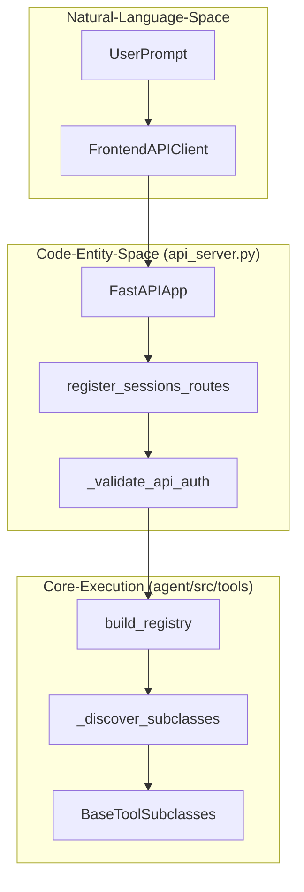
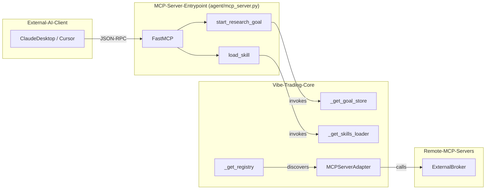

<!-- source: DeepWiki mcp.deepwiki.com · repo HKUDS/Vibe-Trading · page 1.2 System Entrypoints: CLI, API Server, and MCP Server · fetched 2026-11-09 -->

# System Entrypoints: CLI, API Server, and MCP Server

Relevant source files

The following files were used as context for generating this wiki page:

- [CHANGELOG.md](CHANGELOG.md)
- [README.md](README.md)
- [README_ar.md](README_ar.md)
- [README_es.md](README_es.md)
- [README_id.md](README_id.md)
- [README_ja.md](README_ja.md)
- [README_ko.md](README_ko.md)
- [README_zh.md](README_zh.md)
- [agent/SKILL.md](agent/SKILL.md)
- [agent/api_server.py](agent/api_server.py)
- [agent/cli/main.py](agent/cli/main.py)
- [agent/mcp_server.py](agent/mcp_server.py)
- [agent/src/api/helpers.py](agent/src/api/helpers.py)
- [agent/src/api/security.py](agent/src/api/security.py)
- [agent/src/api/settings_routes.py](agent/src/api/settings_routes.py)
- [agent/src/api/state.py](agent/src/api/state.py)
- [agent/src/channels/msteams.py](agent/src/channels/msteams.py)
- [agent/src/config/schema.py](agent/src/config/schema.py)
- [agent/src/session/events.py](agent/src/session/events.py)
- [agent/src/tools/mcp.py](agent/src/tools/mcp.py)
- [agent/src/trading/connectors/ibkr/mcp.py](agent/src/trading/connectors/ibkr/mcp.py)
- [agent/src/trading/connectors/ibkr/profiles.py](agent/src/trading/connectors/ibkr/profiles.py)
- [agent/tests/test_api_infrastructure.py](agent/tests/test_api_infrastructure.py)
- [agent/tests/test_channel_runtime_reset.py](agent/tests/test_channel_runtime_reset.py)
- [agent/tests/test_cli_live.py](agent/tests/test_cli_live.py)
- [agent/tests/test_cli_runtime.py](agent/tests/test_cli_runtime.py)
- [agent/tests/test_eventbus_clear_subscribers.py](agent/tests/test_eventbus_clear_subscribers.py)
- [agent/tests/test_ibkr_mcp_mapping.py](agent/tests/test_ibkr_mcp_mapping.py)
- [agent/tests/test_ibkr_mcp_seed.py](agent/tests/test_ibkr_mcp_seed.py)
- [agent/tests/test_local_connections_hardening.py](agent/tests/test_local_connections_hardening.py)
- [agent/tests/test_mcp_client_adapter.py](agent/tests/test_mcp_client_adapter.py)
- [agent/tests/test_mcp_oauth_noninteractive.py](agent/tests/test_mcp_oauth_noninteractive.py)
- [agent/tests/test_mcp_oauth_schema.py](agent/tests/test_mcp_oauth_schema.py)
- [agent/tests/test_mcp_result_dedup.py](agent/tests/test_mcp_result_dedup.py)
- [agent/tests/test_mcp_specs_cache.py](agent/tests/test_mcp_specs_cache.py)
- [agent/tests/test_msteams_inbound_body_limit.py](agent/tests/test_msteams_inbound_body_limit.py)
- [agent/tests/test_readme_counts.py](agent/tests/test_readme_counts.py)
- [agent/tests/test_scheduled_delivery_hook.py](agent/tests/test_scheduled_delivery_hook.py)
- [agent/tests/test_security_auth_api.py](agent/tests/test_security_auth_api.py)
- [agent/tests/test_serve_bind.py](agent/tests/test_serve_bind.py)
- [agent/tests/test_session_events.py](agent/tests/test_session_events.py)
- [agent/tests/test_settings_api.py](agent/tests/test_settings_api.py)
- [agent/tests/test_sse_ticket_and_headers.py](agent/tests/test_sse_ticket_and_headers.py)
- [agent/tests/test_trading_connections.py](agent/tests/test_trading_connections.py)
- [frontend/src/pages/Settings.tsx](frontend/src/pages/Settings.tsx)

## Purpose and Scope
This page covers the three primary entrypoints for interacting with Vibe-Trading: the terminal-based Command Line Interface (CLI) in `agent/cli/`, the RESTful FastAPI backend in `agent/api_server.py`, and the Model Context Protocol (MCP) server/client subsystem (`agent/mcp_server.py` and `agent/src/tools/mcp.py`). These components handle local user interactions, web frontend requests, external AI tool orchestration, and the channelsui WebSocket/WebUI compatibility layer.

Sources: `agent/cli/main.py:1-30](), [agent/api_server.py:1-30](), [agent/mcp_server.py:1-56]().

## 1. Command Line Interface (CLI)

The CLI serves as the primary entrypoint for local development, interactive terminal sessions, and automated headless runs. It is exposed via the console script entrypoint defined in `pyproject.toml` [pyproject.toml:70]() and implemented under `agent/cli/`.

### Implementation and Execution Modes
* **Interactive TUI Mode**: Launched via `vibe-trading` or `vibe-trading chat`. It uses `prompt_toolkit` to maintain a REPL with command history and a live status toolbar, printing startup banners via `cli.theme.get_console` and `cli.intro.print_banner` [agent/cli/main.py:31-33]().
* **Single Run Mode**: Executes a non-interactive agent execution loop for a prompt supplied through `-p` / `--prompt`.
* **Server Mode**: Started via `vibe-trading serve`, wrapping the FastAPI application defined in `agent/api_server.py` [agent/api_server.py:1-169]().
* **Onboarding Wizard**: On startup, the CLI checks for existing configuration files in `~/.vibe-trading/.env` or project paths, invoking `cli.onboard.run_onboarding` if needed [agent/cli/main.py:100-103]().
* **Stat Probes**: Non-blocking background probes aggregate tool counts, skill counts, and active sessions for display in the startup banner [agent/cli/main.py:143-174]().

### Slash Command Registry
Privileged commands bypass the agent reasoning model to manage system states directly. These are registered in the `SLASH_COMMANDS` registry [agent/cli/main.py:54-97]():
* `/connector`: Manages live trading broker profiles and connection status [agent/cli/main.py:58-66]().
* `/halt` / `/resume`: Triggers or lifts the global safety kill switch [agent/cli/main.py:58-66]().
* `/data`: Toggles between free public data loaders and QVeris paid data routing [agent/cli/main.py:94]().
* `/model`: Selects the active LLM reasoning provider [agent/cli/main.py:130]().

Sources: `pyproject.toml:69-71](), [agent/cli/main.py:1-174]().

---

## 2. API Server (FastAPI)

The REST API server (`agent/api_server.py`) provides the communication backend for the React frontend, handling session CRUD operations, background research executions, and real-time event streaming.

### Key Architecture and Security
* **FastAPI Application Setup**: Instantiates `FastAPI` with a custom lifespan context manager (`_lifespan`) that triggers preflight checks, state migrations, and background service schedulers [agent/api_server.py:128-169]().
* **Authentication and Security Headers**: Enforces `HTTPBearer` token validation via `_validate_api_auth` for non-loopback clients while trusting local loopback calls [agent/api_server.py:35-71](). Security middleware applies strict CORS rules, SPA HTML fallbacks, and security headers [agent/api_server.py:171-180]().
* **SSE Tickets**: Uses short-lived, single-use authentication tickets (`_mint_sse_ticket` / `_consume_sse_ticket`) to allow EventSource connections to stream safely without exposing long-lived bearer keys in query parameters [agent/api_server.py:45, 53]().
* **ChannelsUI Compatibility Layer**: Mounts channels and scheduling route modules (`channels_routes.py`, `scheduled_routes.py`, `runs_routes.py`, `sessions_routes.py`) that bridge WebSocket and WebUI compatibility layers [agent/api_server.py:117-125, 185-212]().

### Primary Endpoints Overview
* `/sessions` (POST/GET): Manages user chat sessions and history storage [agent/api_server.py:194]().
* `/sessions/{id}/messages` (POST): Dispatches user prompts into asynchronous `AgentLoop` executions [agent/api_server.py:194]().
* `/sessions/{id}/events` (GET): Opens a Server-Sent Events (SSE) stream for real-time tool logs and agent thoughts [agent/api_server.py:194]().
* `/runs/*` and `/alpha/*`: Exposes backtest run artifacts and the 478-factor Alpha Zoo registry [agent/api_server.py:186-191]().

### System Entrypoint Data Flow
The diagram below maps the execution flow from the frontend API client through the FastAPI routing and security layers down to the tool registry.

Diagram: API to Agent Execution Flow

Sources: `agent/api_server.py:1-212](), [CHANGELOG.md:13-14]().

---

## 3. Model Context Protocol (MCP)

Vibe-Trading implements dual MCP capabilities: acting as an **MCP Server** to expose financial research tools to external AI clients (Claude Desktop, Cursor, OpenClaw) and as an **MCP Client** to consume tools from remote servers.

### 3.1. MCP Server Implementation
Implemented in `agent/mcp_server.py` using the `FastMCP` framework (`mcp = FastMCP("Vibe-Trading")`) [agent/mcp_server.py:75-86]().

* **Transports**: Supports `stdio` (default pipe), legacy `sse`, and the modern Streamable HTTP `http` transport (`--transport http` served at `/mcp`) [agent/mcp_server.py:31-40]().
* **Tool Exposure**: Registers 82+ read-only or research tools (including market data, backtesting, Alpha Zoo factors, paper-trading matching via `paper_trade_step`, and `load_skill`) [agent/mcp_server.py:9-29, 86](). Order-placing and order-canceling tools are strictly prohibited [agent/mcp_server.py:27-29]().
* **Security & Hardening**: Process-control tools (`bash`, `background_run`) are disabled by default unless explicitly opted in via `--enable-shell-tools` or `VIBE_TRADING_ENABLE_SHELL_TOOLS` [agent/mcp_server.py:98-132](). Network transports incorporate `_HostGuardMiddleware` and Origin allow-lists to prevent DNS-rebinding attacks [agent/mcp_server.py:135-144]().

### 3.2. MCP Client Mode (Consuming Tools)
Managed via `agent/src/tools/mcp.py` (`MCPServerAdapter`), allowing the agent to invoke remote tools [agent/src/tools/mcp.py:1]().

* **Tool Discovery & Wrapping**: `build_mcp_tool_wrappers` introspects remote servers and wraps discovered functions into local `BaseTool` instances, prefixing names as `mcp_<server>_<tool>` [agent/src/tools/mcp.py:117-168]().
* **OAuth & Interactive Guards**: Implements `_GuardedOAuth` and `_IBKROAuth` to handle authentication flows securely [agent/src/tools/mcp.py:101-190](). Setting `allow_interactive=False` ensures non-interactive background pollers or API jobs throw a loud `RuntimeError` rather than unexpectedly spawning browser windows [agent/src/tools/mcp.py:101-144]().
* **Broker Protection**: Wildcard tool access (`enabled_tools=["*"]`) is rejected for live broker connections unless explicit read-only lists are provided [agent/src/config/schema.py:11-46]().

Diagram: MCP Bridge Architecture

Sources: `agent/mcp_server.py:1-212](), [agent/src/tools/mcp.py:1-190](), [agent/src/config/schema.py:11-46]().

---

## Summary of Entrypoint Differences

| Feature | CLI (`agent/cli/`) | API Server (`agent/api_server.py`) | MCP Server (`agent/mcp_server.py`) |
| :--- | :--- | :--- | :--- |
| **Primary Target** | Developer / Quant User | React Web Application UI | External AI Clients (Claude/Cursor) |
| **Protocol / Interface** | Terminal REPL / TUI / Stdio | RESTful HTTP + SSE Streams | JSON-RPC (Stdio / SSE / HTTP) |
| **Security Model** | Local Process Execution | Loopback Trust / HTTPBearer Auth | Loopback HostGuard / Scoped Auth |
| **Key Use Case** | Interactive terminal research | Web UI dashboard & automation | IDE assistant tool extension |

Sources: `agent/cli/main.py:1-30](), [agent/api_server.py:1-169](), [agent/mcp_server.py:1-56]().

---

