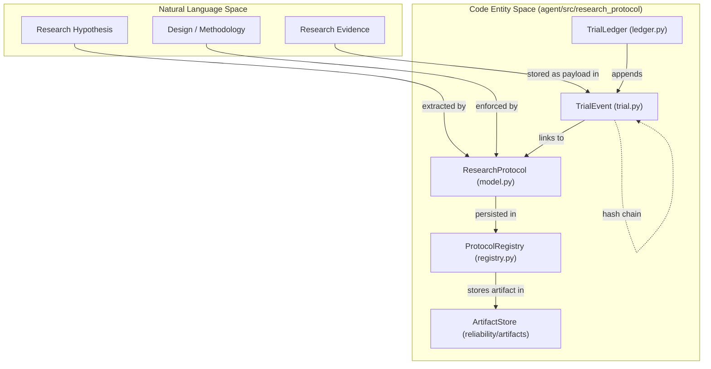
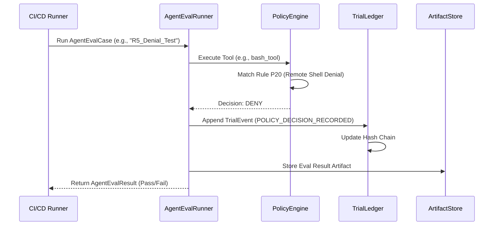

<!-- source: DeepWiki mcp.deepwiki.com · repo HKUDS/Vibe-Trading · page 14.4 Research Protocol, Trial Ledger, and Agent Eval · fetched 2026-11-09 -->

# Research Protocol, Trial Ledger, and Agent Eval

Relevant source files

The following files were used as context for generating this wiki page:

- [.github/workflows/test.yml](.github/workflows/test.yml)
- [.github/workflows/wiki-deploy.yml](.github/workflows/wiki-deploy.yml)
- [.github/workflows/wiki.yml](.github/workflows/wiki.yml)
- [agent/backtest/factor_costs.py](agent/backtest/factor_costs.py)
- [agent/src/governance/__init__.py](agent/src/governance/__init__.py)
- [agent/src/governance/manifest.py](agent/src/governance/manifest.py)
- [agent/src/quantlib/credit.py](agent/src/quantlib/credit.py)
- [agent/src/quantlib/eventstudy.py](agent/src/quantlib/eventstudy.py)
- [agent/src/quantlib/factormodel.py](agent/src/quantlib/factormodel.py)
- [agent/src/swarm/store.py](agent/src/swarm/store.py)
- [agent/tests/quantlib/test_credit.py](agent/tests/quantlib/test_credit.py)
- [agent/tests/quantlib/test_eventstudy.py](agent/tests/quantlib/test_eventstudy.py)
- [agent/tests/quantlib/test_factormodel.py](agent/tests/quantlib/test_factormodel.py)
- [agent/tests/quantlib/test_factormodel_negative_specific_variance.py](agent/tests/quantlib/test_factormodel_negative_specific_variance.py)
- [agent/tests/test_cds_final_stub_regressions.py](agent/tests/test_cds_final_stub_regressions.py)
- [agent/tests/test_matrix_stream_end_no_preview.py](agent/tests/test_matrix_stream_end_no_preview.py)
- [agent/tests/test_style_missing_exposures_regressions.py](agent/tests/test_style_missing_exposures_regressions.py)
- [agent/tests/test_swarm_events_partial_tail.py](agent/tests/test_swarm_events_partial_tail.py)
- [wiki/README.md](wiki/README.md)
- [wiki/_redirects](wiki/_redirects)
- [wiki/assets/alpha-library-og.png](wiki/assets/alpha-library-og.png)
- [wiki/docs/styles.css](wiki/docs/styles.css)
- [wiki/scripts/check_docs_parity.mjs](wiki/scripts/check_docs_parity.mjs)
- [wiki/scripts/check_social_cards.py](wiki/scripts/check_social_cards.py)
- [wiki/styles.css](wiki/styles.css)

The Research Protocol and Trial Ledger systems form the backbone of the Institutional Research Reliability (IRR) layer. They provide a formal structure for experimental design, an immutable record of research steps, and a deterministic environment for evaluating agent behavior against governance policies.

## Research Protocol Model

The `ResearchProtocol` is a strongly-typed schema (version 1.0.0) that defines the parameters of a financial research experiment. It ensures that every trial is conducted against a pre-defined universe, data contract, and evaluation plan, preventing "p-hacking" or informal methodology shifts during execution.

### Key Components

| Component | Class | Description |
|:---|:---|:---|
| **Universe Spec** | `UniverseSpec` | Defines the asset class, symbols, and whether the universe is Point-in-Time (PIT) [agent/src/research_protocol/model.py:38-49](). |
| **Filter Spec** | `FilterSpec` | Canonical JSON-based filters (e.g., `gt`, `between`) applied to the universe [agent/src/research_protocol/model.py:19-37](). |
| **Split Spec** | `SplitSpec` | Defines the `holdout`, `walk_forward`, `rolling`, or `expanding` windows for train/validation/test [agent/src/research_protocol/model.py:51-66](). |
| **Benchmark Spec** | `BenchmarkSpec` | Specifies primary and comparator benchmarks with PIT membership requirements [agent/src/research_protocol/model.py:67-78](). |
| **Evaluation Plan** | `EvaluationPlan` | Lists required metrics, OOS requirements, IC horizons, and anti-overfit tests (crowding, regime) [agent/src/research_protocol/model.py:106-120](). |

### Protocol Hashing and Immutability
Protocols are identified by a `protocol_hash`, computed using `sha256_json` on a payload that excludes volatile metadata like `created_at` or `status` [agent/src/research_protocol/hashing.py:11-34](). This ensures that two identical research designs share the same hash regardless of when or by whom they were created. Once a protocol is moved from `draft` to `registered` status, it becomes immutable [agent/src/research_protocol/registry.py:31-34]().

**Sources:**
- [agent/src/research_protocol/model.py:1-176]()
- [agent/src/research_protocol/hashing.py:1-35]()

---

## Protocol Registry

The `ProtocolRegistry` manages the lifecycle of research designs, persisting them to the filesystem and the `ArtifactStore`.

### Data Flow: Draft to Registration
1.  **Drafting**: A protocol is created (often via `draft_protocol_from_hypothesis`) and saved as a `.json` file in `~/.vibe-trading/research-protocols/` [agent/src/research_protocol/registry.py:27-38]().
2.  **Registration**: The `register()` method computes the final `protocol_hash`, updates the status, and writes a permanent record to the `ArtifactStore` [agent/src/research_protocol/registry.py:39-70]().
3.  **Deduplication**: The registry uses the hash to ensure that identical research designs are linked to the same artifact [agent/src/research_protocol/registry.py:47-51]().

**Sources:**
- [agent/src/research_protocol/registry.py:19-110]()
- [agent/src/research_protocol/extractor.py:11-40]()

---

## Trial Ledger

The `TrialLedger` is an append-only SQLite database using Write-Ahead Logging (WAL) to record every significant event in a research trial. It utilizes a linear hash chain to ensure the integrity of the research history.

### Linear Hash Chain Implementation
Each `TrialEvent` contains a `previous_event_hash` and its own `event_hash`. The `event_hash` is a SHA-256 digest of the event's ID, type, sequence number, payload, and the hash of the preceding event [agent/src/research_protocol/ledger.py:68-78](). This creates a cryptographic link that makes it impossible to delete or reorder events without breaking the chain.

### Event Types
The ledger tracks a variety of `TrialEventType` values [agent/src/research_protocol/trial.py:16-29]():
- `PROTOCOL_REGISTERED`: The start of a new research track.
- `TRIAL_STARTED`: Initialization of an agent execution loop.
- `DATA_LOADED`: Records the `ArtifactRef` of the dataset used.
- `POLICY_DECISION_RECORDED`: Governance logs (e.g., R5 shell denial).
- `SCORECARD_GENERATED`: The quantitative reliability assessment.
- `TRIAL_ACCEPTED/REJECTED`: Final disposition based on IRR-AGL gates.

### Concurrency and Integrity
The ledger uses `BEGIN IMMEDIATE` transactions to handle concurrent writes from multiple agent processes [agent/src/research_protocol/ledger.py:61-62](). The `verify()` function traverses the entire chain to validate sequence numbers, schema versions, and hash continuity [agent/src/research_protocol/ledger.py:130-177]().

### Research Protocol and Ledger Entity Map

Title: "Research Protocol and Ledger Entity Map"

**Sources:**
- [agent/src/research_protocol/ledger.py:1-177]()
- [agent/src/research_protocol/trial.py:1-57]()

---

## Agent Eval and Regression Testing

The `AgentEvalRunner` is a deterministic framework designed to test agent behavior against governance policies and research protocols without incurring LLM costs or network latency.

### Deterministic Replay Environment
The runner operates in a "replay-only" mode with the following boundaries:
- **Fake Loaders**: Data requests are intercepted and served from static fixtures.
- **Fake Connectors**: Broker actions are simulated and logged rather than executed.
- **Mock LLM**: The `AgentLoop` is fed pre-determined prompt responses to test specific logic branches.

### Required Regression Themes
The eval suite focuses on high-risk governance scenarios defined in the `PolicyEngine` [agent/src/governance/policy.py]():
1.  **R4/R5 Shadow Deny**: Ensuring the agent cannot execute shell commands or modify system files.
2.  **Remote API Shell Denial**: Blocking code execution requested via the MCP interface.
3.  **Scheduler Live-Write Denial**: Preventing scheduled background jobs from placing live trades.
4.  **Prompt-Injected MCP URL Denial**: Detecting and blocking malicious URLs in tool arguments. This is particularly relevant for `MCPRemoteTool` instances, where the `_build_token_store` function ensures that URL-shaped cache keys are neutralized into cache-root-local filenames, preventing path traversal vulnerabilities [agent/tests/test_oauth_token_cache.py:81-114]().
5.  **Scorecard Visibility**: Verifying that `HARD_FAILURE_CODES` (e.g., `PIT_FUTURE_DATA`) correctly cap the `ConclusionCap` at `not_reliable`.

### Acceptance Gates
Before a trial can be marked as `Accepted`, it must pass the `validate_accepted_result` gate, which checks for [agent/src/research_protocol/acceptance.py:29-51]():
- A registered `protocol_hash`.
- At least one `data_audit_id`.
- At least one `policy_decision_id`.
- Valid `backtest_artifact_refs`.

### Financial Rigor and Audit Tools
The `AgentEvalRunner` utilizes specialized tools to verify the integrity of agent outputs:
- **Financial Rigor Tool**: Uses `decimal.Decimal` with 28-digit precision to verify market caps, valuation ratios, and arithmetic expressions, avoiding IEEE-754 float drift [agent/src/tools/financial_rigor_tool.py:39-111]().
- **Report Audit Tool**: Extracts numeric data points from markdown reports (handling units like 亿/万亿) and performs random sampling (clamped to 3-30 points) to verify reported figures against authoritative sources [agent/src/tools/report_audit_tool.py:118-195]().

### Agent Eval Execution Flow

Title: "Agent Eval Execution Flow"

**Sources:**
- [agent/src/research_protocol/acceptance.py:14-51]()
- [agent/src/research_protocol/cli_handlers.py:66-78]()
- [agent/src/tools/financial_rigor_tool.py:1-200]()
- [agent/src/tools/report_audit_tool.py:1-200]()
- [agent/tests/research_protocol/test_accepted_result_gates.py:40-66]()
- [agent/tests/test_oauth_token_cache.py:81-114]()

---

